# CM1-logique-et-raisonnement_2021-2022_Algebre1_P1S1_NArancibia-DCransac.pdf

[Ouvrir l’original](https://drive.google.com/open?id=1csi5uwTAem66_G9-HnaDdZ7QRU85cSBH) · Les deux lectures automatiques du PDF divergent sur les pages indiquées. Leur fac-similé accompagne le texte.

**Pages présentant un écart entre les deux extractions** — 1–10, 27–35, 51–85, 96–97, 99–105, 109–131, 135, 139, 146–153, 155, 157–187, 206–221, 224–246, 261–276, 279–282, 286, 291, 306, 312, 314–343, 355–357, 362–416, 419–430, 433–463.

## Page 1

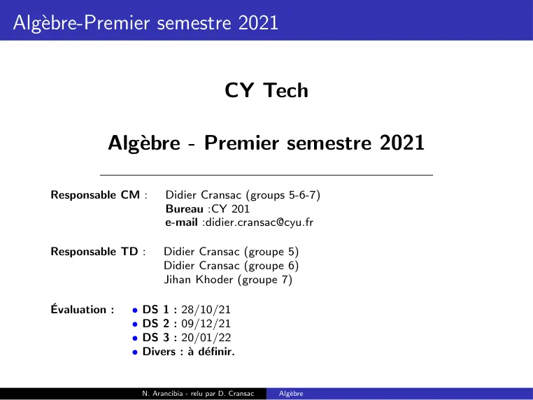

~~~text
Algèbre-Premier semestre 2021

                                              CY Tech

               Algèbre - Premier semestre 2021

    Responsable CM :         Didier Cransac (groups 5-6-7)
                             Bureau :CY 201
                             e-mail :didier.cransac@cyu.fr

    Responsable TD :        Didier Cransac (groupe 5)
                            Didier Cransac (groupe 6)
                            Jihan Khoder (groupe 7)

    Évaluation :   • DS 1 : 28/10/21
                    • DS 2 : 09/12/21
                    • DS 3 : 20/01/22
                    • Divers : à définir.

                      N. Arancibia - relu par D. Cransac   Algèbre
~~~

## Page 2

~~~text
Algèbre-Premier semestre 2021
Accès aux documents

                                   Comptes Teams :
                       Préing 1 (global)       n33vzum
                       Groupe Alèbre I CM DC      br01qzw
                       Groupe 5                    4n9f431
                       Groupe 6                    grwo6rf
                       Groupe 7                    wp2pahr

                 En cas de difficulté : didier.cransac@cyu.fr

                       N. Arancibia - relu par D. Cransac   Algèbre
~~~

## Page 3

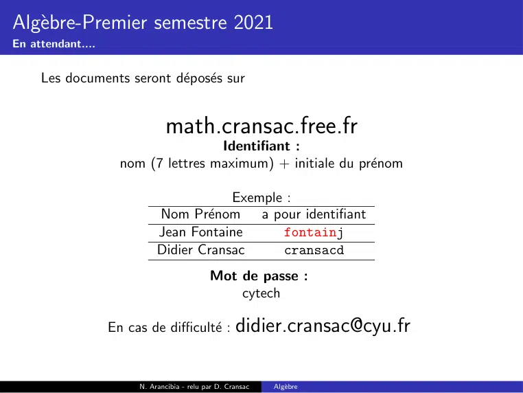

~~~text
Algèbre-Premier semestre 2021
En attendant....

     Les documents seront déposés sur

                              math.cransac.free.fr
                                    Identifiant :
                    nom (7 lettres maximum) + initiale du prénom

                                        Exemple :
                            Nom Prénom a pour identifiant
                            Jean Fontaine      fontainj
                            Didier Cransac     cransacd
                                            Mot de passe :
                                                cytech

                   En cas de difficulté : didier.cransac@cyu.fr

                       N. Arancibia - relu par D. Cransac   Algèbre
~~~

## Page 4

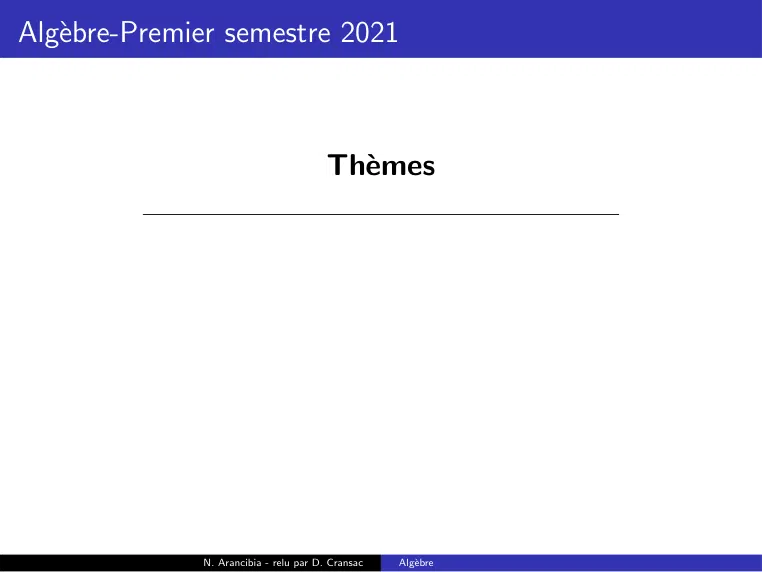

~~~text
Algèbre-Premier semestre 2021

                                        Thèmes

              N. Arancibia - relu par D. Cransac   Algèbre
~~~

## Page 5

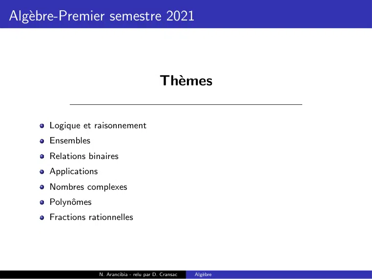

~~~text
Algèbre-Premier semestre 2021

                                               Thèmes

      Logique et raisonnement
      Ensembles
      Relations binaires
      Applications
      Nombres complexes
      Polynômes
      Fractions rationnelles

                     N. Arancibia - relu par D. Cransac   Algèbre
~~~

## Page 6

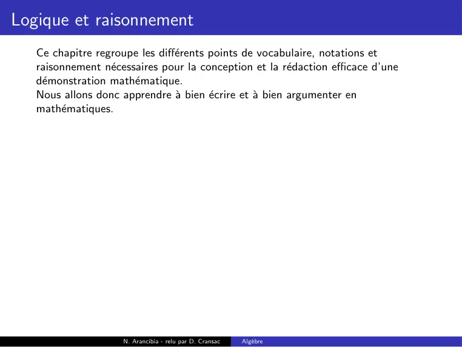

~~~text
Logique et raisonnement
   Ce chapitre regroupe les différents points de vocabulaire, notations et
   raisonnement nécessaires pour la conception et la rédaction efficace d’une
   démonstration mathématique.
   Nous allons donc apprendre à bien écrire et à bien argumenter en
   mathématiques.

                     N. Arancibia - relu par D. Cransac   Algèbre
~~~

## Page 7

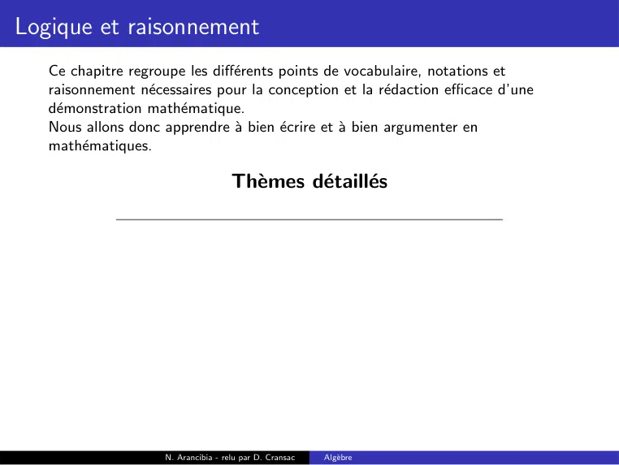

~~~text
Logique et raisonnement
   Ce chapitre regroupe les différents points de vocabulaire, notations et
   raisonnement nécessaires pour la conception et la rédaction efficace d’une
   démonstration mathématique.
   Nous allons donc apprendre à bien écrire et à bien argumenter en
   mathématiques.

                                      Thèmes détaillés

                     N. Arancibia - relu par D. Cransac   Algèbre
~~~

## Page 8

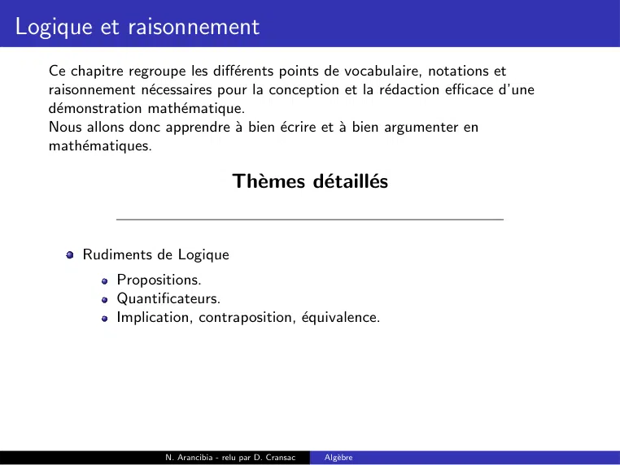

~~~text
Logique et raisonnement
   Ce chapitre regroupe les différents points de vocabulaire, notations et
   raisonnement nécessaires pour la conception et la rédaction efficace d’une
   démonstration mathématique.
   Nous allons donc apprendre à bien écrire et à bien argumenter en
   mathématiques.

                                      Thèmes détaillés

        Rudiments de Logique
             Propositions.
             Quantificateurs.
             Implication, contraposition, équivalence.

                     N. Arancibia - relu par D. Cransac   Algèbre
~~~

## Page 9

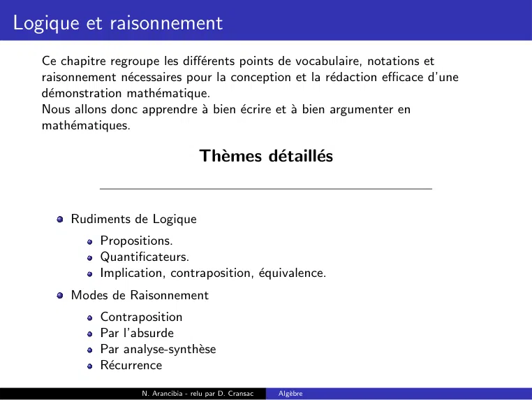

~~~text
Logique et raisonnement
   Ce chapitre regroupe les différents points de vocabulaire, notations et
   raisonnement nécessaires pour la conception et la rédaction efficace d’une
   démonstration mathématique.
   Nous allons donc apprendre à bien écrire et à bien argumenter en
   mathématiques.

                                      Thèmes détaillés

        Rudiments de Logique
             Propositions.
             Quantificateurs.
             Implication, contraposition, équivalence.
        Modes de Raisonnement
             Contraposition
             Par l’absurde
             Par analyse-synthèse
             Récurrence

                     N. Arancibia - relu par D. Cransac   Algèbre
~~~

## Page 10

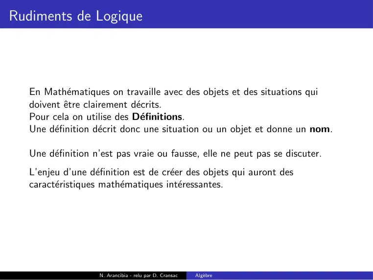

~~~text
Rudiments de Logique

   En Mathématiques on travaille avec des objets et des situations qui
   doivent être clairement décrits.
   Pour cela on utilise des Définitions.
   Une définition décrit donc une situation ou un objet et donne un nom.

   Une définition n’est pas vraie ou fausse, elle ne peut pas se discuter.
   L’enjeu d’une définition est de créer des objets qui auront des
   caractéristiques mathématiques intéressantes.

                    N. Arancibia - relu par D. Cransac   Algèbre
~~~

## Page 11

~~~text
Rudiments de Logique

   Définition (Proposition)
   On appelle proposition (ou assertion) toute phrase P dont on peut dire si elle
   est vraie (V) ou fausse (F).

                     N. Arancibia - relu par D. Cransac   Algèbre
~~~

## Page 12

~~~text
Rudiments de Logique

   Définition (Proposition)
   On appelle proposition (ou assertion) toute phrase P dont on peut dire si elle
   est vraie (V) ou fausse (F).

   Autrement dit, on appelle proposition toute phrase P au sujet de laquelle on
   peut poser la question :

                     N. Arancibia - relu par D. Cransac   Algèbre
~~~

## Page 13

~~~text
Rudiments de Logique

   Définition (Proposition)
   On appelle proposition (ou assertion) toute phrase P dont on peut dire si elle
   est vraie (V) ou fausse (F).

   Autrement dit, on appelle proposition toute phrase P au sujet de laquelle on
   peut poser la question :

                                    P est-elle vraie ? 

                     N. Arancibia - relu par D. Cransac   Algèbre
~~~

## Page 14

~~~text
Rudiments de Logique

   Définition (Proposition)
   On appelle proposition (ou assertion) toute phrase P dont on peut dire si elle
   est vraie (V) ou fausse (F).

   Autrement dit, on appelle proposition toute phrase P au sujet de laquelle on
   peut poser la question :

                                    P est-elle vraie ? 

   Exemples :
           3×3=9

                     N. Arancibia - relu par D. Cransac   Algèbre
~~~

## Page 15

~~~text
Rudiments de Logique

   Définition (Proposition)
   On appelle proposition (ou assertion) toute phrase P dont on peut dire si elle
   est vraie (V) ou fausse (F).

   Autrement dit, on appelle proposition toute phrase P au sujet de laquelle on
   peut poser la question :

                                     P est-elle vraie ? 

   Exemples :
           3 × 3 = 9 est une proposition vraie.

                      N. Arancibia - relu par D. Cransac   Algèbre
~~~

## Page 16

~~~text
Rudiments de Logique

   Définition (Proposition)
   On appelle proposition (ou assertion) toute phrase P dont on peut dire si elle
   est vraie (V) ou fausse (F).

   Autrement dit, on appelle proposition toute phrase P au sujet de laquelle on
   peut poser la question :

                                     P est-elle vraie ? 

   Exemples :
           3 × 3 = 9 est une proposition vraie.
           7 est pair 

                      N. Arancibia - relu par D. Cransac   Algèbre
~~~

## Page 17

~~~text
Rudiments de Logique

   Définition (Proposition)
   On appelle proposition (ou assertion) toute phrase P dont on peut dire si elle
   est vraie (V) ou fausse (F).

   Autrement dit, on appelle proposition toute phrase P au sujet de laquelle on
   peut poser la question :

                                     P est-elle vraie ? 

   Exemples :
           3 × 3 = 9 est une proposition vraie.
           7 est pair est une proposition fausse.
           8=2

                      N. Arancibia - relu par D. Cransac   Algèbre
~~~

## Page 18

~~~text
Rudiments de Logique

   Définition (Proposition)
   On appelle proposition (ou assertion) toute phrase P dont on peut dire si elle
   est vraie (V) ou fausse (F).

   Autrement dit, on appelle proposition toute phrase P au sujet de laquelle on
   peut poser la question :

                                     P est-elle vraie ? 

   Exemples :
           3 × 3 = 9 est une proposition vraie.
           7 est pair est une proposition fausse.
           8 = 2  est une proposition fausse.

                      N. Arancibia - relu par D. Cransac   Algèbre
~~~

## Page 19

~~~text
Rudiments de Logique

   Définition (Proposition)
   On appelle proposition (ou assertion) toute phrase P dont on peut dire si elle
   est vraie (V) ou fausse (F).

   Autrement dit, on appelle proposition toute phrase P au sujet de laquelle on
   peut poser la question :

                                      P est-elle vraie ? 

   Exemples :
           3 × 3 = 9 est une proposition vraie.
           7 est pair est une proposition fausse.
           8 = 2  est une proposition fausse.
            l’entier 49 est un carré 

                       N. Arancibia - relu par D. Cransac   Algèbre
~~~

## Page 20

~~~text
Rudiments de Logique

   Définition (Proposition)
   On appelle proposition (ou assertion) toute phrase P dont on peut dire si elle
   est vraie (V) ou fausse (F).

   Autrement dit, on appelle proposition toute phrase P au sujet de laquelle on
   peut poser la question :

                                     P est-elle vraie ? 

   Exemples :
           3 × 3 = 9 est une proposition vraie.
           7 est pair est une proposition fausse.
           8 = 2  est une proposition fausse.
            l’entier 49 est un carré  est une proposition vraie (72 = 49).

                      N. Arancibia - relu par D. Cransac   Algèbre
~~~

## Page 21

~~~text
Rudiments de Logique

   Définition (Proposition)
   On appelle proposition (ou assertion) toute phrase P dont on peut dire si elle
   est vraie (V) ou fausse (F).

   Autrement dit, on appelle proposition toute phrase P au sujet de laquelle on
   peut poser la question :

                                     P est-elle vraie ? 

   Exemples :
           3 × 3 = 9 est une proposition vraie.
           7 est pair est une proposition fausse.
           8 = 2  est une proposition fausse.
         l’entier 49 est un carré  est une proposition vraie (72 = 49).
          3
           =5
          0

                      N. Arancibia - relu par D. Cransac   Algèbre
~~~

## Page 22

~~~text
Rudiments de Logique

   Définition (Proposition)
   On appelle proposition (ou assertion) toute phrase P dont on peut dire si elle
   est vraie (V) ou fausse (F).

   Autrement dit, on appelle proposition toute phrase P au sujet de laquelle on
   peut poser la question :

                                     P est-elle vraie ? 

   Exemples :
           3 × 3 = 9 est une proposition vraie.
           7 est pair est une proposition fausse.
           8 = 2  est une proposition fausse.
         l’entier 49 est un carré  est une proposition vraie (72 = 49).
          3                                             3
           = 5  n’est pas un proposition (l’écriture ne représente rien)
          0                                             0

                      N. Arancibia - relu par D. Cransac   Algèbre
~~~

## Page 23

~~~text
Rudiments de Logique

   Remarque : La plupart des phrases grammaticalement correctes sont des
   propositions.

                  N. Arancibia - relu par D. Cransac   Algèbre
~~~

## Page 24

~~~text
Rudiments de Logique

   Remarque : La plupart des phrases grammaticalement correctes sont des
   propositions.
   Mais par exemple :
          Dis-le-moi !  ,
          Bonjour 
          Quelle heure est-il ?  , ou
          Comment vas-tu ? 

                     N. Arancibia - relu par D. Cransac   Algèbre
~~~

## Page 25

~~~text
Rudiments de Logique

   Remarque : La plupart des phrases grammaticalement correctes sont des
   propositions.
   Mais par exemple :
          Dis-le-moi !  ,
          Bonjour 
          Quelle heure est-il ?  , ou
          Comment vas-tu ? 
   ne sont pas des propositions.

                     N. Arancibia - relu par D. Cransac   Algèbre
~~~

## Page 26

~~~text
Rudiments de Logique

   Remarque : La plupart des phrases grammaticalement correctes sont des
   propositions.
   Mais par exemple :
          Dis-le-moi !  ,
          Bonjour 
          Quelle heure est-il ?  , ou
          Comment vas-tu ? 
   ne sont pas des propositions.
   La question :

                 Est-il vrai que  bonjour  ? , n’a aucun sens.

                     N. Arancibia - relu par D. Cransac   Algèbre
~~~

## Page 27

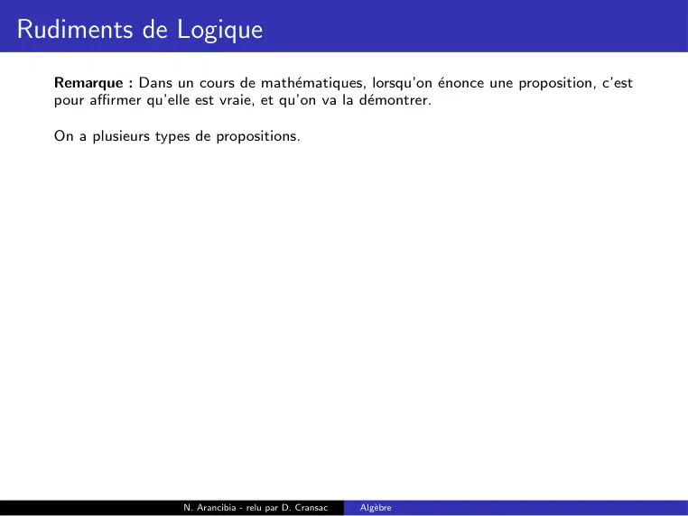

~~~text
Rudiments de Logique
   Remarque : Dans un cours de mathématiques, lorsqu’on énonce une proposition, c’est
   pour affirmer qu’elle est vraie, et qu’on va la démontrer.

   On a plusieurs types de propositions.

                      N. Arancibia - relu par D. Cransac   Algèbre
~~~

## Page 28

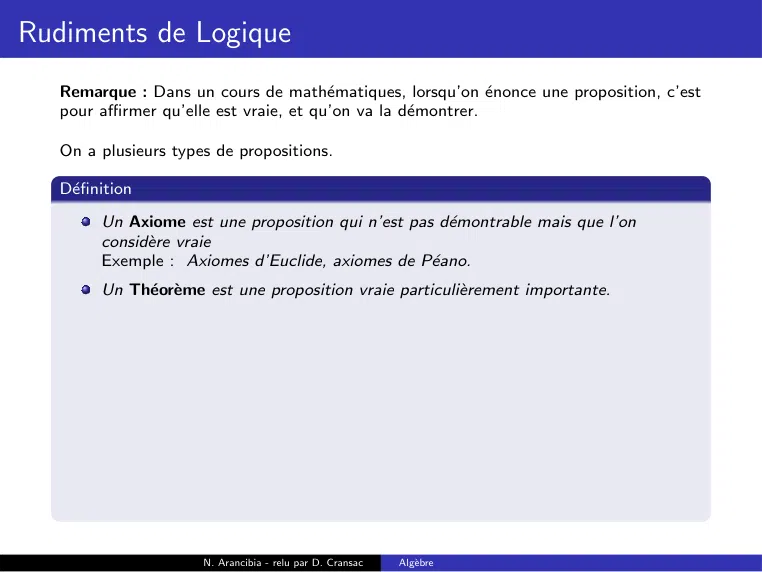

~~~text
Rudiments de Logique
   Remarque : Dans un cours de mathématiques, lorsqu’on énonce une proposition, c’est
   pour affirmer qu’elle est vraie, et qu’on va la démontrer.

   On a plusieurs types de propositions.

   Définition
         Un Axiome est une proposition qui n’est pas démontrable mais que l’on
         considère vraie
         Exemple : Axiomes d’Euclide, axiomes de Péano.
         Un Théorème est une proposition vraie particulièrement importante.

                      N. Arancibia - relu par D. Cransac   Algèbre
~~~

## Page 29

~~~text
Rudiments de Logique
   Remarque : Dans un cours de mathématiques, lorsqu’on énonce une proposition, c’est
   pour affirmer qu’elle est vraie, et qu’on va la démontrer.

   On a plusieurs types de propositions.

   Définition
         Un Axiome est une proposition qui n’est pas démontrable mais que l’on
         considère vraie
         Exemple : Axiomes d’Euclide, axiomes de Péano.
         Un Théorème est une proposition vraie particulièrement importante.
         Exemple : Théorème Pythagore, Théorème de Fermat(-Wiles).

                      N. Arancibia - relu par D. Cransac   Algèbre
~~~

## Page 30

~~~text
Rudiments de Logique
   Remarque : Dans un cours de mathématiques, lorsqu’on énonce une proposition, c’est
   pour affirmer qu’elle est vraie, et qu’on va la démontrer.

   On a plusieurs types de propositions.

   Définition
         Un Axiome est une proposition qui n’est pas démontrable mais que l’on
         considère vraie
         Exemple : Axiomes d’Euclide, axiomes de Péano.
         Un Théorème est une proposition vraie particulièrement importante.
         Exemple : Théorème Pythagore, Théorème de Fermat(-Wiles).
         Un Lemme est une proposition vraie, utile à la démonstration d’une proposition
         plus importante.

                      N. Arancibia - relu par D. Cransac   Algèbre
~~~

## Page 31

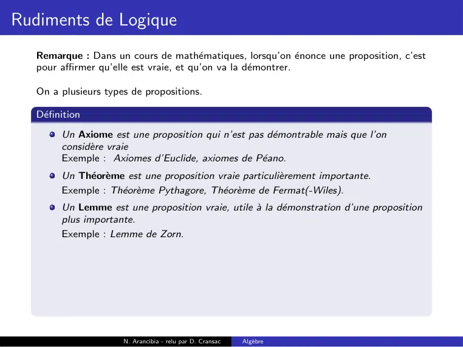

~~~text
Rudiments de Logique
   Remarque : Dans un cours de mathématiques, lorsqu’on énonce une proposition, c’est
   pour affirmer qu’elle est vraie, et qu’on va la démontrer.

   On a plusieurs types de propositions.

   Définition
         Un Axiome est une proposition qui n’est pas démontrable mais que l’on
         considère vraie
         Exemple : Axiomes d’Euclide, axiomes de Péano.
         Un Théorème est une proposition vraie particulièrement importante.
         Exemple : Théorème Pythagore, Théorème de Fermat(-Wiles).
         Un Lemme est une proposition vraie, utile à la démonstration d’une proposition
         plus importante.
         Exemple : Lemme de Zorn.

                      N. Arancibia - relu par D. Cransac   Algèbre
~~~

## Page 32

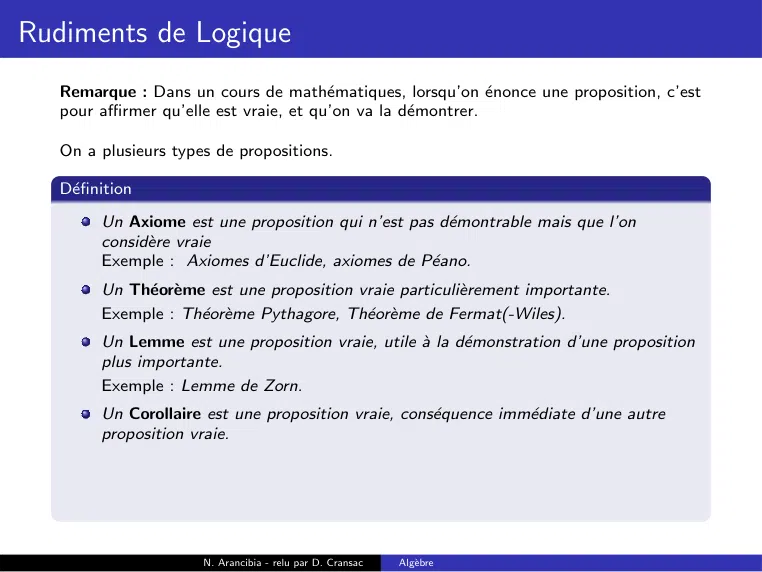

~~~text
Rudiments de Logique
   Remarque : Dans un cours de mathématiques, lorsqu’on énonce une proposition, c’est
   pour affirmer qu’elle est vraie, et qu’on va la démontrer.

   On a plusieurs types de propositions.

   Définition
         Un Axiome est une proposition qui n’est pas démontrable mais que l’on
         considère vraie
         Exemple : Axiomes d’Euclide, axiomes de Péano.
         Un Théorème est une proposition vraie particulièrement importante.
         Exemple : Théorème Pythagore, Théorème de Fermat(-Wiles).
         Un Lemme est une proposition vraie, utile à la démonstration d’une proposition
         plus importante.
         Exemple : Lemme de Zorn.
         Un Corollaire est une proposition vraie, conséquence immédiate d’une autre
         proposition vraie.

                      N. Arancibia - relu par D. Cransac   Algèbre
~~~

## Page 33

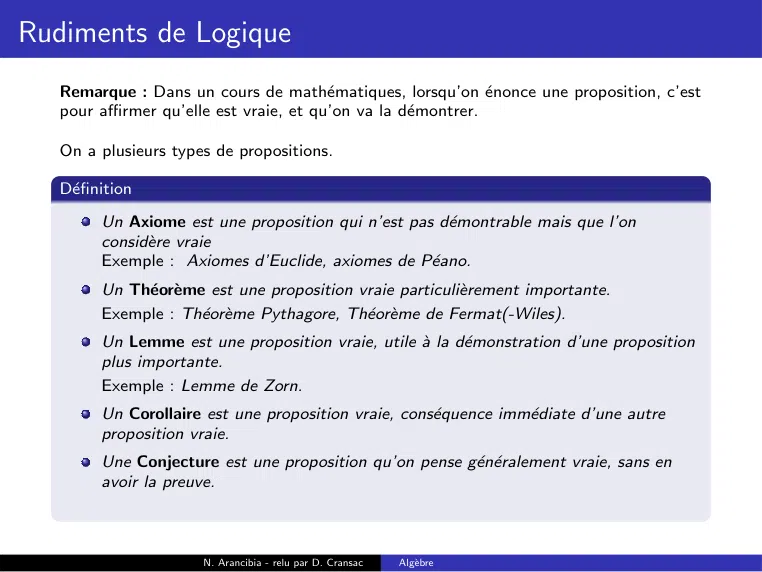

~~~text
Rudiments de Logique
   Remarque : Dans un cours de mathématiques, lorsqu’on énonce une proposition, c’est
   pour affirmer qu’elle est vraie, et qu’on va la démontrer.

   On a plusieurs types de propositions.

   Définition
         Un Axiome est une proposition qui n’est pas démontrable mais que l’on
         considère vraie
         Exemple : Axiomes d’Euclide, axiomes de Péano.
         Un Théorème est une proposition vraie particulièrement importante.
         Exemple : Théorème Pythagore, Théorème de Fermat(-Wiles).
         Un Lemme est une proposition vraie, utile à la démonstration d’une proposition
         plus importante.
         Exemple : Lemme de Zorn.
         Un Corollaire est une proposition vraie, conséquence immédiate d’une autre
         proposition vraie.
         Une Conjecture est une proposition qu’on pense généralement vraie, sans en
         avoir la preuve.

                      N. Arancibia - relu par D. Cransac   Algèbre
~~~

## Page 34

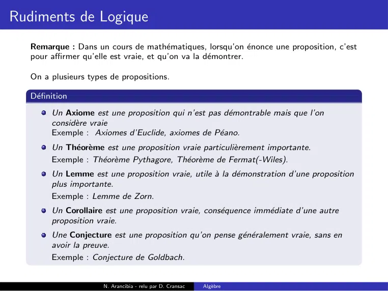

~~~text
Rudiments de Logique
   Remarque : Dans un cours de mathématiques, lorsqu’on énonce une proposition, c’est
   pour affirmer qu’elle est vraie, et qu’on va la démontrer.

   On a plusieurs types de propositions.

   Définition
         Un Axiome est une proposition qui n’est pas démontrable mais que l’on
         considère vraie
         Exemple : Axiomes d’Euclide, axiomes de Péano.
         Un Théorème est une proposition vraie particulièrement importante.
         Exemple : Théorème Pythagore, Théorème de Fermat(-Wiles).
         Un Lemme est une proposition vraie, utile à la démonstration d’une proposition
         plus importante.
         Exemple : Lemme de Zorn.
         Un Corollaire est une proposition vraie, conséquence immédiate d’une autre
         proposition vraie.
         Une Conjecture est une proposition qu’on pense généralement vraie, sans en
         avoir la preuve.
         Exemple : Conjecture de Goldbach.

                      N. Arancibia - relu par D. Cransac   Algèbre
~~~

## Page 35

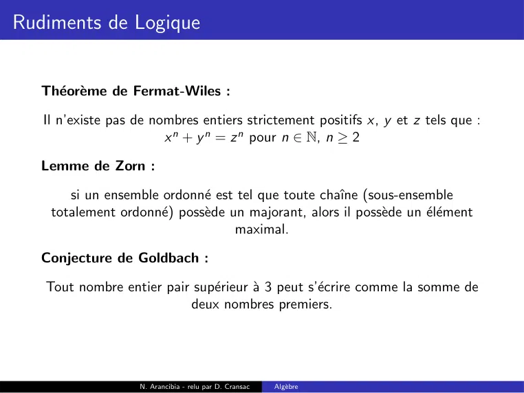

~~~text
Rudiments de Logique

   Théorème de Fermat-Wiles :
   Il n’existe pas de nombres entiers strictement positifs x, y et z tels que :
                        x n + y n = z n pour n ∈ N, n ≥ 2

   Lemme de Zorn :
       si un ensemble ordonné est tel que toute chaı̂ne (sous-ensemble
    totalement ordonné) possède un majorant, alors il possède un élément
                                   maximal.

   Conjecture de Goldbach :
   Tout nombre entier pair supérieur à 3 peut s’écrire comme la somme de
                          deux nombres premiers.

                   N. Arancibia - relu par D. Cransac   Algèbre
~~~

## Page 36

~~~text
Rudiments de Logique
   Notation : Lorsque qu’une proposition dépend d’une variable x appartenant à un
   ensemble E , on pourra la noter P(x).
   L’ensemble E sera, la plupart du temps, N, Z, Q, R ou C, ou d’un sous-ensemble de
   l’un de ces ensembles.

                     N. Arancibia - relu par D. Cransac   Algèbre
~~~

## Page 37

~~~text
Rudiments de Logique
   Notation : Lorsque qu’une proposition dépend d’une variable x appartenant à un
   ensemble E , on pourra la noter P(x).
   L’ensemble E sera, la plupart du temps, N, Z, Q, R ou C, ou d’un sous-ensemble de
   l’un de ces ensembles.

   Exemples :
        Si on pose P(x) : x ≥ 1

                     N. Arancibia - relu par D. Cransac   Algèbre
~~~

## Page 38

~~~text
Rudiments de Logique
   Notation : Lorsque qu’une proposition dépend d’une variable x appartenant à un
   ensemble E , on pourra la noter P(x).
   L’ensemble E sera, la plupart du temps, N, Z, Q, R ou C, ou d’un sous-ensemble de
   l’un de ces ensembles.

   Exemples :
        Si on pose P(x) : x ≥ 1 , alors
                                             P(2) : 2 ≥ 1

                     N. Arancibia - relu par D. Cransac   Algèbre
~~~

## Page 39

~~~text
Rudiments de Logique
   Notation : Lorsque qu’une proposition dépend d’une variable x appartenant à un
   ensemble E , on pourra la noter P(x).
   L’ensemble E sera, la plupart du temps, N, Z, Q, R ou C, ou d’un sous-ensemble de
   l’un de ces ensembles.

   Exemples :
        Si on pose P(x) : x ≥ 1 , alors
                                             P(2) : 2 ≥ 1            est vraie

                     N. Arancibia - relu par D. Cransac   Algèbre
~~~

## Page 40

~~~text
Rudiments de Logique
   Notation : Lorsque qu’une proposition dépend d’une variable x appartenant à un
   ensemble E , on pourra la noter P(x).
   L’ensemble E sera, la plupart du temps, N, Z, Q, R ou C, ou d’un sous-ensemble de
   l’un de ces ensembles.

   Exemples :
        Si on pose P(x) : x ≥ 1 , alors
                                             P(2) : 2 ≥ 1            est vraie
                                       P(−1) : −1 ≥ 1

                     N. Arancibia - relu par D. Cransac   Algèbre
~~~

## Page 41

~~~text
Rudiments de Logique
   Notation : Lorsque qu’une proposition dépend d’une variable x appartenant à un
   ensemble E , on pourra la noter P(x).
   L’ensemble E sera, la plupart du temps, N, Z, Q, R ou C, ou d’un sous-ensemble de
   l’un de ces ensembles.

   Exemples :
        Si on pose P(x) : x ≥ 1 , alors
                                             P(2) : 2 ≥ 1            est vraie
                                       P(−1) : −1 ≥ 1                est fausse.

                     N. Arancibia - relu par D. Cransac   Algèbre
~~~

## Page 42

~~~text
Rudiments de Logique
   Notation : Lorsque qu’une proposition dépend d’une variable x appartenant à un
   ensemble E , on pourra la noter P(x).
   L’ensemble E sera, la plupart du temps, N, Z, Q, R ou C, ou d’un sous-ensemble de
   l’un de ces ensembles.

   Exemples :
        Si on pose P(x) : x ≥ 1 , alors
                                             P(2) : 2 ≥ 1            est vraie
                                       P(−1) : −1 ≥ 1                est fausse.

        On rappelle qu’un nombre premier est un entier naturel p ≥ 2 qui n’est divisible
        que par 1 et par lui même.

                     N. Arancibia - relu par D. Cransac   Algèbre
~~~

## Page 43

~~~text
Rudiments de Logique
   Notation : Lorsque qu’une proposition dépend d’une variable x appartenant à un
   ensemble E , on pourra la noter P(x).
   L’ensemble E sera, la plupart du temps, N, Z, Q, R ou C, ou d’un sous-ensemble de
   l’un de ces ensembles.

   Exemples :
        Si on pose P(x) : x ≥ 1 , alors
                                             P(2) : 2 ≥ 1            est vraie
                                       P(−1) : −1 ≥ 1                est fausse.

        On rappelle qu’un nombre premier est un entier naturel p ≥ 2 qui n’est divisible
        que par 1 et par lui même.
        Si on pose
                             P(n) :  n est un nombre premier 

                     N. Arancibia - relu par D. Cransac   Algèbre
~~~

## Page 44

~~~text
Rudiments de Logique
   Notation : Lorsque qu’une proposition dépend d’une variable x appartenant à un
   ensemble E , on pourra la noter P(x).
   L’ensemble E sera, la plupart du temps, N, Z, Q, R ou C, ou d’un sous-ensemble de
   l’un de ces ensembles.

   Exemples :
        Si on pose P(x) : x ≥ 1 , alors
                                             P(2) : 2 ≥ 1            est vraie
                                       P(−1) : −1 ≥ 1                est fausse.

        On rappelle qu’un nombre premier est un entier naturel p ≥ 2 qui n’est divisible
        que par 1 et par lui même.
        Si on pose
                             P(n) :  n est un nombre premier 
        alors
                             P(7)

                                                                                   .

                     N. Arancibia - relu par D. Cransac   Algèbre
~~~

## Page 45

~~~text
Rudiments de Logique
   Notation : Lorsque qu’une proposition dépend d’une variable x appartenant à un
   ensemble E , on pourra la noter P(x).
   L’ensemble E sera, la plupart du temps, N, Z, Q, R ou C, ou d’un sous-ensemble de
   l’un de ces ensembles.

   Exemples :
        Si on pose P(x) : x ≥ 1 , alors
                                             P(2) : 2 ≥ 1            est vraie
                                       P(−1) : −1 ≥ 1                est fausse.

        On rappelle qu’un nombre premier est un entier naturel p ≥ 2 qui n’est divisible
        que par 1 et par lui même.
        Si on pose
                             P(n) :  n est un nombre premier 
        alors
                             P(7)       est vraie

                                                                                   .

                     N. Arancibia - relu par D. Cransac   Algèbre
~~~

## Page 46

~~~text
Rudiments de Logique
   Notation : Lorsque qu’une proposition dépend d’une variable x appartenant à un
   ensemble E , on pourra la noter P(x).
   L’ensemble E sera, la plupart du temps, N, Z, Q, R ou C, ou d’un sous-ensemble de
   l’un de ces ensembles.

   Exemples :
        Si on pose P(x) : x ≥ 1 , alors
                                             P(2) : 2 ≥ 1            est vraie
                                       P(−1) : −1 ≥ 1                est fausse.

        On rappelle qu’un nombre premier est un entier naturel p ≥ 2 qui n’est divisible
        que par 1 et par lui même.
        Si on pose
                             P(n) :  n est un nombre premier 
        alors
                             P(7)       est vraie
                             P(8)
                                                                                   .

                     N. Arancibia - relu par D. Cransac   Algèbre
~~~

## Page 47

~~~text
Rudiments de Logique
   Notation : Lorsque qu’une proposition dépend d’une variable x appartenant à un
   ensemble E , on pourra la noter P(x).
   L’ensemble E sera, la plupart du temps, N, Z, Q, R ou C, ou d’un sous-ensemble de
   l’un de ces ensembles.

   Exemples :
        Si on pose P(x) : x ≥ 1 , alors
                                             P(2) : 2 ≥ 1            est vraie
                                       P(−1) : −1 ≥ 1                est fausse.

        On rappelle qu’un nombre premier est un entier naturel p ≥ 2 qui n’est divisible
        que par 1 et par lui même.
        Si on pose
                             P(n) :  n est un nombre premier 
        alors
                             P(7)       est vraie
                             P(8)         est fausse
                                                                                   .

                     N. Arancibia - relu par D. Cransac   Algèbre
~~~

## Page 48

~~~text
Rudiments de Logique
   Notation : Lorsque qu’une proposition dépend d’une variable x appartenant à un
   ensemble E , on pourra la noter P(x).
   L’ensemble E sera, la plupart du temps, N, Z, Q, R ou C, ou d’un sous-ensemble de
   l’un de ces ensembles.

   Exemples :
        Si on pose P(x) : x ≥ 1 , alors
                                             P(2) : 2 ≥ 1            est vraie
                                       P(−1) : −1 ≥ 1                est fausse.

        On rappelle qu’un nombre premier est un entier naturel p ≥ 2 qui n’est divisible
        que par 1 et par lui même.
        Si on pose
                             P(n) :  n est un nombre premier 
        alors
                             P(7)       est vraie
                             P(8)         est fausse
                    P(6700417)                                                     .

                     N. Arancibia - relu par D. Cransac   Algèbre
~~~

## Page 49

~~~text
Rudiments de Logique
   Notation : Lorsque qu’une proposition dépend d’une variable x appartenant à un
   ensemble E , on pourra la noter P(x).
   L’ensemble E sera, la plupart du temps, N, Z, Q, R ou C, ou d’un sous-ensemble de
   l’un de ces ensembles.

   Exemples :
        Si on pose P(x) : x ≥ 1 , alors
                                             P(2) : 2 ≥ 1             est vraie
                                       P(−1) : −1 ≥ 1                 est fausse.

        On rappelle qu’un nombre premier est un entier naturel p ≥ 2 qui n’est divisible
        que par 1 et par lui même.
        Si on pose
                             P(n) :  n est un nombre premier 
        alors
                             P(7)       est vraie
                             P(8)         est fausse
                    P(6700417)            est vraie       (Prouvé par L. Euler (1732) ).

                     N. Arancibia - relu par D. Cransac    Algèbre
~~~

## Page 50

~~~text
Rudiments de Logique

   Nous disposons de deux types d’outils pour construire de nouvelles
   propositions :
       les opérations sur les propositions :

       les quantificateurs :

                   N. Arancibia - relu par D. Cransac   Algèbre
~~~

## Page 51

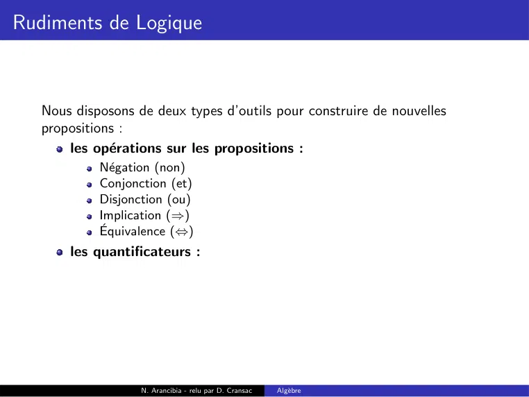

~~~text
Rudiments de Logique

   Nous disposons de deux types d’outils pour construire de nouvelles
   propositions :
       les opérations sur les propositions :
            Négation (non)
            Conjonction (et)
            Disjonction (ou)
            Implication (⇒)
            Équivalence (⇔)
       les quantificateurs :

                   N. Arancibia - relu par D. Cransac   Algèbre
~~~

## Page 52

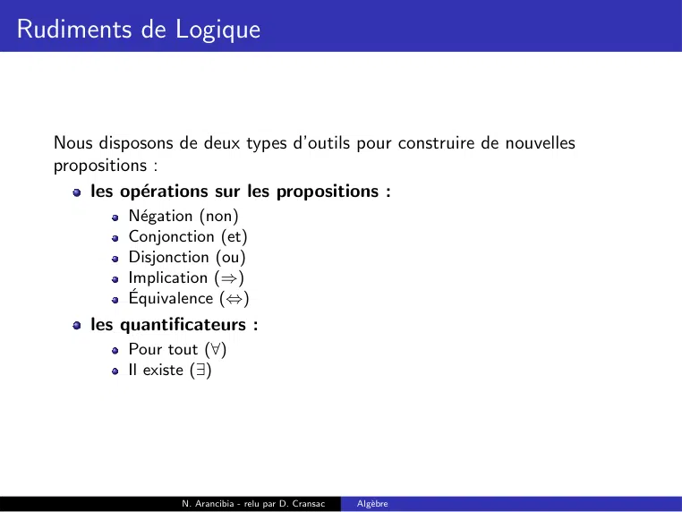

~~~text
Rudiments de Logique

   Nous disposons de deux types d’outils pour construire de nouvelles
   propositions :
       les opérations sur les propositions :
            Négation (non)
            Conjonction (et)
            Disjonction (ou)
            Implication (⇒)
            Équivalence (⇔)
       les quantificateurs :
            Pour tout (∀)
            Il existe (∃)

                   N. Arancibia - relu par D. Cransac   Algèbre
~~~

## Page 53

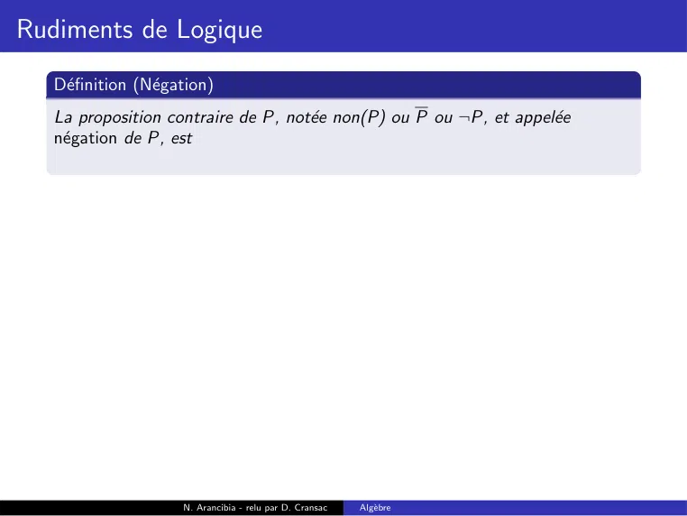

~~~text
Rudiments de Logique
   Définition (Négation)
   La proposition contraire de P, notée non(P) ou P ou ¬P, et appelée
   négation de P, est

                     N. Arancibia - relu par D. Cransac   Algèbre
~~~

## Page 54

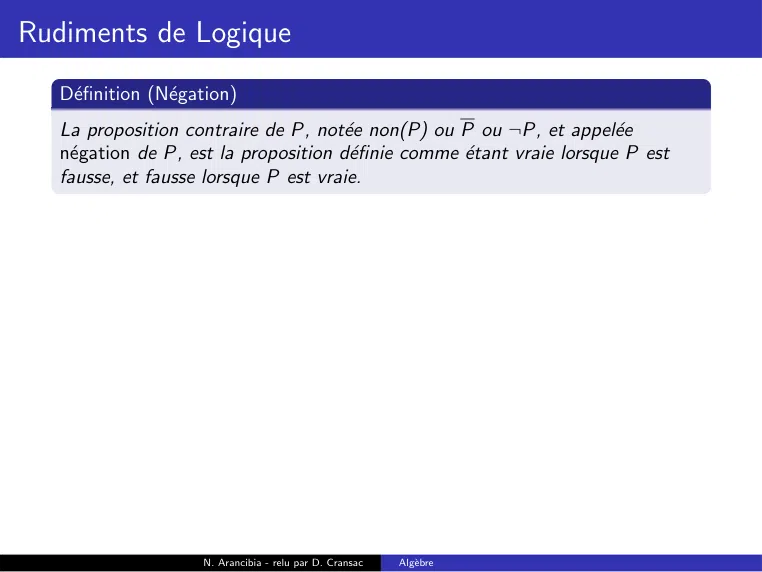

~~~text
Rudiments de Logique
   Définition (Négation)
   La proposition contraire de P, notée non(P) ou P ou ¬P, et appelée
   négation de P, est la proposition définie comme étant vraie lorsque P est
   fausse, et fausse lorsque P est vraie.

                     N. Arancibia - relu par D. Cransac   Algèbre
~~~

## Page 55

~~~text
Rudiments de Logique
   Définition (Négation)
   La proposition contraire de P, notée non(P) ou P ou ¬P, et appelée
   négation de P, est la proposition définie comme étant vraie lorsque P est
   fausse, et fausse lorsque P est vraie.
   On peut résumer cette définition avec une table de vérité

                     N. Arancibia - relu par D. Cransac   Algèbre
~~~

## Page 56

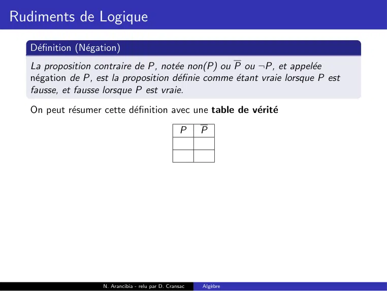

~~~text
Rudiments de Logique
   Définition (Négation)
   La proposition contraire de P, notée non(P) ou P ou ¬P, et appelée
   négation de P, est la proposition définie comme étant vraie lorsque P est
   fausse, et fausse lorsque P est vraie.
   On peut résumer cette définition avec une table de vérité

                                                    P     P

                     N. Arancibia - relu par D. Cransac   Algèbre
~~~

## Page 57

~~~text
Rudiments de Logique
   Définition (Négation)
   La proposition contraire de P, notée non(P) ou P ou ¬P, et appelée
   négation de P, est la proposition définie comme étant vraie lorsque P est
   fausse, et fausse lorsque P est vraie.
   On peut résumer cette définition avec une table de vérité

                                                    P     P
                                                    V

                     N. Arancibia - relu par D. Cransac   Algèbre
~~~

## Page 58

~~~text
Rudiments de Logique
   Définition (Négation)
   La proposition contraire de P, notée non(P) ou P ou ¬P, et appelée
   négation de P, est la proposition définie comme étant vraie lorsque P est
   fausse, et fausse lorsque P est vraie.
   On peut résumer cette définition avec une table de vérité

                                                    P     P
                                                    V
                                                    F

                     N. Arancibia - relu par D. Cransac   Algèbre
~~~

## Page 59

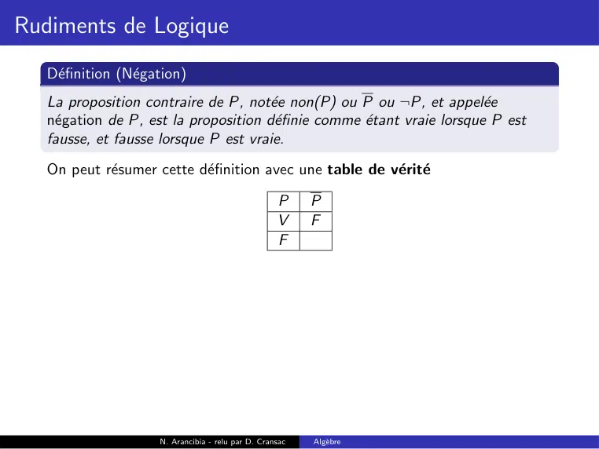

~~~text
Rudiments de Logique
   Définition (Négation)
   La proposition contraire de P, notée non(P) ou P ou ¬P, et appelée
   négation de P, est la proposition définie comme étant vraie lorsque P est
   fausse, et fausse lorsque P est vraie.
   On peut résumer cette définition avec une table de vérité

                                                    P     P
                                                    V     F
                                                    F

                     N. Arancibia - relu par D. Cransac   Algèbre
~~~

## Page 60

~~~text
Rudiments de Logique
   Définition (Négation)
   La proposition contraire de P, notée non(P) ou P ou ¬P, et appelée
   négation de P, est la proposition définie comme étant vraie lorsque P est
   fausse, et fausse lorsque P est vraie.
   On peut résumer cette définition avec une table de vérité

                                                    P     P
                                                    V     F
                                                    F     V

                     N. Arancibia - relu par D. Cransac   Algèbre
~~~

## Page 61

~~~text
Rudiments de Logique
   Définition (Négation)
   La proposition contraire de P, notée non(P) ou P ou ¬P, et appelée
   négation de P, est la proposition définie comme étant vraie lorsque P est
   fausse, et fausse lorsque P est vraie.
   On peut résumer cette définition avec une table de vérité

                                                    P     P
                                                    V     F
                                                    F     V
   Exemple :

                     N. Arancibia - relu par D. Cransac   Algèbre
~~~

## Page 62

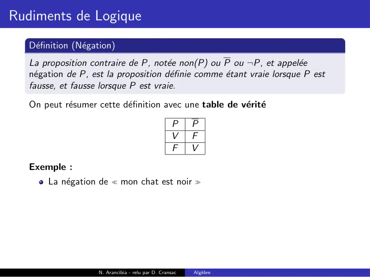

~~~text
Rudiments de Logique
   Définition (Négation)
   La proposition contraire de P, notée non(P) ou P ou ¬P, et appelée
   négation de P, est la proposition définie comme étant vraie lorsque P est
   fausse, et fausse lorsque P est vraie.
   On peut résumer cette définition avec une table de vérité

                                                    P     P
                                                    V     F
                                                    F     V
   Exemple :
        La négation de  mon chat est noir 

                     N. Arancibia - relu par D. Cransac   Algèbre
~~~

## Page 63

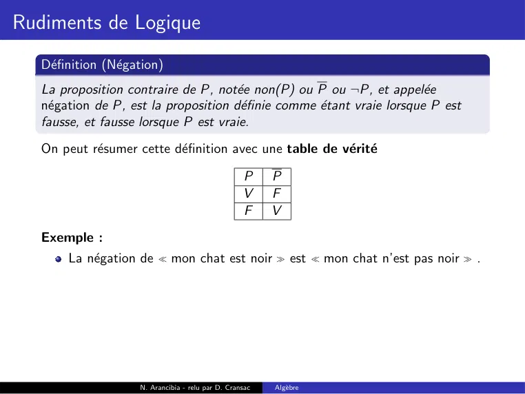

~~~text
Rudiments de Logique
   Définition (Négation)
   La proposition contraire de P, notée non(P) ou P ou ¬P, et appelée
   négation de P, est la proposition définie comme étant vraie lorsque P est
   fausse, et fausse lorsque P est vraie.
   On peut résumer cette définition avec une table de vérité

                                                    P     P
                                                    V     F
                                                    F     V
   Exemple :
        La négation de  mon chat est noir  est  mon chat n’est pas noir  .

                     N. Arancibia - relu par D. Cransac   Algèbre
~~~

## Page 64

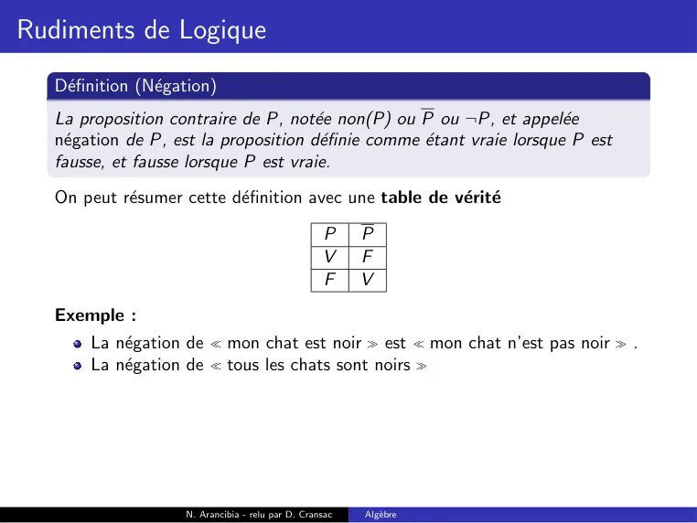

~~~text
Rudiments de Logique
   Définition (Négation)
   La proposition contraire de P, notée non(P) ou P ou ¬P, et appelée
   négation de P, est la proposition définie comme étant vraie lorsque P est
   fausse, et fausse lorsque P est vraie.
   On peut résumer cette définition avec une table de vérité

                                                    P     P
                                                    V     F
                                                    F     V
   Exemple :
        La négation de  mon chat est noir  est  mon chat n’est pas noir  .
        La négation de  tous les chats sont noirs 

                     N. Arancibia - relu par D. Cransac   Algèbre
~~~

## Page 65

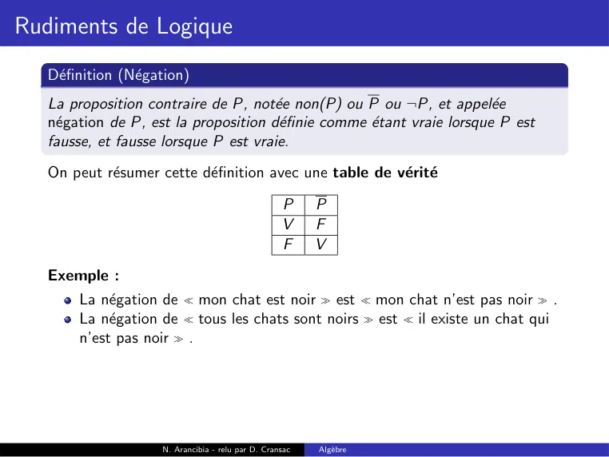

~~~text
Rudiments de Logique
   Définition (Négation)
   La proposition contraire de P, notée non(P) ou P ou ¬P, et appelée
   négation de P, est la proposition définie comme étant vraie lorsque P est
   fausse, et fausse lorsque P est vraie.
   On peut résumer cette définition avec une table de vérité

                                                    P     P
                                                    V     F
                                                    F     V
   Exemple :
        La négation de  mon chat est noir  est  mon chat n’est pas noir  .
        La négation de  tous les chats sont noirs  est  il existe un chat qui
        n’est pas noir  .

                     N. Arancibia - relu par D. Cransac   Algèbre
~~~

## Page 66

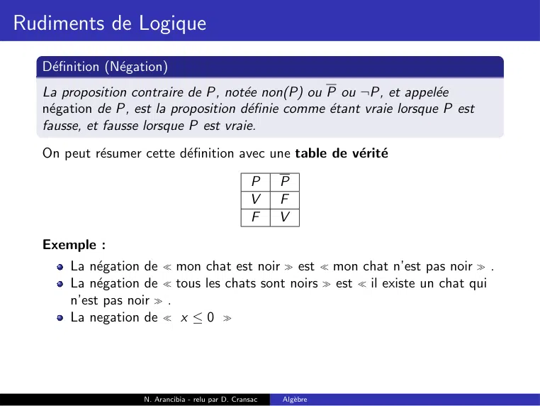

~~~text
Rudiments de Logique
   Définition (Négation)
   La proposition contraire de P, notée non(P) ou P ou ¬P, et appelée
   négation de P, est la proposition définie comme étant vraie lorsque P est
   fausse, et fausse lorsque P est vraie.
   On peut résumer cette définition avec une table de vérité

                                                    P     P
                                                    V     F
                                                    F     V
   Exemple :
        La négation de  mon chat est noir  est  mon chat n’est pas noir  .
        La négation de  tous les chats sont noirs  est  il existe un chat qui
        n’est pas noir  .
        La negation de  x ≤ 0 

                     N. Arancibia - relu par D. Cransac   Algèbre
~~~

## Page 67

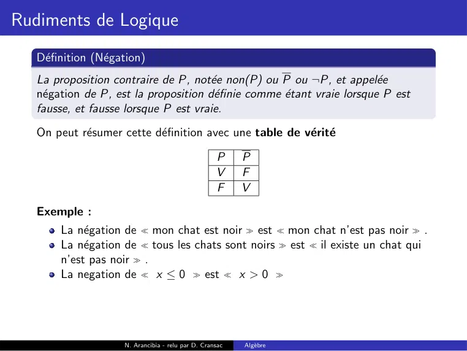

~~~text
Rudiments de Logique
   Définition (Négation)
   La proposition contraire de P, notée non(P) ou P ou ¬P, et appelée
   négation de P, est la proposition définie comme étant vraie lorsque P est
   fausse, et fausse lorsque P est vraie.
   On peut résumer cette définition avec une table de vérité

                                                    P     P
                                                    V     F
                                                    F     V
   Exemple :
        La négation de  mon chat est noir  est  mon chat n’est pas noir  .
        La négation de  tous les chats sont noirs  est  il existe un chat qui
        n’est pas noir  .
        La negation de  x ≤ 0  est  x > 0 

                     N. Arancibia - relu par D. Cransac   Algèbre
~~~

## Page 68

~~~text
Rudiments de Logique
   Définition (Négation)
   La proposition contraire de P, notée non(P) ou P ou ¬P, et appelée
   négation de P, est la proposition définie comme étant vraie lorsque P est
   fausse, et fausse lorsque P est vraie.
   On peut résumer cette définition avec une table de vérité

                                                    P     P
                                                    V     F
                                                    F     V
   Exemple :
        La négation de  mon chat est noir  est  mon chat n’est pas noir  .
        La négation de  tous les chats sont noirs  est  il existe un chat qui
        n’est pas noir  .
        La negation de  x ≤ 0  est  x > 0  (et non pas  x ≥ 0  ).

                     N. Arancibia - relu par D. Cransac   Algèbre
~~~

## Page 69

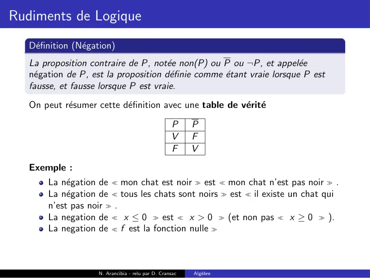

~~~text
Rudiments de Logique
   Définition (Négation)
   La proposition contraire de P, notée non(P) ou P ou ¬P, et appelée
   négation de P, est la proposition définie comme étant vraie lorsque P est
   fausse, et fausse lorsque P est vraie.
   On peut résumer cette définition avec une table de vérité

                                                    P     P
                                                    V     F
                                                    F     V
   Exemple :
        La négation de  mon chat est noir  est  mon chat n’est pas noir  .
        La négation de  tous les chats sont noirs  est  il existe un chat qui
        n’est pas noir  .
        La negation de  x ≤ 0  est  x > 0  (et non pas  x ≥ 0  ).
        La negation de  f est la fonction nulle 

                     N. Arancibia - relu par D. Cransac   Algèbre
~~~

## Page 70

~~~text
Rudiments de Logique
   Définition (Négation)
   La proposition contraire de P, notée non(P) ou P ou ¬P, et appelée
   négation de P, est la proposition définie comme étant vraie lorsque P est
   fausse, et fausse lorsque P est vraie.
   On peut résumer cette définition avec une table de vérité

                                                    P     P
                                                    V     F
                                                    F     V
   Exemple :
        La négation de  mon chat est noir  est  mon chat n’est pas noir  .
        La négation de  tous les chats sont noirs  est  il existe un chat qui
        n’est pas noir  .
        La negation de  x ≤ 0  est  x > 0  (et non pas  x ≥ 0  ).
        La negation de  f est la fonction nulle  est  f n’est pas la fonction
        nulle  ou encore  f ne s’annule pas en au moins un point 

                     N. Arancibia - relu par D. Cransac   Algèbre
~~~

## Page 71

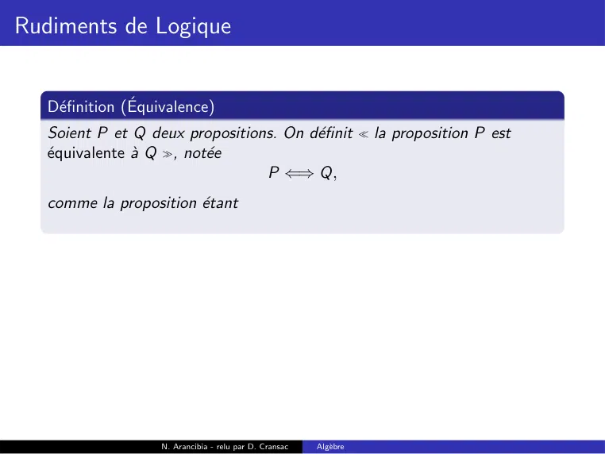

~~~text
Rudiments de Logique

   Définition (Équivalence)
   Soient P et Q deux propositions. On définit  la proposition P est
   équivalente à Q , notée
                                 P ⇐⇒ Q,
   comme la proposition étant

                    N. Arancibia - relu par D. Cransac   Algèbre
~~~

## Page 72

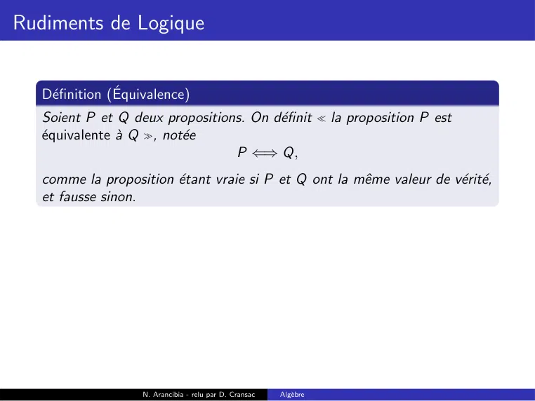

~~~text
Rudiments de Logique

   Définition (Équivalence)
   Soient P et Q deux propositions. On définit  la proposition P est
   équivalente à Q , notée
                                 P ⇐⇒ Q,
   comme la proposition étant vraie si P et Q ont la même valeur de vérité,
   et fausse sinon.

                    N. Arancibia - relu par D. Cransac   Algèbre
~~~

## Page 73

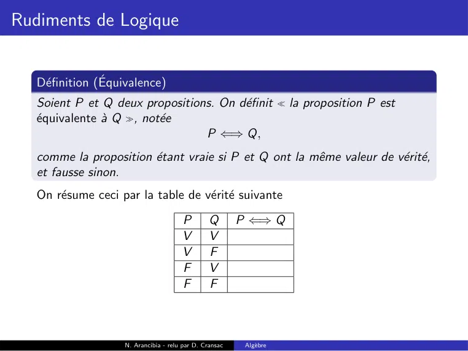

~~~text
Rudiments de Logique

   Définition (Équivalence)
   Soient P et Q deux propositions. On définit  la proposition P est
   équivalente à Q , notée
                                 P ⇐⇒ Q,
   comme la proposition étant vraie si P et Q ont la même valeur de vérité,
   et fausse sinon.
   On résume ceci par la table de vérité suivante
                                       P         Q       P ⇐⇒ Q
                                       V         V
                                       V         F
                                       F         V
                                       F         F

                    N. Arancibia - relu par D. Cransac    Algèbre
~~~

## Page 74

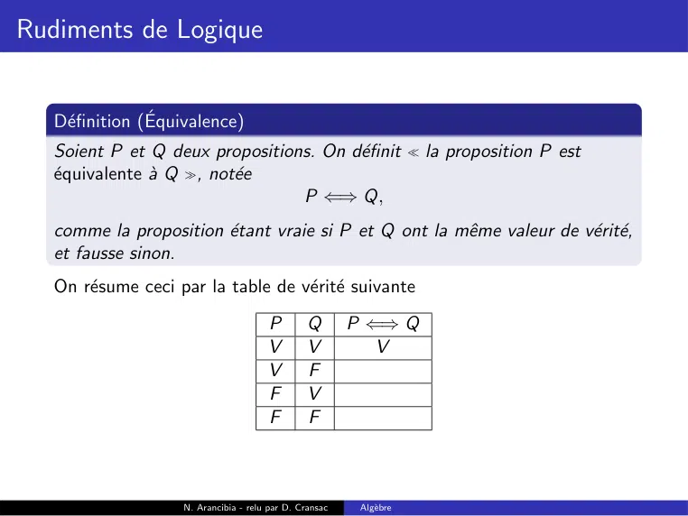

~~~text
Rudiments de Logique

   Définition (Équivalence)
   Soient P et Q deux propositions. On définit  la proposition P est
   équivalente à Q , notée
                                 P ⇐⇒ Q,
   comme la proposition étant vraie si P et Q ont la même valeur de vérité,
   et fausse sinon.
   On résume ceci par la table de vérité suivante
                                       P         Q       P ⇐⇒ Q
                                       V         V          V
                                       V         F
                                       F         V
                                       F         F

                    N. Arancibia - relu par D. Cransac    Algèbre
~~~

## Page 75

~~~text
Rudiments de Logique

   Définition (Équivalence)
   Soient P et Q deux propositions. On définit  la proposition P est
   équivalente à Q , notée
                                 P ⇐⇒ Q,
   comme la proposition étant vraie si P et Q ont la même valeur de vérité,
   et fausse sinon.
   On résume ceci par la table de vérité suivante
                                       P         Q       P ⇐⇒ Q
                                       V         V          V
                                       V         F          F
                                       F         V
                                       F         F

                    N. Arancibia - relu par D. Cransac    Algèbre
~~~

## Page 76

~~~text
Rudiments de Logique

   Définition (Équivalence)
   Soient P et Q deux propositions. On définit  la proposition P est
   équivalente à Q , notée
                                 P ⇐⇒ Q,
   comme la proposition étant vraie si P et Q ont la même valeur de vérité,
   et fausse sinon.
   On résume ceci par la table de vérité suivante
                                       P         Q       P ⇐⇒ Q
                                       V         V          V
                                       V         F          F
                                       F         V          F
                                       F         F

                    N. Arancibia - relu par D. Cransac    Algèbre
~~~

## Page 77

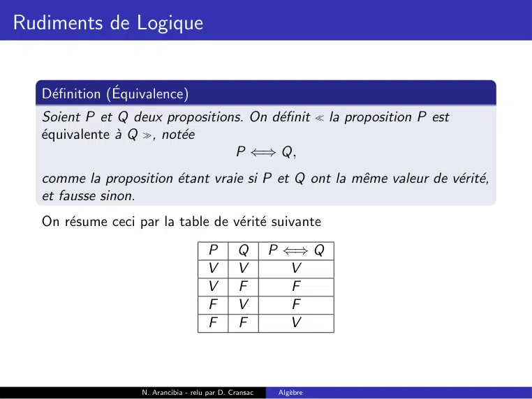

~~~text
Rudiments de Logique

   Définition (Équivalence)
   Soient P et Q deux propositions. On définit  la proposition P est
   équivalente à Q , notée
                                 P ⇐⇒ Q,
   comme la proposition étant vraie si P et Q ont la même valeur de vérité,
   et fausse sinon.
   On résume ceci par la table de vérité suivante
                                       P         Q       P ⇐⇒ Q
                                       V         V          V
                                       V         F          F
                                       F         V          F
                                       F         F          V

                    N. Arancibia - relu par D. Cransac    Algèbre
~~~

## Page 78

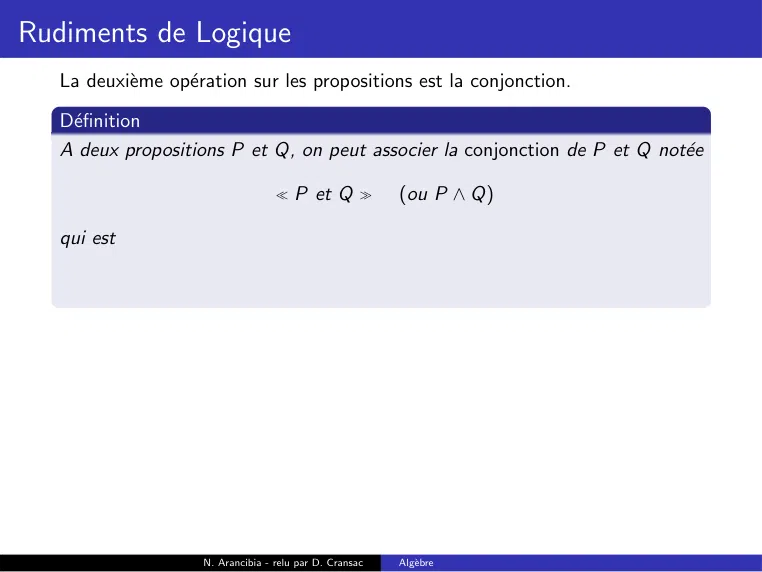

~~~text
Rudiments de Logique
   La deuxième opération sur les propositions est la conjonction.
   Définition
   A deux propositions P et Q, on peut associer la conjonction de P et Q notée

                                      P et Q           (ou P ∧ Q)

   qui est

                    N. Arancibia - relu par D. Cransac   Algèbre
~~~

## Page 79

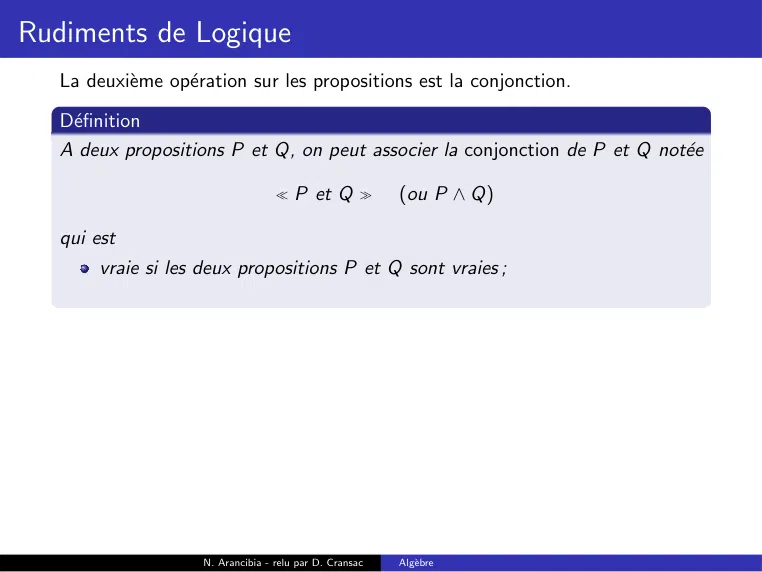

~~~text
Rudiments de Logique
   La deuxième opération sur les propositions est la conjonction.
   Définition
   A deux propositions P et Q, on peut associer la conjonction de P et Q notée

                                       P et Q           (ou P ∧ Q)

   qui est
        vraie si les deux propositions P et Q sont vraies ;

                     N. Arancibia - relu par D. Cransac   Algèbre
~~~

## Page 80

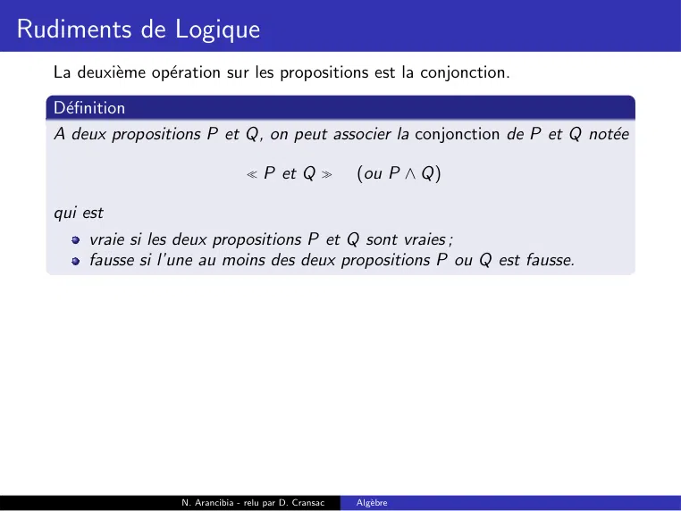

~~~text
Rudiments de Logique
   La deuxième opération sur les propositions est la conjonction.
   Définition
   A deux propositions P et Q, on peut associer la conjonction de P et Q notée

                                      P et Q           (ou P ∧ Q)

   qui est
        vraie si les deux propositions P et Q sont vraies ;
        fausse si l’une au moins des deux propositions P ou Q est fausse.

                    N. Arancibia - relu par D. Cransac   Algèbre
~~~

## Page 81

~~~text
Rudiments de Logique
   La deuxième opération sur les propositions est la conjonction.
   Définition
   A deux propositions P et Q, on peut associer la conjonction de P et Q notée

                                       P et Q           (ou P ∧ Q)

   qui est
        vraie si les deux propositions P et Q sont vraies ;
        fausse si l’une au moins des deux propositions P ou Q est fausse.
   On résume ceci par la table de vérité suivante :
                                           P        Q     P et Q
                                           V        V
                                           V        F
                                           F        V
                                           F        F

                     N. Arancibia - relu par D. Cransac   Algèbre
~~~

## Page 82

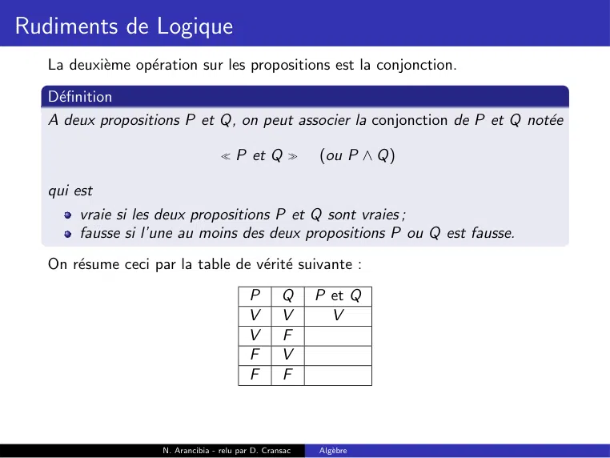

~~~text
Rudiments de Logique
   La deuxième opération sur les propositions est la conjonction.
   Définition
   A deux propositions P et Q, on peut associer la conjonction de P et Q notée

                                       P et Q           (ou P ∧ Q)

   qui est
        vraie si les deux propositions P et Q sont vraies ;
        fausse si l’une au moins des deux propositions P ou Q est fausse.
   On résume ceci par la table de vérité suivante :
                                           P        Q     P et Q
                                           V        V       V
                                           V        F
                                           F        V
                                           F        F

                     N. Arancibia - relu par D. Cransac   Algèbre
~~~

## Page 83

~~~text
Rudiments de Logique
   La deuxième opération sur les propositions est la conjonction.
   Définition
   A deux propositions P et Q, on peut associer la conjonction de P et Q notée

                                       P et Q           (ou P ∧ Q)

   qui est
        vraie si les deux propositions P et Q sont vraies ;
        fausse si l’une au moins des deux propositions P ou Q est fausse.
   On résume ceci par la table de vérité suivante :
                                           P        Q     P et Q
                                           V        V       V
                                           V        F       F
                                           F        V
                                           F        F

                     N. Arancibia - relu par D. Cransac   Algèbre
~~~

## Page 84

~~~text
Rudiments de Logique
   La deuxième opération sur les propositions est la conjonction.
   Définition
   A deux propositions P et Q, on peut associer la conjonction de P et Q notée

                                       P et Q           (ou P ∧ Q)

   qui est
        vraie si les deux propositions P et Q sont vraies ;
        fausse si l’une au moins des deux propositions P ou Q est fausse.
   On résume ceci par la table de vérité suivante :
                                           P        Q     P et Q
                                           V        V       V
                                           V        F       F
                                           F        V       F
                                           F        F

                     N. Arancibia - relu par D. Cransac   Algèbre
~~~

## Page 85

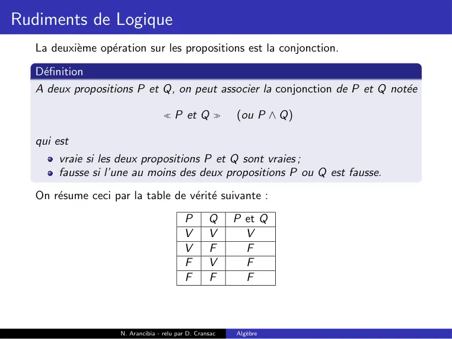

~~~text
Rudiments de Logique
   La deuxième opération sur les propositions est la conjonction.
   Définition
   A deux propositions P et Q, on peut associer la conjonction de P et Q notée

                                       P et Q           (ou P ∧ Q)

   qui est
        vraie si les deux propositions P et Q sont vraies ;
        fausse si l’une au moins des deux propositions P ou Q est fausse.
   On résume ceci par la table de vérité suivante :
                                           P        Q     P et Q
                                           V        V       V
                                           V        F       F
                                           F        V       F
                                           F        F       F

                     N. Arancibia - relu par D. Cransac   Algèbre
~~~

## Page 86

~~~text
Rudiments de Logique

   Exemples :
                                                                    D   C

       Soit ABCD un rectangle. La proposition

                  [ est droit et les diagonales
        L’angle ABC                                                A   B
       [AC ] et [BD] se coupent en leur milieu 

       est vraie ou fausse ?

                    N. Arancibia - relu par D. Cransac   Algèbre
~~~

## Page 87

~~~text
Rudiments de Logique

   Exemples :
                                                                   D   C

       Soit ABCD un rectangle. La proposition

                  [ est droit et les diagonales
        L’angle ABC                                               A   B
       [AC ] et [BD] se coupent en leur milieu 

       est vraie ou fausse ?
       Elle est vraie.
       En effet
                        [ est droit 
              L’angle ABC

                   N. Arancibia - relu par D. Cransac   Algèbre
~~~

## Page 88

~~~text
Rudiments de Logique

   Exemples :
                                                                   D   C

       Soit ABCD un rectangle. La proposition

                  [ est droit et les diagonales
        L’angle ABC                                               A   B
       [AC ] et [BD] se coupent en leur milieu 

       est vraie ou fausse ?
       Elle est vraie.
       En effet
                        [ est droit est une proposition vraie.
              L’angle ABC

                   N. Arancibia - relu par D. Cransac   Algèbre
~~~

## Page 89

~~~text
Rudiments de Logique

   Exemples :
                                                                   D      C

       Soit ABCD un rectangle. La proposition

                  [ est droit et les diagonales
        L’angle ABC                                               A      B
       [AC ] et [BD] se coupent en leur milieu 

       est vraie ou fausse ?
       Elle est vraie.
       En effet
                        [ est droit est une proposition vraie.
              L’angle ABC

              Les diagonales [AC ] et [BD] se coupent en leur milieu 

                   N. Arancibia - relu par D. Cransac   Algèbre
~~~

## Page 90

~~~text
Rudiments de Logique

   Exemples :
                                                                   D         C

       Soit ABCD un rectangle. La proposition

                  [ est droit et les diagonales
        L’angle ABC                                               A         B
       [AC ] et [BD] se coupent en leur milieu 

       est vraie ou fausse ?
       Elle est vraie.
       En effet
                         [ est droit est une proposition vraie.
              L’angle ABC

              Les diagonales [AC ] et [BD] se coupent en leur milieu  est une

             proposition vraie.

                   N. Arancibia - relu par D. Cransac   Algèbre
~~~

## Page 91

~~~text
Rudiments de Logique

   Exemples :
       Soit ABC un triangle. La proposition
        AB > AC + CB et ABC      [ +CAB+
                                        [ BCA
                                            d =π
       est-elle vraie ou fausse ?
                                                        C

                                          A                      B

                 N. Arancibia - relu par D. Cransac   Algèbre
~~~

## Page 92

~~~text
Rudiments de Logique

   Exemples :
       Soit ABC un triangle. La proposition
        AB > AC + CB et ABC      [ +CAB+
                                        [ BCA
                                            d =π
       est-elle vraie ou fausse ?
                                                           C

                                             A                      B

       Elle est fausse.
       En effet
               AB > AC + CB 

                    N. Arancibia - relu par D. Cransac   Algèbre
~~~

## Page 93

~~~text
Rudiments de Logique

   Exemples :
       Soit ABC un triangle. La proposition
        AB > AC + CB et ABC      [ +CAB+
                                        [ BCA
                                            d =π
       est-elle vraie ou fausse ?
                                                           C

                                             A                      B

       Elle est fausse.
       En effet
               AB > AC + CB  est une proposition fausse.

                    N. Arancibia - relu par D. Cransac   Algèbre
~~~

## Page 94

~~~text
Rudiments de Logique

   Exemples :
       Soit ABC un triangle. La proposition
        AB > AC + CB et ABC      [ +CAB+
                                        [ BCA
                                            d =π
       est-elle vraie ou fausse ?
                                                           C

                                             A                      B

       Elle est fausse.
       En effet
               AB > AC + CB  est une proposition fausse.
               [ +CAB+
                ABC  [ BCA d =π

                    N. Arancibia - relu par D. Cransac   Algèbre
~~~

## Page 95

~~~text
Rudiments de Logique

   Exemples :
       Soit ABC un triangle. La proposition
        AB > AC + CB et ABC      [ +CAB+
                                        [ BCA
                                            d =π
       est-elle vraie ou fausse ?
                                                           C

                                             A                      B

       Elle est fausse.
       En effet
               AB > AC + CB  est une proposition fausse.
               [ +CAB+
                ABC  [ BCA d = π  est une proposition vraie.

                    N. Arancibia - relu par D. Cransac   Algèbre
~~~

## Page 96

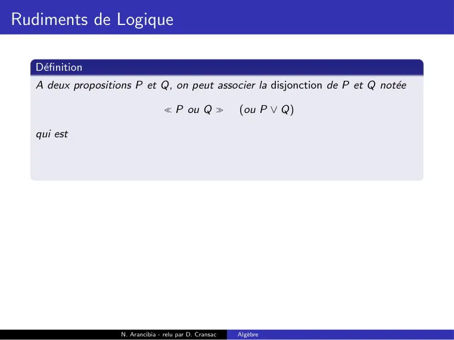

~~~text
Rudiments de Logique

   Définition
   A deux propositions P et Q, on peut associer la disjonction de P et Q notée

                                      P ou Q           (ou P ∨ Q)

   qui est

                    N. Arancibia - relu par D. Cransac   Algèbre
~~~

## Page 97

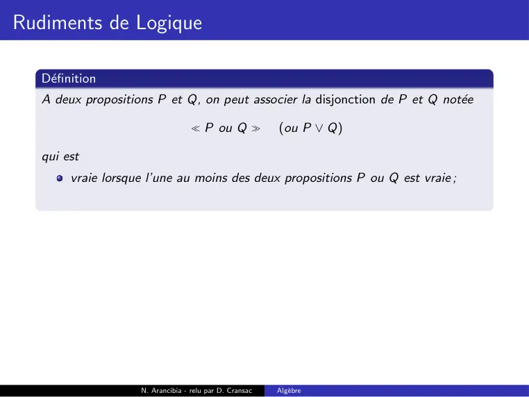

~~~text
Rudiments de Logique

   Définition
   A deux propositions P et Q, on peut associer la disjonction de P et Q notée

                                      P ou Q           (ou P ∨ Q)

   qui est
        vraie lorsque l’une au moins des deux propositions P ou Q est vraie ;

                    N. Arancibia - relu par D. Cransac   Algèbre
~~~

## Page 98

~~~text
Rudiments de Logique

   Définition
   A deux propositions P et Q, on peut associer la disjonction de P et Q notée

                                      P ou Q           (ou P ∨ Q)

   qui est
        vraie lorsque l’une au moins des deux propositions P ou Q est vraie ;
        fausse si les deux propositions P et Q sont fausses.

                    N. Arancibia - relu par D. Cransac   Algèbre
~~~

## Page 99

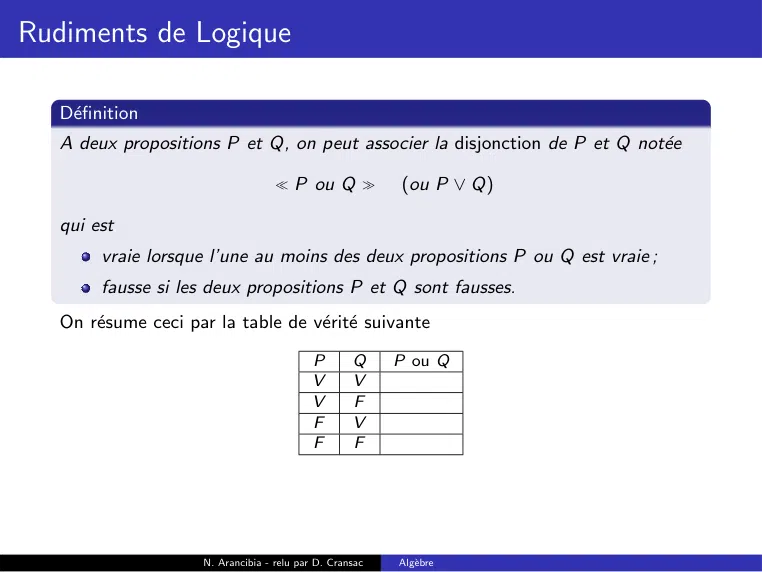

~~~text
Rudiments de Logique

   Définition
   A deux propositions P et Q, on peut associer la disjonction de P et Q notée

                                        P ou Q           (ou P ∨ Q)

   qui est
        vraie lorsque l’une au moins des deux propositions P ou Q est vraie ;
        fausse si les deux propositions P et Q sont fausses.
   On résume ceci par la table de vérité suivante
                                             P       Q     P ou Q
                                             V       V
                                             V       F
                                             F       V
                                             F       F

                      N. Arancibia - relu par D. Cransac   Algèbre
~~~

## Page 100

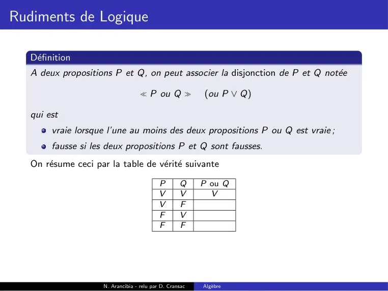

~~~text
Rudiments de Logique

   Définition
   A deux propositions P et Q, on peut associer la disjonction de P et Q notée

                                        P ou Q           (ou P ∨ Q)

   qui est
        vraie lorsque l’une au moins des deux propositions P ou Q est vraie ;
        fausse si les deux propositions P et Q sont fausses.
   On résume ceci par la table de vérité suivante
                                             P       Q     P ou Q
                                             V       V       V
                                             V       F
                                             F       V
                                             F       F

                      N. Arancibia - relu par D. Cransac   Algèbre
~~~

## Page 101

~~~text
Rudiments de Logique

   Définition
   A deux propositions P et Q, on peut associer la disjonction de P et Q notée

                                        P ou Q           (ou P ∨ Q)

   qui est
        vraie lorsque l’une au moins des deux propositions P ou Q est vraie ;
        fausse si les deux propositions P et Q sont fausses.
   On résume ceci par la table de vérité suivante
                                             P       Q     P ou Q
                                             V       V       V
                                             V       F       V
                                             F       V
                                             F       F

                      N. Arancibia - relu par D. Cransac   Algèbre
~~~

## Page 102

~~~text
Rudiments de Logique

   Définition
   A deux propositions P et Q, on peut associer la disjonction de P et Q notée

                                        P ou Q           (ou P ∨ Q)

   qui est
        vraie lorsque l’une au moins des deux propositions P ou Q est vraie ;
        fausse si les deux propositions P et Q sont fausses.
   On résume ceci par la table de vérité suivante
                                             P       Q     P ou Q
                                             V       V       V
                                             V       F       V
                                             F       V       V
                                             F       F

                      N. Arancibia - relu par D. Cransac   Algèbre
~~~

## Page 103

~~~text
Rudiments de Logique

   Définition
   A deux propositions P et Q, on peut associer la disjonction de P et Q notée

                                        P ou Q           (ou P ∨ Q)

   qui est
        vraie lorsque l’une au moins des deux propositions P ou Q est vraie ;
        fausse si les deux propositions P et Q sont fausses.
   On résume ceci par la table de vérité suivante
                                             P       Q     P ou Q
                                             V       V       V
                                             V       F       V
                                             F       V       V
                                             F       F       F

                      N. Arancibia - relu par D. Cransac   Algèbre
~~~

## Page 104

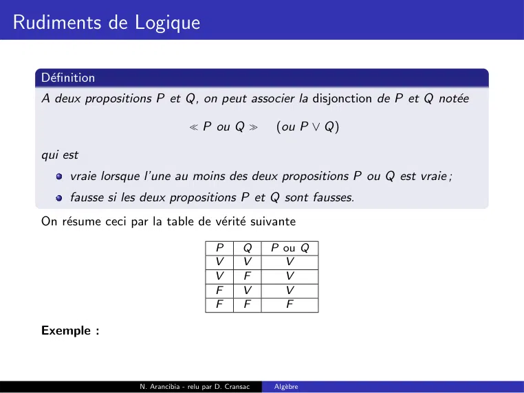

~~~text
Rudiments de Logique

   Définition
   A deux propositions P et Q, on peut associer la disjonction de P et Q notée

                                        P ou Q           (ou P ∨ Q)

   qui est
        vraie lorsque l’une au moins des deux propositions P ou Q est vraie ;
        fausse si les deux propositions P et Q sont fausses.
   On résume ceci par la table de vérité suivante
                                             P       Q     P ou Q
                                             V       V       V
                                             V       F       V
                                             F       V       V
                                             F       F       F

   Exemple :

                      N. Arancibia - relu par D. Cransac   Algèbre
~~~

## Page 105

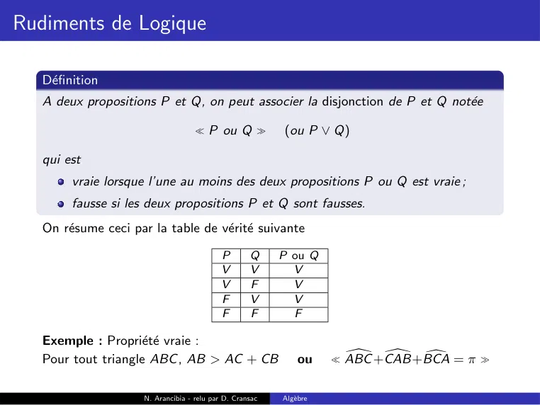

~~~text
Rudiments de Logique

   Définition
   A deux propositions P et Q, on peut associer la disjonction de P et Q notée

                                        P ou Q           (ou P ∨ Q)

   qui est
        vraie lorsque l’une au moins des deux propositions P ou Q est vraie ;
        fausse si les deux propositions P et Q sont fausses.
   On résume ceci par la table de vérité suivante
                                             P       Q     P ou Q
                                             V       V       V
                                             V       F       V
                                             F       V       V
                                             F       F       F

   Exemple : Propriété vraie :
   Pour tout triangle ABC , AB > AC + CB                       ou        [ +CAB+
                                                                          ABC [ BCA
                                                                                  d =π

                      N. Arancibia - relu par D. Cransac   Algèbre
~~~

## Page 106

~~~text
Rudiments de Logique

   Remarque : On prendra garde au fait que le  ou  logique est un  ou
   inclusif , contrairement au  ou  du langage courant qui lui est très
   souvent un  ou exclusif 

                   N. Arancibia - relu par D. Cransac   Algèbre
~~~

## Page 107

~~~text
Rudiments de Logique

   Remarque : On prendra garde au fait que le  ou  logique est un  ou
   inclusif , contrairement au  ou  du langage courant qui lui est très
   souvent un  ou exclusif 
   Distinguer :
     1   le  ou  exclusif de la langue française : Fromage ou Dessert
         On ne peut pas avoir les deux.

                    N. Arancibia - relu par D. Cransac   Algèbre
~~~

## Page 108

~~~text
Rudiments de Logique

   Remarque : On prendra garde au fait que le  ou  logique est un  ou
   inclusif , contrairement au  ou  du langage courant qui lui est très
   souvent un  ou exclusif 
   Distinguer :
     1   le  ou  exclusif de la langue française : Fromage ou Dessert
         On ne peut pas avoir les deux.
     2   le  ou  logique ou inclusif : On recrute un informaticien qui
         sait coder en C++ ou en Python
         On peut avoir les deux.

                    N. Arancibia - relu par D. Cransac   Algèbre
~~~

## Page 109

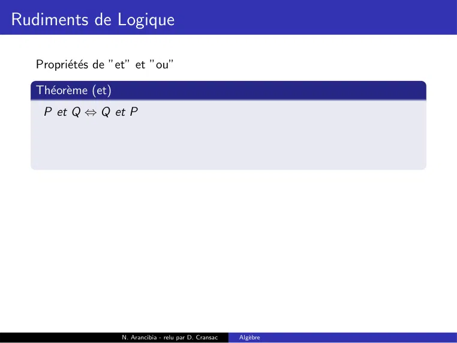

~~~text
Rudiments de Logique

   Propriétés de ”et” et ”ou”

   Théorème (et)
    P et Q ⇔ Q et P

                     N. Arancibia - relu par D. Cransac   Algèbre
~~~

## Page 110

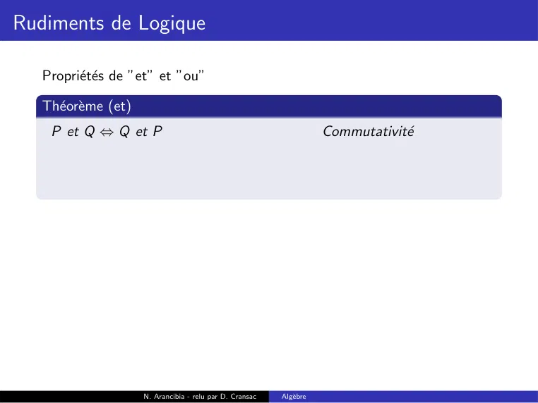

~~~text
Rudiments de Logique

   Propriétés de ”et” et ”ou”

   Théorème (et)
    P et Q ⇔ Q et P                                                  Commutativité

                     N. Arancibia - relu par D. Cransac   Algèbre
~~~

## Page 111

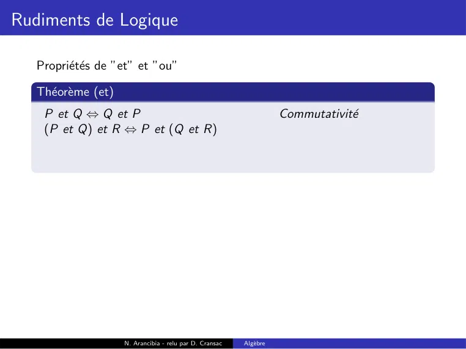

~~~text
Rudiments de Logique

   Propriétés de ”et” et ”ou”

   Théorème (et)
    P et Q ⇔ Q et P                                                  Commutativité
    (P et Q) et R ⇔ P et (Q et R)

                     N. Arancibia - relu par D. Cransac   Algèbre
~~~

## Page 112

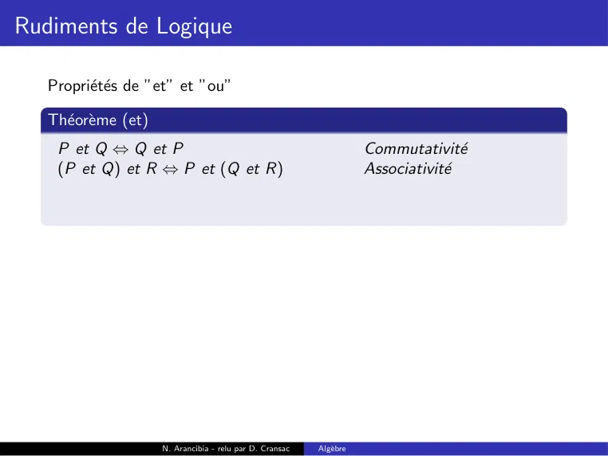

~~~text
Rudiments de Logique

   Propriétés de ”et” et ”ou”

   Théorème (et)
    P et Q ⇔ Q et P                                                  Commutativité
    (P et Q) et R ⇔ P et (Q et R)                                    Associativité

                     N. Arancibia - relu par D. Cransac   Algèbre
~~~

## Page 113

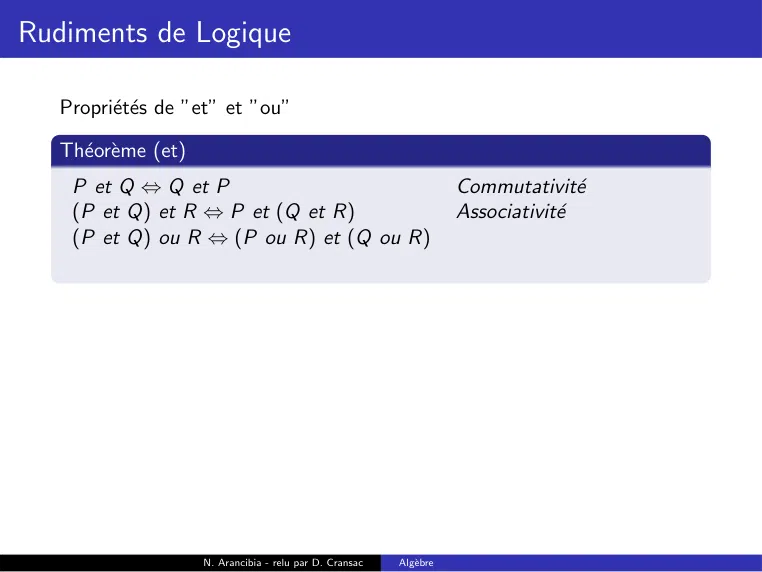

~~~text
Rudiments de Logique

   Propriétés de ”et” et ”ou”

   Théorème (et)
    P et Q ⇔ Q et P                                                  Commutativité
    (P et Q) et R ⇔ P et (Q et R)                                    Associativité
    (P et Q) ou R ⇔ (P ou R) et (Q ou R)

                     N. Arancibia - relu par D. Cransac   Algèbre
~~~

## Page 114

~~~text
Rudiments de Logique

   Propriétés de ”et” et ”ou”

   Théorème (et)
    P et Q ⇔ Q et P                                                  Commutativité
    (P et Q) et R ⇔ P et (Q et R)                                    Associativité
    (P et Q) ou R ⇔ (P ou R) et (Q ou R)                             Distributivité de  ou 
                                                                     par rapport à  et 

                     N. Arancibia - relu par D. Cransac   Algèbre
~~~

## Page 115

~~~text
Rudiments de Logique

   Propriétés de ”et” et ”ou”

   Théorème (et)
    P et Q ⇔ Q et P                                                  Commutativité
    (P et Q) et R ⇔ P et (Q et R)                                    Associativité
    (P et Q) ou R ⇔ (P ou R) et (Q ou R)                             Distributivité de  ou 
                                                                     par rapport à  et 

   Théorème (ou)

                     N. Arancibia - relu par D. Cransac   Algèbre
~~~

## Page 116

~~~text
Rudiments de Logique

   Propriétés de ”et” et ”ou”

   Théorème (et)
    P et Q ⇔ Q et P                                                  Commutativité
    (P et Q) et R ⇔ P et (Q et R)                                    Associativité
    (P et Q) ou R ⇔ (P ou R) et (Q ou R)                             Distributivité de  ou 
                                                                     par rapport à  et 

   Théorème (ou)
    P ou Q ⇔ Q ou P                                                  Commutativité
    (P ou Q) ou R ⇔ P ou (Q ou R)                                    Associativité
    (P ou Q) et R ⇔ (P et R) ou (Q et R)                             Distributivité de  et 
                                                                     par rapport à  ou 

   Remarque : Les propriétés sont symétriques pour les deux opérateurs
   ”et” et ”ou”.

                     N. Arancibia - relu par D. Cransac   Algèbre
~~~

## Page 117

~~~text
Rudiments de Logique

   Définition (Implication)
   Étant données deux propositions logiques P et Q, on définit la
   proposition  P implique Q  notée

                                                 P =⇒ Q

   comme la proposition étant fausse dans le seul cas où P est vraie et Q
   fausse.

                    N. Arancibia - relu par D. Cransac   Algèbre
~~~

## Page 118

~~~text
Rudiments de Logique

   Définition (Implication)
   Étant données deux propositions logiques P et Q, on définit la
   proposition  P implique Q  notée

                                                 P =⇒ Q

   comme la proposition étant fausse dans le seul cas où P est vraie et Q
   fausse. On appelle P son antécédent et Q son conséquent.

                    N. Arancibia - relu par D. Cransac   Algèbre
~~~

## Page 119

~~~text
Rudiments de Logique

   Définition (Implication)
   Étant données deux propositions logiques P et Q, on définit la
   proposition  P implique Q  notée

                                                 P =⇒ Q

   comme la proposition étant fausse dans le seul cas où P est vraie et Q
   fausse. On appelle P son antécédent et Q son conséquent.
   On résume ceci par la table de vérité suivante
                                        P        Q       P =⇒ Q
                                        V        V
                                        V        F
                                        F        V
                                        F        F

                    N. Arancibia - relu par D. Cransac    Algèbre
~~~

## Page 120

~~~text
Rudiments de Logique

   Définition (Implication)
   Étant données deux propositions logiques P et Q, on définit la
   proposition  P implique Q  notée

                                                 P =⇒ Q

   comme la proposition étant fausse dans le seul cas où P est vraie et Q
   fausse. On appelle P son antécédent et Q son conséquent.
   On résume ceci par la table de vérité suivante
                                        P        Q       P =⇒ Q
                                        V        V          V
                                        V        F
                                        F        V
                                        F        F

                    N. Arancibia - relu par D. Cransac    Algèbre
~~~

## Page 121

~~~text
Rudiments de Logique

   Définition (Implication)
   Étant données deux propositions logiques P et Q, on définit la
   proposition  P implique Q  notée

                                                 P =⇒ Q

   comme la proposition étant fausse dans le seul cas où P est vraie et Q
   fausse. On appelle P son antécédent et Q son conséquent.
   On résume ceci par la table de vérité suivante
                                        P        Q       P =⇒ Q
                                        V        V          V
                                        V        F          F
                                        F        V
                                        F        F

                    N. Arancibia - relu par D. Cransac    Algèbre
~~~

## Page 122

~~~text
Rudiments de Logique

   Définition (Implication)
   Étant données deux propositions logiques P et Q, on définit la
   proposition  P implique Q  notée

                                                 P =⇒ Q

   comme la proposition étant fausse dans le seul cas où P est vraie et Q
   fausse. On appelle P son antécédent et Q son conséquent.
   On résume ceci par la table de vérité suivante
                                        P        Q       P =⇒ Q
                                        V        V          V
                                        V        F          F
                                        F        V          V
                                        F        F

                    N. Arancibia - relu par D. Cransac    Algèbre
~~~

## Page 123

~~~text
Rudiments de Logique

   Définition (Implication)
   Étant données deux propositions logiques P et Q, on définit la
   proposition  P implique Q  notée

                                                 P =⇒ Q

   comme la proposition étant fausse dans le seul cas où P est vraie et Q
   fausse. On appelle P son antécédent et Q son conséquent.
   On résume ceci par la table de vérité suivante
                                        P        Q       P =⇒ Q
                                        V        V          V
                                        V        F          F
                                        F        V          V
                                        F        F          V

                    N. Arancibia - relu par D. Cransac    Algèbre
~~~

## Page 124

~~~text
Rudiments de Logique
   Remarque : Contrairement à (P ou Q) et (P et Q), la table de vérité de
   P =⇒ Q n’est pas totalement intuitive.

                    N. Arancibia - relu par D. Cransac   Algèbre
~~~

## Page 125

~~~text
Rudiments de Logique
   Remarque : Contrairement à (P ou Q) et (P et Q), la table de vérité de
   P =⇒ Q n’est pas totalement intuitive.
   En effet, si P est fausse, alors l’implication est nécessairement vraie.

                    N. Arancibia - relu par D. Cransac   Algèbre
~~~

## Page 126

~~~text
Rudiments de Logique
   Remarque : Contrairement à (P ou Q) et (P et Q), la table de vérité de
   P =⇒ Q n’est pas totalement intuitive.
   En effet, si P est fausse, alors l’implication est nécessairement vraie.
   En particulier, faux implique faux est considérée comme vraie en
   mathématique.

                    N. Arancibia - relu par D. Cransac   Algèbre
~~~

## Page 127

~~~text
Rudiments de Logique
   Remarque : Contrairement à (P ou Q) et (P et Q), la table de vérité de
   P =⇒ Q n’est pas totalement intuitive.
   En effet, si P est fausse, alors l’implication est nécessairement vraie.
   En particulier, faux implique faux est considérée comme vraie en
   mathématique.
   Ce choix est en fait raisonnable.

                    N. Arancibia - relu par D. Cransac   Algèbre
~~~

## Page 128

~~~text
Rudiments de Logique
   Remarque : Contrairement à (P ou Q) et (P et Q), la table de vérité de
   P =⇒ Q n’est pas totalement intuitive.
   En effet, si P est fausse, alors l’implication est nécessairement vraie.
   En particulier, faux implique faux est considérée comme vraie en
   mathématique.
   Ce choix est en fait raisonnable.
   Imaginons par exemple l’assertion suivante :

                    N. Arancibia - relu par D. Cransac   Algèbre
~~~

## Page 129

~~~text
Rudiments de Logique
   Remarque : Contrairement à (P ou Q) et (P et Q), la table de vérité de
   P =⇒ Q n’est pas totalement intuitive.
   En effet, si P est fausse, alors l’implication est nécessairement vraie.
   En particulier, faux implique faux est considérée comme vraie en
   mathématique.
   Ce choix est en fait raisonnable.
   Imaginons par exemple l’assertion suivante :
   P =⇒ Q : J’ai eu une discussion avec mon chien implique mon chien parle.

                    N. Arancibia - relu par D. Cransac   Algèbre
~~~

## Page 130

~~~text
Rudiments de Logique
   Remarque : Contrairement à (P ou Q) et (P et Q), la table de vérité de
   P =⇒ Q n’est pas totalement intuitive.
   En effet, si P est fausse, alors l’implication est nécessairement vraie.
   En particulier, faux implique faux est considérée comme vraie en
   mathématique.
   Ce choix est en fait raisonnable.
   Imaginons par exemple l’assertion suivante :
   P =⇒ Q : J’ai eu une discussion avec mon chien implique mon chien parle.

   Bien entendu, cette implication est vraie

                     N. Arancibia - relu par D. Cransac   Algèbre
~~~

## Page 131

~~~text
Rudiments de Logique
   Remarque : Contrairement à (P ou Q) et (P et Q), la table de vérité de
   P =⇒ Q n’est pas totalement intuitive.
   En effet, si P est fausse, alors l’implication est nécessairement vraie.
   En particulier, faux implique faux est considérée comme vraie en
   mathématique.
   Ce choix est en fait raisonnable.
   Imaginons par exemple l’assertion suivante :
   P =⇒ Q : J’ai eu une discussion avec mon chien implique mon chien parle.

   Bien entendu, cette implication est vraie , mais ni

                      P : J’ai eu une discussion avec un chien

   ni
                                       Q : mon chien parle
   ne le sont.

                      N. Arancibia - relu par D. Cransac   Algèbre
~~~

## Page 132

~~~text
Rudiments de Logique

   Exemples :
          n est pair  =⇒  n est divisible par 2 est une proposition vraie.

                     N. Arancibia - relu par D. Cransac   Algèbre
~~~

## Page 133

~~~text
Rudiments de Logique

   Exemples :
          n est pair  =⇒  n est divisible par 2 est une proposition vraie.
       Soient a et b deux réels. Alors
             a = b =⇒ a2 = b 2

                     N. Arancibia - relu par D. Cransac   Algèbre
~~~

## Page 134

~~~text
Rudiments de Logique

   Exemples :
          n est pair  =⇒  n est divisible par 2 est une proposition vraie.
       Soient a et b deux réels. Alors
             a = b =⇒ a2 = b 2 est vraie

                     N. Arancibia - relu par D. Cransac   Algèbre
~~~

## Page 135

~~~text
Rudiments de Logique

   Exemples :
          n est pair  =⇒  n est divisible par 2 est une proposition vraie.
       Soient a et b deux réels. Alors
             a = b =⇒ a2 = b 2 est vraie , mais
             a2 = b 2 =⇒ a = b est fausse (on peut trouver un cas où c’est faux).

                     N. Arancibia - relu par D. Cransac   Algèbre
~~~

## Page 136

~~~text
Rudiments de Logique

   Exemples :
           n est pair  =⇒  n est divisible par 2 est une proposition vraie.
        Soient a et b deux réels. Alors
              a = b =⇒ a2 = b 2 est vraie , mais
              a2 = b 2 =⇒ a = b est fausse (on peut trouver un cas où c’est faux).

   Vocabulaire : Nous utiliserons souvent le vocabulaire suivant, si P =⇒ Q est
   vraie , nous dirons :
                                    si P alors Q.

                      N. Arancibia - relu par D. Cransac   Algèbre
~~~

## Page 137

~~~text
Rudiments de Logique

   Exemples :
           n est pair  =⇒  n est divisible par 2 est une proposition vraie.
        Soient a et b deux réels. Alors
              a = b =⇒ a2 = b 2 est vraie , mais
              a2 = b 2 =⇒ a = b est fausse (on peut trouver un cas où c’est faux).

   Vocabulaire : Nous utiliserons souvent le vocabulaire suivant, si P =⇒ Q est
   vraie , nous dirons :
                                    si P alors Q.
   L’assertion P est alors appelée une condition suffisante de Q :
   Pour que Q soit vraie, il suffit que P soit vraie.

                      N. Arancibia - relu par D. Cransac   Algèbre
~~~

## Page 138

~~~text
Rudiments de Logique

   Exemples :
           n est pair  =⇒  n est divisible par 2 est une proposition vraie.
        Soient a et b deux réels. Alors
              a = b =⇒ a2 = b 2 est vraie , mais
              a2 = b 2 =⇒ a = b est fausse (on peut trouver un cas où c’est faux).

   Vocabulaire : Nous utiliserons souvent le vocabulaire suivant, si P =⇒ Q est
   vraie , nous dirons :
                                    si P alors Q.
   L’assertion P est alors appelée une condition suffisante de Q :
   Pour que Q soit vraie, il suffit que P soit vraie.
   L’assertion Q est alors appelée une condition nécessaire de P :
   Pour que P soit vraie, il faut que Q soit vraie.

                      N. Arancibia - relu par D. Cransac   Algèbre
~~~

## Page 139

~~~text
Rudiments de Logique
   il faut et il  suffit 

       Distinguer :
          1   Pour aller visiter la Tour Eiffel,
                   Il faut que je prenne le Métro et que je marche.

                   Il suffit que je prenne le Métro et que je marche.

                            N. Arancibia - relu par D. Cransac   Algèbre
~~~

## Page 140

~~~text
Rudiments de Logique
   il faut et il  suffit 

       Distinguer :
          1   Pour aller visiter la Tour Eiffel,
                   Il faut que je prenne le Métro et que je marche.
                   Faux : je peux prendre le bus.
                   Il suffit que je prenne le Métro et que je marche.

                            N. Arancibia - relu par D. Cransac   Algèbre
~~~

## Page 141

~~~text
Rudiments de Logique
   il faut et il  suffit 

       Distinguer :
          1   Pour aller visiter la Tour Eiffel,
                   Il faut que je prenne le Métro et que je marche.
                   Faux : je peux prendre le bus.
                   Il suffit que je prenne le Métro et que je marche.
                   Vrai

                            N. Arancibia - relu par D. Cransac   Algèbre
~~~

## Page 142

~~~text
Rudiments de Logique
   il faut et il  suffit 

       Distinguer :
          1   Pour aller visiter la Tour Eiffel,
                   Il faut que je prenne le Métro et que je marche.
                   Faux : je peux prendre le bus.
                   Il suffit que je prenne le Métro et que je marche.
                   Vrai
          2   Pour montrer que 231 n’est pas premier
                   Il suffit que je le décompose en produit de nombres premiers.

                            N. Arancibia - relu par D. Cransac   Algèbre
~~~

## Page 143

~~~text
Rudiments de Logique
   il faut et il  suffit 

       Distinguer :
          1   Pour aller visiter la Tour Eiffel,
                   Il faut que je prenne le Métro et que je marche.
                   Faux : je peux prendre le bus.
                   Il suffit que je prenne le Métro et que je marche.
                   Vrai
          2   Pour montrer que 231 n’est pas premier
                   Il suffit que je le décompose en produit de nombres premiers.

                   Il faut que je le décompose en produit de nombres premiers.

                            N. Arancibia - relu par D. Cransac   Algèbre
~~~

## Page 144

~~~text
Rudiments de Logique
   il faut et il  suffit 

       Distinguer :
          1   Pour aller visiter la Tour Eiffel,
                   Il faut que je prenne le Métro et que je marche.
                   Faux : je peux prendre le bus.
                   Il suffit que je prenne le Métro et que je marche.
                   Vrai
          2   Pour montrer que 231 n’est pas premier
                   Il suffit que je le décompose en produit de nombres premiers.
                   Vrai :231 = 3 × 7 × 11 suffit pour montrer que 231 n’est pas premier.
                   Il faut que je le décompose en produit de nombres premiers.

                            N. Arancibia - relu par D. Cransac   Algèbre
~~~

## Page 145

~~~text
Rudiments de Logique
   il faut et il  suffit 

       Distinguer :
          1   Pour aller visiter la Tour Eiffel,
                   Il faut que je prenne le Métro et que je marche.
                   Faux : je peux prendre le bus.
                   Il suffit que je prenne le Métro et que je marche.
                   Vrai
          2   Pour montrer que 231 n’est pas premier
                   Il suffit que je le décompose en produit de nombres premiers.
                   Vrai :231 = 3 × 7 × 11 suffit pour montrer que 231 n’est pas premier.
                   Il faut que je le décompose en produit de nombres premiers.
                   Faux : je peux aussi écrire 231 = 3 × 77.

                            N. Arancibia - relu par D. Cransac   Algèbre
~~~

## Page 146

~~~text
Rudiments de Logique

   Définition (Réciproque, contraposée)
        On appelle réciproque de l’implication : P ⇒ Q , la proposition :

                                                         Q =⇒ P

                    N. Arancibia - relu par D. Cransac     Algèbre
~~~

## Page 147

~~~text
Rudiments de Logique

   Définition (Réciproque, contraposée)
        On appelle réciproque de l’implication : P ⇒ Q , la proposition :

                                                         Q =⇒ P

        On appelle contraposée de l’implication : P ⇒ Q , la proposition :

                    N. Arancibia - relu par D. Cransac     Algèbre
~~~

## Page 148

~~~text
Rudiments de Logique

   Définition (Réciproque, contraposée)
        On appelle réciproque de l’implication : P ⇒ Q , la proposition :

                                                         Q =⇒ P

        On appelle contraposée de l’implication : P ⇒ Q , la proposition :

                                           non(Q) =⇒ non(P)

                    N. Arancibia - relu par D. Cransac     Algèbre
~~~

## Page 149

~~~text
Rudiments de Logique

   Définition (Réciproque, contraposée)
        On appelle réciproque de l’implication : P ⇒ Q , la proposition :

                                                         Q =⇒ P

        On appelle contraposée de l’implication : P ⇒ Q , la proposition :

                                           non(Q) =⇒ non(P)

   Remarque : Si une implication est vraie, sa réciproque n’est pas
   forcément vraie.

                    N. Arancibia - relu par D. Cransac     Algèbre
~~~

## Page 150

~~~text
Rudiments de Logique

   Définition (Réciproque, contraposée)
        On appelle réciproque de l’implication : P ⇒ Q , la proposition :

                                                         Q =⇒ P

        On appelle contraposée de l’implication : P ⇒ Q , la proposition :

                                           non(Q) =⇒ non(P)

   Remarque : Si une implication est vraie, sa réciproque n’est pas
   forcément vraie.
   Exemple : Considérons la proposition  P : La nuit, tous les chats sont
   gris 
        Sa réciproque est :

                    N. Arancibia - relu par D. Cransac     Algèbre
~~~

## Page 151

~~~text
Rudiments de Logique

   Définition (Réciproque, contraposée)
        On appelle réciproque de l’implication : P ⇒ Q , la proposition :

                                                         Q =⇒ P

        On appelle contraposée de l’implication : P ⇒ Q , la proposition :

                                           non(Q) =⇒ non(P)

   Remarque : Si une implication est vraie, sa réciproque n’est pas
   forcément vraie.
   Exemple : Considérons la proposition  P : La nuit, tous les chats sont
   gris 
        Sa réciproque est :  Si tous les chats sont gris, alors il fait nuit. 

                    N. Arancibia - relu par D. Cransac     Algèbre
~~~

## Page 152

~~~text
Rudiments de Logique

   Définition (Réciproque, contraposée)
        On appelle réciproque de l’implication : P ⇒ Q , la proposition :

                                                         Q =⇒ P

        On appelle contraposée de l’implication : P ⇒ Q , la proposition :

                                           non(Q) =⇒ non(P)

   Remarque : Si une implication est vraie, sa réciproque n’est pas
   forcément vraie.
   Exemple : Considérons la proposition  P : La nuit, tous les chats sont
   gris 
        Sa réciproque est :  Si tous les chats sont gris, alors il fait nuit. 
        Sa contraposée est :

                    N. Arancibia - relu par D. Cransac     Algèbre
~~~

## Page 153

~~~text
Rudiments de Logique

   Définition (Réciproque, contraposée)
        On appelle réciproque de l’implication : P ⇒ Q , la proposition :

                                                         Q =⇒ P

        On appelle contraposée de l’implication : P ⇒ Q , la proposition :

                                           non(Q) =⇒ non(P)

   Remarque : Si une implication est vraie, sa réciproque n’est pas
   forcément vraie.
   Exemple : Considérons la proposition  P : La nuit, tous les chats sont
   gris 
        Sa réciproque est :  Si tous les chats sont gris, alors il fait nuit. 
        Sa contraposée est :  Si au moins un chat n’est pas gris, alors il
        fait jour. 

                    N. Arancibia - relu par D. Cransac     Algèbre
~~~

## Page 154

~~~text
Rudiments de Logique

                         Vocabulaire :
           Lorsque P et Q sont équivalentes , on dit que

           P (est vraie) si et seulement si Q (est vraie).

              N. Arancibia - relu par D. Cransac   Algèbre
~~~

## Page 155

~~~text
Rudiments de Logique

                           Vocabulaire :
             Lorsque P et Q sont équivalentes , on dit que

            P (est vraie) si et seulement si Q (est vraie).

      P est une condition nécessaire et suffisante (CNS) de Q.

               N. Arancibia - relu par D. Cransac   Algèbre
~~~

## Page 156

~~~text
Rudiments de Logique

                            Vocabulaire :
              Lorsque P et Q sont équivalentes , on dit que

             P (est vraie) si et seulement si Q (est vraie).

      P est une condition nécessaire et suffisante (CNS) de Q.

        Pour que Q soit vraie il faut et il suffit que P soit vraie.

                N. Arancibia - relu par D. Cransac   Algèbre
~~~

## Page 157

~~~text
Rudiments de Logique

                            Vocabulaire :
              Lorsque P et Q sont équivalentes , on dit que

             P (est vraie) si et seulement si Q (est vraie).

      P est une condition nécessaire et suffisante (CNS) de Q.

        Pour que Q soit vraie il faut et il suffit que P soit vraie.

                                 ou, tout simplement,

                                P est équivalente à Q

                N. Arancibia - relu par D. Cransac   Algèbre
~~~

## Page 158

~~~text
Rudiments de Logique
   Remarque : Deux propositions P et Q sont équivalentes si elles ont les mêmes
   tables de vérités. Utilisons cette remarque pour étudier certaines règles de
   calcul sur l’implication et l’équivalence.

                    N. Arancibia - relu par D. Cransac   Algèbre
~~~

## Page 159

~~~text
Rudiments de Logique
   Remarque : Deux propositions P et Q sont équivalentes si elles ont les mêmes
   tables de vérités. Utilisons cette remarque pour étudier certaines règles de
   calcul sur l’implication et l’équivalence.

   Théorème
   Toute implication est équivalente à sa contraposée.

                     N. Arancibia - relu par D. Cransac   Algèbre
~~~

## Page 160

~~~text
Rudiments de Logique
   Remarque : Deux propositions P et Q sont équivalentes si elles ont les mêmes
   tables de vérités. Utilisons cette remarque pour étudier certaines règles de
   calcul sur l’implication et l’équivalence.

   Théorème
   Toute implication est équivalente à sa contraposée. Autrement dit :

                         (P =⇒ Q) ⇐⇒ (non(Q) =⇒ non(P)).

                     N. Arancibia - relu par D. Cransac   Algèbre
~~~

## Page 161

~~~text
Rudiments de Logique
   Remarque : Deux propositions P et Q sont équivalentes si elles ont les mêmes
   tables de vérités. Utilisons cette remarque pour étudier certaines règles de
   calcul sur l’implication et l’équivalence.

   Théorème
   Toute implication est équivalente à sa contraposée. Autrement dit :

                         (P =⇒ Q) ⇐⇒ (non(Q) =⇒ non(P)).

   Démonstration.
   On écrit la table de vérité de la proposition (Q =⇒ P).

                     N. Arancibia - relu par D. Cransac   Algèbre
~~~

## Page 162

~~~text
Rudiments de Logique
   Remarque : Deux propositions P et Q sont équivalentes si elles ont les mêmes
   tables de vérités. Utilisons cette remarque pour étudier certaines règles de
   calcul sur l’implication et l’équivalence.

   Théorème
   Toute implication est équivalente à sa contraposée. Autrement dit :

                         (P =⇒ Q) ⇐⇒ (non(Q) =⇒ non(P)).

   Démonstration.
   On écrit la table de vérité de la proposition (Q =⇒ P).

                      P        P        Q        Q        Q =⇒ P      P =⇒ Q
                      V        F        V        F                       V
                      V        F        F        V                       F
                      F        V        V        F                       V
                      F        V        F        V                       V

                     N. Arancibia - relu par D. Cransac    Algèbre
~~~

## Page 163

~~~text
Rudiments de Logique
   Remarque : Deux propositions P et Q sont équivalentes si elles ont les mêmes
   tables de vérités. Utilisons cette remarque pour étudier certaines règles de
   calcul sur l’implication et l’équivalence.

   Théorème
   Toute implication est équivalente à sa contraposée. Autrement dit :

                         (P =⇒ Q) ⇐⇒ (non(Q) =⇒ non(P)).

   Démonstration.
   On écrit la table de vérité de la proposition (Q =⇒ P).

                      P        P        Q        Q        Q =⇒ P      P =⇒ Q
                      V        F        V        F                       V
                      V        F        F        V                       F
                      F        V        V        F                       V
                      F        V        F        V                       V

                     N. Arancibia - relu par D. Cransac    Algèbre
~~~

## Page 164

~~~text
Rudiments de Logique
   Remarque : Deux propositions P et Q sont équivalentes si elles ont les mêmes
   tables de vérités. Utilisons cette remarque pour étudier certaines règles de
   calcul sur l’implication et l’équivalence.

   Théorème
   Toute implication est équivalente à sa contraposée. Autrement dit :

                         (P =⇒ Q) ⇐⇒ (non(Q) =⇒ non(P)).

   Démonstration.
   On écrit la table de vérité de la proposition (Q =⇒ P).

                      P        P        Q        Q        Q =⇒ P      P =⇒ Q
                      V        F        V        F                       V
                      V        F        F        V                       F
                      F        V        V        F                       V
                      F        V        F        V                       V

                     N. Arancibia - relu par D. Cransac    Algèbre
~~~

## Page 165

~~~text
Rudiments de Logique
   Remarque : Deux propositions P et Q sont équivalentes si elles ont les mêmes
   tables de vérités. Utilisons cette remarque pour étudier certaines règles de
   calcul sur l’implication et l’équivalence.

   Théorème
   Toute implication est équivalente à sa contraposée. Autrement dit :

                         (P =⇒ Q) ⇐⇒ (non(Q) =⇒ non(P)).

   Démonstration.
   On écrit la table de vérité de la proposition (Q =⇒ P).

                      P        P        Q        Q        Q =⇒ P      P =⇒ Q
                      V        F        V        F           V           V
                      V        F        F        V                       F
                      F        V        V        F                       V
                      F        V        F        V                       V

                     N. Arancibia - relu par D. Cransac    Algèbre
~~~

## Page 166

~~~text
Rudiments de Logique
   Remarque : Deux propositions P et Q sont équivalentes si elles ont les mêmes
   tables de vérités. Utilisons cette remarque pour étudier certaines règles de
   calcul sur l’implication et l’équivalence.

   Théorème
   Toute implication est équivalente à sa contraposée. Autrement dit :

                         (P =⇒ Q) ⇐⇒ (non(Q) =⇒ non(P)).

   Démonstration.
   On écrit la table de vérité de la proposition (Q =⇒ P).

                      P        P        Q        Q        Q =⇒ P      P =⇒ Q
                      V        F        V        F           V           V
                      V        F        F        V           F           F
                      F        V        V        F                       V
                      F        V        F        V                       V

                     N. Arancibia - relu par D. Cransac    Algèbre
~~~

## Page 167

~~~text
Rudiments de Logique
   Remarque : Deux propositions P et Q sont équivalentes si elles ont les mêmes
   tables de vérités. Utilisons cette remarque pour étudier certaines règles de
   calcul sur l’implication et l’équivalence.

   Théorème
   Toute implication est équivalente à sa contraposée. Autrement dit :

                         (P =⇒ Q) ⇐⇒ (non(Q) =⇒ non(P)).

   Démonstration.
   On écrit la table de vérité de la proposition (Q =⇒ P).

                      P        P        Q        Q        Q =⇒ P      P =⇒ Q
                      V        F        V        F           V           V
                      V        F        F        V           F           F
                      F        V        V        F           V           V
                      F        V        F        V                       V

   On retrouve la même table de vérité que la proposition P ⇒ Q.

                     N. Arancibia - relu par D. Cransac    Algèbre
~~~

## Page 168

~~~text
Rudiments de Logique
   Remarque : Deux propositions P et Q sont équivalentes si elles ont les mêmes
   tables de vérités. Utilisons cette remarque pour étudier certaines règles de
   calcul sur l’implication et l’équivalence.

   Théorème
   Toute implication est équivalente à sa contraposée. Autrement dit :

                         (P =⇒ Q) ⇐⇒ (non(Q) =⇒ non(P)).

   Démonstration.
   On écrit la table de vérité de la proposition (Q =⇒ P).

                      P        P        Q        Q        Q =⇒ P      P =⇒ Q
                      V        F        V        F           V           V
                      V        F        F        V           F           F
                      F        V        V        F           V           V
                      F        V        F        V           V           V

   On retrouve la même table de vérité que la proposition P ⇒ Q. La proposition
   P ⇒ Q et la proposition (Q ⇒ P) sont donc équivalentes.
                     N. Arancibia - relu par D. Cransac    Algèbre
~~~

## Page 169

~~~text
Rudiments de Logique

   Théorème
   L’équivalence est une double implication. Autrement dit
                                                          
                      P ⇐⇒ Q ⇐⇒ P =⇒ Q et Q =⇒ P

                   N. Arancibia - relu par D. Cransac   Algèbre
~~~

## Page 170

~~~text
Rudiments de Logique

   Théorème
   L’équivalence est une double implication. Autrement dit
                                                          
                      P ⇐⇒ Q ⇐⇒ P =⇒ Q et Q =⇒ P

   Démonstration.
                                                                   
   On écrit la table de vérité de la proposition P =⇒ Q et Q =⇒ P .

                     N. Arancibia - relu par D. Cransac   Algèbre
~~~

## Page 171

~~~text
Rudiments de Logique

   Théorème
   L’équivalence est une double implication. Autrement dit
                                                          
                      P ⇐⇒ Q ⇐⇒ P =⇒ Q et Q =⇒ P

   Démonstration.
                                                                   
   On écrit la table de vérité de la proposition P =⇒ Q et Q =⇒ P .

      P     Q   P =⇒ Q             Q =⇒ P                 (P =⇒ Q) et (Q =⇒ P)   P ⇐⇒ Q
      V     V      V                  V                                             V
      V     F      F                  V                                             F
      F     V      V                  F                                             F
      F     F      V                  V                                             V

                     N. Arancibia - relu par D. Cransac     Algèbre
~~~

## Page 172

~~~text
Rudiments de Logique

   Théorème
   L’équivalence est une double implication. Autrement dit
                                                          
                      P ⇐⇒ Q ⇐⇒ P =⇒ Q et Q =⇒ P

   Démonstration.
                                                                   
   On écrit la table de vérité de la proposition P =⇒ Q et Q =⇒ P .

      P     Q   P =⇒ Q             Q =⇒ P                 (P =⇒ Q) et (Q =⇒ P)   P ⇐⇒ Q
      V     V      V                  V                            V                V
      V     F      F                  V                                             F
      F     V      V                  F                                             F
      F     F      V                  V                                             V

                     N. Arancibia - relu par D. Cransac     Algèbre
~~~

## Page 173

~~~text
Rudiments de Logique

   Théorème
   L’équivalence est une double implication. Autrement dit
                                                          
                      P ⇐⇒ Q ⇐⇒ P =⇒ Q et Q =⇒ P

   Démonstration.
                                                                   
   On écrit la table de vérité de la proposition P =⇒ Q et Q =⇒ P .

      P     Q   P =⇒ Q             Q =⇒ P                 (P =⇒ Q) et (Q =⇒ P)   P ⇐⇒ Q
      V     V      V                  V                            V                V
      V     F      F                  V                            F                F
      F     V      V                  F                                             F
      F     F      V                  V                                             V

                     N. Arancibia - relu par D. Cransac     Algèbre
~~~

## Page 174

~~~text
Rudiments de Logique

   Théorème
   L’équivalence est une double implication. Autrement dit
                                                          
                      P ⇐⇒ Q ⇐⇒ P =⇒ Q et Q =⇒ P

   Démonstration.
                                                                   
   On écrit la table de vérité de la proposition P =⇒ Q et Q =⇒ P .

      P     Q   P =⇒ Q             Q =⇒ P                 (P =⇒ Q) et (Q =⇒ P)   P ⇐⇒ Q
      V     V      V                  V                            V                V
      V     F      F                  V                            F                F
      F     V      V                  F                            F                F
      F     F      V                  V                                             V

                     N. Arancibia - relu par D. Cransac     Algèbre
~~~

## Page 175

~~~text
Rudiments de Logique

   Théorème
   L’équivalence est une double implication. Autrement dit
                                                          
                      P ⇐⇒ Q ⇐⇒ P =⇒ Q et Q =⇒ P

   Démonstration.
                                                                   
   On écrit la table de vérité de la proposition P =⇒ Q et Q =⇒ P .

      P     Q   P =⇒ Q             Q =⇒ P                 (P =⇒ Q) et (Q =⇒ P)   P ⇐⇒ Q
      V     V      V                  V                            V                V
      V     F      F                  V                            F                F
      F     V      V                  F                            F                F
      F     F      V                  V                            V                V

                     N. Arancibia - relu par D. Cransac     Algèbre
~~~

## Page 176

~~~text
Rudiments de Logique

   Théorème
   L’équivalence est une double implication. Autrement dit
                                                          
                      P ⇐⇒ Q ⇐⇒ P =⇒ Q et Q =⇒ P

   Démonstration.
                                                                   
   On écrit la table de vérité de la proposition P =⇒ Q et Q =⇒ P .

      P     Q   P =⇒ Q             Q =⇒ P                 (P =⇒ Q) et (Q =⇒ P)   P ⇐⇒ Q
      V     V      V                  V                            V                V
      V     F      F                  V                            F                F
      F     V      V                  F                            F                F
      F     F      V                  V                            V                V

   On retrouve la même table de vérité que la proposition P ⇐⇒ Q.

                     N. Arancibia - relu par D. Cransac     Algèbre
~~~

## Page 177

~~~text
Rudiments de Logique

   Théorème
   L’équivalence est une double implication. Autrement dit
                                                          
                      P ⇐⇒ Q ⇐⇒ P =⇒ Q et Q =⇒ P

   Démonstration.
                                                                   
   On écrit la table de vérité de la proposition P =⇒ Q et Q =⇒ P .

      P     Q   P =⇒ Q             Q =⇒ P                 (P =⇒ Q) et (Q =⇒ P)   P ⇐⇒ Q
      V     V      V                  V                            V                V
      V     F      F                  V                            F                F
      F     V      V                  F                            F                F
      F     F      V                  V                            V                V

   On retrouve la même table de vérité que la proposition P ⇐⇒ Q. Le deux
   propositions sont donc équivalentes.

                     N. Arancibia - relu par D. Cransac     Algèbre
~~~

## Page 178

~~~text
Rudiments de Logique
   Étudions comme la négation modifie et nous permet de créer des nouvelles
   propositions.

   Théorème (Lois de Morgan)

                    N. Arancibia - relu par D. Cransac   Algèbre
~~~

## Page 179

~~~text
Rudiments de Logique
   Étudions comme la négation modifie et nous permet de créer des nouvelles
   propositions.

   Théorème (Lois de Morgan)
       Double négation : P ⇐⇒ non(non(P)).

                    N. Arancibia - relu par D. Cransac   Algèbre
~~~

## Page 180

~~~text
Rudiments de Logique
   Étudions comme la négation modifie et nous permet de créer des nouvelles
   propositions.

   Théorème (Lois de Morgan)
       Double négation : P ⇐⇒ non(non(P)).
       Conjonction : non(P et Q) ⇐⇒ non(P) ou non(Q).

                    N. Arancibia - relu par D. Cransac   Algèbre
~~~

## Page 181

~~~text
Rudiments de Logique
   Étudions comme la négation modifie et nous permet de créer des nouvelles
   propositions.

   Théorème (Lois de Morgan)
       Double négation : P ⇐⇒ non(non(P)).
       Conjonction : non(P et Q) ⇐⇒ non(P) ou non(Q).
       Disjonction : non(P ou Q) ⇐⇒ non(P) et non(Q).

                    N. Arancibia - relu par D. Cransac   Algèbre
~~~

## Page 182

~~~text
Rudiments de Logique
   Étudions comme la négation modifie et nous permet de créer des nouvelles
   propositions.

   Théorème (Lois de Morgan)
        Double négation : P ⇐⇒ non(non(P)).
        Conjonction : non(P et Q) ⇐⇒ non(P) ou non(Q).
        Disjonction : non(P ou Q) ⇐⇒ non(P) et non(Q).

   Démonstration.
   On écrit les tables de vérité :

                       N. Arancibia - relu par D. Cransac   Algèbre
~~~

## Page 183

~~~text
Rudiments de Logique
   Étudions comme la négation modifie et nous permet de créer des nouvelles
   propositions.

   Théorème (Lois de Morgan)
        Double négation : P ⇐⇒ non(non(P)).
        Conjonction : non(P et Q) ⇐⇒ non(P) ou non(Q).
        Disjonction : non(P ou Q) ⇐⇒ non(P) et non(Q).

   Démonstration.
   On écrit les tables de vérité : Double négation :
                                    P       (non P)       non (non P)
                                    V          F
                                    V          F
                                    F          V
                                    F          V

                     N. Arancibia - relu par D. Cransac   Algèbre
~~~

## Page 184

~~~text
Rudiments de Logique
   Étudions comme la négation modifie et nous permet de créer des nouvelles
   propositions.

   Théorème (Lois de Morgan)
        Double négation : P ⇐⇒ non(non(P)).
        Conjonction : non(P et Q) ⇐⇒ non(P) ou non(Q).
        Disjonction : non(P ou Q) ⇐⇒ non(P) et non(Q).

   Démonstration.
   On écrit les tables de vérité : Double négation :
                                    P       (non P)       non (non P)
                                    V          F               V
                                    V          F
                                    F          V
                                    F          V

                     N. Arancibia - relu par D. Cransac   Algèbre
~~~

## Page 185

~~~text
Rudiments de Logique
   Étudions comme la négation modifie et nous permet de créer des nouvelles
   propositions.

   Théorème (Lois de Morgan)
        Double négation : P ⇐⇒ non(non(P)).
        Conjonction : non(P et Q) ⇐⇒ non(P) ou non(Q).
        Disjonction : non(P ou Q) ⇐⇒ non(P) et non(Q).

   Démonstration.
   On écrit les tables de vérité : Double négation :
                                    P       (non P)       non (non P)
                                    V          F               V
                                    V          F               V
                                    F          V
                                    F          V

                     N. Arancibia - relu par D. Cransac   Algèbre
~~~

## Page 186

~~~text
Rudiments de Logique
   Étudions comme la négation modifie et nous permet de créer des nouvelles
   propositions.

   Théorème (Lois de Morgan)
        Double négation : P ⇐⇒ non(non(P)).
        Conjonction : non(P et Q) ⇐⇒ non(P) ou non(Q).
        Disjonction : non(P ou Q) ⇐⇒ non(P) et non(Q).

   Démonstration.
   On écrit les tables de vérité : Double négation :
                                    P       (non P)       non (non P)
                                    V          F               V
                                    V          F               V
                                    F          V               F
                                    F          V

                     N. Arancibia - relu par D. Cransac   Algèbre
~~~

## Page 187

~~~text
Rudiments de Logique
   Étudions comme la négation modifie et nous permet de créer des nouvelles
   propositions.

   Théorème (Lois de Morgan)
        Double négation : P ⇐⇒ non(non(P)).
        Conjonction : non(P et Q) ⇐⇒ non(P) ou non(Q).
        Disjonction : non(P ou Q) ⇐⇒ non(P) et non(Q).

   Démonstration.
   On écrit les tables de vérité : Double négation :
                                    P       (non P)       non (non P)
                                    V          F               V
                                    V          F               V
                                    F          V               F
                                    F          V               F

                     N. Arancibia - relu par D. Cransac   Algèbre
~~~

## Page 188

~~~text
Rudiments de Logique

   Démonstration.
   Negation d’une conjonction :
    P    (non P)    Q    (non Q)               P et Q      non (P et Q)   (non P) ou (non Q)
    V       F       V       F                    V
    V       F       F       V                    F
    F       V       V       F                    F
    F       V       F       V                    F

                     N. Arancibia - relu par D. Cransac   Algèbre
~~~

## Page 189

~~~text
Rudiments de Logique

   Démonstration.
   Negation d’une conjonction :
    P    (non P)    Q    (non Q)               P et Q      non (P et Q)   (non P) ou (non Q)
    V       F       V       F                    V              F
    V       F       F       V                    F
    F       V       V       F                    F
    F       V       F       V                    F

                     N. Arancibia - relu par D. Cransac   Algèbre
~~~

## Page 190

~~~text
Rudiments de Logique

   Démonstration.
   Negation d’une conjonction :
    P    (non P)    Q    (non Q)               P et Q      non (P et Q)   (non P) ou (non Q)
    V       F       V       F                    V              F
    V       F       F       V                    F              V
    F       V       V       F                    F
    F       V       F       V                    F

                     N. Arancibia - relu par D. Cransac   Algèbre
~~~

## Page 191

~~~text
Rudiments de Logique

   Démonstration.
   Negation d’une conjonction :
    P    (non P)    Q    (non Q)               P et Q      non (P et Q)   (non P) ou (non Q)
    V       F       V       F                    V              F
    V       F       F       V                    F              V
    F       V       V       F                    F              V
    F       V       F       V                    F

                     N. Arancibia - relu par D. Cransac   Algèbre
~~~

## Page 192

~~~text
Rudiments de Logique

   Démonstration.
   Negation d’une conjonction :
    P    (non P)    Q    (non Q)               P et Q      non (P et Q)   (non P) ou (non Q)
    V       F       V       F                    V              F
    V       F       F       V                    F              V
    F       V       V       F                    F              V
    F       V       F       V                    F              V

                     N. Arancibia - relu par D. Cransac   Algèbre
~~~

## Page 193

~~~text
Rudiments de Logique

   Démonstration.
   Negation d’une conjonction :
    P    (non P)    Q    (non Q)               P et Q      non (P et Q)   (non P) ou (non Q)
    V       F       V       F                    V              F                 F
    V       F       F       V                    F              V
    F       V       V       F                    F              V
    F       V       F       V                    F              V

                     N. Arancibia - relu par D. Cransac   Algèbre
~~~

## Page 194

~~~text
Rudiments de Logique

   Démonstration.
   Negation d’une conjonction :
    P    (non P)    Q    (non Q)               P et Q      non (P et Q)   (non P) ou (non Q)
    V       F       V       F                    V              F                 F
    V       F       F       V                    F              V                 V
    F       V       V       F                    F              V
    F       V       F       V                    F              V

                     N. Arancibia - relu par D. Cransac   Algèbre
~~~

## Page 195

~~~text
Rudiments de Logique

   Démonstration.
   Negation d’une conjonction :
    P    (non P)    Q    (non Q)               P et Q      non (P et Q)   (non P) ou (non Q)
    V       F       V       F                    V              F                 F
    V       F       F       V                    F              V                 V
    F       V       V       F                    F              V                 V
    F       V       F       V                    F              V

                     N. Arancibia - relu par D. Cransac   Algèbre
~~~

## Page 196

~~~text
Rudiments de Logique

   Démonstration.
   Negation d’une conjonction :
    P    (non P)    Q     (non Q)              P et Q      non (P et Q)   (non P) ou (non Q)
    V       F       V        F                   V              F                 F
    V       F       F        V                   F              V                 V
    F       V       V        F                   F              V                 V
    F       V       F        V                   F              V                 V
   Negation d’une disjonction :

                     N. Arancibia - relu par D. Cransac   Algèbre
~~~

## Page 197

~~~text
Rudiments de Logique

   Démonstration.
   Negation d’une conjonction :
    P    (non P)    Q     (non Q)              P et Q      non (P et Q)    (non P) ou (non Q)
    V       F       V        F                   V              F                  F
    V       F       F        V                   F              V                  V
    F       V       V        F                   F              V                  V
    F       V       F        V                   F              V                  V
   Negation d’une disjonction :
    P    (non P)    Q     (non Q)              P ou Q       non (P ou Q)   (non P) et (non Q)
    V       F       V        F                   V
    V       F       F        V                   V
    F       V       V        F                   V
    F       V       F        V                   F

                     N. Arancibia - relu par D. Cransac   Algèbre
~~~

## Page 198

~~~text
Rudiments de Logique

   Démonstration.
   Negation d’une conjonction :
    P    (non P)    Q     (non Q)              P et Q      non (P et Q)    (non P) ou (non Q)
    V       F       V        F                   V              F                  F
    V       F       F        V                   F              V                  V
    F       V       V        F                   F              V                  V
    F       V       F        V                   F              V                  V
   Negation d’une disjonction :
    P    (non P)    Q     (non Q)              P ou Q       non (P ou Q)   (non P) et (non Q)
    V       F       V        F                   V                F
    V       F       F        V                   V
    F       V       V        F                   V
    F       V       F        V                   F

                     N. Arancibia - relu par D. Cransac   Algèbre
~~~

## Page 199

~~~text
Rudiments de Logique

   Démonstration.
   Negation d’une conjonction :
    P    (non P)    Q     (non Q)              P et Q      non (P et Q)    (non P) ou (non Q)
    V       F       V        F                   V              F                  F
    V       F       F        V                   F              V                  V
    F       V       V        F                   F              V                  V
    F       V       F        V                   F              V                  V
   Negation d’une disjonction :
    P    (non P)    Q     (non Q)              P ou Q       non (P ou Q)   (non P) et (non Q)
    V       F       V        F                   V                F
    V       F       F        V                   V                F
    F       V       V        F                   V
    F       V       F        V                   F

                     N. Arancibia - relu par D. Cransac   Algèbre
~~~

## Page 200

~~~text
Rudiments de Logique

   Démonstration.
   Negation d’une conjonction :
    P    (non P)    Q     (non Q)              P et Q      non (P et Q)    (non P) ou (non Q)
    V       F       V        F                   V              F                  F
    V       F       F        V                   F              V                  V
    F       V       V        F                   F              V                  V
    F       V       F        V                   F              V                  V
   Negation d’une disjonction :
    P    (non P)    Q     (non Q)              P ou Q       non (P ou Q)   (non P) et (non Q)
    V       F       V        F                   V                F
    V       F       F        V                   V                F
    F       V       V        F                   V                F
    F       V       F        V                   F

                     N. Arancibia - relu par D. Cransac   Algèbre
~~~

## Page 201

~~~text
Rudiments de Logique

   Démonstration.
   Negation d’une conjonction :
    P    (non P)    Q     (non Q)              P et Q      non (P et Q)    (non P) ou (non Q)
    V       F       V        F                   V              F                  F
    V       F       F        V                   F              V                  V
    F       V       V        F                   F              V                  V
    F       V       F        V                   F              V                  V
   Negation d’une disjonction :
    P    (non P)    Q     (non Q)              P ou Q       non (P ou Q)   (non P) et (non Q)
    V       F       V        F                   V                F
    V       F       F        V                   V                F
    F       V       V        F                   V                F
    F       V       F        V                   F               V

                     N. Arancibia - relu par D. Cransac   Algèbre
~~~

## Page 202

~~~text
Rudiments de Logique

   Démonstration.
   Negation d’une conjonction :
    P    (non P)    Q     (non Q)              P et Q      non (P et Q)    (non P) ou (non Q)
    V       F       V        F                   V              F                  F
    V       F       F        V                   F              V                  V
    F       V       V        F                   F              V                  V
    F       V       F        V                   F              V                  V
   Negation d’une disjonction :
    P    (non P)    Q     (non Q)              P ou Q       non (P ou Q)   (non P) et (non Q)
    V       F       V        F                   V                F                F
    V       F       F        V                   V                F
    F       V       V        F                   V                F
    F       V       F        V                   F               V

                     N. Arancibia - relu par D. Cransac   Algèbre
~~~

## Page 203

~~~text
Rudiments de Logique

   Démonstration.
   Negation d’une conjonction :
    P    (non P)    Q     (non Q)              P et Q      non (P et Q)    (non P) ou (non Q)
    V       F       V        F                   V              F                  F
    V       F       F        V                   F              V                  V
    F       V       V        F                   F              V                  V
    F       V       F        V                   F              V                  V
   Negation d’une disjonction :
    P    (non P)    Q     (non Q)              P ou Q       non (P ou Q)   (non P) et (non Q)
    V       F       V        F                   V                F                F
    V       F       F        V                   V                F                F
    F       V       V        F                   V                F
    F       V       F        V                   F               V

                     N. Arancibia - relu par D. Cransac   Algèbre
~~~

## Page 204

~~~text
Rudiments de Logique

   Démonstration.
   Negation d’une conjonction :
    P    (non P)    Q     (non Q)              P et Q      non (P et Q)    (non P) ou (non Q)
    V       F       V        F                   V              F                  F
    V       F       F        V                   F              V                  V
    F       V       V        F                   F              V                  V
    F       V       F        V                   F              V                  V
   Negation d’une disjonction :
    P    (non P)    Q     (non Q)              P ou Q       non (P ou Q)   (non P) et (non Q)
    V       F       V        F                   V                F                F
    V       F       F        V                   V                F                F
    F       V       V        F                   V                F                F
    F       V       F        V                   F               V

                     N. Arancibia - relu par D. Cransac   Algèbre
~~~

## Page 205

~~~text
Rudiments de Logique

   Démonstration.
   Negation d’une conjonction :
    P    (non P)    Q     (non Q)              P et Q      non (P et Q)    (non P) ou (non Q)
    V       F       V        F                   V              F                  F
    V       F       F        V                   F              V                  V
    F       V       V        F                   F              V                  V
    F       V       F        V                   F              V                  V
   Negation d’une disjonction :
    P    (non P)    Q     (non Q)              P ou Q       non (P ou Q)   (non P) et (non Q)
    V       F       V        F                   V                F                F
    V       F       F        V                   V                F                F
    F       V       V        F                   V                F                F
    F       V       F        V                   F               V                 V

                     N. Arancibia - relu par D. Cransac   Algèbre
~~~

## Page 206

~~~text
Rudiments de Logique
   Finalement, étudions comme la négation modifie l’implication.
   Proposition
   Nous avons

                       (P =⇒ Q) ⇐⇒                      (non(P) ou Q)

                   N. Arancibia - relu par D. Cransac   Algèbre
~~~

## Page 207

~~~text
Rudiments de Logique
   Finalement, étudions comme la négation modifie l’implication.
   Proposition
   Nous avons

                        (P =⇒ Q) ⇐⇒                      (non(P) ou Q),

   et par négation :

                          non(P ⇒ Q) ⇐⇒ (P et non(Q)).

                    N. Arancibia - relu par D. Cransac   Algèbre
~~~

## Page 208

~~~text
Rudiments de Logique
   Finalement, étudions comme la négation modifie l’implication.
   Proposition
   Nous avons

                          (P =⇒ Q) ⇐⇒                      (non(P) ou Q),

   et par négation :

                            non(P ⇒ Q) ⇐⇒ (P et non(Q)).

   Démonstration.
   On écrit les tables de vérité :

                      N. Arancibia - relu par D. Cransac   Algèbre
~~~

## Page 209

~~~text
Rudiments de Logique
   Finalement, étudions comme la négation modifie l’implication.
   Proposition
   Nous avons

                         (P =⇒ Q) ⇐⇒                      (non(P) ou Q),

   et par négation :

                           non(P ⇒ Q) ⇐⇒ (P et non(Q)).

   Démonstration.
   On écrit les tables de vérité : Negation d’une implication :
    P     P    Q    Q      P⇒Q              P ou Q        P⇒Q        P et Q
    V     F    V    F       V
    V     F    F    V       F
    F     V    V    F       V
    F     V    F    V       V

                     N. Arancibia - relu par D. Cransac   Algèbre
~~~

## Page 210

~~~text
Rudiments de Logique
   Finalement, étudions comme la négation modifie l’implication.
   Proposition
   Nous avons

                         (P =⇒ Q) ⇐⇒                      (non(P) ou Q),

   et par négation :

                           non(P ⇒ Q) ⇐⇒ (P et non(Q)).

   Démonstration.
   On écrit les tables de vérité : Negation d’une implication :
    P     P    Q    Q      P⇒Q              P ou Q        P⇒Q        P et Q
    V     F    V    F       V                 V
    V     F    F    V       F
    F     V    V    F       V
    F     V    F    V       V

                     N. Arancibia - relu par D. Cransac   Algèbre
~~~

## Page 211

~~~text
Rudiments de Logique
   Finalement, étudions comme la négation modifie l’implication.
   Proposition
   Nous avons

                         (P =⇒ Q) ⇐⇒                      (non(P) ou Q),

   et par négation :

                           non(P ⇒ Q) ⇐⇒ (P et non(Q)).

   Démonstration.
   On écrit les tables de vérité : Negation d’une implication :
    P     P    Q    Q      P⇒Q              P ou Q        P⇒Q        P et Q
    V     F    V    F       V                 V
    V     F    F    V       F                 F
    F     V    V    F       V
    F     V    F    V       V

                     N. Arancibia - relu par D. Cransac   Algèbre
~~~

## Page 212

~~~text
Rudiments de Logique
   Finalement, étudions comme la négation modifie l’implication.
   Proposition
   Nous avons

                         (P =⇒ Q) ⇐⇒                      (non(P) ou Q),

   et par négation :

                           non(P ⇒ Q) ⇐⇒ (P et non(Q)).

   Démonstration.
   On écrit les tables de vérité : Negation d’une implication :
    P     P    Q    Q      P⇒Q              P ou Q        P⇒Q        P et Q
    V     F    V    F       V                 V
    V     F    F    V       F                 F
    F     V    V    F       V                 V
    F     V    F    V       V

                     N. Arancibia - relu par D. Cransac   Algèbre
~~~

## Page 213

~~~text
Rudiments de Logique
   Finalement, étudions comme la négation modifie l’implication.
   Proposition
   Nous avons

                         (P =⇒ Q) ⇐⇒                      (non(P) ou Q),

   et par négation :

                           non(P ⇒ Q) ⇐⇒ (P et non(Q)).

   Démonstration.
   On écrit les tables de vérité : Negation d’une implication :
    P     P    Q    Q      P⇒Q              P ou Q        P⇒Q        P et Q
    V     F    V    F       V                 V
    V     F    F    V       F                 F
    F     V    V    F       V                 V
    F     V    F    V       V                 V

                     N. Arancibia - relu par D. Cransac   Algèbre
~~~

## Page 214

~~~text
Rudiments de Logique
   Finalement, étudions comme la négation modifie l’implication.
   Proposition
   Nous avons

                         (P =⇒ Q) ⇐⇒                      (non(P) ou Q),

   et par négation :

                           non(P ⇒ Q) ⇐⇒ (P et non(Q)).

   Démonstration.
   On écrit les tables de vérité : Negation d’une implication :
    P     P    Q    Q      P⇒Q              P ou Q        P⇒Q        P et Q
    V     F    V    F       V                 V            F
    V     F    F    V       F                 F
    F     V    V    F       V                 V
    F     V    F    V       V                 V

                     N. Arancibia - relu par D. Cransac   Algèbre
~~~

## Page 215

~~~text
Rudiments de Logique
   Finalement, étudions comme la négation modifie l’implication.
   Proposition
   Nous avons

                         (P =⇒ Q) ⇐⇒                      (non(P) ou Q),

   et par négation :

                           non(P ⇒ Q) ⇐⇒ (P et non(Q)).

   Démonstration.
   On écrit les tables de vérité : Negation d’une implication :
    P     P    Q    Q      P⇒Q              P ou Q        P⇒Q        P et Q
    V     F    V    F       V                 V            F
    V     F    F    V       F                 F            V
    F     V    V    F       V                 V
    F     V    F    V       V                 V

                     N. Arancibia - relu par D. Cransac   Algèbre
~~~

## Page 216

~~~text
Rudiments de Logique
   Finalement, étudions comme la négation modifie l’implication.
   Proposition
   Nous avons

                         (P =⇒ Q) ⇐⇒                      (non(P) ou Q),

   et par négation :

                           non(P ⇒ Q) ⇐⇒ (P et non(Q)).

   Démonstration.
   On écrit les tables de vérité : Negation d’une implication :
    P     P    Q    Q      P⇒Q              P ou Q        P⇒Q        P et Q
    V     F    V    F       V                 V            F
    V     F    F    V       F                 F            V
    F     V    V    F       V                 V            F
    F     V    F    V       V                 V

                     N. Arancibia - relu par D. Cransac   Algèbre
~~~

## Page 217

~~~text
Rudiments de Logique
   Finalement, étudions comme la négation modifie l’implication.
   Proposition
   Nous avons

                         (P =⇒ Q) ⇐⇒                      (non(P) ou Q),

   et par négation :

                           non(P ⇒ Q) ⇐⇒ (P et non(Q)).

   Démonstration.
   On écrit les tables de vérité : Negation d’une implication :
    P     P    Q    Q      P⇒Q              P ou Q        P⇒Q        P et Q
    V     F    V    F       V                 V            F
    V     F    F    V       F                 F            V
    F     V    V    F       V                 V            F
    F     V    F    V       V                 V            F

                     N. Arancibia - relu par D. Cransac   Algèbre
~~~

## Page 218

~~~text
Rudiments de Logique
   Finalement, étudions comme la négation modifie l’implication.
   Proposition
   Nous avons

                         (P =⇒ Q) ⇐⇒                      (non(P) ou Q),

   et par négation :

                           non(P ⇒ Q) ⇐⇒ (P et non(Q)).

   Démonstration.
   On écrit les tables de vérité : Negation d’une implication :
    P     P    Q    Q      P⇒Q              P ou Q        P⇒Q        P et Q
    V     F    V    F       V                 V            F            F
    V     F    F    V       F                 F            V
    F     V    V    F       V                 V            F
    F     V    F    V       V                 V            F

                     N. Arancibia - relu par D. Cransac   Algèbre
~~~

## Page 219

~~~text
Rudiments de Logique
   Finalement, étudions comme la négation modifie l’implication.
   Proposition
   Nous avons

                         (P =⇒ Q) ⇐⇒                      (non(P) ou Q),

   et par négation :

                           non(P ⇒ Q) ⇐⇒ (P et non(Q)).

   Démonstration.
   On écrit les tables de vérité : Negation d’une implication :
    P     P    Q    Q      P⇒Q              P ou Q        P⇒Q        P et Q
    V     F    V    F       V                 V            F            F
    V     F    F    V       F                 F            V           V
    F     V    V    F       V                 V            F
    F     V    F    V       V                 V            F

                     N. Arancibia - relu par D. Cransac   Algèbre
~~~

## Page 220

~~~text
Rudiments de Logique
   Finalement, étudions comme la négation modifie l’implication.
   Proposition
   Nous avons

                         (P =⇒ Q) ⇐⇒                      (non(P) ou Q),

   et par négation :

                           non(P ⇒ Q) ⇐⇒ (P et non(Q)).

   Démonstration.
   On écrit les tables de vérité : Negation d’une implication :
    P     P    Q    Q      P⇒Q              P ou Q        P⇒Q        P et Q
    V     F    V    F       V                 V            F            F
    V     F    F    V       F                 F            V           V
    F     V    V    F       V                 V            F            F
    F     V    F    V       V                 V            F

                     N. Arancibia - relu par D. Cransac   Algèbre
~~~

## Page 221

~~~text
Rudiments de Logique
   Finalement, étudions comme la négation modifie l’implication.
   Proposition
   Nous avons

                         (P =⇒ Q) ⇐⇒                      (non(P) ou Q),

   et par négation :

                           non(P ⇒ Q) ⇐⇒ (P et non(Q)).

   Démonstration.
   On écrit les tables de vérité : Negation d’une implication :
    P     P    Q    Q      P⇒Q              P ou Q        P⇒Q        P et Q
    V     F    V    F       V                 V            F            F
    V     F    F    V       F                 F            V           V
    F     V    V    F       V                 V            F            F
    F     V    F    V       V                 V            F            F

                     N. Arancibia - relu par D. Cransac   Algèbre
~~~

## Page 222

~~~text
Quantificateurs

   Que signifie ?

                                                 sin x = x

                    N. Arancibia - relu par D. Cransac   Algèbre
~~~

## Page 223

~~~text
Quantificateurs

   Que signifie ?

                                                 sin x = x
     1   Résoudre dans x ∈ R, sin x = x

                    N. Arancibia - relu par D. Cransac   Algèbre
~~~

## Page 224

~~~text
Quantificateurs

   Que signifie ?

                                                  sin x = x
     1   Résoudre dans x ∈ R, sin x = x
     2   Pour tout réel x, sin x = x

                     N. Arancibia - relu par D. Cransac   Algèbre
~~~

## Page 225

~~~text
Quantificateurs

   Que signifie ?

                                                  sin x = x
     1   Résoudre dans x ∈ R, sin x = x
     2   Pour tout réel x, sin x = x
     3   Il existe un réel x tel que sin x = x

                     N. Arancibia - relu par D. Cransac   Algèbre
~~~

## Page 226

~~~text
Quantificateurs

   Que signifie ?

                                                  sin x = x
     1   Résoudre dans x ∈ R, sin x = x
     2   Pour tout réel x, sin x = x
     3   Il existe un réel x tel que sin x = x
     4   x un point du plan : sin x = x n’est pas une proposition valide.

                     N. Arancibia - relu par D. Cransac   Algèbre
~~~

## Page 227

~~~text
Quantificateurs

   Les deux propriétés
                                             z est pair 

                                          et  z est paire 
   sont ambigües : on ne sait pas ce que représente z.

                     N. Arancibia - relu par D. Cransac   Algèbre
~~~

## Page 228

~~~text
Quantificateurs

   Les deux propriétés
                                             z est pair 

                                          et  z est paire 
   sont ambigües : on ne sait pas ce que représente z.
   On évite donc d’écrire des propriétés sans préciser ce que représente z.

                     N. Arancibia - relu par D. Cransac   Algèbre
~~~

## Page 229

~~~text
Quantificateurs

   Les deux propriétés
                                             z est pair 

                                          et  z est paire 
   sont ambigües : on ne sait pas ce que représente z.
   On évite donc d’écrire des propriétés sans préciser ce que représente z.
   On écrira donc
                              Tout entier z est pair 

                   et  Il existe une fonction z qui est paire 

                     N. Arancibia - relu par D. Cransac   Algèbre
~~~

## Page 230

~~~text
Quantificateurs

   Les deux propriétés
                                             z est pair 

                                          et  z est paire 
   sont ambigües : on ne sait pas ce que représente z.
   On évite donc d’écrire des propriétés sans préciser ce que représente z.
   On écrira donc
                              Tout entier z est pair 

                   et  Il existe une fonction z qui est paire 
   Il faut donc préciser ce qu’est z et, très souvent, à quel ensemble il
   appartient (ce qui revient la plupart du temps à définir ses propriétés).
   Pour cela on utilise les quantificateurs :  Pour tout et  Il existe 

                     N. Arancibia - relu par D. Cransac   Algèbre
~~~

## Page 231

~~~text
Quantificateurs
   Un autre outil pour définir de nouvelles propositions est la notion de
   quantificateur.
   Définition (Quantificateur universel ∀)
   Le symbole ∀ placé devant une variable x signifie

                        N. Arancibia - relu par D. Cransac   Algèbre
~~~

## Page 232

~~~text
Quantificateurs
   Un autre outil pour définir de nouvelles propositions est la notion de
   quantificateur.
   Définition (Quantificateur universel ∀)
   Le symbole ∀ placé devant une variable x signifie  pour tout x  ,  quelque soit x  .
   Ainsi la proposition :
                                         ∀x ∈ E , P(x),
   se lit       Pour tout x appartenant à l’ensemble E , P(x). 

                        N. Arancibia - relu par D. Cransac   Algèbre
~~~

## Page 233

~~~text
Quantificateurs
   Un autre outil pour définir de nouvelles propositions est la notion de
   quantificateur.
   Définition (Quantificateur universel ∀)
   Le symbole ∀ placé devant une variable x signifie  pour tout x  ,  quelque soit x  .
   Ainsi la proposition :
                                         ∀x ∈ E , P(x),
   se lit       Pour tout x appartenant à l’ensemble E , P(x). 

   Remarque
   La proposition :  ∀x ∈ E , P(x)  est donc

                        N. Arancibia - relu par D. Cransac   Algèbre
~~~

## Page 234

~~~text
Quantificateurs
   Un autre outil pour définir de nouvelles propositions est la notion de
   quantificateur.
   Définition (Quantificateur universel ∀)
   Le symbole ∀ placé devant une variable x signifie  pour tout x  ,  quelque soit x  .
   Ainsi la proposition :
                                         ∀x ∈ E , P(x),
   se lit          Pour tout x appartenant à l’ensemble E , P(x). 

   Remarque
   La proposition :  ∀x ∈ E , P(x)  est donc
            vraie si tout objet dans E a la propriété P, et

                           N. Arancibia - relu par D. Cransac   Algèbre
~~~

## Page 235

~~~text
Quantificateurs
   Un autre outil pour définir de nouvelles propositions est la notion de
   quantificateur.
   Définition (Quantificateur universel ∀)
   Le symbole ∀ placé devant une variable x signifie  pour tout x  ,  quelque soit x  .
   Ainsi la proposition :
                                         ∀x ∈ E , P(x),
   se lit          Pour tout x appartenant à l’ensemble E , P(x). 

   Remarque
   La proposition :  ∀x ∈ E , P(x)  est donc
            vraie si tout objet dans E a la propriété P, et
            fausse sinon : si au moins un objet dans E n’a pas la propriété P.

                           N. Arancibia - relu par D. Cransac   Algèbre
~~~

## Page 236

~~~text
Quantificateurs
   Un autre outil pour définir de nouvelles propositions est la notion de
   quantificateur.
   Définition (Quantificateur universel ∀)
   Le symbole ∀ placé devant une variable x signifie  pour tout x  ,  quelque soit x  .
   Ainsi la proposition :
                                         ∀x ∈ E , P(x),
   se lit          Pour tout x appartenant à l’ensemble E , P(x). 

   Remarque
   La proposition :  ∀x ∈ E , P(x)  est donc
            vraie si tout objet dans E a la propriété P, et
            fausse sinon : si au moins un objet dans E n’a pas la propriété P.
   Exemple :
            ∀x ∈ R, x 2 6= −1 est une proposition

                           N. Arancibia - relu par D. Cransac   Algèbre
~~~

## Page 237

~~~text
Quantificateurs
   Un autre outil pour définir de nouvelles propositions est la notion de
   quantificateur.
   Définition (Quantificateur universel ∀)
   Le symbole ∀ placé devant une variable x signifie  pour tout x  ,  quelque soit x  .
   Ainsi la proposition :
                                         ∀x ∈ E , P(x),
   se lit          Pour tout x appartenant à l’ensemble E , P(x). 

   Remarque
   La proposition :  ∀x ∈ E , P(x)  est donc
            vraie si tout objet dans E a la propriété P, et
            fausse sinon : si au moins un objet dans E n’a pas la propriété P.
   Exemple :
            ∀x ∈ R, x 2 6= −1 est une proposition vraie, car le carré d’un réel est
            toujours positif.

                           N. Arancibia - relu par D. Cransac   Algèbre
~~~

## Page 238

~~~text
Quantificateurs
   Un autre outil pour définir de nouvelles propositions est la notion de
   quantificateur.
   Définition (Quantificateur universel ∀)
   Le symbole ∀ placé devant une variable x signifie  pour tout x  ,  quelque soit x  .
   Ainsi la proposition :
                                         ∀x ∈ E , P(x),
   se lit          Pour tout x appartenant à l’ensemble E , P(x). 

   Remarque
   La proposition :  ∀x ∈ E , P(x)  est donc
            vraie si tout objet dans E a la propriété P, et
            fausse sinon : si au moins un objet dans E n’a pas la propriété P.
   Exemple :
            ∀x ∈ R, x 2 6= −1 est une proposition vraie, car le carré d’un réel est
            toujours positif.
            ∀x ∈ R, sin x ≤ 1

                           N. Arancibia - relu par D. Cransac   Algèbre
~~~

## Page 239

~~~text
Quantificateurs
   Un autre outil pour définir de nouvelles propositions est la notion de
   quantificateur.
   Définition (Quantificateur universel ∀)
   Le symbole ∀ placé devant une variable x signifie  pour tout x  ,  quelque soit x  .
   Ainsi la proposition :
                                         ∀x ∈ E , P(x),
   se lit          Pour tout x appartenant à l’ensemble E , P(x). 

   Remarque
   La proposition :  ∀x ∈ E , P(x)  est donc
            vraie si tout objet dans E a la propriété P, et
            fausse sinon : si au moins un objet dans E n’a pas la propriété P.
   Exemple :
            ∀x ∈ R, x 2 6= −1 est une proposition vraie, car le carré d’un réel est
            toujours positif.
            ∀x ∈ R, sin x ≤ 1 est une proposition vraie.

                           N. Arancibia - relu par D. Cransac   Algèbre
~~~

## Page 240

~~~text
Quantificateurs
   Définition (Quantificateur existentiel ∃)
   Le symbole ∃ placé devant une variable x signifie

                     N. Arancibia - relu par D. Cransac   Algèbre
~~~

## Page 241

~~~text
Quantificateurs
   Définition (Quantificateur existentiel ∃)
   Le symbole ∃ placé devant une variable x signifie  il existe (au moins) un
   x.

                     N. Arancibia - relu par D. Cransac   Algèbre
~~~

## Page 242

~~~text
Quantificateurs
   Définition (Quantificateur existentiel ∃)
   Le symbole ∃ placé devant une variable x signifie  il existe (au moins) un
   x  . La proposition
                                  ∃x ∈ E , P(x)
   se lit donc

                     N. Arancibia - relu par D. Cransac   Algèbre
~~~

## Page 243

~~~text
Quantificateurs
   Définition (Quantificateur existentiel ∃)
   Le symbole ∃ placé devant une variable x signifie  il existe (au moins) un
   x  . La proposition
                                  ∃x ∈ E , P(x)
   se lit donc        Il existe un élément x de E tel que P(x). 

                     N. Arancibia - relu par D. Cransac   Algèbre
~~~

## Page 244

~~~text
Quantificateurs
   Définition (Quantificateur existentiel ∃)
   Le symbole ∃ placé devant une variable x signifie  il existe (au moins) un
   x  . La proposition
                                  ∃x ∈ E , P(x)
   se lit donc        Il existe un élément x de E tel que P(x). 
   Le symbole ∃! placé devant une variable x signifie

                     N. Arancibia - relu par D. Cransac   Algèbre
~~~

## Page 245

~~~text
Quantificateurs
   Définition (Quantificateur existentiel ∃)
   Le symbole ∃ placé devant une variable x signifie  il existe (au moins) un
   x  . La proposition
                                  ∃x ∈ E , P(x)
   se lit donc        Il existe un élément x de E tel que P(x). 
   Le symbole ∃! placé devant une variable x signifie

                                         il existe un unique x.

                     N. Arancibia - relu par D. Cransac   Algèbre
~~~

## Page 246

~~~text
Quantificateurs
   Définition (Quantificateur existentiel ∃)
   Le symbole ∃ placé devant une variable x signifie  il existe (au moins) un
   x  . La proposition
                                  ∃x ∈ E , P(x)
   se lit donc        Il existe un élément x de E tel que P(x). 
   Le symbole ∃! placé devant une variable x signifie

                                         il existe un unique x.
   Remarque
   La proposition : ∃x ∈ E , P(x) est donc
        vraie si au moins un objet dans E a la propriété P, et
        fausse sinon : si aucun objet dans E n’a pas la propriété P.

                     N. Arancibia - relu par D. Cransac   Algèbre
~~~

## Page 247

~~~text
Quantificateurs

   Exemples :
       ∃n ∈ {2, 3, 4, · · · }, n 6= 23, (23/n) ∈ N  est une proposition

                   N. Arancibia - relu par D. Cransac   Algèbre
~~~

## Page 248

~~~text
Quantificateurs

   Exemples :
       ∃n ∈ {2, 3, 4, · · · }, n 6= 23, (23/n) ∈ N  est une proposition

      fausse.

                   N. Arancibia - relu par D. Cransac   Algèbre
~~~

## Page 249

~~~text
Quantificateurs

   Exemples :
       ∃n ∈ {2, 3, 4, · · · }, n 6= 23, (23/n) ∈ N  est une proposition

      fausse.
          ∃z ∈ C, z 2 = −1  est une proposition

                   N. Arancibia - relu par D. Cransac   Algèbre
~~~

## Page 250

~~~text
Quantificateurs

   Exemples :
       ∃n ∈ {2, 3, 4, · · · }, n 6= 23, (23/n) ∈ N  est une proposition

      fausse.
          ∃z ∈ C, z 2 = −1  est une proposition vraie car par example
       i 2 = −1.

                   N. Arancibia - relu par D. Cransac   Algèbre
~~~

## Page 251

~~~text
Quantificateurs

   Exemples :
       ∃n ∈ {2, 3, 4, · · · }, n 6= 23, (23/n) ∈ N  est une proposition

      fausse.
          ∃z ∈ C, z 2 = −1  est une proposition vraie car par example
       i 2 = −1.
          ∃!n ∈ N, 1 ≤ 2n ≤ 3  est une proposition

                   N. Arancibia - relu par D. Cransac   Algèbre
~~~

## Page 252

~~~text
Quantificateurs

   Exemples :
       ∃n ∈ {2, 3, 4, · · · }, n 6= 23, (23/n) ∈ N  est une proposition

      fausse.
          ∃z ∈ C, z 2 = −1  est une proposition vraie car par example
       i 2 = −1.
        ∃!n ∈ N, 1 ≤ 2n ≤ 3  est une proposition vraie. En effet 1 est le

       seul entier satisfaisant la proposition.

                   N. Arancibia - relu par D. Cransac   Algèbre
~~~

## Page 253

~~~text
Quantificateurs

   Exemples :
       ∃n ∈ {2, 3, 4, · · · }, n 6= 23, (23/n) ∈ N  est une proposition

      fausse.
          ∃z ∈ C, z 2 = −1  est une proposition vraie car par example
       i 2 = −1.
        ∃!n ∈ N, 1 ≤ 2n ≤ 3  est une proposition vraie. En effet 1 est le

       seul entier satisfaisant la proposition.
          ∀r ∈ Q, ∃p ∈ N, pr ∈ Z  est une proposition

                   N. Arancibia - relu par D. Cransac   Algèbre
~~~

## Page 254

~~~text
Quantificateurs

   Exemples :
       ∃n ∈ {2, 3, 4, · · · }, n 6= 23, (23/n) ∈ N  est une proposition

      fausse.
          ∃z ∈ C, z 2 = −1  est une proposition vraie car par example
       i 2 = −1.
        ∃!n ∈ N, 1 ≤ 2n ≤ 3  est une proposition vraie. En effet 1 est le

       seul entier satisfaisant la proposition.
          ∀r ∈ Q, ∃p ∈ N, pr ∈ Z  est une proposition vraie (définition).

                    N. Arancibia - relu par D. Cransac   Algèbre
~~~

## Page 255

~~~text
Quantificateurs

   Exemples :
       ∃n ∈ {2, 3, 4, · · · }, n 6= 23, (23/n) ∈ N  est une proposition

      fausse.
          ∃z ∈ C, z 2 = −1  est une proposition vraie car par example
       i 2 = −1.
        ∃!n ∈ N, 1 ≤ 2n ≤ 3  est une proposition vraie. En effet 1 est le

       seul entier satisfaisant la proposition.
          ∀r ∈ Q, ∃p ∈ N, pr ∈ Z  est une proposition vraie (définition).
   Remarque. L’ordre des quantificateurs est important.

                    N. Arancibia - relu par D. Cransac   Algèbre
~~~

## Page 256

~~~text
Quantificateurs

   Exemples :
       ∃n ∈ {2, 3, 4, · · · }, n 6= 23, (23/n) ∈ N  est une proposition

      fausse.
          ∃z ∈ C, z 2 = −1  est une proposition vraie car par example
       i 2 = −1.
        ∃!n ∈ N, 1 ≤ 2n ≤ 3  est une proposition vraie. En effet 1 est le

       seul entier satisfaisant la proposition.
          ∀r ∈ Q, ∃p ∈ N, pr ∈ Z  est une proposition vraie (définition).
   Remarque. L’ordre des quantificateurs est important.
   On peut le constater en comparant par exemple les propositions :

                    N. Arancibia - relu par D. Cransac   Algèbre
~~~

## Page 257

~~~text
Quantificateurs

   Exemples :
       ∃n ∈ {2, 3, 4, · · · }, n 6= 23, (23/n) ∈ N  est une proposition

      fausse.
          ∃z ∈ C, z 2 = −1  est une proposition vraie car par example
       i 2 = −1.
        ∃!n ∈ N, 1 ≤ 2n ≤ 3  est une proposition vraie. En effet 1 est le

       seul entier satisfaisant la proposition.
          ∀r ∈ Q, ∃p ∈ N, pr ∈ Z  est une proposition vraie (définition).
   Remarque. L’ordre des quantificateurs est important.
   On peut le constater en comparant par exemple les propositions :
       ∀x ∈ R, ∃y ∈ R+ , x 2 = y

                    N. Arancibia - relu par D. Cransac   Algèbre
~~~

## Page 258

~~~text
Quantificateurs

   Exemples :
       ∃n ∈ {2, 3, 4, · · · }, n 6= 23, (23/n) ∈ N  est une proposition

      fausse.
          ∃z ∈ C, z 2 = −1  est une proposition vraie car par example
       i 2 = −1.
        ∃!n ∈ N, 1 ≤ 2n ≤ 3  est une proposition vraie. En effet 1 est le

       seul entier satisfaisant la proposition.
          ∀r ∈ Q, ∃p ∈ N, pr ∈ Z  est une proposition vraie (définition).
   Remarque. L’ordre des quantificateurs est important.
   On peut le constater en comparant par exemple les propositions :
       ∀x ∈ R, ∃y ∈ R+ , x 2 = y , est une proposition vraie.

                    N. Arancibia - relu par D. Cransac   Algèbre
~~~

## Page 259

~~~text
Quantificateurs

   Exemples :
       ∃n ∈ {2, 3, 4, · · · }, n 6= 23, (23/n) ∈ N  est une proposition

      fausse.
          ∃z ∈ C, z 2 = −1  est une proposition vraie car par example
       i 2 = −1.
        ∃!n ∈ N, 1 ≤ 2n ≤ 3  est une proposition vraie. En effet 1 est le

       seul entier satisfaisant la proposition.
          ∀r ∈ Q, ∃p ∈ N, pr ∈ Z  est une proposition vraie (définition).
   Remarque. L’ordre des quantificateurs est important.
   On peut le constater en comparant par exemple les propositions :
       ∀x ∈ R, ∃y ∈ R+ , x 2 = y , est une proposition vraie.
       ∃y ∈ R+ , ∀x ∈ R, x 2 = y

                    N. Arancibia - relu par D. Cransac   Algèbre
~~~

## Page 260

~~~text
Quantificateurs

   Exemples :
       ∃n ∈ {2, 3, 4, · · · }, n 6= 23, (23/n) ∈ N  est une proposition

      fausse.
          ∃z ∈ C, z 2 = −1  est une proposition vraie car par example
       i 2 = −1.
        ∃!n ∈ N, 1 ≤ 2n ≤ 3  est une proposition vraie. En effet 1 est le

       seul entier satisfaisant la proposition.
          ∀r ∈ Q, ∃p ∈ N, pr ∈ Z  est une proposition vraie (définition).
   Remarque. L’ordre des quantificateurs est important.
   On peut le constater en comparant par exemple les propositions :
       ∀x ∈ R, ∃y ∈ R+ , x 2 = y , est une proposition vraie.
       ∃y ∈ R+ , ∀x ∈ R, x 2 = y , est une proposition fausse.

                    N. Arancibia - relu par D. Cransac   Algèbre
~~~

## Page 261

~~~text
Quantificateurs

   Théorème (Négation des quantificateurs)
       La négation de : ∀x ∈ E , P(x) est

                                           ∃x ∈ E , non P(x).

                   N. Arancibia - relu par D. Cransac   Algèbre
~~~

## Page 262

~~~text
Quantificateurs

   Théorème (Négation des quantificateurs)
       La négation de : ∀x ∈ E , P(x) est

                                           ∃x ∈ E , non P(x).

       La négation de : ∃x ∈ E , P(x) est

                   N. Arancibia - relu par D. Cransac   Algèbre
~~~

## Page 263

~~~text
Quantificateurs

   Théorème (Négation des quantificateurs)
       La négation de : ∀x ∈ E , P(x) est

                                           ∃x ∈ E , non P(x).

       La négation de : ∃x ∈ E , P(x) est

                                           ∀x ∈ E , non P(x).

                   N. Arancibia - relu par D. Cransac   Algèbre
~~~

## Page 264

~~~text
Quantificateurs

   Théorème (Négation des quantificateurs)
       La négation de : ∀x ∈ E , P(x) est

                                           ∃x ∈ E , non P(x).

       La négation de : ∃x ∈ E , P(x) est

                                           ∀x ∈ E , non P(x).

   Remarque : C’est-à dire, pour nier une proposition contenant des
   quantificateurs, on change les ∀ en ∃ et réciproquement

                   N. Arancibia - relu par D. Cransac   Algèbre
~~~

## Page 265

~~~text
Quantificateurs

   Théorème (Négation des quantificateurs)
       La négation de : ∀x ∈ E , P(x) est

                                           ∃x ∈ E , non P(x).

       La négation de : ∃x ∈ E , P(x) est

                                           ∀x ∈ E , non P(x).

   Remarque : C’est-à dire, pour nier une proposition contenant des
   quantificateurs, on change les ∀ en ∃ et réciproquement , puis on nie la
   conclusion.

                   N. Arancibia - relu par D. Cransac   Algèbre
~~~

## Page 266

~~~text
Quantificateurs

   Théorème (Négation des quantificateurs)
       La négation de : ∀x ∈ E , P(x) est

                                           ∃x ∈ E , non P(x).

       La négation de : ∃x ∈ E , P(x) est

                                           ∀x ∈ E , non P(x).

   Remarque : C’est-à dire, pour nier une proposition contenant des
   quantificateurs, on change les ∀ en ∃ et réciproquement , puis on nie la
   conclusion. La négation de

                                         ∀x, ∃y , P(x, y ).

                   N. Arancibia - relu par D. Cransac   Algèbre
~~~

## Page 267

~~~text
Quantificateurs

   Théorème (Négation des quantificateurs)
         La négation de : ∀x ∈ E , P(x) est

                                            ∃x ∈ E , non P(x).

         La négation de : ∃x ∈ E , P(x) est

                                            ∀x ∈ E , non P(x).

   Remarque : C’est-à dire, pour nier une proposition contenant des
   quantificateurs, on change les ∀ en ∃ et réciproquement , puis on nie la
   conclusion. La négation de

                                          ∀x, ∃y , P(x, y ).

   est
                                      ∃x, ∀y , nonP(x, y ).

                    N. Arancibia - relu par D. Cransac   Algèbre
~~~

## Page 268

~~~text
Quantificateurs

   Exemples : Écrire la négation de chacune des propositions suivantes :

           ∀x ∈ R, sin x 2 + cos x 2 = 1 ∃x ∈ R, sin x 2 + cos x 2 6= 1
               ∃x ∈ R, x 2 + x − 2 = 0
          ∃M ∈ R+ , ∀x ∈ R, f (x) ≤ M

                   N. Arancibia - relu par D. Cransac   Algèbre
~~~

## Page 269

~~~text
Quantificateurs

   Exemples : Écrire la négation de chacune des propositions suivantes :

           ∀x ∈ R, sin x 2 + cos x 2 = 1 ∃x ∈ R, sin x 2 + cos x 2 6= 1
               ∃x ∈ R, x 2 + x − 2 = 0 ∀x ∈ R, x 2 + x − 2 6= 0
          ∃M ∈ R+ , ∀x ∈ R, f (x) ≤ M

                   N. Arancibia - relu par D. Cransac   Algèbre
~~~

## Page 270

~~~text
Quantificateurs

   Exemples : Écrire la négation de chacune des propositions suivantes :

           ∀x ∈ R, sin x 2 + cos x 2 = 1 ∃x ∈ R, sin x 2 + cos x 2 6= 1
               ∃x ∈ R, x 2 + x − 2 = 0 ∀x ∈ R, x 2 + x − 2 6= 0
          ∃M ∈ R+ , ∀x ∈ R, f (x) ≤ M                   ∀M ∈ R, ∃x ∈ R, f (x) > M

                   N. Arancibia - relu par D. Cransac   Algèbre
~~~

## Page 271

~~~text
Ecriture

   Mentionnons que l’usage des symboles ∃ et ∀ est restreint aux
   propositions. Ces symboles sont des quantificateurs, ils n’ont leur place
   qu’à l’intérieur d’une proposition écrite sous forme symbolique.

                   N. Arancibia - relu par D. Cransac   Algèbre
~~~

## Page 272

~~~text
Ecriture

   Mentionnons que l’usage des symboles ∃ et ∀ est restreint aux
   propositions. Ces symboles sont des quantificateurs, ils n’ont leur place
   qu’à l’intérieur d’une proposition écrite sous forme symbolique.
   Dans une phrase en français, nous utilisons pour tout et il existe.

                   N. Arancibia - relu par D. Cransac   Algèbre
~~~

## Page 273

~~~text
Ecriture

   Mentionnons que l’usage des symboles ∃ et ∀ est restreint aux
   propositions. Ces symboles sont des quantificateurs, ils n’ont leur place
   qu’à l’intérieur d’une proposition écrite sous forme symbolique.
   Dans une phrase en français, nous utilisons pour tout et il existe.
   De même, nous n’utiliserons pas  ⇒ mais les termes alors ou donc.

                   N. Arancibia - relu par D. Cransac   Algèbre
~~~

## Page 274

~~~text
Modes de Raisonnement

  Nous avons introduit la notion de proposition et donné une liste d’outils
  pour construire des propositions plus complexes à partir de propositions
  simples.

                  N. Arancibia - relu par D. Cransac   Algèbre
~~~

## Page 275

~~~text
Modes de Raisonnement

  Nous avons introduit la notion de proposition et donné une liste d’outils
  pour construire des propositions plus complexes à partir de propositions
  simples.
  Mais il demeure une question importante, comment fait-on pour vérifier
  la véracité d’une proposition ?

                  N. Arancibia - relu par D. Cransac   Algèbre
~~~

## Page 276

~~~text
Modes de Raisonnement

  Nous avons introduit la notion de proposition et donné une liste d’outils
  pour construire des propositions plus complexes à partir de propositions
  simples.
  Mais il demeure une question importante, comment fait-on pour vérifier
  la véracité d’une proposition ?
  Pour cela nous allons à présent introduire différents modes de
  raisonnement qui vont nous permettre de montrer ou, au moins, de
  rendre plus facile la preuve d’une assertion.

                  N. Arancibia - relu par D. Cransac   Algèbre
~~~

## Page 277

~~~text
Modes de Raisonnement

  Pour montrer une implication : P =⇒ Q, plusieurs types de raisonnement
  peuvent être mis en oeuvre.
    1   Raisonnement direct :

                   N. Arancibia - relu par D. Cransac   Algèbre
~~~

## Page 278

~~~text
Modes de Raisonnement

  Pour montrer une implication : P =⇒ Q, plusieurs types de raisonnement
  peuvent être mis en oeuvre.
    1   Raisonnement direct : On montre que, si la proposition P est vraie, alors
        la proposition Q est vraie.

                    N. Arancibia - relu par D. Cransac   Algèbre
~~~

## Page 279

~~~text
Modes de Raisonnement

  Pour montrer une implication : P =⇒ Q, plusieurs types de raisonnement
  peuvent être mis en oeuvre.
    1   Raisonnement direct : On montre que, si la proposition P est vraie, alors
        la proposition Q est vraie. Quand on procède ainsi pour montrer que
        P =⇒ Q, on écrit sans réfléchir :

                       Supposons P vraie. Montrons que Q est vraie.
                                          )
                                     ..
                                      .      Preuve de Q.

                    N. Arancibia - relu par D. Cransac   Algèbre
~~~

## Page 280

~~~text
Modes de Raisonnement

  Pour montrer une implication : P =⇒ Q, plusieurs types de raisonnement
  peuvent être mis en oeuvre.
    1   Raisonnement direct : On montre que, si la proposition P est vraie, alors
        la proposition Q est vraie. Quand on procède ainsi pour montrer que
        P =⇒ Q, on écrit sans réfléchir :

                       Supposons P vraie. Montrons que Q est vraie.
                                          )
                                     ..
                                      .      Preuve de Q.

  Exemple : Montrer que si n est un entier pair, alors n2 est pair.

                    N. Arancibia - relu par D. Cransac   Algèbre
~~~

## Page 281

~~~text
Modes de Raisonnement

  Pour montrer une implication : P =⇒ Q, plusieurs types de raisonnement
  peuvent être mis en oeuvre.
    1   Raisonnement direct : On montre que, si la proposition P est vraie, alors
        la proposition Q est vraie. Quand on procède ainsi pour montrer que
        P =⇒ Q, on écrit sans réfléchir :

                       Supposons P vraie. Montrons que Q est vraie.
                                          )
                                     ..
                                      .      Preuve de Q.

  Exemple : Montrer que si n est un entier pair, alors n2 est pair.

  Preuve : Soit n ∈ N. On suppose que n est un entier pair.

                    N. Arancibia - relu par D. Cransac   Algèbre
~~~

## Page 282

~~~text
Modes de Raisonnement

  Pour montrer une implication : P =⇒ Q, plusieurs types de raisonnement
  peuvent être mis en oeuvre.
    1   Raisonnement direct : On montre que, si la proposition P est vraie, alors
        la proposition Q est vraie. Quand on procède ainsi pour montrer que
        P =⇒ Q, on écrit sans réfléchir :

                       Supposons P vraie. Montrons que Q est vraie.
                                          )
                                     ..
                                      .      Preuve de Q.

  Exemple : Montrer que si n est un entier pair, alors n2 est pair.

  Preuve : Soit n ∈ N. On suppose que n est un entier pair. Montrons que n2 est
  pair.

                    N. Arancibia - relu par D. Cransac   Algèbre
~~~

## Page 283

~~~text
Modes de Raisonnement

  Pour montrer une implication : P =⇒ Q, plusieurs types de raisonnement
  peuvent être mis en oeuvre.
    1   Raisonnement direct : On montre que, si la proposition P est vraie, alors
        la proposition Q est vraie. Quand on procède ainsi pour montrer que
        P =⇒ Q, on écrit sans réfléchir :

                       Supposons P vraie. Montrons que Q est vraie.
                                          )
                                     ..
                                      .      Preuve de Q.

  Exemple : Montrer que si n est un entier pair, alors n2 est pair.

  Preuve : Soit n ∈ N. On suppose que n est un entier pair. Montrons que n2 est
  pair. Comme n est un entier pair, il existe k ∈ N tel que n = 2k.

                    N. Arancibia - relu par D. Cransac   Algèbre
~~~

## Page 284

~~~text
Modes de Raisonnement

  Pour montrer une implication : P =⇒ Q, plusieurs types de raisonnement
  peuvent être mis en oeuvre.
    1   Raisonnement direct : On montre que, si la proposition P est vraie, alors
        la proposition Q est vraie. Quand on procède ainsi pour montrer que
        P =⇒ Q, on écrit sans réfléchir :

                       Supposons P vraie. Montrons que Q est vraie.
                                          )
                                     ..
                                      .      Preuve de Q.

  Exemple : Montrer que si n est un entier pair, alors n2 est pair.

  Preuve : Soit n ∈ N. On suppose que n est un entier pair. Montrons que n2 est
  pair. Comme n est un entier pair, il existe k ∈ N tel que n = 2k.
  Donc
                               n2 = 4k 2

                    N. Arancibia - relu par D. Cransac   Algèbre
~~~

## Page 285

~~~text
Modes de Raisonnement

  Pour montrer une implication : P =⇒ Q, plusieurs types de raisonnement
  peuvent être mis en oeuvre.
    1   Raisonnement direct : On montre que, si la proposition P est vraie, alors
        la proposition Q est vraie. Quand on procède ainsi pour montrer que
        P =⇒ Q, on écrit sans réfléchir :

                       Supposons P vraie. Montrons que Q est vraie.
                                          )
                                     ..
                                      .      Preuve de Q.

  Exemple : Montrer que si n est un entier pair, alors n2 est pair.

  Preuve : Soit n ∈ N. On suppose que n est un entier pair. Montrons que n2 est
  pair. Comme n est un entier pair, il existe k ∈ N tel que n = 2k.
  Donc
                               n2 = 4k 2 = 2(2k 2 ).

                    N. Arancibia - relu par D. Cransac   Algèbre
~~~

## Page 286

~~~text
Modes de Raisonnement

  Pour montrer une implication : P =⇒ Q, plusieurs types de raisonnement
  peuvent être mis en oeuvre.
    1   Raisonnement direct : On montre que, si la proposition P est vraie, alors
        la proposition Q est vraie. Quand on procède ainsi pour montrer que
        P =⇒ Q, on écrit sans réfléchir :

                        Supposons P vraie. Montrons que Q est vraie.
                                           )
                                      ..
                                       .      Preuve de Q.

  Exemple : Montrer que si n est un entier pair, alors n2 est pair.

  Preuve : Soit n ∈ N. On suppose que n est un entier pair. Montrons que n2 est
  pair. Comme n est un entier pair, il existe k ∈ N tel que n = 2k.
  Donc
                               n2 = 4k 2 = 2(2k 2 ).
   C’est-à-dire n2 est pair.

                     N. Arancibia - relu par D. Cransac   Algèbre
~~~

## Page 287

~~~text
Modes de raisonnement

    2   Raisonnement par contraposition : non(Q) ⇒ non(P)
        Rappelons que si la proposition

                                  non(Q) =⇒ non(P)                 est vraie,

                   N. Arancibia - relu par D. Cransac   Algèbre
~~~

## Page 288

~~~text
Modes de raisonnement

    2   Raisonnement par contraposition : non(Q) ⇒ non(P)
        Rappelons que si la proposition

                                    non(Q) =⇒ non(P)                 est vraie,

        alors la proposition
                                             P =⇒ Q         est vraie.

                     N. Arancibia - relu par D. Cransac   Algèbre
~~~

## Page 289

~~~text
Modes de raisonnement

    2   Raisonnement par contraposition : non(Q) ⇒ non(P)
        Rappelons que si la proposition

                                    non(Q) =⇒ non(P)                 est vraie,

        alors la proposition
                                             P =⇒ Q         est vraie.
        C’est-à-dire, pour montrer P ⇒ Q

                     N. Arancibia - relu par D. Cransac   Algèbre
~~~

## Page 290

~~~text
Modes de raisonnement

    2   Raisonnement par contraposition : non(Q) ⇒ non(P)
        Rappelons que si la proposition

                                    non(Q) =⇒ non(P)                 est vraie,

        alors la proposition
                                             P =⇒ Q         est vraie.
        C’est-à-dire, pour montrer P ⇒ Q il suffit de montrer

                                              non(Q) ⇒ non(P).

                     N. Arancibia - relu par D. Cransac   Algèbre
~~~

## Page 291

~~~text
Modes de raisonnement

    2   Raisonnement par contraposition : non(Q) ⇒ non(P)
        Rappelons que si la proposition

                                     non(Q) =⇒ non(P)                 est vraie,

        alors la proposition
                                              P =⇒ Q         est vraie.
        C’est-à-dire, pour montrer P ⇒ Q il suffit de montrer

                                               non(Q) ⇒ non(P).

        Pour cela on écrit sans réfléchir :

                  Supposons non(Q) vraie. Montrons que non(P) est vraie.
                                          )
                                     ..
                                      .      Preuve de non(P).

                      N. Arancibia - relu par D. Cransac   Algèbre
~~~

## Page 292

~~~text
Modes de raisonnement

   Exemple : Montrer par un raisonnement par contraposition que, si n2 est pair,
   alors n est pair.

   Preuve : Nous devons montrer la proposition

                     si n n’est pas pair, alors n2 n’est pas pair.

                    N. Arancibia - relu par D. Cransac   Algèbre
~~~

## Page 293

~~~text
Modes de raisonnement

   Exemple : Montrer par un raisonnement par contraposition que, si n2 est pair,
   alors n est pair.

   Preuve : Nous devons montrer la proposition

                      si n n’est pas pair, alors n2 n’est pas pair.

   C’est-à-dire, nous devons montrer la proposition

                            si n est impair, alors n2 est impair.

                     N. Arancibia - relu par D. Cransac   Algèbre
~~~

## Page 294

~~~text
Modes de raisonnement

   Exemple : Montrer par un raisonnement par contraposition que, si n2 est pair,
   alors n est pair.

   Preuve : Nous devons montrer la proposition

                      si n n’est pas pair, alors n2 n’est pas pair.

   C’est-à-dire, nous devons montrer la proposition

                            si n est impair, alors n2 est impair.

   Comme n est un entier impair

                     N. Arancibia - relu par D. Cransac   Algèbre
~~~

## Page 295

~~~text
Modes de raisonnement

   Exemple : Montrer par un raisonnement par contraposition que, si n2 est pair,
   alors n est pair.

   Preuve : Nous devons montrer la proposition

                      si n n’est pas pair, alors n2 n’est pas pair.

   C’est-à-dire, nous devons montrer la proposition

                            si n est impair, alors n2 est impair.

   Comme n est un entier impair , il existe k ∈ Z tel que

                                                n = 2k + 1.

                     N. Arancibia - relu par D. Cransac   Algèbre
~~~

## Page 296

~~~text
Modes de raisonnement

   Exemple : Montrer par un raisonnement par contraposition que, si n2 est pair,
   alors n est pair.

   Preuve : Nous devons montrer la proposition

                      si n n’est pas pair, alors n2 n’est pas pair.

   C’est-à-dire, nous devons montrer la proposition

                            si n est impair, alors n2 est impair.

   Comme n est un entier impair , il existe k ∈ Z tel que

                                                n = 2k + 1.

   Donc
                 n2 = (2k + 1)2

                     N. Arancibia - relu par D. Cransac   Algèbre
~~~

## Page 297

~~~text
Modes de raisonnement

   Exemple : Montrer par un raisonnement par contraposition que, si n2 est pair,
   alors n est pair.

   Preuve : Nous devons montrer la proposition

                      si n n’est pas pair, alors n2 n’est pas pair.

   C’est-à-dire, nous devons montrer la proposition

                            si n est impair, alors n2 est impair.

   Comme n est un entier impair , il existe k ∈ Z tel que

                                                n = 2k + 1.

   Donc
                 n2 = (2k + 1)2

                     N. Arancibia - relu par D. Cransac   Algèbre
~~~

## Page 298

~~~text
Modes de raisonnement

   Exemple : Montrer par un raisonnement par contraposition que, si n2 est pair,
   alors n est pair.

   Preuve : Nous devons montrer la proposition

                      si n n’est pas pair, alors n2 n’est pas pair.

   C’est-à-dire, nous devons montrer la proposition

                            si n est impair, alors n2 est impair.

   Comme n est un entier impair , il existe k ∈ Z tel que

                                                n = 2k + 1.

   Donc
                 n2 = (2k + 1)2 = 4k 2 + 4k + 1

                     N. Arancibia - relu par D. Cransac   Algèbre
~~~

## Page 299

~~~text
Modes de raisonnement

   Exemple : Montrer par un raisonnement par contraposition que, si n2 est pair,
   alors n est pair.

   Preuve : Nous devons montrer la proposition

                      si n n’est pas pair, alors n2 n’est pas pair.

   C’est-à-dire, nous devons montrer la proposition

                            si n est impair, alors n2 est impair.

   Comme n est un entier impair , il existe k ∈ Z tel que

                                                n = 2k + 1.

   Donc
                 n2 = (2k + 1)2 = 4k 2 + 4k + 1 = 2(2k 2 + 2k) + 1.

                     N. Arancibia - relu par D. Cransac   Algèbre
~~~

## Page 300

~~~text
Modes de raisonnement

   Exemple : Montrer par un raisonnement par contraposition que, si n2 est pair,
   alors n est pair.

   Preuve : Nous devons montrer la proposition

                      si n n’est pas pair, alors n2 n’est pas pair.

   C’est-à-dire, nous devons montrer la proposition

                            si n est impair, alors n2 est impair.

   Comme n est un entier impair , il existe k ∈ Z tel que

                                                n = 2k + 1.

   Donc
                 n2 = (2k + 1)2 = 4k 2 + 4k + 1 = 2(2k 2 + 2k) + 1.
   C’est-à-dire n2 est impair.

                     N. Arancibia - relu par D. Cransac   Algèbre
~~~

## Page 301

~~~text
Modes de raisonnement
   Un type de raisonnement qui va se montrer très utile dans la suite est le
   raisonnement par l’absurde. Pour pouvoir l’introduire, appelons d’abord
   contradiction toute proposition de la forme :

                                              Q et non(Q)

                    N. Arancibia - relu par D. Cransac   Algèbre
~~~

## Page 302

~~~text
Modes de raisonnement
   Un type de raisonnement qui va se montrer très utile dans la suite est le
   raisonnement par l’absurde. Pour pouvoir l’introduire, appelons d’abord
   contradiction toute proposition de la forme :

                                               Q et non(Q)

   Le principe du raisonnement par l’absurde s’énonce alors ainsi :

                     N. Arancibia - relu par D. Cransac   Algèbre
~~~

## Page 303

~~~text
Modes de raisonnement
   Un type de raisonnement qui va se montrer très utile dans la suite est le
   raisonnement par l’absurde. Pour pouvoir l’introduire, appelons d’abord
   contradiction toute proposition de la forme :

                                               Q et non(Q)

   Le principe du raisonnement par l’absurde s’énonce alors ainsi :

   Si d’une proposition on arrive à tirer une contradiction, c’est qu’elle est
   fausse.

                     N. Arancibia - relu par D. Cransac   Algèbre
~~~

## Page 304

~~~text
Modes de raisonnement
   Un type de raisonnement qui va se montrer très utile dans la suite est le
   raisonnement par l’absurde. Pour pouvoir l’introduire, appelons d’abord
   contradiction toute proposition de la forme :

                                               Q et non(Q)

   Le principe du raisonnement par l’absurde s’énonce alors ainsi :

   Si d’une proposition on arrive à tirer une contradiction, c’est qu’elle est
   fausse.

   Donc, quand on veut montrer qu’une proposition P est vraie, on peut raisonner
   par l’absurde de la manière suivante :

                     N. Arancibia - relu par D. Cransac   Algèbre
~~~

## Page 305

~~~text
Modes de raisonnement
   Un type de raisonnement qui va se montrer très utile dans la suite est le
   raisonnement par l’absurde. Pour pouvoir l’introduire, appelons d’abord
   contradiction toute proposition de la forme :

                                               Q et non(Q)

   Le principe du raisonnement par l’absurde s’énonce alors ainsi :

   Si d’une proposition on arrive à tirer une contradiction, c’est qu’elle est
   fausse.

   Donc, quand on veut montrer qu’une proposition P est vraie, on peut raisonner
   par l’absurde de la manière suivante :

   Faisons l’hypothèse que P est fausse (ou que (non(P) ) est vraie).
                             )
                        ..
                         .      Obtention d’une contradiction.

                     N. Arancibia - relu par D. Cransac   Algèbre
~~~

## Page 306

~~~text
Modes de raisonnement
   Un type de raisonnement qui va se montrer très utile dans la suite est le
   raisonnement par l’absurde. Pour pouvoir l’introduire, appelons d’abord
   contradiction toute proposition de la forme :

                                               Q et non(Q)

   Le principe du raisonnement par l’absurde s’énonce alors ainsi :

   Si d’une proposition on arrive à tirer une contradiction, c’est qu’elle est
   fausse.

   Donc, quand on veut montrer qu’une proposition P est vraie, on peut raisonner
   par l’absurde de la manière suivante :

   Faisons l’hypothèse que P est fausse (ou que (non(P) ) est vraie).
                             )
                        ..
                         .      Obtention d’une contradiction.

   Contradiction ! C’est donc l’hypothèse de départ qui est fausse. Par conséquent
   P est vraie.
                     N. Arancibia - relu par D. Cransac   Algèbre
~~~

## Page 307

~~~text
Modes de raisonnement

   Exemple : On sait que π est irrationnel.
                 π
   Montrer que  est irrationnel. 
                 3
   Preuve : Supposons par l’absurde que π3 est rationnel.

                   N. Arancibia - relu par D. Cransac   Algèbre
~~~

## Page 308

~~~text
Modes de raisonnement

   Exemple : On sait que π est irrationnel.
                 π
   Montrer que  est irrationnel. 
                 3
   Preuve : Supposons par l’absurde que π3 est rationnel.
   Soient p ∈ Z et q ∈ N∗
                                                  π   p
                                                    =
                                                  3   q

                   N. Arancibia - relu par D. Cransac   Algèbre
~~~

## Page 309

~~~text
Modes de raisonnement

   Exemple : On sait que π est irrationnel.
                 π
   Montrer que  est irrationnel. 
                 3
   Preuve : Supposons par l’absurde que π3 est rationnel.
   Soient p ∈ Z et q ∈ N∗
                                                  π   p
                                                    =
                                                  3   q
   Il vient
                                                        3p
                                                 π=
                                                        q

                   N. Arancibia - relu par D. Cransac   Algèbre
~~~

## Page 310

~~~text
Modes de raisonnement

   Exemple : On sait que π est irrationnel.
                 π
   Montrer que  est irrationnel. 
                 3
   Preuve : Supposons par l’absurde que π3 est rationnel.
   Soient p ∈ Z et q ∈ N∗
                                                  π   p
                                                    =
                                                  3   q
   Il vient
                                                        3p
                                                 π=
                                                        q
   donc π est rationnel.

                   N. Arancibia - relu par D. Cransac   Algèbre
~~~

## Page 311

~~~text
Modes de raisonnement

   Exemple : On sait que π est irrationnel.
                 π
   Montrer que  est irrationnel. 
                 3
   Preuve : Supposons par l’absurde que π3 est rationnel.
   Soient p ∈ Z et q ∈ N∗
                                                  π   p
                                                    =
                                                  3   q
   Il vient
                                                        3p
                                                 π=
                                                        q
   donc π est rationnel.
                                            π
   C’est absurde on peut donc conclure que  est irrationnel .
                                            3

                   N. Arancibia - relu par D. Cransac   Algèbre
~~~

## Page 312

~~~text
Modes de raisonnement
                               √
   Exemple : Montrer que           2 est irrationnel.

   Preuve : Supposons par l’absurde que 2 est rationnel et écrivons-le donc sous
   forme irréductible :             √     p
                                       2=
                                           q

                    N. Arancibia - relu par D. Cransac   Algèbre
~~~

## Page 313

~~~text
Modes de raisonnement
                               √
   Exemple : Montrer que           2 est irrationnel.

   Preuve : Supposons par l’absurde que 2 est rationnel et écrivons-le donc sous
   forme irréductible :              √      p
                                        2=
                                             q
   avec p, q ∈ N∗ et p et q premiers entre eux (n’ont pas de diviseur commun).

                    N. Arancibia - relu par D. Cransac   Algèbre
~~~

## Page 314

~~~text
Modes de raisonnement
                                √
   Exemple : Montrer que            2 est irrationnel.

   Preuve : Supposons par l’absurde que 2 est rationnel et écrivons-le donc sous
   forme irréductible :              √      p
                                        2=
                                             q
   avec p, q ∈ N∗ et p et q premiers entre eux (n’ont pas de diviseur commun).
   L’égalité :                       √
                                p 2 = ( 2q)2 = 2q 2
   montre que p 2 est pair

                     N. Arancibia - relu par D. Cransac   Algèbre
~~~

## Page 315

~~~text
Modes de raisonnement
                                √
   Exemple : Montrer que            2 est irrationnel.

   Preuve : Supposons par l’absurde que 2 est rationnel et écrivons-le donc sous
   forme irréductible :              √      p
                                        2=
                                             q
   avec p, q ∈ N∗ et p et q premiers entre eux (n’ont pas de diviseur commun).
   L’égalité :                       √
                                p 2 = ( 2q)2 = 2q 2
   montre que p 2 est pair , et donc que p est pair d’après l’exemple précedent.

                     N. Arancibia - relu par D. Cransac   Algèbre
~~~

## Page 316

~~~text
Modes de raisonnement
                                √
   Exemple : Montrer que            2 est irrationnel.

   Preuve : Supposons par l’absurde que 2 est rationnel et écrivons-le donc sous
   forme irréductible :              √      p
                                        2=
                                             q
   avec p, q ∈ N∗ et p et q premiers entre eux (n’ont pas de diviseur commun).
   L’égalité :                       √
                                p 2 = ( 2q)2 = 2q 2
   montre que p 2 est pair , et donc que p est pair d’après l’exemple précedent.
   Ainsi
                          p = 2p 0 , pour un certain p 0 ∈ Z.

                     N. Arancibia - relu par D. Cransac   Algèbre
~~~

## Page 317

~~~text
Modes de raisonnement
                                √
   Exemple : Montrer que            2 est irrationnel.

   Preuve : Supposons par l’absurde que 2 est rationnel et écrivons-le donc sous
   forme irréductible :              √      p
                                        2=
                                             q
   avec p, q ∈ N∗ et p et q premiers entre eux (n’ont pas de diviseur commun).
   L’égalité :                       √
                                p 2 = ( 2q)2 = 2q 2
   montre que p 2 est pair , et donc que p est pair d’après l’exemple précedent.
   Ainsi
                          p = 2p 0 , pour un certain p 0 ∈ Z.
   Par conséquent
                                     2
                     2          p
                     q =        √
                                 2

                     N. Arancibia - relu par D. Cransac   Algèbre
~~~

## Page 318

~~~text
Modes de raisonnement
                                √
   Exemple : Montrer que            2 est irrationnel.

   Preuve : Supposons par l’absurde que 2 est rationnel et écrivons-le donc sous
   forme irréductible :              √      p
                                        2=
                                             q
   avec p, q ∈ N∗ et p et q premiers entre eux (n’ont pas de diviseur commun).
   L’égalité :                       √
                                p 2 = ( 2q)2 = 2q 2
   montre que p 2 est pair , et donc que p est pair d’après l’exemple précedent.
   Ainsi
                          p = 2p 0 , pour un certain p 0 ∈ Z.
   Par conséquent
                                     2
                     2          p
                     q =        √
                                 2

                     N. Arancibia - relu par D. Cransac   Algèbre
~~~

## Page 319

~~~text
Modes de raisonnement
                                √
   Exemple : Montrer que            2 est irrationnel.

   Preuve : Supposons par l’absurde que 2 est rationnel et écrivons-le donc sous
   forme irréductible :              √      p
                                        2=
                                             q
   avec p, q ∈ N∗ et p et q premiers entre eux (n’ont pas de diviseur commun).
   L’égalité :                       √
                                p 2 = ( 2q)2 = 2q 2
   montre que p 2 est pair , et donc que p est pair d’après l’exemple précedent.
   Ainsi
                          p = 2p 0 , pour un certain p 0 ∈ Z.
   Par conséquent
                                      2                    2
                                                     2p 0
                                                
                     2          p
                     q =        √           =        √
                                 2                     2

                     N. Arancibia - relu par D. Cransac      Algèbre
~~~

## Page 320

~~~text
Modes de raisonnement
                                √
   Exemple : Montrer que            2 est irrationnel.

   Preuve : Supposons par l’absurde que 2 est rationnel et écrivons-le donc sous
   forme irréductible :              √      p
                                        2=
                                             q
   avec p, q ∈ N∗ et p et q premiers entre eux (n’ont pas de diviseur commun).
   L’égalité :                       √
                                p 2 = ( 2q)2 = 2q 2
   montre que p 2 est pair , et donc que p est pair d’après l’exemple précedent.
   Ainsi
                          p = 2p 0 , pour un certain p 0 ∈ Z.
   Par conséquent
                                      2                    2
                                                     2p 0               4(p 0 )2
                                                
                     2          p
                     q =        √           =        √           =
                                 2                     2                  2

                     N. Arancibia - relu par D. Cransac      Algèbre
~~~

## Page 321

~~~text
Modes de raisonnement
                                √
   Exemple : Montrer que            2 est irrationnel.

   Preuve : Supposons par l’absurde que 2 est rationnel et écrivons-le donc sous
   forme irréductible :              √      p
                                        2=
                                             q
   avec p, q ∈ N∗ et p et q premiers entre eux (n’ont pas de diviseur commun).
   L’égalité :                       √
                                p 2 = ( 2q)2 = 2q 2
   montre que p 2 est pair , et donc que p est pair d’après l’exemple précedent.
   Ainsi
                          p = 2p 0 , pour un certain p 0 ∈ Z.
   Par conséquent
                                      2                    2
                                                     2p 0               4(p 0 )2
                                                
                                p
                     2
                     q =        √           =        √           =               = 2(p 0 )2 .
                                 2                     2                  2

   Ceci montre que q 2 est pair et donc que q est pair.

                     N. Arancibia - relu par D. Cransac      Algèbre
~~~

## Page 322

~~~text
Modes de raisonnement
                                √
   Exemple : Montrer que            2 est irrationnel.

   Preuve : Supposons par l’absurde que 2 est rationnel et écrivons-le donc sous
   forme irréductible :              √      p
                                        2=
                                             q
   avec p, q ∈ N∗ et p et q premiers entre eux (n’ont pas de diviseur commun).
   L’égalité :                       √
                                p 2 = ( 2q)2 = 2q 2
   montre que p 2 est pair , et donc que p est pair d’après l’exemple précedent.
   Ainsi
                          p = 2p 0 , pour un certain p 0 ∈ Z.
   Par conséquent
                                      2                    2
                                                     2p 0               4(p 0 )2
                                                
                                p
                     2
                     q =        √           =        √           =               = 2(p 0 )2 .
                                 2                     2                  2

   Ceci montre que q 2 est pair et donc que q est pair. Disons

                              q = 2q 0 , pour un certain q 0 ∈ Z.

                     N. Arancibia - relu par D. Cransac      Algèbre
~~~

## Page 323

~~~text
Modes de raisonnement

   Nous avions supposé la fraction pq irréductible , mais finalement nous
   l’avons réduite
                                 p     2p 0    p0
                                   = 0 = 0.
                                 q     2q      q

                    N. Arancibia - relu par D. Cransac   Algèbre
~~~

## Page 324

~~~text
Modes de raisonnement

   Nous avions supposé la fraction pq irréductible , mais finalement nous
   l’avons réduite
                                 p     2p 0    p0
                                   = 0 = 0.
                                 q     2q      q
   Contradiction !

                     N. Arancibia - relu par D. Cransac   Algèbre
~~~

## Page 325

~~~text
Modes de raisonnement

   Nous avions supposé la fraction pq irréductible , mais finalement nous
   l’avons réduite
                                 p     2p 0    p0
                                   = 0 = 0.
                                 q     2q      q
                                   √
   Contradiction ! Comme voulu, 2 est irrationnel.

                    N. Arancibia - relu par D. Cransac   Algèbre
~~~

## Page 326

~~~text
Modes de raisonnement

   Remarque : Le raisonnement par l’absurde nous donne une autre façon
   de montrer l’implication
                               P =⇒ Q.
   En effet, comme P ⇒ Q est équivalent à la proposition

                                           non(P) ou Q,

                   N. Arancibia - relu par D. Cransac   Algèbre
~~~

## Page 327

~~~text
Modes de raisonnement

   Remarque : Le raisonnement par l’absurde nous donne une autre façon
   de montrer l’implication
                               P =⇒ Q.
   En effet, comme P ⇒ Q est équivalent à la proposition

                                            non(P) ou Q,

   on en déduit que si la proposition

                         P et non(Q) = non(non(P) ou Q)

   conduit à une contradiction

                    N. Arancibia - relu par D. Cransac   Algèbre
~~~

## Page 328

~~~text
Modes de raisonnement

   Remarque : Le raisonnement par l’absurde nous donne une autre façon
   de montrer l’implication
                               P =⇒ Q.
   En effet, comme P ⇒ Q est équivalent à la proposition

                                            non(P) ou Q,

   on en déduit que si la proposition

                         P et non(Q) = non(non(P) ou Q)

   conduit à une contradiction , alors P =⇒ Q est vraie.

                    N. Arancibia - relu par D. Cransac   Algèbre
~~~

## Page 329

~~~text
Modes de raisonnement

   Exemple : Démontrons, en raisonnant par l’absurde, que si n ∈ N∗ , alors
   n2 + 1 n’est pas le carré d’un entier naturel.

                   N. Arancibia - relu par D. Cransac   Algèbre
~~~

## Page 330

~~~text
Modes de raisonnement

   Exemple : Démontrons, en raisonnant par l’absurde, que si n ∈ N∗ , alors
   n2 + 1 n’est pas le carré d’un entier naturel.

   Preuve : Supposons que n est un entier positif et que n2 + 1 est le carré
   d’un entier naturel a.

                   N. Arancibia - relu par D. Cransac   Algèbre
~~~

## Page 331

~~~text
Modes de raisonnement

   Exemple : Démontrons, en raisonnant par l’absurde, que si n ∈ N∗ , alors
   n2 + 1 n’est pas le carré d’un entier naturel.

   Preuve : Supposons que n est un entier positif et que n2 + 1 est le carré
   d’un entier naturel a. C’est-à-dire

                                             a2 = n2 + 1.

                   N. Arancibia - relu par D. Cransac   Algèbre
~~~

## Page 332

~~~text
Modes de raisonnement

   Exemple : Démontrons, en raisonnant par l’absurde, que si n ∈ N∗ , alors
   n2 + 1 n’est pas le carré d’un entier naturel.

   Preuve : Supposons que n est un entier positif et que n2 + 1 est le carré
   d’un entier naturel a. C’est-à-dire

                                             a2 = n2 + 1.

   Donc
                            1 = a2 − n 2

                   N. Arancibia - relu par D. Cransac   Algèbre
~~~

## Page 333

~~~text
Modes de raisonnement

   Exemple : Démontrons, en raisonnant par l’absurde, que si n ∈ N∗ , alors
   n2 + 1 n’est pas le carré d’un entier naturel.

   Preuve : Supposons que n est un entier positif et que n2 + 1 est le carré
   d’un entier naturel a. C’est-à-dire

                                             a2 = n2 + 1.

   Donc
                            1 = a2 − n2 = (a − n)(a + n).

                   N. Arancibia - relu par D. Cransac   Algèbre
~~~

## Page 334

~~~text
Modes de raisonnement

   Exemple : Démontrons, en raisonnant par l’absurde, que si n ∈ N∗ , alors
   n2 + 1 n’est pas le carré d’un entier naturel.

   Preuve : Supposons que n est un entier positif et que n2 + 1 est le carré
   d’un entier naturel a. C’est-à-dire

                                             a2 = n2 + 1.

   Donc
                            1 = a2 − n2 = (a − n)(a + n).
   Or n > 0 et a ≥ 0 donc a + n > 0.

                   N. Arancibia - relu par D. Cransac   Algèbre
~~~

## Page 335

~~~text
Modes de raisonnement

   Exemple : Démontrons, en raisonnant par l’absurde, que si n ∈ N∗ , alors
   n2 + 1 n’est pas le carré d’un entier naturel.

   Preuve : Supposons que n est un entier positif et que n2 + 1 est le carré
   d’un entier naturel a. C’est-à-dire

                                             a2 = n2 + 1.

   Donc
                            1 = a2 − n2 = (a − n)(a + n).
    Or n > 0 et a ≥ 0 donc a + n > 0.
   a + n est un diviseur de 1 donc a + n = 1 et par conséquent a − n = 1.

                   N. Arancibia - relu par D. Cransac   Algèbre
~~~

## Page 336

~~~text
Modes de raisonnement

   Exemple : Démontrons, en raisonnant par l’absurde, que si n ∈ N∗ , alors
   n2 + 1 n’est pas le carré d’un entier naturel.

   Preuve : Supposons que n est un entier positif et que n2 + 1 est le carré
   d’un entier naturel a. C’est-à-dire

                                             a2 = n2 + 1.

   Donc
                            1 = a2 − n2 = (a − n)(a + n).
    Or n > 0 et a ≥ 0 donc a + n > 0.
   a + n est un diviseur de 1 donc a + n = 1 et par conséquent a − n = 1.
   On effectue la différence des deux égalités pour obtenir 2n = 0 donc
   n = 0.

                   N. Arancibia - relu par D. Cransac   Algèbre
~~~

## Page 337

~~~text
Modes de raisonnement

   Exemple : Démontrons, en raisonnant par l’absurde, que si n ∈ N∗ , alors
   n2 + 1 n’est pas le carré d’un entier naturel.

   Preuve : Supposons que n est un entier positif et que n2 + 1 est le carré
   d’un entier naturel a. C’est-à-dire

                                             a2 = n2 + 1.

   Donc
                            1 = a2 − n2 = (a − n)(a + n).
    Or n > 0 et a ≥ 0 donc a + n > 0.
   a + n est un diviseur de 1 donc a + n = 1 et par conséquent a − n = 1.
   On effectue la différence des deux égalités pour obtenir 2n = 0 donc
   n = 0.
   Puisque n est strictement positif, cela est une contradiction.

                   N. Arancibia - relu par D. Cransac   Algèbre
~~~

## Page 338

~~~text
Modes de raisonnement

   Exemple : Démontrons, en raisonnant par l’absurde, que si n ∈ N∗ , alors
   n2 + 1 n’est pas le carré d’un entier naturel.

   Preuve : Supposons que n est un entier positif et que n2 + 1 est le carré
   d’un entier naturel a. C’est-à-dire

                                             a2 = n2 + 1.

   Donc
                            1 = a2 − n2 = (a − n)(a + n).
    Or n > 0 et a ≥ 0 donc a + n > 0.
   a + n est un diviseur de 1 donc a + n = 1 et par conséquent a − n = 1.
   On effectue la différence des deux égalités pour obtenir 2n = 0 donc
   n = 0.
   Puisque n est strictement positif, cela est une contradiction.
   D’où on conclut que n2 + 1 n’est pas le carré d’un entier naturel.

                   N. Arancibia - relu par D. Cransac   Algèbre
~~~

## Page 339

~~~text
Modes de raisonnement
   Pour montrer une équivalence :

                                                   P ⇐⇒ Q,

   on a deux possibilités :
        Soit on raisonne par double implication

                      N. Arancibia - relu par D. Cransac   Algèbre
~~~

## Page 340

~~~text
Modes de raisonnement
   Pour montrer une équivalence :

                                                   P ⇐⇒ Q,

   on a deux possibilités :
        Soit on raisonne par double implication et on montre séparément les
        propositions
                                P =⇒ Q et Q =⇒ P.

                      N. Arancibia - relu par D. Cransac   Algèbre
~~~

## Page 341

~~~text
Modes de raisonnement
   Pour montrer une équivalence :

                                                    P ⇐⇒ Q,

   on a deux possibilités :
        Soit on raisonne par double implication et on montre séparément les
        propositions
                                P =⇒ Q et Q =⇒ P.
   C’est-à-dire on écrit

                       N. Arancibia - relu par D. Cransac   Algèbre
~~~

## Page 342

~~~text
Modes de raisonnement
   Pour montrer une équivalence :

                                                    P ⇐⇒ Q,

   on a deux possibilités :
        Soit on raisonne par double implication et on montre séparément les
        propositions
                                P =⇒ Q et Q =⇒ P.
   C’est-à-dire on écrit

                      Supposons P vraie. Montrons que Q est vraie.
                                         )
                                    ..
                                     .      Preuve de Q.

                       N. Arancibia - relu par D. Cransac   Algèbre
~~~

## Page 343

~~~text
Modes de raisonnement
   Pour montrer une équivalence :

                                                    P ⇐⇒ Q,

   on a deux possibilités :
        Soit on raisonne par double implication et on montre séparément les
        propositions
                                P =⇒ Q et Q =⇒ P.
   C’est-à-dire on écrit

                      Supposons P vraie. Montrons que Q est vraie.
                                         )
                                    ..
                                     .      Preuve de Q.

   Réciproquement

                      Supposons Q vraie. Montrons que P est vraie.
                                         )
                                    ..
                                     .      Preuve de P.

                       N. Arancibia - relu par D. Cransac   Algèbre
~~~

## Page 344

~~~text
Modes de raisonnement

   Exemple : On a vu que :
       Si n est un entier pair, alors n2 est pair.

                   N. Arancibia - relu par D. Cransac   Algèbre
~~~

## Page 345

~~~text
Modes de raisonnement

   Exemple : On a vu que :
       Si n est un entier pair, alors n2 est pair.
       Si n2 est pair, alors n est pair.

                   N. Arancibia - relu par D. Cransac   Algèbre
~~~

## Page 346

~~~text
Modes de raisonnement

   Exemple : On a vu que :
       Si n est un entier pair, alors n2 est pair.
       Si n2 est pair, alors n est pair.
   Donc n est pair si et seulement si n2 est pair.

                   N. Arancibia - relu par D. Cransac   Algèbre
~~~

## Page 347

~~~text
Modes de raisonnement
   Exemple : Montrer que
                ∀x, y ∈ R,               x 2 + y 2 = 0 ⇐⇒ x = y = 0.
   Preuve :

                 N. Arancibia - relu par D. Cransac   Algèbre
~~~

## Page 348

~~~text
Modes de raisonnement
   Exemple : Montrer que
                 ∀x, y ∈ R,               x 2 + y 2 = 0 ⇐⇒ x = y = 0.
   Preuve : Soient x, y ∈ R.

                  N. Arancibia - relu par D. Cransac   Algèbre
~~~

## Page 349

~~~text
Modes de raisonnement
   Exemple : Montrer que
                  ∀x, y ∈ R,              x 2 + y 2 = 0 ⇐⇒ x = y = 0.
   Preuve : Soient x, y ∈ R. L’implication
                               x2 + y2 = 0 ⇐ x = y = 0
   est triviale

                  N. Arancibia - relu par D. Cransac   Algèbre
~~~

## Page 350

~~~text
Modes de raisonnement
   Exemple : Montrer que
                   ∀x, y ∈ R,               x 2 + y 2 = 0 ⇐⇒ x = y = 0.
   Preuve : Soient x, y ∈ R. L’implication
                                 x2 + y2 = 0 ⇐ x = y = 0
   est triviale , car si x = y = 0 alors
                     x2 = y2 = 0                  et donc           x 2 + y 2 = 0.

                    N. Arancibia - relu par D. Cransac   Algèbre
~~~

## Page 351

~~~text
Modes de raisonnement
   Exemple : Montrer que
                   ∀x, y ∈ R,               x 2 + y 2 = 0 ⇐⇒ x = y = 0.
   Preuve : Soient x, y ∈ R. L’implication
                                 x2 + y2 = 0 ⇐ x = y = 0
   est triviale , car si x = y = 0 alors
                     x2 = y2 = 0                  et donc           x 2 + y 2 = 0.
   Pour la implication réciproque,
                               x 2 + y 2 = 0 =⇒ x = y = 0;

                    N. Arancibia - relu par D. Cransac   Algèbre
~~~

## Page 352

~~~text
Modes de raisonnement
   Exemple : Montrer que
                    ∀x, y ∈ R,                x 2 + y 2 = 0 ⇐⇒ x = y = 0.
   Preuve : Soient x, y ∈ R. L’implication
                                   x2 + y2 = 0 ⇐ x = y = 0
   est triviale , car si x = y = 0 alors
                       x2 = y2 = 0                  et donc           x 2 + y 2 = 0.
   Pour la implication réciproque,
                                 x 2 + y 2 = 0 =⇒ x = y = 0;
   si : x 2 + y 2 = 0, alors :
                                                  x 2 = −y 2 ,
                                                  ≥0       ≤0

                      N. Arancibia - relu par D. Cransac   Algèbre
~~~

## Page 353

~~~text
Modes de raisonnement
   Exemple : Montrer que
                    ∀x, y ∈ R,                x 2 + y 2 = 0 ⇐⇒ x = y = 0.
   Preuve : Soient x, y ∈ R. L’implication
                                   x2 + y2 = 0 ⇐ x = y = 0
   est triviale , car si x = y = 0 alors
                       x2 = y2 = 0                  et donc           x 2 + y 2 = 0.
   Pour la implication réciproque,
                                 x 2 + y 2 = 0 =⇒ x = y = 0;
   si : x 2 + y 2 = 0, alors :
                                                  x 2 = −y 2 ,
                                                  ≥0       ≤0

   donc
                                              x 2 = −y 2 = 0

                      N. Arancibia - relu par D. Cransac   Algèbre
~~~

## Page 354

~~~text
Modes de raisonnement
   Exemple : Montrer que
                    ∀x, y ∈ R,                x 2 + y 2 = 0 ⇐⇒ x = y = 0.
   Preuve : Soient x, y ∈ R. L’implication
                                   x2 + y2 = 0 ⇐ x = y = 0
   est triviale , car si x = y = 0 alors
                       x2 = y2 = 0                  et donc           x 2 + y 2 = 0.
   Pour la implication réciproque,
                                 x 2 + y 2 = 0 =⇒ x = y = 0;
   si : x 2 + y 2 = 0, alors :
                                                  x 2 = −y 2 ,
                                                  ≥0       ≤0

   donc
                                              x 2 = −y 2 = 0
   et enfin : x = y = 0.
                      N. Arancibia - relu par D. Cransac   Algèbre
~~~

## Page 355

~~~text
Modes de raisonnement

      Soit on raisonne directement par équivalence en changeant peu à
      peu P en Q :
                           P ⇐⇒ · · · ⇐⇒ · · · ⇐⇒ Q.
   Remarque :
      Dans la plupart des cas c’est mieux de montrer des implications
      plutôt que des équivalences.

                 N. Arancibia - relu par D. Cransac   Algèbre
~~~

## Page 356

~~~text
Modes de raisonnement

      Soit on raisonne directement par équivalence en changeant peu à
      peu P en Q :
                           P ⇐⇒ · · · ⇐⇒ · · · ⇐⇒ Q.
   Remarque :
      Dans la plupart des cas c’est mieux de montrer des implications
      plutôt que des équivalences. Le raisonnement par équivalence est
      souvent inutile et générateur d’erreurs logiques.

                  N. Arancibia - relu par D. Cransac   Algèbre
~~~

## Page 357

~~~text
Modes de raisonnement

      Soit on raisonne directement par équivalence en changeant peu à
      peu P en Q :
                           P ⇐⇒ · · · ⇐⇒ · · · ⇐⇒ Q.
   Remarque :
      Dans la plupart des cas c’est mieux de montrer des implications
      plutôt que des équivalences. Le raisonnement par équivalence est
      souvent inutile et générateur d’erreurs logiques.
      Le raisonnement par équivalence permet de montrer qu’une
      proposition est vraie en montrant qu’elle est équivalente à une
      proposition dont on sait déjà qu’elle est vraie.

                  N. Arancibia - relu par D. Cransac   Algèbre
~~~

## Page 358

~~~text
Modes de raisonnement

   Exemple : Montrer que pour tout (x, y ) ∈ R2 , xy ≤ 12 (x 2 + y 2 ).

   Preuve :

                    N. Arancibia - relu par D. Cransac   Algèbre
~~~

## Page 359

~~~text
Modes de raisonnement

   Exemple : Montrer que pour tout (x, y ) ∈ R2 , xy ≤ 12 (x 2 + y 2 ).

   Preuve : Soit (x, y ) ∈ R2 , on a

                              1 2
                   xy ≤         (x + y 2 ) ⇐⇒ 2xy ≤ x 2 + y 2
                              2

                    N. Arancibia - relu par D. Cransac   Algèbre
~~~

## Page 360

~~~text
Modes de raisonnement

   Exemple : Montrer que pour tout (x, y ) ∈ R2 , xy ≤ 12 (x 2 + y 2 ).

   Preuve : Soit (x, y ) ∈ R2 , on a

                              1 2
                   xy ≤         (x + y 2 ) ⇐⇒ 2xy ≤ x 2 + y 2
                              2
                                           ⇐⇒ 0 ≤ x 2 − 2xy + y 2

                    N. Arancibia - relu par D. Cransac   Algèbre
~~~

## Page 361

~~~text
Modes de raisonnement

   Exemple : Montrer que pour tout (x, y ) ∈ R2 , xy ≤ 12 (x 2 + y 2 ).

   Preuve : Soit (x, y ) ∈ R2 , on a

                              1 2
                   xy ≤         (x + y 2 ) ⇐⇒ 2xy ≤ x 2 + y 2
                              2
                                           ⇐⇒ 0 ≤ x 2 − 2xy + y 2
                                                    ⇐⇒ 0 ≤ (x − y )2 .

                    N. Arancibia - relu par D. Cransac   Algèbre
~~~

## Page 362

~~~text
Modes de raisonnement

   Exemple : Montrer que pour tout (x, y ) ∈ R2 , xy ≤ 12 (x 2 + y 2 ).

   Preuve : Soit (x, y ) ∈ R2 , on a

                              1 2
                    xy ≤        (x + y 2 ) ⇐⇒ 2xy ≤ x 2 + y 2
                              2
                                           ⇐⇒ 0 ≤ x 2 − 2xy + y 2
                                                    ⇐⇒ 0 ≤ (x − y )2 .

   La dernière proposition étant vraie, la première l’est également.

                    N. Arancibia - relu par D. Cransac   Algèbre
~~~

## Page 363

~~~text
Modes de raisonnement

   Exemple : Montrer que pour tout (x, y ) ∈ R2 , xy ≤ 12 (x 2 + y 2 ).

   Preuve : Soit (x, y ) ∈ R2 , on a

                              1 2
                    xy ≤        (x + y 2 ) ⇐⇒ 2xy ≤ x 2 + y 2
                              2
                                           ⇐⇒ 0 ≤ x 2 − 2xy + y 2
                                                    ⇐⇒ 0 ≤ (x − y )2 .

   La dernière proposition étant vraie, la première l’est également.
   Remarque Dans de tels cas, on peut aussi raisonner de façon plus
   directe :

                 1 2                 x 2 − y 2 − 2xy   (x − y )2
                   (x + y 2 ) − xy =                 =
                 2                           2            2
   Or (x − y )2 ≥ 0 donc 21 (x 2 + y 2 ) − xy ≥ 0 donc la propriété est vraie.

                    N. Arancibia - relu par D. Cransac   Algèbre
~~~

## Page 364

~~~text
Modes de raisonnement
   Pour démontrer qu’une propriété

                                ∀x ∈ E , P(x)               est vraie,

   on doit étudier les différentes situations selon les valeurs de x.

                       N. Arancibia - relu par D. Cransac     Algèbre
~~~

## Page 365

~~~text
Modes de raisonnement
   Pour démontrer qu’une propriété

                                ∀x ∈ E , P(x)               est vraie,

   on doit étudier les différentes situations selon les valeurs de x.
   On procède toujours comme suit :

                       N. Arancibia - relu par D. Cransac     Algèbre
~~~

## Page 366

~~~text
Modes de raisonnement
   Pour démontrer qu’une propriété

                                ∀x ∈ E , P(x)               est vraie,

   on doit étudier les différentes situations selon les valeurs de x.
   On procède toujours comme suit : on écrit sans réfléchir :

                           Soit x ∈ E . Montrons que P(x)
                                   ..
                                        
                                    .      Preuve de P(x).

                       N. Arancibia - relu par D. Cransac     Algèbre
~~~

## Page 367

~~~text
Modes de raisonnement
   Pour démontrer qu’une propriété

                                ∀x ∈ E , P(x)               est vraie,

   on doit étudier les différentes situations selon les valeurs de x.
   On procède toujours comme suit : on écrit sans réfléchir :

                           Soit x ∈ E . Montrons que P(x)
                                   ..
                                        
                                    .      Preuve de P(x).

                                  x      1
   Exemple : Montrer que ∀x ∈ R, 1+x 2 ≤ 2.

   Preuve :

                       N. Arancibia - relu par D. Cransac     Algèbre
~~~

## Page 368

~~~text
Modes de raisonnement
   Pour démontrer qu’une propriété

                                ∀x ∈ E , P(x)               est vraie,

   on doit étudier les différentes situations selon les valeurs de x.
   On procède toujours comme suit : on écrit sans réfléchir :

                           Soit x ∈ E . Montrons que P(x)
                                   ..
                                        
                                    .      Preuve de P(x).

                                  x      1
   Exemple : Montrer que ∀x ∈ R, 1+x 2 ≤ 2.

                                      x      1
   Preuve : Soit x ∈ R. Montrons que 1+x 2 ≤ 2.

                       N. Arancibia - relu par D. Cransac     Algèbre
~~~

## Page 369

~~~text
Modes de raisonnement
   Pour démontrer qu’une propriété

                                ∀x ∈ E , P(x)               est vraie,

   on doit étudier les différentes situations selon les valeurs de x.
   On procède toujours comme suit : on écrit sans réfléchir :

                           Soit x ∈ E . Montrons que P(x)
                                   ..
                                        
                                    .      Preuve de P(x).

                                  x      1
   Exemple : Montrer que ∀x ∈ R, 1+x 2 ≤ 2.

                                      x      1
   Preuve : Soit x ∈ R. Montrons que 1+x 2 ≤ 2 . On a

                              0 ≤ (x − 1)2 = x 2 − 2x + 1.

                       N. Arancibia - relu par D. Cransac     Algèbre
~~~

## Page 370

~~~text
Modes de raisonnement
   Pour démontrer qu’une propriété

                                ∀x ∈ E , P(x)               est vraie,

   on doit étudier les différentes situations selon les valeurs de x.
   On procède toujours comme suit : on écrit sans réfléchir :

                           Soit x ∈ E . Montrons que P(x)
                                   ..
                                        
                                    .      Preuve de P(x).

                                  x      1
   Exemple : Montrer que ∀x ∈ R, 1+x 2 ≤ 2.

                                      x      1
   Preuve : Soit x ∈ R. Montrons que 1+x 2 ≤ 2 . On a

                              0 ≤ (x − 1)2 = x 2 − 2x + 1.

   Donc

            2x ≤ x 2 + 1

                       N. Arancibia - relu par D. Cransac     Algèbre
~~~

## Page 371

~~~text
Modes de raisonnement
   Pour démontrer qu’une propriété

                                ∀x ∈ E , P(x)               est vraie,

   on doit étudier les différentes situations selon les valeurs de x.
   On procède toujours comme suit : on écrit sans réfléchir :

                           Soit x ∈ E . Montrons que P(x)
                                   ..
                                        
                                    .      Preuve de P(x).

                                  x      1
   Exemple : Montrer que ∀x ∈ R, 1+x 2 ≤ 2.

                                      x      1
   Preuve : Soit x ∈ R. Montrons que 1+x 2 ≤ 2 . On a

                              0 ≤ (x − 1)2 = x 2 − 2x + 1.

   Donc

            2x ≤ x 2 + 1

                       N. Arancibia - relu par D. Cransac     Algèbre
~~~

## Page 372

~~~text
Modes de raisonnement
   Pour démontrer qu’une propriété

                                ∀x ∈ E , P(x)               est vraie,

   on doit étudier les différentes situations selon les valeurs de x.
   On procède toujours comme suit : on écrit sans réfléchir :

                           Soit x ∈ E . Montrons que P(x)
                                   ..
                                        
                                    .      Preuve de P(x).

                                  x      1
   Exemple : Montrer que ∀x ∈ R, 1+x 2 ≤ 2.

                                      x      1
   Preuve : Soit x ∈ R. Montrons que 1+x 2 ≤ 2 . On a

                              0 ≤ (x − 1)2 = x 2 − 2x + 1.

   Donc
                                              2x                            x    1
            2x ≤ x 2 + 1        =⇒                 ≤1            =⇒             ≤ .
                                            x2 + 1                       x2 + 1  2

                       N. Arancibia - relu par D. Cransac     Algèbre
~~~

## Page 373

~~~text
Modes de raisonnement
   Quand on veut montrer que

                                              ∃x ∈ E , P(x)

   et qu’on a déjà en tête un exemple d’objet x ∈ E qui a la propriété P

                     N. Arancibia - relu par D. Cransac   Algèbre
~~~

## Page 374

~~~text
Modes de raisonnement
   Quand on veut montrer que

                                               ∃x ∈ E , P(x)

   et qu’on a déjà en tête un exemple d’objet x ∈ E qui a la propriété P , on écrit
   sans réfléchir :

                     Posons x = · · ·              (l’exemple qu’on a en tête.)

   Vérifions que P(x).

                      N. Arancibia - relu par D. Cransac   Algèbre
~~~

## Page 375

~~~text
Modes de raisonnement
   Quand on veut montrer que

                                               ∃x ∈ E , P(x)

   et qu’on a déjà en tête un exemple d’objet x ∈ E qui a la propriété P , on écrit
   sans réfléchir :

                     Posons x = · · ·              (l’exemple qu’on a en tête.)

   Vérifions que P(x).
                                 )
                       ..
                        .             Vérifications que x satisfait P(x).

                      N. Arancibia - relu par D. Cransac   Algèbre
~~~

## Page 376

~~~text
Modes de raisonnement
   Quand on veut montrer que

                                               ∃x ∈ E , P(x)

   et qu’on a déjà en tête un exemple d’objet x ∈ E qui a la propriété P , on écrit
   sans réfléchir :

                     Posons x = · · ·              (l’exemple qu’on a en tête.)

   Vérifions que P(x).
                                 )
                       ..
                        .             Vérifications que x satisfait P(x).

   Exemple : Montrer que ∀x ∈ R, ∀y ∈ R, ∃z ∈ R, z > x + y .

   Preuve :

                      N. Arancibia - relu par D. Cransac   Algèbre
~~~

## Page 377

~~~text
Modes de raisonnement
   Quand on veut montrer que

                                               ∃x ∈ E , P(x)

   et qu’on a déjà en tête un exemple d’objet x ∈ E qui a la propriété P , on écrit
   sans réfléchir :

                     Posons x = · · ·              (l’exemple qu’on a en tête.)

   Vérifions que P(x).
                                 )
                       ..
                        .             Vérifications que x satisfait P(x).

   Exemple : Montrer que ∀x ∈ R, ∀y ∈ R, ∃z ∈ R, z > x + y .

   Preuve : Soient x ∈ R, y ∈ R.

                      N. Arancibia - relu par D. Cransac   Algèbre
~~~

## Page 378

~~~text
Modes de raisonnement
   Quand on veut montrer que

                                               ∃x ∈ E , P(x)

   et qu’on a déjà en tête un exemple d’objet x ∈ E qui a la propriété P , on écrit
   sans réfléchir :

                     Posons x = · · ·              (l’exemple qu’on a en tête.)

   Vérifions que P(x).
                                 )
                       ..
                        .             Vérifications que x satisfait P(x).

   Exemple : Montrer que ∀x ∈ R, ∀y ∈ R, ∃z ∈ R, z > x + y .

   Preuve : Soient x ∈ R, y ∈ R. Après réflexion, posons :

                                               z = x + y + 1.

                      N. Arancibia - relu par D. Cransac   Algèbre
~~~

## Page 379

~~~text
Modes de raisonnement
   Quand on veut montrer que

                                               ∃x ∈ E , P(x)

   et qu’on a déjà en tête un exemple d’objet x ∈ E qui a la propriété P , on écrit
   sans réfléchir :

                     Posons x = · · ·              (l’exemple qu’on a en tête.)

   Vérifions que P(x).
                                 )
                       ..
                        .             Vérifications que x satisfait P(x).

   Exemple : Montrer que ∀x ∈ R, ∀y ∈ R, ∃z ∈ R, z > x + y .

   Preuve : Soient x ∈ R, y ∈ R. Après réflexion, posons :

                                               z = x + y + 1.

   Alors comme voulu : z > x + y .

                      N. Arancibia - relu par D. Cransac   Algèbre
~~~

## Page 380

~~~text
Modes de raisonnement

   La difficulté, bien sûr, ne consiste souvent pas à vérifier que x a la
   propriété P , mais à avoir l’idée d’un exemple de tel objet x.

                     N. Arancibia - relu par D. Cransac   Algèbre
~~~

## Page 381

~~~text
Modes de raisonnement

   La difficulté, bien sûr, ne consiste souvent pas à vérifier que x a la
   propriété P , mais à avoir l’idée d’un exemple de tel objet x.
   Il n’existe hélas pas de règle générale pour avoir des idées.

                     N. Arancibia - relu par D. Cransac   Algèbre
~~~

## Page 382

~~~text
Modes de raisonnement

   La difficulté, bien sûr, ne consiste souvent pas à vérifier que x a la
   propriété P , mais à avoir l’idée d’un exemple de tel objet x.
   Il n’existe hélas pas de règle générale pour avoir des idées.
   Donnons tout de même une méthode qui peut s’avérer utile pour trouver
   x.

                   N. Arancibia - relu par D. Cransac   Algèbre
~~~

## Page 383

~~~text
Modes de raisonnement

   La difficulté, bien sûr, ne consiste souvent pas à vérifier que x a la
   propriété P , mais à avoir l’idée d’un exemple de tel objet x.
   Il n’existe hélas pas de règle générale pour avoir des idées.
   Donnons tout de même une méthode qui peut s’avérer utile pour trouver
   x.

   Pour déterminer les solutions d’un problème, ou plus précisément
   l’ensemble des éléments d’un ensemble E qui satisfont une propriété P,
   on raisonne souvent par analyse-synthèse.

                    N. Arancibia - relu par D. Cransac   Algèbre
~~~

## Page 384

~~~text
Modes de raisonnement

      Analyse : On suppose que le problème est résolu et on en déduit des
      conditions nécessaires que la solution doit satisfaire.

                  N. Arancibia - relu par D. Cransac   Algèbre
~~~

## Page 385

~~~text
Modes de raisonnement

      Analyse : On suppose que le problème est résolu et on en déduit des
      conditions nécessaires que la solution doit satisfaire.
      Pour cela on écrit : Soit x ∈ E . Faisons l’hypothèse que P(x) est vraie.

                  N. Arancibia - relu par D. Cransac   Algèbre
~~~

## Page 386

~~~text
Modes de raisonnement

      Analyse : On suppose que le problème est résolu et on en déduit des
      conditions nécessaires que la solution doit satisfaire.
      Pour cela on écrit : Soit x ∈ E . Faisons l’hypothèse que P(x) est vraie.
               )
         ..
          .            On part naı̈vement d’un élément x de propriété P et on
                       essaie de le faire parler pour savoir qui il est. Quelles sont
                       les valeurs possibles de x ?

                   N. Arancibia - relu par D. Cransac   Algèbre
~~~

## Page 387

~~~text
Modes de raisonnement

      Analyse : On suppose que le problème est résolu et on en déduit des
      conditions nécessaires que la solution doit satisfaire.
      Pour cela on écrit : Soit x ∈ E . Faisons l’hypothèse que P(x) est vraie.
               )
         ..
          .            On part naı̈vement d’un élément x de propriété P et on
                       essaie de le faire parler pour savoir qui il est. Quelles sont
                       les valeurs possibles de x ?

      Synthèse

                   N. Arancibia - relu par D. Cransac   Algèbre
~~~

## Page 388

~~~text
Modes de raisonnement

      Analyse : On suppose que le problème est résolu et on en déduit des
      conditions nécessaires que la solution doit satisfaire.
      Pour cela on écrit : Soit x ∈ E . Faisons l’hypothèse que P(x) est vraie.
               )
         ..
          .            On part naı̈vement d’un élément x de propriété P et on
                       essaie de le faire parler pour savoir qui il est. Quelles sont
                       les valeurs possibles de x ?

      Synthèse : On montre que ces conditions obtenues sont suffisantes, et on
      résout le problème.

                   N. Arancibia - relu par D. Cransac   Algèbre
~~~

## Page 389

~~~text
Modes de raisonnement

      Analyse : On suppose que le problème est résolu et on en déduit des
      conditions nécessaires que la solution doit satisfaire.
      Pour cela on écrit : Soit x ∈ E . Faisons l’hypothèse que P(x) est vraie.
               )
         ..
          .             On part naı̈vement d’un élément x de propriété P et on
                        essaie de le faire parler pour savoir qui il est. Quelles sont
                        les valeurs possibles de x ?

      Synthèse : On montre que ces conditions obtenues sont suffisantes, et on
      résout le problème. Pour cela, posons

          x = ···     Ici, les possibles valeurs de x trouvées dans l’analyse.

                    N. Arancibia - relu par D. Cransac   Algèbre
~~~

## Page 390

~~~text
Modes de raisonnement

      Analyse : On suppose que le problème est résolu et on en déduit des
      conditions nécessaires que la solution doit satisfaire.
      Pour cela on écrit : Soit x ∈ E . Faisons l’hypothèse que P(x) est vraie.
               )
         ..
          .             On part naı̈vement d’un élément x de propriété P et on
                        essaie de le faire parler pour savoir qui il est. Quelles sont
                        les valeurs possibles de x ?

      Synthèse : On montre que ces conditions obtenues sont suffisantes, et on
      résout le problème. Pour cela, posons

          x = ···     Ici, les possibles valeurs de x trouvées dans l’analyse.

      Vérifions que x ∈ E et que P(x) est vraie.
              )
       ..
        .        Vérification que x appartient à E et satisfait la propriété P.

                    N. Arancibia - relu par D. Cransac   Algèbre
~~~

## Page 391

~~~text
Modes de raisonnement

   En Résumé :
       Dans l’analyse, on restreint le nombre des solutions possibles.

                   N. Arancibia - relu par D. Cransac   Algèbre
~~~

## Page 392

~~~text
Modes de raisonnement

   En Résumé :
       Dans l’analyse, on restreint le nombre des solutions possibles.
       Dans la synthèse, on vérifie que les possibilités obtenues dans
       l’analyse sont en fait des solutions.

                   N. Arancibia - relu par D. Cransac   Algèbre
~~~

## Page 393

~~~text
Modes de raisonnement
   Exemple : Déterminer les solutions réelles de l’équation
                                    √
                                      x + 6 = x.
   Solution :
        Analyse : Supposons que x est solution de cette équation.

                     N. Arancibia - relu par D. Cransac   Algèbre
~~~

## Page 394

~~~text
Modes de raisonnement
   Exemple : Déterminer les solutions réelles de l’équation
                                    √
                                      x + 6 = x.
   Solution :
        Analyse : Supposons que x est solution de cette équation. Alors
                   √
                    x +6=x

                     N. Arancibia - relu par D. Cransac   Algèbre
~~~

## Page 395

~~~text
Modes de raisonnement
   Exemple : Déterminer les solutions réelles de l’équation
                                    √
                                      x + 6 = x.
   Solution :
        Analyse : Supposons que x est solution de cette équation. Alors
                   √
                    x +6=x

                     N. Arancibia - relu par D. Cransac   Algèbre
~~~

## Page 396

~~~text
Modes de raisonnement
   Exemple : Déterminer les solutions réelles de l’équation
                                    √
                                      x + 6 = x.
   Solution :
        Analyse : Supposons que x est solution de cette équation. Alors
                   √
                    x + 6 = x =⇒ x + 6 = x 2

                     N. Arancibia - relu par D. Cransac   Algèbre
~~~

## Page 397

~~~text
Modes de raisonnement
   Exemple : Déterminer les solutions réelles de l’équation
                                    √
                                      x + 6 = x.
   Solution :
        Analyse : Supposons que x est solution de cette équation. Alors
                   √
                    x + 6 = x =⇒ x + 6 = x 2 =⇒ x 2 − x − 6 = 0.
         Donc
                                           x =3           ou     x = −2.

                     N. Arancibia - relu par D. Cransac    Algèbre
~~~

## Page 398

~~~text
Modes de raisonnement
   Exemple : Déterminer les solutions réelles de l’équation
                                    √
                                      x + 6 = x.
   Solution :
        Analyse : Supposons que x est solution de cette équation. Alors
                   √
                    x + 6 = x =⇒ x + 6 = x 2 =⇒ x 2 − x − 6 = 0.
         Donc
                                           x =3           ou     x = −2.
                                                                           √
        Nous avons ainsi montré que si x est solution de                   x + 6 = x, alors
        nécessairement x = 3 ou x = −2.

                     N. Arancibia - relu par D. Cransac    Algèbre
~~~

## Page 399

~~~text
Modes de raisonnement
   Exemple : Déterminer les solutions réelles de l’équation
                                    √
                                      x + 6 = x.
   Solution :
        Analyse : Supposons que x est solution de cette équation. Alors
                   √
                    x + 6 = x =⇒ x + 6 = x 2 =⇒ x 2 − x − 6 = 0.
         Donc
                                           x =3           ou     x = −2.
                                                                           √
        Nous avons ainsi montré que si x est solution de                   x + 6 = x, alors
        nécessairement x = 3 ou x = −2.
        Synthèse : On teste à présent les valeurs obtenues

                     N. Arancibia - relu par D. Cransac    Algèbre
~~~

## Page 400

~~~text
Modes de raisonnement
   Exemple : Déterminer les solutions réelles de l’équation
                                    √
                                      x + 6 = x.
   Solution :
        Analyse : Supposons que x est solution de cette équation. Alors
                   √
                    x + 6 = x =⇒ x + 6 = x 2 =⇒ x 2 − x − 6 = 0.
         Donc
                                           x =3           ou     x = −2.
                                                                           √
        Nous avons ainsi montré que si x est solution de                   x + 6 = x, alors
        nécessairement x = 3 ou x = −2.
        Synthèse : On teste à présent les valeurs obtenues : −2 ne convient pas
        puisque                      √
                                       −2 + 6 = 2 6= −2,

                     N. Arancibia - relu par D. Cransac    Algèbre
~~~

## Page 401

~~~text
Modes de raisonnement
   Exemple : Déterminer les solutions réelles de l’équation
                                    √
                                      x + 6 = x.
   Solution :
        Analyse : Supposons que x est solution de cette équation. Alors
                   √
                    x + 6 = x =⇒ x + 6 = x 2 =⇒ x 2 − x − 6 = 0.
         Donc
                                           x =3           ou     x = −2.
                                                                           √
        Nous avons ainsi montré que si x est solution de                   x + 6 = x, alors
        nécessairement x = 3 ou x = −2.
        Synthèse : On teste à présent les valeurs obtenues : −2 ne convient pas
        puisque                      √
                                       −2 + 6 = 2 6= −2,
        mais 3 convient car on a bien
                                                    √
                                                     3 + 6 = 3.

                     N. Arancibia - relu par D. Cransac    Algèbre
~~~

## Page 402

~~~text
Modes de raisonnement
   Exemple : Déterminer les solutions réelles de l’équation
                                    √
                                      x + 6 = x.
   Solution :
        Analyse : Supposons que x est solution de cette équation. Alors
                   √
                    x + 6 = x =⇒ x + 6 = x 2 =⇒ x 2 − x − 6 = 0.
         Donc
                                           x =3           ou     x = −2.
                                                                           √
        Nous avons ainsi montré que si x est solution de                   x + 6 = x, alors
        nécessairement x = 3 ou x = −2.
        Synthèse : On teste à présent les valeurs obtenues : −2 ne convient pas
        puisque                      √
                                       −2 + 6 = 2 6= −2,
        mais 3 convient car on a bien
                                        √
                                          3 + 6 = 3.
                                            √
   Nous avons ainsi montré que l’équation x + 6 = x admet une unique solution
   x = 3.
                     N. Arancibia - relu par D. Cransac    Algèbre
~~~

## Page 403

~~~text
Raisonnement par récurrence

   On connait très bien
                                        N = {0, 1, 2, 3, · · · }
   l’addition, la multiplication sur N, ainsi que les relations

                                                <, ≤ et ≥ .

                      N. Arancibia - relu par D. Cransac   Algèbre
~~~

## Page 404

~~~text
Raisonnement par récurrence

   On connait très bien
                                        N = {0, 1, 2, 3, · · · }
   l’addition, la multiplication sur N, ainsi que les relations

                                                <, ≤ et ≥ .

   Dans cette section on s’intéresse à une propriété essentielle de l’ensemble N

                      N. Arancibia - relu par D. Cransac   Algèbre
~~~

## Page 405

~~~text
Raisonnement par récurrence

   On connait très bien
                                        N = {0, 1, 2, 3, · · · }
   l’addition, la multiplication sur N, ainsi que les relations

                                                <, ≤ et ≥ .

   Dans cette section on s’intéresse à une propriété essentielle de l’ensemble N :
   toute partie non vide A de l’ensemble N a un plus petit élément m.

                      N. Arancibia - relu par D. Cransac   Algèbre
~~~

## Page 406

~~~text
Raisonnement par récurrence

   On connait très bien
                                        N = {0, 1, 2, 3, · · · }
   l’addition, la multiplication sur N, ainsi que les relations

                                                <, ≤ et ≥ .

   Dans cette section on s’intéresse à une propriété essentielle de l’ensemble N :
   toute partie non vide A de l’ensemble N a un plus petit élément m. Ceci
   signifie :

                      N. Arancibia - relu par D. Cransac   Algèbre
~~~

## Page 407

~~~text
Raisonnement par récurrence

   On connait très bien
                                        N = {0, 1, 2, 3, · · · }
   l’addition, la multiplication sur N, ainsi que les relations

                                                <, ≤ et ≥ .

   Dans cette section on s’intéresse à une propriété essentielle de l’ensemble N :
   toute partie non vide A de l’ensemble N a un plus petit élément m. Ceci
   signifie :
        d’une part que m est un élément de A ⊂ N,

                      N. Arancibia - relu par D. Cransac   Algèbre
~~~

## Page 408

~~~text
Raisonnement par récurrence

   On connait très bien
                                        N = {0, 1, 2, 3, · · · }
   l’addition, la multiplication sur N, ainsi que les relations

                                                <, ≤ et ≥ .

   Dans cette section on s’intéresse à une propriété essentielle de l’ensemble N :
   toute partie non vide A de l’ensemble N a un plus petit élément m. Ceci
   signifie :
        d’une part que m est un élément de A ⊂ N,
        d’autre part que m est inférieur ou égal à tout élément de A, c’est à dire

                                                ∀x ∈ A,       m ≤ x.

                      N. Arancibia - relu par D. Cransac   Algèbre
~~~

## Page 409

~~~text
Raisonnement par récurrence

   On connait très bien
                                        N = {0, 1, 2, 3, · · · }
   l’addition, la multiplication sur N, ainsi que les relations

                                                <, ≤ et ≥ .

   Dans cette section on s’intéresse à une propriété essentielle de l’ensemble N :
   toute partie non vide A de l’ensemble N a un plus petit élément m. Ceci
   signifie :
        d’une part que m est un élément de A ⊂ N,
        d’autre part que m est inférieur ou égal à tout élément de A, c’est à dire

                                                ∀x ∈ A,       m ≤ x.

   Cette propriete est la base du Raisonnement par Récurrence.

                      N. Arancibia - relu par D. Cransac   Algèbre
~~~

## Page 410

~~~text
Raisonnement par récurrence

   Proposition (Récurrence Simple)
   On considère une propriété P(n) dépendant de l’entier n ∈ N, et on suppose
   que :
        Initialisation : P(0) est vraie, e
        Hérédité : pour tout n ∈ N, si P(n) est vraie, alors P(n + 1) est vraie.
   Alors la propriété P(n) est vraie pour tout n ∈ N.

                     N. Arancibia - relu par D. Cransac   Algèbre
~~~

## Page 411

~~~text
Raisonnement par récurrence

   Proposition (Récurrence Simple)
   On considère une propriété P(n) dépendant de l’entier n ∈ N, et on suppose
   que :
        Initialisation : P(0) est vraie, e
        Hérédité : pour tout n ∈ N, si P(n) est vraie, alors P(n + 1) est vraie.
   Alors la propriété P(n) est vraie pour tout n ∈ N.

   Remarque. L’initialisation peut commencer à un entier k0 ∈ N arbitraire (pas
   necessairement 0) et dans ce cas la propriété n’est démontrée vraie qu’à partir
   du rang k0 : Si
        P(k0 ) est vraie,
        Pour tout entier n supérieur ou égal à k0 , P(n) est vraie, alors P(n + 1)
        est vraie.
   Alors la propriété P(n) est vraie pour tout entier supérieur ou égal à k0 .

                      N. Arancibia - relu par D. Cransac   Algèbre
~~~

## Page 412

~~~text
Raisonnement par récurrence

   Démonstration.
   Soit
                                A = {n ∈ N : P(n) est vraie}.
   Pour montrer que A = N, on raisonne par l’absurde. Dans ce cas, le
   complémentaire de la partie A dans N est non vide. Elle admet donc un plus
   petit élément que l’on note p. Puisque 0 ∈ A, on a

                                                     p ≥ 1.

   De plus par définition de p
                                                  p−1≥0
   ne peut appartenir au complémentaire de A. On a donc p − 1 ∈ A. Ainsi
   P(p − 1) est vraie, ce qui implique que P(p) est vraie, et donc que p appartient
   à A. Finalement,
                                p ∈ A et p ∈ N \ A.
   Contradiction ! ! !

                     N. Arancibia - relu par D. Cransac   Algèbre
~~~

## Page 413

~~~text
Raisonnement par récurrence

   Quand on veut montrer par récurrence que

                                               ∀n ∈ N, P(n)

   on rédige ainsi :

        Initialisation : Vérification que P(0) est vraie.

                        N. Arancibia - relu par D. Cransac   Algèbre
~~~

## Page 414

~~~text
Raisonnement par récurrence

   Quand on veut montrer par récurrence que

                                               ∀n ∈ N, P(n)

   on rédige ainsi :

        Initialisation : Vérification que P(0) est vraie.

        Hérédité : On veut montrer ∀n ∈ N, P(n) vraie =⇒ P(n + 1)

                        N. Arancibia - relu par D. Cransac   Algèbre
~~~

## Page 415

~~~text
Raisonnement par récurrence

   Quand on veut montrer par récurrence que

                                               ∀n ∈ N, P(n)

   on rédige ainsi :

        Initialisation : Vérification que P(0) est vraie.

        Hérédité : Soit n ∈ N. Supposons P(n) vraie.

                        N. Arancibia - relu par D. Cransac   Algèbre
~~~

## Page 416

~~~text
Raisonnement par récurrence

   Quand on veut montrer par récurrence que

                                               ∀n ∈ N, P(n)

   on rédige ainsi :

        Initialisation : Vérification que P(0) est vraie.

        Hérédité : Soit n ∈ N. Supposons P(n) vraie. Montrons que
        P(n + 1) est vraie.

                        ..
                              
                         .       Preuve que P(n + 1) est vraie.

                        N. Arancibia - relu par D. Cransac   Algèbre
~~~

## Page 417

~~~text
Raisonnement par récurrence
   Exemple : Montrer que pour tout entier naturel n, 2n > n.

   Initialisation : On a 20 = 1 > 0

                    N. Arancibia - relu par D. Cransac   Algèbre
~~~

## Page 418

~~~text
Raisonnement par récurrence
   Exemple : Montrer que pour tout entier naturel n, 2n > n.

   Initialisation : On a 20 = 1 > 0 , donc P(0) est vraie.

                    N. Arancibia - relu par D. Cransac   Algèbre
~~~

## Page 419

~~~text
Raisonnement par récurrence
   Exemple : Montrer que pour tout entier naturel n, 2n > n.

   Initialisation : On a 20 = 1 > 0 , donc P(0) est vraie.

   Hérédité :

                    N. Arancibia - relu par D. Cransac   Algèbre
~~~

## Page 420

~~~text
Raisonnement par récurrence
   Exemple : Montrer que pour tout entier naturel n, 2n > n.

   Initialisation : On a 20 = 1 > 0 , donc P(0) est vraie.

   Hérédité : Soit n ∈ N. Supposons P(n) vraie

                    N. Arancibia - relu par D. Cransac   Algèbre
~~~

## Page 421

~~~text
Raisonnement par récurrence
   Exemple : Montrer que pour tout entier naturel n, 2n > n.

   Initialisation : On a 20 = 1 > 0 , donc P(0) est vraie.

   Hérédité : Soit n ∈ N. Supposons P(n) vraie , c’est-à-dire,
                                                    2n ≥ n.

                     N. Arancibia - relu par D. Cransac   Algèbre
~~~

## Page 422

~~~text
Raisonnement par récurrence
   Exemple : Montrer que pour tout entier naturel n, 2n > n.

   Initialisation : On a 20 = 1 > 0 , donc P(0) est vraie.

   Hérédité : Soit n ∈ N. Supposons P(n) vraie , c’est-à-dire,
                                                    2n ≥ n.
   Montrons que 2n+1 ≥ n + 1 est vraie.

                     N. Arancibia - relu par D. Cransac   Algèbre
~~~

## Page 423

~~~text
Raisonnement par récurrence
   Exemple : Montrer que pour tout entier naturel n, 2n > n.

   Initialisation : On a 20 = 1 > 0 , donc P(0) est vraie.

   Hérédité : Soit n ∈ N. Supposons P(n) vraie , c’est-à-dire,
                                                    2n ≥ n.
   Montrons que 2n+1 ≥ n + 1 est vraie. On a
                                      2n+1 = 2 · 2n = 2n + 2n .

                     N. Arancibia - relu par D. Cransac   Algèbre
~~~

## Page 424

~~~text
Raisonnement par récurrence
   Exemple : Montrer que pour tout entier naturel n, 2n > n.

   Initialisation : On a 20 = 1 > 0 , donc P(0) est vraie.

   Hérédité : Soit n ∈ N. Supposons P(n) vraie , c’est-à-dire,
                                                    2n ≥ n.
   Montrons que 2n+1 ≥ n + 1 est vraie. On a
                                      2n+1 = 2 · 2n = 2n + 2n .
   Ainsi, par hypothèse de récurrence, on en déduit

                     N. Arancibia - relu par D. Cransac   Algèbre
~~~

## Page 425

~~~text
Raisonnement par récurrence
   Exemple : Montrer que pour tout entier naturel n, 2n > n.

   Initialisation : On a 20 = 1 > 0 , donc P(0) est vraie.

   Hérédité : Soit n ∈ N. Supposons P(n) vraie , c’est-à-dire,
                                                    2n ≥ n.
   Montrons que 2n+1 ≥ n + 1 est vraie. On a
                                      2n+1 = 2 · 2n = 2n + 2n .
   Ainsi, par hypothèse de récurrence, on en déduit
                                     2n+1 = 2n + 2n > n + 2n .

                     N. Arancibia - relu par D. Cransac   Algèbre
~~~

## Page 426

~~~text
Raisonnement par récurrence
   Exemple : Montrer que pour tout entier naturel n, 2n > n.

   Initialisation : On a 20 = 1 > 0 , donc P(0) est vraie.

   Hérédité : Soit n ∈ N. Supposons P(n) vraie , c’est-à-dire,
                                                    2n ≥ n.
   Montrons que 2n+1 ≥ n + 1 est vraie. On a
                                      2n+1 = 2 · 2n = 2n + 2n .
   Ainsi, par hypothèse de récurrence, on en déduit
                                     2n+1 = 2n + 2n > n + 2n .
   Maintenant, pour tout n ∈ N on a

                     N. Arancibia - relu par D. Cransac   Algèbre
~~~

## Page 427

~~~text
Raisonnement par récurrence
   Exemple : Montrer que pour tout entier naturel n, 2n > n.

   Initialisation : On a 20 = 1 > 0 , donc P(0) est vraie.

   Hérédité : Soit n ∈ N. Supposons P(n) vraie , c’est-à-dire,
                                                    2n ≥ n.
   Montrons que 2n+1 ≥ n + 1 est vraie. On a
                                      2n+1 = 2 · 2n = 2n + 2n .
   Ainsi, par hypothèse de récurrence, on en déduit
                                     2n+1 = 2n + 2n > n + 2n .
   Maintenant, pour tout n ∈ N on a
                                                    2n ≥ 1.

                     N. Arancibia - relu par D. Cransac   Algèbre
~~~

## Page 428

~~~text
Raisonnement par récurrence
   Exemple : Montrer que pour tout entier naturel n, 2n > n.

   Initialisation : On a 20 = 1 > 0 , donc P(0) est vraie.

   Hérédité : Soit n ∈ N. Supposons P(n) vraie , c’est-à-dire,
                                                    2n ≥ n.
   Montrons que 2n+1 ≥ n + 1 est vraie. On a
                                      2n+1 = 2 · 2n = 2n + 2n .
   Ainsi, par hypothèse de récurrence, on en déduit
                                     2n+1 = 2n + 2n > n + 2n .
   Maintenant, pour tout n ∈ N on a
                                                    2n ≥ 1.
   Par conséquent
                                      2n+1 > n + 2n ≥ n + 1.

                     N. Arancibia - relu par D. Cransac   Algèbre
~~~

## Page 429

~~~text
Raisonnement par récurrence
   Exemple : Montrer que pour tout entier naturel n, 2n > n.

   Initialisation : On a 20 = 1 > 0 , donc P(0) est vraie.

   Hérédité : Soit n ∈ N. Supposons P(n) vraie , c’est-à-dire,
                                                    2n ≥ n.
   Montrons que 2n+1 ≥ n + 1 est vraie. On a
                                      2n+1 = 2 · 2n = 2n + 2n .
   Ainsi, par hypothèse de récurrence, on en déduit
                                     2n+1 = 2n + 2n > n + 2n .
   Maintenant, pour tout n ∈ N on a
                                                    2n ≥ 1.
   Par conséquent
                                      2n+1 > n + 2n ≥ n + 1.
   C’est-à-dire 2n+1 > n + 1.

                     N. Arancibia - relu par D. Cransac   Algèbre
~~~

## Page 430

~~~text
Raisonnement par récurrence
   Exemple : Montrer que pour tout entier naturel n, 2n > n.

   Initialisation : On a 20 = 1 > 0 , donc P(0) est vraie.

   Hérédité : Soit n ∈ N. Supposons P(n) vraie , c’est-à-dire,
                                                    2n ≥ n.
   Montrons que 2n+1 ≥ n + 1 est vraie. On a
                                      2n+1 = 2 · 2n = 2n + 2n .
   Ainsi, par hypothèse de récurrence, on en déduit
                                     2n+1 = 2n + 2n > n + 2n .
   Maintenant, pour tout n ∈ N on a
                                                    2n ≥ 1.
   Par conséquent
                                      2n+1 > n + 2n ≥ n + 1.
   C’est-à-dire 2n+1 > n + 1. Fin de la recurrence. Par conséquent pour tout entier
   naturel n, 2n > n.
                     N. Arancibia - relu par D. Cransac   Algèbre
~~~

## Page 431

~~~text
Raisonnement par récurrence

   Exemple : Montrer que pour tout entier naturel n, 3n − 1 est pair.

   Initialisation :

                      N. Arancibia - relu par D. Cransac   Algèbre
~~~

## Page 432

~~~text
Raisonnement par récurrence

   Exemple : Montrer que pour tout entier naturel n, 3n − 1 est pair.

   Initialisation : On a 30 − 1 = 1 − 1 = 0, donc P(0) est vraie.

                    N. Arancibia - relu par D. Cransac   Algèbre
~~~

## Page 433

~~~text
Raisonnement par récurrence

   Exemple : Montrer que pour tout entier naturel n, 3n − 1 est pair.

   Initialisation : On a 30 − 1 = 1 − 1 = 0, donc P(0) est vraie.

   Hérédité :

                    N. Arancibia - relu par D. Cransac   Algèbre
~~~

## Page 434

~~~text
Raisonnement par récurrence

   Exemple : Montrer que pour tout entier naturel n, 3n − 1 est pair.

   Initialisation : On a 30 − 1 = 1 − 1 = 0, donc P(0) est vraie.

   Hérédité : Soit n ∈ N.

                      N. Arancibia - relu par D. Cransac   Algèbre
~~~

## Page 435

~~~text
Raisonnement par récurrence

   Exemple : Montrer que pour tout entier naturel n, 3n − 1 est pair.

   Initialisation : On a 30 − 1 = 1 − 1 = 0, donc P(0) est vraie.

   Hérédité : Soit n ∈ N. Supposons P(n) vraie

                    N. Arancibia - relu par D. Cransac   Algèbre
~~~

## Page 436

~~~text
Raisonnement par récurrence

   Exemple : Montrer que pour tout entier naturel n, 3n − 1 est pair.

   Initialisation : On a 30 − 1 = 1 − 1 = 0, donc P(0) est vraie.

   Hérédité : Soit n ∈ N. Supposons P(n) vraie , c’est-à-dire

                   3n − 1 est pair

                     N. Arancibia - relu par D. Cransac   Algèbre
~~~

## Page 437

~~~text
Raisonnement par récurrence

   Exemple : Montrer que pour tout entier naturel n, 3n − 1 est pair.

   Initialisation : On a 30 − 1 = 1 − 1 = 0, donc P(0) est vraie.

   Hérédité : Soit n ∈ N. Supposons P(n) vraie , c’est-à-dire

                   3n − 1 est pair

                     N. Arancibia - relu par D. Cransac   Algèbre
~~~

## Page 438

~~~text
Raisonnement par récurrence

   Exemple : Montrer que pour tout entier naturel n, 3n − 1 est pair.

   Initialisation : On a 30 − 1 = 1 − 1 = 0, donc P(0) est vraie.

   Hérédité : Soit n ∈ N. Supposons P(n) vraie , c’est-à-dire

                   3n − 1 est pair               ⇐⇒       3n − 1 = 2k,   k ∈ Z.

   Montrons que 3n+1 − 1 est pair.

                     N. Arancibia - relu par D. Cransac   Algèbre
~~~

## Page 439

~~~text
Raisonnement par récurrence

   Exemple : Montrer que pour tout entier naturel n, 3n − 1 est pair.

   Initialisation : On a 30 − 1 = 1 − 1 = 0, donc P(0) est vraie.

   Hérédité : Soit n ∈ N. Supposons P(n) vraie , c’est-à-dire

                   3n − 1 est pair               ⇐⇒       3n − 1 = 2k,   k ∈ Z.

   Montrons que 3n+1 − 1 est pair. On a

          3n+1 − 1= 3 · 3n − 1

                     N. Arancibia - relu par D. Cransac   Algèbre
~~~

## Page 440

~~~text
Raisonnement par récurrence

   Exemple : Montrer que pour tout entier naturel n, 3n − 1 est pair.

   Initialisation : On a 30 − 1 = 1 − 1 = 0, donc P(0) est vraie.

   Hérédité : Soit n ∈ N. Supposons P(n) vraie , c’est-à-dire

                   3n − 1 est pair               ⇐⇒       3n − 1 = 2k,   k ∈ Z.

   Montrons que 3n+1 − 1 est pair. On a

          3n+1 − 1= 3 · 3n − 1

                     N. Arancibia - relu par D. Cransac   Algèbre
~~~

## Page 441

~~~text
Raisonnement par récurrence

   Exemple : Montrer que pour tout entier naturel n, 3n − 1 est pair.

   Initialisation : On a 30 − 1 = 1 − 1 = 0, donc P(0) est vraie.

   Hérédité : Soit n ∈ N. Supposons P(n) vraie , c’est-à-dire

                   3n − 1 est pair               ⇐⇒       3n − 1 = 2k,   k ∈ Z.

   Montrons que 3n+1 − 1 est pair. On a

          3n+1 − 1= 3 · 3n − 1 = 3(2k + 1) − 1

                     N. Arancibia - relu par D. Cransac   Algèbre
~~~

## Page 442

~~~text
Raisonnement par récurrence

   Exemple : Montrer que pour tout entier naturel n, 3n − 1 est pair.

   Initialisation : On a 30 − 1 = 1 − 1 = 0, donc P(0) est vraie.

   Hérédité : Soit n ∈ N. Supposons P(n) vraie , c’est-à-dire

                   3n − 1 est pair               ⇐⇒       3n − 1 = 2k,   k ∈ Z.

   Montrons que 3n+1 − 1 est pair. On a

          3n+1 − 1= 3 · 3n − 1 = 3(2k + 1) − 1 = 6k + 3 − 1

                     N. Arancibia - relu par D. Cransac   Algèbre
~~~

## Page 443

~~~text
Raisonnement par récurrence

   Exemple : Montrer que pour tout entier naturel n, 3n − 1 est pair.

   Initialisation : On a 30 − 1 = 1 − 1 = 0, donc P(0) est vraie.

   Hérédité : Soit n ∈ N. Supposons P(n) vraie , c’est-à-dire

                   3n − 1 est pair               ⇐⇒       3n − 1 = 2k,   k ∈ Z.

   Montrons que 3n+1 − 1 est pair. On a

          3n+1 − 1= 3 · 3n − 1 = 3(2k + 1) − 1 = 6k + 3 − 1 = 2(3k + 1).

   C’est-à-dire 3n+1 − 1 est pair.

                     N. Arancibia - relu par D. Cransac   Algèbre
~~~

## Page 444

~~~text
Raisonnement par récurrence

   Exemple : Montrer que pour tout entier naturel n, 3n − 1 est pair.

   Initialisation : On a 30 − 1 = 1 − 1 = 0, donc P(0) est vraie.

   Hérédité : Soit n ∈ N. Supposons P(n) vraie , c’est-à-dire

                   3n − 1 est pair               ⇐⇒       3n − 1 = 2k,   k ∈ Z.

   Montrons que 3n+1 − 1 est pair. On a

          3n+1 − 1= 3 · 3n − 1 = 3(2k + 1) − 1 = 6k + 3 − 1 = 2(3k + 1).

    C’est-à-dire 3n+1 − 1 est pair.
   Fin de la recurrence. Par conséquent, pour tout entier naturel n, 3n − 1 est pair.

                     N. Arancibia - relu par D. Cransac   Algèbre
~~~

## Page 445

~~~text
Raisonnement par récurrence

   Il arrive parfois qu’on ne sache pas déduire P(n + 1) de P(n) , mais

                 seulement           P(n + 2)            de    P(n) et P(n + 1).

                    N. Arancibia - relu par D. Cransac    Algèbre
~~~

## Page 446

~~~text
Raisonnement par récurrence

   Il arrive parfois qu’on ne sache pas déduire P(n + 1) de P(n) , mais

                 seulement           P(n + 2)            de    P(n) et P(n + 1).

   Le principe du raisonnement par récurrence prend dans ce cas la forme suivante.

                    N. Arancibia - relu par D. Cransac    Algèbre
~~~

## Page 447

~~~text
Raisonnement par récurrence

   Il arrive parfois qu’on ne sache pas déduire P(n + 1) de P(n) , mais

                 seulement           P(n + 2)            de    P(n) et P(n + 1).

   Le principe du raisonnement par récurrence prend dans ce cas la forme suivante.

   Proposition (Récurrence Double)

                    N. Arancibia - relu par D. Cransac    Algèbre
~~~

## Page 448

~~~text
Raisonnement par récurrence

   Il arrive parfois qu’on ne sache pas déduire P(n + 1) de P(n) , mais

                  seulement           P(n + 2)            de    P(n) et P(n + 1).

   Le principe du raisonnement par récurrence prend dans ce cas la forme suivante.

   Proposition (Récurrence Double)
   On considère une propriété P(n) dépendant de l’entier n ∈ N, et on suppose
   que :
        P(0) et P(1) sont vraies,
        pour tout n ∈ N, si P(n) et P(n + 1) sont vraies, alors P(n + 2) est
        vraie.
   Alors la propriété P(n) est vraie pour tout n ∈ N.

                     N. Arancibia - relu par D. Cransac    Algèbre
~~~

## Page 449

~~~text
Raisonnement par récurrence

   Il arrive parfois qu’on ne sache pas déduire P(n + 1) de P(n) , mais

                  seulement           P(n + 2)            de    P(n) et P(n + 1).

   Le principe du raisonnement par récurrence prend dans ce cas la forme suivante.

   Proposition (Récurrence Double)
   On considère une propriété P(n) dépendant de l’entier n ∈ N, et on suppose
   que :
        P(0) et P(1) sont vraies,
        pour tout n ∈ N, si P(n) et P(n + 1) sont vraies, alors P(n + 2) est
        vraie.
   Alors la propriété P(n) est vraie pour tout n ∈ N.

   Remarque : Les récurrences classiques sont dites simples et il existe bien
   entendu des récurrences triples, etc.

                     N. Arancibia - relu par D. Cransac    Algèbre
~~~

## Page 450

~~~text
Raisonnement par récurrence

   Quand on veut montrer par récurrence double que

                                               ∀n ∈ N, P(n)

   on rédige ainsi :
        Initialisation :

                        N. Arancibia - relu par D. Cransac   Algèbre
~~~

## Page 451

~~~text
Raisonnement par récurrence

   Quand on veut montrer par récurrence double que

                                               ∀n ∈ N, P(n)

   on rédige ainsi :
        Initialisation : Vérification que P(0) et P(1) sont vraies.

                        N. Arancibia - relu par D. Cransac   Algèbre
~~~

## Page 452

~~~text
Raisonnement par récurrence

   Quand on veut montrer par récurrence double que

                                               ∀n ∈ N, P(n)

   on rédige ainsi :
        Initialisation : Vérification que P(0) et P(1) sont vraies.

        Hérédité :

                        N. Arancibia - relu par D. Cransac   Algèbre
~~~

## Page 453

~~~text
Raisonnement par récurrence

   Quand on veut montrer par récurrence double que

                                               ∀n ∈ N, P(n)

   on rédige ainsi :
        Initialisation : Vérification que P(0) et P(1) sont vraies.

        Hérédité : Soit n ∈ N. Supposons P(n) et P(n + 1) sont vraies.
        Montrons que P(n + 2) est vraie.

                        ..
                              
                         .       Preuve que P(n + 2) est vraie.

                        N. Arancibia - relu par D. Cransac   Algèbre
~~~

## Page 454

~~~text
Raisonnement par récurrence

   Quand on veut montrer par récurrence double que

                                               ∀n ∈ N, P(n)

   on rédige ainsi :
        Initialisation : Vérification que P(0) et P(1) sont vraies.

        Hérédité : Soit n ∈ N. Supposons P(n) et P(n + 1) sont vraies.
        Montrons que P(n + 2) est vraie.

                        ..
                              
                         .       Preuve que P(n + 2) est vraie.

                        N. Arancibia - relu par D. Cransac   Algèbre
~~~

## Page 455

~~~text
Modes de raisonnement

   Théorème (Récurrence forte)
   On considère une propriété P(n) dépendant de l’entier n ∈ N, et on
   suppose que :
       P(0) est vraie,
       pour tout n ∈ N, si P(k) est vraie pour k ≤ n, alors P(n + 1) est
       vraie.
   Alors la propriété P(n) est vraie pour tout n ∈ N.

                    N. Arancibia - relu par D. Cransac   Algèbre
~~~

## Page 456

~~~text
Modes de raisonnement
   Exemple : Montrer que tout entier n ≥ 2 se décompose en produit de
   nombres premiers.
   Preuve : On veut montrer la propriété : ∀n ∈ N, n ≥ 2

   P(n) : ∀k ∈ N, k ≥ n, k est premier ou se décompose en produit de
   nombres premiers

   Initialisation : 2 est premier donc P(2) est vraie.
   Hérédité :

                   N. Arancibia - relu par D. Cransac   Algèbre
~~~

## Page 457

~~~text
Modes de raisonnement
   Exemple : Montrer que tout entier n ≥ 2 se décompose en produit de
   nombres premiers.
   Preuve : On veut montrer la propriété : ∀n ∈ N, n ≥ 2

   P(n) : ∀k ∈ N, k ≥ n, k est premier ou se décompose en produit de
   nombres premiers

   Initialisation : 2 est premier donc P(2) est vraie.
   Hérédité :

                   N. Arancibia - relu par D. Cransac   Algèbre
~~~

## Page 458

~~~text
Modes de raisonnement
   Exemple : Montrer que tout entier n ≥ 2 se décompose en produit de
   nombres premiers.
   Preuve : On veut montrer la propriété : ∀n ∈ N, n ≥ 2

   P(n) : ∀k ∈ N, k ≥ n, k est premier ou se décompose en produit de
   nombres premiers

   Initialisation : 2 est premier donc P(2) est vraie.
   Hérédité : Soit n ∈ N, n ≥ 2 supposons P(n).

                   N. Arancibia - relu par D. Cransac   Algèbre
~~~

## Page 459

~~~text
Modes de raisonnement
   Exemple : Montrer que tout entier n ≥ 2 se décompose en produit de
   nombres premiers.
   Preuve : On veut montrer la propriété : ∀n ∈ N, n ≥ 2

   P(n) : ∀k ∈ N, k ≥ n, k est premier ou se décompose en produit de
   nombres premiers

   Initialisation : 2 est premier donc P(2) est vraie.
   Hérédité : Soit n ∈ N, n ≥ 2 supposons P(n).
   Soit n + 1 est premier,

                   N. Arancibia - relu par D. Cransac   Algèbre
~~~

## Page 460

~~~text
Modes de raisonnement
   Exemple : Montrer que tout entier n ≥ 2 se décompose en produit de
   nombres premiers.
   Preuve : On veut montrer la propriété : ∀n ∈ N, n ≥ 2

   P(n) : ∀k ∈ N, k ≥ n, k est premier ou se décompose en produit de
   nombres premiers

   Initialisation : 2 est premier donc P(2) est vraie.
   Hérédité : Soit n ∈ N, n ≥ 2 supposons P(n).
   Soit n + 1 est premier, Soit il se décompose produit de deux entiers p et
   q avec p > 1 et q > 1 donc p < n + 1 et q < n + 1.

                   N. Arancibia - relu par D. Cransac   Algèbre
~~~

## Page 461

~~~text
Modes de raisonnement
   Exemple : Montrer que tout entier n ≥ 2 se décompose en produit de
   nombres premiers.
   Preuve : On veut montrer la propriété : ∀n ∈ N, n ≥ 2

   P(n) : ∀k ∈ N, k ≥ n, k est premier ou se décompose en produit de
   nombres premiers

   Initialisation : 2 est premier donc P(2) est vraie.
   Hérédité : Soit n ∈ N, n ≥ 2 supposons P(n).
   Soit n + 1 est premier, Soit il se décompose produit de deux entiers p et
   q avec p > 1 et q > 1 donc p < n + 1 et q < n + 1.
   D’après l’hypothèse de récurrence, ces deux entiers se décomposent en
   produit de nombres premiers donc leur produit n + 1 est un produit de
   nombres premiers.

                   N. Arancibia - relu par D. Cransac   Algèbre
~~~

## Page 462

~~~text
Modes de raisonnement
   Exemple : Montrer que tout entier n ≥ 2 se décompose en produit de
   nombres premiers.
   Preuve : On veut montrer la propriété : ∀n ∈ N, n ≥ 2

   P(n) : ∀k ∈ N, k ≥ n, k est premier ou se décompose en produit de
   nombres premiers

   Initialisation : 2 est premier donc P(2) est vraie.
   Hérédité : Soit n ∈ N, n ≥ 2 supposons P(n).
   Soit n + 1 est premier, Soit il se décompose produit de deux entiers p et
   q avec p > 1 et q > 1 donc p < n + 1 et q < n + 1.
   D’après l’hypothèse de récurrence, ces deux entiers se décomposent en
   produit de nombres premiers donc leur produit n + 1 est un produit de
   nombres premiers.
   Dans tous les cas n + 1 est premier ou se décompose en produit de
   nombres premiers. Or d’après l’hypothèse de récurrence c’est vrai pour
   tout entier k < n + 1 donc P(n + 1) est vraie.

                   N. Arancibia - relu par D. Cransac   Algèbre
~~~

## Page 463

~~~text
Modes de raisonnement
   Exemple : Montrer que tout entier n ≥ 2 se décompose en produit de
   nombres premiers.
   Preuve : On veut montrer la propriété : ∀n ∈ N, n ≥ 2

   P(n) : ∀k ∈ N, k ≥ n, k est premier ou se décompose en produit de
   nombres premiers

   Initialisation : 2 est premier donc P(2) est vraie.
   Hérédité : Soit n ∈ N, n ≥ 2 supposons P(n).
   Soit n + 1 est premier, Soit il se décompose produit de deux entiers p et
   q avec p > 1 et q > 1 donc p < n + 1 et q < n + 1.
   D’après l’hypothèse de récurrence, ces deux entiers se décomposent en
   produit de nombres premiers donc leur produit n + 1 est un produit de
   nombres premiers.
   Dans tous les cas n + 1 est premier ou se décompose en produit de
   nombres premiers. Or d’après l’hypothèse de récurrence c’est vrai pour
   tout entier k < n + 1 donc P(n + 1) est vraie.
   Conclusion : Donc ∀n ∈ N, n ≥ 2, n est premier ou se décompose en
   produit de nombres premiers.
                   N. Arancibia - relu par D. Cransac   Algèbre
~~~
