# CM2-Relations-Binaires_2021-2022_Algebre1_P1S1_NArancibia-DCransac.pdf

[Ouvrir l’original](https://drive.google.com/open?id=1VsDmF7cdlXmxtJ-Ao4mJp3b9gT7IfYpA) · Les deux lectures automatiques du PDF divergent sur les pages indiquées. Leur fac-similé accompagne le texte.

**Pages présentant un écart entre les deux extractions** — 2–3, 7–13, 15–23.

## Page 1

~~~text
                                           Introduction
                              Logique et Raisonnement
                                              Ensemble
                                     Relations Binaires

Algèbre-Premier semestre 2021

   1   Introduction

   2   Logique et Raisonnement

   3   Ensemble

   4   Relations Binaires

                      N. Arancibia - relu par D. Cransac   Algèbre
~~~

## Page 2

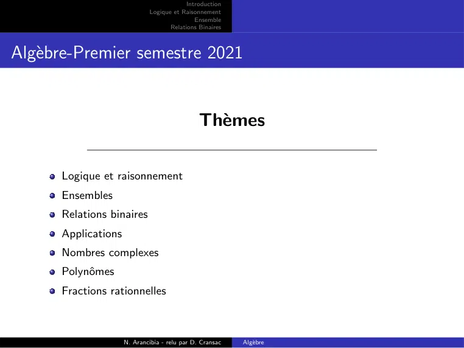

~~~text
                                          Introduction
                             Logique et Raisonnement
                                             Ensemble
                                    Relations Binaires

Algèbre-Premier semestre 2021

                                               Thèmes

      Logique et raisonnement
      Ensembles
      Relations binaires
      Applications
      Nombres complexes
      Polynômes
      Fractions rationnelles

                     N. Arancibia - relu par D. Cransac   Algèbre
~~~

## Page 3

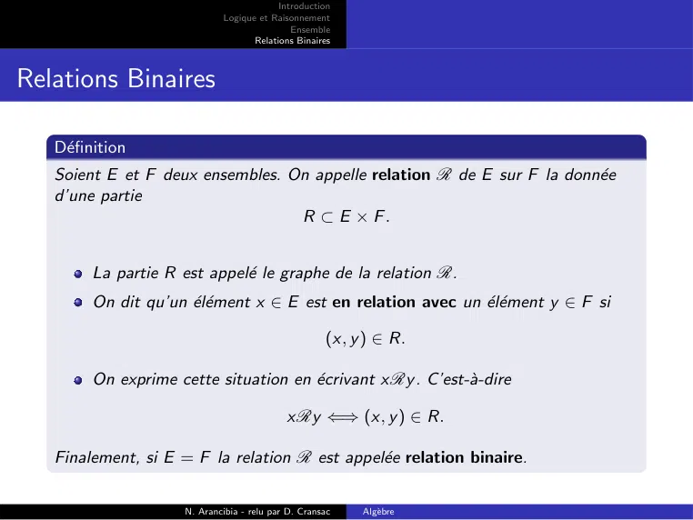

~~~text
                                          Introduction
                             Logique et Raisonnement
                                             Ensemble
                                    Relations Binaires

Relations Binaires

   Définition
   Soient E et F deux ensembles. On appelle relation R de E sur F la donnée
   d’une partie
                                  R ⊂ E × F.

        La partie R est appelé le graphe de la relation R.
        On dit qu’un élément x ∈ E est en relation avec un élément y ∈ F si

                                                     (x, y ) ∈ R.

        On exprime cette situation en écrivant xRy . C’est-à-dire

                                            xRy ⇐⇒ (x, y ) ∈ R.

   Finalement, si E = F la relation R est appelée relation binaire.

                     N. Arancibia - relu par D. Cransac   Algèbre
~~~

## Page 4

~~~text
                                              Introduction
                                 Logique et Raisonnement
                                                 Ensemble
                                        Relations Binaires

Relations Binaires
Exemple :

            La relation d’inclusion dans l’ensemble des parties de E

                                                  ARB ⇐⇒ A ⊂ B.

            Ici donc
                              R = {(A, B) ∈ P(E ) × P(E ) : A ⊂ B}.
            Sur tout ensemble E , on peut définir la relation égalité

                                                   xRy ⇐⇒ x = y .

            Ici donc
                                      R = {(a, b) ∈ E × E : a = b}.
            Les relations ≤ et < sur R, sont aussi des relations binaires.

                         N. Arancibia - relu par D. Cransac   Algèbre
~~~

## Page 5

~~~text
                                       Introduction
                          Logique et Raisonnement
                                          Ensemble
                                 Relations Binaires

La relation de divisibilité sur les entiers relatifs

                           mRn ⇐⇒ m|n                      (m divise n).

Ici donc
                       R = {(m, n) ∈ Z × Z : m|n ∈ Z}.
Cas particulier : si A = {1; 2; 3; 4} et {(m, n) ∈ A × A : m|n ∈ Z}.

                                      n
                                     m          1      2        3     4
                                      1         R      R        R     R
                                      2                R              R
                                      3                         R
                                      4                               R

Remarque : Parce que le couple (x, y ) n’est pas égal au couple (y , x), la
relation xRy peut être vraie sans que la relation y Rx le soit.

                  N. Arancibia - relu par D. Cransac       Algèbre
~~~

## Page 6

~~~text
                                    Introduction
                       Logique et Raisonnement
                                       Ensemble
                              Relations Binaires

Relations Binaires

               N. Arancibia - relu par D. Cransac   Algèbre
~~~

## Page 7

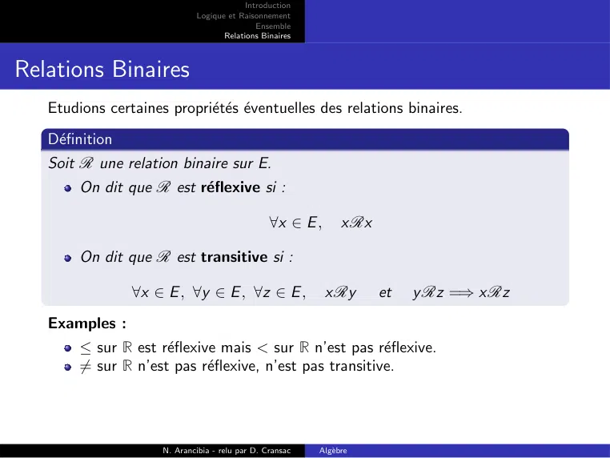

~~~text
                                          Introduction
                             Logique et Raisonnement
                                             Ensemble
                                    Relations Binaires

Relations Binaires
   Etudions certaines propriétés éventuelles des relations binaires.
   Définition
   Soit R une relation binaire sur E.
        On dit que R est réflexive si :

                                                 ∀x ∈ E ,       xRx

        On dit que R est transitive si :

                 ∀x ∈ E , ∀y ∈ E , ∀z ∈ E ,                 xRy       et   y Rz =⇒ xRz
   Examples :
        ≤ sur R est réflexive mais < sur R n’est pas réflexive.
        6= sur R n’est pas réflexive, n’est pas transitive.

                     N. Arancibia - relu par D. Cransac   Algèbre
~~~

## Page 8

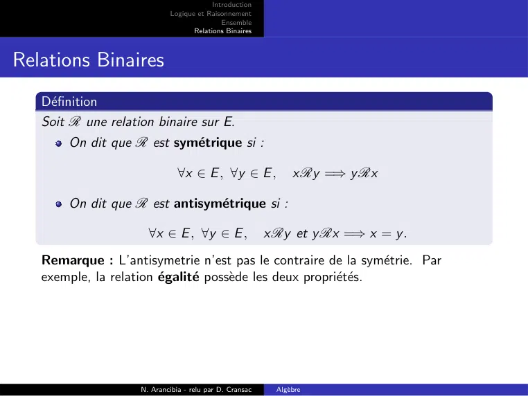

~~~text
                                         Introduction
                            Logique et Raisonnement
                                            Ensemble
                                   Relations Binaires

Relations Binaires
   Définition
   Soit R une relation binaire sur E.
        On dit que R est symétrique si :

                               ∀x ∈ E , ∀y ∈ E ,               xRy =⇒ y Rx

        On dit que R est antisymétrique si :

                      ∀x ∈ E , ∀y ∈ E ,                  xRy et y Rx =⇒ x = y .
   Remarque : L’antisymetrie n’est pas le contraire de la symétrie. Par
   exemple, la relation égalité possède les deux propriétés.

                    N. Arancibia - relu par D. Cransac    Algèbre
~~~

## Page 9

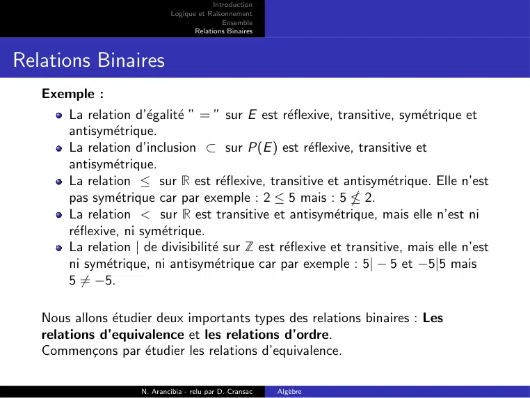

~~~text
                                          Introduction
                             Logique et Raisonnement
                                             Ensemble
                                    Relations Binaires

Relations Binaires
   Exemple :
       La relation d’égalité ” = ” sur E est réflexive, transitive, symétrique et
       antisymétrique.
       La relation d’inclusion ⊂ sur P(E ) est réflexive, transitive et
       antisymétrique.
       La relation ≤ sur R est réflexive, transitive et antisymétrique. Elle n’est
       pas symétrique car par exemple : 2 ≤ 5 mais : 5  2.
       La relation < sur R est transitive et antisymétrique, mais elle n’est ni
       réflexive, ni symétrique.
       La relation | de divisibilité sur Z est réflexive et transitive, mais elle n’est
       ni symétrique, ni antisymétrique car par exemple : 5| − 5 et −5|5 mais
       5 6= −5.

   Nous allons étudier deux importants types des relations binaires : Les
   relations d’equivalence et les relations d’ordre.
   Commençons par étudier les relations d’equivalence.

                     N. Arancibia - relu par D. Cransac   Algèbre
~~~

## Page 10

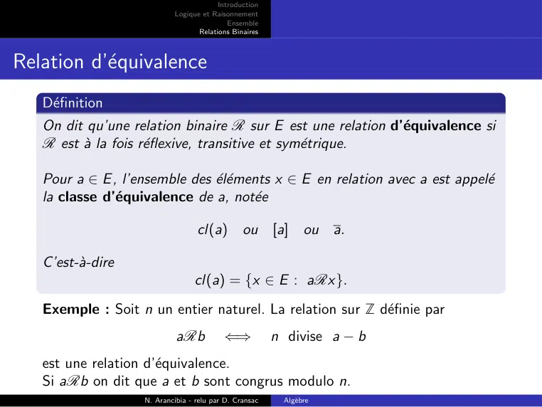

~~~text
                                        Introduction
                           Logique et Raisonnement
                                           Ensemble
                                  Relations Binaires

Relation d’équivalence
   Définition
   On dit qu’une relation binaire R sur E est une relation d’équivalence si
   R est à la fois réflexive, transitive et symétrique.

   Pour a ∈ E , l’ensemble des éléments x ∈ E en relation avec a est appelé
   la classe d’équivalence de a, notée

                                  cl(a) ou              [a]     ou a.

   C’est-à-dire
                                 cl(a) = {x ∈ E : aRx}.
   Exemple : Soit n un entier naturel. La relation sur Z définie par
                            aRb           ⇐⇒            n divise a − b
   est une relation d’équivalence.
   Si aRb on dit que a et b sont congrus modulo n.
                   N. Arancibia - relu par D. Cransac     Algèbre
~~~

## Page 11

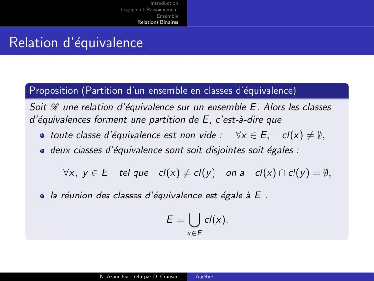

~~~text
                                        Introduction
                           Logique et Raisonnement
                                           Ensemble
                                  Relations Binaires

Relation d’équivalence

   Proposition (Partition d’un ensemble en classes d’équivalence)
   Soit R une relation d’équivalence sur un ensemble E . Alors les classes
   d’équivalences forment une partition de E , c’est-à-dire que
       toute classe d’équivalence est non vide :                   ∀x ∈ E ,   cl(x) 6= ∅,
       deux classes d’équivalence sont soit disjointes soit égales :

           ∀x, y ∈ E       tel que          cl(x) 6= cl(y ) on a        cl(x) ∩ cl(y ) = ∅,

       la réunion des classes d’équivalence est égale à E :
                                          [
                                     E=       cl(x).
                                                        x∈E

                   N. Arancibia - relu par D. Cransac    Algèbre
~~~

## Page 12

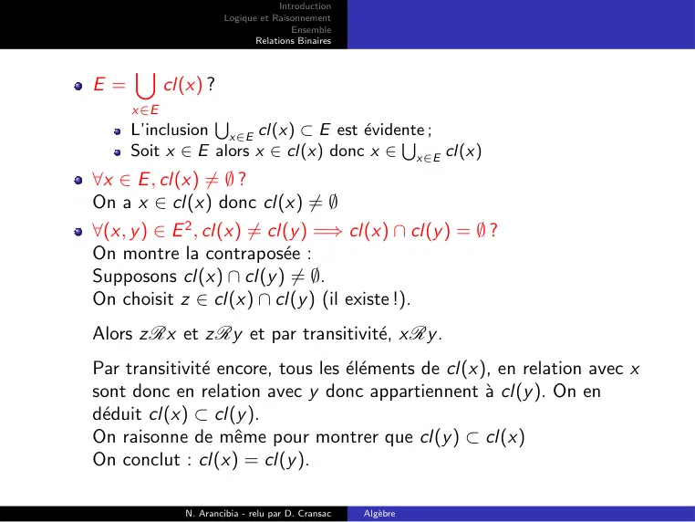

~~~text
                                   Introduction
                      Logique et Raisonnement
                                      Ensemble
                             Relations Binaires

     [
E=         cl(x) ?
     x∈E
                S
     L’inclusion x∈E cl(x) ⊂ E est évidente
                                         S ;
     Soit x ∈ E alors x ∈ cl(x) donc x ∈ x∈E cl(x)
∀x ∈ E , cl(x) 6= ∅ ?
On a x ∈ cl(x) donc cl(x) 6= ∅
∀(x, y ) ∈ E 2 , cl(x) 6= cl(y ) =⇒ cl(x) ∩ cl(y ) = ∅ ?
On montre la contraposée :
Supposons cl(x) ∩ cl(y ) 6= ∅.
On choisit z ∈ cl(x) ∩ cl(y ) (il existe !).
Alors zRx et zRy et par transitivité, xRy .
Par transitivité encore, tous les éléments de cl(x), en relation avec x
sont donc en relation avec y donc appartiennent à cl(y ). On en
déduit cl(x) ⊂ cl(y ).
On raisonne de même pour montrer que cl(y ) ⊂ cl(x)
On conclut : cl(x) = cl(y ).

              N. Arancibia - relu par D. Cransac   Algèbre
~~~

## Page 13

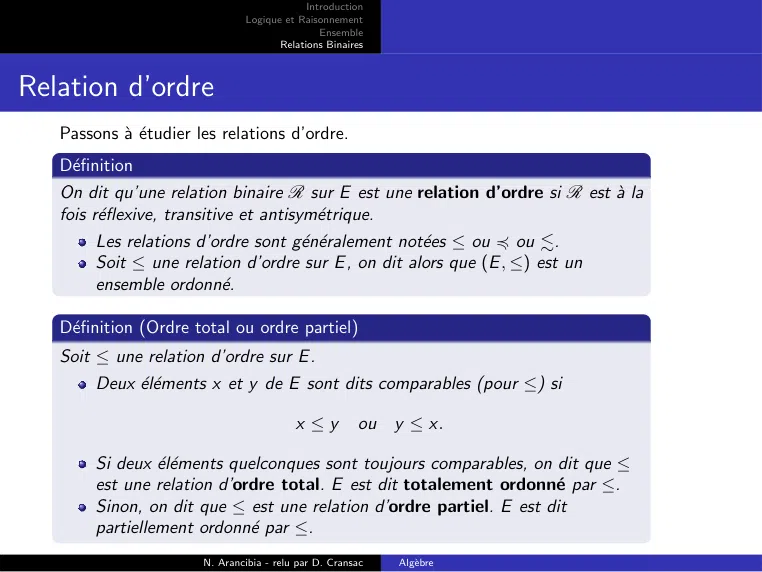

~~~text
                                            Introduction
                               Logique et Raisonnement
                                               Ensemble
                                      Relations Binaires

Relation d’ordre
   Passons à étudier les relations d’ordre.
   Définition
   On dit qu’une relation binaire R sur E est une relation d’ordre si R est à la
   fois réflexive, transitive et antisymétrique.
        Les relations d’ordre sont généralement notées ≤ ou 4 ou ..
        Soit ≤ une relation d’ordre sur E , on dit alors que (E , ≤) est un
        ensemble ordonné.

   Définition (Ordre total ou ordre partiel)
   Soit ≤ une relation d’ordre sur E .
        Deux éléments x et y de E sont dits comparables (pour ≤) si

                                          x ≤y         ou y ≤ x.

        Si deux éléments quelconques sont toujours comparables, on dit que ≤
        est une relation d’ordre total. E est dit totalement ordonné par ≤.
        Sinon, on dit que ≤ est une relation d’ordre partiel. E est dit
        partiellement ordonné par ≤.
                       N. Arancibia - relu par D. Cransac   Algèbre
~~~

## Page 14

~~~text
                                            Introduction
                               Logique et Raisonnement
                                               Ensemble
                                      Relations Binaires

Relation d’ordre
Exemple :

            Sur N, Z, Q et R on a une relation d’ordre total, notée ≤.
            Sur P(E ), la relation
                                                 A ≤ B ⇐⇒ A ⊂ B
             c’est une relation d’ordre partiel (sauf si E = ∅ ou E = {a}). En
            effet, si a ∈ E , b ∈ E , {a} et {b} non comparables.
            Sur R2
                         (x, y ) ≤ (x 0 , y 0 ) ⇐⇒ (x ≤ x 0 )          et   (y ≤ y 0 )
            est un ordre partiel. Par exemple (1, 2) et (4, 0) non comparables.

                       N. Arancibia - relu par D. Cransac   Algèbre
~~~

## Page 15

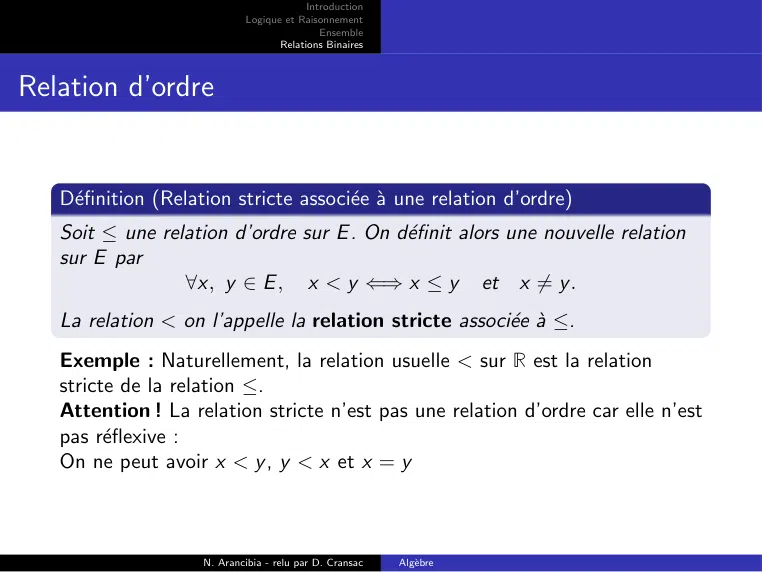

~~~text
                                         Introduction
                            Logique et Raisonnement
                                            Ensemble
                                   Relations Binaires

Relation d’ordre

   Définition (Relation stricte associée à une relation d’ordre)
   Soit ≤ une relation d’ordre sur E . On définit alors une nouvelle relation
   sur E par
                 ∀x, y ∈ E , x < y ⇐⇒ x ≤ y et x 6= y .
   La relation < on l’appelle la relation stricte associée à ≤.
   Exemple : Naturellement, la relation usuelle < sur R est la relation
   stricte de la relation ≤.
   Attention ! La relation stricte n’est pas une relation d’ordre car elle n’est
   pas réflexive :
   On ne peut avoir x < y , y < x et x = y

                    N. Arancibia - relu par D. Cransac   Algèbre
~~~

## Page 16

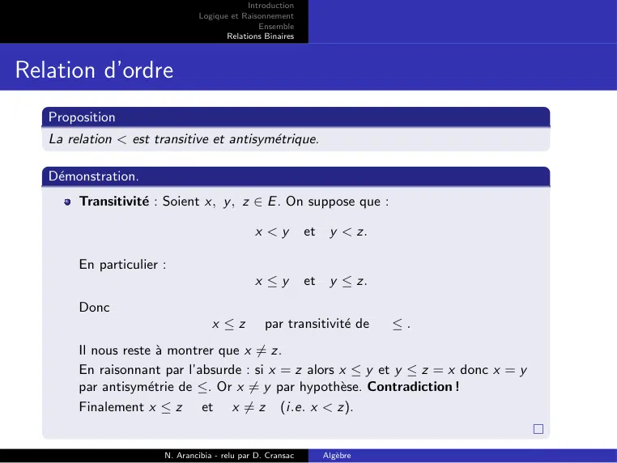

~~~text
                                            Introduction
                               Logique et Raisonnement
                                               Ensemble
                                      Relations Binaires

Relation d’ordre
   Proposition
   La relation < est transitive et antisymétrique.

   Démonstration.
        Transitivité : Soient x, y , z ∈ E . On suppose que :

                                              x <y          et    y < z.

        En particulier :
                                              x ≤y          et    y ≤ z.
        Donc
                                   x ≤z          par transitivité de       ≤.
        Il nous reste à montrer que x 6= z.
        En raisonnant par l’absurde : si x = z alors x ≤ y et y ≤ z = x donc x = y
        par antisymétrie de ≤. Or x 6= y par hypothèse. Contradiction !
        Finalement x ≤ z et x 6= z (i.e. x < z).

                       N. Arancibia - relu par D. Cransac        Algèbre
~~~

## Page 17

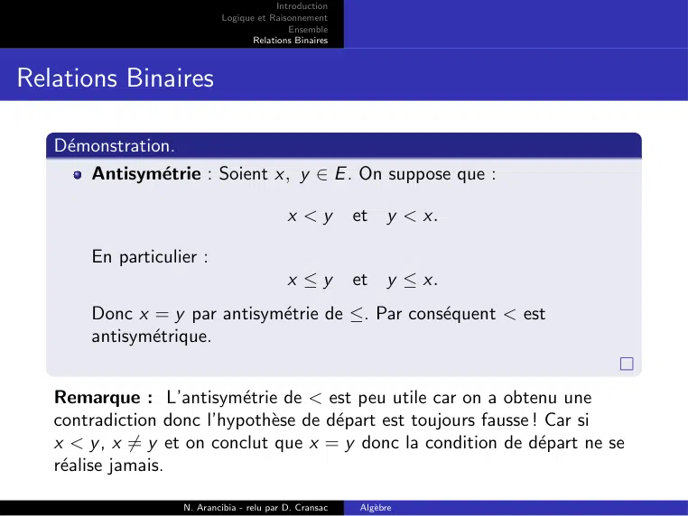

~~~text
                                        Introduction
                           Logique et Raisonnement
                                           Ensemble
                                  Relations Binaires

Relations Binaires

   Démonstration.
       Antisymétrie : Soient x, y ∈ E . On suppose que :

                                           x <y         et    y < x.

       En particulier :
                                           x ≤y         et    y ≤ x.
       Donc x = y par antisymétrie de ≤. Par conséquent < est
       antisymétrique.

   Remarque : L’antisymétrie de < est peu utile car on a obtenu une
   contradiction donc l’hypothèse de départ est toujours fausse ! Car si
   x < y , x 6= y et on conclut que x = y donc la condition de départ ne se
   réalise jamais.

                   N. Arancibia - relu par D. Cransac   Algèbre
~~~

## Page 18

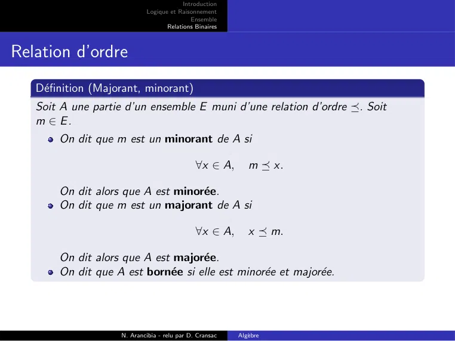

~~~text
                                         Introduction
                            Logique et Raisonnement
                                            Ensemble
                                   Relations Binaires

Relation d’ordre
   Définition (Majorant, minorant)
   Soit A une partie d’un ensemble E muni d’une relation d’ordre . Soit
   m ∈ E.
       On dit que m est un minorant de A si

                                              ∀x ∈ A,       m  x.

       On dit alors que A est minorée.
       On dit que m est un majorant de A si

                                              ∀x ∈ A,       x  m.

       On dit alors que A est majorée.
       On dit que A est bornée si elle est minorée et majorée.

                    N. Arancibia - relu par D. Cransac   Algèbre
~~~

## Page 19

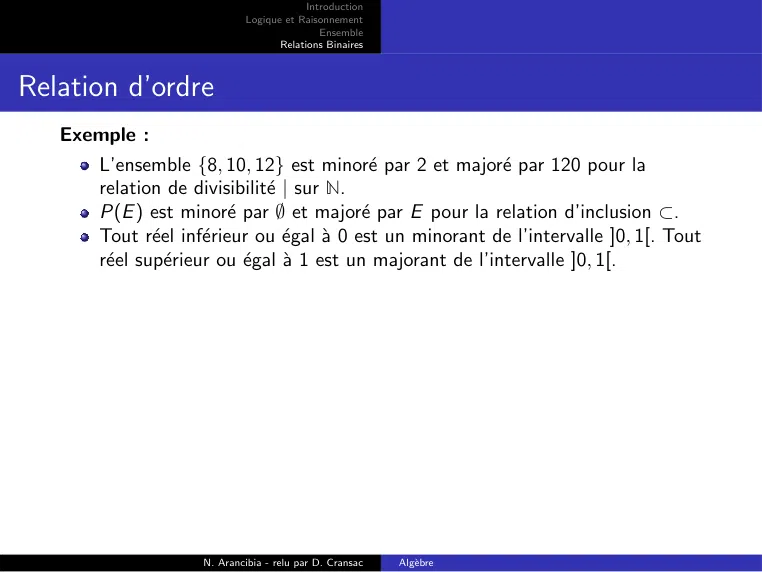

~~~text
                                        Introduction
                           Logique et Raisonnement
                                           Ensemble
                                  Relations Binaires

Relation d’ordre
   Exemple :
      L’ensemble {8, 10, 12} est minoré par 2 et majoré par 120 pour la
      relation de divisibilité | sur N.
      P(E ) est minoré par ∅ et majoré par E pour la relation d’inclusion ⊂.
      Tout réel inférieur ou égal à 0 est un minorant de l’intervalle ]0, 1[. Tout
      réel supérieur ou égal à 1 est un majorant de l’intervalle ]0, 1[.

                   N. Arancibia - relu par D. Cransac   Algèbre
~~~

## Page 20

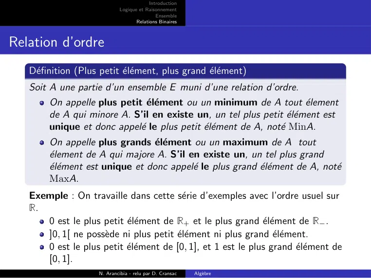

~~~text
                                          Introduction
                             Logique et Raisonnement
                                             Ensemble
                                    Relations Binaires

Relation d’ordre
   Définition (Plus petit élément, plus grand élément)
   Soit A une partie d’un ensemble E muni d’une relation d’ordre.
        On appelle plus petit élément ou un minimum de A tout élement
        de A qui minore A. S’il en existe un, un tel plus petit élément est
        unique et donc appelé le plus petit élément de A, noté MinA.
        On appelle plus grands élément ou un maximum de A tout
        élement de A qui majore A. S’il en existe un, un tel plus grand
        élément est unique et donc appelé le plus grand élément de A, noté
        MaxA.
   Exemple : On travaille dans cette série d’exemples avec l’ordre usuel sur
   R.
      0 est le plus petit élément de R+ et le plus grand élément de R− .
      ]0, 1[ ne possède ni plus petit élément ni plus grand élément.
      0 est le plus petit élément de [0, 1], et 1 est le plus grand élément de
      [0, 1].
                     N. Arancibia - relu par D. Cransac   Algèbre
~~~

## Page 21

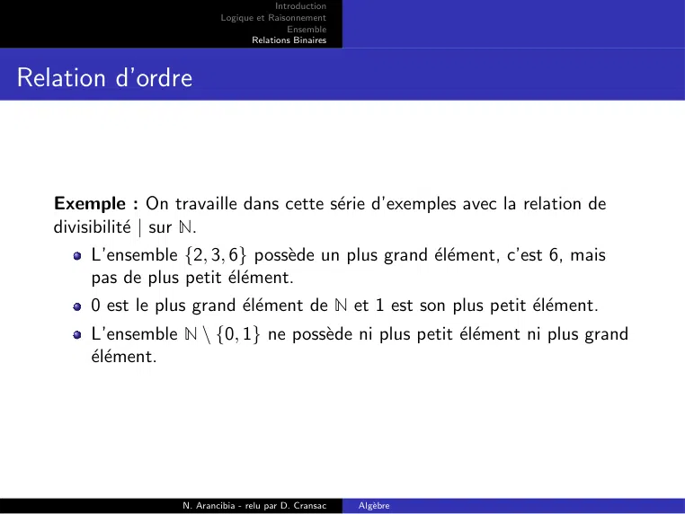

~~~text
                                        Introduction
                           Logique et Raisonnement
                                           Ensemble
                                  Relations Binaires

Relation d’ordre

   Exemple : On travaille dans cette série d’exemples avec la relation de
   divisibilité | sur N.
       L’ensemble {2, 3, 6} possède un plus grand élément, c’est 6, mais
       pas de plus petit élément.
       0 est le plus grand élément de N et 1 est son plus petit élément.
       L’ensemble N \ {0, 1} ne possède ni plus petit élément ni plus grand
       élément.

                   N. Arancibia - relu par D. Cransac   Algèbre
~~~

## Page 22

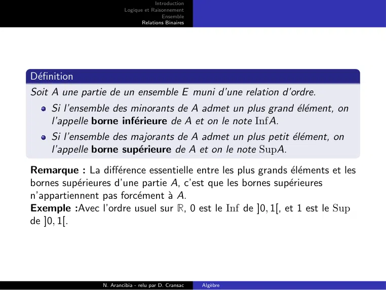

~~~text
                                      Introduction
                         Logique et Raisonnement
                                         Ensemble
                                Relations Binaires

Définition
Soit A une partie de un ensemble E muni d’une relation d’ordre.
     Si l’ensemble des minorants de A admet un plus grand élément, on
     l’appelle borne inférieure de A et on le note InfA.
     Si l’ensemble des majorants de A admet un plus petit élément, on
     l’appelle borne supérieure de A et on le note SupA.
Remarque : La différence essentielle entre les plus grands éléments et les
bornes supérieures d’une partie A, c’est que les bornes supérieures
n’appartiennent pas forcément à A.
Exemple :Avec l’ordre usuel sur R, 0 est le Inf de ]0, 1[, et 1 est le Sup
de ]0, 1[.

                 N. Arancibia - relu par D. Cransac   Algèbre
~~~

## Page 23

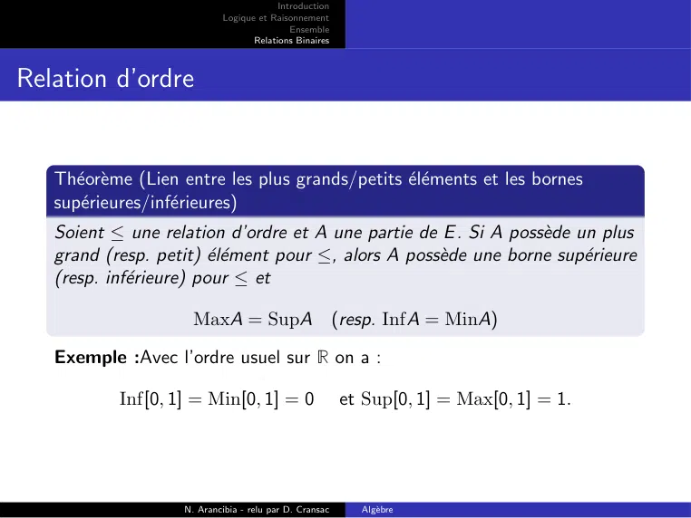

~~~text
                                         Introduction
                            Logique et Raisonnement
                                            Ensemble
                                   Relations Binaires

Relation d’ordre

   Théorème (Lien entre les plus grands/petits éléments et les bornes
   supérieures/inférieures)
   Soient ≤ une relation d’ordre et A une partie de E . Si A possède un plus
   grand (resp. petit) élément pour ≤, alors A possède une borne supérieure
   (resp. inférieure) pour ≤ et

                      MaxA = SupA (resp. InfA = MinA)

   Exemple :Avec l’ordre usuel sur R on a :

           Inf[0, 1] = Min[0, 1] = 0                     et Sup[0, 1] = Max[0, 1] = 1.

                    N. Arancibia - relu par D. Cransac     Algèbre
~~~
