# CM3-Ensemble_2021-2022_Algebre1_P1S1_NArancibia-DCransac.pdf

[Ouvrir l’original](https://drive.google.com/open?id=1Hxi09nHW0tauOffKF2LwOGWsuffCxe90) · Les deux lectures automatiques du PDF divergent sur les pages indiquées. Leur fac-similé accompagne le texte.

**Pages présentant un écart entre les deux extractions** — 2–9, 11–12, 16, 18–19, 21–30, 32–36, 40.

## Page 1

~~~text
                                          Introduction
                              Logique et Raisonnement
                                             Ensemble

Algèbre-Premier semestre 2021

   1   Introduction

   2   Logique et Raisonnement

   3   Ensemble

                      N. Arancibia - relu par D. Cransac   Algèbre
~~~

## Page 2

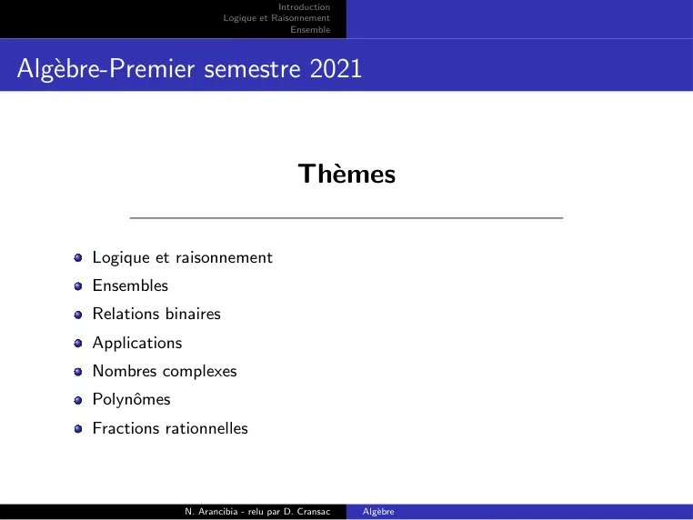

~~~text
                                         Introduction
                             Logique et Raisonnement
                                            Ensemble

Algèbre-Premier semestre 2021

                                               Thèmes

      Logique et raisonnement
      Ensembles
      Relations binaires
      Applications
      Nombres complexes
      Polynômes
      Fractions rationnelles

                     N. Arancibia - relu par D. Cransac   Algèbre
~~~

## Page 3

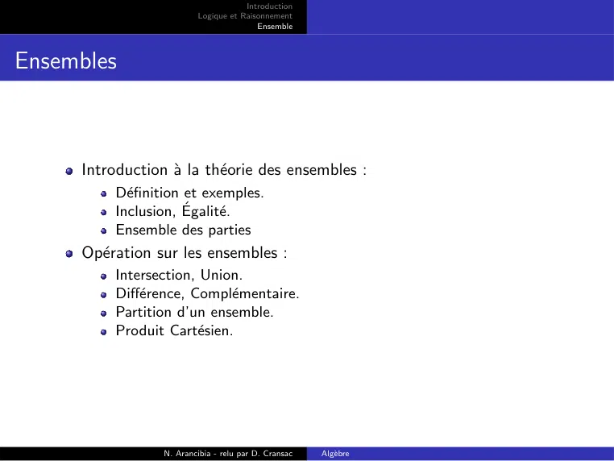

~~~text
                                     Introduction
                         Logique et Raisonnement
                                        Ensemble

Ensembles

     Introduction à la théorie des ensembles :
          Définition et exemples.
          Inclusion, Égalité.
          Ensemble des parties
     Opération sur les ensembles :
          Intersection, Union.
          Différence, Complémentaire.
          Partition d’un ensemble.
          Produit Cartésien.

                 N. Arancibia - relu par D. Cransac   Algèbre
~~~

## Page 4

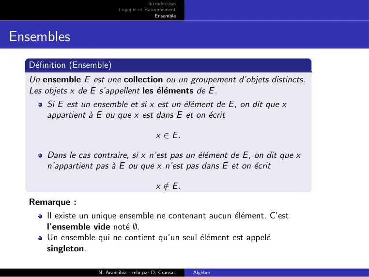

~~~text
                                        Introduction
                            Logique et Raisonnement
                                           Ensemble

Ensembles
  Définition (Ensemble)
  Un ensemble E est une collection ou un groupement d’objets distincts.
  Les objets x de E s’appellent les éléments de E .
      Si E est un ensemble et si x est un élément de E , on dit que x
      appartient à E ou que x est dans E et on écrit

                                             x ∈ E.

      Dans le cas contraire, si x n’est pas un élément de E , on dit que x
      n’appartient pas à E ou que x n’est pas dans E et on écrit

                                             x∈
                                              / E.
  Remarque :
      Il existe un unique ensemble ne contenant aucun élément. C’est
      l’ensemble vide noté ∅.
      Un ensemble qui ne contient qu’un seul élément est appelé
      singleton.

                    N. Arancibia - relu par D. Cransac   Algèbre
~~~

## Page 5

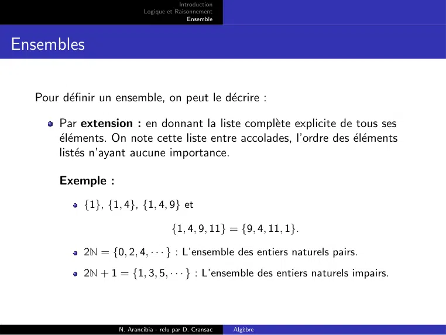

~~~text
                                        Introduction
                            Logique et Raisonnement
                                           Ensemble

Ensembles

  Pour définir un ensemble, on peut le décrire :

       Par extension : en donnant la liste complète explicite de tous ses
       éléments. On note cette liste entre accolades, l’ordre des éléments
       listés n’ayant aucune importance.

       Exemple :
            {1}, {1, 4}, {1, 4, 9} et

                                       {1, 4, 9, 11} = {9, 4, 11, 1}.

            2N = {0, 2, 4, · · · } : L’ensemble des entiers naturels pairs.
            2N + 1 = {1, 3, 5, · · · } : L’ensemble des entiers naturels impairs.

                    N. Arancibia - relu par D. Cransac   Algèbre
~~~

## Page 6

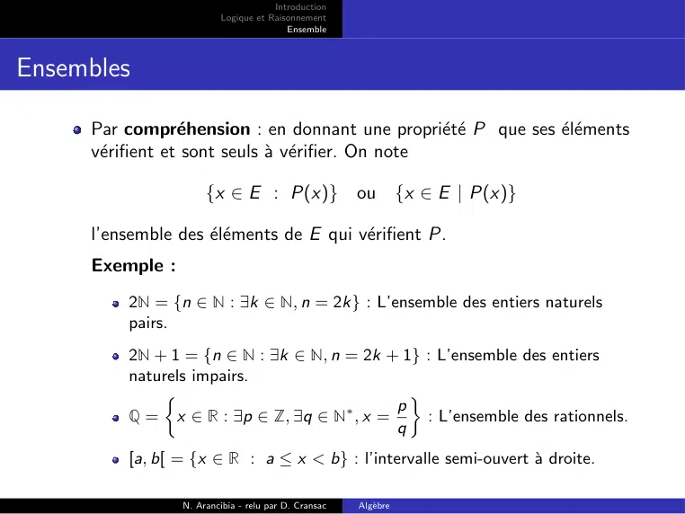

~~~text
                                     Introduction
                         Logique et Raisonnement
                                        Ensemble

Ensembles

     Par compréhension : en donnant une propriété P que ses éléments
     vérifient et sont seuls à vérifier. On note

                      {x ∈ E : P(x)}                  ou {x ∈ E | P(x)}

     l’ensemble des éléments de E qui vérifient P.
     Exemple :
          2N = {n ∈ N : ∃k ∈ N, n = 2k} : L’ensemble des entiers naturels
          pairs.
          2N + 1 = {n ∈ N : ∃k ∈ N, n = 2k + 1} : L’ensemble des entiers
          naturels impairs.
                                             
                                            p
          Q = x ∈ R : ∃p ∈ Z, ∃q ∈ N∗ , x =     : L’ensemble des rationnels.
                                            q
          [a, b[ = {x ∈ R : a ≤ x < b} : l’intervalle semi-ouvert à droite.

                 N. Arancibia - relu par D. Cransac   Algèbre
~~~

## Page 7

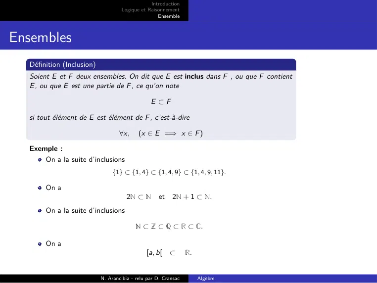

~~~text
                                                Introduction
                                    Logique et Raisonnement
                                                   Ensemble

Ensembles
  Définition (Inclusion)
  Soient E et F deux ensembles. On dit que E est inclus dans F , ou que F contient
  E , ou que E est une partie de F , ce qu’on note

                                                 E ⊂F

  si tout élément de E est élément de F , c’est-à-dire

                                    ∀x,     (x ∈ E =⇒ x ∈ F )

  Exemple :
      On a la suite d’inclusions
                                 {1} ⊂ {1, 4} ⊂ {1, 4, 9} ⊂ {1, 4, 9, 11}.

       On a
                                       2N ⊂ N       et    2N + 1 ⊂ N.
       On a la suite d’inclusions

                                           N ⊂ Z ⊂ Q ⊂ R ⊂ C.

       On a
                                               [a, b[    ⊂       R.

                            N. Arancibia - relu par D. Cransac        Algèbre
~~~

## Page 8

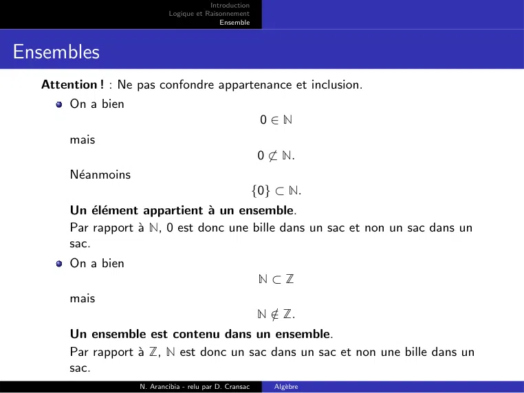

~~~text
                                        Introduction
                            Logique et Raisonnement
                                           Ensemble

Ensembles
  Attention ! : Ne pas confondre appartenance et inclusion.
       On a bien
                                                          0∈N
       mais
                                                          0 6⊂ N.
       Néanmoins
                                                         {0} ⊂ N.
       Un élément appartient à un ensemble.
       Par rapport à N, 0 est donc une bille dans un sac et non un sac dans un
       sac.
       On a bien
                                                          N⊂Z
       mais
                                                         N∈
                                                          / Z.
       Un ensemble est contenu dans un ensemble.
       Par rapport à Z, N est donc un sac dans un sac et non une bille dans un
       sac.
                    N. Arancibia - relu par D. Cransac       Algèbre
~~~

## Page 9

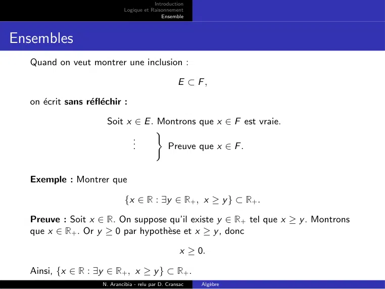

~~~text
                                          Introduction
                              Logique et Raisonnement
                                             Ensemble

Ensembles
  Quand on veut montrer une inclusion :

                                                     E ⊂ F,

  on écrit sans réfléchir :

                        Soit x ∈ E . Montrons que x ∈ F est vraie.
                                     )
                               ..
                                .      Preuve que x ∈ F .

  Exemple : Montrer que

                               {x ∈ R : ∃y ∈ R+ , x ≥ y } ⊂ R+ .

  Preuve : Soit x ∈ R. On suppose qu’il existe y ∈ R+ tel que x ≥ y . Montrons
  que x ∈ R+ . Or y ≥ 0 par hypothèse et x ≥ y , donc

                                                      x ≥ 0.

  Ainsi, {x ∈ R : ∃y ∈ R+ , x ≥ y } ⊂ R+ .
                      N. Arancibia - relu par D. Cransac   Algèbre
~~~

## Page 10

~~~text
                                        Introduction
                            Logique et Raisonnement
                                           Ensemble

Ensembles
  Exemple :
  Montrer que
                             E = {k(k + 1) : k ∈ N} ⊂ 2N.
  Preuve : Soit n ∈ E , alors

                        n = k(k + 1)              pour un certain k ∈ N.

  Montrons que n ∈ 2N. On peut affirmer que k est pair ou impair, et si k est
  impair alors k + 1 est pair.Dans tous les cas

                                  k     ou      k +1       est pair.

  Par produit, n = k(k + 1) l’est aussi, donc n ∈ 2N.
  À faire chez soi :
      Soit E l’ensemble des entiers naturels multiples de 6 et F l’ensemble des
      entiers naturels pairs. Montrer que E ⊂ F .
      Soit E = [2, 3] et F = {x ∈ R : x 2 − 3x − 10 < 0}. Montrer que E ⊂ F .
                    N. Arancibia - relu par D. Cransac   Algèbre
~~~

## Page 11

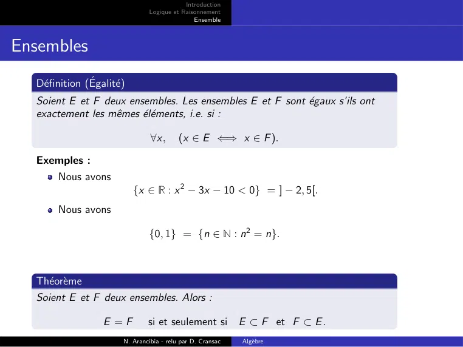

~~~text
                                            Introduction
                                Logique et Raisonnement
                                               Ensemble

Ensembles
  Définition (Égalité)
  Soient E et F deux ensembles. Les ensembles E et F sont égaux s’ils ont
  exactement les mêmes éléments, i.e. si :

                                 ∀x,       (x ∈ E ⇐⇒ x ∈ F ).

  Exemples :
       Nous avons
                            {x ∈ R : x 2 − 3x − 10 < 0} = ] − 2, 5[.
       Nous avons

                                {0, 1} = {n ∈ N : n2 = n}.

  Théorème
  Soient E et F deux ensembles. Alors :

                   E =F         si et seulement si           E ⊂ F et F ⊂ E .
                        N. Arancibia - relu par D. Cransac   Algèbre
~~~

## Page 12

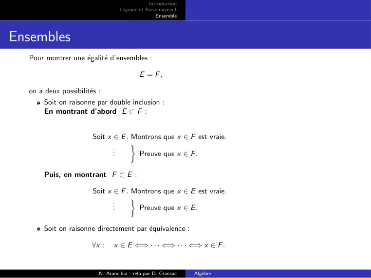

~~~text
                                              Introduction
                                  Logique et Raisonnement
                                                 Ensemble

Ensembles
  Pour montrer une égalité d’ensembles :

                                           E = F,

  on a deux possibilités :
       Soit on raisonne par double inclusion :
       En montrant d’abord E ⊂ F :

                        Soit x ∈ E . Montrons que x ∈ F est vraie.
                               ..
                                     
                                .      Preuve que x ∈ F .

       Puis, en montrant F ⊂ E :

                        Soit x ∈ F . Montrons que x ∈ E est vraie.
                               ..
                                     
                                .      Preuve que x ∈ E .

       Soit on raisonne directement par équivalence :

                       ∀x :     x ∈ E ⇐⇒ · · · ⇐⇒ · · · ⇐⇒ x ∈ F .

                          N. Arancibia - relu par D. Cransac   Algèbre
~~~

## Page 13

~~~text
                                     Introduction
                         Logique et Raisonnement
                                        Ensemble

Ensembles
  Exemple : Montrer que

                       R− = {x ∈ R : ∀y ∈ R+                     x ≤ y }.

  Preuve : On raisonne par double inclusion
      Montrons
                           R− ⊂ {x ∈ R : ∀y ∈ R+                   x ≤ y }.
      Soit x ∈ R− . Nous devons montrer que ∀y ∈ R+ , x ≤ y
      soit y ∈ R+ on a y ≥ 0 mais par hypothèse x ≤ 0. Donc

                                        x ≤ 0 ≤ y et x ≤ y

      Montrons
                           {x ∈ R : ∀y ∈ R+                 x ≤ y } ⊂ R− .
      Soit x ∈ R tel que ∀y ∈ R+ , x ≤ y . Alors en particulier, pour y = 0
      on a x ≤ 0. C’est-à-dire x ∈ R− .
                 N. Arancibia - relu par D. Cransac   Algèbre
~~~

## Page 14

~~~text
                                          Introduction
                              Logique et Raisonnement
                                             Ensemble

Ensembles
  Définition (Ensemble des parties d’un ensemble)
  Soit E un ensemble. On note P(E ) l’ensemble des parties de E

                                       P(E ) = {A : A ⊂ E }.

  Remarque : Pour tout ensemble A :

    A ∈ P(E ) ⇐⇒ A ⊂ E . i.e. la notation A ⊂ E a la même signification
  que la notation A ∈ P(E ).

    a ∈ E ⇐⇒ {a} ⊂ E ⇐⇒ {a} ∈ P(E ).

    ∅ ∈ P(E )    et      E ∈ P(E ).

  Exemple : Déterminer l’ensemble des parties de E lorsque E = {a, b}

                                 P(E ) = {∅, {a}, {b}, {a, b}}.

                      N. Arancibia - relu par D. Cransac   Algèbre
~~~

## Page 15

~~~text
                                       Introduction
                           Logique et Raisonnement
                                          Ensemble

Ensembles
  Exemple : Déterminer l’ensemble des parties de E lorsque E = {a, b, c} :

           P(E ) = {∅, {a}, {b}, {c}, {a, b}, {a, c}, {b, c}, {a, b, c}}.

                   N. Arancibia - relu par D. Cransac   Algèbre
~~~

## Page 16

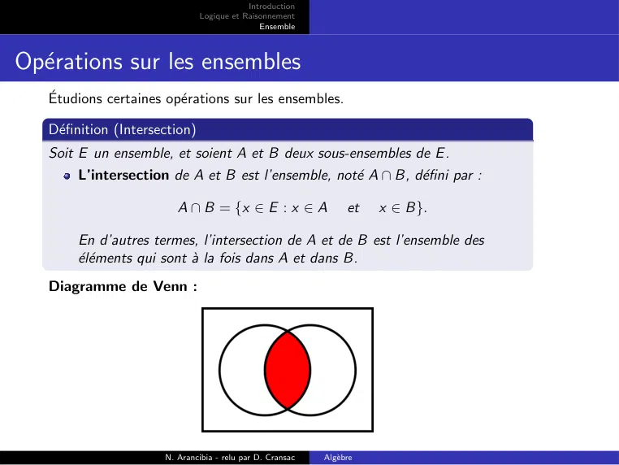

~~~text
                                            Introduction
                                Logique et Raisonnement
                                               Ensemble

Opérations sur les ensembles
   Étudions certaines opérations sur les ensembles.

   Définition (Intersection)
   Soit E un ensemble, et soient A et B deux sous-ensembles de E .
        L’intersection de A et B est l’ensemble, noté A ∩ B, défini par :

                          A ∩ B = {x ∈ E : x ∈ A                  et   x ∈ B}.

        En d’autres termes, l’intersection de A et de B est l’ensemble des
        éléments qui sont à la fois dans A et dans B.
   Diagramme de Venn :

                       N. Arancibia - relu par D. Cransac   Algèbre
~~~

## Page 17

~~~text
                                         Introduction
                             Logique et Raisonnement
                                            Ensemble

Opérations sur les ensembles

   Exemple :
       {1, 4, 7} ∩ {3, 5, 7, 11} = {7}.
       Z ∩ Q = Z.
       ([−1, 5] ∩ ]0, 7[) ∩ ]4, 9[ = ]0, 5] ∩ ]4, 9[ = ]4, 5].
                 0                                                       7
           -1                                      4      5                  9

       On a

        {(x, y ) ∈ R2 : x 2 + y 2 = 1} ∩ {(x, y ) ∈ R2 : x = y } =
                                                   √         √   √ √ 
                                                          2      2     2    2
                                                     −      ,−     ,     ,    .
                                                         2      2     2    2

       R+ ∩ R− = {0}.
       2N ∩ (2N + 1) = ∅.

                     N. Arancibia - relu par D. Cransac       Algèbre
~~~

## Page 18

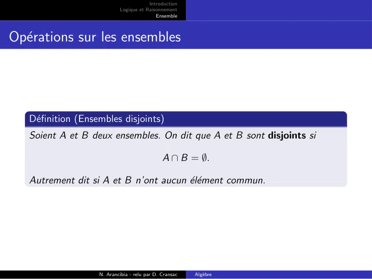

~~~text
                                        Introduction
                            Logique et Raisonnement
                                           Ensemble

Opérations sur les ensembles

   Définition (Ensembles disjoints)
   Soient A et B deux ensembles. On dit que A et B sont disjoints si

                                               A ∩ B = ∅.

   Autrement dit si A et B n’ont aucun élément commun.

                    N. Arancibia - relu par D. Cransac   Algèbre
~~~

## Page 19

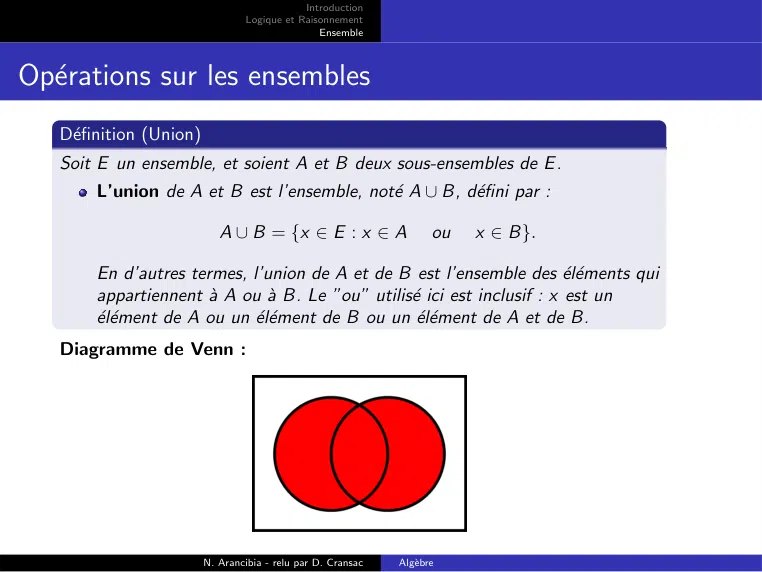

~~~text
                                             Introduction
                                 Logique et Raisonnement
                                                Ensemble

Opérations sur les ensembles
   Définition (Union)
   Soit E un ensemble, et soient A et B deux sous-ensembles de E .
       L’union de A et B est l’ensemble, noté A ∪ B, défini par :

                            A ∪ B = {x ∈ E : x ∈ A                   ou   x ∈ B}.

       En d’autres termes, l’union de A et de B est l’ensemble des éléments qui
       appartiennent à A ou à B. Le ”ou” utilisé ici est inclusif : x est un
       élément de A ou un élément de B ou un élément de A et de B.
   Diagramme de Venn :

                         N. Arancibia - relu par D. Cransac   Algèbre
~~~

## Page 20

~~~text
                                        Introduction
                            Logique et Raisonnement
                                           Ensemble

Opérations sur les ensembles
   Exemple :
      {3, 4, 7, 9} ∪ {2, 7, 9, 10, 21, 84} = {2, 3, 4, 7, 9, 10, 21, 84}.
      R+ ∪ R− = R.
      Q ∪ I = R.
      {1, −1} ∪ ]1, −1[ = [−1, 1].
   Remarque :
      Si A ⊂ B. Alors
                                  A∩B =A                 et      A ∪ B = B.

      Soient A et B deux ensembles. Alors on a toujours les inclusions
      suivantes :

                    A∩B ⊂A⊂A∪B                           et     A ∩ B ⊂ B ⊂ A ∪ B.

                    N. Arancibia - relu par D. Cransac    Algèbre
~~~

## Page 21

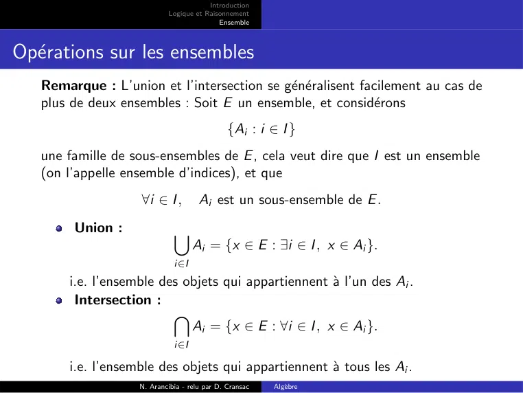

~~~text
                                       Introduction
                           Logique et Raisonnement
                                          Ensemble

Opérations sur les ensembles
   Remarque : L’union et l’intersection se généralisent facilement au cas de
   plus de deux ensembles : Soit E un ensemble, et considérons
                                              {Ai : i ∈ I }
   une famille de sous-ensembles de E , cela veut dire que I est un ensemble
   (on l’appelle ensemble d’indices), et que
                    ∀i ∈ I ,         Ai est un sous-ensemble de E .
        Union :              [
                                   Ai = {x ∈ E : ∃i ∈ I , x ∈ Ai }.
                             i∈I
       i.e. l’ensemble des objets qui appartiennent à l’un des Ai .
        Intersection :
                         \
                            Ai = {x ∈ E : ∀i ∈ I , x ∈ Ai }.
                             i∈I

       i.e. l’ensemble des objets qui appartiennent à tous les Ai .
                   N. Arancibia - relu par D. Cransac   Algèbre
~~~

## Page 22

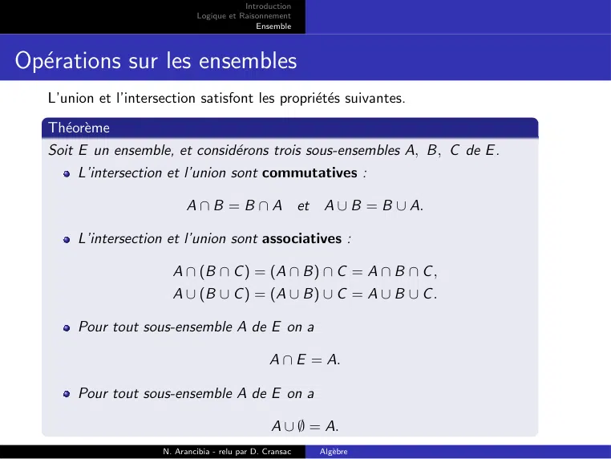

~~~text
                                           Introduction
                               Logique et Raisonnement
                                              Ensemble

Opérations sur les ensembles
   L’union et l’intersection satisfont les propriétés suivantes.
   Théorème
   Soit E un ensemble, et considérons trois sous-ensembles A, B, C de E .
        L’intersection et l’union sont commutatives :

                             A ∩ B = B ∩ A et                A ∪ B = B ∪ A.

        L’intersection et l’union sont associatives :

                         A ∩ (B ∩ C ) = (A ∩ B) ∩ C = A ∩ B ∩ C ,
                         A ∪ (B ∪ C ) = (A ∪ B) ∪ C = A ∪ B ∪ C .

        Pour tout sous-ensemble A de E on a

                                                   A ∩ E = A.

        Pour tout sous-ensemble A de E on a

                                                   A ∪ ∅ = A.
                       N. Arancibia - relu par D. Cransac   Algèbre
~~~

## Page 23

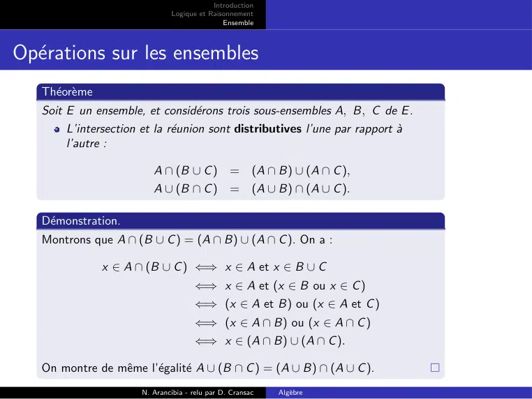

~~~text
                                          Introduction
                              Logique et Raisonnement
                                             Ensemble

Opérations sur les ensembles
   Théorème
   Soit E un ensemble, et considérons trois sous-ensembles A, B, C de E .
       L’intersection et la réunion sont distributives l’une par rapport à
       l’autre :

                         A ∩ (B ∪ C ) =                (A ∩ B) ∪ (A ∩ C ),
                         A ∪ (B ∩ C ) =                (A ∪ B) ∩ (A ∪ C ).

   Démonstration.
   Montrons que A ∩ (B ∪ C ) = (A ∩ B) ∪ (A ∩ C ). On a :

              x ∈ A ∩ (B ∪ C ) ⇐⇒ x ∈ A et x ∈ B ∪ C
                                      ⇐⇒ x ∈ A et (x ∈ B ou x ∈ C )
                                      ⇐⇒ (x ∈ A et B) ou (x ∈ A et C )
                                      ⇐⇒ (x ∈ A ∩ B) ou (x ∈ A ∩ C )
                                      ⇐⇒ x ∈ (A ∩ B) ∪ (A ∩ C ).

   On montre de même l’égalité A ∪ (B ∩ C ) = (A ∪ B) ∩ (A ∪ C ).
                      N. Arancibia - relu par D. Cransac    Algèbre
~~~

## Page 24

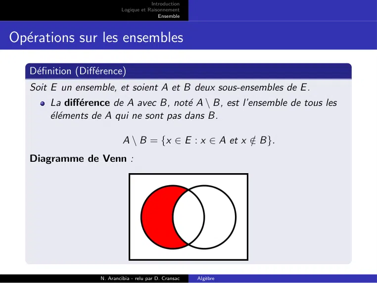

~~~text
                                         Introduction
                             Logique et Raisonnement
                                            Ensemble

Opérations sur les ensembles

   Définition (Différence)
   Soit E un ensemble, et soient A et B deux sous-ensembles de E .
        La différence de A avec B, noté A \ B, est l’ensemble de tous les
        éléments de A qui ne sont pas dans B.

                              A \ B = {x ∈ E : x ∈ A et x ∈
                                                          / B}.
   Diagramme de Venn :

                     N. Arancibia - relu par D. Cransac   Algèbre
~~~

## Page 25

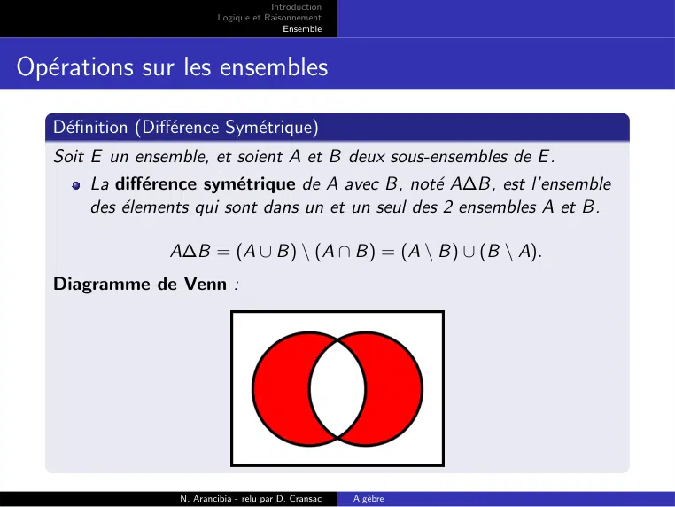

~~~text
                                        Introduction
                            Logique et Raisonnement
                                           Ensemble

Opérations sur les ensembles

   Définition (Différence Symétrique)
   Soit E un ensemble, et soient A et B deux sous-ensembles de E .
        La différence symétrique de A avec B, noté A∆B, est l’ensemble
        des élements qui sont dans un et un seul des 2 ensembles A et B.

                   A∆B = (A ∪ B) \ (A ∩ B) = (A \ B) ∪ (B \ A).
   Diagramme de Venn :

                    N. Arancibia - relu par D. Cransac   Algèbre
~~~

## Page 26

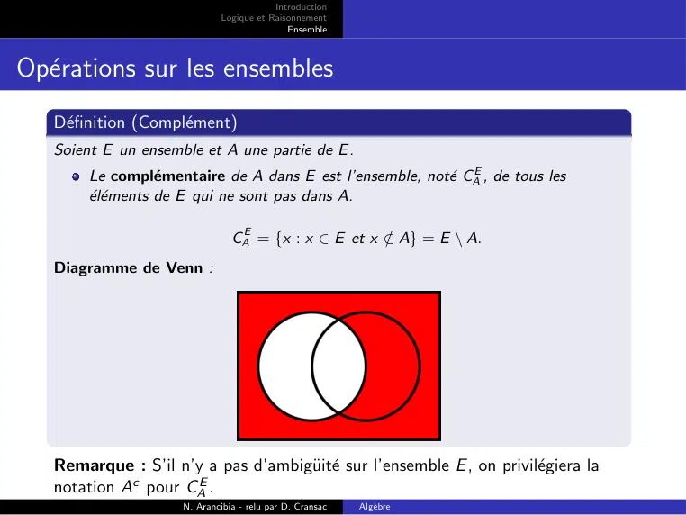

~~~text
                                         Introduction
                             Logique et Raisonnement
                                            Ensemble

Opérations sur les ensembles
   Définition (Complément)
   Soient E un ensemble et A une partie de E .
        Le complémentaire de A dans E est l’ensemble, noté CAE , de tous les
        éléments de E qui ne sont pas dans A.

                                CAE = {x : x ∈ E et x ∈
                                                      / A} = E \ A.
   Diagramme de Venn :

   Remarque : S’il n’y a pas d’ambigüité sur l’ensemble E , on privilégiera la
   notation Ac pour CAE .
                     N. Arancibia - relu par D. Cransac   Algèbre
~~~

## Page 27

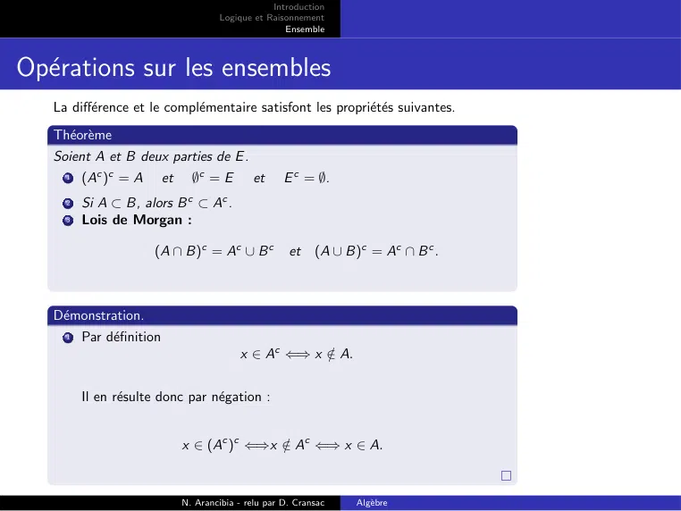

~~~text
                                                    Introduction
                                        Logique et Raisonnement
                                                       Ensemble

Opérations sur les ensembles
   La différence et le complémentaire satisfont les propriétés suivantes.
   Théorème
   Soient A et B deux parties de E .
     1   (Ac )c = A        et     ∅c = E         et     E c = ∅.
                                 c       c
     2   Si A ⊂ B, alors B ⊂ A .
     3   Lois de Morgan :

                      (A ∩ B)c = Ac ∪ B c                et    (A ∪ B)c = Ac ∩ B c .

   Démonstration.
     1   Par définition
                                             x ∈ Ac ⇐⇒ x ∈
                                                         / A.

         Il en résulte donc par négation :

                                x ∈ (Ac )c ⇐⇒x ∈
                                               / Ac ⇐⇒ x ∈ A.

                                N. Arancibia - relu par D. Cransac    Algèbre
~~~

## Page 28

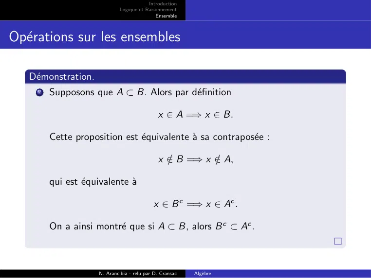

~~~text
                                          Introduction
                              Logique et Raisonnement
                                             Ensemble

Opérations sur les ensembles

   Démonstration.
     2   Supposons que A ⊂ B. Alors par définition

                                               x ∈ A =⇒ x ∈ B.

         Cette proposition est équivalente à sa contraposée :

                                               x∈
                                                / B =⇒ x ∈
                                                         / A,

         qui est équivalente à

                                             x ∈ B c =⇒ x ∈ Ac .

         On a ainsi montré que si A ⊂ B, alors B c ⊂ Ac .

                      N. Arancibia - relu par D. Cransac   Algèbre
~~~

## Page 29

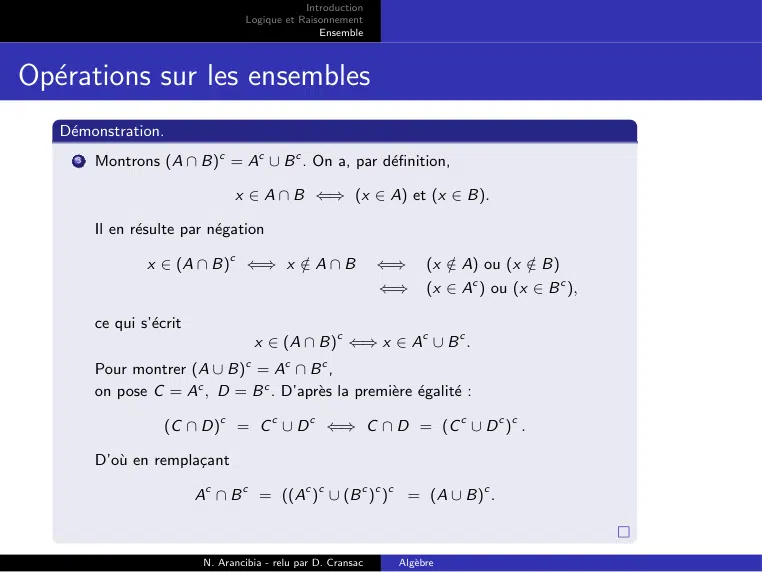

~~~text
                                                Introduction
                                    Logique et Raisonnement
                                                   Ensemble

Opérations sur les ensembles
   Démonstration.
     3   Montrons (A ∩ B)c = Ac ∪ B c . On a, par définition,

                                  x ∈ A ∩ B ⇐⇒ (x ∈ A) et (x ∈ B).

         Il en résulte par négation

                  x ∈ (A ∩ B)c ⇐⇒ x ∈
                                    / A∩B                        ⇐⇒        (x ∈
                                                                              / A) ou (x ∈
                                                                                         / B)
                                                                 ⇐⇒        (x ∈ Ac ) ou (x ∈ B c ),

         ce qui s’écrit
                                        x ∈ (A ∩ B)c ⇐⇒ x ∈ Ac ∪ B c .
         Pour montrer (A ∪ B) = Ac ∩ B c ,
                                    c

         on pose C = Ac , D = B c . D’après la première égalité :
                                                                                        c
                    (C ∩ D)c = C c ∪ D c ⇐⇒ C ∩ D = (C c ∪ D c ) .

         D’où en remplaçant
                                                                 c
                           Ac ∩ B c = ((Ac )c ∪ (B c )c )             = (A ∪ B)c .

                            N. Arancibia - relu par D. Cransac       Algèbre
~~~

## Page 30

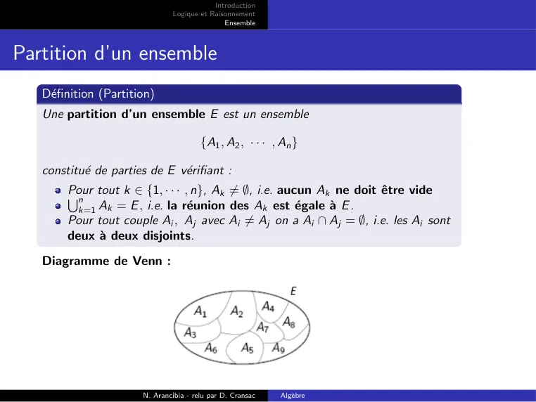

~~~text
                                           Introduction
                               Logique et Raisonnement
                                              Ensemble

Partition d’un ensemble
   Définition (Partition)
   Une partition d’un ensemble E est un ensemble

                                        {A1 , A2 , · · · , An }

   constitué de parties de E vérifiant :
        Sn tout k ∈ {1, · · · , n}, Ak 6= ∅, i.e. aucun Ak ne doit être vide
        Pour
          k=1 Ak = E , i.e. la réunion des Ak est égale à E .
        Pour tout couple Ai , Aj avec Ai 6= Aj on a Ai ∩ Aj = ∅, i.e. les Ai sont
        deux à deux disjoints.
   Diagramme de Venn :

                       N. Arancibia - relu par D. Cransac   Algèbre
~~~

## Page 31

~~~text
                                        Introduction
                            Logique et Raisonnement
                                           Ensemble

Partition d’un ensemble

   Exemples :
       L’ensemble {2N, 2N + 1} définit une partition de N.
       L’ensemble {Q, I} définit une partition de R.
       L’ensemble { 0, 12 , 12 , 32 , 32 , 2 } définit une partition de [0, 2].
                                       

       L’ensemble {2N, 3N} n’est pas une partition de N.
   Exercice : Donner toutes les partitions de l’ensemble

                                            E = {a, b, c}.

   Solution :
       P1 = {{a}, {b}, {c}}
       P2a = {{a}, {b, c}} et P2b = {{b}, {a, c}} et P2c = {{a, b}, {c}}.
       P3 = {{a, b, c}} = {E }

                    N. Arancibia - relu par D. Cransac   Algèbre
~~~

## Page 32

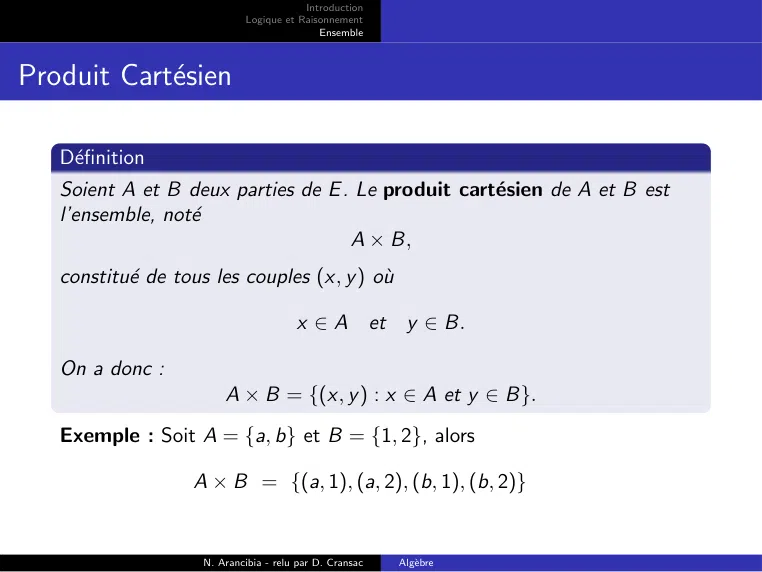

~~~text
                                         Introduction
                             Logique et Raisonnement
                                            Ensemble

Produit Cartésien

   Définition
   Soient A et B deux parties de E . Le produit cartésien de A et B est
   l’ensemble, noté
                                    A × B,
   constitué de tous les couples (x, y ) où

                                        x ∈A              et    y ∈ B.

   On a donc :
                         A × B = {(x, y ) : x ∈ A et y ∈ B}.

   Exemple : Soit A = {a, b} et B = {1, 2}, alors

                   A × B = {(a, 1), (a, 2), (b, 1), (b, 2)}

                     N. Arancibia - relu par D. Cransac        Algèbre
~~~

## Page 33

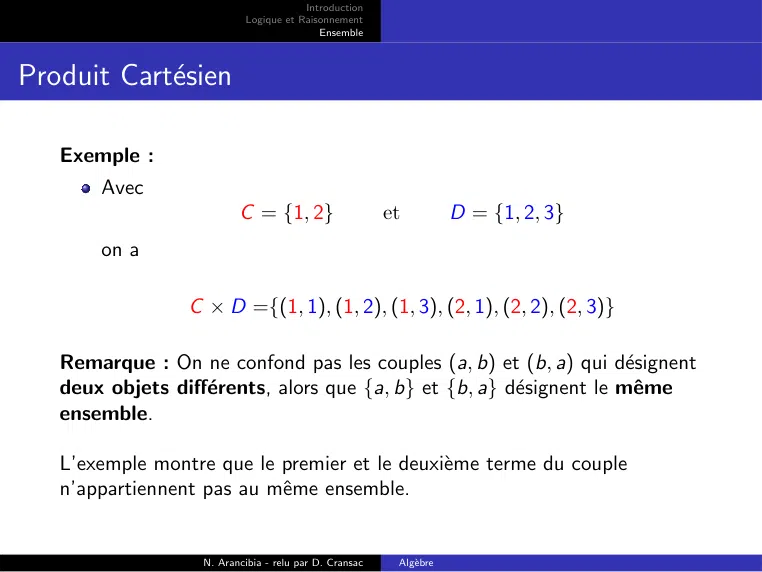

~~~text
                                       Introduction
                           Logique et Raisonnement
                                          Ensemble

Produit Cartésien

   Exemple :
       Avec
                          C = {1, 2}                    et          D = {1, 2, 3}
       on a

                 C × D ={(1, 1), (1, 2), (1, 3), (2, 1), (2, 2), (2, 3)}

   Remarque : On ne confond pas les couples (a, b) et (b, a) qui désignent
   deux objets différents, alors que {a, b} et {b, a} désignent le même
   ensemble.

   L’exemple montre que le premier et le deuxième terme du couple
   n’appartiennent pas au même ensemble.

                   N. Arancibia - relu par D. Cransac    Algèbre
~~~

## Page 34

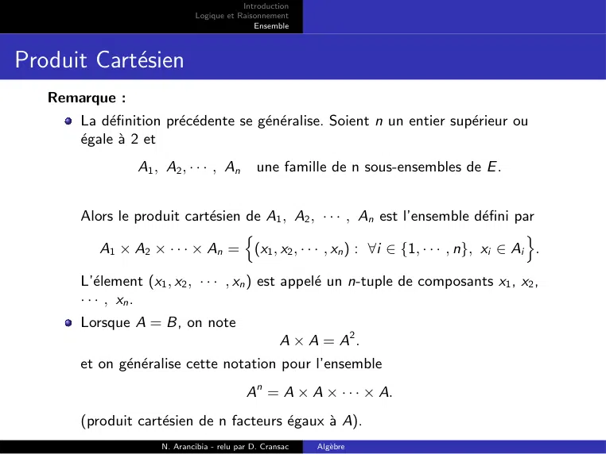

~~~text
                                         Introduction
                             Logique et Raisonnement
                                            Ensemble

Produit Cartésien
   Remarque :
       La définition précédente se généralise. Soient n un entier supérieur ou
       égale à 2 et
                 A1 , A2 , · · · , An         une famille de n sous-ensembles de E .

       Alors le produit cartésien de A1 , A2 , · · · , An est l’ensemble défini par
                                   n                                                   o
          A1 × A2 × · · · × An = (x1 , x2 , · · · , xn ) : ∀i ∈ {1, · · · , n}, xi ∈ Ai .

       L’élement (x1 , x2 , · · · , xn ) est appelé un n-tuple de composants x1 , x2 ,
       · · · , xn .
       Lorsque A = B, on note
                                                    A × A = A2 .
       et on généralise cette notation pour l’ensemble
                                           An = A × A × · · · × A.
       (produit cartésien de n facteurs égaux à A).
                     N. Arancibia - relu par D. Cransac   Algèbre
~~~

## Page 35

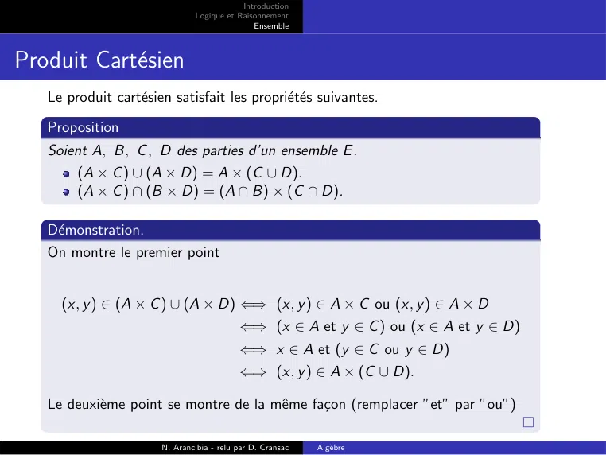

~~~text
                                           Introduction
                               Logique et Raisonnement
                                              Ensemble

Produit Cartésien
   Le produit cartésien satisfait les propriétés suivantes.
   Proposition
   Soient A, B, C , D des parties d’un ensemble E .
        (A × C ) ∪ (A × D) = A × (C ∪ D).
        (A × C ) ∩ (B × D) = (A ∩ B) × (C ∩ D).

   Démonstration.
   On montre le premier point

     (x, y ) ∈ (A × C ) ∪ (A × D) ⇐⇒ (x, y ) ∈ A × C ou (x, y ) ∈ A × D
                                           ⇐⇒ (x ∈ A et y ∈ C ) ou (x ∈ A et y ∈ D)
                                           ⇐⇒ x ∈ A et (y ∈ C ou y ∈ D)
                                           ⇐⇒ (x, y ) ∈ A × (C ∪ D).

   Le deuxième point se montre de la même façon (remplacer ”et” par ”ou”)

                       N. Arancibia - relu par D. Cransac   Algèbre
~~~

## Page 36

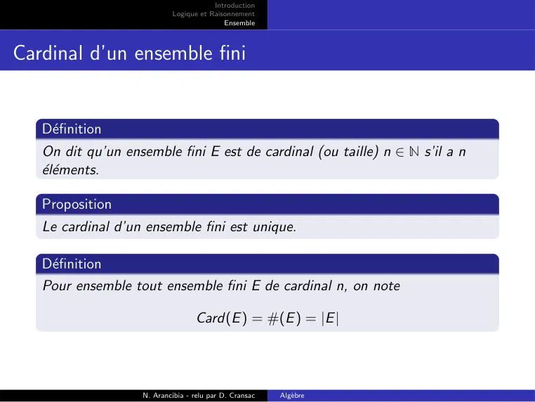

~~~text
                                       Introduction
                           Logique et Raisonnement
                                          Ensemble

Cardinal d’un ensemble fini

   Définition
   On dit qu’un ensemble fini E est de cardinal (ou taille) n ∈ N s’il a n
   éléments.

   Proposition
   Le cardinal d’un ensemble fini est unique.

   Définition
   Pour ensemble tout ensemble fini E de cardinal n, on note

                                  Card(E ) = #(E ) = |E |

                   N. Arancibia - relu par D. Cransac   Algèbre
~~~

## Page 37

~~~text
                                        Introduction
                            Logique et Raisonnement
                                           Ensemble

Cardinal d’un ensemble

   Proposition
   Pour deux ensembles A et B finis.
        A ⊂ B ⇒ card(A) ≤ card(B)                        6⇐
        A ⊂ B et card(A) = card(B) ⇔ A = B
        card(A ∪ B) + card(A ∩ B) = card(A) + card(B)

   Remarque : Cela revient aux formules

                 card(A ∪ B) = card(A) + card(B) − card(A ∩ B)
   ou

                 card(A ∩ B) = card(A) + card(B) − card(A ∪ B)

                    N. Arancibia - relu par D. Cransac   Algèbre
~~~

## Page 38

~~~text
                                       Introduction
                           Logique et Raisonnement
                                          Ensemble

Cardinal d’un ensemble fini

   Proposition
   Soit E un ensemble fini de cardinal n ∈ N.

                                        card(P(E )) = 2n

   Exemple

                                           A = {a, b, c, }

           P(A) = {∅, {a}, {b}, {c}, {a, b}, {a, c}, {b, c}, {a, b, c}}

   On a bien
                                        card(P(A)) = 23

                   N. Arancibia - relu par D. Cransac   Algèbre
~~~

## Page 39

~~~text
                                       Introduction
                           Logique et Raisonnement
                                          Ensemble

Cardinal d’un ensemble

   Proposition
   Soient E et F deux ensembles finis,

                         card(E × F ) = card(E ) × card(F )

                   N. Arancibia - relu par D. Cransac   Algèbre
~~~

## Page 40

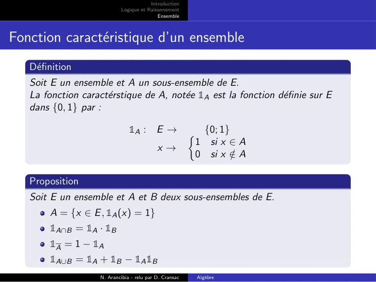

~~~text
                                        Introduction
                            Logique et Raisonnement
                                           Ensemble

Fonction caractéristique d’un ensemble
   Définition
   Soit E un ensemble et A un sous-ensemble de E.
   La fonction caractérstique de A, notée 1A est la fonction définie sur E
   dans {0, 1} par :

                                1A : E →  {0; 1}
                                          1 si x ∈ A
                                     x→
                                          0 si x ∈/A

   Proposition
   Soit E un ensemble et A et B deux sous-ensembles de E.
        A = {x ∈ E , 1A (x) = 1}
        1A∩B = 1A · 1B
        1A = 1 − 1A
        1A∪B = 1A + 1B − 1A 1B
                    N. Arancibia - relu par D. Cransac   Algèbre
~~~
