# CM4-Application_2021-2022_Algebre1_P1S1_NArancibia-DCransac.pdf

[Ouvrir l’original](https://drive.google.com/open?id=12MOkO5_Y24FzNyoa2mTNgqdISWkvm6Cr) · Les deux lectures automatiques du PDF divergent sur les pages indiquées. Leur fac-similé accompagne le texte.

**Pages présentant un écart entre les deux extractions** — 2–5, 7–8, 10–21, 23, 25–26, 28–31, 33–34.

## Page 1

~~~text
                                           Introduction
                              Logique et Raisonnement
                                              Ensemble
                                     Relations Binaires
                                           Applications

Algèbre-Premier semestre 2021

   1   Introduction

   2   Logique et Raisonnement

   3   Ensemble

   4   Relations Binaires

   5   Applications

                      N. Arancibia - relu par D. Cransac   Algèbre
~~~

## Page 2

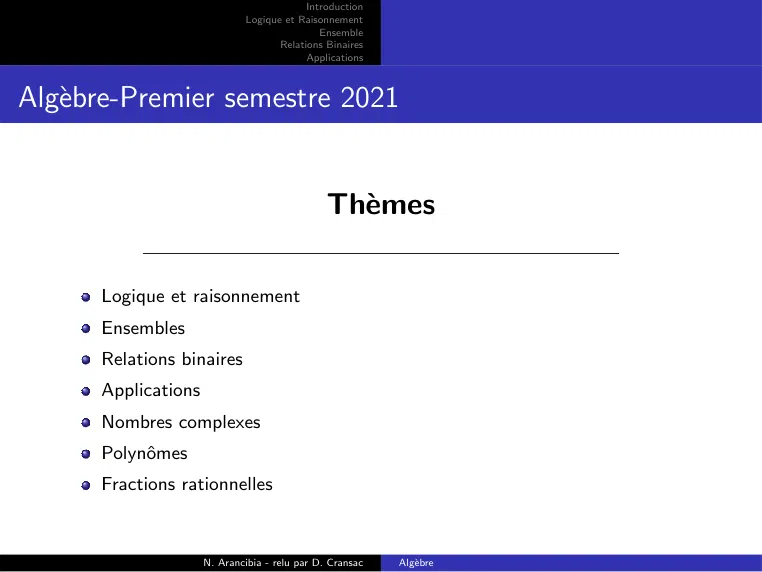

~~~text
                                          Introduction
                             Logique et Raisonnement
                                             Ensemble
                                    Relations Binaires
                                          Applications

Algèbre-Premier semestre 2021

                                               Thèmes

      Logique et raisonnement
      Ensembles
      Relations binaires
      Applications
      Nombres complexes
      Polynômes
      Fractions rationnelles

                     N. Arancibia - relu par D. Cransac   Algèbre
~~~

## Page 3

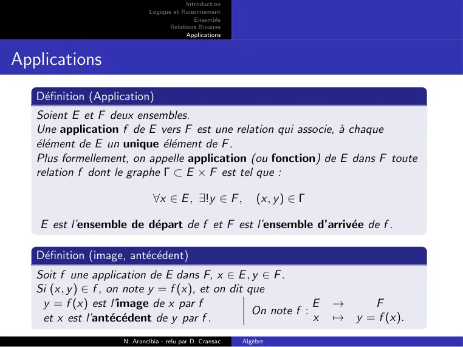

~~~text
                                          Introduction
                             Logique et Raisonnement
                                             Ensemble
                                    Relations Binaires
                                          Applications

Applications
   Définition (Application)
   Soient E et F deux ensembles.
   Une application f de E vers F est une relation qui associe, à chaque
   élément de E un unique élément de F .
   Plus formellement, on appelle application (ou fonction) de E dans F toute
   relation f dont le graphe Γ ⊂ E × F est tel que :

                               ∀x ∈ E , ∃!y ∈ F ,              (x, y ) ∈ Γ

   E est l’ensemble de départ de f et F est l’ensemble d’arrivée de f .

   Définition (image, antécédent)
   Soit f une application de E dans F, x ∈ E , y ∈ F .
   Si (x, y ) ∈ f , on note y = f (x), et on dit que
    y = f (x) est l’image de x par f                          E              →       F
                                                  On note f :
    et x est l’antécédent de y par f .                      x              7→   y = f (x).
                     N. Arancibia - relu par D. Cransac   Algèbre
~~~

## Page 4

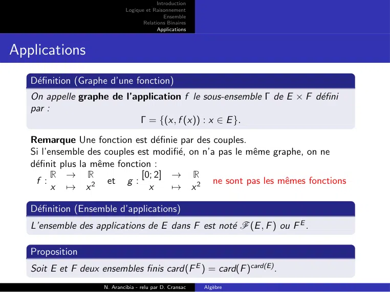

~~~text
                                          Introduction
                             Logique et Raisonnement
                                             Ensemble
                                    Relations Binaires
                                          Applications

Applications
   Définition (Graphe d’une fonction)
   On appelle graphe de l’application f le sous-ensemble Γ de E × F défini
   par :
                            Γ = {(x, f (x)) : x ∈ E }.

   Remarque Une fonction est définie par des couples.
   Si l’ensemble des couples est modifié, on n’a pas le même graphe, on ne
   définit plus la même fonction :
         R → R                  [0; 2] → R
    f :                 et g :                   ne sont pas les mêmes fonctions
         x 7→ x 2                 x    7→ x 2

   Définition (Ensemble d’applications)
   L’ensemble des applications de E dans F est noté F (E , F ) ou F E .

   Proposition
   Soit E et F deux ensembles finis card(F E ) = card(F )card(E) .
                     N. Arancibia - relu par D. Cransac   Algèbre
~~~

## Page 5

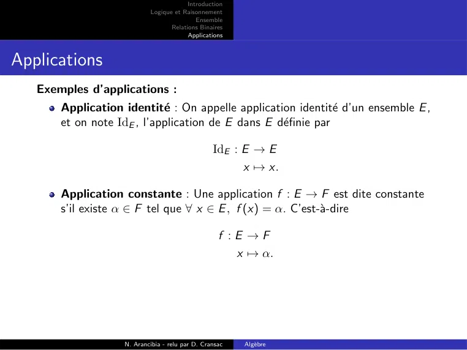

~~~text
                                        Introduction
                           Logique et Raisonnement
                                           Ensemble
                                  Relations Binaires
                                        Applications

Applications
   Exemples d’applications :
       Application identité : On appelle application identité d’un ensemble E ,
       et on note IdE , l’application de E dans E définie par

                                                 IdE : E → E
                                                         x 7→ x.

       Application constante : Une application f : E → F est dite constante
       s’il existe α ∈ F tel que ∀ x ∈ E , f (x) = α. C’est-à-dire

                                                   f :E →F
                                                        x 7→ α.

                   N. Arancibia - relu par D. Cransac    Algèbre
~~~

## Page 6

~~~text
                                         Introduction
                            Logique et Raisonnement
                                            Ensemble
                                   Relations Binaires
                                         Applications

Applications
   Exemples d’applications (suite) :

   Définition (Fonction indicatrice d’une partie d’un ensemble)
   Soit E un ensemble et A une partie de E .
   On appelle fonction indicatrice de A et on note 1A la fonction de E dans
   {0, 1} définie par :

                           f : E → {0, 1}
                                                         
                                                             1      si x ∈ A,
                                 x 7→ 1A (x) =
                                                             0      si x ∈
                                                                         / A.

                    N. Arancibia - relu par D. Cransac   Algèbre
~~~

## Page 7

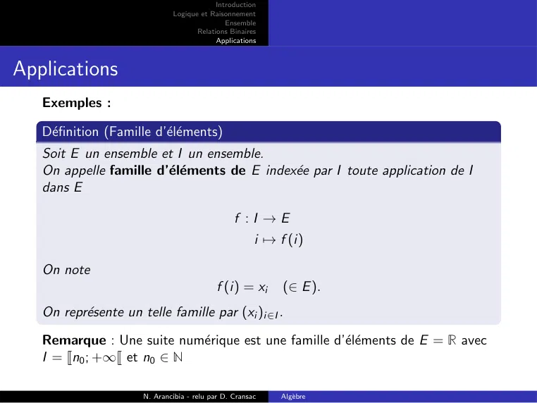

~~~text
                                           Introduction
                              Logique et Raisonnement
                                              Ensemble
                                     Relations Binaires
                                           Applications

Applications
   Exemples :

   Définition (Famille d’éléments)
   Soit E un ensemble et I un ensemble.
   On appelle famille d’éléments de E indexée par I toute application de I
   dans E

                                                 f :I →E
                                                       i 7→ f (i)

   On note
                                            f (i) = xi      (∈ E ).
   On représente un telle famille par (xi )i∈I .

   Remarque : Une suite numérique est une famille d’éléments de E = R avec
   I = Jn0 ; +∞J et n0 ∈ N

                      N. Arancibia - relu par D. Cransac    Algèbre
~~~

## Page 8

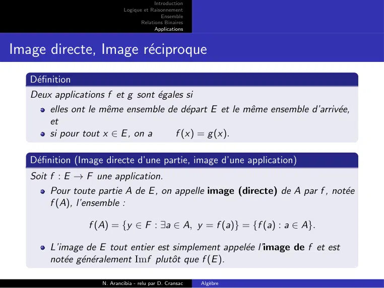

~~~text
                                         Introduction
                            Logique et Raisonnement
                                            Ensemble
                                   Relations Binaires
                                         Applications

Image directe, Image réciproque
   Définition
   Deux applications f et g sont égales si
       elles ont le même ensemble de départ E et le même ensemble d’arrivée,
       et
       si pour tout x ∈ E , on a     f (x) = g (x).

   Définition (Image directe d’une partie, image d’une application)
   Soit f : E → F une application.
       Pour toute partie A de E , on appelle image (directe) de A par f , notée
       f (A), l’ensemble :

                 f (A) = {y ∈ F : ∃a ∈ A, y = f (a)} = {f (a) : a ∈ A}.

       L’image de E tout entier est simplement appelée l’image de f et est
       notée généralement Imf plutôt que f (E ).

                    N. Arancibia - relu par D. Cransac   Algèbre
~~~

## Page 9

~~~text
                                        Introduction
                           Logique et Raisonnement
                                           Ensemble
                                  Relations Binaires
                                        Applications

Image directe, Image réciproque
   Exemple :
      L’image de R par la fonction x 7→ x 2 est R+ .
      L’image de [0, 3[ par cette même fonction est [0, 9[.
      L’image de

                      πZ = {· · · , −2π , −π , 0 , π , 2π , · · · }

      par la fonction
                                                    x 7→ sin x
      est le singleton {0}.
      L’image de [0, π] est [0, 1].
      et l’image de [−π/2, π/2] est [−1, 1].

                   N. Arancibia - relu par D. Cransac   Algèbre
~~~

## Page 10

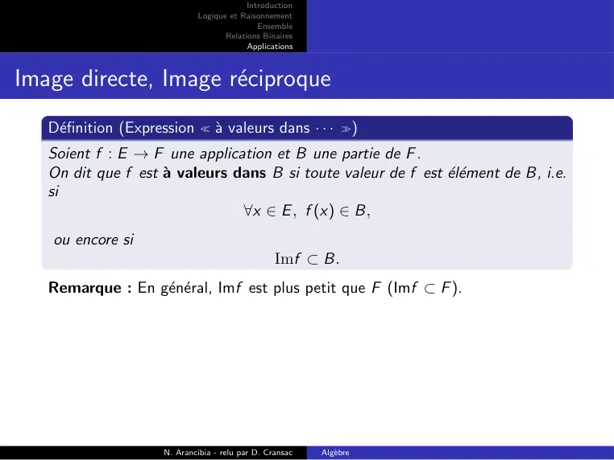

~~~text
                                          Introduction
                             Logique et Raisonnement
                                             Ensemble
                                    Relations Binaires
                                          Applications

Image directe, Image réciproque
   Définition (Expression  à valeurs dans · · · )
   Soient f : E → F une application et B une partie de F .
   On dit que f est à valeurs dans B si toute valeur de f est élément de B, i.e.
   si
                                ∀x ∈ E , f (x) ∈ B,
   ou encore si
                                                  Imf ⊂ B.
   Remarque : En général, Imf est plus petit que F (Imf ⊂ F ).

                     N. Arancibia - relu par D. Cransac   Algèbre
~~~

## Page 11

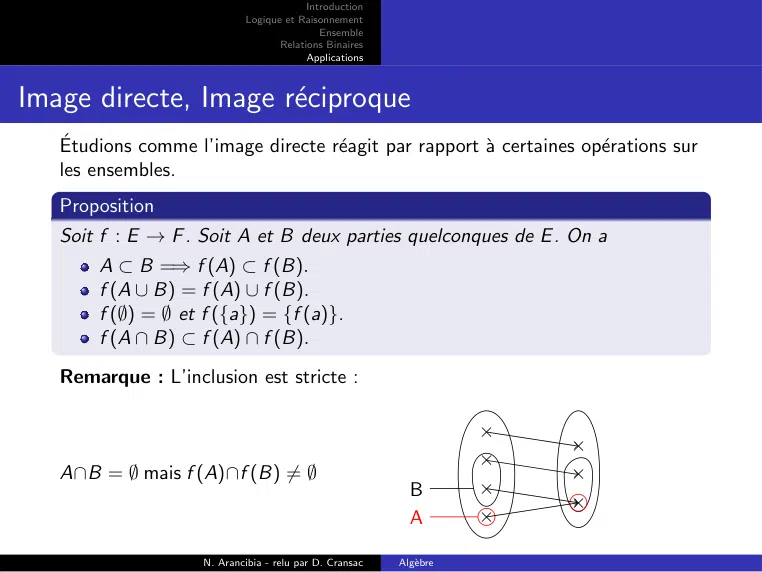

~~~text
                                          Introduction
                             Logique et Raisonnement
                                             Ensemble
                                    Relations Binaires
                                          Applications

Image directe, Image réciproque
   Étudions comme l’image directe réagit par rapport à certaines opérations sur
   les ensembles.
   Proposition
   Soit f : E → F . Soit A et B deux parties quelconques de E . On a
       A ⊂ B =⇒ f (A) ⊂ f (B).
       f (A ∪ B) = f (A) ∪ f (B).
       f (∅) = ∅ et f ({a}) = {f (a)}.
       f (A ∩ B) ⊂ f (A) ∩ f (B).

   Remarque : L’inclusion est stricte :

                                                                     ×
                                                                         ×
                                                                     ×
   A∩B = ∅ mais f (A)∩f (B) 6= ∅                                         ×
                                                            B        ×
                                                                         ×
                                                            A        ×

                     N. Arancibia - relu par D. Cransac   Algèbre
~~~

## Page 12

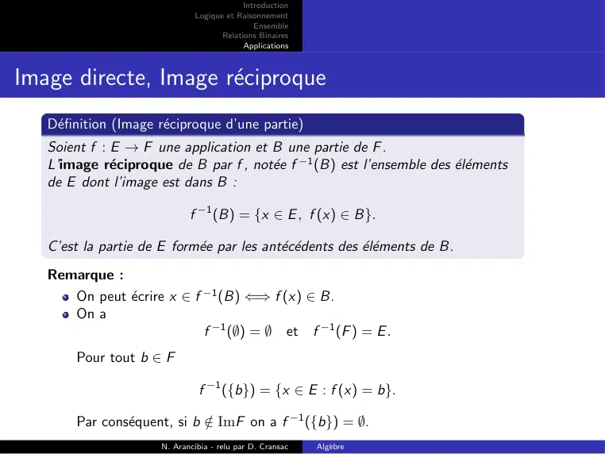

~~~text
                                           Introduction
                              Logique et Raisonnement
                                              Ensemble
                                     Relations Binaires
                                           Applications

Image directe, Image réciproque
   Définition (Image réciproque d’une partie)
   Soient f : E → F une application et B une partie de F .
   L’image réciproque de B par f , notée f −1 (B) est l’ensemble des éléments
   de E dont l’image est dans B :

                             f −1 (B) = {x ∈ E , f (x) ∈ B}.

   C’est la partie de E formée par les antécédents des éléments de B.
   Remarque :
        On peut écrire x ∈ f −1 (B) ⇐⇒ f (x) ∈ B.
        On a
                              f −1 (∅) = ∅ et f −1 (F ) = E .
        Pour tout b ∈ F

                               f −1 ({b}) = {x ∈ E : f (x) = b}.

                              / ImF on a f −1 ({b}) = ∅.
        Par conséquent, si b ∈
                      N. Arancibia - relu par D. Cransac   Algèbre
~~~

## Page 13

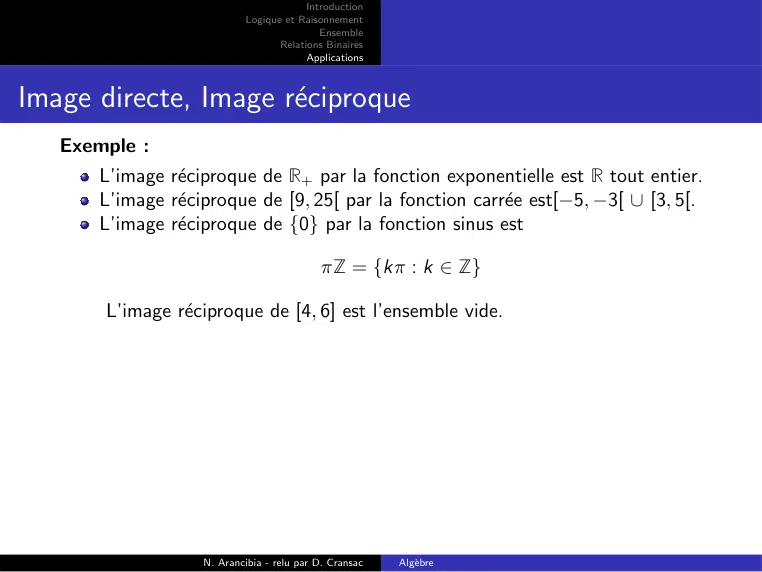

~~~text
                                        Introduction
                           Logique et Raisonnement
                                           Ensemble
                                  Relations Binaires
                                        Applications

Image directe, Image réciproque
   Exemple :
      L’image réciproque de R+ par la fonction exponentielle est R tout entier.
      L’image réciproque de [9, 25[ par la fonction carrée est[−5, −3[ ∪ [3, 5[.
      L’image réciproque de {0} par la fonction sinus est

                                            πZ = {kπ : k ∈ Z}

       L’image réciproque de [4, 6] est l’ensemble vide.

                   N. Arancibia - relu par D. Cransac   Algèbre
~~~

## Page 14

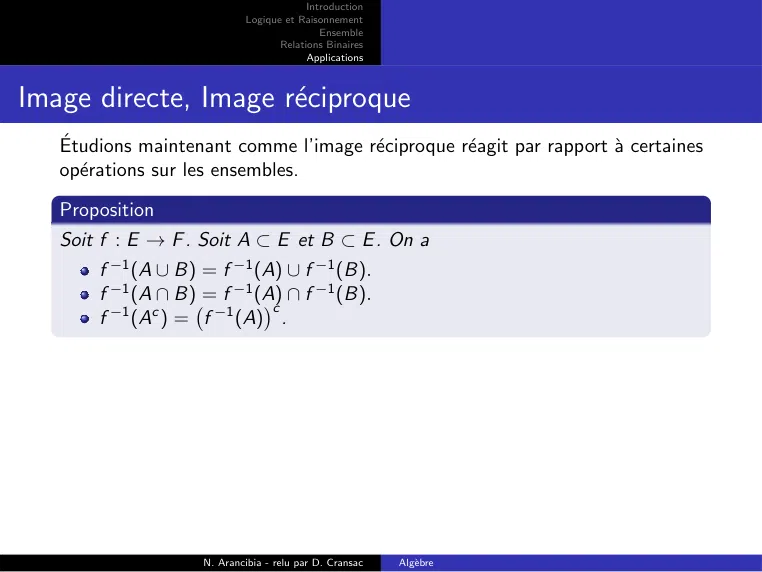

~~~text
                                         Introduction
                            Logique et Raisonnement
                                            Ensemble
                                   Relations Binaires
                                         Applications

Image directe, Image réciproque
   Étudions maintenant comme l’image réciproque réagit par rapport à certaines
   opérations sur les ensembles.
   Proposition
   Soit f : E → F . Soit A ⊂ E et B ⊂ E . On a
       f −1 (A ∪ B) = f −1 (A) ∪ f −1 (B).
       f −1 (A ∩ B) = f −1 (A)     −1
                            c ∩ f (B).
         −1   c      −1
       f (A ) = f (A) .

                    N. Arancibia - relu par D. Cransac   Algèbre
~~~

## Page 15

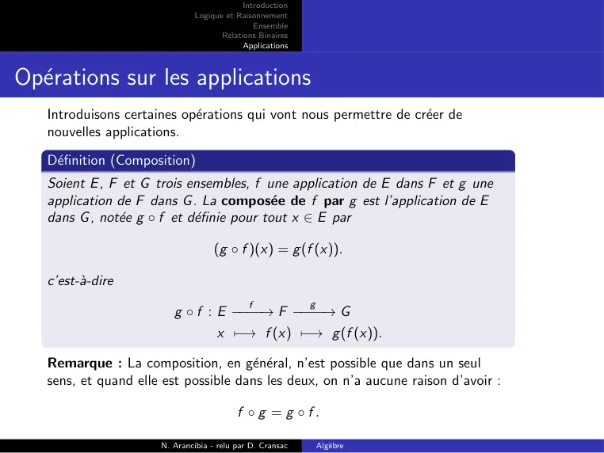

~~~text
                                           Introduction
                              Logique et Raisonnement
                                              Ensemble
                                     Relations Binaires
                                           Applications

Opérations sur les applications
   Introduisons certaines opérations qui vont nous permettre de créer de
   nouvelles applications.

   Définition (Composition)
   Soient E , F et G trois ensembles, f une application de E dans F et g une
   application de F dans G . La composée de f par g est l’application de E
   dans G , notée g ◦ f et définie pour tout x ∈ E par

                                    (g ◦ f )(x) = g (f (x)).

   c’est-à-dire
                                             f             g
                         g ◦ f : E −−−−→ F −−−−→ G
                                    x 7−→ f (x) 7−→ g (f (x)).

   Remarque : La composition, en général, n’est possible que dans un seul
   sens, et quand elle est possible dans les deux, on n’a aucune raison d’avoir :

                                          f ◦g =g ◦f.

                      N. Arancibia - relu par D. Cransac       Algèbre
~~~

## Page 16

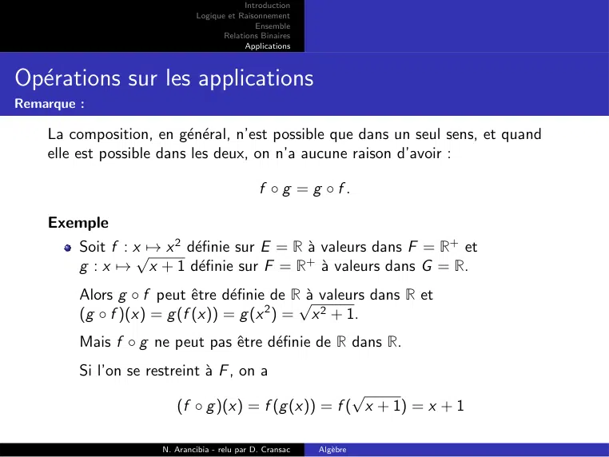

~~~text
                                            Introduction
                               Logique et Raisonnement
                                               Ensemble
                                      Relations Binaires
                                            Applications

Opérations sur les applications
Remarque :

    La composition, en général, n’est possible que dans un seul sens, et quand
    elle est possible dans les deux, on n’a aucune raison d’avoir :

                                                f ◦g =g ◦f.

    Exemple
         Soit f : x√7→ x 2 définie sur E = R à valeurs dans F = R+ et
         g : x 7→ x + 1 définie sur F = R+ à valeurs dans G = R.
         Alors g ◦ f peut être définie de R√à valeurs dans R et
         (g ◦ f )(x) = g (f (x)) = g (x 2 ) = x 2 + 1.
         Mais f ◦ g ne peut pas être définie de R dans R.
         Si l’on se restreint à F , on a
                                                       √
                          (f ◦ g )(x) = f (g (x)) = f ( x + 1) = x + 1

                       N. Arancibia - relu par D. Cransac   Algèbre
~~~

## Page 17

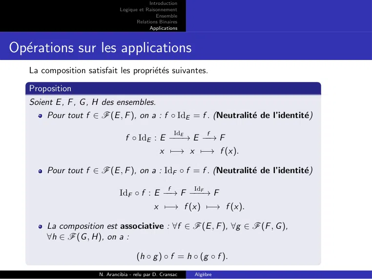

~~~text
                                            Introduction
                               Logique et Raisonnement
                                               Ensemble
                                      Relations Binaires
                                            Applications

Opérations sur les applications
   La composition satisfait les propriétés suivantes.
   Proposition
   Soient E , F , G , H des ensembles.
        Pour tout f ∈ F (E , F ), on a : f ◦ IdE = f . (Neutralité de l’identité)
                                                        Id        f
                                  f ◦ IdE : E −−−E→ E −−→ F
                                                 x 7−→ x 7−→ f (x).

        Pour tout f ∈ F (E , F ), on a : IdF ◦ f = f . (Neutralité de l’identité)
                                                    f        Id
                               IdF ◦ f : E −−→ F −−−F→ F
                                              x 7−→ f (x) 7−→ f (x).

        La composition est associative : ∀f ∈ F (E , F ), ∀g ∈ F (F , G ),
        ∀h ∈ F (G , H), on a :

                                       (h ◦ g ) ◦ f = h ◦ (g ◦ f ).
                       N. Arancibia - relu par D. Cransac    Algèbre
~~~

## Page 18

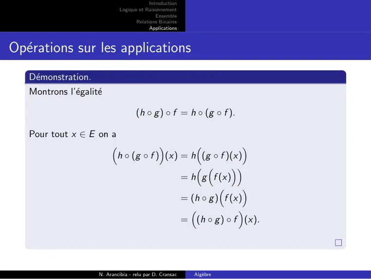

~~~text
                                           Introduction
                              Logique et Raisonnement
                                              Ensemble
                                     Relations Binaires
                                           Applications

Opérations sur les applications
   Démonstration.
   Montrons l’égalité

                                      (h ◦ g ) ◦ f = h ◦ (g ◦ f ).

   Pour tout x ∈ E on a
                                                           
                             h ◦ (g ◦ f ) (x) = h (g ◦ f )(x)
                                                          
                                              = h g f (x)
                                                             
                                              = (h ◦ g ) f (x)
                                                            
                                              = (h ◦ g ) ◦ f (x).

                      N. Arancibia - relu par D. Cransac   Algèbre
~~~

## Page 19

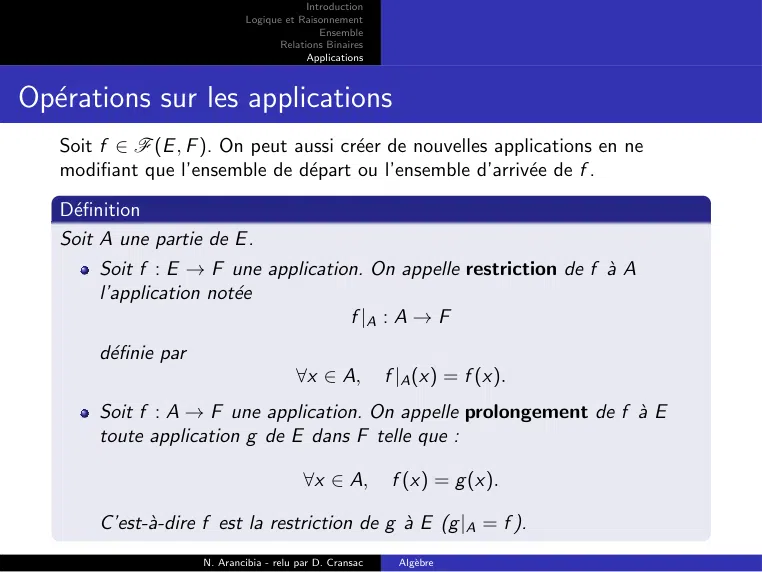

~~~text
                                           Introduction
                              Logique et Raisonnement
                                              Ensemble
                                     Relations Binaires
                                           Applications

Opérations sur les applications
   Soit f ∈ F (E , F ). On peut aussi créer de nouvelles applications en ne
   modifiant que l’ensemble de départ ou l’ensemble d’arrivée de f .
   Définition
   Soit A une partie de E .
       Soit f : E → F une application. On appelle restriction de f à A
       l’application notée
                                    f |A : A → F
       définie par
                                         ∀x ∈ A,           f |A (x) = f (x).
       Soit f : A → F une application. On appelle prolongement de f à E
       toute application g de E dans F telle que :

                                           ∀x ∈ A,          f (x) = g (x).

       C’est-à-dire f est la restriction de g à E (g |A = f ).
                      N. Arancibia - relu par D. Cransac     Algèbre
~~~

## Page 20

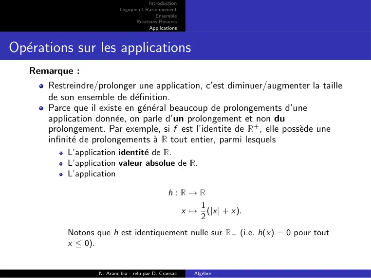

~~~text
                                       Introduction
                          Logique et Raisonnement
                                          Ensemble
                                 Relations Binaires
                                       Applications

Opérations sur les applications
   Remarque :
      Restreindre/prolonger une application, c’est diminuer/augmenter la taille
      de son ensemble de définition.
      Parce que il existe en général beaucoup de prolongements d’une
      application donnée, on parle d’un prolongement et non du
      prolongement. Par exemple, si f est l’identite de R+ , elle possède une
      infinité de prolongements à R tout entier, parmi lesquels
          L’application identité de R.
          L’application valeur absolue de R.
          L’application

                                                h:R→R
                                                      1
                                                  x 7→ (|x| + x).
                                                      2
          Notons que h est identiquement nulle sur R− (i.e. h(x) = 0 pour tout
          x ≤ 0).

                  N. Arancibia - relu par D. Cransac   Algèbre
~~~

## Page 21

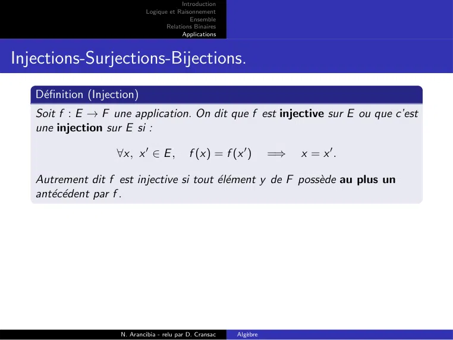

~~~text
                                           Introduction
                              Logique et Raisonnement
                                              Ensemble
                                     Relations Binaires
                                           Applications

Injections-Surjections-Bijections.
   Définition (Injection)
   Soit f : E → F une application. On dit que f est injective sur E ou que c’est
   une injection sur E si :

                     ∀x, x 0 ∈ E ,            f (x) = f (x 0 )        =⇒   x = x 0.

   Autrement dit f est injective si tout élément y de F possède au plus un
   antécédent par f .

                      N. Arancibia - relu par D. Cransac   Algèbre
~~~

## Page 22

~~~text
                                         Introduction
                            Logique et Raisonnement
                                            Ensemble
                                   Relations Binaires
                                         Applications

Injections-Surjections-Bijections.
   Exemples :
       La application identité sur un ensemble E , est injective.
       Soit a ∈ R∗ . Alors toute application affine sur R de la forme :

                                                 f (x) = ax + b

        est injective.
       L’application f : R → R définie par

                                                     f (x) = x 3

       est injective.
       L’application exponentielle f (x) = e x , x ∈ R, est injective.

                    N. Arancibia - relu par D. Cransac    Algèbre
~~~

## Page 23

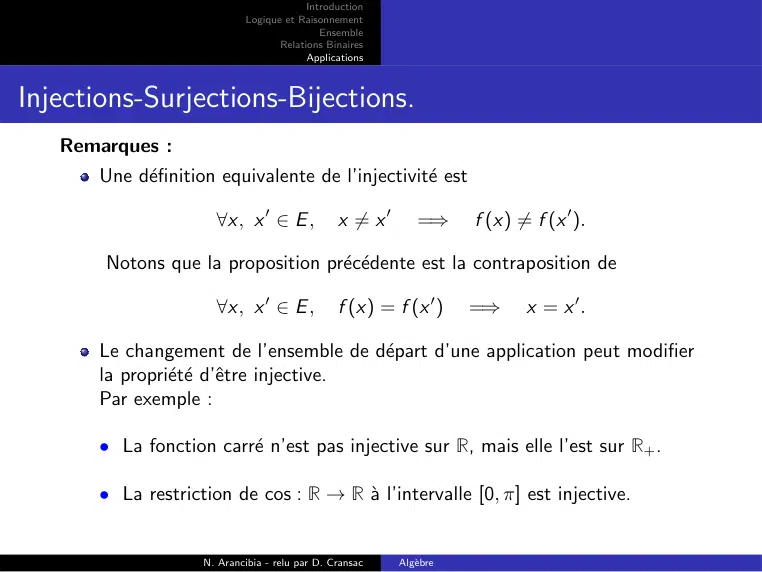

~~~text
                                        Introduction
                           Logique et Raisonnement
                                           Ensemble
                                  Relations Binaires
                                        Applications

Injections-Surjections-Bijections.
   Remarques :
      Une définition equivalente de l’injectivité est

                     ∀x, x 0 ∈ E ,             x 6= x 0       =⇒     f (x) 6= f (x 0 ).

       Notons que la proposition précédente est la contraposition de

                     ∀x, x 0 ∈ E ,             f (x) = f (x 0 )      =⇒      x = x 0.

      Le changement de l’ensemble de départ d’une application peut modifier
      la propriété d’être injective.
      Par exemple :

      • La fonction carré n’est pas injective sur R, mais elle l’est sur R+ .

      • La restriction de cos : R → R à l’intervalle [0, π] est injective.

                   N. Arancibia - relu par D. Cransac     Algèbre
~~~

## Page 24

~~~text
                                                 Introduction
                                    Logique et Raisonnement
                                                    Ensemble
                                           Relations Binaires
                                                 Applications

Injections-Surjections-Bijections.
   Étudions certaines propriétés des fonctions injectives.
   Proposition
   On considère deux applications f : E → F et g : F → G .
       Si f et g sont injectives, alors g ◦ f est injective.
       Si g ◦ f est injective, alors f est injective.

   Démonstration.
        Soient x, y ∈ E . Supposons g ◦ f (x) = g ◦ f (y ). Nous voulons montrer
        que : x = y . Or
                     g (f (x)) = g (f (y ))      =⇒
                                                 |{z}        f (x) = f (y )       =⇒
                                                                                  |{z}        x = y.
                                               g injective                      f injective

        Soient x, y ∈ E . Supposons f (x) = f (y ). Nous voulons montrer que :
        x = y . Or
                   f (x) = f (y )      =⇒        g ◦ f (x) = g ◦ f (y )            =⇒
                                                                                   |{z}       x = y.
                                                                                g ◦f injective

                          N. Arancibia - relu par D. Cransac         Algèbre
~~~

## Page 25

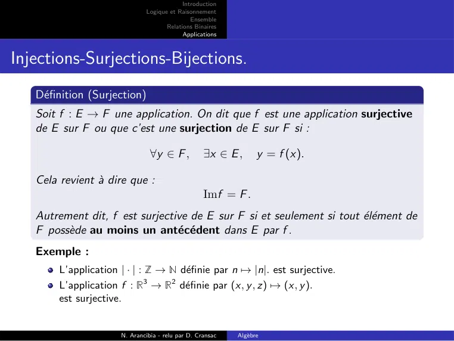

~~~text
                                           Introduction
                              Logique et Raisonnement
                                              Ensemble
                                     Relations Binaires
                                           Applications

Injections-Surjections-Bijections.
   Définition (Surjection)
   Soit f : E → F une application. On dit que f est une application surjective
   de E sur F ou que c’est une surjection de E sur F si :

                                ∀y ∈ F ,           ∃x ∈ E ,       y = f (x).

   Cela revient à dire que :
                                                   Imf = F .
   Autrement dit, f est surjective de E sur F si et seulement si tout élément de
   F possède au moins un antécédent dans E par f .
   Exemple :
        L’application | · | : Z → N définie par n 7→ |n|. est surjective.
        L’application f : R3 → R2 définie par (x, y , z) 7→ (x, y ).
        est surjective.

                      N. Arancibia - relu par D. Cransac   Algèbre
~~~

## Page 26

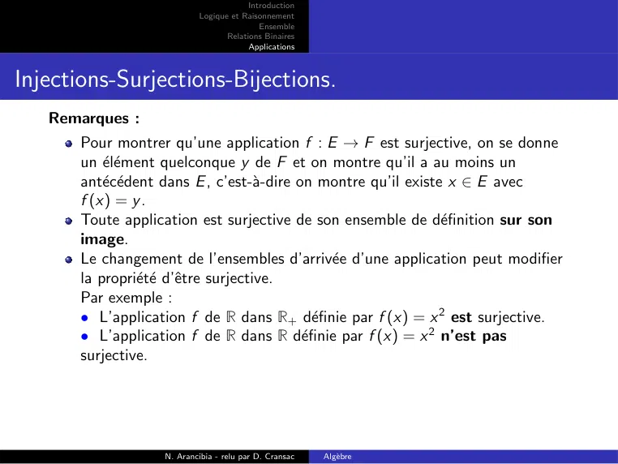

~~~text
                                       Introduction
                          Logique et Raisonnement
                                          Ensemble
                                 Relations Binaires
                                       Applications

Injections-Surjections-Bijections.
   Remarques :
      Pour montrer qu’une application f : E → F est surjective, on se donne
      un élément quelconque y de F et on montre qu’il a au moins un
      antécédent dans E , c’est-à-dire on montre qu’il existe x ∈ E avec
      f (x) = y .
      Toute application est surjective de son ensemble de définition sur son
      image.
      Le changement de l’ensembles d’arrivée d’une application peut modifier
      la propriété d’être surjective.
      Par exemple :
      • L’application f de R dans R+ définie par f (x) = x 2 est surjective.
      • L’application f de R dans R définie par f (x) = x 2 n’est pas
      surjective.

                  N. Arancibia - relu par D. Cransac   Algèbre
~~~

## Page 27

~~~text
                                                 Introduction
                                    Logique et Raisonnement
                                                    Ensemble
                                           Relations Binaires
                                                 Applications

Injections-Surjections-Bijections.
   Étudions certaines propriétés des fonctions surjectives.
   Proposition
   On considère deux applications f : E → F et g : F → G .
        Si f et g sont surjectives, alors g ◦ f est surjective.
        Si g ◦ f est surjective, alors g est surjective.

   Démonstration.
       Montrons que g ◦ f est surjective. Soit y ∈ G . Nous voulons montrer
       qu’il existe x ∈ E tel que y = g ◦ f (x). Or g est surjective, donc il exist
       t ∈ F tel que y = g (t). Mais f est aussi surjective, donc : t = f (x)
       pour un certain x ∈ E . Finalement, comme voulu :

                              y = g (t) = g (f (x)) = g ◦ f (x).

        Montrons que g est surjective. Soit y ∈ G . Nous voulons montrer qu’il
        existe x ∈ F tel que y = g (x). Or g ◦ f est surjective, donc :
        y = g ◦ f (t) pour un certain t ∈ E . Il suffit dès lors de poser :

                               x = f (t) pour avoir y = g (x).

                            N. Arancibia - relu par D. Cransac   Algèbre
~~~

## Page 28

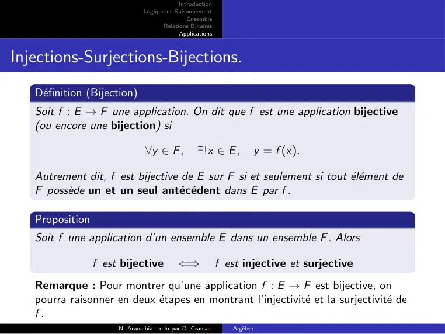

~~~text
                                           Introduction
                              Logique et Raisonnement
                                              Ensemble
                                     Relations Binaires
                                           Applications

Injections-Surjections-Bijections.
   Définition (Bijection)
   Soit f : E → F une application. On dit que f est une application bijective
   (ou encore une bijection) si

                               ∀y ∈ F ,           ∃!x ∈ E ,              y = f (x).

   Autrement dit, f est bijective de E sur F si et seulement si tout élément de
   F possède un et un seul antécédent dans E par f .

   Proposition
   Soit f une application d’un ensemble E dans un ensemble F . Alors

                 f est bijective           ⇐⇒              f est injective et surjective
   Remarque : Pour montrer qu’une application f : E → F est bijective, on
   pourra raisonner en deux étapes en montrant l’injectivité et la surjectivité de
   f.
                      N. Arancibia - relu par D. Cransac      Algèbre
~~~

## Page 29

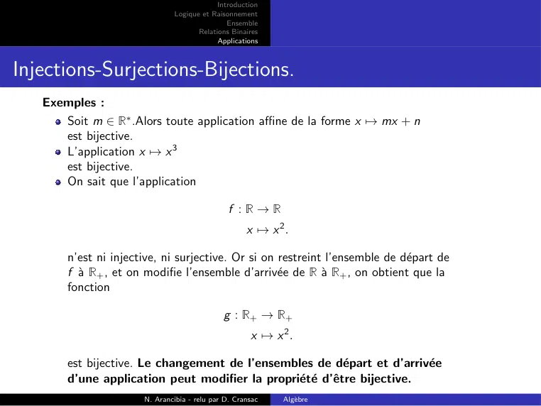

~~~text
                                           Introduction
                              Logique et Raisonnement
                                              Ensemble
                                     Relations Binaires
                                           Applications

Injections-Surjections-Bijections.
   Exemples :
       Soit m ∈ R∗ .Alors toute application affine de la forme x 7→ mx + n
       est bijective.
       L’application x 7→ x 3
       est bijective.
       On sait que l’application

                                               f :R→R
                                                    x 7→ x 2 .

       n’est ni injective, ni surjective. Or si on restreint l’ensemble de départ de
       f à R+ , et on modifie l’ensemble d’arrivée de R à R+ , on obtient que la
       fonction

                                             g : R+ → R+
                                                     x 7→ x 2 .

       est bijective. Le changement de l’ensembles de départ et d’arrivée
       d’une application peut modifier la propriété d’être bijective.
                      N. Arancibia - relu par D. Cransac    Algèbre
~~~

## Page 30

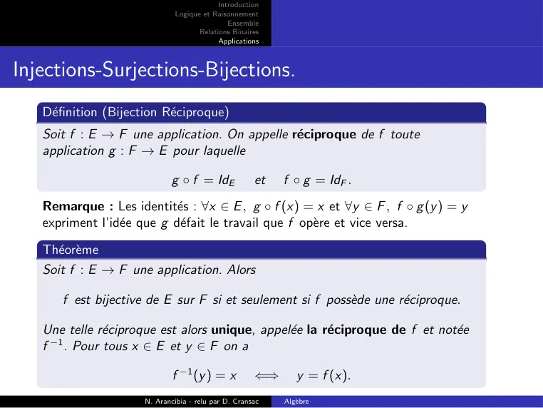

~~~text
                                           Introduction
                              Logique et Raisonnement
                                              Ensemble
                                     Relations Binaires
                                           Applications

Injections-Surjections-Bijections.
   Définition (Bijection Réciproque)
   Soit f : E → F une application. On appelle réciproque de f toute
   application g : F → E pour laquelle

                             g ◦ f = IdE              et   f ◦ g = IdF .
   Remarque : Les identités : ∀x ∈ E , g ◦ f (x) = x et ∀y ∈ F , f ◦ g (y ) = y
   expriment l’idée que g défait le travail que f opère et vice versa.
   Théorème
   Soit f : E → F une application. Alors

      f est bijective de E sur F si et seulement si f possède une réciproque.

   Une telle réciproque est alors unique, appelée la réciproque de f et notée
   f −1 . Pour tous x ∈ E et y ∈ F on a

                              f −1 (y ) = x           ⇐⇒      y = f (x).
                      N. Arancibia - relu par D. Cransac   Algèbre
~~~

## Page 31

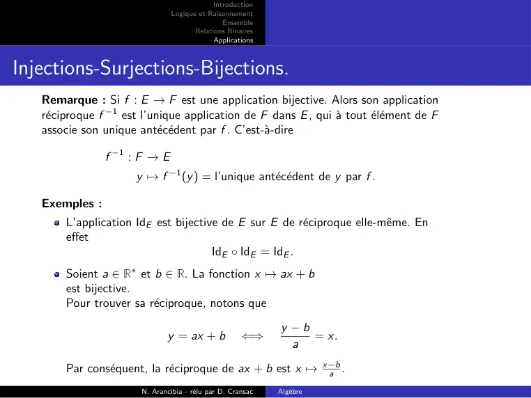

~~~text
                                            Introduction
                               Logique et Raisonnement
                                               Ensemble
                                      Relations Binaires
                                            Applications

Injections-Surjections-Bijections.
   Remarque : Si f : E → F est une application bijective. Alors son application
   réciproque f −1 est l’unique application de F dans E , qui à tout élément de F
   associe son unique antécédent par f . C’est-à-dire

                f −1 : F → E
                      y 7→ f −1 (y ) = l’unique antécédent de y par f .

   Exemples :
        L’application IdE est bijective de E sur E de réciproque elle-même. En
        effet
                                      IdE ◦ IdE = IdE .
        Soient a ∈ R∗ et b ∈ R. La fonction x 7→ ax + b
        est bijective.
        Pour trouver sa réciproque, notons que
                                                            y −b
                              y = ax + b             ⇐⇒          = x.
                                                              a
        Par conséquent, la réciproque de ax + b est x 7→ x−b
                                                            a .

                       N. Arancibia - relu par D. Cransac   Algèbre
~~~

## Page 32

~~~text
                                          Introduction
                             Logique et Raisonnement
                                             Ensemble
                                    Relations Binaires
                                          Applications

Injections-Surjections-Bijections.
   Étudions certaines propriétés des fonctions bijectives.
   Proposition
   On considère deux applications f : E → F et g : F → G .
        Si g ◦ f est bijective, alors f est injective et g est surjective.
        Si f et g sont bijectives, alors g ◦ f est bijective et on a

                                          (g ◦ f )−1 = f −1 ◦ g −1 .

        Si f est une bijection de E dans F , alors sa bijection réciproque f −1 est
        aussi bijective et :
                                      (f −1 )−1 = f .

                     N. Arancibia - relu par D. Cransac   Algèbre
~~~

## Page 33

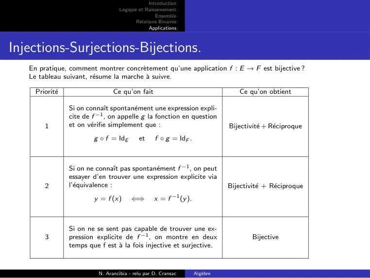

~~~text
                                                Introduction
                                   Logique et Raisonnement
                                                   Ensemble
                                          Relations Binaires
                                                Applications

Injections-Surjections-Bijections.
   En pratique, comment montrer concrètement qu’une application f : E → F est bijective ?
   Le tableau suivant, résume la marche à suivre.

     Priorité                   Ce qu’on fait                                     Ce qu’on obtient

                 Si on connaı̂t spontanément une expression expli-
                 cite de f −1 , on appelle g la fonction en question
        1        et on vérifie simplement que :                               Bijectivité + Réciproque
                         g ◦ f = IdE        et     f ◦ g = IdF .

                 Si on ne connaı̂t pas spontanément f −1 , on peut
                 essayer d’en trouver une expression explicite via
        2        l’équivalence :                                              Bijectivité + Réciproque
                         y = f (x)       ⇐⇒        x = f −1 (y ).

                 Si on ne se sent pas capable de trouver une ex-
        3        pression explicite de f −1 , on montre en deux                        Bijective
                 temps que f est à la fois injective et surjective.

                           N. Arancibia - relu par D. Cransac       Algèbre
~~~

## Page 34

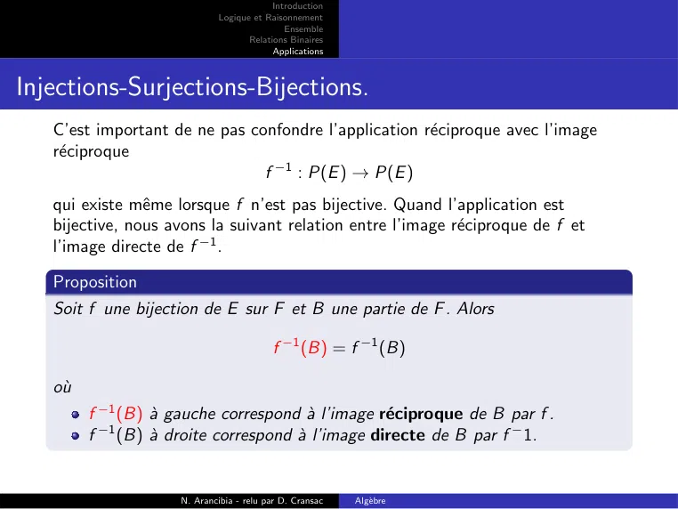

~~~text
                                          Introduction
                             Logique et Raisonnement
                                             Ensemble
                                    Relations Binaires
                                          Applications

Injections-Surjections-Bijections.
   C’est important de ne pas confondre l’application réciproque avec l’image
   réciproque
                               f −1 : P(E ) → P(E )
   qui existe même lorsque f n’est pas bijective. Quand l’application est
   bijective, nous avons la suivant relation entre l’image réciproque de f et
   l’image directe de f −1 .
   Proposition
   Soit f une bijection de E sur F et B une partie de F . Alors

                                          f −1 (B) = f −1 (B)

   où
         f −1 (B) à gauche correspond à l’image réciproque de B par f .
         f −1 (B) à droite correspond à l’image directe de B par f − 1.

                     N. Arancibia - relu par D. Cransac   Algèbre
~~~
