# CM5-Complexes_2021-2022_Algebre1_P1S1_NArancibia-DCransac.pdf

[Ouvrir l’original](https://drive.google.com/open?id=1vJxgTC3kAnb_G74crYsyt2wNAuJ2mo3X) · Les deux lectures automatiques du PDF divergent sur les pages indiquées. Leur fac-similé accompagne le texte.

**Pages présentant un écart entre les deux extractions** — 2–23, 25–32, 34–63.

## Page 1

~~~text
                                          Applications
                                    Nombres Complexes

Algèbre-Premier semestre 2021

   1   Applications

   2   Nombres Complexes

                      N. Arancibia - relu par D. Cransac   Algèbre
~~~

## Page 2

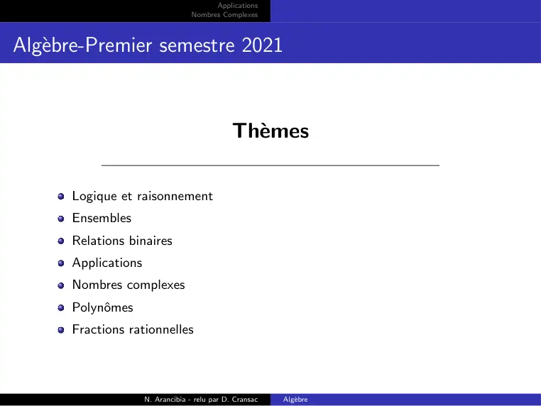

~~~text
                                         Applications
                                   Nombres Complexes

Algèbre-Premier semestre 2021

                                               Thèmes

      Logique et raisonnement
      Ensembles
      Relations binaires
      Applications
      Nombres complexes
      Polynômes
      Fractions rationnelles

                     N. Arancibia - relu par D. Cransac   Algèbre
~~~

## Page 3

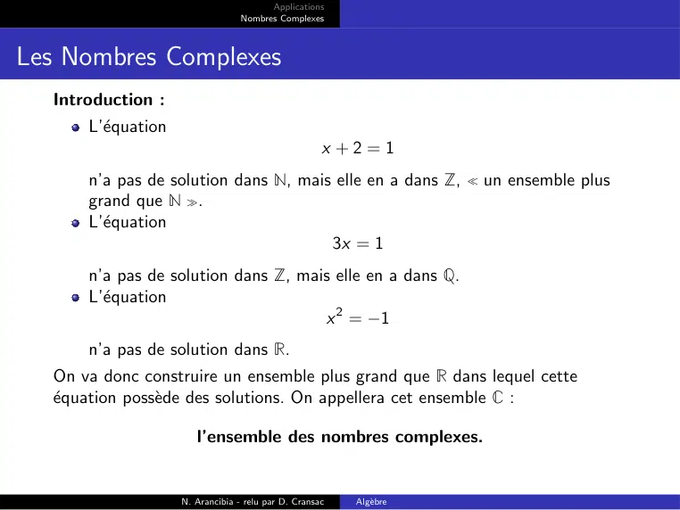

~~~text
                                        Applications
                                  Nombres Complexes

Les Nombres Complexes
  Introduction :
      L’équation
                                                     x +2=1
      n’a pas de solution dans N, mais elle en a dans Z,  un ensemble plus
      grand que N .
      L’équation
                                      3x = 1
      n’a pas de solution dans Z, mais elle en a dans Q.
      L’équation
                                     x 2 = −1
      n’a pas de solution dans R.
  On va donc construire un ensemble plus grand que R dans lequel cette
  équation possède des solutions. On appellera cet ensemble C :

                       l’ensemble des nombres complexes.

                    N. Arancibia - relu par D. Cransac   Algèbre
~~~

## Page 4

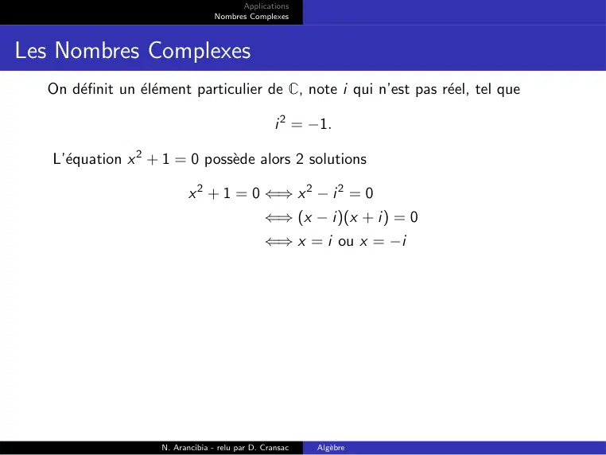

~~~text
                                        Applications
                                  Nombres Complexes

Les Nombres Complexes
  On définit un élément particulier de C, note i qui n’est pas réel, tel que

                                                  i 2 = −1.

   L’équation x 2 + 1 = 0 possède alors 2 solutions

                           x 2 + 1 = 0 ⇐⇒ x 2 − i 2 = 0
                                               ⇐⇒ (x − i)(x + i) = 0
                                               ⇐⇒ x = i ou x = −i

                    N. Arancibia - relu par D. Cransac   Algèbre
~~~

## Page 5

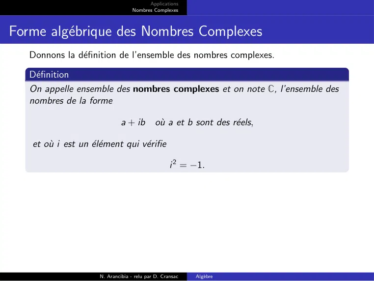

~~~text
                                          Applications
                                    Nombres Complexes

Forme algébrique des Nombres Complexes
   Donnons la définition de l’ensemble des nombres complexes.
   Définition
   On appelle ensemble des nombres complexes et on note C, l’ensemble des
   nombres de la forme

                               a + ib        où a et b sont des réels,

   et où i est un élément qui vérifie

                                                    i 2 = −1.

                      N. Arancibia - relu par D. Cransac   Algèbre
~~~

## Page 6

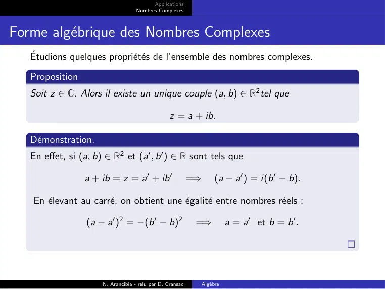

~~~text
                                          Applications
                                    Nombres Complexes

Forme algébrique des Nombres Complexes
   Étudions quelques propriétés de l’ensemble des nombres complexes.
   Proposition
   Soit z ∈ C. Alors il existe un unique couple (a, b) ∈ R2 tel que

                                                  z = a + ib.

   Démonstration.
   En effet, si (a, b) ∈ R2 et (a0 , b 0 ) ∈ R sont tels que

                 a + ib = z = a0 + ib 0                    =⇒    (a − a0 ) = i(b 0 − b).

   En élevant au carré, on obtient une égalité entre nombres réels :

                  (a − a0 )2 = −(b 0 − b)2                  =⇒         a = a0 et b = b 0 .

                      N. Arancibia - relu par D. Cransac    Algèbre
~~~

## Page 7

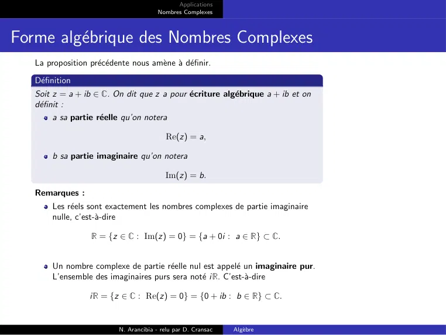

~~~text
                                               Applications
                                         Nombres Complexes

Forme algébrique des Nombres Complexes
   La proposition précédente nous amène à définir.
   Définition
   Soit z = a + ib ∈ C. On dit que z a pour écriture algébrique a + ib et on
   définit :
        a sa partie réelle qu’on notera

                                           Re(z) = a,

        b sa partie imaginaire qu’on notera

                                           Im(z) = b.

   Remarques :
        Les réels sont exactement les nombres complexes de partie imaginaire
        nulle, c’est-à-dire

                   R = {z ∈ C : Im(z) = 0} = {a + 0i : a ∈ R} ⊂ C.

        Un nombre complexe de partie réelle nul est appelé un imaginaire pur.
        L’ensemble des imaginaires purs sera noté iR. C’est-à-dire

                   iR = {z ∈ C : Re(z) = 0} = {0 + ib : b ∈ R} ⊂ C.

                           N. Arancibia - relu par D. Cransac   Algèbre
~~~

## Page 8

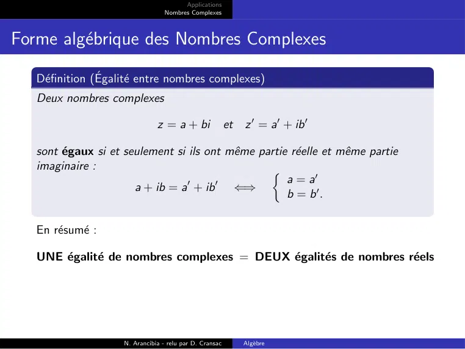

~~~text
                                         Applications
                                   Nombres Complexes

Forme algébrique des Nombres Complexes

   Définition (Égalité entre nombres complexes)
   Deux nombres complexes

                                z = a + bi                et   z 0 = a0 + ib 0

   sont égaux si et seulement si ils ont même partie réelle et même partie
   imaginaire :
                                                      a = a0
                                                  
                                  0     0
                       a + ib = a + ib     ⇐⇒
                                                      b = b0 .

   En résumé :

   UNE égalité de nombres complexes = DEUX égalités de nombres réels

                     N. Arancibia - relu par D. Cransac        Algèbre
~~~

## Page 9

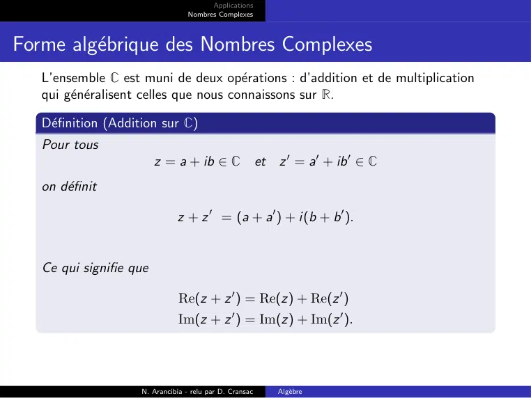

~~~text
                                        Applications
                                  Nombres Complexes

Forme algébrique des Nombres Complexes
   L’ensemble C est muni de deux opérations : d’addition et de multiplication
   qui généralisent celles que nous connaissons sur R.

   Définition (Addition sur C)
   Pour tous
                         z = a + ib ∈ C                  et   z 0 = a0 + ib 0 ∈ C
   on définit

                              z + z 0 = (a + a0 ) + i(b + b 0 ).

   Ce qui signifie que

                               Re(z + z 0 ) = Re(z) + Re(z 0 )
                               Im(z + z 0 ) = Im(z) + Im(z 0 ).

                    N. Arancibia - relu par D. Cransac        Algèbre
~~~

## Page 10

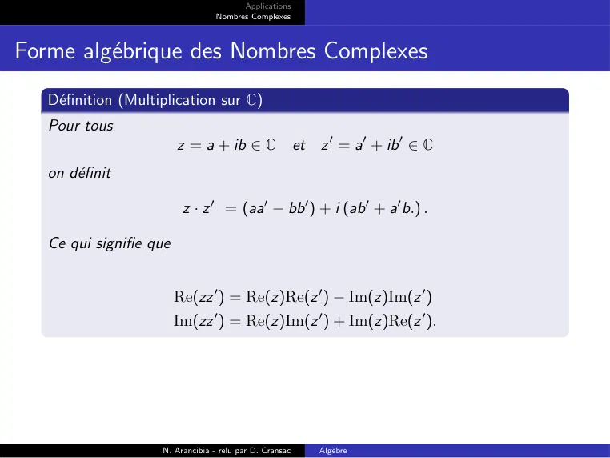

~~~text
                                         Applications
                                   Nombres Complexes

Forme algébrique des Nombres Complexes
   Définition (Multiplication sur C)
   Pour tous
                         z = a + ib ∈ C                   et   z 0 = a0 + ib 0 ∈ C
   on définit

                          z · z 0 = (aa0 − bb 0 ) + i (ab 0 + a0 b.) .

   Ce qui signifie que

                         Re(zz 0 ) = Re(z)Re(z 0 ) − Im(z)Im(z 0 )
                         Im(zz 0 ) = Re(z)Im(z 0 ) + Im(z)Re(z 0 ).

                     N. Arancibia - relu par D. Cransac        Algèbre
~~~

## Page 11

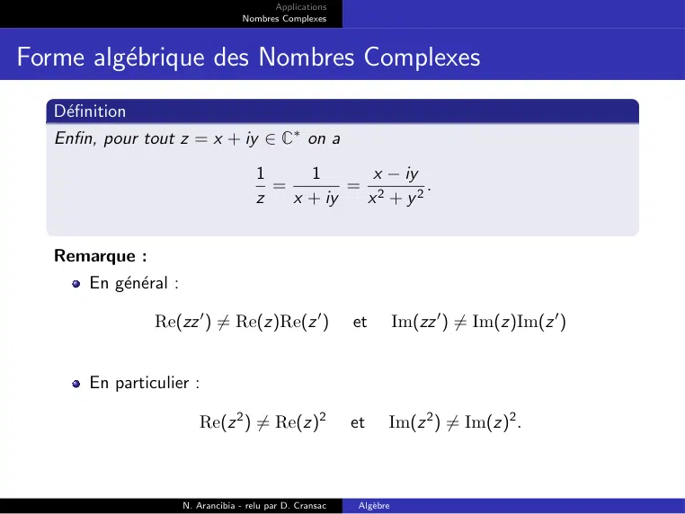

~~~text
                                            Applications
                                      Nombres Complexes

Forme algébrique des Nombres Complexes
   Définition
   Enfin, pour tout z = x + iy ∈ C∗ on a
                                         1     1      x − iy
                                           =        = 2      .
                                         z   x + iy  x + y2

   Remarque :
       En général :

                 Re(zz 0 ) 6= Re(z)Re(z 0 )                  et          Im(zz 0 ) 6= Im(z)Im(z 0 )

       En particulier :

                           Re(z 2 ) 6= Re(z)2                et      Im(z 2 ) 6= Im(z)2 .

                        N. Arancibia - relu par D. Cransac    Algèbre
~~~

## Page 12

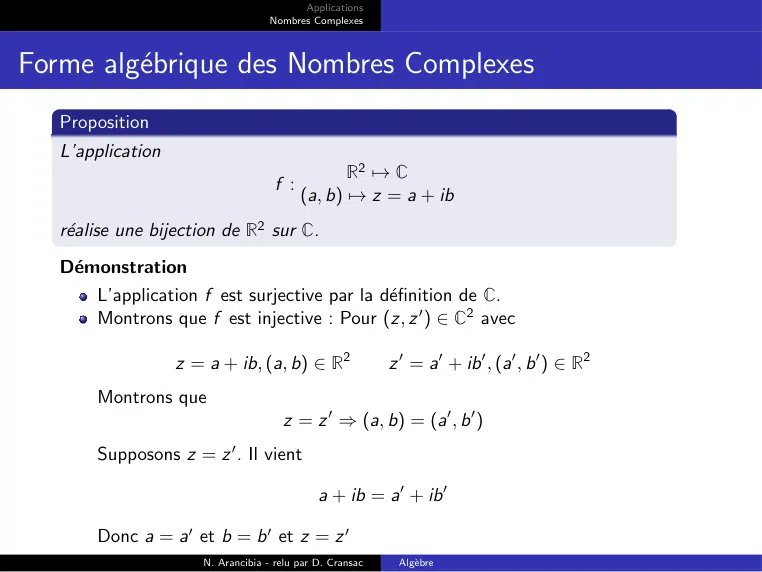

~~~text
                                          Applications
                                    Nombres Complexes

Forme algébrique des Nombres Complexes
   Proposition
   L’application
                                                  R2 7→ C
                                     f :
                                           (a, b) 7→ z = a + ib
   réalise une bijection de R2 sur C.
   Démonstration
        L’application f est surjective par la définition de C.
        Montrons que f est injective : Pour (z, z 0 ) ∈ C2 avec

                   z = a + ib, (a, b) ∈ R2                 z 0 = a0 + ib 0 , (a0 , b 0 ) ∈ R2
        Montrons que
                                      z = z 0 ⇒ (a, b) = (a0 , b 0 )
        Supposons z = z 0 . Il vient

                                              a + ib = a0 + ib 0

        Donc a = a0 et b = b 0 et z = z 0
                      N. Arancibia - relu par D. Cransac    Algèbre
~~~

## Page 13

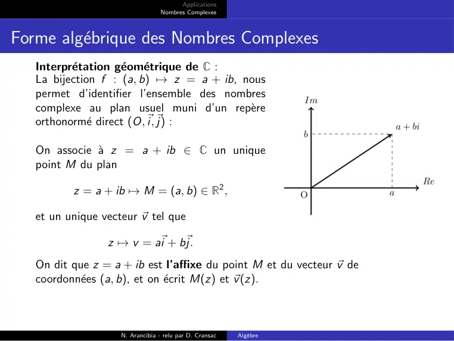

~~~text
                                        Applications
                                  Nombres Complexes

Forme algébrique des Nombres Complexes
   Interprétation géométrique de C :
   La bijection f : (a, b) 7→ z = a + ib, nous
   permet d’identifier l’ensemble des nombres
   complexe au plan usuel muni d’un repère
   orthonormé direct (O, ~i, ~j) :

   On associe à z = a + ib ∈ C un unique
   point M du plan

          z = a + ib 7→ M = (a, b) ∈ R2 ,

   et un unique vecteur ~v tel que

                 z 7→ v = a~i + b~j.
   On dit que z = a + ib est l’affixe du point M et du vecteur ~v de
   coordonnées (a, b), et on écrit M(z) et ~v (z).

                    N. Arancibia - relu par D. Cransac   Algèbre
~~~

## Page 14

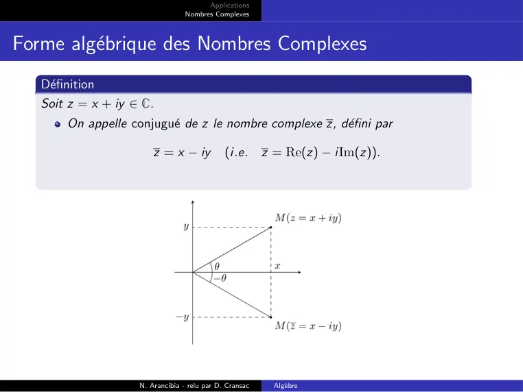

~~~text
                                        Applications
                                  Nombres Complexes

Forme algébrique des Nombres Complexes
   Définition
   Soit z = x + iy ∈ C.
       On appelle conjugué de z le nombre complexe z, défini par

                        z = x − iy            (i.e. z = Re(z) − iIm(z)).

                    N. Arancibia - relu par D. Cransac   Algèbre
~~~

## Page 15

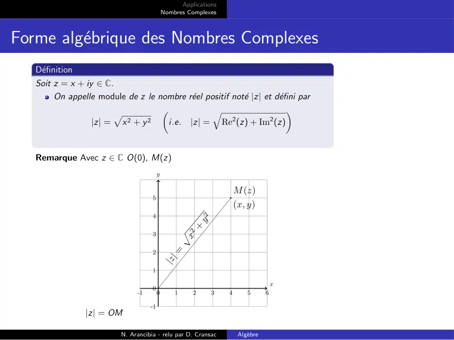

~~~text
                                              Applications
                                        Nombres Complexes

Forme algébrique des Nombres Complexes
   Définition
   Soit z = x + iy ∈ C.
       On appelle module de z le nombre réel positif noté |z| et défini par
                     p                         q                      
                |z| = x 2 + y 2    i.e. |z| = Re2 (z) + Im2 (z)

   Remarque Avec z ∈ C O(0), M(z)

               |z| = OM

                          N. Arancibia - relu par D. Cransac   Algèbre
~~~

## Page 16

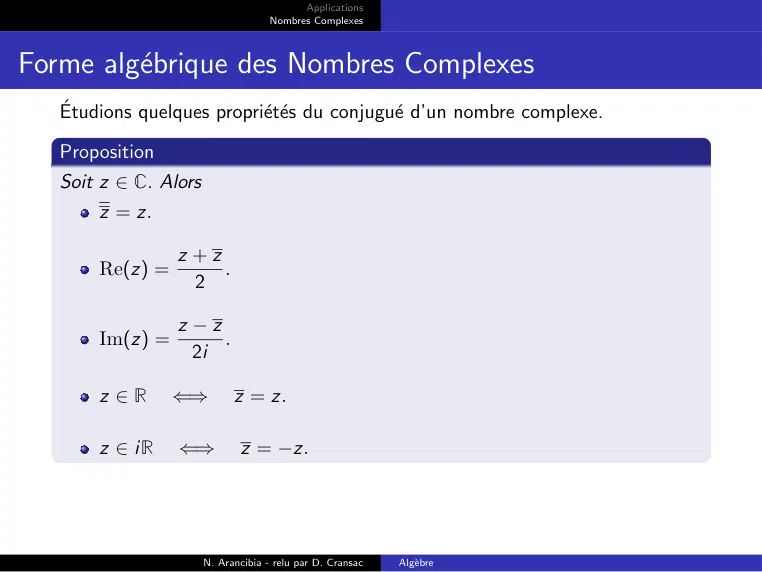

~~~text
                                           Applications
                                     Nombres Complexes

Forme algébrique des Nombres Complexes
   Étudions quelques propriétés du conjugué d’un nombre complexe.
   Proposition
   Soit z ∈ C. Alors
       z = z.

                 z +z
       Re(z) =        .
                   2

                 z −z
       Im(z) =        .
                   2i

       z ∈R      ⇐⇒          z = z.

       z ∈ iR    ⇐⇒           z = −z.

                       N. Arancibia - relu par D. Cransac   Algèbre
~~~

## Page 17

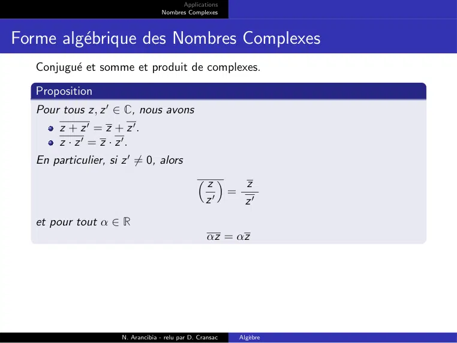

~~~text
                                          Applications
                                    Nombres Complexes

Forme algébrique des Nombres Complexes
   Conjugué et somme et produit de complexes.
   Proposition
   Pour tous z, z 0 ∈ C, nous avons
        z + z 0 = z + z 0.
        z · z 0 = z · z 0.
   En particulier, si z 0 6= 0, alors
                                                z              z
                                                           =
                                                   z0            z0
   et pour tout α ∈ R
                                                    αz = αz

                      N. Arancibia - relu par D. Cransac       Algèbre
~~~

## Page 18

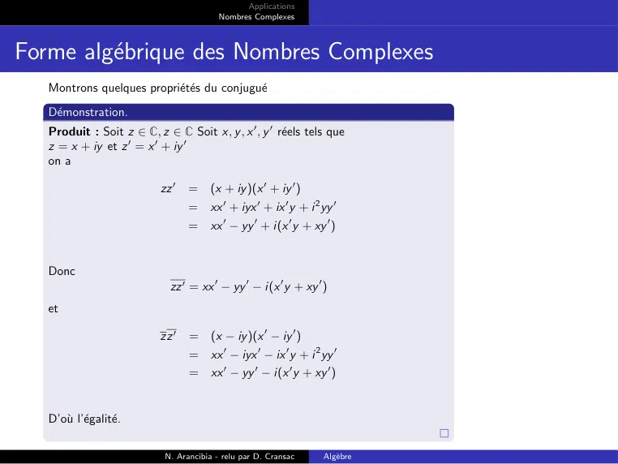

~~~text
                                                Applications
                                          Nombres Complexes

Forme algébrique des Nombres Complexes
   Montrons quelques propriétés du conjugué
   Démonstration.
   Produit : Soit z ∈ C, z ∈ C Soit x, y , x 0 , y 0 réels tels que
   z = x + iy et z 0 = x 0 + iy 0
   on a

                           zz 0   =    (x + iy )(x 0 + iy 0 )
                                  = xx 0 + iyx 0 + ix 0 y + i 2 yy 0
                                  = xx 0 − yy 0 + i(x 0 y + xy 0 )

   Donc
                             zz 0 = xx 0 − yy 0 − i(x 0 y + xy 0 )
   et

                           zz 0   =     (x − iy )(x 0 − iy 0 )
                                  = xx 0 − iyx 0 − ix 0 y + i 2 yy 0
                                  = xx 0 − yy 0 − i(x 0 y + xy 0 )

   D’où l’égalité.

                            N. Arancibia - relu par D. Cransac   Algèbre
~~~

## Page 19

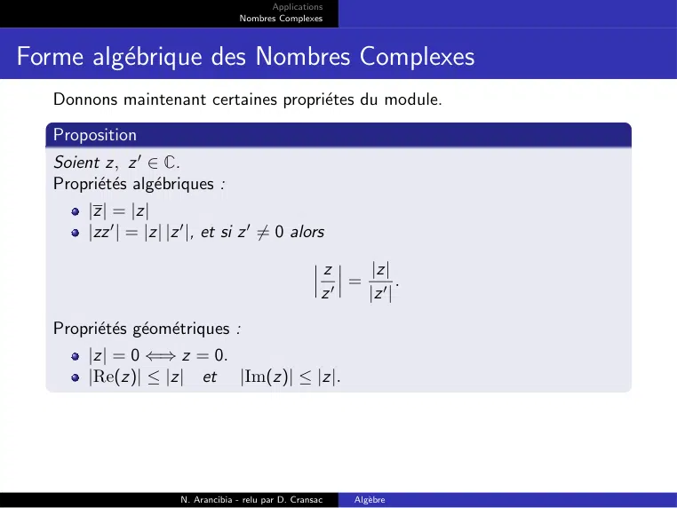

~~~text
                                            Applications
                                      Nombres Complexes

Forme algébrique des Nombres Complexes
   Donnons maintenant certaines propriétes du module.
   Proposition
   Soient z, z 0 ∈ C.
   Propriétés algébriques :
        |z| = |z|
        |zz 0 | = |z| |z 0 |, et si z 0 6= 0 alors

                                                         z    |z|
                                                            = 0 .
                                                         z0  |z |

   Propriétés géométriques :
        |z| = 0 ⇐⇒ z = 0.
        |Re(z)| ≤ |z| et |Im(z)| ≤ |z|.

                        N. Arancibia - relu par D. Cransac   Algèbre
~~~

## Page 20

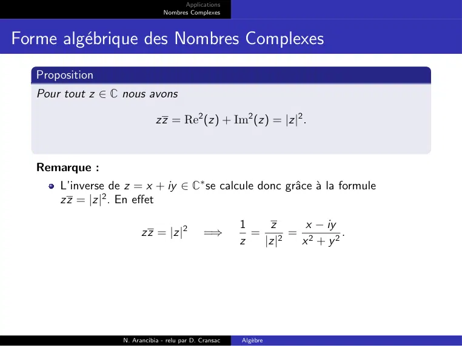

~~~text
                                       Applications
                                 Nombres Complexes

Forme algébrique des Nombres Complexes
   Proposition
   Pour tout z ∈ C nous avons

                              zz = Re2 (z) + Im2 (z) = |z|2 .

   Remarque :
       L’inverse de z = x + iy ∈ C∗ se calcule donc grâce à la formule
       zz = |z|2 . En effet

                                                        1   z   x − iy
                         zz = |z|2             =⇒         = 2 = 2      .
                                                        z  |z| x + y2

                   N. Arancibia - relu par D. Cransac   Algèbre
~~~

## Page 21

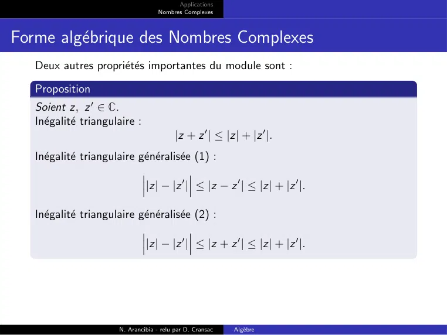

~~~text
                                           Applications
                                     Nombres Complexes

Forme algébrique des Nombres Complexes
   Deux autres propriétés importantes du module sont :
   Proposition
   Soient z, z 0 ∈ C.
   Inégalité triangulaire :
                                           |z + z 0 | ≤ |z| + |z 0 |.
   Inégalité triangulaire généralisée (1) :

                                |z| − |z 0 | ≤ |z − z 0 | ≤ |z| + |z 0 |.

   Inégalité triangulaire généralisée (2) :

                                |z| − |z 0 | ≤ |z + z 0 | ≤ |z| + |z 0 |.

                       N. Arancibia - relu par D. Cransac   Algèbre
~~~

## Page 22

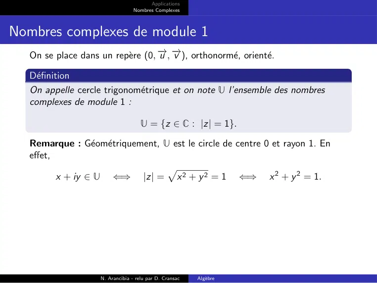

~~~text
                                        Applications
                                  Nombres Complexes

Nombres complexes de module 1
  On se place dans un repère (0, →
                                  −
                                  u ,→
                                     −
                                     v ), orthonormé, orienté.

  Définition
  On appelle cercle trigonométrique et on note U l’ensemble des nombres
  complexes de module 1 :

                                     U = {z ∈ C : |z| = 1}.

  Remarque : Géométriquement, U est le circle de centre 0 et rayon 1. En
  effet,
                                 p
         x + iy ∈ U ⇐⇒ |z| = x 2 + y 2 = 1 ⇐⇒ x 2 + y 2 = 1.

                    N. Arancibia - relu par D. Cransac   Algèbre
~~~

## Page 23

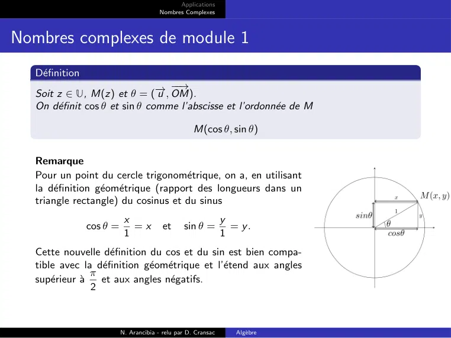

~~~text
                                              Applications
                                        Nombres Complexes

Nombres complexes de module 1
  Définition
                                   −−→
  Soit z ∈ U, M(z) et θ = (−   →
                               u , OM).
  On définit cos θ et sin θ comme l’abscisse et l’ordonnée de M

                                                    M(cos θ, sin θ)

  Remarque
  Pour un point du cercle trigonométrique, on a, en utilisant
  la définition géométrique (rapport des longueurs dans un
  triangle rectangle) du cosinus et du sinus
                           x                                   y
                cos θ =      =x          et     sin θ =          = y.
                           1                                   1
  Cette nouvelle définition du cos et du sin est bien compa-
  tible avec la définition géométrique et l’étend aux angles
                π
  supérieur à   et aux angles négatifs.
                2

                          N. Arancibia - relu par D. Cransac      Algèbre
~~~

## Page 24

~~~text
                                         Applications
                                   Nombres Complexes

Nombres complexes de module 1
  Définition
  Soit θ ∈ R, on appelle exponentielle iθ le nombre complexe défini par

                                         e iθ = cos θ + i sin θ.
  Remarque : Notons que pour tout θ ∈ R,

                                                    e iθ ∈ U

  De plus,
                                                                     q
             e iθ = 1 et e iθ = | cos(θ) + i sin θ| =                    cos2 (θ) + sin2 (θ).

  Donc
                                        cos2 (θ) + sin2 (θ) = 1

                     N. Arancibia - relu par D. Cransac   Algèbre
~~~

## Page 25

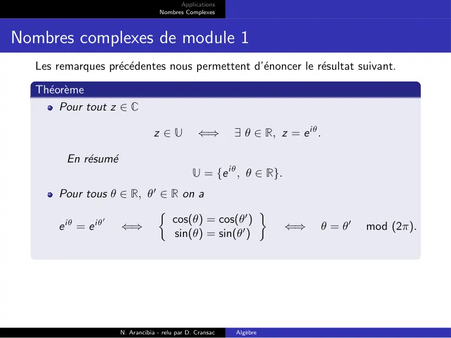

~~~text
                                          Applications
                                    Nombres Complexes

Nombres complexes de module 1
  Les remarques précédentes nous permettent d’énoncer le résultat suivant.
  Théorème
       Pour tout z ∈ C

                                  z ∈U           ⇐⇒        ∃ θ ∈ R, z = e iθ .

        En résumé
                                               U = {e iθ , θ ∈ R}.
      Pour tous θ ∈ R, θ0 ∈ R on a

                            cos(θ) = cos(θ0 )
                                              
             iθ 0
       iθ
      e =e        ⇐⇒                                                  ⇐⇒     θ = θ0   mod (2π).
                             sin(θ) = sin(θ0 )

                      N. Arancibia - relu par D. Cransac   Algèbre
~~~

## Page 26

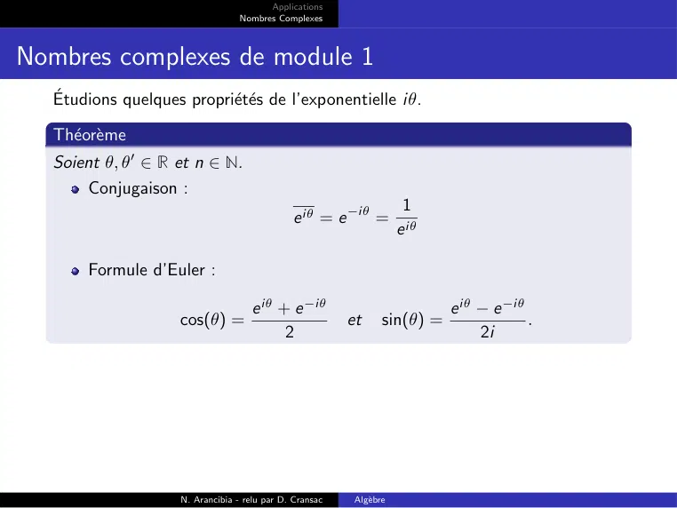

~~~text
                                        Applications
                                  Nombres Complexes

Nombres complexes de module 1
  Étudions quelques propriétés de l’exponentielle iθ.
  Théorème
  Soient θ, θ0 ∈ R et n ∈ N.
       Conjugaison :
                                                                      1
                                              e iθ = e −iθ =
                                                                     e iθ

       Formule d’Euler :

                                     e iθ + e −iθ                           e iθ − e −iθ
                    cos(θ) =                             et      sin(θ) =                .
                                           2                                     2i

                    N. Arancibia - relu par D. Cransac    Algèbre
~~~

## Page 27

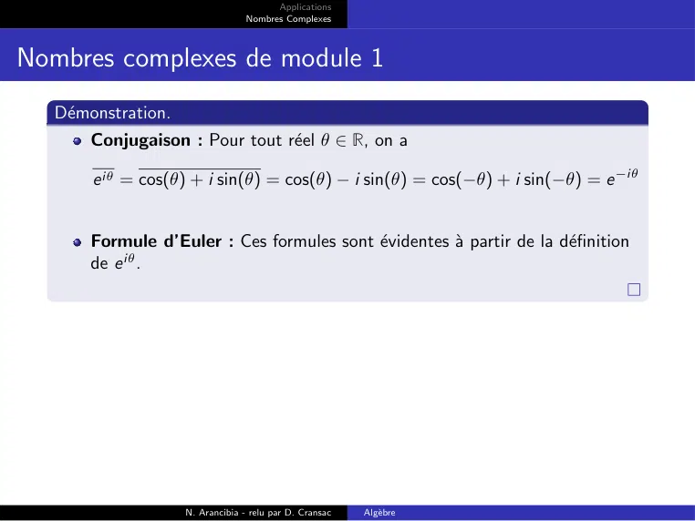

~~~text
                                       Applications
                                 Nombres Complexes

Nombres complexes de module 1
  Démonstration.
      Conjugaison : Pour tout réel θ ∈ R, on a

      e iθ = cos(θ) + i sin(θ) = cos(θ) − i sin(θ) = cos(−θ) + i sin(−θ) = e −iθ

      Formule d’Euler : Ces formules sont évidentes à partir de la définition
      de e iθ .

                   N. Arancibia - relu par D. Cransac   Algèbre
~~~

## Page 28

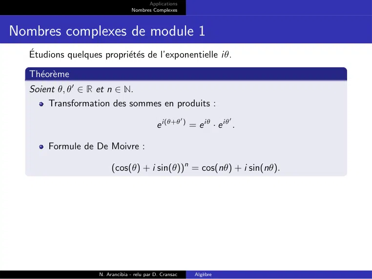

~~~text
                                        Applications
                                  Nombres Complexes

Nombres complexes de module 1
  Étudions quelques propriétés de l’exponentielle iθ.
  Théorème
  Soient θ, θ0 ∈ R et n ∈ N.
       Transformation des sommes en produits :
                                                         0              0
                                             e i(θ+θ ) = e iθ · e iθ .

       Formule de De Moivre :

                         (cos(θ) + i sin(θ))n = cos(nθ) + i sin(nθ).

                    N. Arancibia - relu par D. Cransac       Algèbre
~~~

## Page 29

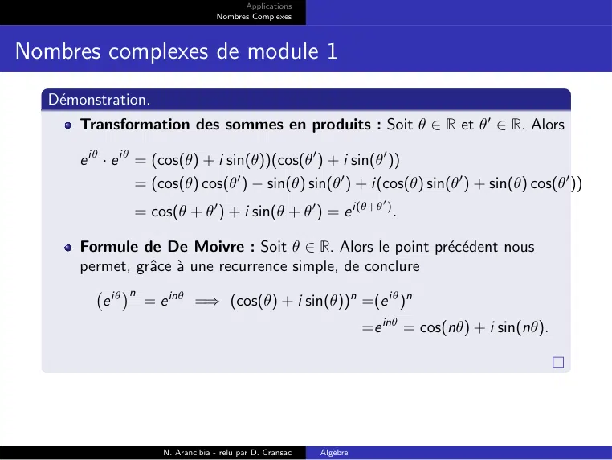

~~~text
                                        Applications
                                  Nombres Complexes

Nombres complexes de module 1
  Démonstration.
      Transformation des sommes en produits : Soit θ ∈ R et θ0 ∈ R. Alors

      e iθ · e iθ = (cos(θ) + i sin(θ))(cos(θ0 ) + i sin(θ0 ))
                  = (cos(θ) cos(θ0 ) − sin(θ) sin(θ0 ) + i(cos(θ) sin(θ0 ) + sin(θ) cos(θ0 ))
                                                                       0
               = cos(θ + θ0 ) + i sin(θ + θ0 ) = e i(θ+θ ) .

      Formule de De Moivre : Soit θ ∈ R. Alors le point précédent nous
      permet, grâce à une recurrence simple, de conclure
             n
         e iθ = e inθ =⇒ (cos(θ) + i sin(θ))n =(e iθ )n
                                                                    =e inθ = cos(nθ) + i sin(nθ).

                    N. Arancibia - relu par D. Cransac   Algèbre
~~~

## Page 30

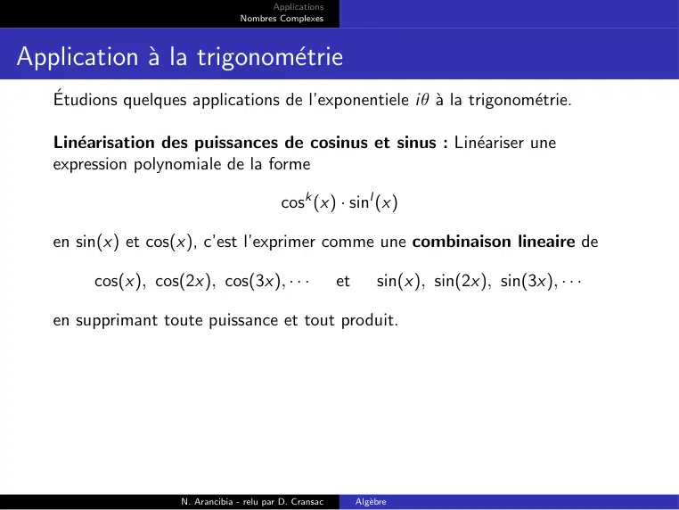

~~~text
                                         Applications
                                   Nombres Complexes

Application à la trigonométrie
   Étudions quelques applications de l’exponentiele iθ à la trigonométrie.

   Linéarisation des puissances de cosinus et sinus : Linéariser une
   expression polynomiale de la forme

                                            cosk (x) · sinl (x)

   en sin(x) et cos(x), c’est l’exprimer comme une combinaison lineaire de

        cos(x), cos(2x), cos(3x), · · ·                   et        sin(x), sin(2x), sin(3x), · · ·

   en supprimant toute puissance et tout produit.

                     N. Arancibia - relu par D. Cransac        Algèbre
~~~

## Page 31

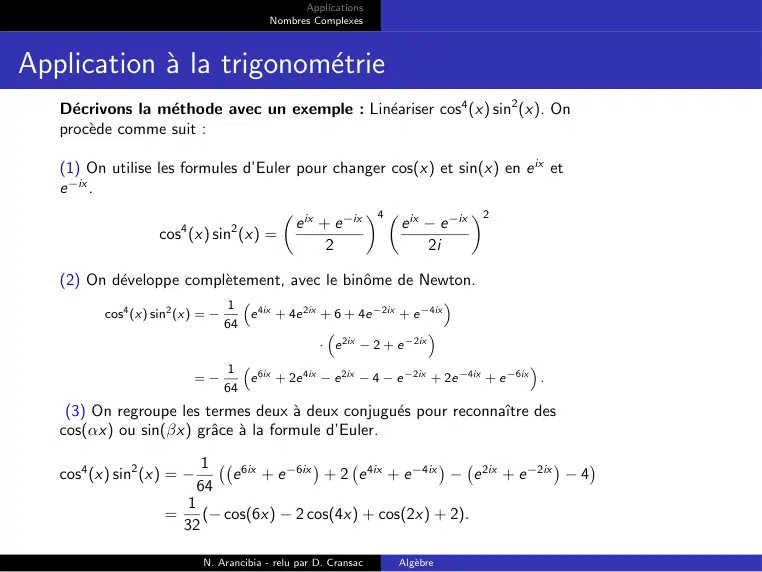

~~~text
                                                Applications
                                          Nombres Complexes

Application à la trigonométrie
   Décrivons la méthode avec un exemple : Linéariser cos4 (x) sin2 (x). On
   procède comme suit :

   (1) On utilise les formules d’Euler pour changer cos(x) et sin(x) en e ix et
   e −ix .
                                                  4  ix       2
                                        e + e −ix     e − e −ix
                                        ix
                   cos4 (x) sin2 (x) =
                                            2             2i

   (2) On développe complètement, avec le binôme de Newton.
                             1  4ix                                    
          cos4 (x) sin2 (x) = −   e + 4e 2ix + 6 + 4e −2ix + e −4ix
                             64
                                                                     
                                                 · e 2ix − 2 + e −2ix
                             1                                                         
                          =−      e 6ix + 2e 4ix − e 2ix − 4 − e −2ix + 2e −4ix + e −6ix .
                             64
    (3) On regroupe les termes deux à deux conjugués pour reconnaı̂tre des
   cos(αx) ou sin(βx) grâce à la formule d’Euler.

                            1
   cos4 (x) sin2 (x) = −          e 6ix + e −6ix + 2 e 4ix + e −4ix − e 2ix + e −2ix − 4
                                                                                      
                           64
                         1
                     =      (− cos(6x) − 2 cos(4x) + cos(2x) + 2).
                         32

                            N. Arancibia - relu par D. Cransac   Algèbre
~~~

## Page 32

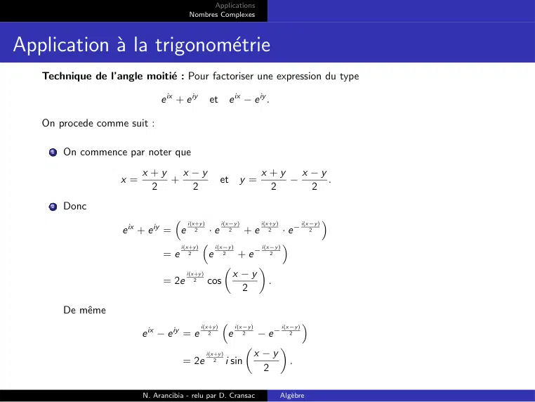

~~~text
                                             Applications
                                       Nombres Complexes

Application à la trigonométrie
   Technique de l’angle moitié : Pour factoriser une expression du type

                              e ix + e iy      et          e ix − e iy .

   On procede comme suit :

     1   On commence par noter que
                         x +y   x −y                                 x +y   x −y
                    x=        +                       et      y=          −      .
                           2      2                                    2      2
     2   Donc
                                   i(x+y )     i(x−y )   i(x+y )   i(x−y )
                                                                            
                    e ix + e iy = e 2 · e 2 + e 2 · e − 2
                                   i(x+y )
                                            i(x−y )      i(x−y )
                                                                  
                                =e 2         e 2 + e− 2
                                                         
                                     i(x+y )        x −y
                                = 2e 2 cos                   .
                                                        2

         De même
                                                i(x−y )
                                            i(x+y )           i(x−y )
                                                                      
                         e ix − e iy = e       2 e 2 − e− 2
                                                             
                                         i(x+y )         x −y
                                     = 2e 2 i sin                .
                                                           2

                         N. Arancibia - relu par D. Cransac                Algèbre
~~~

## Page 33

~~~text
                                               Applications
                                         Nombres Complexes

Application à la trigonométrie
   La technique de l’angle de l’angle moitié nous permet de calculer
   facilement les expressions suivants :
   Proposition
                                                                
                                             x +y            x −y
                 cos(x) + cos(y ) = 2 cos             cos
                                                2              2
                                                                 
                                               x +y           x −y
                 cos(x) − cos(y ) = −2 sin              sin
                                                  2              2
                                                                
                                             x +y           x −y
                  sin(x) + sin(y ) = 2 sin            cos
                                               2               2
                                                                
                                             x +y           x −y
                  sin(x) − sin(y ) = 2 cos            sin            .
                                                2              2

   Par exemple : En utilisant

   sin(x) = Im(cos(x)+i sin(x)) = Im(e ix ) et            sin(y ) = Im(cos(y )+i sin(y )) = Im(e iy )

    on déduit
                                                                             
                                                           i(x+y )      x −y
       sin(x) + sin(y ) = Im e ix + e iy
                                           
                                                = Im 2e 2 cos
                                                                           2
                                                                             
                                                          x +y             x −y
                                                = 2 sin              cos          .
                                                             2               2

                           N. Arancibia - relu par D. Cransac     Algèbre
~~~

## Page 34

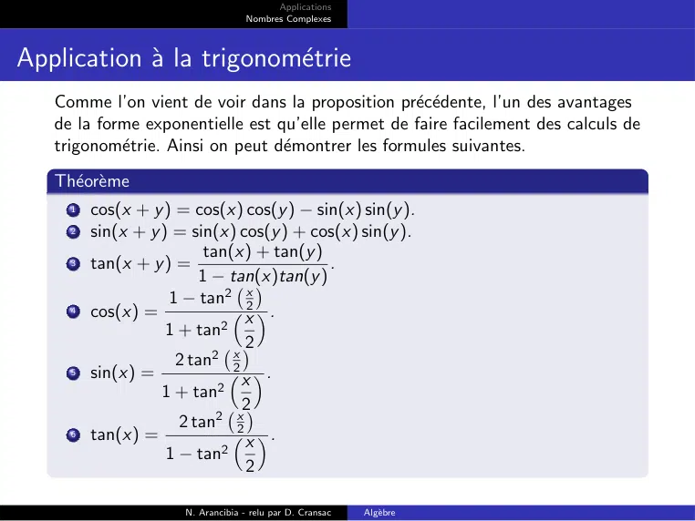

~~~text
                                          Applications
                                    Nombres Complexes

Application à la trigonométrie
   Comme l’on vient de voir dans la proposition précédente, l’un des avantages
   de la forme exponentielle est qu’elle permet de faire facilement des calculs de
   trigonométrie. Ainsi on peut démontrer les formules suivantes.
   Théorème
     1   cos(x + y ) = cos(x) cos(y ) − sin(x) sin(y ).
     2   sin(x + y ) = sin(x) cos(y ) + cos(x) sin(y ).
                          tan(x) + tan(y )
     3   tan(x + y ) =                      .
                         1 − tan(x)tan(y  )
                             2 x
                                  
                    1 − tan 2
     4   cos(x) =             x .
                    1 + tan2
                               2
                     2 tan2 x2
     5   sin(x) =             x .
                   1 + tan2
                               2
                      2 tan2 x2
     6   tan(x) =             x .
                    1 − tan2
                                2

                      N. Arancibia - relu par D. Cransac   Algèbre
~~~

## Page 35

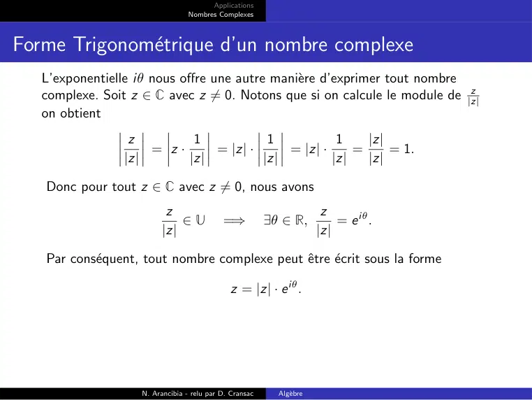

~~~text
                                        Applications
                                  Nombres Complexes

Forme Trigonométrique d’un nombre complexe
   L’exponentielle iθ nous offre une autre manière d’exprimer tout nombre
                                                                            z
   complexe. Soit z ∈ C avec z 6= 0. Notons que si on calcule le module de |z|
   on obtient
                  z        1           1           1    |z|
                     = z·     = |z| ·     = |z| ·     =     = 1.
                 |z|      |z|         |z|         |z|   |z|

   Donc pour tout z ∈ C avec z 6= 0, nous avons
                           z                                           z
                              ∈U            =⇒           ∃θ ∈ R,          = e iθ .
                          |z|                                         |z|

   Par conséquent, tout nombre complexe peut être écrit sous la forme

                                              z = |z| · e iθ .

                    N. Arancibia - relu par D. Cransac     Algèbre
~~~

## Page 36

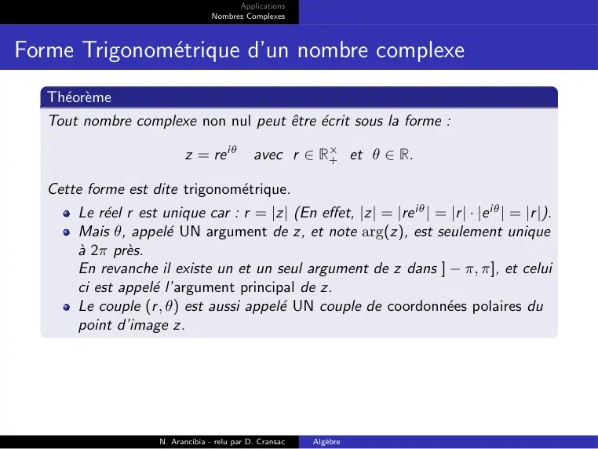

~~~text
                                         Applications
                                   Nombres Complexes

Forme Trigonométrique d’un nombre complexe
   Théorème
   Tout nombre complexe non nul peut être écrit sous la forme :

                           z = re iθ          avec r ∈ R×
                                                        + et θ ∈ R.

   Cette forme est dite trigonométrique.
       Le réel r est unique car : r = |z| (En effet, |z| = |re iθ | = |r | · |e iθ | = |r |).
       Mais θ, appelé UN argument de z, et note arg(z), est seulement unique
       à 2π près.
       En revanche il existe un et un seul argument de z dans ] − π, π], et celui
       ci est appelé l’argument principal de z.
       Le couple (r , θ) est aussi appelé UN couple de coordonnées polaires du
       point d’image z.

                     N. Arancibia - relu par D. Cransac   Algèbre
~~~

## Page 37

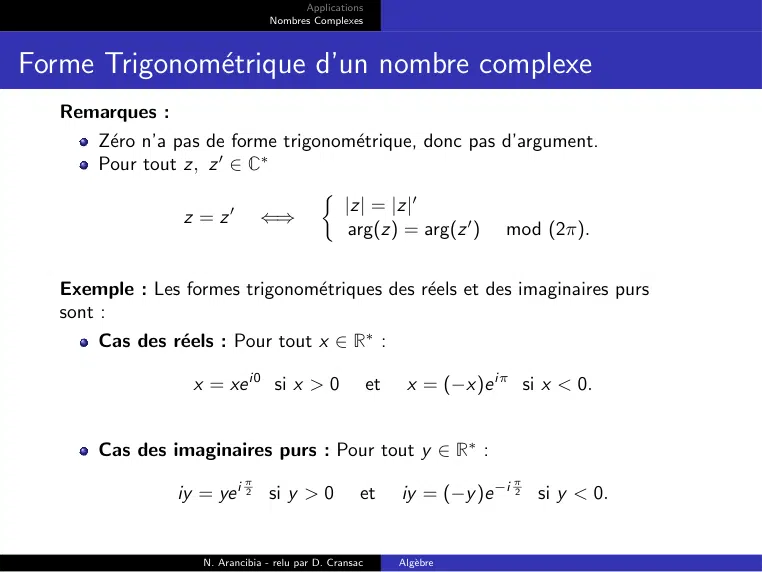

~~~text
                                        Applications
                                  Nombres Complexes

Forme Trigonométrique d’un nombre complexe
   Remarques :
      Zéro n’a pas de forme trigonométrique, donc pas d’argument.
      Pour tout z, z 0 ∈ C∗

                                    |z| = |z|0
                                  
                 z = z 0 ⇐⇒
                                     arg(z) = arg(z 0 ) mod (2π).

   Exemple : Les formes trigonométriques des réels et des imaginaires purs
   sont :
       Cas des réels : Pour tout x ∈ R∗ :

                   x = xe i0 si x > 0                    et    x = (−x)e iπ si x < 0.

       Cas des imaginaires purs : Pour tout y ∈ R∗ :
                            π                                               π
                 iy = ye i 2 si y > 0                et       iy = (−y )e −i 2 si y < 0.

                    N. Arancibia - relu par D. Cransac        Algèbre
~~~

## Page 38

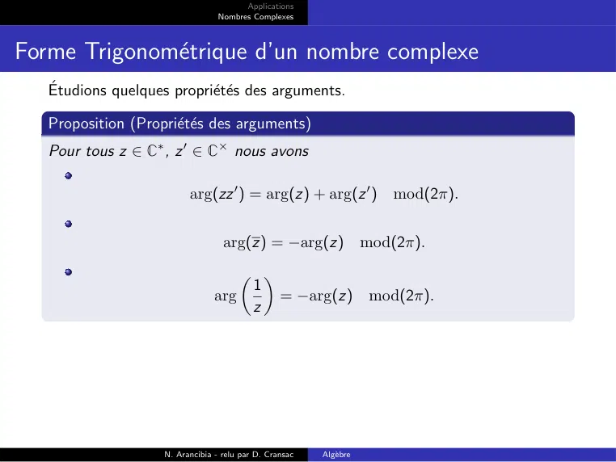

~~~text
                                        Applications
                                  Nombres Complexes

Forme Trigonométrique d’un nombre complexe
   Étudions quelques propriétés des arguments.

   Proposition (Propriétés des arguments)
   Pour tous z ∈ C∗ , z 0 ∈ C× nous avons

                          arg(zz 0 ) = arg(z) + arg(z 0 ) mod(2π).

                                   arg(z) = −arg(z) mod(2π).
                                      
                                      1
                                 arg     = −arg(z)                  mod(2π).
                                      z

                    N. Arancibia - relu par D. Cransac   Algèbre
~~~

## Page 39

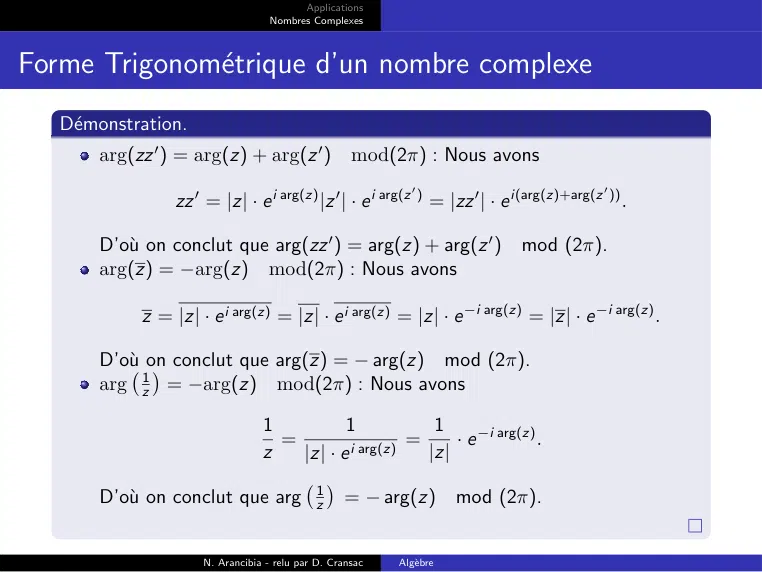

~~~text
                                         Applications
                                   Nombres Complexes

Forme Trigonométrique d’un nombre complexe
   Démonstration.
       arg(zz 0 ) = arg(z) + arg(z 0 ) mod(2π) : Nous avons
                                                            0                             0
                 zz 0 = |z| · e i arg(z) |z 0 | · e i arg(z ) = |zz 0 | · e i(arg(z)+arg(z )) .

       D’où on conclut que arg(zz 0 ) = arg(z) + arg(z 0 ) mod (2π).
       arg(z) = −arg(z) mod(2π) : Nous avons

            z = |z| · e i arg(z) = |z| · e i arg(z) = |z| · e −i arg(z) = |z| · e −i arg(z) .

               conclut que arg(z) = − arg(z) mod (2π).
       D’où on
       arg z1 = −arg(z) mod(2π) : Nous avons

                          1           1            1
                             =                  =     · e −i arg(z) .
                          z    |z| · e i arg(z)   |z|

       D’où on conclut que arg z1 = − arg(z) mod (2π).
                                  

                     N. Arancibia - relu par D. Cransac   Algèbre
~~~

## Page 40

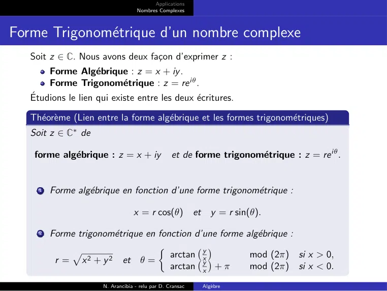

~~~text
                                          Applications
                                    Nombres Complexes

Forme Trigonométrique d’un nombre complexe
   Soit z ∈ C. Nous avons deux façon d’exprimer z :
         Forme Algébrique : z = x + iy .
         Forme Trigonométrique : z = re iθ .
   Étudions le lien qui existe entre les deux écritures.

   Théorème (Lien entre la forme algébrique et les formes trigonométriques)
   Soit z ∈ C∗ de

    forme algébrique : z = x + iy                et de forme trigonométrique : z = re iθ .

     1   Forme algébrique en fonction d’une forme trigonométrique :

                                  x = r cos(θ) et             y = r sin(θ).

     2   Forme trigonométrique en fonction d’une forme algébrique :

                                      arctan yx 
                                               
             p                                           mod (2π) si x > 0,
          r = x 2 + y 2 et θ =                y
                                      arctan x + π       mod (2π) si x < 0.
                      N. Arancibia - relu par D. Cransac   Algèbre
~~~

## Page 41

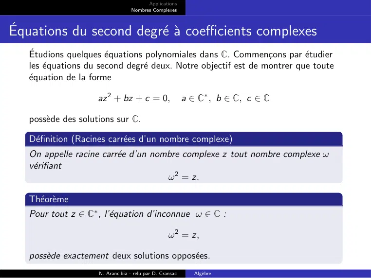

~~~text
                                         Applications
                                   Nombres Complexes

Équations du second degré à coefficients complexes
   Étudions quelques équations polynomiales dans C. Commençons par étudier
   les équations du second degré deux. Notre objectif est de montrer que toute
   équation de la forme

                    az 2 + bz + c = 0,                    a ∈ C∗ , b ∈ C, c ∈ C

   possède des solutions sur C.

   Définition (Racines carrées d’un nombre complexe)
   On appelle racine carrée d’un nombre complexe z tout nombre complexe ω
   vérifiant
                                     ω 2 = z.

   Théorème
   Pour tout z ∈ C∗ , l’équation d’inconnue ω ∈ C :

                                                   ω 2 = z,

   possède exactement deux solutions opposées.
                     N. Arancibia - relu par D. Cransac      Algèbre
~~~

## Page 42

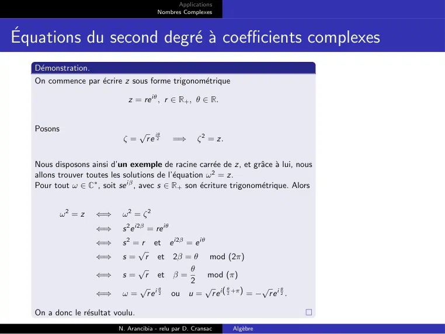

~~~text
                                                Applications
                                          Nombres Complexes

Équations du second degré à coefficients complexes
   Démonstration.
   On commence par écrire z sous forme trigonométrique

                              z = re iθ , r ∈ R+ , θ ∈ R.

   Posons                          √     iθ
                            ζ=         re 2     =⇒     ζ 2 = z.

   Nous disposons ainsi d’un exemple de racine carrée de z, et grâce à lui, nous
   allons trouver toutes les solutions de l’équation ω 2 = z.
   Pour tout ω ∈ C∗ , soit se iβ , avec s ∈ R+ son écriture trigonométrique. Alors

            ω2 = z   ⇐⇒     ω2 = ζ 2
                     ⇐⇒     s 2 e i2β = re iθ
                     ⇐⇒     s 2 = r et e i2β = e iθ
                                 √
                     ⇐⇒     s = r et 2β = θ mod (2π)
                                 √            θ
                     ⇐⇒     s = r et β =            mod (π)
                                              2
                                 √ iθ              √ i ( θ +π)    √ θ
                     ⇐⇒     ω = r e 2 ou u = r e 2             = − r ei 2 .

   On a donc le résultat voulu.
                           N. Arancibia - relu par D. Cransac     Algèbre
~~~

## Page 43

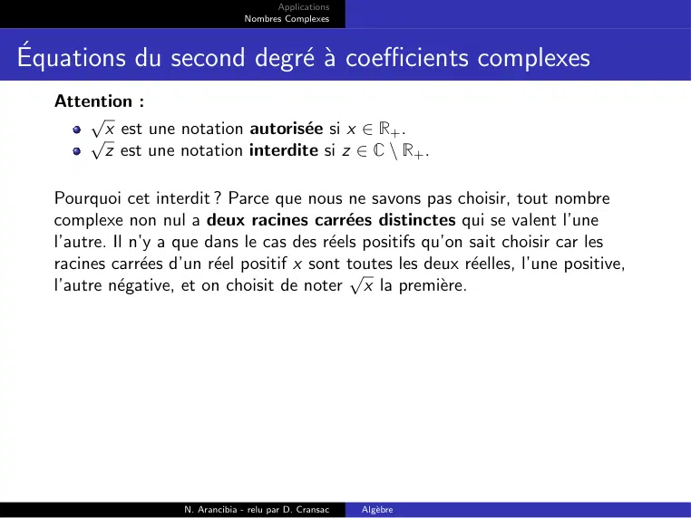

~~~text
                                          Applications
                                    Nombres Complexes

Équations du second degré à coefficients complexes
   Attention :
       √
       √x est une notation autorisée si x ∈ R+ .
         z est une notation interdite si z ∈ C \ R+ .

   Pourquoi cet interdit ? Parce que nous ne savons pas choisir, tout nombre
   complexe non nul a deux racines carrées distinctes qui se valent l’une
   l’autre. Il n’y a que dans le cas des réels positifs qu’on sait choisir car les
   racines carrées d’un réel positif x sont toutes
                                              √      les deux réelles, l’une positive,
   l’autre négative, et on choisit de noter x la première.

                      N. Arancibia - relu par D. Cransac   Algèbre
~~~

## Page 44

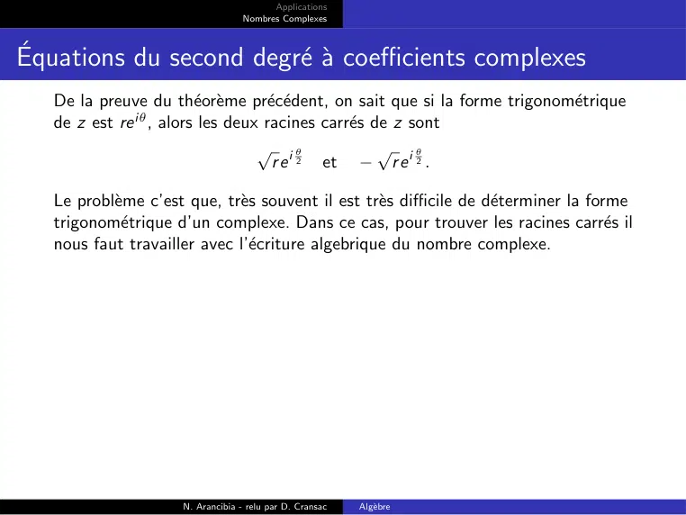

~~~text
                                         Applications
                                   Nombres Complexes

Équations du second degré à coefficients complexes
   De la preuve du théorème précédent, on sait que si la forme trigonométrique
   de z est re iθ , alors les deux racines carrés de z sont
                                  √ iθ              √ θ
                                    r e 2 et − r e i 2 .

   Le problème c’est que, très souvent il est très difficile de déterminer la forme
   trigonométrique d’un complexe. Dans ce cas, pour trouver les racines carrés il
   nous faut travailler avec l’écriture algebrique du nombre complexe.

                     N. Arancibia - relu par D. Cransac   Algèbre
~~~

## Page 45

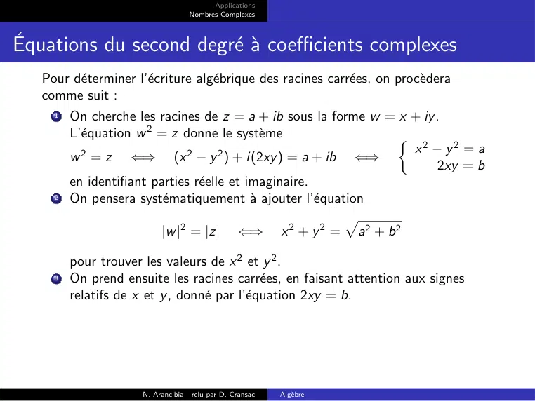

~~~text
                                         Applications
                                   Nombres Complexes

Équations du second degré à coefficients complexes
   Pour déterminer l’écriture algébrique des racines carrées, on procèdera
   comme suit :
     1   On cherche les racines de z = a + ib sous la forme w = x + iy .
         L’équation w 2 = z donne le système                   2
                                                                  x − y2 = a
         w 2 = z ⇐⇒ (x 2 − y 2 ) + i(2xy ) = a + ib ⇐⇒
                                                                       2xy = b
         en identifiant parties réelle et imaginaire.
     2   On pensera systématiquement à ajouter l’équation
                                                         p
                          |w |2 = |z| ⇐⇒ x 2 + y 2 = a2 + b 2

         pour trouver les valeurs de x 2 et y 2 .
     3   On prend ensuite les racines carrées, en faisant attention aux signes
         relatifs de x et y , donné par l’équation 2xy = b.

                     N. Arancibia - relu par D. Cransac   Algèbre
~~~

## Page 46

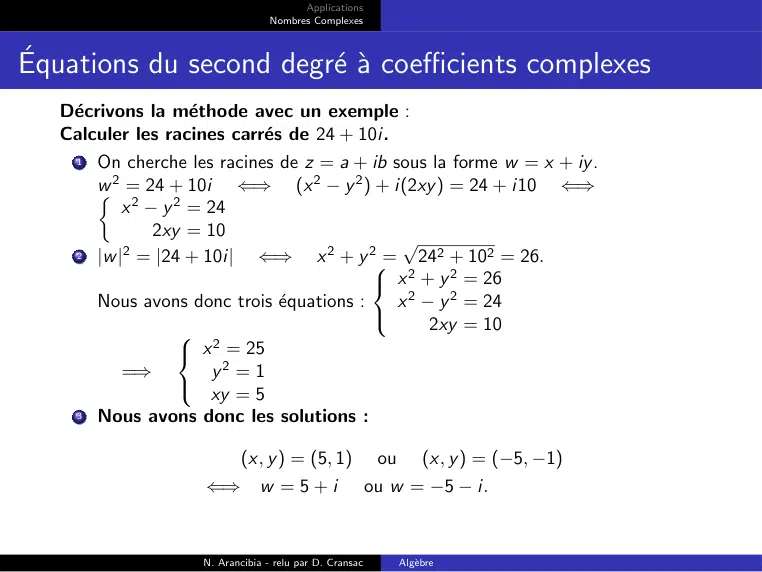

~~~text
                                          Applications
                                    Nombres Complexes

Équations du second degré à coefficients complexes
   Décrivons la méthode avec un exemple :
   Calculer les racines carrés de 24 + 10i.
     1   On cherche les racines de z = a + ib sous la forme w = x + iy .
         w 2 = 24 + 10i ⇐⇒ (x 2 − y 2 ) + i(2xy ) = 24 + i10 ⇐⇒
             x 2 − y 2 = 24
         
                  2xy = 10
                                                √
     2   |w |2 = |24 + 10i| ⇐⇒ x 2 + y 2= 242 + 102 = 26.
                                             x 2 + y 2 = 26
         Nous avons donc trois équations :    x 2 − y 2 = 24
                                                    2xy = 10
                                            
                      2
                      x = 25
             =⇒           y2 = 1
                         xy = 5
                     
     3   Nous avons donc les solutions :

                             (x, y ) = (5, 1)               ou        (x, y ) = (−5, −1)
                      ⇐⇒         w =5+i                    ou w = −5 − i.

                      N. Arancibia - relu par D. Cransac         Algèbre
~~~

## Page 47

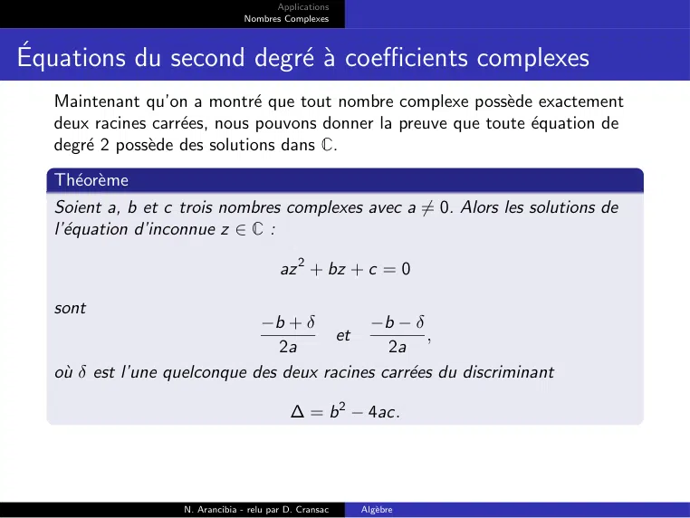

~~~text
                                        Applications
                                  Nombres Complexes

Équations du second degré à coefficients complexes
   Maintenant qu’on a montré que tout nombre complexe possède exactement
   deux racines carrées, nous pouvons donner la preuve que toute équation de
   degré 2 possède des solutions dans C.
   Théorème
   Soient a, b et c trois nombres complexes avec a 6= 0. Alors les solutions de
   l’équation d’inconnue z ∈ C :

                                          az 2 + bz + c = 0

   sont
                               −b + δ        −b − δ
                                         et           ,
                                 2a             2a
   où δ est l’une quelconque des deux racines carrées du discriminant

                                            ∆ = b 2 − 4ac.

                    N. Arancibia - relu par D. Cransac   Algèbre
~~~

## Page 48

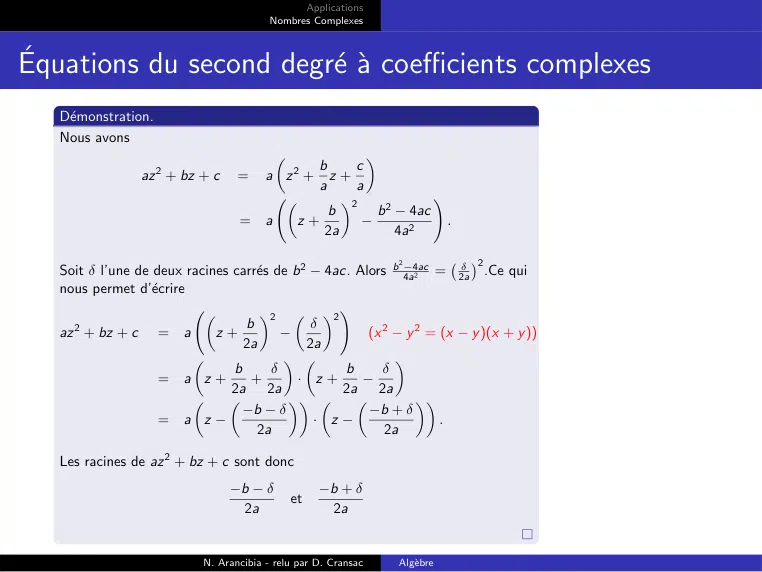

~~~text
                                               Applications
                                         Nombres Complexes

Équations du second degré à coefficients complexes
   Démonstration.
   Nous avons
                                                       
                                               b      c
                 az 2 + bz + c    =     a z2 + z +
                                                a     a
                                                    2              !
                                                          b 2 − 4ac
                                            
                                                  b
                                  =     a    z+        −              .
                                                 2a           4a2

                                                              2
                                                                −4ac    δ 2
   Soit δ l’une de deux racines carrés de b 2 − 4ac. Alors b 4a
                                                                          
                                                                 2   = 2a    .Ce qui
   nous permet d’écrire
                                    2  2 !
                                  b            δ
   az 2 + bz + c = a         z+          −              (x 2 − y 2 = (x − y )(x + y ))
                                  2a          2a
                                                          
                                b      δ            b      δ
                    = a z+         +        · z+       −
                                2a 2a               2a 2a
                                                           
                                 −b − δ                 −b + δ
                    = a z−                     · z−                  .
                                    2a                     2a

   Les racines de az 2 + bz + c sont donc
                                 −b − δ            −b + δ
                                             et
                                  2a                2a

                           N. Arancibia - relu par D. Cransac   Algèbre
~~~

## Page 49

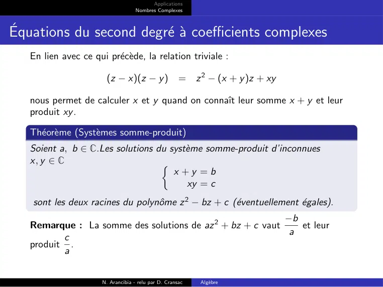

~~~text
                                          Applications
                                    Nombres Complexes

Équations du second degré à coefficients complexes
   En lien avec ce qui précède, la relation triviale :

                       (z − x)(z − y ) = z 2 − (x + y )z + xy

   nous permet de calculer x et y quand on connaı̂t leur somme x + y et leur
   produit xy .

   Théorème (Systèmes somme-produit)
   Soient a, b ∈ C.Les solutions du système somme-produit d’inconnues
   x, y ∈ C                       
                                     x +y =b
                                         xy = c
    sont les deux racines du polynôme z 2 − bz + c (éventuellement égales).
                                                           −b
   Remarque : La somme des solutions de az 2 + bz + c vaut    et leur
                                                            a
          c
   produit .
          a

                      N. Arancibia - relu par D. Cransac   Algèbre
~~~

## Page 50

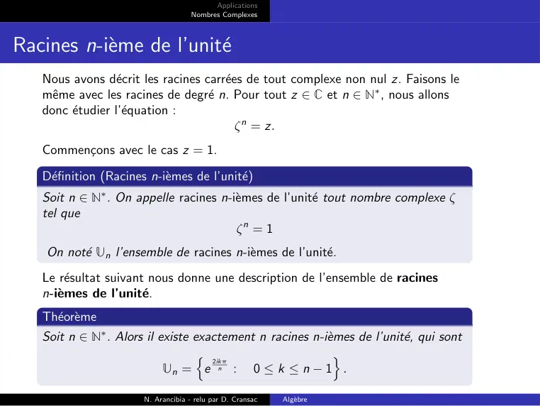

~~~text
                                           Applications
                                     Nombres Complexes

Racines n-ième de l’unité
   Nous avons décrit les racines carrées de tout complexe non nul z. Faisons le
   même avec les racines de degré n. Pour tout z ∈ C et n ∈ N∗ , nous allons
   donc étudier l’équation :
                                         ζ n = z.
   Commençons avec le cas z = 1.

   Définition (Racines n-ièmes de l’unité)
   Soit n ∈ N∗ . On appelle racines n-ièmes de l’unité tout nombre complexe ζ
   tel que
                                       ζn = 1
    On noté Un l’ensemble de racines n-ièmes de l’unité.
   Le résultat suivant nous donne une description de l’ensemble de racines
   n-ièmes de l’unité.
   Théorème
   Soit n ∈ N∗ . Alors il existe exactement n racines n-ièmes de l’unité, qui sont
                                 n 2ikπ                    o
                           Un = e n : 0 ≤ k ≤ n − 1 .

                       N. Arancibia - relu par D. Cransac   Algèbre
~~~

## Page 51

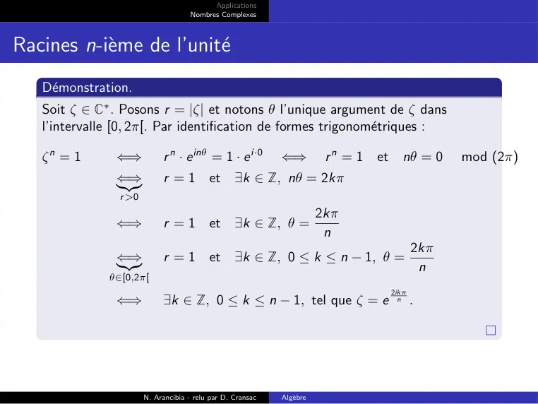

~~~text
                                           Applications
                                     Nombres Complexes

Racines n-ième de l’unité
   Démonstration.
   Soit ζ ∈ C∗ . Posons r = |ζ| et notons θ l’unique argument de ζ dans
   l’intervalle [0, 2π[. Par identification de formes trigonométriques :

   ζn = 1      ⇐⇒           r n · e inθ = 1 · e i·0         ⇐⇒          rn = 1   et nθ = 0     mod (2π)
               ⇐⇒
               |{z}         r = 1 et ∃k ∈ Z, nθ = 2kπ
                r >0
                                                                       2kπ
               ⇐⇒           r = 1 et ∃k ∈ Z, θ =
                                                                        n
                                                                                         2kπ
               ⇐⇒           r = 1 et ∃k ∈ Z, 0 ≤ k ≤ n − 1, θ =
               |{z}                                                                       n
              θ∈[0,2π[
                                                                                  2ikπ
               ⇐⇒           ∃k ∈ Z, 0 ≤ k ≤ n − 1, tel que ζ = e n .

                       N. Arancibia - relu par D. Cransac   Algèbre
~~~

## Page 52

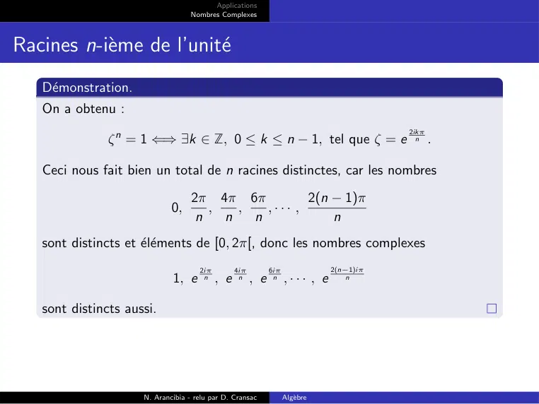

~~~text
                                         Applications
                                   Nombres Complexes

Racines n-ième de l’unité
   Démonstration.
   On a obtenu :
                                                                                      2ikπ
               ζ n = 1 ⇐⇒ ∃k ∈ Z, 0 ≤ k ≤ n − 1, tel que ζ = e n .

   Ceci nous fait bien un total de n racines distinctes, car les nombres
                                   2π 4π 6π          2(n − 1)π
                             0,       ,   ,   ,··· ,
                                    n   n   n            n
   sont distincts et éléments de [0, 2π[, donc les nombres complexes
                                     2iπ        4iπ       6iπ              2(n−1)iπ
                             1, e n , e n , e n , · · · , e                    n

   sont distincts aussi.

                     N. Arancibia - relu par D. Cransac         Algèbre
~~~

## Page 53

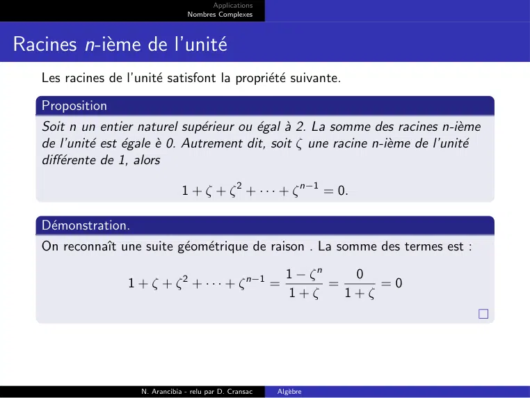

~~~text
                                          Applications
                                    Nombres Complexes

Racines n-ième de l’unité
   Les racines de l’unité satisfont la propriété suivante.
   Proposition
   Soit n un entier naturel supérieur ou égal à 2. La somme des racines n-ième
   de l’unité est égale è 0. Autrement dit, soit ζ une racine n-ième de l’unité
   différente de 1, alors

                                  1 + ζ + ζ 2 + · · · + ζ n−1 = 0.

   Démonstration.
   On reconnaı̂t une suite géométrique de raison . La somme des termes est :
                                                             1 − ζn    0
                   1 + ζ + ζ 2 + · · · + ζ n−1 =                    =     =0
                                                             1+ζ      1+ζ

                      N. Arancibia - relu par D. Cransac   Algèbre
~~~

## Page 54

~~~text
                                         Applications
                                   Nombres Complexes

Racines n-ième de l’unité
   Un exemple important, est celui de l’ensemble des racines cubiques de l’unité.

   Définition (Le nombre j)
   On note j la racine cubique de l’unité
                                                            √
                                                2iπ     1     3
                                      j =e       3    =− +i     .
                                                        2    2

   Proposition
   Quelques relations à connaı̂tre

                           j 3 = 1,           j = j 2,     1 + j + j 2 = 0,

   et pour tout z ∈ C
                                z 2 + z + 1 = (z − j)(z − j ).

                     N. Arancibia - relu par D. Cransac   Algèbre
~~~

## Page 55

~~~text
                                         Applications
                                   Nombres Complexes

Racines n-ième de l’unité
   Visualisation géométrique des racines de la unité : Soit n ≥ 3. Les
   éléménts dans Un définissent les sommets d’un polygone régulier à n côtés.

                     N. Arancibia - relu par D. Cransac   Algèbre
~~~

## Page 56

~~~text
                                         Applications
                                   Nombres Complexes

Racines n-ième
   Étudions maintenant les racines n-ième de tout nombre complexe non nul.

   Définition (Racines n-ièmes)
   Soit n ∈ N∗ et z ∈ C non nul. On appelle Racine n-ième de z tout nombre
   complexe ζ tel que
                                    z = ζn.
   L’ensemble de racines n-ièmes de z est décrit dans le résultat suivant.
   Théorème
   Soit n ∈ N∗ .
     1   La seule racine n-ième de 0 est 0. (En effet, ζ n = 0 ⇐⇒ ζ = 0.)
     2   Tout nombre complexe z = re iθ ∈ C∗ avec r > 0 et θ ∈ R possède
         exactement n racines n-ièmes, à savoir :
                               √       iθ 2ikπ
                                n
                                  r ·e n+ n    0≤k ≤n−1

                     N. Arancibia - relu par D. Cransac   Algèbre
~~~

## Page 57

~~~text
                                          Applications
                                    Nombres Complexes

Racines n-ième de l’unité
   Démonstration.
   Soit z = re iθ ∈ C∗ avec r > 0 et θ ∈ R. Posons
                                √ iθ
                            ζ = n re n    =⇒ ζ n = z.

    Nous disposons ainsi d’un exemple de racine n-ème de z, et grâce à lui,
   nous allons les trouver toutes. Pour tout ω ∈ C :

         ωn = z      ⇐⇒         ωn = ζ n
                                 n
                                  ω
                     ⇐⇒                =1
                                  ζ
                                                                      ω   2ikπ
                     ⇐⇒ ∃k ∈ Z, 0 ≤ k ≤ n − 1, tel que                  =e n
                                                                      ζ
                                                                             2ikπ
                     ⇐⇒ ∃k ∈ Z, 0 ≤ k ≤ n − 1, tel que ω = ζ · e n
                                                           √       iθ+2ikπ
                     ⇐⇒ ∃k ∈ Z, 0 ≤ k ≤ n − 1, tel que ω = n r · e n .

   Ce qui montre le résultat.
                      N. Arancibia - relu par D. Cransac   Algèbre
~~~

## Page 58

~~~text
                                         Applications
                                   Nombres Complexes

Géométrie des Nombres Complexes
   Règles de calcul sur les affixes :
        Pour tous vecteurs u~ et ~v du plan
        d’affixes respectifs z et z 0 et pour tous
        λ, µ ∈ R, le vecteur λ~v + µ~v a pour
        affixe :
                         λz + µz 0 .
        Pour A et B deux points du plan d’affixes
                                                   ~
        respectifs z et z 0 , l’affixe du vecteur AB
        est
                             z 0 − z.

   Les notions de point, vecteur, coordonnées et nombre complexe sont
   équivalentes, on préfère d’ailleurs souvent écrire qu’un point est ÉGAL à un
   nombre complexe, qu’un vecteur est ÉGAL à ses coordonnées.

                     N. Arancibia - relu par D. Cransac   Algèbre
~~~

## Page 59

~~~text
                                               Applications
                                         Nombres Complexes

Géométrie des Nombres Complexes
   Définition
   Soit z = x + iy ∈ C.
       On appelle module de z le nombre réel positif noté |z| et défini par
                     p                         q                      
                |z| = x 2 + y 2    i.e. |z| = Re2 (z) + Im2 (z)

   Remarque Avec (z, z 0 ) ∈ C2 O(0), M(z) et M 0 (z 0 )

                    |z| = OM                                       |z − z 0 | = MM 0

                           N. Arancibia - relu par D. Cransac   Algèbre
~~~

## Page 60

~~~text
                                       Applications
                                 Nombres Complexes

Géométrie des Nombres Complexes
   On en déduit que pour tout R > 0 :
       Le cercle de centre a et rayon R est

                                         {z ∈ C : |z − a| = R}.

       Le disque ouvert de centre a et rayon R est

                                         {z ∈ C : |z − a| < R}.

       Le disque fermé de centre a et rayon R est

                                         {z ∈ C : |z − a| ≤ R}.

                   N. Arancibia - relu par D. Cransac   Algèbre
~~~

## Page 61

~~~text
                                       Applications
                                 Nombres Complexes

Géométrie des Nombres Complexes
      L’addition de deux nombres complexes s’interprète géométriquement en
      termes de translation : En effet soit u ∈ C. Alors l’application

                                               tu : C → C
                                                        z 7→ z + u.

      correspond géométriquement à la translation de vecteur u~.
      L’application

                                                SO : C → C
                                                         z 7→ −z.

      correspond, géométriquement, à la symétrie de centre O.

                   N. Arancibia - relu par D. Cransac      Algèbre
~~~

## Page 62

~~~text
                                       Applications
                                 Nombres Complexes

Géométrie des Nombres Complexes
      L’application

                                                  Sx : C → C
                                                        z 7→ z.

      correspond, géométriquement, à la symétrie d’axe Ox .
      L’application

                                                 Sy : C → C
                                                        z 7→ −z.

      correspond, géométriquement, à la symétrie d’axe Oy .

                   N. Arancibia - relu par D. Cransac    Algèbre
~~~

## Page 63

~~~text
                                            Applications
                                      Nombres Complexes

Géométrie des Nombres Complexes
   Le produit de deux nombres complexes s’interprète géométriquement en
   termes d’homothétie et de rotation. En effet :
       Soit λ ∈ R. Alors l’application

                                         Hλ : C → C
                                                 z 7→ λz.

       correspond, géométriquement, à l’homothétie de centre O et de rapport
       λ.
       Soit θ ∈ R. Alors l’application

                                         Rθ : C → C
                                                z 7→ e iθ z.

       correspond, géométriquement, à la rotation de centre O et d’angle θ.
       Soit ω = ρe iθ . Alors l’application

                                      HRω : C → C
                                                z 7→ ρe iθ z.

       correspond, géométriquement, à la composée d’une rotation de centre O
       et d’angle θ avec une homothétie de centre O et de rapport ρ
       (similitude).
                        N. Arancibia - relu par D. Cransac      Algèbre
~~~
