# CM6-Polynomes_2021-2022_Algebre1_P1S1_NArancibia-DCransac.pdf

[Ouvrir l’original](https://drive.google.com/open?id=1kcQjFrtwN7lCkX8mSBuz-4YoDpuE4bBl) · Les deux lectures automatiques du PDF divergent sur les pages indiquées. Leur fac-similé accompagne le texte.

**Pages présentant un écart entre les deux extractions** — 1–58.

## Page 1

~~~text
                                                 Polynômes
                    Décomposition en facteurs irréductibles

Algèbre-Premier semestre 2021

   1   Polynômes

   2   Décomposition en facteurs irréductibles

                         N. Arancibia - relu par D. Cransac     Algèbre
~~~

## Page 2

~~~text
                                             Polynômes
                Décomposition en facteurs irréductibles

Algèbre-Premier semestre 2021

                                                Thèmes

      Logique et raisonnement
      Ensembles
      Relations binaires
      Applications
      Nombres complexes
      Polynômes
      Fractions rationnelles

                     N. Arancibia - relu par D. Cransac     Algèbre
~~~

## Page 3

~~~text
                                               Polynômes
                  Décomposition en facteurs irréductibles

Polynômes
   Note : Dans ce chapitre nous travaillerons à la fois sur R et sur C. Afin
   d’alléger l’écriture, nous utiliserons la lettre K pour désigner R ou C. Ainsi
   une propriété ou une définition qui est valable à la fois sur R et sur C sera
   énoncée sur K.

   Définition (Scalaire)
   On appelle scalaire un élément de K.

                       N. Arancibia - relu par D. Cransac     Algèbre
~~~

## Page 4

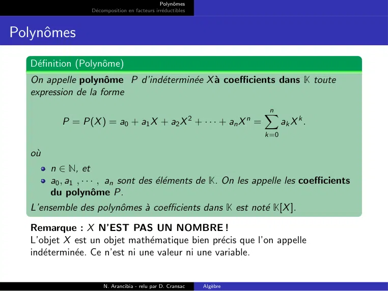

~~~text
                                                Polynômes
                   Décomposition en facteurs irréductibles

Polynômes
   Définition (Polynôme)
   On appelle polynôme P d’indéterminée X à coefficients dans K toute
   expression de la forme
                                                                          n
                                                                          X
            P = P(X ) = a0 + a1 X + a2 X 2 + · · · + an X n =                   ak X k .
                                                                          k=0

   où
         n ∈ N, et
         a0 , a1 , · · · , an sont des éléments de K. On les appelle les coefficients
         du polynôme P.
   L’ensemble des polynômes à coefficients dans K est noté K[X ].

   Remarque : X N’EST PAS UN NOMBRE !
   L’objet X est un objet mathématique bien précis que l’on appelle
   indéterminée. Ce n’est ni une valeur ni une variable.

                        N. Arancibia - relu par D. Cransac     Algèbre
~~~

## Page 5

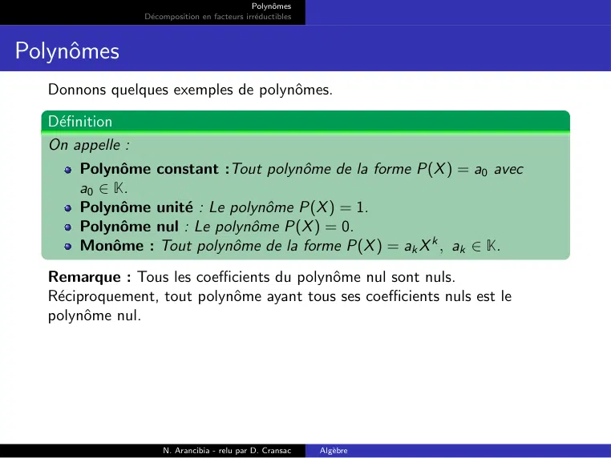

~~~text
                                               Polynômes
                  Décomposition en facteurs irréductibles

Polynômes
   Donnons quelques exemples de polynômes.
   Définition
   On appelle :
       Polynôme constant :Tout polynôme de la forme P(X ) = a0 avec
       a0 ∈ K.
       Polynôme unité : Le polynôme P(X ) = 1.
       Polynôme nul : Le polynôme P(X ) = 0.
       Monôme : Tout polynôme de la forme P(X ) = ak X k , ak ∈ K.

   Remarque : Tous les coefficients du polynôme nul sont nuls.
   Réciproquement, tout polynôme ayant tous ses coefficients nuls est le
   polynôme nul.

                       N. Arancibia - relu par D. Cransac     Algèbre
~~~

## Page 6

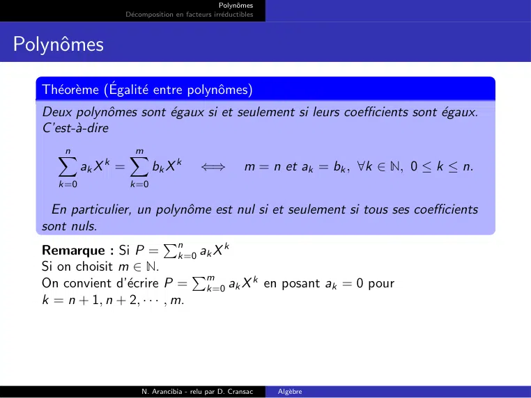

~~~text
                                                    Polynômes
                       Décomposition en facteurs irréductibles

Polynômes

   Théorème (Égalité entre polynômes)
   Deux polynômes sont égaux si et seulement si leurs coefficients sont égaux.
   C’est-à-dire
     n
     X                  m
                        X
            ak X k =           bk X k          ⇐⇒           m = n et ak = bk , ∀k ∈ N, 0 ≤ k ≤ n.
      k=0               k=0

     En particulier, un polynôme est nul si et seulement si tous ses coefficients
   sont nuls.
                           Pn
   Remarque : Si P = k=0 ak X k
   Si on choisit m ∈ N.         Pm
   On convient d’écrire P = k=0 ak X k en posant ak = 0 pour
   k = n + 1, n + 2, · · · , m.

                            N. Arancibia - relu par D. Cransac     Algèbre
~~~

## Page 7

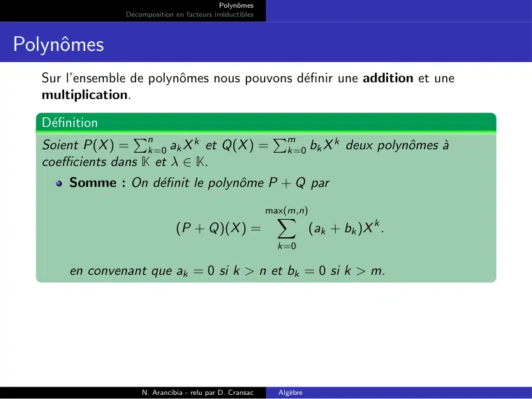

~~~text
                                              Polynômes
                 Décomposition en facteurs irréductibles

Polynômes
   Sur l’ensemble de polynômes nous pouvons définir une addition et une
   multiplication.
   Définition
                   Pn                  Pm
   Soient P(X ) = k=0 ak X k et Q(X ) = k=0 bk X k deux polynômes à
   coefficients dans K et λ ∈ K.
        Somme : On définit le polynôme P + Q par
                                                             max(m,n)
                                                               X
                                 (P + Q)(X ) =                            (ak + bk )X k .
                                                               k=0

        en convenant que ak = 0 si k > n et bk = 0 si k > m.

                      N. Arancibia - relu par D. Cransac       Algèbre
~~~

## Page 8

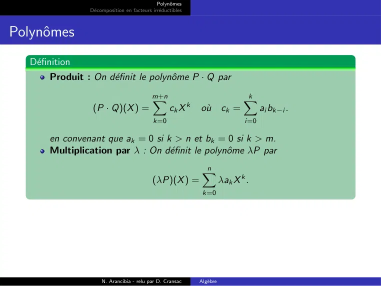

~~~text
                                               Polynômes
                  Décomposition en facteurs irréductibles

Polynômes
   Définition
         Produit : On définit le polynôme P · Q par
                                             m+n
                                             X                                  k
                                                                                X
                   (P · Q)(X ) =                     ck X k   où        ck =         ai bk−i .
                                              k=0                               i=0

       en convenant que ak = 0 si k > n et bk = 0 si k > m.
       Multiplication par λ : On définit le polynôme λP par
                                                               n
                                                               X
                                             (λP)(X ) =                  λak X k .
                                                               k=0

                       N. Arancibia - relu par D. Cransac     Algèbre
~~~

## Page 9

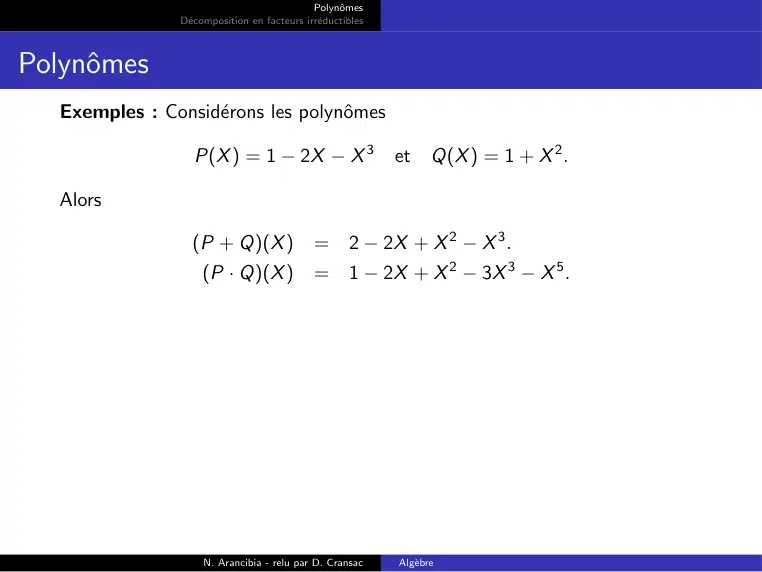

~~~text
                                              Polynômes
                 Décomposition en facteurs irréductibles

Polynômes
   Exemples : Considérons les polynômes

                    P(X ) = 1 − 2X − X 3                     et     Q(X ) = 1 + X 2 .

   Alors

                   (P + Q)(X ) =                      2 − 2X + X 2 − X 3 .
                     (P · Q)(X ) =                    1 − 2X + X 2 − 3X 3 − X 5 .

                      N. Arancibia - relu par D. Cransac     Algèbre
~~~

## Page 10

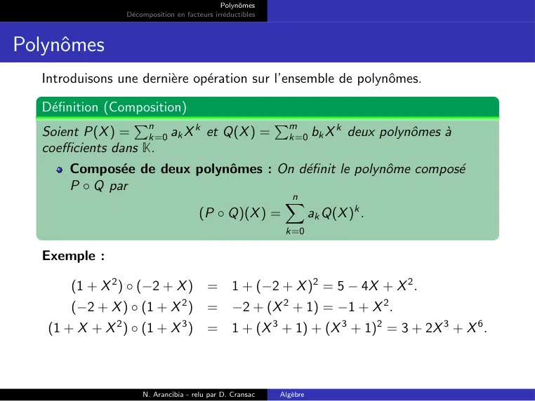

~~~text
                                              Polynômes
                 Décomposition en facteurs irréductibles

Polynômes
   Introduisons une dernière opération sur l’ensemble de polynômes.

   Définition (Composition)
                   Pn                  Pm
   Soient P(X ) = k=0 ak X k et Q(X ) = k=0 bk X k deux polynômes à
   coefficients dans K.
       Composée de deux polynômes : On définit le polynôme composé
       P ◦ Q par
                                       Xn
                         (P ◦ Q)(X ) =    ak Q(X )k .
                                                              k=0

   Exemple :

        (1 + X 2 ) ◦ (−2 + X ) = 1 + (−2 + X )2 = 5 − 4X + X 2 .
        (−2 + X ) ◦ (1 + X 2 ) = −2 + (X 2 + 1) = −1 + X 2 .
    (1 + X + X 2 ) ◦ (1 + X 3 ) =                 1 + (X 3 + 1) + (X 3 + 1)2 = 3 + 2X 3 + X 6 .

                      N. Arancibia - relu par D. Cransac     Algèbre
~~~

## Page 11

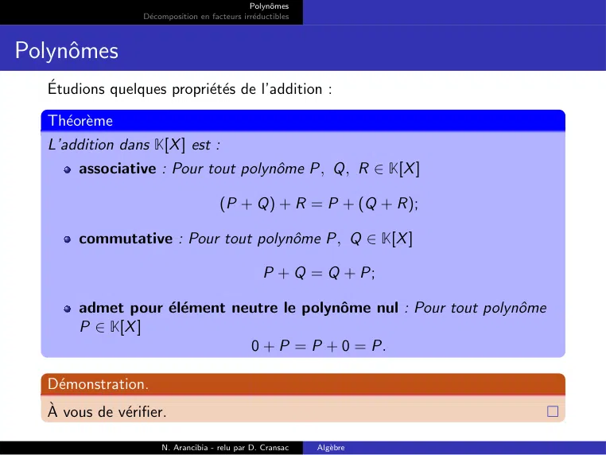

~~~text
                                                Polynômes
                   Décomposition en facteurs irréductibles

Polynômes
   Étudions quelques propriétés de l’addition :
   Théorème
   L’addition dans K[X ] est :
        associative : Pour tout polynôme P, Q, R ∈ K[X ]

                                        (P + Q) + R = P + (Q + R);

        commutative : Pour tout polynôme P, Q ∈ K[X ]

                                                    P + Q = Q + P;

        admet pour élément neutre le polynôme nul : Pour tout polynôme
        P ∈ K[X ]
                               0 + P = P + 0 = P.

   Démonstration.
   À vous de vérifier.

                        N. Arancibia - relu par D. Cransac     Algèbre
~~~

## Page 12

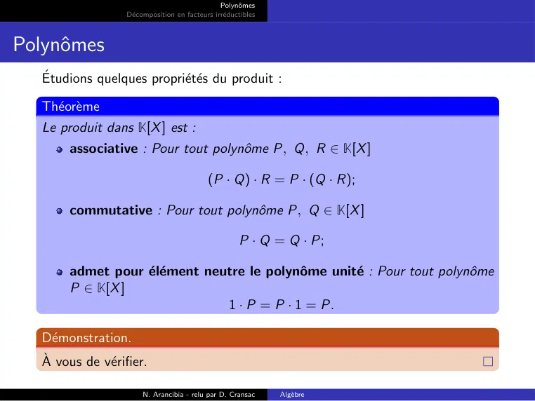

~~~text
                                                Polynômes
                   Décomposition en facteurs irréductibles

Polynômes
   Étudions quelques propriétés du produit :
   Théorème
   Le produit dans K[X ] est :
        associative : Pour tout polynôme P, Q, R ∈ K[X ]

                                            (P · Q) · R = P · (Q · R);

        commutative : Pour tout polynôme P, Q ∈ K[X ]

                                                      P · Q = Q · P;

        admet pour élément neutre le polynôme unité : Pour tout polynôme
        P ∈ K[X ]
                                1 · P = P · 1 = P.

   Démonstration.
   À vous de vérifier.

                        N. Arancibia - relu par D. Cransac     Algèbre
~~~

## Page 13

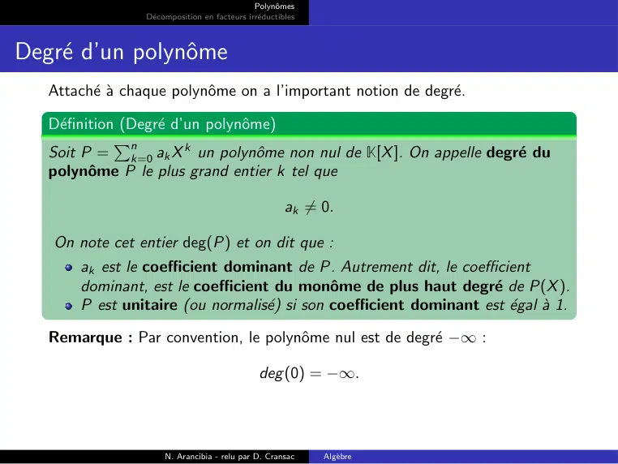

~~~text
                                              Polynômes
                 Décomposition en facteurs irréductibles

Degré d’un polynôme
   Attaché à chaque polynôme on a l’important notion de degré.

   Définition (Degré d’un polynôme)
              Pn
   Soit P = k=0 ak X k un polynôme non nul de K[X ]. On appelle degré du
   polynôme P le plus grand entier k tel que

                                                       ak 6= 0.

   On note cet entier deg(P) et on dit que :
       ak est le coefficient dominant de P. Autrement dit, le coefficient
       dominant, est le coefficient du monôme de plus haut degré de P(X ).
       P est unitaire (ou normalisé) si son coefficient dominant est égal à 1.

   Remarque : Par convention, le polynôme nul est de degré −∞ :

                                                deg (0) = −∞.

                      N. Arancibia - relu par D. Cransac     Algèbre
~~~

## Page 14

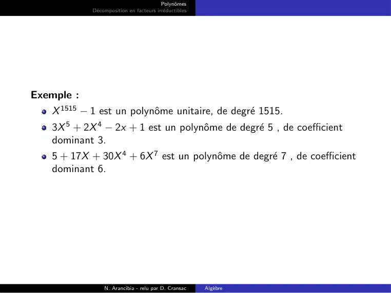

~~~text
                                         Polynômes
            Décomposition en facteurs irréductibles

Exemple :
   X 1515 − 1 est un polynôme unitaire, de degré 1515.
   3X 5 + 2X 4 − 2x + 1 est un polynôme de degré 5 , de coefficient
   dominant 3.
   5 + 17X + 30X 4 + 6X 7 est un polynôme de degré 7 , de coefficient
   dominant 6.

                 N. Arancibia - relu par D. Cransac     Algèbre
~~~

## Page 15

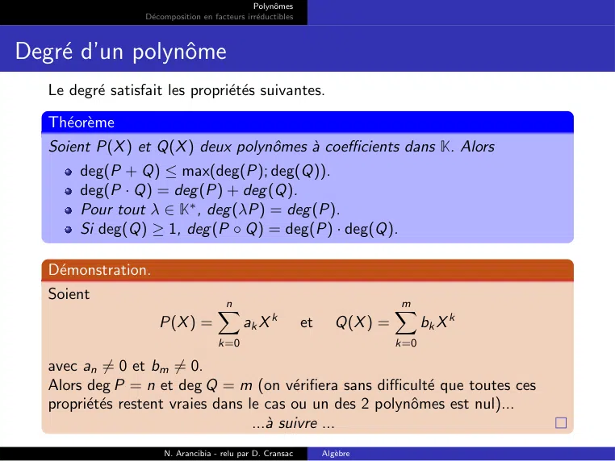

~~~text
                                                Polynômes
                   Décomposition en facteurs irréductibles

Degré d’un polynôme
   Le degré satisfait les propriétés suivantes.
   Théorème
   Soient P(X ) et Q(X ) deux polynômes à coefficients dans K. Alors
        deg(P + Q) ≤ max(deg(P); deg(Q)).
        deg(P · Q) = deg (P) + deg (Q).
        Pour tout λ ∈ K∗ , deg (λP) = deg (P).
        Si deg(Q) ≥ 1, deg (P ◦ Q) = deg(P) · deg(Q).

   Démonstration.
   Soient
                                      n
                                      X                                          m
                                                                                 X
                      P(X ) =                 ak X k           et      Q(X ) =         bk X k
                                       k=0                                       k=0

   avec an 6= 0 et bm 6= 0.
   Alors deg P = n et deg Q = m (on vérifiera sans difficulté que toutes ces
   propriétés restent vraies dans le cas ou un des 2 polynômes est nul)...
                                     ...à suivre ...
                        N. Arancibia - relu par D. Cransac          Algèbre
~~~

## Page 16

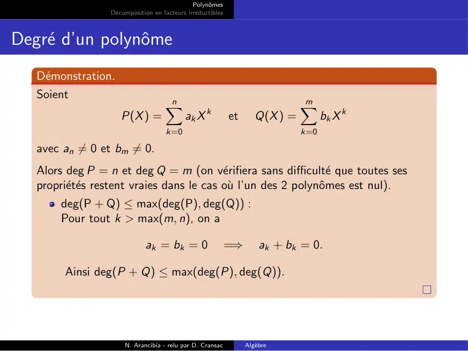

~~~text
                                               Polynômes
                  Décomposition en facteurs irréductibles

Degré d’un polynôme
   Démonstration.
   Soient
                                     n
                                     X                                          m
                                                                                X
                     P(X ) =                 ak X k           et      Q(X ) =         bk X k
                                      k=0                                       k=0

   avec an 6= 0 et bm 6= 0.
   Alors deg P = n et deg Q = m (on vérifiera sans difficulté que toutes ses
   propriétés restent vraies dans le cas où l’un des 2 polynômes est nul).
       deg(P + Q) ≤ max(deg(P), deg(Q)) :
       Pour tout k > max(m, n), on a

                              ak = bk = 0                     =⇒        ak + bk = 0.

        Ainsi deg(P + Q) ≤ max(deg(P), deg(Q)).

                       N. Arancibia - relu par D. Cransac          Algèbre
~~~

## Page 17

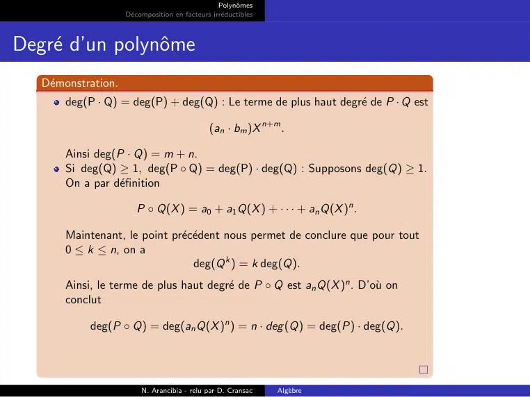

~~~text
                                                  Polynômes
                     Décomposition en facteurs irréductibles

Degré d’un polynôme
   Démonstration.
       deg(P · Q) = deg(P) + deg(Q) : Le terme de plus haut degré de P · Q est

                                                (an · bm )X n+m .

       Ainsi deg(P · Q) = m + n.
       Si deg(Q) ≥ 1, deg(P ◦ Q) = deg(P) · deg(Q) : Supposons deg(Q) ≥ 1.
       On a par définition

                        P ◦ Q(X ) = a0 + a1 Q(X ) + · · · + an Q(X )n .

       Maintenant, le point précédent nous permet de conclure que pour tout
       0 ≤ k ≤ n, on a
                                 deg(Q k ) = k deg(Q).
       Ainsi, le terme de plus haut degré de P ◦ Q est an Q(X )n . D’où on
       conclut

            deg(P ◦ Q) = deg(an Q(X )n ) = n · deg (Q) = deg(P) · deg(Q).

                          N. Arancibia - relu par D. Cransac     Algèbre
~~~

## Page 18

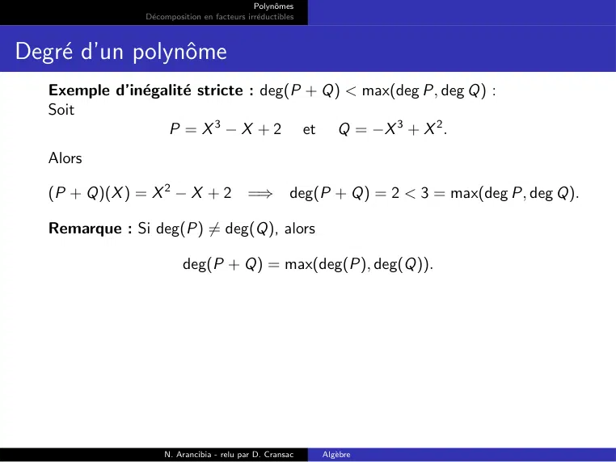

~~~text
                                             Polynômes
                Décomposition en facteurs irréductibles

Degré d’un polynôme
   Exemple d’inégalité stricte : deg(P + Q) < max(deg P, deg Q) :
   Soit
                   P = X 3 − X + 2 et Q = −X 3 + X 2 .
   Alors

   (P + Q)(X ) = X 2 − X + 2                =⇒         deg(P + Q) = 2 < 3 = max(deg P, deg Q).

   Remarque : Si deg(P) 6= deg(Q), alors

                          deg(P + Q) = max(deg(P), deg(Q)).

                     N. Arancibia - relu par D. Cransac     Algèbre
~~~

## Page 19

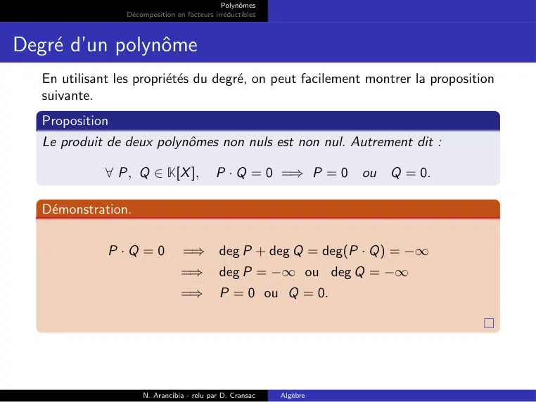

~~~text
                                               Polynômes
                  Décomposition en facteurs irréductibles

Degré d’un polynôme
   En utilisant les propriétés du degré, on peut facilement montrer la proposition
   suivante.
   Proposition
   Le produit de deux polynômes non nuls est non nul. Autrement dit :

              ∀ P, Q ∈ K[X ],                 P · Q = 0 =⇒ P = 0 ou Q = 0.

   Démonstration.

              P ·Q =0              =⇒ deg P + deg Q = deg(P · Q) = −∞
                                   =⇒          deg P = −∞ ou deg Q = −∞
                                   =⇒          P = 0 ou Q = 0.

                       N. Arancibia - relu par D. Cransac     Algèbre
~~~

## Page 20

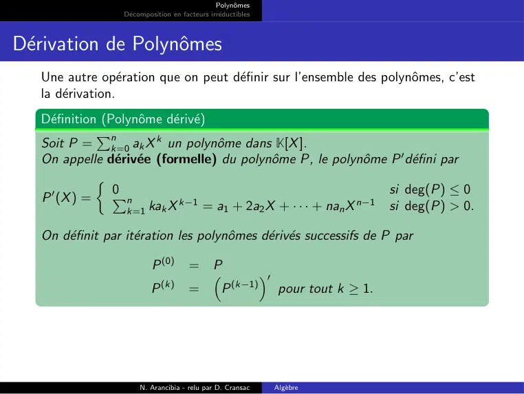

~~~text
                                               Polynômes
                  Décomposition en facteurs irréductibles

Dérivation de Polynômes
   Une autre opération que on peut définir sur l’ensemble des polynômes, c’est
   la dérivation.
   Définition (Polynôme dérivé)
              Pn
   Soit P = k=0 ak X k un polynôme dans K[X ].
   On appelle dérivée (formelle) du polynôme P, le polynôme P 0 défini par
              
                 0P                                                si deg(P) ≤ 0
   P 0 (X ) =      n          k−1                              n−1
                   k=1 ka k X     = a1 + 2a2 X + · · · + nan X     si deg(P) > 0.

   On définit par itération les polynômes dérivés successifs de P par

                          P (0)        =       P
                                                      0
                              (k)
                          P            =        P (k−1) pour tout k ≥ 1.

                       N. Arancibia - relu par D. Cransac     Algèbre
~~~

## Page 21

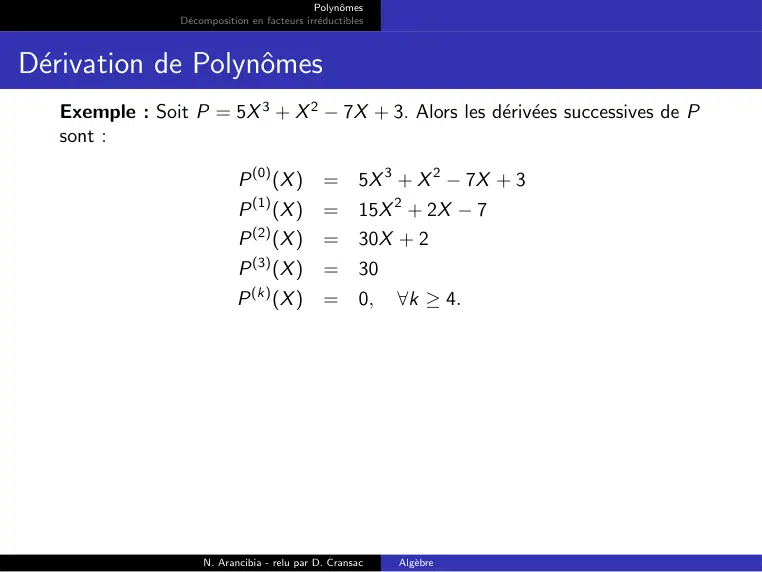

~~~text
                                              Polynômes
                 Décomposition en facteurs irréductibles

Dérivation de Polynômes
   Exemple : Soit P = 5X 3 + X 2 − 7X + 3. Alors les dérivées successives de P
   sont :

                             P (0) (X )          = 5X 3 + X 2 − 7X + 3
                                 (1)
                             P         (X ) =           15X 2 + 2X − 7
                             P (2) (X ) =               30X + 2
                             P (3) (X ) =               30
                                 (k)
                             P         (X ) =           0,   ∀k ≥ 4.

                      N. Arancibia - relu par D. Cransac     Algèbre
~~~

## Page 22

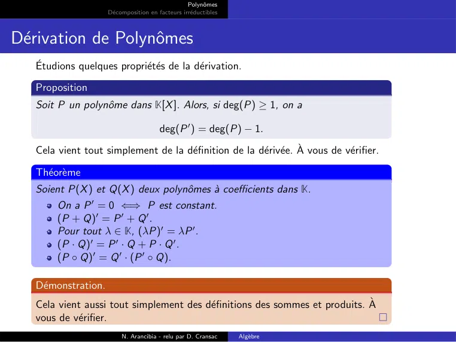

~~~text
                                                  Polynômes
                     Décomposition en facteurs irréductibles

Dérivation de Polynômes
   Étudions quelques propriétés de la dérivation.
   Proposition
   Soit P un polynôme dans K[X ]. Alors, si deg(P) ≥ 1, on a

                                        deg(P 0 ) = deg(P) − 1.

   Cela vient tout simplement de la définition de la dérivée. À vous de vérifier.
   Théorème
   Soient P(X ) et Q(X ) deux polynômes à coefficients dans K.
        On a P 0 = 0 ⇐⇒ P est constant.
        (P + Q)0 = P 0 + Q 0 .
        Pour tout λ ∈ K, (λP)0 = λP 0 .
        (P · Q)0 = P 0 · Q + P · Q 0 .
        (P ◦ Q)0 = Q 0 · (P 0 ◦ Q).

   Démonstration.
   Cela vient aussi tout simplement des définitions des sommes et produits. À
   vous de vérifier.
                          N. Arancibia - relu par D. Cransac     Algèbre
~~~

## Page 23

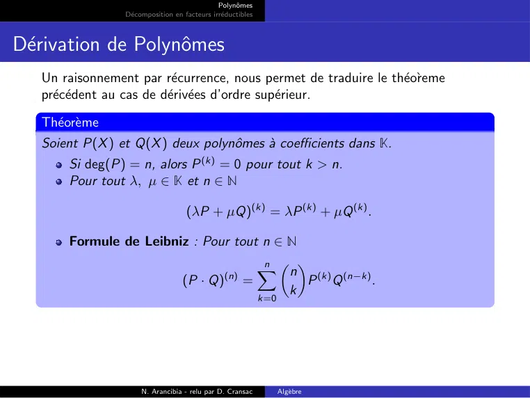

~~~text
                                              Polynômes
                 Décomposition en facteurs irréductibles

Dérivation de Polynômes
   Un raisonnement par récurrence, nous permet de traduire le théor̀eme
   précédent au cas de dérivées d’ordre supérieur.
   Théorème
   Soient P(X ) et Q(X ) deux polynômes à coefficients dans K.
       Si deg(P) = n, alors P (k) = 0 pour tout k > n.
       Pour tout λ, µ ∈ K et n ∈ N

                                    (λP + µQ)(k) = λP (k) + µQ (k) .

       Formule de Leibniz : Pour tout n ∈ N
                                      n  
                                     X    n (k) (n−k)
                        (P · Q)(n) =        P Q       .
                                          k
                                                             k=0

                      N. Arancibia - relu par D. Cransac           Algèbre
~~~

## Page 24

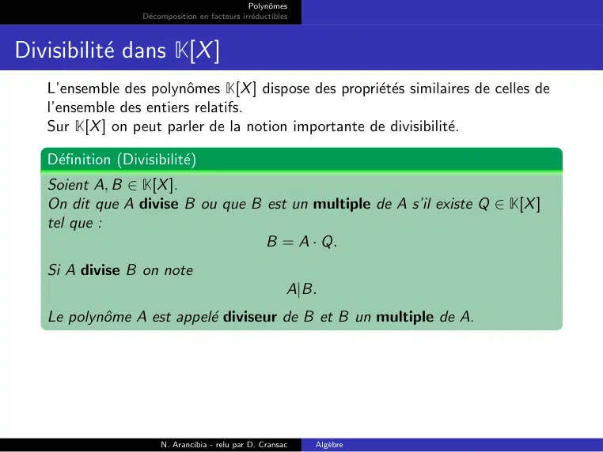

~~~text
                                                 Polynômes
                    Décomposition en facteurs irréductibles

Divisibilité dans K[X ]
   L’ensemble des polynômes K[X ] dispose des propriétés similaires de celles de
   l’ensemble des entiers relatifs.
   Sur K[X ] on peut parler de la notion importante de divisibilité.

   Définition (Divisibilité)
   Soient A, B ∈ K[X ].
   On dit que A divise B ou que B est un multiple de A s’il existe Q ∈ K[X ]
   tel que :
                                  B = A · Q.
   Si A divise B on note
                                                            A|B.
   Le polynôme A est appelé diviseur de B et B un multiple de A.

                         N. Arancibia - relu par D. Cransac     Algèbre
~~~

## Page 25

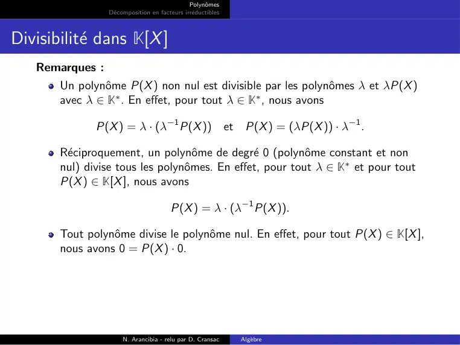

~~~text
                                              Polynômes
                 Décomposition en facteurs irréductibles

Divisibilité dans K[X ]
   Remarques :
       Un polynôme P(X ) non nul est divisible par les polynômes λ et λP(X )
       avec λ ∈ K∗ . En effet, pour tout λ ∈ K∗ , nous avons

              P(X ) = λ · (λ−1 P(X ))                        et    P(X ) = (λP(X )) · λ−1 .

       Réciproquement, un polynôme de degré 0 (polynôme constant et non
       nul) divise tous les polynômes. En effet, pour tout λ ∈ K∗ et pour tout
       P(X ) ∈ K[X ], nous avons

                                       P(X ) = λ · (λ−1 P(X )).

       Tout polynôme divise le polynôme nul. En effet, pour tout P(X ) ∈ K[X ],
       nous avons 0 = P(X ) · 0.

                      N. Arancibia - relu par D. Cransac          Algèbre
~~~

## Page 26

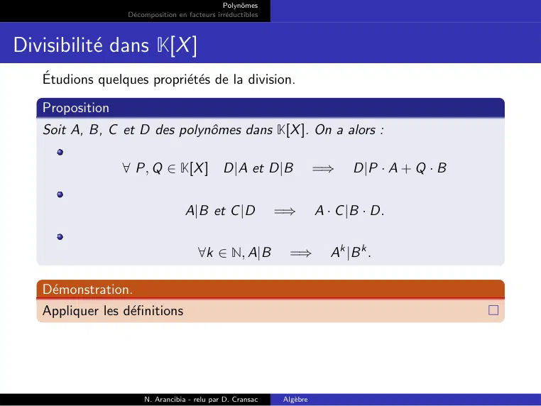

~~~text
                                               Polynômes
                  Décomposition en facteurs irréductibles

Divisibilité dans K[X ]
   Étudions quelques propriétés de la division.
   Proposition
   Soit A, B, C et D des polynômes dans K[X ]. On a alors :

                 ∀ P, Q ∈ K[X ]                D|A et D|B                =⇒     D|P · A + Q · B

                                    A|B et C |D               =⇒         A · C |B · D.

                                        ∀k ∈ N, A|B             =⇒         Ak |B k .

   Démonstration.
   Appliquer les définitions

                       N. Arancibia - relu par D. Cransac     Algèbre
~~~

## Page 27

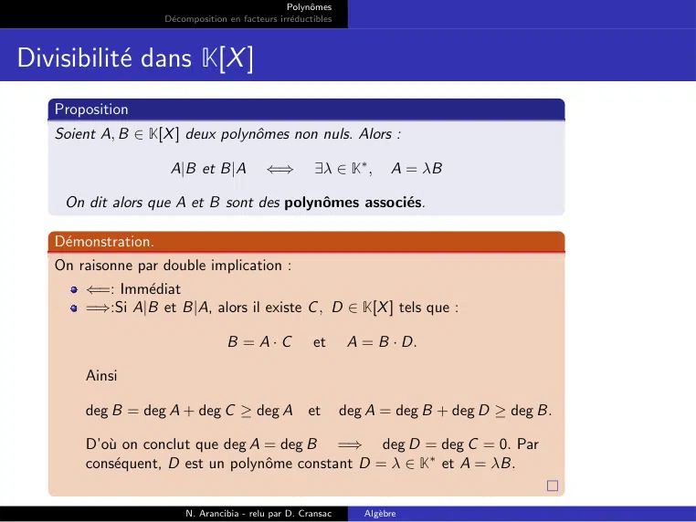

~~~text
                                                Polynômes
                   Décomposition en facteurs irréductibles

Divisibilité dans K[X ]
   Proposition
   Soient A, B ∈ K[X ] deux polynômes non nuls. Alors :

                    A|B et B|A             ⇐⇒          ∃λ ∈ K∗ ,        A = λB

    On dit alors que A et B sont des polynômes associés.

   Démonstration.
   On raisonne par double implication :
       ⇐=: Immédiat
       =⇒:Si A|B et B|A, alors il existe C , D ∈ K[X ] tels que :

                                  B =A·C               et       A = B · D.

       Ainsi

       deg B = deg A + deg C ≥ deg A et                        deg A = deg B + deg D ≥ deg B.

       D’où on conclut que deg A = deg B =⇒ deg D = deg C = 0. Par
       conséquent, D est un polynôme constant D = λ ∈ K∗ et A = λB.

                        N. Arancibia - relu par D. Cransac        Algèbre
~~~

## Page 28

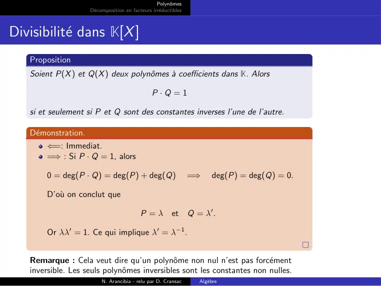

~~~text
                                                 Polynômes
                    Décomposition en facteurs irréductibles

Divisibilité dans K[X ]
   Proposition
   Soient P(X ) et Q(X ) deux polynômes à coefficients dans K. Alors

                                               P ·Q =1

   si et seulement si P et Q sont des constantes inverses l’une de l’autre.

   Démonstration.
       ⇐=: Immediat.
       =⇒ : Si P · Q = 1, alors

        0 = deg(P · Q) = deg(P) + deg(Q)                        =⇒      deg(P) = deg(Q) = 0.

        D’où on conclut que

                                          P=λ           et      Q = λ0 .

        Or λλ0 = 1. Ce qui implique λ0 = λ−1 .

   Remarque : Cela veut dire qu’un polynôme non nul n’est pas forcément
   inversible. Les seuls polynômes inversibles sont les constantes non nulles.
                         N. Arancibia - relu par D. Cransac        Algèbre
~~~

## Page 29

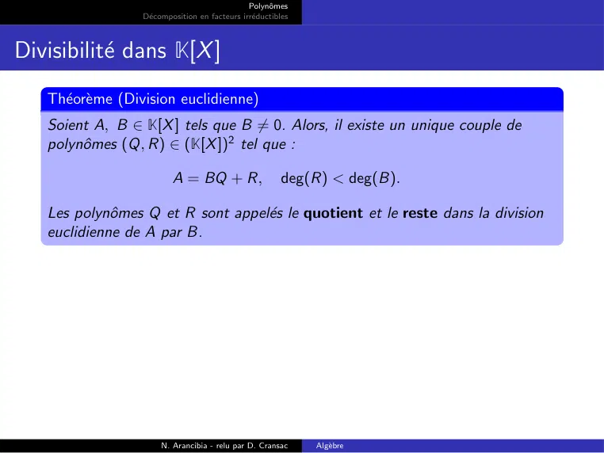

~~~text
                                              Polynômes
                 Décomposition en facteurs irréductibles

Divisibilité dans K[X ]
   Théorème (Division euclidienne)
   Soient A, B ∈ K[X ] tels que B 6= 0. Alors, il existe un unique couple de
   polynômes (Q, R) ∈ (K[X ])2 tel que :

                         A = BQ + R,                    deg(R) < deg(B).

   Les polynômes Q et R sont appelés le quotient et le reste dans la division
   euclidienne de A par B.

                      N. Arancibia - relu par D. Cransac     Algèbre
~~~

## Page 30

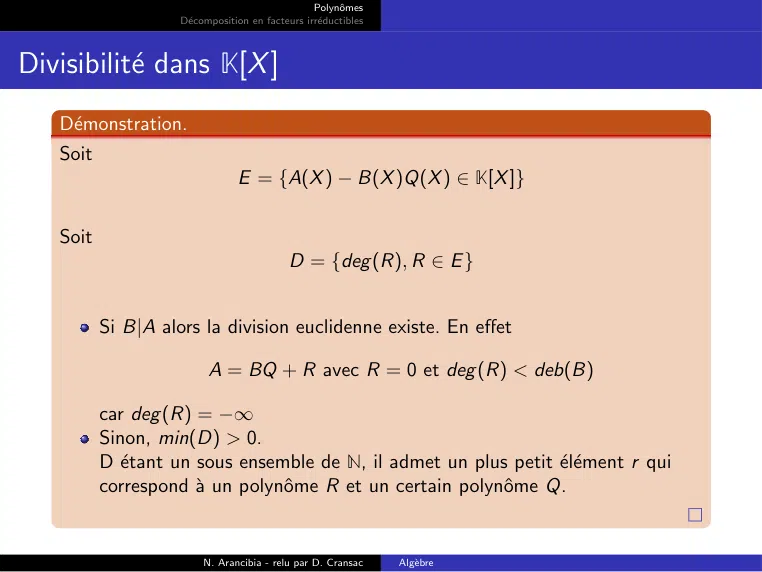

~~~text
                                                 Polynômes
                    Décomposition en facteurs irréductibles

Divisibilité dans K[X ]
   Démonstration.
   Soit
                                E = {A(X ) − B(X )Q(X ) ∈ K[X ]}

   Soit
                                            D = {deg (R), R ∈ E }

          Si B|A alors la division euclidenne existe. En effet

                          A = BQ + R avec R = 0 et deg (R) < deb(B)

          car deg (R) = −∞
          Sinon, min(D) > 0.
          D étant un sous ensemble de N, il admet un plus petit élément r qui
          correspond à un polynôme R et un certain polynôme Q.

                         N. Arancibia - relu par D. Cransac     Algèbre
~~~

## Page 31

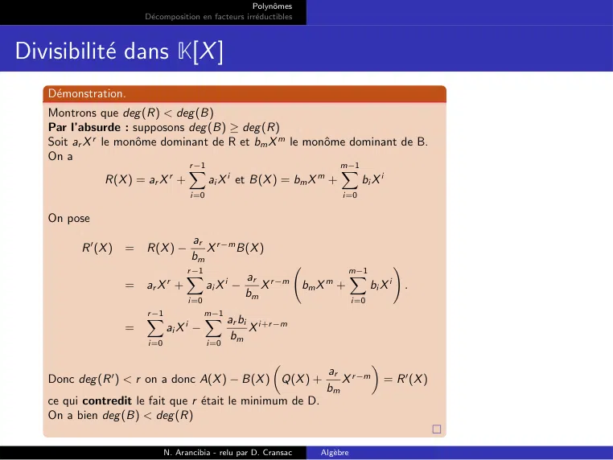

~~~text
                                                   Polynômes
                      Décomposition en facteurs irréductibles

Divisibilité dans K[X ]
   Démonstration.
   Montrons que deg (R) < deg (B)
   Par l’absurde : supposons deg (B) ≥ deg (R)
   Soit ar X r le monôme dominant de R et bm X m le monôme dominant de B.
   On a
                                 r −1
                                 X                               m−1
                                                                 X
                R(X ) = ar X r +      ai X i et B(X ) = bm X m +     bi X i
                                   i=0                                     i=0

   On pose
                              ar r −m
         R 0 (X ) = R(X ) −      X      B(X )
                              bm
                              −1
                             rX                                              m−1
                                                                                               !
                                          ar r −m                            X
                  = ar X r +     ai X i −    X                    bm X m +            bi X i       .
                                          bm
                                  i=0                                           i=0
                      r −1              m−1
                      X                 X      ar bi i+r −m
                  =          ai X i −               X
                                                bm
                      i=0                i=0

                                                                 
                                                          ar r −m
   Donc deg (R 0 ) < r on a donc A(X ) − B(X ) Q(X ) +       X      = R 0 (X )
                                                          bm
   ce qui contredit le fait que r était le minimum de D.
   On a bien deg (B) < deg (R)

                            N. Arancibia - relu par D. Cransac       Algèbre
~~~

## Page 32

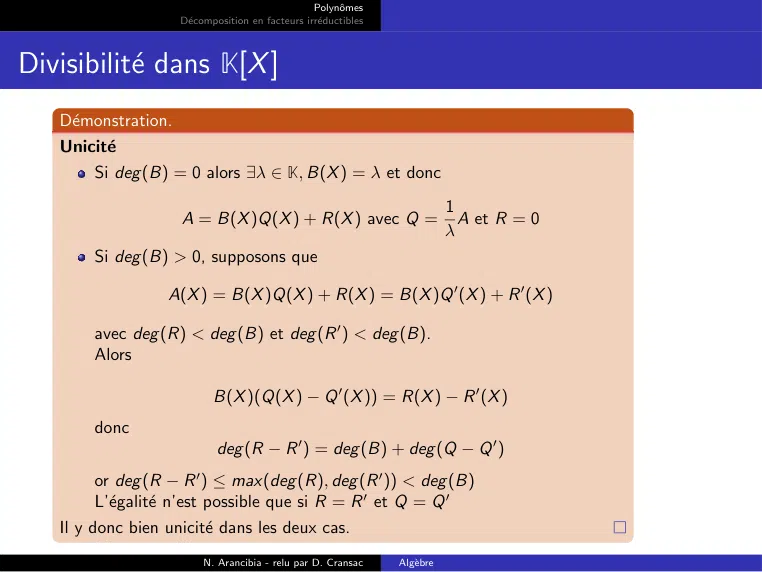

~~~text
                                                  Polynômes
                     Décomposition en facteurs irréductibles

Divisibilité dans K[X ]
   Démonstration.
   Unicité
        Si deg (B) = 0 alors ∃λ ∈ K, B(X ) = λ et donc
                                                                            1
                     A = B(X )Q(X ) + R(X ) avec Q =                          A et R = 0
                                                                            λ
        Si deg (B) > 0, supposons que

                  A(X ) = B(X )Q(X ) + R(X ) = B(X )Q 0 (X ) + R 0 (X )

        avec deg (R) < deg (B) et deg (R 0 ) < deg (B).
        Alors

                            B(X )(Q(X ) − Q 0 (X )) = R(X ) − R 0 (X )
        donc
                             deg (R − R 0 ) = deg (B) + deg (Q − Q 0 )
        or deg (R − R 0 ) ≤ max(deg (R), deg (R 0 )) < deg (B)
        L’égalité n’est possible que si R = R 0 et Q = Q 0
   Il y donc bien unicité dans les deux cas.
                          N. Arancibia - relu par D. Cransac     Algèbre
~~~

## Page 33

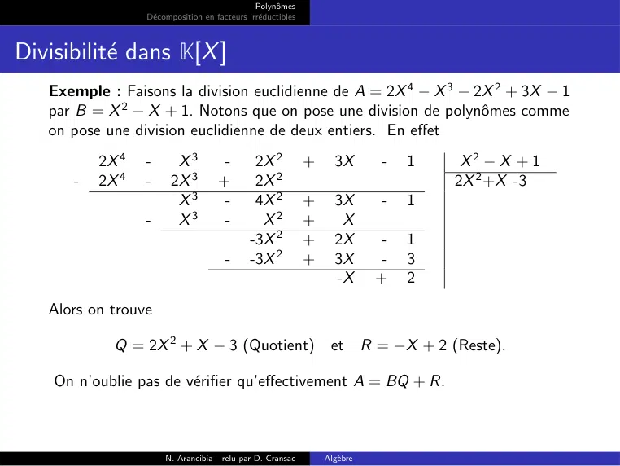

~~~text
                                              Polynômes
                 Décomposition en facteurs irréductibles

Divisibilité dans K[X ]
   Exemple : Faisons la division euclidienne de A = 2X 4 − X 3 − 2X 2 + 3X − 1
   par B = X 2 − X + 1. Notons que on pose une division de polynômes comme
   on pose une division euclidienne de deux entiers. En effet
          2X 4   -      X3           -        2X 2           +     3X         -   1      X2 − X + 1
      -   2X 4   -     2X 3         +         2X 2                                      2X 2 +X -3
                        X3           -        4X 2           +     3X         -   1
                 -      X3           -         X2            +      X
                                             -3X 2           +     2X         -   1
                                      -      -3X 2           +     3X         -   3
                                                                   -X        +    2
   Alors on trouve

            Q = 2X 2 + X − 3 (Quotient)                           et        R = −X + 2 (Reste).

    On n’oublie pas de vérifier qu’effectivement A = BQ + R.

                      N. Arancibia - relu par D. Cransac         Algèbre
~~~

## Page 34

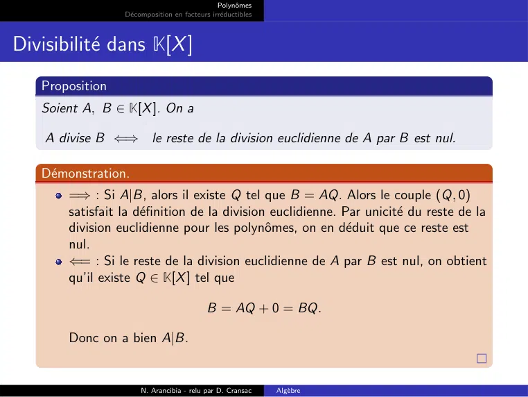

~~~text
                                               Polynômes
                  Décomposition en facteurs irréductibles

Divisibilité dans K[X ]
   Proposition
   Soient A, B ∈ K[X ]. On a

    A divise B ⇐⇒ le reste de la division euclidienne de A par B est nul.

   Démonstration.
        =⇒ : Si A|B, alors il existe Q tel que B = AQ. Alors le couple (Q, 0)
        satisfait la définition de la division euclidienne. Par unicité du reste de la
        division euclidienne pour les polynômes, on en déduit que ce reste est
        nul.
        ⇐= : Si le reste de la division euclidienne de A par B est nul, on obtient
        qu’il existe Q ∈ K[X ] tel que

                                            B = AQ + 0 = BQ.

        Donc on a bien A|B.

                       N. Arancibia - relu par D. Cransac     Algèbre
~~~

## Page 35

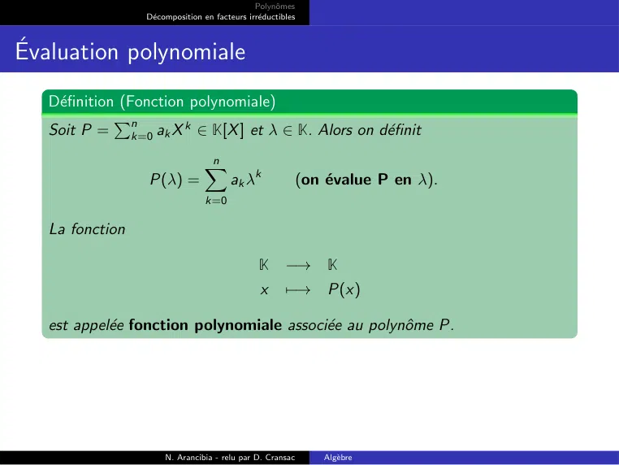

~~~text
                                              Polynômes
                 Décomposition en facteurs irréductibles

Évaluation polynomiale
   Définition (Fonction polynomiale)
              Pn
   Soit P = k=0 ak X k ∈ K[X ] et λ ∈ K. Alors on définit
                                n
                                X
                 P(λ) =                 ak λk                (on évalue P en λ).
                                 k=0

   La fonction

                                                K      −→        K
                                                x      7−→       P(x)

   est appelée fonction polynomiale associée au polynôme P.

                      N. Arancibia - relu par D. Cransac         Algèbre
~~~

## Page 36

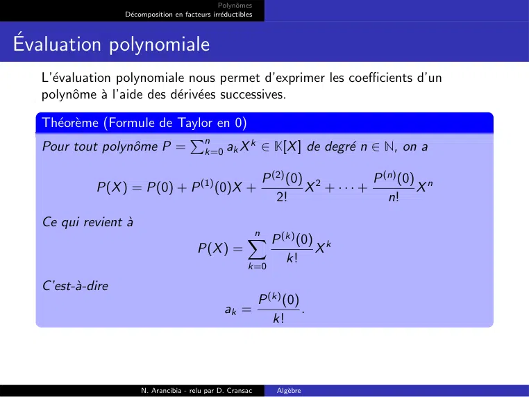

~~~text
                                                Polynômes
                   Décomposition en facteurs irréductibles

Évaluation polynomiale
   L’évaluation polynomiale nous permet d’exprimer les coefficients d’un
   polynôme à l’aide des dérivées successives.

   Théorème (Formule de Taylor en 0)
                            Pn
   Pour tout polynôme P = k=0 ak X k ∈ K[X ] de degré n ∈ N, on a

                                                               P (2) (0) 2        P (n) (0) n
             P(X ) = P(0) + P (1) (0)X +                                X + ··· +          X
                                                                  2!                 n!
   Ce qui revient à
                                                          n
                                                          X P (k) (0)
                                          P(X ) =                             Xk
                                                                      k!
                                                          k=0

   C’est-à-dire
                                                               P (k) (0)
                                                   ak =                  .
                                                                  k!

                        N. Arancibia - relu par D. Cransac         Algèbre
~~~

## Page 37

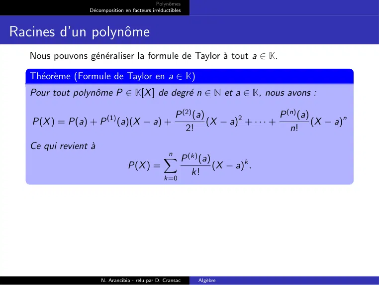

~~~text
                                               Polynômes
                  Décomposition en facteurs irréductibles

Racines d’un polynôme
   Nous pouvons généraliser la formule de Taylor à tout a ∈ K.

   Théorème (Formule de Taylor en a ∈ K)
   Pour tout polynôme P ∈ K[X ] de degré n ∈ N et a ∈ K, nous avons :

                                                        P (2) (a)                    P (n) (a)
   P(X ) = P(a) + P (1) (a)(X − a) +                              (X − a)2 + · · · +           (X − a)n
                                                           2!                           n!
   Ce qui revient à
                                                   n
                                                   X P (k) (a)
                                   P(X ) =                           (X − a)k .
                                                              k!
                                                   k=0

                       N. Arancibia - relu par D. Cransac      Algèbre
~~~

## Page 38

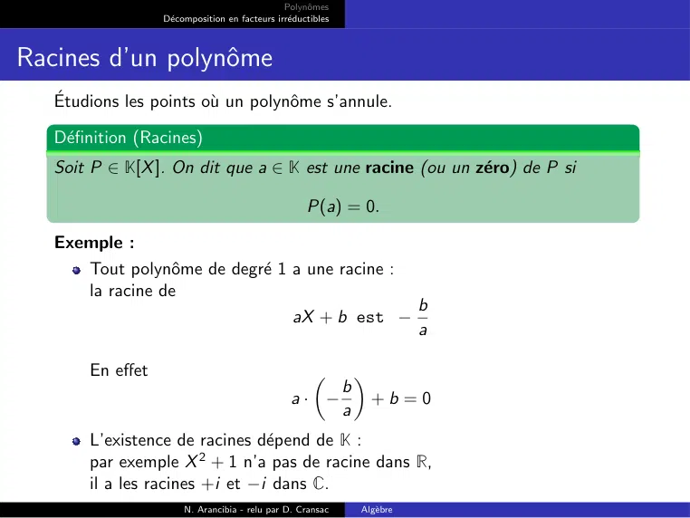

~~~text
                                                Polynômes
                   Décomposition en facteurs irréductibles

Racines d’un polynôme
   Étudions les points où un polynôme s’annule.

   Définition (Racines)
   Soit P ∈ K[X ]. On dit que a ∈ K est une racine (ou un zéro) de P si

                                                      P(a) = 0.

   Exemple :
        Tout polynôme de degré 1 a une racine :
        la racine de
                                                  b
                                   aX + b est −
                                                  a

        En effet                                              
                                                       b
                                                  a· −             +b =0
                                                       a
        L’existence de racines dépend de K :
        par exemple X 2 + 1 n’a pas de racine dans R,
        il a les racines +i et −i dans C.
                        N. Arancibia - relu par D. Cransac     Algèbre
~~~

## Page 39

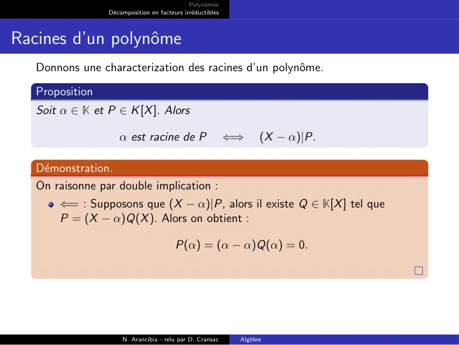

~~~text
                                              Polynômes
                 Décomposition en facteurs irréductibles

Racines d’un polynôme
   Donnons une characterization des racines d’un polynôme.
   Proposition
   Soit α ∈ K et P ∈ K [X ]. Alors

                     α est racine de P                       ⇐⇒      (X − α)|P.

   Démonstration.
   On raisonne par double implication :
       ⇐= : Supposons que (X − α)|P, alors il existe Q ∈ K[X ] tel que
       P = (X − α)Q(X ). Alors on obtient :

                                         P(α) = (α − α)Q(α) = 0.

                      N. Arancibia - relu par D. Cransac      Algèbre
~~~

## Page 40

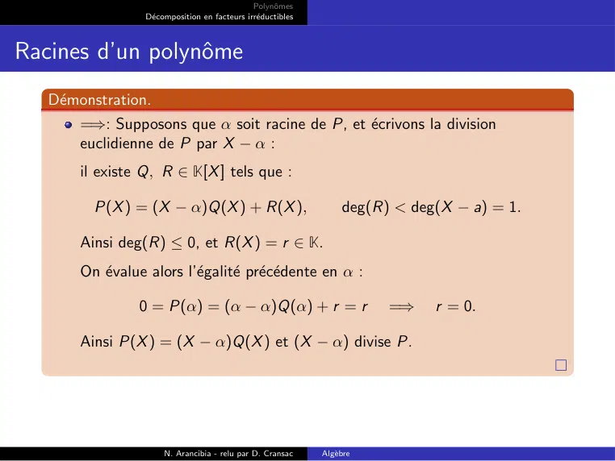

~~~text
                                               Polynômes
                  Décomposition en facteurs irréductibles

Racines d’un polynôme
   Démonstration.
       =⇒: Supposons que α soit racine de P, et écrivons la division
       euclidienne de P par X − α :
       il existe Q, R ∈ K[X ] tels que :

         P(X ) = (X − α)Q(X ) + R(X ),                             deg(R) < deg(X − a) = 1.

       Ainsi deg(R) ≤ 0, et R(X ) = r ∈ K.
       On évalue alors l’égalité précédente en α :

                 0 = P(α) = (α − α)Q(α) + r = r                          =⇒    r = 0.

       Ainsi P(X ) = (X − α)Q(X ) et (X − α) divise P.

                       N. Arancibia - relu par D. Cransac     Algèbre
~~~

## Page 41

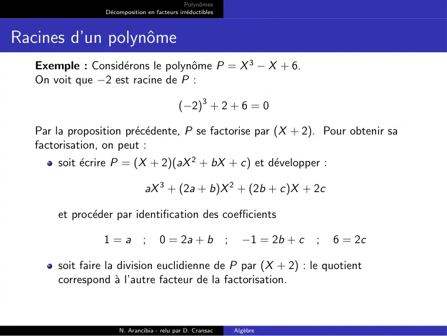

~~~text
                                              Polynômes
                 Décomposition en facteurs irréductibles

Racines d’un polynôme
   Exemple : Considérons le polynôme P = X 3 − X + 6.
   On voit que −2 est racine de P :

                                            (−2)3 + 2 + 6 = 0

   Par la proposition précédente, P se factorise par (X + 2). Pour obtenir sa
   factorisation, on peut :
       soit écrire P = (X + 2)(aX 2 + bX + c) et développer :

                               aX 3 + (2a + b)X 2 + (2b + c)X + 2c

       et procéder par identification des coefficients

                 1=a           ;     0 = 2a + b              ;      −1 = 2b + c   ;   6 = 2c

       soit faire la division euclidienne de P par (X + 2) : le quotient
       correspond à l’autre facteur de la factorisation.

                      N. Arancibia - relu par D. Cransac         Algèbre
~~~

## Page 42

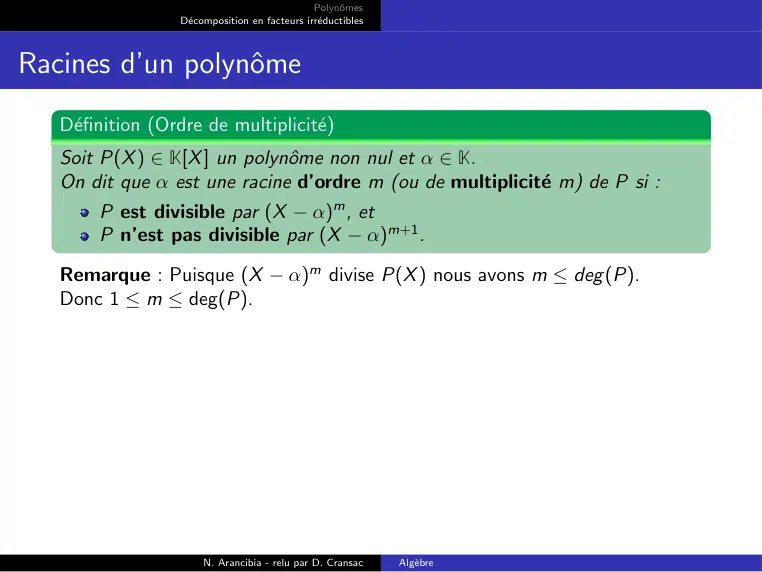

~~~text
                                               Polynômes
                  Décomposition en facteurs irréductibles

Racines d’un polynôme
   Définition (Ordre de multiplicité)
   Soit P(X ) ∈ K[X ] un polynôme non nul et α ∈ K.
   On dit que α est une racine d’ordre m (ou de multiplicité m) de P si :
        P est divisible par (X − α)m , et
        P n’est pas divisible par (X − α)m+1 .

   Remarque : Puisque (X − α)m divise P(X ) nous avons m ≤ deg (P).
   Donc 1 ≤ m ≤ deg(P).

                       N. Arancibia - relu par D. Cransac     Algèbre
~~~

## Page 43

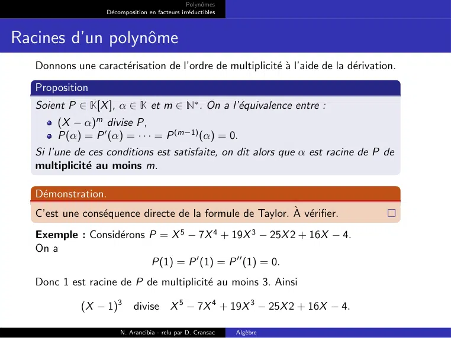

~~~text
                                                Polynômes
                   Décomposition en facteurs irréductibles

Racines d’un polynôme
   Donnons une caractérisation de l’ordre de multiplicité à l’aide de la dérivation.
   Proposition
   Soient P ∈ K[X ], α ∈ K et m ∈ N∗ . On a l’équivalence entre :
        (X − α)m divise P,
        P(α) = P 0 (α) = · · · = P (m−1) (α) = 0.
   Si l’une de ces conditions est satisfaite, on dit alors que α est racine de P de
   multiplicité au moins m.

   Démonstration.
   C’est une conséquence directe de la formule de Taylor. À vérifier.
   Exemple : Considérons P = X 5 − 7X 4 + 19X 3 − 25X 2 + 16X − 4.
   On a
                          P(1) = P 0 (1) = P 00 (1) = 0.
   Donc 1 est racine de P de multiplicité au moins 3. Ainsi

             (X − 1)3        divise X 5 − 7X 4 + 19X 3 − 25X 2 + 16X − 4.

                        N. Arancibia - relu par D. Cransac     Algèbre
~~~

## Page 44

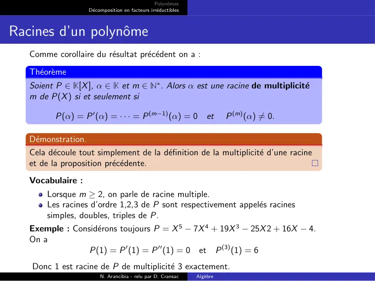

~~~text
                                                Polynômes
                   Décomposition en facteurs irréductibles

Racines d’un polynôme
   Comme corollaire du résultat précédent on a :
   Théorème
   Soient P ∈ K[X ], α ∈ K et m ∈ N∗ . Alors α est une racine de multiplicité
   m de P(X ) si et seulement si

          P(α) = P 0 (α) = · · · = P (m−1) (α) = 0 et                     P (m) (α) 6= 0.

   Démonstration.
   Cela découle tout simplement de la définition de la multiplicité d’une racine
   et de la proposition précédente.
   Vocabulaire :
        Lorsque m ≥ 2, on parle de racine multiple.
        Les racines d’ordre 1,2,3 de P sont respectivement appelés racines
        simples, doubles, triples de P.
   Exemple : Considérons toujours P = X 5 − 7X 4 + 19X 3 − 25X 2 + 16X − 4.
   On a
                 P(1) = P 0 (1) = P 00 (1) = 0 et P (3) (1) = 6
   Donc 1 est racine de P de multiplicité 3 exactement.
                        N. Arancibia - relu par D. Cransac     Algèbre
~~~

## Page 45

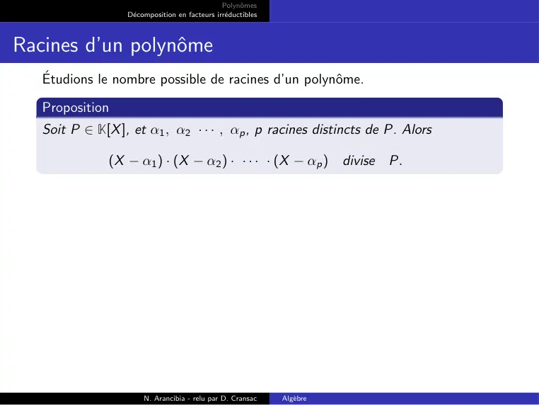

~~~text
                                               Polynômes
                  Décomposition en facteurs irréductibles

Racines d’un polynôme
   Étudions le nombre possible de racines d’un polynôme.
   Proposition
   Soit P ∈ K[X ], et α1 , α2 · · · , αp , p racines distincts de P. Alors

               (X − α1 ) · (X − α2 ) · · · · · (X − αp ) divise          P.

                       N. Arancibia - relu par D. Cransac     Algèbre
~~~

## Page 46

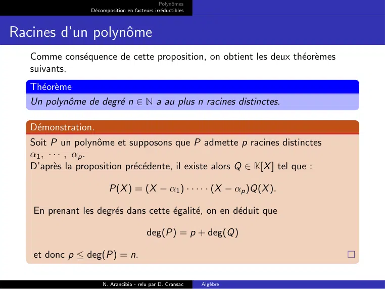

~~~text
                                               Polynômes
                  Décomposition en facteurs irréductibles

Racines d’un polynôme
   Comme conséquence de cette proposition, on obtient les deux théorèmes
   suivants.
   Théorème
   Un polynôme de degré n ∈ N a au plus n racines distinctes.

   Démonstration.
   Soit P un polynôme et supposons que P admette p racines distinctes
   α 1 , · · · , αp .
   D’après la proposition précédente, il existe alors Q ∈ K[X ] tel que :

                         P(X ) = (X − α1 ) · · · · · (X − αp )Q(X ).

   En prenant les degrés dans cette égalité, on en déduit que

                                          deg(P) = p + deg(Q)

   et donc p ≤ deg(P) = n.

                       N. Arancibia - relu par D. Cransac     Algèbre
~~~

## Page 47

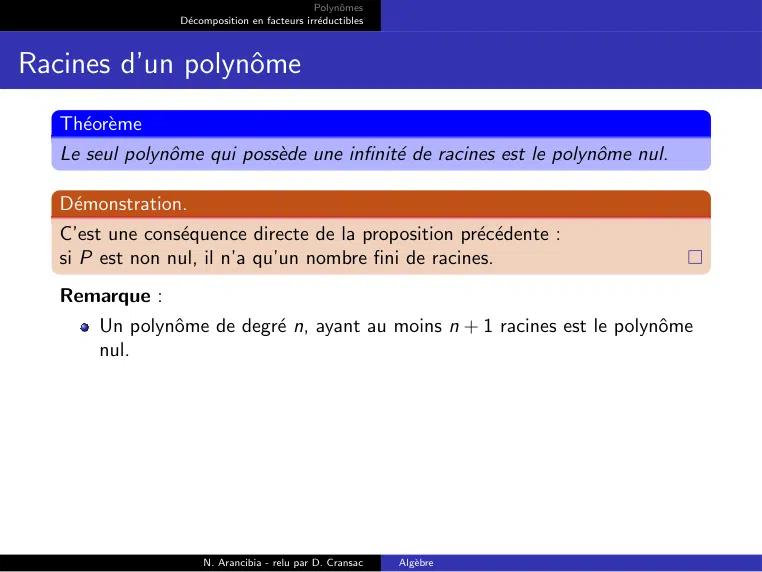

~~~text
                                               Polynômes
                  Décomposition en facteurs irréductibles

Racines d’un polynôme
   Théorème
   Le seul polynôme qui possède une infinité de racines est le polynôme nul.

   Démonstration.
   C’est une conséquence directe de la proposition précédente :
   si P est non nul, il n’a qu’un nombre fini de racines.
   Remarque :
        Un polynôme de degré n, ayant au moins n + 1 racines est le polynôme
        nul.

                       N. Arancibia - relu par D. Cransac     Algèbre
~~~

## Page 48

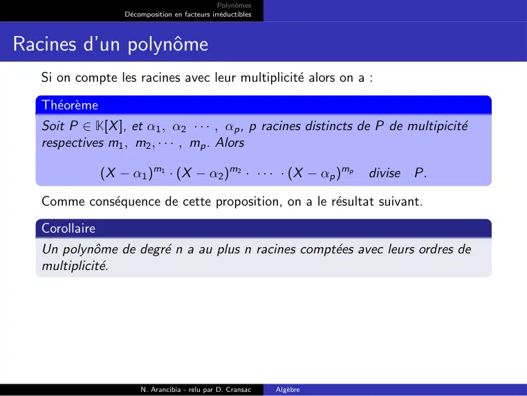

~~~text
                                                 Polynômes
                    Décomposition en facteurs irréductibles

Racines d’un polynôme
   Si on compte les racines avec leur multiplicité alors on a :
   Théorème
   Soit P ∈ K[X ], et α1 , α2 · · · , αp , p racines distincts de P de multipicité
   respectives m1 , m2 , · · · , mp . Alors

                (X − α1 )m1 · (X − α2 )m2 · · · · · (X − αp )mp            divise   P.

   Comme conséquence de cette proposition, on a le résultat suivant.
   Corollaire
   Un polynôme de degré n a au plus n racines comptées avec leurs ordres de
   multiplicité.

                         N. Arancibia - relu par D. Cransac     Algèbre
~~~

## Page 49

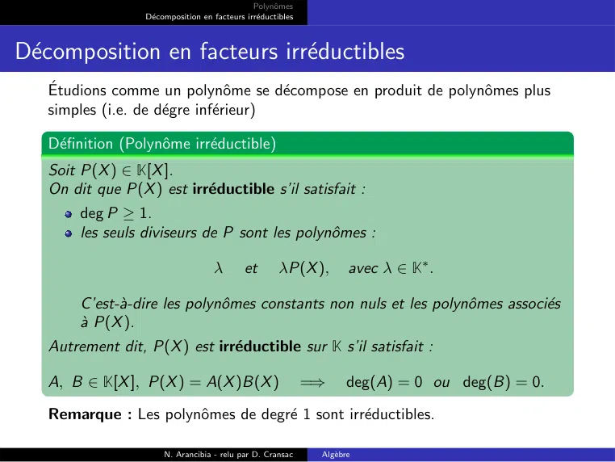

~~~text
                                               Polynômes
                  Décomposition en facteurs irréductibles

Décomposition en facteurs irréductibles
   Étudions comme un polynôme se décompose en produit de polynômes plus
   simples (i.e. de dégre inférieur)

   Définition (Polynôme irréductible)
   Soit P(X ) ∈ K[X ].
   On dit que P(X ) est irréductible s’il satisfait :
        deg P ≥ 1.
        les seuls diviseurs de P sont les polynômes :

                                    λ        et        λP(X ),        avec λ ∈ K∗ .

        C’est-à-dire les polynômes constants non nuls et les polynômes associés
        à P(X ).
   Autrement dit, P(X ) est irréductible sur K s’il satisfait :

   A, B ∈ K[X ], P(X ) = A(X )B(X )                           =⇒     deg(A) = 0 ou deg(B) = 0.

   Remarque : Les polynômes de degré 1 sont irréductibles.

                       N. Arancibia - relu par D. Cransac      Algèbre
~~~

## Page 50

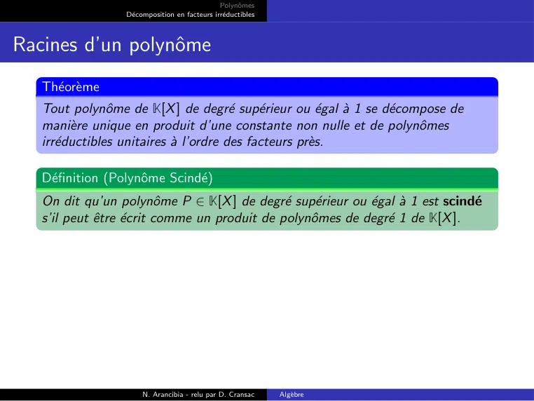

~~~text
                                               Polynômes
                  Décomposition en facteurs irréductibles

Racines d’un polynôme
   Théorème
   Tout polynôme de K[X ] de degré supérieur ou égal à 1 se décompose de
   manière unique en produit d’une constante non nulle et de polynômes
   irréductibles unitaires à l’ordre des facteurs près.

   Définition (Polynôme Scindé)
   On dit qu’un polynôme P ∈ K[X ] de degré supérieur ou égal à 1 est scindé
   s’il peut être écrit comme un produit de polynômes de degré 1 de K[X ].

                       N. Arancibia - relu par D. Cransac     Algèbre
~~~

## Page 51

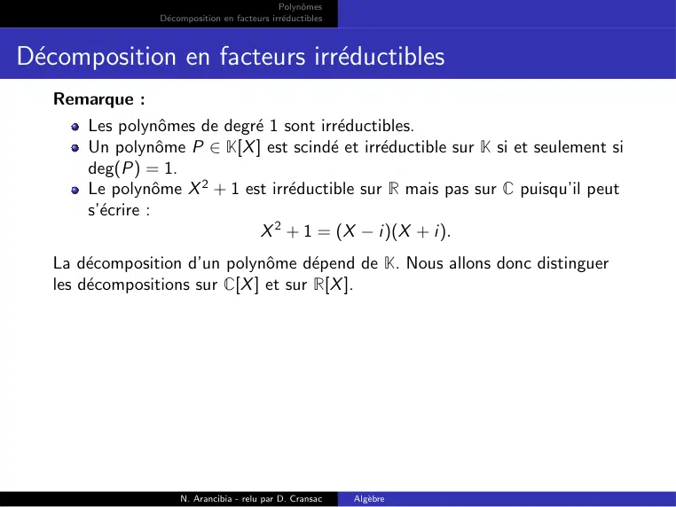

~~~text
                                              Polynômes
                 Décomposition en facteurs irréductibles

Décomposition en facteurs irréductibles
   Remarque :
       Les polynômes de degré 1 sont irréductibles.
       Un polynôme P ∈ K[X ] est scindé et irréductible sur K si et seulement si
       deg(P) = 1.
       Le polynôme X 2 + 1 est irréductible sur R mais pas sur C puisqu’il peut
       s’écrire :
                              X 2 + 1 = (X − i)(X + i).
   La décomposition d’un polynôme dépend de K. Nous allons donc distinguer
   les décompositions sur C[X ] et sur R[X ].

                      N. Arancibia - relu par D. Cransac     Algèbre
~~~

## Page 52

~~~text
                                               Polynômes
                  Décomposition en facteurs irréductibles

Décomposition dans C[X ]
   Théorème (Théorème de d’Alembert-Gauss)
   Tout polynôme non constant de C[X ] possède au moins une racine dans C.

   La démonstration est difficile. Le théorème sera admis dans ce cours.

                       N. Arancibia - relu par D. Cransac     Algèbre
~~~

## Page 53

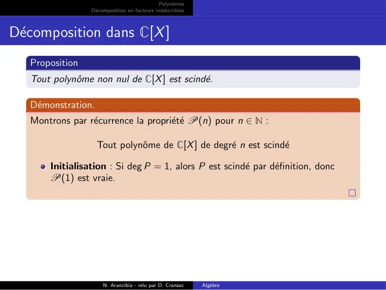

~~~text
                                              Polynômes
                 Décomposition en facteurs irréductibles

Décomposition dans C[X ]
   Proposition
   Tout polynôme non nul de C[X ] est scindé.

   Démonstration.
   Montrons par récurrence la propriété P(n) pour n ∈ N :

                     Tout polynôme de C[X ] de degré n est scindé

       Initialisation : Si deg P = 1, alors P est scindé par définition, donc
       P(1) est vraie.

                      N. Arancibia - relu par D. Cransac     Algèbre
~~~

## Page 54

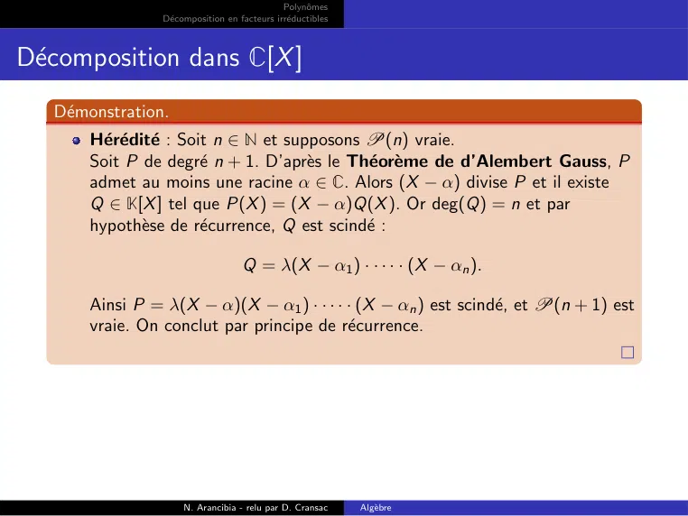

~~~text
                                              Polynômes
                 Décomposition en facteurs irréductibles

Décomposition dans C[X ]
   Démonstration.
       Hérédité : Soit n ∈ N et supposons P(n) vraie.
       Soit P de degré n + 1. D’après le Théorème de d’Alembert Gauss, P
       admet au moins une racine α ∈ C. Alors (X − α) divise P et il existe
       Q ∈ K[X ] tel que P(X ) = (X − α)Q(X ). Or deg(Q) = n et par
       hypothèse de récurrence, Q est scindé :

                                    Q = λ(X − α1 ) · · · · · (X − αn ).

       Ainsi P = λ(X − α)(X − α1 ) · · · · · (X − αn ) est scindé, et P(n + 1) est
       vraie. On conclut par principe de récurrence.

                      N. Arancibia - relu par D. Cransac     Algèbre
~~~

## Page 55

~~~text
                                                Polynômes
                   Décomposition en facteurs irréductibles

Décomposition dans C[X ]
   Proposition
     1   Les polynômes irréductibles de C[X ] sont les polynômes de degré 1.
     2   Tout polynôme P de C[X ] se factorise de façon unique (à l’ordre près des
         facteurs) en produit de polynômes irréductibles de C[X ] sous la forme :

                  P(X ) = λ(X − α1 )m1 · (X − α2 )m2 · · · · · (X − αk )mk .

   Démonstration.
     1   On a déjà vu que les polynômes de degré 1 sont irréductibles.
         Réciproquement, soit P un polynôme irréductible. Par le Théorème de
         d’Alembert Gauss, il existe α tel que P(α) = 0. Il existe donc
         Q ∈ K[X ] tel que P = (X − a)Q. Comme de plus P est irréductible, on
         en déduit que Q ∈ K∗ et que P est de degré 1.
     2   Soit P un polynôme de degré supérieur ou égal à 1 de C[X ]. D’après la
         proposition précédente, P est scindé sur C[X ], d’où l’existence d’une
         telle factorisation.

                        N. Arancibia - relu par D. Cransac     Algèbre
~~~

## Page 56

~~~text
                                                  Polynômes
                     Décomposition en facteurs irréductibles

Décomposition dans R[X ]
   Passons maintenant à la décomposition dans R[X ]. Commençons introduite
   le résultat suivant :
   Lemme
   Soit P(X ) ∈ R[X ]. Si on considère P(X ) comme un polynôme de C[X ] et
   que α ∈ C \ R est une racine de P(X ) alors α est aussi une racine complexe
   de P(X ) avec même multiplicité.

   Démonstration.
                 Pn
   Soit P(X ) = k=0 ak X k . Puisque les coefficients de P sont réels, nous
   pouvons écrire
                         0 = P(α) =⇒ 0 = P(α)

   On a donc
                                           n
                                           X                 n
                                                             X
                         P(α)        =           ak αk =           ak · αk
                                           k=0               k=0
                                              n
                                                            !
                                              X
                                     =              ak αk        =0
                                              k=0

   Donc α est une racine.
                          N. Arancibia - relu par D. Cransac          Algèbre
~~~

## Page 57

~~~text
                                                Polynômes
                   Décomposition en facteurs irréductibles

Décomposition dans R[X ]
   À l’aide du lemme précédent nous pouvons donner la décomposition dans
   R[X ].

   Théorème
     1   Les polynômes irréductibles de R[X ] sont
              les polynômes de degré 1 ;
              les polynômes de degré 2 à discriminant strictement négatif.
     2   Tout polynôme P de R[X ] se factorise de façon unique (à l’ordre près des
         facteurs) en produit de polynômes irréductibles de R[X ] sous la forme :
                               p
                                             ! q                           !
                              Y                   Y
                                          mk            2               nk
                 P(X ) = λ       (X − αk )           (X + βk X + γk )        .
                                      k=1                            k=1

                        N. Arancibia - relu par D. Cransac     Algèbre
~~~

## Page 58

~~~text
                                               Polynômes
                  Décomposition en facteurs irréductibles

Somme et produit des racines d’un polynôme
   On finit le chapitre avec le résultat suivant.

   Proposition (Somme et produit des racines d’un polynôme scindé)
             Pn
   Soit P = k=0 ak X k ∈ K[X ] un polynôme scindé, α1 , α2 · · · , αn , ses
   racines (distinctes ou non). Alors
                                                                           an−1
                              α1 + α2 + · · · + αn                =      −      .
                                                                            an
                                                                               a0
                                 α1 · α2 · · · · · αn             =      (−1)n .
                                                                               an
   Remarque : En particulier, pour n = 2 et P(X ) = c + bX + aX 2 , nous
   avons :
                                                                         b
                                             α1 + α2          =     −
                                                                         a
                                                                    c
                                                α1 · α2       =
                                                                    a

                       N. Arancibia - relu par D. Cransac     Algèbre
~~~
