# CM7-Fractions-Rationnelles_2021-2022_Algebre1_P1S1_NArancibia-DCransac.pdf

[Ouvrir l’original](https://drive.google.com/open?id=1rKVm2tb-bqs0-ys4sKq8IUadzLsSTNLl) · Les deux lectures automatiques du PDF divergent sur les pages indiquées. Leur fac-similé accompagne le texte.

**Pages présentant un écart entre les deux extractions** — 1–16, 18–53.

## Page 1

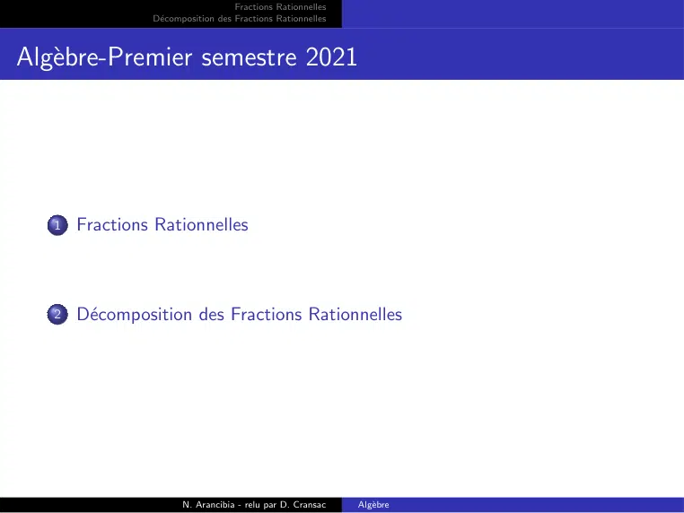

~~~text
                                   Fractions Rationnelles
                Décomposition des Fractions Rationnelles

Algèbre-Premier semestre 2021

   1   Fractions Rationnelles

   2   Décomposition des Fractions Rationnelles

                       N. Arancibia - relu par D. Cransac   Algèbre
~~~

## Page 2

~~~text
                                 Fractions Rationnelles
              Décomposition des Fractions Rationnelles

Algèbre-Premier semestre 2021

                                               Thèmes

      Logique et raisonnement
      Ensembles
      Relations binaires
      Applications
      Nombres complexes
      Polynômes
      Fractions rationnelles

                     N. Arancibia - relu par D. Cransac   Algèbre
~~~

## Page 3

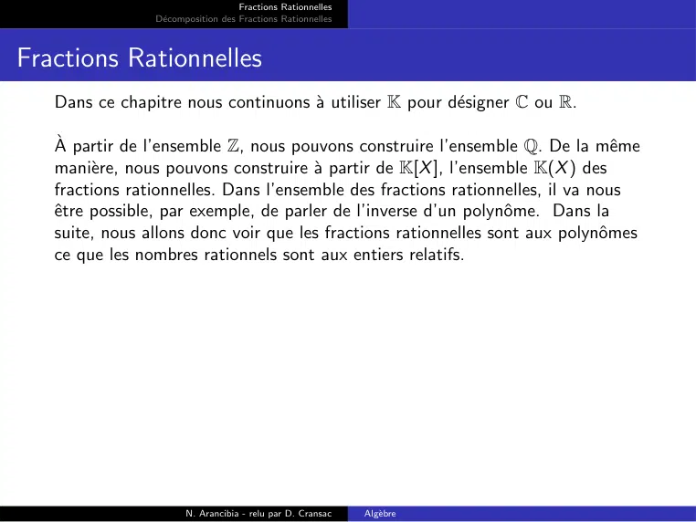

~~~text
                                   Fractions Rationnelles
                Décomposition des Fractions Rationnelles

Fractions Rationnelles
   Dans ce chapitre nous continuons à utiliser K pour désigner C ou R.

   À partir de l’ensemble Z, nous pouvons construire l’ensemble Q. De la même
   manière, nous pouvons construire à partir de K[X ], l’ensemble K(X ) des
   fractions rationnelles. Dans l’ensemble des fractions rationnelles, il va nous
   être possible, par exemple, de parler de l’inverse d’un polynôme. Dans la
   suite, nous allons donc voir que les fractions rationnelles sont aux polynômes
   ce que les nombres rationnels sont aux entiers relatifs.

                       N. Arancibia - relu par D. Cransac   Algèbre
~~~

## Page 4

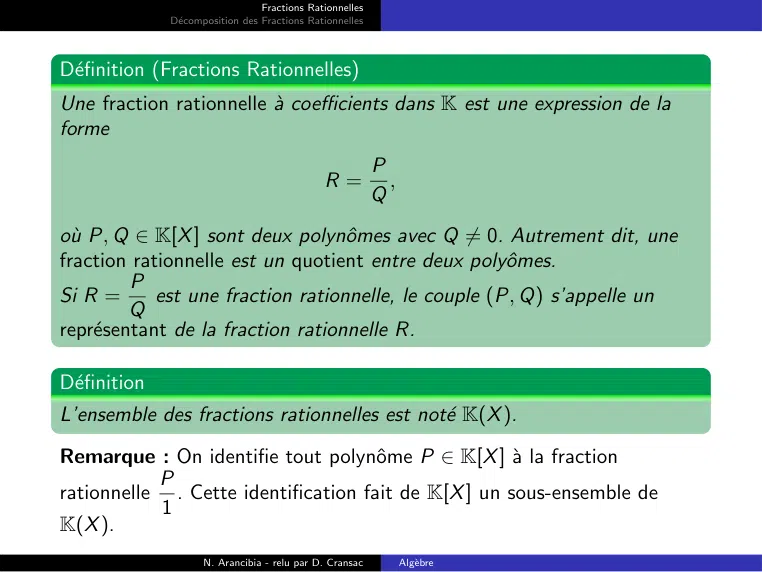

~~~text
                                 Fractions Rationnelles
              Décomposition des Fractions Rationnelles

Définition (Fractions Rationnelles)
Une fraction rationnelle à coefficients dans K est une expression de la
forme
                                                          P
                                              R=            ,
                                                          Q
où P, Q ∈ K[X ] sont deux polynômes avec Q 6= 0. Autrement dit, une
fraction rationnelle est un quotient entre deux polyômes.
         P
Si R =      est une fraction rationnelle, le couple (P, Q) s’appelle un
         Q
représentant de la fraction rationnelle R.

Définition
L’ensemble des fractions rationnelles est noté K(X ).

Remarque : On identifie tout polynôme P ∈ K[X ] à la fraction
           P
rationnelle . Cette identification fait de K[X ] un sous-ensemble de
           1
K(X ).
                     N. Arancibia - relu par D. Cransac         Algèbre
~~~

## Page 5

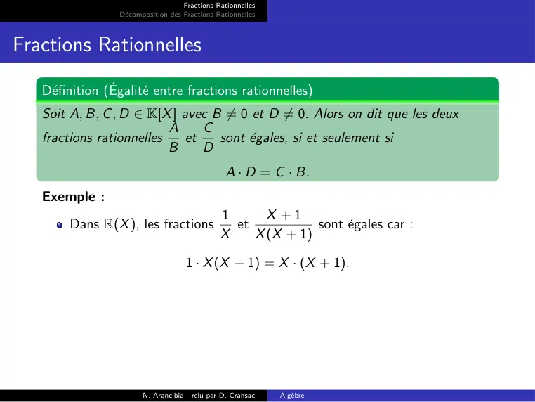

~~~text
                                    Fractions Rationnelles
                 Décomposition des Fractions Rationnelles

Fractions Rationnelles

   Définition (Égalité entre fractions rationnelles)
   Soit A, B, C , D ∈ K[X ] avec B 6= 0 et D 6= 0. Alors on dit que les deux
                          A     C
   fractions rationnelles    et   sont égales, si et seulement si
                          B     D
                                                 A · D = C · B.
   Exemple :
                                               1      X +1
        Dans R(X ), les fractions                et           sont égales car :
                                               X    X (X + 1)

                                     1 · X (X + 1) = X · (X + 1).

                        N. Arancibia - relu par D. Cransac   Algèbre
~~~

## Page 6

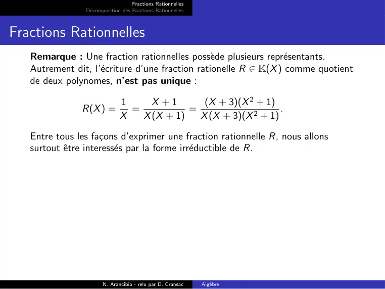

~~~text
                                   Fractions Rationnelles
                Décomposition des Fractions Rationnelles

Fractions Rationnelles
   Remarque : Une fraction rationnelles possède plusieurs représentants.
   Autrement dit, l’écriture d’une fraction rationelle R ∈ K(X ) comme quotient
   de deux polynomes, n’est pas unique :

                              1     X +1       (X + 3)(X 2 + 1)
               R(X ) =          =           =                    .
                              X   X (X + 1)   X (X + 3)(X 2 + 1)

   Entre tous les façons d’exprimer une fraction rationnelle R, nous allons
   surtout être interessés par la forme irréductible de R.

                       N. Arancibia - relu par D. Cransac   Algèbre
~~~

## Page 7

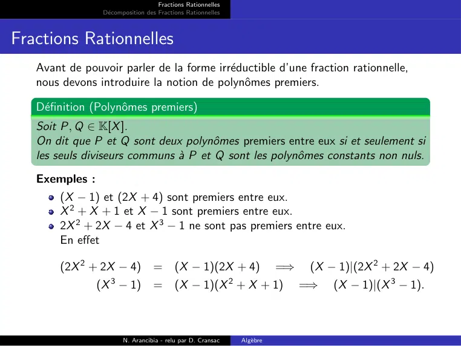

~~~text
                                   Fractions Rationnelles
                Décomposition des Fractions Rationnelles

Fractions Rationnelles
   Avant de pouvoir parler de la forme irréductible d’une fraction rationnelle,
   nous devons introduire la notion de polynômes premiers.

   Définition (Polynômes premiers)
   Soit P, Q ∈ K[X ].
   On dit que P et Q sont deux polynômes premiers entre eux si et seulement si
   les seuls diviseurs communs à P et Q sont les polynômes constants non nuls.
   Exemples :
       (X − 1) et (2X + 4) sont premiers entre eux.
       X 2 + X + 1 et X − 1 sont premiers entre eux.
       2X 2 + 2X − 4 et X 3 − 1 ne sont pas premiers entre eux.
       En effet

       (2X 2 + 2X − 4) =                 (X − 1)(2X + 4)                   =⇒    (X − 1)|(2X 2 + 2X − 4)
                  3                                         2
                (X − 1) = (X − 1)(X + X + 1)                                    =⇒   (X − 1)|(X 3 − 1).

                       N. Arancibia - relu par D. Cransac       Algèbre
~~~

## Page 8

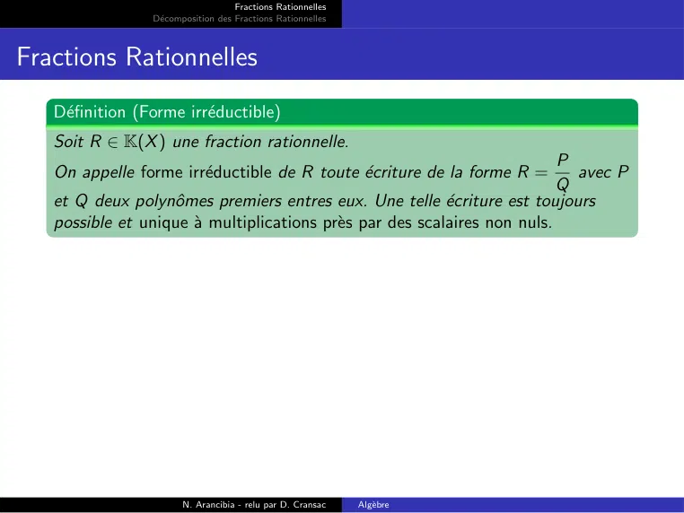

~~~text
                                    Fractions Rationnelles
                 Décomposition des Fractions Rationnelles

Fractions Rationnelles
   Définition (Forme irréductible)
   Soit R ∈ K(X ) une fraction rationnelle.
                                                                           P
   On appelle forme irréductible de R toute écriture de la forme R =       avec P
                                                                           Q
   et Q deux polynômes premiers entres eux. Une telle écriture est toujours
   possible et unique à multiplications près par des scalaires non nuls.

                        N. Arancibia - relu par D. Cransac   Algèbre
~~~

## Page 9

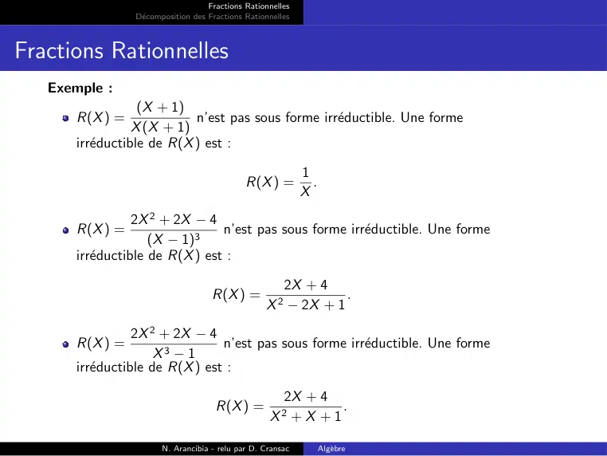

~~~text
                                   Fractions Rationnelles
                Décomposition des Fractions Rationnelles

Fractions Rationnelles
   Exemple :
                  (X + 1)
      R(X ) =              n’est pas sous forme irréductible. Une forme
                 X (X + 1)
      irréductible de R(X ) est :

                                                            1
                                             R(X ) =          .
                                                            X
                 2X 2 + 2X − 4
      R(X ) =                   n’est pas sous forme irréductible. Une forme
                    (X − 1)3
      irréductible de R(X ) est :

                                                     2X + 4
                                    R(X ) =                    .
                                                  X 2 − 2X + 1

                 2X 2 + 2X − 4
      R(X ) =                   n’est pas sous forme irréductible. Une forme
                     X3 − 1
      irréductible de R(X ) est :

                                                    2X + 4
                                     R(X ) =                  .
                                                   X2 + X + 1

                       N. Arancibia - relu par D. Cransac         Algèbre
~~~

## Page 10

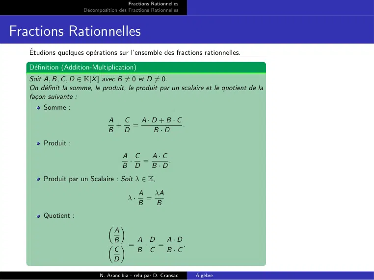

~~~text
                                        Fractions Rationnelles
                     Décomposition des Fractions Rationnelles

Fractions Rationnelles
   Étudions quelques opérations sur l’ensemble des fractions rationnelles.

   Définition (Addition-Multiplication)
   Soit A, B, C , D ∈ K[X ] avec B 6= 0 et D 6= 0.
   On définit la somme, le produit, le produit par un scalaire et le quotient de la
   façon suivante :
        Somme :
                               A   C   A·D +B ·C
                                 +   =           .
                               B   D     B ·D
        Produit :
                                     A C   A·C
                                      ·  =      .
                                     B D   B ·D
        Produit par un Scalaire : Soit λ ∈ K,
                                             A   λA
                                        λ·     =
                                             B   B
        Quotient :
                                
                                A
                                B  A D   A·D
                                = ·  =      .
                                C  B C   B ·C
                                D

                            N. Arancibia - relu par D. Cransac   Algèbre
~~~

## Page 11

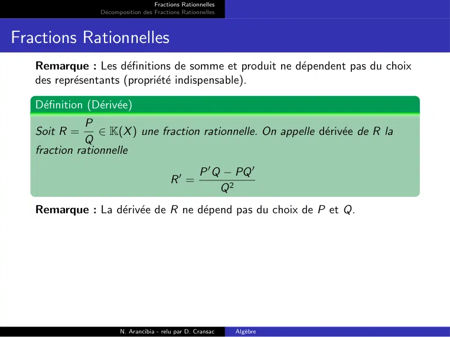

~~~text
                                     Fractions Rationnelles
                  Décomposition des Fractions Rationnelles

Fractions Rationnelles
   Remarque : Les définitions de somme et produit ne dépendent pas du choix
   des représentants (propriété indispensable).

   Définition (Dérivée)
              P
   Soit R =      ∈ K(X ) une fraction rationnelle. On appelle dérivée de R la
              Q
   fraction rationnelle
                                                     P 0 Q − PQ 0
                                           R0 =
                                                          Q2
   Remarque : La dérivée de R ne dépend pas du choix de P et Q.

                         N. Arancibia - relu par D. Cransac   Algèbre
~~~

## Page 12

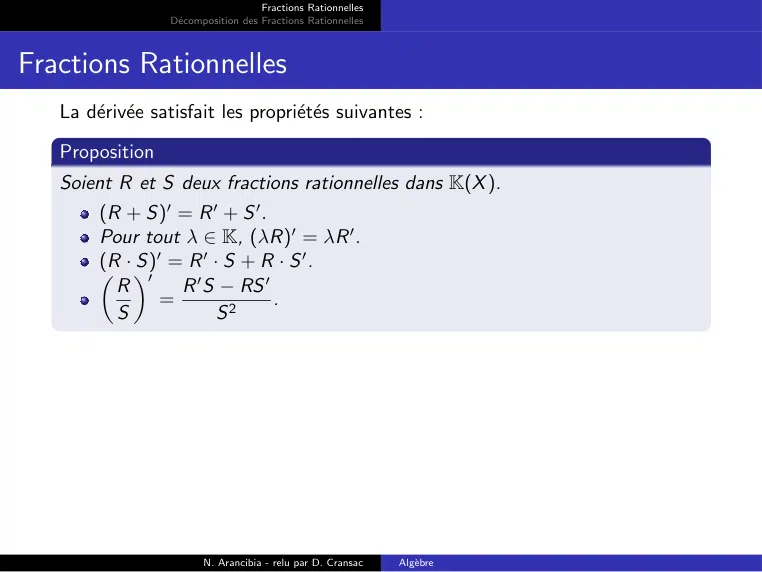

~~~text
                                     Fractions Rationnelles
                  Décomposition des Fractions Rationnelles

Fractions Rationnelles
   La dérivée satisfait les propriétés suivantes :
   Proposition
   Soient R et S deux fractions rationnelles dans K(X ).
        (R + S)0 = R 0 + S 0 .
        Pour tout λ ∈ K, (λR)0 = λR 0 .
        (R · S)0 = R 0 · S + R · S 0 .
         0
          R       R 0 S − RS 0
                =              .
          S             S2

                         N. Arancibia - relu par D. Cransac   Algèbre
~~~

## Page 13

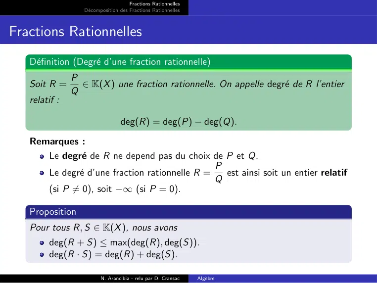

~~~text
                                     Fractions Rationnelles
                  Décomposition des Fractions Rationnelles

Fractions Rationnelles
   Définition (Degré d’une fraction rationnelle)
               P
   Soit R =      ∈ K(X ) une fraction rationnelle. On appelle degré de R l’entier
               Q
   relatif :

                                 deg(R) = deg(P) − deg(Q).

   Remarques :
        Le degré de R ne depend pas du choix de P et Q.
                                                 P
        Le degré d’une fraction rationnelle R =   est ainsi soit un entier relatif
                                                 Q
        (si P 6= 0), soit −∞ (si P = 0).

   Proposition
   Pour tous R, S ∈ K(X ), nous avons
        deg(R + S) ≤ max(deg(R), deg(S)).
        deg(R · S) = deg(R) + deg(S).

                         N. Arancibia - relu par D. Cransac   Algèbre
~~~

## Page 14

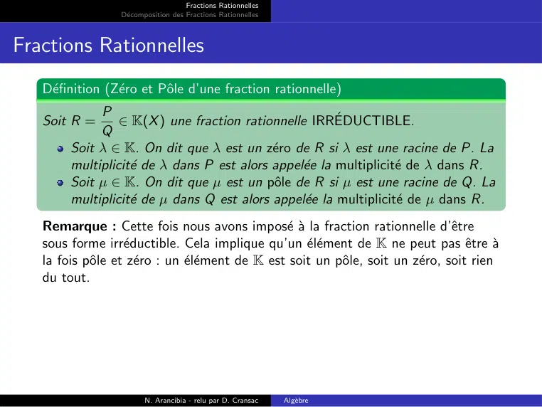

~~~text
                                    Fractions Rationnelles
                 Décomposition des Fractions Rationnelles

Fractions Rationnelles
   Définition (Zéro et Pôle d’une fraction rationnelle)
             P
   Soit R =      ∈ K(X ) une fraction rationnelle IRRÉDUCTIBLE.
             Q
        Soit λ ∈ K. On dit que λ est un zéro de R si λ est une racine de P. La
        multiplicité de λ dans P est alors appelée la multiplicité de λ dans R.
        Soit µ ∈ K. On dit que µ est un pôle de R si µ est une racine de Q. La
        multiplicité de µ dans Q est alors appelée la multiplicité de µ dans R.
   Remarque : Cette fois nous avons imposé à la fraction rationnelle d’être
   sous forme irréductible. Cela implique qu’un élément de K ne peut pas être à
   la fois pôle et zéro : un élément de K est soit un pôle, soit un zéro, soit rien
   du tout.

                        N. Arancibia - relu par D. Cransac   Algèbre
~~~

## Page 15

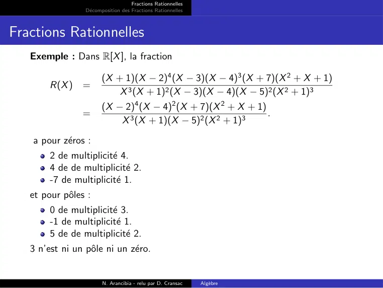

~~~text
                                    Fractions Rationnelles
                 Décomposition des Fractions Rationnelles

Fractions Rationnelles
   Exemple : Dans R[X ], la fraction

                       (X + 1)(X − 2)4 (X − 3)(X − 4)3 (X + 7)(X 2 + X + 1)
        R(X )   =
                           X 3 (X + 1)2 (X − 3)(X − 4)(X − 5)2 (X 2 + 1)3
                       (X − 2)4 (X − 4)2 (X + 7)(X 2 + X + 1)
                =                                             .
                           X 3 (X + 1)(X − 5)2 (X 2 + 1)3

   a pour zéros :
        2 de multiplicité 4.
        4 de de multiplicité 2.
        -7 de multiplicité 1.
   et pour pôles :
        0 de multiplicité 3.
        -1 de multiplicité 1.
        5 de de multiplicité 2.
   3 n’est ni un pôle ni un zéro.

                        N. Arancibia - relu par D. Cransac   Algèbre
~~~

## Page 16

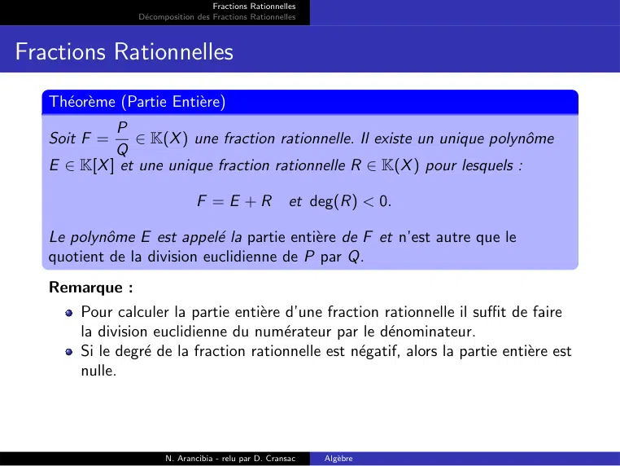

~~~text
                                    Fractions Rationnelles
                 Décomposition des Fractions Rationnelles

Fractions Rationnelles
   Théorème (Partie Entière)
            P
   Soit F =    ∈ K(X ) une fraction rationnelle. Il existe un unique polynôme
            Q
   E ∈ K[X ] et une unique fraction rationnelle R ∈ K(X ) pour lesquels :

                                F =E +R                 et deg(R) < 0.

   Le polynôme E est appelé la partie entière de F et n’est autre que le
   quotient de la division euclidienne de P par Q.
   Remarque :
        Pour calculer la partie entière d’une fraction rationnelle il suffit de faire
        la division euclidienne du numérateur par le dénominateur.
        Si le degré de la fraction rationnelle est négatif, alors la partie entière est
        nulle.

                        N. Arancibia - relu par D. Cransac   Algèbre
~~~

## Page 17

~~~text
                                   Fractions Rationnelles
                Décomposition des Fractions Rationnelles

Fractions Rationnelles
                              2X 4 − X 3 − 2X 2 + 3X − 1
   Exemple : Soit R =                                    . Alors
                                     X2 − X + 1

     2X 4 − X 3 − 2X 2 + 3X − 1 = (X 2 − X + 1)(2X 2 + X − 3) + (−X + 2)

   D’où on obtient
   2X 4 − X 3 − 2X 2 + 3X − 1                         (X 2 − X + 1)(2X 2 + X − 3) + (−X + 2)
                                              =
          X2 − X + 1                                                X2 − X + 1
                                                                         −X + 2
                                              =       (2X 2 + X − 3) + 2
                                                                       X −X +1

                       N. Arancibia - relu par D. Cransac   Algèbre
~~~

## Page 18

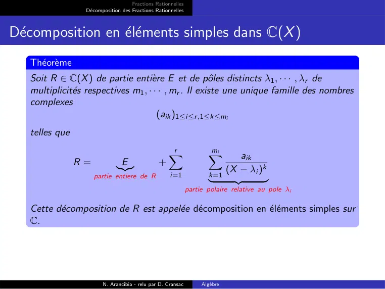

~~~text
                                    Fractions Rationnelles
                 Décomposition des Fractions Rationnelles

Décomposition en éléments simples dans C(X )
   Théorème
   Soit R ∈ C(X ) de partie entière E et de pôles distincts λ1 , · · · , λr de
   multiplicités respectives m1 , · · · , mr . Il existe une unique famille des nombres
   complexes
                                      (aik )1≤i≤r ,1≤k≤mi
   telles que
                                                   r                 mi
                                                   X                 X       aik
                R=            E                +
                             |{z}                                        (X − λi )k
                     partie entiere de R            i=1              k=1
                                                                     |     {z     }
                                                             partie polaire relative au pole λi

   Cette décomposition de R est appelée décomposition en éléments simples sur
   C.

                        N. Arancibia - relu par D. Cransac        Algèbre
~~~

## Page 19

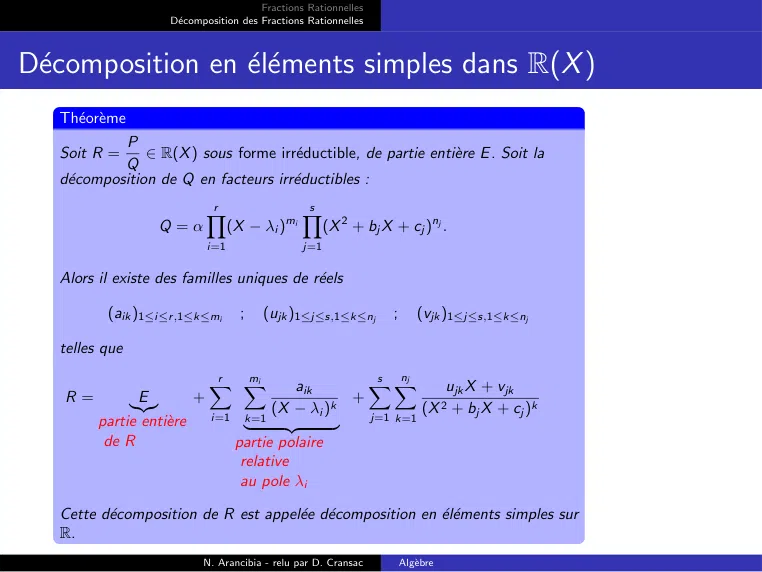

~~~text
                                       Fractions Rationnelles
                    Décomposition des Fractions Rationnelles

Décomposition en éléments simples dans R(X )
   Théorème
            P
   Soit R =     ∈ R(X ) sous forme irréductible, de partie entière E . Soit la
            Q
   décomposition de Q en facteurs irréductibles :
                           r
                           Y             s
                                         Y
                   Q=α       (X − λi )mi   (X 2 + bj X + cj )nj .
                           i=1                  j=1

   Alors il existe des familles uniques de réels

          (aik )1≤i≤r ,1≤k≤mi     ;    (ujk )1≤j≤s,1≤k≤nj       ;       (vjk )1≤j≤s,1≤k≤nj

   telles que
                            r    mi                s X nj
                           X    X       aik       X           ujk X + vjk
   R=          E         +                   k
                                                +
              |{z}                  (X − λi )             (X 2 + bj X + cj )k
         partie entière   i=1 k=1                j=1 k=1
                                |     {z      }
          de R                partie polaire
                               relative
                               au pole λi

   Cette décomposition de R est appelée décomposition en éléments simples sur
   R.
                           N. Arancibia - relu par D. Cransac       Algèbre
~~~

## Page 20

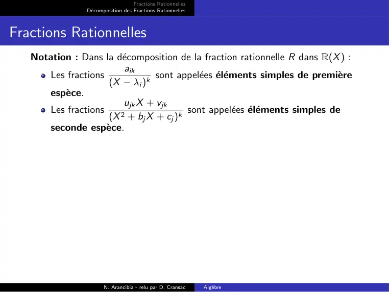

~~~text
                                   Fractions Rationnelles
                Décomposition des Fractions Rationnelles

Fractions Rationnelles
   Notation : Dans la décomposition de la fraction rationnelle R dans R(X ) :
                        aik
      Les fractions             sont appelées éléments simples de première
                    (X − λi )k
      espèce.
                        ujk X + vjk
      Les fractions                     sont appelées éléments simples de
                    (X 2 + bj X + cj )k
      seconde espèce.

                       N. Arancibia - relu par D. Cransac   Algèbre
~~~

## Page 21

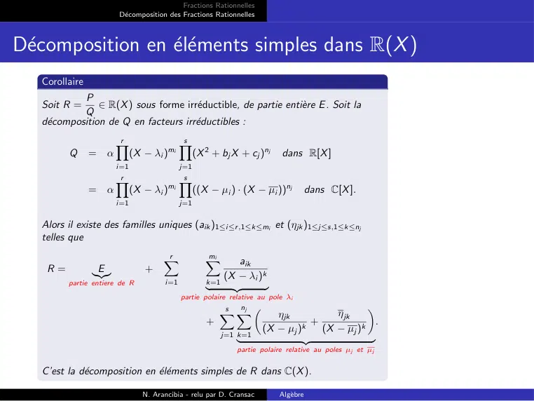

~~~text
                                           Fractions Rationnelles
                        Décomposition des Fractions Rationnelles

Décomposition en éléments simples dans R(X )
   Corollaire
            P
   Soit R =     ∈ R(X ) sous forme irréductible, de partie entière E . Soit la
            Q
   décomposition de Q en facteurs irréductibles :
                        r
                        Y             s
                                      Y
         Q      =   α     (X − λi )mi   (X 2 + bj X + cj )nj               dans R[X ]
                        i=1                  j=1
                        Yr                   Ys
                =   α         (X − λi )mi          ((X − µi ) · (X − µi ))nj          dans C[X ].
                        i=1                  j=1

   Alors il existe des familles uniques (aik )1≤i≤r ,1≤k≤mi et (ηjk )1≤j≤s,1≤k≤nj
   telles que
                                       r              mi
                                       X              X       aik
    R=           E               +
                |{z}                                      (X − λi )k
         partie entiere de R           i=1            k=1
                                                      |     {z     }
                                             partie polaire relative au pole λi
                                                           s X  nj 
                                                                                              η jk
                                                                                                      
                                                         X                 ηjk
                                                      +                                +               .
                                                                      (X − µj )k           (X − µj )k
                                                          j=1 k=1
                                                              |                   {z                  }
                                                              partie polaire relative au poles µj et µj

   C’est la décomposition en éléments simples de R dans C(X ).

                                 N. Arancibia - relu par D. Cransac        Algèbre
~~~

## Page 22

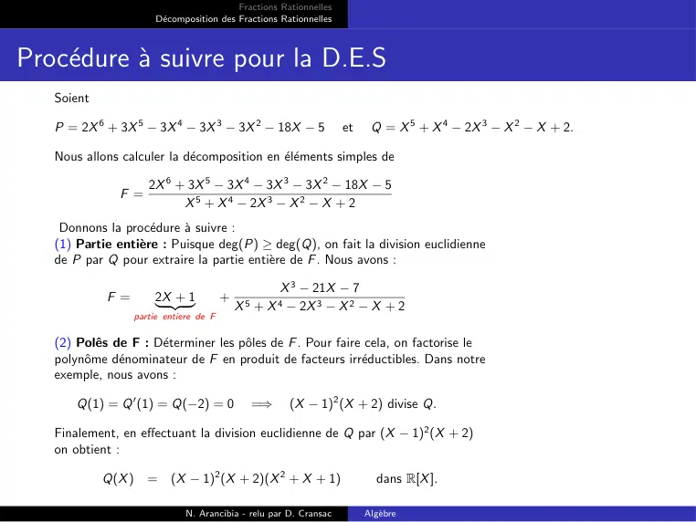

~~~text
                                          Fractions Rationnelles
                       Décomposition des Fractions Rationnelles

Procédure à suivre pour la D.E.S
   Soient

   P = 2X 6 + 3X 5 − 3X 4 − 3X 3 − 3X 2 − 18X − 5                  et    Q = X 5 + X 4 − 2X 3 − X 2 − X + 2.

   Nous allons calculer la décomposition en éléments simples de

                     2X 6 + 3X 5 − 3X 4 − 3X 3 − 3X 2 − 18X − 5
               F =
                           X 5 + X 4 − 2X 3 − X 2 − X + 2
    Donnons la procédure à suivre :
   (1) Partie entière : Puisque deg(P) ≥ deg(Q), on fait la division euclidienne
   de P par Q pour extraire la partie entière de F . Nous avons :

                                                    X 3 − 21X − 7
            F =       2X + 1            +
                      | {z }                X 5 + X 4 − 2X 3 − X 2 − X + 2
                  partie entiere de F

   (2) Polês de F : Déterminer les pôles de F . Pour faire cela, on factorise le
   polynôme dénominateur de F en produit de facteurs irréductibles. Dans notre
   exemple, nous avons :

       Q(1) = Q 0 (1) = Q(−2) = 0             =⇒      (X − 1)2 (X + 2) divise Q.

   Finalement, en effectuant la division euclidienne de Q par (X − 1)2 (X + 2)
   on obtient :

            Q(X )    =    (X − 1)2 (X + 2)(X 2 + X + 1)                    dans R[X ].

                              N. Arancibia - relu par D. Cransac        Algèbre
~~~

## Page 23

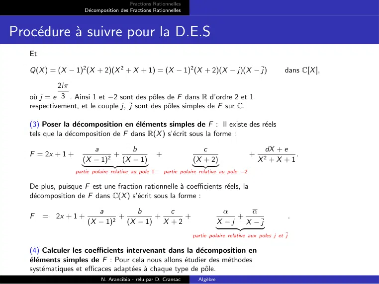

~~~text
                                        Fractions Rationnelles
                     Décomposition des Fractions Rationnelles

Procédure à suivre pour la D.E.S
   Et

   Q(X ) = (X − 1)2 (X + 2)(X 2 + X + 1) = (X − 1)2 (X + 2)(X − j)(X − j)                                  dans C[X ],

            2iπ
   où j = e 3 . Ainsi 1 et −2 sont des pôles de F dans R d’ordre 2 et 1
   respectivement, et le couple j, j sont des pôles simples de F sur C.

   (3) Poser la décomposition en éléments simples de F : Il existe des réels
   tels que la décomposition de F dans R(X ) s’écrit sous la forme :

                       a           b                                    c                           dX + e
   F = 2x + 1 +               +                       +                                        +              .
                    (X − 1)2    (X − 1)                              (X + 2)                       X2 + X + 1
                    |        {z       }                              | {z }
                  partie polaire relative au pole 1       partie polaire relative au pole −2

   De plus, puisque F est une fraction rationnelle à coefficients réels, la
   décomposition de F dans C(X ) s’écrit sous la forme :

                          a          b      c                                        α       α
   F    =   2x + 1 +            +        +      +                                       +                       .
                       (X − 1)2   (X − 1) X + 2                                    X −j    X −j
                                                                                   |    {z     }
                                                                     partie polaire relative aux poles j et j

   (4) Calculer les coefficients intervenant dans la décomposition en
   éléments simples de F : Pour cela nous allons étudier des méthodes
   systématiques et efficaces adaptées à chaque type de pôle.
                            N. Arancibia - relu par D. Cransac          Algèbre
~~~

## Page 24

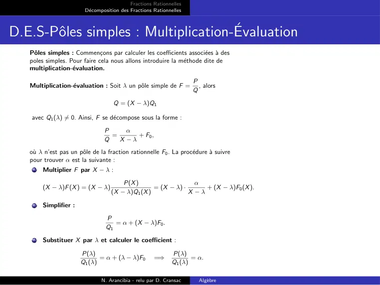

~~~text
                                            Fractions Rationnelles
                         Décomposition des Fractions Rationnelles

D.E.S-Pôles simples : Multiplication-Évaluation
   Pôles simples : Commençons par calculer les coefficients associées à des
   poles simples. Pour faire cela nous allons introduire la méthode dite de
   multiplication-évaluation.
                                                                     P
   Multiplication-évaluation : Soit λ un pôle simple de F =          , alors
                                                                     Q
                                     Q = (X − λ)Q1

   avec Q1 (λ) 6= 0. Ainsi, F se décompose sous la forme :

                                 P     α
                                   =      + F0 ,
                                 Q   X −λ
   où λ n’est pas un pôle de la fraction rationnelle F0 . La procédure à suivre
   pour trouver α est la suivante :
   (1)   Multiplier F par X − λ :

                                        P(X )                    α
         (X − λ)F (X ) = (X − λ)                   = (X − λ) ·      + (X − λ)F0 (X ).
                                    (X − λ)Q1 (X )             X −λ
   (2)   Simplifier :
                                 P
                                    = α + (X − λ)F0 .
                                 Q1
   (3)   Substituer X par λ et calculer le coefficient :

                        P(λ)                                  P(λ)
                               = α + (λ − λ)F0        =⇒             = α.
                        Q1 (λ)                                Q1 (λ)

                                N. Arancibia - relu par D. Cransac     Algèbre
~~~

## Page 25

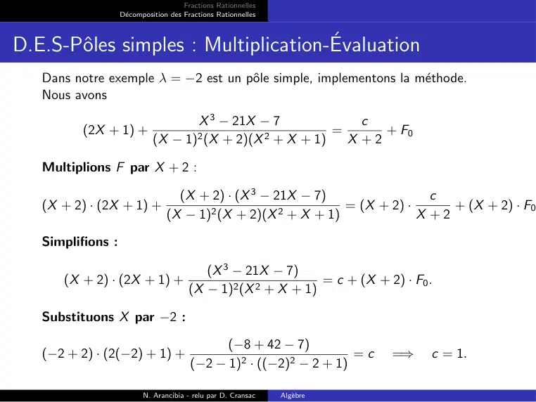

~~~text
                                      Fractions Rationnelles
                   Décomposition des Fractions Rationnelles

D.E.S-Pôles simples : Multiplication-Évaluation
   Dans notre exemple λ = −2 est un pôle simple, implementons la méthode.
   Nous avons
                                          X 3 − 21X − 7                         c
          (2X + 1) +                                                      =        + F0
                            (X − 1)2 (X + 2)(X 2 + X + 1)                     X +2

   Multiplions F par X + 2 :

                                   (X + 2) · (X 3 − 21X − 7)                 c
   (X + 2) · (2X + 1) +                                        = (X + 2) ·      + (X + 2) · F0
                                 (X − 1)2 (X + 2)(X 2 + X + 1)             X +2

   Simplifions :

                                          (X 3 − 21X − 7)
      (X + 2) · (2X + 1) +                                    = c + (X + 2) · F0 .
                                       (X − 1)2 (X 2 + X + 1)

   Substituons X par −2 :

                                              (−8 + 42 − 7)
   (−2 + 2) · (2(−2) + 1) +                                         =c              =⇒    c = 1.
                                        (−2 − 1)2 · ((−2)2 − 2 + 1)

                          N. Arancibia - relu par D. Cransac   Algèbre
~~~

## Page 26

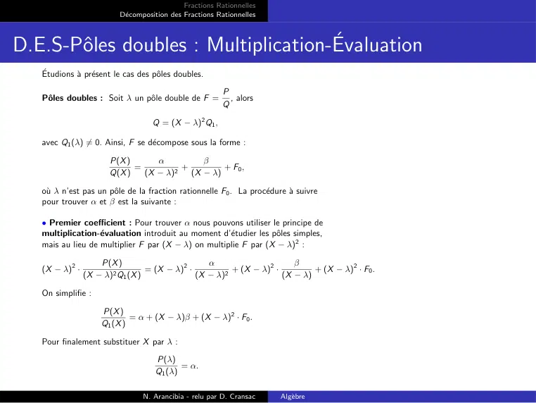

~~~text
                                             Fractions Rationnelles
                          Décomposition des Fractions Rationnelles

D.E.S-Pôles doubles : Multiplication-Évaluation
   Étudions à présent le cas des pôles doubles.
                                                         P
   Pôles doubles : Soit λ un pôle double de F =          , alors
                                                         Q

                                   Q = (X − λ)2 Q1 ,

   avec Q1 (λ) 6= 0. Ainsi, F se décompose sous la forme :

                       P(X )      α          β
                             =          +         + F0 ,
                       Q(X )   (X − λ)2   (X − λ)

   où λ n’est pas un pôle de la fraction rationnelle F0 . La procédure à suivre
   pour trouver α et β est la suivante :

   • Premier coefficient : Pour trouver α nous pouvons utiliser le principe de
   multiplication-évaluation introduit au moment d’étudier les pôles simples,
   mais au lieu de multiplier F par (X − λ) on multiplie F par (X − λ)2 :

                    P(X )                        α                     β
   (X − λ)2 ·                    = (X − λ)2 ·          + (X − λ)2 ·         + (X − λ)2 · F0 .
                (X − λ)2 Q1 (X )              (X − λ)2              (X − λ)

   On simplifie :

                    P(X )
                            = α + (X − λ)β + (X − λ)2 · F0 .
                    Q1 (X )

   Pour finalement substituer X par λ :

                                    P(λ)
                                           = α.
                                    Q1 (λ)

                                 N. Arancibia - relu par D. Cransac     Algèbre
~~~

## Page 27

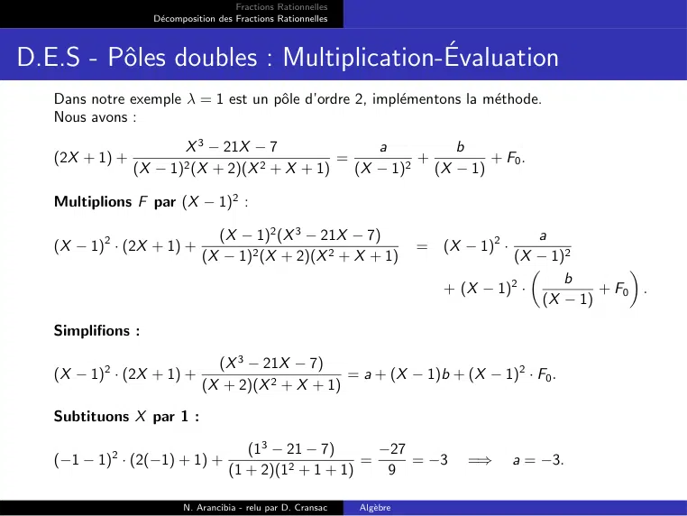

~~~text
                                      Fractions Rationnelles
                   Décomposition des Fractions Rationnelles

D.E.S - Pôles doubles : Multiplication-Évaluation
   Dans notre exemple λ = 1 est un pôle d’ordre 2, implémentons la méthode.
   Nous avons :
                       X 3 − 21X − 7               a          b
   (2X + 1) +                                 =          +         + F0 .
                (X − 1)2 (X + 2)(X 2 + X + 1)   (X − 1)2   (X − 1)

   Multiplions F par (X − 1)2 :

                                (X − 1)2 (X 3 − 21X − 7)                                    a
   (X − 1)2 · (2X + 1) +                                                  =   (X − 1)2 ·
                              (X − 1)2 (X + 2)(X 2 + X + 1)                            (X − 1)2
                                                                                                        
                                                                                                b
                                                                              + (X − 1)2 ·           + F0 .
                                                                                             (X − 1)

   Simplifions :

                                (X 3 − 21X − 7)
   (X − 1)2 · (2X + 1) +                           = a + (X − 1)b + (X − 1)2 · F0 .
                              (X + 2)(X 2 + X + 1)

   Subtituons X par 1 :

                                       (13 − 21 − 7)      −27
   (−1 − 1)2 · (2(−1) + 1) +                            =     = −3               =⇒        a = −3.
                                    (1 + 2)(12 + 1 + 1)    9

                          N. Arancibia - relu par D. Cransac   Algèbre
~~~

## Page 28

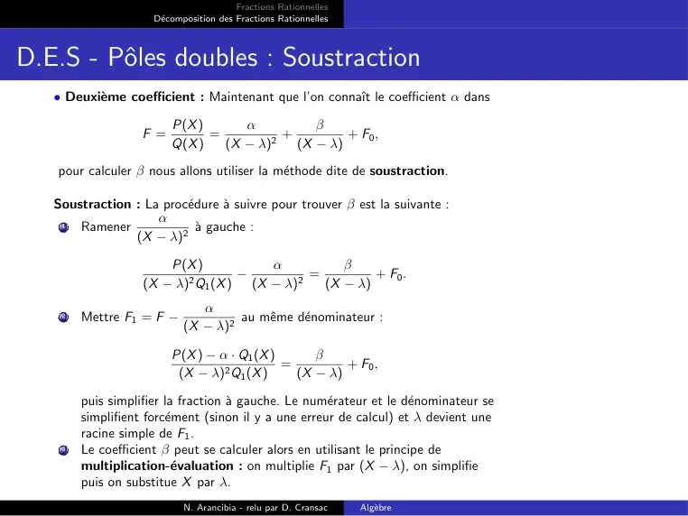

~~~text
                                         Fractions Rationnelles
                      Décomposition des Fractions Rationnelles

D.E.S - Pôles doubles : Soustraction
   • Deuxième coefficient : Maintenant que l’on connaı̂t le coefficient α dans

                          P(X )      α          β
                    F =         =          +         + F0 ,
                          Q(X )   (X − λ)2   (X − λ)

   pour calculer β nous allons utiliser la méthode dite de soustraction.

   Soustraction : La procédure à suivre pour trouver β est la suivante :
                    α
    (1) Ramener            à gauche :
                (X − λ)2

                        P(X )           α          β
                                    −         =         + F0 .
                    (X − λ)2 Q1 (X ) (X − λ)2   (X − λ)
                               α
   (2)   Mettre F1 = F −             au même dénominateur :
                            (X − λ)2

                          P(X ) − α · Q1 (X )      β
                                              =         + F0 ,
                           (X − λ)2 Q1 (X )     (X − λ)

         puis simplifier la fraction à gauche. Le numérateur et le dénominateur se
         simplifient forcément (sinon il y a une erreur de calcul) et λ devient une
         racine simple de F1 .
   (3)   Le coefficient β peut se calculer alors en utilisant le principe de
         multiplication-évaluation : on multiplie F1 par (X − λ), on simplifie
         puis on substitue X par λ.
                             N. Arancibia - relu par D. Cransac   Algèbre
~~~

## Page 29

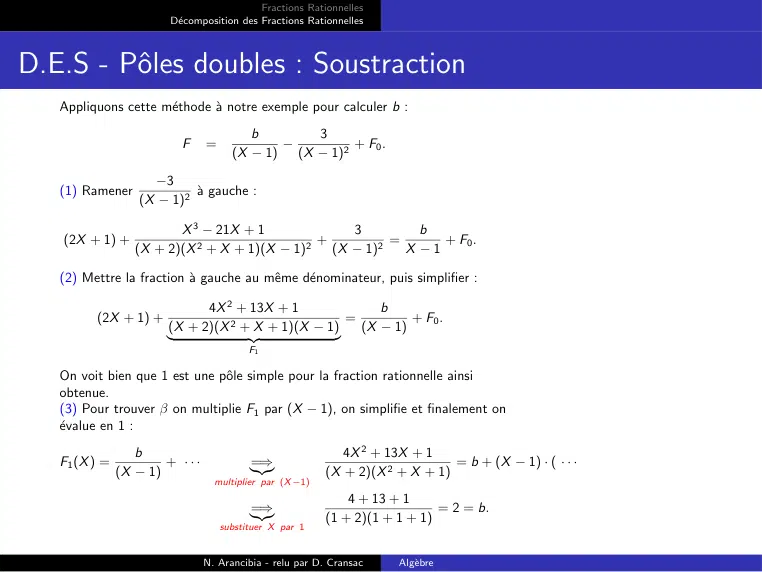

~~~text
                                          Fractions Rationnelles
                       Décomposition des Fractions Rationnelles

D.E.S - Pôles doubles : Soustraction
   Appliquons cette méthode à notre exemple pour calculer b :
                                        b       3
                         F     =            −         + F0 .
                                     (X − 1) (X − 1)2

                    −3
   (1) Ramener             à gauche :
                  (X − 1)2

                        X 3 − 21X + 1              3         b
   (2X + 1) +                                 +          =      + F0 .
                 (X + 2)(X 2 + X + 1)(X − 1)2   (X − 1)2   X −1

   (2) Mettre la fraction à gauche au même dénominateur, puis simplifier :

                            4X 2 + 13X + 1             b
         (2X + 1) +                               =         + F0 .
                      (X + 2)(X 2 + X + 1)(X − 1)   (X − 1)
                      |            {z           }
                                         F1

   On voit bien que 1 est une pôle simple pour la fraction rationnelle ainsi
   obtenue.
   (3) Pour trouver β on multiplie F1 par (X − 1), on simplifie et finalement on
   évalue en 1 :
                  b                                         4X 2 + 13X + 1
   F1 (X ) =           + ···             =⇒                                   = b + (X − 1) · ( · · ·
               (X − 1)                   |{z}            (X + 2)(X 2 + X + 1)
                                 multiplier par (X −1)
                                                             4 + 13 + 1
                                         =⇒                                 = 2 = b.
                                         |{z}            (1 + 2)(1 + 1 + 1)
                                   substituer X par 1

                               N. Arancibia - relu par D. Cransac    Algèbre
~~~

## Page 30

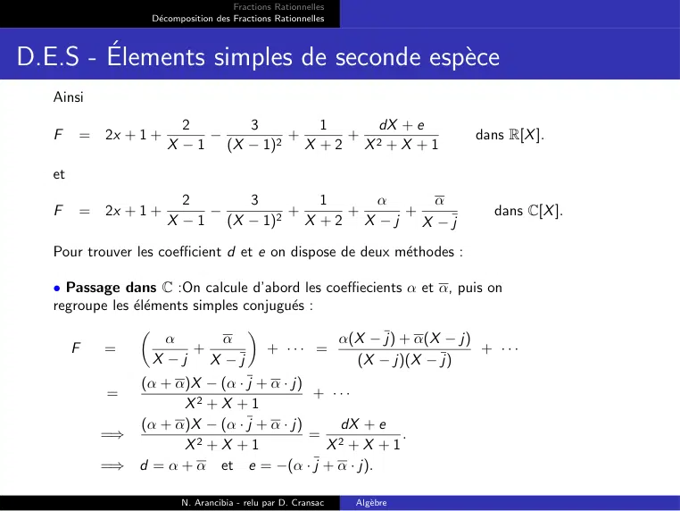

~~~text
                                     Fractions Rationnelles
                  Décomposition des Fractions Rationnelles

D.E.S - Élements simples de seconde espèce
   Ainsi
                         2      3         1    dX + e
   F    =   2x + 1 +        −         +      +                           dans R[X ].
                       X − 1 (X − 1)2   X + 2 X2 + X + 1
   et
                         2      3         1    α      α
   F    =   2x + 1 +        −         +     +     +                        dans C[X ].
                       X − 1 (X − 1)2   X +2 X −j   X −j
   Pour trouver les coefficient d et e on dispose de deux méthodes :

   • Passage dans C :On calcule d’abord les coeffiecients α et α, puis on
   regroupe les éléments simples conjugués :
                                   
                       α        α               α(X − j) + α(X − j)
      F    =               +          + ··· =                         + ···
                     X −j     X −j                (X − j)(X − j)
               (α + α)X − (α · j + α · j)
            =                             + ···
                     X2 + X + 1
               (α + α)X − (α · j + α · j)    dX + e
            =⇒                            = 2       .
                     X2 + X + 1            X +X +1
            =⇒ d = α + α et e = −(α · j + α · j).

                         N. Arancibia - relu par D. Cransac   Algèbre
~~~

## Page 31

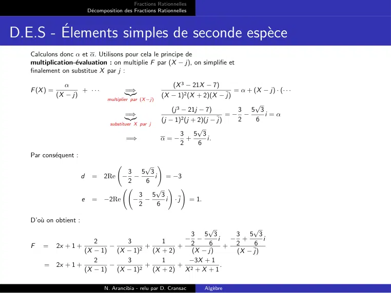

~~~text
                                               Fractions Rationnelles
                            Décomposition des Fractions Rationnelles

D.E.S - Élements simples de seconde espèce
   Calculons donc α et α. Utilisons pour cela le principe de
   multiplication-évaluation : on multiplie F par (X − j), on simplifie et
   finalement on substitue X par j :

                 α                                               (X 3 − 21X − 7)
   F (X ) =           + ···                =⇒                                       = α + (X − j) · (· · ·
              (X − j)                      |{z}             (X − 1)2 (X + 2)(X − j)
                                    multiplier par (X −j)
                                                                                          √
                                                                (j 3 − 21j − 7)      3 5 3
                                           =⇒                                      =− −      i =α
                                           |{z}                      2
                                                            (j − 1) (j + 2)(j − j)   2     6
                                     substituer X par j
                                                                          √
                                                                     3 5 3
                                            =⇒              α=− +            i.
                                                                     2     6
   Par conséquent :
                                            √ !
                                       3 5 3
                        d    =    2Re − −     i = −3
                                       2    6
                                              √ ! !
                                          3 5 3
                        e    =    −2Re   − −     i · j = 1.
                                          2    6

   D’où on obtient :
                                                      √            √
                                                3 5 3         3 5 3
                     2       3          1      − −       i   − +      i
   F   = 2x + 1 +        −         +         + 2      6 + 2        6
                  (X − 1) (X − 1)2   (X + 2)     (X − j)      (X − j)
                     2       3          1       −3X + 1
       = 2x + 1 +        −         +         +             .
                  (X − 1) (X − 1)2   (X + 2) X 2 + X + 1

                                   N. Arancibia - relu par D. Cransac      Algèbre
~~~

## Page 32

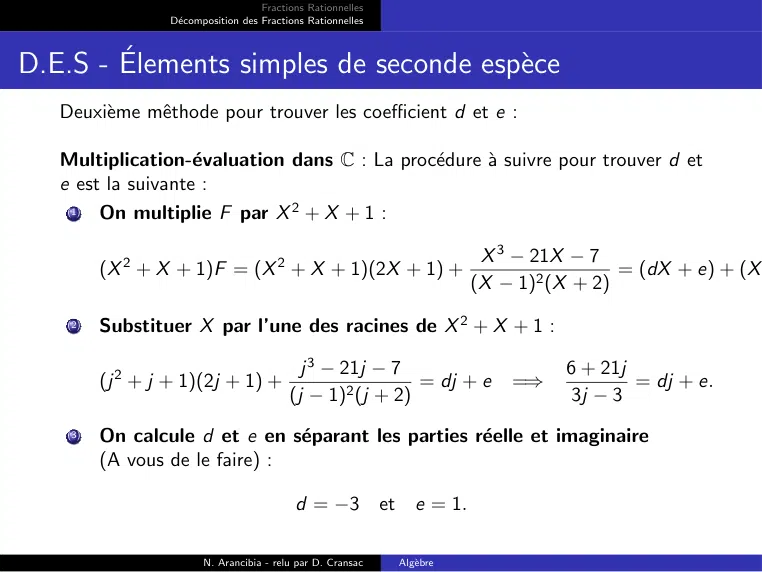

~~~text
                                    Fractions Rationnelles
                 Décomposition des Fractions Rationnelles

D.E.S - Élements simples de seconde espèce
   Deuxième mêthode pour trouver les coefficient d et e :

   Multiplication-évaluation dans C : La procédure à suivre pour trouver d et
   e est la suivante :
   (1)   On multiplie F par X 2 + X + 1 :

                                                                               X 3 − 21X − 7
         (X 2 + X + 1)F = (X 2 + X + 1)(2X + 1) +                                              = (dX + e) + (X
                                                                              (X − 1)2 (X + 2)
   (2)   Substituer X par l’une des racines de X 2 + X + 1 :

                                            j 3 − 21j − 7                               6 + 21j
         (j 2 + j + 1)(2j + 1) +                           = dj + e               =⇒            = dj + e.
                                          (j − 1)2 (j + 2)                              3j − 3
   (3)   On calcule d et e en séparant les parties réelle et imaginaire
         (A vous de le faire) :

                                           d = −3            et      e = 1.

                        N. Arancibia - relu par D. Cransac        Algèbre
~~~

## Page 33

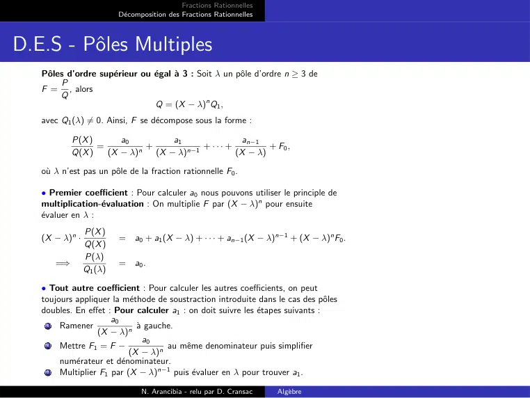

~~~text
                                            Fractions Rationnelles
                         Décomposition des Fractions Rationnelles

D.E.S - Pôles Multiples
   Pôles d’ordre supérieur ou égal à 3 : Soit λ un pôle d’ordre n ≥ 3 de
        P
   F = , alors
        Q
                                 Q = (X − λ)n Q1 ,
   avec Q1 (λ) 6= 0. Ainsi, F se décompose sous la forme :

           P(X )      a0          a1               an−1
                 =          +            + ··· +         + F0 ,
           Q(X )   (X − λ)n   (X − λ)n−1         (X − λ)

   où λ n’est pas un pôle de la fraction rationnelle F0 .

   • Premier coefficient : Pour calculer a0 nous pouvons utiliser le principle de
   multiplication-évaluation : On multiplie F par (X − λ)n pour ensuite
   évaluer en λ :
                P(X )
   (X − λ)n ·            = a0 + a1 (X − λ) + · · · + an−1 (X − λ)n−1 + (X − λ)n F0 .
                Q(X )
                P(λ)
      =⇒                 = a0 .
                Q1 (λ)

   • Tout autre coefficient : Pour calculer les autres coefficients, on peut
   toujours appliquer la méthode de soustraction introduite dans le cas des pôles
   doubles. En effet : Pour calculer a1 : on doit suivre les étapes suivants :
                      a0
    (1) Ramener              à gauche.
                  (X − λ)n
                               a0
    (2) Mettre F1 = F −              au même denominateur puis simplifier
                           (X − λ)n
        numérateur et dénominateur.
    (3) Multiplier F1 par (X − λ)n−1 puis évaluer en λ pour trouver a1 .

                                N. Arancibia - relu par D. Cransac   Algèbre
~~~

## Page 34

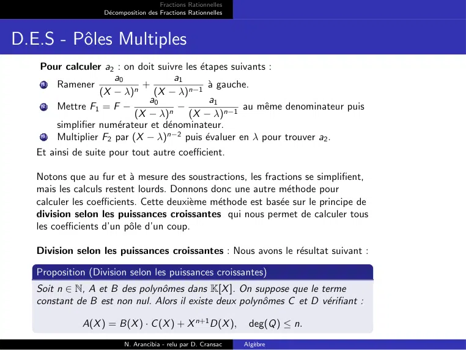

~~~text
                                      Fractions Rationnelles
                   Décomposition des Fractions Rationnelles

D.E.S - Pôles Multiples
   Pour calculer a2 : on doit suivre les étapes suivants :
                     a0             a1
   (1) Ramener              +               à gauche.
                  (X − λ)n     (X − λ)n−1
                              a0            a1
   (2) Mettre F1 = F −               −              au même denominateur puis
                          (X − λ)n     (X − λ)n−1
       simplifier numérateur et dénominateur.
   (3) Multiplier F2 par (X − λ)n−2 puis évaluer en λ pour trouver a2 .
   Et ainsi de suite pour tout autre coefficient.

   Notons que au fur et à mesure des soustractions, les fractions se simplifient,
   mais les calculs restent lourds. Donnons donc une autre méthode pour
   calculer les coefficients. Cette deuxième méthode est basée sur le principe de
   division selon les puissances croissantes qui nous permet de calculer tous
   les coefficients d’un pôle d’un coup.

   Division selon les puissances croissantes : Nous avons le résultat suivant :

   Proposition (Division selon les puissances croissantes)
   Soit n ∈ N, A et B des polynômes dans K[X ]. On suppose que le terme
   constant de B est non nul. Alors il existe deux polynômes C et D vérifiant :

              A(X ) = B(X ) · C (X ) + X n+1 D(X ),             deg(Q) ≤ n.
                          N. Arancibia - relu par D. Cransac   Algèbre
~~~

## Page 35

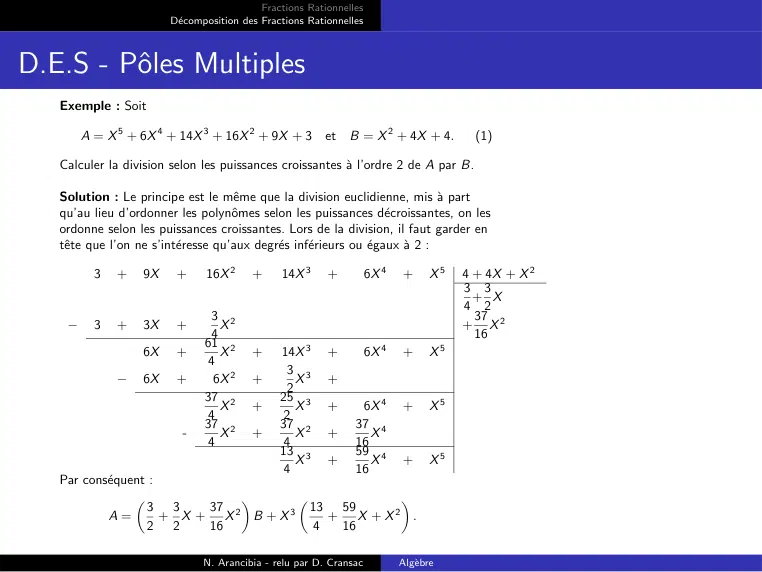

~~~text
                                          Fractions Rationnelles
                       Décomposition des Fractions Rationnelles

D.E.S - Pôles Multiples
   Exemple : Soit

        A = X 5 + 6X 4 + 14X 3 + 16X 2 + 9X + 3        et    B = X 2 + 4X + 4.          (1)

   Calculer la division selon les puissances croissantes à l’ordre 2 de A par B.

   Solution : Le principe est le même que la division euclidienne, mis à part
   qu’au lieu d’ordonner les polynômes selon les puissances décroissantes, on les
   ordonne selon les puissances croissantes. Lors de la division, il faut garder en
   tête que l’on ne s’intéresse qu’aux degrés inférieurs ou égaux à 2 :

          3   +   9X     +    16X 2     +     14X 3     +          6X 4   +      X5   4 + 4X + X 2
                                                                                      3 3
                                                                                        + X
                                                                                      4 2
                                3 2                                                     37
    −     3   +   3X     +        X                                                   + X2
                                4                                                       16
                              61 2
                  6X     +        X     +     14X 3     +          6X 4   +      X5
                               4
                                                3 3
              −   6X     +      6X 2    +        X      +
                                               2
                              37 2            25 3
                                  X     +        X      +      6X 4       +      X5
                               4               2
                              37 2            37 2            37 4
                          -       X     +        X      +        X
                               4               4              16
                                              13 3            59 4
                                          +      X+ X5           X
                                               4              16
   Par conséquent :
                                               
                  3 3     37           13 59
           A=        + X + X2 B + X3      + X + X2 .
                  2 2     16            4   16

                              N. Arancibia - relu par D. Cransac          Algèbre
~~~

## Page 36

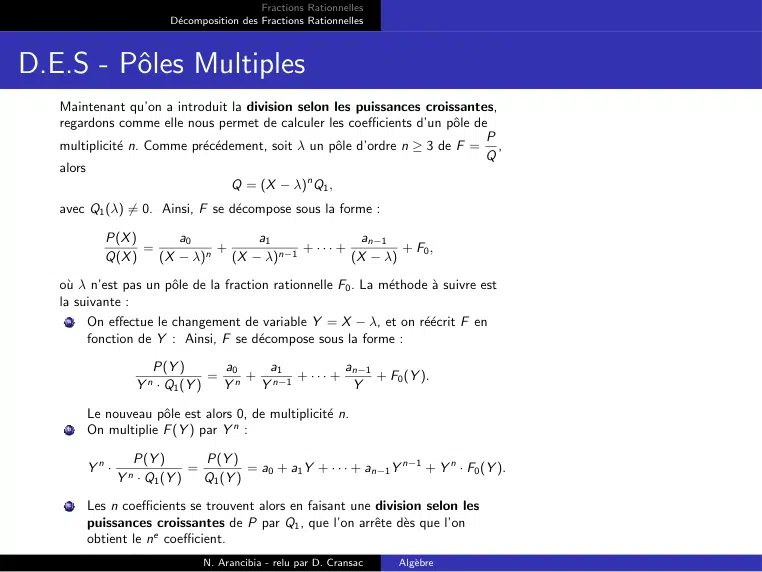

~~~text
                                              Fractions Rationnelles
                           Décomposition des Fractions Rationnelles

D.E.S - Pôles Multiples
   Maintenant qu’on a introduit la division selon les puissances croissantes,
   regardons comme elle nous permet de calculer les coefficients d’un pôle de
                                                                              P
   multiplicité n. Comme précédement, soit λ un pôle d’ordre n ≥ 3 de F = ,
                                                                              Q
   alors
                                  Q = (X − λ)n Q1 ,
   avec Q1 (λ) 6= 0. Ainsi, F se décompose sous la forme :

             P(X )      a0          a1               an−1
                   =          +            + ··· +         + F0 ,
             Q(X )   (X − λ)n   (X − λ)n−1         (X − λ)

   où λ n’est pas un pôle de la fraction rationnelle F0 . La méthode à suivre est
   la suivante :
   (a)    On effectue le changement de variable Y = X − λ, et on réécrit F en
          fonction de Y : Ainsi, F se décompose sous la forme :

                       P(Y )       a0    a1           an−1
                                  = n + n−1 + · · · +      + F0 (Y ).
                    Y n · Q1 (Y )  Y   Y               Y

          Le nouveau pôle est alors 0, de multiplicité n.
   (b)    On multiplie F (Y ) par Y n :

                    P(Y )        P(Y )
          Yn ·                 =         = a0 + a1 Y + · · · + an−1 Y n−1 + Y n · F0 (Y ).
                 Y n · Q1 (Y )   Q1 (Y )
    (c)   Les n coefficients se trouvent alors en faisant une division selon les
          puissances croissantes de P par Q1 , que l’on arrête dès que l’on
          obtient le ne coefficient.
                                  N. Arancibia - relu par D. Cransac   Algèbre
~~~

## Page 37

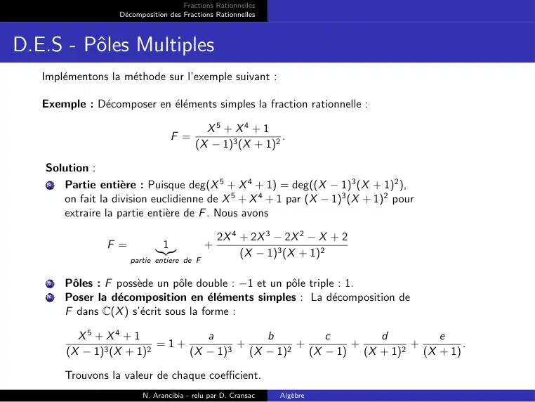

~~~text
                                        Fractions Rationnelles
                     Décomposition des Fractions Rationnelles

D.E.S - Pôles Multiples
   Implémentons la méthode sur l’exemple suivant :

   Exemple : Décomposer en éléments simples la fraction rationnelle :

                                             X5 + X4 + 1
                                    F =                      .
                                           (X − 1)3 (X + 1)2

   Solution :
    (a)   Partie entière : Puisque deg(X 5 + X 4 + 1) = deg((X − 1)3 (X + 1)2 ),
          on fait la division euclidienne de X 5 + X 4 + 1 par (X − 1)3 (X + 1)2 pour
          extraire la partie entière de F . Nous avons

                                                   2X 4 + 2X 3 − 2X 2 − X + 2
                   F =          1              +
                               |{z}                     (X − 1)3 (X + 1)2
                         partie entiere de F

   (b)    Pôles : F possède un pôle double : −1 et un pôle triple : 1.
    (c)   Poser la décomposition en éléments simples : La décomposition de
          F dans C(X ) s’écrit sous la forme :

            X5 + X4 + 1            a          b          c       d          e
                            =1+          +          +        +         +         .
          (X − 1)3 (X + 1)2     (X − 1)3   (X − 1)2   (X − 1) (X + 1)2   (X + 1)

          Trouvons la valeur de chaque coefficient.
                            N. Arancibia - relu par D. Cransac   Algèbre
~~~

## Page 38

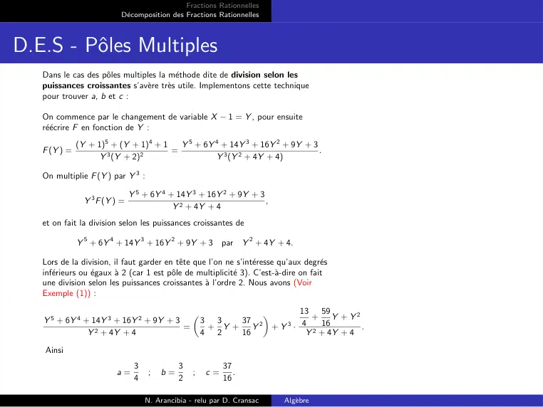

~~~text
                                             Fractions Rationnelles
                          Décomposition des Fractions Rationnelles

D.E.S - Pôles Multiples
   Dans le cas des pôles multiples la méthode dite de division selon les
   puissances croissantes s’avère très utile. Implementons cette technique
   pour trouver a, b et c :

   On commence par le changement de variable X − 1 = Y , pour ensuite
   réécrire F en fonction de Y :
              (Y + 1)5 + (Y + 1)4 + 1   Y 5 + 6Y 4 + 14Y 3 + 16Y 2 + 9Y + 3
   F (Y ) =                           =                                     .
                    Y 3 (Y + 2)2                 Y 3 (Y 2 + 4Y + 4)

   On multiplie F (Y ) par Y 3 :

                               Y 5 + 6Y 4 + 14Y 3 + 16Y 2 + 9Y + 3
                Y 3 F (Y ) =                                       ,
                                           Y 2 + 4Y + 4
   et on fait la division selon les puissances croissantes de

              Y 5 + 6Y 4 + 14Y 3 + 16Y 2 + 9Y + 3          par    Y 2 + 4Y + 4.

   Lors de la division, il faut garder en tête que l’on ne s’intéresse qu’aux degrés
   inférieurs ou égaux à 2 (car 1 est pôle de multiplicité 3). C’est-à-dire on fait
   une division selon les puissances croissantes à l’ordre 2. Nous avons (Voir
   Exemple (1)) :

                                                                                     13 59
   Y 5 + 6Y 4 + 14Y 3 + 16Y 2 + 9Y + 3
                                                  
                                                      3 3   37
                                                                                      + Y +Y2
                                       =               + Y + Y2              + Y 3 · 4 2 16      .
               Y 2 + 4Y + 4                           4 2   16                        Y + 4Y + 4

   Ainsi
                                3             3            37
                         a=         ;   b=        ;   c=      .
                                4             2            16

                                    N. Arancibia - relu par D. Cransac         Algèbre
~~~

## Page 39

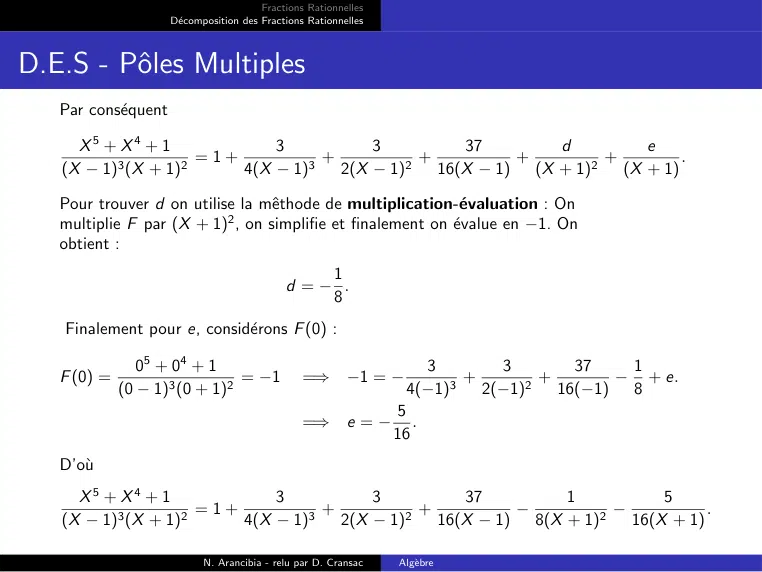

~~~text
                                        Fractions Rationnelles
                     Décomposition des Fractions Rationnelles

D.E.S - Pôles Multiples
   Par conséquent

     X5 + X4 + 1             3           3          37        d          e
                     =1+           +           +          +         +         .
   (X − 1)3 (X + 1)2     4(X − 1)3   2(X − 1)2   16(X − 1) (X + 1)2   (X + 1)

   Pour trouver d on utilise la mêthode de multiplication-évaluation : On
   multiplie F par (X + 1)2 , on simplifie et finalement on évalue en −1. On
   obtient :
                                                 1
                                             d =− .
                                                 8
   Finalement pour e, considérons F (0) :

                05 + 0 4 + 1                                         3        3        37   1
   F (0) =                     = −1              =⇒ −1 = −                +        +       − + e.
             (0 − 1)3 (0 + 1)2                                     4(−1)3   2(−1)2   16(−1) 8
                                                                  5
                                                 =⇒ e = −           .
                                                                 16
   D’où
     X5 + X4 + 1             3           3          37         1           5
                     =1+           +           +          −          −           .
   (X − 1)3 (X + 1)2     4(X − 1)3   2(X − 1)2   16(X − 1) 8(X + 1)2   16(X + 1)

                            N. Arancibia - relu par D. Cransac   Algèbre
~~~

## Page 40

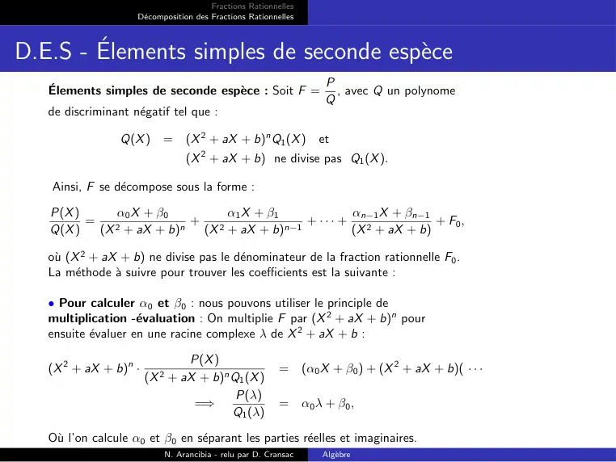

~~~text
                                        Fractions Rationnelles
                     Décomposition des Fractions Rationnelles

D.E.S - Élements simples de seconde espèce
                                                                     P
   Élements simples de seconde espèce : Soit F =                     , avec Q un polynome
                                                                     Q
   de discriminant négatif tel que :

                 Q(X )     =     (X 2 + aX + b)n Q1 (X )            et
                                 (X 2 + aX + b) ne divise pas Q1 (X ).

   Ainsi, F se décompose sous la forme :

   P(X )      α0 X + β0           α1 X + β1            αn−1 X + βn−1
         =                 +                   + ··· +                + F0 ,
   Q(X )   (X 2 + aX + b)n   (X 2 + aX + b)n−1         (X 2 + aX + b)

   où (X 2 + aX + b) ne divise pas le dénominateur de la fraction rationnelle F0 .
   La méthode à suivre pour trouver les coefficients est la suivante :

   • Pour calculer α0 et β0 : nous pouvons utiliser le principle de
   multiplication -évaluation : On multiplie F par (X 2 + aX + b)n pour
   ensuite évaluer en une racine complexe λ de X 2 + aX + b :

                               P(X )
   (X 2 + aX + b)n ·                                      =      (α0 X + β0 ) + (X 2 + aX + b)( · · ·
                       (X 2 + aX + b)n Q1 (X )
                                        P(λ)
                                =⇒                        = α0 λ + β0 ,
                                       Q1 (λ)

   Où l’on calcule α0 et β0 en séparant les parties réelles et imaginaires.
                            N. Arancibia - relu par D. Cransac       Algèbre
~~~

## Page 41

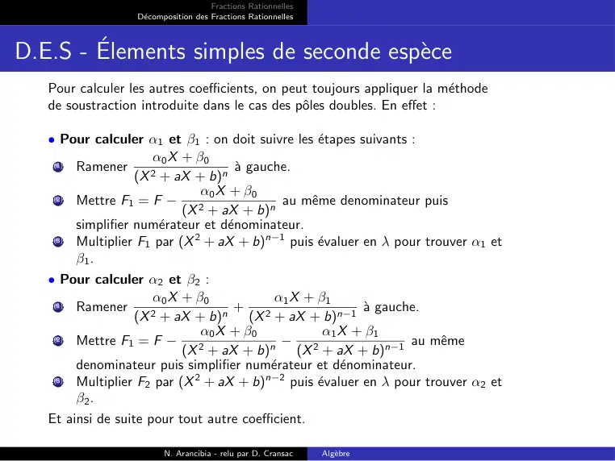

~~~text
                                     Fractions Rationnelles
                  Décomposition des Fractions Rationnelles

D.E.S - Élements simples de seconde espèce
   Pour calculer les autres coefficients, on peut toujours appliquer la méthode
   de soustraction introduite dans le cas des pôles doubles. En effet :

   • Pour calculer α1 et β1 : on doit suivre les étapes suivants :
                      α0 X + β0
    (1) Ramener                      à gauche.
                   (X 2 + aX + b)n
                              α 0 X +  β0
    (2) Mettre F1 = F −                      au même denominateur puis
                           (X 2 + aX + b)n
        simplifier numérateur et dénominateur.
    (3) Multiplier F1 par (X 2 + aX + b)n−1 puis évaluer en λ pour trouver α1 et
        β1 .
   • Pour calculer α2 et β2 :
                     α0 X + β0             α 1 X + β1
    (1) Ramener                     +                       à gauche.
                  (X 2 + aX + b)n     (X 2 + aX + b)n−1
                              α0 X + β0              α 1 X + β1
    (2) Mettre F1 = F −                     −                       au même
                           (X 2 + aX + b)n      (X 2 + aX + b)n−1
        denominateur puis simplifier numérateur et dénominateur.
    (3) Multiplier F2 par (X 2 + aX + b)n−2 puis évaluer en λ pour trouver α2 et
        β2 .
   Et ainsi de suite pour tout autre coefficient.

                         N. Arancibia - relu par D. Cransac   Algèbre
~~~

## Page 42

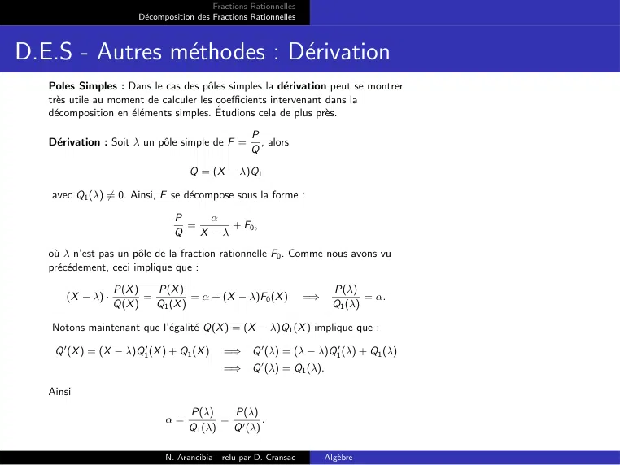

~~~text
                                           Fractions Rationnelles
                        Décomposition des Fractions Rationnelles

D.E.S - Autres méthodes : Dérivation
   Poles Simples : Dans le cas des pôles simples la dérivation peut se montrer
   très utile au moment de calculer les coefficients intervenant dans la
   décomposition en éléments simples. Étudions cela de plus près.
                                                     P
   Dérivation : Soit λ un pôle simple de F =         , alors
                                                     Q
                                     Q = (X − λ)Q1

   avec Q1 (λ) 6= 0. Ainsi, F se décompose sous la forme :

                                 P     α
                                   =      + F0 ,
                                 Q   X −λ
   où λ n’est pas un pôle de la fraction rationnelle F0 . Comme nous avons vu
   précédement, ceci implique que :

                   P(X )   P(X )                                           P(λ)
       (X − λ) ·         =         = α + (X − λ)F0 (X )             =⇒            = α.
                   Q(X )   Q1 (X )                                         Q1 (λ)

   Notons maintenant que l’égalité Q(X ) = (X − λ)Q1 (X ) implique que :

    Q 0 (X ) = (X − λ)Q10 (X ) + Q1 (X )      =⇒ Q 0 (λ) = (λ − λ)Q10 (λ) + Q1 (λ)
                                              =⇒ Q 0 (λ) = Q1 (λ).

   Ainsi
                                     P(λ)    P(λ)
                               α=           = 0    .
                                     Q1 (λ)  Q (λ)

                               N. Arancibia - relu par D. Cransac        Algèbre
~~~

## Page 43

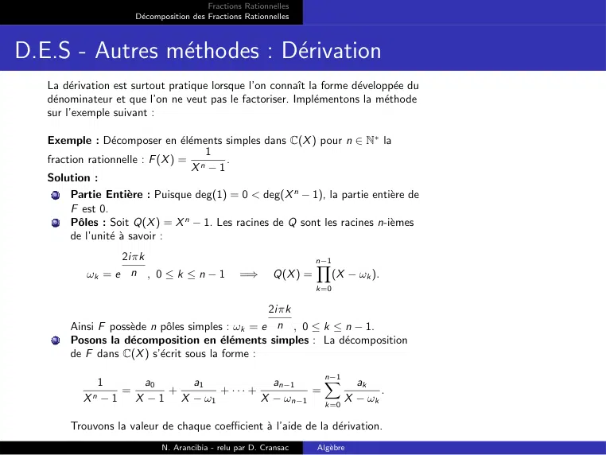

~~~text
                                            Fractions Rationnelles
                         Décomposition des Fractions Rationnelles

D.E.S - Autres méthodes : Dérivation
   La dérivation est surtout pratique lorsque l’on connaı̂t la forme développée du
   dénominateur et que l’on ne veut pas le factoriser. Implémentons la méthode
   sur l’exemple suivant :

   Exemple : Décomposer en éléments simples dans C(X ) pour n ∈ N∗ la
                                     1
   fraction rationnelle : F (X ) = n   .
                                  X −1
   Solution :
   (a)    Partie Entière : Puisque deg(1) = 0 < deg(X n − 1), la partie entière de
          F est 0.
   (b)    Pôles : Soit Q(X ) = X n − 1. Les racines de Q sont les racines n-ièmes
          de l’unité à savoir :
                   2iπk                                                n−1
                                                                       Y
             ωk = e n , 0 ≤ k ≤ n − 1               =⇒       Q(X ) =         (X − ωk ).
                                                                       k=0

                                                    2iπk
          Ainsi F possède n pôles simples : ωk = e n , 0 ≤ k ≤ n − 1.
    (c)   Posons la décomposition en éléments simples : La décomposition
          de F dans C(X ) s’écrit sous la forme :
                                                                         n−1
               1          a0     a1             an−1     X ak
                     =        +       + ··· +          =         .
            Xn − 1       X − 1 X − ω1         X − ωn−1    X − ωk
                                                                         k=0

          Trouvons la valeur de chaque coefficient à l’aide de la dérivation.
                                N. Arancibia - relu par D. Cransac     Algèbre
~~~

## Page 44

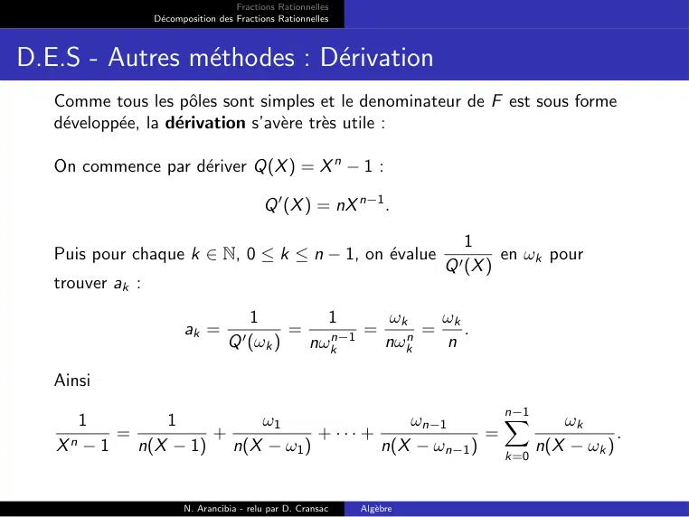

~~~text
                                     Fractions Rationnelles
                  Décomposition des Fractions Rationnelles

D.E.S - Autres méthodes : Dérivation
   Comme tous les pôles sont simples et le denominateur de F est sous forme
   développée, la dérivation s’avère très utile :

   On commence par dériver Q(X ) = X n − 1 :

                                           Q 0 (X ) = nX n−1 .

                                                                             1
   Puis pour chaque k ∈ N, 0 ≤ k ≤ n − 1, on évalue                              en ωk pour
                                                                         Q 0 (X )
   trouver ak :
                                       1         1       ωk    ωk
                         ak =                =        =      =    .
                                   Q 0 (ωk )   nωkn−1   nωkn   n

   Ainsi
                                                                                 n−1
      1      1        ω1                 ωn−1        X    ωk
    n
        =         +           + ··· +              =              .
   X −1   n(X − 1) n(X − ω1 )         n(X − ωn−1 )     n(X − ωk )
                                                                                 k=0

                         N. Arancibia - relu par D. Cransac   Algèbre
~~~

## Page 45

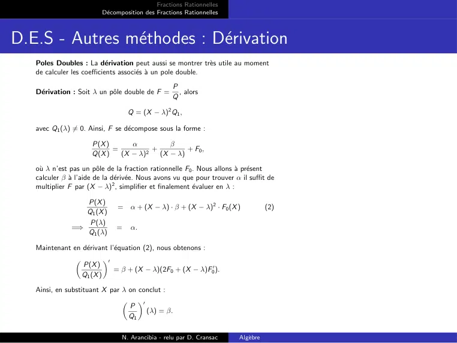

~~~text
                                                 Fractions Rationnelles
                              Décomposition des Fractions Rationnelles

D.E.S - Autres méthodes : Dérivation
   Poles Doubles : La dérivation peut aussi se montrer très utile au moment
   de calculer les coefficients associés à un pole double.
                                                      P
   Dérivation : Soit λ un pôle double de F =          , alors
                                                      Q

                                       Q = (X − λ)2 Q1 ,

   avec Q1 (λ) 6= 0. Ainsi, F se décompose sous la forme :

                       P(X )      α          β
                             =          +         + F0 ,
                       Q(X )   (X − λ)2   (X − λ)

   où λ n’est pas un pôle de la fraction rationnelle F0 . Nous allons à présent
   calculer β à l’aide de la dérivée. Nous avons vu que pour trouver α il suffit de
   multiplier F par (X − λ)2 , simplifier et finalement évaluer en λ :

                  P(X )
                                    = α + (X − λ) · β + (X − λ)2 · F0 (X )           (2)
                  Q1 (X )
                   P(λ)
               =⇒                  =    α.
                  Q1 (λ)

   Maintenant en dérivant l’équation (2), nous obtenons :
                             0
                    P(X )
                                   = β + (X − λ)(2F0 + (X − λ)F00 ).
                    Q1 (X )

   Ainsi, en substituant X par λ on conclut :
                                0
                                 P
                                      (λ) = β.
                                 Q1

                                     N. Arancibia - relu par D. Cransac   Algèbre
~~~

## Page 46

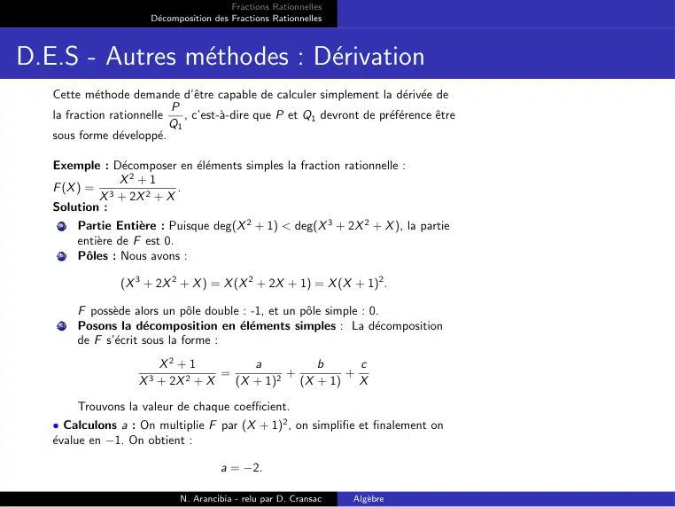

~~~text
                                           Fractions Rationnelles
                        Décomposition des Fractions Rationnelles

D.E.S - Autres méthodes : Dérivation
   Cette méthode demande d’être capable de calculer simplement la dérivée de
                           P
   la fraction rationnelle    , c’est-à-dire que P et Q1 devront de préférence être
                           Q1
   sous forme développé.

   Exemple : Décomposer en éléments simples la fraction rationnelle :
               X2 + 1
   F (X ) =               .
           X 3 + 2X 2 + X
   Solution :
    (a)   Partie Entière : Puisque deg(X 2 + 1) < deg(X 3 + 2X 2 + X ), la partie
          entière de F est 0.
   (b)    Pôles : Nous avons :

                  (X 3 + 2X 2 + X ) = X (X 2 + 2X + 1) = X (X + 1)2 .

          F possède alors un pôle double : -1, et un pôle simple : 0.
    (c)   Posons la décomposition en éléments simples : La décomposition
          de F s’écrit sous la forme :
                         X2 + 1          a          b     c
                                    =          +        +
                     X 3 + 2X 2 + X   (X + 1)2   (X + 1) X

          Trouvons la valeur de chaque coefficient.
   • Calculons a : On multiplie F par (X + 1)2 , on simplifie et finalement on
   évalue en −1. On obtient :

                                        a = −2.

                               N. Arancibia - relu par D. Cransac   Algèbre
~~~

## Page 47

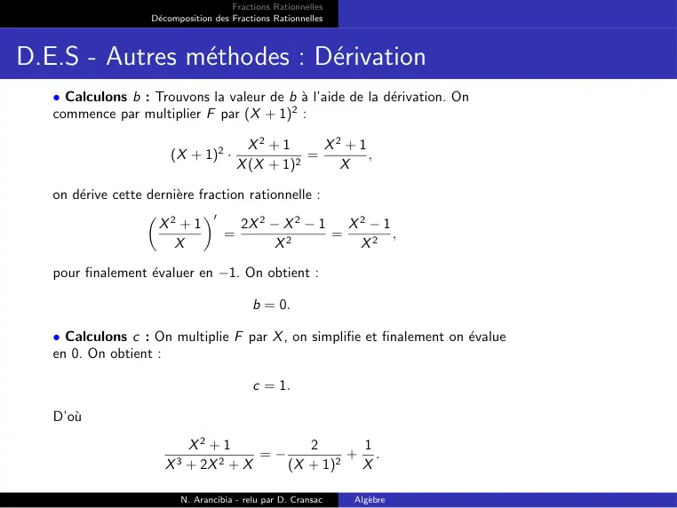

~~~text
                                       Fractions Rationnelles
                    Décomposition des Fractions Rationnelles

D.E.S - Autres méthodes : Dérivation
   • Calculons b : Trouvons la valeur de b à l’aide de la dérivation. On
   commence par multiplier F par (X + 1)2 :

                                          X2 + 1     X2 + 1
                        (X + 1)2 ·                 =        ,
                                        X (X + 1)2     X

   on dérive cette dernière fraction rationnelle :
                     2        0
                      X +1           2X 2 − X 2 − 1    X2 − 1
                                  =           2
                                                     =        ,
                        X                   X           X2

   pour finalement évaluer en −1. On obtient :

                                            b = 0.

   • Calculons c : On multiplie F par X , on simplifie et finalement on évalue
   en 0. On obtient :

                                            c = 1.

   D’où
                           X2 + 1           2      1
                                      =−          + .
                       X 3 + 2X 2 + X    (X + 1)2  X

                           N. Arancibia - relu par D. Cransac   Algèbre
~~~

## Page 48

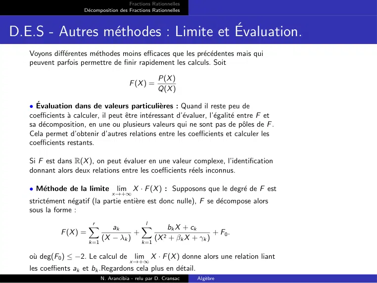

~~~text
                                         Fractions Rationnelles
                      Décomposition des Fractions Rationnelles

D.E.S - Autres méthodes : Limite et Évaluation.
   Voyons différentes méthodes moins efficaces que les précédentes mais qui
   peuvent parfois permettre de finir rapidement les calculs. Soit

                                                       P(X )
                                           F (X ) =
                                                       Q(X )

   • Évaluation dans de valeurs particulières : Quand il reste peu de
   coefficients à calculer, il peut être intéressant d’évaluer, l’égalité entre F et
   sa décomposition, en une ou plusieurs valeurs qui ne sont pas de pôles de F .
   Cela permet d’obtenir d’autres relations entre les coefficients et calculer les
   coefficients restants.

   Si F est dans R(X ), on peut évaluer en une valeur complexe, l’identification
   donnant alors deux relations entre les coefficients réels inconnus.

   • Méthode de la limite            lim X · F (X ) : Supposons que le degré de F est
                                   x→+∞
   strictément négatif (la partie entière est donc nulle), F se décompose alors
   sous la forme :
                         r                        l
                         X        ak       X     bk X + c k
              F (X ) =                   +                      + F0 .
                               (X − λk )     (X 2 + βk X + γk )
                         k=1                    k=1

   où deg(F0 ) ≤ −2. Le calcul de lim X · F (X ) donne alors une relation liant
                                           x→+∞
   les coeffients ak et bk .Regardons cela plus en détail.
                               N. Arancibia - relu par D. Cransac   Algèbre
~~~

## Page 49

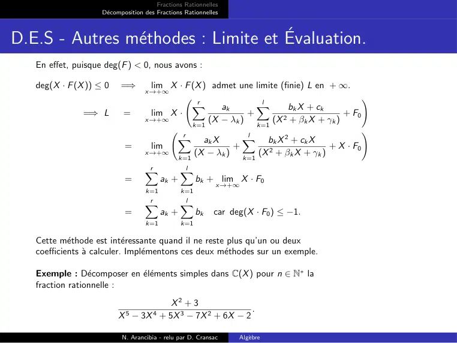

~~~text
                                       Fractions Rationnelles
                    Décomposition des Fractions Rationnelles

D.E.S - Autres méthodes : Limite et Évaluation.
   En effet, puisque deg(F ) < 0, nous avons :

   deg(X · F (X )) ≤ 0    =⇒         lim X · F (X ) admet une limite (finie) L en + ∞.
                                   x→+∞
                                                      r                       l
                                                                                                    !
                                                      X        ak       X     bk X + c k
               =⇒ L        =         lim X ·                          +                      + F0
                                   x→+∞                     (X − λk )     (X 2 + βk X + γk )
                                                      k=1                 k=1
                                              r                       l
                                                                                                    !
                                              X         ak X      X bk X 2 + ck X
                           =         lim                        +                     + X · F0
                                   x→+∞               (X − λk )    (X 2 + βk X + γk )
                                                k=1                 k=1
                                   r
                                   X            l
                                                X
                           =             ak +         bk + lim X · F0
                                                             x→+∞
                                   k=1          k=1
                                   r
                                   X            l
                                                X
                           =             ak +         bk     car deg(X · F0 ) ≤ −1.
                                   k=1          k=1

   Cette méthode est intéressante quand il ne reste plus qu’un ou deux
   coefficients à calculer. Implémentons ces deux méthodes sur un exemple.

   Exemple : Décomposer en éléments simples dans C(X ) pour n ∈ N∗ la
   fraction rationnelle :
                                       X2 + 3
                                                           .
                         X 5 − 3X 4 + 5X 3 − 7X 2 + 6X − 2

                           N. Arancibia - relu par D. Cransac      Algèbre
~~~

## Page 50

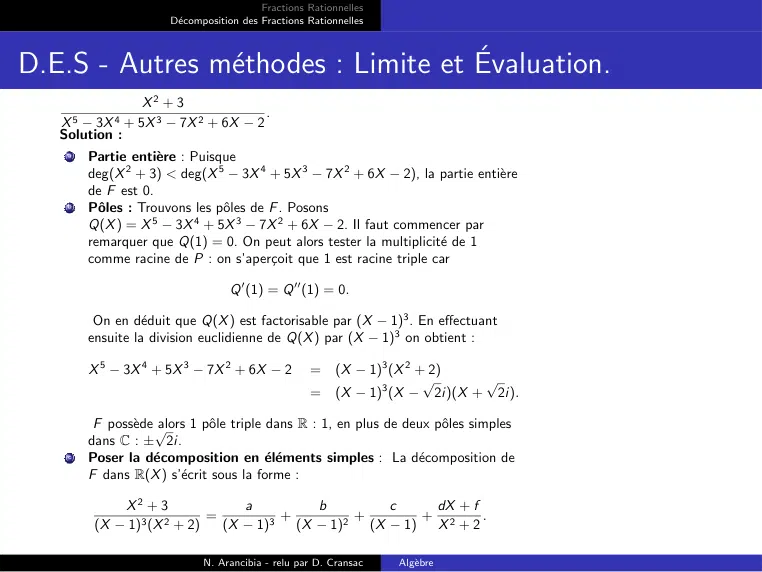

~~~text
                                          Fractions Rationnelles
                       Décomposition des Fractions Rationnelles

D.E.S - Autres méthodes : Limite et Évaluation.
                 X2 + 3
                                     .
   X 5 − 3X 4 + 5X 3 − 7X 2 + 6X − 2
   Solution :
   (a)   Partie entière : Puisque
         deg(X 2 + 3) < deg(X 5 − 3X 4 + 5X 3 − 7X 2 + 6X − 2), la partie entière
         de F est 0.
   (b)   Pôles : Trouvons les pôles de F . Posons
         Q(X ) = X 5 − 3X 4 + 5X 3 − 7X 2 + 6X − 2. Il faut commencer par
         remarquer que Q(1) = 0. On peut alors tester la multiplicité de 1
         comme racine de P : on s’aperçoit que 1 est racine triple car

                                   Q 0 (1) = Q 00 (1) = 0.

          On en déduit que Q(X ) est factorisable par (X − 1)3 . En effectuant
         ensuite la division euclidienne de Q(X ) par (X − 1)3 on obtient :

         X 5 − 3X 4 + 5X 3 − 7X 2 + 6X − 2          =     (X − 1)3 (X 2 + 2)
                                                                         √     √
                                                    =     (X − 1)3 (X − 2i)(X + 2i).

          F possède √
                     alors 1 pôle triple dans R : 1, en plus de deux pôles simples
         dans C : ± 2i.
   (c)   Poser la décomposition en éléments simples : La décomposition de
         F dans R(X ) s’écrit sous la forme :

              X2 + 3              a          b          c     dX + f
                             =          +          +         + 2     .
          (X − 1)3 (X 2 + 2)   (X − 1)3   (X − 1)2   (X − 1)  X +2

                              N. Arancibia - relu par D. Cransac   Algèbre
~~~

## Page 51

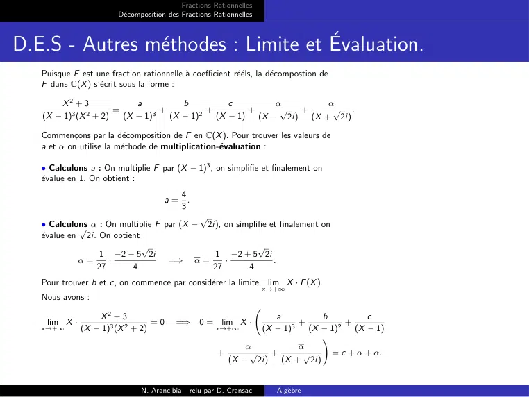

~~~text
                                           Fractions Rationnelles
                        Décomposition des Fractions Rationnelles

D.E.S - Autres méthodes : Limite et Évaluation.
   Puisque F est une fraction rationnelle à coefficient rééls, la décompostion de
   F dans C(X ) s’écrit sous la forme :

       X2 + 3              a          b          c        α        α
                      =          +          +        +     √  +     √ .
   (X − 1)3 (X 2 + 2)   (X − 1)3   (X − 1)2   (X − 1) (X − 2i) (X + 2i)

   Commençons par la décomposition de F en C(X ). Pour trouver les valeurs de
   a et α on utilise la méthode de multiplication-évaluation :

   • Calculons a : On multiplie F par (X − 1)3 , on simplifie et finalement on
   évalue en 1. On obtient :
                                           4
                                      a=     .
                                           3
                                          √
   • Calculons
             √ α : On multiplie F par (X − 2i), on simplifie et finalement on
   évalue en 2i. On obtient :
                            √                            √
                  1 −2 − 5 2i                1 −2 + 5 2i
             α=     ·              =⇒ α =       ·             .
                 27       4                 27        4
   Pour trouver b et c, on commence par considérer la limite lim X · F (X ).
                                                                    x→+∞
   Nous avons :

                  X2 + 3                                          a          b          c
    lim X ·                      =0      =⇒ 0 = lim X ·                 +          +
   x→+∞       (X − 1)3 (X 2 + 2)                     x→+∞      (X − 1)3   (X − 1)2   (X − 1)
                                                                             !
                                                            α           α
                                                      +      √   +       √     = c + α + α.
                                                        (X − 2i) (X + 2i)

                               N. Arancibia - relu par D. Cransac     Algèbre
~~~

## Page 52

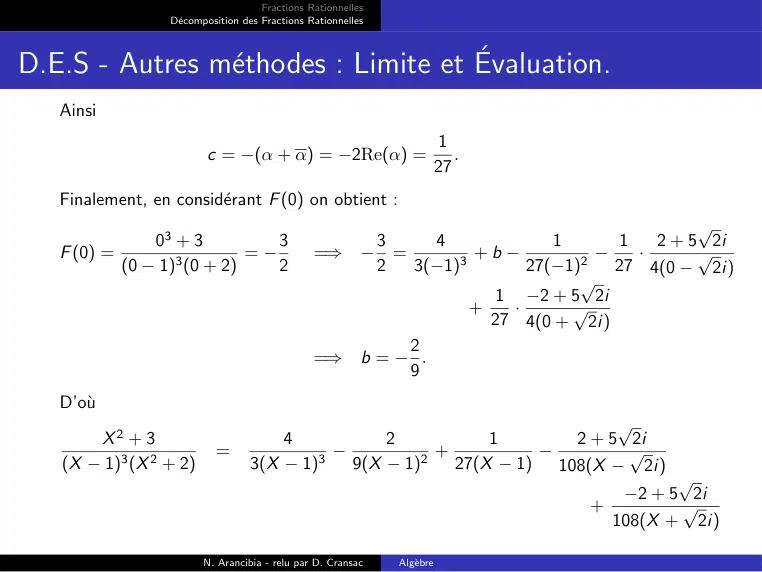

~~~text
                                      Fractions Rationnelles
                   Décomposition des Fractions Rationnelles

D.E.S - Autres méthodes : Limite et Évaluation.
   Ainsi
                                                                           1
                          c = −(α + α) = −2Re(α) =                           .
                                                                          27
   Finalement, en considérant F (0) on obtient :
                                                                                            √
                 03 + 3          3                    3     4              1       1   2 + 5 2i
   F (0) =                    =−                 =⇒ −   =        + b −          −    ·      √
             (0 − 1)3 (0 + 2)    2                    2   3(−1)3        27(−1)2   27 4(0 − 2i)
                                                                              √
                                                                    1 −2 + 5 2i
                                                                 +    ·      √
                                                                   27 4(0 + 2i)
                                                          2
                                                 =⇒ b = − .
                                                          9
   D’où
                                                                            √
       X2 + 3                          4           2           1       2 + 5 2i
                            =                −           +          −        √
   (X − 1)3 (X 2 + 2)              3(X − 1)3   9(X − 1)2   27(X − 1) 108(X − 2i)
                                                                                            √
                                                                                      −2 + 5 2i
                                                                                 +          √
                                                                                     108(X + 2i)

                          N. Arancibia - relu par D. Cransac   Algèbre
~~~

## Page 53

~~~text
                                   Fractions Rationnelles
                Décomposition des Fractions Rationnelles

D.E.S - Autres méthodes : Limite et Évaluation.
   Finalement, pour trouver la décomposition dans R(X ) il suffit de regrouper
   les termes conjugués :
                                                                                   √
       X2 + 3                             4           2           1           2 + 5 2i
                             =                  −           +             −          √
   (X − 1)3 (X 2 + 2)                 3(X − 1)3   9(X − 1)2   27(X − 1)     108(X − 2i)
                                                                                         √
                                                                                  −2 + 5
                                                                              +          √
                                                                                 108(X +
                                          4           2           1       X −5
                              =                 −           +          −            .
                                      3(X − 1)3   9(X − 1)2   27(X − 1) 27(X 2 + 2)

                       N. Arancibia - relu par D. Cransac   Algèbre
~~~
