# CM_2023-2024_Algebre1_P1S1_NArancibia.pdf

[Ouvrir l’original](https://drive.google.com/open?id=10t6Fg-UPDB7fo_AG6MqsVtI7DExMuCot) · Les deux lectures automatiques du PDF divergent sur les pages indiquées. Leur fac-similé accompagne le texte.

**Pages présentant un écart entre les deux extractions** — 1, 6–8, 10–16, 18–19, 21, 23–43, 45, 47, 49–53, 56–80, 82–83, 85–86, 88–89, 91–105, 107, 109–129, 131–142, 144–147, 150–156, 158–178, 180–249, 251–274.

## Page 1

~~~text
Algèbre 1 - Premier semestre 2023 - 2024

       Algèbre 1 - Premier semestre 2023 - 2024

 Responsable CM :     Nicolas Arancibia Robert
                      Bureau : Site St Martin, Bâtiment E, cinquième étage,
                      Bureau 552
                      e-mail : nat@cy-tech.fr - nicolas.arancibia-robert@cyu.fr

 Évaluation :   • DS 1 : Semaine du 23/10/2023 (25%)
                 • DS 2 : Semaine du 27/11/2023 (25%)
                 • Examen : Semaine du 22/01/2023 (40%)
                 • Note TD : (10%)

                                        Algèbre                            1 / 269
~~~

## Page 2

~~~text
Modalités d’Évaluation

Vous aurez 4 notes :
 I   2 contrôles continus : DS1 et DS2, durée 1h, en séance de TD,
       I   Algèbre 1 : Semaines du 23 Octobre et du 27 Novembre.
       I   Analyse 1 : Semaines du 13 Novembre et du 11 Décembre.
 I   1 Examen de fin de semestre : E, durée 2h, semaine du 22 Janvier.
 I   1 note de TD : T D, donnée par l’enseignant.
On calcule alors une moyenne (pondérée) M

                M = 0.25 × (DS1 + DS2) + 0.4 × E + 0.1 × T D

Votre note finale N F est le max entre la moyenne M et la note de l’examen E

                               N F = max(M , E).

                                                                         1 of 4
~~~

## Page 3

~~~text
Exemples

         Moyenne : M = 0.25 × (DS1 + DS2) + 0.4 × E + 0.1 × T D

 I   Exemple 1       DS1 = 8 DS2 = 17 E = 9 T D = 19
     On calcule la moyenne :

                 M = 0.25 × (8 + 17) + 0.4 × 9 + 0.1 × 19 = 11.75

     La note finale est le max entre M et E donc N F = 11.75

 I   Exemple 2       DS1 = 15 DS2 = 2 E = 13 T D = 12
     On calcule la moyenne :

                 M = 0.25 × (15 + 2) + 0.4 × 13 + 0.1 × 12 = 10.65

     La note finale est le max entre M et E donc N F = 13.

                                                                     2 of 4
~~~

## Page 4

~~~text
Rattrapage pour Absence
En cas d’absence (justifiée ou injustifiée) la note correspondante dans la
formule de la moyenne sera 0.
Il y aura à la fin de semestre une épreuve de rattrapage pour les absences.
   Attention ! C’est un rattrapage pour les absences uniquement,
          indépendante des notes que vous avez obtenues.
Si vous êtes absent.e à l’examen vous devez obligatoirement passer l’épreuve
de rattrapage.
Si vous êtes absent.e à DS1 ou DS2 vous pouvez passer l’épreuve de rattrapage
si vous le souhaitez.
⇒ Remarque : il y aura une unique épreuve de rattrapage qui durera 2h et
portera sur l’ensemble du semestre, même si vous la passez pour une absence
au DS1 ou DS2.

  La note R obtenue au rattrapage remplacera le 0 dans le calcul de la note
                                  finale.

                                                                              3 of 4
~~~

## Page 5

~~~text
Exemples

 I   Exemple 1        DS1 = 11 DS2 = 15 E =ABS T D = 16
     Rattrapage OBLIGATOIRE. Vous obtenez R = 12 qui remplace E
                 M = 0.25 × (11 + 15) + 0.4 × 12 + 0.1 × 16 = 12.9
     La note finale est le max entre M et E = R = 12 donc N F = 12.9

 I   Exemple 2        DS1 = 12 DS2 = ABS E = 13 T D = 15
     On peut calculer la moyenne :
                  M = 0.25 × (12 + 0) + 0.4 × 13 + 0.1 × 15 = 9.7
     La note finale est le max entre M et E donc a priori N F = 13.
     Rattrapage optionnel. Vous décidez de passer le rattrapage et obtenez
     R = 14, on recalcule alors
                 M 0 = 0.25 × (12 + 14) + 0.4 × 13 + 0.1 × 15 = 13.2
     La note finale est le max entre M 0 et E donc N F = 13.2.

                                                                       4 of 4
~~~

## Page 6

~~~text
Algèbre 1 - Premier semestre 2023 - 2024

                             Thèmes

 • Logique et raisonnement
 • Ensembles
 • Relations binaires
 • Applications
 • Nombres complexes
 • Polynômes
 • Fractions rationnelles

                                 Algèbre   2 / 269
~~~

## Page 7

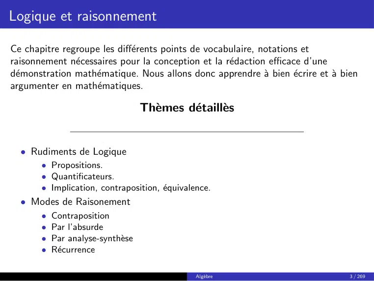

~~~text
Logique et raisonnement

Ce chapitre regroupe les différents points de vocabulaire, notations et
raisonnement nécessaires pour la conception et la rédaction efficace d’une
démonstration mathématique. Nous allons donc apprendre à bien écrire et à bien
argumenter en mathématiques.

                                 Thèmes détaillès

  • Rudiments de Logique
       • Propositions.
       • Quantificateurs.
       • Implication, contraposition, équivalence.
  • Modes de Raisonement
       • Contraposition
       • Par l’absurde
       • Par analyse-synthèse
       • Récurrence

                                               Algèbre                          3 / 269
~~~

## Page 8

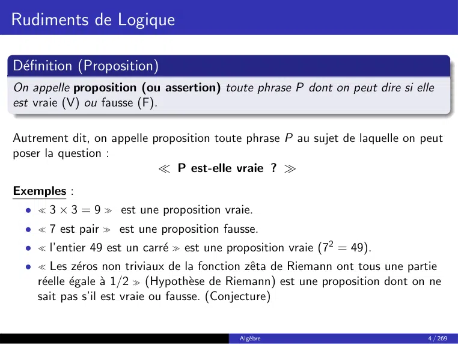

~~~text
Rudiments de Logique

Définition (Proposition)
On appelle proposition (ou assertion) toute phrase P dont on peut dire si elle
est vraie (V) ou fausse (F).

Autrement dit, on appelle proposition toute phrase P au sujet de laquelle on peut
poser la question :
                            P est-elle vraie ? 
Exemples :
  •  3 × 3 = 9  est une proposition vraie.
  •  7 est pair  est une proposition fausse.
  •  l’entier 49 est un carré  est une proposition vraie (72 = 49).
  •  Les zéros non triviaux de la fonction zêta de Riemann ont tous une partie
    réelle égale à 1/2  (Hypothèse de Riemann) est une proposition dont on ne
    sait pas s’il est vraie ou fausse. (Conjecture)

                                            Algèbre                           4 / 269
~~~

## Page 9

~~~text
Rudiments de Logique

Remarque : La plupart des phrases grammaticalement correctes sont des
propositions, mais par exemple :
  •  Dis-le-moi ! ,
  •  Bonjour ,
  •  Quelle heure est-il ? , ou
  •  Comment vas-tu ? 
n’en sont pas, la question :

                      Est-il vrai que bonjour ?  n’a aucun sens.

                                             Algèbre                   5 / 269
~~~

## Page 10

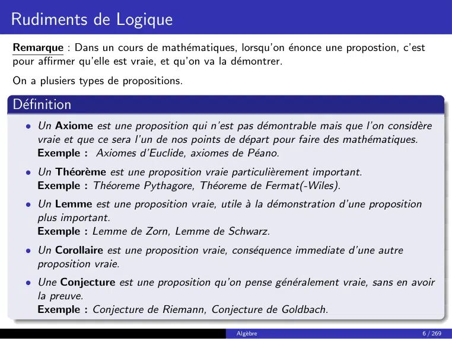

~~~text
Rudiments de Logique
Remarque : Dans un cours de mathématiques, lorsqu’on énonce une propostion, c’est
pour affirmer qu’elle est vraie, et qu’on va la démontrer.
On a plusiers types de propositions.

Définition
  • Un Axiome est une proposition qui n’est pas démontrable mais que l’on considère
    vraie et que ce sera l’un de nos points de départ pour faire des mathématiques.
    Exemple : Axiomes d’Euclide, axiomes de Péano.
  • Un Théorème est une proposition vraie particulièrement important.
    Exemple : Théoreme Pythagore, Théoreme de Fermat(-Wiles).
  • Un Lemme est une proposition vraie, utile à la démonstration d’une proposition
    plus important.
    Exemple : Lemme de Zorn, Lemme de Schwarz.
  • Un Corollaire est une proposition vraie, conséquence immediate d’une autre
    proposition vraie.
  • Une Conjecture est une proposition qu’on pense généralement vraie, sans en avoir
    la preuve.
    Exemple : Conjecture de Riemann, Conjecture de Goldbach.

                                             Algèbre                                  6 / 269
~~~

## Page 11

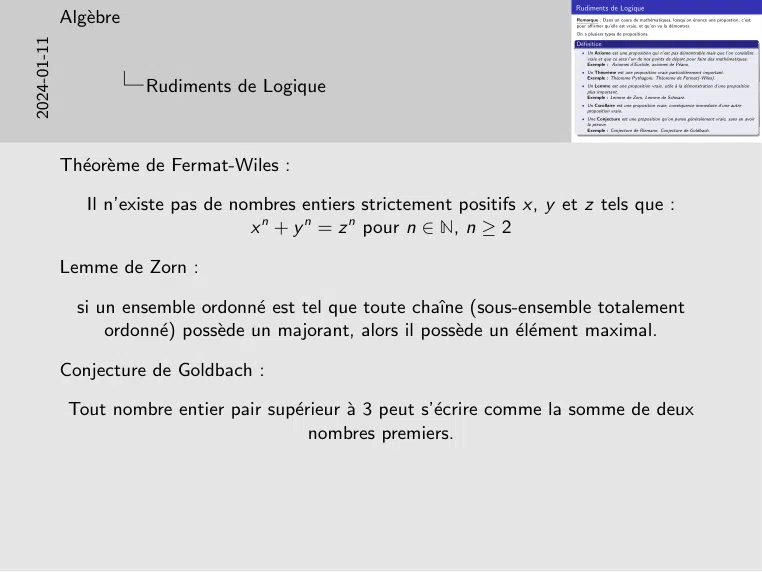

~~~text
                                                                               Rudiments de Logique
             Algèbre                                                          Remarque : Dans un cours de mathématiques, lorsqu’on énonce une propostion, c’est
                                                                               pour affirmer qu’elle est vraie, et qu’on va la démontrer.
                                                                               On a plusiers types de propositions.

2024-01-11                                                                     Définition
                                                                                 • Un Axiome est une proposition qui n’est pas démontrable mais que l’on considère
                                                                                   vraie et que ce sera l’un de nos points de départ pour faire des mathématiques.
                                                                                   Exemple : Axiomes d’Euclide, axiomes de Péano.
                                                                                 • Un Théorème est une proposition vraie particulièrement important.
                                                                                   Exemple : Théoreme Pythagore, Théoreme de Fermat(-Wiles).

                        Rudiments de Logique                                     • Un Lemme est une proposition vraie, utile à la démonstration d’une proposition
                                                                                   plus important.
                                                                                   Exemple : Lemme de Zorn, Lemme de Schwarz.
                                                                                 • Un Corollaire est une proposition vraie, conséquence immediate d’une autre
                                                                                   proposition vraie.
                                                                                 • Une Conjecture est une proposition qu’on pense généralement vraie, sans en avoir
                                                                                   la preuve.
                                                                                   Exemple : Conjecture de Riemann, Conjecture de Goldbach.

             Théorème de Fermat-Wiles :

                Il n’existe pas de nombres entiers strictement positifs x, y et z tels que :
                                     x n + y n = z n pour n ∈ N, n ≥ 2

             Lemme de Zorn :

               si un ensemble ordonné est tel que toute chaı̂ne (sous-ensemble totalement
                   ordonné) possède un majorant, alors il possède un élément maximal.

             Conjecture de Goldbach :

              Tout nombre entier pair supérieur à 3 peut s’écrire comme la somme de deux
                                            nombres premiers.
~~~

## Page 12

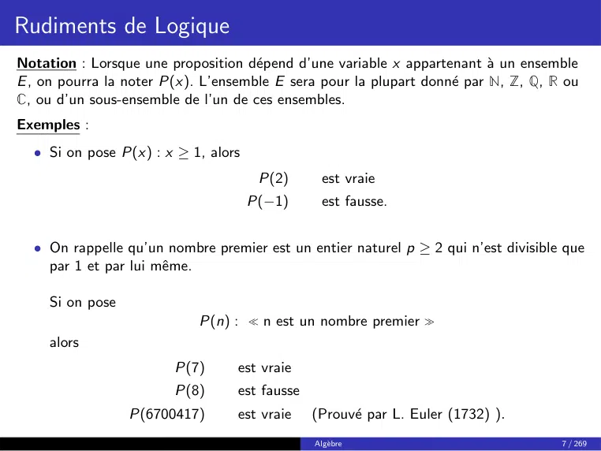

~~~text
Rudiments de Logique
Notation : Lorsque une proposition dépend d’une variable x appartenant à un ensemble
E , on pourra la noter P(x). L’ensemble E sera pour la plupart donné par N, Z, Q, R ou
C, ou d’un sous-ensemble de l’un de ces ensembles.
Exemples :
  • Si on pose P(x) : x ≥ 1, alors
                                      P(2)       est vraie
                                     P(−1)       est fausse.

  • On rappelle qu’un nombre premier est un entier naturel p ≥ 2 qui n’est divisible que
    par 1 et par lui même.

     Si on pose
                            P(n) :  n est un nombre premier 
     alors
                        P(7)      est vraie
                        P(8)      est fausse
                  P(6700417)      est vraie    (Prouvé par L. Euler (1732) ).
                                               Algèbre                             7 / 269
~~~

## Page 13

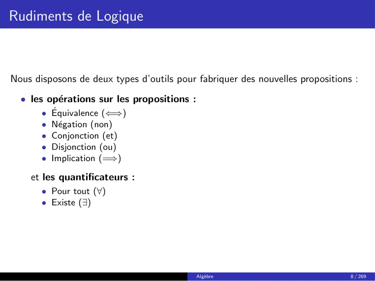

~~~text
Rudiments de Logique

Nous disposons de deux types d’outils pour fabriquer des nouvelles propositions :
  • les opérations sur les propositions :
       • Équivalence (⇐⇒)
       • Négation (non)
       • Conjonction (et)
       • Disjonction (ou)
       • Implication (=⇒)

    et les quantificateurs :
       • Pour tout (∀)
       • Existe (∃)

                                             Algèbre                          8 / 269
~~~

## Page 14

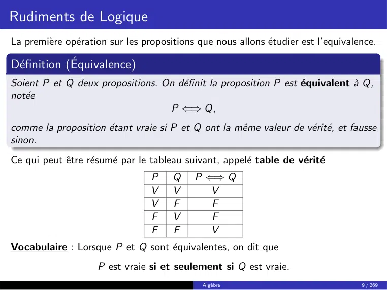

~~~text
Rudiments de Logique
La première opération sur les propositions que nous allons étudier est l’equivalence.

Définition (Équivalence)
Soient P et Q deux propositions. On définit la proposition P est équivalent à Q,
notée
                                  P ⇐⇒ Q,
comme la proposition étant vraie si P et Q ont la même valeur de vérité, et fausse
sinon.
Ce qui peut être résumé par le tableau suivant, appelé table de vérité
                                 P     Q    P ⇐⇒ Q
                                 V     V       V
                                 V     F       F
                                 F     V       F
                                 F     F       V
Vocabulaire : Lorsque P et Q sont équivalentes, on dit que
                    P est vraie si et seulement si Q est vraie.
                                              Algèbre                              9 / 269
~~~

## Page 15

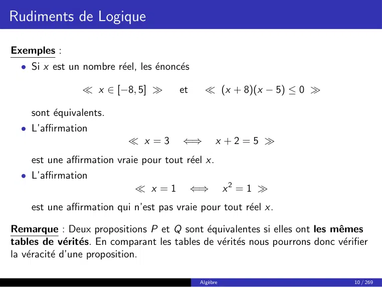

~~~text
Rudiments de Logique

Exemples :
  • Si x est un nombre réel, les énoncés

                  x ∈ [−8, 5]         et        (x + 8)(x − 5) ≤ 0 

     sont équivalents.
  • L’affirmation
                             x =3       ⇐⇒           x +2=5 
     est une affirmation vraie pour tout réel x.
  • L’affirmation
                              x =1           ⇐⇒          x2 = 1 
     est une affirmation qui n’est pas vraie pour tout réel x.

Remarque : Deux propositions P et Q sont équivalentes si elles ont les mêmes
tables de vérités. En comparant les tables de vérités nous pourrons donc vérifier
la véracité d’une proposition.

                                               Algèbre                           10 / 269
~~~

## Page 16

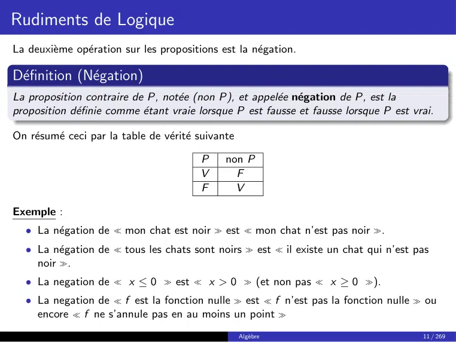

~~~text
Rudiments de Logique
La deuxième opération sur les propositions est la négation.

Définition (Négation)
La proposition contraire de P, notée (non P), et appelée négation de P, est la
proposition définie comme étant vraie lorsque P est fausse et fausse lorsque P est vrai.

On résumé ceci par la table de vérité suivante

                                          P     non P
                                          V       F
                                          F       V

Exemple :
  • La négation de  mon chat est noir  est  mon chat n’est pas noir .
  • La négation de  tous les chats sont noirs  est  il existe un chat qui n’est pas
    noir .
  • La negation de  x ≤ 0  est  x > 0  (et non pas  x ≥ 0 ).
  • La negation de  f est la fonction nulle  est  f n’est pas la fonction nulle  ou
    encore  f ne s’annule pas en au moins un point 
                                                     Algèbre                          11 / 269
~~~

## Page 17

~~~text
Rudiments de Logique

Exemple : La négation de  dans tous les pays, tous les musiciens sont mortels 
est  il existe au moins un pays dans lequel on peut trouver au moins un musicien
immortel  (et non  il existe un pays où tous les musiciens sont immortels ).

Remarque : Nous allons voir un peu plus tard que les deux propositions suivantes
sont contraires l’une de l’autre
  •  Quel que soit x, P(x) est vraie.  et  Il existe un x tel que P(x) est
    faux .

                                          Algèbre                              12 / 269
~~~

## Page 18

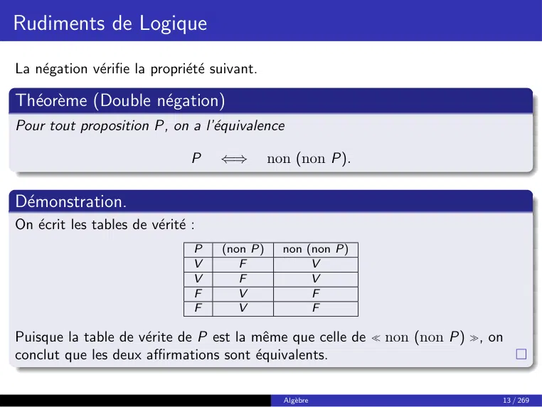

~~~text
Rudiments de Logique

La négation vérifie la propriété suivant.

Théorème (Double négation)
Pour tout proposition P, on a l’équivalence

                                 P    ⇐⇒        non (non P).

Démonstration.
On écrit les tables de vérité :
                                 P    (non P)     non (non P)
                                 V       F             V
                                 V       F             V
                                 F       V             F
                                 F       V             F

Puisque la table de vérite de P est la même que celle de  non (non P) , on
conclut que les deux affirmations sont équivalents.

                                                  Algèbre                   13 / 269
~~~

## Page 19

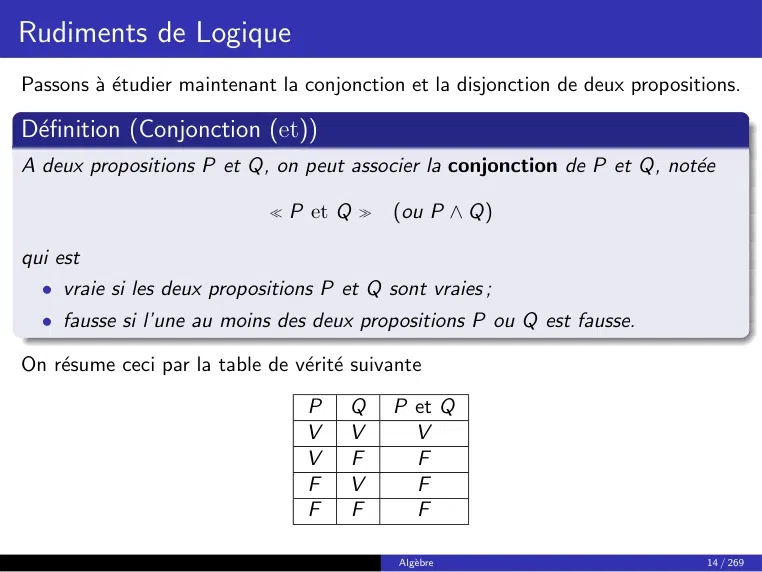

~~~text
Rudiments de Logique
Passons à étudier maintenant la conjonction et la disjonction de deux propositions.

Définition (Conjonction (et))
A deux propositions P et Q, on peut associer la conjonction de P et Q, notée

                                 P et Q    (ou P ∧ Q)

qui est
  • vraie si les deux propositions P et Q sont vraies ;
  • fausse si l’une au moins des deux propositions P ou Q est fausse.

On résume ceci par la table de vérité suivante
                                   P    Q    P et Q
                                   V    V      V
                                   V    F      F
                                   F    V      F
                                   F    F      F

                                              Algèbre                          14 / 269
~~~

## Page 20

~~~text
Rudiments de Logique
Exemples :

  • Soit ABCD un rectangle. La proposition
             [ est droit et les diagonales [AC ] et [BD] se coupent en leur
      L’angle ABC
    milieu 
    est vraie ou fausse ? Elle est vraie. En effet
        •  L’angle ABC
                     [ est droit  est une proposition vraie.
        •  Les diagonales [AC ] et [BD] se coupent en leur milieu  est une proposition
          vraie.
  • Soit ABC un triangle. La proposition

             [AB] > [AC ] + [CB]    et    [ +CAB+
                                           ABC [ BCA
                                                   d =π

    est vraie ou fausse ? Elle est fausse. En effet
        •  [AB] > [AC ] + [CB]  est une proposition fausse.
        •  ABC
            [ +CAB+
                  [ BCA   d = π  est une proposition vraie.

                                              Algèbre                             15 / 269
~~~

## Page 21

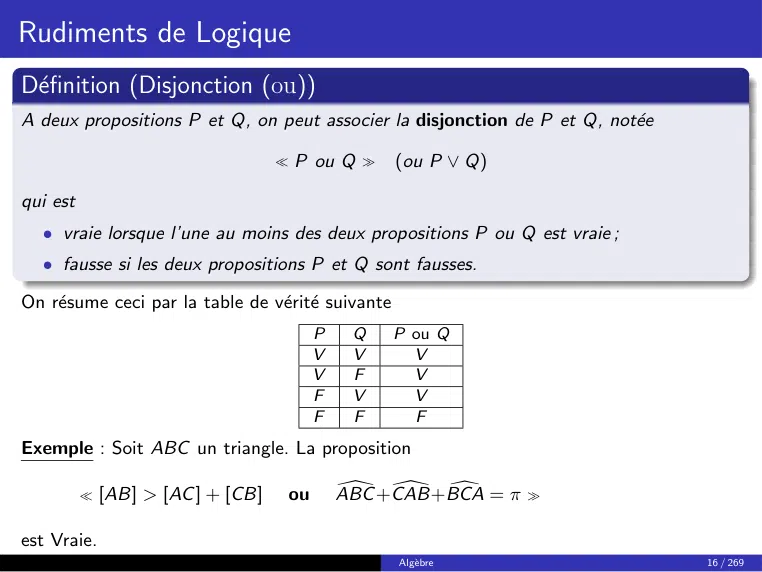

~~~text
Rudiments de Logique
Définition (Disjonction (ou))
A deux propositions P et Q, on peut associer la disjonction de P et Q, notée

                                       P ou Q     (ou P ∨ Q)

qui est
  • vraie lorsque l’une au moins des deux propositions P ou Q est vraie ;
  • fausse si les deux propositions P et Q sont fausses.

On résume ceci par la table de vérité suivante
                                         P    Q     P ou Q
                                         V    V       V
                                         V    F       V
                                         F    V       V
                                         F    F       F
Exemple : Soit ABC un triangle. La proposition

             [AB] > [AC ] + [CB]   ou       [ +CAB+
                                             ABC [ BCA
                                                     d =π

est Vraie.
                                                    Algèbre                    16 / 269
~~~

## Page 22

~~~text
Rudiments de Logique

Remarque : On prendra garde au fait que le  ou  logique est un ou inclusif,
contrairement au  ou  du langage courant qui lui est (en général) exclusif.
Distinguer :
 1. le  ou  exclusif de la langue française : Fromage ou Dessert.
    On ne peut pas avoir les deux.

 2. le  ou  logique ou inclusif : On recrute un enseignant qui sait parler
    l’allemand ou l’espagnol ou On recrute un informaticien qui sait coder en
    C++ ou en Python.
    On peut avoir les deux.

                                          Algèbre                           17 / 269
~~~

## Page 23

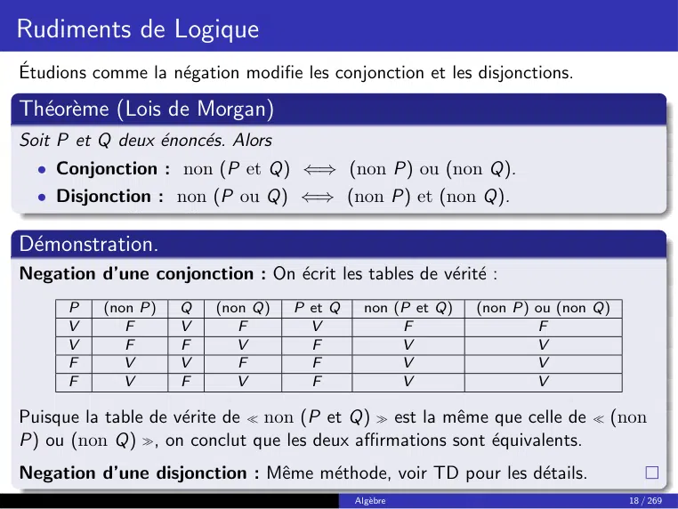

~~~text
Rudiments de Logique
Étudions comme la négation modifie les conjonction et les disjonctions.
Théorème (Lois de Morgan)
Soit P et Q deux énoncés. Alors
  • Conjonction : non (P et Q) ⇐⇒ (non P) ou (non Q).
  • Disjonction : non (P ou Q) ⇐⇒ (non P) et (non Q).

Démonstration.
Negation d’une conjonction : On écrit les tables de vérité :
      P    (non P)   Q   (non Q)    P et Q     non (P et Q)   (non P) ou (non Q)
      V       F      V      F         V             F                 F
      V       F      F      V         F             V                 V
      F       V      V      F         F             V                 V
      F       V      F      V         F             V                 V

Puisque la table de vérite de  non (P et Q)  est la même que celle de  (non
P) ou (non Q) , on conclut que les deux affirmations sont équivalents.
Negation d’une disjonction : Même méthode, voir TD pour les détails.
                                             Algèbre                              18 / 269
~~~

## Page 24

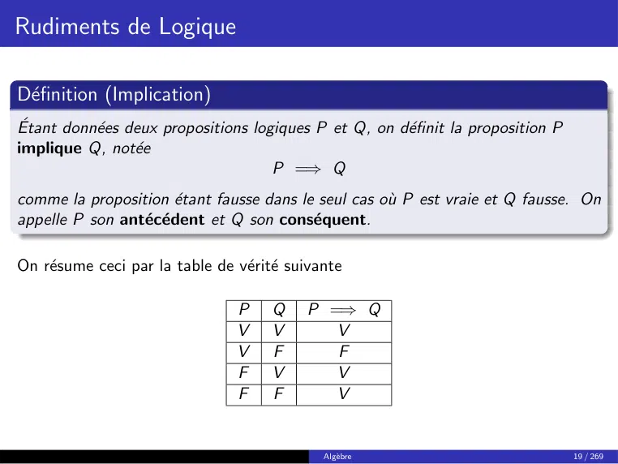

~~~text
Rudiments de Logique

Définition (Implication)
Étant données deux propositions logiques P et Q, on définit la proposition P
implique Q, notée
                                     P =⇒ Q
comme la proposition étant fausse dans le seul cas où P est vraie et Q fausse. On
appelle P son antécédent et Q son conséquent.

On résume ceci par la table de vérité suivante

                                 P    Q    P =⇒ Q
                                 V    V       V
                                 V    F       F
                                 F    V       V
                                 F    F       V

                                              Algèbre                            19 / 269
~~~

## Page 25

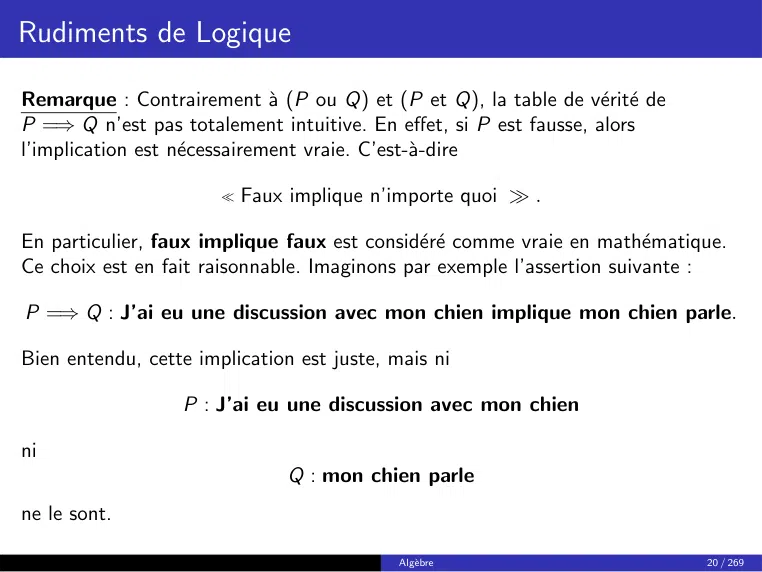

~~~text
Rudiments de Logique

Remarque : Contrairement à (P ou Q) et (P et Q), la table de vérité de
P =⇒ Q n’est pas totalement intuitive. En effet, si P est fausse, alors
l’implication est nécessairement vraie. C’est-à-dire

                          Faux implique n’importe quoi  .

En particulier, faux implique faux est considéré comme vraie en mathématique.
Ce choix est en fait raisonnable. Imaginons par exemple l’assertion suivante :

P =⇒ Q : J’ai eu une discussion avec mon chien implique mon chien parle.

Bien entendu, cette implication est juste, mais ni

                  P : J’ai eu une discussion avec mon chien

ni
                                Q : mon chien parle
ne le sont.

                                            Algèbre                         20 / 269
~~~

## Page 26

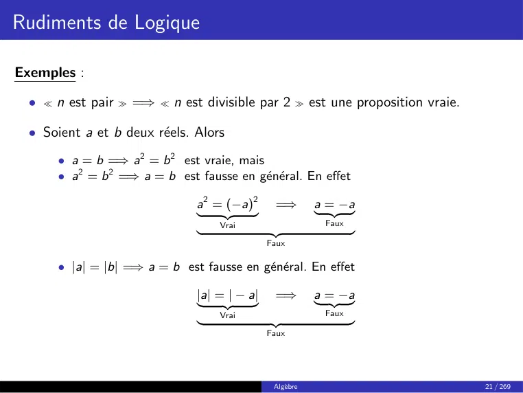

~~~text
Rudiments de Logique

Exemples :

  •  n est pair  =⇒  n est divisible par 2  est une proposition vraie.

  • Soient a et b deux réels. Alors
       • a = b =⇒ a2 = b 2 est vraie, mais
       • a2 = b 2 =⇒ a = b est fausse en général. En effet

                                a2 = (−a)2 =⇒            a = −a
                                | {z }                   | {z }
                                    Vrai                  Faux
                                |          {z                    }
                                            Faux

       • |a| = |b| =⇒ a = b est fausse en général. En effet

                                |a| = | − a| =⇒          a = −a
                                | {z }                   | {z }
                                     Vrai                 Faux
                                |            {z                  }
                                            Faux

                                              Algèbre                       21 / 269
~~~

## Page 27

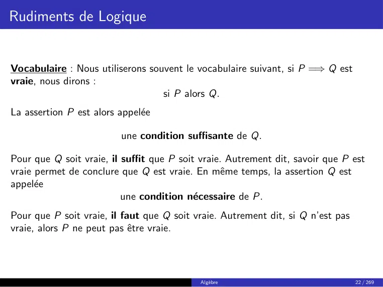

~~~text
Rudiments de Logique

Vocabulaire : Nous utiliserons souvent le vocabulaire suivant, si P =⇒ Q est
vraie, nous dirons :
                                  si P alors Q.
La assertion P est alors appelée

                          une condition suffisante de Q.

Pour que Q soit vraie, il suffit que P soit vraie. Autrement dit, savoir que P est
vraie permet de conclure que Q est vraie. En même temps, la assertion Q est
appelée
                          une condition nécessaire de P.
Pour que P soit vraie, il faut que Q soit vraie. Autrement dit, si Q n’est pas
vraie, alors P ne peut pas être vraie.

                                           Algèbre                              22 / 269
~~~

## Page 28

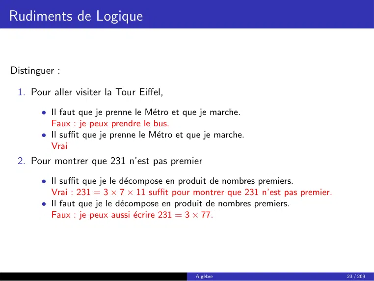

~~~text
Rudiments de Logique

Distinguer :

 1. Pour aller visiter la Tour Eiffel,
       • Il faut que je prenne le Métro et que je marche.
         Faux : je peux prendre le bus.
       • Il suffit que je prenne le Métro et que je marche.
         Vrai
 2. Pour montrer que 231 n’est pas premier
       • Il suffit que je le décompose en produit de nombres premiers.
         Vrai : 231 = 3 × 7 × 11 suffit pour montrer que 231 n’est pas premier.
       • Il faut que je le décompose en produit de nombres premiers.
         Faux : je peux aussi écrire 231 = 3 × 77.

                                               Algèbre                           23 / 269
~~~

## Page 29

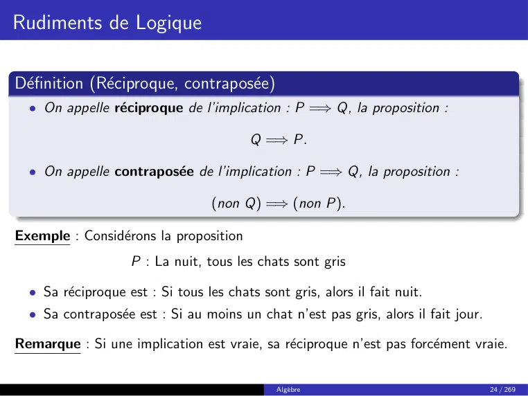

~~~text
Rudiments de Logique

Définition (Réciproque, contraposée)
  • On appelle réciproque de l’implication : P =⇒ Q, la proposition :

                                         Q =⇒ P.

  • On appelle contraposée de l’implication : P =⇒ Q, la proposition :

                                  (non Q) =⇒ (non P).

Exemple : Considérons la proposition
                    P : La nuit, tous les chats sont gris

  • Sa réciproque est : Si tous les chats sont gris, alors il fait nuit.
  • Sa contraposée est : Si au moins un chat n’est pas gris, alors il fait jour.

Remarque : Si une implication est vraie, sa réciproque n’est pas forcément vraie.

                                              Algèbre                              24 / 269
~~~

## Page 30

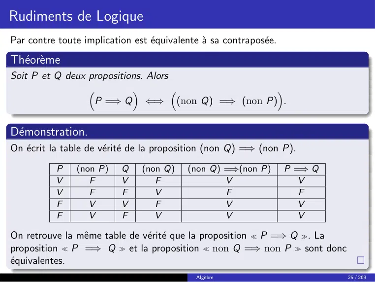

~~~text
Rudiments de Logique
Par contre toute implication est équivalente à sa contraposée.
Théorème
Soit P et Q deux propositions. Alors
                                            
                   P =⇒ Q ⇐⇒ (non Q) =⇒ (non P) .

Démonstration.
On écrit la table de vérité de la proposition (non Q) =⇒ (non P).
           P    (non P)    Q    (non Q)    (non Q) =⇒(non P)        P =⇒ Q
           V       F       V       F               V                   V
           V       F       F       V               F                   F
           F       V       V       F               V                   V
           F       V       F       V               V                   V

On retrouve la même table de vérité que la proposition  P =⇒ Q . La
proposition  P =⇒ Q  et la proposition  non Q =⇒ non P  sont donc
équivalentes.
                                             Algèbre                        25 / 269
~~~

## Page 31

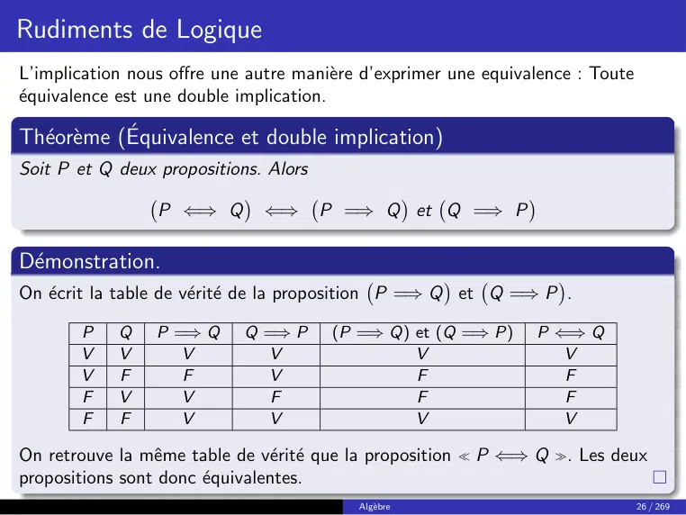

~~~text
Rudiments de Logique
L’implication nous offre une autre manière d’exprimer une equivalence : Toute
équivalence est une double implication.

Théorème (Équivalence et double implication)
Soit P et Q deux propositions. Alors
                                         
                P ⇐⇒ Q ⇐⇒ P =⇒ Q et Q =⇒ P

Démonstration.
                                                                
On écrit la table de vérité de la proposition P =⇒ Q et Q =⇒ P .

       P    Q    P =⇒ Q     Q =⇒ P     (P =⇒ Q) et (Q =⇒ P)      P ⇐⇒ Q
       V    V       V          V                V                   V
       V    F       F          V                F                   F
       F    V       V          F                F                   F
       F    F       V          V                V                   V

On retrouve la même table de vérité que la proposition  P ⇐⇒ Q . Les deux
propositions sont donc équivalentes.
                                           Algèbre                              26 / 269
~~~

## Page 32

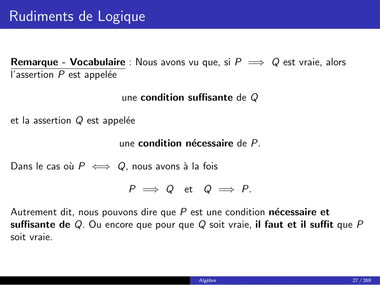

~~~text
Rudiments de Logique

Remarque - Vocabulaire : Nous avons vu que, si P =⇒ Q est vraie, alors
l’assertion P est appelée

                          une condition suffisante de Q

et la assertion Q est appelée

                          une condition nécessaire de P.

Dans le cas où P ⇐⇒ Q, nous avons à la fois

                            P =⇒ Q      et    Q =⇒ P.

Autrement dit, nous pouvons dire que P est une condition nécessaire et
suffisante de Q. Ou encore que pour que Q soit vraie, il faut et il suffit que P
soit vraie.

                                             Algèbre                        27 / 269
~~~

## Page 33

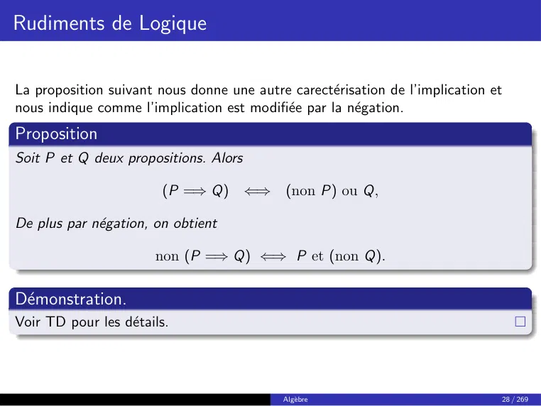

~~~text
Rudiments de Logique

La proposition suivant nous donne une autre carectérisation de l’implication et
nous indique comme l’implication est modifiée par la négation.
Proposition
Soit P et Q deux propositions. Alors

                        (P =⇒ Q) ⇐⇒         (non P) ou Q,

De plus par négation, on obtient

                       non (P =⇒ Q) ⇐⇒ P et (non Q).

Démonstration.
Voir TD pour les détails.

                                            Algèbre                           28 / 269
~~~

## Page 34

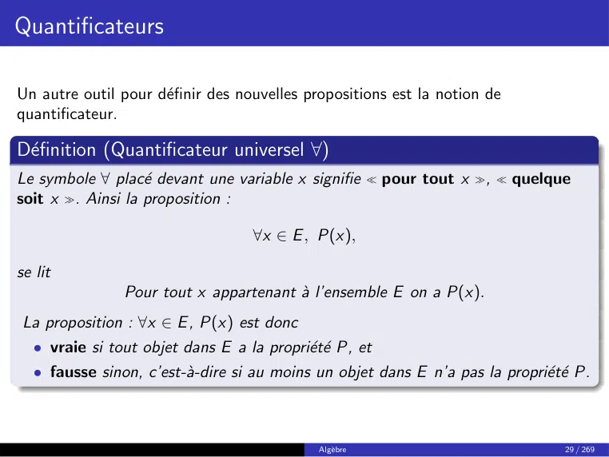

~~~text
Quantificateurs

Un autre outil pour définir des nouvelles propositions est la notion de
quantificateur.

Définition (Quantificateur universel ∀)
Le symbole ∀ placé devant une variable x signifie  pour tout x ,  quelque
soit x . Ainsi la proposition :

                                   ∀x ∈ E , P(x),

se lit
                Pour tout x appartenant à l’ensemble E on a P(x).
 La proposition : ∀x ∈ E , P(x) est donc
  • vraie si tout objet dans E a la propriété P, et
   • fausse sinon, c’est-à-dire si au moins un objet dans E n’a pas la propriété P.

                                             Algèbre                             29 / 269
~~~

## Page 35

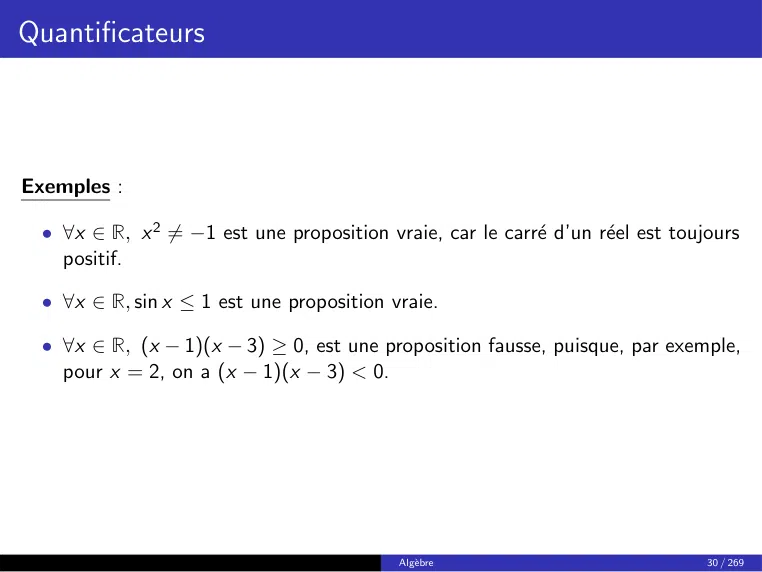

~~~text
Quantificateurs

Exemples :

  • ∀x ∈ R, x 2 6= −1 est une proposition vraie, car le carré d’un réel est toujours
    positif.

  • ∀x ∈ R, sin x ≤ 1 est une proposition vraie.

  • ∀x ∈ R, (x − 1)(x − 3) ≥ 0, est une proposition fausse, puisque, par exemple,
    pour x = 2, on a (x − 1)(x − 3) < 0.

                                            Algèbre                              30 / 269
~~~

## Page 36

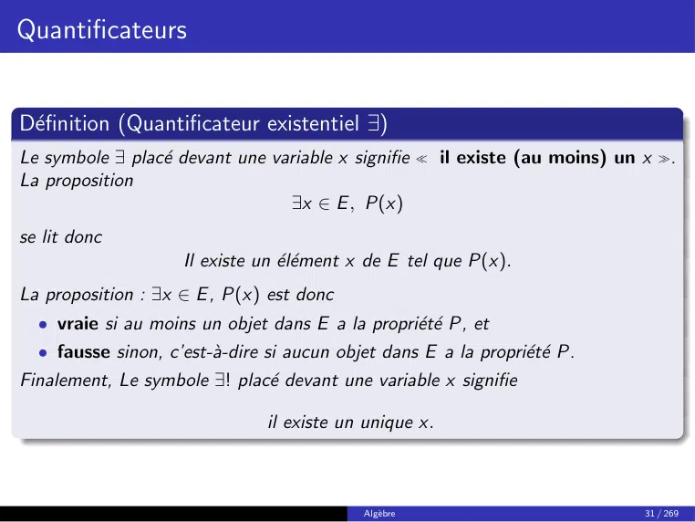

~~~text
Quantificateurs

Définition (Quantificateur existentiel ∃)
Le symbole ∃ placé devant une variable x signifie  il existe (au moins) un x .
La proposition
                                 ∃x ∈ E , P(x)
se lit donc
                     Il existe un élément x de E tel que P(x).
La proposition : ∃x ∈ E , P(x) est donc
  • vraie si au moins un objet dans E a la propriété P, et
  • fausse sinon, c’est-à-dire si aucun objet dans E a la propriété P.
Finalement, Le symbole ∃! placé devant une variable x signifie

                                il existe un unique x.

                                             Algèbre                        31 / 269
~~~

## Page 37

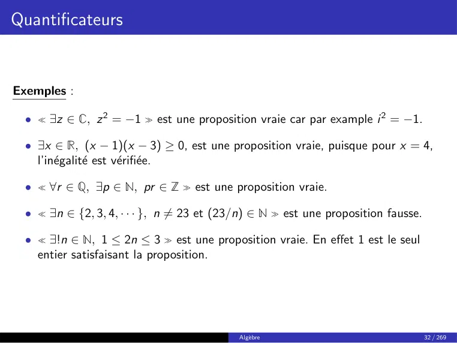

~~~text
Quantificateurs

Exemples :

  •  ∃z ∈ C, z 2 = −1  est une proposition vraie car par example i 2 = −1.

  • ∃x ∈ R, (x − 1)(x − 3) ≥ 0, est une proposition vraie, puisque pour x = 4,
    l’inégalité est vérifiée.

  •  ∀r ∈ Q, ∃p ∈ N, pr ∈ Z  est une proposition vraie.

  •  ∃n ∈ {2, 3, 4, · · · }, n 6= 23 et (23/n) ∈ N  est une proposition fausse.

  •  ∃!n ∈ N, 1 ≤ 2n ≤ 3  est une proposition vraie. En effet 1 est le seul
    entier satisfaisant la proposition.

                                            Algèbre                                32 / 269
~~~

## Page 38

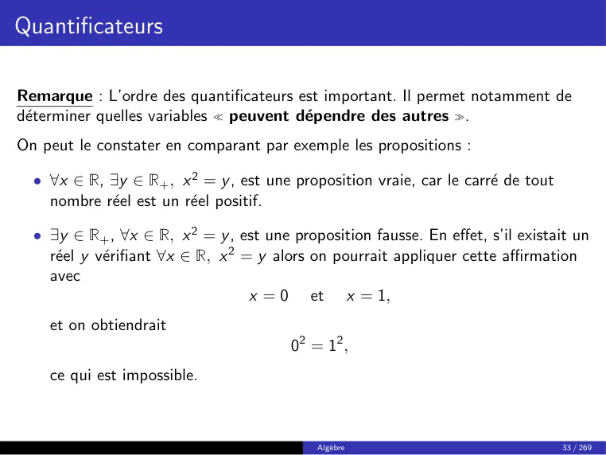

~~~text
Quantificateurs

Remarque : L’ordre des quantificateurs est important. Il permet notamment de
déterminer quelles variables  peuvent dépendre des autres .
On peut le constater en comparant par exemple les propositions :

  • ∀x ∈ R, ∃y ∈ R+ , x 2 = y , est une proposition vraie, car le carré de tout
    nombre réel est un réel positif.

  • ∃y ∈ R+ , ∀x ∈ R, x 2 = y , est une proposition fausse. En effet, s’il existait un
    réel y vérifiant ∀x ∈ R, x 2 = y alors on pourrait appliquer cette affirmation
    avec
                                    x = 0 et x = 1,
    et on obtiendrait
                                        02 = 12 ,
    ce qui est impossible.

                                            Algèbre                               33 / 269
~~~

## Page 39

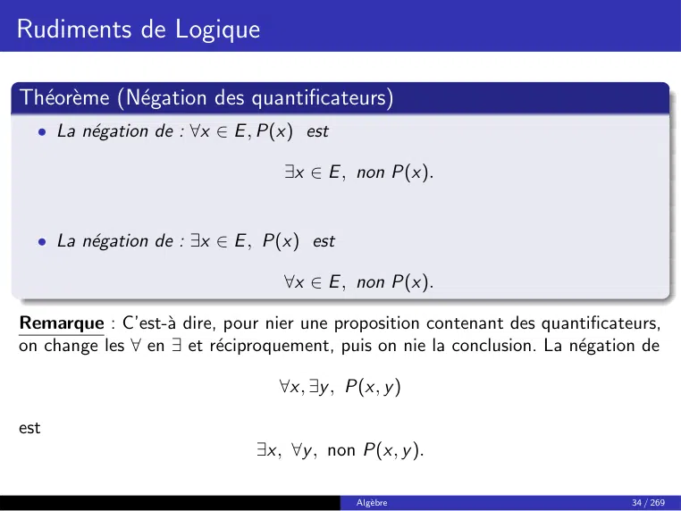

~~~text
Rudiments de Logique

Théorème (Négation des quantificateurs)
  • La négation de : ∀x ∈ E , P(x) est

                                  ∃x ∈ E , non P(x).

  • La négation de : ∃x ∈ E , P(x) est

                                  ∀x ∈ E , non P(x).

Remarque : C’est-à dire, pour nier une proposition contenant des quantificateurs,
on change les ∀ en ∃ et réciproquement, puis on nie la conclusion. La négation de

                                 ∀x, ∃y , P(x, y )

est
                              ∃x, ∀y , non P(x, y ).

                                           Algèbre                            34 / 269
~~~

## Page 40

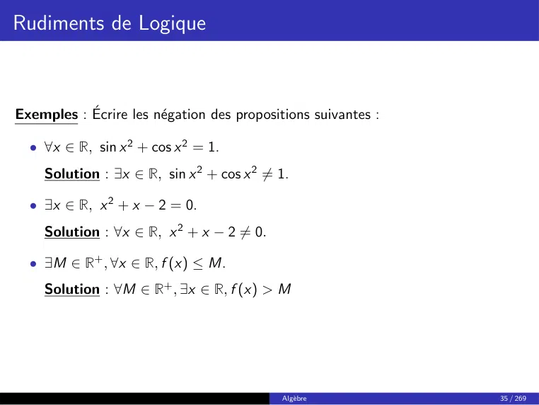

~~~text
Rudiments de Logique

Exemples : Écrire les négation des propositions suivantes :

  • ∀x ∈ R, sin x 2 + cos x 2 = 1.
    Solution : ∃x ∈ R, sin x 2 + cos x 2 6= 1.

  • ∃x ∈ R, x 2 + x − 2 = 0.
    Solution : ∀x ∈ R, x 2 + x − 2 6= 0.

  • ∃M ∈ R+ , ∀x ∈ R, f (x) ≤ M.
    Solution : ∀M ∈ R+ , ∃x ∈ R, f (x) > M

                                            Algèbre            35 / 269
~~~

## Page 41

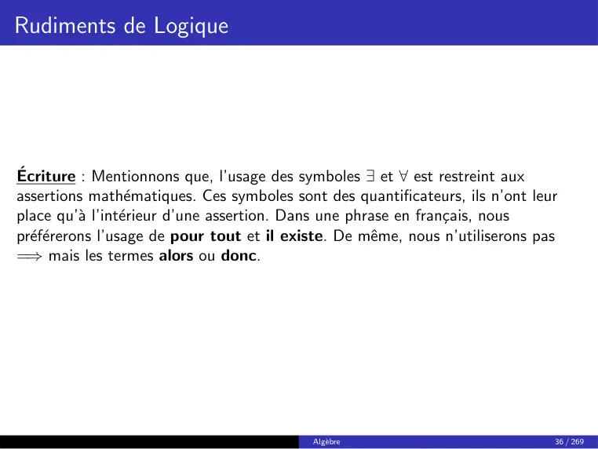

~~~text
Rudiments de Logique

Écriture : Mentionnons que, l’usage des symboles ∃ et ∀ est restreint aux
assertions mathématiques. Ces symboles sont des quantificateurs, ils n’ont leur
place qu’à l’intérieur d’une assertion. Dans une phrase en français, nous
préférerons l’usage de pour tout et il existe. De même, nous n’utiliserons pas
=⇒ mais les termes alors ou donc.

                                            Algèbre                            36 / 269
~~~

## Page 42

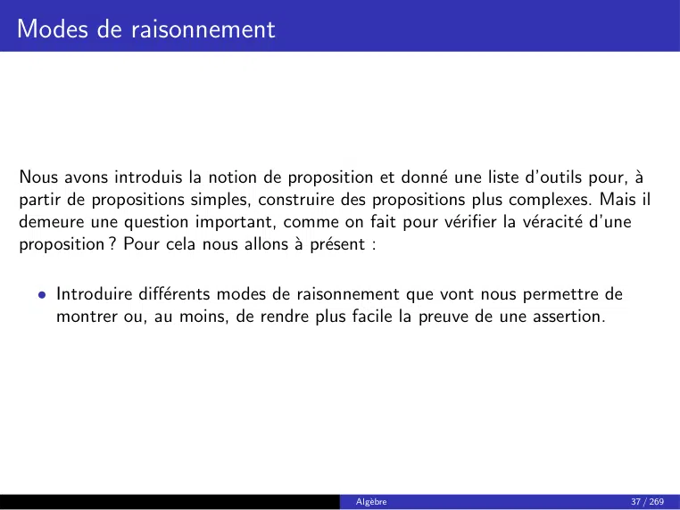

~~~text
Modes de raisonnement

Nous avons introduis la notion de proposition et donné une liste d’outils pour, à
partir de propositions simples, construire des propositions plus complexes. Mais il
demeure une question important, comme on fait pour vérifier la véracité d’une
proposition ? Pour cela nous allons à présent :

  • Introduire différents modes de raisonnement que vont nous permettre de
    montrer ou, au moins, de rendre plus facile la preuve de une assertion.

                                            Algèbre                            37 / 269
~~~

## Page 43

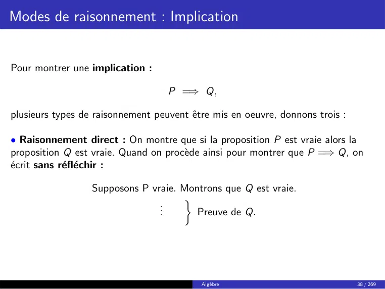

~~~text
Modes de raisonnement : Implication

Pour montrer une implication :

                                   P =⇒ Q,

plusieurs types de raisonnement peuvent être mis en oeuvre, donnons trois :

• Raisonnement direct : On montre que si la proposition P est vraie alors la
proposition Q est vraie. Quand on procède ainsi pour montrer que P =⇒ Q, on
écrit sans réfléchir :

                  Supposons P vraie. Montrons que Q est vraie.
                                ..
                                     
                                 .      Preuve de Q.

                                           Algèbre                            38 / 269
~~~

## Page 44

~~~text
Modes de raisonnement : Implication

Exemple : Montrer que si n est un entier pair, alors n2 est pair.

Preuve : Soit n ∈ N. On suppose que n est un entier pair. Montrons que n2 est
pair. Comme n est un entier pair, il existe k ∈ N tel que

                                      n = 2k.

Donc

                             n2 = 4k 2 = 2(2k 2 ).

C’est-à-dire n2 est pair.

                                           Algèbre                        39 / 269
~~~

## Page 45

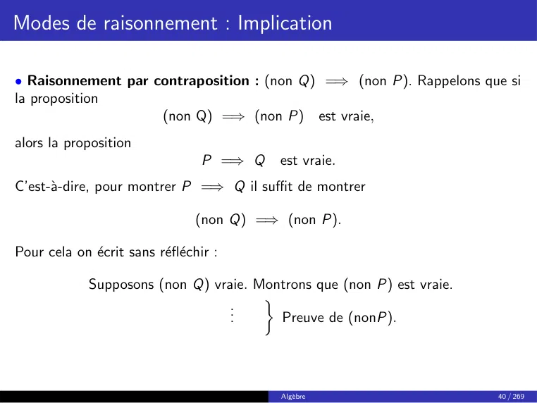

~~~text
Modes de raisonnement : Implication

• Raisonnement par contraposition : (non Q) =⇒ (non P). Rappelons que si
la proposition
                    (non Q) =⇒ (non P) est vraie,
alors la proposition
                                  P =⇒ Q    est vraie.
C’est-à-dire, pour montrer P =⇒ Q il suffit de montrer

                                 (non Q) =⇒ (non P).

Pour cela on écrit sans réfléchir :

             Supposons (non Q) vraie. Montrons que (non P) est vraie.
                                  ..
                                       
                                   .     Preuve de (nonP).

                                            Algèbre                    40 / 269
~~~

## Page 46

~~~text
Modes de raisonnnement : Implication

Exemple : Montrer par un raisonnement par contraposition que, si n2 est pair,
alors n est pair.

Preuve : Nous devons montrer la proposition

                     si n n’est pas pair, alors n2 n’est pas pair.

C’est-à-dire, nous devons montrer la proposition

                        si n est impair, alors n2 est impair.

Comme n est un entier impair, il existe k ∈ Z tel que

                                     n = 2k + 1.

Donc
             n2 = (2k + 1)2 = 4k 2 + 4k + 1 = 2(2k 2 + 2k) + 1.
C’est-à-dire n2 est impair.

                                             Algèbre                       41 / 269
~~~

## Page 47

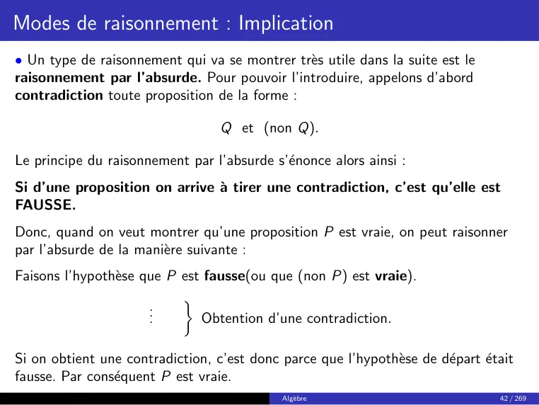

~~~text
Modes de raisonnement : Implication
• Un type de raisonnement qui va se montrer très utile dans la suite est le
raisonnement par l’absurde. Pour pouvoir l’introduire, appelons d’abord
contradiction toute proposition de la forme :

                                  Q et (non Q).

Le principe du raisonnement par l’absurde s’énonce alors ainsi :
Si d’une proposition on arrive à tirer une contradiction, c’est qu’elle est
FAUSSE.
Donc, quand on veut montrer qu’une proposition P est vraie, on peut raisonner
par l’absurde de la manière suivante :
Faisons l’hypothèse que P est fausse(ou que (non P) est vraie).

                      ..
                           
                       .      Obtention d’une contradiction.

Si on obtient une contradiction, c’est donc parce que l’hypothèse de départ était
fausse. Par conséquent P est vraie.
                                             Algèbre                            42 / 269
~~~

## Page 48

~~~text
Modes de raisonnement

                                                             π
Exemple : On sait que π est irrationnel. Montrer que          est irrationnel. 
                                                             3
Preuve : Supposons par l’absurde que π3 est rationnel. Ecrivons-le donc sous forme
                                     π   p
                                       =
                                     3   q
avec p ∈ Z et q ∈ N∗ . Ainsi
                                         3p
                                    π=      .
                                         q
                                                         π
Par conséquent, π est rationnel. C’est absurde donc      est irrationnel .
                                                         3

                                           Algèbre                             43 / 269
~~~

## Page 49

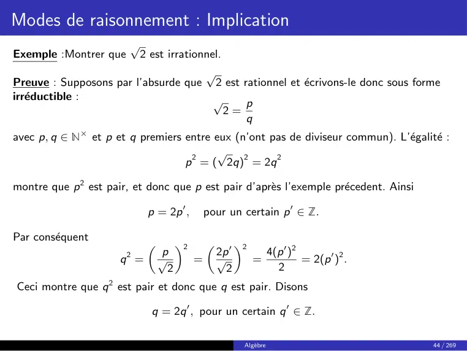

~~~text
Modes de raisonnement : Implication
                        √
Exemple :Montrer que        2 est irrationnel.
                                    √
Preuve : Supposons par l’absurde que 2 est rationnel et écrivons-le donc sous forme
irréductible :                      √      p
                                       2=
                                            q
avec p, q ∈ N× et p et q premiers entre eux (n’ont pas de diviseur commun). L’égalité :
                                         √
                                  p 2 = ( 2q)2 = 2q 2

montre que p 2 est pair, et donc que p est pair d’après l’exemple précedent. Ainsi

                             p = 2p 0 ,        pour un certain p 0 ∈ Z.

Par conséquent
                                      2                  2
                                                   2p 0               4(p 0 )2
                                              
                                 p
                      q2 =       √         =       √           =               = 2(p 0 )2 .
                                  2                  2                  2
Ceci montre que q 2 est pair et donc que q est pair. Disons

                              q = 2q 0 , pour un certain q 0 ∈ Z.

                                                           Algèbre                           44 / 269
~~~

## Page 50

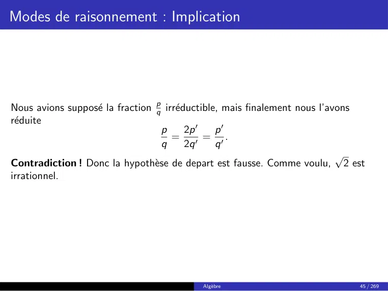

~~~text
Modes de raisonnement : Implication

Nous avions supposé la fraction pq irréductible, mais finalement nous l’avons
réduite
                                   p      2p 0   p0
                                      = 0 = 0.
                                   q      2q     q
                                                                            √
Contradiction ! Donc la hypothèse de depart est fausse. Comme voulu, 2 est
irrationnel.

                                          Algèbre                           45 / 269
~~~

## Page 51

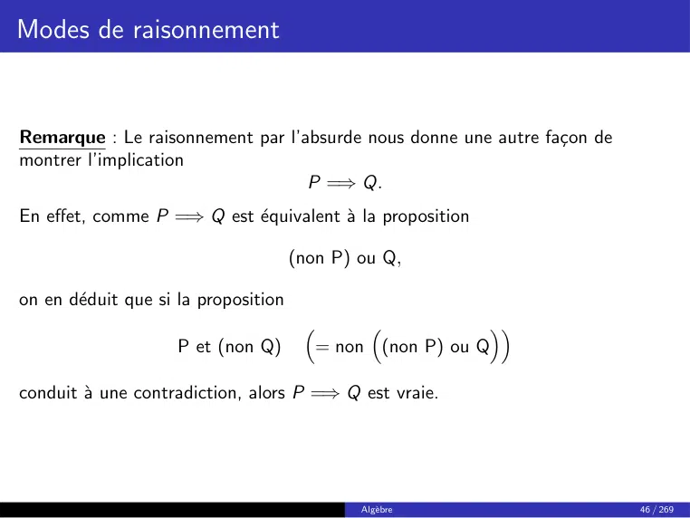

~~~text
Modes de raisonnement

Remarque : Le raisonnement par l’absurde nous donne une autre façon de
montrer l’implication
                                  P =⇒ Q.
En effet, comme P =⇒ Q est équivalent à la proposition

                                      (non P) ou Q,

on en déduit que si la proposition
                                                           
                    P et (non Q)           = non (non P) ou Q

conduit à une contradiction, alors P =⇒ Q est vraie.

                                               Algèbre                   46 / 269
~~~

## Page 52

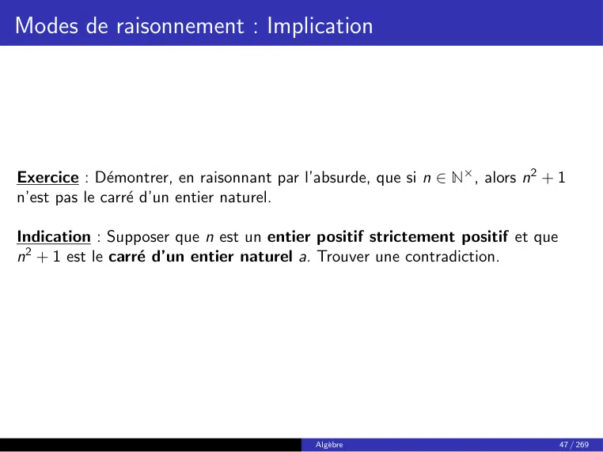

~~~text
Modes de raisonnement : Implication

Exercice : Démontrer, en raisonnant par l’absurde, que si n ∈ N× , alors n2 + 1
n’est pas le carré d’un entier naturel.

Indication : Supposer que n est un entier positif strictement positif et que
n2 + 1 est le carré d’un entier naturel a. Trouver une contradiction.

                                           Algèbre                            47 / 269
~~~

## Page 53

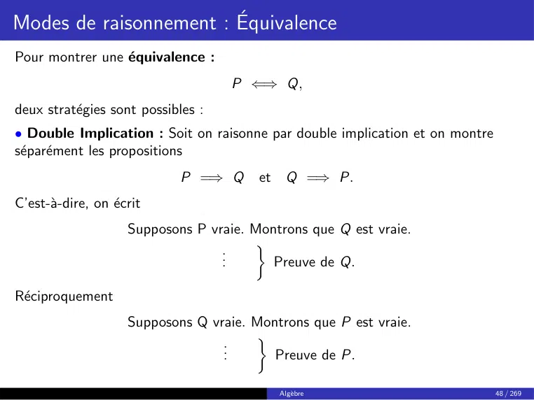

~~~text
Modes de raisonnement : Équivalence
Pour montrer une équivalence :
                                     P ⇐⇒ Q,
deux stratégies sont possibles :
• Double Implication : Soit on raisonne par double implication et on montre
séparément les propositions
                             P =⇒ Q      et    Q =⇒ P.
C’est-à-dire, on écrit
                     Supposons P vraie. Montrons que Q est vraie.
                                   ..
                                        
                                    .      Preuve de Q.

Réciproquement
                     Supposons Q vraie. Montrons que P est vraie.
                                   ..
                                        
                                    .      Preuve de P.

                                              Algèbre                        48 / 269
~~~

## Page 54

~~~text
Modes de raisonnement : Équivalence

Exemple : On a vu que :

  • Si n est un entier pair, alors n2 est pair.
  • Si n2 est pair, alors n est pair.

Donc n est pair si et seulement si n2 est pair.

                                             Algèbre   49 / 269
~~~

## Page 55

~~~text
Modes de raisonnement : Équivalence
Exemple : Montrer que

                      ∀x, y ∈ R,       x 2 + y 2 = 0 ⇐⇒ x = y = 0.
Preuve : Soient x, y ∈ R. L’implication
                            x 2 + y 2 = 0 ⇐= x = y = 0
est triviale, car si x = y = 0 alors
                        x2 = y2 = 0       et donc           x 2 + y 2 = 0.
Pour la implication réciproque,
                             x 2 + y 2 = 0 =⇒ x = y = 0;
si x 2 + y 2 = 0, alors :
                                         x 2 = −y 2 ,
                                         ≥0     ≤0

donc
                                       x 2 = −y 2 = 0
et enfin : x = y = 0.
                                                 Algèbre                    50 / 269
~~~

## Page 56

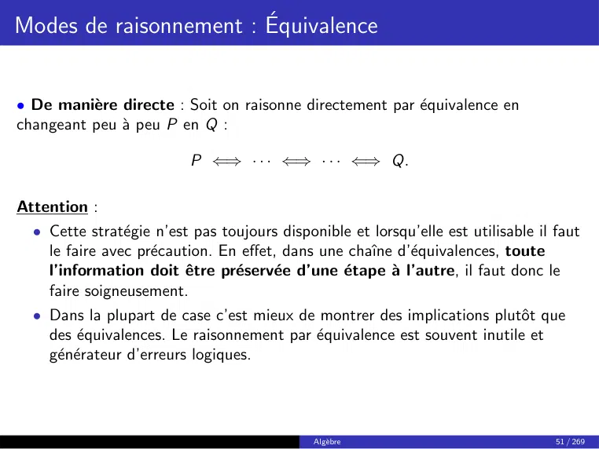

~~~text
Modes de raisonnement : Équivalence

• De manière directe : Soit on raisonne directement par équivalence en
changeant peu à peu P en Q :

                          P ⇐⇒ · · · ⇐⇒ · · · ⇐⇒ Q.

Attention :
  • Cette stratégie n’est pas toujours disponible et lorsqu’elle est utilisable il faut
    le faire avec précaution. En effet, dans une chaı̂ne d’équivalences, toute
    l’information doit être préservée d’une étape à l’autre, il faut donc le
    faire soigneusement.
  • Dans la plupart de case c’est mieux de montrer des implications plutôt que
    des équivalences. Le raisonnement par équivalence est souvent inutile et
    générateur d’erreurs logiques.

                                              Algèbre                              51 / 269
~~~

## Page 57

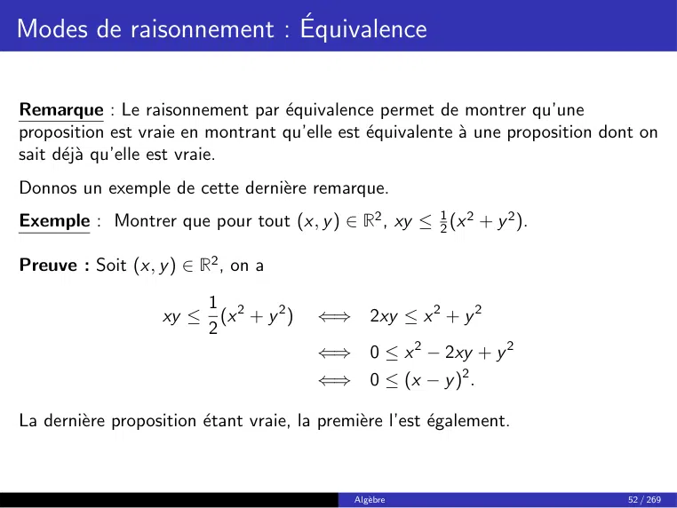

~~~text
Modes de raisonnement : Équivalence

Remarque : Le raisonnement par équivalence permet de montrer qu’une
proposition est vraie en montrant qu’elle est équivalente à une proposition dont on
sait déjà qu’elle est vraie.
Donnos un exemple de cette dernière remarque.
Exemple : Montrer que pour tout (x, y ) ∈ R2 , xy ≤ 12 (x 2 + y 2 ).

Preuve : Soit (x, y ) ∈ R2 , on a

                           1 2
                    xy ≤     (x + y 2 )   ⇐⇒       2xy ≤ x 2 + y 2
                           2
                                          ⇐⇒       0 ≤ x 2 − 2xy + y 2
                                          ⇐⇒       0 ≤ (x − y )2 .

La dernière proposition étant vraie, la première l’est également.

                                               Algèbre                         52 / 269
~~~

## Page 58

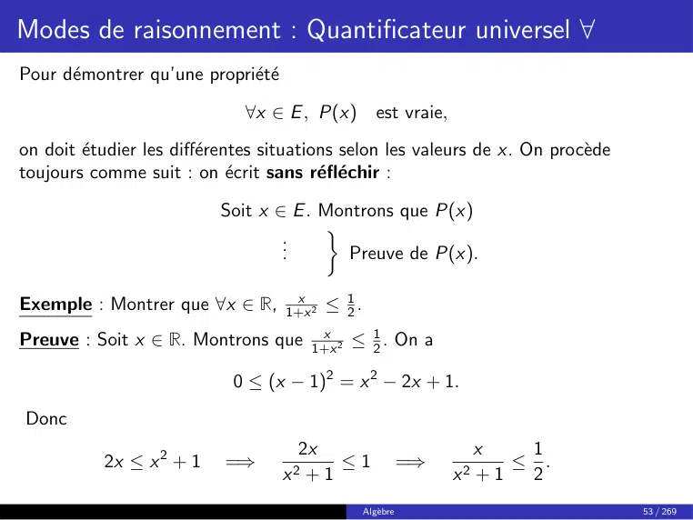

~~~text
Modes de raisonnement : Quantificateur universel ∀
Pour démontrer qu’une propriété
                              ∀x ∈ E , P(x)      est vraie,
on doit étudier les différentes situations selon les valeurs de x. On procède
toujours comme suit : on écrit sans réfléchir :
                           Soit x ∈ E . Montrons que P(x)
                                   ..
                                        
                                    .      Preuve de P(x).

                               x      1
Exemple : Montrer que ∀x ∈ R, 1+x 2 ≤ 2.

                                   x      1
Preuve : Soit x ∈ R. Montrons que 1+x 2 ≤ 2 . On a

                            0 ≤ (x − 1)2 = x 2 − 2x + 1.
Donc
                                       2x                        x    1
           2x ≤ x 2 + 1    =⇒               ≤1           =⇒          ≤ .
                                     x2 + 1                   x2 + 1  2
                                              Algèbre                             53 / 269
~~~

## Page 59

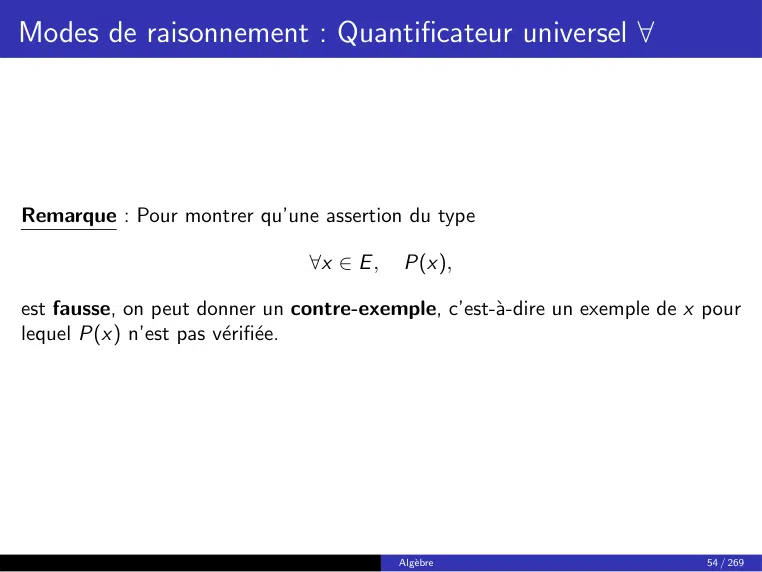

~~~text
Modes de raisonnement : Quantificateur universel ∀

Remarque : Pour montrer qu’une assertion du type

                                ∀x ∈ E ,    P(x),

est fausse, on peut donner un contre-exemple, c’est-à-dire un exemple de x pour
lequel P(x) n’est pas vérifiée.

                                           Algèbre                         54 / 269
~~~

## Page 60

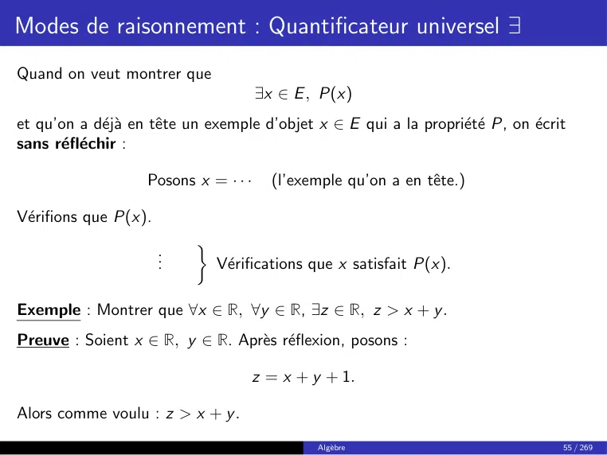

~~~text
Modes de raisonnement : Quantificateur universel ∃
Quand on veut montrer que
                                       ∃x ∈ E , P(x)
et qu’on a déjà en tête un exemple d’objet x ∈ E qui a la propriété P, on écrit
sans réfléchir :

                    Posons x = · · ·     (l’exemple qu’on a en tête.)

Vérifions que P(x).

                       ..
                            
                        .       Vérifications que x satisfait P(x).

Exemple : Montrer que ∀x ∈ R, ∀y ∈ R, ∃z ∈ R, z > x + y .
Preuve : Soient x ∈ R, y ∈ R. Après réflexion, posons :

                                     z = x + y + 1.

Alors comme voulu : z > x + y .
                                               Algèbre                             55 / 269
~~~

## Page 61

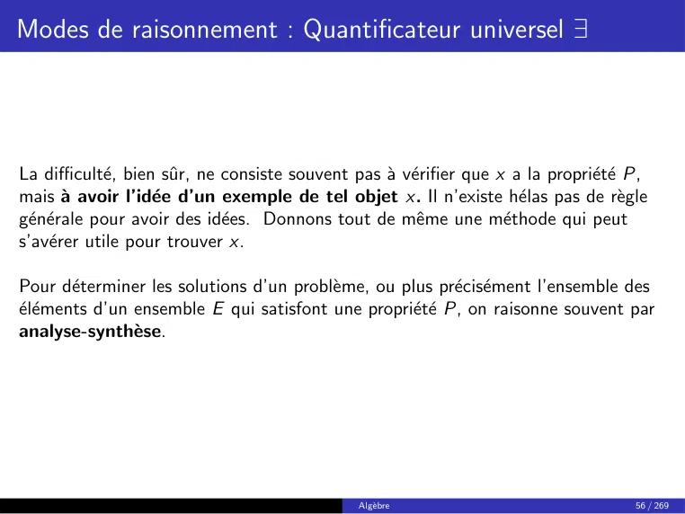

~~~text
Modes de raisonnement : Quantificateur universel ∃

La difficulté, bien sûr, ne consiste souvent pas à vérifier que x a la propriété P,
mais à avoir l’idée d’un exemple de tel objet x. Il n’existe hélas pas de règle
générale pour avoir des idées. Donnons tout de même une méthode qui peut
s’avérer utile pour trouver x.

Pour déterminer les solutions d’un problème, ou plus précisément l’ensemble des
éléments d’un ensemble E qui satisfont une propriété P, on raisonne souvent par
analyse-synthèse.

                                                Algèbre                               56 / 269
~~~

## Page 62

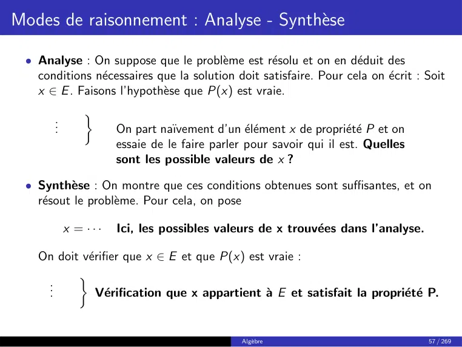

~~~text
Modes de raisonnement : Analyse - Synthèse

 • Analyse : On suppose que le problème est résolu et on en déduit des
   conditions nécessaires que la solution doit satisfaire. Pour cela on écrit : Soit
   x ∈ E . Faisons l’hypothèse que P(x) est vraie.

      ..
              
       .             On part naı̈vement d’un élément x de propriété P et on
                     essaie de le faire parler pour savoir qui il est. Quelles
                     sont les possible valeurs de x ?

 • Synthèse : On montre que ces conditions obtenues sont suffisantes, et on
   résout le problème. Pour cela, on pose

           x = ···   Ici, les possibles valeurs de x trouvées dans l’analyse.

   On doit vérifier que x ∈ E et que P(x) est vraie :

    ..
          
     .        Vérification que x appartient à E et satisfait la propriété P.

                                              Algèbre                            57 / 269
~~~

## Page 63

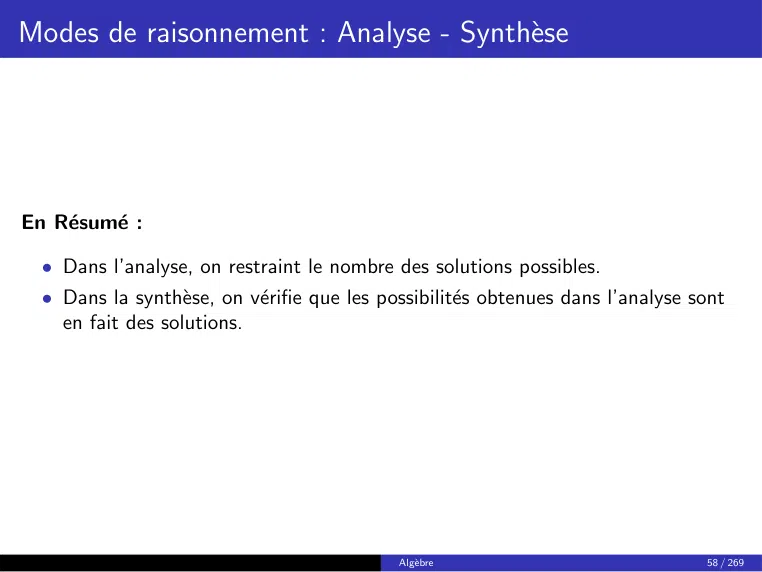

~~~text
Modes de raisonnement : Analyse - Synthèse

En Résumé :

  • Dans l’analyse, on restraint le nombre des solutions possibles.
  • Dans la synthèse, on vérifie que les possibilités obtenues dans l’analyse sont
    en fait des solutions.

                                             Algèbre                             58 / 269
~~~

## Page 64

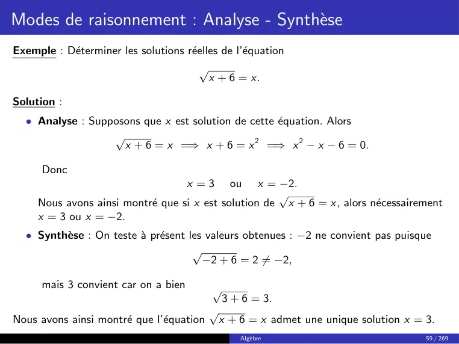

~~~text
Modes de raisonnement : Analyse - Synthèse
Exemple : Déterminer les solutions réelles de l’équation
                                        √
                                            x + 6 = x.

Solution :
  • Analyse : Supposons que x est solution de cette équation. Alors
                  √
                    x + 6 = x =⇒ x + 6 = x 2 =⇒ x 2 − x − 6 = 0.

      Donc
                                      x =3      ou      x = −2.
                                                            √
     Nous avons ainsi montré que si x est solution de       x + 6 = x, alors nécessairement
     x = 3 ou x = −2.
  • Synthèse : On teste à présent les valeurs obtenues : −2 ne convient pas puisque
                                      √
                                        −2 + 6 = 2 6= −2,

      mais 3 convient car on a bien      √
                                          3 + 6 = 3.
                                        √
Nous avons ainsi montré que l’équation x + 6 = x admet une unique solution x = 3.
                                                  Algèbre                               59 / 269
~~~

## Page 65

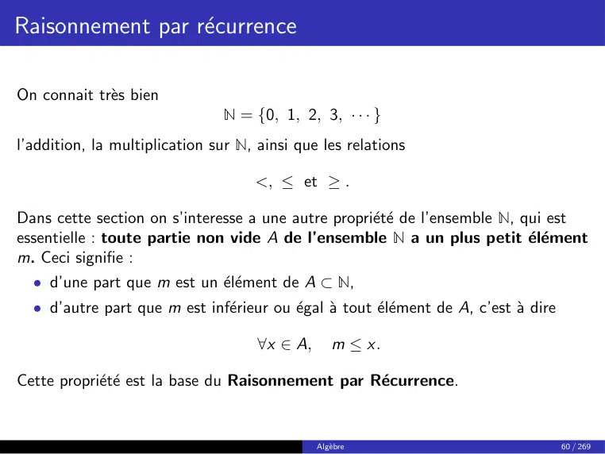

~~~text
Raisonnement par récurrence

On connait très bien
                               N = {0, 1, 2, 3, · · · }
l’addition, la multiplication sur N, ainsi que les relations

                                    <, ≤ et ≥ .

Dans cette section on s’interesse a une autre propriété de l’ensemble N, qui est
essentielle : toute partie non vide A de l’ensemble N a un plus petit élément
m. Ceci signifie :
  • d’une part que m est un élément de A ⊂ N,
  • d’autre part que m est inférieur ou égal à tout élément de A, c’est à dire

                                     ∀x ∈ A,       m ≤ x.

Cette propriété est la base du Raisonnement par Récurrence.

                                               Algèbre                                60 / 269
~~~

## Page 66

~~~text
Raisonnement par récurrence

Proposition (Récurrence Simple)
On considère une propriété P(n) dépendant de l’entier n ∈ N, et on suppose
que :
  • Initialisation : P(0) est vraie,
  • Hérédité : pour tout n ∈ N, si P(n) est vraie, alors P(n + 1) est vraie.
Alors la propriété P(n) est vraie pour tout n ∈ N.

Remarque : L’initialisation peut commencer à un entier k0 ∈ N arbitraire (pas
necessairement 0) et dans ce cas la propriété n’est démontrée vraie qu’à partir du
rang k0 : Si
  • P(k0 ) est vraie,
  • Pour tout entier n supérieur ou égal à k0 , P(n) est vraie, alors P(n + 1) est
    vraie.
Alors la propriété P(n) est vraie pour tout entier supérieur ou égal à k0 .

                                               Algèbre                            61 / 269
~~~

## Page 67

~~~text
Raisonnement par récurrence

Démonstration.
Soit
                             A = {n ∈ N : P(n) est vraie}.
Pour montrer que A = N, on raisonne par l’absurde. Supposons donc A 6= N, dans ce
cas, le complémentaire Ac de la partie A dans N est non vide. Elle admet donc un plus
petit élément que l’on note p. Puisque 0 ∈ A, on a

                                          p ≥ 1.

De plus, comme p est le plus petit élémént de Ac , on déduit que

                                        p−1≥0

ne peut appartenir au complémentaire de A. On a donc p − 1 ∈ A. Ainsi P(p − 1) est
vraie, ce qui implique que P(p) est vraie, et donc que p appartient à A. Finalement,

                                   p∈A     et   p ∈ Ac .

Contradiction ! ! Par conséquent, A = N, est la proposition est vraie pour tout
n ∈ N.

                                                Algèbre                           62 / 269
~~~

## Page 68

~~~text
Raisonnement par récurrence

Quand on veut montrer par récurrence que

                                  ∀n ∈ N, P(n),

on rédige ainsi :

  • Initialisation : Vérification que P(0) est vraie (où plus généralement P(k0 )
    si l’initialisation commence à k0 ).

  • Hérédité : Soit n ∈ N. Supposons P(n) vraie. Montrons que P(n + 1) est
    vraie :
                         ..
                              
                          .      Preuve que P(n + 1) est vraie.

                                            Algèbre                             63 / 269
~~~

## Page 69

~~~text
Raisonnement par récurrence
Exemple : Montrer que pour tout entier naturel n, 2n > n.

Initialisation : On a 20 = 1 > 0, donc P(0) est vraie.

Hérédité : Soit n ∈ N. Supposons P(n) vraie, c’est-à-dire,

                                          2n > n.

Montrons que 2n+1 > n + 1 est vraie. On a

                                  2n+1 = 2 · 2n = 2n + 2n .

Ainsi, par hypothèse de récurrence, on en déduit

                                 2n+1 = 2n + 2n > n + 2n .

Maintenant, pour tout n ∈ N on a
                                          2n ≥ 1.
Par conséquent
                                  2n+1 > n + 2n ≥ n + 1.
 C’est-à-dire 2n+1 > n + 1. Fin de la récurrence. Par conséquent pour tout entier naturel
n, 2n > n.
                                                Algèbre                                64 / 269
~~~

## Page 70

~~~text
Raisonnement par récurrence

Exemple : Montrer que pour tout entier naturel n, 3n − 1 est pair.

Initialisation : On a 30 − 1 = 1 − 1 = 0, donc P(0) est vraie.

Hérédité : Soit n ∈ N. Supposons P(n) vraie, c’est-à-dire

                  3n − 1 est pair    =⇒ 3n − 1 = 2k,        k ∈Z
                                             n
                                     =⇒ 3 = 2k + 1.

Montrons que 3n+1 − 1 est pair. On a

        3n+1 − 1= 3 · 3n − 1 = 3(2k + 1) − 1 = 6k + 3 − 1 = 2(3k + 1).

 C’est-à-dire 3n+1 − 1 est pair. Fin de la recurrence. Par conséquent, pour tout
entier naturel n, 3n − 1 est pair.

                                            Algèbre                             65 / 269
~~~

## Page 71

~~~text
Raisonnement par récurrence

Il arrive parfois qu’on ne sache pas déduire P(n + 1) de P(n), mais

               seulement P(n + 2)         de       P(n) et P(n + 1).

Le principe du raisonnement par récurrence prend dans ce cas la forme suivante.

Proposition (Récurrence Double)
On considère une propriété P(n) dépendant de l’entier n ∈ N, et on suppose
que :
  • P(0) et P(1) sont vrais,
  • pour tout n ∈ N, si P(n) et P(n + 1) sont vrais, alors P(n + 2) est vraie.
Alors la propriété P(n) est vraie pour tout n ∈ N.

Remarque : Les récurrences classiques sont dites simples et il existe bien entendu
des récurrences triples, etc.

                                               Algèbre                          66 / 269
~~~

## Page 72

~~~text
Raisonnement par récurrence

Quand on veut montrer par récurrence double que

                                 ∀n ∈ N, P(n),

on rédige ainsi :

  • Initialisation : Vérification que P(0) et P(1) sont vrais.

  • Hérédité : Soit n ∈ N. Supposons P(n) et P(n + 1) sont vrais.Montrons
    que P(n + 2) est vraie.

                         ..
                              
                          .      Preuve que P(n + 2) est vraie.

                                           Algèbre                       67 / 269
~~~

## Page 73

~~~text
Modes de raisonnement

Théorème (Récurrence forte)
On considère une propriété P(n) dépendant de l’entier n ∈ N, et on suppose
que :
  • P(0) est vraie,
  • pour tout n ∈ N, si P(k) est vraie pour k ≤ n, alors P(n + 1) est vraie.
Alors la propriété P(n) est vraie pour tout n ∈ N.

Exemple : Montrer que tout entier n ≥ 2 se décompose en produit de nombres
premiers.

                                            Algèbre                             68 / 269
~~~

## Page 74

~~~text
Ensembles

 • Introduction à la théorie des ensembles :
      • Définition et exemples.
      • Inclusion, Égalité.
      • Ensemble des parties

 • Opération sur les ensembles :
      • Intersection, Union.
      • Différence, Complémentaire.
      • Partition d’un ensemble.
      • Produit Cartésien.

                                           Algèbre   69 / 269
~~~

## Page 75

~~~text
Ensembles

Définition (Ensemble)
Un ensemble E est une collection ou un groupement d’objets distincts. Les
objets x de E s’appellent les éléments de E .
  • Si E est un ensemble et si x est un élément de E , on dit que x appartient à
    E ou que x est dans E et on écrit

                                      x ∈ E.

  • Dans le cas contraire, si x n’est pas un élément de E , on dit que x
    n’appartient pas à E ou que x n’est pas dans E et on écrit

                                      x∈
                                       / E.
Remarque :
  • Il existe un unique ensemble ne contenant aucun élément. C’est l’ensemble
    vide noté ∅.
  • Un ensemble qui ne contient qu’un seul élément est appelé singleton.

                                            Algèbre                            70 / 269
~~~

## Page 76

~~~text
Ensembles

Pour définir un ensemble, on peut le décrire :

  • Par extension : en donnant la liste complète explicite de tous ses éléments.
    On note cette liste entre accolades, l’ordre des éléments listés n’ayant aucune
    importance.

     Exemple :
       • {1}, {1, 4}, {1, 4, 9} et

                                     {1, 4, 9, 11} = {9, 4, 11, 1}.

       • 2N = {0, 2, 4, · · · } : L’ensemble des entiers naturels pairs.
       • 2N + 1 = {1, 3, 5, · · · } : L’ensemble des entiers naturels impairs.

                                                   Algèbre                      71 / 269
~~~

## Page 77

~~~text
Ensembles

 • Par compréhension : en donnant une propriété P que ses éléments vérifient
   et sont seuls à vérifier. On note

                       {x ∈ E : P(x)}       ou {x ∈ E | P(x)}

   l’ensemble des éléments de E qui vérifient P.
   Exemple :
     • 2N = {n ∈ N : ∃k ∈ N, n = 2k} : L’ensemble des entiers naturels pairs.
     • 2N + 1 = {n ∈ N : ∃k ∈ N, n = 2k + 1} : L’ensemble des entiers naturels
       impairs.
                                          
                                         p
     • Q = x ∈ R : ∃p ∈ Z, ∃q ∈ N∗ , x =     : L’ensemble des rationnels.
                                         q
     • [a, b[ = {x ∈ R : a ≤ x < b} : l’intervalle semi-ouverte à droite.

                                            Algèbre                             72 / 269
~~~

## Page 78

~~~text
Ensembles
Définition (Inclusion)
Soient E et F deux ensembles. On dit que E est inclus dans F , ou que F contient E , ou
que E est une partie de F , ce qu’on note

                                              E ⊂F

si tout élément de E est élément de F , c’est-à-dire

                                  ∀x,    (x ∈ E =⇒ x ∈ F ).
Exemple :
   • On a la suite d’inclusions
                                {1} ⊂ {1, 4} ⊂ {1, 4, 9} ⊂ {1, 4, 9, 11}.
   • On a
                                     2N ⊂ N      et     2N + 1 ⊂ N.
   • On a la suite d’inclusions
                                        N ⊂ Z ⊂ Q ⊂ R ⊂ C.
   • On a
                                            [a, b[    ⊂          R.
                                                      Algèbre                    73 / 269
~~~

## Page 79

~~~text
Ensembles
Attention ! : Ne pas confondre appartenance et inclusion.

  • On a bien
                                       0∈N
    mais
                                       0 6⊂ N.
    Néanmoins
                                      {0} ⊂ N.
    Un élément appartient à un ensemble.
    Par rapport à N, 0 est donc une bille dans un sac et non un sac dans un sac.

  • On a bien
                                       N⊂Z
    mais
                                       N∈
                                        / Z.
    Un ensemble est contenu dans un ensemble.
    Par rapport à Z, N est donc un sac dans un sac et non une bille dans un sac.
                                          Algèbre                           74 / 269
~~~

## Page 80

~~~text
Ensembles
Quand on veut montrer une inclusion :

                                           E ⊂ F,

on écrit sans réfléchir :

                       Soit x ∈ E . Montrons que x ∈ F est vraie.
                              ..
                                    
                               .      Preuve que x ∈ F .

Exemple : Montrer que

                               {x ∈ R : ∃y ∈ R+ , x ≥ y } ⊂ R+ .

Preuve : Soit x ∈ R. On suppose qu’il existe y ∈ R+ tel que x ≥ y . Montrons que
x ∈ R+ . Or y ≥ 0 par hypothèse et x ≥ y , donc

                                            x ≥ 0.

Ainsi, {x ∈ R : ∃y ∈ R+ , x ≥ y } ⊂ R+ .
                                                 Algèbre                   75 / 269
~~~

## Page 81

~~~text
Ensembles
Exemple : Montrer que

                          E = {k(k + 1) : k ∈ N} ⊂ 2N.

Preuve : Soit n ∈ E , alors

                      n = k(k + 1)    pour un certain k ∈ N.

Montrons que n ∈ 2N. On peut affirmer que k est pair ou impair, et si k est
impair alors k + 1 est pair. Dans tous les cas

                              k   ou k + 1        est pair.

Par produit, n = k(k + 1) l’est aussi, donc n ∈ 2N. Par conséquent, E ⊂ 2N.

À faire chez soi :
  • Soit E l’ensemble des entiers naturels multiples de 6 et F l’ensemble des
    entiers naturels pairs. Montrer que E ⊂ F .
  • Soit E = [2, 3] et F = {x ∈ R : x 2 − 3x − 10 ≤ 0}. Montrer que E ⊂ F .
                                             Algèbre                           76 / 269
~~~

## Page 82

~~~text
Ensembles
Définition (Égalité)
Soient E et F deux ensembles. Les ensembles E et F sont égaux s’ils ont
exactement les mêmes éléments, i.e. si :

                             ∀x,   (x ∈ E ⇐⇒ x ∈ F ).

Exemples :
  • Nous avons
                          {x ∈ R : x 2 − 3x − 10 < 0} = ] − 2, 5[.
  • Nous avons
                             {0, 1} = {n ∈ N : n2 = n}.

Théorème
Soient E et F deux ensembles. Alors :

                 E =F       si et seulement si      E ⊂ F et F ⊂ E .
                                             Algèbre                      77 / 269
~~~

## Page 83

~~~text
Ensembles
Pour montrer une égalité d’ensembles :
                                      E = F,
deux stratégies sont possibles :
  • Soit on raisonne par double inclusion : En montrant d’abord E ⊂ F :
                       Soit x ∈ E . Montrons que x ∈ F est vraie.
                              ..
                                    
                               .      Preuve que x ∈ F .

    Puis, en montrant F ⊂ E :
                       Soit x ∈ F . Montrons que x ∈ E est vraie.
                              ..
                                    
                               .      Preuve que x ∈ E .

  • Soit on raisonne directement par équivalence :
                    ∀x :   x ∈ E ⇐⇒ · · · ⇐⇒ · · · ⇐⇒ x ∈ F .

                                           Algèbre                       78 / 269
~~~

## Page 84

~~~text
Ensembles

Exemple : Montrer que

                        R− = {x ∈ R : ∀y ∈ R+          x ≤ y }.

Preuve : On raisonne par double inclusion

  • Montrons
                          R− ⊂ {x ∈ R : ∀y ∈ R+          x ≤ y }.
    Soit x ∈ R− . Nous devons montrer que ∀y ∈ R+ , x ≤ y , mais par hypothèse
    x ≤ 0. Donc
                                   x ≤ 0 ≤ y.
  • Montrons
                          {x ∈ R : ∀y ∈ R+        x ≤ y } ⊂ R− .
    Soit x ∈ R tel que ∀y ∈ R+ , x ≤ y . Alors en particulier, pour y = 0 on a
    x ≤ 0. C’est-à-dire x ∈ R− .

                                            Algèbre                             79 / 269
~~~

## Page 85

~~~text
Ensembles
Définition (Ensemble des parties d’un ensemble)
Soit E un ensemble. On note P(E ) l’ensemble des parties de E

                               P(E ) = {A : A ⊂ E }.

Remarque : Pour tout ensemble A :
    A ∈ P(E ) ⇐⇒ A ⊂ E , i.e. la notation A ⊂ E a la même signification que
la notation A ∈ P(E ).
   a ∈ E ⇐⇒ {a} ⊂ E ⇐⇒ {a} ∈ P(E ).

   ∅ ∈ P(E )    et    E ∈ P(E ).
Exemple : Déterminer l’ensemble des parties de E lorsque :
  • E = {a, b} :
                             P(E ) = {∅, {a}, {b}, {a, b}}.
  • E = {a, b, c} :
               P(E ) = {∅, {a}, {b}, {c}, {a, b}, {b, c}, {a, c}, {a, b, c}}.
                                             Algèbre                           80 / 269
~~~

## Page 86

~~~text
Opérations sur les ensembles
Étudions certaines opérations sur les ensembles.
Définition (Intersection)
Soit E un ensemble, et soient A et B deux sous-ensembles de E .
  • L’intersection de A et B est l’ensemble, noté A ∩ B, défini par :

                        A ∩ B = {x ∈ E : x ∈ A et       x ∈ B}.

     En d’autres termes, l’intersection de A et de B est l’ensemble des éléments
     qui sont à la fois dans A et dans B.

Diagramme de Venn :

                                             Algèbre                           81 / 269
~~~

## Page 87

~~~text
Opérations sur les ensembles

Exemple :
  • {1, 4, 7} ∩ {3, 5, 7, 11} = {7}.
  • Z ∩ Q = Z.
  •

                ([−1, 5] ∩ ]0, 7[) ∩ ]4, 9[ = ]0, 5] ∩ ]4, 9[ = ]4, 5].

  • On a

      {(x, y ) ∈ R2 : x 2 + y 2 = 1} ∩ {(x, y ) ∈ R2 : x = y }
                                                   (     √      √ !       √    √ !)
                                                           2      2        2     2
                                                =      −     ,−     ,        ,      .
                                                          2      2        2     2

  • R+ ∩ R− = {0}.
  • 2N ∩ (2N + 1) = ∅.

                                             Algèbre                             82 / 269
~~~

## Page 88

~~~text
Opérations sur les ensembles

Définition (Ensembles disjoints)
Soient A et B deux ensembles. On dit que A et B sont disjoints si

                                  A ∩ B = ∅.

Autrement dit si A et B n’ont aucun élément commun.

                                         Algèbre                   83 / 269
~~~

## Page 89

~~~text
Opérations sur les ensembles
Définition (Union)
Soit E un ensemble, et soient A et B deux sous-ensembles de E .
  • L’union de A et B est l’ensemble, noté A ∪ B, défini par :

                       A ∪ B = {x ∈ E : x ∈ A ou        x ∈ B}.

    En d’autres termes, l’union de A et de B est l’ensemble des éléments qui
    appartiennent à A ou à B. Le  ou  utilisé ici est inclusif : x est un
    élément de A ou un élément de B ou un élément de A et de B.

Diagramme de Venn :

                                           Algèbre                              84 / 269
~~~

## Page 90

~~~text
Opérations sur les ensembles

Exemple :

  • {3, 4, 7, 9} ∪ {2, 7, 9, 10, 21, 84} = {2, 3, 4, 7, 9, 10, 21, 84}.
  • R+ ∪ R− = R.
  • Q ∪ I = R.
  • {1, −1} ∪ ]1, −1[ = [−1, 1].

Remarque :

  • Si A ⊂ B. Alors

                            A∩B =A          et        A ∪ B = B.

  • Soient A et B deux ensembles. Alors on a toujours les inclusions suivantes :

                     A∩B ⊂A⊂A∪B                  et     A ∩ B ⊂ B ⊂ A ∪ B.

                                                  Algèbre                   85 / 269
~~~

## Page 91

~~~text
Opérations sur les ensembles
L’union et l’intersection se généralisent facilement au cas de plus de deux ensembles.

Définition
Soit E un ensemble et n un entier supérieur ou égale à 2. Supposons donnés n
sous-ensembles
                                   A1 , A2 , · · · , An ,
de E .
  • Union :
                                         [
           A1 ∪ A2 ∪ · · · ∪ An =                    Ai = {x ∈ E : ∃i ∈ {1, 2, · · · , n}, x ∈ Ai }.
                                    i∈{1,2,··· ,n}

         i.e. l’ensemble des objets qui appartiennent à l’un des Ai .
  • Intersection :
                                         \
           A1 ∩ A2 ∩ · · · ∩ An =                    Ai = {x ∈ E : ∀i ∈ {1, 2, · · · , n}, x ∈ Ai }.
                                    i∈{1,2,··· ,n}

         i.e. l’ensemble des objets qui appartiennent à tous les Ai .

                                                          Algèbre                                86 / 269
~~~

## Page 92

~~~text
Opérations sur les ensembles
L’union et l’intersection satisfont les propriétés suivants.
Théorème
Soit E un ensemble, et considérons trois sous-ensembles A, B, C de E .
  • L’intersection et l’union sont commutatives :

                        A ∩ B = B ∩ A et        A ∪ B = B ∪ A.

  • L’intersection et l’union sont associatives :

                        A ∩ (B ∩ C ) = (A ∩ B) ∩ C = A ∩ B ∩ C ,
                        A ∪ (B ∪ C ) = (A ∪ B) ∪ C = A ∪ B ∪ C .

  • Pour tout sous-ensemble A de E on a

                                         A ∩ E = A.

  • Pour tout sous-ensemble A de E on a

                                          A ∪ ∅ = A.
                                               Algèbre                   87 / 269
~~~

## Page 93

~~~text
Opérations sur les ensembles

Théorème
Soit E un ensemble, et considérons trois sous-ensembles A, B, C de E .
  • L’intersection et la réunion sont distributives l’une par rapport à l’autre :

                         A ∩ (B ∪ C ) =      (A ∩ B) ∪ (A ∩ C ),
                         A ∪ (B ∩ C ) =      (A ∪ B) ∩ (A ∪ C ).

Démonstration.
Voir TD.

                                             Algèbre                             88 / 269
~~~

## Page 94

~~~text
Opérations sur les ensembles

Définition (Différence)
Soit E un ensemble, et soient A et B deux sous-ensembles de E .
  • La différence de A avec B, noté A \ B, est l’ensemble de tous les éléments
    de A qui ne sont pas dans B, i.e.

                          A \ B = {x ∈ E : x ∈ A et x ∈
                                                      / B}.

Diagramme de Venn :

                                           Algèbre                            89 / 269
~~~

## Page 95

~~~text
Opérations sur les ensembles

Définition (Différence Symétrique)
Soit E un ensemble, et soient A et B deux sous-ensembles de E .
  • La différence symétrique de A avec B, noté A∆B, est l’ensemble des
    élements qui sont dans un et un seul des deux ensembles A et B, i.e.

               A∆B = (A ∪ B) \ (A ∩ B) = (A \ B) ∪ (B \ A).

Diagramme de Venn :

                                         Algèbre                           90 / 269
~~~

## Page 96

~~~text
Opérations sur les ensembles
Définition (Complément)
Soient E un ensemble et A une partie de E .
  • Le complémentaire de A dans E est l’ensemble, noté CAE , de tous les
    éléments de E qui ne sont pas dans A,i.e.

                         CAE = {x : x ∈ E et x ∈
                                               / A} = E \ A.

Diagramme de Venn :

Remarque : S’il n’y a pas d’ambigüité sur l’ensemble E , on privilégiera la
notation Ac pour CAE .
                                             Algèbre                            91 / 269
~~~

## Page 97

~~~text
Opérations sur les ensembles

Le passage au complémentaire satisfait les propriétés suivantes.

Théorème
Soient A et B deux parties de E .
 1. (Ac )c = A     et   ∅c = E      et   E c = ∅.
 2. Si A ⊂ B, alors
                                         B c ⊂ Ac .
 3. Lois de Morgan :

                    (A ∩ B)c = Ac ∪ B c     et     (A ∪ B)c = Ac ∩ B c .

Démonstration.
Voir TD.

                                             Algèbre                      92 / 269
~~~

## Page 98

~~~text
Partition d’un ensemble
Définition (Partition)
Une partition d’un ensemble E est un ensemble
                                
                                  A1 , A2 , · · · , An

constitué de parties de E vérifiant :
  • Pour tout k ∈ {1, · · · , n}, Ak 6= ∅, i.e. aucun Ak ne doit être vide.
      n
      [
  •         Ak = E , i.e. la réunion des Ak est égale à E .
      k=1

  • Pour tout couple Ai , Aj avec Ai 6= Aj on a Ai ∩ Aj = ∅, i.e. les Ai sont deux à deux
    disjoints.
Diagramme de Venn :

                                                    Algèbre                         93 / 269
~~~

## Page 99

~~~text
Partition d’un ensemble

Exemples :

  • L’ensemble {2N, 2N + 1} définit une partition de N.
  • L’ensemble {Q, I} définit une partition de R.
  • L’ensemble { 0, 12 , 12 , 32 , 23 , 2 } définit une partition de [0, 2].
                                    

Exercice : Donner toutes les partitions de l’ensemble

                                     E = {a, b, c}.

Solution :

  • P0 = {E } = {{a, b, c}}.
  • P1 = {{a}, {b}, {c}}.
  • P2 = {{a}, {b, c}} et P20 = {{b}, {a, c}} et P200 = {{a, b}, {c}}.

                                               Algèbre                         94 / 269
~~~

## Page 100

~~~text
Produit Cartésien

On finit ce chapitre en rappelant la définition du produit cartésien.

Définition (Produit Cartésien)
Soient A et B deux parties de E . Le produit cartésien de A et B est l’ensemble,
noté
                                      A × B,
constitué de tous les couples (x, y ) où

                                  x ∈A       et    y ∈ B.

On a donc :                    
                        A × B = (x, y ) : x ∈ A et y ∈ B .

Exemple : Soit A = {a, b} et B = {1, 2}, alors

                     A × B = {(a, 1), (a, 2), (b, 1), (b, 2)}.

                                                  Algèbre                   95 / 269
~~~

## Page 101

~~~text
Produit Cartésien

Exemple : Avec
                      C = {1, 2}         et         D = {1, 2, 3}
on a

               C × D = {(1, 1), (1, 2), (1, 3), (2, 1), (2, 2), (2, 3)}.

Remarque : On ne confond pas les couples (a, b) et (b, a) qui désignent deux
objets différents, alors que {a, b} et {b, a} désignent le même ensemble.
L’exemple montre que le premier et le deuxième terme du couple n’appartiennent
pas au même ensemble.

                                              Algèbre                      96 / 269
~~~

## Page 102

~~~text
Produit Cartésien
Le produit cartésien se généralise au cas de plus de deux ensembles.
Définition (Produit cartésien d’une famille finie d’ensembles)
Soit n un entier supérieur ou égale à 2. Supposons donnés n ensembles

                                          A1 , A2 , · · · , An .

Alors le produit cartésien de A1 , A2 , · · · , An est l’ensemble défini par
                                  
      A1 × A2 × · · · × An =        (x1 , x2 , · · · , xn ) : x1 ∈ A1 , x2 ∈ A2 , · · · , xn ∈ An
                                  
                             =      (x1 , x2 , · · · , xn ) : ∀i ∈ {1, · · · , n}, xi ∈ Ai .

L’élément (x1 , x2 , · · · , xn ) est appelé un n-tuple de composants x1 , x2 , · · · , xn .
Remarque :
  • Lorsque A = B, on note
                                            A × A = A2 .
      et on généralise cette notation pour l’ensemble
                                          An = A × A × · · · × A.
     (produit cartésien de n facteurs égaux à A).
   • La diagonale de A2 est l’ensemble ∆ = {(x, x), x ∈ A}.
                                                       Algèbre                                     97 / 269
~~~

## Page 103

~~~text
Produit Cartésien

Le produit cartésien satisfait les propriétés suivantes.

Proposition
Soient A, B, C , D des parties d’un ensemble E .
  • (A × C ) ∪ (A × D) = A × (C ∪ D).
  • (A × C ) ∩ (B × D) = (A ∩ B) × (C ∩ D).

Démonstration.
Voir TD.

                                                Algèbre      98 / 269
~~~

## Page 104

~~~text
Relations Binaires

 • Relation d’équivalence :
      • Classes d’équivalence.
      • Partition d’un ensemble par une relation d’équivalence.

 • Relation d’ordre :
      • Relation d’ordre partiel, totale.
      • Relation d’ordre stricte.
      • Minimum, maximum, borne inférieure, borne supérieure.

                                             Algèbre              99 / 269
~~~

## Page 105

~~~text
Relations Binaires

Définition
Soient E et F deux ensembles. On appelle relation R de E sur F la donnée d’une
partie
                                 R ⊂ E × F.

  • La partie R est appelé le graphe de la relation R.
  • On dit qu’un élément x ∈ E est en relation avec un élément y ∈ F si

                                      (x, y ) ∈ R.

  • On exprime cette situation en écrivant xRy . C’est-à-dire

                                 xRy ⇐⇒ (x, y ) ∈ R.

Finalement, si E = F la relation R est appelée relation binaire.

                                           Algèbre                           100 / 269
~~~

## Page 106

~~~text
Relations Binaires

Exemple : Soit E = {1, 2, 3, 4} et R la relation binaire sur E dont le graphe est
donné par

           R = {(1, 1), (1, 3), (2, 2), (2, 4), (3, 1), (3, 3), (4, 2), (4, 4)}.

C’est-à-dire

                                 aRb      ⇐⇒       (a, b) ∈ R.

Ainsi, par exemple
                                     1R1      et      1R3,
mais

    1 n’est pas en relation avec 2            et       1 n’est pas en relation avec 4.

                                                   Algèbre                          101 / 269
~~~

## Page 107

~~~text
Relations Binaires
Exemple :
  • La relation d’inclusion dans l’ensemble des parties de E

                                       ARB ⇐⇒ A ⊂ B.

    Ici donc
                          R = {(A, B) ∈ P(E ) × P(E ) : A ⊂ B}.
  • La relation de divisibilité sur les entiers relatifs

                                mRn ⇐⇒ m|n            (m divise n).

    Ici donc
                               R = {(m, n) ∈ Z × Z : m|n ∈ Z}.
  • Sur tout ensemble E , on peut définir la relation égalité

                                        xRy ⇐⇒ x = y .

    Ici donc
                                R = {(a, b) ∈ E × E : a = b}.
  • Les relations ≤ et < sur R, sont aussi des relations binaires.
                                                    Algèbre          102 / 269
~~~

## Page 108

~~~text
Relations Binaires

Remarque : Parce que le couple (x, y ) n’est pas egal au couple (y , x), la relation
xRy peut être vraie sans que la relation y Rx le soit. Par exemple, si on considère
la relation d’inclusion sur R, nous avons

                          [0, 2[R[0, 2]   car     [0, 2[⊂ [0, 2],

mais [0, 2] n’est pas inclus dans [0, 2[, donc

                      [0, 2]   n’est pas en relation avec      [0, 2[.

                                                Algèbre                        103 / 269
~~~

## Page 109

~~~text
Relations Binaires
Etudions certaines propriétés éventuelles des relations binaires.

Définition
Soit R une relation binaire sur E.
  • On dit que R est réflexive si :

                                       ∀x ∈ E ,      xRx

  • On dit que R est transitive si :

              ∀x ∈ E , ∀y ∈ E , ∀z ∈ E ,    xRy et y Rz         =⇒     xRz

  • On dit que R est symétrique si :

                        ∀x ∈ E , ∀y ∈ E ,     xRy =⇒ y Rx

  • On dit que R est antisymétrique si :

                 ∀x ∈ E , ∀y ∈ E ,    xRy et y Rx          =⇒    x = y.

                                               Algèbre                      104 / 269
~~~

## Page 110

~~~text
Relations Binaires

Remarque : L’antisymetrie n’est pas le contraire de la symétrie. Par exemple, la
relation égalité possède les deux propriétés.
Exemples :
  • Soit E = {1, 2, 3, 4}. Alors la relation binaire R sur E dont le graphe est
    donné par

             R = {(1, 1), (1, 3), (2, 2), (2, 4), (3, 1), (3, 3), (4, 2), (4, 4)},

    est réflexive, symétrique et transitive.
  • La relation d’égalité ” = ” sur E est réflexive, transitive, symétrique et
    antisymétrique.
  • La relation d’inclusion ⊂ sur P(E ) est réflexive, transitive et
    antisymétrique.

                                                 Algèbre                            105 / 269
~~~

## Page 111

~~~text
Relations Binaires

Exemples :
  • La relation ≤ sur R est réflexive, transitive et antisymétrique. Elle n’est pas
    symétrique car par exemple : 2 ≤ 5 mais : 5  2.

  • La relation < sur R est transitive et antisymétrique, mais elle n’est ni
    réflexive, ni symétrique.

  • La relation | de divisibilité sur Z est réflexive et transitive, mais elle n’est pas
    antisymétrique car par exemple : 5| − 5 et −5|5 mais 5 6= −5.

                                               Algèbre                              106 / 269
~~~

## Page 112

~~~text
Relation d’équivalence
Nous allons étudier deux importants types des relations binaires : Les relations
d’equivalence et les relations d’ordre. Commencons par étudier les relations
d’equivalence.
Définition
On dit qu’une relation binaire R sur E est une relation d’équivalence si R est à
la fois réflexive, transitive et symétrique.

Pour a ∈ E , l’ensemble des éléments x ∈ E en relation avec a est appelé la classe
d’équivalence de a, notée

                              cl(a) ou    [a]     ou a.

C’est-à-dire
                             cl(a) = {x ∈ E : aRx}.

Exemple : Soit n un entier naturel. La relation sur Z définie par
                          aRb     ⇐⇒      n divise a − b
est une relation d’équivalence. Si aRb on dit que a et b sont congrus modulo n.
                                            Algèbre                            107 / 269
~~~

## Page 113

~~~text
Relation d’équivalence

Exemple : Soit E = {1, 2, 3, 4}. Nous avons vu que la relation binaire R sur E
dont le graphe est donné par

          R = {(1, 1), (1, 3), (2, 2), (2, 4), (3, 1), (3, 3), (4, 2), (4, 4)},

est réflexive, symétrique et transitive. C’est-à-dire, R est une relation
d’équivalence. De plus, nous avons

                            cl(1)    = {1, 3}          =    cl(3),
                            cl(2)    = {2, 4}          =    cl(4).

                                                 Algèbre                         108 / 269
~~~

## Page 114

~~~text
Relation d’équivalence
L’ensemble des classes d’équivalence nous donnent une partition de l’ensemble E .

Proposition (Partition d’un ensemble en classes d’équivalence)
Soit R une relation d’équivalence sur un ensemble E . Alors les classes
d’équivalences forment une partition de E , c’est-à-dire

  • toute classe d’équivalence est non vide :

                                    ∀x ∈ E ,      cl(x) 6= ∅,

  • deux classes d’équivalence sont soit disjointes soit égales :

             ∀x, y ∈ E    tel que   cl(x) 6= cl(y ) on a        cl(x) ∩ cl(y ) = ∅,

  • la réunion des classes d’équivalence est égale à E :
                                            [
                                       E=       cl(x).
                                            x∈E

                                               Algèbre                               109 / 269
~~~

## Page 115

~~~text
Relation d’ordre
Passons à étudier les relations d’ordre.
Définition
On dit qu’une relation binaire R sur E est une relation d’ordre si R est à la fois
réflexive, transitive et antisymétrique.
  • Les relations d’ordre sont généralement notées ≤ ou 4 ou . ou .
  • Soit 4 une relation d’ordre sur E , on dit alors que (E , 4) est un ensemble
    ordonné.

Définition (Ordre total ou ordre partiel)
Soit 4 une relation d’ordre sur E .
  • Deux éléménts x et y de E sont dits comparables (pour 4) si

                                    x 4y     ou y 4 x.

  • Si deux éléments quelconques sont toujours comparables, on dit que 4 est
    une relation d’ordre total. E est dit totalement ordonné par 4.
  • Sinon, on dit que 4 est une relation d’ordre partiel. E est dit partiellement
    ordonné par 4.
                                             Algèbre                         110 / 269
~~~

## Page 116

~~~text
Relation d’ordre

Exemple :

  • Sur N, Z, Q et R on a une relation d’ordre total, notée ≤ (Voir cours
    d’analyse).
  • Sur P(E ), la relation
                                  A 4 B ⇐⇒ A ⊂ B
    c’est une relation d’ordre partiel (sauf si E = ∅ ou E = {a}). En effet, si
    a ∈ E , b ∈ E , {a} et {b} non comparables.
  • Sur R2
                   (x, y ) 4 (x 0 , y 0 ) ⇐⇒ (x ≤ x 0 )   et (y ≤ y 0 )
    est un ordre partiel. Par exemple (1, 2) et (4, 0) non comparables.

                                            Algèbre                          111 / 269
~~~

## Page 117

~~~text
Relation d’ordre

Définition (Relation stricte associée à une relation d’ordre)
Soit 4 une relation d’ordre sur E . On définit alors une nouvelle relation sur E par

                 ∀x, y ∈ E ,   x ≺y     ⇐⇒         x 4y   et   x 6= y .

La relation ≺ on l’appelle la relation stricte associée à 4.

Exemple : Naturellement, la relation usuelle < sur R est la relation stricte de la
relation ≤.
Attention ! : La relation stricte n’est pas une relation d’ordre car elle n’est pas
reflexive : On ne peut pas avoir

                                  x 4 x et x 6= x.

Proposition
La relation ≺ est transitive et antisymétrique.
                                             Algèbre                            112 / 269
~~~

## Page 118

~~~text
Relation d’ordre

Définition (Majorant - Minorant)
Soit A une partie d’un ensemble E muni d’une relation d’ordre .
  • A est majorée s’il existe M ∈ E tel que pour tout x ∈ A nous avons

                                          x  M.

    On dit alors que M est un majorant de A.
  • A est minorée s’il existe m ∈ E tel que pour tout x ∈ A nous avons

                                          m  x.

    On dit alors que m est un minorant de A.
  • A est bornée lorsque A est à la fois majorée et minorée. C’est-à-dire, s’il
    existe m ∈ E et M ∈ E tel que pour tout x ∈ A nous avons

                                       m  x  M.

                                              Algèbre                                 113 / 269
~~~

## Page 119

~~~text
Relation d’ordre

Remarque : On ne parle jamais  du  majorant d’une partie majorée de E mais
bien toujours d’UN majorant car une telle peut possèder plein. Même chose à
dire sur les minorants.
Exemple :

  • L’ensemble {8, 10, 12} est minoré par 2 et majoré par 120 pour la relation de
    divisibilité | sur N.
  • P(E ) est minoré par ∅ et majoré par E pour la relation d’inclusion ⊂.
  • Tout réel inférieur ou égal à 0 est un minorant de l’intervalle ]0, 1[ par rapport
    à la relation d’ordre usuelle sur R. Tout réel supérieur ou égal à 1 est un
    majorant de l’intervalle ]0, 1[ par rapport à la relation d’ordre usuelle sur R.

                                              Algèbre                               114 / 269
~~~

## Page 120

~~~text
Relation d’ordre
Un majorant ou minorant de une partie A de E , n’appartient pas necéssairement à
A. Quand il appartient à l’ensemble on dit :

Définition (Maximum - Minimum)
Soit A une partie d’un ensemble E muni d’une relation d’ordre.
  • Plus grand élément : On appelle plus grand élément de A ou maximum
    de A tout élément de A qui majore A. C’est-à-dire,
    tout majorant de A qui est dans A.
  • Plus petit élément : On appelle plus petit élément de A ou minimum de
    A tout élément de A qui minore A. C’est-à-dire,
    tout minorant de A qui est dans A.

Exemple : On travaille dans cette série d’exemples avec l’ordre usuel sur R.
  • 0 est le plus petit élémént de R+ et le plus grand élément de R− .
  • ]0, 1[ ne possède ni plus petit élément ni plus grand élément.
  • 0 est le plus petit élémént de [0, 1], et 1 est le plus grand élémént de [0, 1].

                                                Algèbre                               115 / 269
~~~

## Page 121

~~~text
Relation d’ordre

Exemple : On travaille dans cette série d’exemples avec la relation de divisibilité
| sur N.

  • L’ensemble {2, 3, 6} possède un plus grand élément, c’est 6, mais pas de plus
    petit élément.
  • 0 est le plus grand élément de N et 1 est son plus petit élément.
  • L’ensemble N \ {0, 1} ne possède ni plus petit élément ni plus grand élément.

Théorème (Unicité)
Soit 4 une relation d’ordre et A une partie de E . Si A possède un plus grand
(resp. petit) élément, celui-ci est UNIQUE. On peut donc l’appeler LE plus
grand (resp. petit) élément de A et le noter

                            max A (resp. min A).

                                             Algèbre                            116 / 269
~~~

## Page 122

~~~text
Relation d’ordre
L’intervalle
                                            [a, b[
pour la relation d’ordre usuel n’a pas de plus grand élément, pourtant sa borne b est
quelque chose de cet ordre − mais quoi ? Comment décrire conceptuellement ce réel qui
n’est pas dans [a, b[ mais qui n’est pas n’importe qui pour [a, b[?

Ce qui rend le majorant b si particulier pour [a, b[, c’est qu’il est le meilleur majorant
qu’on pouvait espérer :
                             LE PLUS PETIT POSSIBLE.
Nous allons donc le donner un nom au plus petit majorant (et au plus grand minorant).

Définition
Soit A une partie de un ensemble E muni d’une relation d’ordre.
     Si l’ensemble des minorants de A admet un plus grand élément, on l’appelle borne
     inférieure de A et on le note
                                          inf A.
     Si l’ensemble des majorants de A admet un plus petit élément, on l’appelle borne
     supérieure de A et on le note
                                          sup A.
                                               Algèbre                               117 / 269
~~~

## Page 123

~~~text
Relation d’ordre

Remarque : La différence essentielle entre les plus grands éléments et les bornes
supérieures d’une partie A, c’est que les bornes supérieures n’appartiennent pas
forcément à A.
Exemple : Avec l’ordre usuel sur R, les intervalles [a, b], ]a, b[, [a, b[ et ]a, b] ont
a pour borne inférieur et b pour borne supérieur.

Théorème (Lien entre les notions de plus grand/petit élément et
borne supérieure/inférieure)
Soit 4 une relation d’ordre et A une partie de E . Si A possède un plus grand
(resp. petit) élément, alors A possède une borne supérieure (resp. inférieure) et :

                 sup(A) = max(A) (resp. inf(A) = min(A)).

Exemple : Avec l’ordre usuel sur R on a :

         inf[a, b] = min[a, b] = a        et     sup[a, b] = max[a, b] = b.

                                               Algèbre                              118 / 269
~~~

## Page 124

~~~text
Applications
Définition (Application)
Soient E et F deux ensembles. Une application f de E vers F est le moyen
d’associer, à chaque élément x de E un unique élément y de F . Plus
formellement, on appelle application (ou fonction) de E dans F toute relation
dont le graphe Γ ⊂ E × F est tel que :

                          ∀x ∈ E , ∃!y ∈ F ,       (x, y ) ∈ Γ.

On note
                                     y = f (x),
et on dit que y = f (x) est l’image de x par f . E est l’ensemble de départ de f
et F est l’ensemble d’arrivée de f . On note

                                f : E −→ F
                                   x 7−→ y = f (x).

Si y est un élément de F , on dit que x est un antécédent de y par f lorsque
y = f (x).
                                             Algèbre                              119 / 269
~~~

## Page 125

~~~text
Applications

Définition (Ensemble d’applications)
L’ensemble des applications de E dans F est noté F (E , F ) ou F E .

                                            Algèbre                    120 / 269
~~~

## Page 126

~~~text
Applications
Exemples :
  • Application identité : On appelle application identité d’un ensemble E , et
    on note IdE , l’application de E dans E définie par
                                    IdE : E −→ E
                                           x 7−→ x.
  • Application constante : Une application f : E → F est dite constante s’il
    existe α ∈ F tel que ∀ x ∈ E , f (x) = α. C’est-à-dire
                                     f : E −→ F
                                         x 7−→ α.
  • Fonction indicatrice d’une partie d’un ensemble : Soit E un ensemble et
    A une partie de E . On appelle fonction indicatrice de A et on note 1A la
    fonction de E dans {0, 1} définie par :
                        1A : E −→ {0, 1}
                                               
                                                      1 si x ∈ A,
                             x 7−→ 1A (x) =
                                                      0 si x ∈
                                                             / A.
                                           Algèbre                           121 / 269
~~~

## Page 127

~~~text
Applications
Exemple :
  • Famille d’éléments : Soit E un ensemble et I un ensemble (le plus souvent
    fini ou dénombrable), généralement
                      I = {1, · · · , n}   ou      I =N        ou I = Z.
    On appelle famille d’éléments de E indéxée par I toute application de I dans
    E
                                      f : I −→ E
                                           i 7−→ f (i)
    On note
                                    f (i) = xi       (∈ E ).
    On represente un telle famille par
                                           (xi )i∈I .
Remarque : Une suite numérique est une famille d’éléments de R indéxée par N :
                                      (un )n∈N .
                                                Algèbre                        122 / 269
~~~

## Page 128

~~~text
Applications

Remarque : Une fonction est définie par des couples. Si l’ensemble des couples
est modifié, on n’a pas le même graphe et on ne définit plus la même fonction :

               f : R    −→      R            g:     [0, 2]    −→   R
                                     et
                   x    7−→     x2                    x      7−→   x2

ne sont pas les mêmes fonctions.

Définition (Égalité entre fonctions)
Deux applications f et g sont égales si :
  • elles ont le même ensemble de départ E et le même ensemble d’arrivée, et
  • si pour tout x ∈ E , on a
                                      f (x) = g (x).

                                             Algèbre                           123 / 269
~~~

## Page 129

~~~text
Image directe, Image reciproque

Définition (Image directe d’une partie, image d’une application)
Soit f : E → F une application.
  • Pour toute partie A de E , on appelle image (directe) de A par f , notée
    f (A), l’ensemble :

                       f (A)   = {y ∈ F : ∃a ∈ A, y = f (a)}
                               = {f (a) : a ∈ A}.

  • L’image de E tout entier est simplement appelée l’image de f et est notée
    généralement
                               Imf plutôt que f (E ).

                                          Algèbre                              124 / 269
~~~

## Page 130

~~~text
Image directe, Image reciproque

Exemple :

  • L’image de R par la fonction
                                           x 7→ x 2
    est R+ . L’image de [0, 3[ par cette même fonction est [0, 9[.

  • Considérons la fonction
                                          x 7→ sin x.
    Alors :
      • l’image de
                          πZ := {· · · , −2π , −π , 0 , π , 2π , · · · }
         par la fonction sinus est le singleton {0}.
      • l’image de [0, π] par la fonction sinus est [0, 1].
      • l’image de [−π/2, π/2] par la fonction sinus est [−1, 1].

                                               Algèbre                    125 / 269
~~~

## Page 131

~~~text
Image directe, Image reciproque

Définition (Expression  à valeurs dans · · · )
Soient f : E → F une application et B une partie de F . On dit que f est à
valeurs dans B si toute valeur de f est élément de B, i.e. si

                                ∀x ∈ E , f (x) ∈ B,

ou encore si
                                     Imf ⊂ B.
Remarque : En général, Imf est plus petit que F

                                     Imf ⊂ F .

Exemple : Les fonctions

               R   −→     R           exp :     [0, 2] −→       R
                                et
               x   7−→    x2                      x    7−→   exp(x).

sont deux fonctions à valeurs dans R+ .
                                              Algèbre                        126 / 269
~~~

## Page 132

~~~text
Image directe, Image reciproque
Étudions comme l’image directe se comporte par rapport à certaines opérations
sur les ensembles.
Proposition
Soit f : E → F . Soit A et B deux parties quelconques de E . On a
  •
                               A ⊂ B =⇒ f (A) ⊂ f (B).
  •
                               f (A ∪ B) = f (A) ∪ f (B).
  •
                               f (A ∩ B) ⊂ f (A) ∩ f (B).
  •
                          f (∅) = ∅   et   f ({a}) = {f (a)}.

Démonstration.
Voir TD.
                                           Algèbre                           127 / 269
~~~

## Page 133

~~~text
Image directe, Image reciproque

Attention : Notons que nous avons seulement

                             f (A ∩ B) ⊂ f (A) ∩ f (B).

 En effet, f (A ∩ B) et f (A) ∩ f (B) ne sont en général pas egaux, comme l’on peut
voir dans le diagramme :

                                      ×
                                                       ×
                                      ×
                                                       ×
                            B         ×
                                                       ×
                            A         ×

                                            Algèbre                            128 / 269
~~~

## Page 134

~~~text
Image directe, Image reciproque
Définition (Image réciproque d’une partie)
Soient f : E → F une application et B une partie de F .
L’image réciproque de B par f , notée f −1 (B) est l’ensemble des éléments de E
dont l’image est dans B :

                          f −1 (B) = {x ∈ E , f (x) ∈ B}.

C’est la partie de E formée par les antécédents des éléments de B.
Remarque :
  • On peut écrire
                            x ∈ f −1 (B)   ⇐⇒          f (x) ∈ B.
  • On a
                            f −1 (∅) = ∅   et      f −1 (F ) = E .
    Pour tout b ∈ F
                           f −1 ({b}) = {x ∈ E : f (x) = b}.
                          / Imf on a f −1 ({b}) = ∅.
    Par conséquent, si b ∈
                                            Algèbre                           129 / 269
~~~

## Page 135

~~~text
Image directe, Image reciproque

Exemples :

  • L’image réciproque de R+ par la fonction exponentielle est R tout entier :

                                    exp−1 (R+ ) = R.

  • L’image réciproque de [9, 25[ par la fonction carrée est :

                          f −1 ([9, 25[) = ] − 5, −3] ∪ [3, 5[.

  • L’image réciproque de {0} par la fonction sinus est

                          sin−1 ({0}) = πZ = {kπ : k ∈ Z}.

    L’image reciproque de [4, 6] par le même fonction est :

                                   sin−1 ([4, 6]) = ∅.

                                             Algèbre                         130 / 269
~~~

## Page 136

~~~text
Image directe, Image reciproque

Étudions maintenant comme l’image reciproque se comporte par rapport à
certaines opérations sur les ensembles.

Proposition
Soit f : E → F . Soit A ⊂ F et B ⊂ F . On a
  •
                          f −1 (A ∪ B) = f −1 (A) ∪ f −1 (B).
  •
                          f −1 (A ∩ B) = f −1 (A) ∩ f −1 (B).
  •                                                    c
                               f −1 (Ac ) = f −1 (A)        .

Démonstration.
Voir TD.

                                           Algèbre                        131 / 269
~~~

## Page 137

~~~text
Opérations sur les applications
Introduisons certaines opérations qui vont nous permettre de fabriquer de
nouvelles applications.
Définition (Composition)
Soient E , F et G trois ensembles, f une application de E dans F et g une
application de F dans G . La composée de f par g est l’application de E dans G ,
notée g ◦ f et définie pour tout x ∈ E par

                              (g ◦ f )(x) = g (f (x)).

c’est-à-dire
                                    f             g
                       g ◦ f : E −−−−→ F −−−−→ G
                               x 7−→ f (x) 7−→ g (f (x)).

Remarque : La composition, en général, n’est possible que dans un seul sens, et
quand elle est possible dans les deux, on n’a aucune raison d’avoir :
                                  f ◦g =g ◦f.
                                            Algèbre                          132 / 269
~~~

## Page 138

~~~text
Opérations sur les applications
La composition satisfait les propriétés suivantes.
Proposition
Soient E , F , G , H des ensembles.
  • Neutralité de l’identité : Pour tout f ∈ F (E , F ), on a : f ◦ IdE = f :
                                              Id               f
                              f ◦ IdE : E −−−E→ E −−→ F
                                        x 7−→ x 7−→ f (x).

  • Neutralité de l’identité : Pour tout f ∈ F (E , F ), on a : IdF ◦ f = f :
                                          f               Id
                            IdF ◦ f : E −−→ F −−−F→ F
                                      x 7−→ f (x) 7−→ f (x).

  • La composition est associative : ∀f ∈ F (E , F ), ∀g ∈ F (F , G ),
    ∀h ∈ F (G , H), on a :

                                 (h ◦ g ) ◦ f = h ◦ (g ◦ f ).
                                                   Algèbre                       133 / 269
~~~

## Page 139

~~~text
Opérations sur les applications

Démonstration.
Montrons que la composition est associative :

                                 (h ◦ g ) ◦ f = h ◦ (g ◦ f ).

Pour tout x ∈ E on a
                                                          
                            h ◦ (g ◦ f ) (x) = h (g ◦ f )(x)
                                                         
                                             = h g f (x)
                                                            
                                             = (h ◦ g ) f (x)
                                                           
                                             = (h ◦ g ) ◦ f (x).

Ainsi, (h ◦ g ) ◦ f = h ◦ (g ◦ f ).

                                                 Algèbre          134 / 269
~~~

## Page 140

~~~text
Opérations sur les applications

Soit f ∈ F (E , F ). On peut aussi créer de nouvelles applications en ne modifiant
que l’ensemble de depart ou l’ensemble d’arrivée de f .

Définition
Soit A une partie de E .
  • Soit f : E → F une application. On appelle restriction de f à A l’application
    notée
                                    f |A : A → F
    définie par
                                 ∀x ∈ A,    f |A (x) = f (x).
  • Soit f : A → F une application. On appelle prolongement de f à E toute
    application g de E dans F telle que :

                                 ∀x ∈ A,     f (x) = g (x).

    C’est-à-dire f est la restriction de g à A (g |A = f ).

                                              Algèbre                          135 / 269
~~~

## Page 141

~~~text
Opérations sur les applications
Remarque :
  • Restreindre/prolonger une application, c’est diminuer/augmenter la taille de
    son ensemble de définition.
  • Parce que il existe en général beaucoup de prolongements d’une application
    donnée, on parle d’un prolongement et non du prolongement. Par exemple, si
    f est l’identite de R+ :
                                     IdR+ : R+ −→ R+
                                              x 7−→ x,
    elle possède une infinité de prolongements à R tout entier, parmi lesquels
       • L’application identité de R.
       • L’application valeur absolue de R.
       • L’application
                                    h : R −→ R
                                               1
                                        x 7−→ (|x| + x).
                                               2
         Notons que h est identiquement nulle sur R− (i.e. h(x) = 0 pour tout x ≤ 0).
                                              Algèbre                          136 / 269
~~~

## Page 142

~~~text
Injections-Surjections-Bijections

Définition (Injection)
Soit f : E → F une application. On dit que f est injective sur E ou que c’est une
injection sur E si :

                ∀x ∈ E , ∀x 0 ∈ E ,   f (x) = f (x 0 )   =⇒   x = x 0.

Autrement dit, f est injective si toute élément y de F possède au plus un
antécédent par f .

                                              Algèbre                         137 / 269
~~~

## Page 143

~~~text
Injections-Surjections-Bijections

Exemples :

  • La application identité d’un ensemble E , est injective.

  • Soit a ∈ R× . Alors toute application affine sur R de la forme :

                                      f (x) = ax + b

     est injective.

  • L’application f : R → R définie par

                                        f (x) = x 3

    est injective.

  • L’application exponentielle f (x) = e x , x ∈ R, est injective.

                                             Algèbre                  138 / 269
~~~

## Page 144

~~~text
Injections-Surjections-Bijections

Remarques

  • Une définition equivalente de l’injectivité est

                   ∀x ∈ E , ∀x 0 ∈ E ,   x 6= x 0        =⇒   f (x) 6= f (x 0 ).

     Notons que la proposition précédente est la contraposition de

                   ∀x ∈ E , ∀x 0 ∈ E ,   f (x) = f (x 0 )     =⇒      x = x 0.

  • Le changement de l’ensemble de départ d’une application peut modifier la
    propriété d’être injective. Par exemple :

    • La fonction carré n’est pas injective sur R, mais elle l’est sur R+ .

    • La restriction de cos : R → R à l’intervalle [0, π] est injective.

                                              Algèbre                             139 / 269
~~~

## Page 145

~~~text
Injections-Surjections-Bijections
Étudions certaines propriétés des fonctions injectives.
Proposition
On considère deux applications f : E → F et g : F → G .
  • Si f et g sont injectives, alors g ◦ f est injective.
  • Si g ◦ f est injective, alors f est injective.

Démonstration.
  • Soient x, y ∈ E . Supposons g ◦ f (x) = g ◦ f (y ). Nous voulons montrer que :
    x = y . Or
                   g (f (x)) = g (f (y ))     =⇒
                                              |{z}        f (x) = f (y )     =⇒
                                                                             |{z}        x = y.
                                            g injective                    f injective

  • Soient x, y ∈ E . Supposons f (x) = f (y ). Nous voulons montrer que : x = y .
    Or
                  f (x) = f (y )   =⇒         g ◦ f (x) = g ◦ f (y )          =⇒
                                                                              |{z}          x = y.
                                                                           g ◦f injective

                                                          Algèbre                                   140 / 269
~~~

## Page 146

~~~text
Injections-Surjections-Bijections
Définition (Surjection)
Soit f : E → F une application. On dit que f est une application surjective de E sur F
ou que c’est une surjection de E sur F si :

                              ∀y ∈ F ,    ∃x ∈ E ,       y = f (x).

Cela revient à dire que :
                                          Imf = F .
Autrement dit, f est surjective de E sur F si et seulement si tout élément de F possède
au moins un antécédent dans E par f .

Exemples :
  • L’application | · | : Z → N définie par
                                               n 7→ |n|
    est surjective.
  • L’application f : R3 → R2 définie par
                                         (x, y , z) 7→ (x, y )
     est surjective.
                                                   Algèbre                           141 / 269
~~~

## Page 147

~~~text
Injections-Surjections-Bijections.

Remarques :

  • Pour montrer qu’une application f : E → F est surjective, on se donne un
    élément quelconque y de F et on montre qu’il a au moins un antécédent
    dans E , c’est-à-dire on montre qu’il existe x ∈ E , avec

                                      f (x) = y .

  • Toute application est surjective de son ensemble de définition sur son image.

  • Le changement de l’ensembles d’arrivée d’une application peut modifier la
    propriété d’être surjective. Par exemple :

    • L’application f de R dans R+ définie par f (x) = x 2 est surjective.

    • L’application f de R dans R définie par f (x) = x 2 n’est pas surjective.

                                           Algèbre                           142 / 269
~~~

## Page 148

~~~text
Injections-Surjections-Bijections
Étudions certaines propriétés des fonctions surjectives.

Proposition
On considère deux applications f : E → F et g : F → G .
  • Si f et g sont surjectives, alors g ◦ f est surjective.
  • Si g ◦ f est surjective, alors g est surjective.

Démonstration.
• Montrons que g ◦ f est surjective. Soit y ∈ G . Nous voulons montrer qu’il
existe x ∈ E tel que y = g ◦ f (x). Or g est surjective, donc il exist t ∈ F tel que

                                       y = g (t).

Mais f est aussi surjective, donc : t = f (x) pour un certain x ∈ E . Finalement,
comme voulu :
                          y = g (t) = g (f (x)) = g ◦ f (x).

                                               Algèbre                        143 / 269
~~~

## Page 149

~~~text
Injections-Surjections-Bijections

Démonstration.
• Montrons que g est surjective. Soit y ∈ G . Nous voulons montrer qu’il existe
x ∈ F tel que y = g (x). Or g ◦ f est surjective, donc :

                                      y = g ◦ f (t)

pour un certain t ∈ E . Il suffit dès lors de poser :

                            x = f (t) pour avoir y = g (x).

                                               Algèbre                      144 / 269
~~~

## Page 150

~~~text
Injections-Surjections-Bijections

Définition (Bijection)
Soit f : E → F une application. On dit que f est une application bijective (ou
encore une bijection) si

                          ∀y ∈ F ,   ∃!x ∈ E ,         y = f (x).

Autrement dit, f est bijective de E sur F si et seulement si tout élément de F
possède un et un seul antécédent dans E par f .

Proposition
Soit f une application d’un ensemble E dans un ensemble F . Alors

              f est bijective   ⇐⇒      f est injective et surjective

Remarque : Pour montrer qu’une application f : E → F est bijective, on pourra
raisonner en deux étapes en montrant l’injectivité et la surjectivité de f .

                                            Algèbre                           145 / 269
~~~

## Page 151

~~~text
Injections-Surjections-Bijections
Exemples :
  • Soit m ∈ R× . Alors toute application affine de la forme
                                         x 7−→ mx + n
    est bijective.
  • L’application
                                            x 7−→ x 3
    est bijective.
  • On sait que l’application
                                           f :R→R
                                              x 7→ x 2
    n’est ni injective, ni surjective. Or si on restreint l’ensemble de depart de f à R+ , et
    on modifie l’ensemble d’arrivée de R à R+ , on obtient que la fonction
                                          g : R+ → R+
                                               x 7→ x 2
    est bijective. Le changement de l’ensembles de départ et d’arrivée d’une
    application peut modifier la propriété d’être bijective.
                                                Algèbre                                146 / 269
~~~

## Page 152

~~~text
Injections-Surjections-Bijections

Définition (Bijection Réciproque)
Soit f : E → F une application. On appelle réciproque de f toute application
g : F → E pour laquelle

                          g ◦ f = IdE     et      f ◦ g = IdF .

Remarque : Les identités : ∀x ∈ E , g ◦ f (x) = x et ∀y ∈ F , f ◦ g (y ) = y
expriment l’idée que g défait le travail que f opère et vice versa.

Théorème
Soit f : E → F une application. Alors

      f est bijective de E sur F si et seulement si f possède une réciproque.

Une telle réciproque est alors unique, appelée la réciproque de f et notée f −1 .
Pour tous x ∈ E et y ∈ F on a

                          f −1 (y ) = x   ⇐⇒              y = f (x).

                                               Algèbre                           147 / 269
~~~

## Page 153

~~~text
Injections-Surjections-Bijections
Remarque : Si f : E → F est une application bijective. Alors son application
réciproque f −1 est l’unique application de F dans E , qui à tout élément de F
associe son unique antécédent par f . C’est-à-dire
            f −1 : F   −→    E
                  y    7−→   f −1 (y ) = l’unique antécédent de y par f .
Exemples :
  • L’application IdE est bijective de E sur E de réciproque elle-même. En effet
                                     IdE ◦ IdE = IdE .
  • Soient a ∈ R∗ et b ∈ R. La fonction
                                       x 7→ ax + b
     est bijective. Pour trouver sa réciproque, notons que
                                                    y −b
                             y = ax + b ⇐⇒                = x.
                                                      a
     Par conséquent, la réciproque de ax + b est la fonction définie par
                                              y −b
                                        y 7−→       .
                                                 a
                                             Algèbre                                148 / 269
~~~

## Page 154

~~~text
Injections-Surjections-Bijections

Étudions certaines propriétés des fonctions bijectives.

Proposition
On considère deux applications f : E → F et g : F → G .
  • Si g ◦ f est bijective, alors f est injective et g est surjective.
  • Si f et g sont bijectives, alors g ◦ f est bijective et on a

                                  (g ◦ f )−1 = f −1 ◦ g −1 .

  • Si f est une bijection de E dans F , alors sa bijection réciproque f −1 est aussi
    bijective et :
                                    (f −1 )−1 = f .

                                               Algèbre                          149 / 269
~~~

## Page 155

~~~text
Injections-Surjections-Bijections
En pratique, comment montrer concrètement qu’une application f : E → F est bijective ? Le
tableau suivant, résume la marche à suivre.
    Priorité                  Ce qu’on fait                              Ce qu’on obtient

                Si on connaı̂t spontanément une expression expli-
                cite de f −1 , on appelle g la fonction en question
       1        et on vérifie simplement que :                       Bijectivité + Réciproque
                        g ◦ f = IdE     et     f ◦ g = IdF .

                Si on ne connaı̂t pas spontanément f −1 , on peut
                essayer d’en trouver une expression explicite via
       2        l’équivalence :                                      Bijectivité + Réciproque
                        y = f (x)     ⇐⇒       x = f −1 (y ).

                Si on ne se sent pas capable de trouver une ex-
       3        pression explicite de f −1 , on montre en deux                Bijective
                temps que f est à la fois injective et surjective.

                                                       Algèbre                                    150 / 269
~~~

## Page 156

~~~text
Injections-Surjections-Bijections

Soit f une application de E sur F . C’est important de ne pas confondre
l’application réciproque avec l’image réciproque

                              f −1 : P(F ) −→ P(E )

qui existe même lorsque f n’est pas bijective. Quand l’application est bijective,
nous avons la relation suivante entre l’image reciproque de f et l’image directe de
f −1 .
Proposition
Soit f une bijection de E sur F et B une partie de F . Alors

                                 f −1 (B) = f −1 (B)

où
  • f −1 (B) à gauche correspond à l’image réciproque de B par f .
  • f −1 (B) à droite correspond à l’image directe de B par f −1 .

                                            Algèbre                          151 / 269
~~~

## Page 157

~~~text
Les Nombres Complexes
Introduction :
  • L’equation
                                     x +2=1
    n’as pas de solution dans N, mais elle en a dans Z,  un ensemble plus grand
    que N .
  • L’equation
                                       3x = 1
    n’as pas de solution dans Z, mais elle en a dans Q.
  • L’equation
                                      x 2 = −1
     n’a pas de solution dans R.
On va donc construire un ensemble plus grand que R dans lequel cette équation
possède des solutions. On appellera cet ensemble C :

                     l’ensemble des nombres complexes.

                                          Algèbre                         152 / 269
~~~

## Page 158

~~~text
Les Nombres Complexes
On définit un élément particulier de C, note i qui n’est pas réel, tel que
                                         i 2 = −1.
L’equation x 2 + 1 = 0 possède alors 2 solutions
                        x2 + 1 = 0       ⇐⇒    x2 − i2 = 0
                                         ⇐⇒    (x − i)(x + i) = 0
                                         ⇐⇒    x = ±i.
Donnons la définition de l’ensemble des nombres complexes.
Définition
On appelle ensemble des nombres complexes et on note C, l’ensemble des
nombres de la forme

                           a + ib    où a et b sont des réels,

et où i est un élément qui vérifie

                                         i 2 = −1.
                                                Algèbre                         153 / 269
~~~

## Page 159

~~~text
Les Nombres Complexes

Étudions quelques propriétés de l’ensemble des nombres complexes.

Proposition
Soit z ∈ C. Alors il existe un unique couple (a, b) ∈ R2 tel que

                                         z = a + ib.

Démonstration.
En effet, si (a, b) et (a0 , b 0 ) sont tels que

               a + ib = z = a0 + ib 0      =⇒       (a − a0 ) = i(b 0 − b).

En élevant au carré, on obtient

                  (a − a0 )2 = −(b 0 − b)2         =⇒         a = a0 et b = b 0 .

                                                   Algèbre                         154 / 269
~~~

## Page 160

~~~text
Les Nombres Complexes
La proposition précédente nous amène à définir.

Définition
Soit z = a + ib ∈ C. On dit que z a pour écriture algébrique a + ib et on définit :
  • a sa partie réelle qu’on notera
                                             Re(z) = a,
  • b sa partie imaginaire qu’on notera

                                             Im(z) = b.

Remarques :
  • Les réels sont exactement les nombres complexes de partie imaginaire nulle,
    c’est-à-dire
                   R = {z ∈ C : Im(z) = 0} = {a + 0i : a ∈ R} ⊂ C.
  • Un nombre complexe de partie réelle nul est appelé un imaginaire pur. L’ensemble
    des imaginaires pures sera noté iR. C’est-à-dire
                     iR = {z ∈ C : Re(z) = 0} = {0 + ib : b ∈ R} ⊂ C.

                                                  Algèbre                               155 / 269
~~~

## Page 161

~~~text
Les Nombres Complexes

Définition (Égalité entre nombres complexes)
Deux nombres complexes

                         z = a + bi    et     z 0 = a0 + ib 0

sont égaux si et seulement si ils ont même partie réelle et même partie
imaginaire :
                                                    a = a0
                                                 
                       a + ib = a0 + ib 0 ⇐⇒
                                                    b = b0 .

En résumé :

 UNE égalité de nombres complexes = DEUX égalités de nombres réels

                                            Algèbre                          156 / 269
~~~

## Page 162

~~~text
Les Nombres Complexes

L’ensemble C est muni de deux opérations : d’addition et de multiplication qui
généralisent celles que nous connaissons sur R.

Définition (Addition sur C)
Pour tous
                      z = a + ib ∈ C et      z 0 = a0 + ib 0 ∈ C,
on définit

                          z + z 0 = (a + a0 ) + i(b + b 0 ).

Ce qui signifie que

                         Re(z + z 0 ) = Re(z) + Re(z 0 )
                         Im(z + z 0 ) = Im(z) + Im(z 0 ).

                                             Algèbre                         157 / 269
~~~

## Page 163

~~~text
Les Nombres Complexes

Définition (Multiplication sur C)
Pour tous
                      z = a + ib ∈ C et         z 0 = a0 + ib 0 ∈ C,
on définit

                        z · z 0 = (aa0 − bb 0 ) + i (ab 0 + a0 b.) .

Ce qui signifie que

                      Re(zz 0 ) = Re(z)Re(z 0 ) − Im(z)Im(z 0 )
                      Im(zz 0 ) = Re(z)Im(z 0 ) + Im(z)Re(z 0 ).

                                                Algèbre               158 / 269
~~~

## Page 164

~~~text
Les Nombres Complexes

Remarque :

  • En général :

              Re(zz 0 ) 6= Re(z)Re(z 0 )   et       Im(zz 0 ) 6= Im(z)Im(z 0 )

  • En particulier :

                     Re(z 2 ) 6= Re(z)2    et      Im(z 2 ) 6= Im(z)2 .

Définition (Quotient)
Enfin, pour tout z = x + iy ∈ C× on a
                             1     1      x − iy
                               =        = 2      .
                             z   x + iy  x + y2

                                                Algèbre                         159 / 269
~~~

## Page 165

~~~text
Les Nombres Complexes

Donnons un point de vu géometrique à la définition des nombres complexes.

Proposition
L’application

                               f : R2 −→ C
                                 (a, b) 7−→ z = a + ib

réalise une bijection de R2 sur C.

Interprétation géométrique de C : Si l’on a fixé un repère permettant de
décrire les points du plan par deux coordonnées cartésiennes, alors la bijection

                              f : (a, b) 7−→ z = a + ib,

nous permet d’identifier tout nombre complexe z à un point du plan.

                                             Algèbre                            160 / 269
~~~

## Page 166

~~~text
Les Nombres Complexes
En effet, si z est un nombre complexe et si z = a + ib est son écriture sous forme
algébrique, alors le couple (a, b) ∈ R2 fournit un moyen de représenter z par un
point du plan : on représente z par le point
                       M(z) d’abscisse a et d’ordonnée b.
Réciproquement, si M est un point du plan et si (a, b) est le couple de nombres
réels donnant son abscisse et son ordonnée dans le repère donné, alors le nombre
complexe
                        z = a + ib est appelé l’affixe de M.
Graphiquement nous avons :

                                            Algèbre                            161 / 269
~~~

## Page 167

~~~text
Les Nombres Complexes
Exemple :

Si z = a + ib est un nombre complexe, on peut le représenter par le point du plan
dont les coordonnées cartésiennes sont données par le couple (a, b) ∈ R2 .
                                           Algèbre                          162 / 269
~~~

## Page 168

~~~text
Les Nombres Complexes
L’addition des nombres complexes admet une interprétation géométrique
simple : si z1 et z2 sont deux nombres complexes et si l’on note O, M1 , M2 les
points du plan d’affixes respectifs 0, z1 et z2 , alors le point d’affixe z1 + z2 se
trouve au quatrième sommet du parallélogramme dont les autres sommets sont O,
M1 et M2 .

                                            Algèbre                           163 / 269
~~~

## Page 169

~~~text
Les Nombres Complexes
A tout nombre complexe on peut attacher deux notions importants.
Définition (Conjugué)
Soit z = x + iy ∈ C. On appelle conjugué de z le nombre complexe z, défini par

                  z = x − iy   (i.e. z = Re(z) − iIm(z)).

Remarque : Notons que z est l’affixe du vecteur du plan de coordonnées (x, −y ) :

                                           Algèbre                          164 / 269
~~~

## Page 170

~~~text
Les Nombres Complexes
Définition (Module)
Soit z = x + iy ∈ C. On appelle module de z le nombre réel positif noté |z| et
défini par
                  p                      q                  
                     2    2                    2         2
            |z| = x + y         i.e. |z| = Re (z) + Im (z)

Remarque : Le module |z| est égal à la norme du vecteur d’affixe z :

                                           Algèbre                           165 / 269
~~~

## Page 171

~~~text
Les Nombres Complexes
Remarque : Pour tous z, z 0 ∈ C d’images M, M 0 dans le plan, le module |z − z 0 |
est la distance MM 0 :

                                           Algèbre                          166 / 269
~~~

## Page 172

~~~text
Les Nombres Complexes

Il en découle que pour tout R > 0, nous avons :

  • Le cercle de centre a ∈ C et rayon R est

                                {z ∈ C : |z − a| = R}.

  • Le disque ouvert de centre a ∈ C et rayon R est

                                {z ∈ C : |z − a| < R}.

  • Le disque fermé de centre a ∈ C et rayon R est

                                {z ∈ C : |z − a| ≤ R}.

                                           Algèbre      167 / 269
~~~

## Page 173

~~~text
Les Nombres Complexes

Étudions quelques propriétés du conjugé d’un nombre complexe.

Proposition
Soit z ∈ C. Alors
  •
                                        z = z.
  •
                                              z +z
                                    Re(z) =        .
                                                2
  •
                                              z −z
                                    Im(z) =        .
                                                2i
  •
                                z ∈R     ⇐⇒           z = z.
  •
                               z ∈ iR    ⇐⇒           z = −z.

                                           Algèbre                 168 / 269
~~~

## Page 174

~~~text
Les Nombres Complexes

Étudions comme le conjugé se comporte par rapport à la somme et le produit de
complexes.

Proposition
Pour tous z, z 0 ∈ C, nous avons

                                     z + z0    = z + z0
                                      z · z0   = z · z 0.

En particulier, si z 0 6= 0, alors
                                        z         z
                                               =       ,
                                          z0        z0
et pour tout α ∈ R
                                          αz = αz.
.

                                                   Algèbre                 169 / 269
~~~

## Page 175

~~~text
Les Nombres Complexes

Donnons maintenant certaines propriétes du module.

Proposition
Soient z, z 0 ∈ C.
Propriétés algébriques :
  • |z| = |z|
  • |zz 0 | = |z| |z 0 |, et si z 0 6= 0 alors

                                                 z     |z|
                                                   0
                                                     = 0 .
                                                 z    |z |

Propriétés géométriques :
  • |z| = 0 ⇐⇒ z = 0.
  • |Re(z)| ≤ |z| et           |Im(z)| ≤ |z|.

                                                    Algèbre   170 / 269
~~~

## Page 176

~~~text
Les Nombres Complexes

Remarques :

 • Pour tout z ∈ C nous avons

                               zz    = Re2 (z) + Im2 (z)
                                     = |z|2 .

 • L’inverse de z = x + iy ∈ C× se calcule donc grâce à la formule

                                         zz = |z|2 .

    En effet
                                           1   z   x − iy
                   zz = |z|2        =⇒       = 2 = 2      .
                                           z  |z| x + y2

                                              Algèbre                 171 / 269
~~~

## Page 177

~~~text
Les Nombres Complexes

Étudions comme le module se comporte par rapport à la somme et la diffèrence.

Proposition
Soient z, z 0 ∈ C.
Inégalité triangulaire :
                                    |z + z 0 | ≤ |z| + |z 0 |.
Inégalité triangulaire generalisée (1) :

                             |z| − |z 0 | ≤ |z + z 0 | ≤ |z| + |z 0 |.

Inégalité triangulaire generalisée (2) :

                             |z| − |z 0 | ≤ |z − z 0 | ≤ |z| + |z 0 |.

                                                   Algèbre                  172 / 269
~~~

## Page 178

~~~text
Nombres complexes de module 1
Passons à étudier un important sous-ensemble de C : l’ensemble de nombres
complexes de module 1.

Définition
On appelle cercle trigonométrique et on note U l’ensemble des nombres
complexes de module 1 :

                               U = {z ∈ C : |z| = 1}.

Remarque : Géometriquement, U est le circle de centre 0 et rayon 1. En effet,
                              p
    x + iy ∈ U ⇐⇒ |z| = x 2 + y 2 = 1 ⇐⇒ x 2 + y 2 = 1.
Nous allons exprimer les éléménts du cercle trigonométrique à l’aide des fonctions
cosinus et sinus. Pour cela définissons.
Définition
Soit θ ∈ R, on appelle exponetielle iθ le nombre complexe défini par

                                 e iθ = cos θ + i sin θ.
                                              Algèbre                            173 / 269
~~~

## Page 179

~~~text
Nombres complexes de module 1
Remarques : Notons que pour tout θ ∈ R on a :
  •
                                            q
                e iθ = | cos(θ) + i sin θ| = cos2 (θ) + sin2 (θ) = 1.

    C’est-à-dire, ∀θ ∈ R, e iθ ∈ U.
  • Nous savons que tout point du cercle de centre 0 et de rayon 1 a des coordonnées
    de la forme (cos(θ), sin(θ)), θ ∈ R. En effet, nous avons

     Ainsi, comme pour tout z = x + iy ∈ U, nous avons x 2 + y 2 = 1, nous pouvons
     écrire
              cos(θ) = x   et   sin(θ) = y   =⇒         z = cos(θ) + i sin(θ) = e iθ .
                                             Algèbre                                    174 / 269
~~~

## Page 180

~~~text
Nombres complexes de module 1

Les remarques précédentes nous permettent d’énoncer le résultat suivant.

Théorème
  • Pour tout z ∈ C

                         z ∈U     ⇐⇒     ∃ θ ∈ R, z = e iθ .

     En résumé
                                   U = {e iθ , θ ∈ R}.
  • Pour tous θ ∈ R, θ0 ∈ R on a

                           cos(θ) = cos(θ0 )
                                             
                 0
     e iθ = e iθ   ⇐⇒                                    ⇐⇒    θ = θ0    mod (2π).
                            sin(θ) = sin(θ0 )

                                            Algèbre                           175 / 269
~~~

## Page 181

~~~text
Nombres complexes de module 1
Étudions quelques propriétés de l’exponentielle iθ.
Théorème
Soient θ, θ0 ∈ R et n ∈ N.
  • Conjugaison :
                                                               1
                                      e iθ = e −iθ =
                                                              e iθ

  • Formule d’Euler :
                                e iθ + e −iθ                             e iθ − e −iθ
                     cos(θ) =                      et     sin(θ) =                    .
                                      2                                       2i
  • Transformation des sommes en produits :
                                               0                     0
                                     e i(θ+θ ) = e iθ · e iθ .

  • Formule de De Moivre :

                        (cos(θ) + i sin(θ))n = cos(nθ) + i sin(nθ).
                                                   Algèbre                               176 / 269
~~~

## Page 182

~~~text
Nombres complexes de module 1

Démonstration.
 • Conjugaison : Pour tout réel θ ∈ R, on a

                        e iθ = cos(θ) + i sin(θ) = cos(θ) − i sin(θ)
                                                   = cos(−θ) + i sin(−θ)
                                                   = e −iθ

 • Formule d’Euler : Ces formules sont évidentes à partir de la définition de e iθ .

 • Transformation des sommes en produits : Soit θ ∈ R et θ0 ∈ R. Alors
            0
    e iθ · e iθ = (cos(θ) + i sin(θ))(cos(θ0 ) + i sin(θ0 ))
                = (cos(θ) cos(θ0 ) − sin(θ) sin(θ0 ) + i(cos(θ) sin(θ0 ) + sin(θ) cos(θ0 ))
                = cos(θ + θ0 ) + i sin(θ + θ0 )
                          0
                = e i(θ+θ ) .

                                                  Algèbre                            177 / 269
~~~

## Page 183

~~~text
Nombres complexes de module 1

Démonstration.
 • Formule de De Moivre : Soit θ ∈ R. Alors le point précédent nous permet,
   grâce à une recurrence simple, de conclure
                n
            e iθ = e inθ =⇒ (cos(θ) + i sin(θ))n = (e iθ )n
                                                   =   e inθ
                                                   =   cos(nθ) + i sin(nθ).

                                        Algèbre                              178 / 269
~~~

## Page 184

~~~text
Applications à la trigonométrie

Étudions quelques applications de l’exponentiele iθ à la trigonométrie.

Linéarisation des puissances de cosinus et sinus : Linéariser une expression
polynomiale de la forme
                               cosk (x) · sin` (x)
en sin(x) et cos(x), c’est l’exprimer comme une combinaison lineaire de

        cos(x), cos(2x), cos(3x), · · ·   et         sin(x), sin(2x), sin(3x), · · ·

en supprimant toute puissance et tout produit.

                                               Algèbre                                179 / 269
~~~

## Page 185

~~~text
Applications à la trigonométrie

Décrivons la méthode avec un exemple : Linéariser cos4 (x) sin2 (x). On
procède comme suit :

(1) On utilise les formules d’Euler pour changer cos(x) et sin(x) en e ix et e −ix .
                                               4  ix       2
                                     e + e −ix     e − e −ix
                                     ix
                     4       2
                  cos (x) sin (x) =
                                         2             2i

(2) On développe complètement, avec le binôme de Newton.

                        1
    cos4 (x) sin2 (x) = − e 4ix + 4e 2ix + 6 + 4e −2ix + e −4ix
                                                                
                       64
                                         · e 2ix − 2 + e −2ix
                                                              

                        1
                          e 6ix + 2e 4ix − e 2ix − 4 − e −2ix + 2e −4ix + e −6ix .
                                                                                
                    =−
                       64

                                             Algèbre                             180 / 269
~~~

## Page 186

~~~text
Applications à la trigonométrie

(3) On regroupe les termes deux à deux conjugués pour reconnaı̂tre des cos(αx)
ou sin(βx) grâce à la formule d’Euler.

                           1
cos4 (x) sin2 (x)                e 6ix + e −6ix + 2 e 4ix + e −4ix − e 2ix + e −2ix − 4
                                                                                     
                    = −
                          64
                                     e + e −6ix           e + e −4ix        e + e −2ix
                                  6ix                 4ix           2ix              
                        1
                    =          −                   −2                   +
                        32                2                    2                   2
                                                          !
                                                          +2

                        1                                     
                    =      − cos(6x) − 2 cos(4x) + cos(2x) + 2 .
                        32

                                               Algèbre                            181 / 269
~~~

## Page 187

~~~text
Applications à la trigonométrie
Technique de l’angle moitié : Pour factoriser une expression du type

                                            e ix + e iy         et    e ix − e iy .
On procede comme suit :

 1. On commence par noter que
                        x +y    x −y                                                x +y   x −y
                   x=         +                                      et    y=            −      .
                          2       2                                                   2      2
 2. Donc
                                                                                 
                                             i(x+y )    i(x−y ) i(x+y )   i(x−y )
                         e ix + e iy =    e 2 · e 2 + e 2 · e− 2
                                                                       
                                          i(x+y )     i(x−y )   i(x−y )
                                        =e 2         e 2 + e− 2
                                                     i(x+y )         x − y 
                                        = 2e            2      cos                  .
                                                                          2
     De même
                                                                                                           x − y 
                                  i(x+y )           i(x−y )           i(x−y )              i(x+y )
                e ix − e iy = e      2          e      2       − e−      2          = 2e      2      i sin              .
                                                                                                                2

                                                                     Algèbre                                               182 / 269
~~~

## Page 188

~~~text
Applications à la trigonométrie

La technique de l’angle de l’angle moitié nous permet de calculer facilement
les expressions suivantes :

Proposition
Pour tous x, y ∈ R
                                                             
                                          x +y            x −y
              cos(x) + cos(y )   =   2 cos         cos
                                             2              2
                                                              
                                            x +y           x −y
              cos(x) − cos(y ) = −2 sin              sin
                                               2              2
                                                             
                                          x +y           x −y
               sin(x) + sin(y ) = 2 sin            cos
                                            2               2
                                                             
                                          x +y           x −y
               sin(x) − sin(y ) = 2 cos            sin            .
                                             2              2

                                             Algèbre                     183 / 269
~~~

## Page 189

~~~text
Applications à la trigonométrie

Exemple : En utilisant que

                 sin(x) = Im(cos(x) + i sin(x)) = Im(e ix )

et

                 sin(y ) = Im(cos(y ) + i sin(y )) = Im(e iy ),

on déduit
                                                                            
                                                          i(x+y )      x −y
       sin(x) + sin(y ) = Im e ix + e iy
                                           
                                               = Im 2e 2 cos
                                                                          2
                                                                            
                                                         x +y             x −y
                                               = 2 sin              cos          .
                                                            2               2

                                                Algèbre                             184 / 269
~~~

## Page 190

~~~text
Applications à la trigonométrie
Comme l’on vient de voir dans la proposition précédente, l’une des avantages de la
forme exponentielle est qu’elle permet de faire très facilement des calculs de
trigonométrie. Ainsi vous pouvez très facilement démontrer les formules suivantes.

Théorème
 1. cos(x + y ) = cos(x) cos(y ) − sin(x) sin(y ).

 2. sin(x + y ) = sin(x) cos(y ) + cos(x) sin(y ).
                   tan(x)+tan(y )
 3. tan(x + y ) = 1−tan(x)tan(y  ).

             1−tan2 ( x )
 4. cos(x) = 1+tan2 x2 .
                    (2)
              2 tan2 ( x )
 5. sin(x) = 1+tan2 2x .
                      (2)
              2 tan2 ( x )
 6. tan(x) = 1−tan2 2x .
                      (2)

                                             Algèbre                           185 / 269
~~~

## Page 191

~~~text
Forme Trigonométrique d’un nombre complexe

L’exponentielle iθ nous offre une autre manière d’exprimer tout nombre complexe.
                                                                  z
Soit z ∈ C avec z 6= 0. Notons que si on compute le module de |z|   on obtient

                 z        1           1           1    |z|
                    = z·     = |z| ·     = |z| ·     =     = 1.
                |z|      |z|         |z|         |z|   |z|

Donc pour tout z ∈ C avec z 6= 0, nous avons
                       z                                z
                          ∈U     =⇒      ∃θ ∈ R,           = e iθ .
                      |z|                              |z|

Par conséquent, tout nombre complexe peut être écrit sous la forme

                                  z = |z| · e iθ .

                                            Algèbre                        186 / 269
~~~

## Page 192

~~~text
Forme Trigonométrique d’un nombre complexe
Résumons ce que vient d’être dite dans le théorème suivant :

Théorème
Tout nombre complexe non nul peut être écrit sous la forme :

                        z = re iθ     avec r ∈ R∗+ et θ ∈ R.

Cette forme est dite trigonométrique.
  • Le réel r est unique car : r = |z|. En effet

                            |z| = |re iθ | = |r | · |e iθ | = |r |.

  • Mais θ, appelé UN argument de z, et note arg(z), est seulement unique à
    2π près. En revanche, il existe un et un seul argument de z dans ] − π, π], et
    celui ci est appelé l’argument principal de z.

  • Le couple (r , θ) est aussi appelé UN couple de coordonnées polaires du
    point d’image z.

                                                  Algèbre                    187 / 269
~~~

## Page 193

~~~text
Forme Trigonométrique d’un nombre complexe

Remarques :

 • Zéro n’a pas de forme trigonométrique, donc pas d’arguments. Un peu plus
   de détails, l’égalité
                                     0 = |0|e iθ
   est vérifiée par tous les nombres réels θ ; il n’est donc pas raisonnable de
   parler d’argument du nombre complexe 0 (sinon, la cohérence imposerait que
   tout nombre réel soit un argument de 0).

 • Un nombre complexe non nul admet toujours une infinité d’arguments
   différents.

 • Pour tout z ∈ C∗ , z 0 ∈ C∗ , nous avons

                                   |z| = |z|0
                                
             z = z 0 ⇐⇒
                                    arg(z) = arg(z 0 )   mod (2π).

                                            Algèbre                         188 / 269
~~~

## Page 194

~~~text
Forme Trigonométrique d’un nombre complexe

Exemple : Les formes trigonométriques des réels et des imaginaires pur sont :

  • Cas des réels : Pour tout x ∈ R∗ , nous avons

                                   xe i0
                              
                                            si x > 0,
                          x=
                                 (−x)e iπ si x < 0.

  • Cas des imaginaires purs : Pour tout y ∈ R∗ , nous avons
                                      π
                                 ye i 2
                           
                                          si y > 0,
                      iy =              π
                              (−y )e −i 2 si y < 0.

                                           Algèbre                           189 / 269
~~~

## Page 195

~~~text
Forme Trigonométrique d’un nombre complexe

Étudions quelques propriétés des arguments.

Proposition (Propriétés des arguments)
Pour tous z ∈ C∗ , z 0 ∈ C∗ , nous avons
  •
                        arg(zz 0 ) = arg(z) + arg(z 0 ) mod(2π).
  •
                             arg(z) = −arg(z) mod(2π).
  •                                
                                   1
                            arg       = −arg(z) mod(2π).
                                   z

                                            Algèbre               190 / 269
~~~

## Page 196

~~~text
Forme Trigonométrique d’un nombre complexe

Démonstration.
  • arg(zz 0 ) = arg(z) + arg(z 0 )        mod(2π) : Nous avons
                                                               0                               0
                      zz 0 = |z| · e i arg(z) |z 0 | · e i arg(z ) = |zz 0 | · e i(arg(z)+arg(z )) .

    D’où on conclut que arg(zz 0 ) = arg(z) + arg(z 0 )                  mod (2π).
  • arg(z) = −arg(z)         mod(2π) : Nous avons

                 z = |z| · e i arg(z) = |z| · e i arg(z) = |z| · e −i arg(z) = |z| · e −i arg(z) .

    D’où on conclut que arg(z) = − arg(z) mod (2π).
  • arg z1 = −arg(z) mod(2π) : Nous avons
           

                             1         1             1
                               =                  =     · e −i arg(z) .
                             z   |z| · e i arg(z)   |z|

    D’où on conclut que arg z1 = − arg(z) mod (2π).
                               

                                                            Algèbre                                   191 / 269
~~~

## Page 197

~~~text
Forme Trigonométrique d’un nombre complexe
Soit z ∈ C. Nous avons deux façon d’exprimer z :
   • Forme Algébrique : z = x + iy .
   • Forme Trigonométrique : z = re iθ .
Étudions le lien qui existe entre ces deux écritures.

Théorème (Lien entre la forme algébrique et les formes
trigonométriques)
Soit z ∈ C∗ de

       forme algébrique : z = x + iy      et de    forme trigonométrique : z = re iθ .

  1. Forme algébrique en fonction d’une forme trigonométrique :

                                  x = r cos(θ)     et    y = r sin(θ).

  2. Forme trigonométrique en fonction d’une forme algébrique :

                                       arctan yx 
                                                
               p
                  2     2                                   mod (2π)         si x > 0,
           r = x +y        et θ =
                                       arctan yx + π        mod (2π)         si x < 0.
                                                   Algèbre                                192 / 269
~~~

## Page 198

~~~text
Équations du second degré à coefficients complexes
Passons maintenant à étudier quelques équations polynomiales dans C.
Commençons par étudier les equations de degré deux. Notre objectif est de
montrer que toute équation de la forme
                      az 2 + bz + c = 0,   a ∈ C× , b, c ∈ C
possède des solutions sur C.

Définition (Racines carrées d’un nombre complexe)
On appelle racine carrée d’un nombre complexe z tout nombre complexe ω
vérifiant
                                     ω 2 = z.

Théorème
Pour tout z ∈ C∗ , l’équation d’inconnu ω ∈ C :

                                     ω 2 = z,

possède exactement deux solutions opposées.
                                           Algèbre                            193 / 269
~~~

## Page 199

~~~text
Équations du second degré à coefficients complexes

Démonstration.
On commence par écrire z sous forme trigonométrique

                              z = re iθ , r ∈ R+ , θ ∈ R.

Posons
                              √     iθ
                         ζ=       re 2    =⇒        ζ 2 = z.

Nous disposons ainsi d’un exemple de racine carrée de z, et grâce à lui, nous
allons trouver toutes les solutions de l’équation

                                         ω 2 = z.

                                               Algèbre                        194 / 269
~~~

## Page 200

~~~text
Équations du second degré à coefficients complexes

Démonstration.
Nous avons

               ω2 = z     ⇐⇒    ω2 = ζ 2
                          ⇐⇒    ω2 − ζ 2 = 0
                          ⇐⇒    (ω − ζ)(ω + ζ) = 0
                          ⇐⇒    ω = ζ ou         ω = −ζ
                                    √ θ                   √ θ
                          ⇐⇒    ω = r ei 2        ou ω = − r e i 2
                                    √ θ                  √
                                                  ou ω = r e i ( 2 +π) .
                                                                 θ
                          ⇐⇒    ω = r ei 2

On a donc le résultat voulu.

                                             Algèbre                      195 / 269
~~~

## Page 201

~~~text
Équations du second degré à coefficients complexes

Attention :
    √
  • x est une notation autorisée si x ∈ R+ .
    √
  • z est une notation interdite si z ∈ C \ R+ .

Pourquoi cet interdit ? Parce que nous ne savons pas choisir, tout nombre
complexe non nul possède

                           deux racines carrées distinctes

qui se valent, l’une l’autre. Il n’y a que dans le cas des réels positifs qu’on sait
choisir, car les racines carrées d’un réel positif x √
                                                       sont toutes les deux réelles, l’une
positive, l’autre négative, et on choisit de noter x la première.

                                                Algèbre                              196 / 269
~~~

## Page 202

~~~text
Équations du second degré à coefficients complexes

De la preuve du théorème précédent, on sait que si la forme trigonométrique de z
est
                                       z = re iθ ,
alors les deux racines carrés de z, sont
                              √                 √
                                                    r e i ( 2 +π) .
                                      θ                    θ
                                  r ei 2   et

Le problème c’est que, très souvent il est très difficil de déterminer la forme
trigonométrique d’un complexe. Dans ce cas, pour trouver les racines carrés il
nous faut travailler avec l’écriture algebrique du nombre complexe.

                                                Algèbre                              197 / 269
~~~

## Page 203

~~~text
Équations du second degré à coefficients complexes
Pour déterminer l’écriture algébrique des racines carrées, on procèdera comme
suit : Décrivons la méthode avec un exemple : Calculer les racines carrés de

                                  24 + 10i.

(1) On cherche les racines de z = a + ib, sous la forme

                                     w = x + iy .

     L’équation w 2 = z donne le système

                                                                  x 2 − y 2 = a,
                                                              
      2                  2    2
    w =z       ⇐⇒     (x − y ) + i(2xy ) = a + ib       ⇐⇒
                                                                       2xy = b.

    en identifiant parties réelle et imaginaire. Dans notre exemple :
                                                                   2
      2                         2    2                               x − y 2 = 24,
    w = 24+10i ⇐⇒ (x −y ) + i(2xy ) = 24+i10 ⇐⇒
                                                                        2xy = 10.

                                             Algèbre                          198 / 269
~~~

## Page 204

~~~text
Équations du second degré à coefficients complexes
(2) On pensera systématiquement à ajouter l’équation
                                                      p
                      |w |2 = |z| ⇐⇒ x 2 + y 2 = a2 + b 2

    pour trouver les valeurs de x 2 et y 2 . Dans notre exemple :
                                                      p
              |w |2 = |24 + 10i| ⇐⇒ x 2 + y 2 = 242 + 102 = 26.

    Nous avons donc trois equations :
                   2                                    2
                   x + y 2 = 26,                        x = 25,
                     x 2 − y 2 = 24,          =⇒           y 2 = 1,
                          2xy = 10.                        xy = 5.
                                                       

(3) On prend ensuite les racines carrées, en faisant attention aux signes relatifs
    de x et y , donné par l’équation 2xy = b.
    Dans notre exemple nous avons donc les solutions :

    (x, y ) = (5, 1)   ou   (x, y ) = (−5, −1)         ⇐⇒   w = 5+i   ou w = −5−i.

                                            Algèbre                            199 / 269
~~~

## Page 205

~~~text
Équations du second degré à coefficients complexes

Maintenant que on a montré que tout nombre complexe possède exactement deux
racines carrées, nous pouvons donner la preuve de que toute équation de degré 2
possède des solutions dans C.

Théorème
Soient a, b et c trois nombres complexes avec a 6= 0. Alors les solutions de
l’equation d’inconnu z ∈ C :

                                 az 2 + bz + c = 0

sont
                               −b + δ        −b − δ
                                        et            ,
                                 2a             2a
où δ est l’une quelconque des deux racines carrées du discriminant

                                  ∆ = b 2 − 4ac.

                                            Algèbre                           200 / 269
~~~

## Page 206

~~~text
Équations du second degré à coefficients complexes
Démonstration.
Nous avons
                                                    
                                             b     c
                 az 2 + bz + c   =   a z2 + z +
                                             a     a
                                                 2              !
                                                       b 2 − 4ac
                                         
                                               b
                                 =   a     z+       −              .
                                              2a           4a2

Soit δ l’une de deux racines carrés de b 2 − 4ac. Alors
                                              2
                               b 2 − 4ac        δ
                                           =         .
                                   4a2         2a

Ce qui nous permet d’écrire
                                        2  2 !
                    2                 b       δ
                  az + bz + c = a  z+      −
                                      2a     2a

                                            Algèbre                   201 / 269
~~~

## Page 207

~~~text
Équations du second degré à coefficients complexes

Démonstration.
Ainsi
                             2  2 ! 
    2                       b         δ                                    
 az + bz + c     = a    z+       −            x 2 − y 2 = (x + y )(x − y )
                           2a        2a
                                                      
                           b        δ            b         δ
                 = a    z+       +      ·   z+        −
                           2a      2a           2a        2a
                                               
                           −b − δ            −b + δ
                 = a z−               · z−               .
                              2a               2a

Les racines de az 2 + bz + c sont donc
                              −b − δ             −b + δ
                                         et
                               2a                 2a

                                              Algèbre                   202 / 269
~~~

## Page 208

~~~text
Équations du second degré à coefficients complexes

En lien avec ce qui précède, la relation triviale :

                       (z − x)(z − y ) = z 2 − (x + y )z + xy

nous permet de calculer x et y quand on connaı̂t leur somme x + y et leur produit
xy .

Théorème (Systèmes somme-produit)
Soient b, c ∈ C.Les solutions du système somme-produit d’inconnues x, y ∈ C
                                  
                                     x +y =b
                                        xy = c

sont les deux racines du polynôme z 2 − bz + c (éventuellement égales).

Remarque : La somme des solutions de az 2 + bz + c vaut −b                 c
                                                         a et leur produit a .

                                                Algèbre                     203 / 269
~~~

## Page 209

~~~text
Racine n-ième
Nous avons décrit les racines carrées de tout complexe non nul z. Faisons le même avec
les racines de degré n. Pour tout z ∈ C et n ∈ N× , nous allons donc étudier l’equation :
                                           ζ n = z.
Commençons avec le cas z = 1.

Définition (Racines n-ièmes de l’unité)
Soit n ∈ N∗ . On appelle racines n-ièmes de l’unité tout nombre complexe ζ tel que

                                           1 = ζn.

On noté Un l’ensemble de racines n-ièmes de l’unité.

Le résultat suivant nous donne une déscription de l’ensemble de racines n-ièmes de
l’unité.

Théorème
Soit n ∈ N∗ . Alors il existe exactement n racines n-ièmes de l’unité, qui sont
                                    n 2ikπ                   o
                              Un = e n : 0 ≤ k ≤ n − 1 .

                                                 Algèbre                              204 / 269
~~~

## Page 210

~~~text
Racine n-ième
Démonstration.
Soit ζ ∈ C× . Posons
                                                 r = |ζ|
et notons θ l’unique argument de ζ dans l’intervalle [0, 2π[. Par identification de formes
trigonométriques, on déduit

         ζn = 1        ⇐⇒       r n · e inθ = 1 · e i·0
                       ⇐⇒       rn = 1      et    nθ = 0             mod (2π)
                       ⇐⇒
                       |{z}     r =1      et     ∃k ∈ Z, nθ = 2kπ
                       r >0

                       ⇐⇒       r =1      et     ∃k ∈ Z, θ = (2kπ)/n
                       ⇐⇒
                       |{z}     r =1      et     ∃k ∈ Z, 0 ≤ k ≤ n − 1, θ = (2kπ)/n.
                     θ∈[0,2π[

Ainsi, ζ est une racine n-ième de l’unité si et seulement si
                                                                                2ikπ
                        ∃k ∈ Z, 0 ≤ k ≤ n − 1, tel que ζ = e n

.
                                                          Algèbre                     205 / 269
~~~

## Page 211

~~~text
Racine n-ième

Démonstration.
Ceci nous fait bien un total de n racines distinctes, car les nombres
                              2π 4π 6π          2(n − 1)π
                         0,      ,   ,   ,··· ,
                               n   n   n            n
sont distincts et éléments de [0, 2π[, donc les nombres complexes
                               2iπ   4iπ   6iπ              2(n−1)iπ
                         1, e n , e n , e n , · · · , e         n

sont distincts aussi.

                                                 Algèbre               206 / 269
~~~

## Page 212

~~~text
Racines n-ième
Les racines de l’unité satisfont la propriété suivante.

Proposition
Soit n un entier naturel supérieur ou égal à 2. La somme des racines n-ième de l’unité est
égale è 0. Autrement dit, sot ζ une racine n-ième de l’unité différente de 1, alors

                                 1 + ζ + ζ 2 + · · · + ζ n−1 = 0.

Un exemple important, est celui de l’ensemble des racines cubiques de l’unité.

Définition (Le nombre j)
On note j la racine cubique de l’unité
                                                       √
                                           2iπ     1    3
                                    j =e    3    =− +i    .
                                                   2   2
Quelques relations à connaı̂tre

                              j 3 = 1,   j = j 2,    1 + j + j 2 = 0,

et pour tout z ∈ C
                                 z 2 + z + 1 = (z − j)(z − j ).
                                                    Algèbre                             207 / 269
~~~

## Page 213

~~~text
Racines n-ième

Visualisation géométrique des racines de la unité : Soit n ≥ 3. Les éléménts
dans Un définissent les sommets d’un polygone régulier à n côtés.

                                            Algèbre                           208 / 269
~~~

## Page 214

~~~text
Racines n-ième

Étudions maintenant les racines n-ième de tout nombre complexe non nul.

Définition (Racines n-ièmes)
Soit n ∈ N× et z ∈ C non nul. On appelle racine n-ième de z tout nombre
complexe ζ tel que
                                   z = ζn.

L’ensemble de racines n-ièmes de z sont décrit dans le résultat suivant.
Théorème
Soit n ∈ N× .
 1. La seule racine n-ième de 0 est 0. (En effet, ζ n = 0 ⇐⇒ ζ = 0.)
 2. Tout nombre complexe z = re iθ ∈ C∗ avec r > 0 et θ ∈ R possède
    exactement n racines n-ièmes, à savoir :
                           √       iθ  2ikπ
                            n
                              r ·e n+ n      0≤k ≤n−1

                                            Algèbre                          209 / 269
~~~

## Page 215

~~~text
Racines n-ième
Démonstration.
Soit z = re iθ ∈ C∗ avec r > 0 et θ ∈ R. Posons
                                 √ iθ
                            ζ = n re n    =⇒ ζ n = z.

Nous disposons ainsi d’un exemple de racine n-ème de z, et grâce à lui, nous allons les
trouver toutes. Pour tout ω ∈ C :

             ωn = z     ⇐⇒      ωn = ζ n
                                n
                                ω
                        ⇐⇒          =1
                                ζ
                                                                ω   2ikπ
                        ⇐⇒     ∃k ∈ Z, 0 ≤ k ≤ n − 1, tel que     =e n
                                                                ζ
                                                                          2ikπ
                        ⇐⇒     ∃k ∈ Z, 0 ≤ k ≤ n − 1, tel que ω = ζ · e n .

Ainsi, ω n = z si et seulement si
                                                    √       iθ 2ikπ
                 ∃k ∈ Z, 0 ≤ k ≤ n − 1, tel que ω = n r · e n + n .

Ce qui montre le résultat.
                                               Algèbre                               210 / 269
~~~

## Page 216

~~~text
Exponentielle complexe

Nous avons défini la fonction exponentielle sur les nombres complexes de la forme
iθ, θ ∈ R. Étendons sa définition à tout nombre complexe.

Définition
Pour tout z ∈ C, on appelle exponentielle complexe de z le nombre complexe
défini sous forme trigonométrique

                               e z = e Re(z) · e iIm(z) .

En d’autres termes
                                   |e z | = e Re(z)
et
                          arg (e z ) = Im(z)         mod 2π.

                                              Algèbre                       211 / 269
~~~

## Page 217

~~~text
Exponentielle complexe

Donnons quelques propriétés de la fonction exponentielle.

Proposition
 1. Périodicité : L’exponentielle complexe est 2iπ-périodique, i.e. pour tout
    z ∈C
                                     0
                         ez = ez         ⇐⇒    z = z0     mod 2iπ.

 2. Transformation des sommes en produits : Pour tous z ∈ C∗ , z 0 ∈ C∗
    nous avons                    0           0
                             e z+z = e z · e z .

Remarque : Faites attention au  i  dans l’equation
                                 0
                       ez = ez           ⇐⇒   z = z 0 mod 2iπ.

                                               Algèbre                            212 / 269
~~~

## Page 218

~~~text
Exponentielle complexe
Démonstration.
 1. Périodicité : Simple identification de formes trigonométriques :
                0                                                       0             0
      ez = ez       ⇐⇒           e Re(z) · e iIm(z) = e Re(z ) · e iIm(z )
                                                       0                                      0
                    ⇐⇒           e Re(z) = e Re(z )                et   e iIm(z) = e iIm(z )
                    ⇐⇒           Re(z) = Re(z 0 )                  et   Im(z) = Im(z 0 )          mod (2π)
                                        0
                    ⇐⇒           z =z             mod (2iπ).

 2. Transformation des sommes en produits : Nous avons
                             0                    0                     0
                     e z+z       =    e Re(z+z ) · e iIm(z+z )
                                                           0                      0
                                 =    e Re(z)+Re(z ) · e iIm(z)+iIm(z )
                                                               0                          0
                                 =    e Re(z) · e Re(z ) · e iIm(z) · e iIm(z )
                                                                   0        0
                                 =    e Re(z) · e iIm(z ) · e Re(z ) · e iIm(z)
                                              0
                                 =    ez · ez .

                                                      Algèbre                                          213 / 269
~~~

## Page 219

~~~text
Une dernière remarque géométrique

Finissons cet chapitre avec quelques remarques supplementaires sur la géometrie
du plan complexe.

  • L’addition de deux nombres complexes s’interprète géométriquement en
    termes de translation : En effet soit u ∈ C. Alors la application

                                   tu : C −→ C
                                       z 7−→ z + u.

    correspond géométriquement à la translation de vecteur u~.

                                           Algèbre                           214 / 269
~~~

## Page 220

~~~text
Une dernière remarque géométrique
 • La application

                                   SO : C −→ C
                                        z 7−→ −z.

   correspond, géométriquement, à la symétrie de centre O.
 • La application

                                    Sx : C −→ C
                                         z 7−→ z.

   correspond, géométriquement, à la symétrie d’axe Ox .
 • La application

                                   Sy : C −→ C
                                        z 7−→ −z.

   correspond, géométriquement, à la symétrie d’axe Oy .
                                          Algèbre               215 / 269
~~~

## Page 221

~~~text
Une dernière remarque géométrique
Le produit de deux nombres complexes s’interprète géométriquement en termes
d’homothétie et de rotation. En effet :
  • Soit λ ∈ R. Alors la application
                                            Hλ : C −→ C
                                                z 7−→ λz.
     correspond, géométriquement, à l’homothétie de centre O et de rapport λ.
  • Soit θ ∈ R. Alors la application
                                        Rθ : C −→ C
                                               z 7−→ e iθ z.
     correspond, géométriquement, à la rotation de centre O et d’angle θ.
  • Soit ω = ρe iθ . Alors la application
                                       HRω : C −→ C
                                               z 7−→ ρe iθ z.
     correspond, géométriquement, à la composée d’une rotation de centre O et d’angle
     θ avec une homothétie de centre O et de rapport ρ.
                                                  Algèbre                          216 / 269
~~~

## Page 222

~~~text
Polynômes

 • Polynômes
     • Définition.
     • Opérations sur les polynômes.
     • Degré d’un polynôme.
     • Divisibilité dans l’ensemble des polynômes.

 • Racines d’un polynôme
     • Evaluation polynômiale
     • Racines d’un polynôme

 • Décomposition en facteurs irréductibles

                                             Algèbre   217 / 269
~~~

## Page 223

~~~text
Polynômes

Note : Dans ce chapitre nous travaillerons à la fois sur R et sur C. Afin d’alléger
l’écriture, nous utiliserons la lettre K pour désigner R ou C. Ainsi une propriété ou
une définition qui est valable à la fois sur R et sur C sera énoncée sur K.

Définition (Scalaire)
On appelle scalaire un élément de K.

                                              Algèbre                              218 / 269
~~~

## Page 224

~~~text
Polynômes

Définition (Polynôme)
On appelle polynôme P d’indéterminée X à coefficients dans K toute
expression de la forme

                    P(X )    = a0 + a1 X + a2 X 2 + · · · + an X n
                               Xn
                             =     ak X k .
                                  k=0

où
  • n ∈ N, et
  • a0 , a1 , · · · , an sont des éléments de K. On les appelle les coefficients du
    polynôme P.
L’ensemble des polynômes à coefficients dans K est noté K[X ].

Remarque : X N’EST PAS UN NOMBRE ! L’objet X est un objet
mathématique bien précis que l’on appelle indéterminée. Ce n’est ni une valeur ni
une variable.
                                              Algèbre                             219 / 269
~~~

## Page 225

~~~text
Polynômes

Donnons quelques exemples de polynômes.

Définition
On appelle :
  • Polynôme constant :Tout polynôme de la forme P(X ) = a0 avec a0 ∈ K.
  • Polynôme unité : Le polynôme P(X ) = 1.
  • Polynôme nul : Le polynôme P(X ) = 0.
  • Monôme : Tout polynôme de la forme

                              P(X ) = ak X k , ak ∈ K.

                                           Algèbre                     220 / 269
~~~

## Page 226

~~~text
Polynômes
Théorème (Égalité entre polynômes)
Deux polynômes sont égaux si et seulement si leurs coefficients sont égaux.
C’est-à-dire
  n
  X                m
                   X
        ak X k =         bk X k   ⇐⇒   m = n et ak = bk , ∀k ∈ N, 0 ≤ k ≤ n.
  k=0              k=0

En particulier, un polynôme est nul si et seulement si tous ses coefficients sont
nuls.
Remarque : Notons que, si
                                            n
                                            X
                                       P=         ak X k ,
                                            k=0
alors pour tout m > n, on convient d’écrire
                                            m
                                            X
                                       P=         ak X k ,
                                            k=0

en posant ak = 0 pour k = n + 1, n + 2, · · · , m.
                                                  Algèbre                       221 / 269
~~~

## Page 227

~~~text
Polynômes
Sur l’ensemble de polynômes nous pouvons définir une addition et une multiplication.

Définition (Addition-Multiplication)
Soient
                                 n
                                 X                                          m
                                                                            X
                       P(X ) =         ak X k      et        Q(X ) =              bk X k
                                 k=0                                        k=0

deux polynômes à coefficients dans K.
  • Somme : On définit le polynome P + Q par
                                                         max(m,n)
                                                           X
                             (P + Q)(X ) =                           (ak + bk )X k .
                                                           k=0

     en convenant que ak = 0 si k > n et bk = 0 si k > m.
  • Produit : On définit le polynome P · Q par
                                        m+n
                                        X                                   k
                                                                            X
                     (P · Q)(X ) =              ck X k     où       ck =         ai bk−i .
                                        k=0                                 i=0

     en convenant que ak = 0 si k > n et bk = 0 si k > m.
                                                          Algèbre                            222 / 269
~~~

## Page 228

~~~text
Polynômes

Définition (Multiplication par un scalaire)
Soit
                                          n
                                          X
                                P(X ) =         ak X k
                                          k=0

un polynôme à coefficients dans K et λ ∈ K.

  • Multiplication par λ : On définit le polynome λP par
                                                n
                                                X
                               (λP)(X ) =              λak X k .
                                                k=0

                                            Algèbre               223 / 269
~~~

## Page 229

~~~text
Polynômes

Exemple : Considérons les polynômes

                  P(X ) = 1 − 2X − X 3      et     Q(X ) = 1 + X 2 .

Alors

                   (P + Q)(X ) =        2 − 2X + X 2 − X 3 .
                    (P · Q)(X ) =       1 − 2X + X 2 − 3X 3 − X 5 .
                ∀λ ∈ K, λP(x) = λ − 2λX − λX 3 .

                                            Algèbre                   224 / 269
~~~

## Page 230

~~~text
Polynômes
Sur l’ensemble de pôlynomes nous pouvons définir aussi la composition.
Définition (Composition)
Soient
                             n
                             X                                    m
                                                                  X
                   P(X ) =         ak X k   et      Q(X ) =               bk X k
                             k=0                                  k=0

deux polynômes à coefficients dans K.

  • Composée de deux polynômes : On définit le polynôme composé P ◦ Q par
                                                  n
                                                  X
                              (P ◦ Q)(X ) =                 ak Q(X )k .
                                                   k=0

Exemple :
         (1 + X 2 ) ◦ (−2 + X ) =      1 + (−2 + X )2 = 5 − 4X + X 2 .
         (−2 + X ) ◦ (1 + X 2 ) = −2 + (X 2 + 1) = −1 + X 2 .
   (1 + X + X 2 ) ◦ (1 + X 3 ) =       1 + (X 3 + 1) + (X 3 + 1)2 = 3 + 3X 3 + X 6 .
                                                 Algèbre                          225 / 269
~~~

## Page 231

~~~text
Polynômes
Étudions quelques propriétés de l’addition :

Théorème
L’addition dans K[X ] est :
  • associative : Pour tout polynôme P, Q, R ∈ K[X ], nous avons

                              (P + Q) + R = P + (Q + R);

  • commutative : Pour tout polynôme P, Q ∈ K[X ], nous avons

                                     P + Q = Q + P;

  • admet pour élément neutre le polynôme nul : Pour tout polynôme
    P ∈ K[X ], nous avons
                            0 + P = P + 0 = P.

Démonstration.
À vous de vérifier.
                                                  Algèbre               226 / 269
~~~

## Page 232

~~~text
Polynômes
Étudions quelques propriétés du produit :

Théorème
Le produit dans K[X ] est :
  • associative : Pour tout polynôme P, Q, R ∈ K[X ]

                                (P · Q) · R = P · (Q · R);

  • commutative : Pour tout polynôme P, Q ∈ K[X ]

                                     P · Q = Q · P;

  • admet pour élément neutre le polynôme unité : Pour tout polynôme
    P ∈ K[X ]
                             1 · P = P · 1 = P.

Démonstration.
À vous de vérifier.
                                               Algèbre                     227 / 269
~~~

## Page 233

~~~text
Degré d’un polynôme
Attaché à chaque polynôme on a l’important notion de degré.

Définition (Degré d’un polynôme)
Soit
                                       n
                                       X
                                  P=         ak X k
                                       k=0

un polynôme non nul de K[X ]. On appelle degré du polynôme P le plus grand
entier k tel que
                                    ak 6= 0.
On note cet entier deg(P) et on dit que :
  • ak est le coefficient dominant de P. Autrement dit, le coefficient
    dominant, est le coefficient du monôme de plus haut degré de P(X ).
  • P est unitaire (ou normalisé) si son coefficient dominant est égal à 1.

Remarque : Par convention, le polynôme nul est de degré −∞ :

                                  deg (0) = −∞.

                                             Algèbre                            228 / 269
~~~

## Page 234

~~~text
Degré d’un polynôme
Exemple :
  • X 1515 − 1 est un polynome unitaire, de degré 1515.
  • 3X 5 + 2X 4 − 2x + 1 est un polynome de degré 5 , de coefficient dominant 3.
  • 5 + 17X + 30X 4 + 6X 7 est un polynome de degré 7, de coefficient dominant
    6.
Le degré d’un polynôme satisfait les propriétés suivants.

Théorème
Soient P(X ) et Q(X ) deux polynômes à coefficients dans K. Alors

  • deg(P + Q) ≤ max(deg(P); deg(Q)).

  • deg(P · Q) = deg (P) + deg (Q).

  • Pour tout λ ∈ K∗ , deg (λP) = deg (P).

  • Si deg(Q) ≥ 1, deg (P ◦ Q) = deg(P) · deg(Q).

                                               Algèbre                     229 / 269
~~~

## Page 235

~~~text
Degré d’un polynôme

Démonstration.
Soient
                               n
                               X                                m
                                                                X
                     P(X ) =         ak X k   et      Q(X ) =         bk X k
                               k=0                              k=0

avec an 6= 0 et bm 6= 0. Alors

                             deg P = n        et      deg Q = m

(on vérifiera sans difficulté que toutes ses propriétés restent vrais dans le cas où
l’un des 2 polynomes est nul).
  • deg(P + Q) ≤ max(deg(P), deg(Q)) : Pour tout k > max(m, n), on a

                          ak = bk = 0         =⇒        ak + bk = 0.

     Ainsi deg(P + Q) ≤ max(deg(P), deg(Q)).

                                                   Algèbre                           230 / 269
~~~

## Page 236

~~~text
Degré d’un polynôme

Démonstration.
  • deg(P · Q) = deg(P) + deg(Q) : Le terme de plus haut degré de P · Q est

                                       (an · bm )X n+m .

    Ainsi deg(P · Q) = m + n.
  • Si deg(Q) ≥ 1, deg(P ◦ Q) = deg(P) · deg(Q) : Supposons deg(Q) ≥ 1. On a par
    définition
                      P ◦ Q(X ) = a0 + a1 Q(X ) + · · · + an Q(X )n .
    Maintenant, le point précédent nous permet de conclure que pour tout 0 ≤ k ≤ n,
    on a
                                   deg(Q k ) = k deg(Q).
    Ainsi, le terme de plus haut degré de P ◦ Q est an Q(X )n . D’où on conclut

         deg(P ◦ Q) = deg(an Q(X )n ) = n · deg (Q) = deg(P) · deg(Q).

                                               Algèbre                             231 / 269
~~~

## Page 237

~~~text
Degré d’un polynôme

Exemple où deg(P + Q) < max(deg P, deg Q) : Soit

                   P = X3 − X + 2       et       Q = −X 3 + X 2 .

Alors

  (P + Q)(X ) = X 2 − X + 2 =⇒ deg(P + Q)               =   2
                                                        < 3 = max(deg P, deg Q).

Remarque : Si deg(P) 6= deg(Q), alors

                     deg(P + Q) = max(deg(P), deg(Q)).

                                             Algèbre                         232 / 269
~~~

## Page 238

~~~text
Degré d’un polynôme

En utilisant les propriétés du degré, on peut facilement montrer la proposition
suivant.
Proposition
Le produit de deux polynomes non nuls est non nul. Autrement dit :

              ∀ P, Q ∈ K[X ],    P · Q = 0 =⇒ P = 0 ou Q = 0.

Démonstration.

              P ·Q =0      =⇒ deg P + deg Q = deg(P · Q) = −∞
                           =⇒     deg P = −∞ ou deg Q = −∞
                           =⇒     P = 0 ou Q = 0.

                                             Algèbre                            233 / 269
~~~

## Page 239

~~~text
Dérivation de Polynômes
Une autre opération que on peut définir sur l’ensemble des polynomes, c’est la
dérivation.

Définition (Polynôme dérivé)
Soit
                                           n
                                           X
                                      P=         ak X k
                                           k=0

un polynôme dans K[X ]. On appelle dérivée (formelle) du polynôme P, le
polynôme P 0 défini par
            
    0            0P                                                 si deg(P) ≤ 0
   P (X ) =         n          k−1                              n−1
                    k=1 ka k X     = a1 + 2a2 X + · · · + nan X     si deg(P) > 0.

On définit par itération les polynômes dérivés successifs de P par

                       P (0)     =   P
                                             0
                           (k)
                       P         =     P (k−1) pour tout k ≥ 1.

                                                 Algèbre                        234 / 269
~~~

## Page 240

~~~text
Dérivation de Polynômes
Exemple : Soit
                                       P = 5X 3 + X 2 − 7X + 3.
Alors les dérivées succesives de P sont :
                             P (0) (X )       =   5X 3 + X 2 − 7X + 3
                             P (1) (X )       =   15X 2 + 2X − 7
                             P (2) (X )       =   30X + 2
                             P (3) (X )       =   30
                                 (k)
                             P         (X )   =   0,   ∀k ≥ 4.
Étudions quelques propriétés de la dérivation.
Proposition
Soit P un polynôme dans K[X ]. Alors, si deg(P) ≥ 1, on a

                                        deg(P 0 ) = deg(P) − 1.

Démonstration.
Cela vient tout simplement de la définition de la dérivée. À vous de vérifier.
                                                       Algèbre                       235 / 269
~~~

## Page 241

~~~text
Dérivation de Polynômes
Nous avons aussi le résultat suivant.
Théorème
Soient P(X ) et Q(X ) deux polynômes à coefficients dans K.

  • On a P 0 = 0 ⇐⇒ P est constant.

  • (P + Q)0 = P 0 + Q 0 .

  • Pour tout λ ∈ K, (λP)0 = λP 0 .

  • (P · Q)0 = P 0 · Q + P · Q 0 .

  • (P ◦ Q)0 = Q 0 · (P 0 ◦ Q).

Démonstration.
Cela vient aussi tout simplement des définitions des sommes et produits. À vous
de vérifier.

                                           Algèbre                           236 / 269
~~~

## Page 242

~~~text
Dérivation de Polynômes
Un raissonement par récurrence, nous permet de traduire le théor̀eme précédent
au cas de dérivées d’ordre superieur.

Théorème
Soient P(X ) et Q(X ) deux polynômes à coefficients dans K.
  • Si deg(P) = n, alors
                                          P (k) = 0
    pour tout k > n.
  • Pour tout λ, µ ∈ K et n ∈ N, nous avons

                           (λP + µQ)(k) = λP (k) + µQ (k) .

  • Formule de Leibniz : Pour tout n ∈ N, nous avons
                                           n  
                                           X  n
                           (P · Q)(n) =                  P (k) Q (n−k) .
                                                   k
                                           k=0

                                              Algèbre                         237 / 269
~~~

## Page 243

~~~text
Divisibilité dans K[X ]

L’ensemble des polynômes K[X ] dispose des propriétés similaires de celles de
l’ensemble des entiers relatif. Sur K[X ] on peut parler de la notion de divisibilité.

Définition (Divisibilité)
Soient A, B ∈ K[X ]. On dit que A divise B ou que B est un multiple de A, s’il
existe Q ∈ K[X ], tel que
                                   B = A · Q.
Si A divise B on note
                                         A|B.
Le polynôme A est appelé diviseur de B et B un multiple de A.

                                              Algèbre                             238 / 269
~~~

## Page 244

~~~text
Divisibilité dans K[X ]

Remarques :

  • Un polynôme P(X ) non nul est divisible par les polynômes λ et λP(X ) avec
    λ ∈ K∗ . En effet, pour tout λ ∈ K∗ , nous avons

              P(X ) = λ · (λ−1 P(X )) et    P(X ) = (λP(X )) · λ−1 .

  • Réciproquement, un polynôme de degré 0 (i.e. polynôme constant et non nul)
    divise tous les polynômes. En effet, pour tout λ ∈ K∗ et pour tout
    P(X ) ∈ K[X ], nous avons

                             P(X ) = λ · (λ−1 P(X )).

  • Tout polynôme divise le polynôme nul. En effet, pour tout P(X ) ∈ K[X ],
    nous avons
                                    0 = P(X ) · 0.

                                           Algèbre                              239 / 269
~~~

## Page 245

~~~text
Divisibilité dans K[X ]

Étudions quelques propriétés de la division.

Proposition
Soit A, B, C et D des polynômes dans K[X ]. On a alors :
  •
                D|A et D|B       =⇒     D|(P · A + Q · B),                ∀P, Q ∈ K[X ].
  •
                          A|B et C |D       =⇒               (A · C )|(B · D).
  •
                              ∀k ∈ N,     A|B         =⇒          Ak |B k .

Démonstration.
À vous de vérifier.

                                                  Algèbre                                 240 / 269
~~~

## Page 246

~~~text
Divisibilité dans K[X ]
Proposition
Soient A, B ∈ K[X ] deux polynômes non nuls. Alors :

                   A|B et B|A      ⇐⇒      ∃λ ∈ K∗ ,        A = λB

 On dit alors que A et B sont des polynômes associés.

Démonstration.
  • ⇐=: Immediat
  • =⇒: Si A|B et B|A, alors il existe C , D ∈ K[X ] tels que

                            B =A·C        et          A = B · D.

    Ainsi

     deg B = deg A + deg C ≥ deg A et          deg A = deg B + deg D ≥ deg B.

                                           Algèbre                             241 / 269
~~~

## Page 247

~~~text
Divisibilité dans K[X ]

Démonstration.
D’où on conclut

                   deg A = deg B    =⇒    deg D = deg C = 0.

Par conséquent, D est un polynome constante et non nul. C’est-à-dire

                                   D = λ ∈ K∗

et
                                    A = λB.

                                          Algèbre                       242 / 269
~~~

## Page 248

~~~text
Divisibilité dans K[X ]
Proposition
Soient P(X ) et Q(X ) deux polynômes à coefficients dans K. Alors

                                     P ·Q =1

si et seulement si P et Q sont des constantes inverses l’une de l’autre.

Démonstration.
  • ⇐=: Immediat.
  • =⇒ : Si P · Q = 1, alors
         0 = deg(P · Q) = deg(P) + deg(Q)       =⇒     deg(P) = deg(Q) = 0.

     D’où on conclut que
                                  P=λ     et     Q = λ0 .

     Or λ · λ0 = 1. Ce qui implique λ0 = λ−1 .

                                            Algèbre                          243 / 269
~~~

## Page 249

~~~text
Divisibilité dans K[X ]

Remarque : Cela veut dire qu’un polynôme non nul n’est pas forcément
inversible. Les seuls polynômes inversibles sont les constantes non nulles.
Une autre propriété partagé entre l’ensemble des polynômes et l’ensemble des
entiers relatif, est la division euclidienne.

Théorème (Division euclidienne)
Soient A, B ∈ K[X ] tels que B 6= 0. Alors, il existe un unique couple de
polynômes (Q, R) ∈ (K[X ])2 tel que :

                      A = BQ + R,      deg(R) < deg(B).

Les polynômes Q et R seront alors appelés le quotient et le reste dans la division
euclidienne de A par B.

                                             Algèbre                              244 / 269
~~~

## Page 250

~~~text
Divisibilité dans K[X ]

Exemple : Faisons la division euclidienne de A = 2X 4 − X 3 − 2X 2 + 3X − 1 par
B = X 2 − X + 1. Notons que on pose une division de polynômes comme on pose
une division euclidienne de deux entiers. En effet

          2X 4    -    X3     -    2X 2   +      3X       -   1    X2 − X + 1
      -   2X 4    -   2X 3   +     2X 2                           2X 2 +X -3
                       X3     -    4X 2   +      3X       -   1
                  -    X3     -     X2    +       X
                                  -3X 2   +      2X       -   1
                              -   -3X 2   +      3X       -   3
                                                 -X      +    2
Alors on trouve

          Q = 2X 2 + X − 3 (Quotient) et            R = −X + 2 (Reste).

On n’oublie pas de vérifier qu’effectivement A = BQ + R.

                                              Algèbre                          245 / 269
~~~

## Page 251

~~~text
Divisibilité dans K[X ]

Proposition
Soient A, B ∈ K[X ]. On a

  A divise B ⇐⇒ le reste de la division euclidienne de A par B est nul.

Démonstration.
  • =⇒ : Si A|B, alors il existe Q tel que B = AQ. Alors le couple (Q, 0)
    satisfait la définition de la division euclidienne. Par unicité du reste de la
    division euclidienne pour les polynômes, on en déduit que ce reste est nul.
  • ⇐= : Si le reste de la division euclidienne de A par B est nul, on obtient qu’il
    existe Q ∈ K[X ] tel que

                                B = AQ + 0 = AQ.

    Donc on a bien A|B.

                                             Algèbre                             246 / 269
~~~

## Page 252

~~~text
Évaluation polynomiale

Définition (Fonction polynomiale)
           Pn            k
Soit P =      k=0 ak X       ∈ K[X ] et λ ∈ K. Alors on définit
                                 n
                                 X
                    P(λ) =             ak λk     (on evalue P en λ).
                                 k=0

La fonction

                                          K    −→    K
                                          x    7−→   P(x),

est appelée fonction polynomiale associée au polynome P.

                                                     Algèbre          247 / 269
~~~

## Page 253

~~~text
Évaluation polynomiale

L’évaluation polynomiale nous permet d’exprimer les coefficients d’un polynôme à
l’aide des dérivées succesives.

Théorème (Formule de Taylor en 0)
                             Pn           k
Pour tout polynôme P =        k=0 ak X       ∈ K[X ] de degré n ∈ N, on a

                                                P (2) (0) 2        P (n) (0) n
                P(X ) = P(0) + P (1) (0)X +              X + ··· +          X
                                                   2!                 n!
Ce qui revient a
                                              n
                                              X P (k) (0)
                                P(X ) =                        Xk.
                                                      k!
                                              k=0

C’est-à-dire
                                                P (k) (0)
                                     ak =                 .
                                                   k!

                                                    Algèbre                     248 / 269
~~~

## Page 254

~~~text
Évaluation polynomiale

Nous pouvons généraliser la formule de Taylor à tout a ∈ K.

Théorème (Formule de Taylor en a ∈ K)
Pour tout polynôme P ∈ K[X ] de degré n ∈ N et a ∈ K, nous avons :

                                       P (2) (a)                    P (n) (a)
   P(X ) = P(a) + P (1) (a)(X − a) +             (X − a)2 + · · · +           (X − a)n
                                          2!                           n!
Ce qui revient a
                                    n
                                    X P (k) (a)
                          P(X ) =                  (X − a)k .
                                           k!
                                    k=0

                                             Algèbre                               249 / 269
~~~

## Page 255

~~~text
Racines d’un polynôme
Étudions les points oú un polynôme s’annule.

Définition (Racines)
Soit P ∈ K[X ]. On dit que a ∈ K est une racine (ou un zéro) de P si

                                     P(a) = 0.

Remarques :
  • Tout polynôme de degré 1 a une racine : la racine de
                                                           b
                                  aX + b    est        −     .
                                                           a
    En effet                             
                                        b
                                   a· −     + b = 0.
                                        a
  • L’existence de racines dépend de K : par exemple X 2 + 1 n’a pas de racine
    dans R, mais il a les racines +i et −i dans C.

                                            Algèbre                         250 / 269
~~~

## Page 256

~~~text
Racines d’un polynôme

Donnons une characterization des racines d’un polynôme.

Proposition
Soit α ∈ K et P ∈ K [X ]. Alors

                   α est racine de P   ⇐⇒        (X − α)|P.

Démonstration.
On raissone par double implication :
  • ⇐= : Supposons que (X − α)|P, alors il existe Q ∈ K[X ] tel que

                                  P = (X − α)Q(X ).

    Ainsi
                              P(α) = (α − α)Q(α) = 0.

                                          Algèbre                    251 / 269
~~~

## Page 257

~~~text
Racines d’un polynôme

Démonstration.
 • =⇒: Supposons que α soit racine de P, et écrivons la division euclidienne de
   P par X − α :
   il existe Q, R ∈ K[X ] tels que :

       P(X ) = (X − α)Q(X ) + R(X ),             deg(R) < deg(X − a) = 1.

   Ainsi, deg(R) ≤ 0 et R(X ) = r ∈ K. On évalue alors l’égalité précédente en
   α:

              0 = P(α) = (α − α)Q(α) + r = r           =⇒    r = 0.

   Par conséquent, P(X ) = (X − α)Q(X ) et (X − α) divise P.

                                           Algèbre                             252 / 269
~~~

## Page 258

~~~text
Racines d’un polynôme

Exemple : Considérons le polynôme P = X 3 − X + 6. On voit que −2 est racine
de P :
                               (−2)3 + 2 + 6 = 0
Par la proposition précédente, P se factorise par (X + 2). Pour obtenir sa
factorisation, on peut :
  • soit écrire P = (X + 2)(aX 2 + bX + c), développer :

               aX 3 + (2a + b)X 2 + (2b + c)X + 2c         =    P(X )
                                                           =    X3 − X + 6

    et procéder par identification des coefficients

                1=a      ;   0 = 2a + b    ;      −1 = 2b + c   ;   6 = 2c

  • soit faire la division euclidienne de P par (X + 2) : le quotient correspond à
    l’autre facteur de la factorisation.

                                               Algèbre                         253 / 269
~~~

## Page 259

~~~text
Racines d’un polynôme

Définition (Ordre de multiplicité)
Soit P(X ) ∈ K[X ] un polynôme non nul et α ∈ K. On dit que α est une racine
d’ordre m (ou de multiplicité m) de P si :
  • P est divisible par (X − α)m , et
  • P n’est pas divisible par (X − α)m+1 .

Remarque : Puisque (X − α)m divise P(X ) nous avons m ≤ deg (P). Donc

                               1 ≤ m ≤ deg(P).

                                         Algèbre                          254 / 269
~~~

## Page 260

~~~text
Racines d’un polynôme
Donnons une caractérisation de l’ordre de multiplicité à l’aide de la dérivation.
Proposition
Soient P ∈ K[X ], α ∈ K et m ∈ N∗ . On a l’équivalence entre :
  • (X − α)m divise P,
  • P(α) = P 0 (α) = · · · = P (m−1) (α) = 0.
Si l’une de ces conditions est satisfaite, on dit alors que α est racine de P de
multiplicité au moins m.

Démonstration.
C’est une conséquence directe de la formule de Taylor. À vous de vérifier.

Exemple : Considérons P = X 5 − 7X 4 + 19X 3 − 25X 2 + 16X − 4. On peut
vérifier que
                         P(1) = P 0 (1) = P 00 (1) = 0.
Donc 1 est racine de P de multiplicité au moins 3. Ainsi
             (X − 1)3    divise   X 5 − 7X 4 + 19X 3 − 25X 2 + 16X − 4.
                                              Algèbre                              255 / 269
~~~

## Page 261

~~~text
Racines d’un polynôme

Comme corollaire du résultat précédent on a :

Théorème
Soient P ∈ K[X ], α ∈ K et m ∈ N∗ . Alors α est une racine de multiplicité m de
P(X ) si et seulement si

         P(α) = P 0 (α) = · · · = P (m−1) (α) = 0 et      P (m) (α) 6= 0.

Démonstration.
Cela découle tout simplement de la définition de la multiplicité d’une racine et de
la proposition précédente.

Vocabulaire :
  • Lorsque m ≥ 2, on parle de racine multiple.
  • Les racines d’ordre 1, 2, 3 de P sont respectivement appelés racines simples,
    doubles, triples de P.

                                             Algèbre                             256 / 269
~~~

## Page 262

~~~text
Racines d’un polynôme

Exemple : Considérons toujours P = X 5 − 7X 4 + 19X 3 − 25X 2 + 16X − 4. On a

                P(1) = P 0 (1) = P 00 (1) = 0 et         P (3) (1) = 6.

Donc 1 est racine de P de multiplicité 3 exactement.
Étudions le nombre possible de racines d’un polynôme.

Proposition
Soit P ∈ K[X ], et α1 , α2 · · · , αp , p racines distincts de P. Alors

              (X − α1 ) · (X − α2 ) · · · · · (X − αp ) divise        P.

                                              Algèbre                     257 / 269
~~~

## Page 263

~~~text
Racines d’un polynôme
Comme conséquence de cette proposition, on obtient les deux théorèmes suivants.
Théorème
Un polynôme de degré n ∈ N a au plus n racines distinctes.

Démonstration.
Soit P un polynôme et supposons que P admette p racines distinctes α1 , · · · , αp .
D’après la proposition précédente, il existe alors Q ∈ K[X ] tel que :

                       P(X ) = (X − α1 ) · · · · · (X − αp )Q(X ).

En prenant les degrés dans cette égalité, on en déduit que

                                deg(P) = p + deg(Q)

et donc
                                   p ≤ deg(P) = n.

                                              Algèbre                          258 / 269
~~~

## Page 264

~~~text
Racines d’un polynôme

Théorème
Le seul polynôme qui possède une infinité de racines est le polynôme nulle.

Démonstration.
C’est une conséquence directe de la proposition précédente : si P est non nul, il
n’a qu’un nombre fini de racines.

                                             Algèbre                             259 / 269
~~~

## Page 265

~~~text
Racines d’un polynôme

Si on compte les racines avec leur multiplicité alors on a :

Théorème
Soit P ∈ K[X ], et α1 , α2 , · · · , αp , p racines distincts de P de multipicité
respectives m1 , m2 , · · · , mp . Alors

              (X − α1 )m1 · (X − α2 )m2 · · · · · (X − αp )mp    divise   P.

Comme conséquence du théorème, on a le résultat suivante.

Corollaire
Un polynôme de degré n a au plus n racines comptées avec leurs ordres de
multiplicité.

                                               Algèbre                              260 / 269
~~~

## Page 266

~~~text
Décomposition en facteurs irréductibles

Étudions comme un polynome se décompose en produit de polynômes plus
simples (i.e. de dégre inférieur)

Définition (Polynôme irréductible)
Soit P(X ) ∈ K[X ]. On dit que P(X ) est irréductible, s’il satisfait
  • deg P ≥ 1.
  • les seuls diviseurs de P sont les polynômes :

                            λ    et    λP(X ),           avec λ ∈ K∗ .

     C’est-à-dire, les polynômes constants non nuls et les polynômes associés à
     P(X ).
Autrement dit, P(X ) est irréductible sur K s’il satisfait

 A, B ∈ K[X ], P(X ) = A(X )B(X )        =⇒         deg(A) = 0 ou deg(B) = 0.

                                              Algèbre                            261 / 269
~~~

## Page 267

~~~text
Décomposition en facteurs irréductibles

Remarques
  • Les polynômes de degré un sont irréductibles.
  • Les polynômes irréductibles dans K[X ] jouent le rôle des nombres premiers
    dans N.

Rappelons que tout élément de N peut s’écrire comme un produit de nombres
premiers, de manière analogue nous pouvons décomposer tout polynome en tant
que produit de polynômes irréductibles.

Théorème
Tout polynôme de K[X ] de degré supérieur ou égal à 1, se décompose de manière
unique en produit d’une constante non nulle et de polynômes irréductibles
unitaires à l’ordre des facteurs près.

                                            Algèbre                             262 / 269
~~~

## Page 268

~~~text
Décomposition en facteurs irréductibles

Étudions plus en détail la décomposition d’un polynôme en facteurs irréductibles.
Pour cela on définit.

Définition (Polynôme Scindé)
On dit qu’un polynôme P ∈ K[X ] de degré supérieur ou égal à 1 est scindé s’il
peut être écrit comme un produit de polynômes de degré 1 de K[X ].

Remarque :
  • Un polynôme P ∈ K[X ] est scindé et irréductible sur K si et seulement si
    deg(P) = 1.
  • Le polynôme X 2 + 1 est irréductible sur R mais scindé sur C puisqu’il peut
    s’écrire :
                              X 2 + 1 = (X − i)(X + i).
La décomposition d’un polynôme dépend de K. Nous allons donc distinguer les
décompositions sur C[X ] et sur R[X ].

                                             Algèbre                              263 / 269
~~~

## Page 269

~~~text
Décomposition dans C[X ]

Théorème (Théorème de d’Alembert-Gauss)
Tout polynôme non constant de C[X ] possède au moins une racine dans C.

On a la conséquence suivante de ce résultat.

Proposition
Tout polynôme non nul de C[X ] est scindé.

Démonstration.
Montrons par récurrence la propriété :

      ∀n ∈ N∗ , P(n) : tout polynôme de C[X ] de degré n est scindé.

  • Initialisation : Si deg P = 1, alors P est scindé par définition, donc P(1) est
    vraie.

                                            Algèbre                            264 / 269
~~~

## Page 270

~~~text
Décomposition dans C[X ]

Démonstration.
 • Hérédité : Soit n ∈ N∗ et supposons P(n) vraie. Soit P de degré n + 1.
   D’après le Théorème de d’Alembert Gauss, P admet au moins une racine
   α ∈ C. Alors (X − α) divise P et il existe Q ∈ K[X ], tel que

                              P(X ) = (X − α)Q(X ).

   Or deg(Q) = n et par hypothèse de récurrence, Q est scindé :

                          Q = λ(X − α1 ) · · · · · (X − αn ).

   Ainsi
                      P = λ(X − α)(X − α1 ) · · · · · (X − αn )
   est scindé, et P(n + 1) est vraie. On conclut par principe de récurrence.

                                           Algèbre                              265 / 269
~~~

## Page 271

~~~text
Décomposition dans C[X ]
Proposition
(1) Les polynômes irréductibles de C[X ] sont les polynômes de degré 1.
(2) Tout polynôme P de C[X ] se factorise de façon unique (à l’ordre près des
    facteurs) en produit de polynômes irréductibles de C[X ] sous la forme :
                   P(X ) = λ(X − α1 )m1 · (X − α2 )m2 · · · · · (X − αk )mk .

Démonstration.
(1) On a déjà vu que les polynômes de degré 1 sont irréductibles.
Réciproquement, soit P un polynôme irréductible. Par le Théorème de
d’Alembert Gauss, il existe α tel que P(α) = 0. Ainsi
                             ∃Q ∈ K[X ],    P = (X − a)Q.

Comme de plus P est irréductible, on en déduit que Q ∈ K∗ et que deg P = 1.
(2) Soit P un polynôme de degré superieur ou égal à 1 de C[X ]. D’après la
proposition précédente, P est scindé sur C[X ], d’où l’existence d’une telle
factorisation.
                                               Algèbre                            266 / 269
~~~

## Page 272

~~~text
Décomposition dans R[X ]
Passons maintenant à la décomposition dans R[X ]. Commençons par introduire le
résultat suivant :
Lemma
Soit P(X ) ∈ R[X ]. Si on considère P(X ) comme un polynôme de C[X ] et que
α ∈ C \ R est une racine de P(X ) alors α est aussi une racine complexe de P(X )
avec même multiplicité.

Démonstration.
               Pn           k
Soit P(X ) =    k=0 ak X        . Supposons α ∈ C \ R est une racine de P(X ). Alors

                                0 = P(α)        =⇒   0 = P(α).

Maintenant, puisque les coefficient de P sont réels, nous pouvons écrire
                    n
                                  !       n                     n
                    X                     X                     X
         0 =              ak αk       =         ak · αk =             ak αk = P(α).
                    k=0                   k=0                   k=0

Donc α est une racine.
                                                     Algèbre                         267 / 269
~~~

## Page 273

~~~text
Décomposition dans R[X ]

À l’aide du lemme précédent nous pouvons donner la décomposition dans R[X ].

Théorème
 1. Les polynômes irréductibles de R[X ] sont
       • les polynômes de degré 1 ;
       • les polynômes de degré 2 à discriminant strictement négatif.
 2. Tout polynôme P de R[X ] se factorise de façon unique (à l’ordre près des
    facteurs) en produit de polynômes irréductibles de R[X ] sous la forme :
                            p
                                           ! q                         !
                           Y                   Y
               P(X ) = λ      (X − αk )mk          (X 2 + βk X + γk )nk .
                             k=1                    k=1

                                              Algèbre                          268 / 269
~~~

## Page 274

~~~text
Somme et produit des racines d’un polynôme

On finit le chapitre avec le résultat suivant.

Proposition (Somme et produit des racines d’un polynôme scindé)
          Pn
Soit P = k=0 ak X k ∈ K[X ] un polynôme scindé, α1 , α2 · · · , αn , ses racines
(distinctes ou non). Alors
                                                               an−1
                         α1 + α2 + · · · + αn        =       −      .
                                                                an
                                                                   a0
                           α1 · α2 · · · · · αn      =       (−1)n .
                                                                   an

Remarque : En particulier, pour n = 2 et P(X ) = c + bX + aX 2 , nous avons :

                                                             b
                                  α1 + α2     = −
                                                             a
                                                         c
                                   α1 · α2    =
                                                         a

                                                  Algèbre                      269 / 269
~~~
