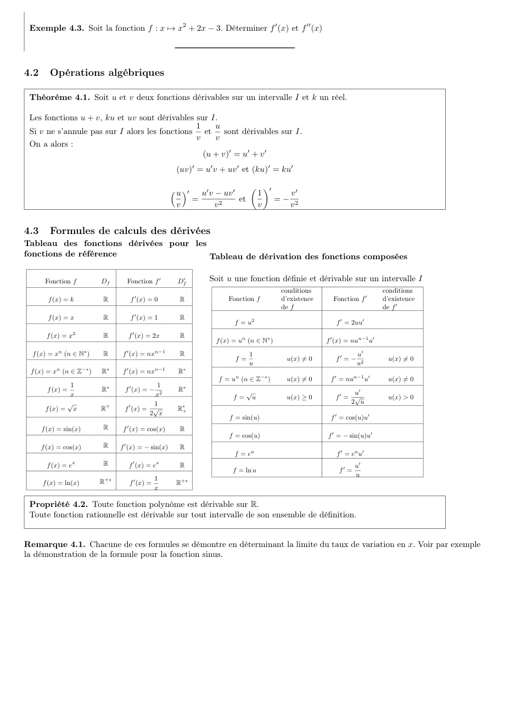

# Feuille-Cours0-Rappel_2021-2022_Algebre1_P1S1_KGuezguez.pdf

[Ouvrir l’original](https://drive.google.com/open?id=1ZjrgwHHJODCd-uN4D2C8Vuxta8WTxjS1) · Les deux lectures automatiques du PDF divergent sur les pages indiquées. Leur fac-similé accompagne le texte.

**Pages présentant un écart entre les deux extractions** — 18.

## Page 1

~~~text
Table des matières
1 Suites et récurrence                                                                                                            2
  1.1 Généralités . . . . . . . . . . . . . . . . . . . . . . . . . . . . . . . . . . . . . . . . . . . . . . . . . . . . . . .   2
      1.1.1 Définitions . . . . . . . . . . . . . . . . . . . . . . . . . . . . . . . . . . . . . . . . . . . . . . . . . . .     2
      1.1.2 Sens de variation des suites . . . . . . . . . . . . . . . . . . . . . . . . . . . . . . . . . . . . . . . . . .      2
      1.1.3 Suites majorées, minorées, bornées . . . . . . . . . . . . . . . . . . . . . . . . . . . . . . . . . . . . . .        3
  1.2 Suites Arithmétiques et Suite Géométriques . . . . . . . . . . . . . . . . . . . . . . . . . . . . . . . . . . . . .        3
      1.2.1 Suites arithmétiques . . . . . . . . . . . . . . . . . . . . . . . . . . . . . . . . . . . . . . . . . . . . . .      3
      1.2.2 Suites géométriques . . . . . . . . . . . . . . . . . . . . . . . . . . . . . . . . . . . . . . . . . . . . . .       4
  1.3 Raisonnement par récurrence . . . . . . . . . . . . . . . . . . . . . . . . . . . . . . . . . . . . . . . . . . . . .       4
  1.4 Convergence - Divergences de suites . . . . . . . . . . . . . . . . . . . . . . . . . . . . . . . . . . . . . . . . .       7
      1.4.1 Définitions . . . . . . . . . . . . . . . . . . . . . . . . . . . . . . . . . . . . . . . . . . . . . . . . . . .     7
      1.4.2 Propriétés sur les limites . . . . . . . . . . . . . . . . . . . . . . . . . . . . . . . . . . . . . . . . . . . .    8
      1.4.3 Théorèmes de comparaisons . . . . . . . . . . . . . . . . . . . . . . . . . . . . . . . . . . . . . . . . . .         9

2 Fonctions                                                                                                                        9
  2.1 Limite d’une fonction au voisinage de l’infini. . . . . . . . . . . . . . . . . . . . . . . . . . . . . . . . . . . . .      9
      2.1.1 Limite finie - Asymptote horizontale . . . . . . . . . . . . . . . . . . . . . . . . . . . . . . . . . . . . .         9
      2.1.2 Limite infinie - Asymptote Oblique . . . . . . . . . . . . . . . . . . . . . . . . . . . . . . . . . . . . . .        10
  2.2 Limite d’une fonction en un réel . . . . . . . . . . . . . . . . . . . . . . . . . . . . . . . . . . . . . . . . . . .      10
      2.2.1 Limite infinie - Asymptote verticale . . . . . . . . . . . . . . . . . . . . . . . . . . . . . . . . . . . . .        10
      2.2.2 Limite finie . . . . . . . . . . . . . . . . . . . . . . . . . . . . . . . . . . . . . . . . . . . . . . . . . . .    11
  2.3 Limites de référence . . . . . . . . . . . . . . . . . . . . . . . . . . . . . . . . . . . . . . . . . . . . . . . . . .    11
  2.4 Opérations Algébriques . . . . . . . . . . . . . . . . . . . . . . . . . . . . . . . . . . . . . . . . . . . . . . . .      12
      2.4.1 Cas général . . . . . . . . . . . . . . . . . . . . . . . . . . . . . . . . . . . . . . . . . . . . . . . . . . .     12
      2.4.2 Cas particuliers des formes indéterminées . . . . . . . . . . . . . . . . . . . . . . . . . . . . . . . . . .         13
  2.5 Théorème de comparaison . . . . . . . . . . . . . . . . . . . . . . . . . . . . . . . . . . . . . . . . . . . . . . .       14
  2.6 Limite d’une fonction composée en a . . . . . . . . . . . . . . . . . . . . . . . . . . . . . . . . . . . . . . . . .       15

3 Continuité d’une fonction                                                                                                       16
  3.1 Définition et premières propriétés . . . . . . . . . . . . . . . . . . . . . . . . . . . . . . . . . . . . . . . . . . .    16
  3.2 Continuité et opérations . . . . . . . . . . . . . . . . . . . . . . . . . . . . . . . . . . . . . . . . . . . . . . . .    16
  3.3 Le théorème des valeurs intermédiaires . . . . . . . . . . . . . . . . . . . . . . . . . . . . . . . . . . . . . . . .      16

4 Dérivation                                                                                                                      17
  4.1 Généralités . . . . . . . . . . . . . . . . . . . . . . . . . . . . . . . . . . . . . . . . . . . . . . . . . . . . . . .   17
  4.2 Opérations algébriques . . . . . . . . . . . . . . . . . . . . . . . . . . . . . . . . . . . . . . . . . . . . . . . . .    18
  4.3 Formules de calculs des dérivées . . . . . . . . . . . . . . . . . . . . . . . . . . . . . . . . . . . . . . . . . . . .    18
  4.4 Dérivée d’une fonction composée . . . . . . . . . . . . . . . . . . . . . . . . . . . . . . . . . . . . . . . . . . .       19
  4.5 Lien entre fonction et dérivée . . . . . . . . . . . . . . . . . . . . . . . . . . . . . . . . . . . . . . . . . . . . .    19

5 Fonctions Sinus et Cosinus                                                                                                      19
  5.1 Rappel : Repérage sur le cercle . . . . . . . . . . . . . . . . . . . . . . . . . . . . . . . . . . . . . . . . . . . .     19
      5.1.1 Définitions . . . . . . . . . . . . . . . . . . . . . . . . . . . . . . . . . . . . . . . . . . . . . . . . . . .     19
      5.1.2 Position des angles remarquables sur le cercle trigonométrique. . . . . . . . . . . . . . . . . . . . . . .           21
  5.2 Définition de sinus et cosinus . . . . . . . . . . . . . . . . . . . . . . . . . . . . . . . . . . . . . . . . . . . . .    21
  5.3 Formules Trigonométriques . . . . . . . . . . . . . . . . . . . . . . . . . . . . . . . . . . . . . . . . . . . . . .       21
  5.4 Fonctions Trigonométriques . . . . . . . . . . . . . . . . . . . . . . . . . . . . . . . . . . . . . . . . . . . . . .      22
      5.4.1 Définitions . . . . . . . . . . . . . . . . . . . . . . . . . . . . . . . . . . . . . . . . . . . . . . . . . . .     22
      5.4.2 Propriété . . . . . . . . . . . . . . . . . . . . . . . . . . . . . . . . . . . . . . . . . . . . . . . . . . . .     22
      5.4.3 Représentation graphique des fonctions trigonométriques . . . . . . . . . . . . . . . . . . . . . . . . . .           23
~~~

## Page 2

~~~text
1       Suites et récurrence
1.1      Généralités
1.1.1    Définitions

 Définition 1.1. Une suite numérique u est une fonction à valeur dans R telle que :
 Il existe un entier naturel n0 tel que l’ensemble de définition de u est l’ensemble des entiers n ≥ n0 .

Remarque 1.1. On nomme souvent les suites en utilisant les lettres u et pour écrire les images des entiers u(n), on écrit
de préférence un . On peut donc alors noter les suites
                                                            (un )n≥n0

Le terme initial de la suite est le terme un0 .
Le terme général de la suite est un .
L’entier n est appellé indice du terme un .

 Exemple 1.1. (exemples de suites)

      Nom                   Définition                Terme initial       Deuxième             Troisième

    (un )n≥0           ∀n ∈ N, un = 2n + 1.              u0 = 1             u1 = 3                 u2 = 5

    (hn )n≥0            ∀n ∈ N, hn = 2n .                h0 = 2             h1 = 4                 h2 = 8
                                      n
                                       1                                     1                      3
    (kn )n≥0       ∀n ∈ N, kn = 1 −         .             k0 = 0         k1 = = 0.5         k2 =      = 0.75
                                       2                                     2                      4
                                      1                                      1                  1
    (vn )n≥1           ∀n ∈ N∗ , vn = .                   v1 = 1         v2 = = 0.5         v3 =   ≈ 0.3333
                                      n                                      2                  3
                                          1                                  5                    9
    (wn )n≥0   w0 = 4 et ∀n ∈ N, wn+1 = wn + 1           w0 = 3          w1 = = 2.5         w2 = = 2.25
                                          2                                  2                    4
    (tn )n≥0           ∀n ∈ N, tn = (−2)n                 t0 = 1           t1 = −2                 t2 = 4
                                          1                                      3                  3
    (sn )n≥0    s0 = 3 et ∀n ∈ N, sn+1 = − sn .           s0 = 3        s1 = −     = −1.5    s2 =     = 0.75
                                          2                                      2                  4

Remarque 1.2. Une suite peut être définie :
   1. Soit à partir d’une formule en fonction de n, comme les fonctions suites (un ), (hn ), (vn ) de l’exemple 1.1
   2. Soit à partir d’une formule en fonction d’un ou plusieurs termes précédents (et éventuellement de n), comme les suites
       (wn ), (sn )) de l’exemple 1.1
Dans le premier cas, on peut calculer n’importe quel terme de la suite rapidement, dans le second cas, il faut calculer tous
les termes intermédiaires.

1.1.2    Sens de variation des suites

 Définition 1.2. (suite monotone)
 Une suite (un )n≥0 croissante est telle que pour tout n ∈ N, un+1 ≥ un .
 Une suite (un )n≥0 décroissante est telle que pour tout n ∈ N, un+1 ≤ un .
 Une suite est monotone si elle est croissante ou si elle est décroissante.

Remarque 1.3. La suite est strictement croissante ou décroissante lorsque l’inégalité est stricte.

 Exemple 1.2. Les suites (un ), (hn ), (kn ) sont croissantes, les suites (vn ), (wn ) sont décroissantes, les suites
 (tn ), (sn ) ne sont ni croissantes, ni décroissantes.

 Propriété 1.1. Soit une suite (un )n∈N définie de façon explicite : ∀n ∈ N, un = f (n).
 Si la fonction f est croissante sur [0; +∞[ la suite est croissante, si la fonction f est décroissante sur [0; +∞[, la
 suite est décroissante.
~~~

## Page 3

~~~text
On dispose donc de plusieurs méthodes pour étudier le sens de variation d’une suite :
   — étudier le signe de la différence un+1 − un
                                                            un+1
   — pour une suite à termes strictement positifs, étudier        à 1.
                                                             un
   — si la suite est du type un+1 = f (n), on peut étudier le sens de variation de f , puis en déduire celui de la suite (mais
      pas dans le cas où un+1 = f (un ) la suite wn de l’exemple 1.1 est un contre-exemple).
Remarque 1.4. Pour démontrer qu’une suite est croissante, il faut démontrer que pour tout n, un+1 ≥ un . Il ne suffit pas
de constater que les premiers termes sont en ordre croissant.
Par contre pour démontrer qu’une suite n’est pas croissante il suffit de trouver deux termes en ordre décroissant.

1.1.3    Suites majorées, minorées, bornées

 Définition 1.3. (suites majorées, minorées, bornées)
 • Par définition, une suite (un )n≥0 majorée est telle qu’il existe un réel M tel que pour tout entier naturel n,
   un ≤ M
 • Par définition, une suite (un ) minorée est telle qu’il existe un réel m tel que pour tout entier naturel n,
   m ≤ un .
 • Par définition, une suite bornée est majorée et minorée.

 Exemple 1.3. On se réfère aux suites de l’exemple 1.1
      1. La suite (sn ) est majorée par 1 et 0.
      2. La suite (un ) n’est pas majorée.
      3. La suite (kn ) et majorée par 1 et minorée par 0, elle est donc bornée.

                                                            1 1 1          1
Exercice 1.1. Défi : Soit la suite (un ) définie par un = 1 + + + + . . . + . Est-elle bornée ?
                                                            2 3 4          n
(on pourra programmer le calcul des termes successifs pour tester).

1.2     Suites Arithmétiques et Suite Géométriques
1.2.1    Suites arithmétiques

 Définition 1.4. Une suite (un )n≥0 est dite “arithmétique” lorsqu’il existe un réel r tels que pour tout entier
 naturel n un+1 = un + r (relation de récurrence).

 Le réel r s’appelle la raison de la suite arithmétique.

u0             u1            u2              u3
        +r            +r            +r            +r
Remarque: Montrer qu’une suite est arithmétique revient à montrer que un+1 −un est constant (“common difference sequence”)

 Propriété 1.2. (terme général) Si (un )n≥0 est une suite arithmétique de raison r alors
 pour tout entier naturel n, un = u0 + nr ← formule du terme de rang n en fonction de n
 Plus généralement, pour tout entier naturel k, un = uk + (n − k)r

 Propriété 1.3. Une suite (un )n≥0 est arithmétique si et seulement si elle est définie par un = an + b.
 La raison de la suite un est a. Le premier terme u0 = b.

 Propriété 1.4. Soit une suite arithmétique (un )n∈N .
                                               n
                                              X        n+1
 La somme de Sn = u0 + u1 + u2 + . . . + un =     ui =     (u0 + un ).
                                              i=0
                                                        2
 D’une façon générale, soit m et p deux entiers tels que m > p, la somme des termes consécutifs des termes de
 um à up est le produit de la moyenne des deux termes extrêmes (um et up ) et du nombre de termes.
~~~

## Page 4

~~~text
 Propriété 1.5. (sens de variation)
 Soit un réel a. Soit (un )n≥0 une suite arithmétique de raison a.
 Si a > 0, la suite est strictement croissante.
 Si a = 0 la suite est constante.
 Si a < 0, la suite est strictement décroissante.

1.2.2   Suites géométriques

 Définition 1.5. Une suite (un )n≥0 est dite “géométrique” lorsque il existe un entier naturel n0 et un réel q tels
 que pour tout entier naturel n, un+1 = qun (relation de récurrence).
 Le réel q s’appelle la “raison” de la suite géométrique.

u0            u1            u2               u3
        ×q          ×q            ×q               ×q
Remarque: Lorsque l’on est assuré que les termes sont non nuls, montrer qu’une suite est géométrique revient à montrer que
un+1 /un est constant (“common ratio sequence”)

 Propriété 1.6. (terme général) Si (un )n≥0 est une suite géométrique de raison q alors
 pour tout entier naturel n, un = u0 q n ← formule du terme de rang n en fonction de n
 Plus généralement, pour tout entier naturel k , un = uk q n−k .

 Propriété 1.7. (admise)
 Soit une suite géométique de raison q 6= 1, (vn )n∈N .
                                                 n
                                               X             1 − q n+1
 La somme de Sn = v0 + v1 + v2 + . . . + vn =       v i = v0           .
                                               i=0
                                                               1−q

Remarque 1.5. Pour deux entiers n et p tels que p < n,
                                       n
                                       X               1 − q n−p+1
Sn = vp + vp+1 + vp+2 + . . . + vn =         vi = vp               .
                                       i=p
                                                          1−q

 Propriété 1.8. (sens de variation)
 Soit un réel q non nul. Soit (un )n≥0 une suite géométrique de raison q.
 Si q > 1, si u0 > 0, la suite est strictement croissante, si u0 < 0 la suite est strictement croissante.
 Si 0 < q < 1, si u0 > 0 la suite est strictement décroissante, si u0 < 0 la suite est strictement décroissante.
 Si q < 0, la suite n’est pas monotone.

 Exemple 1.4. En se référant à l’exemple 1.1
 La suite (hn ) est géométrique et croissante car le premier terme est positif et la raison q = 2 > 1.
 Les suites (tn ) et (sn ) sont géométriques mais ni croissantes, ni décroissantes car leurs raisons, respectivement
        1
 -2 et − sont négatives.
        2

1.3     Raisonnement par récurrence

 Propriété 1.9. (Récurrence simple).
 Soit P( une propriété portant sur les entiers naturels.
 Soit n0 un entier naturel.
 On suppose que P(n0 ) est vraie.
 On suppose également que pour tout entier n ≥ n0 , si P(n) est vraie, alors P(n + 1) est vraie.
 (cela revient à dire que l’implication P(n) ⇒ P(n + 1) est vraie)
 Alors pour tout entier n ≥ n0 , la proposition P(n) est vraie.
~~~

## Page 5

~~~text
Voici comment doit se faire un raisonnement par récurrence et comment il doit être rédigé :
  1. On énonce clairement la propriété P étudiée.
  2. On vérifie que la propriété P est vraie pour n0 (Initialisation)
  3. On se donne un entier n ≥ n0 quelconque et on suppose que P(n) est vraie (Hypothèse de récurrence).
     On démontre alors que P(n + 1) est vraie (Hérédité)
  4. On conclut en annonçant que, par récurrence, la propriété est vraie pour tout entier n ≥ n0 .
Remarque 1.6. Il faut voir le principe de récurrence comme une échelle que l’on essaye de monter :
Si l’on est capable de poser le pied sur le premier barreau et que l’on est capable de passer d’un barreau au suivant, alors on
est capable de monter l’échelle en entier. Si l’une des deux conditions manque, alors nous ne pouvons pas monter l’échelle.
D’où l’importance de vérifier l’initialisation ET l’hérédité.

                                                                                                        n(n + 1)
 Exemple 1.5. Démontrer par récurrence que pour tout N ∈ N∗ , on a l’égalité 1 + 2 + 3 + + n =
                                                                                                           2
                                                                        n(n + 1)
    1. Soit P(n) la propriété définie sur N∗ par 1 + 2 + 3 + + n =
                                                                           2
                          1(1 + 1)
    2. Nous avons 1 =              , donc P(1) est vraie.
                              2
    3. Soit un entier n ∈ N∗ tel P(n) est vraie. Démontrons alors que P(n + 1) est vraie aussi. Nous devons
       donc montrer que
                                                                          (n + 1)(n + 2)
                                        1 + 2 + 3 + · · · + n + (n + 1) =
                                                                                2
       Nous avons supposé que P(n) est vrai, donc on peut écrire :
       1 + 2 + · · · + n + (n + 1) = (1 + 2 + · · · + n) + (n + 1)
                                 n(n + 1)
                                 =        + (n + 1)
                                     2
                                 n(n + 1) + 2(n + 1)
                               =
                                          2
                                 (n + 1)(n + 2)
                               =
                                       2
       Donc l’implication P(n) ⇒ P(n + 1) est vraie.
                                                                                                     n(n + 1)
    4. Nous avons donc montré par récurrence que pour tout entier n ∈ N∗ , 1 + 2 + 3 + · · · + n =
                                                                                                        2

Une erreur classique est d’oublier l’initialisation. L’exemple suivant est un exemple de cette erreur classique.
~~~

## Page 6

~~~text
 Exemple 1.6 (FAUX !). Démontrer par récurrence que pour tout n ∈ N∗ , on a l’égalité (fausse) 1+2+3+ +n =
 n2 + n + 1
     2
                                                                n2 + n + 1
   1. Soit P(n) la propriété définie sur N∗ : 1 + 2 + 3 + + n =
                                                                    2
   2. L’élève oublie l’initialisation.
    3. Soit un entier n ∈ N∗ tel P(n) est vraie. Démontrons alors que P(n + 1) est vraie aussi. Nous devons
       donc montrer que

                                                                    (n + 1)2 + (n + 1) + 1
                                     1 + 2 + 3 + + n + (n + 1) =
                                                                              2
                                (n + 1)2 + (n + 1) + 1   n2 + 3n + 3
      La fraction est égale à                          =             .
                                          2                   2
      De plus
      1 + 2 + · · · + n + (n + 1) = (1 + 2 + · · · + n) + (n + 1)
                                n2 + n + 1
                                 =         + (n + 1)
                                    2
                                n2 + n + 1 + 2n + 2
                              =
                                         2
                                n2 + 3n + 3
                              =
                                     2
                                (n + 1)2 + (n + 1) + 1
                              =
                                          2
      Donc l’implication P(n) ⇒ P(n + 1) est vrai.
                                                                                                n2 + n + 1
    4. Nous avons donc montré par récurrence que pour tout entier n ∈ N∗ , 1 + 2 + 3 + + N =
                                                                                                     2
      Vous l’aurez compris, il y a une erreur. Un calcul simple permet de montrer que P(1) est fausse puisqu’elle
                      3
      stipule que 1 = . Le premier barreau étant cassé, nous ne pouvons pas monter à l’échelle.
                      2

Remarque 1.7. Pour montrer une propriété universelle (∀), c’est à dire montrer que tous les éléments d’un ensemble ont
cette propriété, on prend un élément quelconque de l’ensemble et on démontre qu’il a la propriété.
On utilise souvent une rédaction du type “Soit....”.

 Exemple 1.7. Par exemple :
 « Pour tout quadrilatère, le quadrilatère non croisé formé par les milieux des segments est un parallélogramme.
 »
 Soit un quadrilatère quelconque, nommons les sommets ABCD et les milieux I, J, K et L respectivement de
 [AB], [BC],[CD] et [DA].
                                                          −→ 1 −→                 −−→ 1 −→         −
                                                                                                   → −→
 D’après la propriété de la droite des milieux dans ABC, IJ = AC. De meme LK = AC donc IJ = AC.
                                                                 2                      2
 Donc IJKL est un parallélogramme.
 Conclusion «Pour tout quadrilatère, le quadrilatère non croisé formé par les milieux des segments est un
 parallélogramme.»

 Exemple 1.8. Autre exemple :
 « La somme de 3 entiers consécutifs est un multiple de 3.»
 ("pour tout 3 entiers consécutifs, etc...")
 Soit trois entiers consécutifs (quelconques).
 On note n le plus petit des trois. La somme est alors n + (n + 1) + (n + 2) = 3n + 3 = 3(n + 1) donc est un
 multiple de 3.
 D’où la propriété annoncée.

Remarque 1.8. Pour montrer P ⇒ Q que faut-il montrer ?
~~~

## Page 7

~~~text
                                                 Table de vérité de l’implication

                                                          P     Q   P ⇒Q

                                                          V     V     V

                                                          V     F     F

                                                          F     V     V

                                                          F     F     V

Donc si P est faux, l’implication est toujours vraie (un P faux peut donner n’importe : quoi Q vraie et Q faux conviennent).
Pour montrer l’implication, il suffit de montrer qu’elle n’est pas fausse, cela n’arrive que dans un seul cas : quand P est vraie
et Q est faux. Donc on va vérifier que «si P est vraie, Q est vraie aussi».
Donc pour montrer P ⇒ Q on rédige :«Supposons P vraie, montrons Q vraie.»

    Exemple 1.9. Si n est impair alors n2 est impair.

    Supposons n pair, n = 2 × p + 1 avec p ∈ N. Donc n2 = 2(2p2 + 2p) + 1 donc n2 est impair.
    L’implication est donc vraie.

Exercice 1.2. Démontrer une formule

Soit la suite (un )n∈N définie par :

u0 = 2 et ∀n ∈ N, un+1 = 3un − 5.
                                                1
Démontrer par récurrence que ∀n ∈ N, un =         (5 − 3n )
                                                2
Remarque 1.9. Penser à utiliser la calculatrice (application suite) pour vérifier que la formule est correcte
Solution
                                                  1
Pour tout n ∈ N soit la propriété P(n) : un =       (5 − 3n )
                                                  2
  1             1
•   (5 − 30 ) = (5 − 1) = 2 = u0 donc P(0) est vraie.(Vérification au premier rang)
  2             2
                                                                 1
• Soit n ∈ N. On suppose que P(n) est vraie. C’est à dire un = (5 − 3n ).
                                                                 2
  On veut montrer que pour tout n, si P(n) est vraie, on a P(n + 1) vraie. On choisit donc un n quelconque, on suppose
  que P(n) est vraie et on va essayer de montrer que P(n + 1) est vraie. Puisque n était quelconque, on a bien démontré
  que pour tout n, si P(n) est vraie, P(n + 1) est vraie.                                                          
                                                                  1                                      1
  On veut montrer que P(n + 1) est vraie, c’est à dire un+1 = (5 − 3n+1 ) On a un+1 = 3un − 5 = 3          (5 − 3n ) − 5
                                                                  2                                      2
     15 3n+1          5 3n+1
  =     −        −5 = −
      2       2       2      2
  Donc P(n + 1) est vraie.
                                                        1
• Donc par récurrence, pour tout entier naturel n, un = (5 − 3n ).
                                                        2

1.4      Convergence - Divergences de suites
1.4.1     Définitions

    Définition 1.6. Une suite numérique admet le réel l comme limite lorsque pour tout intervalle ouvert qui
    contient l, il existe un entier n0 tel que pour tous les entiers n > n0 , un appartient à I.
    Cela revient, en écriture symbolique, à :

                                   ∀ ∈ R > 0, ∃n0 , ∀n ∈ N, n ≥ n0 , un ∈]l − ; l + [
~~~

## Page 8

~~~text
 Définition 1.7. Une suite numérique admet pour limite +∞ (respectivement −∞) lorsque pour tout intervalle
 ouvert I de la forme ]a; +∞[ (de la forme ] − ∞; a[), il existe un entier n0 tel que pour tous les entiers n > n0 ,
 un appartient à I.
 Cela revient, en écriture symbolique, à :

                                      ∀a ∈ R, ∃n0 , ∀n ∈ N, n ≥ n0 , un ∈]a; +∞[

 Définition 1.8. Par définition,
 Une suite convergente admet une limite finie.
 Une suite divergente est une suite qui n’est pas convergente.

Remarque:
Il y a deux suites de type convergentes :
                                                                         
                                                                          1
    — Les suites monotones. Dans l’exemple 1.1 : (kn ), (vn ), (wn ) ou
                                                                          n n∈N∗
                                                                                  n 
                                                                                  1
    — Les suites qui ne sont pas monotones. Dans l’exemple 1.1 : (sn ) ou       −
                                                                                  2     n∈N
Il y a deux types de suites divergentes :
    — les suites qui ont pour limite +∞ ou −∞. Dans l’exemple 1.1 : (un ), (hn ) ou (n)n∈N∗
                                                                             n
    — les suites qui n’ont pas de limite. Dans l’exemple 1.1 : (tn ) ou ((−2) )n∈N

                                            UNE LIMITE                    PAS DE LIMITE

                                        FINIE              INFINIE

                                CONVERGENTE                        DIVERGENTE

1.4.2   Propriétés sur les limites

 Propriété 1.10. Si une suite admet une limite (finie ou infinie), alors celle-ci est unique.

                                                                                                         n 
                                                                                                       1
Remarque 1.10. Une suite convergente n’est pas nécessairement monotone. Par exemple                  −            .
                                                                                                       2

 Propriété 1.11. Si une suite est croissante et admet pour limite l, alors tous les termes de la suite sont inférieurs
 ou égaux à l.

 Théorème 1.1. (Convergence des suites monotones bornées)
 Toute suite monotone et bornée converge.
 Autrement dit :
 • Si (un ) est une suite croissante et majorée alors elle converge.
 • Si (un ) est une suite décroissante et minorée alors elle converge.

 Propriété 1.12. Soit f une fonction continue sur un intervalle I de R à valeur dans I et soit (un ) une suite telle
 que u0 ∈ I et ∀n ∈ N, un+1 = f (un ).
 Si (un ) converge vers une limite l alors l vérifie l’équation l = f (l)

 Théorème 1.2. (Divergence des suites monotones non bornées)
 Si (un ) est une suite croissante et non majorée alors lim un = +∞.
                                                        n→+∞
 Si (un ) est une suite décroissante et non minorée alors lim un = −∞.
                                                           n→+∞
~~~

## Page 9

~~~text
1.4.3    Théorèmes de comparaisons

 Théorème 1.3. (Théorème des gendarmes ou de l’encadrement)
 Soit (un ), (vn ), (wn ) des suites et un réel l tels que :
    — Il existe p tel que pour tout n ≥ p, un ≤ vn ≤ wn .
    — (un ) est convergente et lim un = l
                                  n→+∞
      — (wn ) est convergente et lim wn = l
                                  n→+∞
 La suite (vn ) est convergente et lim vn = l
                                     n→+∞

 Propriété 1.13. Théorème de comparaison
 Soit (un ) et (vn ) deux suites telles que :
      1. un ≤ vn à partir d’un certain rang.
      2. un tend vers +∞ quand n tend vers +∞.
 alors vn tend vers +∞ quand n tend vers +∞.

2       Fonctions
2.1     Limite d’une fonction au voisinage de l’infini.
2.1.1    Limite finie - Asymptote horizontale
On énoncera les propriétés seulement pour x → +∞ (transposition facile pour x → −∞).
Soit un réel m et f une fonction définie sur [m; +∞[

 Définition 2.1. Soit l un réel.
 Dire que f (x) tend vers l quand x tend vers +∞ signifie que tout intervalle ouvert I contenant l, il existe un
 réel x0 tel que pour tout réel x > x0 , f (x) ∈ I.
 Cela revient en écriture symbolique à :

                               ∀ > 0, ∃A ∈ R, ∀x ∈ R, x ∈]A; +∞[⇒ f (x) ∈]l − ; l + [

On note lim f (x) = l
          x→+∞

                                                         y

                                                     1
                                                                                       x
                                                     0       1

                          1
 Exemple 2.1.       lim       +1=1
                   x→+∞ x

 Définition 2.2. Quand lim f (x) = l on dit que la droite d’équation y = l est une asymptote horizontale
                              x→+∞
 à la courbe Cf vers +∞.
~~~

## Page 10

~~~text
2.1.2   Limite infinie - Asymptote Oblique

 Définition 2.3. Dire que f (x) tend vers +∞ quand x tend vers +∞ signifie que pour tout réel M , , il existe
 un réel x0 tel que pour tout réel x > x0 , f (x) > A
 Cela revient en écriture symbolique à :

                              ∀M ∈ R, ∃A ∈ R/∀x ∈ R, x ∈]A; +∞[⇒ f (x) ∈]M ; +∞[

 Dire que f (x) tend vers −∞ quand x tend vers +∞ signifie que pour tout réel M , il existe un réel x0 tel que
 pour tout réel x > x0 , f (x) < A.
 Cela revient en écriture symbolique à :

                             ∀M ∈ R, ∃A ∈ R/∀x ∈ R, x ∈]A; +∞[⇒ f (x) ∈] − ∞; M [

                                                                 y

                                                             1
                                                                                   x
                                                             0       1

                       x2
 Exemple 2.2.      lim    = +∞
                  x→+∞ 2

 Définition 2.4. Soit a et b deux réels , a non nul. Quand               lim f (x) − (ax + b) = 0 on dit que la droite
                                                                     x→+∞
 d’équation y = ax + b est une asymptote oblique à la courbe Cf vers +∞.

Remarque 2.1. Attention : toute courbe représentative d’une fonction “définie” en +∞ n’admet pas nécessairement une
asymptote : la parabole (fonction carré)

                                 y

                             1                                                                      x
                             0       1

                                                     x2 − 3x + 1                               c
 Exemple 2.3. Soit f définie sur R \ {3} par f (x) =             , on écrit f (x) = ax + b +      ; on trouve
                                                        x−3                                  x−3
                1                                   1                                                1
 f (x) = x +       . Comme lim f (x) − x = lim          = 0 et également lim f (x) − x = lim             =0
              x−3           x→+∞            x→+∞  x−3                      x→−∞              x→−∞  x−3
 la droite d’équation y = x est une asymptote oblique à la courbe Cf

2.2     Limite d’une fonction en un réel
2.2.1   Limite infinie - Asymptote verticale
Soit un réel a. Soit un intervalle I de R tel que a ∈ I. Soit f une fonction définie sur I en excluant éventuellement le point a.
~~~

## Page 11

~~~text
 Définition 2.5. Dire que f (x) tend vers +∞ quand x tend vers a signifie que pour tout réel M , il existe un
 intervalle I contenant a tel que pour tout réel de I, f (x) > M .
 Cela revient en écriture symbolique à :

                       ∀M ∈ R, ∃α ∈ R, α > 0/∀x ∈ R, x ∈]a − α; a + α[⇒ f (x) ∈]M ; +∞[

 Dire que f (x) tend vers −∞ quand x tend vers a signifie que pour tout réel M , il existe un intervalle I contenant
 a tel que pour tout réel de I, f (x) < M .
 Cela revient en écriture symbolique à :

                       ∀M ∈ R, ∃α ∈ R, α > 0/∀x ∈ R, x ∈]a − α; a + α[⇒ f (x) ∈] − ∞; M [

On définit de la même manière les limites à gauche ou à droite de a.

                                                                   y

                                                               1                       x
                                                               0       1

 Définition 2.6. Quand lim f (x) ou lim f (x) ou lim f (x) est infinie on dit que la droite d’équation x = a
                                                             x→a
                           x→a                x→a
                            x>a               x<a
 est une asymptote verticale à la courbe représentative C.

2.2.2   Limite finie

 Définition 2.7. Soit l un réel.
 Dire que f (x) tend vers l quand x tend vers a signifie que pour tout intervalle J contenant l, il existe un
 intervalle I contenant a tel que pour tout réel de I, f (x) appartient à J.

 Cela revient en écriture symbolique à :

                    ∀ ∈ R,  > 0∃α ∈ R, α > 0, ∀x ∈ R, x ∈]a − α; a + α[⇒ f (x) ∈]l − ; l + [

2.3     Limites de référence
                                                              ∀n ∈ N∗
                                                                                   √
                                        lim xn = +∞                         lim        x = +∞
                                      x→+∞                                 x→+∞

                                  Si n pair      lim xn = +∞       Si n impair         lim xn = −∞
                                              x→−∞                                  x→−∞
                                                    1                                  1
                                           lim          =0                    lim          =0
                                        x→−∞ x                              x→+∞ x

                                                    1                                  1
                                           lim          =0                   lim           =0
                                       x→−∞ xn                              x→−∞ xn

                                               1                                   1
                                       lim       = −∞                       lim      = +∞
                                       x→0
                                       x<0
                                              xn                            x→0
                                                                            x>0
                                                                                  xn

                                           lim ex = 0                       lim ex = +∞
                                        x→−∞                               x→+∞

                                       lim ln x = −∞                       lim ln x = +∞
                                       x→0                                 x→+∞
~~~

## Page 12

~~~text
2.4     Opérations Algébriques
2.4.1    Cas général
                                                                                                                                  f
Les théorèmes qui suivent, présentés sous forme de tableaux, permettent de connaître les limites des fonctions f + g, f g,
                                                                                                                                  g
lorsque l’on connaît celle de f et celle de g.
Les limites des fonctions f et g sont prises soit en +∞ soit en −∞, soit en un réel a.
l et l0 sont des nombres réels. Les cases barrées signalent les cas ou il n’y a pas de conclusion en général, on dit qu’il s’agit de
formes indéterminées. Dans tous les autres cas, les résultats, que nous admettrons, sont intuitifs et faciles à retenir.

Limite d’une somme
      Si f a pour limite                        l        l            l        +∞        −∞       +∞

    et si g a pour limite                       l0      +∞        −∞           +∞        −∞       −∞

 alors f + g a pour limite                    l + l0    +∞        −∞           +∞        −∞         ?

Limite d’un produit
   si f a pour limite       l           l>0    l>0      l<0     l<0        +∞    +∞      −∞             0

  et si g a pour limite     l   0
                                        +∞      −∞      +∞       −∞        +∞    −∞      −∞       +∞ ou − ∞

 alors f g a pour limite   ll0          +∞      −∞      −∞       +∞        +∞    −∞      +∞             ?

Limite d’un quotient
Cas où la limite d’un dénominateur g n’est pas nulle.
   si f a pour limite               l               l        +∞           +∞    −∞       −∞        −∞ ou + ∞

  et si g a pour limite    l0 6= 0       −∞ ou + ∞           l0 > 0   l0 < 0    l0 > 0   l0 < 0    −∞ ou + ∞
       f                        l
 alors   a pour limite                           0           +∞           −∞    −∞       +∞                 ?
       g                        l0
~~~

## Page 13

~~~text
Cas où la limite d’un dénominateur g est nulle.
   si f a pour limite     l > 0 ou + ∞     l > 0 ou + ∞       l < 0 ou − ∞    l < 0 ou − ∞     0

  et si g a pour limite   0 en restant     0 en restant       0 en restant    0 en restant     0

                            positive         négative             positive         négative
       f
 alors   a pour limite        +∞               −∞                  −∞                +∞        ?
       g

                                                                                              A
                                                                   Etude des limites de
                                                                                              B
                                                              A
                                                    B              −∞        m<0       0      m>0   +∞

                                                        −∞          FI        0        0       0    FI
                                                                              m                m
                                                     l<0           +∞                  0            −∞
                                                                              l                l
                                                          0         sgn      sgn       FI     sgn   sgn
                                                                              m                m
                                                     l>0           −∞                  0            +∞
                                                                              l                l
                                                        +∞          FI        0        0       0    FI
                                           sgn signifie qu’il faut étudier le signe avant de conclure.
                                           F I signifie forme indéterminée : il faut écrire l’expression
                                                       différemment pour pouvoir conclure.

2.4.2    Cas particuliers des formes indéterminées
Les cas de formes indéterminées nécessiteront une étude particulière chaque fois qu’ils se présenteront. Ces cas sont au nombre
de quatre :
                                                                      ∞       0
                                             "∞ − ∞" , "0 × ∞" , " " , " "
                                                                      ∞       0
Méthodes Comment lever une forme indéterminée :

Dans les exercices qui suivent on admettra l’existence d’une limite.
           ∞
Le cas “     ”
           ∞
• On peut factoriser le numérateur et le dénominateur par le terme le plus “influent”.

 Exemple 2.4. Déterminer les limites (si elles existent) des expressions suivantes :
 1 − 2x
        en +∞.
  x−5
                                  
                           1       1
                        x    −2      −2
              ∗ 1 − 2x     x       x
 On a ∀x ∈ R ,         =       =       .
                 x−5          5        5
                        x 1−       1 −
                              x        x
 Donc la limite est -2

  1 − x3
         en +∞.
 1 + 2x2
                                      
                                  13          1
                     3   x 1− 3           1− 3
            ∗ 1−x                x           x
 On a ∀x ∈ R ,         =              =x        donc la limite est +∞
                                           1
                            
               1 + 2x2        1
                         x2      + 2         + 2
                              x2          x2

 Propriété 2.1. Soit une fonction polynôme P de monôme de plus haut degré axn (a réels non nul, n un entier
 naturel)
 P admet en +∞ (respectivement en −∞) une limite qui est égale à la limite de axn .
~~~

## Page 14

~~~text
 Propriété 2.2. Soient R une fonction rationnelle d’ensemble de définition D et deux polynômes P et Q tels que
                 P (x)
 ∀x ∈ D, R(x) =        .
                 Q(x)
 Sachant que P et Q admettent pour monômes de plus haut degré respectivement axn et bxm (a, b réels non nuls,
 n, m deux entiers naturels).
                                                                                      axn
 R admet en +∞ et −∞ une limite qui est égale à la limite de la fonction rationnelle m .
                                                                                     bx

Remarque: Cette propriété ne s’applique qu’à un quotient de polynômes.
Le cas "∞ − ∞"

• On peut factoriser par le terme le plus “influent”
• Pour les expressions avec radicaux, on peut utiliser l’expression conjuguée (voir Section 4)

 Exemple 2.5. 3x5 −2x4 + x8 en −∞.
                     3      1
 3x5 − 2x4 + x8 = x8    − 2    + 1
                     x3     x4

        0
Le cas “ ”
        0
• Lorsqu’on prend la limite en a on peut factoriser (x − a) au numérateur et dénominateur, puis simplifier.
• Pour les expressions avec des radicaux, on peut utiliser l’expression conjuguée (voir Section 4)

                  x2 − 2x + 1
 Exemple 2.6.                 en 1.
                     x2 − 1
 x2 − 2x + 1        (x − 1)2        x−1
              =                 =       .
    x2 − 1       (x + 1)(x − 1)     x+1
  x2 − x
           en 1.
 −2x + 2
 x2 − 2x + 1      (x − 1)2      x
              =             =     .
    x2 − 1       −2(x − 1)    −2

2.5     Théorème de comparaison
l et l0 désignent deux réels. a est un réel ou +∞ ou −∞.

 Théorème 2.1. (théorème de comparaison) Soit f et g deux fonctions telles que pour tout x assez proche de
 a, f (x) ≤ g(x).
 Si lim f (x) = l et lim g(x) = l0 alors l ≤ l0 .
      x→a           x→a

 Théorème 2.2. Soit f et g deux fonctions telles que pour tout x assez proche de a, f (x) ≤ g(x).
 Si lim f (x) = +∞ alors lim g(x) = +∞.
      x→a                 x→a
 Si lim g(x) = −∞ alors lim f (x) = −∞.
      x→a                 x→a

 Exemple 2.7.      lim x cos x − x3
                 x→+∞
 On a ∀x ∈ R+ , x cos x − x3 < x − x3 . Donc comme lim x − x3 = −∞, lim x cos x − x3 = −∞
                                                     x→+∞                  x→+∞

 Théorème 2.3. (Théorème des gendarmes)
 Soit f , g et h trois fonctions telles que pour tout x assez proche de a, f (x) ≤ g(x) ≤ h(x).
 Si f et h admettent une limite en a égale à l alors g admet une limite en a et lim g(x) = l.
                                                                                  x→a

Remarque 2.2. Ce théorème est souvent utiliser avec des limites utilisant des fonctions trigonométrique (sin, cos et tan)
~~~

## Page 15

~~~text
2.6     Limite d’une fonction composée en a

 Définition 2.8. Soit I et J deux intervalles.
 Soit g une fonction définie sur J et u une fonction définie sur I telles que
 pour tout x de I, u(x) appartient à l’intervalle J.
 La fonction f définie pour tout élément de I par f : x 7→ g(u(x)) est appelée "composée" de u suivi de g.

                                     u               g
Cela correspond au “montage” : x → u(x) = U → g(U ) = g(u(x))
Remarque 2.3. On la note g ◦ u.
On considère les fonctions g et u telles que leur composée existe g(u)

 Théorème 2.4. a, b c sont des réels ou bien ils désignent +∞ ou −∞.
 Si lim u(x) = b et que lim g(U ) = c alors lim g(u(x)) = c
      x→a               U →b                     x→a

                                                 r
                                              1
 Exemple 2.8. On veut déterminer lim            +4
                                         x→+∞ x
                                g √
                                         r
                   u 1                      1
 On décompose x → + 4 = U → U =               +4
                      x                     x
                             1                 √
 On calcule les limites lim    + 4 = 4 et lim U = 2
                        x→+∞ x            U →4
                             r
                               1
 d’où par composition lim        +4=2
                        x→+∞   x

Formes indéterminées avec radicaux
On utilise la propriété suivante :
                                         √                                  √
 Propriété 2.3. Pour tout x ∈ R+ ,           x2 = x et pour tout x ∈ R− ,       x2 = −x

Déterminer les limites (si elles existent) des expressions suivantes.
     x2
•√          en +∞ et −∞.
    x2 + 2
                 x2             x2               x
Si x positif, √       =                != r           ! donc la limite en +∞ est +∞
                 2
                x +2
                              r
                                     2              2
                         x      1+              1+
                                     x              x
                 x2              x2                  x
Si x négatif, √       =                  ! =− r            ! donc la limite en −∞ est +∞
                  2
                x +2
                                r
                                       2                 2
                          −x       1+               1+
                                       x                x
 p
• x2√+ 1 − 2x en +∞
•x − x en −∞.
 √          √
• x + 1 − x en +∞.
 p
•p 4x2 + 1 − 2x en +∞
   x2 + 2 − 2x + 3 en +∞ et en −∞.
p
   x2 + 2 − x en +∞.
       √
 −x + x
           en 1.
   x−1
       p                     3
  lim    4x2 + 3x + 1 − 2x =
x→+∞                         4

 Propriété 2.4. (Quelques limites à connaître)

                                  sin x                  ex − 1                 ln(x + 1)
                               lim      =1           lim        =1      lim               =1
                               x→0 x                 x→0    x           x→0         x
~~~

## Page 16

~~~text
3     Continuité d’une fonction
3.1   Définition et premières propriétés

 Définition 3.1. Soit a un réel, soit une fonction f définie sur un intervalle I contenant a.
 • f est continue en a quand lim f (x) = f (a)
                               x→a

 • f est continue sur un intervalle I lorsque f est continue pour tout a de I.

Remarque 3.1. Lorsque la courbe représentative de f se trace sans lever le crayon (ne présente pas de saut) f est continue
sur I.

3.2   Continuité et opérations

 Propriété 3.1. (admise)
 Les fonctions de référence sont continues sur chaque intervalle de leur ensemble de définition.
 Les sommes, produits, quotients ou composées des fonctions continues sont continues sur chaque intervalle de
 leur ensemble de définition.
 En particulier, les fonctions polynômes et les fonctions rationnelles sont continues sur chaque intervalle de leur
 ensemble de définition.

3.3   Le théorème des valeurs intermédiaires
                        y                               y                            y

                                             k                               k                            k

                                           x                               x                            x

                   Fonctions continue monotone           Fonction continue           Fonction discontinue

 Théorème 3.1. (Théorème des valeurs intermédiaires)
 Soit f une fonction définie et continue sur un intervalle [a; b].
 Pour tout réel k compris entre f (a) et f (b), il existe au moins un réel c compris entre a et b tel que f (c) = k.

Remarque 3.2. Ce théorème peut être démontré à l’aide des suites adjacentes.

 Propriété 3.2. (image d’un intervalle par une fonction continue)
 Soit f un fonction définie et continue sur un intervalle [a; b].
 L’image d’un intervalle est un intervalle.

 Théorème 3.2. Soit f une fonction continue et strictement monotone sur [a; b].
 Pour tout réel k compris entre f (a) et f (b), l’équation f (x) = k admet une solution unique dans [a; b] (il existe
 un unique réel c dans [a; b] tel que f (c) = k).
~~~

## Page 17

~~~text
           x            a             c                 b                 x             a             c       b
                                                      f (b)                           f (a)
    var. de x 7→ f                    k                             var. de x 7→ f                    k
                      f (a)                                                                                  f (b)

                     Fonctions croissante                                           Fonctions décroissante

Remarque 3.3. Extension du théorème : on admet que ces théorèmes restent vrais pour tout type d’intervalle (fini ou infini,
ouvert ou semi-ouvert) en remplaçant les images par les limites.

 Exemple 3.1. Soit f (x) = x3 − 12x définie sur R. Son tableau de variations est donné ci-dessous.
               x              −∞            −2                2                +∞
                                            16                                 +∞
    Variations de f (x)
                              −∞                              -16
 Déterminer le nombre de solutions de f (x) = −1 ; de f (x) = k
 pour k < −16 une solution ;
 k = −16 deux solutions ;
 pour −16 < k < 16 trois solutions ;
 pour k = 16 deux solutions ;
 pour 16 < k une solution ;

4     Dérivation
4.1     Généralités

 Définition 4.1. Soit une fonction f définie sur un intervalle contenant a.
                                                         f (x) − f (a)
 On dit que f dérivable en a quand le taux de variation                admet une limite en a. Le nombre dérivée
                                                             x−a
 est la limite de ce taux et est noté f (a)
                                       0

                                                                    f (x) − f (a)
                                                   f 0 (a) = lim
                                                              x→a       x−a
 ou bien

                                                              f (a + h) − f (a)
                                                 f 0 (a) = lim
                                                          h→0         h

 Exemple 4.1. Démontrer que la fonction inverse est dérivable en 2.

 Propriété 4.1. Le nombre dérivé f 0 (a) est le coefficient directeur de la tangente.
 L’équation de cette tangente est donc
                                            y = f 0 (a)(x − a) + f (a)

 Exemple 4.2. Déterminer l’équation de la tangente à la courbe représentative de la fonction inverse au point
 d’abscisse 2.

 Définition 4.2. Une fonction f est dérivable sur un intervalle I lorsqu’elle est dérivable en tout point de I.
 Dans ce cas on appelle dérivé la fonction x 7→ f 0 (x)
~~~

## Page 18

~~~text
 Exemple 4.3. Soit la fonction f : x 7→ x2 + 2x − 3. Déterminer f 0 (x) et f 00 (x)

4.2      Opérations algébriques

 Théorème 4.1. Soit u et v deux fonctions dérivables sur un intervalle I et k un réel.

 Les fonctions u + v, ku et uv sont dérivables sur I.
                                               1    u
 Si v ne s’annule pas sur I alors les fonctions et sont dérivables sur I.
                                               v    v
 On a alors :
                                                 (u + v)0 = u0 + v 0
                                                                     (uv)0 = u0 v + uv 0 et (ku)0 = ku0

                                                                                                  0
                                                                     u 0      u0 v − uv 0       1     v0
                                                                              =             et        =− 2
                                                                     v               v2           v     v

4.3      Formules de calculs des dérivées
Tableau des fonctions dérivées pour les
fonctions de référence                  Tableau de dérivation des fonctions composées

       Fonction f                Df           Fonction f 0            Df0          Soit u une fonction définie et dérivable sur un intervalle I
                                                                                                            conditions                         conditions
        f (x) = k                R                f 0 (x) = 0          R                 Fonction f         d’existence     Fonction f 0       d’existence
                                                                                                            de f                               de f 0
        f (x) = x                R                f 0 (x) = 1          R
                                                                                           f = u2                            f 0 = 2uu0
       f (x) = x2                R                f 0 (x) = 2x         R
                                                                                     f (x) = un (n ∈ N∗ )                 f 0 (x) = nun−1 u0
  f (x) = xn (n ∈ N∗ )           R       f 0 (x) = nxn−1               R                         1                                 u0
                                                                                           f=                u(x) 6= 0       f0 = − 2           u(x) 6= 0
                                                                                                 u                                 u
           n            −∗           ∗        0               n−1         ∗
 f (x) = x (n ∈ Z            )   R       f (x) = nx                   R
                                                                                     f = un (n ∈ Z−∗ )       u(x) 6= 0     f 0 = nun−1 u0       u(x) 6= 0
                1                    ∗            0  1                    ∗
        f (x) =                  R        f (x) = − 2                 R                          √                                u   0
                x                                   x                                      f=        u       u(x) ≥ 0        f0 = √             u(x) > 0
               √                                    1                                                                            2 u
       f (x) = x                 R   +
                                          f 0 (x) = √                 R∗+
                                                   2 x
                                                                                         f = sin(u)                        f 0 = cos(u)u0
      f (x) = sin(x)             R       f 0 (x) = cos(x)              R
                                                                                         f = cos(u)                       f 0 = − sin(u)u0
                                          0
      f (x) = cos(x)             R       f (x) = − sin(x)              R
                                                                                           f = eu                            f 0 = eu u0
                    x                                 0       x
        f (x) = e                R                f (x) = e            R                                                             u0
                                                                                          f = ln u                            f0 =
                                                                                                                                     u
                                 R+∗                          1
      f (x) = ln(x)                               f 0 (x) =          R+∗
                                                              x

 Propriété 4.2. Toute fonction polynôme est dérivable sur R.
 Toute fonction rationnelle est dérivable sur tout intervalle de son ensemble de définition.

Remarque 4.1. Chacune de ces formules se démontre en déterminant la limite du taux de variation en x. Voir par exemple
la démonstration de la formule pour la fonction sinus.
~~~

## Page 19

~~~text
4.4     Dérivée d’une fonction composée

 Théorème 4.2. (admis) Soit u une fonction dérivable sur un intervalle I et g une fonction dérivable en tout
 réel u(x) avec x ∈ I.

 Alors la fonction f : x 7→ g(u(x)) est dérivable sur I et, pour tout x de I

                                                 f 0 (x) = g 0 (u(x))u0 (x)

 Propriété 4.3. Soit a et b deux réels, soit f une fonction définie sur un intervalle I, soit J un intervalle tel que
 ∀x ∈ J, ax + b ∈ I. La fonction g : x 7→ f (ax + b) est dérivable et

                                                   g 0 (x) = af 0 (ax + b)

4.5     Lien entre fonction et dérivée
Soit f une fonction dérivable sur un intervalle I.

 Théorème 4.3. Signe de la dérivée et sens de variations de la fonction
 • f est constante sur I si et seulement si f 0 est nulle sur I.
 • Si f 0 est strictement positive sur I, à l’exception d’un nombre fini de réels où elle s’annule alors f est strictement
 croissante sur I.
 • Si f 0 est strictement négative sur I, à l’exception d’un nombre fini de réels où elle s’annule alors f est
 strictement décroissante sur I.

 Théorème 4.4. Zéro de la dérivée et extremum local de la fonction
 • Si f admet un extremum local en a alors f 0 (a) = 0
 • Si f 0 s’annule en a en changeant de signe alors f admet un extremum local en a.

 Propriété 4.4. Toute fonction dont la dérivée est nulle sur un intervalle est constante.

5       Fonctions Sinus et Cosinus
5.1     Rappel : Repérage sur le cercle
5.1.1    Définitions
                     →
                     − →
                       −                                                                                        N
 Soit un repère (O, i , j ) .
 Soit I le point de coordonnées (1,0).
 Soit D la droite passant par I parallèle à l’axe des ordonnées, munie du repère
    →
    −                                                                                              J
 (I, j ).
 Soit C le cercle de centre O et de rayon 1.                                                M     →
                                                                                                  −
 A tout réel x, on associe le point N d’abscisse x sur la droite D.                               j      →
                                                                                                         −
 Lorsque l’on “enroule” la droite sur le cercle (dans le sens inverse des aiguilles                      i      I
 d’une montre), le point N coïncide avec un point M situé sur le cercle C .                        O
 On a donc défini un repère sur le cercle C dont l’origine est I. L’abscisse d’un           C                   D
 point dans ce repère est appelée abscisse curviligne.

 Définition 5.1. Le cercle C de centre O, de rayon 1 muni d’un tel repère est appelé le cercle trigonométrique.
~~~

## Page 20

~~~text
 Propriété 5.1. Tout point du cercle est reperé de manière unique par un réel compris dans l’intervalle ] − π; π]
 (ou dans tout intervalle d’amplitude 2π).

Remarque 5.1. Un point du cercle peut être repéré avec une infinité de réels : si un point M du cercle est associé au réel
x, il est aussi associé à l’ensemble des réels de la forme x + 2kπ où k est entier.

                                          π                             9π 17π 7π
 Exemple 5.1. Le point associé au réel      est aussi associé aux réels   ,   ,− .
                                          4                              4 4    4

 Définition 5.2.

 Le radian est la mesure de l’angle du secteur d’un cercle tel que
                                                                                   1            1
 la longueur de l’arc est égale au rayon.

 On note un angle en radian «1 rad» ou «1» (sans unité).                           1 rad

                                                                                           1

Remarque 5.2. Sur le cercle trigonométrique, la longueur de l’arc et la mesure de l’angle en radian coïncident.
Remarque 5.3. Un angle de mesure 360° (degrés) correspond à un angle de mesure 2π radians puisque le périmètre d’un
cercle de rayon 1 est 2π.

 Propriété 5.2. Les mesures des angles en degrés et les mesures des angles en radians sont proportionnelles
                                         π
 avec un facteur de proportionnalité de     .
                                        180
                                                      π
 Angle exprimé en degré ⇒ en radian : multiplier par     .
                                                     180
                                                     180
 Angle exprimé en radian ⇒ en degré : multiplier par     .
                                                      π

Remarque 5.4. Intérêt des radians.
Si l’on souhaite calculer la longueur d’un arc de cercle correspondant à un secteur de 86 degrés. On construit le tableau de

                             360   86
proportionnalité suivant :
                          2πR     l
                     2π             2π
On en déduit que l =     86R or α =     86 est la mesure de l’angle en radian donc l = αR.
                     360            360

                                             Correspondance Degrés - Radians

                                           degrés    0   30   45   60   90   180
                                                         π    π    π    π
                                          radians    0                        π
                                                         6    4    3    2
~~~

## Page 21

~~~text
5.1.2   Position des angles remarquables sur le cercle trigonométrique.

                     π                                                    π
         2π          2          π                           2π            2            π
      3π 3                      3 π                      3π 3                          3 π
   5π 4                           4 π                 5π 4                               4 π
    6                               6                  6                                   6
                                        I                                                      I
  π                                          0 ou 2π π                                             0 ou 2π

  7π                                11π                  5π                                    π
                                                    −                                        −
   6 5π                           7π 6                    6 3π                             −π 6
                                                           −
        4 4π                   5π 4                          4 − 2π                    −
                                                                                         π 4
           3        3π          3                                 3           π          3
                                                                          −
                     2                                                        2

Exercice 5.1. Placer sur le cercle trigonométrique les angles suivants :
     5π 11π 11π 13π 13π 5π                     99π
5π, − ,     ,−     ,    ,     , − , −534π, −
      2  3      4    4     6      3             2
 5.2    Définition de sinus et cosinus                                                                                    H

  Définition 5.3. A tout réel x, on associe le point M repéré par x sur
                                                                                                              J
  le cercle trigonométrique.                                                                          sin α          M    tan α
                                             →
                                             − →
                                               −
  L’abscisse de ce point dans le repère (O, i , j ) est appelé cosinus de x
  (noté cos(x)), l’ordonnée de ce point est appelé sinus de x (noté sin(x)).
                                                                                                                          A
  On peut donc définir deux fonctions : x 7→ cos(x), y 7→ sin(x).                                        O        cos α

                            π
 Remarque: Pour 0 ≤ x ≤ , les fonctions cosinus et sinus correspondent aux                                J’
                            2
 notions rencontrées en troisième.

 Propriété 5.3. Quelques valeurs des sinus et cosinus.

                                                    π       π      π      π
                                         x      0                                 π
                                                     6       4     3      2
                                                    √       √
                                                      3       2    1
                                      cos(x)    1                         0       -1
                                                     2       2     2
                                                            √     √
                                                     1        2     3
                                      sin(x)    0                         1       0
                                                     2       2     2

5.3     Formules Trigonométriques

 Propriété 5.4. Les fonctions sinus et cosinus sont telles que pour tout réel x,

                                                cos2 (x) + sin2 (x) = 1

 Cette relation est connue sous le nom de "relation fondamentale de la trigonométrie".
~~~

## Page 22

~~~text
 Propriété 5.5. Pour tout réel x

                                     cos (x + 2π) = cos x    sin (x + 2π) = sin x

                                    cos (x + π) = − cos x    sin (x + π) = − sin x

                                      cos (−x) = cos x           sin(−x) = − sin x

                                     cos (π − x) = − cos x    sin (π − x) = sin x
                                          π                    π     
                                     cos     − x = sin x     sin     − x = cos x
                                           2                       2
                                        π                      π     
                                    cos     + x = − sin x    sin     + x = cos x
                                          2                        2

5.4     Fonctions Trigonométriques
5.4.1   Définitions

 Définition 5.4. A tout réel x, on peut associer le sinus de x en radian. La fonction correspondante s’appelle la
 fonction sinus et est notée sin.

 Définition 5.5. A tout réel x, on peut associer le cosinus de x en radian. La fonction correspondante s’appelle
 la fonction cosinus et est notée cos.

5.4.2   Propriété

 Définition 5.6. (Rappel)
 Soit un réel T . Une fonction f définie sur R est périodique, s’il existe un réel T tel que pour tout x de R,
 f (x + T ) = f (x).
 La période T d’une fonction périodique est le plus petit réel non nul qui vérifie la propriété.

                                    T = min{T ∈ R, ∀x ∈ R, f (x + T ) = f (x)}

 Propriété 5.6. Fonction cosinus
   — La fonction cosinus est paire.
   — La fonction cosinus (x 7→ cos(x)) est une fonction périodique de période 2π.
   — Pour tout réel x, −1 ≤ cos(x) ≤ 1.

                                                                  y
                                                             1

                                                                                                          x
                 −2π           3π       −π          π        0         1   π         π    3π        2π
                           −                      −
                                2                   2                      2               2

 Propriété 5.7. Fonction sinus
   — La fonction sinus est impaire.
   — La fonction sinus (x 7→ sin(x)) est une fonction périodique de période 2π.
   — Pour tout réel x, −1 ≤ sin(x) ≤ 1.
~~~

## Page 23

~~~text
                                                                          y
                                                                     1

                                                                                                                x
                   −2π           3π         −π             π         0         1   π              π   3π   2π
                             −                           −
                                  2                        2                       2                   2

Les fonctions sin et cos n’admettent pas de limite en +∞ ou −∞

                                                                          y
                                                                     1

                                                                                                                x
                   −2π         3π           −π             π         0         1   π              π   3π   2π
                             −                           −
                                2                          2                       2                   2

5.4.3    Représentation graphique des fonctions trigonométriques

 Définition 5.7. Soit une fonction f définie sur Df une partie de R
 • La fonction f est dite paire lorsque :
   - Pour tout x de Df , −x appartient à Df .
   - Pour tout x de Df , f (−x) = f (x).
 • La fonction f est dite impaire lorsque :
   - Pour tout x de Df , −x appartient à Df .
   - Pour tout x de Df , f (−x) = −f (x).

 Théorème 5.1. Une fonction est paire ssi sa représentation graphique dans un repère orthonormé (O, ~i,~j)
 admet l’axe Ox pour axe de symétrie.
 Une fonction est impaire ssi sa représentation graphique dans un repère quelconque (O, ~i,~j) admet l’axe O pour
 centre de symétrie.

 Exemple 5.2. La fonction carré est paire.
 La fonction inverse est impaire.
                         y
                                                                           y
                    9
                    8                                                2
                    7
  M (−x, f (−x))                 M (x, f (x))
                    6                                                1
                                                                 f (x)             M (x, f (x))
                    5                                                                        x
                    4                                                0
                                                  -3      -2 −x -1        0     1 x 2        3
                    3                           M (−x, f (−x))              f (−x)
                    2                                                -1
                    1
                             x                                       -2
                    0
         -4 -3 -2 -1 0 1 2 3 4
             −x           x                                          -3
~~~
