# TD1-Logique-et-Raisonnement-Correction_2023-2024_Algebre1_P1S1_NArancibia.pdf

[Ouvrir l’original](https://drive.google.com/open?id=1K7FeWcEB5Yi9plJNnWc9b-QvgCMauk-K) · Les deux lectures automatiques du PDF divergent sur les pages indiquées. Leur fac-similé accompagne le texte.

**Pages présentant un écart entre les deux extractions** — 1–2, 4–5, 7–8, 10–29, 32–38, 42–45, 47–52, 54–78, 80–81, 83–86, 88, 90, 92–93.

## Page 1

~~~text
Algèbre-Premier semestre 2023 - 2024

                       CY Tech

                      TD Algèbre

                Logique et Raisonnement.

                             Algèbre
~~~

## Page 2

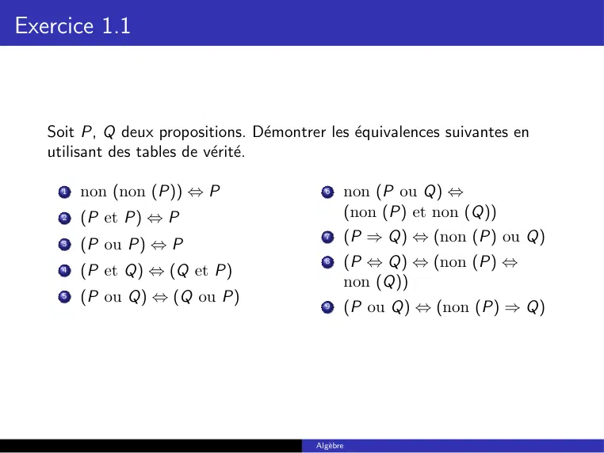

~~~text
Exercice 1.1

   Soit P, Q deux propositions. Démontrer les équivalences suivantes en
   utilisant des tables de vérité.

     1   non (non (P)) ⇔ P                  6    non (P ou Q) ⇔
     2   (P et P) ⇔ P                            (non (P) et non (Q))
     3   (P ou P) ⇔ P
                                            7    (P ⇒ Q) ⇔ (non (P) ou Q)
                                            8    (P ⇔ Q) ⇔ (non (P) ⇔
     4   (P et Q) ⇔ (Q et P)
                                                 non (Q))
     5   (P ou Q) ⇔ (Q ou P)                9    (P ou Q) ⇔ (non (P) ⇒ Q)

                                          Algèbre
~~~

## Page 3

~~~text
Exercice 1
   Solution : Nous allons toutes les démontrer en remplissant une table de
   vérité.
    P   Q   non (P) non (non (P))    P et P   P ou P     P et Q   Q et P   P ou Q   Q ou P
    V   V      F          V            V        V          V        V        V        V
    V   F      F          V            V        V          F        F        V        V
    F   V     V           F            F        F          F        F        V        V
    F   F     V           F            F        F          F        F        F        F
    non (P et Q) non (P) ou non (Q) non (Q) ⇒ non (P)
         F               F                  V
         V               V                  F
         V               V                  V
         V               V                  V
    non (P ou Q) non (P) et non (Q) P ⇔ Q   P⇒Q      Q⇒P    (P ⇒ Q) et (Q ⇒ P) non (P) ou Q
         F               F            V      V        V             V               V
         F               F            F      V        F             F               F
         F               F            F      F        F             V               V
         V               V            V      V        V             V               V
    non (P ⇒ Q) P et non (Q) non (P) ⇔ non (Q) non (P) ⇒ Q
         F            F              V              V
         V           V               F              V
         F            F              F              V
         F            F              V              F

                                              Algèbre
~~~

## Page 4

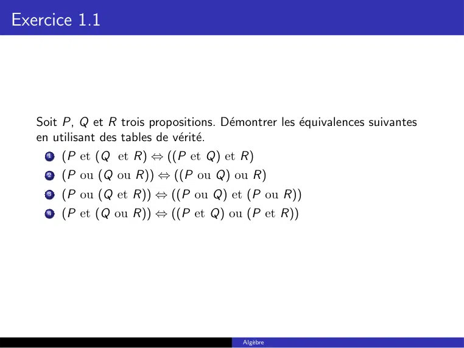

~~~text
Exercice 1.1

   Soit P, Q et R trois propositions. Démontrer les équivalences suivantes
   en utilisant des tables de vérité.
     1   (P et (Q et R) ⇔ ((P et Q) et R)
     2   (P ou (Q ou R)) ⇔ ((P ou Q) ou R)
     3   (P ou (Q et R)) ⇔ ((P ou Q) et (P ou R))
     4   (P et (Q ou R)) ⇔ ((P et Q) ou (P et R))

                                          Algèbre
~~~

## Page 5

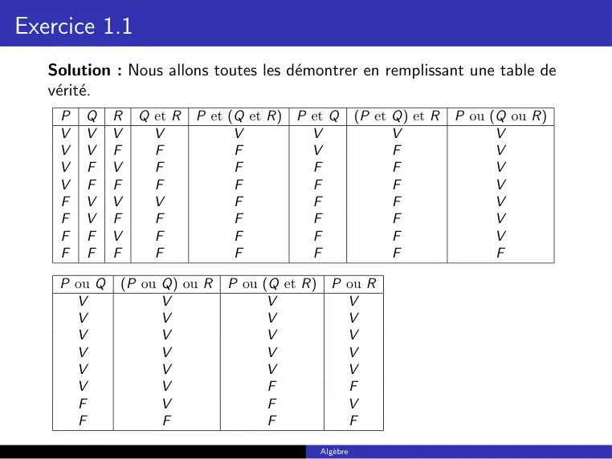

~~~text
Exercice 1.1
   Solution : Nous allons toutes les démontrer en remplissant une table de
   vérité.
    P   Q    R   Q et R   P et (Q et R) P et Q        (P et Q) et R   P ou (Q ou R)
    V   V    V     V            V         V                 V               V
    V   V    F     F            F         V                 F               V
    V   F    V     F            F         F                 F               V
    V   F    F     F            F         F                 F               V
    F   V    V     V            F         F                 F               V
    F   V    F     F            F         F                 F               V
    F   F    V     F            F         F                 F               V
    F   F    F     F            F         F                 F               F

    P ou Q   (P ou Q) ou R    P ou (Q et R) P ou R
      V            V                V         V
      V            V                V         V
      V            V                V         V
      V            V                V         V
      V            V                V         V
      V            V                F         F
      F            V                F         V
      F            F                F         F

                                           Algèbre
~~~

## Page 6

~~~text
Exercice 1.1

   Nous avons aussi :
    P   Q   R   (P ou Q) et (P ou R) P et R   Q ou R     P et (Q ou R) (P et Q) ou (P et R)
    V   V   V            V             V        V              V                V
    V   V   F            V             F        V              V                V
    V   F   V            V             V        V              V                V
    V   F   F            V             F        F              F                F
    F   V   V            V             F        V              F                F
    F   V   F            F             F        V              F                F
    F   F   V            F             F        V              F                F
    F   F   F            F             F        F              F                F

                                              Algèbre
~~~

## Page 7

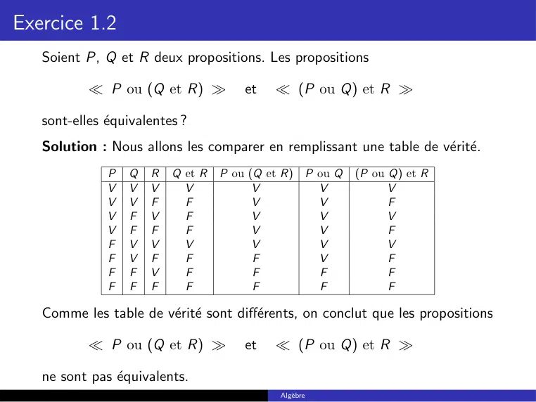

~~~text
Exercice 1.2
   Soient P, Q et R deux propositions. Les propositions

            P ou (Q et R)            et    (P ou Q) et R 

   sont-elles équivalentes ?
   Solution : Nous allons les comparer en remplissant une table de vérité.
              P   Q   R   Q et R   P ou (Q et R) P ou Q   (P ou Q) et R
              V   V   V     V            V         V            V
              V   V   F     F            V         V            F
              V   F   V     F            V         V            V
              V   F   F     F            V         V            F
              F   V   V     V            V         V            V
              F   V   F     F            F         V            F
              F   F   V     F            F         F            F
              F   F   F     F            F         F            F

   Comme les table de vérité sont différents, on conclut que les propositions

            P ou (Q et R)            et    (P ou Q) et R 

   ne sont pas équivalents.
                                            Algèbre
~~~

## Page 8

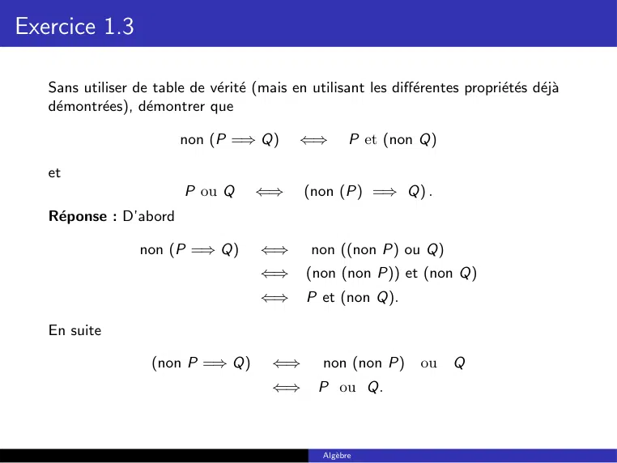

~~~text
Exercice 1.3

   Sans utiliser de table de vérité (mais en utilisant les différentes propriétés déjà
   démontrées), démontrer que

                          non (P =⇒ Q)         ⇐⇒         P et (non Q)

   et
                          P ou Q       ⇐⇒       (non (P) =⇒ Q) .
   Réponse : D’abord

                   non (P =⇒ Q)         ⇐⇒       non ((non P) ou Q)
                                        ⇐⇒      (non (non P)) et (non Q)
                                        ⇐⇒      P et (non Q).

   En suite

                     (non P =⇒ Q)         ⇐⇒       non (non P)      ou    Q
                                          ⇐⇒      P ou Q.

                                                   Algèbre
~~~

## Page 9

~~~text
Exercice 1.4
   Traduire en toutes lettres les sept propositions suivantes lorsque x désigne un
   individu, y un film et que P(x, y ) est la proposition

                                L’individu x a vu le film y .

   On traduit :
         ∀ x : Pour tout individu (= tous les individus.)
         ∀ y : Pour tout film (= tous les films).
         ∃ x : il existe (au moins) un individu.
         ∃ y : il existe (au moins) un film.
     1   ∀x, ∀y , P(x, y )

         Réponse : Tous les individus ont vus tous les films.

     2   ∃x, ∀y , P(x, y )

         Réponse : Il existe un individu qui a vu tous les films.

                                                 Algèbre
~~~

## Page 10

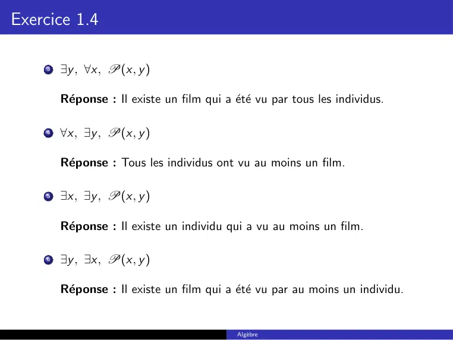

~~~text
Exercice 1.4

    3   ∃y , ∀x, P(x, y )

        Réponse : Il existe un film qui a été vu par tous les individus.

    4   ∀x, ∃y , P(x, y )

        Réponse : Tous les individus ont vu au moins un film.

    5   ∃x, ∃y , P(x, y )

        Réponse : Il existe un individu qui a vu au moins un film.

    6   ∃y , ∃x, P(x, y )

        Réponse : Il existe un film qui a été vu par au moins un individu.

                                            Algèbre
~~~

## Page 11

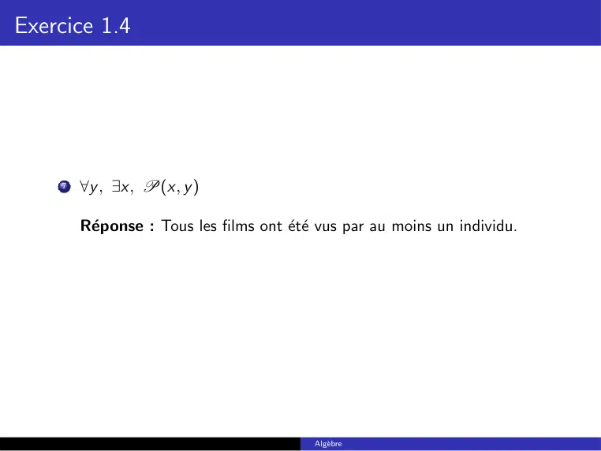

~~~text
Exercice 1.4

    7   ∀y , ∃x, P(x, y )

        Réponse : Tous les films ont été vus par au moins un individu.

                                          Algèbre
~~~

## Page 12

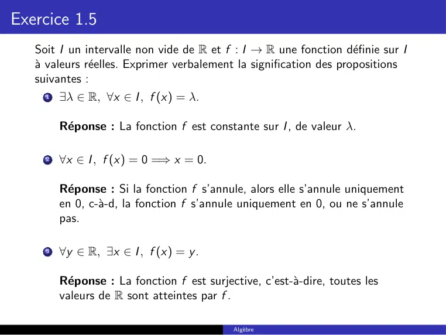

~~~text
Exercice 1.5
   Soit I un intervalle non vide de R et f : I → R une fonction définie sur I
   à valeurs réelles. Exprimer verbalement la signification des propositions
   suivantes :
     1   ∃λ ∈ R, ∀x ∈ I , f (x) = λ.

         Réponse : La fonction f est constante sur I , de valeur λ.

     2   ∀x ∈ I , f (x) = 0 =⇒ x = 0.

         Réponse : Si la fonction f s’annule, alors elle s’annule uniquement
         en 0, c-à-d, la fonction f s’annule uniquement en 0, ou ne s’annule
         pas.

     3   ∀y ∈ R, ∃x ∈ I , f (x) = y .

         Réponse : La fonction f est surjective, c’est-à-dire, toutes les
         valeurs de R sont atteintes par f .

                                             Algèbre
~~~

## Page 13

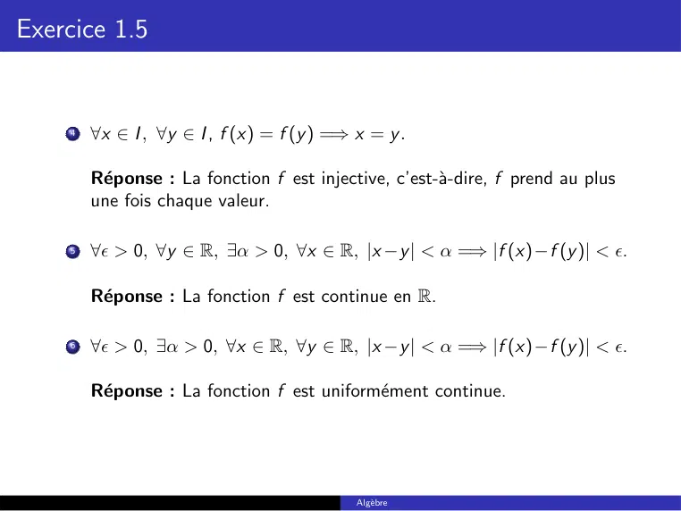

~~~text
Exercice 1.5

    4   ∀x ∈ I , ∀y ∈ I , f (x) = f (y ) =⇒ x = y .

        Réponse : La fonction f est injective, c’est-à-dire, f prend au plus
        une fois chaque valeur.

    5   ∀ > 0, ∀y ∈ R, ∃α > 0, ∀x ∈ R, |x −y | < α =⇒ |f (x)−f (y )| < .

        Réponse : La fonction f est continue en R.

    6   ∀ > 0, ∃α > 0, ∀x ∈ R, ∀y ∈ R, |x −y | < α =⇒ |f (x)−f (y )| < .

        Réponse : La fonction f est uniformément continue.

                                            Algèbre
~~~

## Page 14

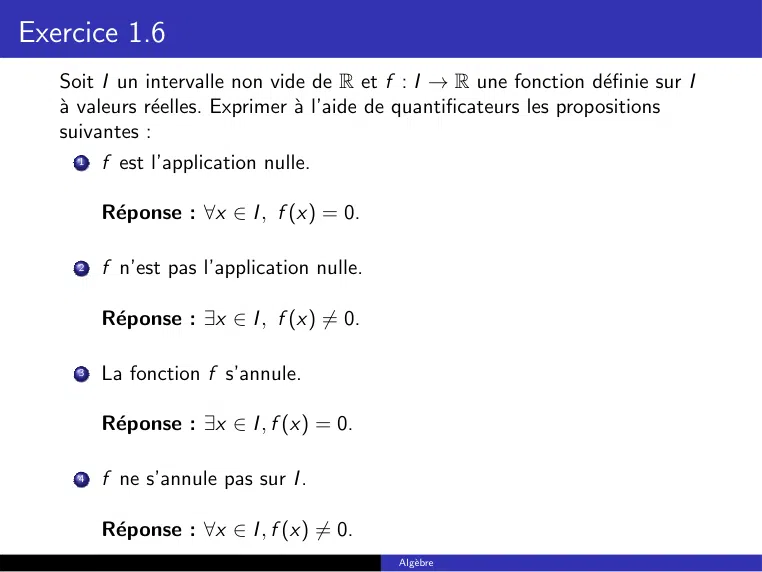

~~~text
Exercice 1.6
   Soit I un intervalle non vide de R et f : I → R une fonction définie sur I
   à valeurs réelles. Exprimer à l’aide de quantificateurs les propositions
   suivantes :
      1  f est l’application nulle.

         Réponse : ∀x ∈ I , f (x) = 0.

     2   f n’est pas l’application nulle.

         Réponse : ∃x ∈ I , f (x) 6= 0.

     3   La fonction f s’annule.

         Réponse : ∃x ∈ I , f (x) = 0.

     4   f ne s’annule pas sur I .

         Réponse : ∀x ∈ I , f (x) 6= 0.
                                            Algèbre
~~~

## Page 15

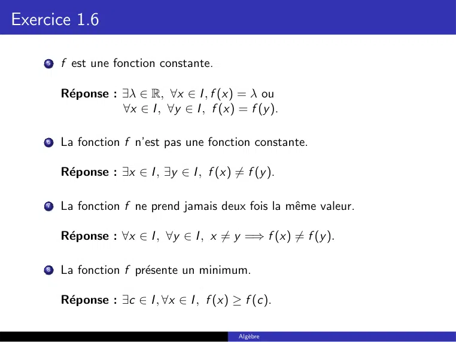

~~~text
Exercice 1.6

    5   f est une fonction constante.

        Réponse : ∃λ ∈ R, ∀x ∈ I , f (x) = λ ou
                   ∀x ∈ I , ∀y ∈ I , f (x) = f (y ).

    6   La fonction f n’est pas une fonction constante.

        Réponse : ∃x ∈ I , ∃y ∈ I , f (x) 6= f (y ).

    7   La fonction f ne prend jamais deux fois la même valeur.

        Réponse : ∀x ∈ I , ∀y ∈ I , x 6= y =⇒ f (x) 6= f (y ).

    8   La fonction f présente un minimum.

        Réponse : ∃c ∈ I , ∀x ∈ I , f (x) ≥ f (c).

                                             Algèbre
~~~

## Page 16

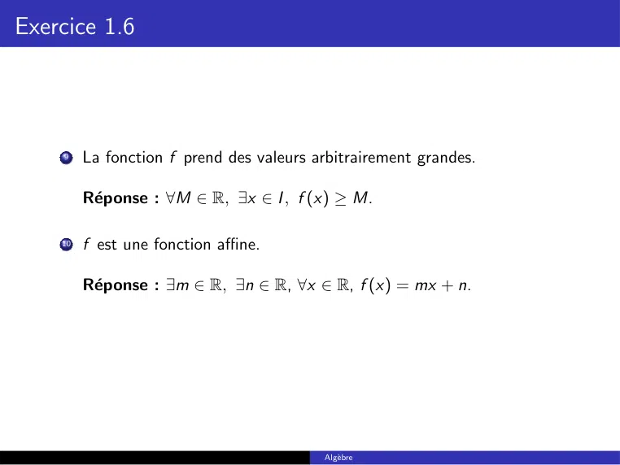

~~~text
Exercice 1.6

    9    La fonction f prend des valeurs arbitrairement grandes.

         Réponse : ∀M ∈ R, ∃x ∈ I , f (x) ≥ M.

    10   f est une fonction affine.

         Réponse : ∃m ∈ R, ∃n ∈ R, ∀x ∈ R, f (x) = mx + n.

                                          Algèbre
~~~

## Page 17

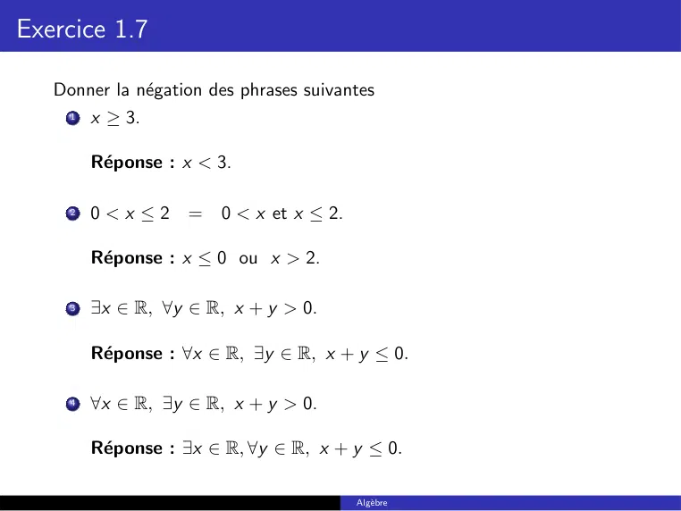

~~~text
Exercice 1.7

   Donner la négation des phrases suivantes
     1   x ≥ 3.

         Réponse : x < 3.

     2   0<x ≤2     =   0 < x et x ≤ 2.

         Réponse : x ≤ 0 ou x > 2.

     3   ∃x ∈ R, ∀y ∈ R, x + y > 0.

         Réponse : ∀x ∈ R, ∃y ∈ R, x + y ≤ 0.

     4   ∀x ∈ R, ∃y ∈ R, x + y > 0.

         Réponse : ∃x ∈ R, ∀y ∈ R, x + y ≤ 0.

                                          Algèbre
~~~

## Page 18

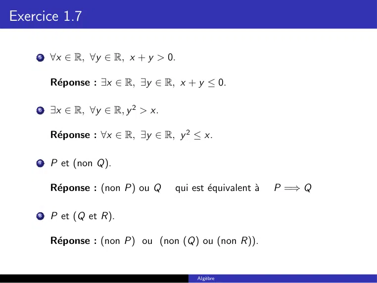

~~~text
Exercice 1.7

    5   ∀x ∈ R, ∀y ∈ R, x + y > 0.

        Réponse : ∃x ∈ R, ∃y ∈ R, x + y ≤ 0.

    6   ∃x ∈ R, ∀y ∈ R, y 2 > x.

        Réponse : ∀x ∈ R, ∃y ∈ R, y 2 ≤ x.

    7   P et (non Q).

        Réponse : (non P) ou Q    qui est équivalent à   P =⇒ Q

    8   P et (Q et R).

        Réponse : (non P) ou (non (Q) ou (non R)).

                                        Algèbre
~~~

## Page 19

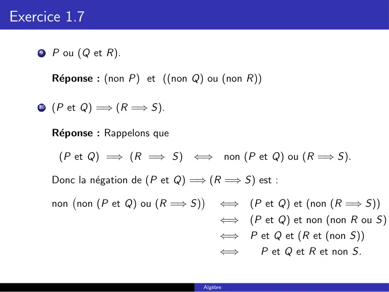

~~~text
Exercice 1.7

    9    P ou (Q et R).

         Réponse : (non P) et ((non Q) ou (non R))

    10   (P et Q) =⇒ (R =⇒ S).

         Réponse : Rappelons que

          (P et Q) =⇒ (R =⇒ S) ⇐⇒                 non (P et Q) ou (R =⇒ S).

         Donc la négation de (P et Q) =⇒ (R =⇒ S) est :
                                        
         non non (P et Q) ou (R =⇒ S)       ⇐⇒ (P et Q) et (non (R =⇒ S))
                                              ⇐⇒       (P et Q) et non (non R ou S)
                                              ⇐⇒       P et Q et (R et (non S))
                                              ⇐⇒         P et Q et R et non S.

                                       Algèbre
~~~

## Page 20

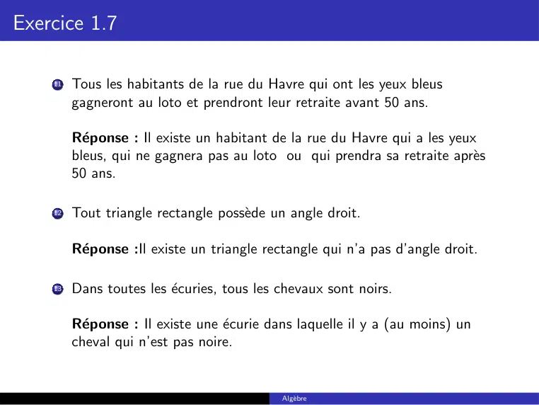

~~~text
Exercice 1.7

    11   Tous les habitants de la rue du Havre qui ont les yeux bleus
         gagneront au loto et prendront leur retraite avant 50 ans.

         Réponse : Il existe un habitant de la rue du Havre qui a les yeux
         bleus, qui ne gagnera pas au loto ou qui prendra sa retraite après
         50 ans.

    12   Tout triangle rectangle possède un angle droit.

         Réponse :Il existe un triangle rectangle qui n’a pas d’angle droit.

    13   Dans toutes les écuries, tous les chevaux sont noirs.

         Réponse : Il existe une écurie dans laquelle il y a (au moins) un
         cheval qui n’est pas noire.

                                            Algèbre
~~~

## Page 21

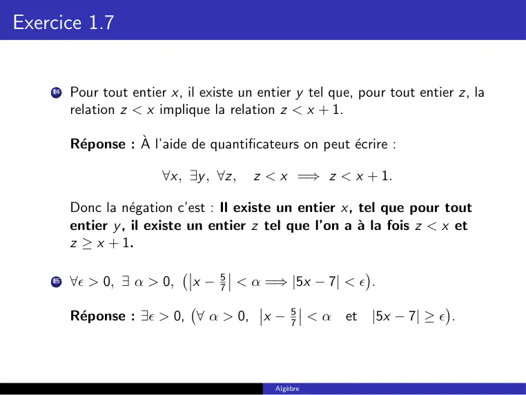

~~~text
Exercice 1.7

    14   Pour tout entier x, il existe un entier y tel que, pour tout entier z, la
         relation z < x implique la relation z < x + 1.

         Réponse : À l’aide de quantificateurs on peut écrire :

                         ∀x, ∃y , ∀z,    z < x =⇒ z < x + 1.

         Donc la négation c’est : Il existe un entier x, tel que pour tout
         entier y , il existe un entier z tel que l’on a à la fois z < x et
         z ≥ x + 1.

                              x − 57 < α =⇒ |5x − 7| <  .
                                                        
    15   ∀ > 0, ∃ α > 0,

         Réponse : ∃ > 0, ∀ α > 0, x − 57 < α
                                                                          
                                                         et   |5x − 7| ≥  .

                                             Algèbre
~~~

## Page 22

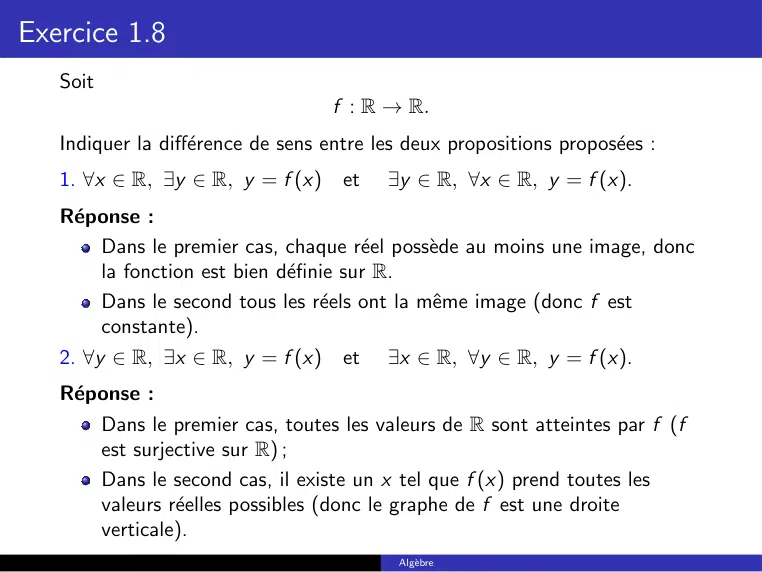

~~~text
Exercice 1.8
   Soit
                                   f : R → R.
   Indiquer la différence de sens entre les deux propositions proposées :
   1. ∀x ∈ R, ∃y ∈ R, y = f (x)      et   ∃y ∈ R, ∀x ∈ R, y = f (x).
   Réponse :
        Dans le premier cas, chaque réel possède au moins une image, donc
        la fonction est bien définie sur R.
        Dans le second tous les réels ont la même image (donc f est
        constante).
   2. ∀y ∈ R, ∃x ∈ R, y = f (x) et ∃x ∈ R, ∀y ∈ R, y = f (x).
   Réponse :
       Dans le premier cas, toutes les valeurs de R sont atteintes par f (f
       est surjective sur R) ;
       Dans le second cas, il existe un x tel que f (x) prend toutes les
       valeurs réelles possibles (donc le graphe de f est une droite
       verticale).
                                           Algèbre
~~~

## Page 23

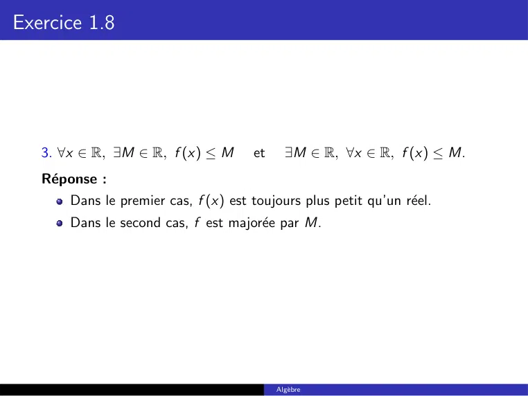

~~~text
Exercice 1.8

   3. ∀x ∈ R, ∃M ∈ R, f (x) ≤ M       et     ∃M ∈ R, ∀x ∈ R, f (x) ≤ M.
   Réponse :
       Dans le premier cas, f (x) est toujours plus petit qu’un réel.
       Dans le second cas, f est majorée par M.

                                           Algèbre
~~~

## Page 24

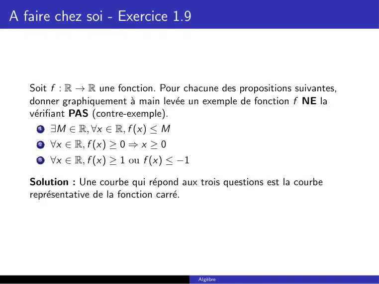

~~~text
A faire chez soi - Exercice 1.9

   Soit f : R → R une fonction. Pour chacune des propositions suivantes,
   donner graphiquement à main levée un exemple de fonction f NE la
   vérifiant PAS (contre-exemple).
     1   ∃M ∈ R, ∀x ∈ R, f (x) ≤ M
     2   ∀x ∈ R, f (x) ≥ 0 ⇒ x ≥ 0
     3   ∀x ∈ R, f (x) ≥ 1 ou f (x) ≤ −1

   Solution : Une courbe qui répond aux trois questions est la courbe
   représentative de la fonction carré.

                                           Algèbre
~~~

## Page 25

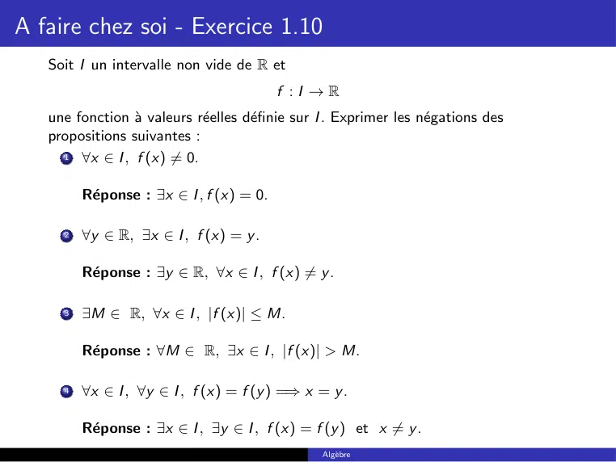

~~~text
A faire chez soi - Exercice 1.10
   Soit I un intervalle non vide de R et
                                          f :I →R
   une fonction à valeurs réelles définie sur I . Exprimer les négations des
   propositions suivantes :
     1  ∀x ∈ I , f (x) 6= 0.

         Réponse : ∃x ∈ I , f (x) = 0.

     2   ∀y ∈ R, ∃x ∈ I , f (x) = y .

         Réponse : ∃y ∈ R, ∀x ∈ I , f (x) 6= y .

     3   ∃M ∈ R, ∀x ∈ I , |f (x)| ≤ M.

         Réponse : ∀M ∈ R, ∃x ∈ I , |f (x)| > M.

     4   ∀x ∈ I , ∀y ∈ I , f (x) = f (y ) =⇒ x = y .

         Réponse : ∃x ∈ I , ∃y ∈ I , f (x) = f (y ) et x 6= y .
                                                 Algèbre
~~~

## Page 26

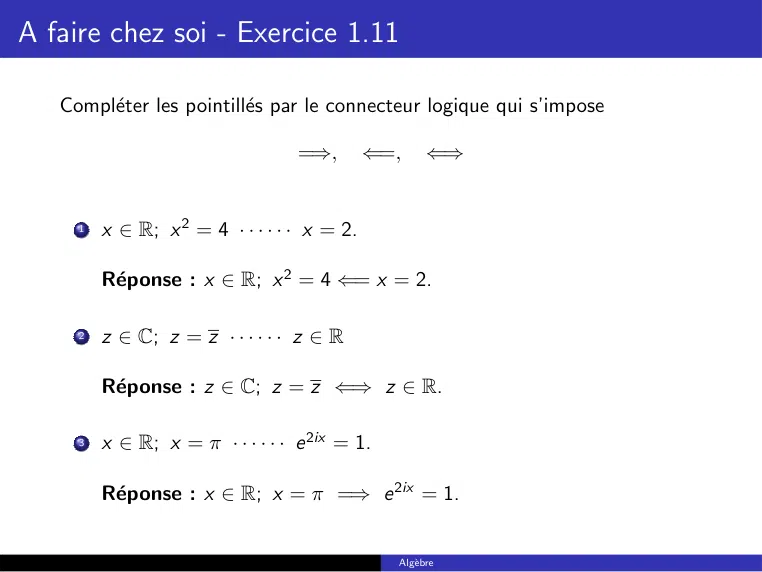

~~~text
A faire chez soi - Exercice 1.11

   Compléter les pointillés par le connecteur logique qui s’impose

                                  =⇒,        ⇐=,     ⇐⇒

     1   x ∈ R; x 2 = 4 · · · · · · x = 2.

         Réponse : x ∈ R; x 2 = 4 ⇐= x = 2.

     2   z ∈ C; z = z · · · · · · z ∈ R

         Réponse : z ∈ C; z = z ⇐⇒ z ∈ R.

     3   x ∈ R; x = π · · · · · · e 2ix = 1.

         Réponse : x ∈ R; x = π =⇒ e 2ix = 1.

                                               Algèbre
~~~

## Page 27

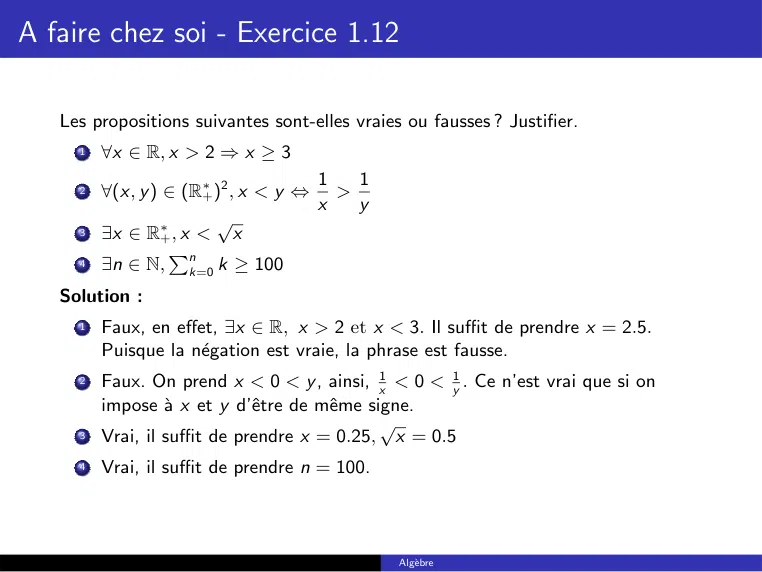

~~~text
A faire chez soi - Exercice 1.12

   Les propositions suivantes sont-elles vraies ou fausses ? Justifier.
     1   ∀x ∈ R, x > 2 ⇒ x ≥ 3
                                        1   1
     2   ∀(x, y ) ∈ (R∗+ )2 , x < y ⇔     >
                                        x   y
                       √
     3   ∃x ∈ R∗+ , x < x
         ∃n ∈ N, nk=0 k ≥ 100
                 P
     4

   Solution :
     1   Faux, en effet, ∃x ∈ R, x > 2 et x < 3. Il suffit de prendre x = 2.5.
         Puisque la négation est vraie, la phrase est fausse.
     2   Faux. On prend x < 0 < y , ainsi, x1 < 0 < y1 . Ce n’est vrai que si on
         impose à x et y d’être de même signe.
                                             √
     3   Vrai, il suffit de prendre x = 0.25, x = 0.5
     4   Vrai, il suffit de prendre n = 100.

                                                Algèbre
~~~

## Page 28

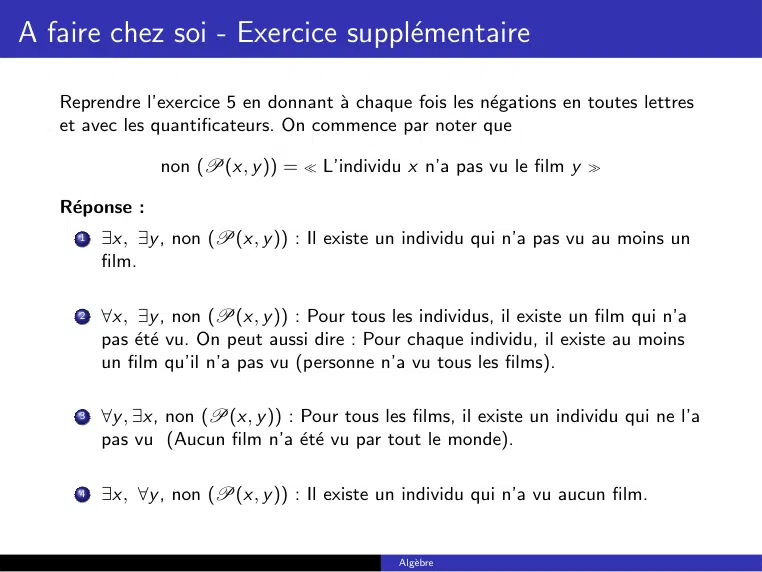

~~~text
A faire chez soi - Exercice supplémentaire

   Reprendre l’exercice 5 en donnant à chaque fois les négations en toutes lettres
   et avec les quantificateurs. On commence par noter que

                non (P(x, y )) =  L’individu x n’a pas vu le film y 

   Réponse :
     1   ∃x, ∃y , non (P(x, y )) : Il existe un individu qui n’a pas vu au moins un
         film.

     2   ∀x, ∃y , non (P(x, y )) : Pour tous les individus, il existe un film qui n’a
         pas été vu. On peut aussi dire : Pour chaque individu, il existe au moins
         un film qu’il n’a pas vu (personne n’a vu tous les films).

     3   ∀y , ∃x, non (P(x, y )) : Pour tous les films, il existe un individu qui ne l’a
         pas vu (Aucun film n’a été vu par tout le monde).

     4   ∃x, ∀y , non (P(x, y )) : Il existe un individu qui n’a vu aucun film.

                                                Algèbre
~~~

## Page 29

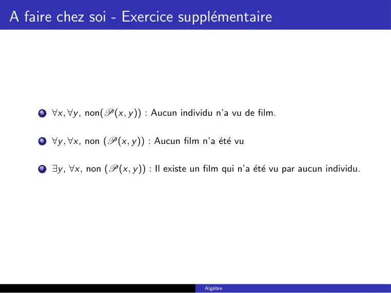

~~~text
A faire chez soi - Exercice supplémentaire

     5   ∀x, ∀y , non(P(x, y )) : Aucun individu n’a vu de film.

     6   ∀y , ∀x, non (P(x, y )) : Aucun film n’a été vu

     7   ∃y , ∀x, non (P(x, y )) : Il existe un film qui n’a été vu par aucun individu.

                                                Algèbre
~~~

## Page 30

~~~text
Exercice 2.1

                                                  √
    1   Soit x un irrationnel positif. Montrer que x est irrationnel.
                      √
    2   Montrer que 2 est un nombre irrationnel.
        Solution : Voir CM.

                                          Algèbre
~~~

## Page 31

~~~text
Exercice 2.1
                                              √
   Soit x un irrationnel positif. Montrer que x est irrationnel. C’est-à-dire,
   nous devons montrer : sot x un réel positif
                                                √
               Si x est un irrationnel =⇒         x est irrationnel.
   On rappelle que
                x n’est pas irrationnel    ⇐⇒         x est rationnel.
   Nous allons montrer la proposition en utilisant un raisonnement par
   contraposition.

   Réponse : Nous devons donc montrer : soit x un réel positif alors
                    √
                      x est rationnel =⇒ x est rationnel.
               √
   Supposons x rationnel. Par définition d’un nombre rationnel, il existe
   p, q ∈ Z tel que
                         √        p                   p2
                             x=       =⇒     x=
                                  q                   q2
   qui est le quotient de deux entiers naturels. Donc x est rationnel.
                                           Algèbre
~~~

## Page 32

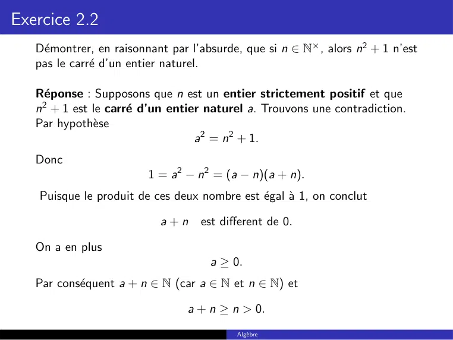

~~~text
Exercice 2.2
   Démontrer, en raisonnant par l’absurde, que si n ∈ N× , alors n2 + 1 n’est
   pas le carré d’un entier naturel.

   Réponse : Supposons que n est un entier strictement positif et que
   n2 + 1 est le carré d’un entier naturel a. Trouvons une contradiction.
   Par hypothèse
                                  a2 = n2 + 1.
   Donc
                         1 = a2 − n2 = (a − n)(a + n).
   Puisque le produit de ces deux nombre est égal à 1, on conclut

                           a+n     est different de 0.

   On a en plus
                                     a ≥ 0.
   Par conséquent a + n ∈ N (car a ∈ N et n ∈ N) et

                                a + n ≥ n > 0.
                                          Algèbre
~~~

## Page 33

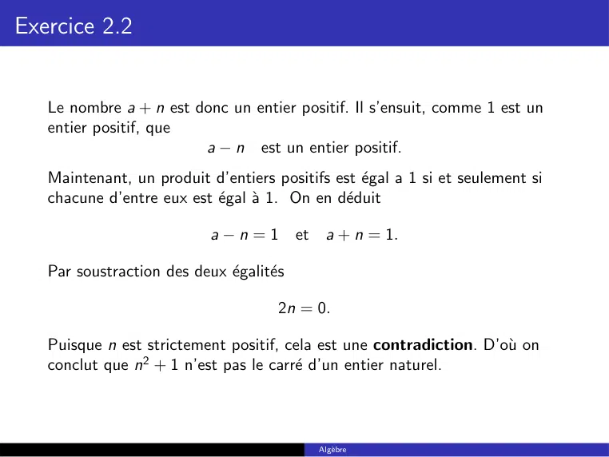

~~~text
Exercice 2.2

   Le nombre a + n est donc un entier positif. Il s’ensuit, comme 1 est un
   entier positif, que
                        a − n est un entier positif.
   Maintenant, un produit d’entiers positifs est égal a 1 si et seulement si
   chacune d’entre eux est égal à 1. On en déduit

                           a−n =1         et a + n = 1.

   Par soustraction des deux égalités

                                      2n = 0.

   Puisque n est strictement positif, cela est une contradiction. D’où on
   conclut que n2 + 1 n’est pas le carré d’un entier naturel.

                                            Algèbre
~~~

## Page 34

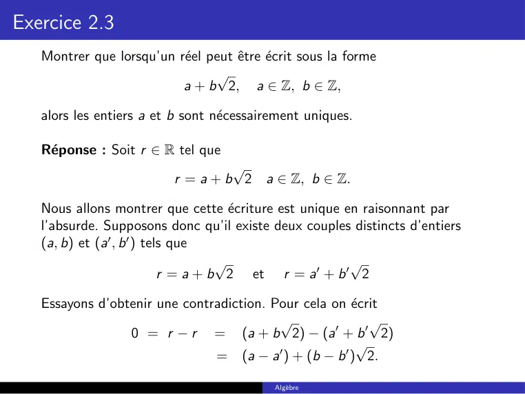

~~~text
Exercice 2.3
   Montrer que lorsqu’un réel peut être écrit sous la forme
                                √
                          a + b 2, a ∈ Z, b ∈ Z,

   alors les entiers a et b sont nécessairement uniques.

   Réponse : Soit r ∈ R tel que
                                √
                          r =a+b 2        a ∈ Z, b ∈ Z.

   Nous allons montrer que cette écriture est unique en raisonnant par
   l’absurde. Supposons donc qu’il existe deux couples distincts d’entiers
   (a, b) et (a0 , b 0 ) tels que
                                     √                 √
                            r = a + b 2 et r = a0 + b 0 2

   Essayons d’obtenir une contradiction. Pour cela on écrit
                                          √               √
                 0 = r − r = (a + b 2) − (a0 + b 0 2)
                                                       √
                               = (a − a0 ) + (b − b 0 ) 2.

                                            Algèbre
~~~

## Page 35

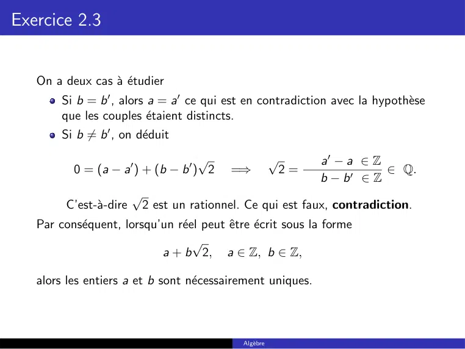

~~~text
Exercice 2.3

   On a deux cas à étudier
        Si b = b 0 , alors a = a0 ce qui est en contradiction avec la hypothèse
        que les couples étaient distincts.
        Si b 6= b 0 , on déduit
                                    √                      √        a0 − a ∈ Z
          0 = (a − a0 ) + (b − b 0 ) 2       =⇒                2=              ∈ Q.
                                                                    b − b0 ∈ Z
                         √
         C’est-à-dire       2 est un rationnel. Ce qui est faux, contradiction.
   Par conséquent, lorsqu’un réel peut être écrit sous la forme
                                  √
                           a + b 2, a ∈ Z, b ∈ Z,

   alors les entiers a et b sont nécessairement uniques.

                                                Algèbre
~~~

## Page 36

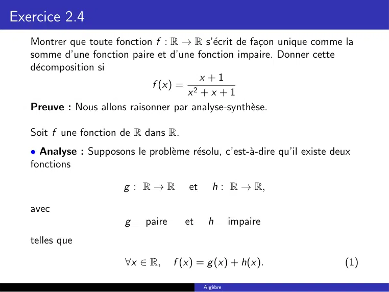

~~~text
Exercice 2.4
   Montrer que toute fonction f : R → R s’écrit de façon unique comme la
   somme d’une fonction paire et d’une fonction impaire. Donner cette
   décomposition si
                                        x +1
                             f (x) = 2
                                     x +x +1
   Preuve : Nous allons raisonner par analyse-synthèse.

   Soit f une fonction de R dans R.
   • Analyse : Supposons le problème résolu, c’est-à-dire qu’il existe deux
   fonctions

                        g : R→R          et      h : R → R,

   avec
                         g    paire     et     h         impaire
   telles que

                         ∀x ∈ R,      f (x) = g (x) + h(x).                 (1)

                                              Algèbre
~~~

## Page 37

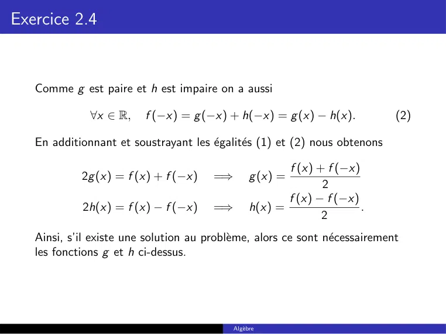

~~~text
Exercice 2.4

   Comme g est paire et h est impaire on a aussi

              ∀x ∈ R,    f (−x) = g (−x) + h(−x) = g (x) − h(x).             (2)

   En additionnant et soustrayant les égalités (1) et (2) nous obtenons

                                                         f (x) + f (−x)
            2g (x) = f (x) + f (−x)    =⇒         g (x) =
                                                                2
                                                         f (x) − f (−x)
            2h(x) = f (x) − f (−x)     =⇒         h(x) =                .
                                                                2
   Ainsi, s’il existe une solution au problème, alors ce sont nécessairement
   les fonctions g et h ci-dessus.

                                            Algèbre
~~~

## Page 38

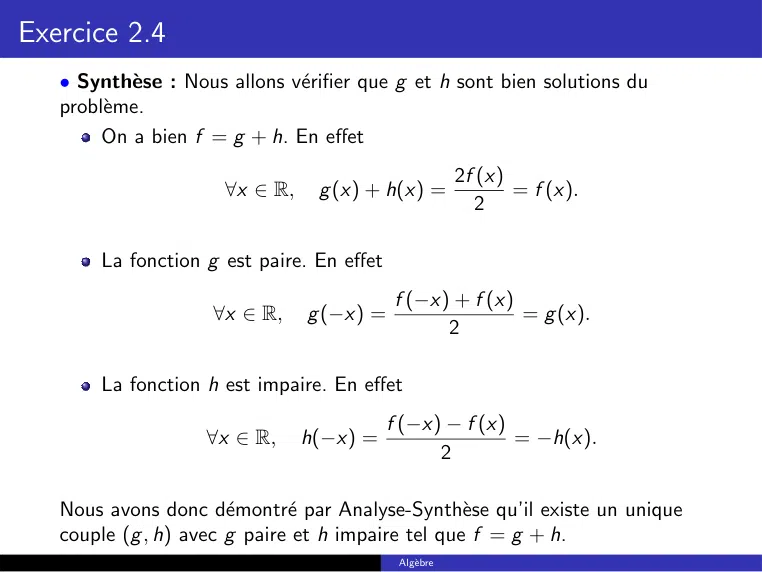

~~~text
Exercice 2.4
   • Synthèse : Nous allons vérifier que g et h sont bien solutions du
   problème.
        On a bien f = g + h. En effet
                                                       2f (x)
                      ∀x ∈ R,    g (x) + h(x) =               = f (x).
                                                          2

       La fonction g est paire. En effet
                                           f (−x) + f (x)
                     ∀x ∈ R,    g (−x) =                  = g (x).
                                                 2

       La fonction h est impaire. En effet
                                           f (−x) − f (x)
                    ∀x ∈ R,     h(−x) =                   = −h(x).
                                                 2

   Nous avons donc démontré par Analyse-Synthèse qu’il existe un unique
   couple (g , h) avec g paire et h impaire tel que f = g + h.
                                            Algèbre
~~~

## Page 39

~~~text
Exercice 2.4

   Finalement, si
                                 x +1
                    f (x) =
                              x2 + x + 1
   alors
                                   1
                    g (x) =               ,
                              x4 + x2 + 1
   et
                                  x3
                    h(x) =                .
                              x4 + x2 + 1

                                  Algèbre
~~~

## Page 40

~~~text
A faire chez soi - Exercice 2.5

   Soit a et b deux réels. Montrer que

                          a2 + b 2 = 0 =⇒ (a = b = 0).
                                      

   Solution : Voir CM.

                                        Algèbre
~~~

## Page 41

~~~text
A faire chez soi - Exercice 2.6
   Soit
                                    f :R→R
   une fonction. Montrer que

                         f   impaire   =⇒         f (0) = 0.

   On rappelle que une fonction f : R → R est dite impaire si pour tout
   x ∈ R on a
                               f (−x) = −f (x).
   Nous allons montrer la proposition en utilisant un raisonnement direct.

   Réponse : Supposons f impaire. Montrons f (0) = 0. Puisque f est
   impaire, pour tout x ∈ R on a

                                f (−x) = −f (x).

   En particulier pour x = 0, on obtient

          f (0) = f (−0) = −f (0)   =⇒ 2f (0) = 0         =⇒   f (0) = 0.

                                           Algèbre
~~~

## Page 42

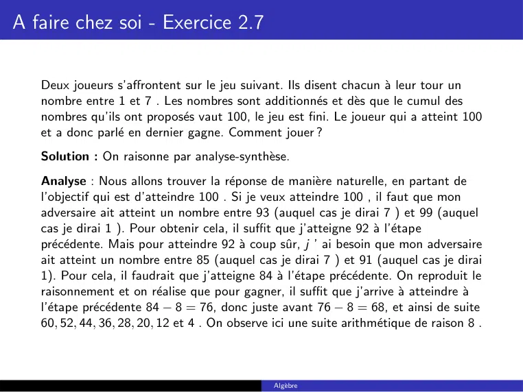

~~~text
A faire chez soi - Exercice 2.7

   Deux joueurs s’affrontent sur le jeu suivant. Ils disent chacun à leur tour un
   nombre entre 1 et 7 . Les nombres sont additionnés et dès que le cumul des
   nombres qu’ils ont proposés vaut 100, le jeu est fini. Le joueur qui a atteint 100
   et a donc parlé en dernier gagne. Comment jouer ?
   Solution : On raisonne par analyse-synthèse.
   Analyse : Nous allons trouver la réponse de manière naturelle, en partant de
   l’objectif qui est d’atteindre 100 . Si je veux atteindre 100 , il faut que mon
   adversaire ait atteint un nombre entre 93 (auquel cas je dirai 7 ) et 99 (auquel
   cas je dirai 1 ). Pour obtenir cela, il suffit que j’atteigne 92 à l’étape
   précédente. Mais pour atteindre 92 à coup sûr, j ’ ai besoin que mon adversaire
   ait atteint un nombre entre 85 (auquel cas je dirai 7 ) et 91 (auquel cas je dirai
   1). Pour cela, il faudrait que j’atteigne 84 à l’étape précédente. On reproduit le
   raisonnement et on réalise que pour gagner, il suffit que j’arrive à atteindre à
   l’étape précédente 84 − 8 = 76, donc juste avant 76 − 8 = 68, et ainsi de suite
   60, 52, 44, 36, 28, 20, 12 et 4 . On observe ici une suite arithmétique de raison 8 .

                                                Algèbre
~~~

## Page 43

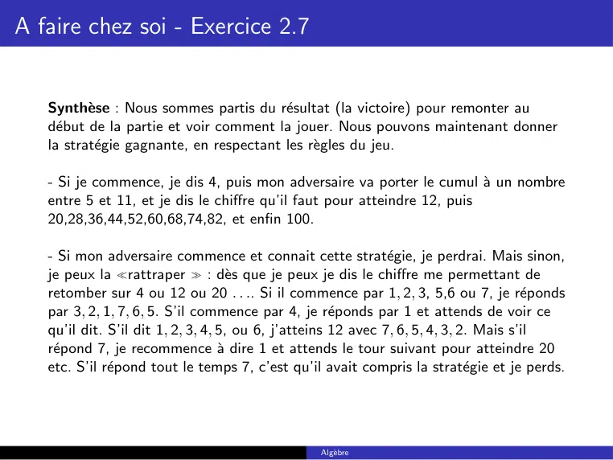

~~~text
A faire chez soi - Exercice 2.7

   Synthèse : Nous sommes partis du résultat (la victoire) pour remonter au
   début de la partie et voir comment la jouer. Nous pouvons maintenant donner
   la stratégie gagnante, en respectant les règles du jeu.

   - Si je commence, je dis 4, puis mon adversaire va porter le cumul à un nombre
   entre 5 et 11, et je dis le chiffre qu’il faut pour atteindre 12, puis
   20,28,36,44,52,60,68,74,82, et enfin 100.

   - Si mon adversaire commence et connait cette stratégie, je perdrai. Mais sinon,
   je peux la rattraper  : dès que je peux je dis le chiffre me permettant de
   retomber sur 4 ou 12 ou 20 . . .. Si il commence par 1, 2, 3, 5,6 ou 7, je réponds
   par 3, 2, 1, 7, 6, 5. S’il commence par 4, je réponds par 1 et attends de voir ce
   qu’il dit. S’il dit 1, 2, 3, 4, 5, ou 6, j’atteins 12 avec 7, 6, 5, 4, 3, 2. Mais s’il
   répond 7, je recommence à dire 1 et attends le tour suivant pour atteindre 20
   etc. S’il répond tout le temps 7, c’est qu’il avait compris la stratégie et je perds.

                                                Algèbre
~~~

## Page 44

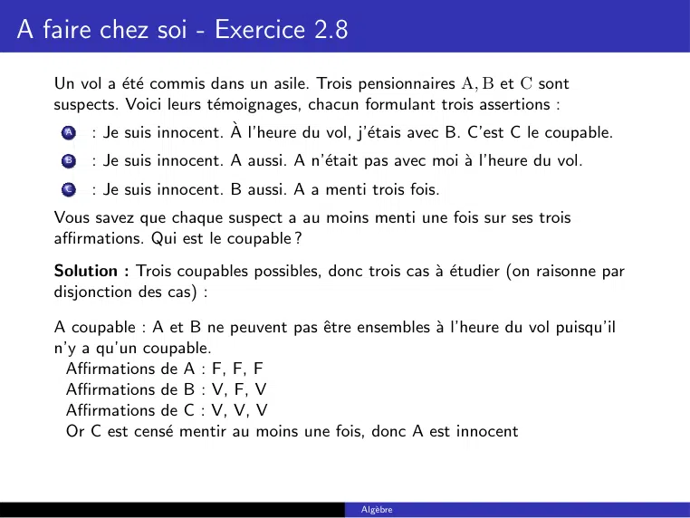

~~~text
A faire chez soi - Exercice 2.8
   Un vol a été commis dans un asile. Trois pensionnaires A, B et C sont
   suspects. Voici leurs témoignages, chacun formulant trois assertions :
    A   : Je suis innocent. À l’heure du vol, j’étais avec B. C’est C le coupable.
    B   : Je suis innocent. A aussi. A n’était pas avec moi à l’heure du vol.
    C   : Je suis innocent. B aussi. A a menti trois fois.
   Vous savez que chaque suspect a au moins menti une fois sur ses trois
   affirmations. Qui est le coupable ?
   Solution : Trois coupables possibles, donc trois cas à étudier (on raisonne par
   disjonction des cas) :

   A coupable : A et B ne peuvent pas être ensembles à l’heure du vol puisqu’il
   n’y a qu’un coupable.
     Affirmations de A : F, F, F
     Affirmations de B : V, F, V
     Affirmations de C : V, V, V
     Or C est censé mentir au moins une fois, donc A est innocent

                                               Algèbre
~~~

## Page 45

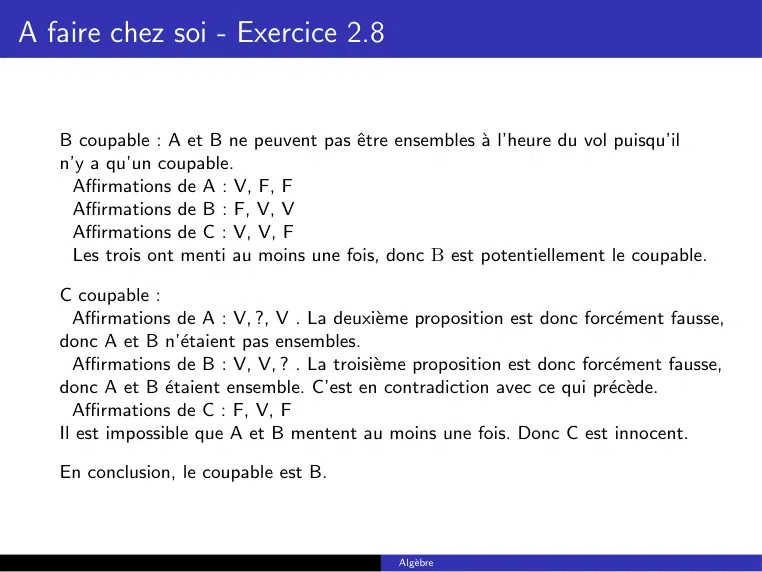

~~~text
A faire chez soi - Exercice 2.8

   B coupable : A et B ne peuvent pas être ensembles à l’heure du vol puisqu’il
   n’y a qu’un coupable.
     Affirmations de A : V, F, F
     Affirmations de B : F, V, V
     Affirmations de C : V, V, F
     Les trois ont menti au moins une fois, donc B est potentiellement le coupable.

   C coupable :
     Affirmations de A : V, ?, V . La deuxième proposition est donc forcément fausse,
   donc A et B n’étaient pas ensembles.
     Affirmations de B : V, V, ? . La troisième proposition est donc forcément fausse,
   donc A et B étaient ensemble. C’est en contradiction avec ce qui précède.
     Affirmations de C : F, V, F
   Il est impossible que A et B mentent au moins une fois. Donc C est innocent.

   En conclusion, le coupable est B.

                                              Algèbre
~~~

## Page 46

~~~text
A faire chez soi - Exercice 2.9
   Thomas, Jules et Yves sont partis contempler des oiseaux. Chacun a vu un
   oiseau que les deux autres n’ont pas vu. Chaque deux ont vu un oiseau que le
   troisième n’a pas vu, et un oiseau a été vu par les trois.
   Parmi les oiseaux que Thomas a vus, deux sont jaunes. Pami ceux vus par
   Jules, trois sont jaunes, et pami ceux vus par Yves, quatre sont jaunes.
   Combien d’oiseaux jaunes ont été vus au total ? Combien d’oiseaux non jaunes
   ont été vus au total ?
   Solution : Nous allons remplir un tableau avec une ligne par individu et autant
   de colonnes que nécessaires pour les oiseaux.

                                 a    b    c       d      e   f   g
                     Thomas      V    X    X       V      V   X   V
                      Jules      X    V    X       V      X   V   V
                      Yves       X    X    V       X      V   V   V

   Puisque que Yves n’a vu que quatre oiseaux et qu’il a vu au moins quatre
   oiseaux jaunes, on en déduit que tous ses oiseaux sont jaunes, donc c, e, f et g
   sont jaunes. Thomas n’a vu que deux oiseaux jaunes, donc a et d ne sont pas
   jaunes. Jules a vu trois oiseaux jaunes, donc b est jaunes. Au final : 5 oiseaux
   jaunes b, c, e, f, g et 2 non jaunes a et d.
                                               Algèbre
~~~

## Page 47

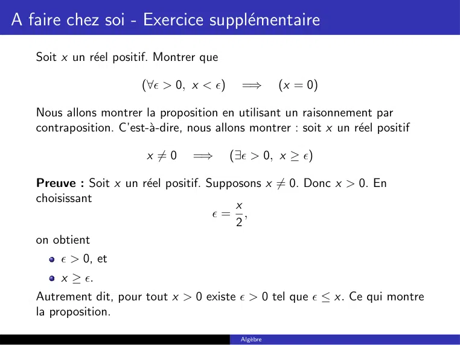

~~~text
A faire chez soi - Exercice supplémentaire
   Soit x un réel positif. Montrer que

                        (∀ > 0, x < )     =⇒         (x = 0)

   Nous allons montrer la proposition en utilisant un raisonnement par
   contraposition. C’est-à-dire, nous allons montrer : soit x un réel positif

                         x 6= 0   =⇒      (∃ > 0, x ≥ )

   Preuve : Soit x un réel positif. Supposons x 6= 0. Donc x > 0. En
   choisissant
                                          x
                                      = ,
                                          2
   on obtient
         > 0, et
        x ≥ .
   Autrement dit, pour tout x > 0 existe  > 0 tel que  ≤ x. Ce qui montre
   la proposition.

                                            Algèbre
~~~

## Page 48

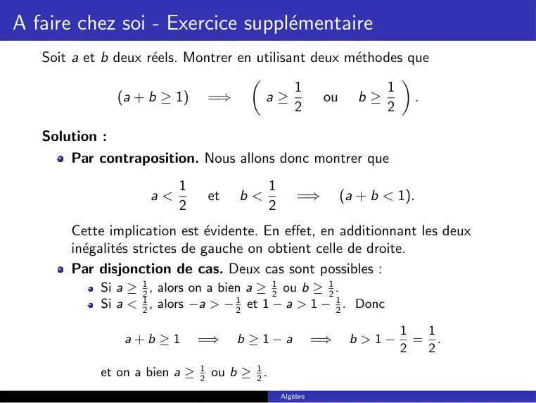

~~~text
A faire chez soi - Exercice supplémentaire
   Soit a et b deux réels. Montrer en utilisant deux méthodes que
                                                              
                                              1              1
                (a + b ≥ 1) =⇒          a≥         ou b ≥        .
                                              2              2
   Solution :
       Par contraposition. Nous allons donc montrer que
                          1                   1
                     a<        et    b<                =⇒         (a + b < 1).
                          2                   2
       Cette implication est évidente. En effet, en additionnant les deux
       inégalités strictes de gauche on obtient celle de droite.
       Par disjonction de cas. Deux cas sont possibles :
            Si a ≥ 12 , alors on a bien a ≥ 12 ou b ≥ 12 .
            Si a < 12 , alors −a > − 21 et 1 − a > 1 − 12 . Donc
                                                                           1  1
                a+b ≥1        =⇒     b ≥1−a                  =⇒    b >1−     = .
                                                                           2  2
            et on a bien a ≥ 21 ou b ≥ 12 .
                                                  Algèbre
~~~

## Page 49

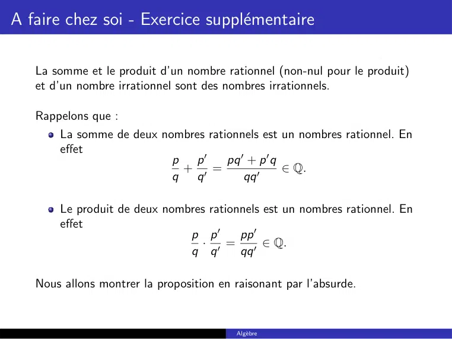

~~~text
A faire chez soi - Exercice supplémentaire

   La somme et le produit d’un nombre rationnel (non-nul pour le produit)
   et d’un nombre irrationnel sont des nombres irrationnels.

   Rappelons que :
       La somme de deux nombres rationnels est un nombres rationnel. En
       effet
                          p  p0     pq 0 + p 0 q
                            + 0 =                ∈ Q.
                          q  q          qq 0

       Le produit de deux nombres rationnels est un nombres rationnel. En
       effet
                              p p0      pp 0
                                · 0 = 0 ∈ Q.
                              q q       qq

   Nous allons montrer la proposition en raisonant par l’absurde.

                                         Algèbre
~~~

## Page 50

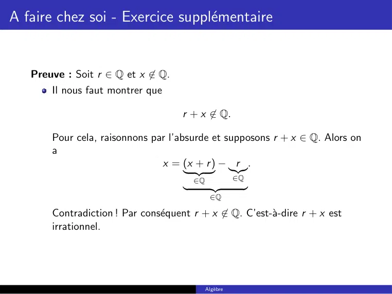

~~~text
A faire chez soi - Exercice supplémentaire

   Preuve : Soit r ∈ Q et x 6∈ Q.
       Il nous faut montrer que

                                     r + x 6∈ Q.

       Pour cela, raisonnons par l’absurde et supposons r + x ∈ Q. Alors on
       a
                               x = (x + r ) − |{z}
                                                r .
                                     | {z }
                                         ∈Q              ∈Q
                                     |          {z        }
                                               ∈Q

       Contradiction ! Par conséquent r + x 6∈ Q. C’est-à-dire r + x est
       irrationnel.

                                              Algèbre
~~~

## Page 51

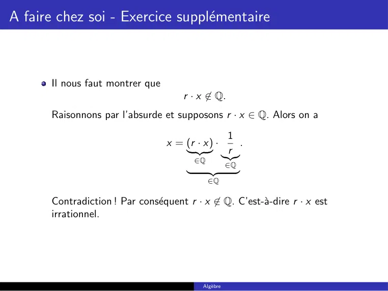

~~~text
A faire chez soi - Exercice supplémentaire

       Il nous faut montrer que
                                      r · x 6∈ Q.
       Raisonnons par l’absurde et supposons r · x ∈ Q. Alors on a
                                                1
                                  x = (r · x) ·   .
                                                r
                                      | {z } |{z}
                                           ∈Q
                                                       ∈Q
                                       |        {z      }
                                                ∈Q

       Contradiction ! Par conséquent r · x 6∈ Q. C’est-à-dire r · x est
       irrationnel.

                                            Algèbre
~~~

## Page 52

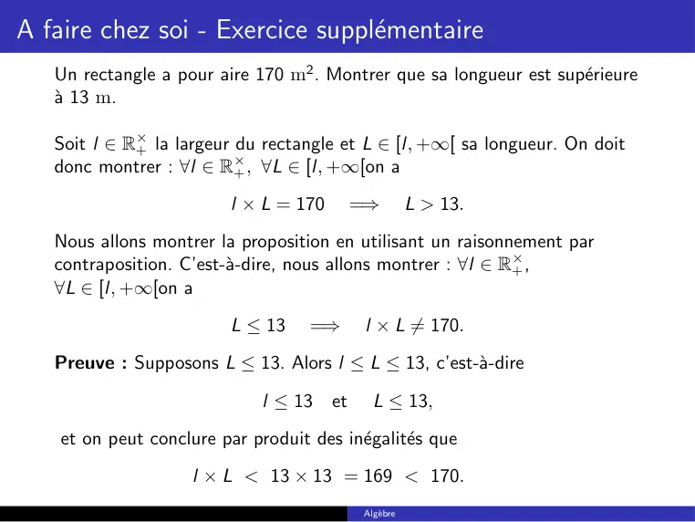

~~~text
A faire chez soi - Exercice supplémentaire
   Un rectangle a pour aire 170 m2 . Montrer que sa longueur est supérieure
   à 13 m.

   Soit l ∈ R×
             + la largeur du rectangle et L ∈ [l, +∞[ sa longueur. On doit
   donc montrer : ∀l ∈ R× + , ∀L ∈ [l, +∞[on a

                          l × L = 170        =⇒         L > 13.
   Nous allons montrer la proposition en utilisant un raisonnement par
   contraposition. C’est-à-dire, nous allons montrer : ∀l ∈ R×
                                                              +,
   ∀L ∈ [l, +∞[on a
                          L ≤ 13    =⇒        l × L 6= 170.
   Preuve : Supposons L ≤ 13. Alors l ≤ L ≤ 13, c’est-à-dire
                              l ≤ 13    et     L ≤ 13,
    et on peut conclure par produit des inégalités que
                     l × L < 13 × 13 = 169 < 170.
                                             Algèbre
~~~

## Page 53

~~~text
A faire chez soi - Exercice supplémentaire
   Démontrer que si vous rangez (n + 1) paires de chaussettes dans n tiroirs
   distincts, alors il y a au moins un tiroir contenant au moins deux paires de
   chaussettes.

   Preuve : Notons
        P = On a rangé n + 1 chaussettes dans n tiroirs distincts.
        Q = Il existe un tiroir contenant au moins deux paires de chaussettes.
   On doit donc montrer que
                                    P    =⇒       Q.
   Nous allons montrer la proposition en raisonant par l’absurde. C’est-à-dire on
   suppose

           P   et   (non Q),      et on essaye d’arriver a une contradiction

   Supposons donc que on a rangé (n + 1) chaussetes dans n tiroirs distincts, et
   que chaque tiroir contient au plus une paire de chaussettes. Alors il y aura au
   plus
                                 1 + 1 + ··· + 1 = n
   paires de chaussettes, ce qui contredit qu’il y en a (n + 1). Donc un tiroir doit
   contenir au moins deux paires de chaussettes.
                                              Algèbre
~~~

## Page 54

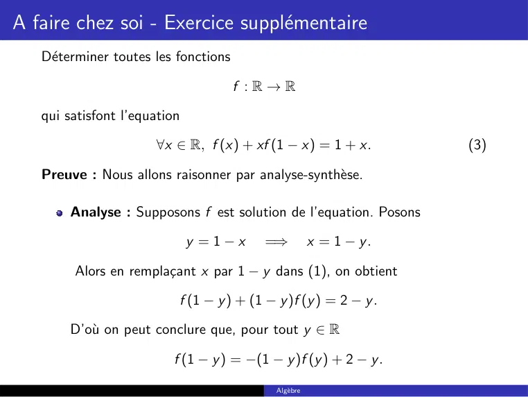

~~~text
A faire chez soi - Exercice supplémentaire
   Déterminer toutes les fonctions

                                      f :R→R

   qui satisfont l’equation

                      ∀x ∈ R, f (x) + xf (1 − x) = 1 + x.           (3)

   Preuve : Nous allons raisonner par analyse-synthèse.

        Analyse : Supposons f est solution de l’equation. Posons

                              y =1−x     =⇒            x = 1 − y.

        Alors en remplaçant x par 1 − y dans (1), on obtient

                          f (1 − y ) + (1 − y )f (y ) = 2 − y .

        D’où on peut conclure que, pour tout y ∈ R

                         f (1 − y ) = −(1 − y )f (y ) + 2 − y .

                                            Algèbre
~~~

## Page 55

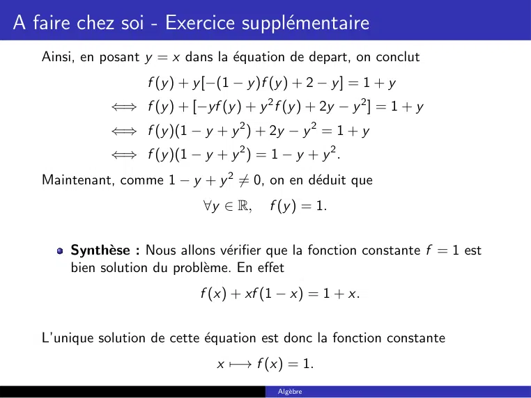

~~~text
A faire chez soi - Exercice supplémentaire
   Ainsi, en posant y = x dans la équation de depart, on conclut
                    f (y ) + y [−(1 − y )f (y ) + 2 − y ] = 1 + y
              ⇐⇒ f (y ) + [−yf (y ) + y 2 f (y ) + 2y − y 2 ] = 1 + y
              ⇐⇒ f (y )(1 − y + y 2 ) + 2y − y 2 = 1 + y
              ⇐⇒ f (y )(1 − y + y 2 ) = 1 − y + y 2 .
   Maintenant, comme 1 − y + y 2 6= 0, on en déduit que
                              ∀y ∈ R,     f (y ) = 1.

       Synthèse : Nous allons vérifier que la fonction constante f = 1 est
       bien solution du problème. En effet
                             f (x) + xf (1 − x) = 1 + x.

   L’unique solution de cette équation est donc la fonction constante
                                x 7−→ f (x) = 1.
                                           Algèbre
~~~

## Page 56

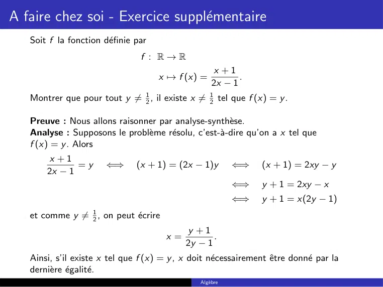

~~~text
A faire chez soi - Exercice supplémentaire
   Soit f la fonction définie par
                                f : R→R
                                                     x +1
                                     x 7→ f (x) =          .
                                                    2x − 1
   Montrer que pour tout y 6= 12 , il existe x 6= 21 tel que f (x) = y .

   Preuve : Nous allons raisonner par analyse-synthèse.
   Analyse : Supposons le problème résolu, c’est-à-dire qu’on a x tel que
   f (x) = y . Alors
       x +1
              =y       ⇐⇒      (x + 1) = (2x − 1)y         ⇐⇒    (x + 1) = 2xy − y
       2x − 1
                                                           ⇐⇒    y + 1 = 2xy − x
                                                           ⇐⇒    y + 1 = x(2y − 1)
   et comme y 6= 21 , on peut écrire
                                              y +1
                                        x=          .
                                             2y − 1
   Ainsi, s’il existe x tel que f (x) = y , x doit nécessairement être donné par la
   dernière égalité.
                                                Algèbre
~~~

## Page 57

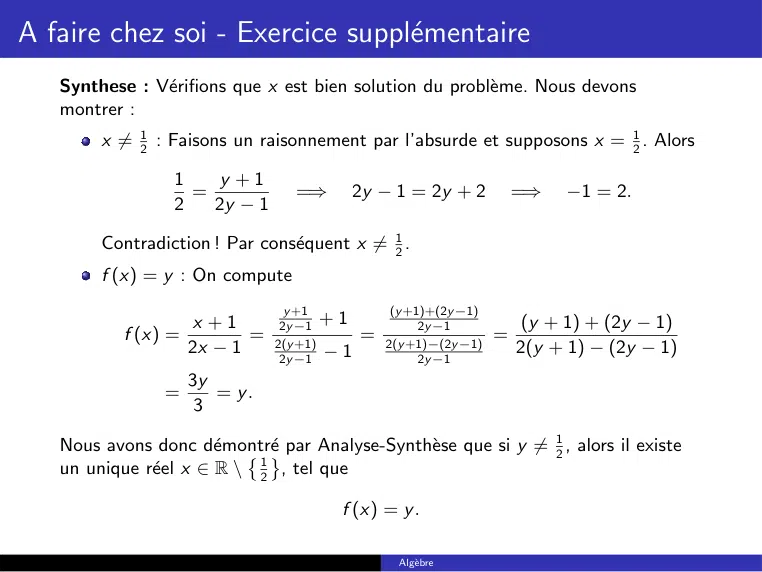

~~~text
A faire chez soi - Exercice supplémentaire
   Synthese : Vérifions que x est bien solution du problème. Nous devons
   montrer :
        x 6= 12 : Faisons un raisonnement par l’absurde et supposons x = 21 . Alors

                 1    y +1
                   =              =⇒     2y − 1 = 2y + 2     =⇒     −1 = 2.
                 2   2y − 1

        Contradiction ! Par conséquent x 6= 12 .
        f (x) = y : On compute
                                y +1        (y +1)+(2y −1)
                     x +1      2y −1
                                      +1         2y −1        (y + 1) + (2y − 1)
           f (x) =          = 2(y +1)    = 2(y +1)−(2y −1) =
                     2x − 1           −1                     2(y + 1) − (2y − 1)
                               2y −1                2y −1
                  3y
                =    = y.
                   3
                                                                1
                           1 par Analyse-Synthèse que si y 6= 2 , alors il existe
   Nous avons donc démontré
   un unique réel x ∈ R \ 2 , tel que

                                       f (x) = y .

                                               Algèbre
~~~

## Page 58

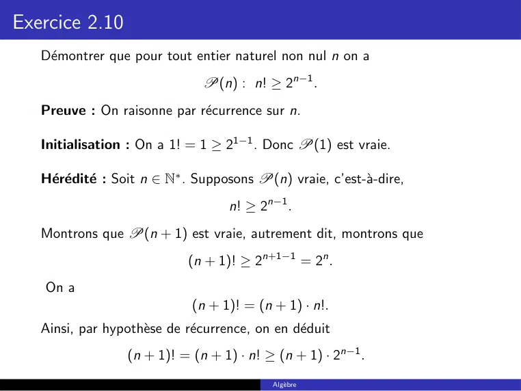

~~~text
Exercice 2.10
   Démontrer que pour tout entier naturel non nul n on a
                               P(n) : n! ≥ 2n−1 .
   Preuve : On raisonne par récurrence sur n.

   Initialisation : On a 1! = 1 ≥ 21−1 . Donc P(1) est vraie.

   Hérédité : Soit n ∈ N∗ . Supposons P(n) vraie, c’est-à-dire,
                                    n! ≥ 2n−1 .
   Montrons que P(n + 1) est vraie, autrement dit, montrons que
                            (n + 1)! ≥ 2n+1−1 = 2n .
   On a
                             (n + 1)! = (n + 1) · n!.
   Ainsi, par hypothèse de récurrence, on en déduit
                  (n + 1)! = (n + 1) · n! ≥ (n + 1) · 2n−1 .
                                           Algèbre
~~~

## Page 59

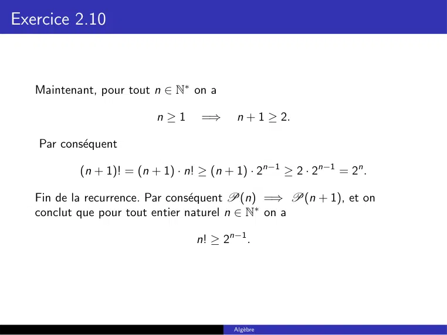

~~~text
Exercice 2.10

   Maintenant, pour tout n ∈ N∗ on a

                          n≥1      =⇒      n + 1 ≥ 2.

   Par conséquent

           (n + 1)! = (n + 1) · n! ≥ (n + 1) · 2n−1 ≥ 2 · 2n−1 = 2n .

   Fin de la recurrence. Par conséquent P(n) =⇒ P(n + 1), et on
   conclut que pour tout entier naturel n ∈ N∗ on a

                                  n! ≥ 2n−1 .

                                          Algèbre
~~~

## Page 60

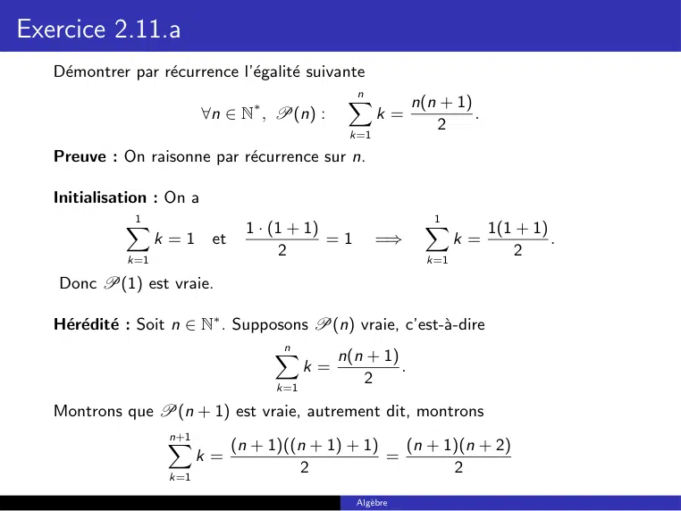

~~~text
Exercice 2.11.a
   Démontrer par récurrence l’égalité suivante
                                                 n
                                                 X           n(n + 1)
                          ∀n ∈ N∗ , P(n) :             k=             .
                                                                2
                                                 k=1

   Preuve : On raisonne par récurrence sur n.

   Initialisation : On a
                1                                              1
              X                  1 · (1 + 1)                   X          1(1 + 1)
                  k = 1 et                   =1        =⇒            k=            .
                                       2                                      2
              k=1                                              k=1

   Donc P(1) est vraie.

   Hérédité : Soit n ∈ N∗ . Supposons P(n) vraie, c’est-à-dire
                                    n
                                    X           n(n + 1)
                                           k=            .
                                                   2
                                     k=1

   Montrons que P(n + 1) est vraie, autrement dit, montrons
                    n+1
                    X          (n + 1)((n + 1) + 1)   (n + 1)(n + 2)
                          k=                        =
                                        2                   2
                    k=1

                                                  Algèbre
~~~

## Page 61

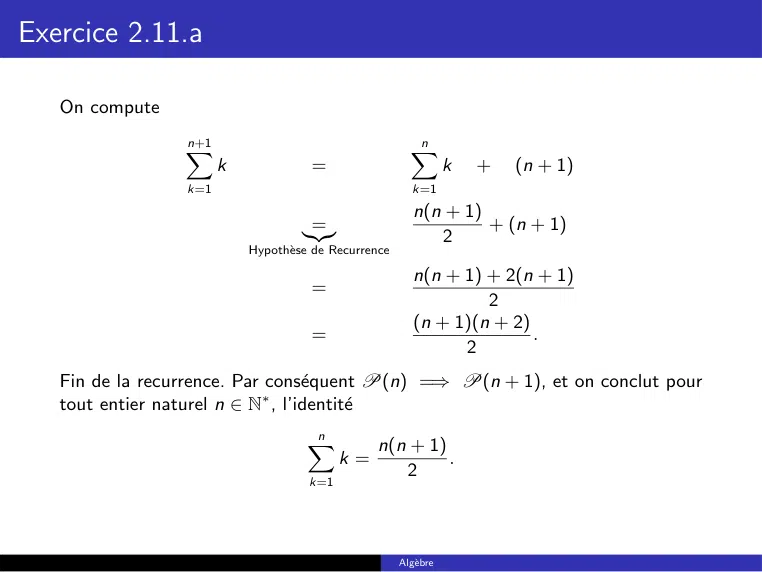

~~~text
Exercice 2.11.a

   On compute
                 n+1
                 X                                      n
                                                        X
                       k             =                           k   +   (n + 1)
                 k=1                                     k=1
                                                         n(n + 1)
                                     =                            + (n + 1)
                                    |{z}                    2
                           Hypothèse de Recurrence

                                                         n(n + 1) + 2(n + 1)
                                     =
                                                                  2
                                                         (n + 1)(n + 2)
                                     =                                  .
                                                               2
   Fin de la recurrence. Par conséquent P(n) =⇒ P(n + 1), et on conclut pour
   tout entier naturel n ∈ N∗ , l’identité
                                    n
                                    X           n(n + 1)
                                           k=            .
                                                   2
                                     k=1

                                                      Algèbre
~~~

## Page 62

~~~text
Exercice 2.11.b
   Démontrer par récurrence l’égalité suivante
                                               n
                                               X             n(n + 1)(2n + 1)
                        ∀n ∈ N∗ , P(n) :             k2 =                     .
                                                                    6
                                               k=1

   Preuve : On raisonne par récurrence sur n.

   Initialisation : On a
    1                                                                  1
   X                          1(1 + 1)(2 · 1 + 1)                      X            1(1 + 1)(2 · 1 + 1)
       k 2 = 12 = 1 et                            =1             =⇒          k2 =                       .
                                      6                                                     6
   k=1                                                                 k=1

   Donc P(1) est vraie.

   Hérédité : Soit n ∈ N∗ . Supposons P(n) vraie, c’est-à-dire
                                 n
                                 X             n(n + 1)(2n + 1)
                                        k2 =                    .
                                                      6
                                  k=1

   Montrons que P(n + 1) est vraie, autrement dit, montrons
         n+1
         X            (n + 1)((n + 1) + 1)(2(n + 1) + 1)   (n + 1)(n + 2)(2n + 3)
               k2 =                                      =
                                      6                              6
         k=1

                                                      Algèbre
~~~

## Page 63

~~~text
Exercice 2.11.b
   On compute
            n+1
            X                                     n
                                                  X
                  k2             =                      k2     +   (n + 1)2
            k=1                                   k=1
                                                  n(n + 1)(2n + 1)
                                 =                                 + (n + 1)2
                                |{z}                     6
                       Hypothèse de Recurrence

                                            n(n + 1)(2n + 1) + 6(n + 1)2
                                 =
                                                           6
                                            (n + 1)[n(2n + 1) + 6(n + 1)]
                              =
                                                           6
                                            (n + 1)[2n2 + 7n + 6]
                              =
                                                      6
                                            (n + 1)(n + 2)(2n + 3)
                              =                                    .
                                                       6
   Fin de la recurrence. Par conséquent P(n) =⇒ P(n + 1), et on conclut pour
   tout entier naturel n ∈ N∗ l’identité
                               n
                             X           n(n + 1)(2n + 1)
                                  k2 =                    .
                                                6
                                k=1

                                                    Algèbre
~~~

## Page 64

~~~text
Exercice 2.11.c
   Démontrer par récurrence l’égalité suivante
                                                     n                    n
                                                                                       !2
                                ∗
                                                     X                    X
                        ∀n ∈ N , P(n) :                    k = 3
                                                                                   k        .
                                                     k=1                  k=1

   Preuve : On raisonne par récurrence sur n.

   Initialisation : On a
                             1                                     1
                                                                              !2
                             X      3         3      2
                                                                   X
                                    k =1 =1 =                             k        .
                             k=1                                    k=1

   Donc P(1) est vraie.

   Hérédité : Soit n ∈ N∗ . Supposons P(n) vraie, c’est-à-dire,
                                        n            n
                                                                 !2
                                        X            X
                                              k3 =           k        .
                                        k=1          k=1
   Montrons que P(n + 1) est vraie, autrement dit, montrons
                              n+1        n+1
                                               !2
                             X     3
                                         X
                                  k =        k
                                        k=1              k=1

                                                         Algèbre
~~~

## Page 65

~~~text
Exercice 2.11.c
   On compute
                   n+1
                   X                                         n
                                                             X
                          k3               =                          k 3 + (n + 1)3
                   k=1                                       k=1
                                                                n
                                                                           !2
                                                                X
                                           =
                                          |{z}                         k        + (n + 1)3 .
                                Hypothèse de Recurrence         k=1

   Maintenant, d’après l’exercice (2.11.a) on peut écrire
                                           n
                                           X          n(n + 1)
                                                 k=
                                                         2
                                           k=1

   d’où on conclut
            n+1                           2
                                                                       n2 (n + 1)2
                          
            X                  n(n + 1)
                  k3 =                         + (n + 1)3 =                        + (n + 1)3
                                  2                                         4
            k=1

                        n2 (n + 1)2 + 4(n + 1)3    (n + 1)2 [n2 + 4(n + 1)]
                      =                         =
                                    4                          4
                        (n + 1)2 [n2 + 4n + 4]    (n + 1)2 (n + 2)2
                      =                        =
                                   4                     4
                                                           Algèbre
~~~

## Page 66

~~~text
Exercice 2.11.c

   Mais                                                                              !2
                                                                  2       n+1
            (n + 1)2 (n + 2)2
                                   
                                       (n + 1)(n + 2)                      X
                              =                                        =         k
                   4                         2
                                                                           k=1

   Donc
                             n+1              n+1
                                                             !2
                             X                X
                                   k3 =                k          .
                             k=1              k=1

   Fin de la recurrence. Par conséquent P(n) =⇒ P(n + 1), et on
   conclut pour tout entier naturel n ∈ N∗ l’identité

                     n             n
                                             !2
                     X             X                     n2 (n + 1)2
                           k3 =          k          =                .
                                                              4
                     k=1           k=1

                                                  Algèbre
~~~

## Page 67

~~~text
Exercice 2.12

   Démontrer que pour tout entier naturel n :

       P(n) :    3 divise (4n + 2).

       P(n) :    7 divise 32n+1 + 2n+2 .

       Soit un entier a ≥ 2 tel que 3 divise a2 − a. Démontrer que pour
       tout entier naturel n ≥ 2, 3 divise an − a.

       P(n) :    17 divise 3 · 52n+1 + 23n+1 .

   Preuve : On raisonne par récurrence sur n.

                                           Algèbre
~~~

## Page 68

~~~text
Exercice 2.12

                       ∀n ∈ N, P(n) :      3 divise 4n + 2.
   Initialisation : On a 40 + 2 = 1 + 2 = 3. Donc P(0) est vraie.

   Hérédité : Soit n ∈ N. Supposons P(n) vraie, c’est-à-dire
           4n + 2 est divisible par 3   ⇐⇒            4n + 2 = 3k,   k ∈ Z.
   Montrons que P(n + 1) est vraie, autrement dit, montrons
                           ∃k 0 ∈ Z,    4n+1 + 2 = 3k 0
   On a
          4n+1 + 2 = 4 · 4n + 2
                    = 4(3k − 2) + 2 (Hypothèse de Recurrence)
                    = 3 · 4k − 8 + 2
                    = 3 · 4k − 6 = 3(4k − 2).
                                    | {z }
                                           k0

                                           Algèbre
~~~

## Page 69

~~~text
Exercice 2.12

   C’est-à-dire 4n+1 + 2 est divisible par 3. Fin de la recurrence. Par
   conséquent P(n) =⇒ P(n + 1), et on conclut que pour tout entier
   naturel n on a
                                   3 divise 4n + 2

                                         Algèbre
~~~

## Page 70

~~~text
Exercice 2.12

                     ∀n ∈ N, P(n) :         7 divise 32n+1 + 2n+2
   Initialisation : On a 32·0+1 + 20+2 = 3 + 4 = 7. Donc P(0) est vraie.

   Hérédité : Soit n ∈ N. Supposons P(n) vraie, c’est-à-dire
    32n+1 + 2n+2 est divisible par 7        ⇐⇒              32n+1 + 2n+2 = 7k,   k ∈ Z.
   Montrons que P(n + 1) est vraie, autrement dit, montrons
                      ∃k 0 ∈ Z,    32(n+1)+1 + 2(n+1)+2 = 7k 0
   On a
   32(n+1)+1 + 2(n+1)+2 = 32 · 32n+1 + 2 · 2n+2
                       = 32 (7k − 2n+2 ) + 2 · 2n+2           (Hypothèse de Recurrence)
                                          n+2           n+2
                       = 9 · 7k − 9 · 2         +2·2
                       = 7 · 9k − (9 − 2)2n+2 = 7(9k − 2n+2 ).
                                                 |   {z    }
                                                                 k0

                                                 Algèbre
~~~

## Page 71

~~~text
Exercice 2.12

   C’est-à-dire 32(n+1)+1 + 2(n+1)+2 est divisible par 7. Fin de la recurrence.
   Par conséquent P(n) =⇒ P(n + 1), et on conclut que pour tout entier
   naturel n on a
                               7 divise 32n+1 + 2n+2 .

                                           Algèbre
~~~

## Page 72

~~~text
Exercice 2.12
   Soit un entier a ≥ 2 tel que 3 divise a2 − a. Montrer la propriété :
                     ∀n ∈ N, P(n) : n ≥ 2, 3 divise an − a.

   Initialisation : La propriété est vraie au rang 2 d’après l’énoncé.
   Hérédité : Soit n ∈ N avec n ≥ 2. Supposons P(n) vraie, c’est-à-dire

                             3 divise an − a.

   Montrons que P(n + 1) est vraie, autrement dit, montrons

                             3 divise an+1 − a.
   On a

                       an+1 − a     = an+1 − a2 + a2 − a
                                    = a(an − a) + (a2 − a)

   Or 3 divise an − a par l’hypothèse de récurrence et 3 divise a2 − a. Donc
   3 divise la somme. C’est-à-dire : 3 divise an+1 − a.
                                              Algèbre
~~~

## Page 73

~~~text
Exercice 2.12

   Fin de la recurrence. Par conséquent P(n) =⇒ P(n + 1), et on a donc
   bien la propriété :

                    3 divise an − a pour tout entier n ≥ 2.

                                       Algèbre
~~~

## Page 74

~~~text
Exercice 2.12

                   ∀n ∈ N, P(n) :           17 divise 3 · 52n+1 + 23n+1
   Initialisation : On a 3 · 52·0+1 + 23·0+1 = 3 · 5 + 2 = 17. Donc P(0) est
   vraie.

   Hérédité : Soit n ∈ N. Supposons P(n) vraie, c’est-à-dire
   3 · 52n+1 + 23n+1 est divisible par 17     ⇐⇒        3 · 52n+1 + 23n+1 = 17k,   k ∈ Z.
   Montrons que P(n + 1) est vraie, autrement dit, montrons
                       ∃k 0 ∈ Z,   3 · 52(n+1)+1 + 23(n+1)+1 = 17k 0
   On a
   3 · 52(n+1)+1 + 23(n+1)+1 = 3 · 25 · 52n+1 + 8 · 23n+1
                            = 25(17k − 23n+1 ) + 8 · 23n+1 (Hypothèse de Recurrence)
                            = 25 · 17k − 25 · 23n+1 + 8 · 23n+1
                            = 17 · 25k − (25 − 8)23n+1 = 17(25k − 23n+1 ).
                                                           |    {z     }
                                                                         k0

                                                 Algèbre
~~~

## Page 75

~~~text
Exercice 2.12

   C’est-à-dire 3 · 52(n+1)+1 + 23(n+1)+1 est divisible par 17. Fin de la
   recurrence. Par conséquent P(n) =⇒ P(n + 1), et on conclut que
   pour tout entier naturel n on a

                           17 divise 3 · 52n+1 + 23n+1

                                          Algèbre
~~~

## Page 76

~~~text
Exercice 2.13
   Soit (un ) la suite réelle déterminée par u0 = 2, u1 = 3 et pour tout
   n∈N:
                                   un+2 = 3un+1 − 2un .
   Montrer que pour tout n ∈ N : un = 2n + 1.

   Preuve : On raisonne par récurrence double sur n.

   Initialisation : On a
            u0 = 2 = 1 + 1 = 20 + 1      et    u1 = 3 = 2 + 1 = 21 + 1.
   Donc P(0) et P(1) sont vrais.

   Hérédité : Soit n ∈ N. Supposons P(n) et P(n + 1) sont vrais,
   c’est-à-dire
                        un = 2n + 1 et un+1 = 2n+1 + 1.
   Montrons que P(n + 2) est vraie, autrement dit, montrons que
                                 un+2 = 2n+2 + 1.
                                              Algèbre
~~~

## Page 77

~~~text
Exercice 2.13

   On a

      un+2 = 3un+1 − 2un
           = 3(2n+1 + 1) − 2(2n + 1)             (Hypothèse de Récurrence)
                   n+1              n+1
           = 3·2         +3−2             −2
                              n+1
           = (3 − 1) · 2            +1
                   n+1
           = 2·2         +1
                 n+2
           = 2         + 1.

   Fin de la recurrence. Par conséquent P(n) et P(n + 1) =⇒ P(n + 2),
   et on conclut que pour tout entier naturel n on a

                                         un = 2n + 1.

                                                Algèbre
~~~

## Page 78

~~~text
A faire chez soi - Exercice 2.14
   Démontrer par récurrence l’égalité suivante
                                     n
                                     X            1             n(n + 3)
              ∀n ∈ N∗ , P(n) :                             =                 .
                                           k(k + 1)(k + 2)   4(n + 1)(n + 2)
                                     k=1

   Preuve : On raisonne par récurrence sur n.

   Initialisation : On a
                1
              X          1                        1              1(1 + 3)
                                       =                   =                 .
                     k(k + 1)(k + 2)       1(1 + 1)(1 + 2)   4(1 + 1)(1 + 2)
               k=1

    Donc P(1) est vraie.

   Hérédité : Soit n ∈ N∗ . Supposons P(n) vraie, c’est-à-dire
                          n
                          X            1             n(n + 3)
                                                =                 .
                                k(k + 1)(k + 2)   4(n + 1)(n + 2)
                          k=1

   Montrons que P(n + 1) est vraie, autrement dit, montrons
      n+1
      X             1             (n + 1)((n + 1) + 3)        (n + 1)(n + 4)
                             =                             =                 .
             k(k + 1)(k + 2)   4((n + 1) + 1)((n + 1) + 2)   4(n + 2)(n + 3)
       k=1

                                                  Algèbre
~~~

## Page 79

~~~text
A faire chez soi - Exercice 2.14
   On compute
     n+1                               n
                                                                !
     X            1                    X            1                             1
                           =                                        +
           k(k + 1)(k + 2)                   k(k + 1)(k + 2)            (n + 1)(n + 2)(n + 3)
     k=1                               k=1
                                     n(n + 3)                 1
                 =                                +
                |{z}              4(n + 1)(n + 2)   (n + 1)(n + 2)(n + 3)
       Hypothèse de Recurrence

                                            n(n + 3)2                    4
                                  =                          +
                                      4(n + 1)(n + 2)(n + 3)   4(n + 1)(n + 2)(n + 3)
                                          n(n + 3)2 + 4          n3 + 6n2 + 9n + 4
                                  =                          =
                                      4(n + 1)(n + 2)(n + 3)   4(n + 1)(n + 2)(n + 3)
                                      (n3 + 5n2 + 4n) + (n2 + 5n + 4)
                                  =
                                           4(n + 1)(n + 2)(n + 3)
                                      n(n2 + 5n + 4) + (n2 + 5n + 4)
                                  =
                                          4(n + 1)(n + 2)(n + 3)
                                     (n + 1)(n2 + 5n + 4)     (n + 1)(n + 1)(n + 4)
                                  =                        =
                                    4(n + 1)(n + 2)(n + 3)   4(n + 1)(n + 2)(n + 3)
                                     (n + 1)(n + 4)
                                  =
                                    4(n + 2)(n + 3)
                                                     Algèbre
~~~

## Page 80

~~~text
A faire chez soi - Exercice 2.14

   Fin de la recurrence. Par conséquent P(n) =⇒ P(n + 1), et on
   conclut pour tout entier naturel n ∈ N∗ l’identité
                  n
                  X            1             n(n + 3)
                                        =
                        k(k + 1)(k + 2)   4(n + 1)(n + 2)
                  k=1

                                        Algèbre
~~~

## Page 81

~~~text
A faire chez soi - 2.16
   Soit (un ) la suite réelle déterminée par u0 = 0, u1 = 0, u2 = 2 et pour
   tout n ∈ N :
                              un+3 = 3un+2 − 3un+1 + un .
   Montrer que pour tout n ∈ N : un = n(n − 1).

   Preuve : On raisonne par récurrence triple sur n.

   Initialisation : On a
     u0 = 0 = 0(0 − 1)     et    u1 = 0 = 1(1 − 1) et           u2 = 2 = 2(2 − 1).
    Donc P(0), P(1) et P(2) sont vrais.

   Hérédité : Soit n ∈ N. Supposons P(n), P(n + 1) et P(n + 2) sont
   vrais, c’est-à-dire
      un = n(n − 1) et      un+1 = (n + 1)n            et   un+2 = (n + 2)(n + 1).
    Montrons que P(n + 3) est vraie, autrement dit, montrons que
                                un+3 = (n + 3)(n + 2).
                                            Algèbre
~~~

## Page 82

~~~text
A faire chez soi - 2.16
   On a

               un+3 = 3un+2 − 3un+1 + un
                     = 3(n + 2)(n + 1) − 3(n + 1)n + n(n − 1)
                     = 3(n + 2)(n + 1) + n(n − 1 − 3(n + 1))
                     = 3(n + 2)(n + 1) + n(−2n − 4)
                     = 3(n + 2)(n + 1) − 2n(n + 2)
                     = (n + 2)(3(n + 1) − 2n)
                     = (n + 2)(n + 3).

   Fin de la recurrence. Par conséquent

               P(n), P(n + 1) et P(n + 2) =⇒ P(n + 3),

   et on conclut que pour tout entier naturel n on a

                                un = n(n − 1).

                                           Algèbre
~~~

## Page 83

~~~text
A faire chez soi - Exercice supplémentaire
   Démontrer que pour tout entier non nul n on a :
                                   n
                                   X
                                         k · k! = (n + 1)! − 1.
                                   k=1

   Preuve : On raisonne par récurrence sur n.

   Initialisation : On a
                        X1
                                k · k! = 1 · 1! = 1 = 2 − 1 = 2! − 1.
                          k=1

    Donc P(0) est vraie.

   Hérédité : Soit n ∈ N. Supposons P(n) vraie, c’est-à-dire
                                   n
                                   X
                                         k · k! = (n + 1)! − 1.
                                   k=1

   Montrons que P(n + 1) est vraie, autrement dit, montrons
                    n+1
                    X
                          k · k! = ((n + 1) + 1)! − 1 = (n + 2)! − 1.
                    k=1

                                                    Algèbre
~~~

## Page 84

~~~text
A faire chez soi - Exercice supplémentaire

   On compute
         n+1                                         n
                                                                 !
         X                                           X
                k · k!             =                        k · k!   + (n + 1) · (n + 1)!
          k=1                                         k=1
                                   =
                                  |{z}              (n + 1)! − 1 + (n + 1) · (n + 1)!
                         Hypothèse de Recurrence

                                   =                (n + 1)!(1 + (n + 1)) − 1
                                   =                (n + 1)!(n + 2) − 1
                                   =                (n + 2)! − 1.

   Fin de la recurrence. Par conséquent P(n) =⇒ P(n + 1), et on conclut pour
   tout entier naturel n l’identité
                                    n
                                    X
                                          k · k! = (n + 1)! − 1.
                                    k=1

                                                      Algèbre
~~~

## Page 85

~~~text
A faire chez soi - Exercice supplémentaire
   Soit (un ) la suite réelle déterminée par u0 = 1, u1 = cos(θ) et pour
   n≥2:
                                  un = 2u1 un−1 − un−2 .
   Montrer que pour tout n ∈ N : un = cos(nθ).

   Preuve : On raisonne par récurrence double sur n.

   Initialisation : On a
                       u0 = 1 = cos(0)     et     u1 = cos(θ).
    Donc P(0) et P(1) sont vrais.

   Hérédité : Soit n ∈ N. Supposons P(n) et P(n + 1) sont vrais,
   c’est-à-dire
                     un = cos(nθ) et un+1 = cos((n + 1)θ).
    Montrons que P(n + 2) est vraie, autrement dit, montrons que
                       un+2 = 2u1 un+1 − un cos((n + 2)θ).
                                            Algèbre
~~~

## Page 86

~~~text
A faire chez soi - Exercice supplémentaire

   On a

   un+2 = 2u1 un+1 − un
          = 2 cos(θ) cos((n + 1)θ) − cos(nθ)           (Hypothèse de Récurrence)
          = 2 cos(θ)(cos(nθ) cos(θ) − sin(nθ) sin(θ)) − cos(nθ)
          = 2 cos2 (θ) cos(nθ) − 2 sin(nθ) cos(θ) sin(θ) − cos(nθ)
          = cos(nθ)(2 cos2 (θ) − 1) − sin(nθ)2 cos(θ) sin(θ)
          = cos(nθ) cos(2θ) − sin(nθ) sin(2θ)
          = cos(nθ + 2θ)
          = cos((n + 2)θ)

   Fin de la recurrence. Par conséquent P(n) et P(n + 1) =⇒ P(n + 2),
   et on conclut que pour tout entier naturel n on a

                                  un = cos(nθ).

                                            Algèbre
~~~

## Page 87

~~~text
Pour aller plus loin - Exercice 2.17
   Démontrer que
                                                                      n
                                                                              !
              ∗                                  ∗
                                                                      X     n n−k k
      ∀n ∈ N , P(n) : ∀(a, b) ∈ R , ∀n ∈ N ,
                                      2                         n
                                                          (a + b) =             a b .
                                                                            k
                                                                      k=0

   Quelques rappels :

   Pour toute couple d’entiers 0 ≤ k ≤ n on appelle coefficient binomial le
   nombre                            !
                                   n         n!
                                       =            .
                                   k     k!(n − k)!
   Le nombre kn se lit : k parmi n. Le coefficient binomial satisfait les propriétés
                

   suivants :
        Pour tout n ∈ N on a n0 = 1 = nn . (Rappel : 0 !=1).
                                         

        Formule de Pascal : pour tous entiers n et k tels que 0 < k ≤ n on a
                                 !            !            !
                              n         n−1          n−1
                                    =            +           .
                            k +1        k +1           k

                                               Algèbre
~~~

## Page 88

~~~text
Pour aller plus loin - Exercice 2.17
                                                                 n
                                                                          !
                                             ∗
                                                                 X      n n−k k
           P(n) : ∀(a, b) ∈ R , ∀n ∈ N ,
                             2
                                                   (a + b) = n
                                                                           a b .
                                                                        k
                                                                 k=0

   Preuve : On fixe a, b ∈ R et on raisonne par récurrence sur n.
   Initialisation : On a
                                                  1  
                                   1          1 0     X  1 1−k k
           (a + b)1 = a + b =         ab 0 +     a b=      a b .
                                   0          1          k
                                                                  k=0

    Donc P(1) est vraie.

   Hérédité : Soit n ∈ N× . Supposons P(n) vraie, c’est-à-dire
                                            n
                                                     !
                                       n
                                            X      n n−k k
                           (a + b) =                  a b .
                                                   k
                                            k=0

    Montrons que P(n + 1) est vraie, autrement dit, montrons
                                         n+1
                                                  !
                                 n+1
                                         X   n + 1 n+1−k k
                       (a + b)         =            a   b .
                                               k
                                           k=0
                                                  Algèbre
~~~

## Page 89

~~~text
Pour aller plus loin - Exercice 2.17
   On a

   (a + b)n+1 = (a + b)(a + b)n
                           n
                                 !
                          X    n n−k k
              = (a + b)             a b        (Hypothèse de Recurrence)
                               k
                          k=0
                   n
                          !               n
                                                 !
                X       n n+1−k k X n n−k k+1
              =             a      b +             a b
                        k                      k
                 k=0                     k=0
                     !            n
                                         !          !     n−1
                                                                 !        !        !
                   n n+1        X      n n+1−k k          X    n n−k k+1         n n+1
              =        a     +             a      b   +           a b       +        b .
                   0                   k                       k                 n
                                k=1                       k=0
                             n
                                   !           !     n−1
                                                             !       !
                  n+1
                           X     n n+1−k k           X     n n−k k+1
              =a      +              a       b    +           a b      + b n+1 .
                                 k                         k
                          k=1                           k=0

   Maintenant, en utilisant le changement d’indice l = k + 1 on peut écrire
        n−1
               !                n
                                         !             n
                                                                !
        X    n n−k k+1 X              n     n+1−l l
                                                      X      n
                 a b       =              a      b =              an+1−k b k .
             k                      l −1                   k −1
          k=0                   l=1                           k=1

                                             Algèbre
~~~

## Page 90

~~~text
Pour aller plus loin - Exercice 2.17
   D’où on conclut
                                n
                                            !       !                      n
                                                                                      !           !
                                X         n n+1−k k                        X        n
   (a + b)n+1 = an+1 +                        a  b    +                                 an+1−k b k + b n+1
                                          k                                       k −1
                                k=1                                        k=1

   Ce qui est équivalent à
                                              n
                                                    "       !               !#           !
                    n+1        n+1
                                              X         n                 n      n+1−k k
          (a + b)         =a         +                          +              a      b    + b n+1 .
                                                        k               k −1
                                              k=1

   Maintenant, la formule de Pascal nous dit
                              !          !                                        !
                            n        n                                     n+1
                                +          =
                            k      k −1                                     k

   Ce qui nous permet d’écrire
                                                n
                                                        "       !                 !#                       !
                  n+1               n+1
                                                X           n                n             n+1−k       k
        (a + b)           =     a         +                         +                  a           b           + b n+1
                                                            k              k −1
                                                k=1
                                                n
                                                       !        !
                                                X n + 1 n+1−k k
                          =     an+1 +                  a    b    + b n+1 .
                                                    k
                                                k=1

                                                                Algèbre
~~~

## Page 91

~~~text
Pour aller plus loin - Exercice 2.17

   Ainsi
                                n                    !
                              X      n +  1
   (a + b)n+1   =   an+1 +                   an+1−k b k + b n+1
                                       k
                              k=1
                                        n                  !       
                      n + 1 n+1          X     n + 1 n+1−k k       n + 1 n+1
                =             a     +                  a    b   +         b
                        0                        k                 n+1
                                         k=1
                    n+1        
                    X     n + 1 n+1−k k
                =                 a        b .
                            k
                    k=0

   Fin de la recurrence. Par conséquent P(n) =⇒ P(n + 1), et on
   conclut que pour tout entier n ∈ N∗ on a
                                       n  
                                       X  n
                          (a + b)n =                    an−k b k .
                                               k
                                       k=0

                                             Algèbre
~~~

## Page 92

~~~text
Pour aller plus loin - Exercice 2.18

   On revient sur la propriété :
      Tout ensemble fini de N non vide admet un plus grand élément.
   Pour définir N, on peut soit admettre cette propriété et démontrer
   l’axiome de récurrence, soit admettre l’axiome de récurrence et en
   déduire cette propriété.
   Démontrer que si l’on admet l’axiome de récurrence, on peut démontrer
   la propriété.
   Réponse : Soit la propriété :

   ∀n ∈ N∗ , Pn : tout ensemble à n élement admet un plus grand élément.

   Initialisation : La propriété est vraie au rang 1 : un ensemble à 1
   élément admet un plus grand élément : l’unique élément de l’ensemble.

                                           Algèbre
~~~

## Page 93

~~~text
Pour aller plus loin - Exercice 2.18

   Hérédité : Soit n ∈ N∗ . On suppose que Pn est vraie (hypothèse de
   récurrence).
   On considère un ensemble A à n + 1 éléments. On choisit un élement α
   de A. Alors
                                    A \ {α}
   est un ensemble à n élements. D’après l’hypothèse de récurrence il admet
   un plus grand élément β. Nous avons deux cas à étudier :
     • Si α ≥ β alors α est le plus grand élément de A.
     • Sinon, β est le plus grand élément de A.
   Dans tous les cas, A admet un plus grand élément donc Pn+1 est vraie.

   Par conséquent, pour tout n ∈ N∗ , Pn : tout ensemble à n élement
   admet un plus grand élément.

                                           Algèbre
~~~
