# TD2-Ensembles-Correction_2024-2025_Algebre1_P1S1_NArancibia.pdf

[Ouvrir l’original](https://drive.google.com/open?id=1aBgE1o8uzVtj-P2LoiqeXf26u1ZgcAUl) · Les deux lectures automatiques du PDF divergent sur les pages indiquées. Leur fac-similé accompagne le texte.

**Pages présentant un écart entre les deux extractions** — 1, 3–6, 8–10, 14, 16–18, 20, 22–25, 29–30, 33–34, 36–38, 41.

## Page 1

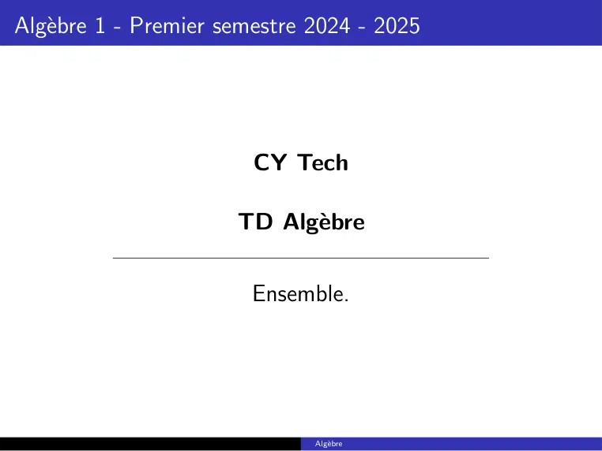

~~~text
Algèbre 1 - Premier semestre 2024 - 2025

                        CY Tech

                      TD Algèbre

                        Ensemble.

                              Algèbre
~~~

## Page 2

~~~text
Exercice 1

   Soient A et B deux parties de E .
    1. Montrer que (Ac )c = A
    2. Soit A ⊂ B. Montrer que B c ⊂ Ac .
    3. Montrer les  Lois de Morgan  :

                  (A ∩ B)c = Ac ∪ B c   et    (A ∪ B)c = Ac ∩ B c .

                                        Algèbre
~~~

## Page 3

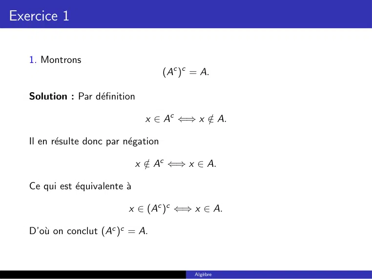

~~~text
Exercice 1

   1. Montrons
                                       (Ac )c = A.

   Solution : Par définition

                                 x ∈ Ac ⇐⇒ x ∈
                                             / A.

   Il en résulte donc par négation

                                 / Ac ⇐⇒ x ∈ A.
                                x∈

   Ce qui est équivalente à

                            x ∈ (Ac )c ⇐⇒ x ∈ A.

   D’où on conclut (Ac )c = A.

                                              Algèbre
~~~

## Page 4

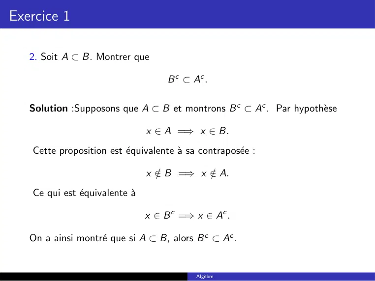

~~~text
Exercice 1

   2. Soit A ⊂ B. Montrer que

                                     B c ⊂ Ac .

   Solution :Supposons que A ⊂ B et montrons B c ⊂ Ac . Par hypothèse

                                x ∈ A =⇒ x ∈ B.
   Cette proposition est équivalente à sa contraposée :

                                x∈
                                 / B =⇒ x ∈
                                          / A.
   Ce qui est équivalente à

                                x ∈ B c =⇒ x ∈ Ac .

   On a ainsi montré que si A ⊂ B, alors B c ⊂ Ac .

                                            Algèbre
~~~

## Page 5

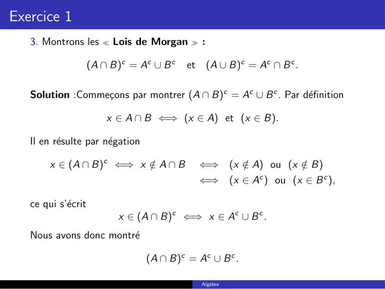

~~~text
Exercice 1
   3. Montrons les  Lois de Morgan  :

                     (A ∩ B)c = Ac ∪ B c   et    (A ∪ B)c = Ac ∩ B c .

   Solution :Commeçons par montrer (A ∩ B)c = Ac ∪ B c . Par définition

                         x ∈ A ∩ B ⇐⇒ (x ∈ A) et (x ∈ B).

   Il en résulte par négation

        x ∈ (A ∩ B)c ⇐⇒ x ∈
                          / A∩B                 ⇐⇒         (x ∈
                                                              / A) ou (x ∈
                                                                         / B)
                                                ⇐⇒         (x ∈ Ac ) ou (x ∈ B c ),

   ce qui s’écrit
                           x ∈ (A ∩ B)c ⇐⇒ x ∈ Ac ∪ B c .
   Nous avons donc montré

                                  (A ∩ B)c = Ac ∪ B c .

                                                Algèbre
~~~

## Page 6

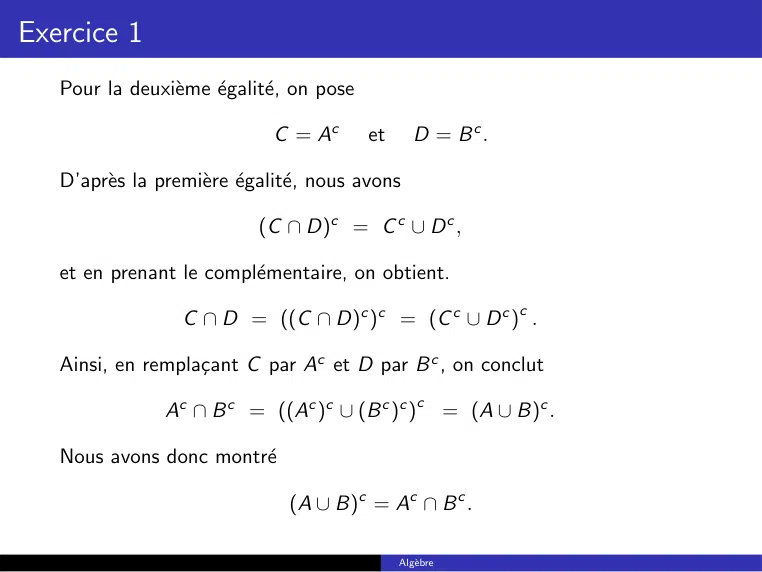

~~~text
Exercice 1
   Pour la deuxième égalité, on pose

                             C = Ac       et      D = Bc .

   D’après la première égalité, nous avons

                            (C ∩ D)c = C c ∪ D c ,

   et en prenant le complémentaire, on obtient.
                                                                  c
                  C ∩ D = ((C ∩ D)c )c = (C c ∪ D c ) .

   Ainsi, en remplaçant C par Ac et D par B c , on conclut
                                                   c
                Ac ∩ B c = ((Ac )c ∪ (B c )c )            = (A ∪ B)c .

   Nous avons donc montré

                               (A ∪ B)c = Ac ∩ B c .

                                               Algèbre
~~~

## Page 7

~~~text
Exercice 2
   Soit A, B, C , D des parties d’un ensemble E . Montrer que :
     1  (A \ B) \ C = A \ (B ∪ C ).
     2  (A \ B) ∩ (C \ D) = (A ∩ C ) \ (B ∪ D).
     3  A \ (B ∩ C ) = (A \ B) ∪ (A \ C ).
     4  A \ (B ∪ C ) = (A \ B) ∩ (A \ C ).
   Rappelons que

               A \ B = {x ∈ E : x ∈ A et               x 6∈ B} = A ∩ B c .

   Solution : On a

                (A \ B) \ C           =                  (A \ B) ∩ C c
                                      =                  (A ∩ B c ) ∩ C c
                                      =                  A ∩ (B c ∩ C c )
                                      =
                                     |{z}                A ∩ (B ∪ C )c
                              par la loi de Morgan
                                      =                  A \ (B ∪ C ).

                                            Algèbre
~~~

## Page 8

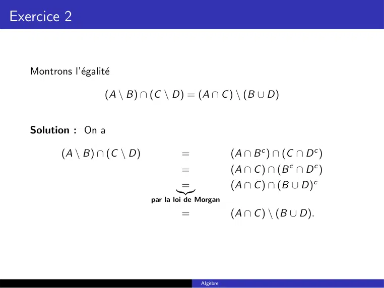

~~~text
Exercice 2

   Montrons l’égalité

                     (A \ B) ∩ (C \ D) = (A ∩ C ) \ (B ∪ D)

   Solution : On a

          (A \ B) ∩ (C \ D)            =                (A ∩ B c ) ∩ (C ∩ D c )
                                       =                (A ∩ C ) ∩ (B c ∩ D c )
                                       =
                                      |{z}              (A ∩ C ) ∩ (B ∪ D)c
                               par la loi de Morgan
                                       =                (A ∩ C ) \ (B ∪ D).

                                             Algèbre
~~~

## Page 9

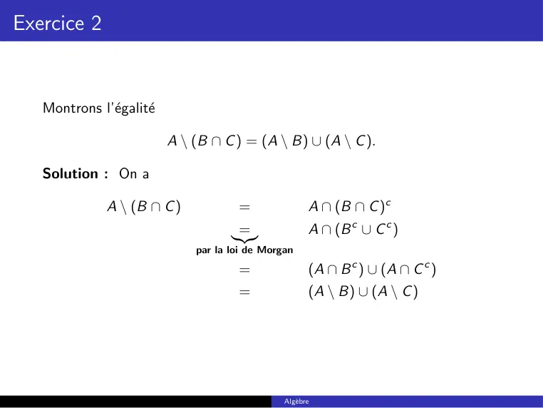

~~~text
Exercice 2

   Montrons l’égalité

                          A \ (B ∩ C ) = (A \ B) ∪ (A \ C ).

   Solution : On a

              A \ (B ∩ C )            =                A ∩ (B ∩ C )c
                                      =
                                     |{z}              A ∩ (B c ∪ C c )
                              par la loi de Morgan
                                      =                (A ∩ B c ) ∪ (A ∩ C c )
                                      =                (A \ B) ∪ (A \ C )

                                                Algèbre
~~~

## Page 10

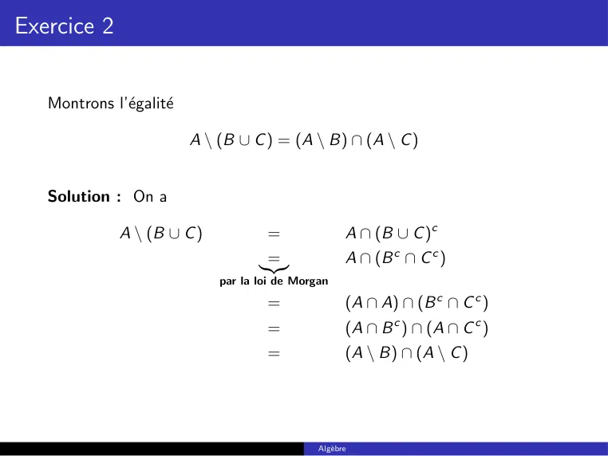

~~~text
Exercice 2

   Montrons l’égalité

                          A \ (B ∪ C ) = (A \ B) ∩ (A \ C )

   Solution : On a

              A \ (B ∪ C )            =                A ∩ (B ∪ C )c
                                      =
                                     |{z}              A ∩ (B c ∩ C c )
                              par la loi de Morgan
                                      =                (A ∩ A) ∩ (B c ∩ C c )
                                      =                (A ∩ B c ) ∩ (A ∩ C c )
                                      =                (A \ B) ∩ (A \ C )

                                                Algèbre
~~~

## Page 11

~~~text
Exercice 3

   Soit A et B deux parties d’un ensemble E.
       Montrer :

                             A ⊂ B ⇐⇒ A ∪ B = B

       et

                             A ⊂ B ⇐⇒ Ac ∪ B = E

       En déduire :
                             A ⊂ B ⇐⇒ A ∩ B = A
       et
                             A ⊂ B ⇐⇒ A ∩ B c = ∅

                                        Algèbre
~~~

## Page 12

~~~text
Exercice 3
   Montrons
                              A ⊂ B ⇐⇒ A ∪ B = B
   Solution : On raisonne par double implication.
       =⇒: Supposons A ⊂ B et montrons la proposition
                                      A ∪ B = B.
       On raisonne par double inclusion :
              Clairement, B ⊂ A ∪ B.
              Montrons que A ∪ B ⊂ B. Par définition
                x ∈A∪B       ⇐⇒     x ∈A⊂B             ou    x ∈B    =⇒   x ∈ B.
              Donc A ∪ B ⊂ B.
       ⇐=: Supposons A ∪ B = B et montrons la proposition
                                        A ⊂ B.
       On a
                           A⊂A∪B =B              =⇒         A ⊂ B.
                                            Algèbre
~~~

## Page 13

~~~text
Exercice 3
   Montrons
                            A ⊂ B ⇐⇒ Ac ∪ B = E
   Solution : On raisonne par double implication.
        =⇒: Supposons A ⊂ B et montrons la proposition
                                     Ac ∪ B = E .
       On raisonne par double inclusion :
           Clairement, Ac ∪ B ⊂ E .
           Montrons que E ⊂ Ac ∪ B. Comme A ⊂ B, on peut écrire
                             E = A ∪ Ac ⊂ B ∪ Ac = Ac ∪ B.

       ⇐=: Supposons Ac ∪ B = E et montrons la proposition
                                       A ⊂ B.
                       c
       On a A ⊂ E = A ∪ B. Donc
                    x ∈ A ⊂ Ac ∪ B    ⇐⇒        x ∈ Ac   ou   x ∈ B.
                                           c
       Mais comme x ∈ A, on conclut x ∈
                                      / A et donc x ∈ B. Par conséquent
       A ⊂ B.
                                          Algèbre
~~~

## Page 14

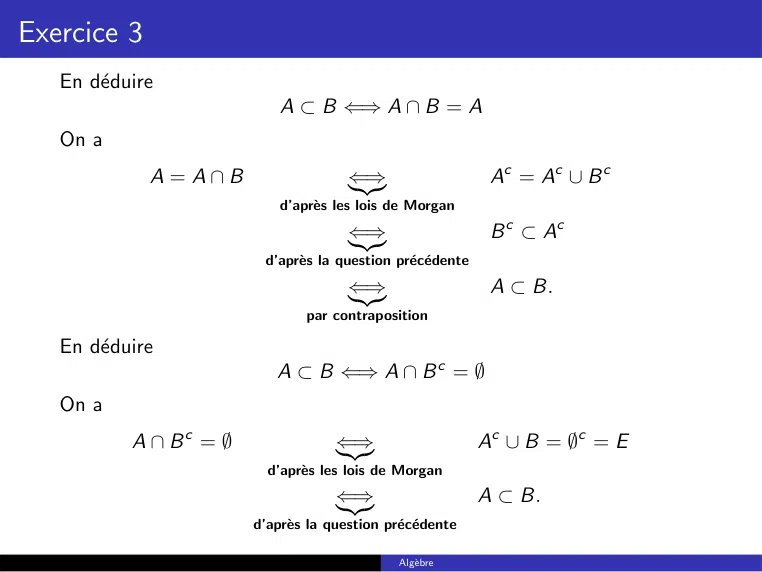

~~~text
Exercice 3
   En déduire
                            A ⊂ B ⇐⇒ A ∩ B = A
   On a
             A=A∩B                     ⇐⇒
                                       |{z}                   Ac = Ac ∪ B c
                            d’après les lois de Morgan
                                       ⇐⇒
                                       |{z}                   B c ⊂ Ac
                         d’après la question précédente
                                       ⇐⇒
                                       |{z}                   A ⊂ B.
                                par contraposition

   En déduire
                           A ⊂ B ⇐⇒ A ∩ B c = ∅
   On a
           A ∩ Bc = ∅                ⇐⇒
                                     |{z}                    Ac ∪ B = ∅c = E
                          d’après les lois de Morgan
                                     ⇐⇒
                                     |{z}                    A ⊂ B.
                        d’après la question précédente

                                               Algèbre
~~~

## Page 15

~~~text
Exercice 4

   Soient A, B, C trois ensembles. Montrer que

    1. A ∪ (B ∩ C ) = (A ∪ B) ∩ (A ∪ C ).
    2. A ∪ B = A ∩ C ⇐⇒ B ⊂ A ⊂ C .
    3. (A ∪ B) ∩ (B ∪ C ) ∩ (C ∪ A) = (A ∩ B) ∪ (B ∩ C ) ∪ (C ∩ A).

                                        Algèbre
~~~

## Page 16

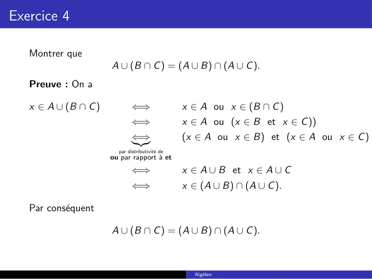

~~~text
Exercice 4

   Montrer que
                      A ∪ (B ∩ C ) = (A ∪ B) ∩ (A ∪ C ).
   Preuve : On a

   x ∈ A ∪ (B ∩ C )           ⇐⇒                 x ∈ A ou x ∈ (B ∩ C )
                              ⇐⇒                 x ∈ A ou (x ∈ B et x ∈ C ))
                              ⇐⇒
                              |{z}               (x ∈ A ou x ∈ B) et (x ∈ A ou x ∈ C )
                        par distributivité de
                      ou par rapport à et
                              ⇐⇒                 x ∈ A ∪ B et x ∈ A ∪ C
                              ⇐⇒                 x ∈ (A ∪ B) ∩ (A ∪ C ).

   Par conséquent

                      A ∪ (B ∩ C ) = (A ∪ B) ∩ (A ∪ C ).

                                                   Algèbre
~~~

## Page 17

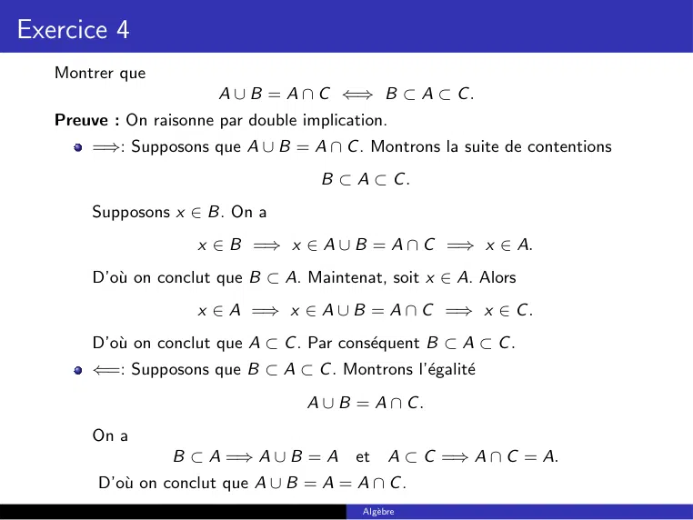

~~~text
Exercice 4
   Montrer que
                        A ∪ B = A ∩ C ⇐⇒ B ⊂ A ⊂ C .
   Preuve : On raisonne par double implication.
        =⇒: Supposons que A ∪ B = A ∩ C . Montrons la suite de contentions
                                      B ⊂ A ⊂ C.
        Supposons x ∈ B. On a
                     x ∈ B =⇒ x ∈ A ∪ B = A ∩ C =⇒ x ∈ A.
        D’où on conclut que B ⊂ A. Maintenat, soit x ∈ A. Alors
                     x ∈ A =⇒ x ∈ A ∪ B = A ∩ C =⇒ x ∈ C .
        D’où on conclut que A ⊂ C . Par conséquent B ⊂ A ⊂ C .
        ⇐=: Supposons que B ⊂ A ⊂ C . Montrons l’égalité
                                    A ∪ B = A ∩ C.
        On a
                  B ⊂ A =⇒ A ∪ B = A      et     A ⊂ C =⇒ A ∩ C = A.
        D’où on conclut que A ∪ B = A = A ∩ C .
                                           Algèbre
~~~

## Page 18

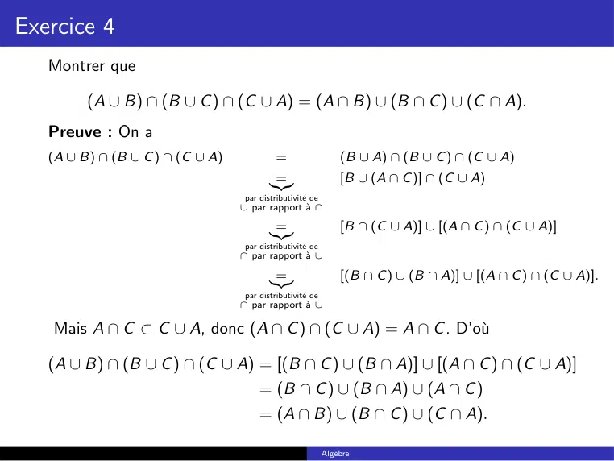

~~~text
Exercice 4
   Montrer que

         (A ∪ B) ∩ (B ∪ C ) ∩ (C ∪ A) = (A ∩ B) ∪ (B ∩ C ) ∪ (C ∩ A).
   Preuve : On a
   (A ∪ B) ∩ (B ∪ C ) ∩ (C ∪ A)             =                    (B ∪ A) ∩ (B ∪ C ) ∩ (C ∪ A)
                                           =
                                          |{z}                   [B ∪ (A ∩ C )] ∩ (C ∪ A)
                                   par distributivité de
                                  ∪ par rapport à ∩

                                           =
                                          |{z}                   [B ∩ (C ∪ A)] ∪ [(A ∩ C ) ∩ (C ∪ A)]
                                   par distributivité de
                                  ∩ par rapport à ∪

                                           =
                                          |{z}                   [(B ∩ C ) ∪ (B ∩ A)] ∪ [(A ∩ C ) ∩ (C ∪ A)].
                                   par distributivité de
                                  ∩ par rapport à ∪

   Mais A ∩ C ⊂ C ∪ A, donc (A ∩ C ) ∩ (C ∪ A) = A ∩ C . D’où

   (A ∪ B) ∩ (B ∪ C ) ∩ (C ∪ A) = [(B ∩ C ) ∪ (B ∩ A)] ∪ [(A ∩ C ) ∩ (C ∪ A)]
                                       = (B ∩ C ) ∪ (B ∩ A) ∪ (A ∩ C )
                                       = (A ∩ B) ∪ (B ∩ C ) ∪ (C ∩ A).

                                                            Algèbre
~~~

## Page 19

~~~text
Exercice 5

   Soit E et F deux ensembles. Quelle relation y a-t-il entre :
     1   P(E ∪ F ) et P(E ) ∪ P(F ) ?
     2   P(E ∩ F ) et P(E ) ∩ P(F ) ?
     3   P(E × F ) et P(E ) × P(F ) ?

                                          Algèbre
~~~

## Page 20

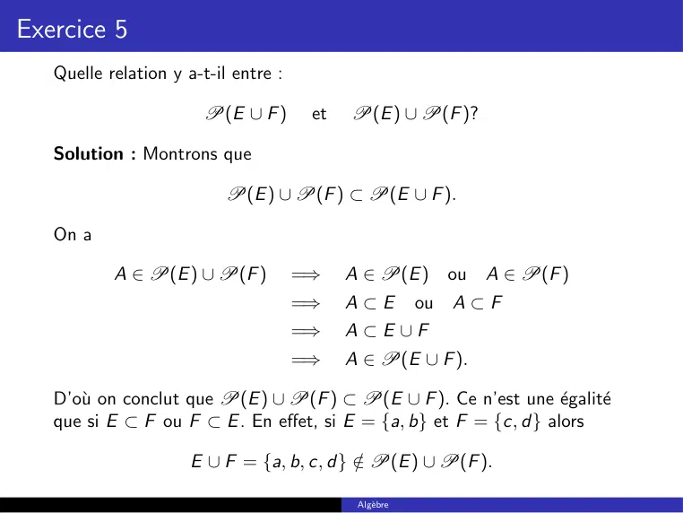

~~~text
Exercice 5
   Quelle relation y a-t-il entre :

                        P(E ∪ F )      et   P(E ) ∪ P(F )?

   Solution : Montrons que

                           P(E ) ∪ P(F ) ⊂ P(E ∪ F ).

   On a

           A ∈ P(E ) ∪ P(F )          =⇒    A ∈ P(E )      ou A ∈ P(F )
                                      =⇒    A⊂E         ou A ⊂ F
                                      =⇒    A⊂E ∪F
                                      =⇒    A ∈ P(E ∪ F ).

   D’où on conclut que P(E ) ∪ P(F ) ⊂ P(E ∪ F ). Ce n’est une égalité
   que si E ⊂ F ou F ⊂ E . En effet, si E = {a, b} et F = {c, d} alors

                                           / P(E ) ∪ P(F ).
                      E ∪ F = {a, b, c, d} ∈

                                             Algèbre
~~~

## Page 21

~~~text
Exercice 5

   Quelle relation y a-t-il entre :

                        P(E ∩ F )      et   P(E ) ∩ P(F )?

   Solution : Montrons que

                           P(E ∩ F ) = P(E ) ∩ P(F ).

   On a

           A ∈ P(E ) ∩ P(F )          ⇐⇒    A ∈ P(E )       et   A ∈ P(F )
                                      ⇐⇒    A⊂E        et   A⊂F
                                      ⇐⇒    A⊂E ∩F
                                      ⇐⇒    A ∈ P(E ∩ F ).

   D’où on conclut que P(E ) ∩ P(F ) = P(E ∩ F ).

                                            Algèbre
~~~

## Page 22

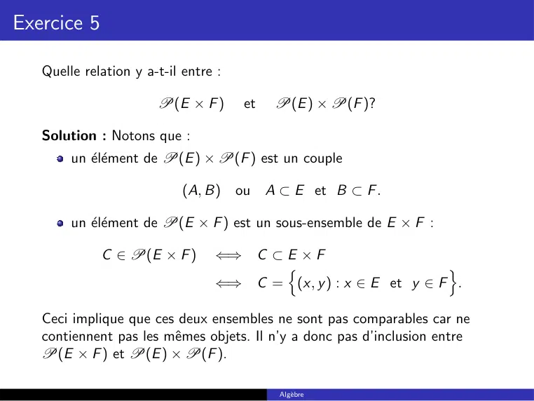

~~~text
Exercice 5

   Quelle relation y a-t-il entre :

                       P(E × F )       et     P(E ) × P(F )?

   Solution : Notons que :
        un élément de P(E ) × P(F ) est un couple

                            (A, B)    ou A ⊂ E et B ⊂ F .

        un élément de P(E × F ) est un sous-ensemble de E × F :

             C ∈ P(E × F )       ⇐⇒         C ⊂E ×F
                                               n                        o
                                 ⇐⇒         C = (x, y ) : x ∈ E et y ∈ F .

   Ceci implique que ces deux ensembles ne sont pas comparables car ne
   contiennent pas les mêmes objets. Il n’y a donc pas d’inclusion entre
   P(E × F ) et P(E ) × P(F ).

                                               Algèbre
~~~

## Page 23

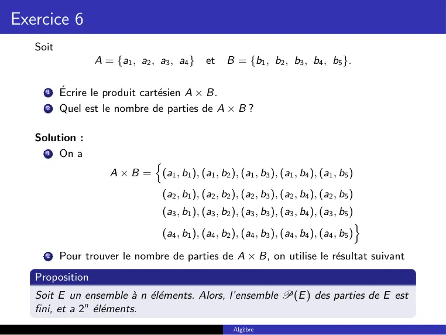

~~~text
Exercice 6
   Soit
                 A = {a1 , a2 , a3 , a4 }      et    B = {b1 , b2 , b3 , b4 , b5 }.

     1    Écrire le produit cartésien A × B.
     2    Quel est le nombre de parties de A × B ?

   Solution :
     1  On a
                           n
                    A × B = (a1 , b1 ), (a1 , b2 ), (a1 , b3 ), (a1 , b4 ), (a1 , b5 )
                                  (a2 , b1 ), (a2 , b2 ), (a2 , b3 ), (a2 , b4 ), (a2 , b5 )
                                  (a3 , b1 ), (a3 , b2 ), (a3 , b3 ), (a3 , b4 ), (a3 , b5 )
                                                                                               o
                                  (a4 , b1 ), (a4 , b2 ), (a4 , b3 ), (a4 , b4 ), (a4 , b5 )
     2    Pour trouver le nombre de parties de A × B, on utilise le résultat suivant
   Proposition
   Soit E un ensemble à n éléments. Alors, l’ensemble P(E ) des parties de E est
   fini, et a 2n éléments.
                                                       Algèbre
~~~

## Page 24

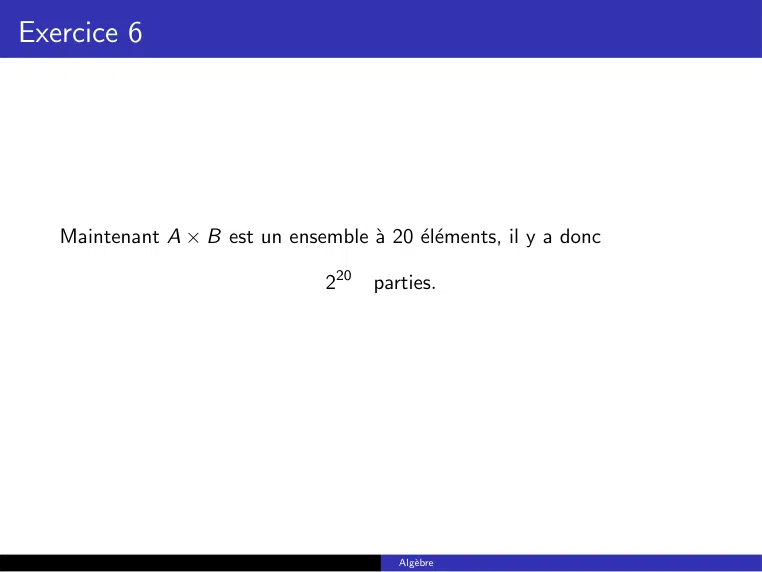

~~~text
Exercice 6

   Maintenant A × B est un ensemble à 20 éléments, il y a donc

                                 220   parties.

                                          Algèbre
~~~

## Page 25

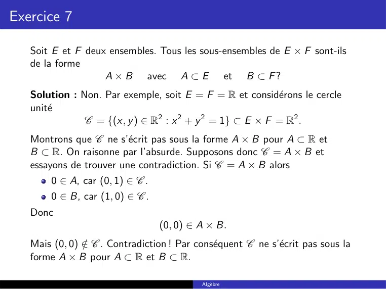

~~~text
Exercice 7

   Soit E et F deux ensembles. Tous les sous-ensembles de E × F sont-ils
   de la forme
                   A × B avec A ⊂ E et B ⊂ F ?
   Solution : Non. Par exemple, soit E = F = R et considérons le cercle
   unité
               C = {(x, y ) ∈ R2 : x 2 + y 2 = 1} ⊂ E × F = R2 .
   Montrons que C ne s’écrit pas sous la forme A × B pour A ⊂ R et
   B ⊂ R. On raisonne par l’absurde. Supposons donc C = A × B et
   essayons de trouver une contradiction. Si C = A × B alors
       0 ∈ A, car (0, 1) ∈ C .
       0 ∈ B, car (1, 0) ∈ C .
   Donc
                                 (0, 0) ∈ A × B.
               / C . Contradiction ! Par conséquent C ne s’écrit pas sous la
   Mais (0, 0) ∈
   forme A × B pour A ⊂ R et B ⊂ R.

                                           Algèbre
~~~

## Page 26

~~~text
Exercice 7

   On peut aussi choisir
                               C = {(1, 0), (0, 1)} .
   Si C = A × B, alors

                           {0, 1} ⊂ A   et      {0, 1} ⊂ B,

   pourtant
                                           / C.
                                    (0, 0) ∈

                                             Algèbre
~~~

## Page 27

~~~text
Exercice 8

   Soient A, B, C , D quatre ensembles.
     1   Montrer que (A × C ) ∪ (B × C ) = (A ∪ B) × C .
     2   Montrer que (A × C ) ∩ (B × D) = (A ∩ B) × (C ∩ D).
   Solution : Montrons que

                      (A × C ) ∪ (B × C ) = (A ∪ B) × C .

   On a

   (x, y ) ∈ (A × C ) ∪ (B × C ) ⇐⇒ (x, y ) ∈ A × C       ou     (x, y ) ∈ B × C
                                ⇐⇒ (x ∈ A et y ∈ C ) ou (x ∈ B et y ∈ C )
                                ⇐⇒ (x ∈ A ou x ∈ B)         et   y ∈C
                                ⇐⇒ x ∈ A ∪ B         et   y ∈C
                                ⇐⇒ (x, y ) ∈ (A ∪ B) × C .

   Par conséquent (A × C ) ∪ (B × C ) = (A ∪ B) × C .

                                          Algèbre
~~~

## Page 28

~~~text
Exercice 8

   Montrons que

                  (A × B) ∩ (C × D) = (A ∩ C ) × (B ∩ D).

   Solution : On a

   (x, y ) ∈ (A × B) ∩ (C × D) ⇐⇒ (x, y ) ∈ A × B   et      (x, y ) ∈ C × D
                              ⇐⇒ (x ∈ A et y ∈ B) et (x ∈ C et y ∈ D)
                              ⇐⇒ (x ∈ A et x ∈ C ) et (y ∈ B et y ∈ D)
                              ⇐⇒ x ∈ A ∩ C et y ∈ B ∩ D
                              ⇐⇒ (x, y ) ∈ (A ∩ C ) × (B ∩ D).

                                       Algèbre
~~~

## Page 29

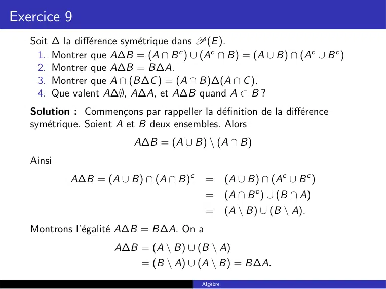

~~~text
Exercice 9
   Soit ∆ la différence symétrique dans P(E ).
    1. Montrer que A∆B = (A ∩ B c ) ∪ (Ac ∩ B) = (A ∪ B) ∩ (Ac ∪ B c )
    2. Montrer que A∆B = B∆A.
    3. Montrer que A ∩ (B∆C ) = (A ∩ B)∆(A ∩ C ).
    4. Que valent A∆∅, A∆A, et A∆B quand A ⊂ B ?
   Solution : Commençons par rappeller la définition de la différence
   symétrique. Soient A et B deux ensembles. Alors
                           A∆B = (A ∪ B) \ (A ∩ B)
   Ainsi
            A∆B = (A ∪ B) ∩ (A ∩ B)c       =         (A ∪ B) ∩ (Ac ∪ B c )
                                           =         (A ∩ B c ) ∪ (B ∩ A)
                                           =         (A \ B) ∪ (B \ A).
   Montrons l’égalité A∆B = B∆A. On a
                      A∆B = (A \ B) ∪ (B \ A)
                            = (B \ A) ∪ (A \ B) = B∆A.
                                          Algèbre
~~~

## Page 30

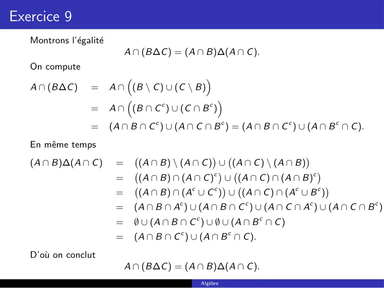

~~~text
Exercice 9
   Montrons l’égalité
                               A ∩ (B∆C ) = (A ∩ B)∆(A ∩ C ).
   On compute
                                                
   A ∩ (B∆C )      =      A ∩ (B \ C ) ∪ (C \ B)
                                                     
                   =      A ∩ (B ∩ C c ) ∪ (C ∩ B c )
                   =      (A ∩ B ∩ C c ) ∪ (A ∩ C ∩ B c ) = (A ∩ B ∩ C c ) ∪ (A ∩ B c ∩ C ).
   En même temps
                                                                         
   (A ∩ B)∆(A ∩ C )        =      (A ∩ B) \ (A ∩ C ) ∪ (A ∩ C ) \ (A ∩ B)
                                  (A ∩ B) ∩ (A ∩ C )c ∪ (A ∩ C ) ∩ (A ∩ B)c
                                                                            
                           =
                                  (A ∩ B) ∩ (Ac ∪ C c ) ∪ (A ∩ C ) ∩ (Ac ∪ B c )
                                                                                
                           =
                           =     (A ∩ B ∩ Ac ) ∪ (A ∩ B ∩ C c ) ∪ (A ∩ C ∩ Ac ) ∪ (A ∩ C ∩ B c )
                           =     ∅ ∪ (A ∩ B ∩ C c ) ∪ ∅ ∪ (A ∩ B c ∩ C )
                           =     (A ∩ B ∩ C c ) ∪ (A ∩ B c ∩ C ).
   D’où on conclut
                               A ∩ (B∆C ) = (A ∩ B)∆(A ∩ C ).
                                                  Algèbre
~~~

## Page 31

~~~text
Exercice 9

   Que valent

                A∆∅      et   A∆A   et   A∆B quand A ⊂ B?

   Solution :
       On a
                      A∆∅ = (A ∪ ∅) \ (A ∩ ∅) = A \ ∅ = A.

       On a
                      A∆A = (A ∪ A) \ (A ∩ A) = A \ A = ∅.

       Si A ⊂ B, alors

                         A∆B = (A ∪ B) \ (A ∩ B) = B \ A.

                                         Algèbre
~~~

## Page 32

~~~text
À faire chez soi - Exercice 10

   Soient A, B, C trois ensembles. Montrer que
        
          A∪B ⊂A∪C
    1.                      =⇒ B ⊂ C .
          A∩B ⊂A∩C

    2. On suppose que A ∩ B = A ∩ C et A ∪ B = A ∪ C . Que peut-on dire
       de B et C ?

                                        Algèbre
~~~

## Page 33

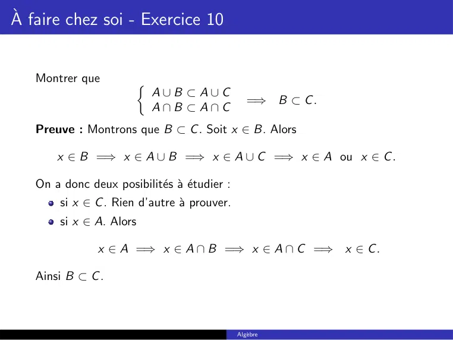

~~~text
À faire chez soi - Exercice 10

   Montrer que          
                            A∪B ⊂A∪C
                                                  =⇒ B ⊂ C .
                            A∩B ⊂A∩C
   Preuve : Montrons que B ⊂ C . Soit x ∈ B. Alors

       x ∈ B =⇒ x ∈ A ∪ B =⇒ x ∈ A ∪ C =⇒ x ∈ A ou x ∈ C .

   On a donc deux posibilités à étudier :
        si x ∈ C . Rien d’autre à prouver.
        si x ∈ A. Alors

                x ∈ A =⇒ x ∈ A ∩ B =⇒ x ∈ A ∩ C =⇒ x ∈ C .

   Ainsi B ⊂ C .

                                               Algèbre
~~~

## Page 34

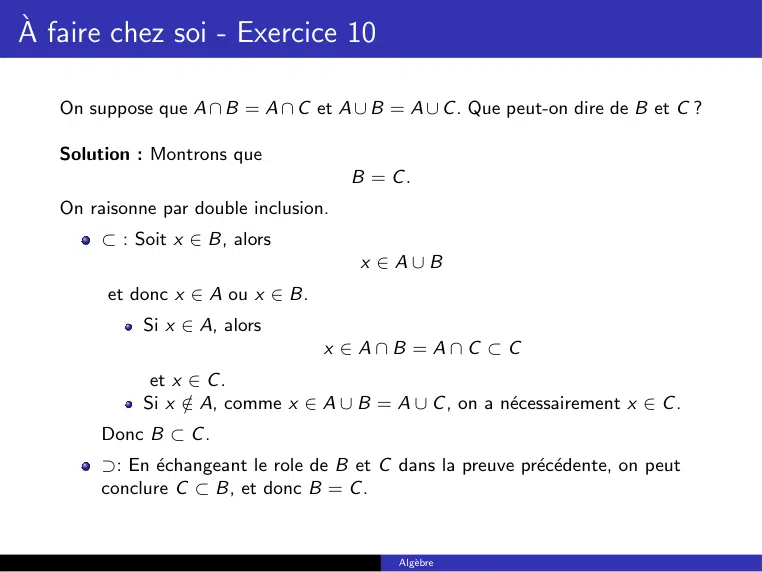

~~~text
À faire chez soi - Exercice 10

   On suppose que A ∩ B = A ∩ C et A ∪ B = A ∪ C . Que peut-on dire de B et C ?

   Solution : Montrons que
                                       B = C.
   On raisonne par double inclusion.
        ⊂ : Soit x ∈ B, alors
                                        x ∈A∪B
        et donc x ∈ A ou x ∈ B.
             Si x ∈ A, alors
                                   x ∈A∩B =A∩C ⊂C
              et x ∈ C .
                  / A, comme x ∈ A ∪ B = A ∪ C , on a nécessairement x ∈ C .
             Si x ∈
        Donc B ⊂ C .
        ⊃: En échangeant le role de B et C dans la preuve précédente, on peut
        conclure C ⊂ B, et donc B = C .

                                            Algèbre
~~~

## Page 35

~~~text
À faire chez soi - Exercice 11

   Soit A, B, C trois parties d’un ensemble E .
     1   Montrer que
                          A∩B =A∪B            ⇐⇒          A = B.
     2   Montrer que

                       A∩B =A∩C        ⇐⇒            A ∩ Bc = A ∩ C c .

     3   Montrer que
                          (A ∪ B) \ (A ∪ C ) ⊂ A ∪ (B \ C ).
         Donner un contre-exemple pour l’inclusion contraire.

                                          Algèbre
~~~

## Page 36

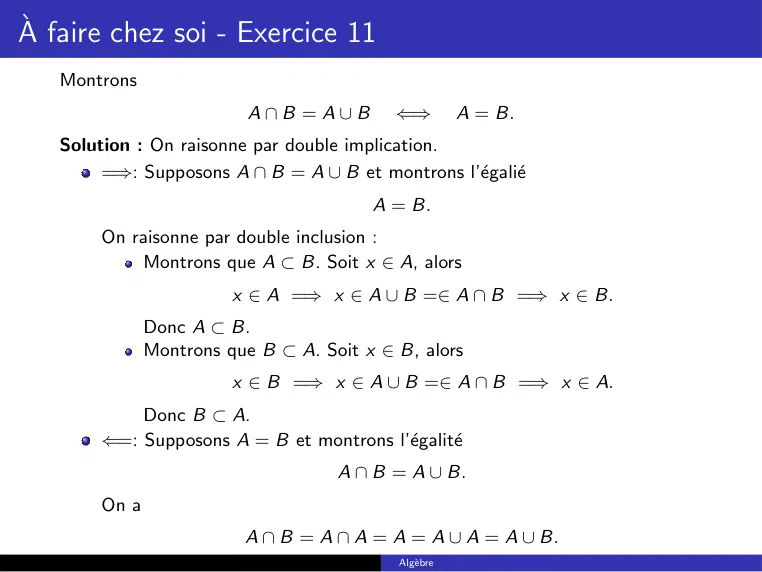

~~~text
À faire chez soi - Exercice 11
   Montrons
                          A∩B =A∪B         ⇐⇒         A = B.
   Solution : On raisonne par double implication.
        =⇒: Supposons A ∩ B = A ∪ B et montrons l’égalié
                                        A = B.
       On raisonne par double inclusion :
           Montrons que A ⊂ B. Soit x ∈ A, alors
                        x ∈ A =⇒ x ∈ A ∪ B =∈ A ∩ B =⇒ x ∈ B.
              Donc A ⊂ B.
              Montrons que B ⊂ A. Soit x ∈ B, alors
                        x ∈ B =⇒ x ∈ A ∪ B =∈ A ∩ B =⇒ x ∈ A.
           Donc B ⊂ A.
       ⇐=: Supposons A = B et montrons l’égalité
                                    A ∩ B = A ∪ B.
       On a
                         A ∩ B = A ∩ A = A = A ∪ A = A ∪ B.
                                           Algèbre
~~~

## Page 37

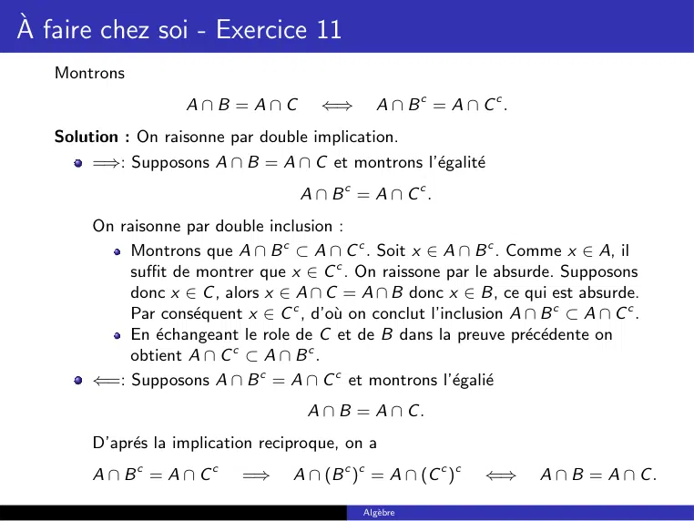

~~~text
À faire chez soi - Exercice 11
   Montrons
                     A∩B =A∩C           ⇐⇒       A ∩ Bc = A ∩ C c .
   Solution : On raisonne par double implication.
        =⇒: Supposons A ∩ B = A ∩ C et montrons l’égalité
                                     A ∩ Bc = A ∩ C c .
        On raisonne par double inclusion :
            Montrons que A ∩ B c ⊂ A ∩ C c . Soit x ∈ A ∩ B c . Comme x ∈ A, il
            suffit de montrer que x ∈ C c . On raissone par le absurde. Supposons
            donc x ∈ C , alors x ∈ A ∩ C = A ∩ B donc x ∈ B, ce qui est absurde.
            Par conséquent x ∈ C c , d’où on conclut l’inclusion A ∩ B c ⊂ A ∩ C c .
            En échangeant le role de C et de B dans la preuve précédente on
            obtient A ∩ C c ⊂ A ∩ B c .
        ⇐=: Supposons A ∩ B c = A ∩ C c et montrons l’égalié
                                      A ∩ B = A ∩ C.
        D’aprés la implication reciproque, on a
        A ∩ Bc = A ∩ C c     =⇒     A ∩ (B c )c = A ∩ (C c )c   ⇐⇒     A ∩ B = A ∩ C.

                                              Algèbre
~~~

## Page 38

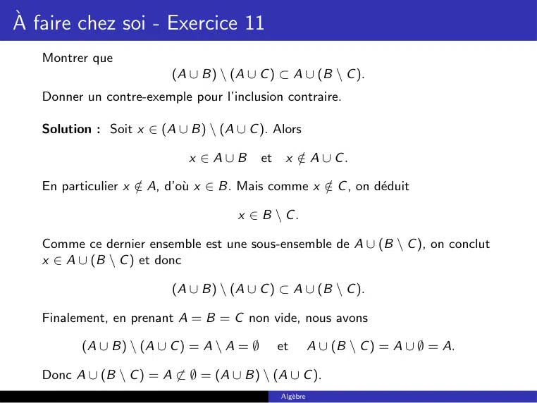

~~~text
À faire chez soi - Exercice 11
   Montrer que
                         (A ∪ B) \ (A ∪ C ) ⊂ A ∪ (B \ C ).
   Donner un contre-exemple pour l’inclusion contraire.

   Solution : Soit x ∈ (A ∪ B) \ (A ∪ C ). Alors

                            x ∈A∪B        et    x∈
                                                 / A ∪ C.

   En particulier x ∈
                    / A, d’où x ∈ B. Mais comme x ∈
                                                   / C , on déduit

                                     x ∈ B \ C.

   Comme ce dernier ensemble est une sous-ensemble de A ∪ (B \ C ), on conclut
   x ∈ A ∪ (B \ C ) et donc

                         (A ∪ B) \ (A ∪ C ) ⊂ A ∪ (B \ C ).

   Finalement, en prenant A = B = C non vide, nous avons

         (A ∪ B) \ (A ∪ C ) = A \ A = ∅        et         A ∪ (B \ C ) = A ∪ ∅ = A.

   Donc A ∪ (B \ C ) = A 6⊂ ∅ = (A ∪ B) \ (A ∪ C ).
                                               Algèbre
~~~

## Page 39

~~~text
À faire chez soi - Exercice 12
   Simplifier les expressions suivantes où A, B et C sont des parties d’un ensemble
   E :
        A ∩ (Ac ∪ B)
        A ∪ (Ac ∩ B)
        A ∩ (Ac ∪ B) ∩ (Ac ∪ B c ∪ C )
        A ∪ (Ac ∩ B) ∪ (Ac ∩ B c ∩ C )
   Solution : On a
             A ∩ (Ac ∪ B) = (A ∩ Ac ) ∪ (A ∩ B) = ∅ ∪ (A ∩ B) = A ∩ B
    On a
            A ∪ (Ac ∩ B) = (A ∪ Ac ) ∩ (A ∪ B) = E ∩ (A ∪ B) = A ∪ B.
    On a
    A ∩ (Ac ∪ B) ∩ (Ac ∪ B c ∪ C ) = (A ∩ Ac ) ∪ (A ∩ B) ∩ (Ac ∪ B c ∪ C )
                                                        

                                   = (A ∩ B) ∩ (Ac ∪ B c ∪ C )
                                   = (A ∩ B ∩ Ac ) ∪ (A ∩ B ∩ B c ) ∪ (A ∩ B ∩ C )
                                   = (A ∩ B ∩ C ).

                                             Algèbre
~~~

## Page 40

~~~text
À faire chez soi - Exercice 12

   On a

   A ∪ (Ac ∩ B) ∪ (Ac ∩ B c ∩ C ) =   (A ∪ Ac ) ∩ (A ∪ B) ∪ (Ac ∩ B c ∩ C )
                                                         

                                 = (E ∩ (A ∪ B)) ∪ (Ac ∩ B c ∩ C )
                                 = (A ∪ B) ∪ (Ac ∩ B c ∩ C )
                                 = (A ∪ B ∪ Ac ) ∩ (A ∪ B ∪ B c ) ∩ (A ∪ B ∪ C )
                                 = E ∩ E ∩ (A ∪ B ∪ C )
                                 = (A ∪ B ∪ C ).

                                        Algèbre
~~~

## Page 41

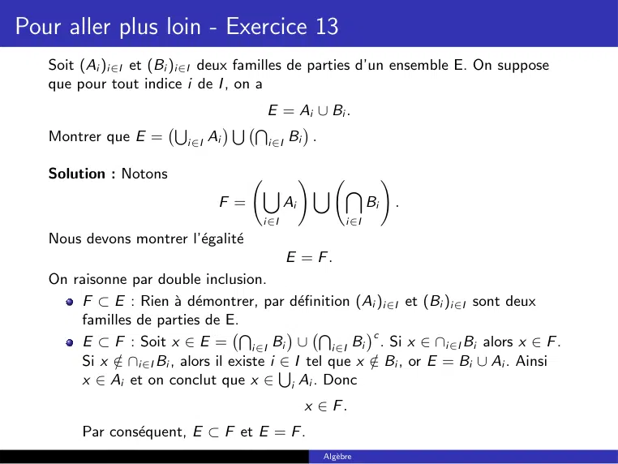

~~~text
Pour aller plus loin - Exercice 13
   Soit (Ai )i∈I et (Bi )i∈I deux familles de parties d’un ensemble E. On suppose
   que pour tout indice i de I , on a
                                     E = Ai ∪ Bi .
                        S        S T       
   Montrer que E =        i∈I Ai      i∈I Bi .

   Solution : Notons                              !                    !
                                       [              [ \
                               F =           Ai                   Bi       .
                                       i∈I                  i∈I
   Nous devons montrer l’égalité
                                           E = F.
   On raisonne par double inclusion.
       F ⊂ E : Rien à démontrer, par définition (Ai )i∈I et (Bi )i∈I sont deux
       familles de parties de E.
                                   T           T        c
       E ⊂ F : Soit x ∈ E =          i∈I Bi ∪     i∈I Bi    . Si x ∈ ∩i∈I Bi alors x ∈ F .
       Si x ∈
            / ∩i∈I Bi , alors il existe i S
                                          ∈ I tel que x ∈ / Bi , or E = Bi ∪ Ai . Ainsi
       x ∈ Ai et on conclut que x ∈ i Ai . Donc
                                                  x ∈ F.
        Par conséquent, E ⊂ F et E = F .
                                                      Algèbre
~~~

## Page 42

~~~text
Pour aller plus loin - Exercice 14
   Soient A, B et C trois sous-ensembles d’un ensemble E . Montrer que
                          (A∆B)∆C = A∆(B∆C )
   Solution : On commence par noter que
   (A∆B)∆C = [(A∆B) ∪ C ] ∩ [(A∆B)c ∪ C c ]
             h                          i h                              i
           = [(A ∪ B) ∩ (Ac ∪ B c )] ∪ C ∩ [(Ac ∪ B) ∩ (A ∪ B c )] ∪ C c
              = (A ∪ B ∪ C ) ∩ (Ac ∪ B c ∪ C ) ∩ (Ac ∪ B ∪ C c ) ∩ (A ∪ B c ∪ C c )
   D’où on conclut
   (A∆B)∆C = (A ∪ B ∪ C ) ∩ (Ac ∪ B c ∪ C ) ∩ (Ac ∪ B ∪ C c ) ∩ (A ∪ B c ∪ C c )
               = (B ∪ C ∪ A) ∩ (B c ∪ C c ∪ A) ∩ (B ∪ C c ∪ Ac ) ∩ (B c ∪ C ∪ Ac )
                 h                            i h                               i
               = [(B ∪ C ) ∩ (B c ∪ C c )] ∪ A ∩ [(B c ∪ C ) ∩ (B ∪ C c )] ∪ Ac
               = [(B∆C ) ∪ A] ∩ [(B∆C )c ∪ Ac ]
               = (B∆C )∆A
               = A∆(B∆C ).

                                          Algèbre
~~~
