# TD3-Relations-Correction_2023-2024_Algebre1_P1S1_NArancibia.pdf

[Ouvrir l’original](https://drive.google.com/open?id=1Z3FMqpDuaUqEDqUsyvvQKSWRKW7UQ44G) · Les deux lectures automatiques du PDF divergent sur les pages indiquées. Leur fac-similé accompagne le texte.

**Pages présentant un écart entre les deux extractions** — 1–11, 13–42.

## Page 1

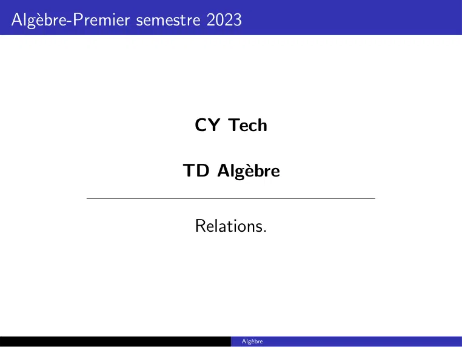

~~~text
Algèbre-Premier semestre 2023

                       CY Tech

                      TD Algèbre

                       Relations.

                             Algèbre
~~~

## Page 2

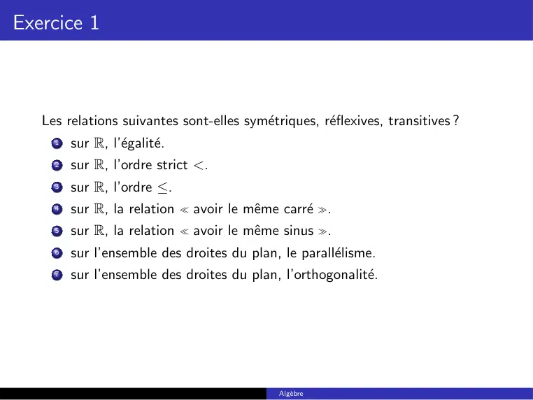

~~~text
Exercice 1

   Les relations suivantes sont-elles symétriques, réflexives, transitives ?
     1   sur R, l’égalité.
     2   sur R, l’ordre strict <.
     3   sur R, l’ordre ≤.
     4   sur R, la relation  avoir le même carré .
     5   sur R, la relation  avoir le même sinus .
     6   sur l’ensemble des droites du plan, le parallélisme.
     7   sur l’ensemble des droites du plan, l’orthogonalité.

                                             Algèbre
~~~

## Page 3

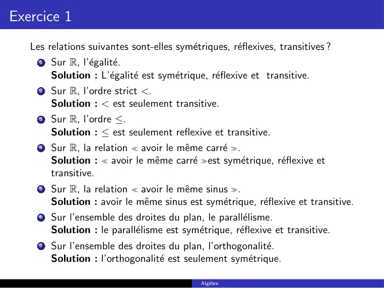

~~~text
Exercice 1
   Les relations suivantes sont-elles symétriques, réflexives, transitives ?
     1   Sur R, l’égalité.
         Solution : L’égalité est symétrique, réflexive et transitive.
     2   Sur R, l’ordre strict <.
         Solution : < est seulement transitive.
     3   Sur R, l’ordre ≤.
         Solution : ≤ est seulement reflexive et transitive.
     4   Sur R, la relation  avoir le même carré .
         Solution :  avoir le même carré est symétrique, réflexive et
         transitive.
     5   Sur R, la relation  avoir le même sinus .
         Solution : avoir le même sinus est symétrique, réflexive et transitive.
     6   Sur l’ensemble des droites du plan, le parallélisme.
         Solution : le parallélisme est symétrique, réflexive et transitive.
     7   Sur l’ensemble des droites du plan, l’orthogonalité.
         Solution : l’orthogonalité est seulement symétrique.

                                              Algèbre
~~~

## Page 4

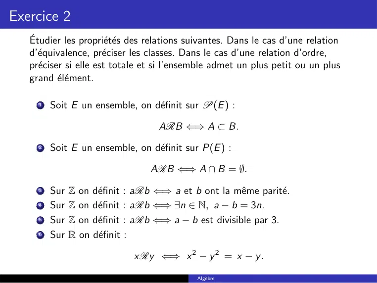

~~~text
Exercice 2
   Étudier les propriétés des relations suivantes. Dans le cas d’une relation
   d’équivalence, préciser les classes. Dans le cas d’une relation d’ordre,
   préciser si elle est totale et si l’ensemble admet un plus petit ou un plus
   grand élément.

     1   Soit E un ensemble, on définit sur P(E ) :

                                   ARB ⇐⇒ A ⊂ B.
     2   Soit E un ensemble, on définit sur P(E ) :

                                ARB ⇐⇒ A ∩ B = ∅.
     3   Sur Z on définit : aRb ⇐⇒ a et b ont la même parité.
     4   Sur Z on définit : aRb ⇐⇒ ∃n ∈ N, a − b = 3n.
     5   Sur Z on définit : aRb ⇐⇒ a − b est divisible par 3.
     6   Sur R on définit :

                            xRy ⇐⇒ x 2 − y 2 = x − y .

                                            Algèbre
~~~

## Page 5

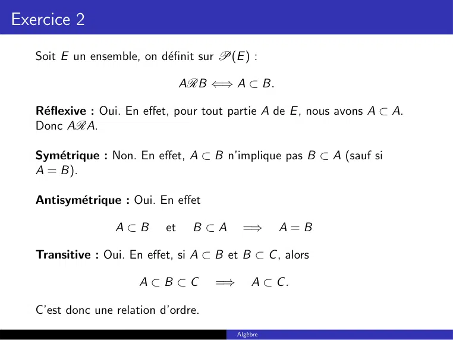

~~~text
Exercice 2
   Soit E un ensemble, on définit sur P(E ) :

                                 ARB ⇐⇒ A ⊂ B.

   Réflexive : Oui. En effet, pour tout partie A de E , nous avons A ⊂ A.
   Donc ARA.

   Symétrique : Non. En effet, A ⊂ B n’implique pas B ⊂ A (sauf si
   A = B).

   Antisymétrique : Oui. En effet

                  A⊂B       et    B⊂A        =⇒       A=B

   Transitive : Oui. En effet, si A ⊂ B et B ⊂ C , alors

                       A⊂B⊂C          =⇒        A ⊂ C.

   C’est donc une relation d’ordre.
                                           Algèbre
~~~

## Page 6

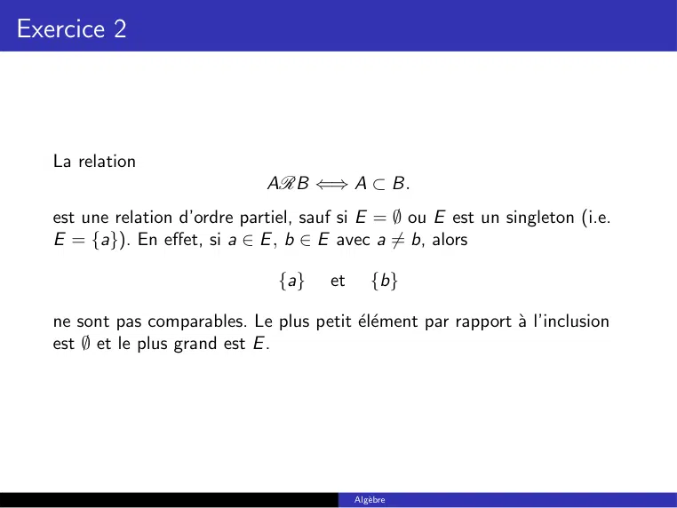

~~~text
Exercice 2

   La relation
                               ARB ⇐⇒ A ⊂ B.
   est une relation d’ordre partiel, sauf si E = ∅ ou E est un singleton (i.e.
   E = {a}). En effet, si a ∈ E , b ∈ E avec a 6= b, alors

                                 {a}    et       {b}

   ne sont pas comparables. Le plus petit élément par rapport à l’inclusion
   est ∅ et le plus grand est E .

                                             Algèbre
~~~

## Page 7

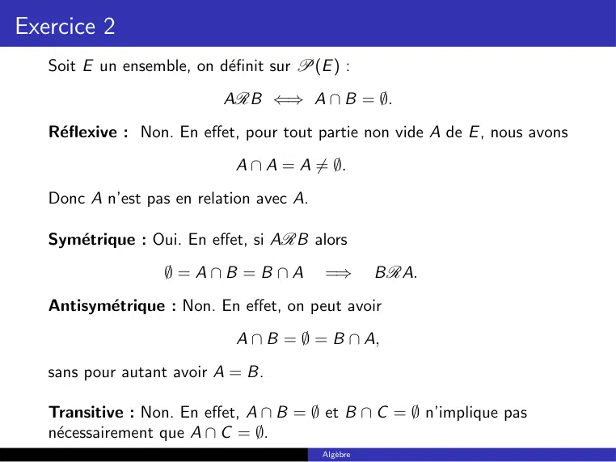

~~~text
Exercice 2
   Soit E un ensemble, on définit sur P(E ) :
                           ARB ⇐⇒ A ∩ B = ∅.
   Réflexive : Non. En effet, pour tout partie non vide A de E , nous avons
                             A ∩ A = A 6= ∅.
   Donc A n’est pas en relation avec A.

   Symétrique : Oui. En effet, si ARB alors
                   ∅=A∩B =B ∩A            =⇒         BRA.
   Antisymétrique : Non. En effet, on peut avoir
                             A ∩ B = ∅ = B ∩ A,
   sans pour autant avoir A = B.

   Transitive : Non. En effet, A ∩ B = ∅ et B ∩ C = ∅ n’implique pas
   nécessairement que A ∩ C = ∅.
                                          Algèbre
~~~

## Page 8

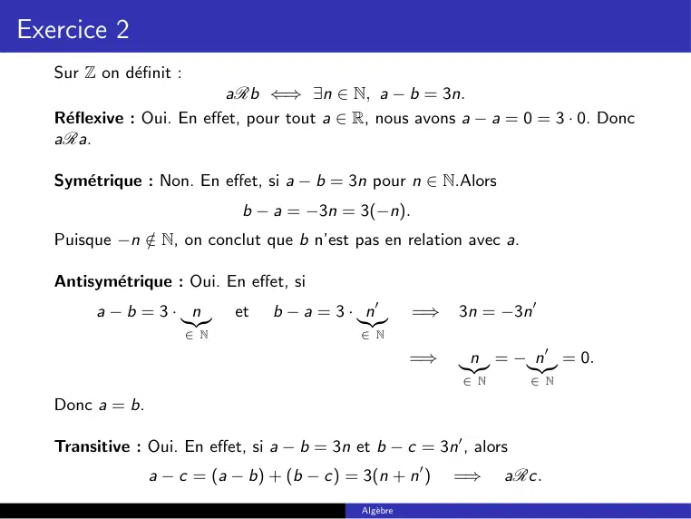

~~~text
Exercice 2
   Sur Z on définit :
                            aRb ⇐⇒ ∃n ∈ N, a − b = 3n.
   Réflexive : Oui. En effet, pour tout a ∈ R, nous avons a − a = 0 = 3 · 0. Donc
   aRa.

   Symétrique : Non. En effet, si a − b = 3n pour n ∈ N.Alors
                                b − a = −3n = 3(−n).
   Puisque −n ∈
              / N, on conclut que b n’est pas en relation avec a.

   Antisymétrique : Oui. En effet, si
         a − b = 3 · |{z}
                      n        et                n0
                                    b − a = 3 · |{z}       =⇒   3n = −3n0
                         ∈ N                    ∈ N

                                                           =⇒   |{z}   n0 = 0.
                                                                 n = −|{z}
                                                                ∈ N     ∈ N

   Donc a = b.

   Transitive : Oui. En effet, si a − b = 3n et b − c = 3n0 , alors
                 a − c = (a − b) + (b − c) = 3(n + n0 )         =⇒    aRc.
                                                Algèbre
~~~

## Page 9

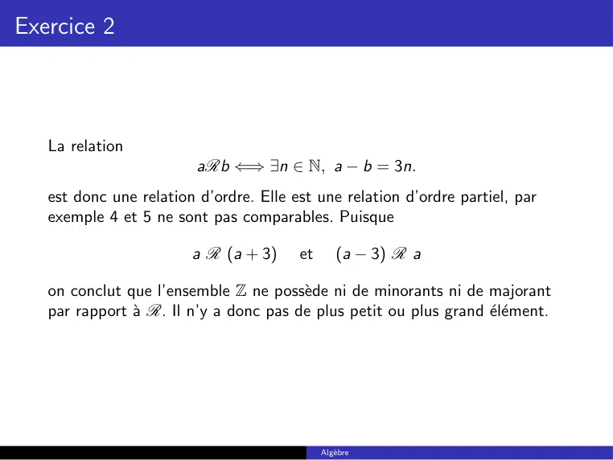

~~~text
Exercice 2

   La relation
                         aRb ⇐⇒ ∃n ∈ N, a − b = 3n.
   est donc une relation d’ordre. Elle est une relation d’ordre partiel, par
   exemple 4 et 5 ne sont pas comparables. Puisque

                        a R (a + 3)     et       (a − 3) R a

   on conclut que l’ensemble Z ne possède ni de minorants ni de majorant
   par rapport à R. Il n’y a donc pas de plus petit ou plus grand élément.

                                             Algèbre
~~~

## Page 10

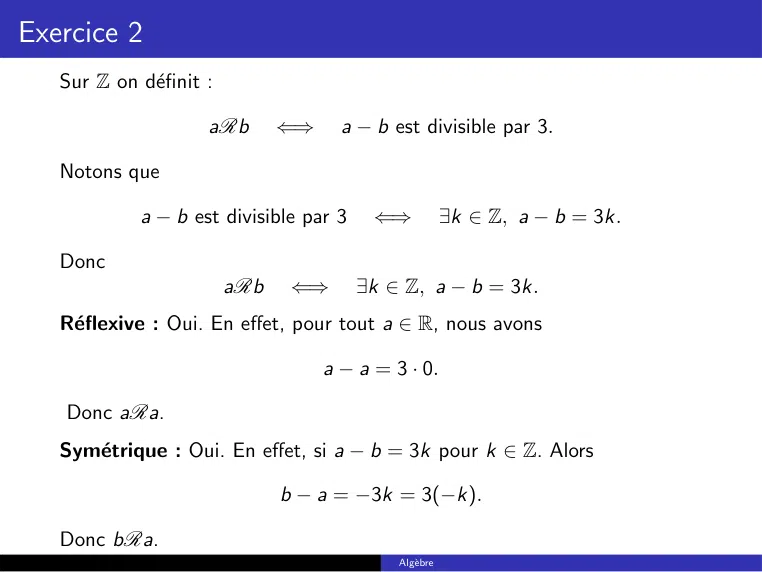

~~~text
Exercice 2
   Sur Z on définit :

                     aRb       ⇐⇒     a − b est divisible par 3.

   Notons que

             a − b est divisible par 3    ⇐⇒            ∃k ∈ Z, a − b = 3k.

   Donc
                         aRb    ⇐⇒       ∃k ∈ Z, a − b = 3k.
   Réflexive : Oui. En effet, pour tout a ∈ R, nous avons

                                    a − a = 3 · 0.

   Donc aRa.
   Symétrique : Oui. En effet, si a − b = 3k pour k ∈ Z. Alors

                               b − a = −3k = 3(−k).

   Donc bRa.
                                             Algèbre
~~~

## Page 11

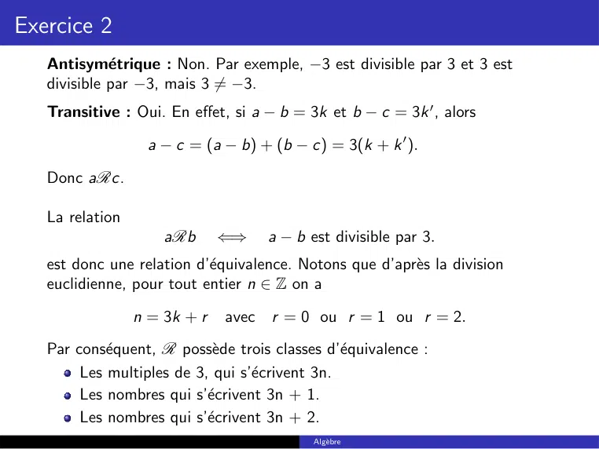

~~~text
Exercice 2
   Antisymétrique : Non. Par exemple, −3 est divisible par 3 et 3 est
   divisible par −3, mais 3 6= −3.
   Transitive : Oui. En effet, si a − b = 3k et b − c = 3k 0 , alors
                   a − c = (a − b) + (b − c) = 3(k + k 0 ).
   Donc aRc.

   La relation
                     aRb      ⇐⇒     a − b est divisible par 3.
   est donc une relation d’équivalence. Notons que d’après la division
   euclidienne, pour tout entier n ∈ Z on a
                 n = 3k + r   avec   r = 0 ou r = 1 ou r = 2.
   Par conséquent, R possède trois classes d’équivalence :
        Les multiples de 3, qui s’écrivent 3n.
        Les nombres qui s’écrivent 3n + 1.
        Les nombres qui s’écrivent 3n + 2.
                                            Algèbre
~~~

## Page 12

~~~text
Exercice 2
   On définit sur R la relation
                        xRy        ⇐⇒      x2 − y2 = x − y.
   Tout d’abord, notons que
       xRy      ⇐⇒      x2 − y2 = x − y         ⇐⇒          x2 − x = y2 − y.
   Reflexive : Pour tout x ∈ R, nous avons
                      x2 − x = x2 − x          =⇒         xRx.
   Symetrique : Pour tout x, y ∈ R, nous avons
                x2 − x = y2 − y         =⇒     y 2 − y = x 2 − x.
   Donc
                               xRy       =⇒         y Rx.
   Transitive :Pour tout x, y , z ∈ R, nous avons
    x2 − x = y2 − y     et   y2 − y = z2 − z              =⇒     x 2 − x = z 2 − z.
   Donc
                         xRy       et   y Rz      =⇒        xRz.
                                               Algèbre
~~~

## Page 13

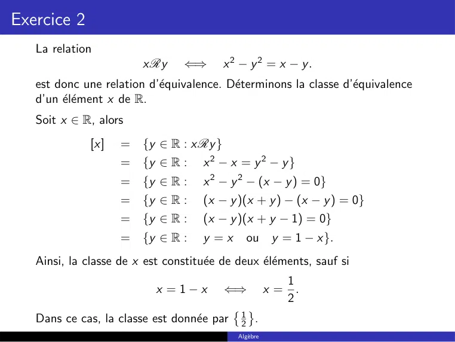

~~~text
Exercice 2
   La relation
                         xRy     ⇐⇒      x2 − y2 = x − y.
   est donc une relation d’équivalence. Déterminons la classe d’équivalence
   d’un élément x de R.
   Soit x ∈ R, alors
              [x]   = {y ∈ R : xRy }
                    = {y ∈ R :       x2 − x = y2 − y}
                    = {y ∈ R :       x 2 − y 2 − (x − y ) = 0}
                    = {y ∈ R :       (x − y )(x + y ) − (x − y ) = 0}
                    = {y ∈ R :       (x − y )(x + y − 1) = 0}
                    = {y ∈ R :       y =x        ou y = 1 − x}.
   Ainsi, la classe de x est constituée de deux éléments, sauf si
                                                            1
                           x =1−x         ⇐⇒           x=     .
                                                            2
                                            1
   Dans ce cas, la classe est donnée par    2    .
                                            Algèbre
~~~

## Page 14

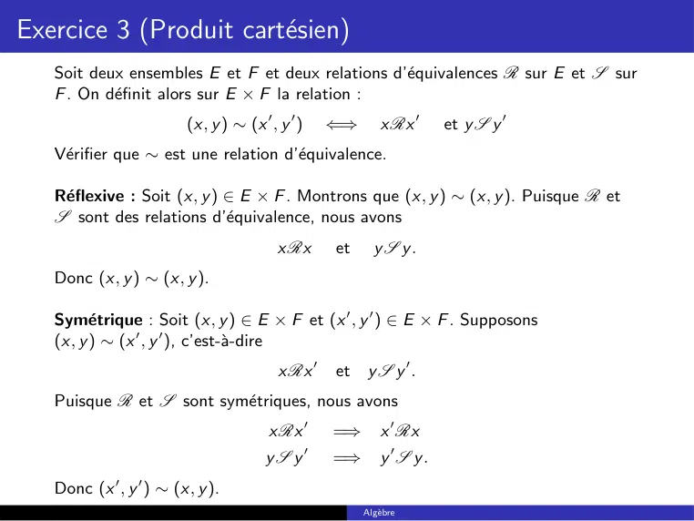

~~~text
Exercice 3 (Produit cartésien)
   Soit deux ensembles E et F et deux relations d’équivalences R sur E et S sur
   F . On définit alors sur E × F la relation :
                         (x, y ) ∼ (x 0 , y 0 )   ⇐⇒       xRx 0      et y S y 0
   Vérifier que ∼ est une relation d’équivalence.

   Réflexive : Soit (x, y ) ∈ E × F . Montrons que (x, y ) ∼ (x, y ). Puisque R et
   S sont des relations d’équivalence, nous avons
                                          xRx     et     yS y.
   Donc (x, y ) ∼ (x, y ).

   Symétrique : Soit (x, y ) ∈ E × F et (x 0 , y 0 ) ∈ E × F . Supposons
   (x, y ) ∼ (x 0 , y 0 ), c’est-à-dire
                                          xRx 0   et    y S y 0.
   Puisque R et S sont symétriques, nous avons
                                        xRx 0     =⇒       x 0 Rx
                                       yS y0      =⇒       y 0S y .
   Donc (x 0 , y 0 ) ∼ (x, y ).
                                                       Algèbre
~~~

## Page 15

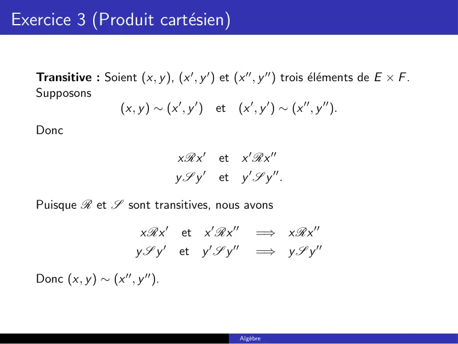

~~~text
Exercice 3 (Produit cartésien)

   Transitive : Soient (x, y ), (x 0 , y 0 ) et (x 00 , y 00 ) trois éléments de E × F .
   Supposons
                   (x, y ) ∼ (x 0 , y 0 ) et (x 0 , y 0 ) ∼ (x 00 , y 00 ).
   Donc

                                    xRx 0      et       x 0 Rx 00
                                    yS y   0
                                               et       y 0 S y 00 .

   Puisque R et S sont transitives, nous avons

                            xRx 0   et     x 0 Rx 00          =⇒ xRx 00
                           yS y0    et     y 0 S y 00         =⇒ y S y 00

   Donc (x, y ) ∼ (x 00 , y 00 ).

                                                        Algèbre
~~~

## Page 16

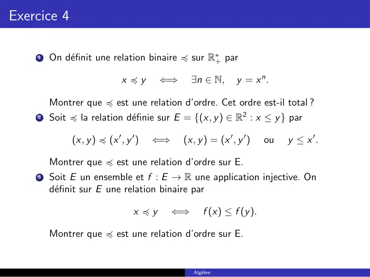

~~~text
Exercice 4

    1   On définit une relation binaire 4 sur R∗+ par

                             x 4y       ⇐⇒      ∃n ∈ N,       y = x n.

        Montrer que 4 est une relation d’ordre. Cet ordre est-il total ?
    2   Soit 4 la relation définie sur E = {(x, y ) ∈ R2 : x ≤ y } par

             (x, y ) 4 (x 0 , y 0 )   ⇐⇒     (x, y ) = (x 0 , y 0 )   ou   y ≤ x 0.

        Montrer que 4 est une relation d’ordre sur E.
    3   Soit E un ensemble et f : E → R une application injective. On
        définit sur E une relation binaire par

                                 x 4y      ⇐⇒       f (x) ≤ f (y ).

        Montrer que 4 est une relation d’ordre sur E.

                                                Algèbre
~~~

## Page 17

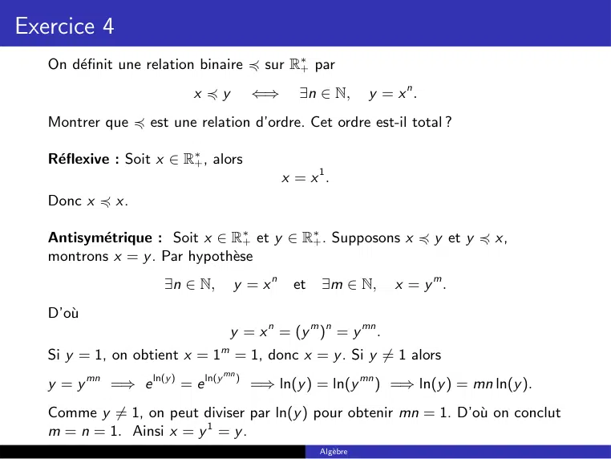

~~~text
Exercice 4
   On définit une relation binaire 4 sur R∗+ par
                           x 4y             ⇐⇒     ∃n ∈ N,         y = x n.
   Montrer que 4 est une relation d’ordre. Cet ordre est-il total ?

   Réflexive : Soit x ∈ R∗+ , alors
                                                 x = x 1.
   Donc x 4 x.

   Antisymétrique : Soit x ∈ R∗+ et y ∈ R∗+ . Supposons x 4 y et y 4 x,
   montrons x = y . Par hypothèse
                      ∃n ∈ N,       y = xn         et   ∃m ∈ N,        x = y m.
   D’où
                                    y = x n = (y m )n = y mn .
   Si y = 1, on obtient x = 1m = 1, donc x = y . Si y 6= 1 alors
                                   mn
   y = y mn =⇒ e ln(y ) = e ln(y        )
                                            =⇒ ln(y ) = ln(y mn ) =⇒ ln(y ) = mn ln(y ).
   Comme y 6= 1, on peut diviser par ln(y ) pour obtenir mn = 1. D’où on conclut
   m = n = 1. Ainsi x = y 1 = y .
                                                        Algèbre
~~~

## Page 18

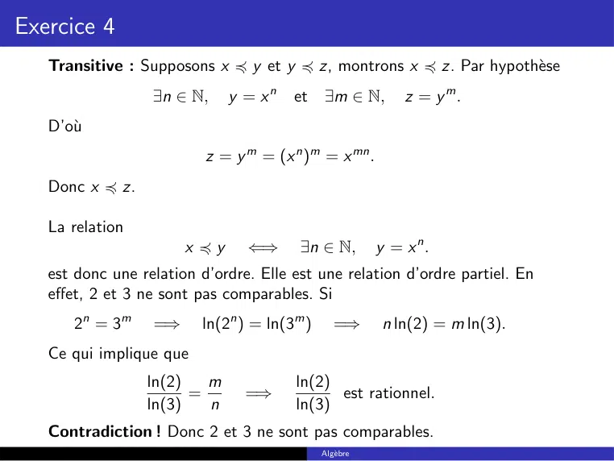

~~~text
Exercice 4
   Transitive : Supposons x 4 y et y 4 z, montrons x 4 z. Par hypothèse
                  ∃n ∈ N,     y = xn   et    ∃m ∈ N,        z = y m.
   D’où
                          z = y m = (x n )m = x mn .
   Donc x 4 z.

   La relation
                       x 4y     ⇐⇒      ∃n ∈ N,         y = x n.
   est donc une relation d’ordre. Elle est une relation d’ordre partiel. En
   effet, 2 et 3 ne sont pas comparables. Si
      2n = 3m     =⇒     ln(2n ) = ln(3m )      =⇒      n ln(2) = m ln(3).
   Ce qui implique que
                 ln(2)   m             ln(2)
                       =        =⇒           est rationnel.
                 ln(3)   n             ln(3)
   Contradiction ! Donc 2 et 3 ne sont pas comparables.
                                             Algèbre
~~~

## Page 19

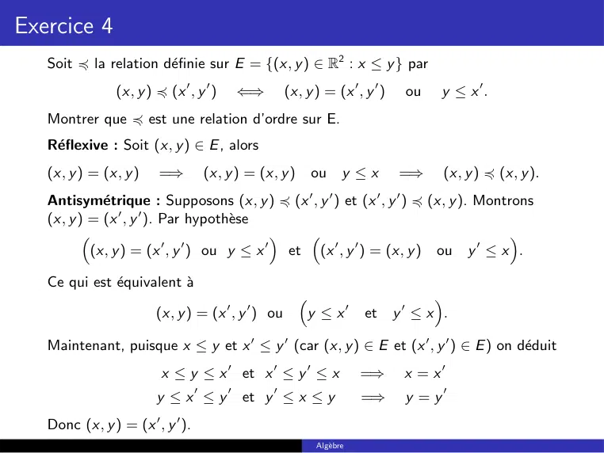

~~~text
Exercice 4
   Soit 4 la relation définie sur E = {(x, y ) ∈ R2 : x ≤ y } par
                (x, y ) 4 (x 0 , y 0 )   ⇐⇒         (x, y ) = (x 0 , y 0 )       ou   y ≤ x 0.
   Montrer que 4 est une relation d’ordre sur E.
   Réflexive : Soit (x, y ) ∈ E , alors
   (x, y ) = (x, y )     =⇒        (x, y ) = (x, y )     ou         y ≤x     =⇒       (x, y ) 4 (x, y ).
                                                         0      0        0   0
   Antisymétrique : Supposons (x, y ) 4 (x , y ) et (x , y ) 4 (x, y ). Montrons
   (x, y ) = (x 0 , y 0 ). Par hypothèse
                                                                               
            (x, y ) = (x 0 , y 0 ) ou y ≤ x 0 et (x 0 , y 0 ) = (x, y ) ou y 0 ≤ x .

   Ce qui est équivalent à
                                                                                  
                        (x, y ) = (x 0 , y 0 ) ou       y ≤ x0          et   y0 ≤ x .

   Maintenant, puisque x ≤ y et x 0 ≤ y 0 (car (x, y ) ∈ E et (x 0 , y 0 ) ∈ E ) on déduit
                         x ≤ y ≤ x 0 et x 0 ≤ y 0 ≤ x                   =⇒       x = x0
                        y ≤ x 0 ≤ y 0 et y 0 ≤ x ≤ y                    =⇒       y = y0
   Donc (x, y ) = (x 0 , y 0 ).
                                                             Algèbre
~~~

## Page 20

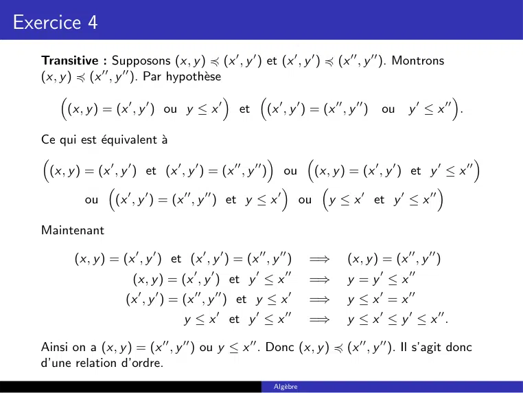

~~~text
Exercice 4
   Transitive : Supposons (x, y ) 4 (x 0 , y 0 ) et (x 0 , y 0 ) 4 (x 00 , y 00 ). Montrons
   (x, y ) 4 (x 00 , y 00 ). Par hypothèse
                                                                                         
         (x, y ) = (x 0 , y 0 ) ou y ≤ x 0 et (x 0 , y 0 ) = (x 00 , y 00 ) ou y 0 ≤ x 00 .

   Ce qui est équivalent à
                                                                                                 
    (x, y ) = (x 0 , y 0 ) et (x 0 , y 0 ) = (x 00 , y 00 ) ou (x, y ) = (x 0 , y 0 ) et y 0 ≤ x 00
                                                                                        
            ou (x 0 , y 0 ) = (x 00 , y 00 ) et y ≤ x 0 ou y ≤ x 0 et y 0 ≤ x 00

   Maintenant

          (x, y ) = (x 0 , y 0 ) et (x 0 , y 0 ) = (x 00 , y 00 )      =⇒   (x, y ) = (x 00 , y 00 )
                                        0   0          0       00
                        (x, y ) = (x , y ) et y ≤ x                    =⇒   y = y 0 ≤ x 00
                      (x 0 , y 0 ) = (x 00 , y 00 ) et y ≤ x 0         =⇒   y ≤ x 0 = x 00
                                                0      0       00
                                     y ≤x           et y ≤ x           =⇒   y ≤ x 0 ≤ y 0 ≤ x 00 .

   Ainsi on a (x, y ) = (x 00 , y 00 ) ou y ≤ x 00 . Donc (x, y ) 4 (x 00 , y 00 ). Il s’agit donc
   d’une relation d’ordre.
                                                            Algèbre
~~~

## Page 21

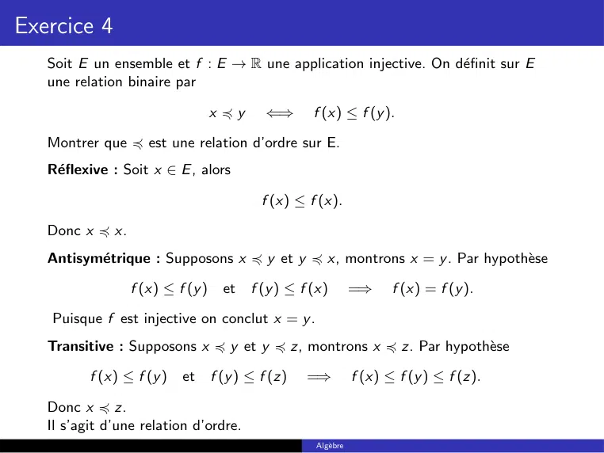

~~~text
Exercice 4
   Soit E un ensemble et f : E → R une application injective. On définit sur E
   une relation binaire par

                                  x 4y      ⇐⇒      f (x) ≤ f (y ).

   Montrer que 4 est une relation d’ordre sur E.
   Réflexive : Soit x ∈ E , alors

                                           f (x) ≤ f (x).

   Donc x 4 x.
   Antisymétrique : Supposons x 4 y et y 4 x, montrons x = y . Par hypothèse

                 f (x) ≤ f (y )     et   f (y ) ≤ f (x)        =⇒     f (x) = f (y ).

   Puisque f est injective on conclut x = y .
   Transitive : Supposons x 4 y et y 4 z, montrons x 4 z. Par hypothèse

          f (x) ≤ f (y )   et     f (y ) ≤ f (z)   =⇒          f (x) ≤ f (y ) ≤ f (z).

   Donc x 4 z.
   Il s’agit d’une relation d’ordre.
                                                    Algèbre
~~~

## Page 22

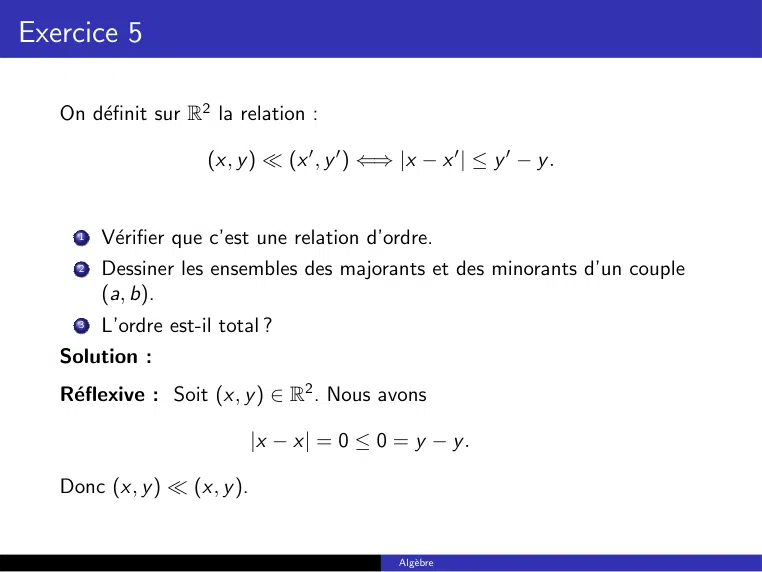

~~~text
Exercice 5

   On définit sur R2 la relation :

                      (x, y )  (x 0 , y 0 ) ⇐⇒ |x − x 0 | ≤ y 0 − y .

     1   Vérifier que c’est une relation d’ordre.
     2   Dessiner les ensembles des majorants et des minorants d’un couple
         (a, b).
     3   L’ordre est-il total ?
   Solution :
   Réflexive : Soit (x, y ) ∈ R2 . Nous avons

                             |x − x| = 0 ≤ 0 = y − y .

   Donc (x, y )  (x, y ).

                                                Algèbre
~~~

## Page 23

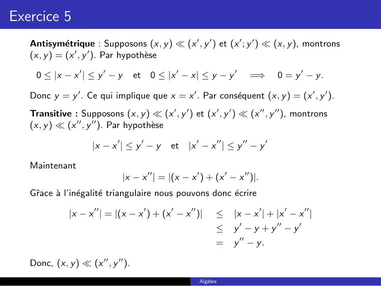

~~~text
Exercice 5
   Antisymétrique : Supposons (x, y )  (x 0 , y 0 ) et (x 0 ; y 0 )  (x, y ), montrons
   (x, y ) = (x 0 , y 0 ). Par hypothèse

     0 ≤ |x − x 0 | ≤ y 0 − y        et   0 ≤ |x 0 − x| ≤ y − y 0       =⇒       0 = y0 − y.

   Donc y = y 0 . Ce qui implique que x = x 0 . Par conséquent (x, y ) = (x 0 , y 0 ).
   Transitive : Supposons (x, y )  (x 0 , y 0 ) et (x 0 , y 0 )  (x 00 , y 00 ), montrons
   (x, y )  (x 00 , y 00 ). Par hypothèse

                      |x − x 0 | ≤ y 0 − y     et   |x 0 − x 00 | ≤ y 00 − y 0

   Maintenant
                               |x − x 00 | = |(x − x 0 ) + (x 0 − x 00 )|.
   Gr̂ace à l’inégalité triangulaire nous pouvons donc écrire

               |x − x 00 | = |(x − x 0 ) + (x 0 − x 00 )|     ≤   |x − x 0 | + |x 0 − x 00 |
                                                              ≤   y 0 − y + y 00 − y 0
                                                              =   y 00 − y .

   Donc, (x, y )  (x 00 , y 00 ).
                                                       Algèbre
~~~

## Page 24

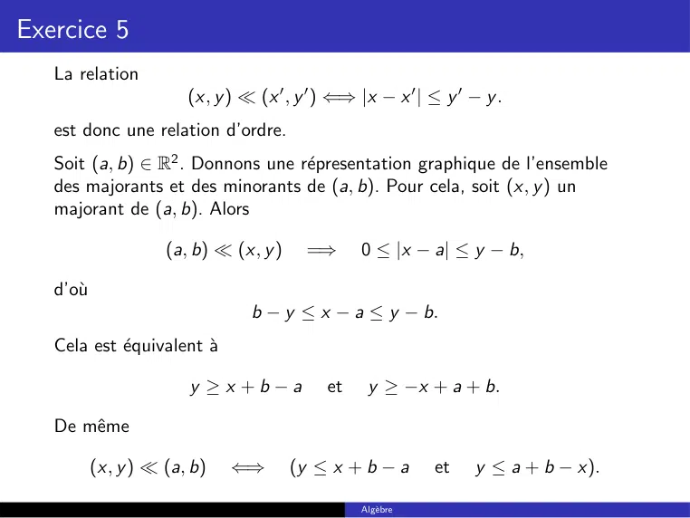

~~~text
Exercice 5
   La relation
                        (x, y )  (x 0 , y 0 ) ⇐⇒ |x − x 0 | ≤ y 0 − y .
   est donc une relation d’ordre.
   Soit (a, b) ∈ R2 . Donnons une répresentation graphique de l’ensemble
   des majorants et des minorants de (a, b). Pour cela, soit (x, y ) un
   majorant de (a, b). Alors

                     (a, b)  (x, y )     =⇒      0 ≤ |x − a| ≤ y − b,

   d’où
                                 b − y ≤ x − a ≤ y − b.
   Cela est équivalent à

                        y ≥x +b−a            et    y ≥ −x + a + b.

   De même

           (x, y )  (a, b)   ⇐⇒        (y ≤ x + b − a       et    y ≤ a + b − x).

                                                  Algèbre
~~~

## Page 25

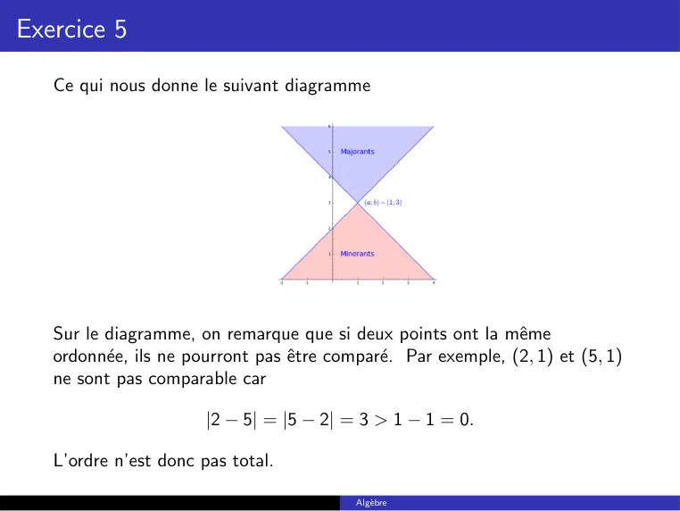

~~~text
Exercice 5
   Ce qui nous donne le suivant diagramme

   Sur le diagramme, on remarque que si deux points ont la même
   ordonnée, ils ne pourront pas être comparé. Par exemple, (2, 1) et (5, 1)
   ne sont pas comparable car

                       |2 − 5| = |5 − 2| = 3 > 1 − 1 = 0.

   L’ordre n’est donc pas total.

                                           Algèbre
~~~

## Page 26

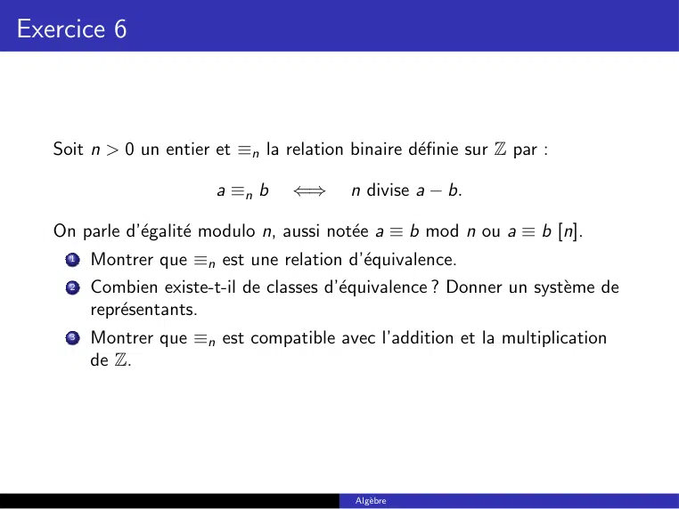

~~~text
Exercice 6

   Soit n > 0 un entier et ≡n la relation binaire définie sur Z par :

                         a ≡n b    ⇐⇒      n divise a − b.

   On parle d’égalité modulo n, aussi notée a ≡ b mod n ou a ≡ b [n].
     1   Montrer que ≡n est une relation d’équivalence.
     2   Combien existe-t-il de classes d’équivalence ? Donner un système de
         représentants.
     3   Montrer que ≡n est compatible avec l’addition et la multiplication
         de Z.

                                           Algèbre
~~~

## Page 27

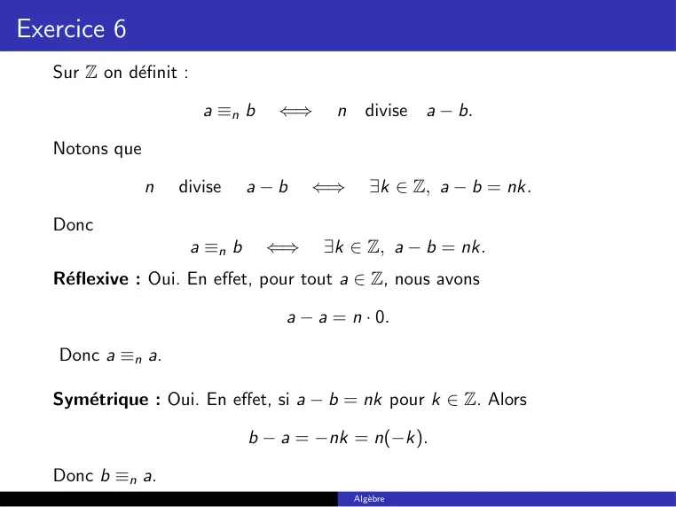

~~~text
Exercice 6
   Sur Z on définit :

                          a ≡n b     ⇐⇒     n     divise   a − b.

   Notons que

                n   divise        a−b    ⇐⇒         ∃k ∈ Z, a − b = nk.

   Donc
                         a ≡n b     ⇐⇒     ∃k ∈ Z, a − b = nk.
   Réflexive : Oui. En effet, pour tout a ∈ Z, nous avons

                                      a − a = n · 0.

   Donc a ≡n a.

   Symétrique : Oui. En effet, si a − b = nk pour k ∈ Z. Alors

                                  b − a = −nk = n(−k).

   Donc b ≡n a.
                                                Algèbre
~~~

## Page 28

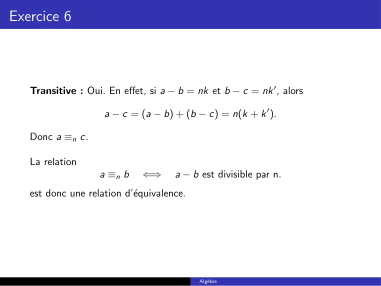

~~~text
Exercice 6

   Transitive : Oui. En effet, si a − b = nk et b − c = nk 0 , alors

                    a − c = (a − b) + (b − c) = n(k + k 0 ).

   Donc a ≡n c.

   La relation
                   a ≡n b    ⇐⇒      a − b est divisible par n.
   est donc une relation d’équivalence.

                                           Algèbre
~~~

## Page 29

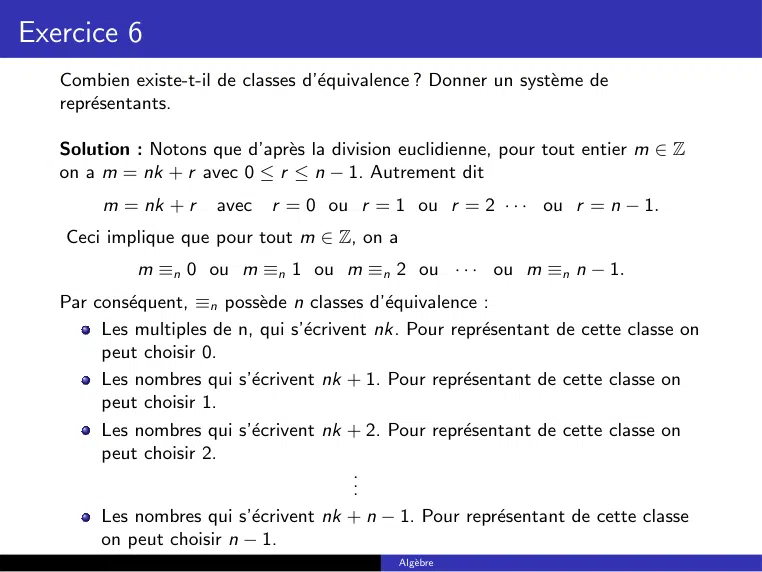

~~~text
Exercice 6
   Combien existe-t-il de classes d’équivalence ? Donner un système de
   représentants.

   Solution : Notons que d’après la division euclidienne, pour tout entier m ∈ Z
   on a m = nk + r avec 0 ≤ r ≤ n − 1. Autrement dit
        m = nk + r     avec   r = 0 ou r = 1 ou r = 2 · · · ou r = n − 1.
   Ceci implique que pour tout m ∈ Z, on a
            m ≡n 0 ou m ≡n 1 ou m ≡n 2 ou · · · ou m ≡n n − 1.
   Par conséquent, ≡n possède n classes d’équivalence :
        Les multiples de n, qui s’écrivent nk. Pour représentant de cette classe on
        peut choisir 0.
        Les nombres qui s’écrivent nk + 1. Pour représentant de cette classe on
        peut choisir 1.
        Les nombres qui s’écrivent nk + 2. Pour représentant de cette classe on
        peut choisir 2.
                                         ..
                                          .
        Les nombres qui s’écrivent nk + n − 1. Pour représentant de cette classe
        on peut choisir n − 1.
                                              Algèbre
~~~

## Page 30

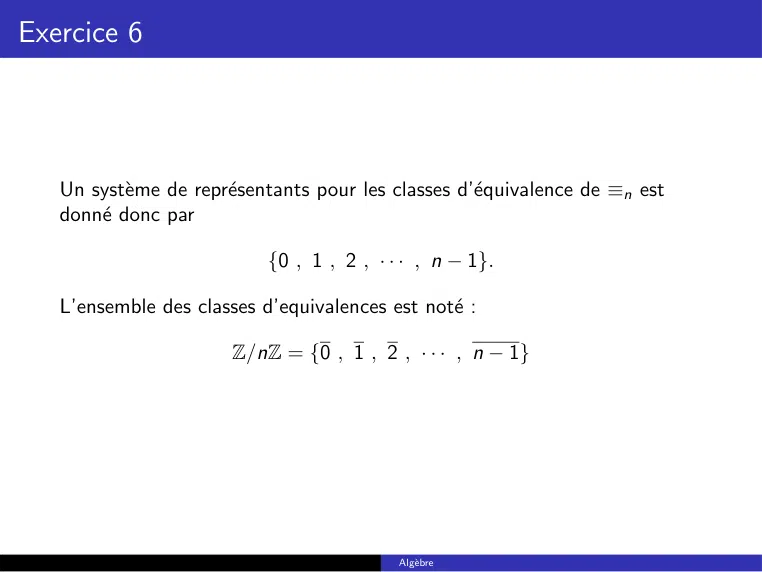

~~~text
Exercice 6

   Un système de représentants pour les classes d’équivalence de ≡n est
   donné donc par

                           {0 , 1 , 2 , · · · , n − 1}.

   L’ensemble des classes d’equivalences est noté :

                       Z/nZ = {0 , 1 , 2 , · · · , n − 1}

                                           Algèbre
~~~

## Page 31

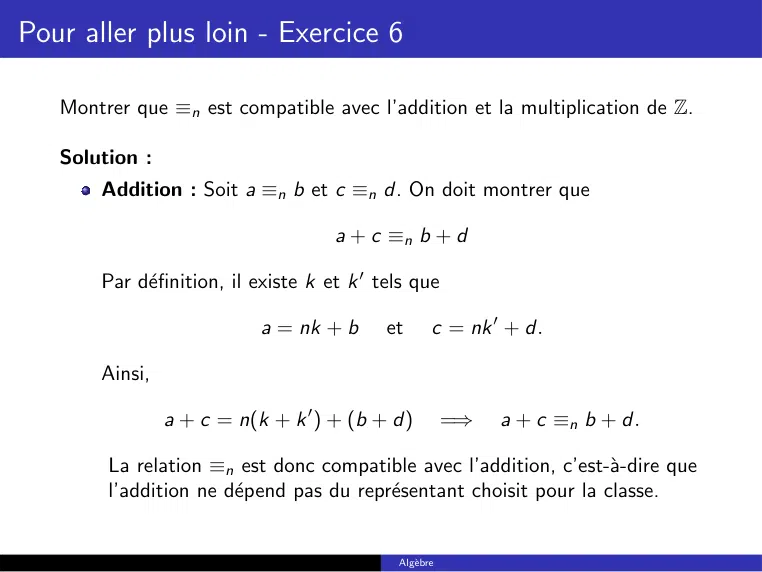

~~~text
Pour aller plus loin - Exercice 6

   Montrer que ≡n est compatible avec l’addition et la multiplication de Z.

   Solution :
       Addition : Soit a ≡n b et c ≡n d. On doit montrer que

                                     a + c ≡n b + d

       Par définition, il existe k et k 0 tels que

                           a = nk + b       et      c = nk 0 + d.

       Ainsi,

                a + c = n(k + k 0 ) + (b + d)           =⇒   a + c ≡n b + d.

        La relation ≡n est donc compatible avec l’addition, c’est-à-dire que
        l’addition ne dépend pas du représentant choisit pour la classe.

                                             Algèbre
~~~

## Page 32

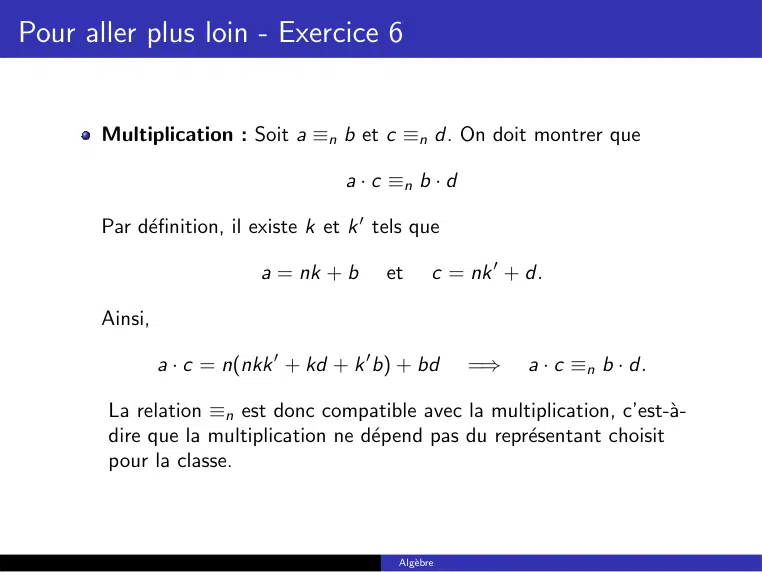

~~~text
Pour aller plus loin - Exercice 6

       Multiplication : Soit a ≡n b et c ≡n d. On doit montrer que

                                      a · c ≡n b · d

       Par définition, il existe k et k 0 tels que

                            a = nk + b      et      c = nk 0 + d.

       Ainsi,

                a · c = n(nkk 0 + kd + k 0 b) + bd      =⇒     a · c ≡n b · d.

       La relation ≡n est donc compatible avec la multiplication, c’est-à-
       dire que la multiplication ne dépend pas du représentant choisit
       pour la classe.

                                             Algèbre
~~~

## Page 33

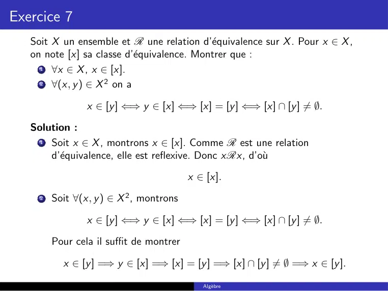

~~~text
Exercice 7
   Soit X un ensemble et R une relation d’équivalence sur X . Pour x ∈ X ,
   on note [x] sa classe d’équivalence. Montrer que :
     1  ∀x ∈ X , x ∈ [x].
     2  ∀(x, y ) ∈ X 2 on a

                 x ∈ [y ] ⇐⇒ y ∈ [x] ⇐⇒ [x] = [y ] ⇐⇒ [x] ∩ [y ] 6= ∅.

   Solution :
     1 Soit x ∈ X , montrons x ∈ [x]. Comme R est une relation
       d’équivalence, elle est reflexive. Donc xRx, d’où

                                          x ∈ [x].
     2   Soit ∀(x, y ) ∈ X 2 , montrons

                 x ∈ [y ] ⇐⇒ y ∈ [x] ⇐⇒ [x] = [y ] ⇐⇒ [x] ∩ [y ] 6= ∅.

         Pour cela il suffit de montrer

           x ∈ [y ] =⇒ y ∈ [x] =⇒ [x] = [y ] =⇒ [x] ∩ [y ] 6= ∅ =⇒ x ∈ [y ].

                                             Algèbre
~~~

## Page 34

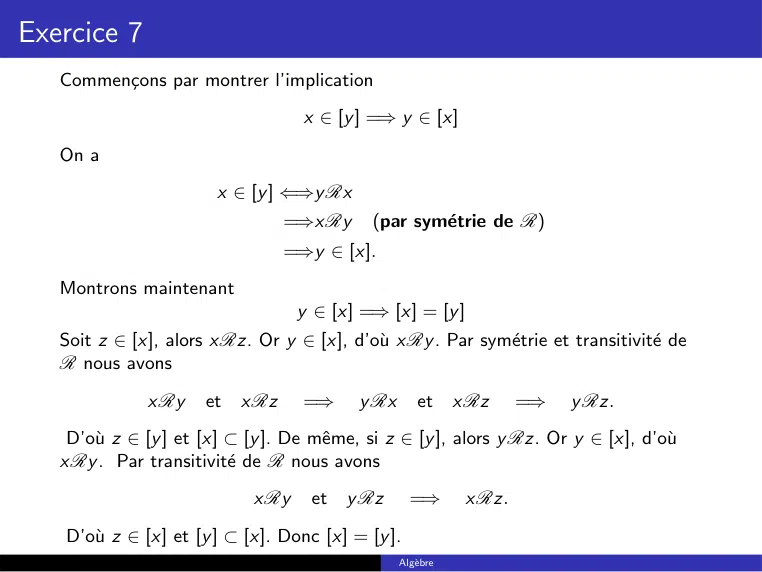

~~~text
Exercice 7
   Commençons par montrer l’implication
                                   x ∈ [y ] =⇒ y ∈ [x]
   On a
                        x ∈ [y ] ⇐⇒y Rx
                                 =⇒xRy       (par symétrie de R)
                                 =⇒y ∈ [x].
   Montrons maintenant
                                   y ∈ [x] =⇒ [x] = [y ]
   Soit z ∈ [x], alors xRz. Or y ∈ [x], d’où xRy . Par symétrie et transitivité de
   R nous avons
              xRy     et   xRz     =⇒      y Rx       et     xRz     =⇒   y Rz.
    D’où z ∈ [y ] et [x] ⊂ [y ]. De même, si z ∈ [y ], alors y Rz. Or y ∈ [x], d’où
   xRy . Par transitivité de R nous avons
                             xRy    et   y Rz       =⇒        xRz.
   D’où z ∈ [x] et [y ] ⊂ [x]. Donc [x] = [y ].
                                                  Algèbre
~~~

## Page 35

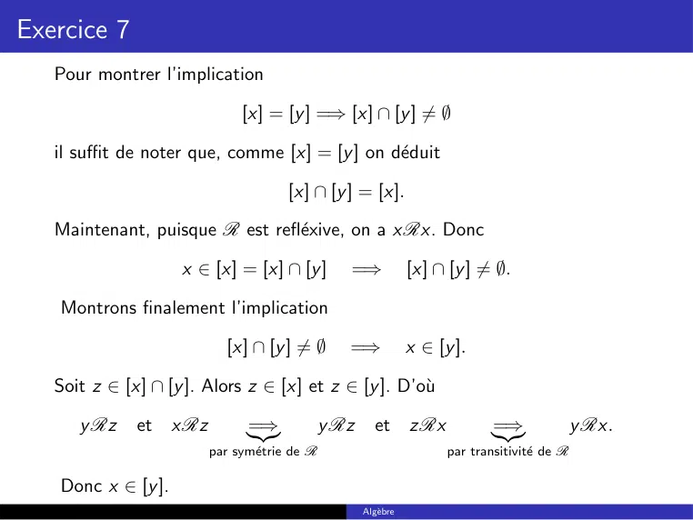

~~~text
Exercice 7
   Pour montrer l’implication

                               [x] = [y ] =⇒ [x] ∩ [y ] 6= ∅

   il suffit de noter que, comme [x] = [y ] on déduit

                                       [x] ∩ [y ] = [x].

   Maintenant, puisque R est refléxive, on a xRx. Donc

                    x ∈ [x] = [x] ∩ [y ]          =⇒             [x] ∩ [y ] 6= ∅.

   Montrons finalement l’implication

                            [x] ∩ [y ] 6= ∅       =⇒             x ∈ [y ].

   Soit z ∈ [x] ∩ [y ]. Alors z ∈ [x] et z ∈ [y ]. D’où

      y Rz    et    xRz         =⇒
                                |{z}           y Rz      et      zRx          =⇒
                                                                              |{z}              y Rx.
                          par symétrie de R                           par transitivité de R

   Donc x ∈ [y ].
                                                      Algèbre
~~~

## Page 36

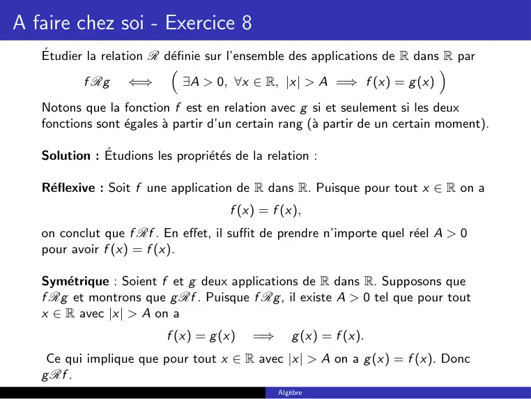

~~~text
A faire chez soi - Exercice 8
   Étudier la relation R définie sur l’ensemble des applications de R dans R par
                                                                           
           f Rg ⇐⇒             ∃A > 0, ∀x ∈ R, |x| > A =⇒ f (x) = g (x)
   Notons que la fonction f est en relation avec g si et seulement si les deux
   fonctions sont égales à partir d’un certain rang (à partir de un certain moment).

   Solution : Étudions les propriétés de la relation :

   Réflexive : Soit f une application de R dans R. Puisque pour tout x ∈ R on a
                                       f (x) = f (x),
   on conclut que f Rf . En effet, il suffit de prendre n’importe quel réel A > 0
   pour avoir f (x) = f (x).

   Symétrique : Soient f et g deux applications de R dans R. Supposons que
   f Rg et montrons que g Rf . Puisque f Rg , il existe A > 0 tel que pour tout
   x ∈ R avec |x| > A on a
                           f (x) = g (x)    =⇒       g (x) = f (x).
    Ce qui implique que pour tout x ∈ R avec |x| > A on a g (x) = f (x). Donc
   g Rf .
                                                 Algèbre
~~~

## Page 37

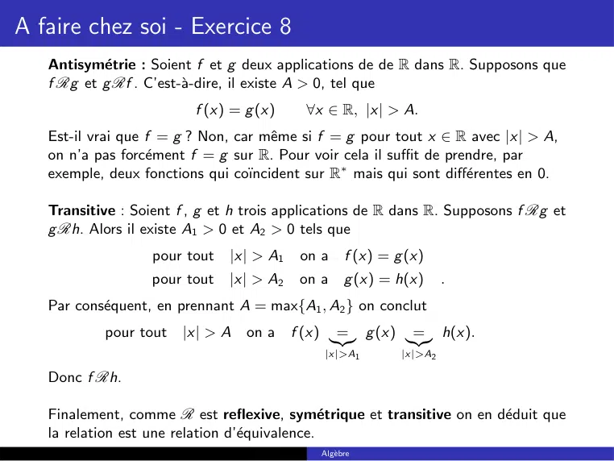

~~~text
A faire chez soi - Exercice 8
   Antisymétrie : Soient f et g deux applications de de R dans R. Supposons que
   f Rg et g Rf . C’est-à-dire, il existe A > 0, tel que
                         f (x) = g (x)     ∀x ∈ R, |x| > A.
   Est-il vrai que f = g ? Non, car même si f = g pour tout x ∈ R avec |x| > A,
   on n’a pas forcément f = g sur R. Pour voir cela il suffit de prendre, par
   exemple, deux fonctions qui coı̈ncident sur R∗ mais qui sont différentes en 0.

   Transitive : Soient f , g et h trois applications de R dans R. Supposons f Rg et
   g Rh. Alors il existe A1 > 0 et A2 > 0 tels que
                   pour tout   |x| > A1    on a     f (x) = g (x)
                   pour tout   |x| > A2    on a     g (x) = h(x)      .
   Par conséquent, en prennant A = max{A1 , A2 } on conclut
           pour tout   |x| > A   on a     f (x) |{z}
                                                 = g (x) |{z}
                                                          = h(x).
                                              |x|>A1         |x|>A2

   Donc f Rh.

   Finalement, comme R est reflexive, symétrique et transitive on en déduit que
   la relation est une relation d’équivalence.
                                              Algèbre
~~~

## Page 38

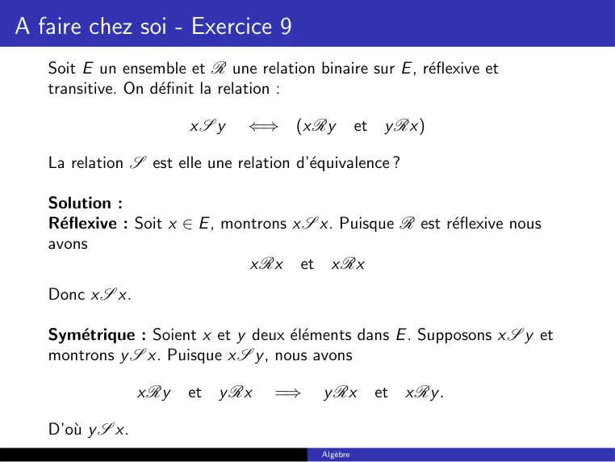

~~~text
A faire chez soi - Exercice 9
   Soit E un ensemble et R une relation binaire sur E , réflexive et
   transitive. On définit la relation :

                        xS y    ⇐⇒     (xRy           et    y Rx)

   La relation S est elle une relation d’équivalence ?

   Solution :
   Réflexive : Soit x ∈ E , montrons xS x. Puisque R est réflexive nous
   avons
                                xRx et xRx
   Donc xS x.

   Symétrique : Soient x et y deux éléments dans E . Supposons xS y et
   montrons y S x. Puisque xS y , nous avons

                  xRy   et   y Rx   =⇒     y Rx            et   xRy .

   D’où y S x.
                                           Algèbre
~~~

## Page 39

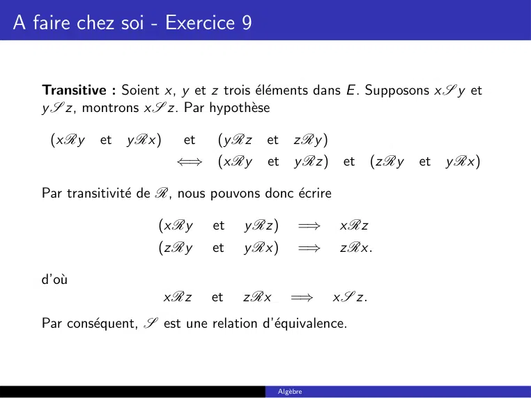

~~~text
A faire chez soi - Exercice 9

   Transitive : Soient x, y et z trois éléments dans E . Supposons xS y et
   y S z, montrons xS z. Par hypothèse

    (xRy    et   y Rx)     et    (y Rz   et     zRy )
                          ⇐⇒     (xRy    et     y Rz)    et     (zRy   et   y Rx)

   Par transitivité de R, nous pouvons donc écrire

                      (xRy      et   y Rz)       =⇒      xRz
                      (zRy      et   y Rx)       =⇒      zRx.

   d’où
                         xRz    et   zRx       =⇒       xS z.
   Par conséquent, S est une relation d’équivalence.

                                           Algèbre
~~~

## Page 40

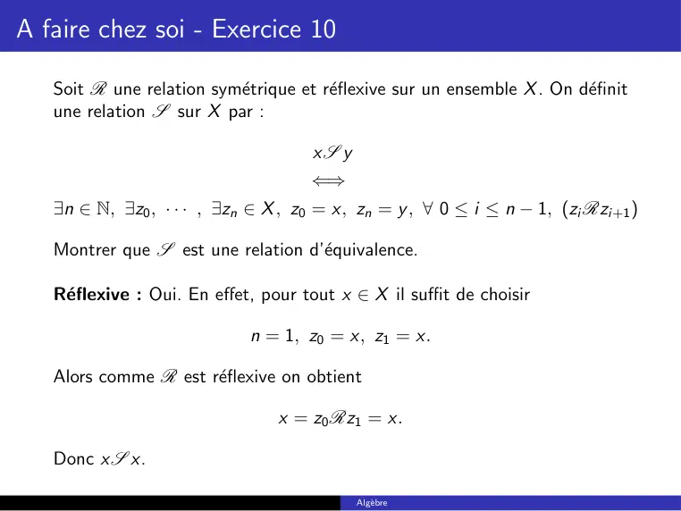

~~~text
A faire chez soi - Exercice 10

   Soit R une relation symétrique et réflexive sur un ensemble X . On définit
   une relation S sur X par :

                                     xS y
                                     ⇐⇒
   ∃n ∈ N, ∃z0 , · · · , ∃zn ∈ X , z0 = x, zn = y , ∀ 0 ≤ i ≤ n − 1, (zi Rzi+1 )

   Montrer que S est une relation d’équivalence.

   Réflexive : Oui. En effet, pour tout x ∈ X il suffit de choisir

                             n = 1, z0 = x, z1 = x.

   Alors comme R est réflexive on obtient

                                 x = z0 Rz1 = x.

   Donc xS x.

                                            Algèbre
~~~

## Page 41

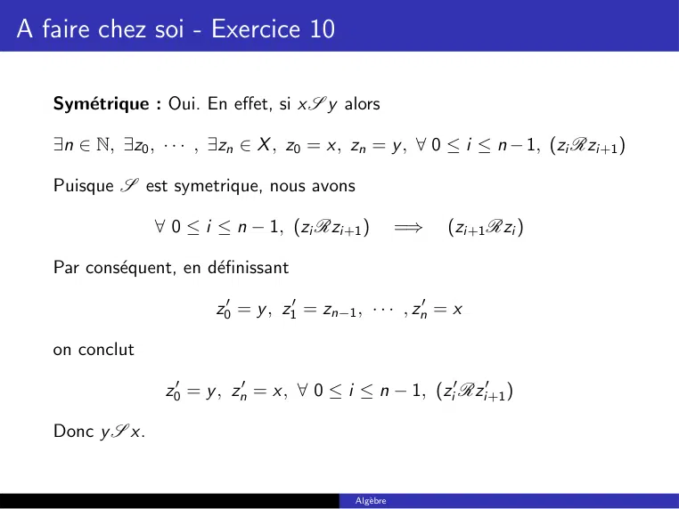

~~~text
A faire chez soi - Exercice 10

   Symétrique : Oui. En effet, si xS y alors

   ∃n ∈ N, ∃z0 , · · · , ∃zn ∈ X , z0 = x, zn = y , ∀ 0 ≤ i ≤ n − 1, (zi Rzi+1 )

   Puisque S est symetrique, nous avons

                 ∀ 0 ≤ i ≤ n − 1, (zi Rzi+1 )            =⇒   (zi+1 Rzi )

   Par conséquent, en définissant

                         z00 = y , z10 = zn−1 , · · · , zn0 = x

   on conclut

                  z00 = y , zn0 = x, ∀ 0 ≤ i ≤ n − 1, (zi0 Rzi+1
                                                             0
                                                                 )

   Donc y S x.

                                              Algèbre
~~~

## Page 42

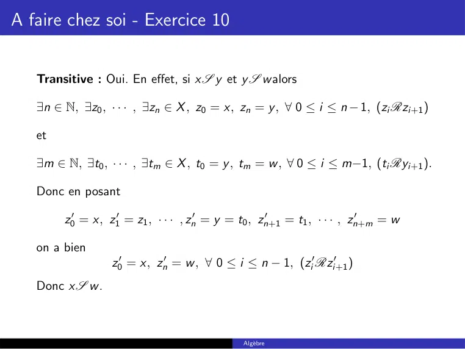

~~~text
A faire chez soi - Exercice 10

   Transitive : Oui. En effet, si xS y et y S w alors

   ∃n ∈ N, ∃z0 , · · · , ∃zn ∈ X , z0 = x, zn = y , ∀ 0 ≤ i ≤ n − 1, (zi Rzi+1 )

   et

   ∃m ∈ N, ∃t0 , · · · , ∃tm ∈ X , t0 = y , tm = w , ∀ 0 ≤ i ≤ m−1, (ti Ryi+1 ).

   Donc en posant

        z00 = x, z10 = z1 , · · · , zn0 = y = t0 , zn+1
                                                    0                   0
                                                        = t1 , · · · , zn+m =w

   on a bien
                 z00 = x, zn0 = w , ∀ 0 ≤ i ≤ n − 1, (zi0 Rzi+1
                                                            0
                                                                )
   Donc xS w .

                                             Algèbre
~~~
