# TD4-Applications-Correction_2023-2024_Algebre1_P1S1_NArancibia.pdf

[Ouvrir l’original](https://drive.google.com/open?id=1aYr_wKvpr7ndBws19Q6PKeBrQpWTp22d) · Les deux lectures automatiques du PDF divergent sur les pages indiquées. Leur fac-similé accompagne le texte.

**Pages présentant un écart entre les deux extractions** — 1, 3, 5, 7, 9–10, 13, 15, 17–25, 30, 32–37, 40–43, 45–47, 49–52, 56, 58, 60, 62, 66–70, 72, 74, 79–80, 83, 85–94.

## Page 1

~~~text
Algèbre-Premier semestre 2023

                       CY Tech

                      TD Algèbre

                      Applications.

                             Algèbre
~~~

## Page 2

~~~text
Exercice 1

   Déterminer f (R+ ), f (R− ), f ({−1}), f −1 (R+ ), f −1 (R− ), f −1 ({−1})
   pour les fonctions suivantes :
     1   f (x) = e x
     2   f (x) = ln(x)
     3   f (x) = cos(x)

                                            Algèbre
~~~

## Page 3

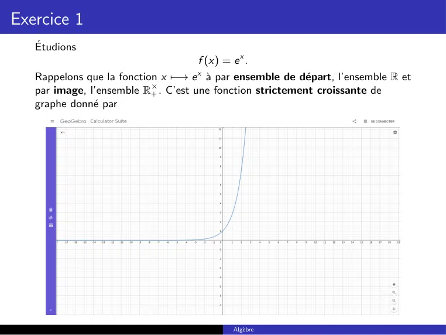

~~~text
Exercice 1
   Étudions
                                      f (x) = e x .
   Rappelons que la fonction x 7−→ e x à par ensemble de départ, l’ensemble R et
   par image, l’ensemble R×+ . C’est une fonction strictement croissante de
   graphe donné par

                                            Algèbre
~~~

## Page 4

~~~text
Exercice 1

   Ce qui nous permet de conclure

   f (R+ ) = [1, +∞[   ;   f (R− ) =]0, 1] ;           f ({−1}) = {f (−1)} = {e −1 }

   et
             f −1 (R+ ) = R   ;   f −1 (R− ) = ∅        ;   f −1 ({−1}) = ∅

                                            Algèbre
~~~

## Page 5

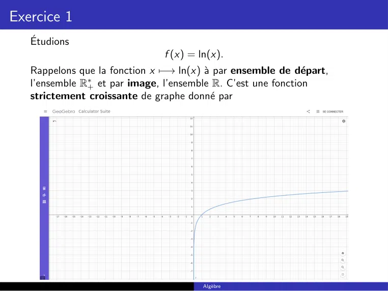

~~~text
Exercice 1
   Étudions
                                f (x) = ln(x).
   Rappelons que la fonction x 7−→ ln(x) à par ensemble de départ,
   l’ensemble R∗+ et par image, l’ensemble R. C’est une fonction
   strictement croissante de graphe donné par

                                         Algèbre
~~~

## Page 6

~~~text
Exercice 1

   Ce qui nous permet de conclure

              f (R+ ) = R   ;    f (R− ) = ∅      ;     f ({−1}) = ∅

   et

                f −1 (R+ ) = [1, +∞[     ;   f −1 (R− ) =]0, 1].

   Finalement, puisque
                                   ln e −1 = −1
                                          

   et ln est une fonction strictement croissant, on conclut

                                f −1 ({−1}) = {e −1 }.

                                             Algèbre
~~~

## Page 7

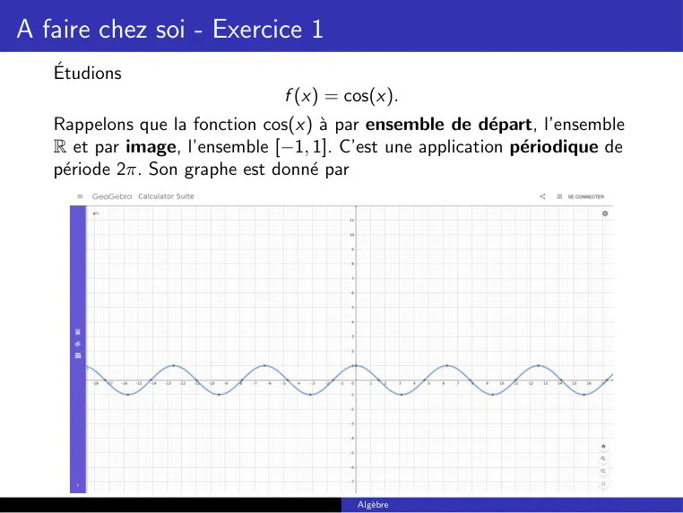

~~~text
A faire chez soi - Exercice 1
   Étudions
                                f (x) = cos(x).
   Rappelons que la fonction cos(x) à par ensemble de départ, l’ensemble
   R et par image, l’ensemble [−1, 1]. C’est une application périodique de
   période 2π. Son graphe est donné par

                                         Algèbre
~~~

## Page 8

~~~text
A faire chez soi - Exercice 1

   Ce qui nous permet de conclure

   f (R+ ) = [−1, 1] ;      f (R− ) = [−1, 1] ;            f ({−1}) = {f (−1)} = {cos(−1)}

   De même
                        h π πi                                   
            −1                                  −1           π 3π
        f        (R+ ) = − ,   + 2kπ   et   f        (R− ) =  ,     + 2kπ
                          2 2                                2 2
   et
                              f −1 ({−1}) = {π + 2kπ}.

                                                Algèbre
~~~

## Page 9

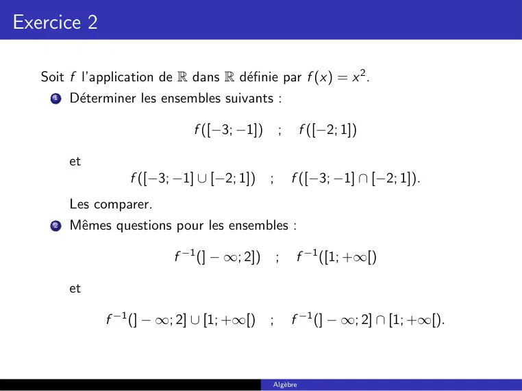

~~~text
Exercice 2

   Soit f l’application de R dans R définie par f (x) = x 2 .
     1   Déterminer les ensembles suivants :

                              f ([−3; −1])       ;      f ([−2; 1])

         et
                   f ([−3; −1] ∪ [−2; 1])    ;       f ([−3; −1] ∩ [−2; 1]).
         Les comparer.
     2   Mêmes questions pour les ensembles :

                          f −1 (] − ∞; 2])       ;   f −1 ([1; +∞[)

         et

               f −1 (] − ∞; 2] ∪ [1; +∞[)    ;       f −1 (] − ∞; 2] ∩ [1; +∞[).

                                             Algèbre
~~~

## Page 10

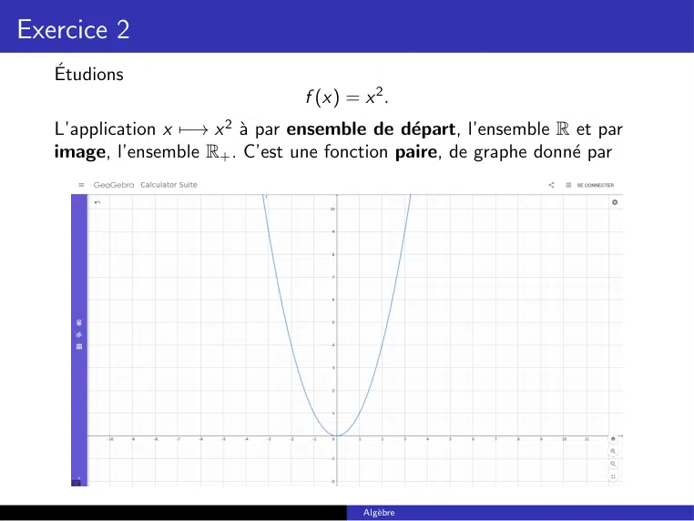

~~~text
Exercice 2
   Étudions
                                  f (x) = x 2 .
   L’application x 7−→ x 2 à par ensemble de départ, l’ensemble R et par
   image, l’ensemble R+ . C’est une fonction paire, de graphe donné par

                                          Algèbre
~~~

## Page 11

~~~text
Exercice 2
   Ce qui nous permet de conclure
                  f ([−3, −1]) = [1, 9]   ;   f ([−2, 1]) = [0, 4]
   De même
                  f ([−3, −1] ∪ [−2, 1]) = f ([−3, 1]) = [0, 9].
   Notons que
                f ([−3, −1] ∪ [−2, 1])    =   [0, 9]
                                          =   [1, 9] ∪ [0, 4]
                                          =   f ([−3, −1]) ∪ f ([−2, 1]).
   Finalement
                f ([−3, −1] ∩ [−2, 1]) = f ([−2, −1]) = [1, 4].
   On fait noter que
                f ([−3, −1] ∩ [−2, 1])    =   [1, 4]
                                          =   [1, 9] ∩ [0, 4]
                                          =   f ([−3, −1]) ∩ f ([−2, 1]).

                                               Algèbre
~~~

## Page 12

~~~text
Exercice 2
   Maintenant
                                                      √ √
                 f −1 (] − ∞, 2]) = f −1 ([0, 2]) = [− 2, 2]
   et
                   f −1 ([1, +∞[) = ] − ∞, −1] ∪ [1, +∞[.
   De même
        f −1 (] − ∞, 2] ∪ [1, +∞[) = f −1 (R)
                                  = R
                                      √ √
                                  = [− 2, 2] ∪ (] − ∞, −1] ∪ [1, +∞[)
                                  = f −1 (] − ∞, 2]) ∪ f −1 ([1, +∞[).
   Finalement
        f −1 (] − ∞, 2] ∩ [1, +∞[) = f −1 ([1, 2])
                                        √           √
                                   = [− 2, −1] ∪ [1, 2]
                                        √ √
                                   = [− 2, 2] ∩ (] − ∞, −1] ∪ [1, +∞[)
                                  = f −1 (] − ∞, 2[) ∩ f −1 ([1, +∞[).

                                            Algèbre
~~~

## Page 13

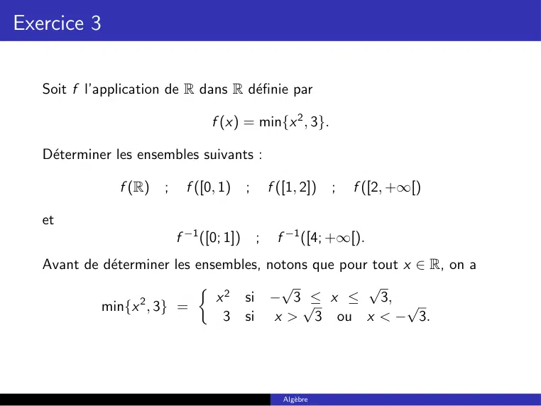

~~~text
Exercice 3

   Soit f l’application de R dans R définie par

                                  f (x) = min{x 2 , 3}.

   Déterminer les ensembles suivants :

               f (R)   ;     f ([0, 1)     ;       f ([1, 2])    ;   f ([2, +∞[)

   et
                           f −1 ([0; 1])       ;    f −1 ([4; +∞[).
   Avant de déterminer les ensembles, notons que pour tout x ∈ R, on a
                             2          √            √
                  2            x   si − 3 √≤ x ≤ 3, √
            min{x , 3} =
                                 3 si x > 3 ou x < − 3.

                                                      Algèbre
~~~

## Page 14

~~~text
Exercice 3
   Le graphe de la fonction f est donné donc par

                                         Algèbre
~~~

## Page 15

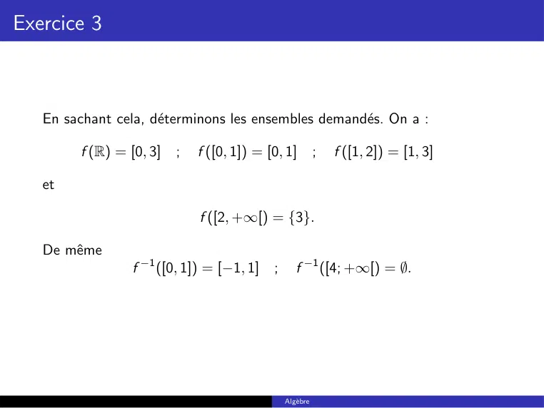

~~~text
Exercice 3

   En sachant cela, déterminons les ensembles demandés. On a :

         f (R) = [0, 3]   ;   f ([0, 1]) = [0, 1] ;      f ([1, 2]) = [1, 3]

   et

                              f ([2, +∞[) = {3}.

   De même
                  f −1 ([0, 1]) = [−1, 1] ;      f −1 ([4; +∞[) = ∅.

                                              Algèbre
~~~

## Page 16

~~~text
Exercice 4

   Les applications suivantes sont-elles injectives ? surjectives ? bijectives ?
   (1) n 7→ n + 1 de N dans N.
            x+1
   (2) x 7→ x−1 de R \ {1} dans R.
   (3) (x; y ) 7→ (1; x − y ; y ) de R2 dans R3 .
   (4) (x; y ; z) 7→ (x + y + z; x − y − z; x) de R3 dans R3 .
   (5) (x; y ) 7→ (x + y ; xy ) de R2 dans R2 .
   (6) n 7→ n + 1 de Z dans Z.
   (7) (x; y ) 7→ 2y de R2 dans R.
   (8) (x; y ) 7→ (x; xy − y 3 ) de R2 dans R2 .

                                             Algèbre
~~~

## Page 17

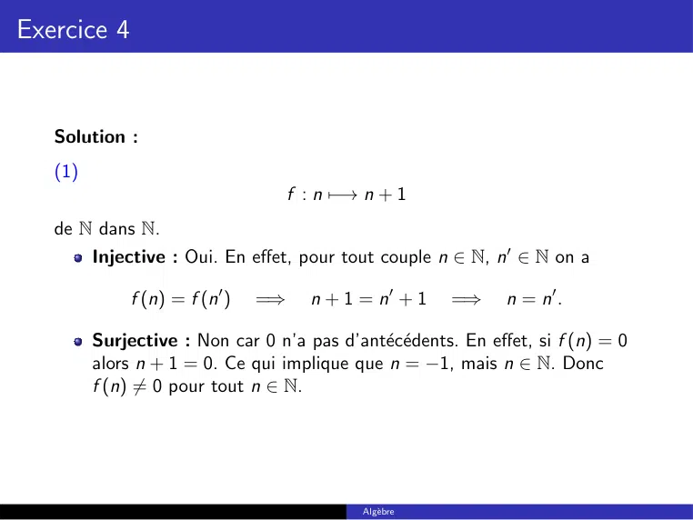

~~~text
Exercice 4

   Solution :
   (1)
                                     f : n 7−→ n + 1
   de N dans N.
         Injective : Oui. En effet, pour tout couple n ∈ N, n0 ∈ N on a

              f (n) = f (n0 )   =⇒     n + 1 = n0 + 1    =⇒    n = n0 .

         Surjective : Non car 0 n’a pas d’antécédents. En effet, si f (n) = 0
         alors n + 1 = 0. Ce qui implique que n = −1, mais n ∈ N. Donc
         f (n) 6= 0 pour tout n ∈ N.

                                              Algèbre
~~~

## Page 18

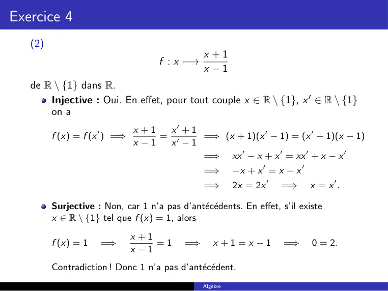

~~~text
Exercice 4
   (2)
                                                x +1
                                    f : x 7−→
                                                x −1
   de R \ {1} dans R.
       Injective : Oui. En effet, pour tout couple x ∈ R \ {1}, x 0 ∈ R \ {1}
       on a
                               x +1  x0 + 1
         f (x) = f (x 0 ) =⇒        = 0     =⇒ (x + 1)(x 0 − 1) = (x 0 + 1)(x − 1)
                               x −1  x −1
                                            =⇒ xx 0 − x + x 0 = xx 0 + x − x 0
                                                =⇒         −x + x 0 = x − x 0
                                                =⇒         2x = 2x 0   =⇒       x = x 0.

         Surjective : Non, car 1 n’a pas d’antécédents. En effet, s’il existe
         x ∈ R \ {1} tel que f (x) = 1, alors
                               x +1
         f (x) = 1   =⇒             =1     =⇒       x +1=x −1          =⇒       0 = 2.
                               x −1
         Contradiction ! Donc 1 n’a pas d’antécédent.
                                                Algèbre
~~~

## Page 19

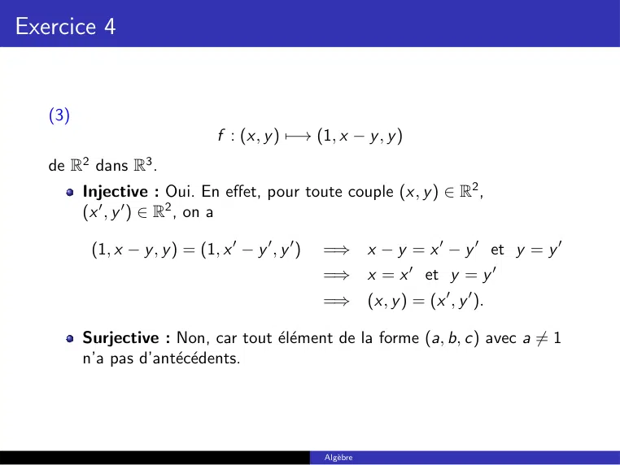

~~~text
Exercice 4

   (3)
                                 f : (x, y ) 7−→ (1, x − y , y )
   de R2 dans R3 .
         Injective : Oui. En effet, pour toute couple (x, y ) ∈ R2 ,
         (x 0 , y 0 ) ∈ R2 , on a

          (1, x − y , y ) = (1, x 0 − y 0 , y 0 )   =⇒ x − y = x 0 − y 0 et y = y 0
                                                    =⇒ x = x 0 et y = y 0
                                                    =⇒ (x, y ) = (x 0 , y 0 ).

         Surjective : Non, car tout élément de la forme (a, b, c) avec a 6= 1
         n’a pas d’antécédents.

                                                    Algèbre
~~~

## Page 20

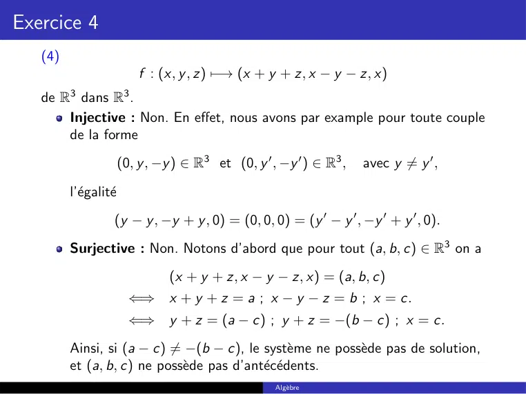

~~~text
Exercice 4
   (4)
                            f : (x, y , z) 7−→ (x + y + z, x − y − z, x)
         3              3
   de R dans R .
       Injective : Non. En effet, nous avons par example pour toute couple
       de la forme
                       (0, y , −y ) ∈ R3 et (0, y 0 , −y 0 ) ∈ R3 ,   avec y 6= y 0 ,
         l’égalité
                   (y − y , −y + y , 0) = (0, 0, 0) = (y 0 − y 0 , −y 0 + y 0 , 0).
         Surjective : Non. Notons d’abord que pour tout (a, b, c) ∈ R3 on a
                                 (x + y + z, x − y − z, x) = (a, b, c)
                         ⇐⇒      x + y + z = a ; x − y − z = b ; x = c.
                         ⇐⇒      y + z = (a − c) ; y + z = −(b − c) ; x = c.
         Ainsi, si (a − c) 6= −(b − c), le système ne possède pas de solution,
         et (a, b, c) ne possède pas d’antécédents.
                                                     Algèbre
~~~

## Page 21

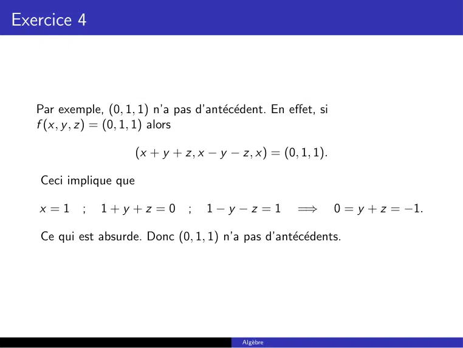

~~~text
Exercice 4

   Par exemple, (0, 1, 1) n’a pas d’antécédent. En effet, si
   f (x, y , z) = (0, 1, 1) alors

                       (x + y + z, x − y − z, x) = (0, 1, 1).

   Ceci implique que

   x =1 ;       1+y +z =0 ;          1−y −z =1         =⇒        0 = y + z = −1.

   Ce qui est absurde. Donc (0, 1, 1) n’a pas d’antécédents.

                                            Algèbre
~~~

## Page 22

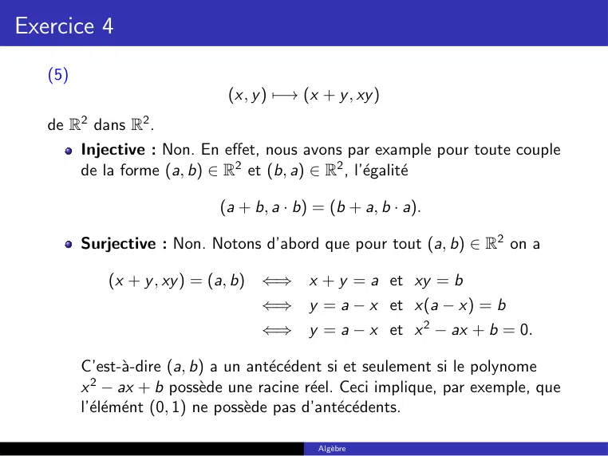

~~~text
Exercice 4
   (5)
                              (x, y ) 7−→ (x + y , xy )
   de R2 dans R2 .
         Injective : Non. En effet, nous avons par example pour toute couple
         de la forme (a, b) ∈ R2 et (b, a) ∈ R2 , l’égalité

                             (a + b, a · b) = (b + a, b · a).

         Surjective : Non. Notons d’abord que pour tout (a, b) ∈ R2 on a

             (x + y , xy ) = (a, b) ⇐⇒     x + y = a et xy = b
                                   ⇐⇒      y = a − x et x(a − x) = b
                                   ⇐⇒      y = a − x et x 2 − ax + b = 0.

         C’est-à-dire (a, b) a un antécédent si et seulement si le polynome
         x 2 − ax + b possède une racine réel. Ceci implique, par exemple, que
         l’élémént (0, 1) ne possède pas d’antécédents.

                                            Algèbre
~~~

## Page 23

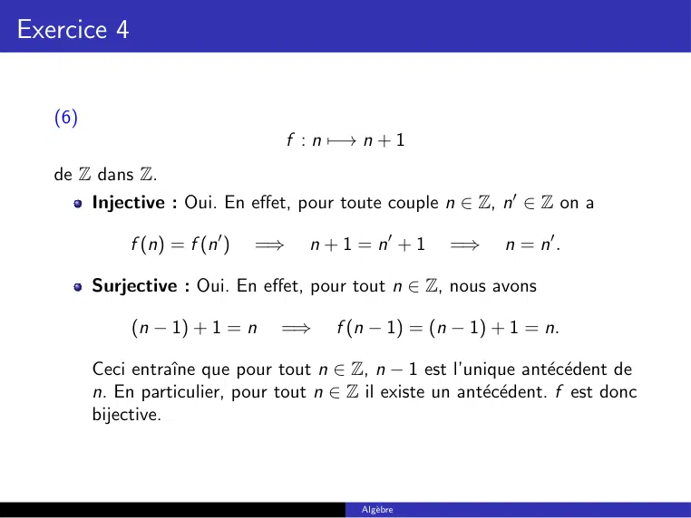

~~~text
Exercice 4

   (6)
                                     f : n 7−→ n + 1
   de Z dans Z.
         Injective : Oui. En effet, pour toute couple n ∈ Z, n0 ∈ Z on a

              f (n) = f (n0 )   =⇒     n + 1 = n0 + 1    =⇒     n = n0 .

         Surjective : Oui. En effet, pour tout n ∈ Z, nous avons

              (n − 1) + 1 = n    =⇒        f (n − 1) = (n − 1) + 1 = n.

         Ceci entraı̂ne que pour tout n ∈ Z, n − 1 est l’unique antécédent de
         n. En particulier, pour tout n ∈ Z il existe un antécédent. f est donc
         bijective.

                                              Algèbre
~~~

## Page 24

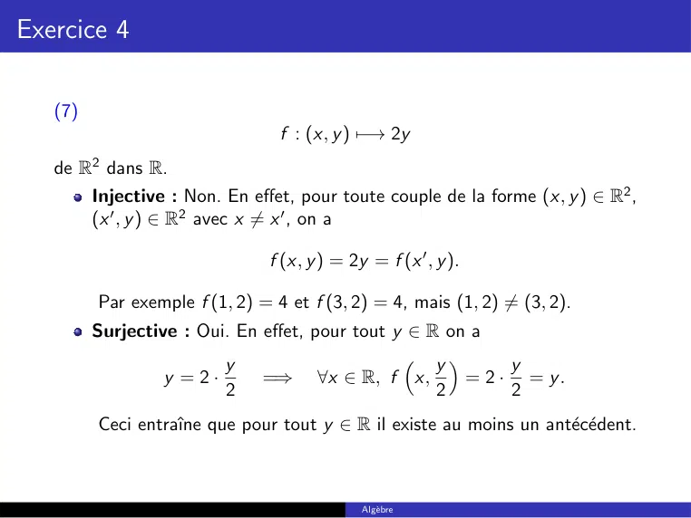

~~~text
Exercice 4

   (7)
                                 f : (x, y ) 7−→ 2y
         2
   de R dans R.
         Injective : Non. En effet, pour toute couple de la forme (x, y ) ∈ R2 ,
         (x 0 , y ) ∈ R2 avec x 6= x 0 , on a

                                f (x, y ) = 2y = f (x 0 , y ).

         Par exemple f (1, 2) = 4 et f (3, 2) = 4, mais (1, 2) 6= (3, 2).
         Surjective : Oui. En effet, pour tout y ∈ R on a
                         y                       y        y
                  y =2·       =⇒ ∀x ∈ R, f x,          = 2 · = y.
                         2                          2       2
         Ceci entraı̂ne que pour tout y ∈ R il existe au moins un antécédent.

                                              Algèbre
~~~

## Page 25

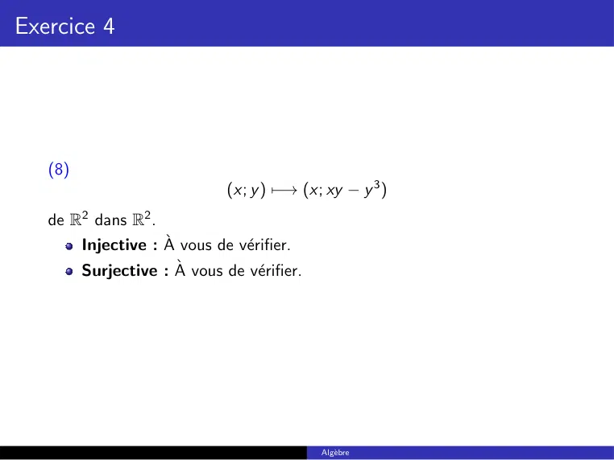

~~~text
Exercice 4

   (8)
                               (x; y ) 7−→ (x; xy − y 3 )
   de R2 dans R2 .
         Injective : À vous de vérifier.
         Surjective : À vous de vérifier.

                                              Algèbre
~~~

## Page 26

~~~text
Exercice 5
   Soit
                              f : A1 = R \ {0} −→ R
                                                   1
                                             x 7−→
                                                   x
   (a) Tracer la courbe représentative de f1 :

                                           Algèbre
~~~

## Page 27

~~~text
Exercice 5

   (b) Dire si f1 est injective, surjective, bijective :

        Injective : Oui. En, effet pour tout x ∈ R \ {0}, y ∈ R \ {0} nous
        avons
                                             1   1
                 f1 (x) = f1 (y )     ⇐⇒       =         =⇒   x = y.
                                             x   y
        Surjective : Non. En effet, 0 n’a pas d’antécédents.

   (c) Si f1 n’est pas bijective, déterminer des ensembles E1 et F1 tels que f1
   soit une bijection de E1 sur F1 :
   Solution : Puisque l’image de f1 est R \ {0}, il suffit de prendre :

                                    E1 = F1 = R \ {0}.

                                              Algèbre
~~~

## Page 28

~~~text
Exercice 5

   (d) Déterminer les ensembles f1 (A1 ), f1 (]0; 2]), f1−1 (] − 1, 1[).
   Solution : Nous avons
                                                                      
                                                              1
               f1 (A1 ) = R \ {0}    ;   f1 (]0, 2]) =          , +∞
                                                              2
   et ;

                   f1−1 (] − 1, 1[) = ] − ∞, −1[ ∪ ]1, +∞[.

                                               Algèbre
~~~

## Page 29

~~~text
Exercice 5
   Soit
                           f2 : A2 = R −→ R
                                     x 7−→ sin(x).
   (a) Tracer la courbe représentative de f2 :

                                        Algèbre
~~~

## Page 30

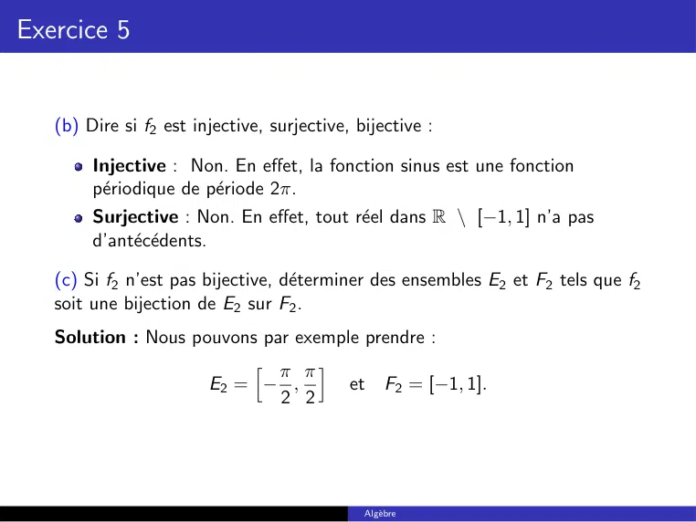

~~~text
Exercice 5

   (b) Dire si f2 est injective, surjective, bijective :

        Injective : Non. En effet, la fonction sinus est une fonction
        périodique de période 2π.
        Surjective : Non. En effet, tout réel dans R \ [−1, 1] n’a pas
        d’antécédents.

   (c) Si f2 n’est pas bijective, déterminer des ensembles E2 et F2 tels que f2
   soit une bijection de E2 sur F2 .
   Solution : Nous pouvons par exemple prendre :
                         h π πi
                     E2 = − ,        et F2 = [−1, 1].
                             2 2

                                              Algèbre
~~~

## Page 31

~~~text
Exercice 5

   (d) Déterminer les ensembles f2 (A2 ), f2 (]0; 2]), f2−1 (] − 1, 1[).
   Solution : Nous avons

                    f2 (A2 ) = [−1, 1] ;     f2 (]0, 2]) = ]0, 1]

   et                                       i π πh
                          f2−1 (] − 1, 1[) = − ,   + kπ.
                                              2 2

                                               Algèbre
~~~

## Page 32

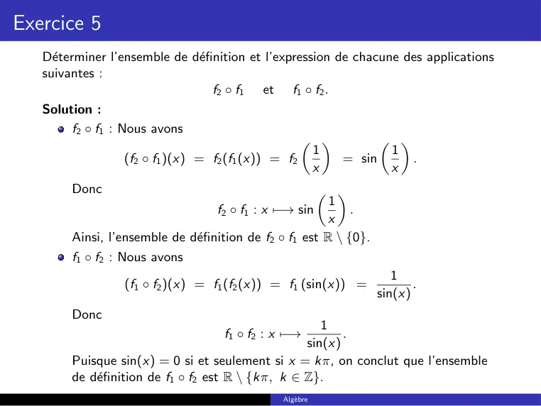

~~~text
Exercice 5
   Déterminer l’ensemble de définition et l’expression de chacune des applications
   suivantes :
                                    f2 ◦ f1 et f1 ◦ f2 .
   Solution :
         f2 ◦ f1 : Nous avons
                                                               
                                                      1           1
                    (f2 ◦ f1 )(x) = f2 (f1 (x)) = f2      = sin      .
                                                      x           x
        Donc                                           
                                                         1
                                   f2 ◦ f1 : x 7−→ sin       .
                                                        x
        Ainsi, l’ensemble de définition de f2 ◦ f1 est R \ {0}.
        f1 ◦ f2 : Nous avons
                                                                      1
                 (f1 ◦ f2 )(x) = f1 (f2 (x)) = f1 (sin(x)) =              .
                                                                   sin(x)
        Donc
                                                      1
                                    f1 ◦ f2 : x 7−→       .
                                                   sin(x)
        Puisque sin(x) = 0 si et seulement si x = kπ, on conclut que l’ensemble
        de définition de f1 ◦ f2 est R \ {kπ, k ∈ Z}.
                                               Algèbre
~~~

## Page 33

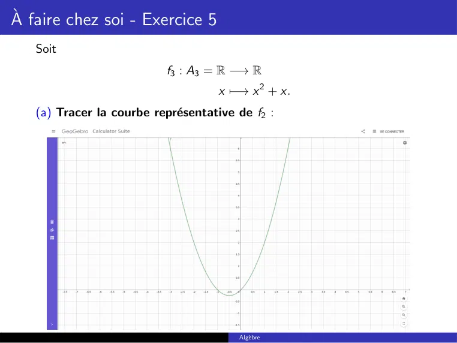

~~~text
À faire chez soi - Exercice 5
   Soit
                           f3 : A3 = R −→ R
                                    x 7−→ x 2 + x.
   (a) Tracer la courbe représentative de f2 :

                                        Algèbre
~~~

## Page 34

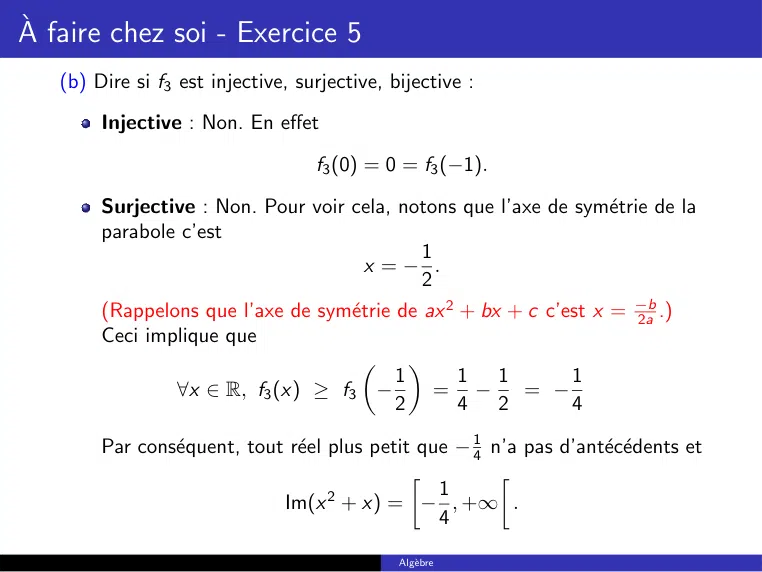

~~~text
À faire chez soi - Exercice 5
   (b) Dire si f3 est injective, surjective, bijective :
        Injective : Non. En effet

                                   f3 (0) = 0 = f3 (−1).

        Surjective : Non. Pour voir cela, notons que l’axe de symétrie de la
        parabole c’est
                                             1
                                     x =− .
                                             2
        (Rappelons que l’axe de symétrie de ax 2 + bx + c c’est x = −b
                                                                      2a .)
        Ceci implique que
                                           
                                          1       1 1         1
                ∀x ∈ R, f3 (x) ≥ f3 −          = −      = −
                                          2       4 2         4

        Par conséquent, tout réel plus petit que − 14 n’a pas d’antécédents et
                                                        
                                                 1
                             Im(x 2 + x) = − , +∞ .
                                                 4

                                              Algèbre
~~~

## Page 35

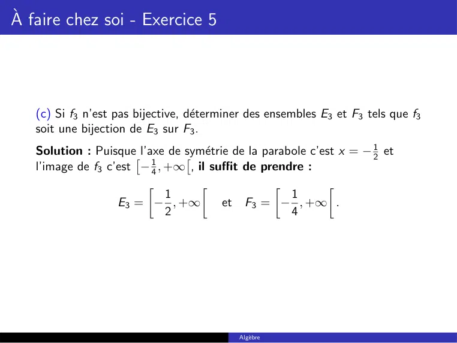

~~~text
À faire chez soi - Exercice 5

   (c) Si f3 n’est pas bijective, déterminer des ensembles E3 et F3 tels que f3
   soit une bijection de E3 sur F3 .
   Solution : Puisquel’axe de symétrie  de la parabole c’est x = − 12 et
                         1
                               
   l’image de f3 c’est − 4 , +∞ , il suffit de prendre :
                                                          
                             1                       1
                   E3 = − , +∞         et F3 = − , +∞ .
                             2                       4

                                           Algèbre
~~~

## Page 36

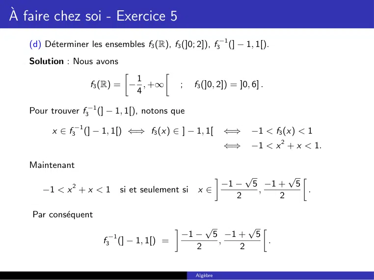

~~~text
À faire chez soi - Exercice 5
   (d) Déterminer les ensembles f3 (R), f3 (]0; 2]), f3−1 (] − 1, 1[).
   Solution : Nous avons
                                  
                              1
                    f3 (R) = − , +∞               ;   f3 (]0, 2]) = ]0, 6] .
                              4

   Pour trouver f3−1 (] − 1, 1[), notons que

         x ∈ f3−1 (] − 1, 1[) ⇐⇒ f3 (x) ∈ ] − 1, 1[                  ⇐⇒     −1 < f3 (x) < 1
                                                                     ⇐⇒     −1 < x 2 + x < 1.

   Maintenant
                                                                           √            √ 
                                                                     −1 −       5 −1 +    5
      −1 < x 2 + x < 1      si et seulement si         x∈                        ,             .
                                                                        2            2

    Par conséquent
                                                         √                 √ 
                                                  −1 −        5 −1 +         5
                       f3−1 (] − 1, 1[)   =                    ,                  .
                                                     2             2

                                                      Algèbre
~~~

## Page 37

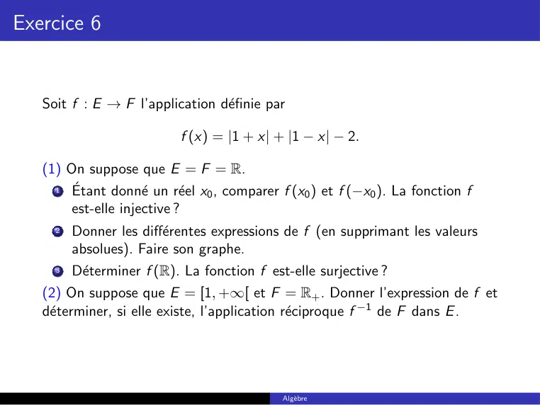

~~~text
Exercice 6

   Soit f : E → F l’application définie par

                            f (x) = |1 + x| + |1 − x| − 2.

   (1) On suppose que E = F = R.
     1   Étant donné un réel x0 , comparer f (x0 ) et f (−x0 ). La fonction f
         est-elle injective ?
     2   Donner les différentes expressions de f (en supprimant les valeurs
         absolues). Faire son graphe.
     3   Déterminer f (R). La fonction f est-elle surjective ?
   (2) On suppose que E = [1, +∞[ et F = R+ . Donner l’expression de f et
   déterminer, si elle existe, l’application réciproque f −1 de F dans E .

                                              Algèbre
~~~

## Page 38

~~~text
Exercice 6
   Soit f (x) = |1 + x| + |1 − x| − 2. On suppose que E = F = R.

   (1) Comparer f (x0 ) et f (−x0 ) : Soit x0 ∈ R. Alors

       f (−x0 ) = |1 − x0 | + |1 − (−x0 )| − 2 = |1 − x0 | + |1 + x0 | − 2
                                               = |1 + x0 | + |1 − x0 | − 2 = f (x0 ).

   Ainsi, pour tout x0 ∈ R, nous avons f (x0 ) = f (−x0 ). La application est donc
   paire. Ce qui implique que l’application f n’est pas injective.

   (2) Donner les différentes expressions de f : Puisque f est paire, il suffit
   d’étudier l’application sur l’intervalle [0, +∞]. Nous avons
                    
                          (1 + x) + (1 − x) − 2 = 0        si 0 ≤ x ≤ 1
           f (x) =
                       (1 + x) − (1 − x) − 2 = 2x − 2 si x ≥ 1

   Comme f est paire on déduit
                             
                              −2x − 2         si x ≤ −1
                     f (x) =       0           si − 1 ≤ x ≤ 1
                                2x − 2         si x ≥ 1
                             

                                               Algèbre
~~~

## Page 39

~~~text
Exercice 6
   Ainsi, le graphe de f est

   (3) Déterminer f (R) : La fonction f est-elle surjective ? En regardant
   le graphe de f on conclut que

                                  f (R) = R+ .

   Cela entraine que l’application n’est pas surjective sur R.
                                          Algèbre
~~~

## Page 40

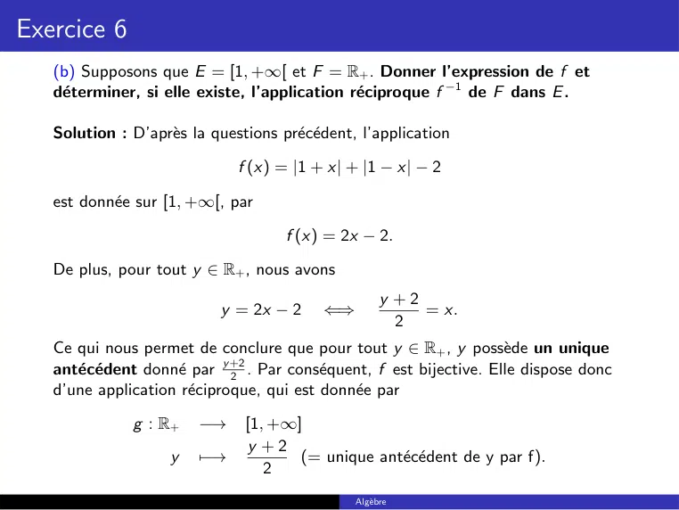

~~~text
Exercice 6
   (b) Supposons que E = [1, +∞[ et F = R+ . Donner l’expression de f et
   déterminer, si elle existe, l’application réciproque f −1 de F dans E .

   Solution : D’après la questions précédent, l’application

                              f (x) = |1 + x| + |1 − x| − 2

   est donnée sur [1, +∞[, par

                                     f (x) = 2x − 2.

   De plus, pour tout y ∈ R+ , nous avons
                                                      y +2
                           y = 2x − 2      ⇐⇒              = x.
                                                        2
   Ce qui nous permet de conclure que pour tout y ∈ R+ , y possède un unique
   antécédent donné par y +2
                             2
                                . Par conséquent, f est bijective. Elle dispose donc
   d’une application réciproque, qui est donnée par

              g : R+    −→     [1, +∞]
                               y +2
                    y   7−→           (= unique antécédent de y par f).
                                  2
                                                Algèbre
~~~

## Page 41

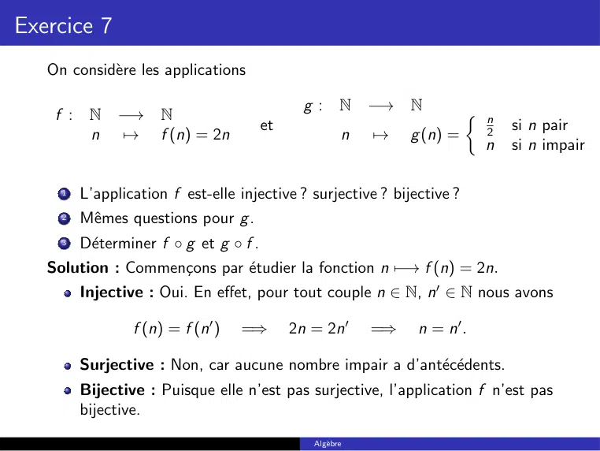

~~~text
Exercice 7
   On considère les applications

                                              g: N         −→   N
    f : N      −→    N                                                     n
                                        et                                      si n pair
        n       7→   f (n) = 2n                        n   7→   g (n) =     2
                                                                            n   si n impair

     1   L’application f est-elle injective ? surjective ? bijective ?
     2   Mêmes questions pour g .
     3   Déterminer f ◦ g et g ◦ f .
   Solution : Commençons par étudier la fonction n 7−→ f (n) = 2n.
         Injective : Oui. En effet, pour tout couple n ∈ N, n0 ∈ N nous avons

                 f (n) = f (n0 )   =⇒        2n = 2n0      =⇒    n = n0 .

         Surjective : Non, car aucune nombre impair a d’antécédents.
         Bijective : Puisque elle n’est pas surjective, l’application f n’est pas
         bijective.
                                                Algèbre
~~~

## Page 42

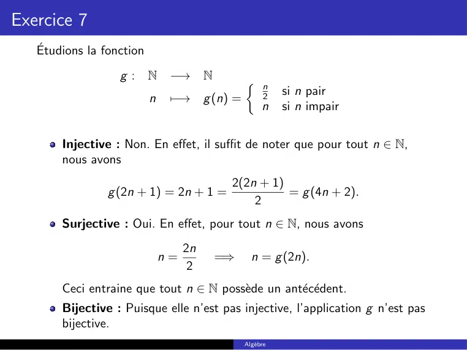

~~~text
Exercice 7
   Étudions la fonction
                   g : N −→              N          n
                                                              si n pair
                           n    7−→      g (n) =         2
                                                         n    si n impair

       Injective : Non. En effet, il suffit de noter que pour tout n ∈ N,
       nous avons
                                              2(2n + 1)
                g (2n + 1) = 2n + 1 =                   = g (4n + 2).
                                                  2
       Surjective : Oui. En effet, pour tout n ∈ N, nous avons
                                    2n
                               n=            =⇒      n = g (2n).
                                     2
       Ceci entraine que tout n ∈ N possède un antécédent.
       Bijective : Puisque elle n’est pas injective, l’application g n’est pas
       bijective.
                                                   Algèbre
~~~

## Page 43

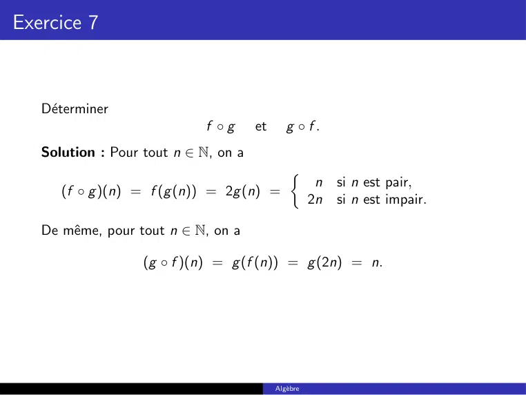

~~~text
Exercice 7

   Déterminer
                            f ◦g      et      g ◦f.
   Solution : Pour tout n ∈ N, on a
                                               
                                                       n   si n est pair,
      (f ◦ g )(n) = f (g (n)) = 2g (n) =
                                                      2n   si n est impair.

   De même, pour tout n ∈ N, on a

                   (g ◦ f )(n) = g (f (n)) = g (2n) = n.

                                           Algèbre
~~~

## Page 44

~~~text
À faire chez soi - Exercice 8
     1   Soit f l’application de R dans [−1; 1] définie par f (x) = sin(πx).
         L’application f est-elle injective, surjective, bijective ?
     2   On note g la restriction de f à ] − 12 ; 21 [. Montrer que g est une
         application bijective de ] − 21 ; 12 [ sur ] − 1; 1[.
   Solution :
   (1) f (x) = sin(πx)
         Injective : Non. En effet, il suffit de noter que
                 f (0) = sin(π · 0) = sin(0) = 0 = sin(π) = sin(π · 1) = f (1).
         Donc l’application f n’est pas injective.
         Surjective : Oui. En effet, on sait du cours d’analyse que toute valeur de
         [−1; 1] est atteinte par la fonction sinus. Par conséquent, pour tout
         y ∈ [−1; 1] il existe x ∈ R tel que
                                                        x       x 
                        sin(x) = y =⇒ y = sin π ·            =f        .
                                                         π         π
         C’est-à-dire πx est un antécédent de y . L’application f est donc surjective.
         Bijective : Puisque elle n’est pas injective, l’application f n’est pas
         bijective.
                                                Algèbre
~~~

## Page 45

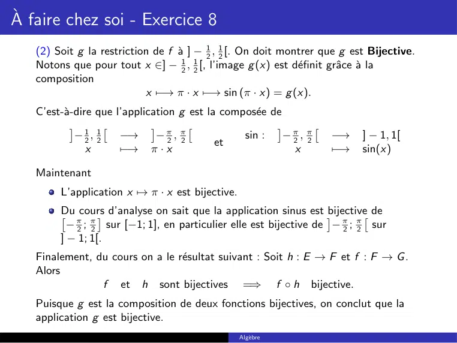

~~~text
À faire chez soi - Exercice 8
   (2) Soit g la restriction de f à ] − 12 , 12 [. On doit montrer que g est Bijective.
   Notons que pour tout x ∈] − 12 , 12 [, l’image g (x) est définit grâce à la
   composition
                           x 7−→ π · x 7−→ sin (π · x) = g (x).
   C’est-à-dire que l’application g est la composée de
            1 1             π π                     π π
            −2, 2     −→      −2, 2             sin :    −2, 2       −→     ] − 1, 1[
                                           et
               x      7−→ π · x                           x          7−→    sin(x)

   Maintenant
        L’application x 7→ π · x est bijective.

        Du πcours d’analyse on sait que la application sinus est bijective de
          − 2 ; π2 sur [−1; 1], en particulier elle est bijective de − π2 ; π2 sur
        ] − 1; 1[.
   Finalement, du cours on a le résultat suivant : Soit h : E → F et f : F → G .
   Alors
                f et h sont bijectives =⇒ f ◦ h bijective.
   Puisque g est la composition de deux fonctions bijectives, on conclut que la
   application g est bijective.
                                                  Algèbre
~~~

## Page 46

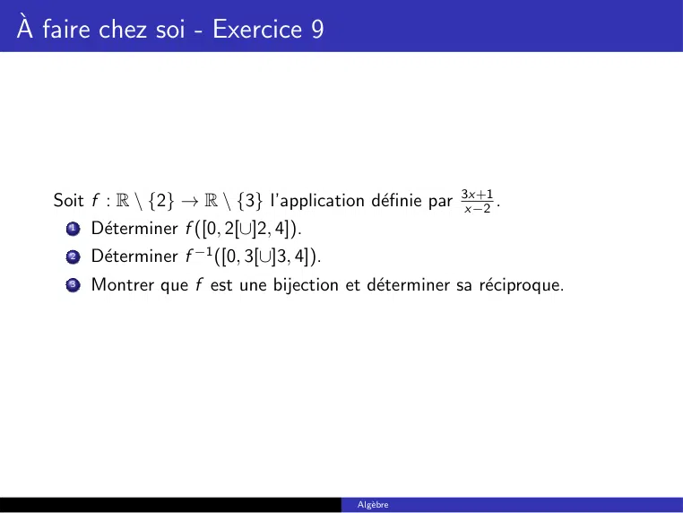

~~~text
À faire chez soi - Exercice 9

   Soit f : R \ {2} → R \ {3} l’application définie par 3x+1
                                                         x−2 .
     1   Déterminer f ([0, 2[∪]2, 4]).
     2   Déterminer f −1 ([0, 3[∪]3, 4]).
     3   Montrer que f est une bijection et déterminer sa réciproque.

                                           Algèbre
~~~

## Page 47

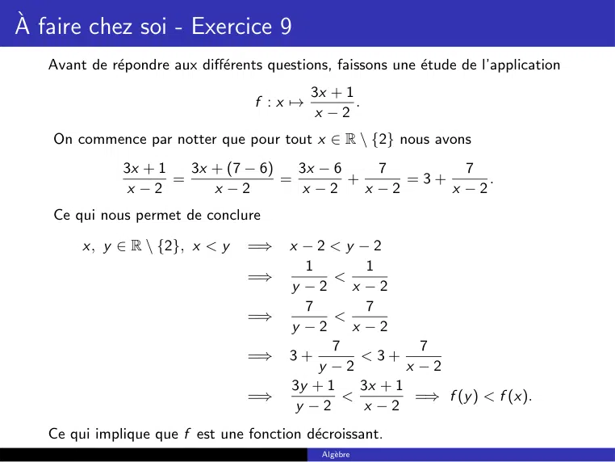

~~~text
À faire chez soi - Exercice 9
   Avant de répondre aux différents questions, faissons une étude de l’application
                                               3x + 1
                                    f : x 7→          .
                                                x −2
    On commence par notter que pour tout x ∈ R \ {2} nous avons
              3x + 1   3x + (7 − 6)   3x − 6     7        7
                     =              =        +      =3+      .
               x −2       x −2         x −2    x −2     x −2
    Ce qui nous permet de conclure

        x, y ∈ R \ {2}, x < y     =⇒     x −2<y −2
                                            1        1
                                  =⇒            <
                                         y −2      x −2
                                            7        7
                                  =⇒            <
                                         y −2      x −2
                                                7            7
                                  =⇒     3+         <3+
                                              y −2         x −2
                                         3y + 1     3x + 1
                                  =⇒              <         =⇒ f (y ) < f (x).
                                          y −2       x −2
   Ce qui implique que f est une fonction décroissant.
                                                Algèbre
~~~

## Page 48

~~~text
À faire chez soi - Exercice 9
   En sachant cela on conclut :
        Quand x tend vers −∞, f tend vers 3.
        f (x) = 0 si et seulement si x = − 13 .
        Quand x tend vers 2 par la gauche, f tend vers −∞.
        Quand x tend vers 2 par la droite, f tend vers +∞.
        Quand x tend vers +∞ , f tend vers 3.
   Le graphe de f est donné donc par l’hyperbole

                                                  Algèbre
~~~

## Page 49

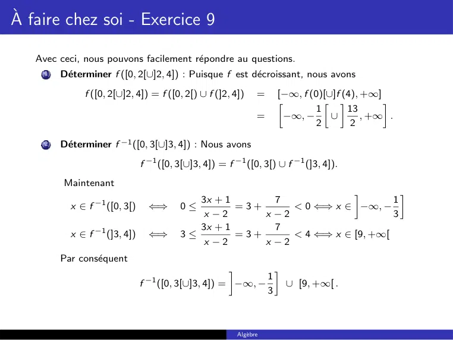

~~~text
À faire chez soi - Exercice 9

   Avec ceci, nous pouvons facilement répondre au questions.
    (1)   Déterminer f ([0, 2[∪]2, 4]) : Puisque f est décroissant, nous avons
               f ([0, 2[∪]2, 4]) = f ([0, 2[) ∪ f (]2, 4])       =   [−∞, f (0)[∪]f (4), +∞]
                                                                                          
                                                                              1      13
                                                                 =    −∞, −      ∪       , +∞ .
                                                                              2       2
    (2)   Déterminer f −1 ([0, 3[∪]3, 4]) : Nous avons
                                f −1 ([0, 3[∪]3, 4]) = f −1 ([0, 3[) ∪ f −1 (]3, 4]).
          Maintenant
                                                                                 
                                             3x + 1       7                     1
            x ∈ f −1 ([0, 3[)     ⇐⇒      0≤        =3+      < 0 ⇐⇒ x ∈ −∞, −
                                              x −2      x −2                    3
                                             3x + 1       7
            x ∈ f −1 (]3, 4])     ⇐⇒      3≤        =3+      < 4 ⇐⇒ x ∈ [9, +∞[
                                             x −2       x −2
          Par conséquent
                                                              
                                                             1
                                f −1 ([0, 3[∪]3, 4]) = −∞, −     ∪ [9, +∞[ .
                                                             3

                                                          Algèbre
~~~

## Page 50

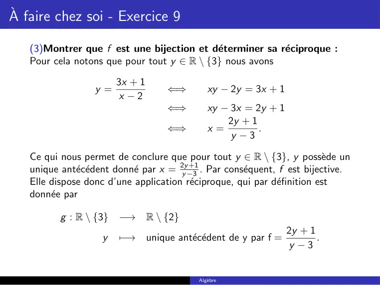

~~~text
À faire chez soi - Exercice 9

   (3)Montrer que f est une bijection et déterminer sa réciproque :
   Pour cela notons que pour tout y ∈ R \ {3} nous avons

                        3x + 1
                  y=                 ⇐⇒         xy − 2y = 3x + 1
                         x −2
                                     ⇐⇒         xy − 3x = 2y + 1
                                                    2y + 1
                                     ⇐⇒         x=         .
                                                     y −3

   Ce qui nous permet de conclure que pour tout y ∈ R \ {3}, y possède un
   unique antécédent donné par x = 2y +1
                                      y −3 . Par conséquent, f est bijective.
   Elle dispose donc d’une application réciproque, qui par définition est
   donnée par

          g : R \ {3} −→         R \ {2}
                                                                    2y + 1
                    y   7−→      unique antécédent de y par f =          .
                                                                    y −3

                                             Algèbre
~~~

## Page 51

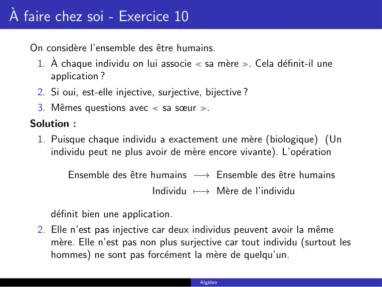

~~~text
À faire chez soi - Exercice 10
   On considère l’ensemble des être humains.
    1. À chaque individu on lui associe  sa mère . Cela définit-il une
       application ?
    2. Si oui, est-elle injective, surjective, bijective ?
    3. Mêmes questions avec  sa sœur .
   Solution :
    1. Puisque chaque individu a exactement une mère (biologique) (Un
       individu peut ne plus avoir de mère encore vivante). L’opération

           Ensemble des être humains −→ Ensemble des être humains
                                 Individu 7−→ Mère de l’individu

       définit bien une application.
    2. Elle n’est pas injective car deux individus peuvent avoir la même
       mère. Elle n’est pas non plus surjective car tout individu (surtout les
       hommes) ne sont pas forcément la mère de quelqu’un.

                                             Algèbre
~~~

## Page 52

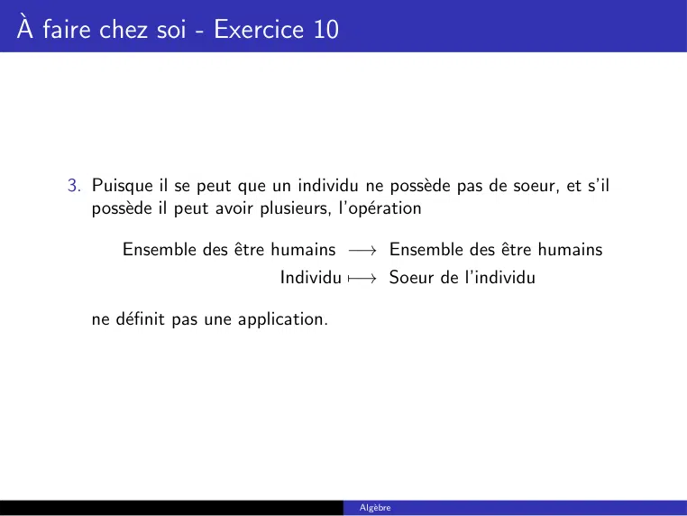

~~~text
À faire chez soi - Exercice 10

    3. Puisque il se peut que un individu ne possède pas de soeur, et s’il
       possède il peut avoir plusieurs, l’opération

           Ensemble des être humains −→ Ensemble des être humains
                                Individu 7−→ Soeur de l’individu

       ne définit pas une application.

                                          Algèbre
~~~

## Page 53

~~~text
Exercice 11

   Soit f : E → F une application, A et B deux parties de E , C et D deux parties
   de F . Montrer que :
   (a) f (A ∪ B) = f (A) ∪ f (B).
   (b) f (A ∩ B) ⊂ f (A) ∩ f (B).
   (c) f −1 (C ∪ D) = f −1 (C ) ∪ f −1 (D).
   (d) f −1 (C ∩ D) = f −1 (C ) ∩ f −1 (D).
   (e) f (A ∩ f −1 (C )) = f (A) ∩ C .

                                              Algèbre
~~~

## Page 54

~~~text
Exercice 11
   (a) Montrer
                              f (A ∪ B) = f (A) ∪ f (B).
   Solution : On raisonne par double inclusion.
       ⊂ : Montrons que

                                 f (A ∪ B) ⊂ f (A) ∪ f (B)

        Soit y ∈ f (A ∪ B). Alors il existe x ∈ A ∪ B, tel que

                                         y = f (x).
        On a deux possibilités pour x.
            Si x ∈ A, alors

                              y = f (x) ∈ f (A) ⊂ f (A) ∪ f (B).

            Si x ∈ B, alors

                              y = f (x) ∈ f (B) ⊂ f (A) ∪ f (B).

       Dans les deux cas, y ∈ f (A) ∪ f (B). Donc f (A ∪ B) ⊂ f (A) ∪ f (B).
                                              Algèbre
~~~

## Page 55

~~~text
Exercice 11
       ⊃ : Montrons que

                               f (A ∪ B) ⊃ f (A) ∪ f (B).
       Soit y ∈ f (A) ∪ f (B). On a deux possibilités pour y .
            Si y ∈ f (A), alors il existe x ∈ A, tel que

                                         y = f (x).

            Or

                         x ∈A⊂A∪B           =⇒          y ∈ f (A ∪ B).

            Si y ∈ f (B), alors il existe x ∈ B, tel que

                                         y = f (x).

            Or

                         x ∈B ⊂A∪B          =⇒          y ∈ f (A ∪ B).

        Dans les deux cas, y ∈ f (A ∪ B). Donc f (A) ∪ f (B) ⊂ f (A ∪ B).
   Ainsi f (A) ∪ f (B) = f (A ∪ B).
                                             Algèbre
~~~

## Page 56

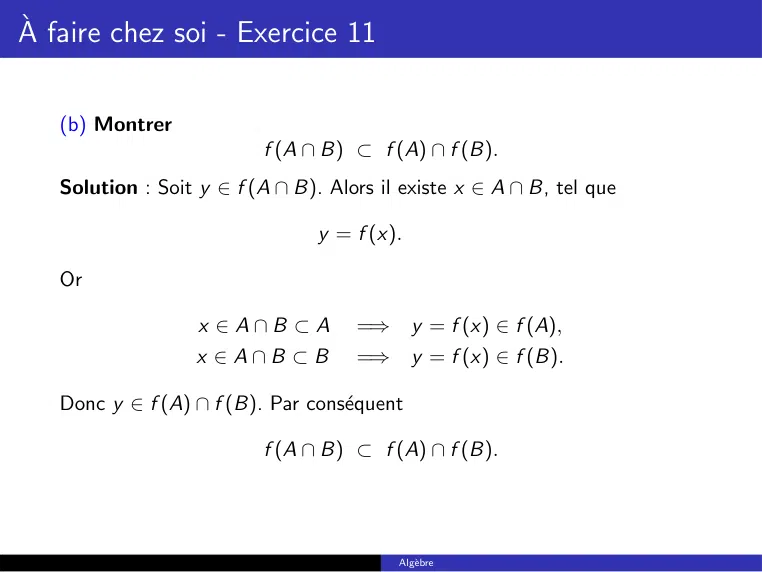

~~~text
À faire chez soi - Exercice 11

   (b) Montrer
                          f (A ∩ B) ⊂ f (A) ∩ f (B).
   Solution : Soit y ∈ f (A ∩ B). Alors il existe x ∈ A ∩ B, tel que

                                 y = f (x).

   Or

                   x ∈A∩B ⊂A         =⇒ y = f (x) ∈ f (A),
                  x ∈A∩B ⊂B          =⇒ y = f (x) ∈ f (B).

   Donc y ∈ f (A) ∩ f (B). Par conséquent

                          f (A ∩ B) ⊂ f (A) ∩ f (B).

                                          Algèbre
~~~

## Page 57

~~~text
À faire chez soi - Exercice 11
   (c) Montrer
                        f −1 (C ∪ D) = f −1 (C ) ∪ f −1 (D).
   Solution : On raisonne par double inclusion.
       ⊂ : Montrons que

                           f −1 (C ∪ D) ⊂ f −1 (C ) ∪ f −1 (D).

       Soit x ∈ f −1 (C ∪ D). Alors f (x) ∈ C ∪ D. On a donc deux
       possibilités pour f (x).
            Si f (x) ∈ C , alors

                             x ∈ f −1 (C ) ⊂ f −1 (C ) ∪ f −1 (D).

            Si f (x) ∈ D, alors

                             x ∈ f −1 (D) ⊂ f −1 (C ) ∪ f −1 (D).

       Dans les deux cas x ∈ f −1 (C ) ∪ f −1 (D). Donc

                           f −1 (C ∪ D) ⊂ f −1 (C ) ∪ f −1 (D).

                                               Algèbre
~~~

## Page 58

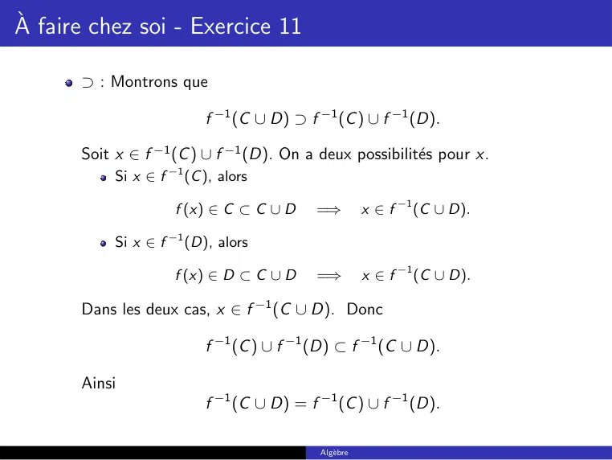

~~~text
À faire chez soi - Exercice 11

       ⊃ : Montrons que

                           f −1 (C ∪ D) ⊃ f −1 (C ) ∪ f −1 (D).

       Soit x ∈ f −1 (C ) ∪ f −1 (D). On a deux possibilités pour x.
            Si x ∈ f −1 (C ), alors

                      f (x) ∈ C ⊂ C ∪ D     =⇒         x ∈ f −1 (C ∪ D).

            Si x ∈ f −1 (D), alors

                      f (x) ∈ D ⊂ C ∪ D     =⇒         x ∈ f −1 (C ∪ D).

       Dans les deux cas, x ∈ f −1 (C ∪ D). Donc

                           f −1 (C ) ∪ f −1 (D) ⊂ f −1 (C ∪ D).

       Ainsi
                           f −1 (C ∪ D) = f −1 (C ) ∪ f −1 (D).

                                            Algèbre
~~~

## Page 59

~~~text
Exercice 11

   (d) Montrer
                       f −1 (C ∩ D) = f −1 (C ) ∩ f −1 (D).
   On raisonne par double inclusion.
       ⊂ : Montrons que

                         f −1 (C ∩ D) ⊂ f −1 (C ) ∩ f −1 (D).

       Soit x ∈ f −1 (C ∩ D), alors f (x) ∈ C ∩ D. Or

                  f (x) ∈ C ∩ D ⊂ C       =⇒          x ∈ f −1 (C ),
                   f (x) ∈ C ∩ D ⊂ D      =⇒          x ∈ f −1 (D).

       Donc x ∈ f −1 (C ) ∩ f −1 (D). Ainsi

                         f −1 (C ∩ D) ⊂ f −1 (C ) ∩ f −1 (D).

                                           Algèbre
~~~

## Page 60

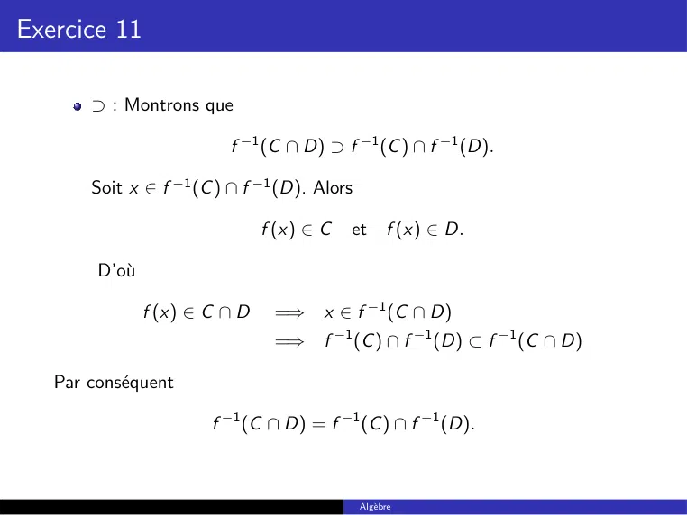

~~~text
Exercice 11

       ⊃ : Montrons que

                          f −1 (C ∩ D) ⊃ f −1 (C ) ∩ f −1 (D).

       Soit x ∈ f −1 (C ) ∩ f −1 (D). Alors

                                f (x) ∈ C   et      f (x) ∈ D.

        D’où

                f (x) ∈ C ∩ D    =⇒ x ∈ f −1 (C ∩ D)
                                 =⇒ f −1 (C ) ∩ f −1 (D) ⊂ f −1 (C ∩ D)

   Par conséquent

                        f −1 (C ∩ D) = f −1 (C ) ∩ f −1 (D).

                                              Algèbre
~~~

## Page 61

~~~text
Exercice 11

   (e) Montrer
                          f (A ∩ f −1 (C )) = f (A) ∩ C .
   Solution : On raisonne par double inclusion.
       ⊂ : Montrons
                             f (A ∩ f −1 (C )) ⊂ f (A) ∩ C .
        Soit y ∈ f (A ∩ f −1 (C )). Alors il existe x ∈ A ∩ f −1 (C ), tel que

                                       f (x) = y .

       Puisque x ∈ A, on obtient y = f (x) ∈ f (A). De même, puisque
       x ∈ f −1 (C ), on obtient y = f (x) ∈ C . Ainsi

                 y ∈ f (A) ∩ C    =⇒      f (A ∩ f −1 (C )) ⊂ f (A) ∩ C .

                                            Algèbre
~~~

## Page 62

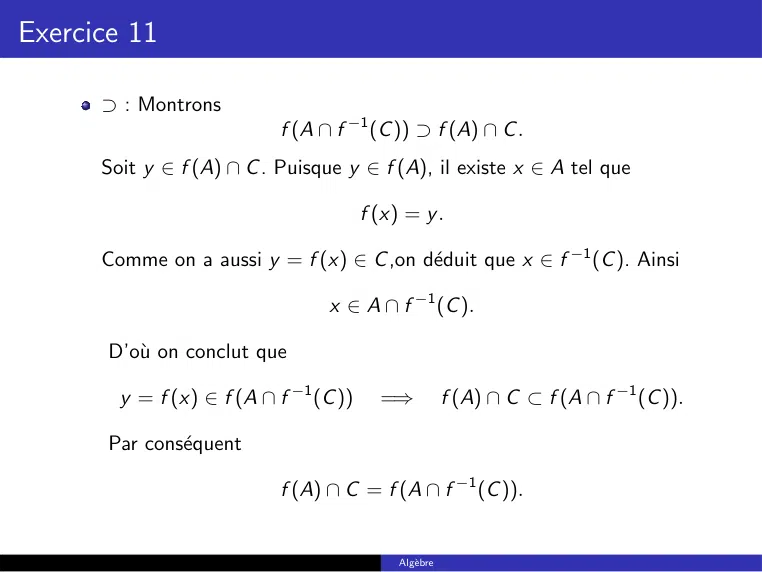

~~~text
Exercice 11

      ⊃ : Montrons
                           f (A ∩ f −1 (C )) ⊃ f (A) ∩ C .
      Soit y ∈ f (A) ∩ C . Puisque y ∈ f (A), il existe x ∈ A tel que

                                        f (x) = y .

      Comme on a aussi y = f (x) ∈ C ,on déduit que x ∈ f −1 (C ). Ainsi

                                  x ∈ A ∩ f −1 (C ).

       D’où on conclut que

        y = f (x) ∈ f (A ∩ f −1 (C ))     =⇒            f (A) ∩ C ⊂ f (A ∩ f −1 (C )).

       Par conséquent

                           f (A) ∩ C = f (A ∩ f −1 (C )).

                                             Algèbre
~~~

## Page 63

~~~text
Exercice 12

   Soit f : E → F une application, A et B deux parties de E , C et D deux
   parties de F . Montrer que :
   (a) A ⊂ f −1 (f (A)).
   (b) f (f −1 (C )) = f (E ) ∩ C .
   (c) f est injective ⇐⇒ ∀A ⊂ E , A = f −1 (f (A)).
   (d) f est surjective ⇐⇒ ∀C ⊂ F , f (f −1 (C )) = C .

                                         Algèbre
~~~

## Page 64

~~~text
Exercice 12

   (a) Montrer :
                                A ⊂ f −1 (f (A)).
   Solution : Soit x ∈ A. Alors f (x) ∈ f (A), d’où on conclut que

                                x ∈ f −1 (f (A)).

                                          Algèbre
~~~

## Page 65

~~~text
Exercice 12
   (b) Montrer :
                                f (f −1 (C )) = f (E ) ∩ C .
   Solution : On raisonne par double inclusion.
       ⊂: Montrons
                                f (f −1 (C )) ⊂ f (E ) ∩ C .
       Soit y ∈ f (f −1 (C )). Alors existe x ∈ f −1 (C ) tel que
                                           f (x) = y .
                  −1
       Or x ∈ f        (C ), donc f (x) ∈ C . Ce qui implique
                                        y = f (x) ∈ C .
       Maintenant, x ∈ E d’où f (x) ∈ f (E ). Ainsi y ∈ C ∩ f (E ). Donc
       f (f −1 (C )) ⊂ f (E ) ∩ C .
       ⊃: Montrons
                                 f (f −1 (C )) ⊃ f (E ) ∩ C .
       Soit y ∈ f (E ) ∩ C . Alors y ∈ f (E ) et y ∈ C . Puisque y ∈ f (E ),
       existe x ∈ E tel que
                                      y = f (x).
                                                Algèbre
~~~

## Page 66

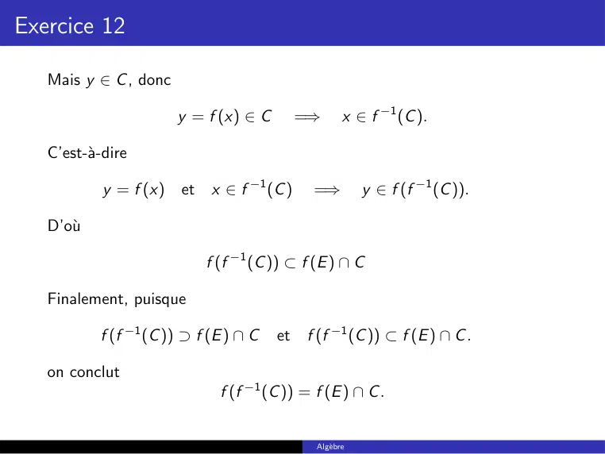

~~~text
Exercice 12

   Mais y ∈ C , donc

                        y = f (x) ∈ C        =⇒       x ∈ f −1 (C ).

   C’est-à-dire

            y = f (x)   et   x ∈ f −1 (C )    =⇒          y ∈ f (f −1 (C )).

   D’où

                             f (f −1 (C )) ⊂ f (E ) ∩ C

   Finalement, puisque

           f (f −1 (C )) ⊃ f (E ) ∩ C   et   f (f −1 (C )) ⊂ f (E ) ∩ C .

   on conclut
                               f (f −1 (C )) = f (E ) ∩ C .

                                               Algèbre
~~~

## Page 67

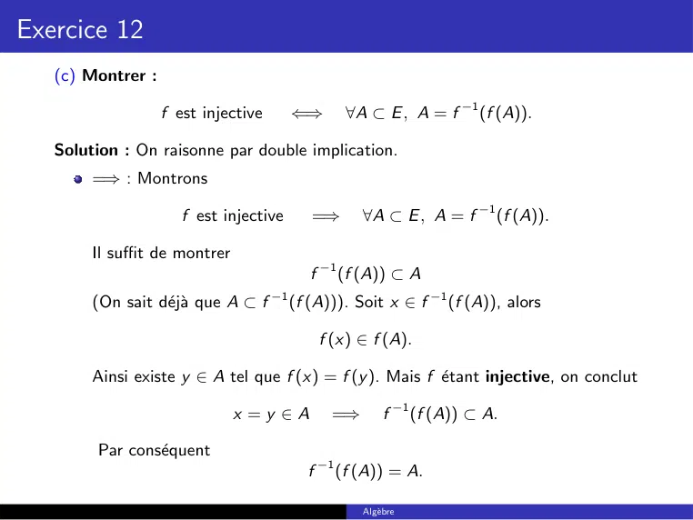

~~~text
Exercice 12
   (c) Montrer :

                   f est injective      ⇐⇒    ∀A ⊂ E , A = f −1 (f (A)).

   Solution : On raisonne par double implication.
        =⇒ : Montrons

                      f est injective    =⇒       ∀A ⊂ E , A = f −1 (f (A)).

        Il suffit de montrer
                                         f −1 (f (A)) ⊂ A
        (On sait déjà que A ⊂ f −1 (f (A))). Soit x ∈ f −1 (f (A)), alors

                                          f (x) ∈ f (A).

        Ainsi existe y ∈ A tel que f (x) = f (y ). Mais f étant injective, on conclut

                               x =y ∈A       =⇒        f −1 (f (A)) ⊂ A.

        Par conséquent
                                         f −1 (f (A)) = A.

                                                  Algèbre
~~~

## Page 68

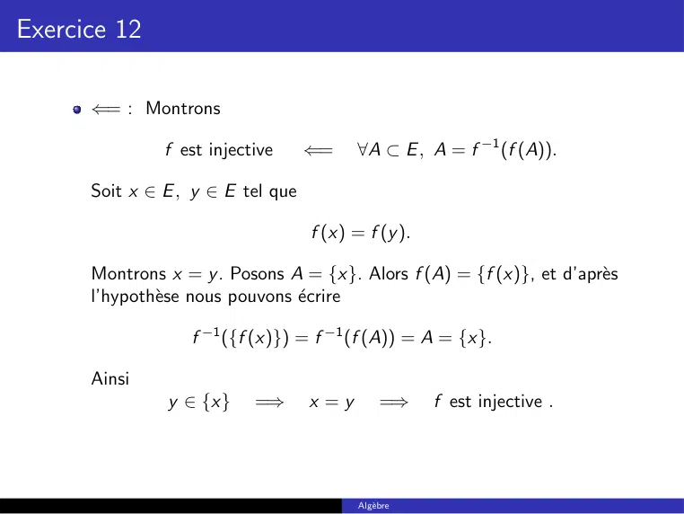

~~~text
Exercice 12

      ⇐= : Montrons

               f est injective     ⇐=     ∀A ⊂ E , A = f −1 (f (A)).

      Soit x ∈ E , y ∈ E tel que

                                   f (x) = f (y ).

      Montrons x = y . Posons A = {x}. Alors f (A) = {f (x)}, et d’après
      l’hypothèse nous pouvons écrire

                  f −1 ({f (x)}) = f −1 (f (A)) = A = {x}.

      Ainsi
               y ∈ {x}     =⇒      x =y        =⇒    f est injective .

                                          Algèbre
~~~

## Page 69

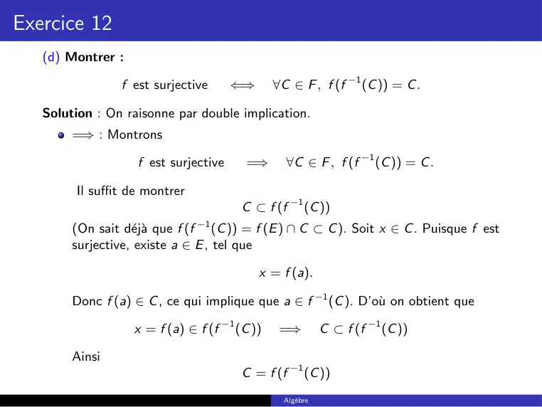

~~~text
Exercice 12
   (d) Montrer :

                 f est surjective      ⇐⇒      ∀C ∈ F , f (f −1 (C )) = C .

   Solution : On raisonne par double implication.
        =⇒ : Montrons

                    f est surjective    =⇒       ∀C ∈ F , f (f −1 (C )) = C .

        Il suffit de montrer
                                        C ⊂ f (f −1 (C ))
        (On sait déjà que f (f −1 (C )) = f (E ) ∩ C ⊂ C ). Soit x ∈ C . Puisque f est
        surjective, existe a ∈ E , tel que

                                            x = f (a).

        Donc f (a) ∈ C , ce qui implique que a ∈ f −1 (C ). D’où on obtient que

                   x = f (a) ∈ f (f −1 (C ))    =⇒          C ⊂ f (f −1 (C ))

        Ainsi
                                        C = f (f −1 (C ))
                                                 Algèbre
~~~

## Page 70

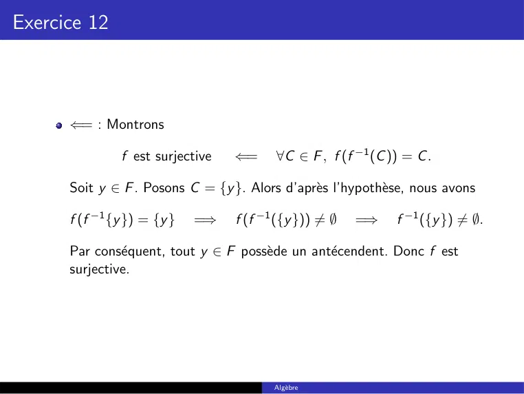

~~~text
Exercice 12

      ⇐= : Montrons

               f est surjective   ⇐=      ∀C ∈ F , f (f −1 (C )) = C .

      Soit y ∈ F . Posons C = {y }. Alors d’après l’hypothèse, nous avons

      f (f −1 {y }) = {y }   =⇒   f (f −1 ({y })) 6= ∅   =⇒    f −1 ({y }) 6= ∅.

      Par conséquent, tout y ∈ F possède un antécendent. Donc f est
      surjective.

                                         Algèbre
~~~

## Page 71

~~~text
Exercice 13

   Soient f : E → F et g : F → G deux applications. Montrer les
   implications suivantes :
   (1) g ◦ f est surjective =⇒ g est surjective.
   (2) g ◦ f est injective =⇒ f est injective.
   (3) g ◦ f est surjective et g est injective =⇒ f est surjective.
   (4) g ◦ f est injective et f est surjective =⇒ g est injective.

                                          Algèbre
~~~

## Page 72

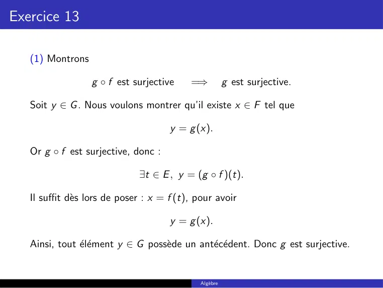

~~~text
Exercice 13

   (1) Montrons

                  g ◦ f est surjective     =⇒           g est surjective.

   Soit y ∈ G . Nous voulons montrer qu’il existe x ∈ F tel que

                                      y = g (x).

   Or g ◦ f est surjective, donc :

                              ∃t ∈ E , y = (g ◦ f )(t).

   Il suffit dès lors de poser : x = f (t), pour avoir

                                      y = g (x).

   Ainsi, tout élément y ∈ G possède un antécédent. Donc g est surjective.

                                             Algèbre
~~~

## Page 73

~~~text
Exercice 13

   (2) Montrons

                  g ◦ f est injective    =⇒           f est injective.

   Soient x, y ∈ E . Supposons f (x) = f (y ). Nous voulons montrer que :
   x = y . Or

          f (x) = f (y )     =⇒   g ◦ f (x) = g ◦ f (y )       =⇒
                                                               |{z}      x = y.
                                                            g ◦f injective

   Ainsi, f est injective.

                                           Algèbre
~~~

## Page 74

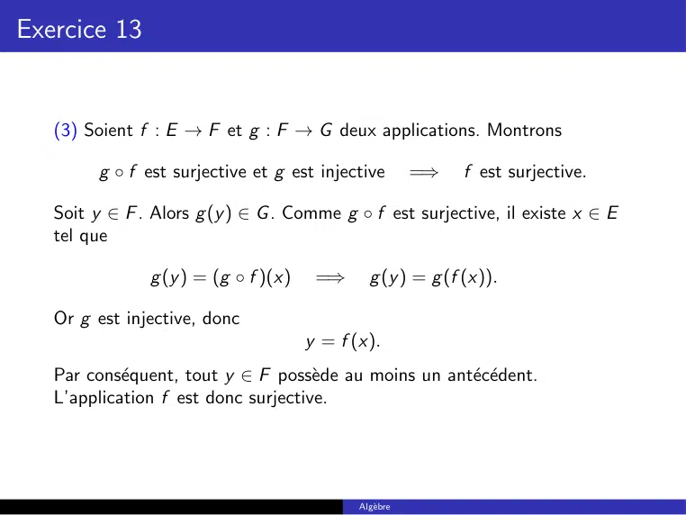

~~~text
Exercice 13

   (3) Soient f : E → F et g : F → G deux applications. Montrons

         g ◦ f est surjective et g est injective         =⇒   f est surjective.

   Soit y ∈ F . Alors g (y ) ∈ G . Comme g ◦ f est surjective, il existe x ∈ E
   tel que

                g (y ) = (g ◦ f )(x)    =⇒      g (y ) = g (f (x)).

   Or g est injective, donc
                                       y = f (x).
   Par conséquent, tout y ∈ F possède au moins un antécédent.
   L’application f est donc surjective.

                                              Algèbre
~~~

## Page 75

~~~text
Exercice 13
   (4) Soient f : E → F et g : F → G deux applications. Montrons

           g ◦ f est injective et f est surjective       =⇒       g est injective.

   Soient x ∈ F et y ∈ F , tels que

                                     g (x) = g (y ).

   Comme f est surjective

                  ∃a ∈ E , f (a) = x    et   ∃b ∈ E , f (b) = y .

   Ce qui nous permet d’écrire

           g (x) = g (y )   =⇒     g (f (a)) = g (f (b))         =⇒
                                                                 |{z}          a=b
                                                              g ◦f injective

   Ainsi
                                 x = f (a) = f (b) = y .
   D’où on conclut que g est injective.
                                              Algèbre
~~~

## Page 76

~~~text
Exercice 14
   Soit f : E → F , g : F → G , et h : G → E trois applications telles que h ◦ g ◦ f
   injective, g ◦ f ◦ h injective et f ◦ h ◦ g surjective. Montrer que f , g et h sont
   bijectives.

   Solution : D’après la question 13 points (1) et (2), nous pouvons conclure

           h ◦ g ◦ f = (h ◦ g ) ◦ f est injective         =⇒    f est injective.
        Aussi
          f ◦ h ◦ g = f ◦ (h ◦ g ) est surjective         =⇒    f est surjective.
       Donc f est bijective.
   De même

           g ◦ f ◦ h = (g ◦ f ) ◦ h est injective         =⇒    h est injective.

        f ◦ h ◦ g = (f ◦ h) ◦ g est surjective            =⇒   f ◦ h est surjective.
        Ainsi, nous avons f ◦ h surjective et f injective. Donc h est surjective
        d’après la question 13 (3). D’où on déduit que h est bijective.
                                               Algèbre
~~~

## Page 77

~~~text
Exercice 14

   Maintenant, nous avons vu en cours que

             f   et   h     injectives   =⇒      f ◦h   est injective

   Par conséquent, f ◦ h est injective et surjective. Ce qui nous permet de
   conclure, d’après les points 13 (3) et (4) :

       f ◦ h ◦ g surjective      et f ◦ h injective     =⇒     g est surjective.

       g ◦ f ◦ h injective      et f ◦ h surjective     =⇒     g est injective.

   Ainsi g est bijective.

                                           Algèbre
~~~

## Page 78

~~~text
Exercice 15
   Soit f : E → F une application. Montrer l’équivalence suivante :

                (f est bijective)      ⇐⇒        (∀A ⊂ E , f (Ac ) = f (A)c )

   Solution : On raisonne par double implication. Montrons

                (f est bijective)     =⇒         (∀A ⊂ E , f (Ac ) = f (A)c ).

   Soit A ⊂ E . Montrons f (Ac ) = f (A)c . On raisonne par double inclusion.
        ⊂ : Soit y ∈ f (Ac ). Alors existe x ∈ Ac = E \ A, tel que

                                               y = f (x).

        Si y ∈ f (A), alors existe x 0 ∈ A tel que y = f (x 0 ). Ainsi

                            f (x) = f (x 0 )      =⇒
                                                  |{z}         x = x 0.
                                                f injective

        Ce qui est absurde car x ∈ A et x 0 ∈ A. Donc
                                          c

                             y ∈ f (A)c        =⇒       f (Ac ) ⊂ f (A)c .

                                                    Algèbre
~~~

## Page 79

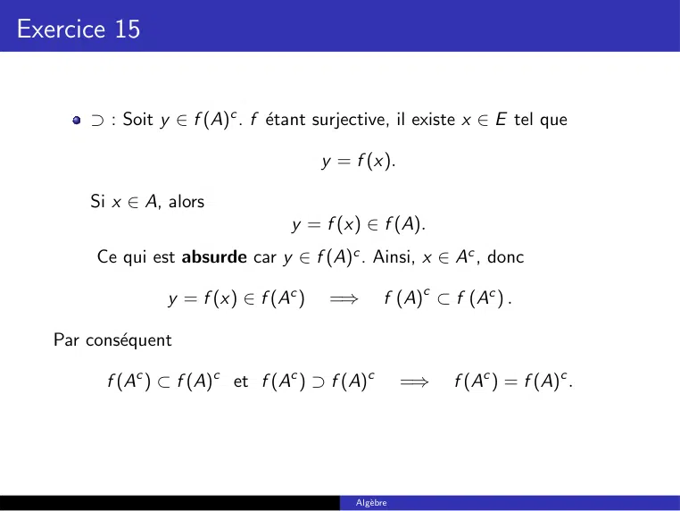

~~~text
Exercice 15

       ⊃ : Soit y ∈ f (A)c . f étant surjective, il existe x ∈ E tel que

                                       y = f (x).

       Si x ∈ A, alors
                                  y = f (x) ∈ f (A).
        Ce qui est absurde car y ∈ f (A)c . Ainsi, x ∈ Ac , donc
                                                       c
                 y = f (x) ∈ f (Ac )    =⇒        f (A) ⊂ f (Ac ) .

   Par conséquent

         f (Ac ) ⊂ f (A)c et f (Ac ) ⊃ f (A)c         =⇒   f (Ac ) = f (A)c .

                                           Algèbre
~~~

## Page 80

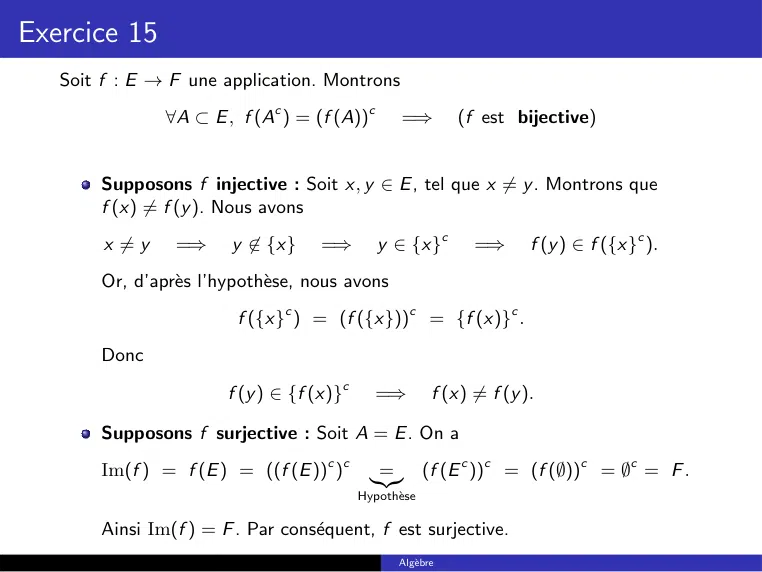

~~~text
Exercice 15
   Soit f : E → F une application. Montrons
                 ∀A ⊂ E , f (Ac ) = (f (A))c        =⇒         (f est bijective)

       Supposons f injective : Soit x, y ∈ E , tel que x 6= y . Montrons que
       f (x) 6= f (y ). Nous avons
        x 6= y    =⇒     y 6∈ {x}     =⇒        y ∈ {x}c         =⇒       f (y ) ∈ f ({x}c ).
       Or, d’après l’hypothèse, nous avons
                          f ({x}c ) = (f ({x}))c = {f (x)}c .
       Donc
                         f (y ) ∈ {f (x)}c      =⇒         f (x) 6= f (y ).

       Supposons f surjective : Soit A = E . On a
       Im(f ) = f (E ) = ((f (E ))c )c          = (f (E c ))c = (f (∅))c = ∅c = F .
                                               |{z}
                                             Hypothèse

       Ainsi Im(f ) = F . Par conséquent, f est surjective.
                                                    Algèbre
~~~

## Page 81

~~~text
À faire chez soi - Exercice 16
   Soit f : E → F , g : F → G et h : G → H trois applications. Montrer
   que :

      (g ◦ f et h ◦ g sont bijectives)   ⇐⇒              (f , g et h sont bijectives)

   Solution : On raisonne par double implication :
       ⇐= : Montrons

        (f , g et h sont bijectives)     =⇒        (g ◦ f et h ◦ g sont bijectives).

       Supposons f , g et h bijectives. Rappelons du cours que

             g    et   f   bijectives    =⇒          g ◦f      est bijective.

       De même

             h   et    g   bijectives    =⇒          h◦g       est bijective.

       Ce qui montre la proposition.

                                              Algèbre
~~~

## Page 82

~~~text
À faire chez soi - Exercice 16
       =⇒: Montrons
        (g ◦ f et h ◦ g sont bijectives)      =⇒           (f , g et h sont bijectives)
       D’après la question 4.10 points (1) et (2), nous avons

            h ◦ g bijective   =⇒        h ◦ g injective        =⇒      g injective.
           aussi
           g ◦ f bijective    =⇒    g ◦ f surjective            =⇒     g surjective.
           Donc g est bijective.
       De même

           g ◦ f bijective    =⇒        g ◦ f injective         =⇒     f injective.
           Nous avons aussi
                      g ◦ f bijective      =⇒           g ◦ f surjective.
           De plus, comme g est injective, on obtient d’après la question 4.10
           point (3), que f est surjective. Donc f est bijective.
                                             Algèbre
~~~

## Page 83

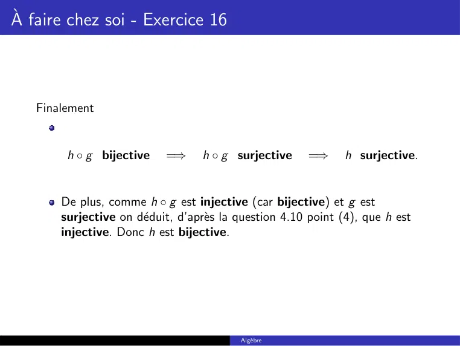

~~~text
À faire chez soi - Exercice 16

   Finalement

        h ◦ g bijective    =⇒     h ◦ g surjective     =⇒     h surjective.

       De plus, comme h ◦ g est injective (car bijective) et g est
       surjective on déduit, d’après la question 4.10 point (4), que h est
       injective. Donc h est bijective.

                                          Algèbre
~~~

## Page 84

~~~text
À faire chez soi - Exercice 17

   Soit f : E → F une application. Montrer l’implication suivante :
   f est surjective =⇒
   pour tout ensemble G et toutes applications g , h : F → G , g ◦ f = h ◦ f =⇒ g = h
   Solution : Soit G un ensemble. Soient
                                  g :F →G        et     h : F → G.
   deux applications telles que
                                            g ◦f = h◦f.
   Montrons que g = h. Soit x ∈ F . Puisque f est surjective existe y ∈ E tel que
                                             x = f (y ).
   Or
         (g ◦ f )(y ) = (h ◦ f )(y )   =⇒     g (f (y )) = h(f (y ))   =⇒   g (x) = h(x).
    Ainsi pour tout x ∈ F on a g (x) = h(x), d’où
                                               g = h.

                                                      Algèbre
~~~

## Page 85

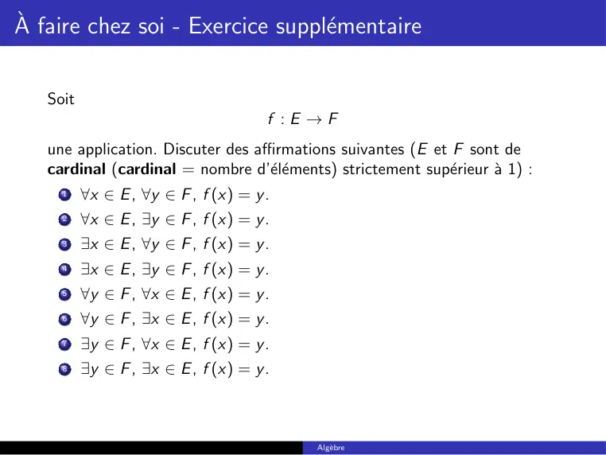

~~~text
À faire chez soi - Exercice supplémentaire

   Soit
                                      f :E →F
   une application. Discuter des affirmations suivantes (E et F sont de
   cardinal (cardinal = nombre d’éléments) strictement supérieur à 1) :
     1    ∀x ∈ E , ∀y ∈ F , f (x) = y .
     2    ∀x ∈ E , ∃y ∈ F , f (x) = y .
     3    ∃x ∈ E , ∀y ∈ F , f (x) = y .
     4    ∃x ∈ E , ∃y ∈ F , f (x) = y .
     5    ∀y ∈ F , ∀x ∈ E , f (x) = y .
     6    ∀y ∈ F , ∃x ∈ E , f (x) = y .
     7    ∃y ∈ F , ∀x ∈ E , f (x) = y .
     8    ∃y ∈ F , ∃x ∈ E , f (x) = y .

                                           Algèbre
~~~

## Page 86

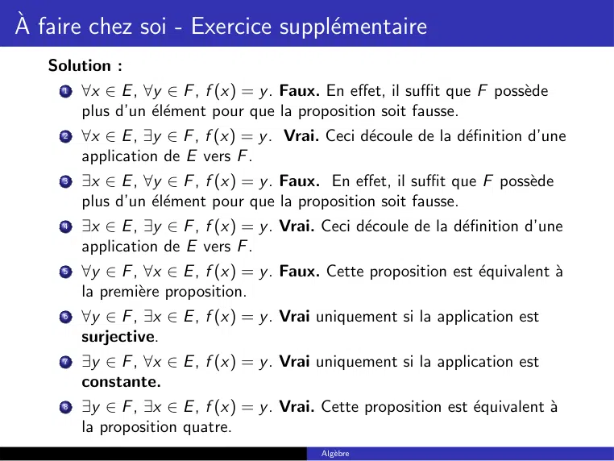

~~~text
À faire chez soi - Exercice supplémentaire
   Solution :
     1 ∀x ∈ E , ∀y ∈ F , f (x) = y . Faux. En effet, il suffit que F possède
       plus d’un élément pour que la proposition soit fausse.
     2 ∀x ∈ E , ∃y ∈ F , f (x) = y . Vrai. Ceci découle de la définition d’une
       application de E vers F .
     3 ∃x ∈ E , ∀y ∈ F , f (x) = y . Faux. En effet, il suffit que F possède
       plus d’un élément pour que la proposition soit fausse.
     4 ∃x ∈ E , ∃y ∈ F , f (x) = y . Vrai. Ceci découle de la définition d’une
       application de E vers F .
     5 ∀y ∈ F , ∀x ∈ E , f (x) = y . Faux. Cette proposition est équivalent à
       la première proposition.
     6 ∀y ∈ F , ∃x ∈ E , f (x) = y . Vrai uniquement si la application est
       surjective.
     7 ∃y ∈ F , ∀x ∈ E , f (x) = y . Vrai uniquement si la application est
       constante.
     8 ∃y ∈ F , ∃x ∈ E , f (x) = y . Vrai. Cette proposition est équivalent à
       la proposition quatre.
                                           Algèbre
~~~

## Page 87

~~~text
Pour aller plus loin - Exercice 18
   Soit A, B, C trois parties d’un ensemble E .
     1   Déterminer 1A\B en fonction de 1A et 1B .
     2   Déterminer 1A∆B en fonction de 1A et 1B .
     3   Quand est-il vrai que A∆(B ∩ C ) = (A∆B) ∩ (A∆C ) ?
   Avant de répondre à la question, rappelons la définition de l’application
   indicatrice et donnons certaines de ses propriétés. Soit A ⊂ E , alors
   l’application indicatrice de A est

                          1A : E → {0, 1}
                                                
                                                    1       si x ∈ A,
                                x 7→ 1A (x) =
                                                    0       si x ∈
                                                                 / A.

   D’après la définition précédent on peut déduire
     1 1A = 1B si et seulement si A = B.Et 12A = 1A .
     2 1A∩B = 1A · 1B .
     3 1A∪B = 1A + 1B − 1A∩B
     4 1Ac = 1 − 1A , où 1 dénote la fonction constante égalé à 1, i.e. pour tout
         x ∈ E , 1(x) = 1.
                                                 Algèbre
~~~

## Page 88

~~~text
Pour aller plus loin - Exercice 18

   Déterminer 1A\B en fonction de

                                  1A et 1B .
   Solution : Comme
                                A \ B = A ∩ Bc ,
   nous pouvons écrire

    1A\B = 1A∩B c = 1A · 1B c     (D’après la propriété 2 de l’indicatrice)
                  = 1A · (1 − 1B ) (D’après la propriété 4 de l’indicatrice)
                  = 1 A − 1A · 1B
                  = 1A − 1A∩B .

                                           Algèbre
~~~

## Page 89

~~~text
Pour aller plus loin - Exercice 18

   Déterminer 1A∆B en fonction de

                                1A et 1B .
   Solution : Comme

                          A∆B = (A ∪ B) \ (A ∩ B),

   nous pouvons écrire

   1A∆B = 1(A∪B)\(A∩B)
        = 1A∪B − 1(A∪B)∩(A∩B) (D’après la question précédent)
        = 1A∪B − 1A∩B       (car A ∩ B ⊂ A ∪ B)
        = (1A + 1B − 1A∩B ) − 1A∩B (D’après la propriété 3 de l’indicatrice)
        = 1A + 1B − 2 · 1A∩B
        = 1A + 1B − 2 · 1A · 1B .

                                         Algèbre
~~~

## Page 90

~~~text
Pour aller plus loin - Exercice 18
   Quand est-il vrai que

                           A∆(B ∩ C ) = (A∆B) ∩ (A∆C )?

   Solution : Puisque

        A∆(B ∩ C ) = (A∆B) ∩ (A∆C )           ⇐⇒          1A∆(B∩C ) = 1(A∆B)∩(A∆C ) ,
   nous allons résoudre cet exercice avec l’aide de l’application indicatrice. Notons
   que grâce à l’exercice 4.1 question 2 nous avons

                      1A∆(B∩C ) = 1A + 1B∩C − 2 · 1A · 1B∩C
                                = 1A + 1B · 1C − 2 · 1A · 1B · 1C .

   De même, les propriétés de l’application indicatrice nous permetent d’écrire

     1(A∆B)∩(A∆C ) =1A∆B · 1A∆C       (D’après la propriété 2 de l’indicatrice)
                   =(1A + 1B − 2 · 1A · 1B )(1A + 1C − 2 · 1A · 1C )
   (12A = 1A =⇒) =1A + 1A · 1C − 2 · 1A · 1C + 1B · 1A + 1B · 1C −
                    2 · 1A · 1B · 1C − 2 · 1A · 1B − 2 · 1A · 1B · 1C + 4 · 1A · 1B · 1C
                   =1A − 1A · 1C − 1A · 1B + 1B · 1C

                                               Algèbre
~~~

## Page 91

~~~text
Pour aller plus loin - Exercice 18
   Par conséquent

                           1A∆(B∩C ) = 1(A∆B)∩(A∆C )
                                    ⇐⇒
       1A + 1B · 1C − 2 · 1A · 1B · 1C = 1A − 1A · 1C − 1A · 1B + 1B · 1C
                                    ⇐⇒
                                   0 =   1A · 1B + 1A · 1C − 21A · 1B · 1C
                                    ⇐⇒
                                   0 = 1A · (1B + 1C − 21B · 1C )
                                    ⇐⇒
                                   0 = 1A · 1B∆C = 1A∩(B∆C )

   Ce qui nous permet de conclure que

     A∆(B ∩ C ) = (A∆B) ∩ (A∆C ) ⇐⇒ 1A∆(B∩C ) = 1(A∆B)∩(A∆C )
                                    ⇐⇒ 0 = 1A∩(B∆C ) ⇐⇒ A ∩ (B∆C ) = ∅.

   Donc A∆(B ∩ C ) = (A∆B) ∩ (A∆C ) si et seulement si A ∩ (B∆C ) = ∅. Ce
   qui est équivalent à B∆C ⊂ Ac .
                                          Algèbre
~~~

## Page 92

~~~text
Pour aller plus loin - Exercice 19
   Soit
                                        f : C \ {0} −→ C
                                                          1
                                                 z 7−→      + z.
                                                          z

     1    L’application f est-elle injective, surjective, bijective ?
     2    Déterminer l’image par f du cercle unité (centre 0 et rayon 1).
     3    Déterminer l’image réciproque par f de iR.
   Solution :
          Injective : Non. En effet, pour tout z ∈ C \ {0} nous avons
                                                                                       
                   1                  1     1  1   1   1                               1
                z= 1         =⇒         +z = + 1 = 1 +             =⇒     f (z) = f       .
                      z
                                      z     z  z   z
                                                       z                               z

          Surjective : Notons que pour tout a ∈ C, il existe z ∈ C× tel que
                                            1
                          f (z) = a   ⇐⇒      +z =a          ⇐⇒    z 2 − az + 1 = 0.
                                            z
           D’où on conclut que les antécédents de a ∈ C par f sont les solutions de
          l’équation z 2 − az + 1. Puisque toute équation de degrée 2 possède des solution
          dans C, on déduit que f est surjective.
                                                      Algèbre
~~~

## Page 93

~~~text
Pour aller plus loin - Exercice 19
   De plus, pour tout a ∈ C les antécédent de a par f sont
                                  a+δ          a−δ
                                          et         ,
                                    2            2
   où δ est l’une quelconque des deux racines carrées du discriminant
                                            ∆ = a2 − 4.
   (2) Pour déterminer l’image par f du cercle unité on rappelle que
                          z ∈U         ⇐⇒     ∃ θ ∈] − π, π], z = e iθ .
   Maintenant, pour tout θ ∈] − π, π] nous avons
        f (e iθ ) = (e iθ )−1 + e iθ   =     e −iθ + e iθ
                                       =     cos(−θ) + i sin(−θ) + cos(θ) + i sin(θ)
                                       =     cos(θ) − i sin(θ) + cos(θ) + i sin(θ)
                                       =     2 cos θ.
   Par conséquent
                       f (U) = 2 cos(] − π, π]) = 2[−1, 1] = [−2, 2].

                                                     Algèbre
~~~

## Page 94

~~~text
Pour aller plus loin - Exercice 19
   (3) Déterminons l’image réciproque par f de iR. Pour cela, notons que pour
   tout z ∈ C \ 0, nous avons
                                               
     1    1 z      z              1           z       Re(z)     Re(z)
       = · =           =⇒ Re         = Re           =         =
    z     z z     |z|2            z          |z|2      |z|2      |z|2
                                                       
                                     1                     1
                       =⇒ Re z +         = Re(z) + Re
                                     z                     z
                                                                                 
                                                     Re(z)                    1
                                         = Re(z) +           = Re(z)  ·  1 +
                                                      |z|2                   |z|2
   Ce qui nous permet conclure que
                                                     
                       1                             1
   Re(f (z)) = Re z +      = 0 ⇐⇒          Re(z) 1 + 2 = 0           ⇐⇒      Re(z) = 0
                       z                            |z|
    D’où on déduit que

                       f −1 (iR) = z ∈ C× : f (z) ∈ iR
                                  

                                 = z ∈ C× : Re(f (z)) = 0
                                  

                                = {z ∈ C× : Re(z) = 0} = iR.

                                              Algèbre
~~~
