# TD5-Complexes-Correction_2023-2024_Algebre1_P1S1_NArancibia.pdf

[Ouvrir l’original](https://drive.google.com/open?id=1m1mtr2lDtsdEYouWN_NI9AOhKQWtltfl) · Les pages signalées comprennent du texte reconnu automatiquement ou des éléments graphiques. Le fac-similé permet de vérifier chaque lecture.

**Pages avec fac-similé ou lecture OCR** — 17.

**Pages présentant un écart entre les deux extractions** — 1, 3, 9, 16, 23–24, 26–27, 29, 31–38, 49–51, 53–61, 66–73, 76–78, 83–84, 86–87.

## Page 1

~~~text
Algèbre-Premier semestre 2023-2024

                       CY Tech

                     TD Algèbre

                  Nombres complexes.

                             Algèbre
~~~

## Page 2

~~~text
Exercice 5.1

   Mettre sous forme algébrique les nombres suivants :
       3+6i
   (1) 3−4i .
        2
        1+i     3+6i
   (2) 2−i    + 3−4i .
   (3) 2+5i  2−5i
       1−i + 1+i .

                                         Algèbre
~~~

## Page 3

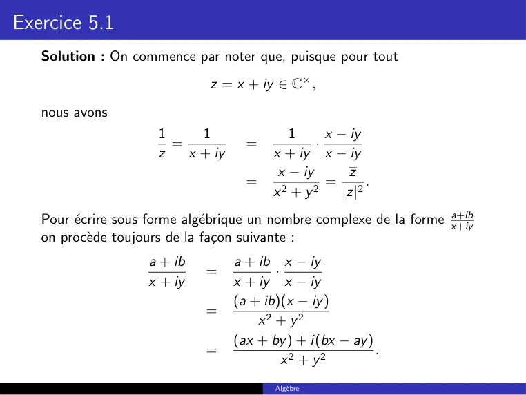

~~~text
Exercice 5.1
   Solution : On commence par noter que, puisque pour tout
                              z = x + iy ∈ C× ,
   nous avons
                      1     1                1      x − iy
                        =            =            ·
                      z   x + iy          x + iy x − iy
                                           x − iy       z
                                     =              = 2.
                                          x2 + y2      |z|
                                                                      a+ib
   Pour écrire sous forme algébrique un nombre complexe de la forme x+iy
   on procède toujours de la façon suivante :
                    a + ib         a + ib x − iy
                              =           ·
                    x + iy         x + iy x − iy
                                   (a + ib)(x − iy )
                              =
                                       x2 + y2
                                   (ax + by ) + i(bx − ay )
                              =                             .
                                            x2 + y2
                                          Algèbre
~~~

## Page 4

~~~text
Exercice 5.1
   (1) Nous avons :

                         3 + 6i            3 + 6i 3 + 4i
                                   =              ·
                         3 − 4i            3 − 4i 3 + 4i
                                           (3 + 6i) · (3 + 4i)
                                   =
                                                9 + 16
                                           −15 + 30i      −3 + i6
                                   =                    =         .
                                               25             5
   (2) Nous avons :
                         2
                                                      1 + 2i + i 2
               
                   1+i            3 + 6i                                3 + 6i
                              +               =                     +
                   2−i            3 − 4i              4 − 4i + i 2      3 − 4i
                                                        2i         3 + 6i
                                              =               +
                                                      3 − 4i       3 − 4i
                                                      3 + 8i
                                              =
                                                      3 − 4i

                                               Algèbre
~~~

## Page 5

~~~text
Exercice 5.1
   Ainsi
                    2
               1+i            3 + 6i       3 + 8i
                          +            =
               2−i            3 − 4i       3 − 4i
                                           3 + 8i 3 + 4i   (3 + 8i)(3 + 4i)
                                       =          ·      =
                                           3 − 4i 3 + 4i          25
                                           −23 + 36i
                                       =             .
                                               25
   (3) Nous avons :

                      2 + 5i   2 − 5i        2 + 5i      (2 + 5i)
                             +             =          +
                      1−i       1+i           1−i         (1 − i)
                                                                 
                                             2 + 5i        2 + 5i
                                           =          +
                                              1−i           1−i
                                                          
                                                    2 + 5i
                                           = 2Re             .
                                                    1−i

                                               Algèbre
~~~

## Page 6

~~~text
Exercice 5.1

   Or
                         2 + 5i        2 + 5i 1 + i
                                  =           ·
                         1−i            1−i 1+i
                                       (2 + 5i) · (1 + i)
                                  =
                                                2
                                       −3 + 7i
                                  =              .
                                          2
   Par conséquent
                                                                 
                     2 + 5i   2 − 5i                     2 + 5i
                            +            = 2Re
                     1−i       1+i                       1−i
                                                     −3
                                         = 2·           = −3.
                                                      2

                                          Algèbre
~~~

## Page 7

~~~text
Exercice 5.2

   On suppose θ ∈] − π; π]. Calculer le module et un argument des nombres
   complexes suivants.

   (1) z = ie iθ .
   (2) z = 1 + e iθ .
   (3) z = sin(θ) + i(1 + cos(θ)).

                                       Algèbre
~~~

## Page 8

~~~text
Exercice 5.2

   (1) z = ie iθ .
   Solution : Notons que

                         i   =    0+i
                             =    cos(π/2) + i sin(π/2)
                                      iπ
                             =    e2.

   Ce qui nous permet d’écrire
                                                   π
                              ie iθ        = e i 2 · e iθ
                                           = e i ( 2 +θ) .
                                                   π

   Donc
                                                            π
                        |z| = 1       et     arg(z) =         + θ.
                                                            2

                                                 Algèbre
~~~

## Page 9

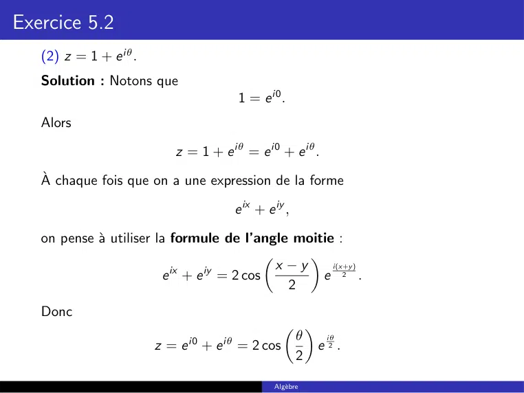

~~~text
Exercice 5.2
   (2) z = 1 + e iθ .
   Solution : Notons que
                                       1 = e i0 .
   Alors

                           z = 1 + e iθ = e i0 + e iθ .

   À chaque fois que on a une expression de la forme

                                      e ix + e iy ,

   on pense à utiliser la formule de l’angle moitie :
                                               
                           ix  iy          x −y     i(x+y )
                         e + e = 2 cos            e 2 .
                                             2
   Donc
                                                   
                                                   θ   iθ
                        z = e i0 + e iθ = 2 cos       e2.
                                                   2

                                               Algèbre
~~~

## Page 10

~~~text
Exercice 5.2

   Pour finir, on rappelle que
                                         θ i π πi
                    θ ∈ ]−π, π]   =⇒       ∈ − ,
                                         2       2 2
                                     π π
   et comme cosinus est positif sur − 2 , 2 , on conclut
                                  
                                   θ                   θ
                    |z| = 2 cos          et arg(z) = .
                                   2                   2

                                        Algèbre
~~~

## Page 11

~~~text
Exercice 5.2
   (3) z = sin(θ) + i(1 + cos(θ)).
   Solution : On commence par noter que
                 z   =    sin(θ) + i(1 + cos(θ))
                      =   i + (sin(θ) + i cos(θ))
                                  π                   π    
                      =   i + cos            − θ + i sin    −θ
                                         2                2
                            i π2      i ( π2 −θ )
                      =   e       + e
                            i π2
                                  1 + e −iθ
                                              
                      =   e
                              π
                          e i 2 e i0 + e −iθ .
                                                
                      =
   En utilisant la formule de l’angle moitie, on obtient
                                                           
              i π2       0 − (−θ)     i(0+(−θ))
                                                    i π2      θ      iθ
      z = e · 2 cos                 e     2     = e · 2 cos        e− 2
                             2                                2
                                                          
                                                          θ   i(π−θ)
                                                = 2 cos      e 2 .
                                                          2

                                           Algèbre
~~~

## Page 12

~~~text
Exercice 5.2

   Pour finir, on rappelle que
                                         θ i π πi
                    θ ∈ ]−π, π]   =⇒       ∈ − ,
                                         2       2 2
                                    π π
   et comme cosinus est positif sur − 2 , 2 , on conclut
                               
                                 θ                   π−θ
                  |z| = 2 cos        et arg(z) =         .
                                 2                     2

                                        Algèbre
~~~

## Page 13

~~~text
Exercice 5.3

   Calculer le module et l’argument principal des nombres complexes
   suivants
                    √ √
    (1) z = i(−1 + i 3)( 3 − i)
              √
   (2) z = −3 1+i
               3−3i

                                        Algèbre
~~~

## Page 14

~~~text
Exercice 5.3
                   √ √
   (1) z = i(−1 + i 3)( 3 − i).
   Solution : Nous avons
                                         √ √
                         z   =   i(−1 + i 3)( 3 − i)
                                       √ √
                             =   (−i − 3)( 3 − i)
                                   √             √
                             =   −i 3 − 1 − 3 + i 3
                             =   −4
                             =   4 · (−1).
   Finalement, puisque
                     −1      = −1 + i0
                             = cos(π) + i sin(π) = e iπ ,
   on conclut que
                                  −4 = 4e iπ .
   Donc
                    |z| = 4 et     arg(z) = π ∈ ] − π, π].

                                          Algèbre
~~~

## Page 15

~~~text
Exercice 5.3

              √
   (2) z = −3 1+i
               3−3i
                    .
   Solution : On commence par noter que
                                      √         !
                    √                     3   i
                        3+i   =   2         +
                                         2    2
                                     π                π 
                              =   2 cos         + i sin
                                            6             6
                                       π
                              =   2e i 6

   Ainsi
                           √                √
                         −3 3 − 3i     = −3( 3 + i)
                                                     π
                                       = −6e i 6 .

                                          Algèbre
~~~

## Page 16

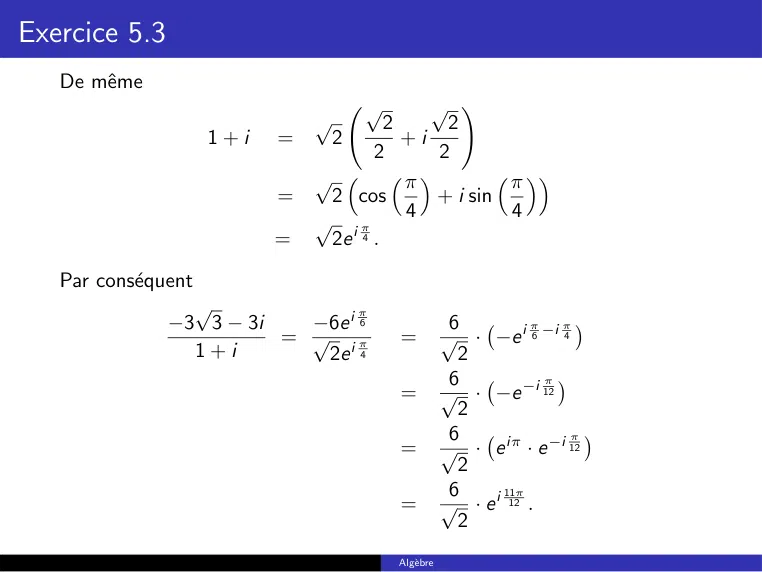

~~~text
Exercice 5.3
   De même
                                   √    √ !
                              √    2      2
                     1+i   =  2      +i
                                  2      2
                             √  π             π 
                           =  2 cos     + i sin
                             √ iπ    4            4
                           =  2e .
                                4

   Par conséquent
                 √               π
               −3 3 − 3i   −6e i 6                 6         π   π
                         = √ iπ        =          √ · −e i 6 −i 4
                 1+i        2e 4                    2
                                                   6           π 
                                       =          √ · −e −i 12
                                                    2
                                                   6               π 
                                       =          √ · e iπ · e −i 12
                                                    2
                                                   6     11π
                                       =          √ · e i 12 .
                                                    2
                                       Algèbre
~~~

## Page 17

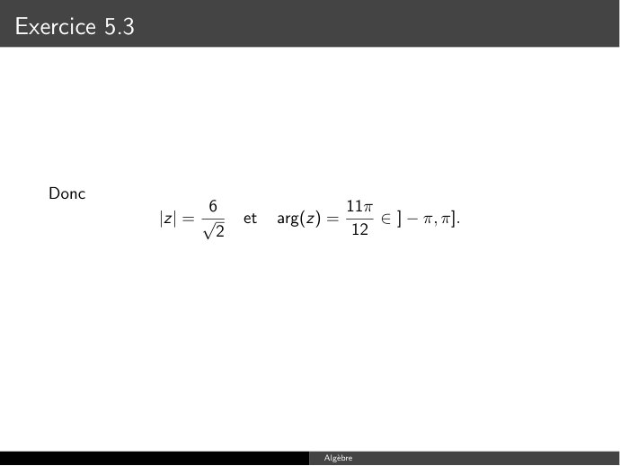

~~~text
Exercice 5.3

   Donc
                      6                     11π
               |z| = √     et   arg(z) =        ∈ ] − π, π].
                       2                     12

                                      Algèbre
~~~

**Lecture OCR à contrôler**

~~~text
Exercice

Donc
~~~

## Page 18

~~~text
Exercice 5.4

   Simplifier les nombres complexes
                      √         !1995                  √ !20
                          3−i                       1+i 3
                                        et                   .
                           2                         1−i

   Solution : Nous avons
                   √                √
                     3−i               3     1
                                =         −i
                      2               2  2
                                           π           π
                                =   cos        − i sin
                                         π6          6 π
                                =   cos        + i sin −
                                         6 π          6 π
                                =   cos −       + i sin −
                                             6             6
                                         π
                                =   e −i 6

                                             Algèbre
~~~

## Page 19

~~~text
Exercice 5.4

   Ainsi
               √         !1995
                   3−i                           π    1995
                                 =           e −i 6
                    2
                                                1995π
                                 = e −i           6
                                                665π
                                 = e −i 2
                                                              π
                                 = e −i166·2π−i 2
                                        π
                                 = e −i 2
                                 = −i.

                                  Algèbre
~~~

## Page 20

~~~text
Exercice 5.4
                           √ 20
                         1+i 3
   Pour simplifier        1−i
                                  on commence par noter que
                                                   √ 
                             √
                                          
                                              1      3
                          1+i 3      =   2      +i
                                              2     2
                                               π            π 
                                     =   2 cos        + i sin
                                                  3             3
                                              π
                                     =   2e i 3

   De même
                                      √       √ 
                                    √     2      2
                         1−i    =    2      −i
                                         2      2
                                    √     π           π 
                                =    2 cos      − i sin
                                            4           4 π 
                                    √     π
                                =    2 cos      + i sin −
                                    √     4 π           4 π 
                                =    2 cos −      + i sin −        .
                                              4               4
                                    √ −i π
                                =    2e 4

                                                Algèbre
~~~

## Page 21

~~~text
Exercice 5.4

   Donc
             √ !20         π 20                        20
                      2e i 3
                                             
          1+i 3                                    2                   π       π   20
                   = √ −i π             =         √             · e i 3 +i 4
           1−i        2e 4                          2
                                                   20        20
                                                 2           7π
                                        =       √      · e i 12
                                                  2
                                               √ 20 i 20·7π
                                        =     ( 2) · e 12
                                                          35π
                                        =     210 · e i 3
                                                          (36−1)π
                                        =     210 · e i      3
                                                                   π
                                        =     210 · e i12π−i 3
                                                                       π
                                        =     210 · e i12π · e −i 3
                                                                           π
                                        =     210 · e i6·2π · e −i 3
                                                            π
                                        =     210 · e −i 3

                                   Algèbre
~~~

## Page 22

~~~text
Exercice 5.5

   Montrer que
                                                 1
                             |z| = 1 ⇐⇒ z =
                                                 z
   Solution : Nous avons
                       √                                            1
       |z| = 1   ⇐⇒        z ·z =1   ⇐⇒          zz = 1   ⇐⇒   z=     .
                                                                    z

                                      Algèbre
~~~

## Page 23

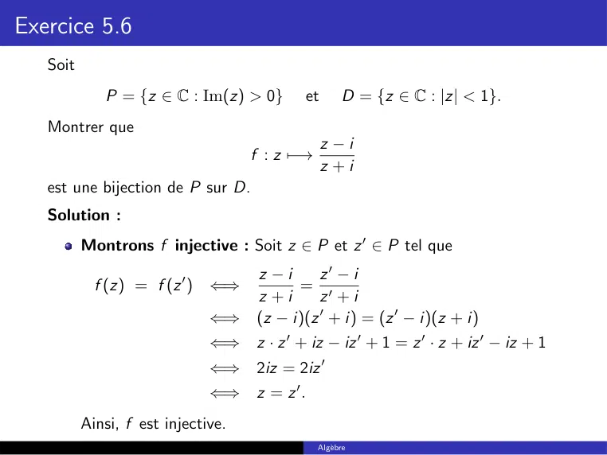

~~~text
Exercice 5.6
   Soit
             P = {z ∈ C : Im(z) > 0}        et        D = {z ∈ C : |z| < 1}.
   Montrer que
                                                 z −i
                                    f : z 7−→
                                                 z +i
   est une bijection de P sur D.
   Solution :
          Montrons f injective : Soit z ∈ P et z 0 ∈ P tel que
                                    z −i      z0 − i
            f (z) = f (z 0 ) ⇐⇒           = 0
                                    z +i      z +i
                              ⇐⇒    (z − i)(z 0 + i) = (z 0 − i)(z + i)
                              ⇐⇒    z · z 0 + iz − iz 0 + 1 = z 0 · z + iz 0 − iz + 1
                              ⇐⇒    2iz = 2iz 0
                              ⇐⇒    z = z 0.
          Ainsi, f est injective.
                                                Algèbre
~~~

## Page 24

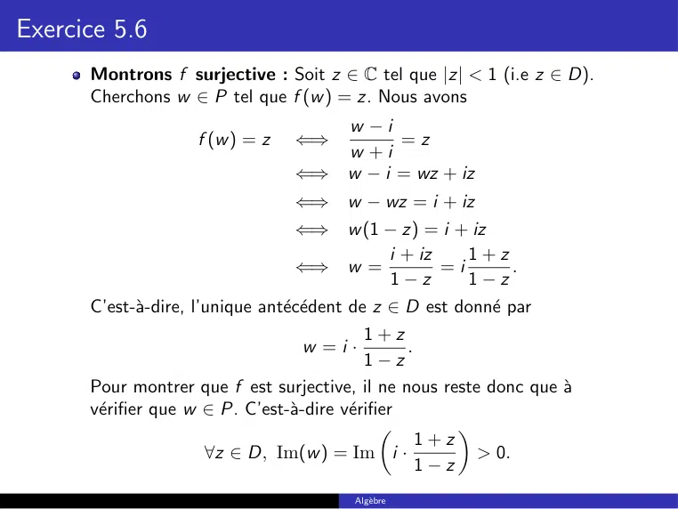

~~~text
Exercice 5.6
      Montrons f surjective : Soit z ∈ C tel que |z| < 1 (i.e z ∈ D).
      Cherchons w ∈ P tel que f (w ) = z. Nous avons
                                         w −i
                    f (w ) = z   ⇐⇒            =z
                                         w +i
                                 ⇐⇒      w − i = wz + iz
                                 ⇐⇒      w − wz = i + iz
                                 ⇐⇒        w (1 − z) = i + iz
                                                i + iz    1+z
                                   ⇐⇒ w =              =i       .
                                                1−z       1−z
      C’est-à-dire, l’unique antécédent de z ∈ D est donné par
                                             1+z
                                  w =i·            .
                                             1−z
      Pour montrer que f est surjective, il ne nous reste donc que à
      vérifier que w ∈ P. C’est-à-dire vérifier
                                                        
                                                     1+z
                      ∀z ∈ D, Im(w ) = Im i ·              > 0.
                                                     1−z
                                         Algèbre
~~~

## Page 25

~~~text
Exercice 5.6
   Or pour tout z ∈ D, nous avons

                        1+z          (1 + z)(1 − z)
                   i·          = i·
                        1−z             |1 − z|2
                                     (1 + z − z − |z|2 )
                               = i·
                                          |1 − z|2
                                     (1 − |z|2 ) + 2iIm(z))
                               = i·
                                            |1 − z|2
                                    2Im(z)         (1 − |z|2 )
                               = −           +   i             .
                                    |1 − z|2        |1 − z|2

   Finalement, puisque z ∈ D, c’est-à-dire |z| < 1, on conclut 1 − |z|2 > 0
   et donc
                          (1 − |z|2 )
                    
                1+z                                          1+z
         Im i ·         =             > 0 =⇒ w = i ·               ∈ P.
                1−z        |1 − z|2                          1−z

   La fonction f est donc surjective.
                                           Algèbre
~~~

## Page 26

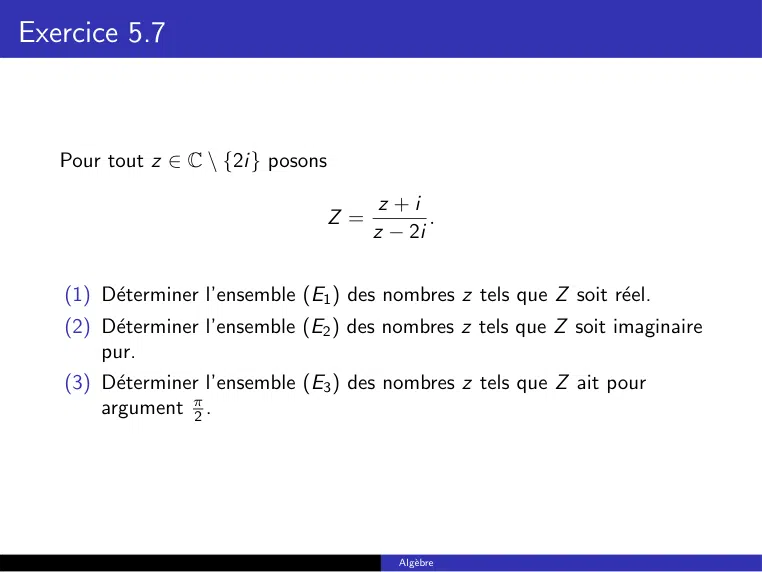

~~~text
Exercice 5.7

   Pour tout z ∈ C \ {2i} posons

                                        z +i
                                 Z=           .
                                       z − 2i

   (1) Déterminer l’ensemble (E1 ) des nombres z tels que Z soit réel.
   (2) Déterminer l’ensemble (E2 ) des nombres z tels que Z soit imaginaire
       pur.
   (3) Déterminer l’ensemble (E3 ) des nombres z tels que Z ait pour
       argument π2 .

                                          Algèbre
~~~

## Page 27

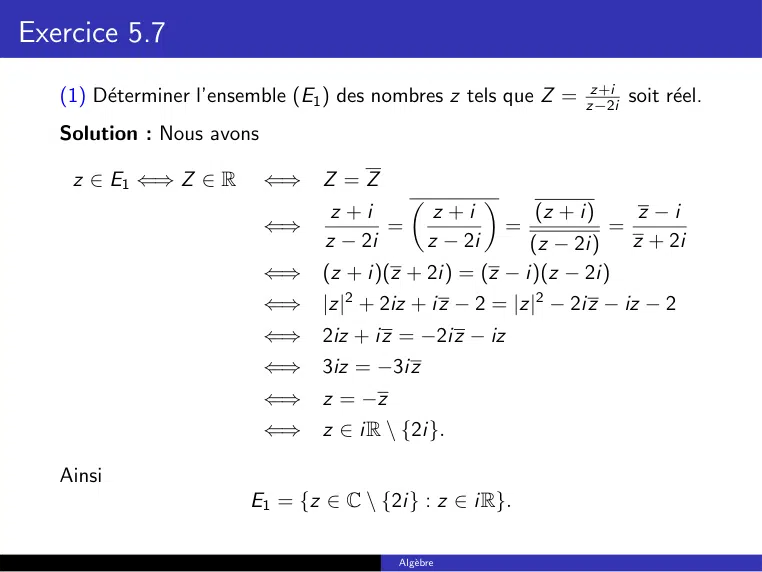

~~~text
Exercice 5.7
                                                                z+i
   (1) Déterminer l’ensemble (E1 ) des nombres z tels que Z = z−2i soit réel.
   Solution : Nous avons

    z ∈ E1 ⇐⇒ Z ∈ R        ⇐⇒     Z =Z
                                                         
                                   z +i           z +i            (z + i)        z −i
                           ⇐⇒            =                    =             =
                                  z − 2i         z − 2i   (z − 2i)              z + 2i
                           ⇐⇒     (z + i)(z + 2i) = (z − i)(z − 2i)
                           ⇐⇒     |z|2 + 2iz + iz − 2 = |z|2 − 2iz − iz − 2
                           ⇐⇒     2iz + iz = −2iz − iz
                           ⇐⇒     3iz = −3iz
                           ⇐⇒     z = −z
                           ⇐⇒     z ∈ iR \ {2i}.

   Ainsi
                         E1 = {z ∈ C \ {2i} : z ∈ iR}.

                                           Algèbre
~~~

## Page 28

~~~text
Exercice 5.7
                                                                z+i
   (2) Déterminer l’ensemble (E2 ) des nombres z tels que Z = z−2i soit un
   imaginaire pur.
   Solution : Nous avons
   z = x + iy ∈ E2    ⇐⇒     Z ∈ iR
                      ⇐⇒     Z = −Z
                                              
                              z +i       z +i        (z + i)     z −i
                      ⇐⇒            =−           =−          =−
                             z − 2i     z − 2i      (z − 2i)    z + 2i
                      ⇐⇒     −(z + i)(z + 2i) = (z − i)(z − 2i)
                      ⇐⇒     −|z|2 − 2iz − iz + 2 = |z|2 − 2iz − iz − 2
                      ⇐⇒     0 = 2|z|2 + i(z − z) − 4
                      ⇐⇒     0 = 2|z|2 + i(2iIm(z)) − 4
                      ⇐⇒     0 = 2|z|2 − 2Im(z) − 4 ⇐⇒ 0 = |z|2 − Im(z) − 2
                                                                   
                                                                  1     1
                      ⇐⇒     0 = x2 + y2 − y − 2 = x2 + y2 − y +      − −2
                                                                  4     4
                                         2
                                        1      9
                      ⇐⇒     x2 + y −        = .
                                        2      4

                                            Algèbre
~~~

## Page 29

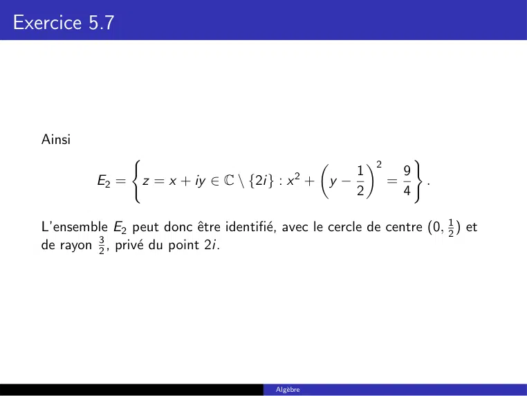

~~~text
Exercice 5.7

   Ainsi
                   (                                        2         )
                                                  2    1            9
            E2 =       z = x + iy ∈ C \ {2i} : x + y −            =         .
                                                       2            4

   L’ensemble E2 peut donc être identifié, avec le cercle de centre (0, 12 ) et
   de rayon 23 , privé du point 2i.

                                            Algèbre
~~~

## Page 30

~~~text
Exercice 5.7
   (3) Déterminer l’ensemble (E3 ) des nombres z tels que Z ait pour
   argument π2 .
   Solution : On commence par noter que :
                          π
              arg(Z ) =        ⇐⇒     Z ∈ iR et Im(Z ) > 0.
                          2
   Par conséquent

                z ∈ E3        ⇐⇒   z ∈ E2     et        Im(Z ) > 0.

   Maintenant
            z +i    (z + i)(z + 2i)   |z|2 − 2 − Im(z) + 3iRe(z)
      Z=          =                 =
           z − 2i      |z − 2i|2                |z − 2i|2

   Donc
                               3Re(z)
                 Im(Z ) =               >0      ⇐⇒          Re(z) > 0.
                              |z − 2i|2

                                             Algèbre
~~~

## Page 31

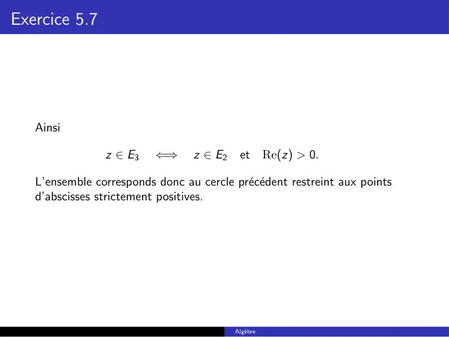

~~~text
Exercice 5.7

   Ainsi

                z ∈ E3    ⇐⇒      z ∈ E2    et        Re(z) > 0.

   L’ensemble corresponds donc au cercle précédent restreint aux points
   d’abscisses strictement positives.

                                           Algèbre
~~~

## Page 32

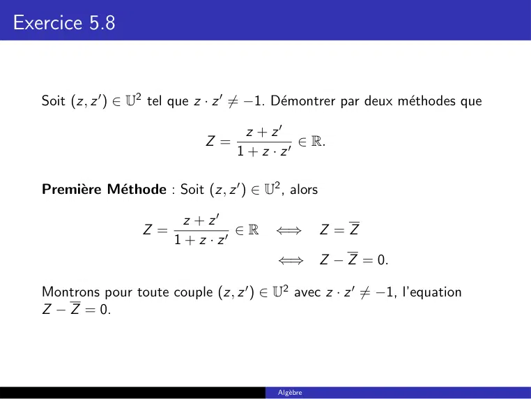

~~~text
Exercice 5.8

   Soit (z, z 0 ) ∈ U2 tel que z · z 0 6= −1. Démontrer par deux méthodes que

                                      z + z0
                               Z=              ∈ R.
                                    1 + z · z0

   Première Méthode : Soit (z, z 0 ) ∈ U2 , alors

                            z + z0
                    Z=               ∈R    ⇐⇒          Z =Z
                          1 + z · z0
                                            ⇐⇒         Z − Z = 0.

   Montrons pour toute couple (z, z 0 ) ∈ U2 avec z · z 0 6= −1, l’equation
   Z − Z = 0.

                                            Algèbre
~~~

## Page 33

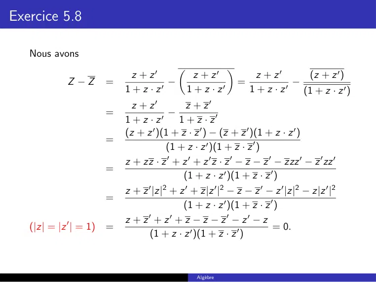

~~~text
Exercice 5.8

   Nous avons

                            z + z0             z + z0              z + z0      (z + z 0 )
                                                         
            Z −Z     =               −                        =             −
                          1 + z · z0         1 + z · z0           1+z ·z  0
                                                                              (1 + z · z 0 )
                            z + z0         z + z0
                     =                 −
                          1+z ·z    0    1 + z · z0
                          (z + z )(1 + z · z 0 ) − (z + z 0 )(1 + z · z 0 )
                                  0
                     =
                                      (1 + z · z 0 )(1 + z · z 0 )
                          z + zz · z 0 + z 0 + z 0 z · z 0 − z − z 0 − zzz 0 − z 0 zz 0
                     =
                                          (1 + z · z 0 )(1 + z · z 0 )
                          z + z |z| + z 0 + z|z 0 |2 − z − z 0 − z 0 |z|2 − z|z 0 |2
                                0    2
                     =
                                          (1 + z · z 0 )(1 + z · z 0 )
                          z + z + z + z − z − z0 − z0 − z
                                0      0
   (|z| = |z 0 | = 1) =                                             = 0.
                                (1 + z · z 0 )(1 + z · z 0 )

                                               Algèbre
~~~

## Page 34

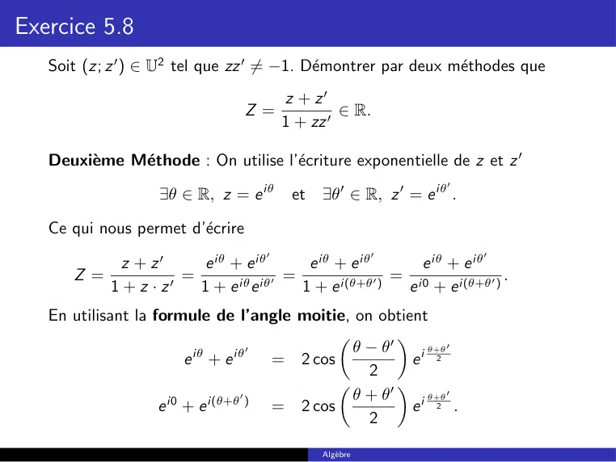

~~~text
Exercice 5.8
   Soit (z; z 0 ) ∈ U2 tel que zz 0 6= −1. Démontrer par deux méthodes que
                                        z + z0
                                  Z=             ∈ R.
                                        1 + zz 0

   Deuxième Méthode : On utilise l’écriture exponentielle de z et z 0
                                                                  0
                   ∃θ ∈ R, z = e iθ      et   ∃θ0 ∈ R, z 0 = e iθ .

   Ce qui nous permet d’écrire
                                    0                    0             0
           z + z0      e iθ + e iθ       e iθ + e iθ        e iθ + e iθ
      Z=            =               0 =              0 =                   .
         1 + z · z0   1 + e iθ e iθ     1 + e i(θ+θ )    e i0 + e i(θ+θ0 )
   En utilisant la formule de l’angle moitie, on obtient
                                                 θ − θ0
                                                       
                                     0                      θ+θ 0
                         e iθ + e iθ   = 2 cos            ei 2
                                                   2
                                                     θ0
                                                       
                                   0             θ +        θ+θ 0
                    e i0 + e i(θ+θ ) = 2 cos              ei 2 .
                                                   2

                                              Algèbre
~~~

## Page 35

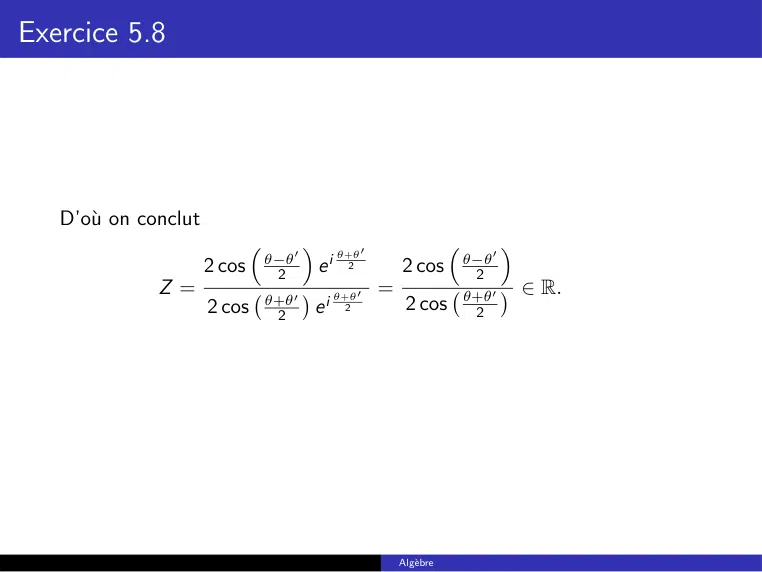

~~~text
Exercice 5.8

   D’où on conclut
                                                   θ+θ 0
                                                                               
                                  θ−θ 0                                   θ−θ 0
                      2 cos        2          ei     2     2 cos           2
              Z=                           i θ+θ0 =                      θ+θ 0
                                                                                   ∈ R.
                                  θ+θ 0              2 cos
                      2 cos        2       e 2                             2

                                                           Algèbre
~~~

## Page 36

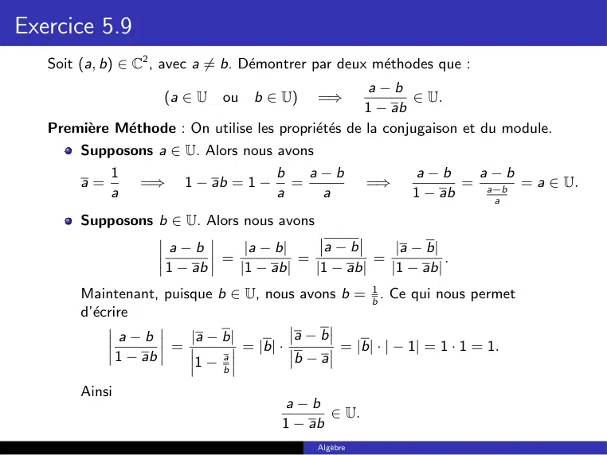

~~~text
Exercice 5.9
   Soit (a, b) ∈ C2 , avec a 6= b. Démontrer par deux méthodes que :
                                                        a−b
                       (a ∈ U   ou   b ∈ U)   =⇒              ∈ U.
                                                       1 − ab
   Première Méthode : On utilise les propriétés de la conjugaison et du module.
       Supposons a ∈ U. Alors nous avons
             1                           b   a−b               a−b    a−b
        a=         =⇒     1 − ab = 1 −     =             =⇒          = a−b = a ∈ U.
             a                           a    a               1 − ab    a

        Supposons b ∈ U. Alors nous avons
                        a−b       |a − b|     a−b       |a − b|
                               =          =          =          .
                        1 − ab   |1 − ab|   |1 − ab|   |1 − ab|
        Maintenant, puisque b ∈ U, nous avons b = b1 . Ce qui nous permet
        d’écrire
                 a−b     |a − b|         a−b
                       =         = |b| ·     = |b| · | − 1| = 1 · 1 = 1.
                1 − ab    1− ba          b−a

        Ainsi
                                         a−b
                                                ∈ U.
                                         1 − ab
                                              Algèbre
~~~

## Page 37

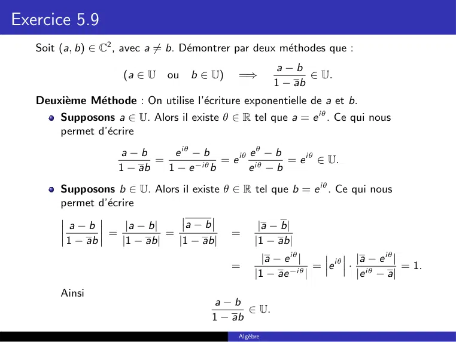

~~~text
Exercice 5.9
   Soit (a, b) ∈ C2 , avec a 6= b. Démontrer par deux méthodes que :
                                                         a−b
                     (a ∈ U   ou   b ∈ U)    =⇒                ∈ U.
                                                        1 − ab
   Deuxième Méthode : On utilise l’écriture exponentielle de a et b.
        Supposons a ∈ U. Alors il existe θ ∈ R tel que a = e iθ . Ce qui nous
        permet d’écrire
                     a−b      e iθ − b       eθ − b
                           =       −iθ
                                       = e iθ iθ    = e iθ ∈ U.
                    1 − ab   1−e b           e −b
        Supposons b ∈ U. Alors il existe θ ∈ R tel que b = e iθ . Ce qui nous
        permet d’écrire
          a−b      |a − b|     a−b                  |a − b|
                =          =                =
         1 − ab   |1 − ab|   |1 − ab|              |1 − ab|
                                                     |a − e iθ |         |a − e iθ |
                                            =              −iθ
                                                                 = e iθ · iθ         = 1.
                                                   |1 − ae |             |e − a|
        Ainsi
                                        a−b
                                               ∈ U.
                                        1 − ab
                                             Algèbre
~~~

## Page 38

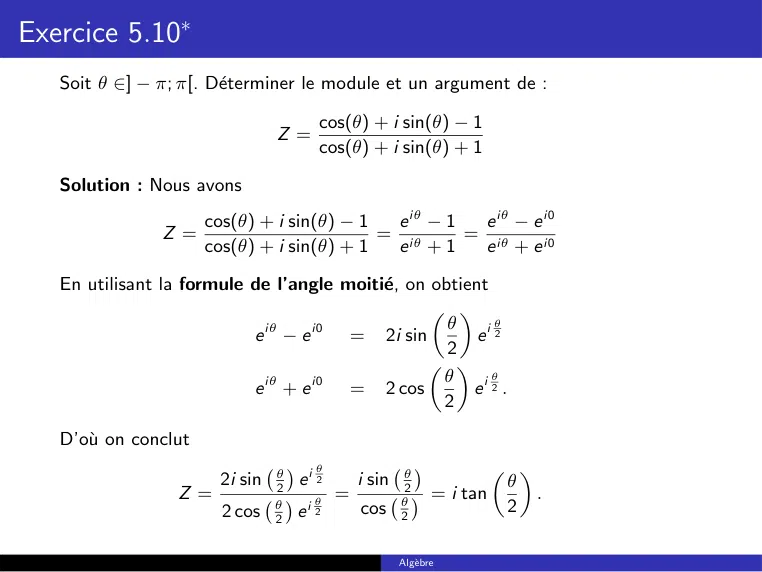

~~~text
Exercice 5.10∗
   Soit θ ∈] − π; π[. Déterminer le module et un argument de :

                                        cos(θ) + i sin(θ) − 1
                                 Z =
                                        cos(θ) + i sin(θ) + 1

   Solution : Nous avons
                      cos(θ) + i sin(θ) − 1  e iθ − 1  e iθ − e i0
                Z =                         = iθ      = iθ
                      cos(θ) + i sin(θ) + 1  e +1      e + e i0
   En utilisant la formule de l’angle moitié, on obtient
                                                   
                                                    θ      θ
                           e iθ − e i0 = 2i sin         ei 2
                                                    2
                                                  
                             iθ     i0             θ      θ
                           e +e        = 2 cos         ei 2 .
                                                   2

   D’où on conclut
                                        θ
                                 θ
                                     ei 2               θ
                                                                        
                        2i sin   2
                                                i sin   2                 θ
                  Z =                   θ
                                            =           θ
                                                              = i tan       .
                                 θ
                                     ei 2       cos                       2
                                   
                        2 cos    2                      2

                                                        Algèbre
~~~

## Page 39

~~~text
Exercice 5.10∗
   Par conséquent :
        si θ ∈] − π, 0[, alors θ2 ∈ − π2 , 0 et tan θ2 < 0. Donc
                                                    

                                                       
                                     θ                   θ    iπ
                       Z = − tan           (−i) = − tan     e− 2
                                     2                   2

        Ainsi
                                     
                                     θ                         π
                   |Z | = − tan           et   arg(Z ) = −          mod (2π).
                                     2                         2

        si θ = 0, alors tan(θ/2) = 0. Donc Z = 0.
        si θ ∈]0, π[, alors θ2 ∈ 0, π2 et tan θ2 > 0. Donc
                                               

                                                   
                                        θ            θ   iπ
                              Z = tan       i = tan     e2
                                        2            2

        Ainsi
                                     
                                     θ                     π
                       |Z | = tan         et   arg(Z ) =           mod (2π).
                                     2                     2

                                               Algèbre
~~~

## Page 40

~~~text
Exercice 5.10
   Soit z ∈ U dont un argument est dans ]0, π3 [. Déterminer le module et un
   argument de
                                           1 + z3
                                      Z =           .
                                              z2
   Solution : Par hypothèse, il existe θ ∈ ]0, 3 [ tel que z = e iθ . Nous avons
                                                π

                       1 + z3   1
                 Z =          = 2 + z = z −2 + z = e −2iθ + e iθ
                         z2    z
   En utilisant la formule de l’angle moitie, on obtient
                                                  
                                                  3θ         θ
                         e −2iθ + e iθ = 2 cos          e −i 2
                                                   2
   Or
              i πh                                                            
                                     3θ i π h                             3θ
           θ ∈ 0,         =⇒           ∈ 0,              =⇒     cos                > 0.
                  3                  2      2                             2
   Ainsi
                                        
                                    3θ                          θ
                 |Z | = 2 cos                et   arg(Z ) = −         mod (2π).
                                    2                           2

                                                    Algèbre
~~~

## Page 41

~~~text
Exercice 5.11

   Exprimer en fonction de sin(θ) et de cos(θ) :
   (a) cos(2θ)
   (b) sin(2θ)
   (c) cos(3θ)
   (d) sin(4θ)
   (e) sin(5θ)

                                         Algèbre
~~~

## Page 42

~~~text
Exercice 5.11

   Solution :

   (a) cos(2θ) = cos2 (θ) − sin2 (θ).

   (b) sin(2θ) = 2 sin(θ) cos(θ).

   (c) cos(3θ) = cos3 (θ) − 3 cos(θ) sin2 (θ).

                                           Algèbre
~~~

## Page 43

~~~text
Exercice 5.11
   (d) sin(4θ) : Pour exprimer sin(4θ) en fonction de sin(θ) et de cos(θ), on
   commence par noter que :
                                                         4 
              ∀θ ∈ R, sin(4θ) = Im e 4iθ = Im e iθ
                                           

   La formule du binôme de Newton, nous permet donc d’écrire
           4
    e iθ        =   (cos(θ) + i sin(θ))4
                     4  
                    X     4
                =            cos4−k (θ)i k sink (θ)
                         k
                    k=0
                =   cos (θ) + 4i cos3 (θ) sin(θ) − 6 cos2 (θ) sin2 (θ) − 4i cos(θ) sin3 (θ)
                       4

                                          + sin4 (θ)
                                                                 
                =       cos4 (θ) − 6 cos2 (θ) sin2 (θ) + sin4 (θ)
                                                                                        
                                                 +i 4 cos3 (θ) sin(θ) − 4 cos(θ) sin3 (θ) .

                                                 Algèbre
~~~

## Page 44

~~~text
Exercice 5.11

   Ainsi

       sin(4θ) = Im e 4iθ = 4 cos3 (θ) sin(θ) − 4 cos(θ) sin3 (θ)
                         

       cos(4θ) = Re e 4iθ = cos4 (θ) − 6 cos2 (θ) sin2 (θ) + sin4 (θ).
                         

                                        Algèbre
~~~

## Page 45

~~~text
Exercice 5.11
   (e) sin(5θ) : Pour exprimer sin(5θ) en fonction de sin(θ) et de cos(θ) on
   commence par noter que :
                                                        5 
                ∀θ ∈ R, sin(5θ) = Im e 5iθ = Im e iθ
                                           

   La formule du binôme de Newton, nous permet donc d’écrire
           5
    e iθ        =   (cos(θ) + i sin(θ))5
                     5  
                    X     5
                =            cos5−k (θ)i k sink (θ)
                         k
                    k=0
                =   cos5 (θ) + 5i cos4 (θ) sin(θ) − 10 cos3 (θ) sin2 (θ)
                                     − 10i cos2 (θ) sin3 (θ) + 5 cos(θ) sin4 (θ) + i sin5 (θ)
                                                                          
                =       cos5 (θ) − 10 cos3 (θ) sin2 (θ) + 5 cos(θ) sin4 (θ)
                                                                                             
                                     + i 5 cos4 (θ) sin(θ) − 10 cos2 (θ) sin3 (θ) + sin5 (θ)

                                                 Algèbre
~~~

## Page 46

~~~text
Exercice 5.11

   Ainsi

                Im e 5iθ = 5 cos4 (θ) sin(θ) − 10 cos2 (θ) sin3 (θ) + sin5 (θ)
                        
   sin(5θ) =
                Re e 5iθ = cos5 (θ) − 10 cos3 (θ) sin2 (θ) + 5 cos(θ) sin4 (θ).
                        
   cos(5θ) =

                                         Algèbre
~~~

## Page 47

~~~text
Exercice 5.12

   Linéariser :
   (a) cos2 (θ)
   (b) sin2 (θ)
   (c) cos3 (θ)
   (d) sin4 (θ)
   (e) sin2 (θ) cos3 (θ)

                           Algèbre
~~~

## Page 48

~~~text
Exercice 5.12

   Solution :
   (a) cos2 (θ) = 1+cos(2θ)
                     2      .

   (b) sin2 (θ) = 1−cos(2θ)
                     2      .

   (c) cos3 (θ) = 3 cos(θ)+cos(3θ)
                          4        .

                                       Algèbre
~~~

## Page 49

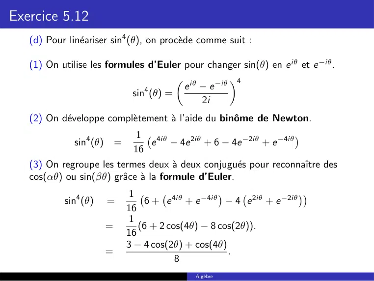

~~~text
Exercice 5.12
   (d) Pour linéariser sin4 (θ), on procède comme suit :

   (1) On utilise les formules d’Euler pour changer sin(θ) en e iθ et e −iθ .
                                                 4
                                       e − e −iθ
                                      iθ
                              4
                           sin (θ) =
                                          2i
   (2) On développe complètement à l’aide du binôme de Newton.
                            1
              sin4 (θ)           e 4iθ − 4e 2iθ + 6 − 4e −2iθ + e −4iθ
                                                                       
                             =
                           16
   (3) On regroupe les termes deux à deux conjugués pour reconnaı̂tre des
   cos(αθ) ou sin(βθ) grâce à la formule d’Euler.
                                  1
           sin4 (θ)                  6 + e 4iθ + e −4iθ − 4 e 2iθ + e −2iθ
                                                                          
                         =
                                 16
                                  1
                         =          (6 + 2 cos(4θ) − 8 cos(2θ)).
                                 16
                                 3 − 4 cos(2θ) + cos(4θ)
                         =                               .
                                             8
                                                 Algèbre
~~~

## Page 50

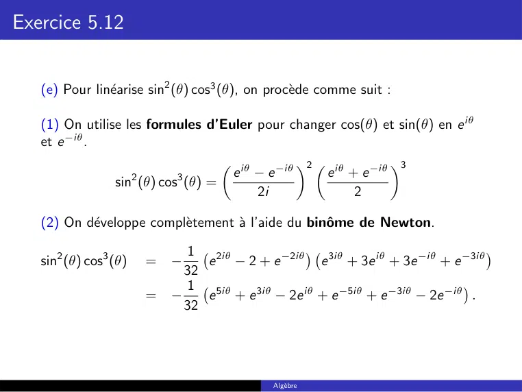

~~~text
Exercice 5.12

   (e) Pour linéarise sin2 (θ) cos3 (θ), on procède comme suit :

   (1) On utilise les formules d’Euler pour changer cos(θ) et sin(θ) en e iθ
   et e −iθ .
                                             2  iθ        3
                                   e − e −iθ     e + e −iθ
                                   iθ
                   2       3
                sin (θ) cos (θ) =
                                       2i             2

   (2) On développe complètement à l’aide du binôme de Newton.

                              1
   sin2 (θ) cos3 (θ)            e 2iθ − 2 + e −2iθ e 3iθ + 3e iθ + 3e −iθ + e −3iθ
                                                                                  
                       =   −
                             32
                              1
                                e 5iθ + e 3iθ − 2e iθ + e −5iθ + e −3iθ − 2e −iθ .
                                                                                
                       =   −
                             32

                                             Algèbre
~~~

## Page 51

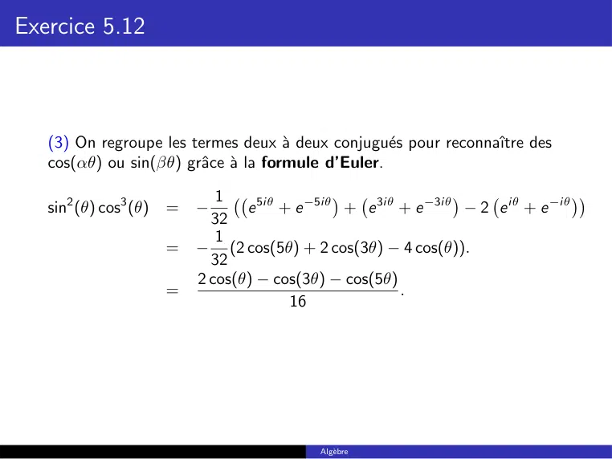

~~~text
Exercice 5.12

   (3) On regroupe les termes deux à deux conjugués pour reconnaı̂tre des
   cos(αθ) ou sin(βθ) grâce à la formule d’Euler.

                        1
   sin2 (θ) cos3 (θ) = −    e 5iθ + e −5iθ + e 3iθ + e −3iθ − 2 e iθ + e −iθ
                                                                           
                       32
                        1
                   = − (2 cos(5θ) + 2 cos(3θ) − 4 cos(θ)).
                       32
                     2 cos(θ) − cos(3θ) − cos(5θ)
                   =                               .
                                   16

                                         Algèbre
~~~

## Page 52

~~~text
Exercice 5.13

   Soit θ ∈ R.
   (1) Exprimer sin(5θ) en fonction de sin(θ).
   (2) En déduire la valeur exacte de sin π5 .
                                             

   Solution :

   (1) D’après l’Exercice 5.11(e), nous avons :

       sin(5θ) =   5 cos4 (θ) sin(θ) − 10 cos2 (θ) sin3 (θ) + sin5 (θ)
                                   2
                 = 5 1 − sin2 (θ) sin(θ) − 10 1 − sin2 (θ) sin3 (θ) + sin5 (θ)
                                                                

                 = 5 1 − 2 sin2 (θ) + sin4 (θ) sin(θ) − 10 sin3 (θ) + 11 sin5 (θ)
                                               

                 =   16 sin5 (θ) − 20 sin3 (θ) + 5 sin(θ).

                                           Algèbre
~~~

## Page 53

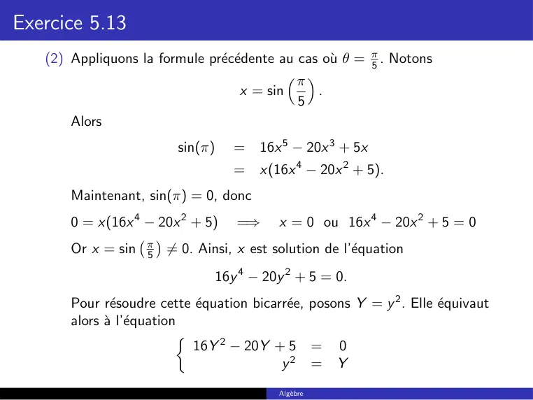

~~~text
Exercice 5.13
   (2) Appliquons la formule précédente au cas où θ = π5 . Notons
                                            π
                                    x = sin     .
                                             5
       Alors
                         sin(π)    = 16x 5 − 20x 3 + 5x
                                   = x(16x 4 − 20x 2 + 5).
       Maintenant, sin(π) = 0, donc
       0 = x(16x 4 − 20x 2 + 5) =⇒ x = 0 ou 16x 4 − 20x 2 + 5 = 0
       Or x = sin π5 6= 0. Ainsi, x est solution de l’équation
                    

                                16y 4 − 20y 2 + 5 = 0.
       Pour résoudre cette équation bicarrée, posons Y = y 2 . Elle équivaut
       alors à l’équation
                             16Y 2 − 20Y + 5 = 0
                           
                                           y2 = Y
                                           Algèbre
~~~

## Page 54

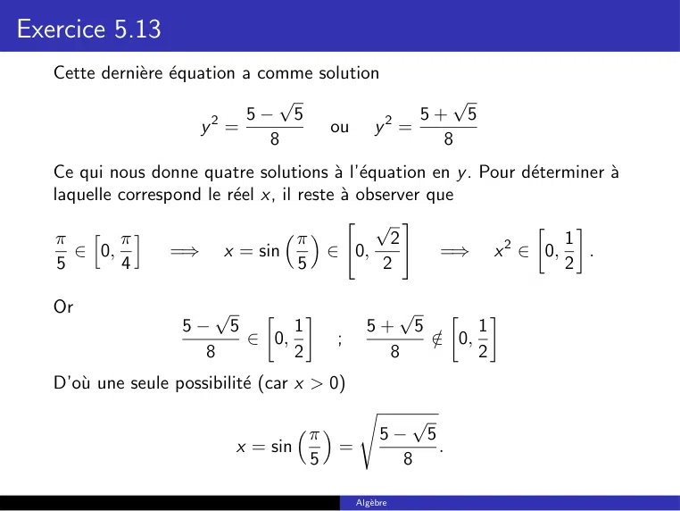

~~~text
Exercice 5.13
   Cette dernière équation a comme solution
                                  √                √
                         2   5− 5             2 5+ 5
                       y =            ou y =
                                 8                8
   Ce qui nous donne quatre solutions à l’équation en y . Pour déterminer à
   laquelle correspond le réel x, il reste à observer que
                                             " √ #                      
    π h πi                         π             2           2       1
      ∈ 0,         =⇒ x = sin             ∈ 0,           =⇒ x ∈ 0,         .
    5       4                         5           2                    2

   Or                  √                          √       
                    5− 5      1                  5+ 5      1
                         ∈ 0,              ;          ∈
                                                      / 0,
                      8       2                    8       2
   D’où une seule possibilité (car x > 0)
                                               s        √
                                     π             5− 5
                           x = sin         =              .
                                      5                8

                                               Algèbre
~~~

## Page 55

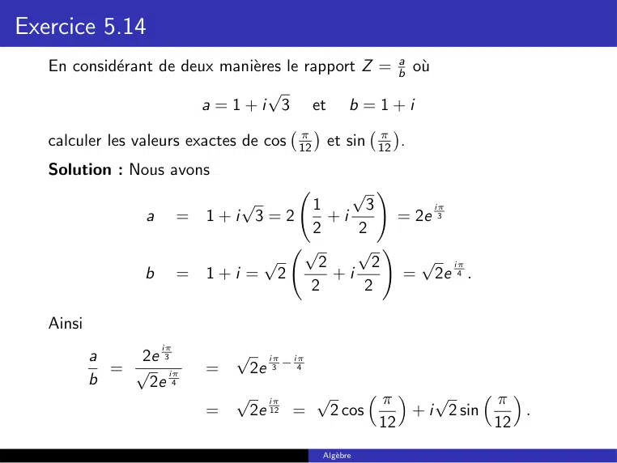

~~~text
Exercice 5.14
   En considérant de deux manières le rapport Z = ba où
                                   √
                          a = 1 + i 3 et b = 1 + i
                                        π          π
                                                     
   calculer les valeurs exactes de cos 12   et sin 12   .
   Solution : Nous avons
                                           √ !
                                 √   1       3       iπ
                 a        = 1+i 3=2     +i      = 2e 3
                                     2      2
                                    √      √ !
                                 √    2       2    √ iπ
                 b        = 1+i = 2     +i      = 2e 4 .
                                     2       2

   Ainsi
                     iπ
           a    2e 3             √     iπ   iπ
             = √ iπ          =       2e 3 − 4
           b     2e 4
                                 √     iπ        √           π   √      π
                             =       2e 12 =         2 cos      + i 2 sin     .
                                                             12            12
                                                 Algèbre
~~~

## Page 56

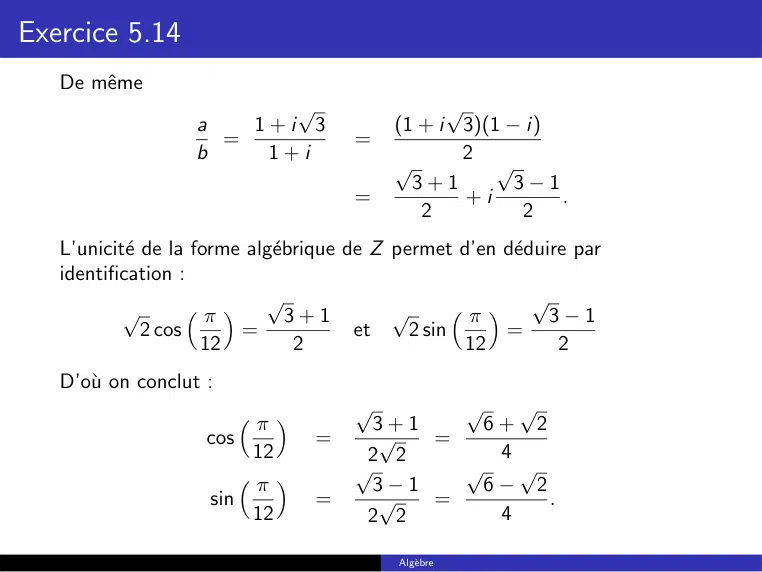

~~~text
Exercice 5.14
   De même
                          √                     √
                   a   1+i 3              (1 + i 3)(1 − i)
                     =               =
                   b    1+i                      2
                                          √          √
                                            3+1        3−1
                                     =            +i       .
                                             2          2
   L’unicité de la forme algébrique de Z permet d’en déduire par
   identification :
           √         π  √3 + 1           √        π  √3 − 1
              2 cos      =             et    2 sin      =
                     12         2                   12        2
   D’où on conclut :
                          π        √       √    √
                                       3+1     6+ 2
                    cos          =     √   =
                           12         2 2       4
                                     √       √    √
                          π          3−1     6− 2
                    sin          =     √   =        .
                          12          2 2       4

                                           Algèbre
~~~

## Page 57

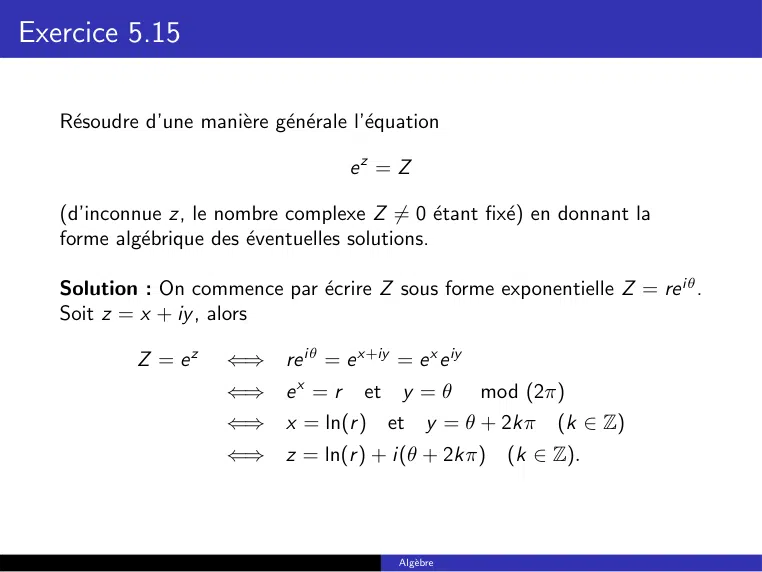

~~~text
Exercice 5.15

   Résoudre d’une manière générale l’équation

                                       ez = Z

   (d’inconnue z, le nombre complexe Z 6= 0 étant fixé) en donnant la
   forme algébrique des éventuelles solutions.

   Solution : On commence par écrire Z sous forme exponentielle Z = re iθ .
   Soit z = x + iy , alors

            Z = ez     ⇐⇒     re iθ = e x+iy = e x e iy
                       ⇐⇒     ex = r     et    y =θ       mod (2π)
                       ⇐⇒     x = ln(r )      et     y = θ + 2kπ   (k ∈ Z)
                       ⇐⇒     z = ln(r ) + i(θ + 2kπ)        (k ∈ Z).

                                               Algèbre
~~~

## Page 58

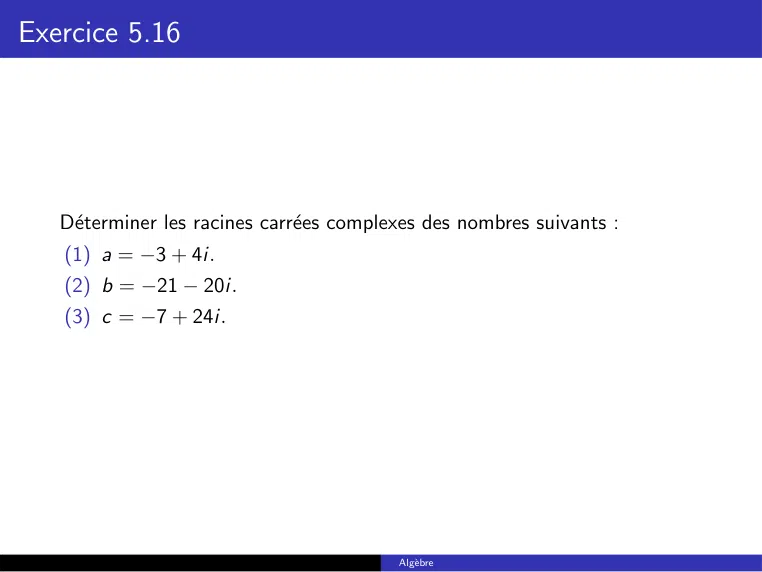

~~~text
Exercice 5.16

   Déterminer les racines carrées complexes des nombres suivants :
   (1) a = −3 + 4i.
   (2) b = −21 − 20i.
   (3) c = −7 + 24i.

                                          Algèbre
~~~

## Page 59

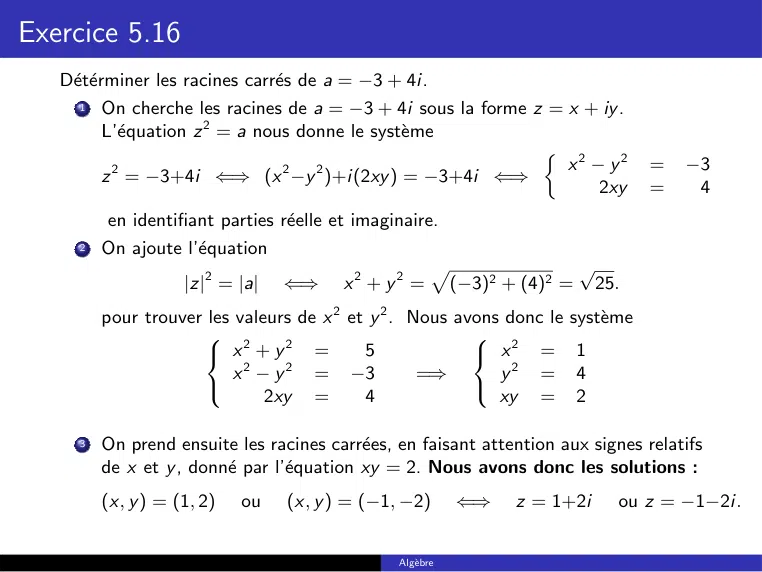

~~~text
Exercice 5.16
   Détérminer les racines carrés de a = −3 + 4i.
     1    On cherche les racines de a = −3 + 4i sous la forme z = x + iy .
          L’équation z 2 = a nous donne le système
                                                                2
                                                                  x − y2         =   −3
          z 2 = −3+4i ⇐⇒ (x 2 −y 2 )+i(2xy ) = −3+4i ⇐⇒
                                                                     2xy         =    4
         en identifiant parties réelle et imaginaire.
     2   On ajoute l’équation
                                                     p     √
                   |z|2 = |a| ⇐⇒ x 2 + y 2 = (−3)2 + (4)2 = 25.
         pour trouver les valeurs de x 2 et y 2 . Nous avons donc le système
                      2          2
                                                          2
                      x +y         =      5              x     = 1
                          x 2 − y 2 = −3           =⇒       y2 = 4
                               2xy =       4                xy = 2
                                                        

     3   On prend ensuite les racines carrées, en faisant attention aux signes relatifs
         de x et y , donné par l’équation xy = 2. Nous avons donc les solutions :
         (x, y ) = (1, 2)   ou   (x, y ) = (−1, −2)        ⇐⇒   z = 1+2i    ou z = −1−2i.

                                                Algèbre
~~~

## Page 60

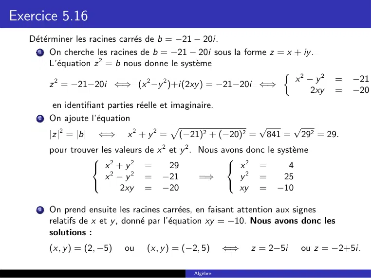

~~~text
Exercice 5.16
   Détérminer les racines carrés de b = −21 − 20i.
     1    On cherche les racines de b = −21 − 20i sous la forme z = x + iy .
          L’équation z 2 = b nous donne le système
                                                                    2
                                                                      x − y2      =   −21
          z 2 = −21−20i ⇐⇒ (x 2 −y 2 )+i(2xy ) = −21−20i ⇐⇒
                                                                          2xy     =   −20
          en identifiant parties réelle et imaginaire.
     2   On ajoute l’équation
                                            p           √ √
         |z|2 = |b| ⇐⇒ x 2 + y 2 = (−21)2 + (−20)2 = 841 = 292 = 29.
         pour trouver les valeurs de x 2 et y 2 . Nous avons donc le système
                    2        2
                                                         2
                    x +y         =      29              x     =       4
                         2    2
                       x −y       = −21           =⇒       y2 =        25
                           2xy = −20                       xy = −10
                                                       

     3   On prend ensuite les racines carrées, en faisant attention aux signes
         relatifs de x et y , donné par l’équation xy = −10. Nous avons donc les
         solutions :
         (x, y ) = (2, −5)   ou   (x, y ) = (−2, 5)       ⇐⇒   z = 2−5i    ou z = −2+5i.

                                               Algèbre
~~~

## Page 61

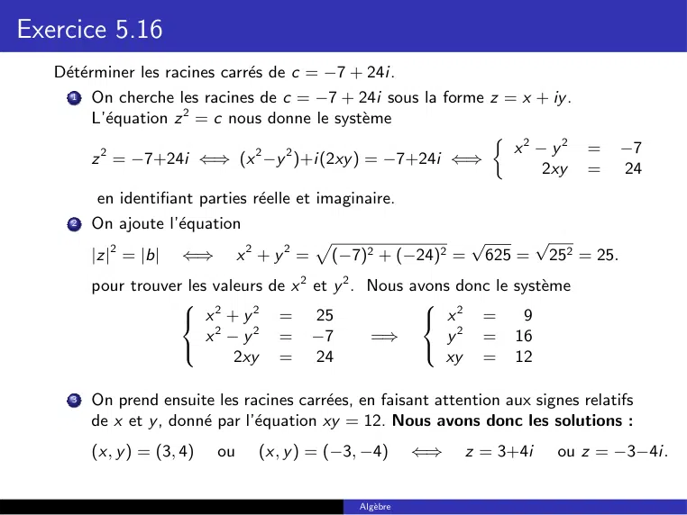

~~~text
Exercice 5.16
   Détérminer les racines carrés de c = −7 + 24i.
     1    On cherche les racines de c = −7 + 24i sous la forme z = x + iy .
          L’équation z 2 = c nous donne le système
                                                                2
                                                                  x − y2 =            −7
          z 2 = −7+24i ⇐⇒ (x 2 −y 2 )+i(2xy ) = −7+24i ⇐⇒
                                                                     2xy =            24
          en identifiant parties réelle et imaginaire.
     2   On ajoute l’équation
                                            p           √ √
         |z|2 = |b| ⇐⇒ x 2 + y 2 = (−7)2 + (−24)2 = 625 = 252 = 25.
         pour trouver les valeurs de x 2 et y 2 . Nous avons donc le système
                      2         2
                                                         2
                      x +y        = 25                  x     =     9
                         x 2 − y 2 = −7           =⇒        y 2 = 16
                              2xy = 24                     xy = 12
                                                       

     3   On prend ensuite les racines carrées, en faisant attention aux signes relatifs
         de x et y , donné par l’équation xy = 12. Nous avons donc les solutions :
         (x, y ) = (3, 4)   ou   (x, y ) = (−3, −4)        ⇐⇒   z = 3+4i    ou z = −3−4i.

                                                Algèbre
~~~

## Page 62

~~~text
Exercice 5.17
   Calculer les racines carrées des nombres complexes suivants :

   (a) z = −13.
   Solution :                                    √               √
                      w 2 = −13     ⇐⇒     w =       13i ou w = − 13i

   (b) z = −3 − 4i.
   Solution : Soit w = x + iy , alors
                                                                   2
                                                                    x + y2
                                              p
                            x2 + y2 =          (−3)2 + (−4)2                  =    5
    2
   w = −3 − 4i ⇐⇒                2
                                x −y   2 = −3                   ⇐⇒   x2 − y2   =   −3
                                    2xy = −4                              xy   =   −2
                                                                  
                            2
                            x        =    1
                    ⇐⇒          y2 =       4
                                xy = −2
                           
                                                
                                x =      1          x = −1
                    ⇐⇒                       ou
                                y = −2              y =       2
   Donc
                             w = 1 − 2i     ou    w = −1 + 2i.

                                                 Algèbre
~~~

## Page 63

~~~text
Exercice 5.17
   (c) z = −3 + 4i.
   Solution : Soit w = x + iy , alors
                                                   p
                                   x2 + y2 =         (−3)2 + (−4)2
           2                            2     2
         w = −3 + 4i ⇐⇒               x −y      = −3
                                           2xy = 4
                                  
                                   2
                                   x + y2 =         5
                         ⇐⇒           x 2 − y 2 = −3
                                            xy =     2
                                  
                                   2
                                   x       = 1
                         ⇐⇒           y2 = 4
                                      xy = 2
                                  
                                                    
                                     x = 1              x = −1
                         ⇐⇒                      ou
                                     y = 2              y = −2

   Donc
                      w = 1 + 2i    ou     w = −1 − 2i.

                                         Algèbre
~~~

## Page 64

~~~text
Exercice 5.17

                √
   (d) z = 1 + i 3.
   Solution : Nous avons
                                          √ 
                        √
                                      
                                     1      3
                  z =1+i 3    =   2    +i
                                     2     2
                                       π           π         π
                              =   2 cos      + i sin        = 2e i 3 .
                                         3             3
   Par conséquent
             π                   √ iπ              √ π
   w 2 = 2e i 3      ⇐⇒      w=   2e 6 ou w = − 2e i 6
                                       √                      √
                                 √                         √
                                                                       
                                         3    1                   3    1
                     ⇐⇒      w= 2          +i     ou w = − 2        +i
                                        2     2                  2     2
                                 √                     √
                                   3      1              3   1
                     ⇐⇒      w = √ +i√        ou w = − √ − i √ .
                                   2       2             2    2

                                           Algèbre
~~~

## Page 65

~~~text
Exercice 5.17
   (e) z = 5 − 12i.
   Solution : Soit w = x + iy
                                              p
                                 x2 + y2 =      (5)2 + (−12)2
          w 2 = 5 − 12i   ⇐⇒        2
                                  x −y  2
                                          = 5
                                      2xy = −12
                                
                                 2
                                 x + y 2 = 13
                          ⇐⇒      x2 − y2 =      5
                                       xy = −6
                                
                                 2
                                 x    =    9
                          ⇐⇒      y2 =      4
                                  xy = −6
                                
                                                  
                                  x =     3          x = −3
                          ⇐⇒                  ou
                                  y = −2             y =       2

   Donc
                      w = 3 − 2i   ou     w = −3 + 2i.

                                        Algèbre
~~~

## Page 66

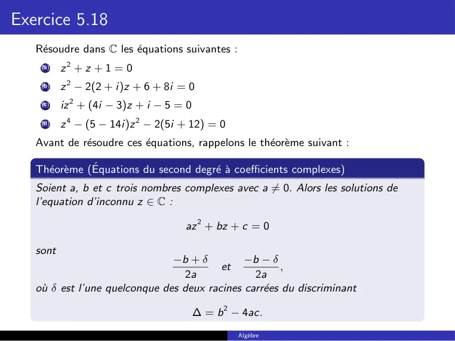

~~~text
Exercice 5.18
   Résoudre dans C les équations suivantes :
    (a)   z2 + z + 1 = 0
    (b)   z 2 − 2(2 + i)z + 6 + 8i = 0
    (c)   iz 2 + (4i − 3)z + i − 5 = 0
    (d)   z 4 − (5 − 14i)z 2 − 2(5i + 12) = 0
   Avant de résoudre ces équations, rappelons le théorème suivant :

   Théorème (Équations du second degré à coefficients complexes)
   Soient a, b et c trois nombres complexes avec a 6= 0. Alors les solutions de
   l’equation d’inconnu z ∈ C :

                                    az 2 + bz + c = 0

   sont
                                −b + δ         −b − δ
                                          et            ,
                                  2a             2a
   où δ est l’une quelconque des deux racines carrées du discriminant

                                         ∆ = b 2 − 4ac.
                                                  Algèbre
~~~

## Page 67

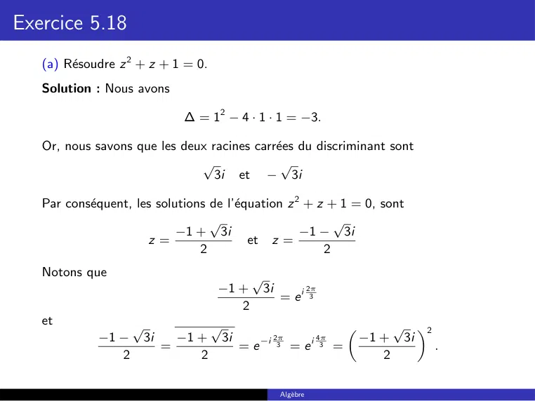

~~~text
Exercice 5.18
   (a) Résoudre z 2 + z + 1 = 0.
   Solution : Nous avons

                              ∆ = 12 − 4 · 1 · 1 = −3.

   Or, nous savons que les deux racines carrées du discriminant sont
                              √              √
                                 3i et − 3i

   Par conséquent, les solutions de l’équation z 2 + z + 1 = 0, sont
                                  √                       √
                            −1 + 3i                 −1 − 3i
                      z=                  et z =
                                2                       2
   Notons que                                √
                                      −1 +       3i               2π
                                                       = ei 3
                                         2
   et               √                √                                            √ 2
             −1 −    3i       −1 +    3i              2π           4π       −1 +    3i
                          =                = e −i 3 = e i 3 =                             .
                2                2                                             2

                                                       Algèbre
~~~

## Page 68

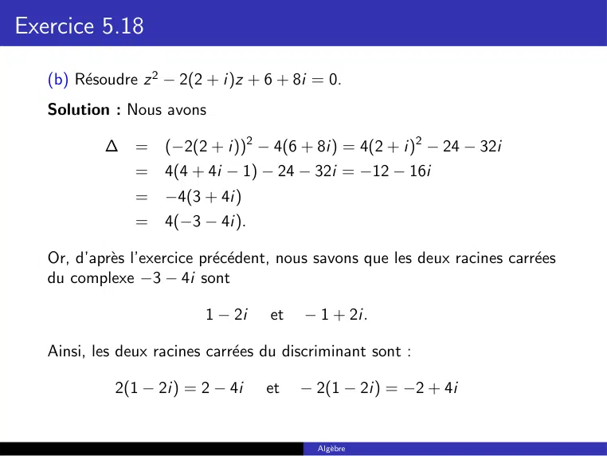

~~~text
Exercice 5.18

   (b) Résoudre z 2 − 2(2 + i)z + 6 + 8i = 0.
   Solution : Nous avons

           ∆ =       (−2(2 + i))2 − 4(6 + 8i) = 4(2 + i)2 − 24 − 32i
                =    4(4 + 4i − 1) − 24 − 32i = −12 − 16i
                =    −4(3 + 4i)
                =    4(−3 − 4i).

   Or, d’après l’exercice précédent, nous savons que les deux racines carrées
   du complexe −3 − 4i sont

                           1 − 2i    et   − 1 + 2i.

   Ainsi, les deux racines carrées du discriminant sont :

             2(1 − 2i) = 2 − 4i     et    − 2(1 − 2i) = −2 + 4i

                                            Algèbre
~~~

## Page 69

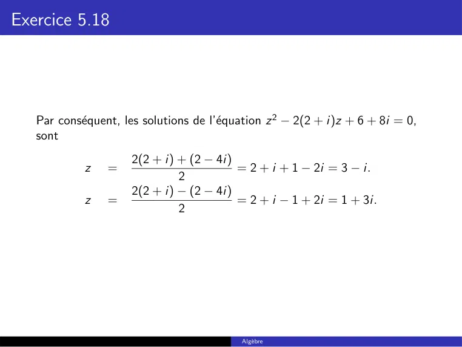

~~~text
Exercice 5.18

   Par conséquent, les solutions de l’équation z 2 − 2(2 + i)z + 6 + 8i = 0,
   sont
                     2(2 + i) + (2 − 4i)
            z    =                       = 2 + i + 1 − 2i = 3 − i.
                              2
                     2(2 + i) − (2 − 4i)
            z    =                       = 2 + i − 1 + 2i = 1 + 3i.
                              2

                                           Algèbre
~~~

## Page 70

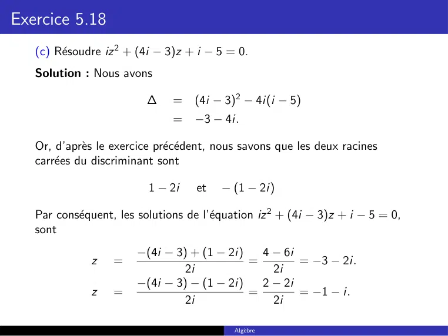

~~~text
Exercice 5.18
   (c) Résoudre iz 2 + (4i − 3)z + i − 5 = 0.
   Solution : Nous avons

                         ∆     = (4i − 3)2 − 4i(i − 5)
                               = −3 − 4i.

   Or, d’après le exercice précédent, nous savons que les deux racines
   carrées du discriminant sont

                          1 − 2i    et   − (1 − 2i)

   Par conséquent, les solutions de l’équation iz 2 + (4i − 3)z + i − 5 = 0,
   sont
                       −(4i − 3) + (1 − 2i)   4 − 6i
              z    =                        =        = −3 − 2i.
                               2i               2i
                       −(4i − 3) − (1 − 2i)   2 − 2i
              z    =                        =        = −1 − i.
                               2i               2i

                                           Algèbre
~~~

## Page 71

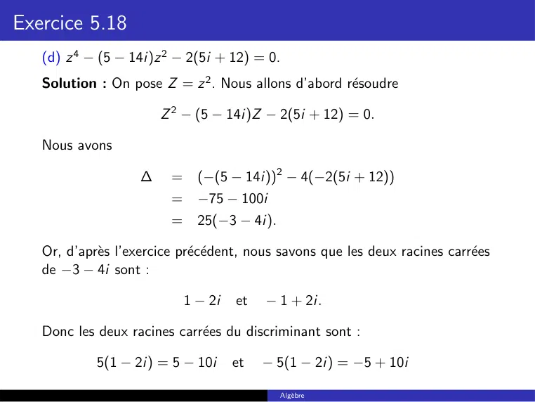

~~~text
Exercice 5.18
   (d) z 4 − (5 − 14i)z 2 − 2(5i + 12) = 0.
   Solution : On pose Z = z 2 . Nous allons d’abord résoudre

                        Z 2 − (5 − 14i)Z − 2(5i + 12) = 0.

   Nous avons

                    ∆    = (−(5 − 14i))2 − 4(−2(5i + 12))
                         = −75 − 100i
                         = 25(−3 − 4i).

   Or, d’après l’exercice précédent, nous savons que les deux racines carrées
   de −3 − 4i sont :

                           1 − 2i   et   − 1 + 2i.

   Donc les deux racines carrées du discriminant sont :

            5(1 − 2i) = 5 − 10i     et   − 5(1 − 2i) = −5 + 10i

                                            Algèbre
~~~

## Page 72

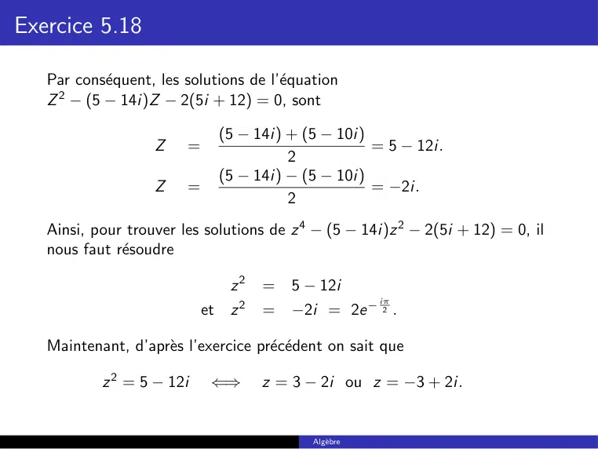

~~~text
Exercice 5.18

   Par conséquent, les solutions de l’équation
   Z 2 − (5 − 14i)Z − 2(5i + 12) = 0, sont

                                 (5 − 14i) + (5 − 10i)
                   Z    =                              = 5 − 12i.
                                           2
                                 (5 − 14i) − (5 − 10i)
                   Z    =                              = −2i.
                                           2
   Ainsi, pour trouver les solutions de z 4 − (5 − 14i)z 2 − 2(5i + 12) = 0, il
   nous faut résoudre

                                  z2   =   5 − 12i
                                                         iπ
                            et    z2   = −2i = 2e − 2 .

   Maintenant, d’après l’exercice précédent on sait que

           z 2 = 5 − 12i     ⇐⇒        z = 3 − 2i ou z = −3 + 2i.

                                              Algèbre
~~~

## Page 73

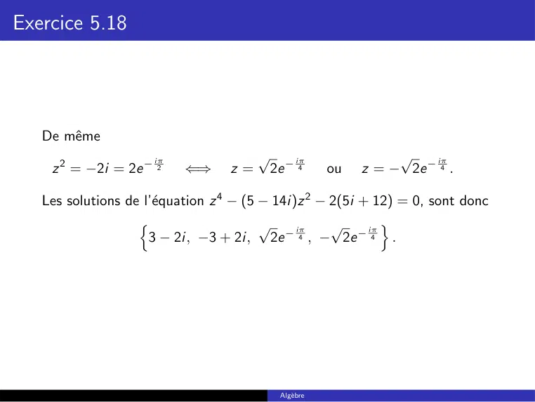

~~~text
Exercice 5.18

   De même
                     iπ                √         iπ              √    iπ
    z 2 = −2i = 2e − 2     ⇐⇒     z=       2e − 4      ou   z = − 2e − 4 .

   Les solutions de l’équation z 4 − (5 − 14i)z 2 − 2(5i + 12) = 0, sont donc
                   n                     √     iπ    √     iπ
                                                              o
                     3 − 2i, −3 + 2i, 2e − 4 , − 2e − 4 .

                                            Algèbre
~~~

## Page 74

~~~text
Exercice 5.19
                  i2π
   On note α = e 5 . On pose A = α + α4 et B = α2 + α3 .
   (1) Justifier que A et B sont les solutions de l’équation

                                 (E ) : x 2 + x − 1 = 0.

   Solution : Nous avons
                                             2
                   A2 + A − 1     =     α + α4 + (α + α4 ) − 1

                                  =    α2 + 2α5 + α8 + α + α4 − 1.

   Mais α5 = 1, donc

                   A2 + A − 1     =    α2 + 2α5 + α8 + α + α4 − 1
                                  =    α2 + 2 + α3 + α + α4 − 1
                                  =    α4 + α3 + α2 + α + 1 = 0.

   Ainsi A est solution de x 2 + x − 1 = 0. Le même raissonement nous permet de
   conclure que B est solution de l’equation.

                                              Algèbre
~~~

## Page 75

~~~text
Exercice 5.19
                                                  2π
                                                       
   (2) Déterminer A en fonction de cos            5       .
   Solution : Nous avons
                                  2iπ       8iπ
               α + α4    =    e 5 +e 5
                                  2iπ       10iπ           2iπ
                         =    e 5 + e 5 e− 5
                                  2iπ                                       −2iπ
                                                    − 2iπ           2iπ
                         =    e    5    + e 2iπ e      5         = e 5 +e    5

   et
                                  4iπ       6iπ
               α2 + α3    =   e 5 +e 5
                                  4iπ       10iπ           4iπ
                          =   e 5 + e 5 e− 5
                                  2iπ                                       −4iπ
                                                    − 4iπ           4iπ
                          =   e    5    + e 2iπ e      5         = e 5 +e    5     .

   La formule d’Euler nous permet donc de conclure
                                                       
                            4     2iπ    −2iπ          2π
                A=α+α =e +e        5       5  = 2 cos     .
                                                        5

   Ainsi, 2 cos 2π
                   
                 5   est solution de x 2 + x − 1 = 0.
                                                   Algèbre
~~~

## Page 76

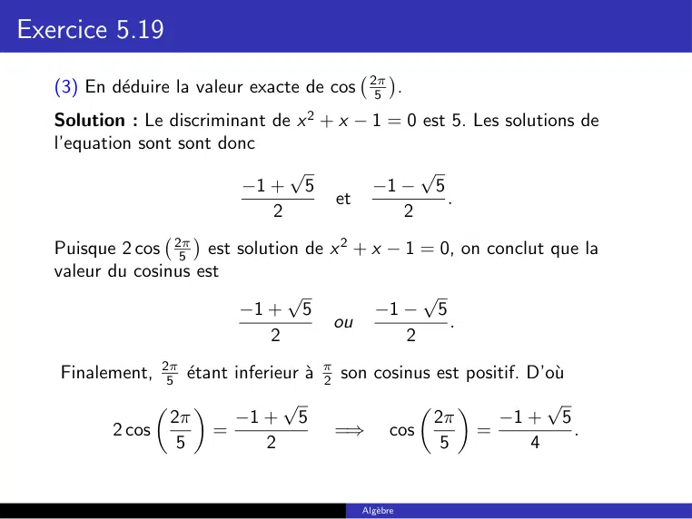

~~~text
Exercice 5.19
                                                     2π
                                                          
   (3) En déduire la valeur exacte de cos            5       .
                                            2
   Solution : Le discriminant de x + x − 1 = 0 est 5. Les solutions de
   l’equation sont sont donc
                                  √                √
                            −1 + 5           −1 − 5
                                        et            .
                                2                2
   Puisque 2 cos 2π
                     
                   5   est solution de x 2 + x − 1 = 0, on conclut que la
   valeur du cosinus est
                                  √                √
                           −1 + 5            −1 − 5
                                       ou             .
                               2                 2
   Finalement, 2π                     π
                5 étant inferieur à 2 son cosinus est positif. D’où
                                      √                                             √
                      2π         −1 +       5                         2π         −1 +       5
          2 cos                =                =⇒        cos                  =                .
                       5            2                                  5            4

                                                 Algèbre
~~~

## Page 77

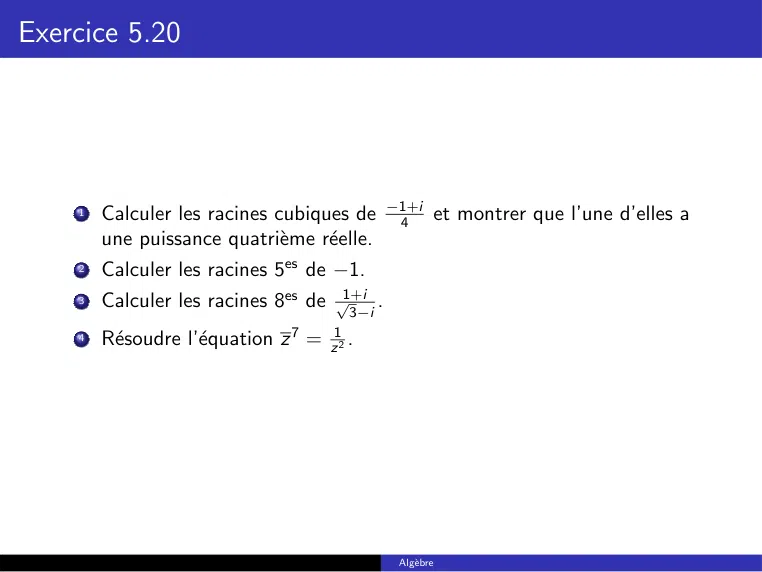

~~~text
Exercice 5.20

    1   Calculer les racines cubiques de −1+i
                                          4   et montrer que l’une d’elles a
        une puissance quatrième réelle.
    2   Calculer les racines 5es de −1.
    3   Calculer les racines 8es de √1+i
                                      3−i
                                          .
    4   Résoudre l’équation z 7 = z12 .

                                              Algèbre
~~~

## Page 78

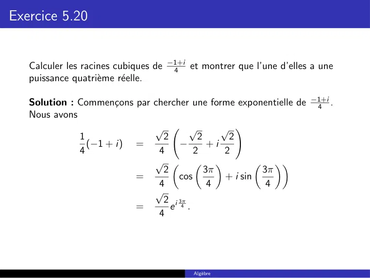

~~~text
Exercice 5.20

   Calculer les racines cubiques de −1+i
                                     4   et montrer que l’une d’elles a une
   puissance quatrième réelle.

   Solution : Commençons par chercher une forme exponentielle de −1+i
                                                                   4 .
   Nous avons
                              √        √       √ !
              1                 2        2       2
                (−1 + i) =          −       +i
              4                4        2       2
                              √                       
                                2          3π            3π
                          =         cos         + i sin
                               4            4             4
                              √
                                2 i 3π
                          =       e 4.
                               4

                                         Algèbre
~~~

## Page 79

~~~text
Exercice 5.20

                                          √
                                           2 i 3π
   Soit ζ = re iθ une racine cubique de   4 e
                                                4 , alors

             √                            √
              2 i 3π                         2 i 3π
      ζ3 =     e 4     ⇐⇒    r 3 e 3iθ =      e 4
             4                        √     4
                                        2            3π
                       ⇐⇒    r3 =            et 3θ =    mod (2π)
                                    s4√               4
                                     3    2          π 2kπ
                       ⇐⇒    r=               et θ = +     , k = 0, 1, 2.
                                        4            4  3

   Maintenant,
         √                                                    s√
           2    1        1    1                               3    2   1
             =√     =√ √ √ =√ 3                          =⇒          =√ .
          4     2·2   2· 2· 2 2                                   4     2

                                              Algèbre
~~~

## Page 80

~~~text
Exercice 5.20

   Ainsi, les racines cubiques de −1+i
                                   4   sont

                             1 iπ
                 ζ0   =     √ e4
                              2
                             1 iπ + 2iπ 1 11iπ
                 ζ1   =     √ e 4 3 = √ e 12
                              2          2
                             1 iπ + 4iπ 1 19iπ  1 −5iπ
                 ζ2   =     √ e 4 3 = √ e 12 = √ e 12 .
                              2          2       2
   Pour finir, notons que
                                          4
                                    1 iπ            1 iπ  1
                       ζ04 =       √ e4         =     e =− .
                                     2              4     4

                                                Algèbre
~~~

## Page 81

~~~text
Exercice 5.20

   Calculer les racines 5es de −1.

   Solution : Commençons par chercher une forme exponentielle de −1.
   Nous avons
                                −1 = e iπ .
   Soit ζ = re iθ une racine cinquieme de −1, alors

         ζ 5 = e iπ        ⇐⇒   r 5 e 5iθ = e iπ
                           ⇐⇒   r5 = 1      et
                                          5θ = π mod (2π)
                                             π 2kπ
                           ⇐⇒   r = 1 et θ = +     , k = 0, 1, 2, 3, 4.
                                             5   5
   Ainsi, les racines 5es de −1 sont
                                iπ   2ikπ        i(1+2k)π
                      ζk   =    e5+ 5 =e             5      , k = 0, 1, 2, 3, 4.

                                                     Algèbre
~~~

## Page 82

~~~text
Exercice 5.20
   Calculer les racines 8es de √1+i
                                 3−i
                                     .

   Solution : Commençons par chercher une forme exponentielle de √1+i
                                                                    3−i
                                                                        . Nous
   avons
                       √  √2       √ 
                                       2    √
             1+i         2   2
                                + i   2       2·e 4
                                                     iπ
                                                           1 5iπ
            √      =       √            =              = √ e 12
                                                  − iπ
                                      
              3−i             3
                        2 2 −i2     1       2 · e    6      2
                                               5iπ
   Soit ζ = re iθ une racine cubique de √12 e 12 , alors
            1 5iπ                           1 5iπ
     ζ 8 = √ e 12      ⇐⇒      r 8 e 8iθ = √ e 12
             2                               2
                                 8       1            5π
                       ⇐⇒      r = √          et 8θ =      mod (2π)
                                          2           12
                                       1
                                         1 16           5π   2kπ
                       ⇐⇒      r=               et θ =     +     , k = 0, 1, · · · , 7.
                                         2              96    8
   Ainsi, les racines 8es de √1+i
                               3−i
                                   sont
                       1
                       1 16 5iπ  2ikπ  i(5+24k)π
            ζk   =         e 96 + 8 = e 96 , k = 0, 1, 2, 3, 4, 5, 6, 7.
                       2
                                                Algèbre
~~~

## Page 83

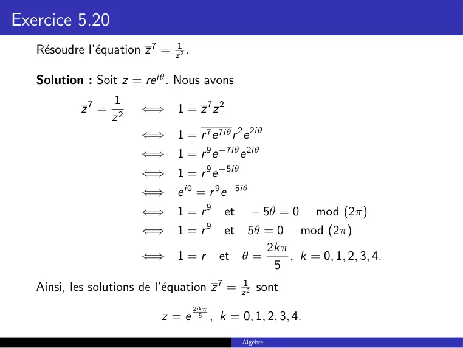

~~~text
Exercice 5.20
   Résoudre l’équation z 7 = z12 .

   Solution : Soit z = re iθ . Nous avons
                   1
            z7 =         ⇐⇒      1 = z 7z 2
                   z2
                         ⇐⇒      1 = r 7 e 7iθ r 2 e 2iθ
                         ⇐⇒      1 = r 9 e −7iθ e 2iθ
                         ⇐⇒      1 = r 9 e −5iθ
                         ⇐⇒      e i0 = r 9 e −5iθ
                         ⇐⇒      1 = r9        et      − 5θ = 0   mod (2π)
                         ⇐⇒      1 = r9        et    5θ = 0 mod (2π)
                                                        2kπ
                         ⇐⇒      1=r          et    θ=      , k = 0, 1, 2, 3, 4.
                                                         5
   Ainsi, les solutions de l’équation z 7 = z12 sont
                                       2ikπ
                             z = e 5 , k = 0, 1, 2, 3, 4.
                                                    Algèbre
~~~

## Page 84

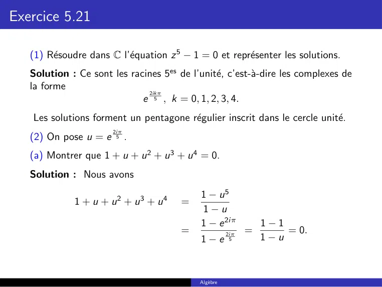

~~~text
Exercice 5.21

   (1) Résoudre dans C l’équation z 5 − 1 = 0 et représenter les solutions.
   Solution : Ce sont les racines 5es de l’unité, c’est-à-dire les complexes de
   la forme
                              2ikπ
                             e 5 , k = 0, 1, 2, 3, 4.
   Les solutions forment un pentagone régulier inscrit dans le cercle unité.
                       2iπ
   (2) On pose u = e 5 .
   (a) Montrer que 1 + u + u 2 + u 3 + u 4 = 0.
   Solution : Nous avons
                                            1 − u5
             1 + u + u2 + u3 + u4      =
                                            1−u
                                            1 − e 2iπ            1−1
                                       =               2iπ   =       = 0.
                                            1−e         5        1−u

                                            Algèbre
~~~

## Page 85

~~~text
Exercice 5.21
                                           2π                                  4π
                                                                                   
   (b) Vérifier que u + u 4 = 2 cos        5       et u 2 + u 3 = 2 cos        5       .
   Solution : Nous avons
                                    2iπ         8iπ
                u + u4        =    e 5 +e 5
                                    2iπ         10iπ        2iπ
                              =    e 5 + e 5 e− 5
                                    2iπ                    2iπ         2iπ     −2iπ
                              =    e 5 + e 2iπ e − 5                = e 5 +e    5

   et
                                    4iπ         6iπ
                u2 + u3       = e 5 +e 5
                                    4iπ         10iπ          4iπ
                              = e 5 + e 5 e− 5
                                    2iπ                                        −4iπ
                                                        − 4iπ          4iπ
                              = e    5    + e 2iπ e        5        = e 5 +e    5       .
   La formule d’Euler nous permet donc de conclure
                                                                       
                          4               2iπ            2π
                                                       −2iπ
                    u+u           = e +e   5    = 2 cos 5     ,
                                                          5
                                                         
                                     4iπ   −4iπ          4π
                  u2 + u3         = e 5 + e 5 = 2 cos         .
                                                          5
                                                       Algèbre
~~~

## Page 86

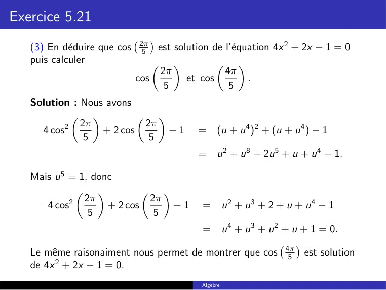

~~~text
Exercice 5.21
                             2π
                                   
   (3) En déduire que cos    5        est solution de l’équation 4x 2 + 2x − 1 = 0
   puis calculer                                                
                                       2π                     4π
                             cos                et cos                 .
                                        5                      5
   Solution : Nous avons
                         
          2   2π           2π
     4 cos        + 2 cos     −1                  = (u + u 4 )2 + (u + u 4 ) − 1
               5            5
                                                  = u 2 + u 8 + 2u 5 + u + u 4 − 1.

   Mais u 5 = 1, donc
                           
               2π            2π
      4 cos2        + 2 cos     −1                 = u2 + u3 + 2 + u + u4 − 1
                5             5
                                       = u 4 + u 3 + u 2 + u + 1 = 0.

   Le même raisonaiment nous permet de montrer que cos 4π
                                                            
                                                          5   est solution
   de 4x 2 + 2x − 1 = 0.
                                                   Algèbre
~~~

## Page 87

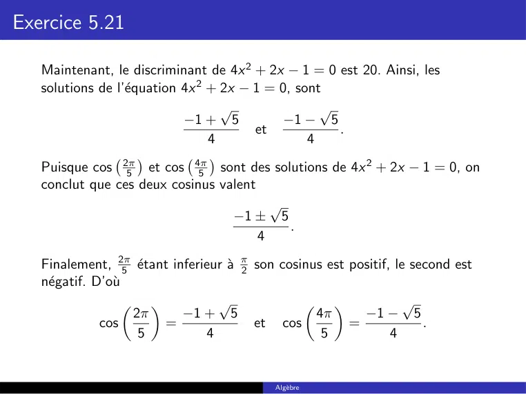

~~~text
Exercice 5.21

   Maintenant, le discriminant de 4x 2 + 2x − 1 = 0 est 20. Ainsi, les
   solutions de l’équation 4x 2 + 2x − 1 = 0, sont
                                   √                √
                             −1 + 5           −1 − 5
                                         et            .
                                 4                4
   Puisque cos 2π      et cos 4π
                                
                   5           5   sont des solutions de 4x 2 + 2x − 1 = 0, on
   conclut que ces deux cosinus valent
                                            √
                                     −1 ± 5
                                               .
                                         4
   Finalement, 2π                        π
                   5 étant inferieur à 2 son cosinus est positif, le second est
   négatif. D’où
                                  √                               √
                     2π       −1 + 5                 4π      −1 − 5
              cos         =                et cos          =             .
                      5           4                   5            4

                                             Algèbre
~~~
