# TD5-Complexes-Correction_2024-2025_Algebre1_P1S1_NArancibia.pdf

[Ouvrir l’original](https://drive.google.com/open?id=1imXbd5TgWLjQeWcRGyR-E4GcMuQ5i6xP) · Les pages signalées comprennent du texte reconnu automatiquement ou des éléments graphiques. Le fac-similé permet de vérifier chaque lecture.

**Pages avec fac-similé ou lecture OCR** — 17.

**Pages présentant un écart entre les deux extractions** — 1, 3, 9, 16, 23–24, 26–27, 29, 31–38.

## Page 1

~~~text
Algèbre-Premier semestre 2024 - 2025

                       CY Tech

                      TD Algèbre

                  Nombres complexes.

                             Algèbre
~~~

## Page 2

~~~text
Exercice 5.1

   Mettre sous forme algébrique les nombres suivants :
       3+6i
   (1) 3−4i .
        2
        1+i     3+6i
   (2) 2−i    + 3−4i .
   (3) 2+5i  2−5i
       1−i + 1+i .

                                         Algèbre
~~~

## Page 3

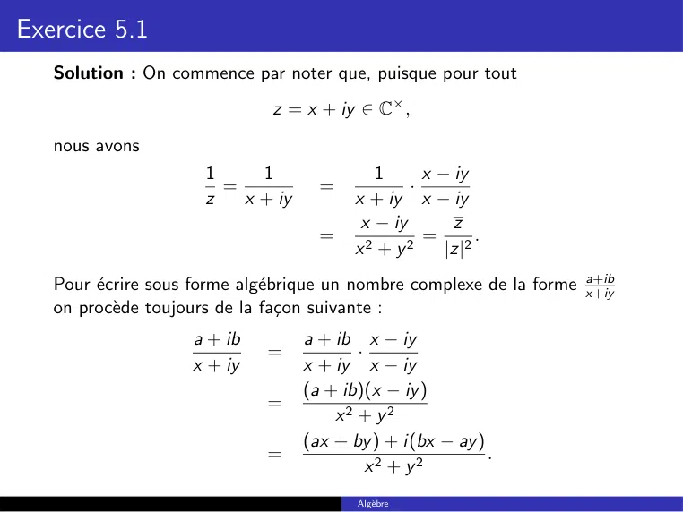

~~~text
Exercice 5.1
   Solution : On commence par noter que, puisque pour tout
                              z = x + iy ∈ C× ,
   nous avons
                      1     1                1      x − iy
                        =            =            ·
                      z   x + iy          x + iy x − iy
                                           x − iy       z
                                     =              = 2.
                                          x2 + y2      |z|
                                                                      a+ib
   Pour écrire sous forme algébrique un nombre complexe de la forme x+iy
   on procède toujours de la façon suivante :
                    a + ib         a + ib x − iy
                              =           ·
                    x + iy         x + iy x − iy
                                   (a + ib)(x − iy )
                              =
                                       x2 + y2
                                   (ax + by ) + i(bx − ay )
                              =                             .
                                            x2 + y2
                                          Algèbre
~~~

## Page 4

~~~text
Exercice 5.1
   (1) Nous avons :

                         3 + 6i            3 + 6i 3 + 4i
                                   =              ·
                         3 − 4i            3 − 4i 3 + 4i
                                           (3 + 6i) · (3 + 4i)
                                   =
                                                9 + 16
                                           −15 + 30i      −3 + i6
                                   =                    =         .
                                               25             5
   (2) Nous avons :
                         2
                                                      1 + 2i + i 2
               
                   1+i            3 + 6i                                3 + 6i
                              +               =                     +
                   2−i            3 − 4i              4 − 4i + i 2      3 − 4i
                                                        2i         3 + 6i
                                              =               +
                                                      3 − 4i       3 − 4i
                                                      3 + 8i
                                              =
                                                      3 − 4i

                                               Algèbre
~~~

## Page 5

~~~text
Exercice 5.1
   Ainsi
                    2
               1+i            3 + 6i       3 + 8i
                          +            =
               2−i            3 − 4i       3 − 4i
                                           3 + 8i 3 + 4i   (3 + 8i)(3 + 4i)
                                       =          ·      =
                                           3 − 4i 3 + 4i          25
                                           −23 + 36i
                                       =             .
                                               25
   (3) Nous avons :

                      2 + 5i   2 − 5i        2 + 5i      (2 + 5i)
                             +             =          +
                      1−i       1+i           1−i         (1 − i)
                                                                 
                                             2 + 5i        2 + 5i
                                           =          +
                                              1−i           1−i
                                                          
                                                    2 + 5i
                                           = 2Re             .
                                                    1−i

                                               Algèbre
~~~

## Page 6

~~~text
Exercice 5.1

   Or
                         2 + 5i        2 + 5i 1 + i
                                  =           ·
                         1−i            1−i 1+i
                                       (2 + 5i) · (1 + i)
                                  =
                                                2
                                       −3 + 7i
                                  =              .
                                          2
   Par conséquent
                                                                 
                     2 + 5i   2 − 5i                     2 + 5i
                            +            = 2Re
                     1−i       1+i                       1−i
                                                     −3
                                         = 2·           = −3.
                                                      2

                                          Algèbre
~~~

## Page 7

~~~text
Exercice 5.2

   On suppose θ ∈] − π; π]. Calculer le module et un argument des nombres
   complexes suivants.

   (1) z = ie iθ .
   (2) z = 1 + e iθ .
   (3) z = sin(θ) + i(1 + cos(θ)).

                                       Algèbre
~~~

## Page 8

~~~text
Exercice 5.2

   (1) z = ie iθ .
   Solution : Notons que

                         i   =    0+i
                             =    cos(π/2) + i sin(π/2)
                                      iπ
                             =    e2.

   Ce qui nous permet d’écrire
                                                   π
                              ie iθ        = e i 2 · e iθ
                                           = e i ( 2 +θ) .
                                                   π

   Donc
                                                            π
                        |z| = 1       et     arg(z) =         + θ.
                                                            2

                                                 Algèbre
~~~

## Page 9

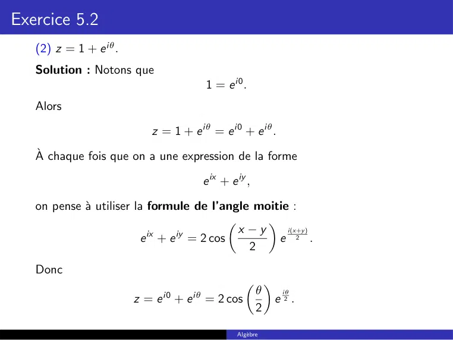

~~~text
Exercice 5.2
   (2) z = 1 + e iθ .
   Solution : Notons que
                                       1 = e i0 .
   Alors

                           z = 1 + e iθ = e i0 + e iθ .

   À chaque fois que on a une expression de la forme

                                      e ix + e iy ,

   on pense à utiliser la formule de l’angle moitie :
                                               
                           ix  iy          x −y     i(x+y )
                         e + e = 2 cos            e 2 .
                                             2
   Donc
                                                   
                                                   θ   iθ
                        z = e i0 + e iθ = 2 cos       e2.
                                                   2

                                               Algèbre
~~~

## Page 10

~~~text
Exercice 5.2

   Pour finir, on rappelle que
                                         θ i π πi
                    θ ∈ ]−π, π]   =⇒       ∈ − ,
                                         2       2 2
                                     π π
   et comme cosinus est positif sur − 2 , 2 , on conclut
                                  
                                   θ                   θ
                    |z| = 2 cos          et arg(z) = .
                                   2                   2

                                        Algèbre
~~~

## Page 11

~~~text
Exercice 5.2
   (3) z = sin(θ) + i(1 + cos(θ)).
   Solution : On commence par noter que
                 z   =    sin(θ) + i(1 + cos(θ))
                      =   i + (sin(θ) + i cos(θ))
                                  π                   π    
                      =   i + cos            − θ + i sin    −θ
                                         2                2
                            i π2      i ( π2 −θ )
                      =   e       + e
                            i π2
                                  1 + e −iθ
                                              
                      =   e
                              π
                          e i 2 e i0 + e −iθ .
                                                
                      =
   En utilisant la formule de l’angle moitie, on obtient
                                                           
              i π2       0 − (−θ)     i(0+(−θ))
                                                    i π2      θ      iθ
      z = e · 2 cos                 e     2     = e · 2 cos        e− 2
                             2                                2
                                                          
                                                          θ   i(π−θ)
                                                = 2 cos      e 2 .
                                                          2

                                           Algèbre
~~~

## Page 12

~~~text
Exercice 5.2

   Pour finir, on rappelle que
                                         θ i π πi
                    θ ∈ ]−π, π]   =⇒       ∈ − ,
                                         2       2 2
                                    π π
   et comme cosinus est positif sur − 2 , 2 , on conclut
                               
                                 θ                   π−θ
                  |z| = 2 cos        et arg(z) =         .
                                 2                     2

                                        Algèbre
~~~

## Page 13

~~~text
Exercice 5.3

   Calculer le module et l’argument principal des nombres complexes
   suivants
                    √ √
    (1) z = i(−1 + i 3)( 3 − i)
              √
   (2) z = −3 1+i
               3−3i

                                        Algèbre
~~~

## Page 14

~~~text
Exercice 5.3
                   √ √
   (1) z = i(−1 + i 3)( 3 − i).
   Solution : Nous avons
                                         √ √
                         z   =   i(−1 + i 3)( 3 − i)
                                       √ √
                             =   (−i − 3)( 3 − i)
                                   √             √
                             =   −i 3 − 1 − 3 + i 3
                             =   −4
                             =   4 · (−1).
   Finalement, puisque
                     −1      = −1 + i0
                             = cos(π) + i sin(π) = e iπ ,
   on conclut que
                                  −4 = 4e iπ .
   Donc
                    |z| = 4 et     arg(z) = π ∈ ] − π, π].

                                          Algèbre
~~~

## Page 15

~~~text
Exercice 5.3

              √
   (2) z = −3 1+i
               3−3i
                    .
   Solution : On commence par noter que
                                      √         !
                    √                     3   i
                        3+i   =   2         +
                                         2    2
                                     π                π 
                              =   2 cos         + i sin
                                            6             6
                                       π
                              =   2e i 6

   Ainsi
                           √                √
                         −3 3 − 3i     = −3( 3 + i)
                                                     π
                                       = −6e i 6 .

                                          Algèbre
~~~

## Page 16

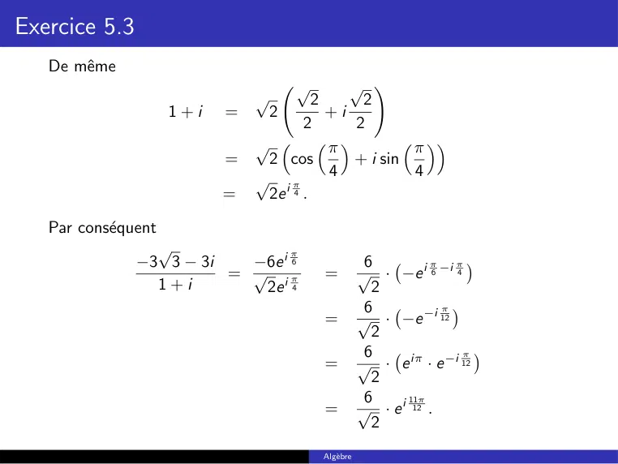

~~~text
Exercice 5.3
   De même
                                   √    √ !
                              √    2      2
                     1+i   =  2      +i
                                  2      2
                             √  π             π 
                           =  2 cos     + i sin
                             √ iπ    4            4
                           =  2e .
                                4

   Par conséquent
                 √               π
               −3 3 − 3i   −6e i 6                 6         π   π
                         = √ iπ        =          √ · −e i 6 −i 4
                 1+i        2e 4                    2
                                                   6           π 
                                       =          √ · −e −i 12
                                                    2
                                                   6               π 
                                       =          √ · e iπ · e −i 12
                                                    2
                                                   6     11π
                                       =          √ · e i 12 .
                                                    2
                                       Algèbre
~~~

## Page 17

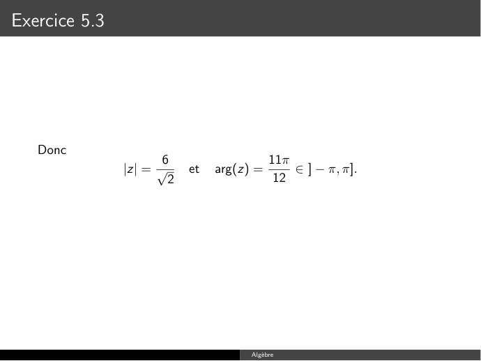

~~~text
Exercice 5.3

   Donc
                      6                     11π
               |z| = √     et   arg(z) =        ∈ ] − π, π].
                       2                     12

                                      Algèbre
~~~

**Lecture OCR à contrôler**

~~~text
Exercice

Donc
~~~

## Page 18

~~~text
Exercice 5.4

   Simplifier les nombres complexes
                      √         !1995                  √ !20
                          3−i                       1+i 3
                                        et                   .
                           2                         1−i

   Solution : Nous avons
                   √                √
                     3−i               3     1
                                =         −i
                      2               2  2
                                           π           π
                                =   cos        − i sin
                                         π6          6 π
                                =   cos        + i sin −
                                         6 π          6 π
                                =   cos −       + i sin −
                                             6             6
                                         π
                                =   e −i 6

                                             Algèbre
~~~

## Page 19

~~~text
Exercice 5.4

   Ainsi
               √         !1995
                   3−i                           π    1995
                                 =           e −i 6
                    2
                                                1995π
                                 = e −i           6
                                                665π
                                 = e −i 2
                                                              π
                                 = e −i166·2π−i 2
                                        π
                                 = e −i 2
                                 = −i.

                                  Algèbre
~~~

## Page 20

~~~text
Exercice 5.4
                           √ 20
                         1+i 3
   Pour simplifier        1−i
                                  on commence par noter que
                                                   √ 
                             √
                                          
                                              1      3
                          1+i 3      =   2      +i
                                              2     2
                                               π            π 
                                     =   2 cos        + i sin
                                                  3             3
                                              π
                                     =   2e i 3

   De même
                                      √       √ 
                                    √     2      2
                         1−i    =    2      −i
                                         2      2
                                    √     π           π 
                                =    2 cos      − i sin
                                            4           4 π 
                                    √     π
                                =    2 cos      + i sin −
                                    √     4 π           4 π 
                                =    2 cos −      + i sin −        .
                                              4               4
                                    √ −i π
                                =    2e 4

                                                Algèbre
~~~

## Page 21

~~~text
Exercice 5.4

   Donc
             √ !20         π 20                        20
                      2e i 3
                                             
          1+i 3                                    2                   π       π   20
                   = √ −i π             =         √             · e i 3 +i 4
           1−i        2e 4                          2
                                                   20        20
                                                 2           7π
                                        =       √      · e i 12
                                                  2
                                               √ 20 i 20·7π
                                        =     ( 2) · e 12
                                                          35π
                                        =     210 · e i 3
                                                          (36−1)π
                                        =     210 · e i      3
                                                                   π
                                        =     210 · e i12π−i 3
                                                                       π
                                        =     210 · e i12π · e −i 3
                                                                           π
                                        =     210 · e i6·2π · e −i 3
                                                            π
                                        =     210 · e −i 3

                                   Algèbre
~~~

## Page 22

~~~text
Exercice 5.5

   Montrer que
                                                 1
                             |z| = 1 ⇐⇒ z =
                                                 z
   Solution : Nous avons
                       √                                            1
       |z| = 1   ⇐⇒        z ·z =1   ⇐⇒          zz = 1   ⇐⇒   z=     .
                                                                    z

                                      Algèbre
~~~

## Page 23

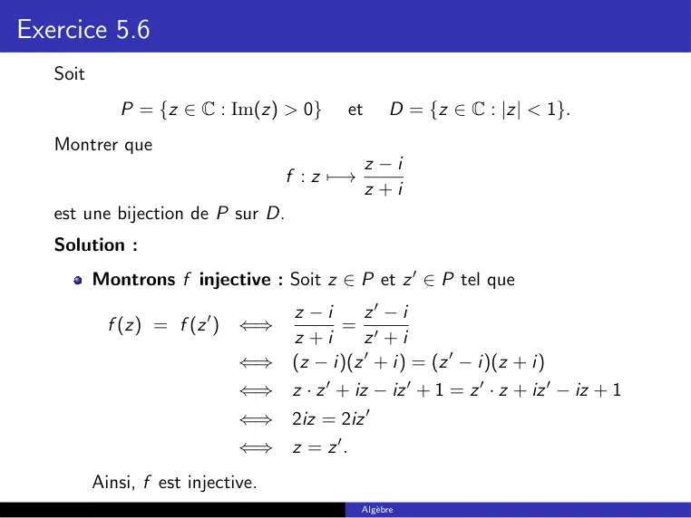

~~~text
Exercice 5.6
   Soit
             P = {z ∈ C : Im(z) > 0}        et        D = {z ∈ C : |z| < 1}.
   Montrer que
                                                 z −i
                                    f : z 7−→
                                                 z +i
   est une bijection de P sur D.
   Solution :
          Montrons f injective : Soit z ∈ P et z 0 ∈ P tel que
                                    z −i      z0 − i
            f (z) = f (z 0 ) ⇐⇒           = 0
                                    z +i      z +i
                              ⇐⇒    (z − i)(z 0 + i) = (z 0 − i)(z + i)
                              ⇐⇒    z · z 0 + iz − iz 0 + 1 = z 0 · z + iz 0 − iz + 1
                              ⇐⇒    2iz = 2iz 0
                              ⇐⇒    z = z 0.
          Ainsi, f est injective.
                                                Algèbre
~~~

## Page 24

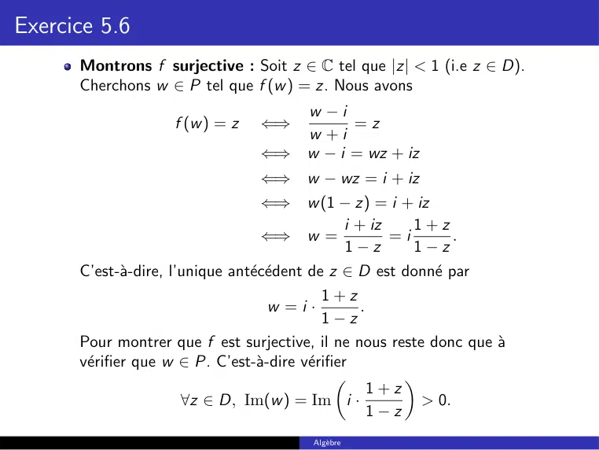

~~~text
Exercice 5.6
      Montrons f surjective : Soit z ∈ C tel que |z| < 1 (i.e z ∈ D).
      Cherchons w ∈ P tel que f (w ) = z. Nous avons
                                         w −i
                    f (w ) = z   ⇐⇒            =z
                                         w +i
                                 ⇐⇒      w − i = wz + iz
                                 ⇐⇒      w − wz = i + iz
                                 ⇐⇒        w (1 − z) = i + iz
                                                i + iz    1+z
                                   ⇐⇒ w =              =i       .
                                                1−z       1−z
      C’est-à-dire, l’unique antécédent de z ∈ D est donné par
                                             1+z
                                  w =i·            .
                                             1−z
      Pour montrer que f est surjective, il ne nous reste donc que à
      vérifier que w ∈ P. C’est-à-dire vérifier
                                                        
                                                     1+z
                      ∀z ∈ D, Im(w ) = Im i ·              > 0.
                                                     1−z
                                         Algèbre
~~~

## Page 25

~~~text
Exercice 5.6
   Or pour tout z ∈ D, nous avons

                        1+z          (1 + z)(1 − z)
                   i·          = i·
                        1−z             |1 − z|2
                                     (1 + z − z − |z|2 )
                               = i·
                                          |1 − z|2
                                     (1 − |z|2 ) + 2iIm(z))
                               = i·
                                            |1 − z|2
                                    2Im(z)         (1 − |z|2 )
                               = −           +   i             .
                                    |1 − z|2        |1 − z|2

   Finalement, puisque z ∈ D, c’est-à-dire |z| < 1, on conclut 1 − |z|2 > 0
   et donc
                          (1 − |z|2 )
                    
                1+z                                          1+z
         Im i ·         =             > 0 =⇒ w = i ·               ∈ P.
                1−z        |1 − z|2                          1−z

   La fonction f est donc surjective.
                                           Algèbre
~~~

## Page 26

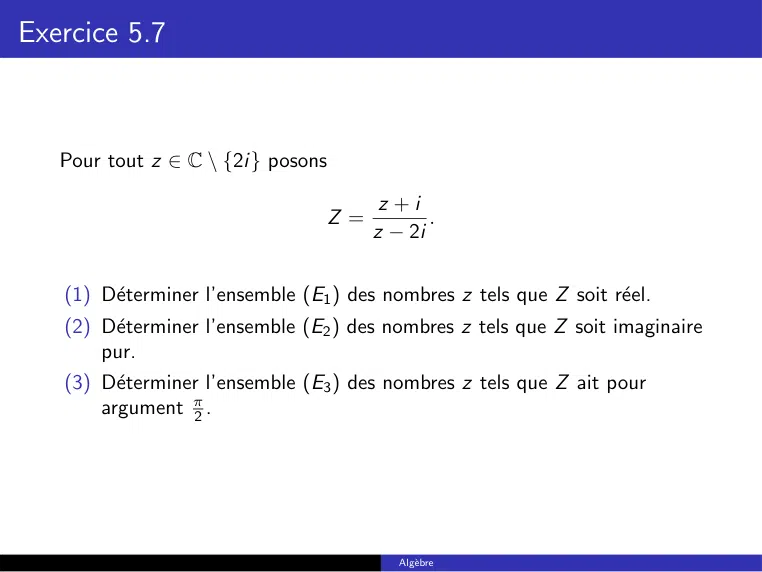

~~~text
Exercice 5.7

   Pour tout z ∈ C \ {2i} posons

                                        z +i
                                 Z=           .
                                       z − 2i

   (1) Déterminer l’ensemble (E1 ) des nombres z tels que Z soit réel.
   (2) Déterminer l’ensemble (E2 ) des nombres z tels que Z soit imaginaire
       pur.
   (3) Déterminer l’ensemble (E3 ) des nombres z tels que Z ait pour
       argument π2 .

                                          Algèbre
~~~

## Page 27

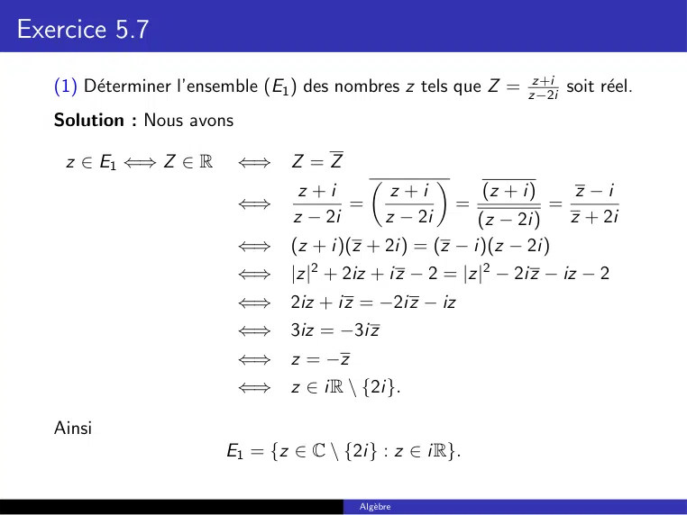

~~~text
Exercice 5.7
                                                                z+i
   (1) Déterminer l’ensemble (E1 ) des nombres z tels que Z = z−2i soit réel.
   Solution : Nous avons

    z ∈ E1 ⇐⇒ Z ∈ R        ⇐⇒     Z =Z
                                                         
                                   z +i           z +i            (z + i)        z −i
                           ⇐⇒            =                    =             =
                                  z − 2i         z − 2i   (z − 2i)              z + 2i
                           ⇐⇒     (z + i)(z + 2i) = (z − i)(z − 2i)
                           ⇐⇒     |z|2 + 2iz + iz − 2 = |z|2 − 2iz − iz − 2
                           ⇐⇒     2iz + iz = −2iz − iz
                           ⇐⇒     3iz = −3iz
                           ⇐⇒     z = −z
                           ⇐⇒     z ∈ iR \ {2i}.

   Ainsi
                         E1 = {z ∈ C \ {2i} : z ∈ iR}.

                                           Algèbre
~~~

## Page 28

~~~text
Exercice 5.7
                                                                z+i
   (2) Déterminer l’ensemble (E2 ) des nombres z tels que Z = z−2i soit un
   imaginaire pur.
   Solution : Nous avons
   z = x + iy ∈ E2    ⇐⇒     Z ∈ iR
                      ⇐⇒     Z = −Z
                                              
                              z +i       z +i        (z + i)     z −i
                      ⇐⇒            =−           =−          =−
                             z − 2i     z − 2i      (z − 2i)    z + 2i
                      ⇐⇒     −(z + i)(z + 2i) = (z − i)(z − 2i)
                      ⇐⇒     −|z|2 − 2iz − iz + 2 = |z|2 − 2iz − iz − 2
                      ⇐⇒     0 = 2|z|2 + i(z − z) − 4
                      ⇐⇒     0 = 2|z|2 + i(2iIm(z)) − 4
                      ⇐⇒     0 = 2|z|2 − 2Im(z) − 4 ⇐⇒ 0 = |z|2 − Im(z) − 2
                                                                   
                                                                  1     1
                      ⇐⇒     0 = x2 + y2 − y − 2 = x2 + y2 − y +      − −2
                                                                  4     4
                                         2
                                        1      9
                      ⇐⇒     x2 + y −        = .
                                        2      4

                                            Algèbre
~~~

## Page 29

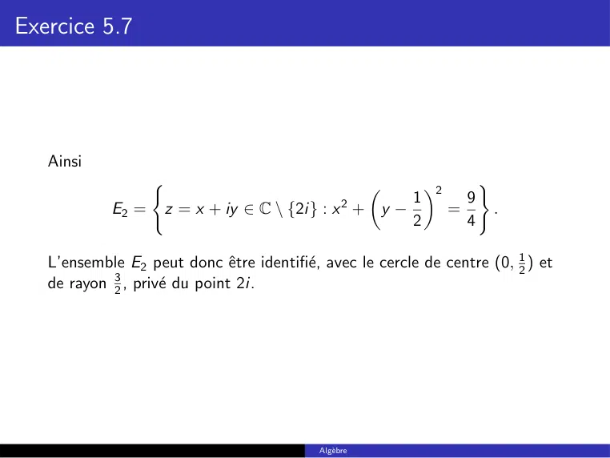

~~~text
Exercice 5.7

   Ainsi
                   (                                        2         )
                                                  2    1            9
            E2 =       z = x + iy ∈ C \ {2i} : x + y −            =         .
                                                       2            4

   L’ensemble E2 peut donc être identifié, avec le cercle de centre (0, 12 ) et
   de rayon 23 , privé du point 2i.

                                            Algèbre
~~~

## Page 30

~~~text
Exercice 5.7
   (3) Déterminer l’ensemble (E3 ) des nombres z tels que Z ait pour
   argument π2 .
   Solution : On commence par noter que :
                          π
              arg(Z ) =        ⇐⇒     Z ∈ iR et Im(Z ) > 0.
                          2
   Par conséquent

                z ∈ E3        ⇐⇒   z ∈ E2     et        Im(Z ) > 0.

   Maintenant
            z +i    (z + i)(z + 2i)   |z|2 − 2 − Im(z) + 3iRe(z)
      Z=          =                 =
           z − 2i      |z − 2i|2                |z − 2i|2

   Donc
                               3Re(z)
                 Im(Z ) =               >0      ⇐⇒          Re(z) > 0.
                              |z − 2i|2

                                             Algèbre
~~~

## Page 31

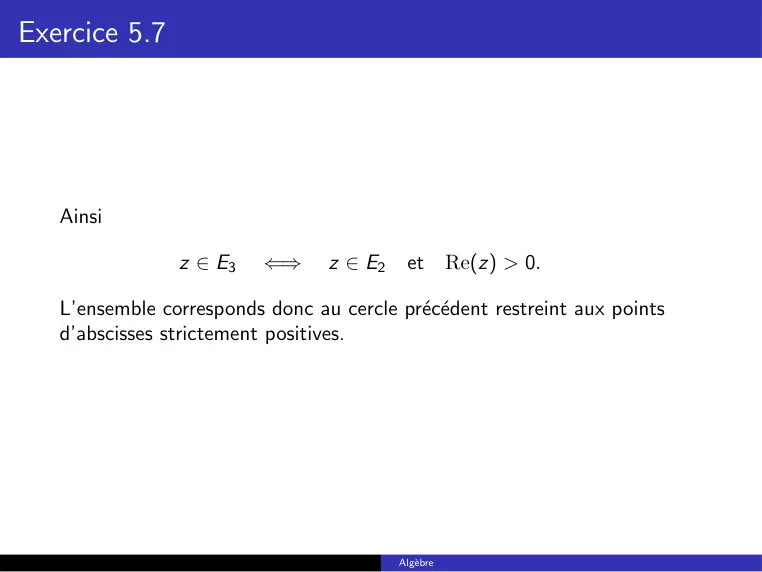

~~~text
Exercice 5.7

   Ainsi

                z ∈ E3    ⇐⇒      z ∈ E2    et        Re(z) > 0.

   L’ensemble corresponds donc au cercle précédent restreint aux points
   d’abscisses strictement positives.

                                           Algèbre
~~~

## Page 32

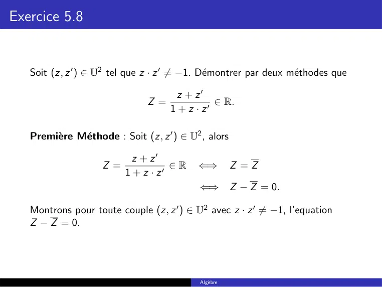

~~~text
Exercice 5.8

   Soit (z, z 0 ) ∈ U2 tel que z · z 0 6= −1. Démontrer par deux méthodes que

                                      z + z0
                               Z=              ∈ R.
                                    1 + z · z0

   Première Méthode : Soit (z, z 0 ) ∈ U2 , alors

                            z + z0
                    Z=               ∈R    ⇐⇒          Z =Z
                          1 + z · z0
                                            ⇐⇒         Z − Z = 0.

   Montrons pour toute couple (z, z 0 ) ∈ U2 avec z · z 0 6= −1, l’equation
   Z − Z = 0.

                                            Algèbre
~~~

## Page 33

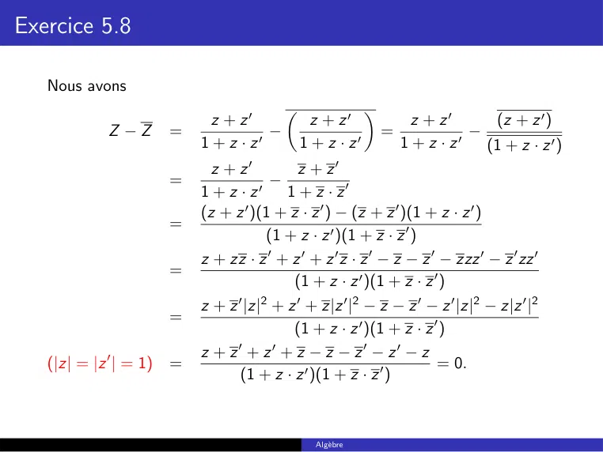

~~~text
Exercice 5.8

   Nous avons

                            z + z0             z + z0              z + z0      (z + z 0 )
                                                         
            Z −Z     =               −                        =             −
                          1 + z · z0         1 + z · z0           1+z ·z  0
                                                                              (1 + z · z 0 )
                            z + z0         z + z0
                     =                 −
                          1+z ·z    0    1 + z · z0
                          (z + z )(1 + z · z 0 ) − (z + z 0 )(1 + z · z 0 )
                                  0
                     =
                                      (1 + z · z 0 )(1 + z · z 0 )
                          z + zz · z 0 + z 0 + z 0 z · z 0 − z − z 0 − zzz 0 − z 0 zz 0
                     =
                                          (1 + z · z 0 )(1 + z · z 0 )
                          z + z |z| + z 0 + z|z 0 |2 − z − z 0 − z 0 |z|2 − z|z 0 |2
                                0    2
                     =
                                          (1 + z · z 0 )(1 + z · z 0 )
                          z + z + z + z − z − z0 − z0 − z
                                0      0
   (|z| = |z 0 | = 1) =                                             = 0.
                                (1 + z · z 0 )(1 + z · z 0 )

                                               Algèbre
~~~

## Page 34

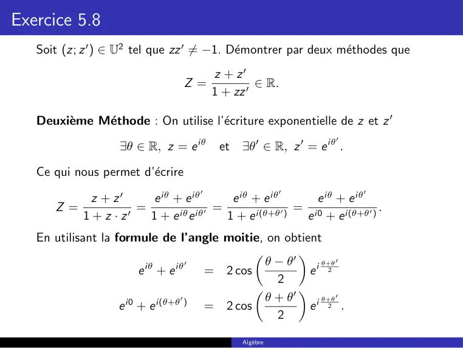

~~~text
Exercice 5.8
   Soit (z; z 0 ) ∈ U2 tel que zz 0 6= −1. Démontrer par deux méthodes que
                                        z + z0
                                  Z=             ∈ R.
                                        1 + zz 0

   Deuxième Méthode : On utilise l’écriture exponentielle de z et z 0
                                                                  0
                   ∃θ ∈ R, z = e iθ      et   ∃θ0 ∈ R, z 0 = e iθ .

   Ce qui nous permet d’écrire
                                    0                    0             0
           z + z0      e iθ + e iθ       e iθ + e iθ        e iθ + e iθ
      Z=            =               0 =              0 =                   .
         1 + z · z0   1 + e iθ e iθ     1 + e i(θ+θ )    e i0 + e i(θ+θ0 )
   En utilisant la formule de l’angle moitie, on obtient
                                                 θ − θ0
                                                       
                                     0                      θ+θ 0
                         e iθ + e iθ   = 2 cos            ei 2
                                                   2
                                                     θ0
                                                       
                                   0             θ +        θ+θ 0
                    e i0 + e i(θ+θ ) = 2 cos              ei 2 .
                                                   2

                                              Algèbre
~~~

## Page 35

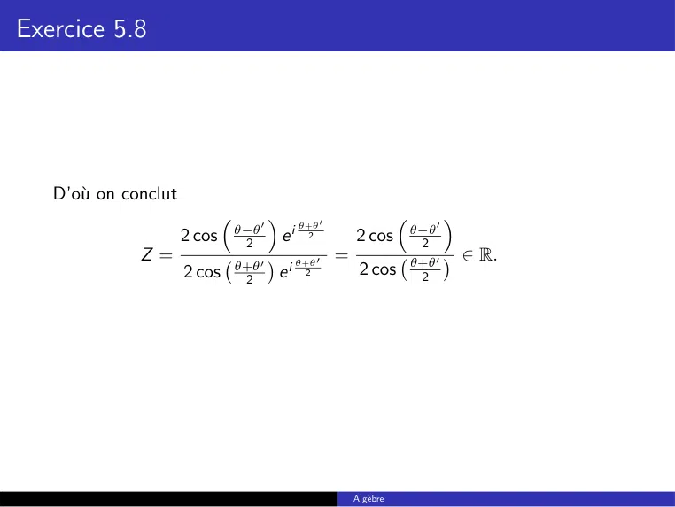

~~~text
Exercice 5.8

   D’où on conclut
                                                   θ+θ 0
                                                                               
                                  θ−θ 0                                   θ−θ 0
                      2 cos        2          ei     2     2 cos           2
              Z=                           i θ+θ0 =                      θ+θ 0
                                                                                   ∈ R.
                                  θ+θ 0              2 cos
                      2 cos        2       e 2                             2

                                                           Algèbre
~~~

## Page 36

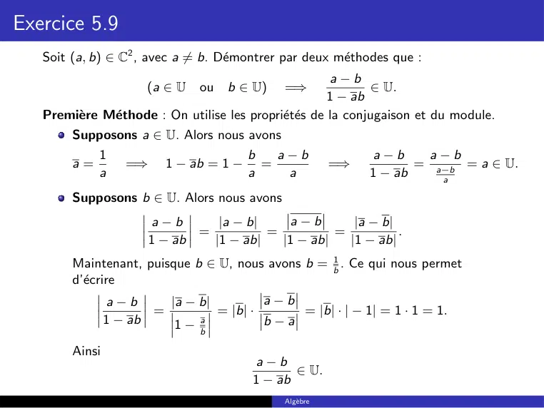

~~~text
Exercice 5.9
   Soit (a, b) ∈ C2 , avec a 6= b. Démontrer par deux méthodes que :
                                                        a−b
                       (a ∈ U   ou   b ∈ U)   =⇒              ∈ U.
                                                       1 − ab
   Première Méthode : On utilise les propriétés de la conjugaison et du module.
       Supposons a ∈ U. Alors nous avons
             1                           b   a−b               a−b    a−b
        a=         =⇒     1 − ab = 1 −     =             =⇒          = a−b = a ∈ U.
             a                           a    a               1 − ab    a

        Supposons b ∈ U. Alors nous avons
                        a−b       |a − b|     a−b       |a − b|
                               =          =          =          .
                        1 − ab   |1 − ab|   |1 − ab|   |1 − ab|
        Maintenant, puisque b ∈ U, nous avons b = b1 . Ce qui nous permet
        d’écrire
                 a−b     |a − b|         a−b
                       =         = |b| ·     = |b| · | − 1| = 1 · 1 = 1.
                1 − ab    1− ba          b−a

        Ainsi
                                         a−b
                                                ∈ U.
                                         1 − ab
                                              Algèbre
~~~

## Page 37

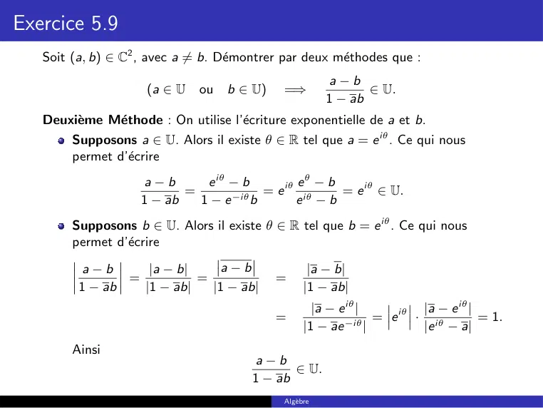

~~~text
Exercice 5.9
   Soit (a, b) ∈ C2 , avec a 6= b. Démontrer par deux méthodes que :
                                                         a−b
                     (a ∈ U   ou   b ∈ U)    =⇒                ∈ U.
                                                        1 − ab
   Deuxième Méthode : On utilise l’écriture exponentielle de a et b.
        Supposons a ∈ U. Alors il existe θ ∈ R tel que a = e iθ . Ce qui nous
        permet d’écrire
                     a−b      e iθ − b       eθ − b
                           =       −iθ
                                       = e iθ iθ    = e iθ ∈ U.
                    1 − ab   1−e b           e −b
        Supposons b ∈ U. Alors il existe θ ∈ R tel que b = e iθ . Ce qui nous
        permet d’écrire
          a−b      |a − b|     a−b                  |a − b|
                =          =                =
         1 − ab   |1 − ab|   |1 − ab|              |1 − ab|
                                                     |a − e iθ |         |a − e iθ |
                                            =              −iθ
                                                                 = e iθ · iθ         = 1.
                                                   |1 − ae |             |e − a|
        Ainsi
                                        a−b
                                               ∈ U.
                                        1 − ab
                                             Algèbre
~~~

## Page 38

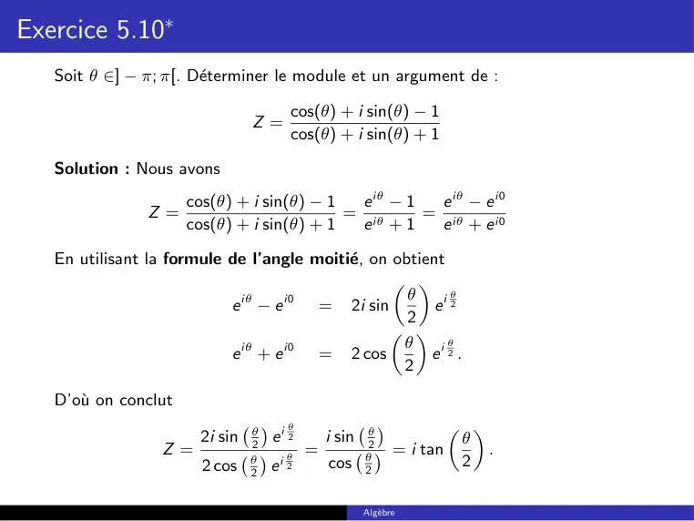

~~~text
Exercice 5.10∗
   Soit θ ∈] − π; π[. Déterminer le module et un argument de :

                                        cos(θ) + i sin(θ) − 1
                                 Z =
                                        cos(θ) + i sin(θ) + 1

   Solution : Nous avons
                      cos(θ) + i sin(θ) − 1  e iθ − 1  e iθ − e i0
                Z =                         = iθ      = iθ
                      cos(θ) + i sin(θ) + 1  e +1      e + e i0
   En utilisant la formule de l’angle moitié, on obtient
                                                   
                                                    θ      θ
                           e iθ − e i0 = 2i sin         ei 2
                                                    2
                                                  
                             iθ     i0             θ      θ
                           e +e        = 2 cos         ei 2 .
                                                   2

   D’où on conclut
                                        θ
                                 θ
                                     ei 2               θ
                                                                        
                        2i sin   2
                                                i sin   2                 θ
                  Z =                   θ
                                            =           θ
                                                              = i tan       .
                                 θ
                                     ei 2       cos                       2
                                   
                        2 cos    2                      2

                                                        Algèbre
~~~

## Page 39

~~~text
Exercice 5.10∗
   Par conséquent :
        si θ ∈] − π, 0[, alors θ2 ∈ − π2 , 0 et tan θ2 < 0. Donc
                                                    

                                                       
                                     θ                   θ    iπ
                       Z = − tan           (−i) = − tan     e− 2
                                     2                   2

        Ainsi
                                     
                                     θ                         π
                   |Z | = − tan           et   arg(Z ) = −          mod (2π).
                                     2                         2

        si θ = 0, alors tan(θ/2) = 0. Donc Z = 0.
        si θ ∈]0, π[, alors θ2 ∈ 0, π2 et tan θ2 > 0. Donc
                                               

                                                   
                                        θ            θ   iπ
                              Z = tan       i = tan     e2
                                        2            2

        Ainsi
                                     
                                     θ                     π
                       |Z | = tan         et   arg(Z ) =           mod (2π).
                                     2                     2

                                               Algèbre
~~~

## Page 40

~~~text
Exercice 5.10
   Soit z ∈ U dont un argument est dans ]0, π3 [. Déterminer le module et un
   argument de
                                           1 + z3
                                      Z =           .
                                              z2
   Solution : Par hypothèse, il existe θ ∈ ]0, 3 [ tel que z = e iθ . Nous avons
                                                π

                       1 + z3   1
                 Z =          = 2 + z = z −2 + z = e −2iθ + e iθ
                         z2    z
   En utilisant la formule de l’angle moitie, on obtient
                                                  
                                                  3θ         θ
                         e −2iθ + e iθ = 2 cos          e −i 2
                                                   2
   Or
              i πh                                                            
                                     3θ i π h                             3θ
           θ ∈ 0,         =⇒           ∈ 0,              =⇒     cos                > 0.
                  3                  2      2                             2
   Ainsi
                                        
                                    3θ                          θ
                 |Z | = 2 cos                et   arg(Z ) = −         mod (2π).
                                    2                           2

                                                    Algèbre
~~~
