# TD6-Polynomes-Correction_2023-2024_Algebre1_P1S1_NArancibia.pdf

[Ouvrir l’original](https://drive.google.com/open?id=1_eKKxtNMwmOQeGbGaOkt2AoRKNcgLadO) · Les deux lectures automatiques du PDF divergent sur les pages indiquées. Leur fac-similé accompagne le texte.

**Pages présentant un écart entre les deux extractions** — 1–3, 5–10, 15–16, 18–30, 32–45, 48–54, 56–57, 59–61, 63–64, 66, 70–71.

## Page 1

~~~text
Algèbre-Premier semestre 2023-2024

                       CY Tech

                     TD Algèbre

                      Polynômes.

                             Algèbre
~~~

## Page 2

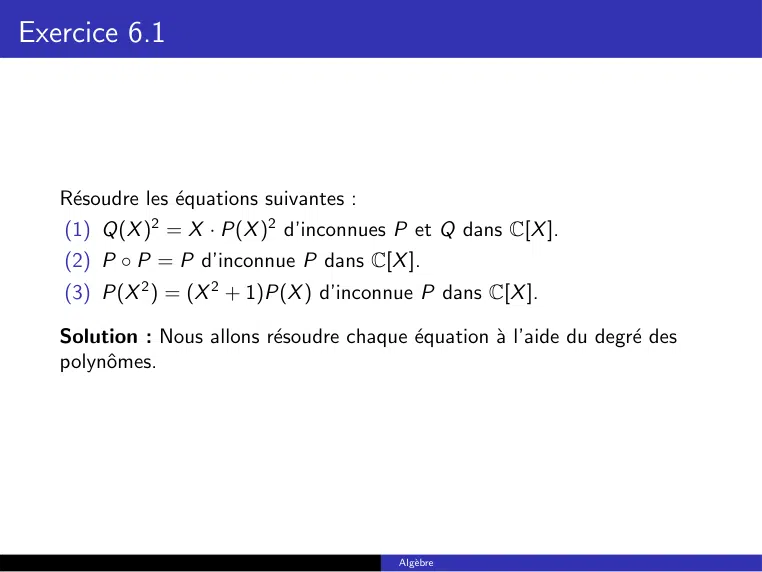

~~~text
Exercice 6.1

   Résoudre les équations suivantes :
   (1) Q(X )2 = X · P(X )2 d’inconnues P et Q dans C[X ].
   (2) P ◦ P = P d’inconnue P dans C[X ].
   (3) P(X 2 ) = (X 2 + 1)P(X ) d’inconnue P dans C[X ].

   Solution : Nous allons résoudre chaque équation à l’aide du degré des
   polynômes.

                                           Algèbre
~~~

## Page 3

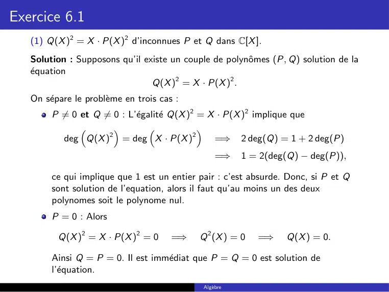

~~~text
Exercice 6.1
   (1) Q(X )2 = X · P(X )2 d’inconnues P et Q dans C[X ].
   Solution : Supposons qu’il existe un couple de polynômes (P, Q) solution de la
   équation
                                Q(X )2 = X · P(X )2 .
   On sépare le problème en trois cas :
        P 6= 0 et Q 6= 0 : L’égalité Q(X )2 = X · P(X )2 implique que
                                           
           deg Q(X )2 = deg X · P(X )2           =⇒ 2 deg(Q) = 1 + 2 deg(P)
                                                 =⇒     1 = 2(deg(Q) − deg(P)),

        ce qui implique que 1 est un entier pair : c’est absurde. Donc, si P et Q
        sont solution de l’equation, alors il faut qu’au moins un des deux
        polynomes soit le polynome nul.
        P = 0 : Alors

          Q(X )2 = X · P(X )2 = 0      =⇒   Q 2 (X ) = 0   =⇒    Q(X ) = 0.

        Ainsi Q = P = 0. Il est immédiat que P = Q = 0 est solution de
        l’équation.
                                             Algèbre
~~~

## Page 4

~~~text
Exercice 6.1

      Q = 0 : Alors

               X · P(X )2 = Q(X )2 = 0       =⇒   X · P(X )2 = 0
                                             =⇒   P(X )2 = 0
                                             =⇒   P = 0.

      Ainsi P = Q = 0. Donc le couple de polynôme nul est la seule
      solution possible.

                                      Algèbre
~~~

## Page 5

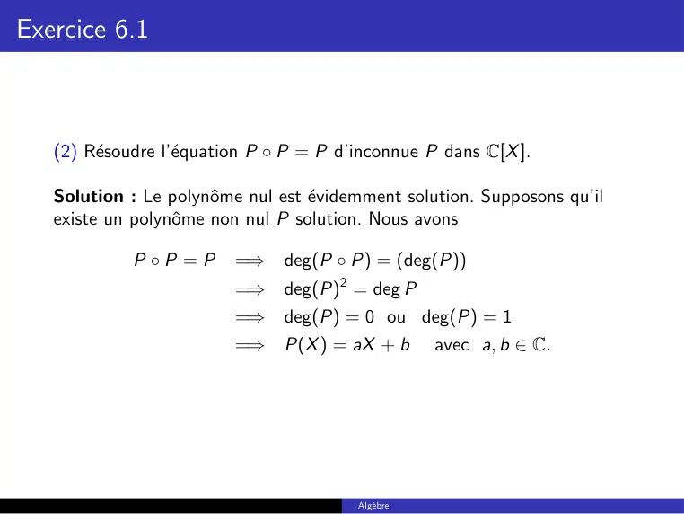

~~~text
Exercice 6.1

   (2) Résoudre l’équation P ◦ P = P d’inconnue P dans C[X ].

   Solution : Le polynôme nul est évidemment solution. Supposons qu’il
   existe un polynôme non nul P solution. Nous avons

            P ◦P =P      =⇒    deg(P ◦ P) = (deg(P))
                         =⇒    deg(P)2 = deg P
                         =⇒    deg(P) = 0 ou deg(P) = 1
                         =⇒    P(X ) = aX + b       avec a, b ∈ C.

                                         Algèbre
~~~

## Page 6

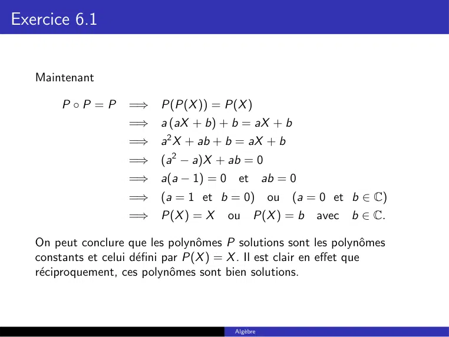

~~~text
Exercice 6.1

   Maintenant

        P ◦P =P      =⇒    P(P(X )) = P(X )
                     =⇒    a (aX + b) + b = aX + b
                     =⇒    a2 X + ab + b = aX + b
                     =⇒    (a2 − a)X + ab = 0
                     =⇒    a(a − 1) = 0     et ab = 0
                     =⇒    (a = 1 et b = 0) ou        (a = 0 et b ∈ C)
                     =⇒    P(X ) = X      ou P(X ) = b    avec   b ∈ C.

   On peut conclure que les polynômes P solutions sont les polynômes
   constants et celui défini par P(X ) = X . Il est clair en effet que
   réciproquement, ces polynômes sont bien solutions.

                                           Algèbre
~~~

## Page 7

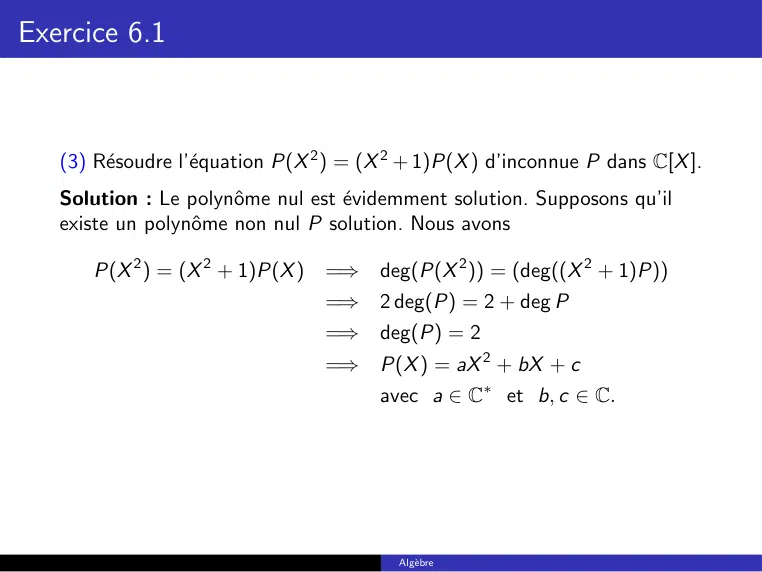

~~~text
Exercice 6.1

   (3) Résoudre l’équation P(X 2 ) = (X 2 + 1)P(X ) d’inconnue P dans C[X ].
   Solution : Le polynôme nul est évidemment solution. Supposons qu’il
   existe un polynôme non nul P solution. Nous avons

      P(X 2 ) = (X 2 + 1)P(X ) =⇒ deg(P(X 2 )) = (deg((X 2 + 1)P))
                                  =⇒ 2 deg(P) = 2 + deg P
                                  =⇒ deg(P) = 2
                                  =⇒ P(X ) = aX 2 + bX + c
                                        avec a ∈ C∗ et b, c ∈ C.

                                          Algèbre
~~~

## Page 8

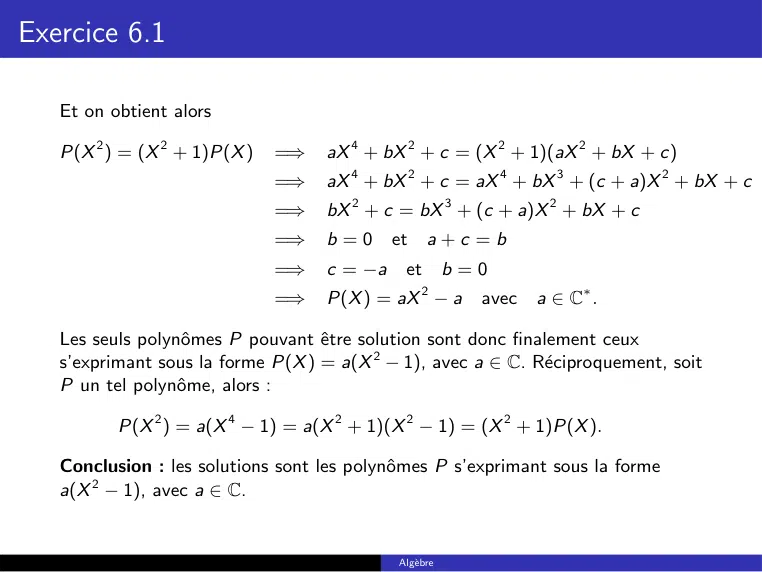

~~~text
Exercice 6.1

   Et on obtient alors

   P(X 2 ) = (X 2 + 1)P(X )   =⇒   aX 4 + bX 2 + c = (X 2 + 1)(aX 2 + bX + c)
                              =⇒   aX 4 + bX 2 + c = aX 4 + bX 3 + (c + a)X 2 + bX + c
                              =⇒   bX 2 + c = bX 3 + (c + a)X 2 + bX + c
                              =⇒   b=0      et    a+c =b
                              =⇒   c = −a    et        b=0
                              =⇒   P(X ) = aX − a2
                                                         avec   a ∈ C∗ .

   Les seuls polynômes P pouvant être solution sont donc finalement ceux
   s’exprimant sous la forme P(X ) = a(X 2 − 1), avec a ∈ C. Réciproquement, soit
   P un tel polynôme, alors :

          P(X 2 ) = a(X 4 − 1) = a(X 2 + 1)(X 2 − 1) = (X 2 + 1)P(X ).

   Conclusion : les solutions sont les polynômes P s’exprimant sous la forme
   a(X 2 − 1), avec a ∈ C.

                                            Algèbre
~~~

## Page 9

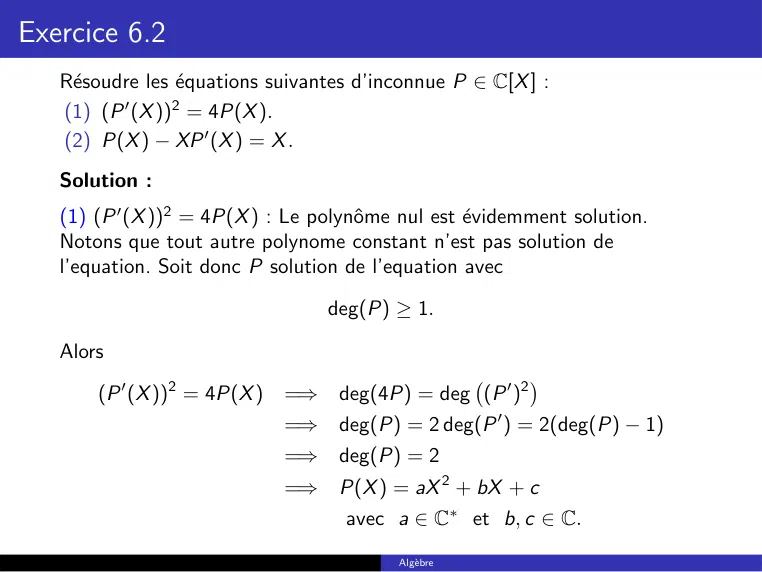

~~~text
Exercice 6.2
   Résoudre les équations suivantes d’inconnue P ∈ C[X ] :
   (1) (P 0 (X ))2 = 4P(X ).
   (2) P(X ) − XP 0 (X ) = X .
   Solution :
   (1) (P 0 (X ))2 = 4P(X ) : Le polynôme nul est évidemment solution.
   Notons que tout autre polynome constant n’est pas solution de
   l’equation. Soit donc P solution de l’equation avec

                                  deg(P) ≥ 1.

   Alors

       (P 0 (X ))2 = 4P(X ) =⇒ deg(4P) = deg (P 0 )2
                                                          

                             =⇒ deg(P) = 2 deg(P 0 ) = 2(deg(P) − 1)
                             =⇒ deg(P) = 2
                             =⇒ P(X ) = aX 2 + bX + c
                                    avec a ∈ C∗ et b, c ∈ C.
                                          Algèbre
~~~

## Page 10

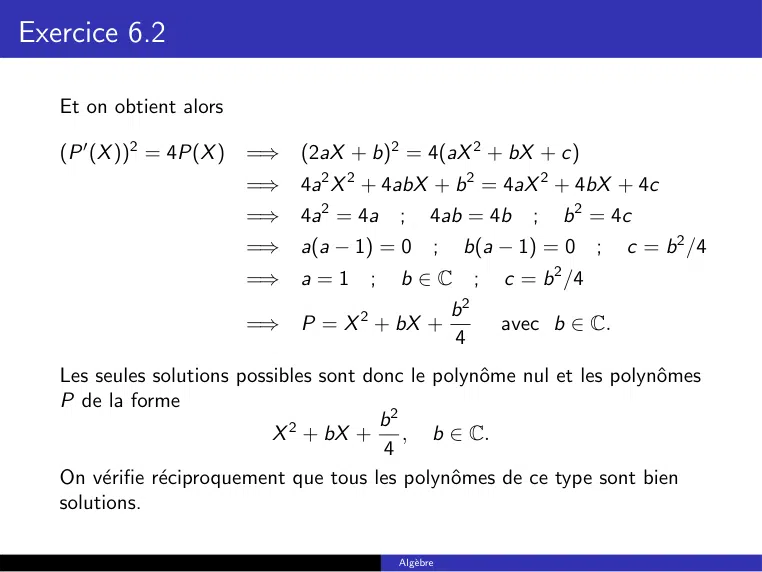

~~~text
Exercice 6.2

   Et on obtient alors

   (P 0 (X ))2 = 4P(X ) =⇒ (2aX + b)2 = 4(aX 2 + bX + c)
                         =⇒ 4a2 X 2 + 4abX + b 2 = 4aX 2 + 4bX + 4c
                         =⇒ 4a2 = 4a       ;      4ab = 4b   ;       b 2 = 4c
                         =⇒ a(a − 1) = 0          ;   b(a − 1) = 0      ;   c = b 2 /4
                                                                 2
                         =⇒ a = 1      b∈C ;
                                       ;                  c = b /4
                                           b2
                         =⇒ P = X 2 + bX +                avec b ∈ C.
                                           4
   Les seules solutions possibles sont donc le polynôme nul et les polynômes
   P de la forme
                                         b2
                            X 2 + bX + , b ∈ C.
                                         4
   On vérifie réciproquement que tous les polynômes de ce type sont bien
   solutions.

                                           Algèbre
~~~

## Page 11

~~~text
Exercice 6.2

   (2) P(X ) − XP 0 (X ) = X : Supposons que
                                       n
                                       X
                                 P=          ak X k ∈ C[X ]
                                       k=0

   est solution de l’equation. Alors
                                        n
                                        X                     n
                                                              X
   P(X ) − XP 0 (X ) = X      =⇒               ak X k − X           kak X k−1 = X
                                        k=0                   k=1
                                        Xn                  n
                                                            X
                               =⇒              ak X k −           kak X k = X
                                         k=0                k=1
                                             n
                                             X
                               =⇒       a0 +   (ak − kak )X k = X
                                                k=1
                               =⇒       a0 = 0 ; (a1 − a1 ) = 1 ; ∀k > 1, ak (1 − k) = 0
                               =⇒       a0 = 0        ;     0=1       ;   ∀k > 1, ak = 0.

   Ce qui est absurde. Donc le problème n’a pas de solution.

                                                 Algèbre
~~~

## Page 12

~~~text
Exercice 6.3

   Effectuer la division euclidienne de : (X 4 − X 3 + X − 2) par
   (X 2 − 2X + 4).

   Solution : On pose une division de polynômes comme on pose une
   division euclidienne de deux entiers. En effet
          X4   -      X3                 +       X         -   2    X 2 − 2X + 4
      -   X4   -     2X 3   +     4X 2
                                                                    X 2 +X −2
                      X3     -    4X 2   +     X           -   2
               -      X3     -    2X 2   +    4X
                                 -2X 2    -   3X           -   2
                             -   -2X 2   +    4X           -   8
                                          -   7X          +    6

   Alors on trouve

          Q = X 2 + X − 2 (Quotient) et                  R = −7X + 6 (Reste).

   On n’oublie pas de vérifier qu’effectivement A = BQ + R.

                                              Algèbre
~~~

## Page 13

~~~text
Exercice 6.3

   Effectuer la division euclidienne de : (3X 5 + 2X 4 − X 2 + 1) par
   (X 3 + X + 2).

   Solution : On pose une division de polynômes comme on pose une
   division euclidienne de deux entiers. En effet

         3X 5   +    2X 4               −        X2    +        +   1     X3 + X + 2
    −    3X 5               +    3X 3   +       6X 2                     3X 2 +2X −3
                     2X 4   −    3X 3   −       7X 2   +        +   1
                −    2X 4               +       2X 2   +   4X
                                −3x 3   −       9X 2   −   4X   +   1
                            -   −3x 3                  −   3X   −   6
                                             −9X 2     +    X   +   7

   Alors on trouve

     Q = 3X 2 + 2X − 3 (Quotient) et             R = −9X 2 − X + 7 (Reste).

   On n’oublie pas de vérifier qu’effectivement A = BQ + R.

                                            Algèbre
~~~

## Page 14

~~~text
Exercice 6.4

   Effectuer les divisions euclidiennes de :
        (3X 5 + 4X 2 + 1) par (X 2 + 2X + 3) : Solution :

        (3X 5 + 4X 2 + 1) = (X 2 + 2X + 3)(3X 3 − 6X 2 + 3X + 16) + (−41X − 47).

        (X 5 − 7X 4 − X 2 − 9X + 9) par (X 2 − 5X + 4) : Solution :

        (X 5 −7X 4 −X 2 −9X +9) = (X 2 −5X +4)(X 3 −2X 2 −14X −63)+(−268X +261)

                                               Algèbre
~~~

## Page 15

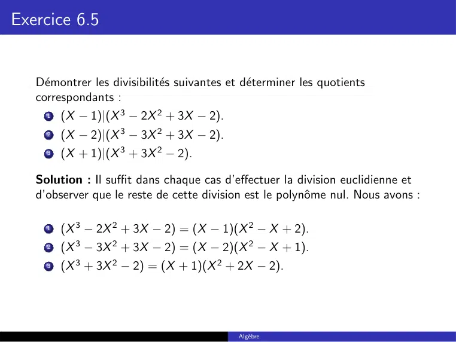

~~~text
Exercice 6.5

   Démontrer les divisibilités suivantes et déterminer les quotients
   correspondants :
     1   (X − 1)|(X 3 − 2X 2 + 3X − 2).
     2   (X − 2)|(X 3 − 3X 2 + 3X − 2).
     3   (X + 1)|(X 3 + 3X 2 − 2).

   Solution : Il suffit dans chaque cas d’effectuer la division euclidienne et
   d’observer que le reste de cette division est le polynôme nul. Nous avons :

     1   (X 3 − 2X 2 + 3X − 2) = (X − 1)(X 2 − X + 2).
     2   (X 3 − 3X 2 + 3X − 2) = (X − 2)(X 2 − X + 1).
     3   (X 3 + 3X 2 − 2) = (X + 1)(X 2 + 2X − 2).

                                            Algèbre
~~~

## Page 16

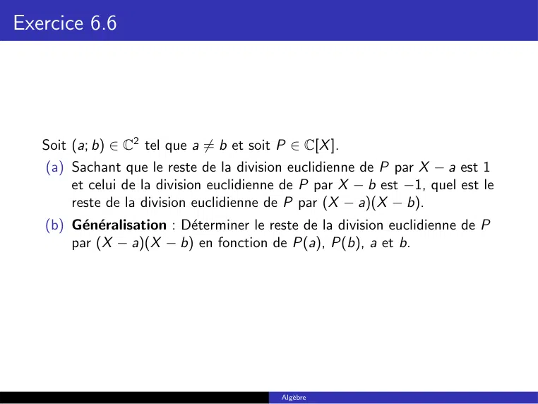

~~~text
Exercice 6.6

   Soit (a; b) ∈ C2 tel que a 6= b et soit P ∈ C[X ].
   (a) Sachant que le reste de la division euclidienne de P par X − a est 1
       et celui de la division euclidienne de P par X − b est −1, quel est le
       reste de la division euclidienne de P par (X − a)(X − b).
   (b) Généralisation : Déterminer le reste de la division euclidienne de P
       par (X − a)(X − b) en fonction de P(a), P(b), a et b.

                                           Algèbre
~~~

## Page 17

~~~text
Exercice 6.6
   (1) Sachant que le reste de la division euclidienne de P par X − a est 1 et celui
   de la division euclidienne de P par X − b est −1, quel est le reste de la division
   euclidienne de P par (X − a)(X − b).
   Solution : Soit P un polynome satisfaisant les hypothèses. Le Théorème de la
   division euclidienne, nous dit qu’il existe Q(X ) et R(X ) ∈ C[X ], tels que

   P(X ) = (X − a)(X − b)Q(X ) + R(X ),       deg(R) < deg((X − a)(X − b)) = 2.

   Comme deg(R) < 2, on déduit que R(X ) = cX + d avec c, d ∈ C. Nous allons
   déterminer c et d. Maintenant :
        puisque le reste de la division euclidienne de P par X − a est 1, il existe
        Q1 ∈ C[X ] tel que

                   P(X ) = (X − a)Q1 (X ) + 1            =⇒   P(a) = 1.

        puisque le reste de la division euclidienne de P par X − b est -1, il existe
        Q2 ∈ C[X ] tel que

                  P(X ) = (X − b)Q2 (X ) − 1        =⇒        P(b) = −1.

                                              Algèbre
~~~

## Page 18

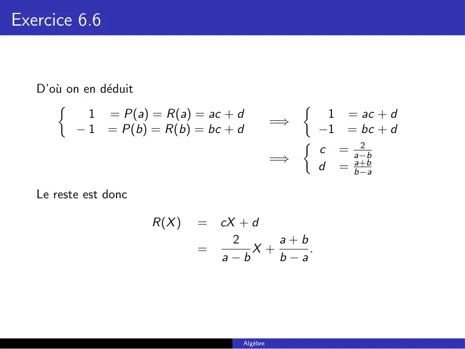

~~~text
Exercice 6.6

   D’où on en déduit
                                                   
             1 = P(a) = R(a) = ac + d                    1    = ac + d
                                               =⇒
          − 1 = P(b) = R(b) = bc + d                    −1    = bc + d
                                                               2
                                                        c    = a−b
                                               =⇒              a+b
                                                        d    = b−a

   Le reste est donc

                       R(X )   = cX + d
                                   2     a+b
                               =      X+     .
                                 a−b     b−a

                                    Algèbre
~~~

## Page 19

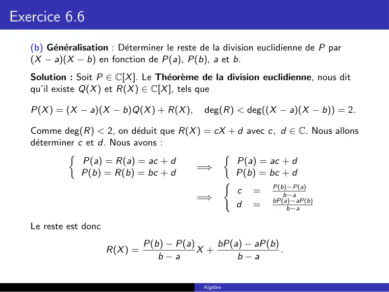

~~~text
Exercice 6.6
   (b) Généralisation : Déterminer le reste de la division euclidienne de P par
   (X − a)(X − b) en fonction de P(a), P(b), a et b.
   Solution : Soit P ∈ C[X ]. Le Théorème de la division euclidienne, nous dit
   qu’il existe Q(X ) et R(X ) ∈ C[X ], tels que

   P(X ) = (X − a)(X − b)Q(X ) + R(X ),        deg(R) < deg((X − a)(X − b)) = 2.

   Comme deg(R) < 2, on déduit que R(X ) = cX + d avec c, d ∈ C. Nous allons
   déterminer c et d. Nous avons :
                                             
                P(a) = R(a) = ac + d             P(a) = ac + d
                                        =⇒
                P(b) = R(b) = bc + d            P(b) = bc + d
                                              (
                                                 c = P(b)−P(a)
                                                           b−a
                                        =⇒
                                                d = bP(a)−aP(b)
                                                            b−a

   Le reste est donc
                                 P(b) − P(a)    bP(a) − aP(b)
                       R(X ) =               X+               .
                                    b−a             b−a

                                               Algèbre
~~~

## Page 20

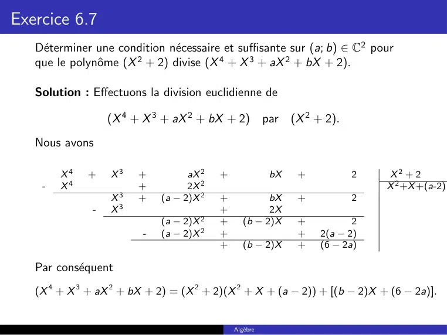

~~~text
Exercice 6.7
   Déterminer une condition nécessaire et suffisante sur (a; b) ∈ C2 pour
   que le polynôme (X 2 + 2) divise (X 4 + X 3 + aX 2 + bX + 2).

   Solution : Effectuons la division euclidienne de

                  (X 4 + X 3 + aX 2 + bX + 2)            par   (X 2 + 2).
   Nous avons

        X4   +    X3    +          aX 2   +               bX    +           2    X2 + 2
    -   X4              +          2X 2                                         X 2 +X +(a-2)
                  X3    +    (a − 2)X 2   +            bX       +           2
              -   X3                      +            2X
                             (a − 2)X 2   +      (b − 2)X       +           2
                         -   (a − 2)X 2   +                     +    2(a − 2)
                                          +      (b − 2)X       +    (6 − 2a)

   Par conséquent
   (X 4 + X 3 + aX 2 + bX + 2) = (X 2 + 2)(X 2 + X + (a − 2)) + [(b − 2)X + (6 − 2a)].

                                              Algèbre
~~~

## Page 21

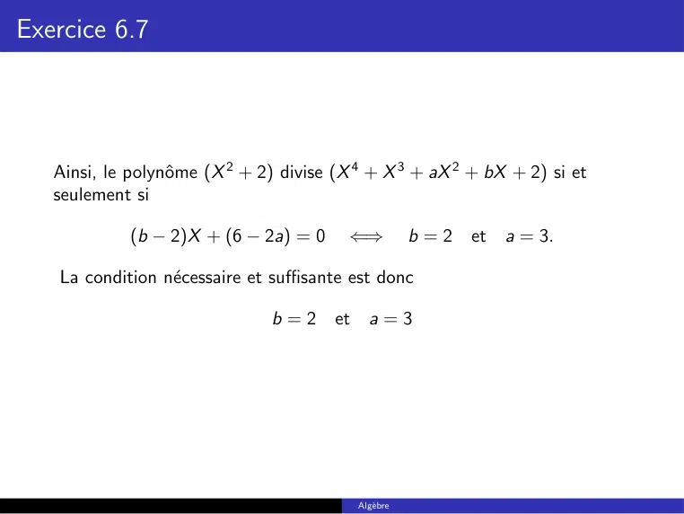

~~~text
Exercice 6.7

   Ainsi, le polynôme (X 2 + 2) divise (X 4 + X 3 + aX 2 + bX + 2) si et
   seulement si

             (b − 2)X + (6 − 2a) = 0     ⇐⇒          b=2   et a = 3.

   La condition nécessaire et suffisante est donc

                               b=2     et a = 3

                                          Algèbre
~~~

## Page 22

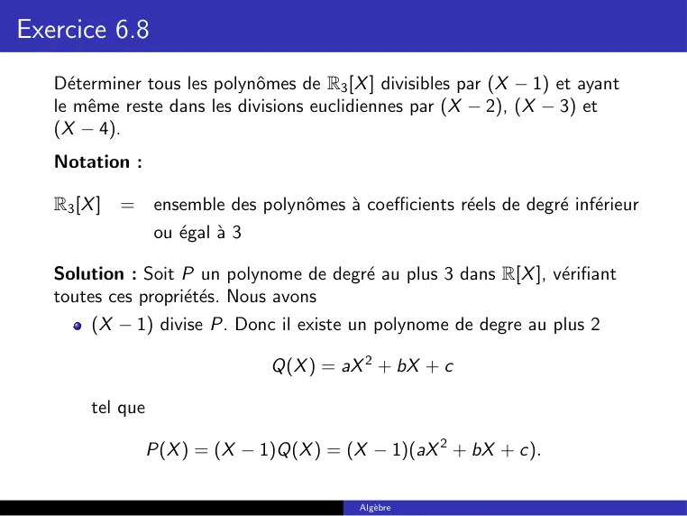

~~~text
Exercice 6.8
   Déterminer tous les polynômes de R3 [X ] divisibles par (X − 1) et ayant
   le même reste dans les divisions euclidiennes par (X − 2), (X − 3) et
   (X − 4).
   Notation :

   R3 [X ]   =    ensemble des polynômes à coefficients réels de degré inférieur
                  ou égal à 3

   Solution : Soit P un polynome de degré au plus 3 dans R[X ], vérifiant
   toutes ces propriétés. Nous avons
        (X − 1) divise P. Donc il existe un polynome de degre au plus 2

                                  Q(X ) = aX 2 + bX + c

        tel que

                  P(X ) = (X − 1)Q(X ) = (X − 1)(aX 2 + bX + c).

                                              Algèbre
~~~

## Page 23

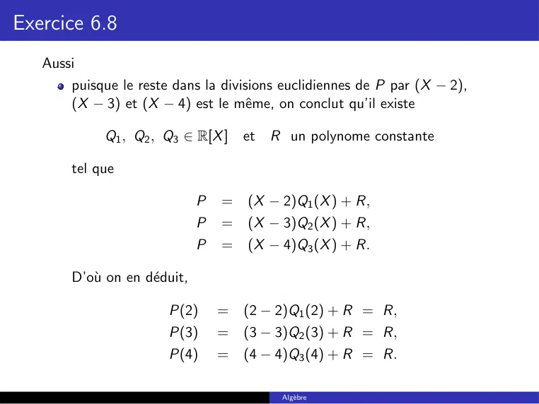

~~~text
Exercice 6.8
   Aussi
       puisque le reste dans la divisions euclidiennes de P par (X − 2),
       (X − 3) et (X − 4) est le même, on conclut qu’il existe

            Q1 , Q2 , Q3 ∈ R[X ]      et   R un polynome constante

       tel que

                              P   =   (X − 2)Q1 (X ) + R,
                              P   =   (X − 3)Q2 (X ) + R,
                              P   =   (X − 4)Q3 (X ) + R.

       D’où on en déduit,

                       P(2)       = (2 − 2)Q1 (2) + R = R,
                       P(3)       = (3 − 3)Q2 (3) + R = R,
                       P(4)       = (4 − 4)Q3 (4) + R = R.

                                            Algèbre
~~~

## Page 24

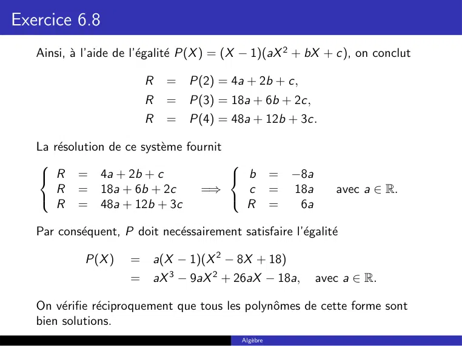

~~~text
Exercice 6.8
   Ainsi, à l’aide de l’égalité P(X ) = (X − 1)(aX 2 + bX + c), on conclut

                         R   = P(2) = 4a + 2b + c,
                         R   = P(3) = 18a + 6b + 2c,
                         R   = P(4) = 48a + 12b + 3c.

   La résolution de ce système fournit
                                        
    R = 4a + 2b + c                      b            = −8a
       R = 18a + 6b + 2c            =⇒     c            = 18a      avec a ∈ R.
       R = 48a + 12b + 3c                  R            =  6a
                                        

   Par conséquent, P doit necéssairement satisfaire l’égalité

             P(X )    = a(X − 1)(X 2 − 8X + 18)
                      = aX 3 − 9aX 2 + 26aX − 18a,              avec a ∈ R.

   On vérifie réciproquement que tous les polynômes de cette forme sont
   bien solutions.
                                             Algèbre
~~~

## Page 25

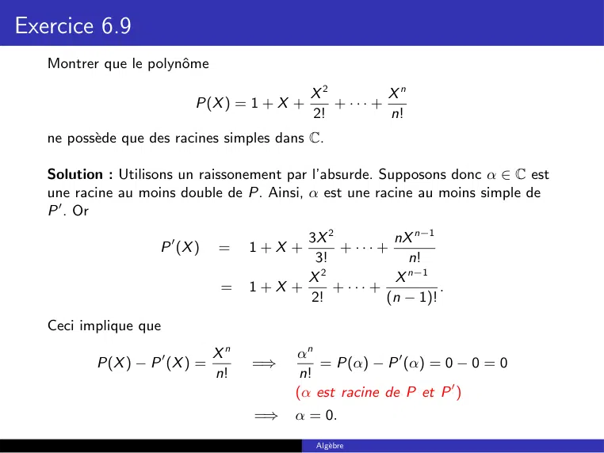

~~~text
Exercice 6.9
   Montrer que le polynôme

                                             X2         Xn
                           P(X ) = 1 + X +      + ··· +
                                             2!         n!
   ne possède que des racines simples dans C.

   Solution : Utilisons un raissonement par l’absurde. Supposons donc α ∈ C est
   une racine au moins double de P. Ainsi, α est une racine au moins simple de
   P 0 . Or
                                          3X 2         nX n−1
                    P 0 (X )   =    1+X +      + ··· +
                                           3!            n!
                                          X2           X n−1
                               =    1+X +     + ··· +          .
                                          2!          (n − 1)!
   Ceci implique que
                               Xn         αn
          P(X ) − P 0 (X ) =        =⇒        = P(α) − P 0 (α) = 0 − 0 = 0
                               n!          n!
                                          (α est racine de P et P 0 )
                                    =⇒    α = 0.
                                             Algèbre
~~~

## Page 26

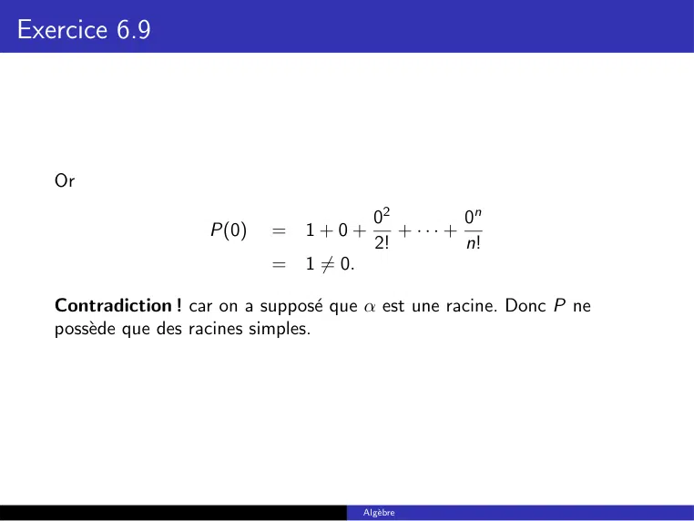

~~~text
Exercice 6.9

   Or
                                             02         0n
                     P(0)    =   1+0+           + ··· +
                                             2!         n!
                             =   1 6= 0.

   Contradiction ! car on a supposé que α est une racine. Donc P ne
   possède que des racines simples.

                                           Algèbre
~~~

## Page 27

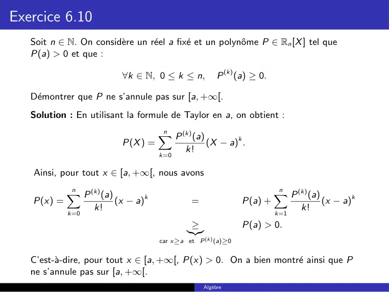

~~~text
Exercice 6.10
   Soit n ∈ N. On considère un réel a fixé et un polynôme P ∈ Rn [X ] tel que
   P(a) > 0 et que :

                           ∀k ∈ N, 0 ≤ k ≤ n,          P (k) (a) ≥ 0.

   Démontrer que P ne s’annule pas sur [a, +∞[.
   Solution : En utilisant la formule de Taylor en a, on obtient :
                                     n
                                     X P (k) (a)
                           P(X ) =                  (X − a)k .
                                            k!
                                     k=0

   Ainsi, pour tout x ∈ [a, +∞[, nous avons
            n                                                           n
            X P (k) (a)                                                 X P (k) (a)
   P(x) =                 (x − a)k            =               P(a) +                  (x − a)k
                   k!                                                         k!
            k=0                                                         k=1
                                              ≥               P(a) > 0.
                                             |{z}
                                     car x≥a et P (k) (a)≥0

   C’est-à-dire, pour tout x ∈ [a, +∞[, P(x) > 0. On a bien montré ainsi que P
   ne s’annule pas sur [a, +∞[.
                                                  Algèbre
~~~

## Page 28

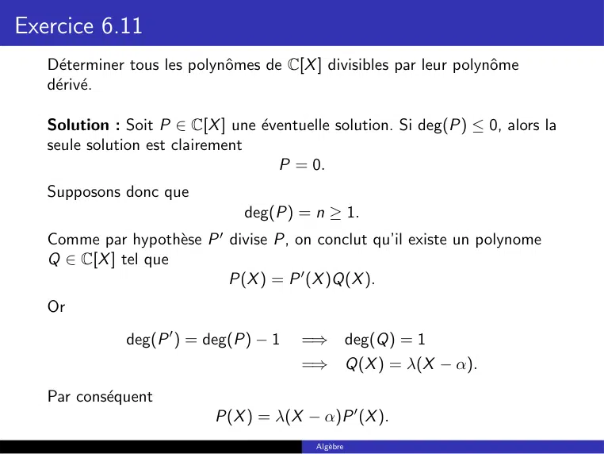

~~~text
Exercice 6.11
   Déterminer tous les polynômes de C[X ] divisibles par leur polynôme
   dérivé.

   Solution : Soit P ∈ C[X ] une éventuelle solution. Si deg(P) ≤ 0, alors la
   seule solution est clairement
                                    P = 0.
   Supposons donc que
                                deg(P) = n ≥ 1.
                            0
   Comme par hypothèse P divise P, on conclut qu’il existe un polynome
   Q ∈ C[X ] tel que
                          P(X ) = P 0 (X )Q(X ).
   Or
              deg(P 0 ) = deg(P) − 1    =⇒ deg(Q) = 1
                                        =⇒ Q(X ) = λ(X − α).
   Par conséquent
                           P(X ) = λ(X − α)P 0 (X ).
                                          Algèbre
~~~

## Page 29

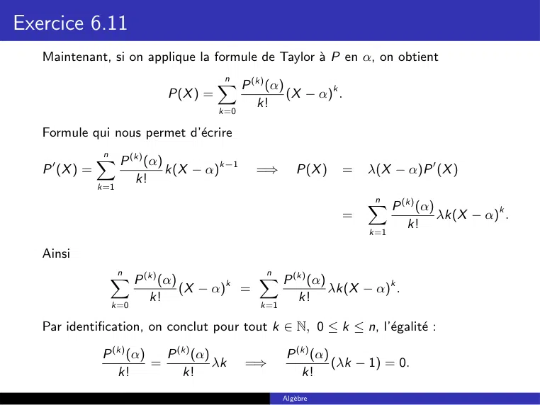

~~~text
Exercice 6.11
   Maintenant, si on applique la formule de Taylor à P en α, on obtient
                                            n
                                            X P (k) (α)
                                  P(X ) =                 (X − α)k .
                                                   k!
                                            k=0

   Formule qui nous permet d’écrire
                n
                X P (k) (α)
   P 0 (X ) =                     k(X − α)k−1      =⇒        P(X )     =   λ(X − α)P 0 (X )
                        k!
                k=1
                                                                           n
                                                                           X P (k) (α)
                                                                       =                 λk(X − α)k .
                                                                                    k!
                                                                           k=1

   Ainsi
                  n                                n
                  X P (k) (α)                      X P (k) (α)
                                    (X − α)k =                       λk(X − α)k .
                             k!                               k!
                  k=0                              k=1

   Par identification, on conclut pour tout k ∈ N, 0 ≤ k ≤ n, l’égalité :

                 P (k) (α)   P (k) (α)                    P (k) (α)
                           =           λk         =⇒                (λk − 1) = 0.
                    k!          k!                           k!
                                                         Algèbre
~~~

## Page 30

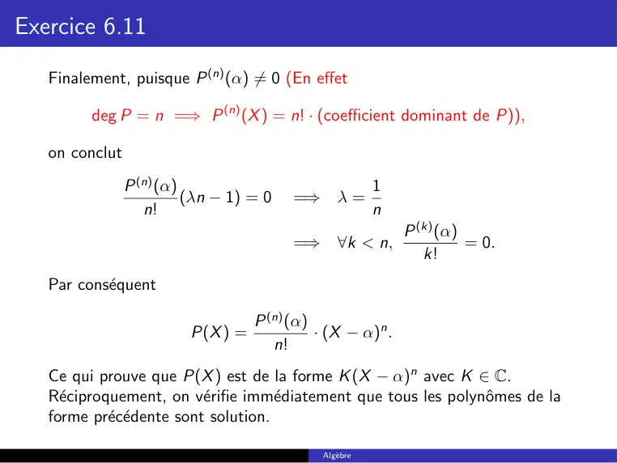

~~~text
Exercice 6.11

   Finalement, puisque P (n) (α) 6= 0 (En effet

         deg P = n =⇒ P (n) (X ) = n! · (coefficient dominant de P)),

   on conclut
                P (n) (α)                               1
                          (λn − 1) = 0   =⇒ λ =
                   n!                                   n
                                                            P (k) (α)
                                         =⇒ ∀k < n,                   = 0.
                                                               k!
   Par conséquent

                                   P (n) (α)
                         P(X ) =             · (X − α)n .
                                      n!
   Ce qui prouve que P(X ) est de la forme K (X − α)n avec K ∈ C.
   Réciproquement, on vérifie immédiatement que tous les polynômes de la
   forme précédente sont solution.

                                             Algèbre
~~~

## Page 31

~~~text
Exercice 6.12
   Justifier les divisibilités suivantes :
   (1) Pour tout n ∈ N, X 2 divise (X + 1)n − nX − 1.
   (2) Pour tout n ∈ N∗ (X − 1)3 divise nX n+2 − (n + 2)X n+1 + (n + 2)X − n.
   Solution :
   (1) Soit P(X ) = (X + 1)n − nX − 1. Commençons par noter que

       X 2 divise P     ⇐⇒       0 est une racine de multiplicite au moins 2.

   Montrons donc que 0 est une racine au moins double de P. Si n = 0, alors P est
   le polynome nul et P est divisible par X 2 . Supposons n ≥ 1, alors nous avons

                      P(0) = (0 + 1)n − n · 0 − 1 = 1 − 1 = 0.

   Ainsi 0 est une racine de P. De plus

        P 0 (X ) = n(X + 1)n−1 − n        =⇒   P 0 (0) = n(0 + 1)n−1 − n = 0.

   Ainsi 0 est une racine de P 0 . Par conséquent, 0 est une racine au moins double
   de P. Donc X 2 divise P.

                                                Algèbre
~~~

## Page 32

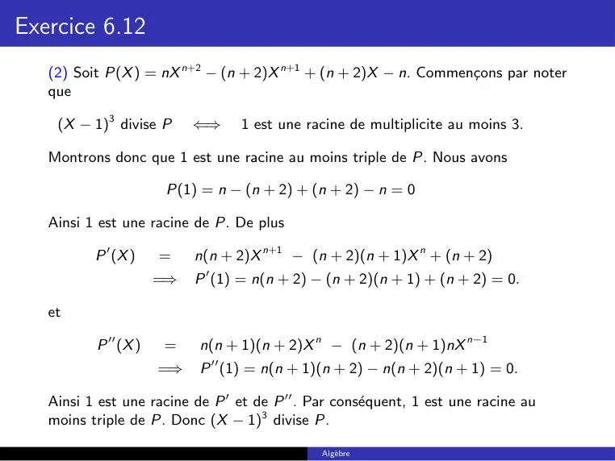

~~~text
Exercice 6.12
   (2) Soit P(X ) = nX n+2 − (n + 2)X n+1 + (n + 2)X − n. Commençons par noter
   que

    (X − 1)3 divise P      ⇐⇒     1 est une racine de multiplicite au moins 3.

   Montrons donc que 1 est une racine au moins triple de P. Nous avons

                       P(1) = n − (n + 2) + (n + 2) − n = 0

   Ainsi 1 est une racine de P. De plus

          P 0 (X )    =    n(n + 2)X n+1 − (n + 2)(n + 1)X n + (n + 2)
                      =⇒   P 0 (1) = n(n + 2) − (n + 2)(n + 1) + (n + 2) = 0.

   et

          P 00 (X )   =    n(n + 1)(n + 2)X n − (n + 2)(n + 1)nX n−1
                      =⇒   P 00 (1) = n(n + 1)(n + 2) − n(n + 2)(n + 1) = 0.

   Ainsi 1 est une racine de P 0 et de P 00 . Par conséquent, 1 est une racine au
   moins triple de P. Donc (X − 1)3 divise P.

                                               Algèbre
~~~

## Page 33

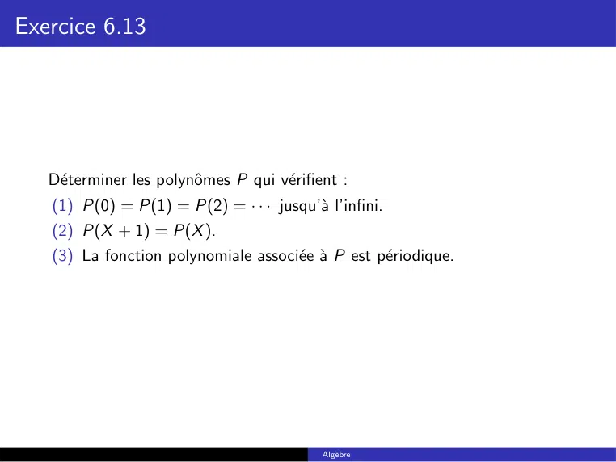

~~~text
Exercice 6.13

   Déterminer les polynômes P qui vérifient :
   (1) P(0) = P(1) = P(2) = · · · jusqu’à l’infini.
   (2) P(X + 1) = P(X ).
   (3) La fonction polynomiale associée à P est périodique.

                                            Algèbre
~~~

## Page 34

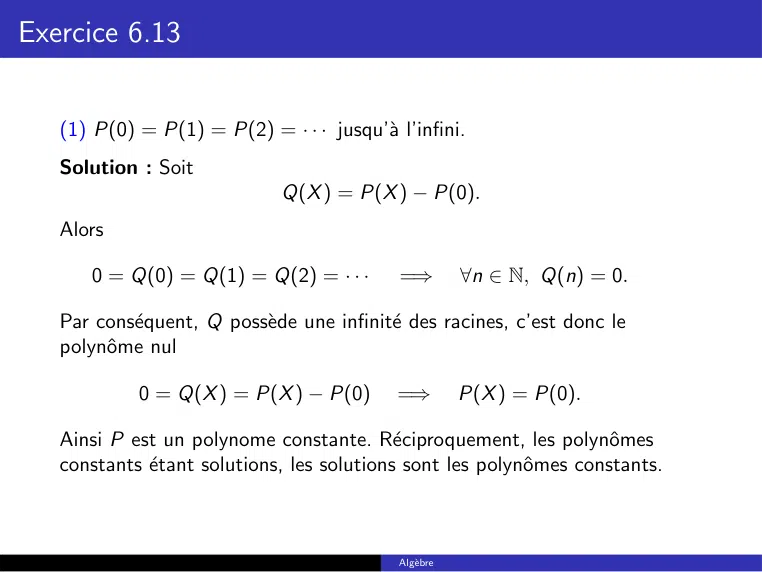

~~~text
Exercice 6.13

   (1) P(0) = P(1) = P(2) = · · · jusqu’à l’infini.
   Solution : Soit
                             Q(X ) = P(X ) − P(0).
   Alors

      0 = Q(0) = Q(1) = Q(2) = · · ·        =⇒        ∀n ∈ N, Q(n) = 0.

   Par conséquent, Q possède une infinité des racines, c’est donc le
   polynôme nul

            0 = Q(X ) = P(X ) − P(0)       =⇒         P(X ) = P(0).

   Ainsi P est un polynome constante. Réciproquement, les polynômes
   constants étant solutions, les solutions sont les polynômes constants.

                                           Algèbre
~~~

## Page 35

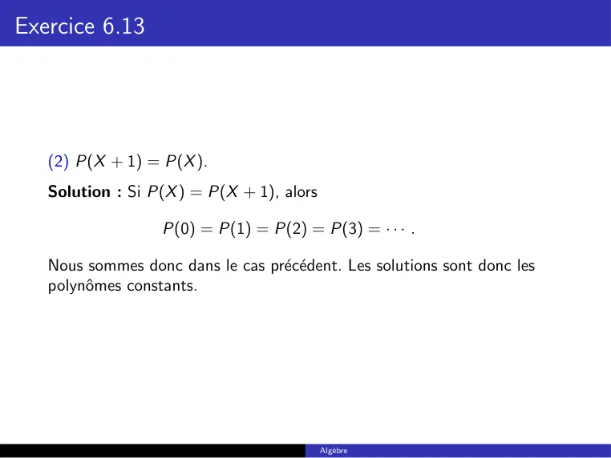

~~~text
Exercice 6.13

   (2) P(X + 1) = P(X ).
   Solution : Si P(X ) = P(X + 1), alors

                   P(0) = P(1) = P(2) = P(3) = · · · .

   Nous sommes donc dans le cas précédent. Les solutions sont donc les
   polynômes constants.

                                           Algèbre
~~~

## Page 36

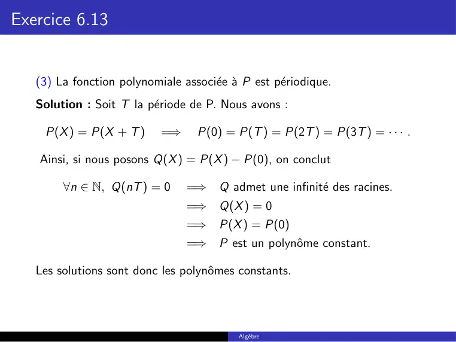

~~~text
Exercice 6.13

   (3) La fonction polynomiale associée à P est périodique.
   Solution : Soit T la période de P. Nous avons :

    P(X ) = P(X + T )       =⇒     P(0) = P(T ) = P(2T ) = P(3T ) = · · · .

   Ainsi, si nous posons Q(X ) = P(X ) − P(0), on conclut

        ∀n ∈ N, Q(nT ) = 0       =⇒ Q admet une infinité des racines.
                                 =⇒ Q(X ) = 0
                                 =⇒ P(X ) = P(0)
                                 =⇒ P est un polynôme constant.

   Les solutions sont donc les polynômes constants.

                                           Algèbre
~~~

## Page 37

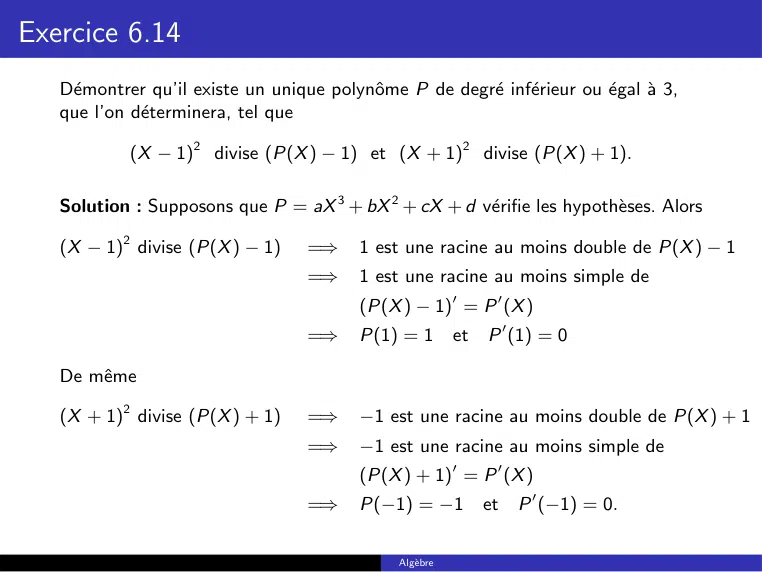

~~~text
Exercice 6.14
   Démontrer qu’il existe un unique polynôme P de degré inférieur ou égal à 3,
   que l’on déterminera, tel que

            (X − 1)2 divise (P(X ) − 1) et (X + 1)2 divise (P(X ) + 1).

   Solution : Supposons que P = aX 3 + bX 2 + cX + d vérifie les hypothèses. Alors

   (X − 1)2 divise (P(X ) − 1)     =⇒     1 est une racine au moins double de P(X ) − 1
                                   =⇒     1 est une racine au moins simple de
                                          (P(X ) − 1)0 = P 0 (X )
                                   =⇒     P(1) = 1        et   P 0 (1) = 0

   De même

   (X + 1)2 divise (P(X ) + 1)     =⇒     −1 est une racine au moins double de P(X ) + 1
                                   =⇒     −1 est une racine au moins simple de
                                          (P(X ) + 1)0 = P 0 (X )
                                   =⇒     P(−1) = −1           et   P 0 (−1) = 0.

                                               Algèbre
~~~

## Page 38

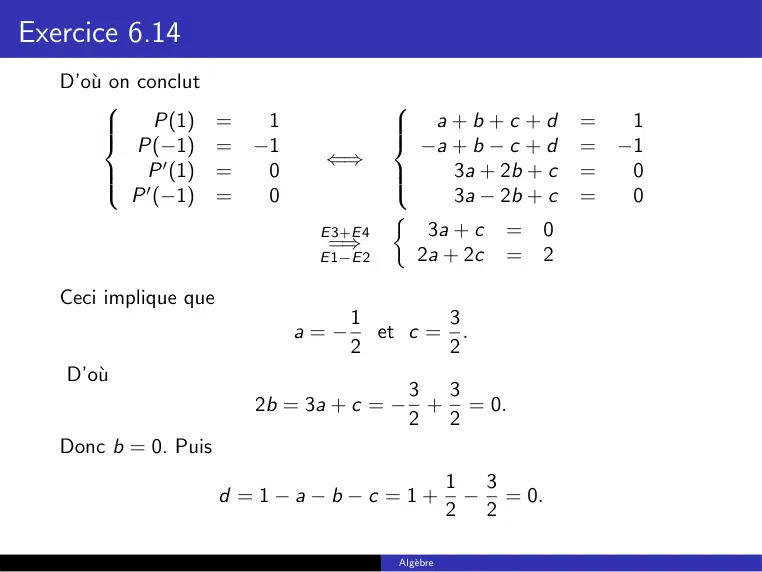

~~~text
Exercice 6.14
   D’où on conclut
                                        
        
             P(1)     =  1              
                                            a+b+c +d         =  1
            P(−1)      = −1                −a + b − c + d     = −1
                                        
                               ⇐⇒
         P 0 (1)      =  0                   3a + 2b + c    =  0
         0
                                        
           P (−1)      =  0                    3a − 2b + c    =  0
                                         
                                         
                               E 3+E 4      3a + c = 0
                                =⇒
                               E 1−E 2     2a + 2c = 2

   Ceci implique que
                                    1       3
                              a=−     et c = .
                                    2       2
   D’où
                                        3 3
                         2b = 3a + c = − + = 0.
                                        2 2
   Donc b = 0. Puis
                                                    1 3
                       d =1−a−b−c =1+                − = 0.
                                                    2 2

                                         Algèbre
~~~

## Page 39

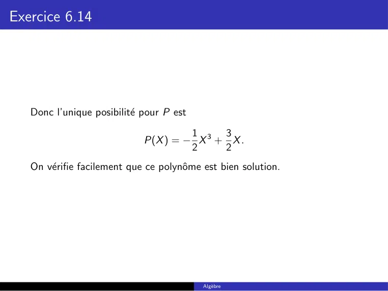

~~~text
Exercice 6.14

   Donc l’unique posibilité pour P est
                                      1     3
                             P(X ) = − X 3 + X .
                                      2     2
   On vérifie facilement que ce polynôme est bien solution.

                                           Algèbre
~~~

## Page 40

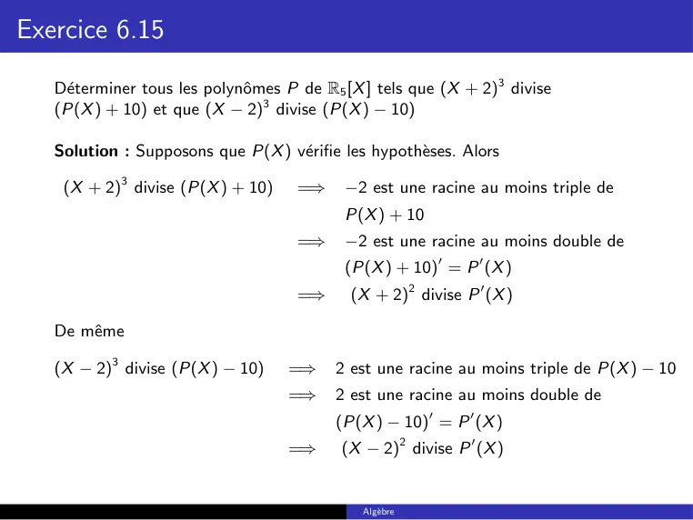

~~~text
Exercice 6.15

   Déterminer tous les polynômes P de R5 [X ] tels que (X + 2)3 divise
   (P(X ) + 10) et que (X − 2)3 divise (P(X ) − 10)

   Solution : Supposons que P(X ) vérifie les hypothèses. Alors

    (X + 2)3 divise (P(X ) + 10)    =⇒     −2 est une racine au moins triple de
                                           P(X ) + 10
                                    =⇒     −2 est une racine au moins double de
                                           (P(X ) + 10)0 = P 0 (X )
                                    =⇒      (X + 2)2 divise P 0 (X )

   De même

   (X − 2)3 divise (P(X ) − 10)    =⇒     2 est une racine au moins triple de P(X ) − 10
                                   =⇒     2 est une racine au moins double de
                                          (P(X ) − 10)0 = P 0 (X )
                                   =⇒      (X − 2)2 divise P 0 (X )

                                              Algèbre
~~~

## Page 41

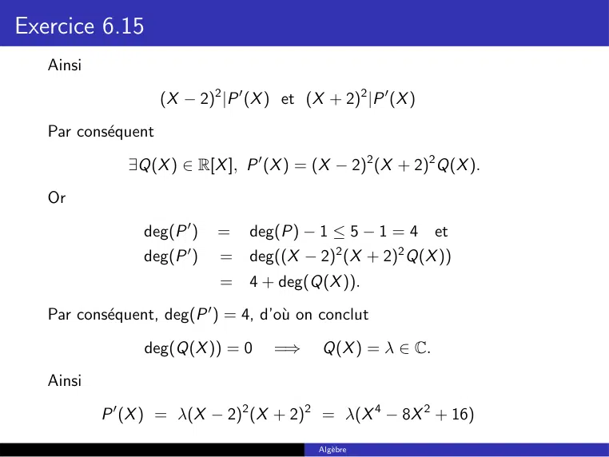

~~~text
Exercice 6.15
   Ainsi
                     (X − 2)2 |P 0 (X ) et (X + 2)2 |P 0 (X )
   Par conséquent
               ∃Q(X ) ∈ R[X ], P 0 (X ) = (X − 2)2 (X + 2)2 Q(X ).
   Or
                 deg(P 0 )    =    deg(P) − 1 ≤ 5 − 1 = 4       et
                 deg(P 0 )    =    deg((X − 2)2 (X + 2)2 Q(X ))
                              =    4 + deg(Q(X )).
   Par conséquent, deg(P 0 ) = 4, d’où on conclut
                 deg(Q(X )) = 0       =⇒      Q(X ) = λ ∈ C.
   Ainsi
           P 0 (X ) = λ(X − 2)2 (X + 2)2 = λ(X 4 − 8X 2 + 16)
                                             Algèbre
~~~

## Page 42

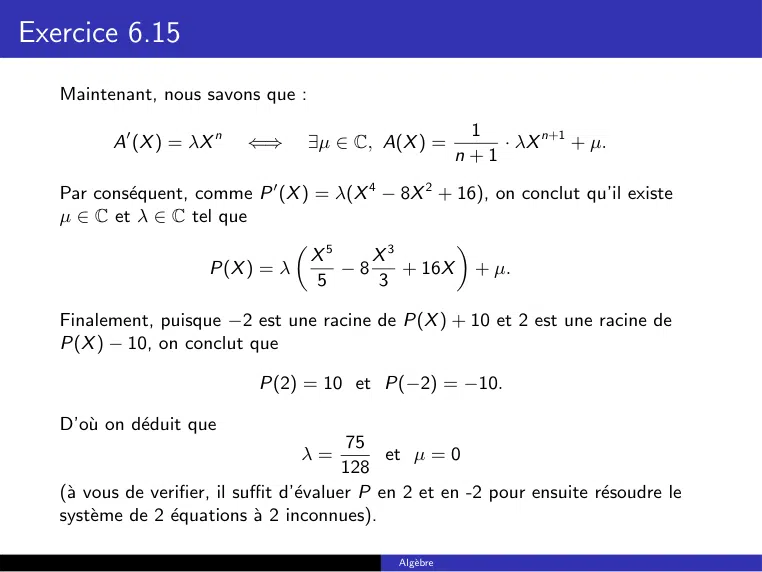

~~~text
Exercice 6.15
   Maintenant, nous savons que :
                                                            1
          A0 (X ) = λX n    ⇐⇒      ∃µ ∈ C, A(X ) =            · λX n+1 + µ.
                                                           n+1

   Par conséquent, comme P 0 (X ) = λ(X 4 − 8X 2 + 16), on conclut qu’il existe
   µ ∈ C et λ ∈ C tel que
                                 5
                                         X3
                                                    
                                  X
                      P(X ) = λ       −8     + 16X + µ.
                                   5       3

   Finalement, puisque −2 est une racine de P(X ) + 10 et 2 est une racine de
   P(X ) − 10, on conclut que

                             P(2) = 10 et P(−2) = −10.

   D’où on déduit que
                                             75
                                   λ=            et µ = 0
                                            128
   (à vous de verifier, il suffit d’évaluer P en 2 et en -2 pour ensuite résoudre le
   système de 2 équations à 2 inconnues).

                                                Algèbre
~~~

## Page 43

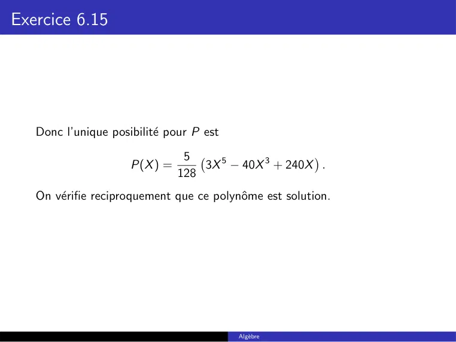

~~~text
Exercice 6.15

   Donc l’unique posibilité pour P est
                                5
                                   3X 5 − 40X 3 + 240X .
                                                      
                     P(X ) =
                               128
   On vérifie reciproquement que ce polynôme est solution.

                                          Algèbre
~~~

## Page 44

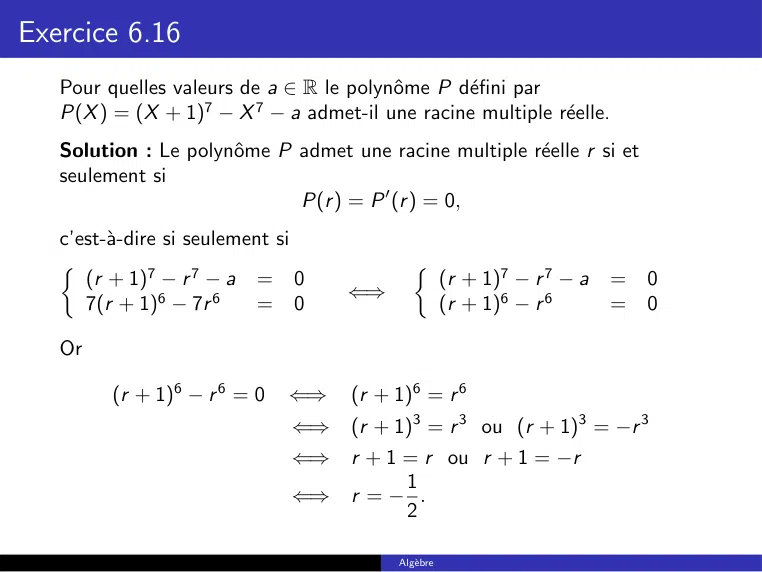

~~~text
Exercice 6.16
   Pour quelles valeurs de a ∈ R le polynôme P défini par
   P(X ) = (X + 1)7 − X 7 − a admet-il une racine multiple réelle.
   Solution : Le polynôme P admet une racine multiple réelle r si et
   seulement si
                             P(r ) = P 0 (r ) = 0,
   c’est-à-dire si seulement si
      (r + 1)7 − r 7 − a = 0                         (r + 1)7 − r 7 − a
                                            
                                                                          =   0
                                    ⇐⇒
      7(r + 1)6 − 7r 6      = 0                      (r + 1)6 − r 6       =   0

   Or

         (r + 1)6 − r 6 = 0   ⇐⇒    (r + 1)6 = r 6
                              ⇐⇒    (r + 1)3 = r 3 ou (r + 1)3 = −r 3
                              ⇐⇒    r + 1 = r ou r + 1 = −r
                                          1
                              ⇐⇒    r =− .
                                          2

                                          Algèbre
~~~

## Page 45

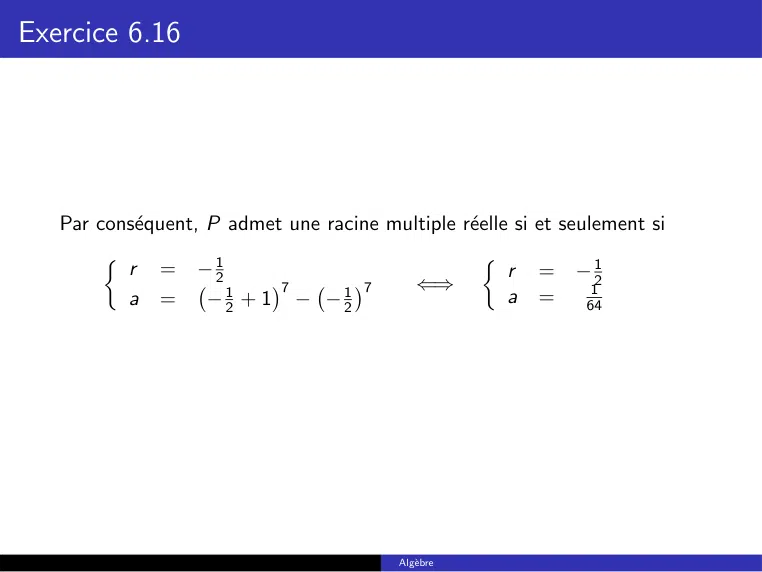

~~~text
Exercice 6.16

   Par conséquent, P admet une racine multiple réelle si et seulement si

          r = − 12                                     r = − 21
                                                  
                      1
                           7     1
                                     7   ⇐⇒                      1
          a = −2 + 1 − −2                              a =       64

                                          Algèbre
~~~

## Page 46

~~~text
Exercice 6.17
   Soit P = an X n + · · · + a0 un polynôme à coefficients entiers tel que
   a0 an 6= 0. Montrer que si r = qp avec p et q premiers entre eux, est une
   racine rationnelle de P alors p divise a0 et q divise an .

   Solution : Soir r = qp avec p et q premiers entre eux. Par hypothèse
   nous avons
                               pn          p n−1               p
        P(r ) = 0   ⇐⇒      an     +  an−1        + · · · + a1 + a0 = 0
                               qn          q n−1               q
                    ⇐⇒      an p n + an−1 p n−1 q + · · · + a1 pq n−1 + a0 q n = 0.
   Posons
         S = an p n + an−1 p n−1 q + · · · + a1 pq n−1    =⇒      S + a0 q n = 0
                                                          =⇒      S = −a0 q n ,
   et
        T = an−1 p n−1 q + · · · + a1 pq n−1 + a0 q n     =⇒ an p n + T = 0
                                                          =⇒ T = −an p n .
                                              Algèbre
~~~

## Page 47

~~~text
Exercice 6.17

   Maintenant

   p|S   =⇒ p|(−a0 q n ) or q et p sont premiers entre eux   =⇒   p|a0 .
   q|T   =⇒ q|(−an p n ) or q et p sont premiers entre eux   =⇒   q|an .

                                      Algèbre
~~~

## Page 48

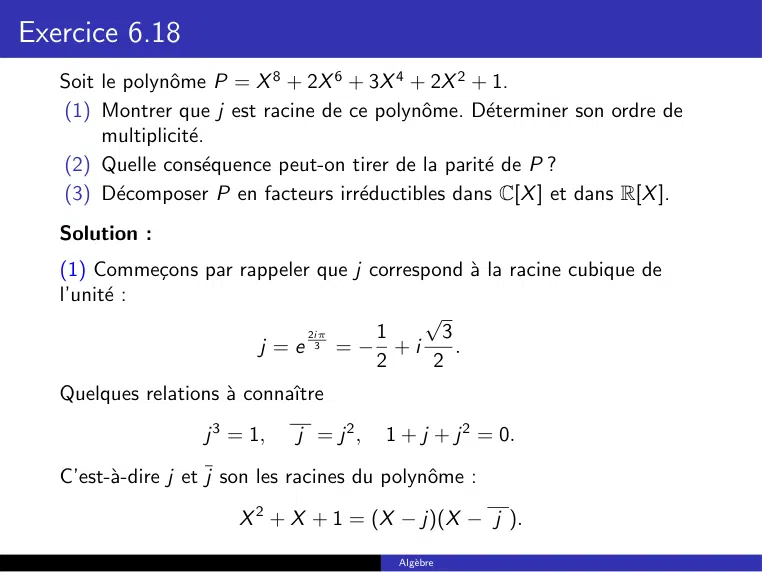

~~~text
Exercice 6.18
   Soit le polynôme P = X 8 + 2X 6 + 3X 4 + 2X 2 + 1.
   (1) Montrer que j est racine de ce polynôme. Déterminer son ordre de
        multiplicité.
   (2) Quelle conséquence peut-on tirer de la parité de P ?
   (3) Décomposer P en facteurs irréductibles dans C[X ] et dans R[X ].
   Solution :
   (1) Commeçons par rappeler que j correspond à la racine cubique de
   l’unité :
                                           √
                              2iπ     1      3
                        j =e 3 =− +i           .
                                      2     2
   Quelques relations à connaı̂tre
                    j 3 = 1,   j = j 2,   1 + j + j 2 = 0.
   C’est-à-dire j et j son les racines du polynôme :
                        X 2 + X + 1 = (X − j)(X − j ).
                                            Algèbre
~~~

## Page 49

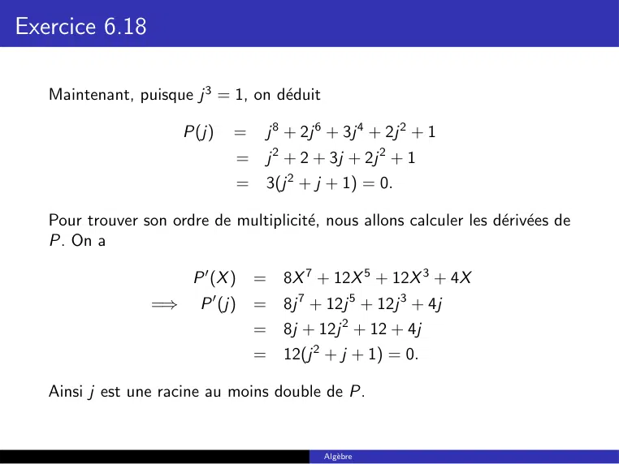

~~~text
Exercice 6.18

   Maintenant, puisque j 3 = 1, on déduit

                       P(j)    =   j 8 + 2j 6 + 3j 4 + 2j 2 + 1
                               = j 2 + 2 + 3j + 2j 2 + 1
                               = 3(j 2 + j + 1) = 0.

   Pour trouver son ordre de multiplicité, nous allons calculer les dérivées de
   P. On a

                        P 0 (X )   =   8X 7 + 12X 5 + 12X 3 + 4X
                  =⇒     P 0 (j) =     8j 7 + 12j 5 + 12j 3 + 4j
                                   =   8j + 12j 2 + 12 + 4j
                                   =   12(j 2 + j + 1) = 0.

   Ainsi j est une racine au moins double de P.

                                             Algèbre
~~~

## Page 50

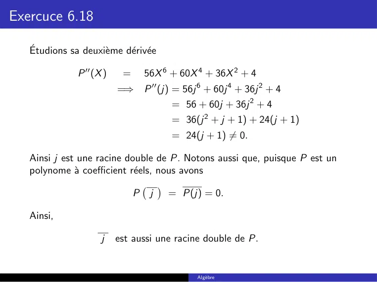

~~~text
Exercuce 6.18

   Étudions sa deuxième dérivée

               P 00 (X )    =    56X 6 + 60X 4 + 36X 2 + 4
                           =⇒ P 00 (j) = 56j 6 + 60j 4 + 36j 2 + 4
                                        = 56 + 60j + 36j 2 + 4
                                        = 36(j 2 + j + 1) + 24(j + 1)
                                        = 24(j + 1) 6= 0.

   Ainsi j est une racine double de P. Notons aussi que, puisque P est un
   polynome à coefficient réels, nous avons
                                   
                            P j = P(j) = 0.

   Ainsi,

                      j    est aussi une racine double de P.

                                              Algèbre
~~~

## Page 51

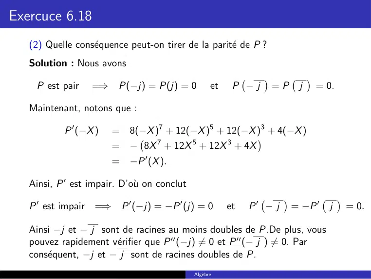

~~~text
Exercuce 6.18
   (2) Quelle conséquence peut-on tirer de la parité de P ?
   Solution : Nous avons
                                                                               
    P est pair      =⇒ P(−j) = P(j) = 0             et    P −j       =P     j       = 0.

   Maintenant, notons que :

           P 0 (−X )   =   8(−X )7 + 12(−X )5 + 12(−X )3 + 4(−X )
                           − 8X 7 + 12X 5 + 12X 3 + 4X
                                                       
                       =
                       =   −P 0 (X ).

   Ainsi, P 0 est impair. D’où on conclut

   P 0 est impair   =⇒ P 0 (−j) = −P 0 (j) = 0                P0 − j       = −P 0
                                                                                          
                                                         et                           j        = 0.

   Ainsi −j et − j sont de racines au moins doubles de P.De plus, vous
   pouvez rapidement vérifier que P 00 (−j) 6= 0 et P 00 (− j ) 6= 0. Par
   conséquent, −j et − j sont de racines doubles de P.
                                             Algèbre
~~~

## Page 52

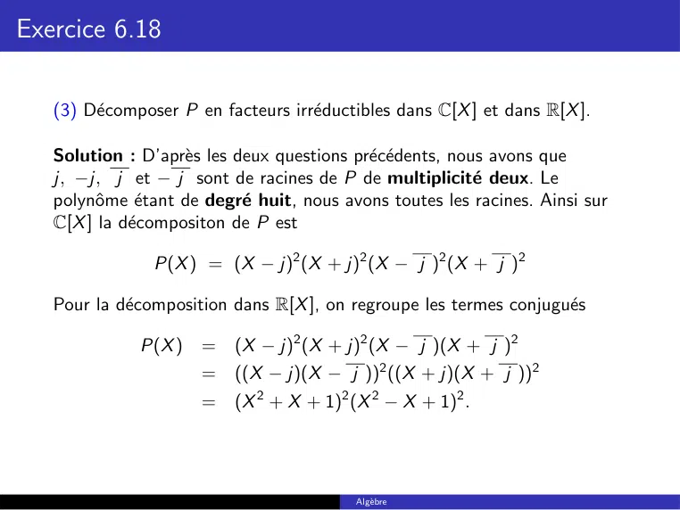

~~~text
Exercice 6.18

   (3) Décomposer P en facteurs irréductibles dans C[X ] et dans R[X ].

   Solution : D’après les deux questions précédents, nous avons que
   j, −j, j et − j sont de racines de P de multiplicité deux. Le
   polynôme étant de degré huit, nous avons toutes les racines. Ainsi sur
   C[X ] la décompositon de P est

                P(X ) = (X − j)2 (X + j)2 (X − j )2 (X + j )2

   Pour la décomposition dans R[X ], on regroupe les termes conjugués

              P(X ) =     (X − j)2 (X + j)2 (X − j )(X + j )2
                      =   ((X − j)(X − j ))2 ((X + j)(X + j ))2
                      =   (X 2 + X + 1)2 (X 2 − X + 1)2 .

                                          Algèbre
~~~

## Page 53

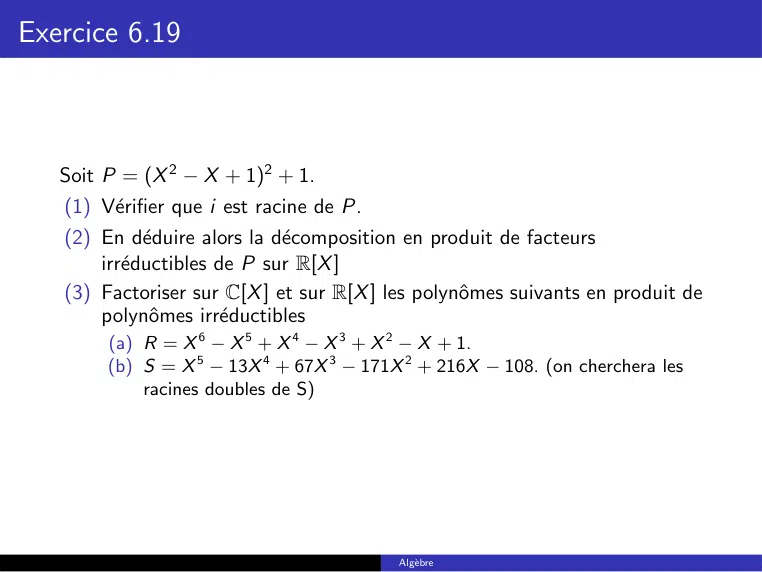

~~~text
Exercice 6.19

   Soit P = (X 2 − X + 1)2 + 1.
   (1) Vérifier que i est racine de P.
   (2) En déduire alors la décomposition en produit de facteurs
       irréductibles de P sur R[X ]
   (3) Factoriser sur C[X ] et sur R[X ] les polynômes suivants en produit de
       polynômes irréductibles
        (a) R = X 6 − X 5 + X 4 − X 3 + X 2 − X + 1.
        (b) S = X 5 − 13X 4 + 67X 3 − 171X 2 + 216X − 108. (on cherchera les
            racines doubles de S)

                                          Algèbre
~~~

## Page 54

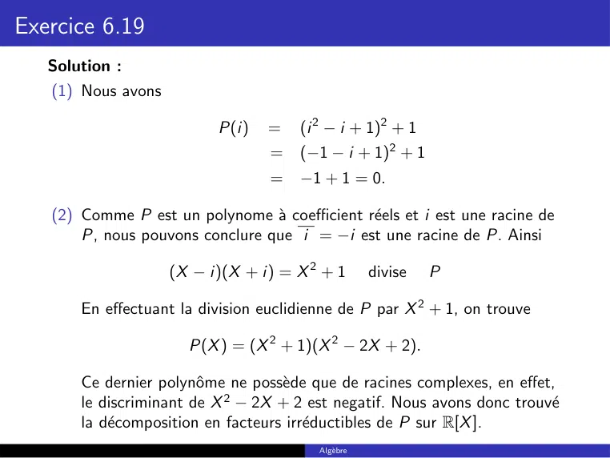

~~~text
Exercice 6.19
   Solution :
   (1) Nous avons

                          P(i)    =   (i 2 − i + 1)2 + 1
                                  =   (−1 − i + 1)2 + 1
                                  =   −1 + 1 = 0.

   (2) Comme P est un polynome à coefficient réels et i est une racine de
       P, nous pouvons conclure que i = −i est une racine de P. Ainsi

                    (X − i)(X + i) = X 2 + 1        divise   P

       En effectuant la division euclidienne de P par X 2 + 1, on trouve

                      P(X ) = (X 2 + 1)(X 2 − 2X + 2).

       Ce dernier polynôme ne possède que de racines complexes, en effet,
       le discriminant de X 2 − 2X + 2 est negatif. Nous avons donc trouvé
       la décomposition en facteurs irréductibles de P sur R[X ].
                                         Algèbre
~~~

## Page 55

~~~text
Exercice 6.19
   (3)(a) R = X 6 − X 5 + X 4 − X 3 + X 2 − X + 1
   Solution : Nous avons
                                                     6
                                                     X                1 + X7
   R = X6 − X5 + X4 − X3 + X2 − X + 1 =                    (−X )k =          .
                                                                      1+X
                                                     k=0
                                          7
   Les racines de R sont donc celles de X + 1 sauf −1. Ainsi :
                             π           π
                                                     3π
                                                                 3π
                                                                      
         R(X ) = X − e i 7 X − e −i 7 X − e i 7            X − e −i 7
                                  5π
                                               5π
                                                    
                          · X − ei 7     X − e −i 7 .

   C’est la décomposition de P dans C[X ]. Pour trouver la décomposition
   de P dans R[X ], on regroupe les termes conjugués
                                π                     
                                                           3π
                                                                      
       R(X ) =       X 2 − 2 cos     X +1     X 2 − 2 cos        X +1
                                  7                         7
                                                
                                        5π
                         · X 2 − 2 cos       X +1 .
                                         7
                                          Algèbre
~~~

## Page 56

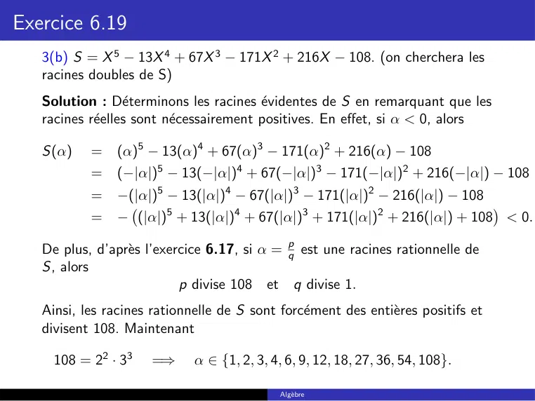

~~~text
Exercice 6.19
   3(b) S = X 5 − 13X 4 + 67X 3 − 171X 2 + 216X − 108. (on cherchera les
   racines doubles de S)
   Solution : Déterminons les racines évidentes de S en remarquant que les
   racines réelles sont nécessairement positives. En effet, si α < 0, alors

   S(α)    = (α)5 − 13(α)4 + 67(α)3 − 171(α)2 + 216(α) − 108
           = (−|α|)5 − 13(−|α|)4 + 67(−|α|)3 − 171(−|α|)2 + 216(−|α|) − 108
           = −(|α|)5 − 13(|α|)4 − 67(|α|)3 − 171(|α|)2 − 216(|α|) − 108
           = − (|α|)5 + 13(|α|)4 + 67(|α|)3 + 171(|α|)2 + 216(|α|) + 108 < 0.
                                                                        

   De plus, d’après l’exercice 6.17, si α = qp est une racines rationnelle de
   S, alors
                           p divise 108 et q divise 1.
   Ainsi, les racines rationnelle de S sont forcément des entières positifs et
   divisent 108. Maintenant

     108 = 22 · 33    =⇒     α ∈ {1, 2, 3, 4, 6, 9, 12, 18, 27, 36, 54, 108}.

                                            Algèbre
~~~

## Page 57

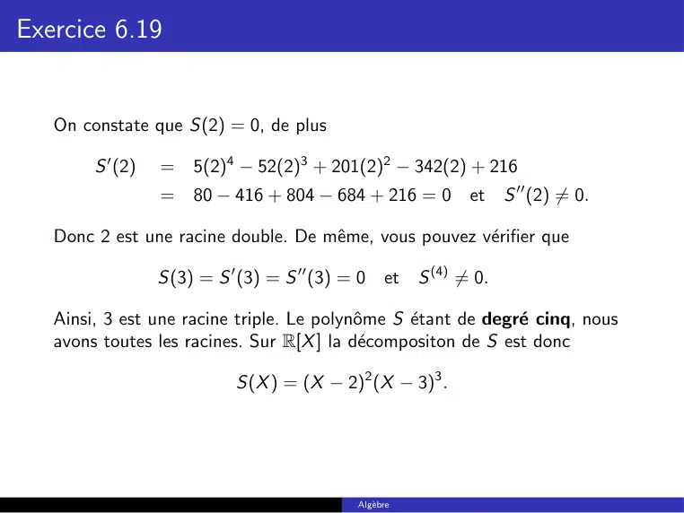

~~~text
Exercice 6.19

   On constate que S(2) = 0, de plus

        S 0 (2)   = 5(2)4 − 52(2)3 + 201(2)2 − 342(2) + 216
                  = 80 − 416 + 804 − 684 + 216 = 0 et                 S 00 (2) 6= 0.

   Donc 2 est une racine double. De même, vous pouvez vérifier que

                  S(3) = S 0 (3) = S 00 (3) = 0    et   S (4) 6= 0.

   Ainsi, 3 est une racine triple. Le polynôme S étant de degré cinq, nous
   avons toutes les racines. Sur R[X ] la décompositon de S est donc

                            S(X ) = (X − 2)2 (X − 3)3 .

                                             Algèbre
~~~

## Page 58

~~~text
Exercice 6.20

   Dans chacun des cas suivants, factoriser le polynôme P dans C[X ] et
   dans R[X ] :
   (1) P(X ) = X 4 − 1
   (2) P(X ) = (X 2 − X + 1)2 + 1
   (3) P(X ) = X 4 + X 2 + 1
   (4) P(X ) = X 8 + X 4 + 1
   (5) P(X ) = X 6 + 1
   (6) P(X ) = X 12 − 1
   (7) P(X ) = X 9 + X 6 + X 3 + 1

                                         Algèbre
~~~

## Page 59

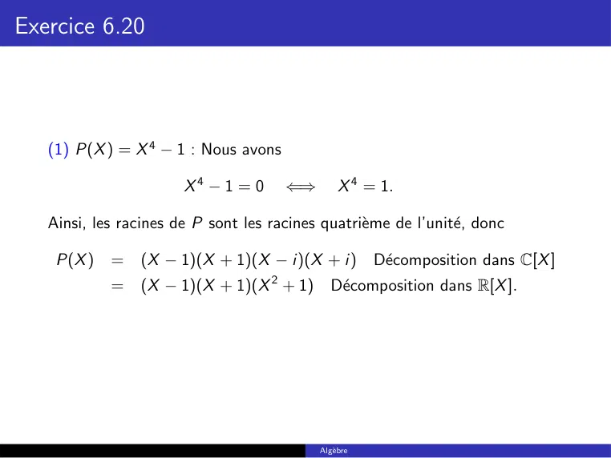

~~~text
Exercice 6.20

   (1) P(X ) = X 4 − 1 : Nous avons

                       X4 − 1 = 0     ⇐⇒         X 4 = 1.

   Ainsi, les racines de P sont les racines quatrième de l’unité, donc

    P(X )   =    (X − 1)(X + 1)(X − i)(X + i) Décomposition dans C[X ]
            =    (X − 1)(X + 1)(X 2 + 1)       Décomposition dans R[X ].

                                            Algèbre
~~~

## Page 60

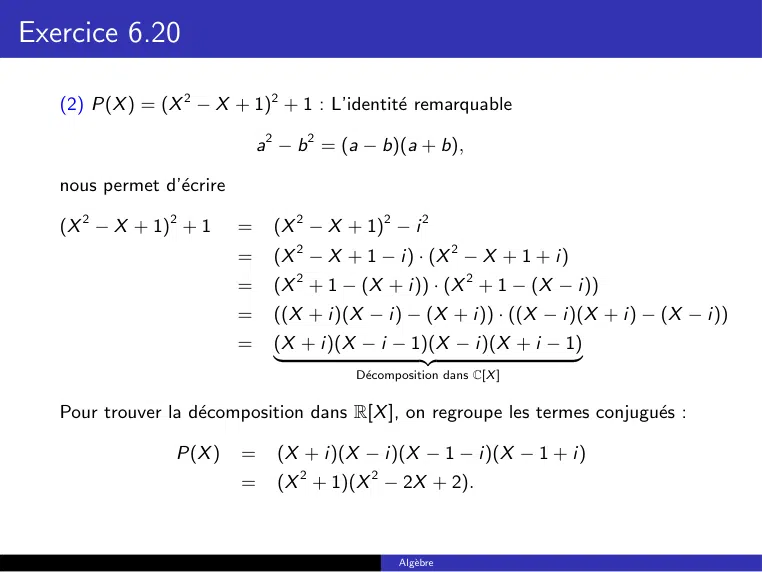

~~~text
Exercice 6.20

   (2) P(X ) = (X 2 − X + 1)2 + 1 : L’identité remarquable

                               a2 − b 2 = (a − b)(a + b),

   nous permet d’écrire

   (X 2 − X + 1)2 + 1      =     (X 2 − X + 1)2 − i 2
                           =     (X 2 − X + 1 − i) · (X 2 − X + 1 + i)
                           =     (X 2 + 1 − (X + i)) · (X 2 + 1 − (X − i))
                           =     ((X + i)(X − i) − (X + i)) · ((X − i)(X + i) − (X − i))
                           =     (X + i)(X − i − 1)(X − i)(X + i − 1)
                                 |                {z                }
                                           Décomposition dans C[X ]

   Pour trouver la décomposition dans R[X ], on regroupe les termes conjugués :

                 P(X )     =     (X + i)(X − i)(X − 1 − i)(X − 1 + i)
                           =     (X 2 + 1)(X 2 − 2X + 2).

                                                  Algèbre
~~~

## Page 61

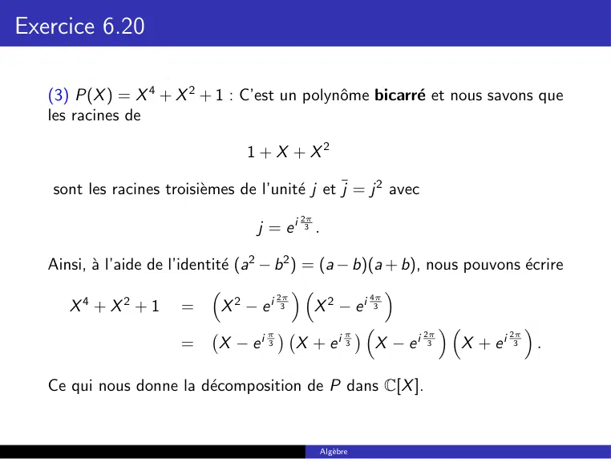

~~~text
Exercice 6.20

   (3) P(X ) = X 4 + X 2 + 1 : C’est un polynôme bicarré et nous savons que
   les racines de

                                  1 + X + X2

   sont les racines troisièmes de l’unité j et j = j 2 avec
                                           2π
                                    j = ei 3 .

   Ainsi, à l’aide de l’identité (a2 − b 2 ) = (a − b)(a + b), nous pouvons écrire
                                        2π
                                                      4π
                                                           
      X4 + X2 + 1 =             X 2 − ei 3      X 2 − ei 3
                                        π           π
                                                                2π
                                                                          2π
                                                                               
                          = X − ei 3 X + ei 3 X − ei 3                X + ei 3 .

   Ce qui nous donne la décomposition de P dans C[X ].

                                                Algèbre
~~~

## Page 62

~~~text
Exercice 6.20

   Pour trouver la décomposition dans R[X ], on regroupe les termes
   conjugués :
                                π       π
                                                     2π
                                                                   2π
                                                                        
   X 4 + X 2 + 1 = X − ei 3 X + ei 3 X − ei 3                 X + ei 3
                                π            π
                                                          2π
                                                                            2π
                                                                                 
                   = X − e i 3 X − e iπ e i 3 X − e i 3          X − e iπ e i 3
                                π
                                         4π
                                                      2π
                                                                     5π
                                                                           
                   = X − ei 3 X − ei 3           X − ei 3       X − ei 3
                                π
                                           2π
                                                        2π
                                                                          π
                   = X − e i 3 X − e −i 3         X − ei 3       X − e −i 3
                                π          π
                                                       2π
                                                                        2π
                                                                             
                   = X − e i 3 X − e −i 3 X − e i 3             X − e −i 3
                    =    (X 2 − X + 1)(X 2 + X + 1).

                                             Algèbre
~~~

## Page 63

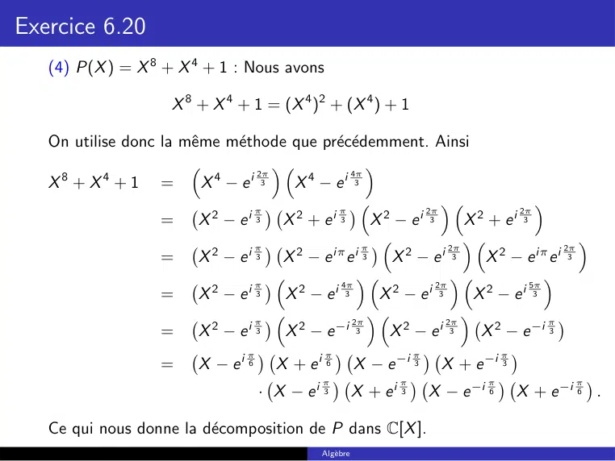

~~~text
Exercice 6.20
   (4) P(X ) = X 8 + X 4 + 1 : Nous avons

                      X 8 + X 4 + 1 = (X 4 )2 + (X 4 ) + 1

   On utilise donc la même méthode que précédemment. Ainsi
                                2π
                                               4π
                                                    
   X8 + X4 + 1 =         X 4 − ei 3   X 4 − ei 3
                                 π           π
                                                            2π
                                                                            2π
                                                                                 
                   = X 2 − ei 3 X 2 + ei 3 X 2 − ei 3                X 2 + ei 3
                                 π                π
                                                                 2π
                                                                                     2π
                                                                                          
                   = X 2 − e i 3 X 2 − e iπ e i 3 X 2 − e i 3            X 2 − e iπ e i 3
                                 π
                                              4π
                                                             2π
                                                                              5π
                                                                                   
                   = X 2 − ei 3 X 2 − ei 3            X 2 − ei 3       X 2 − ei 3
                                 π
                                                2π
                                                               2π
                                                                                  π
                   = X 2 − e i 3 X 2 − e −i 3          X 2 − ei 3       X 2 − e −i 3
                                π          π             π              π
                   = X − e i 6 X + e i 6 X − e −i 3 X + e −i 3
                                            π           π              π               π
                                  · X − e i 3 X + e i 3 X − e −i 6 X + e −i 6 .

   Ce qui nous donne la décomposition de P dans C[X ].
                                               Algèbre
~~~

## Page 64

~~~text
Exercice 6.20

   Pour trouver la décomposition dans R[X ], on regroupe les termes conjugués :
                               π
                                           π
                                                         π
                                                                       π
                                                                           
   X8 + X4 + 1 =         X − ei 6     X + ei 6    X − e −i 3    X + e −i 3
                                          π
                                                      π
                                                                    π
                                                                                   π
                                                                                       
                                  · X − ei 3     X + ei 3    X − e −i 6     X + e −i 6
                               π
                                             π
                                                         π
                                                                       π
                                                                           
                   =     X − ei 6     X − e −i 6    X − ei 3    X − e −i 3
                                          2π
                                                        2π
                                                                      5π
                                                                                     5π
                                                                                          
                                  · X − ei 3      X − e −i 3    X − ei 6      X − e −i 6
                              √                                              √          
                   =     X 2 + 3X + 1 (X 2 − X + 1)(X 2 + X + 1) X 2 − 3X + 1 .

                                              Algèbre
~~~

## Page 65

~~~text
Exercice 6.20
   (5) P(X ) = X 6 + 1 : Nous avons
            X6 + 1 = 0     ⇐⇒        X 6 = −1                   ⇐⇒   X 6 = e iπ .
   Les racines de P sont donc les racines 6es de −1 :
                                iπ   2kiπ
                               e6+ 6 ,          0 ≤ k ≤ 5.
   Donc
                         5                          
                                         iπ   2kiπ
                         Y
          X6 + 1   =           X −e 6 + 6
                         k=0
                                 π               π        π         π
                          X − ei 6      X − e −i 6 X − e i 2 X − e −i 2
                                     
                   =
                                              5π
                                                          5π
                                                               
                                     · X − ei 6     X − e −i 6 .
   Ainsi la décomposition de P dans C[X ] est :
                                       π        π
                                                       5π
                                                                 −5π
                                                                       
   X 6 + 1 = (X − i)(X + i) X − e i 6 X − e −i 6 X − e i 6   X − ei 6 .
   et la décomposition de P dans R[X ] est :
                                        √           √
             X 6 + 1 = (X 2 + 1)(X 2 + 3X + 1)(X 2 − 3X + 1).
                                                     Algèbre
~~~

## Page 66

~~~text
Exercice 6.20
   (6) P(X ) = X 12 − 1 : Nous avons

                                X 12 − 1 = 0        ⇐⇒       X 12 = 1.

   Les racines de P sont donc les racines 12es de l’unité :
                                            2ikπ
                                           e 12 ,   0 ≤ k ≤ 11.

   Donc
                         11                
                         Y           2ikπ
   X 12 − 1      =              X − e 12
                         k=0
                                                                   2π
                                                                               2π
                                                                                              π
                                                                                                  
                 =       (X − 1) (X + 1) (X − i) (X + i) X − e −i 3       X − ei 3     X − e −i 3
                                  π
                                             π
                                                           π
                                                                        5π
                                                                                     5π
                                                                                          
                          · X − ei 3    X − ei 6    X − e −i 6    X − e −i 6    X − ei 6

   Ce qui corresponds à la décomposition de P dans C[X ]. Pour trouver la
   décomposition dans R[X ], on regroupe les termes conjugués

      X 12 − 1       =     (X − 1)(X + 1)(X 2 + 1)(X 2 + X + 1)(X 2 − X + 1)
                                                         √              √
                                                 ·(X 2 + 3X + 1)(X 2 − 3X + 1)

                                                         Algèbre
~~~

## Page 67

~~~text
Exercice 6.20
   (7) P(X ) = X 9 + X 6 + X 3 + 1 : Nous avons
                                           3  2
               X9 + X6 + X3 + 1 =          X3 + X3 + X3 + 1
                                           2
                                      =    X 3 (X 3 + 1) + (X 3 + 1)

                                      =    (X 3 + 1)(X 6 + 1).
   Maintenant
    X3 + 1      =   (X + 1)(X 2 − X + 1)
                                   π
                                                π
                                                    
                =   (X + 1) X − e i 3    X − e −i 3      (racines cubiques de − 1)

   De plus, en utilisant la question 5, nous pouvons écrire
                                                           √               √
   (X 6 + 1) = (X + 1)(X 2 + 1)(X 2 − X + 1)(X 2 + 3X + 1)(X 2 − 3X + 1)
                                            π
                                                         π
                                                                    5π
                                                                                  5π
                                                                                       
               = (X − i)(X + i) X − e i 6         X − e −i 6    X − ei 3    X − e −i 3 .

   Ainsi la décomposition de P dans R[X ] est
                                                                      √
      X9 + X6 + X3 + 1      =   (X + 1)(X 2 + 1)(X 2 − X + 1)(X 2 +    3X + 1)
                                                     √
                                              ·(X 2 − 3X + 1).
                                              Algèbre
~~~

## Page 68

~~~text
Exercice 6.20

   Finalement, la décomposition de P dans C[X ] est
                                                          π         π
   X9 + X6 + X3 + 1    =    (X + 1)(X − i)(X + i) X − e i 6 X − e −i 6
                                        π         π
                                                            5π
                                                                        5π
                                                                             
                              · X − e i 3 X − e −i 3 X − e i 3    X − e −i 3 .

                                         Algèbre
~~~

## Page 69

~~~text
Exercice 6.21

   Soit P = X 4 − 5X 3 + 9X 2 − 15X + 18 ∈ C[X ]. Déterminer toutes les
   racines complexes de P sachant que deux d’entre elles ont 6 pour produit.
   Solution : Soient a, b, c et d les racines complexes de P. Nous avons

   P   =       X 4 − 5X 3 + 9X 2 − 15X + 18
           =   (X − a)(X − b)(X − c)(X − d)
           =   X 4 − (a + b + c + d)X 3 + (ab + ac + ad + bc + bd + cd)X 2
                                 − (abc + abd + acd + bcd)X + abcd

   Ainsi
                 
                 
                                 a+b+c +d           =  5
                   ab + ac + ad + bc + bd + cd       =  9
                 
                 
                        abc + abd + acd + bcd       = 15
                                          abcd       = 18
                 

                                          Algèbre
~~~

## Page 70

~~~text
Exercice 6.21
   Supposons que ab = 6. Le système devient alors
                                                  
   
              a+b+c +d =            5             
                                                          a+b+c +d =       5
      ac + ad + bc + bd + cd =       3                ac + ad + bc + bd =   0
                                                  
                                           =⇒
   
       6(c + d) + acd + bcd = 15                  
                                                    6(c + d) + 3(a + b) = 15
                          cd =       3                                cd =  3
                                                  
                                                   
                                                   
                                                         a+b+c +d = 5
                                                         (a + b)(c + d) = 0
                                                   
                                           =⇒
                                                   
                                                    (a + b) + 2(c + d) = 5
                                                                     cd = 3
                                                   

   D’où on conclut
          
          
                 a+b+c +d        =   5               
                 (a + b)(c + d)   =   0                   a+b     =   5
          
                                           =⇒
          
            (a + b) + 2(c + d)   =   5                   c +d    =   0
                             cd   =   3
          

   Ainsi
                                          
                     a+b    =     5            c +d       =   0
                                      et
                       ab   =     6               cd      =   3

                                           Algèbre
~~~

## Page 71

~~~text
Exercice 6.21

   Par conséquent, les racines de P satisfont

    a et b sont racines de X 2 − 5X + 6              =⇒ {a, b} = {2, 3}
                                                                 n√     √ o
         c et d sont racines de X 2 + 3              =⇒ {c, d} = i 3, −i 3

   Ce qui nous permet de trouver la décomposition en facteurs irréductibles
   de P en C[X ]
                                                 √         √
              P(X ) = (X − 2)(X − 3)(X − i 3)(X + i 3).

                                          Algèbre
~~~

## Page 72

~~~text
Exercice 6.22
   Soit x1 , x2 , x3 les racines de X 3 − 2X 2 + X + 3. Calculer x13 + x23 + x33 .

   Solution : Comme x1 , x2 , x3 sont les racines de X 3 − 2X 2 + X + 3, nous avons
   X 3 − 2X 2 + X + 3      =     (X − x1 )(X − x2 )(X − x3 )
                           =     X 3 − (x1 + x2 + x3 )X 2 + (x1 x2 + x1 x3 + x2 x3 )X − x1 x2 x3 .
   Donc par identification, nous avons
                        
                                 x1 + x2 + x3          =        2
                           x1 x2 + x1 x3 + x2 x3        =        1
                                         x1 x2 x3       =      −3.
                        

   De plus
                              3
                              x1     =     2x12 − x1 − 3
                               x3     =     2x22 − x2 − 3
                              23
                               x3     =    2x32 − x3 − 3.
   En additionnant ces 3 dernières équations, on obtient
               x13 + x23 + x33   =    2(x12 + x22 + x32 ) − (x1 + x2 + x3 ) − 9
                                 =    2(x12 + x22 + x32 ) − 2 − 9
                                 =    2(x12 + x22 + x32 ) − 11.
                                                    Algèbre
~~~

## Page 73

~~~text
Exercice 6.22

   Pour trouver la valeur de x12 + x22 + x32 , il suffit de noter que

           (x1 + x2 + x3 )2 = (x12 + x22 + x32 ) + 2(x1 x2 + x1 x3 + x2 x3 )

   Par conséquent

   x12 + x22 + x32 = (x1 + x2 + x3 )2 − 2(x1 x2 + x1 x3 + x2 x3 ) = 4 − 2 = 2.

   Ainsi

                          x13 + x23 + x33 = 4 − 11 = −7.

                                                Algèbre
~~~
