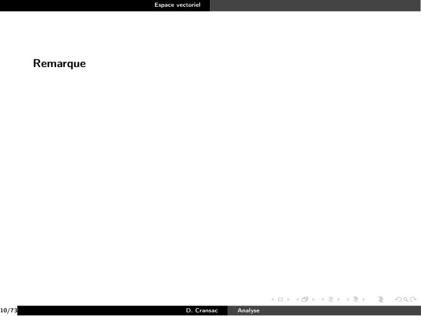
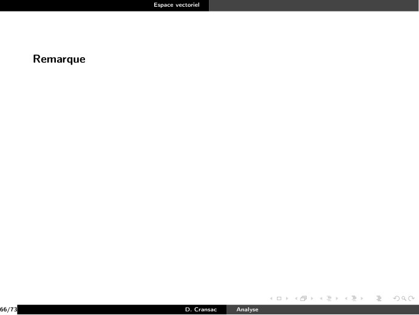

# CM3-Espace-Vectoriel_2021-2022_Algebre2_P1S2_DCransac.pdf

[Ouvrir l’original](https://drive.google.com/open?id=1yYtDT4vVXR5DjwhQZiTXmBrX_Hnh-leU) · Les pages signalées comprennent du texte reconnu automatiquement ou des éléments graphiques. Le fac-similé permet de vérifier chaque lecture.

**Pages avec fac-similé ou lecture OCR** — 55, 417.

## Page 1

~~~text
                              Espace vectoriel

       L’ensemble K désigne toujours R ou C.

1/73                                   D. Cransac   Analyse
~~~

## Page 2

~~~text
                               Espace vectoriel

       L’ensemble K désigne toujours R ou C.

       Définition
       On appelle K-espace vectoriel (ou espace vectoriel ev K) tout ensemble
       non vide E muni d’une loi de composition
                                                interne notée ? et d’une loi
                                          K×E → E
       de composition externe notée . :                       telles que :
                                           (λ, x) 7→ λ.x

1/73                                    D. Cransac   Analyse
~~~

## Page 3

~~~text
                                Espace vectoriel

       L’ensemble K désigne toujours R ou C.

       Définition
       On appelle K-espace vectoriel (ou espace vectoriel ev K) tout ensemble
       non vide E muni d’une loi de composition
                                                interne notée ? et d’une loi
                                          K×E → E
       de composition externe notée . :                       telles que :
                                           (λ, x) 7→ λ.x
           (E , ?) est un groupe abélien.

1/73                                     D. Cransac   Analyse
~~~

## Page 4

~~~text
                                Espace vectoriel

       L’ensemble K désigne toujours R ou C.

       Définition
       On appelle K-espace vectoriel (ou espace vectoriel ev K) tout ensemble
       non vide E muni d’une loi de composition
                                                interne notée ? et d’une loi
                                          K×E → E
       de composition externe notée . :                       telles que :
                                           (λ, x) 7→ λ.x
           (E , ?) est un groupe abélien.
           ∀λ, µ ∈ K, ∀x ∈ E , on a (λ + µ).x = λ.x ? µ.x

1/73                                     D. Cransac   Analyse
~~~

## Page 5

~~~text
                                Espace vectoriel

       L’ensemble K désigne toujours R ou C.

       Définition
       On appelle K-espace vectoriel (ou espace vectoriel ev K) tout ensemble
       non vide E muni d’une loi de composition
                                                interne notée ? et d’une loi
                                          K×E → E
       de composition externe notée . :                       telles que :
                                           (λ, x) 7→ λ.x
           (E , ?) est un groupe abélien.
           ∀λ, µ ∈ K, ∀x ∈ E , on a (λ + µ).x = λ.x ? µ.x
           ∀λ ∈ K, ∀x, y ∈ E , on a λ.(x ? y ) = λ.x ? λ.y

1/73                                     D. Cransac   Analyse
~~~

## Page 6

~~~text
                                Espace vectoriel

       L’ensemble K désigne toujours R ou C.

       Définition
       On appelle K-espace vectoriel (ou espace vectoriel ev K) tout ensemble
       non vide E muni d’une loi de composition
                                                interne notée ? et d’une loi
                                          K×E → E
       de composition externe notée . :                       telles que :
                                           (λ, x) 7→ λ.x
           (E , ?) est un groupe abélien.
           ∀λ, µ ∈ K, ∀x ∈ E , on a (λ + µ).x = λ.x ? µ.x
           ∀λ ∈ K, ∀x, y ∈ E , on a λ.(x ? y ) = λ.x ? λ.y
           ∀λ, µ ∈ K, ∀x ∈ E , on a λ.(µ.x) = (λ × µ).x.

1/73                                     D. Cransac   Analyse
~~~

## Page 7

~~~text
                                Espace vectoriel

       L’ensemble K désigne toujours R ou C.

       Définition
       On appelle K-espace vectoriel (ou espace vectoriel ev K) tout ensemble
       non vide E muni d’une loi de composition
                                                interne notée ? et d’une loi
                                          K×E → E
       de composition externe notée . :                       telles que :
                                           (λ, x) 7→ λ.x
           (E , ?) est un groupe abélien.
           ∀λ, µ ∈ K, ∀x ∈ E , on a (λ + µ).x = λ.x ? µ.x
           ∀λ ∈ K, ∀x, y ∈ E , on a λ.(x ? y ) = λ.x ? λ.y
           ∀λ, µ ∈ K, ∀x ∈ E , on a λ.(µ.x) = (λ × µ).x.
           ∀x ∈ E , on a 1.x = x

1/73                                     D. Cransac   Analyse
~~~

## Page 8

~~~text
                                Espace vectoriel

       L’ensemble K désigne toujours R ou C.

       Définition
       On appelle K-espace vectoriel (ou espace vectoriel ev K) tout ensemble
       non vide E muni d’une loi de composition
                                                interne notée ? et d’une loi
                                          K×E → E
       de composition externe notée . :                       telles que :
                                           (λ, x) 7→ λ.x
           (E , ?) est un groupe abélien.
           ∀λ, µ ∈ K, ∀x ∈ E , on a (λ + µ).x = λ.x ? µ.x
           ∀λ ∈ K, ∀x, y ∈ E , on a λ.(x ? y ) = λ.x ? λ.y
           ∀λ, µ ∈ K, ∀x ∈ E , on a λ.(µ.x) = (λ × µ).x.
           ∀x ∈ E , on a 1.x = x

1/73                                     D. Cransac   Analyse
~~~

## Page 9

~~~text
                                Espace vectoriel

       L’ensemble K désigne toujours R ou C.

       Définition
       On appelle K-espace vectoriel (ou espace vectoriel ev K) tout ensemble
       non vide E muni d’une loi de composition
                                                interne notée ? et d’une loi
                                          K×E → E
       de composition externe notée . :                       telles que :
                                           (λ, x) 7→ λ.x
           (E , ?) est un groupe abélien.
           ∀λ, µ ∈ K, ∀x ∈ E , on a (λ + µ).x = λ.x ? µ.x
           ∀λ ∈ K, ∀x, y ∈ E , on a λ.(x ? y ) = λ.x ? λ.y
           ∀λ, µ ∈ K, ∀x ∈ E , on a λ.(µ.x) = (λ × µ).x.
           ∀x ∈ E , on a 1.x = x
       Les éléments d’un espace vectoriel sont appelés vecteurs et les éléments
       de K sont appelés scalaires.

1/73                                     D. Cransac   Analyse
~~~

## Page 10

~~~text
                                Espace vectoriel

       L’ensemble K désigne toujours R ou C.

       Définition
       On appelle K-espace vectoriel (ou espace vectoriel ev K) tout ensemble
       non vide E muni d’une loi de composition
                                                interne notée ? et d’une loi
                                          K×E → E
       de composition externe notée . :                       telles que :
                                           (λ, x) 7→ λ.x
           (E , ?) est un groupe abélien.
           ∀λ, µ ∈ K, ∀x ∈ E , on a (λ + µ).x = λ.x ? µ.x
           ∀λ ∈ K, ∀x, y ∈ E , on a λ.(x ? y ) = λ.x ? λ.y
           ∀λ, µ ∈ K, ∀x ∈ E , on a λ.(µ.x) = (λ × µ).x.
           ∀x ∈ E , on a 1.x = x
       Les éléments d’un espace vectoriel sont appelés vecteurs et les éléments
       de K sont appelés scalaires.
       Lorsqu’il n’y a pas de confusion, on dira espace vectoriel au lieu de
       K-espace vectoriel.

1/73                                     D. Cransac   Analyse
~~~

## Page 11

~~~text
                              Espace vectoriel

       Exemple
          L’ensemble des vecteurs du plan est un espace vectoriel.

2/73                                   D. Cransac   Analyse
~~~

## Page 12

~~~text
                              Espace vectoriel

       Exemple
          L’ensemble des vecteurs du plan est un espace vectoriel.
          (K, +, ×) est un K-espace vectoriel.

2/73                                   D. Cransac   Analyse
~~~

## Page 13

~~~text
                                  Espace vectoriel

       Exemple
          L’ensemble des vecteurs du plan est un espace vectoriel.
          (K, +, ×) est un K-espace vectoriel.
          Sur R2 , on définit les deux lois suivantes : pour (x, y ), (x 0 , y 0 ) ∈ R2
          et λ ∈ R,

            (x, y ) ⊕ (x 0 , y 0 ) = (x + x 0 , y + y 0 ) et λ ⊗ (x, y ) = (λ × x, λ × y )

          alors (R2 , ⊕, ⊗) est un R-espace vectoriel.

2/73                                       D. Cransac   Analyse
~~~

## Page 14

~~~text
                                     Espace vectoriel

       Exemple
          L’ensemble des vecteurs du plan est un espace vectoriel.
          (K, +, ×) est un K-espace vectoriel.
          Sur R2 , on définit les deux lois suivantes : pour (x, y ), (x 0 , y 0 ) ∈ R2
          et λ ∈ R,

            (x, y ) ⊕ (x 0 , y 0 ) = (x + x 0 , y + y 0 ) et λ ⊗ (x, y ) = (λ × x, λ × y )

          alors (R2 , ⊕, ⊗) est un R-espace vectoriel.
          Plus généralement :
          Si E1 , E2 , . . . , En sont n espaces vectoriels, alors l’espace produit
          E = E1 × E2 × · · · × En est un espace vectoriel pour les lois
          suivantes :
          Pour tous (x1 , x2 , . . . , xn ), (y1 , y2 , . . . , yn ) ∈ E et λ ∈ K, on définit
           (x1 , x2 , . . . , xn ) ⊕ (y1 , y2 , . . . , yn ) = (x1 + y1 , x2 + y2 , . . . , xn + yn )
           λ ⊗ (x1 , x2 , . . . , xn ) = (λ × x1 , λ × x2 , . . . , λ × xn ).

2/73                                          D. Cransac    Analyse
~~~

## Page 15

~~~text
                                     Espace vectoriel

       Exemple
          L’ensemble des vecteurs du plan est un espace vectoriel.
          (K, +, ×) est un K-espace vectoriel.
          Sur R2 , on définit les deux lois suivantes : pour (x, y ), (x 0 , y 0 ) ∈ R2
          et λ ∈ R,

            (x, y ) ⊕ (x 0 , y 0 ) = (x + x 0 , y + y 0 ) et λ ⊗ (x, y ) = (λ × x, λ × y )

          alors (R2 , ⊕, ⊗) est un R-espace vectoriel.
          Plus généralement :
          Si E1 , E2 , . . . , En sont n espaces vectoriels, alors l’espace produit
          E = E1 × E2 × · · · × En est un espace vectoriel pour les lois
          suivantes :
          Pour tous (x1 , x2 , . . . , xn ), (y1 , y2 , . . . , yn ) ∈ E et λ ∈ K, on définit
           (x1 , x2 , . . . , xn ) ⊕ (y1 , y2 , . . . , yn ) = (x1 + y1 , x2 + y2 , . . . , xn + yn )
           λ ⊗ (x1 , x2 , . . . , xn ) = (λ × x1 , λ × x2 , . . . , λ × xn ).
          L’ensemble (Kn [X ], +, ×) des polynômes de degré inférieur ou égal
          à n additionné du polynôme nul est un espace vectoriel.

2/73                                          D. Cransac    Analyse
~~~

## Page 16

~~~text
                               Espace vectoriel

       Proposition
       Pour tout λ ∈ K et pour tout x ∈ E , on a :

                           λx = 0E ⇐⇒ λ = 0 ou x = 0E

3/73                                    D. Cransac   Analyse
~~~

## Page 17

~~~text
                                 Espace vectoriel

       Dans toute la suite l’ensemble (E , ?, .) désignera un espace vectoriel sur
       K.

4/73                                      D. Cransac   Analyse
~~~

## Page 18

~~~text
                                 Espace vectoriel

       Dans toute la suite l’ensemble (E , ?, .) désignera un espace vectoriel sur
       K.
       Définition
       Soit F un sous-ensemble de E .
       On dit que F est un sous-espace vectoriel de E si F possède les
       propriétés suivantes :

4/73                                      D. Cransac   Analyse
~~~

## Page 19

~~~text
                                 Espace vectoriel

       Dans toute la suite l’ensemble (E , ?, .) désignera un espace vectoriel sur
       K.
       Définition
       Soit F un sous-ensemble de E .
       On dit que F est un sous-espace vectoriel de E si F possède les
       propriétés suivantes :
           0E ∈ F .

4/73                                      D. Cransac   Analyse
~~~

## Page 20

~~~text
                                 Espace vectoriel

       Dans toute la suite l’ensemble (E , ?, .) désignera un espace vectoriel sur
       K.
       Définition
       Soit F un sous-ensemble de E .
       On dit que F est un sous-espace vectoriel de E si F possède les
       propriétés suivantes :
           0E ∈ F .
           ∀x, y ∈ F , x ? y ∈ F .
           Autrement dit F est stable pour l’addition.

4/73                                      D. Cransac   Analyse
~~~

## Page 21

~~~text
                                 Espace vectoriel

       Dans toute la suite l’ensemble (E , ?, .) désignera un espace vectoriel sur
       K.
       Définition
       Soit F un sous-ensemble de E .
       On dit que F est un sous-espace vectoriel de E si F possède les
       propriétés suivantes :
           0E ∈ F .
           ∀x, y ∈ F , x ? y ∈ F .
           Autrement dit F est stable pour l’addition.
           ∀x ∈ F et ∀λ ∈ K, λ.x ∈ F .
           Autrement dit, F est stable pour la multiplication par un scalaire.

4/73                                      D. Cransac   Analyse
~~~

## Page 22

~~~text
                                 Espace vectoriel

       Dans toute la suite l’ensemble (E , ?, .) désignera un espace vectoriel sur
       K.
       Définition
       Soit F un sous-ensemble de E .
       On dit que F est un sous-espace vectoriel de E si F possède les
       propriétés suivantes :
           0E ∈ F .
           ∀x, y ∈ F , x ? y ∈ F .
           Autrement dit F est stable pour l’addition.
           ∀x ∈ F et ∀λ ∈ K, λ.x ∈ F .
           Autrement dit, F est stable pour la multiplication par un scalaire.

4/73                                      D. Cransac   Analyse
~~~

## Page 23

~~~text
                                 Espace vectoriel

       Dans toute la suite l’ensemble (E , ?, .) désignera un espace vectoriel sur
       K.
       Définition
       Soit F un sous-ensemble de E .
       On dit que F est un sous-espace vectoriel de E si F possède les
       propriétés suivantes :
           0E ∈ F .
           ∀x, y ∈ F , x ? y ∈ F .
           Autrement dit F est stable pour l’addition.
           ∀x ∈ F et ∀λ ∈ K, λ.x ∈ F .
           Autrement dit, F est stable pour la multiplication par un scalaire.
       Remarque
       Tout sous-espace vectoriel de E est un espace vectoriel pour les lois
       induites par E .

4/73                                      D. Cransac   Analyse
~~~

## Page 24

~~~text
                              Espace vectoriel

       Exemple
          Si E est un espace vectoriel, alors {0E } et E sont des sous-espaces
          vectoriel de E .

5/73                                   D. Cransac   Analyse
~~~

## Page 25

~~~text
                              Espace vectoriel

       Exemple
          Si E est un espace vectoriel, alors {0E } et E sont des sous-espaces
          vectoriel de E .
          Si E = R2

5/73                                   D. Cransac   Analyse
~~~

## Page 26

~~~text
                                  Espace vectoriel

       Exemple
          Si E est un espace vectoriel, alors {0E } et E sont des sous-espaces
          vectoriel de E .
          Si E = R2
                 F = {(x, 0), x ∈ R} est un sous-espace vectoriel de E .

5/73                                       D. Cransac   Analyse
~~~

## Page 27

~~~text
                                   Espace vectoriel

       Exemple
          Si E est un espace vectoriel, alors {0E } et E sont des sous-espaces
          vectoriel de E .
          Si E = R2
                 F = {(x, 0), x ∈ R} est un sous-espace vectoriel de E .
                 Si (x0 , y0 ) ∈ R2 , alors F {(λx0 , λy0 ), λ ∈ R} est un sous-espace
                 vectoriel de E .

5/73                                        D. Cransac   Analyse
~~~

## Page 28

~~~text
                                   Espace vectoriel

       Exemple
          Si E est un espace vectoriel, alors {0E } et E sont des sous-espaces
          vectoriel de E .
          Si E = R2
                 F = {(x, 0), x ∈ R} est un sous-espace vectoriel de E .
                 Si (x0 , y0 ) ∈ R2 , alors F {(λx0 , λy0 ), λ ∈ R} est un sous-espace
                 vectoriel de E .
          L’ensemble F = {(x, y , z) ∈ R3 | z = 0} est un sous-espace vectoriel
          de R3 .

5/73                                        D. Cransac   Analyse
~~~

## Page 29

~~~text
                                 Espace vectoriel

       Exemple
       Soit
                     H = {(x1 , . . . , xn ) ∈ Rn | x1 + · · · + xn = 0}
       H est un sous-espace vectoriel de Rn .
       En effet :

6/73                                      D. Cransac   Analyse
~~~

## Page 30

~~~text
                                  Espace vectoriel

       Exemple
       Soit
                      H = {(x1 , . . . , xn ) ∈ Rn | x1 + · · · + xn = 0}
       H est un sous-espace vectoriel de Rn .
       En effet :
       Rn est un R-espace vectoriel de vecteur nul 0 = (0, . . . , 0).

6/73                                       D. Cransac   Analyse
~~~

## Page 31

~~~text
                                  Espace vectoriel

       Exemple
       Soit
                      H = {(x1 , . . . , xn ) ∈ Rn | x1 + · · · + xn = 0}
       H est un sous-espace vectoriel de Rn .
       En effet :
       Rn est un R-espace vectoriel de vecteur nul 0 = (0, . . . , 0).
       H ⊂ Rn

6/73                                       D. Cransac   Analyse
~~~

## Page 32

~~~text
                                     Espace vectoriel

       Exemple
       Soit
                         H = {(x1 , . . . , xn ) ∈ Rn | x1 + · · · + xn = 0}
       H est un sous-espace vectoriel de Rn .
       En effet :
       Rn est un R-espace vectoriel de vecteur nul 0 = (0, . . . , 0).
       H ⊂ Rn
              0 = (0, . . . , 0) ∈ H car 0 + · · · + 0 = 0.

6/73                                          D. Cransac   Analyse
~~~

## Page 33

~~~text
                                      Espace vectoriel

       Exemple
       Soit
                          H = {(x1 , . . . , xn ) ∈ Rn | x1 + · · · + xn = 0}
       H est un sous-espace vectoriel de Rn .
       En effet :
       Rn est un R-espace vectoriel de vecteur nul 0 = (0, . . . , 0).
       H ⊂ Rn
              0 = (0, . . . , 0) ∈ H car 0 + · · · + 0 = 0.
              Soient λ, µ ∈ R et x = (x1 , . . . , xn ), y = (y1 , . . . , yn ) ∈ H.
              On a λx + µy = (λx1 + µy1 , . . . , λxn + µyn ).

6/73                                           D. Cransac   Analyse
~~~

## Page 34

~~~text
                                      Espace vectoriel

       Exemple
       Soit
                          H = {(x1 , . . . , xn ) ∈ Rn | x1 + · · · + xn = 0}
       H est un sous-espace vectoriel de Rn .
       En effet :
       Rn est un R-espace vectoriel de vecteur nul 0 = (0, . . . , 0).
       H ⊂ Rn
              0 = (0, . . . , 0) ∈ H car 0 + · · · + 0 = 0.
              Soient λ, µ ∈ R et x = (x1 , . . . , xn ), y = (y1 , . . . , yn ) ∈ H.
              On a λx + µy = (λx1 + µy1 , . . . , λxn + µyn ).

6/73                                           D. Cransac   Analyse
~~~

## Page 35

~~~text
                                     Espace vectoriel

       Exemple
       Soit
                         H = {(x1 , . . . , xn ) ∈ Rn | x1 + · · · + xn = 0}
       H est un sous-espace vectoriel de Rn .
       En effet :
       Rn est un R-espace vectoriel de vecteur nul 0 = (0, . . . , 0).
       H ⊂ Rn
              0 = (0, . . . , 0) ∈ H car 0 + · · · + 0 = 0.
              Soient λ, µ ∈ R et x = (x1 , . . . , xn ), y = (y1 , . . . , yn ) ∈ H.
              On a λx + µy = (λx1 + µy1 , . . . , λxn + µyn ). Or
              (λx1 +µy1 )+· · ·+(λxn +µyn ) = λ(x1 +· · ·+xn )+µ(y1 +· · ·+yn ) = 0
              car x1 + · · · + xn = y1 + · · · + yn = 0 puisque x, y ∈ H

6/73                                          D. Cransac   Analyse
~~~

## Page 36

~~~text
                                     Espace vectoriel

       Exemple
       Soit
                         H = {(x1 , . . . , xn ) ∈ Rn | x1 + · · · + xn = 0}
       H est un sous-espace vectoriel de Rn .
       En effet :
       Rn est un R-espace vectoriel de vecteur nul 0 = (0, . . . , 0).
       H ⊂ Rn
              0 = (0, . . . , 0) ∈ H car 0 + · · · + 0 = 0.
              Soient λ, µ ∈ R et x = (x1 , . . . , xn ), y = (y1 , . . . , yn ) ∈ H.
              On a λx + µy = (λx1 + µy1 , . . . , λxn + µyn ). Or
              (λx1 +µy1 )+· · ·+(λxn +µyn ) = λ(x1 +· · ·+xn )+µ(y1 +· · ·+yn ) = 0
              car x1 + · · · + xn = y1 + · · · + yn = 0 puisque x, y ∈ H donc
              λx + µy ∈ H.

6/73                                          D. Cransac   Analyse
~~~

## Page 37

~~~text
                                Espace vectoriel

       Corollaire
       Soit (E , ?, .) un espace vectoriel et F un sous-ensemble de E (F ⊂ E ).

7/73                                     D. Cransac   Analyse
~~~

## Page 38

~~~text
                                 Espace vectoriel

       Corollaire
       Soit (E , ?, .) un espace vectoriel et F un sous-ensemble de E (F ⊂ E ).
       Si F vérifie les propriétés suivantes alors F est un sous-espace vectoriel de
       E :

7/73                                      D. Cransac   Analyse
~~~

## Page 39

~~~text
                                 Espace vectoriel

       Corollaire
       Soit (E , ?, .) un espace vectoriel et F un sous-ensemble de E (F ⊂ E ).
       Si F vérifie les propriétés suivantes alors F est un sous-espace vectoriel de
       E :
            F est non vide (F contient l’élément neutre de E ).

7/73                                      D. Cransac   Analyse
~~~

## Page 40

~~~text
                                 Espace vectoriel

       Corollaire
       Soit (E , ?, .) un espace vectoriel et F un sous-ensemble de E (F ⊂ E ).
       Si F vérifie les propriétés suivantes alors F est un sous-espace vectoriel de
       E :
            F est non vide (F contient l’élément neutre de E ).
            ∀(x, y ) ∈ F × F , ∀λ ∈ K, alors λ.x ? y ∈ F .

7/73                                      D. Cransac   Analyse
~~~

## Page 41

~~~text
                                Espace vectoriel

       Exemple
       Les parties suivantes ne sont pas des sous-espaces vectoriels de R2 :

8/73                                     D. Cransac   Analyse
~~~

## Page 42

~~~text
                                Espace vectoriel

       Exemple
       Les parties suivantes ne sont pas des sous-espaces vectoriels de R2 :
           E = {(x, y ) ∈ R2 | x + y = 1}

8/73                                     D. Cransac   Analyse
~~~

## Page 43

~~~text
                                Espace vectoriel

       Exemple
       Les parties suivantes ne sont pas des sous-espaces vectoriels de R2 :
           E = {(x, y ) ∈ R2 | x + y = 1}

8/73                                     D. Cransac   Analyse
~~~

## Page 44

~~~text
                                Espace vectoriel

       Exemple
       Les parties suivantes ne sont pas des sous-espaces vectoriels de R2 :
           E = {(x, y ) ∈ R2 | x + y = 1} car ne contient par le vecteur nul.
           F = {(x, y ) ∈ R2 | xy = 0}

8/73                                     D. Cransac   Analyse
~~~

## Page 45

~~~text
                                Espace vectoriel

       Exemple
       Les parties suivantes ne sont pas des sous-espaces vectoriels de R2 :
           E = {(x, y ) ∈ R2 | x + y = 1} car ne contient par le vecteur nul.
           F = {(x, y ) ∈ R2 | xy = 0}

8/73                                     D. Cransac   Analyse
~~~

## Page 46

~~~text
                                Espace vectoriel

       Exemple
       Les parties suivantes ne sont pas des sous-espaces vectoriels de R2 :
           E = {(x, y ) ∈ R2 | x + y = 1} car ne contient par le vecteur nul.
           F = {(x, y ) ∈ R2 | xy = 0} car non stable par addition.
           En effet (1, 0) + (0, 1) ∈
                                    /F
           G = {(x, y ) ∈ R2 | x + y ∈ Z}

8/73                                     D. Cransac   Analyse
~~~

## Page 47

~~~text
                                Espace vectoriel

       Exemple
       Les parties suivantes ne sont pas des sous-espaces vectoriels de R2 :
           E = {(x, y ) ∈ R2 | x + y = 1} car ne contient par le vecteur nul.
           F = {(x, y ) ∈ R2 | xy = 0} car non stable par addition.
           En effet (1, 0) + (0, 1) ∈
                                    /F
           G = {(x, y ) ∈ R2 | x + y ∈ Z}

8/73                                     D. Cransac   Analyse
~~~

## Page 48

~~~text
                                Espace vectoriel

       Exemple
       Les parties suivantes ne sont pas des sous-espaces vectoriels de R2 :
           E = {(x, y ) ∈ R2 | x + y = 1} car ne contient par le vecteur nul.
           F = {(x, y ) ∈ R2 | xy = 0} car non stable par addition.
           En effet (1, 0) + (0, 1) ∈
                                    /F
           G = {(x, y ) ∈ R2 | x + y ∈ Z} car non stable par produit extérieur.

8/73                                     D. Cransac   Analyse
~~~

## Page 49

~~~text
                                Espace vectoriel

       Exemple
       Les parties suivantes ne sont pas des sous-espaces vectoriels de R2 :
           E = {(x, y ) ∈ R2 | x + y = 1} car ne contient par le vecteur nul.
           F = {(x, y ) ∈ R2 | xy = 0} car non stable par addition.
           En effet (1, 0) + (0, 1) ∈
                                    /F
           G = {(x, y ) ∈ R2 | x + y ∈ Z} car non stable par produit extérieur.
           En effet (0.1, 0.9) ∈ G mais 0.5(0.1, 0.9) = (0.05, 0.45) ∈
                                                                     /G

8/73                                     D. Cransac   Analyse
~~~

## Page 50

~~~text
                                   Espace vectoriel

       Proposition
       Soient (E , ?, .) un espace vectoriel et E1 , . . . , En des sous-espaces
                                                   \ n
       vectoriels de E , alors l’intersection F =        Ei est un sous-espace
                                                         k=1
       vectoriel de E .

9/73                                        D. Cransac    Analyse
~~~

## Page 51

~~~text
                                   Espace vectoriel

       Proposition
       Soient (E , ?, .) un espace vectoriel et E1 , . . . , En des sous-espaces
                                                   \ n
       vectoriels de E , alors l’intersection F =        Ei est un sous-espace
                                                         k=1
       vectoriel de E .

       Démonstration.
       Pour tout i, on a 0 ∈ Ei , donc 0 ∈ F .

9/73                                        D. Cransac    Analyse
~~~

## Page 52

~~~text
                                   Espace vectoriel

       Proposition
       Soient (E , ?, .) un espace vectoriel et E1 , . . . , En des sous-espaces
                                                   \ n
       vectoriels de E , alors l’intersection F =        Ei est un sous-espace
                                                         k=1
       vectoriel de E .

       Démonstration.
       Pour tout i, on a 0 ∈ Ei , donc 0 ∈ F .
       Soient x, y ∈ F et λ ∈ K

9/73                                        D. Cransac    Analyse
~~~

## Page 53

~~~text
                                   Espace vectoriel

       Proposition
       Soient (E , ?, .) un espace vectoriel et E1 , . . . , En des sous-espaces
                                                   \ n
       vectoriels de E , alors l’intersection F =        Ei est un sous-espace
                                                         k=1
       vectoriel de E .

       Démonstration.
       Pour tout i, on a 0 ∈ Ei , donc 0 ∈ F .
       Soient x, y ∈ F et λ ∈ K
       alors ∀i ∈ J1, nK, λ.x ? µ.y ∈ Ei

9/73                                        D. Cransac    Analyse
~~~

## Page 54

~~~text
                                   Espace vectoriel

       Proposition
       Soient (E , ?, .) un espace vectoriel et E1 , . . . , En des sous-espaces
                                                   \ n
       vectoriels de E , alors l’intersection F =        Ei est un sous-espace
                                                         k=1
       vectoriel de E .

       Démonstration.
       Pour tout i, on a 0 ∈ Ei , donc 0 ∈ F .
       Soient x, y ∈ F et λ ∈ K
       alors ∀i ∈ J1, nK, λ.x ? µ.y ∈ Ei donc λ.x ? µ.y est dans l’intersection de
       tout les Ei .

9/73                                        D. Cransac    Analyse
~~~

## Page 55

~~~text
                   Espace vectoriel

        Remarque

10/73                        D. Cransac   Analyse
~~~

**Lecture OCR à contrôler**

~~~text
Remarque

10/7: prose
~~~

## Page 56

~~~text
                                 Espace vectoriel

        Remarque
        La réunion de deux sous-espace vectoriels n’est pas en général un
        sous-espace vectoriel.

10/73                                      D. Cransac   Analyse
~~~

## Page 57

~~~text
                                 Espace vectoriel

        Remarque
        La réunion de deux sous-espace vectoriels n’est pas en général un
        sous-espace vectoriel.
        En effet, si (E , ?, .) = (R2 , ⊕, ⊗), les sous-ensembles :

                            E1 = {(x, y ) ∈ R2 | x + y = 0}

        et
                            E2 = {(x, y ) ∈ R2 | x − y = 0}
        sont deux sous-espaces vectoriels de R2

10/73                                      D. Cransac   Analyse
~~~

## Page 58

~~~text
                                 Espace vectoriel

        Remarque
        La réunion de deux sous-espace vectoriels n’est pas en général un
        sous-espace vectoriel.
        En effet, si (E , ?, .) = (R2 , ⊕, ⊗), les sous-ensembles :

                             E1 = {(x, y ) ∈ R2 | x + y = 0}

        et
                             E2 = {(x, y ) ∈ R2 | x − y = 0}
        sont deux sous-espaces vectoriels de R2
        mais E1 ∪ E2 n’est pas un sous-espace vectoriel.

10/73                                      D. Cransac   Analyse
~~~

## Page 59

~~~text
                                 Espace vectoriel

        Remarque
        La réunion de deux sous-espace vectoriels n’est pas en général un
        sous-espace vectoriel.
        En effet, si (E , ?, .) = (R2 , ⊕, ⊗), les sous-ensembles :

                             E1 = {(x, y ) ∈ R2 | x + y = 0}

        et
                             E2 = {(x, y ) ∈ R2 | x − y = 0}
        sont deux sous-espaces vectoriels de R2
        mais E1 ∪ E2 n’est pas un sous-espace vectoriel.
        En effet (1, −1) ∈ E1 et (1, 1) ∈ E2 mais (1, −1) ⊕ (1, 1) = (2, 0)
        n’appartient ni à E1 ni à E2 .

10/73                                      D. Cransac   Analyse
~~~

## Page 60

~~~text
                                   Espace vectoriel

        Définition
        Soit F = (a1 , . . . , an ) une famille de vecteurs d’un espace vectoriel
        (E , ?, .)

11/73                                        D. Cransac   Analyse
~~~

## Page 61

~~~text
                                   Espace vectoriel

        Définition
        Soit F = (a1 , . . . , an ) une famille de vecteurs d’un espace vectoriel
        (E , ?, .)
        On appelle combinaison linéaire des vecteurs de la famille F tout
        vecteurs x de E pouvant s’écrire
                                                      n
                                                      X
            x = λ1 a1 + λ2 a2 + . . . + λn an =             λi ai avec (λ1 , . . . , λn ) ∈ Kn
                                                      i=1

11/73                                        D. Cransac      Analyse
~~~

## Page 62

~~~text
                                   Espace vectoriel

        Définition
        Soit F = (a1 , . . . , an ) une famille de vecteurs d’un espace vectoriel
        (E , ?, .)
        On appelle combinaison linéaire des vecteurs de la famille F tout
        vecteurs x de E pouvant s’écrire
                                                      n
                                                      X
            x = λ1 a1 + λ2 a2 + . . . + λn an =             λi ai avec (λ1 , . . . , λn ) ∈ Kn
                                                      i=1

        Remarque

11/73                                        D. Cransac      Analyse
~~~

## Page 63

~~~text
                                   Espace vectoriel

        Définition
        Soit F = (a1 , . . . , an ) une famille de vecteurs d’un espace vectoriel
        (E , ?, .)
        On appelle combinaison linéaire des vecteurs de la famille F tout
        vecteurs x de E pouvant s’écrire
                                                      n
                                                      X
            x = λ1 a1 + λ2 a2 + . . . + λn an =             λi ai avec (λ1 , . . . , λn ) ∈ Kn
                                                      i=1

        Remarque
        On peut généraliser cette notion à une famille infinie de vecteurs, mais
        dans ce cas il faut que la suite des scalaires soit à support fini (il y a un
        nombre fini de scalaires non nul).

11/73                                        D. Cransac      Analyse
~~~

## Page 64

~~~text
                                  Espace vectoriel

        Définition
        Soit A un sous-ensemble non-vide de l’espace vectoriel (E , ?, .).

12/73                                       D. Cransac   Analyse
~~~

## Page 65

~~~text
                                Espace vectoriel

        Définition
        Soit A un sous-ensemble non-vide de l’espace vectoriel (E , ?, .).
        On note vect(A), l’ensemble des combinaisons linéaires d’éléments de A.

12/73                                     D. Cransac   Analyse
~~~

## Page 66

~~~text
                                  Espace vectoriel

        Définition
        Soit A un sous-ensemble non-vide de l’espace vectoriel (E , ?, .).
        On note vect(A), l’ensemble des combinaisons linéaires d’éléments de A.
        On a donc
                   (                                                              )
                     X
         vect(A) =       λa .a | (λa ) est une famille de scalaires à support fini .
                      a∈A

12/73                                       D. Cransac   Analyse
~~~

## Page 67

~~~text
                                    Espace vectoriel

        Définition
        Soit A un sous-ensemble non-vide de l’espace vectoriel (E , ?, .).
        On note vect(A), l’ensemble des combinaisons linéaires d’éléments de A.
        On a donc
                   (                                                              )
                     X
         vect(A) =       λa .a | (λa ) est une famille de scalaires à support fini .
                       a∈A

        Donc un élément x de E appartient à vect(A), si et seulement si, il
        existe (x1 , . . . , xn ) ∈ An et des scalaires λ1 , . . . , λn , tels que :

                                    x = λ1 .x1 ? · · · ? λn .xn

12/73                                         D. Cransac   Analyse
~~~

## Page 68

~~~text
                             Espace vectoriel

        Exemple
           Soit A = {u}. Montrons que vect{u} = {λu | λ ∈ K} = Ku.

13/73                                  D. Cransac   Analyse
~~~

## Page 69

~~~text
                                  Espace vectoriel

        Exemple
           Soit A = {u}. Montrons que vect{u} = {λu | λ ∈ K} = Ku.
                  Comme vect(A) est un sous-espace vectoriel et u ∈ A ⊂ vect(A), on
                  a ∀λ ∈ K, λu ∈ vect(A).
                  Ainsi Ku ⊂ vect{u}.

13/73                                       D. Cransac   Analyse
~~~

## Page 70

~~~text
                                  Espace vectoriel

        Exemple
           Soit A = {u}. Montrons que vect{u} = {λu | λ ∈ K} = Ku.
                  Comme vect(A) est un sous-espace vectoriel et u ∈ A ⊂ vect(A), on
                  a ∀λ ∈ K, λu ∈ vect(A).
                  Ainsi Ku ⊂ vect{u}.

13/73                                       D. Cransac   Analyse
~~~

## Page 71

~~~text
                                  Espace vectoriel

        Exemple
           Soit A = {u}. Montrons que vect{u} = {λu | λ ∈ K} = Ku.
                  Comme vect(A) est un sous-espace vectoriel et u ∈ A ⊂ vect(A), on
                  a ∀λ ∈ K, λu ∈ vect(A).
                  Ainsi Ku ⊂ vect{u}.
                  Soit x ∈ vect(u) alors x est combinaison linéaire d’éléments de {u}
                  donc x = λu donc vect{u}u ⊂ Ku

13/73                                       D. Cransac   Analyse
~~~

## Page 72

~~~text
                                  Espace vectoriel

        Exemple
           Soit A = {u}. Montrons que vect{u} = {λu | λ ∈ K} = Ku.
                  Comme vect(A) est un sous-espace vectoriel et u ∈ A ⊂ vect(A), on
                  a ∀λ ∈ K, λu ∈ vect(A).
                  Ainsi Ku ⊂ vect{u}.
                  Soit x ∈ vect(u) alors x est combinaison linéaire d’éléments de {u}
                  donc x = λu donc vect{u}u ⊂ Ku

13/73                                       D. Cransac   Analyse
~~~

## Page 73

~~~text
                                  Espace vectoriel

        Exemple
           Soit A = {u}. Montrons que vect{u} = {λu | λ ∈ K} = Ku.
                  Comme vect(A) est un sous-espace vectoriel et u ∈ A ⊂ vect(A), on
                  a ∀λ ∈ K, λu ∈ vect(A).
                  Ainsi Ku ⊂ vect{u}.
                  Soit x ∈ vect(u) alors x est combinaison linéaire d’éléments de {u}
                  donc x = λu donc vect{u}u ⊂ Ku

           Donc Ku = vect{u}

13/73                                       D. Cransac   Analyse
~~~

## Page 74

~~~text
                                  Espace vectoriel

        Exemple
           Soit A = {u}. Montrons que vect{u} = {λu | λ ∈ K} = Ku.
                  Comme vect(A) est un sous-espace vectoriel et u ∈ A ⊂ vect(A), on
                  a ∀λ ∈ K, λu ∈ vect(A).
                  Ainsi Ku ⊂ vect{u}.
                  Soit x ∈ vect(u) alors x est combinaison linéaire d’éléments de {u}
                  donc x = λu donc vect{u}u ⊂ Ku

           Donc Ku = vect{u}

           Soit A = {u, v }.
           Montrons que vect{u, v } = {λu + µv | (λ, µ) ∈ K2 } = Ku + Kv .

13/73                                       D. Cransac   Analyse
~~~

## Page 75

~~~text
                                  Espace vectoriel

        Exemple
           Soit A = {u}. Montrons que vect{u} = {λu | λ ∈ K} = Ku.
                  Comme vect(A) est un sous-espace vectoriel et u ∈ A ⊂ vect(A), on
                  a ∀λ ∈ K, λu ∈ vect(A).
                  Ainsi Ku ⊂ vect{u}.
                  Soit x ∈ vect(u) alors x est combinaison linéaire d’éléments de {u}
                  donc x = λu donc vect{u}u ⊂ Ku

           Donc Ku = vect{u}

           Soit A = {u, v }.
           Montrons que vect{u, v } = {λu + µv | (λ, µ) ∈ K2 } = Ku + Kv .
                  Comme vect(A) est un sous-espace vectoriel et u ∈ A ⊂ vect(A) et
                  v ∈ vect(A), on a ∀(λ, µ) ∈ K2 , λu + µv ∈ vect(A).

13/73                                       D. Cransac   Analyse
~~~

## Page 76

~~~text
                                  Espace vectoriel

        Exemple
           Soit A = {u}. Montrons que vect{u} = {λu | λ ∈ K} = Ku.
                  Comme vect(A) est un sous-espace vectoriel et u ∈ A ⊂ vect(A), on
                  a ∀λ ∈ K, λu ∈ vect(A).
                  Ainsi Ku ⊂ vect{u}.
                  Soit x ∈ vect(u) alors x est combinaison linéaire d’éléments de {u}
                  donc x = λu donc vect{u}u ⊂ Ku

           Donc Ku = vect{u}

           Soit A = {u, v }.
           Montrons que vect{u, v } = {λu + µv | (λ, µ) ∈ K2 } = Ku + Kv .
                  Comme vect(A) est un sous-espace vectoriel et u ∈ A ⊂ vect(A) et
                  v ∈ vect(A), on a ∀(λ, µ) ∈ K2 , λu + µv ∈ vect(A).

13/73                                       D. Cransac   Analyse
~~~

## Page 77

~~~text
                                  Espace vectoriel

        Exemple
           Soit A = {u}. Montrons que vect{u} = {λu | λ ∈ K} = Ku.
                  Comme vect(A) est un sous-espace vectoriel et u ∈ A ⊂ vect(A), on
                  a ∀λ ∈ K, λu ∈ vect(A).
                  Ainsi Ku ⊂ vect{u}.
                  Soit x ∈ vect(u) alors x est combinaison linéaire d’éléments de {u}
                  donc x = λu donc vect{u}u ⊂ Ku

           Donc Ku = vect{u}

           Soit A = {u, v }.
           Montrons que vect{u, v } = {λu + µv | (λ, µ) ∈ K2 } = Ku + Kv .
                  Comme vect(A) est un sous-espace vectoriel et u ∈ A ⊂ vect(A) et
                  v ∈ vect(A), on a ∀(λ, µ) ∈ K2 , λu + µv ∈ vect(A).
                  Ainsi Ku + Kv ⊂ vect{u, v }.
                  Soit x ∈ vect(u, v ) alors x est combinaison linéaire d’éléments de
                  {u, v }

13/73                                       D. Cransac   Analyse
~~~

## Page 78

~~~text
                                  Espace vectoriel

        Exemple
           Soit A = {u}. Montrons que vect{u} = {λu | λ ∈ K} = Ku.
                  Comme vect(A) est un sous-espace vectoriel et u ∈ A ⊂ vect(A), on
                  a ∀λ ∈ K, λu ∈ vect(A).
                  Ainsi Ku ⊂ vect{u}.
                  Soit x ∈ vect(u) alors x est combinaison linéaire d’éléments de {u}
                  donc x = λu donc vect{u}u ⊂ Ku

           Donc Ku = vect{u}

           Soit A = {u, v }.
           Montrons que vect{u, v } = {λu + µv | (λ, µ) ∈ K2 } = Ku + Kv .
                  Comme vect(A) est un sous-espace vectoriel et u ∈ A ⊂ vect(A) et
                  v ∈ vect(A), on a ∀(λ, µ) ∈ K2 , λu + µv ∈ vect(A).
                  Ainsi Ku + Kv ⊂ vect{u, v }.
                  Soit x ∈ vect(u, v ) alors x est combinaison linéaire d’éléments de
                  {u, v }

13/73                                       D. Cransac   Analyse
~~~

## Page 79

~~~text
                                  Espace vectoriel

        Exemple
           Soit A = {u}. Montrons que vect{u} = {λu | λ ∈ K} = Ku.
                  Comme vect(A) est un sous-espace vectoriel et u ∈ A ⊂ vect(A), on
                  a ∀λ ∈ K, λu ∈ vect(A).
                  Ainsi Ku ⊂ vect{u}.
                  Soit x ∈ vect(u) alors x est combinaison linéaire d’éléments de {u}
                  donc x = λu donc vect{u}u ⊂ Ku

           Donc Ku = vect{u}

           Soit A = {u, v }.
           Montrons que vect{u, v } = {λu + µv | (λ, µ) ∈ K2 } = Ku + Kv .
                  Comme vect(A) est un sous-espace vectoriel et u ∈ A ⊂ vect(A) et
                  v ∈ vect(A), on a ∀(λ, µ) ∈ K2 , λu + µv ∈ vect(A).
                  Ainsi Ku + Kv ⊂ vect{u, v }.
                  Soit x ∈ vect(u, v ) alors x est combinaison linéaire d’éléments de
                  {u, v } donc ∃(λ, µ) ∈ K2 , x = λu + µv

13/73                                       D. Cransac   Analyse
~~~

## Page 80

~~~text
                                  Espace vectoriel

        Exemple
           Soit A = {u}. Montrons que vect{u} = {λu | λ ∈ K} = Ku.
                  Comme vect(A) est un sous-espace vectoriel et u ∈ A ⊂ vect(A), on
                  a ∀λ ∈ K, λu ∈ vect(A).
                  Ainsi Ku ⊂ vect{u}.
                  Soit x ∈ vect(u) alors x est combinaison linéaire d’éléments de {u}
                  donc x = λu donc vect{u}u ⊂ Ku

           Donc Ku = vect{u}

           Soit A = {u, v }.
           Montrons que vect{u, v } = {λu + µv | (λ, µ) ∈ K2 } = Ku + Kv .
                  Comme vect(A) est un sous-espace vectoriel et u ∈ A ⊂ vect(A) et
                  v ∈ vect(A), on a ∀(λ, µ) ∈ K2 , λu + µv ∈ vect(A).
                  Ainsi Ku + Kv ⊂ vect{u, v }.
                  Soit x ∈ vect(u, v ) alors x est combinaison linéaire d’éléments de
                  {u, v } donc ∃(λ, µ) ∈ K2 , x = λu + µv donc vect{u, v } ⊂ Ku + Kv

13/73                                       D. Cransac   Analyse
~~~

## Page 81

~~~text
                                  Espace vectoriel

        Exemple
           Soit A = {u}. Montrons que vect{u} = {λu | λ ∈ K} = Ku.
                  Comme vect(A) est un sous-espace vectoriel et u ∈ A ⊂ vect(A), on
                  a ∀λ ∈ K, λu ∈ vect(A).
                  Ainsi Ku ⊂ vect{u}.
                  Soit x ∈ vect(u) alors x est combinaison linéaire d’éléments de {u}
                  donc x = λu donc vect{u}u ⊂ Ku

           Donc Ku = vect{u}

           Soit A = {u, v }.
           Montrons que vect{u, v } = {λu + µv | (λ, µ) ∈ K2 } = Ku + Kv .
                  Comme vect(A) est un sous-espace vectoriel et u ∈ A ⊂ vect(A) et
                  v ∈ vect(A), on a ∀(λ, µ) ∈ K2 , λu + µv ∈ vect(A).
                  Ainsi Ku + Kv ⊂ vect{u, v }.
                  Soit x ∈ vect(u, v ) alors x est combinaison linéaire d’éléments de
                  {u, v } donc ∃(λ, µ) ∈ K2 , x = λu + µv donc vect{u, v } ⊂ Ku + Kv

           Donc
                        vect{u, v } = Ku + Kv = {λu + µv | λ, µ ∈ K}

13/73                                       D. Cransac   Analyse
~~~

## Page 82

~~~text
                                  Espace vectoriel

        Exemple
        Dans R3 , considérons u = (1, 1, 1), v = (0, −1, 2).

14/73                                       D. Cransac   Analyse
~~~

## Page 83

~~~text
                                  Espace vectoriel

        Exemple
        Dans R3 , considérons u = (1, 1, 1), v = (0, −1, 2).
        On a
                   vect(u, v ) =

14/73                                       D. Cransac   Analyse
~~~

## Page 84

~~~text
                                  Espace vectoriel

        Exemple
        Dans R3 , considérons u = (1, 1, 1), v = (0, −1, 2).
        On a
                   vect(u, v ) = {λu + µv | λ, µ ∈ K}

14/73                                       D. Cransac   Analyse
~~~

## Page 85

~~~text
                                 Espace vectoriel

        Exemple
        Dans R3 , considérons u = (1, 1, 1), v = (0, −1, 2).
        On a
                   vect(u, v ) = {λu + µv | λ, µ ∈ K}
                               = {(λ(1, 1, 1) + µ(0, −1, 2) | λ, µ ∈ K}

14/73                                      D. Cransac   Analyse
~~~

## Page 86

~~~text
                                 Espace vectoriel

        Exemple
        Dans R3 , considérons u = (1, 1, 1), v = (0, −1, 2).
        On a
                   vect(u, v ) = {λu + µv | λ, µ ∈ K}
                               = {(λ(1, 1, 1) + µ(0, −1, 2) | λ, µ ∈ K}
                               = {(λ, λ, λ) + (0, −µ, 2µ) | λ, µ ∈ K}

14/73                                      D. Cransac   Analyse
~~~

## Page 87

~~~text
                                 Espace vectoriel

        Exemple
        Dans R3 , considérons u = (1, 1, 1), v = (0, −1, 2).
        On a
                   vect(u, v ) = {λu + µv | λ, µ ∈ K}
                               = {(λ(1, 1, 1) + µ(0, −1, 2) | λ, µ ∈ K}
                               = {(λ, λ, λ) + (0, −µ, 2µ) | λ, µ ∈ K}
                               = {(λ, λ + µ, 2µ) | λ, µ ∈ K}

14/73                                      D. Cransac   Analyse
~~~

## Page 88

~~~text
                                  Espace vectoriel

        Théorème
        Soit A une partie d’un espace vectoriel (E , ?, .).

        vect(A) est l’unique sous-espace vectoriel de E vérifiant :
             A ⊂ vect(A),

15/73                                       D. Cransac   Analyse
~~~

## Page 89

~~~text
                                  Espace vectoriel

        Théorème
        Soit A une partie d’un espace vectoriel (E , ?, .).

        vect(A) est l’unique sous-espace vectoriel de E vérifiant :
             A ⊂ vect(A),
             vect(A) est inclus dans tout sous-espace vectoriel contenant A.

15/73                                       D. Cransac   Analyse
~~~

## Page 90

~~~text
                                  Espace vectoriel

        Théorème
        Soit A une partie d’un espace vectoriel (E , ?, .).

        vect(A) est l’unique sous-espace vectoriel de E vérifiant :
             A ⊂ vect(A),
             vect(A) est inclus dans tout sous-espace vectoriel contenant A.

15/73                                       D. Cransac   Analyse
~~~

## Page 91

~~~text
                                  Espace vectoriel

        Théorème
        Soit A une partie d’un espace vectoriel (E , ?, .).

        vect(A) est l’unique sous-espace vectoriel de E vérifiant :
             A ⊂ vect(A),
             vect(A) est inclus dans tout sous-espace vectoriel contenant A.
        Le sous-espace vectoriel vect(A) se comprend donc comme étant le plus
        petit sous-espace vectoriel contenant A,

15/73                                       D. Cransac   Analyse
~~~

## Page 92

~~~text
                                  Espace vectoriel

        Théorème
        Soit A une partie d’un espace vectoriel (E , ?, .).

        vect(A) est l’unique sous-espace vectoriel de E vérifiant :
             A ⊂ vect(A),
             vect(A) est inclus dans tout sous-espace vectoriel contenant A.
        Le sous-espace vectoriel vect(A) se comprend donc comme étant le plus
        petit sous-espace vectoriel contenant A, on l’appelle espace vectoriel
        engendré par A.

15/73                                       D. Cransac   Analyse
~~~

## Page 93

~~~text
                                  Espace vectoriel

        Corollaire
        vect(A) est l’intersection de tous les sous-espaces vectoriels de E
        contenant A.

16/73                                       D. Cransac   Analyse
~~~

## Page 94

~~~text
                                  Espace vectoriel

        Corollaire
        vect(A) est l’intersection de tous les sous-espaces vectoriels de E
        contenant A.

        Corollaire
        A est un sous-espace vectoriel, si et seulement si, vect (A) = A.

16/73                                       D. Cransac   Analyse
~~~

## Page 95

~~~text
                                  Espace vectoriel

        Corollaire
        vect(A) est l’intersection de tous les sous-espaces vectoriels de E
        contenant A.

        Corollaire
        A est un sous-espace vectoriel, si et seulement si, vect (A) = A.

        Démonstration.
        ⇐

16/73                                       D. Cransac   Analyse
~~~

## Page 96

~~~text
                                   Espace vectoriel

        Corollaire
        vect(A) est l’intersection de tous les sous-espaces vectoriels de E
        contenant A.

        Corollaire
        A est un sous-espace vectoriel, si et seulement si, vect (A) = A.

        Démonstration.
        ⇐
        La réciproque est assez claire : si A = vect(A)

16/73                                        D. Cransac   Analyse
~~~

## Page 97

~~~text
                                   Espace vectoriel

        Corollaire
        vect(A) est l’intersection de tous les sous-espaces vectoriels de E
        contenant A.

        Corollaire
        A est un sous-espace vectoriel, si et seulement si, vect (A) = A.

        Démonstration.
        ⇐
        La réciproque est assez claire : si A = vect(A) alors A est un espace vectoriel.

16/73                                        D. Cransac   Analyse
~~~

## Page 98

~~~text
                                   Espace vectoriel

        Corollaire
        vect(A) est l’intersection de tous les sous-espaces vectoriels de E
        contenant A.

        Corollaire
        A est un sous-espace vectoriel, si et seulement si, vect (A) = A.

        Démonstration.
        ⇐
        La réciproque est assez claire : si A = vect(A) alors A est un espace vectoriel.
        ⇒
        Supposons que A est un espace vectoriel.

16/73                                        D. Cransac   Analyse
~~~

## Page 99

~~~text
                                   Espace vectoriel

        Corollaire
        vect(A) est l’intersection de tous les sous-espaces vectoriels de E
        contenant A.

        Corollaire
        A est un sous-espace vectoriel, si et seulement si, vect (A) = A.

        Démonstration.
        ⇐
        La réciproque est assez claire : si A = vect(A) alors A est un espace vectoriel.
        ⇒
        Supposons que A est un espace vectoriel. Alors tout élément x de A est
        combinaison linéaire d’un élément de A car

16/73                                        D. Cransac   Analyse
~~~

## Page 100

~~~text
                                   Espace vectoriel

        Corollaire
        vect(A) est l’intersection de tous les sous-espaces vectoriels de E
        contenant A.

        Corollaire
        A est un sous-espace vectoriel, si et seulement si, vect (A) = A.

        Démonstration.
        ⇐
        La réciproque est assez claire : si A = vect(A) alors A est un espace vectoriel.
        ⇒
        Supposons que A est un espace vectoriel. Alors tout élément x de A est
        combinaison linéaire d’un élément de A car x = 1.x donc A ⊂ vect(A).

16/73                                        D. Cransac   Analyse
~~~

## Page 101

~~~text
                                   Espace vectoriel

        Corollaire
        vect(A) est l’intersection de tous les sous-espaces vectoriels de E
        contenant A.

        Corollaire
        A est un sous-espace vectoriel, si et seulement si, vect (A) = A.

        Démonstration.
        ⇐
        La réciproque est assez claire : si A = vect(A) alors A est un espace vectoriel.
        ⇒
        Supposons que A est un espace vectoriel. Alors tout élément x de A est
        combinaison linéaire d’un élément de A car x = 1.x donc A ⊂ vect(A).

        Soit x ∈ vect(A)

16/73                                        D. Cransac   Analyse
~~~

## Page 102

~~~text
                                   Espace vectoriel

        Corollaire
        vect(A) est l’intersection de tous les sous-espaces vectoriels de E
        contenant A.

        Corollaire
        A est un sous-espace vectoriel, si et seulement si, vect (A) = A.

        Démonstration.
        ⇐
        La réciproque est assez claire : si A = vect(A) alors A est un espace vectoriel.
        ⇒
        Supposons que A est un espace vectoriel. Alors tout élément x de A est
        combinaison linéaire d’un élément de A car x = 1.x donc A ⊂ vect(A).
                                     Xn
        Soit x ∈ vect(A) alors x =        λi xi avec ∀i ∈ J1, nK, xi ∈ A
                                    i=1

16/73                                        D. Cransac   Analyse
~~~

## Page 103

~~~text
                                   Espace vectoriel

        Corollaire
        vect(A) est l’intersection de tous les sous-espaces vectoriels de E
        contenant A.

        Corollaire
        A est un sous-espace vectoriel, si et seulement si, vect (A) = A.

        Démonstration.
        ⇐
        La réciproque est assez claire : si A = vect(A) alors A est un espace vectoriel.
        ⇒
        Supposons que A est un espace vectoriel. Alors tout élément x de A est
        combinaison linéaire d’un élément de A car x = 1.x donc A ⊂ vect(A).
                                     Xn
        Soit x ∈ vect(A) alors x =        λi xi avec ∀i ∈ J1, nK, xi ∈ A or comme A est
                                    i=1
        un espace vectoriel,

16/73                                        D. Cransac   Analyse
~~~

## Page 104

~~~text
                                     Espace vectoriel

        Corollaire
        vect(A) est l’intersection de tous les sous-espaces vectoriels de E
        contenant A.

        Corollaire
        A est un sous-espace vectoriel, si et seulement si, vect (A) = A.

        Démonstration.
        ⇐
        La réciproque est assez claire : si A = vect(A) alors A est un espace vectoriel.
        ⇒
        Supposons que A est un espace vectoriel. Alors tout élément x de A est
        combinaison linéaire d’un élément de A car x = 1.x donc A ⊂ vect(A).
                                     Xn
        Soit x ∈ vect(A) alors x =        λi xi avec ∀i ∈ J1, nK, xi ∈ A or comme A est
                                      i=1
        un espace vectoriel, x ∈ A

16/73                                          D. Cransac   Analyse
~~~

## Page 105

~~~text
                                   Espace vectoriel

        Corollaire
        vect(A) est l’intersection de tous les sous-espaces vectoriels de E
        contenant A.

        Corollaire
        A est un sous-espace vectoriel, si et seulement si, vect (A) = A.

        Démonstration.
        ⇐
        La réciproque est assez claire : si A = vect(A) alors A est un espace vectoriel.
        ⇒
        Supposons que A est un espace vectoriel. Alors tout élément x de A est
        combinaison linéaire d’un élément de A car x = 1.x donc A ⊂ vect(A).
                                     Xn
        Soit x ∈ vect(A) alors x =        λi xi avec ∀i ∈ J1, nK, xi ∈ A or comme A est
                                    i=1
        un espace vectoriel, x ∈ A donc vect(A) ⊂ A

16/73                                        D. Cransac   Analyse
~~~

## Page 106

~~~text
                                   Espace vectoriel

        Corollaire
        vect(A) est l’intersection de tous les sous-espaces vectoriels de E
        contenant A.

        Corollaire
        A est un sous-espace vectoriel, si et seulement si, vect (A) = A.

        Démonstration.
        ⇐
        La réciproque est assez claire : si A = vect(A) alors A est un espace vectoriel.
        ⇒
        Supposons que A est un espace vectoriel. Alors tout élément x de A est
        combinaison linéaire d’un élément de A car x = 1.x donc A ⊂ vect(A).
                                     Xn
        Soit x ∈ vect(A) alors x =        λi xi avec ∀i ∈ J1, nK, xi ∈ A or comme A est
                                    i=1
        un espace vectoriel, x ∈ A donc vect(A) ⊂ A
        donc
                                       A = vect(A)

16/73                                        D. Cransac   Analyse
~~~

## Page 107

~~~text
                                Espace vectoriel

        Exemple
           vect{ensemble vide} = {0E } car l’espace nul est le plus petit
           sous-espace vectoriel de E .
           vect(E ) = E car vect E est le plus petit sous-espace vectoriel
           contenant E .

17/73                                     D. Cransac   Analyse
~~~

## Page 108

~~~text
                               Espace vectoriel

        Proposition
        Si A et B deux parties de E alors A ⊂ B =⇒ vect(A) ⊂ vect(B).

18/73                                    D. Cransac   Analyse
~~~

## Page 109

~~~text
                               Espace vectoriel

        Proposition
        Si A et B deux parties de E alors A ⊂ B =⇒ vect(A) ⊂ vect(B).

        Démonstration.
        Supposons que A ⊂ B.

18/73                                    D. Cransac   Analyse
~~~

## Page 110

~~~text
                               Espace vectoriel

        Proposition
        Si A et B deux parties de E alors A ⊂ B =⇒ vect(A) ⊂ vect(B).

        Démonstration.
        Supposons que A ⊂ B.
        Alors A ⊂ vect(B)

18/73                                    D. Cransac   Analyse
~~~

## Page 111

~~~text
                                Espace vectoriel

        Proposition
        Si A et B deux parties de E alors A ⊂ B =⇒ vect(A) ⊂ vect(B).

        Démonstration.
        Supposons que A ⊂ B.
        Alors A ⊂ vect(B) or vect(B) est un sous-espace vectoriel

18/73                                     D. Cransac   Analyse
~~~

## Page 112

~~~text
                                Espace vectoriel

        Proposition
        Si A et B deux parties de E alors A ⊂ B =⇒ vect(A) ⊂ vect(B).

        Démonstration.
        Supposons que A ⊂ B.
        Alors A ⊂ vect(B) or vect(B) est un sous-espace vectoriel
        et vect A est le plus petit espace vectoriel contenant A

18/73                                     D. Cransac   Analyse
~~~

## Page 113

~~~text
                                Espace vectoriel

        Proposition
        Si A et B deux parties de E alors A ⊂ B =⇒ vect(A) ⊂ vect(B).

        Démonstration.
        Supposons que A ⊂ B.
        Alors A ⊂ vect(B) or vect(B) est un sous-espace vectoriel
        et vect A est le plus petit espace vectoriel contenant A
        donc vect(A) ⊂ vect(B).

18/73                                     D. Cransac   Analyse
~~~

## Page 114

~~~text
                                Espace vectoriel

        Proposition
        Si A et B sont deux parties de E alors vect(A ∪ B) = vect(A) + vect(B).

19/73                                     D. Cransac   Analyse
~~~

## Page 115

~~~text
                                Espace vectoriel

        Proposition
        Si A et B sont deux parties de E alors vect(A ∪ B) = vect(A) + vect(B).

        Démonstration.
        z ∈ vect(A ∪ B)

19/73                                     D. Cransac   Analyse
~~~

## Page 116

~~~text
                                         Espace vectoriel

        Proposition
        Si A et B sont deux parties de E alors vect(A ∪ B) = vect(A) + vect(B).

        Démonstration.
        z ∈ vect(A ∪ B)
        ⇔ ∃(λ1 , λ2 , . . . , λn ) ∈ Kn , ∃(x1 , x2 , . . . , xn ) ∈ An , ∃(µ1 , µ2 , . . . , µn ) ∈
        Km , ∃(y1 , y2 , . . . , ym ) ∈ B m tels que

19/73                                              D. Cransac   Analyse
~~~

## Page 117

~~~text
                                         Espace vectoriel

        Proposition
        Si A et B sont deux parties de E alors vect(A ∪ B) = vect(A) + vect(B).

        Démonstration.
        z ∈ vect(A ∪ B)
        ⇔ ∃(λ1 , λ2 , . . . , λn ) ∈ Kn , ∃(x1 , x2 , . . . , xn ) ∈ An , ∃(µ1 , µ2 , . . . , µn ) ∈
        Km , ∃(y1 , y2 , . . . , ym ) ∈ B m tels que
                                   m
                                   X                            m
                                                                X             m
                                                                              X
                             z=          λi xi + µi yi =            λi xi +       µi yi
                                     i                          i             i

19/73                                              D. Cransac       Analyse
~~~

## Page 118

~~~text
                                         Espace vectoriel

        Proposition
        Si A et B sont deux parties de E alors vect(A ∪ B) = vect(A) + vect(B).

        Démonstration.
        z ∈ vect(A ∪ B)
        ⇔ ∃(λ1 , λ2 , . . . , λn ) ∈ Kn , ∃(x1 , x2 , . . . , xn ) ∈ An , ∃(µ1 , µ2 , . . . , µn ) ∈
        Km , ∃(y1 , y2 , . . . , ym ) ∈ B m tels que
                                   m
                                   X                            m
                                                                X             m
                                                                              X
                             z=          λi xi + µi yi =            λi xi +       µi yi
                                     i                          i             i

        ⇔ z ∈ vect(A) + vect(B).

19/73                                              D. Cransac       Analyse
~~~

## Page 119

~~~text
                                Espace vectoriel

        Exemple
        Pour F et G deux sous-espaces vectoriels de E .

20/73                                     D. Cransac   Analyse
~~~

## Page 120

~~~text
                                Espace vectoriel

        Exemple
        Pour F et G deux sous-espaces vectoriels de E .

                                 vect(F ∪ G ) = F + G

20/73                                     D. Cransac   Analyse
~~~

## Page 121

~~~text
                                Espace vectoriel

        Exemple
        Pour F et G deux sous-espaces vectoriels de E .

                                 vect(F ∪ G ) = F + G

        Ainsi F + G apparaît comme étant le plus petit sous-espace vectoriel
        contenant F et G .

20/73                                     D. Cransac   Analyse
~~~

## Page 122

~~~text
                                 Espace vectoriel

        Soient E un K-espace vectoriel et F = (ei )1⩽i⩽n une famille finie de
        vecteurs de E .

21/73                                      D. Cransac   Analyse
~~~

## Page 123

~~~text
                                   Espace vectoriel

        Soient E un K-espace vectoriel et F = (ei )1⩽i⩽n une famille finie de
        vecteurs de E .
        Définition (rappel)
        Soit F = (a1 , . . . , an ) une famille de vecteurs d’un espace vectoriel
        (E , ?, .)

21/73                                        D. Cransac   Analyse
~~~

## Page 124

~~~text
                                   Espace vectoriel

        Soient E un K-espace vectoriel et F = (ei )1⩽i⩽n une famille finie de
        vecteurs de E .
        Définition (rappel)
        Soit F = (a1 , . . . , an ) une famille de vecteurs d’un espace vectoriel
        (E , ?, .)
        On appelle combinaison linéaire des vecteurs de la famille F tout
        vecteurs x de E pouvant s’écrire

21/73                                        D. Cransac   Analyse
~~~

## Page 125

~~~text
                                   Espace vectoriel

        Soient E un K-espace vectoriel et F = (ei )1⩽i⩽n une famille finie de
        vecteurs de E .
        Définition (rappel)
        Soit F = (a1 , . . . , an ) une famille de vecteurs d’un espace vectoriel
        (E , ?, .)
        On appelle combinaison linéaire des vecteurs de la famille F tout
        vecteurs x de E pouvant s’écrire

                                                      n
                                                      X
            x = λ1 a1 + λ2 a2 + . . . + λn an =             λi ai avec (λ1 , . . . , λn ) ∈ Kn
                                                      i=1
        .

21/73                                        D. Cransac      Analyse
~~~

## Page 126

~~~text
                                   Espace vectoriel

        Soient E un K-espace vectoriel et F = (ei )1⩽i⩽n une famille finie de
        vecteurs de E .
        Définition (rappel)
        Soit F = (a1 , . . . , an ) une famille de vecteurs d’un espace vectoriel
        (E , ?, .)
        On appelle combinaison linéaire des vecteurs de la famille F tout
        vecteurs x de E pouvant s’écrire

                                                      n
                                                      X
            x = λ1 a1 + λ2 a2 + . . . + λn an =             λi ai avec (λ1 , . . . , λn ) ∈ Kn
                                                      i=1
        .

        Définition (rappel)
        On appelle espace vectoriel engendré par la famille F = (ei )1⩽i⩽n , le
        sous-espace vectoriel des combinaisons linéaires des éléments de
        {e1 , . . . , en }.
        On le note vect F , vect(ei )1⩽i⩽n ou vect(e1 , . . . , en ).

21/73                                        D. Cransac      Analyse
~~~

## Page 127

~~~text
                                  Espace vectoriel

        Remarque
        Il est efficace d’établir qu’une partie est un sous-espace vectoriel en
        observant que celle-ci est engendré par une famille de vecteurs.

22/73                                       D. Cransac   Analyse
~~~

## Page 128

~~~text
                               Espace vectoriel

        Exemple
           Dans R3 , considérons P = {(a + b, a − b, 2b) | a, b ∈ R}.

23/73                                    D. Cransac   Analyse
~~~

## Page 129

~~~text
                               Espace vectoriel

        Exemple
           Dans R3 , considérons P = {(a + b, a − b, 2b) | a, b ∈ R}.

23/73                                    D. Cransac   Analyse
~~~

## Page 130

~~~text
                               Espace vectoriel

        Exemple
           Dans R3 , considérons P = {(a + b, a − b, 2b) | a, b ∈ R}.

           On a

23/73                                    D. Cransac   Analyse
~~~

## Page 131

~~~text
                               Espace vectoriel

        Exemple
           Dans R3 , considérons P = {(a + b, a − b, 2b) | a, b ∈ R}.
                  ∀(a, b) ∈ R2 , (a + b, a − b, 2b)        = (a, a, 0) + (b, −b, 2b)
           On a

23/73                                    D. Cransac   Analyse
~~~

## Page 132

~~~text
                               Espace vectoriel

        Exemple
           Dans R3 , considérons P = {(a + b, a − b, 2b) | a, b ∈ R}.
                  ∀(a, b) ∈ R2 , (a + b, a − b, 2b)        = (a, a, 0) + (b, −b, 2b)
           On a
                                                           = a(1, 1, 0) + b(1, −1, 2)

23/73                                    D. Cransac   Analyse
~~~

## Page 133

~~~text
                                Espace vectoriel

        Exemple
           Dans R3 , considérons P = {(a + b, a − b, 2b) | a, b ∈ R}.
                   ∀(a, b) ∈ R2 , (a + b, a − b, 2b)        = (a, a, 0) + (b, −b, 2b)
           On a
                                                            = a(1, 1, 0) + b(1, −1, 2)
           Si on pose u = (1, 1, 0) et v = (1, −1, 2), alors P = vect(u, v ),

23/73                                     D. Cransac   Analyse
~~~

## Page 134

~~~text
                                Espace vectoriel

        Exemple
           Dans R3 , considérons P = {(a + b, a − b, 2b) | a, b ∈ R}.
                   ∀(a, b) ∈ R2 , (a + b, a − b, 2b)        = (a, a, 0) + (b, −b, 2b)
           On a
                                                            = a(1, 1, 0) + b(1, −1, 2)
           Si on pose u = (1, 1, 0) et v = (1, −1, 2), alors P = vect(u, v ),
           donc P est un sous-espace vectoriel de R3 .

23/73                                     D. Cransac   Analyse
~~~

## Page 135

~~~text
                                Espace vectoriel

        Exemple
           Dans R3 , considérons P = {(a + b, a − b, 2b) | a, b ∈ R}.
                   ∀(a, b) ∈ R2 , (a + b, a − b, 2b)        = (a, a, 0) + (b, −b, 2b)
           On a
                                                            = a(1, 1, 0) + b(1, −1, 2)
           Si on pose u = (1, 1, 0) et v = (1, −1, 2), alors P = vect(u, v ),
           donc P est un sous-espace vectoriel de R3 .
           Dans R3 , considérons P = {(x, y , z) ∈ R3 | x + y − z = 0}.

23/73                                     D. Cransac   Analyse
~~~

## Page 136

~~~text
                                Espace vectoriel

        Exemple
           Dans R3 , considérons P = {(a + b, a − b, 2b) | a, b ∈ R}.
                   ∀(a, b) ∈ R2 , (a + b, a − b, 2b)        = (a, a, 0) + (b, −b, 2b)
           On a
                                                            = a(1, 1, 0) + b(1, −1, 2)
           Si on pose u = (1, 1, 0) et v = (1, −1, 2), alors P = vect(u, v ),
           donc P est un sous-espace vectoriel de R3 .
           Dans R3 , considérons P = {(x, y , z) ∈ R3 | x + y − z = 0}.

23/73                                     D. Cransac   Analyse
~~~

## Page 137

~~~text
                                Espace vectoriel

        Exemple
           Dans R3 , considérons P = {(a + b, a − b, 2b) | a, b ∈ R}.
                   ∀(a, b) ∈ R2 , (a + b, a − b, 2b)        = (a, a, 0) + (b, −b, 2b)
           On a
                                                            = a(1, 1, 0) + b(1, −1, 2)
           Si on pose u = (1, 1, 0) et v = (1, −1, 2), alors P = vect(u, v ),
           donc P est un sous-espace vectoriel de R3 .
           Dans R3 , considérons P = {(x, y , z) ∈ R3 | x + y − z = 0}.
           On a x + y − z = 0 ⇔ z = x + y ,

23/73                                     D. Cransac   Analyse
~~~

## Page 138

~~~text
                                Espace vectoriel

        Exemple
           Dans R3 , considérons P = {(a + b, a − b, 2b) | a, b ∈ R}.
                   ∀(a, b) ∈ R2 , (a + b, a − b, 2b)        = (a, a, 0) + (b, −b, 2b)
           On a
                                                            = a(1, 1, 0) + b(1, −1, 2)
           Si on pose u = (1, 1, 0) et v = (1, −1, 2), alors P = vect(u, v ),
           donc P est un sous-espace vectoriel de R3 .
           Dans R3 , considérons P = {(x, y , z) ∈ R3 | x + y − z = 0}.
           On a x + y − z = 0 ⇔ z = x + y ,
           donc
            P = {(x, y , x + y ) | (x, y ) ∈ R2 }

23/73                                     D. Cransac   Analyse
~~~

## Page 139

~~~text
                                Espace vectoriel

        Exemple
           Dans R3 , considérons P = {(a + b, a − b, 2b) | a, b ∈ R}.
                   ∀(a, b) ∈ R2 , (a + b, a − b, 2b)        = (a, a, 0) + (b, −b, 2b)
           On a
                                                            = a(1, 1, 0) + b(1, −1, 2)
           Si on pose u = (1, 1, 0) et v = (1, −1, 2), alors P = vect(u, v ),
           donc P est un sous-espace vectoriel de R3 .
           Dans R3 , considérons P = {(x, y , z) ∈ R3 | x + y − z = 0}.
           On a x + y − z = 0 ⇔ z = x + y ,
           donc
            P = {(x, y , x + y ) | (x, y ) ∈ R2 }
                = {(x, 0, x) + (0, y , y ) | (x, y ) ∈ R2 }

23/73                                     D. Cransac   Analyse
~~~

## Page 140

~~~text
                                Espace vectoriel

        Exemple
           Dans R3 , considérons P = {(a + b, a − b, 2b) | a, b ∈ R}.
                   ∀(a, b) ∈ R2 , (a + b, a − b, 2b)        = (a, a, 0) + (b, −b, 2b)
           On a
                                                            = a(1, 1, 0) + b(1, −1, 2)
           Si on pose u = (1, 1, 0) et v = (1, −1, 2), alors P = vect(u, v ),
           donc P est un sous-espace vectoriel de R3 .
           Dans R3 , considérons P = {(x, y , z) ∈ R3 | x + y − z = 0}.
           On a x + y − z = 0 ⇔ z = x + y ,
           donc
            P = {(x, y , x + y ) | (x, y ) ∈ R2 }
                = {(x, 0, x) + (0, y , y ) | (x, y ) ∈ R2 }
                = {x(1, 0, 1) + y (0, 1, 1) | (x, y ) ∈ R2 }

23/73                                     D. Cransac   Analyse
~~~

## Page 141

~~~text
                                Espace vectoriel

        Exemple
           Dans R3 , considérons P = {(a + b, a − b, 2b) | a, b ∈ R}.
                   ∀(a, b) ∈ R2 , (a + b, a − b, 2b)        = (a, a, 0) + (b, −b, 2b)
           On a
                                                            = a(1, 1, 0) + b(1, −1, 2)
           Si on pose u = (1, 1, 0) et v = (1, −1, 2), alors P = vect(u, v ),
           donc P est un sous-espace vectoriel de R3 .
           Dans R3 , considérons P = {(x, y , z) ∈ R3 | x + y − z = 0}.
           On a x + y − z = 0 ⇔ z = x + y ,
           donc
            P = {(x, y , x + y ) | (x, y ) ∈ R2 }
                = {(x, 0, x) + (0, y , y ) | (x, y ) ∈ R2 }
                = {x(1, 0, 1) + y (0, 1, 1) | (x, y ) ∈ R2 }
                = vect((1, 0, 1), (0, 1, 1))

23/73                                     D. Cransac   Analyse
~~~

## Page 142

~~~text
                                Espace vectoriel

        Exemple
           Dans R3 , considérons P = {(a + b, a − b, 2b) | a, b ∈ R}.
                   ∀(a, b) ∈ R2 , (a + b, a − b, 2b)        = (a, a, 0) + (b, −b, 2b)
           On a
                                                            = a(1, 1, 0) + b(1, −1, 2)
           Si on pose u = (1, 1, 0) et v = (1, −1, 2), alors P = vect(u, v ),
           donc P est un sous-espace vectoriel de R3 .
           Dans R3 , considérons P = {(x, y , z) ∈ R3 | x + y − z = 0}.
           On a x + y − z = 0 ⇔ z = x + y ,
           donc
            P = {(x, y , x + y ) | (x, y ) ∈ R2 }
                 = {(x, 0, x) + (0, y , y ) | (x, y ) ∈ R2 }
                 = {x(1, 0, 1) + y (0, 1, 1) | (x, y ) ∈ R2 }
                 = vect((1, 0, 1), (0, 1, 1))
           Ainsi P est un sous-espace vectoriel de R3 .

23/73                                     D. Cransac   Analyse
~~~

## Page 143

~~~text
                                   Espace vectoriel

        Définition
        On dit qu’une famille F = (ei )1⩽i⩽n de vecteurs de E est génératrice
        de E , si tout vecteur x de E s’écrit comme combinaison linéaire des
        vecteurs de la famille F , c’est-à-dire :
                                                                              n
                                                                              X
            ∀x ∈ E , ∃(λ1 , . . . , λn ) ∈ Kn | x = λ1 e1 + · · · + λn en =         λ i ei .
                                                                              i=1

24/73                                        D. Cransac   Analyse
~~~

## Page 144

~~~text
                                   Espace vectoriel

        Définition
        On dit qu’une famille F = (ei )1⩽i⩽n de vecteurs de E est génératrice
        de E , si tout vecteur x de E s’écrit comme combinaison linéaire des
        vecteurs de la famille F , c’est-à-dire :
                                                                              n
                                                                              X
            ∀x ∈ E , ∃(λ1 , . . . , λn ) ∈ Kn | x = λ1 e1 + · · · + λn en =         λ i ei .
                                                                              i=1

        Remarque

24/73                                        D. Cransac   Analyse
~~~

## Page 145

~~~text
                                    Espace vectoriel

        Définition
        On dit qu’une famille F = (ei )1⩽i⩽n de vecteurs de E est génératrice
        de E , si tout vecteur x de E s’écrit comme combinaison linéaire des
        vecteurs de la famille F , c’est-à-dire :
                                                                               n
                                                                               X
             ∀x ∈ E , ∃(λ1 , . . . , λn ) ∈ Kn | x = λ1 e1 + · · · + λn en =         λ i ei .
                                                                               i=1

        Remarque
        La famille F est génératrice de E , si et seulement si, vect(F ) = E .

24/73                                         D. Cransac   Analyse
~~~

## Page 146

~~~text
                                 Espace vectoriel

        Exemple
           Dans E = Rn , on pose ei = (0, . . . , 1, 0 . . . , 0) ∈ Rn où 1 se situe en
           ième position.

25/73                                      D. Cransac   Analyse
~~~

## Page 147

~~~text
                                 Espace vectoriel

        Exemple
           Dans E = Rn , on pose ei = (0, . . . , 1, 0 . . . , 0) ∈ Rn où 1 se situe en
           ième position.

25/73                                      D. Cransac   Analyse
~~~

## Page 148

~~~text
                                 Espace vectoriel

        Exemple
           Dans E = Rn , on pose ei = (0, . . . , 1, 0 . . . , 0) ∈ Rn où 1 se situe en
           ième position.
           La famille B = (ei )1⩽i⩽n est génératrice de Rn .

25/73                                      D. Cransac   Analyse
~~~

## Page 149

~~~text
                                 Espace vectoriel

        Exemple
           Dans E = Rn , on pose ei = (0, . . . , 1, 0 . . . , 0) ∈ Rn où 1 se situe en
           ième position.
           La famille B = (ei )1⩽i⩽n est génératrice de Rn .
           En effet, ∀x = (x1 , . . . , xn ) ∈ Rn ,

25/73                                      D. Cransac   Analyse
~~~

## Page 150

~~~text
                                 Espace vectoriel

        Exemple
           Dans E = Rn , on pose ei = (0, . . . , 1, 0 . . . , 0) ∈ Rn où 1 se situe en
           ième position.
           La famille B = (ei )1⩽i⩽n est génératrice de Rn .
           En effet, ∀x = (x1 , . . . , xn ) ∈ Rn , on peut écrire
           x = x1 e1 + · · · + xn en .

25/73                                      D. Cransac   Analyse
~~~

## Page 151

~~~text
                                 Espace vectoriel

        Exemple
           Dans E = Rn , on pose ei = (0, . . . , 1, 0 . . . , 0) ∈ Rn où 1 se situe en
           ième position.
           La famille B = (ei )1⩽i⩽n est génératrice de Rn .
           En effet, ∀x = (x1 , . . . , xn ) ∈ Rn , on peut écrire
           x = x1 e1 + · · · + xn en .
           Dans E = R, la famille {1} est génératrice.

25/73                                      D. Cransac   Analyse
~~~

## Page 152

~~~text
                                 Espace vectoriel

        Exemple
           Dans E = Rn , on pose ei = (0, . . . , 1, 0 . . . , 0) ∈ Rn où 1 se situe en
           ième position.
           La famille B = (ei )1⩽i⩽n est génératrice de Rn .
           En effet, ∀x = (x1 , . . . , xn ) ∈ Rn , on peut écrire
           x = x1 e1 + · · · + xn en .
           Dans E = R, la famille {1} est génératrice.

25/73                                      D. Cransac   Analyse
~~~

## Page 153

~~~text
                                 Espace vectoriel

        Exemple
           Dans E = Rn , on pose ei = (0, . . . , 1, 0 . . . , 0) ∈ Rn où 1 se situe en
           ième position.
           La famille B = (ei )1⩽i⩽n est génératrice de Rn .
           En effet, ∀x = (x1 , . . . , xn ) ∈ Rn , on peut écrire
           x = x1 e1 + · · · + xn en .
           Dans E = R, la famille {1} est génératrice.
           En effet, x ∈ R, x = x.1.

25/73                                      D. Cransac   Analyse
~~~

## Page 154

~~~text
                                 Espace vectoriel

        Exemple
           Dans E = Rn , on pose ei = (0, . . . , 1, 0 . . . , 0) ∈ Rn où 1 se situe en
           ième position.
           La famille B = (ei )1⩽i⩽n est génératrice de Rn .
           En effet, ∀x = (x1 , . . . , xn ) ∈ Rn , on peut écrire
           x = x1 e1 + · · · + xn en .
           Dans E = R, la famille {1} est génératrice.
           En effet, x ∈ R, x = x.1.
           Dans E = C vu comme R-espace vectoriel, la famille F = (1, i) est
           génératrice.

25/73                                      D. Cransac   Analyse
~~~

## Page 155

~~~text
                                 Espace vectoriel

        Exemple
           Dans E = Rn , on pose ei = (0, . . . , 1, 0 . . . , 0) ∈ Rn où 1 se situe en
           ième position.
           La famille B = (ei )1⩽i⩽n est génératrice de Rn .
           En effet, ∀x = (x1 , . . . , xn ) ∈ Rn , on peut écrire
           x = x1 e1 + · · · + xn en .
           Dans E = R, la famille {1} est génératrice.
           En effet, x ∈ R, x = x.1.
           Dans E = C vu comme R-espace vectoriel, la famille F = (1, i) est
           génératrice.

25/73                                      D. Cransac   Analyse
~~~

## Page 156

~~~text
                                 Espace vectoriel

        Exemple
           Dans E = Rn , on pose ei = (0, . . . , 1, 0 . . . , 0) ∈ Rn où 1 se situe en
           ième position.
           La famille B = (ei )1⩽i⩽n est génératrice de Rn .
           En effet, ∀x = (x1 , . . . , xn ) ∈ Rn , on peut écrire
           x = x1 e1 + · · · + xn en .
           Dans E = R, la famille {1} est génératrice.
           En effet, x ∈ R, x = x.1.
           Dans E = C vu comme R-espace vectoriel, la famille F = (1, i) est
           génératrice.
           En effet, pour tout z ∈ C, on peut écrire z = a.1 + b.i, avec
           a = Re(z) et b = Im(z).

25/73                                      D. Cransac   Analyse
~~~

## Page 157

~~~text
                                      Espace vectoriel

        Proposition
        Si (e1 , . . . , en , en+1 ) est une famille génératrice et si
        en+1 ∈ vect(e1 , . . . , en ) alors la sous-famille (e1 , . . . , en ) est génératrice.

26/73                                           D. Cransac   Analyse
~~~

## Page 158

~~~text
                                      Espace vectoriel

        Proposition
        Si (e1 , . . . , en , en+1 ) est une famille génératrice et si
        en+1 ∈ vect(e1 , . . . , en ) alors la sous-famille (e1 , . . . , en ) est génératrice.

        Démonstration.
                                                                                       n+1
                                                                                       X
        Soit x ∈ E , comme (e1 , . . . , en , en+1 ) est génératrice, on a x =                λi ei
                                                                                        i=1
        avec ∀i ∈ J1, n + 1K, λi ∈ K.
                                                             n
                                                             X
        Si en+1 ∈ vect(e1 , . . . , en ), alors en+1 =             µi ei avec ∀i ∈ J1, nK, µi ∈ K.
                                                             i=1
                 n
                 X
        Donc x =   (λi + λn+1 µi )ei
                     i=1
        donc (e1 , . . . , en ) est génératrice.

26/73                                           D. Cransac     Analyse
~~~

## Page 159

~~~text
                                   Espace vectoriel

        Définition
            On dit que la famille (e1 , . . . , en ) de vecteurs de E est libre si elle
            vérifie

                ∀λ1 , . . . , λn ∈ K, λ1 e1 + · · · + λn e = 0 ⇒ λ1 = · · · = λn = 0

27/73                                        D. Cransac   Analyse
~~~

## Page 160

~~~text
                                   Espace vectoriel

        Définition
            On dit que la famille (e1 , . . . , en ) de vecteurs de E est libre si elle
            vérifie

                ∀λ1 , . . . , λn ∈ K, λ1 e1 + · · · + λn e = 0 ⇒ λ1 = · · · = λn = 0

27/73                                        D. Cransac   Analyse
~~~

## Page 161

~~~text
                                   Espace vectoriel

        Définition
            On dit que la famille (e1 , . . . , en ) de vecteurs de E est libre si elle
            vérifie

                ∀λ1 , . . . , λn ∈ K, λ1 e1 + · · · + λn e = 0 ⇒ λ1 = · · · = λn = 0

            On dit que les vecteurs e1 , . . . , en sont linéairement indépendants.

27/73                                        D. Cransac   Analyse
~~~

## Page 162

~~~text
                                      Espace vectoriel

        Définition
            On dit que la famille (e1 , . . . , en ) de vecteurs de E est libre si elle
            vérifie

                ∀λ1 , . . . , λn ∈ K, λ1 e1 + · · · + λn e = 0 ⇒ λ1 = · · · = λn = 0

            On dit que les vecteurs e1 , . . . , en sont linéairement indépendants.
            On dit que la famille (e1 , . . . , en ) est liée si elle n’est pas libre ce qui
            signifie

              ∃λ1 , . . . , λn ∈ K, λ1 e1 + . . . λn en = 0 et (λ1 , . . . , λn ) 6= (0, . . . , 0)

27/73                                           D. Cransac   Analyse
~~~

## Page 163

~~~text
                                      Espace vectoriel

        Définition
            On dit que la famille (e1 , . . . , en ) de vecteurs de E est libre si elle
            vérifie

                ∀λ1 , . . . , λn ∈ K, λ1 e1 + · · · + λn e = 0 ⇒ λ1 = · · · = λn = 0

            On dit que les vecteurs e1 , . . . , en sont linéairement indépendants.
            On dit que la famille (e1 , . . . , en ) est liée si elle n’est pas libre ce qui
            signifie

              ∃λ1 , . . . , λn ∈ K, λ1 e1 + . . . λn en = 0 et (λ1 , . . . , λn ) 6= (0, . . . , 0)

27/73                                           D. Cransac   Analyse
~~~

## Page 164

~~~text
                                      Espace vectoriel

        Définition
            On dit que la famille (e1 , . . . , en ) de vecteurs de E est libre si elle
            vérifie

                ∀λ1 , . . . , λn ∈ K, λ1 e1 + · · · + λn e = 0 ⇒ λ1 = · · · = λn = 0

            On dit que les vecteurs e1 , . . . , en sont linéairement indépendants.
            On dit que la famille (e1 , . . . , en ) est liée si elle n’est pas libre ce qui
            signifie

              ∃λ1 , . . . , λn ∈ K, λ1 e1 + . . . λn en = 0 et (λ1 , . . . , λn ) 6= (0, . . . , 0)

             Une égalité λ1 e1 + · · · + λn en = 0 avec λ1 , . . . , λn non tous nuls est
            appelée relation linéaire sur les vecteurs e1 , . . . , en .

27/73                                           D. Cransac   Analyse
~~~

## Page 165

~~~text
                                   Espace vectoriel

        Exemple
        Soit u(1, 0), v (0, 1) et w (1, 1) ∈ R2 , étudions la liberté de la famille
        (u, v , w ).

28/73                                        D. Cransac   Analyse
~~~

## Page 166

~~~text
                                   Espace vectoriel

        Exemple
        Soit u(1, 0), v (0, 1) et w (1, 1) ∈ R2 , étudions la liberté de la famille
        (u, v , w ).
        On remarque que w = u + v .
        Donc

28/73                                        D. Cransac   Analyse
~~~

## Page 167

~~~text
                                   Espace vectoriel

        Exemple
        Soit u(1, 0), v (0, 1) et w (1, 1) ∈ R2 , étudions la liberté de la famille
        (u, v , w ).
        On remarque que w = u + v .
        Donc
        1.u + 1.v − 1.w = 0

28/73                                        D. Cransac   Analyse
~~~

## Page 168

~~~text
                                  Espace vectoriel

        Exemple
        Soit u(1, 0), v (0, 1) et w (1, 1) ∈ R2 , étudions la liberté de la famille
        (u, v , w ).
        On remarque que w = u + v .
        Donc
        1.u + 1.v − 1.w = 0 donc λ1 = 1, λ2 = 1, λ3 = −1 la famille est donc
        liée.

28/73                                       D. Cransac   Analyse
~~~

## Page 169

~~~text
                                    Espace vectoriel

        Exemple
        Soit u(1, 0), v (0, 1) et w (1, 1) ∈ R2 , étudions la liberté de la famille
        (u, v , w ).
        On remarque que w = u + v .
        Donc
        1.u + 1.v − 1.w = 0 donc λ1 = 1, λ2 = 1, λ3 = −1 la famille est donc
        liée.

        Proposition
        Soient n ⩾ 2 et (e1 , . . . , en ) une famille de vecteurs de E .
        On a une équivalence entre :
             (e1 , . . . , en ) est liée.
             L’un des vecteurs e1 , . . . , en est combinaison linéaire des autres.

28/73                                         D. Cransac   Analyse
~~~

## Page 170

~~~text
                                       Espace vectoriel

        Démonstration.
           Si (e1 , . . . , en ) est liée.

29/73                                            D. Cransac   Analyse
~~~

## Page 171

~~~text
                                       Espace vectoriel

        Démonstration.
           Si (e1 , . . . , en ) est liée.

29/73                                            D. Cransac   Analyse
~~~

## Page 172

~~~text
                                    Espace vectoriel

        Démonstration.
           Si (e1 , . . . , en ) est liée.
           Soit (λ1 , . . . , λn ) 6= (0, . . . , 0) tel que λ1 e1 + . . . λn en = 0.

29/73                                         D. Cransac   Analyse
~~~

## Page 173

~~~text
                                    Espace vectoriel

        Démonstration.
           Si (e1 , . . . , en ) est liée.
           Soit (λ1 , . . . , λn ) 6= (0, . . . , 0) tel que λ1 e1 + . . . λn en = 0.
           Soit k tel que λk 6= 0.

29/73                                         D. Cransac   Analyse
~~~

## Page 174

~~~text
                                    Espace vectoriel

        Démonstration.
           Si (e1 , . . . , en ) est liée.
           Soit (λ1 , . . . , λn ) 6= (0, . . . , 0) tel que λ1 e1 + . . . λn en = 0.
           Soit k tel que λk 6= 0.
           On a

                 −λk ek = λ1 e1 + · · · + λk−1 ek−1 + λk+1 ek+1 + . . . + λn en

29/73                                         D. Cransac   Analyse
~~~

## Page 175

~~~text
                                    Espace vectoriel

        Démonstration.
           Si (e1 , . . . , en ) est liée.
           Soit (λ1 , . . . , λn ) 6= (0, . . . , 0) tel que λ1 e1 + . . . λn en = 0.
           Soit k tel que λk 6= 0.
           On a

                 −λk ek = λ1 e1 + · · · + λk−1 ek−1 + λk+1 ek+1 + . . . + λn en

                           λ1              λk−1        λk+1                λn
           alors ek = −       e1 + · · · +      ek−1 +      ek+1 + . . . +    en
                           λk               λk          λk                 λk

29/73                                         D. Cransac   Analyse
~~~

## Page 176

~~~text
                                    Espace vectoriel

        Démonstration.
           Si (e1 , . . . , en ) est liée.
           Soit (λ1 , . . . , λn ) 6= (0, . . . , 0) tel que λ1 e1 + . . . λn en = 0.
           Soit k tel que λk 6= 0.
           On a

                 −λk ek = λ1 e1 + · · · + λk−1 ek−1 + λk+1 ek+1 + . . . + λn en

                        λ1              λk−1        λk+1                λn
           alors ek = −    e1 + · · · +      ek−1 +      ek+1 + . . . +    en
                        λk               λk          λk                 λk
           donc ek est une combinaison linéaire des autres vecteurs.

29/73                                         D. Cransac   Analyse
~~~

## Page 177

~~~text
                                    Espace vectoriel

        Démonstration.
           Si (e1 , . . . , en ) est liée.
           Soit (λ1 , . . . , λn ) 6= (0, . . . , 0) tel que λ1 e1 + . . . λn en = 0.
           Soit k tel que λk 6= 0.
           On a

                 −λk ek = λ1 e1 + · · · + λk−1 ek−1 + λk+1 ek+1 + . . . + λn en

                        λ1              λk−1        λk+1                λn
           alors ek = −    e1 + · · · +      ek−1 +      ek+1 + . . . +    en
                        λk               λk          λk                 λk
           donc ek est une combinaison linéaire des autres vecteurs.
           Supposons qu’un vecteur soit une combinaison linéaires des autres
           vecteurs.

29/73                                         D. Cransac   Analyse
~~~

## Page 178

~~~text
                                    Espace vectoriel

        Démonstration.
           Si (e1 , . . . , en ) est liée.
           Soit (λ1 , . . . , λn ) 6= (0, . . . , 0) tel que λ1 e1 + . . . λn en = 0.
           Soit k tel que λk 6= 0.
           On a

                 −λk ek = λ1 e1 + · · · + λk−1 ek−1 + λk+1 ek+1 + . . . + λn en

                        λ1              λk−1        λk+1                λn
           alors ek = −    e1 + · · · +      ek−1 +      ek+1 + . . . +    en
                        λk               λk          λk                 λk
           donc ek est une combinaison linéaire des autres vecteurs.
           Supposons qu’un vecteur soit une combinaison linéaires des autres
           vecteurs.

29/73                                         D. Cransac   Analyse
~~~

## Page 179

~~~text
                                    Espace vectoriel

        Démonstration.
           Si (e1 , . . . , en ) est liée.
           Soit (λ1 , . . . , λn ) 6= (0, . . . , 0) tel que λ1 e1 + . . . λn en = 0.
           Soit k tel que λk 6= 0.
           On a

                 −λk ek = λ1 e1 + · · · + λk−1 ek−1 + λk+1 ek+1 + . . . + λn en

                        λ1              λk−1        λk+1                λn
           alors ek = −    e1 + · · · +      ek−1 +      ek+1 + . . . +    en
                        λk               λk          λk                 λk
           donc ek est une combinaison linéaire des autres vecteurs.
           Supposons qu’un vecteur soit une combinaison linéaires des autres
           vecteurs. Alors il existe k ∈ J1, nK, tel que

                    ek = λ1 e1 + · · · + λk−1 ek−1 + λk+1 ek+1 + . . . + λn en

29/73                                         D. Cransac   Analyse
~~~

## Page 180

~~~text
                                    Espace vectoriel

        Démonstration.
           Si (e1 , . . . , en ) est liée.
           Soit (λ1 , . . . , λn ) 6= (0, . . . , 0) tel que λ1 e1 + . . . λn en = 0.
           Soit k tel que λk 6= 0.
           On a

                 −λk ek = λ1 e1 + · · · + λk−1 ek−1 + λk+1 ek+1 + . . . + λn en

                        λ1              λk−1        λk+1                λn
           alors ek = −    e1 + · · · +      ek−1 +      ek+1 + . . . +    en
                        λk               λk          λk                 λk
           donc ek est une combinaison linéaire des autres vecteurs.
           Supposons qu’un vecteur soit une combinaison linéaires des autres
           vecteurs. Alors il existe k ∈ J1, nK, tel que

                    ek = λ1 e1 + · · · + λk−1 ek−1 + λk+1 ek+1 + . . . + λn en

           Il vient λ1 e1 + · · · + λk−1 ek−1 + (−1)ek + λk+1 ek+1 + . . . + λn en = 0

29/73                                         D. Cransac   Analyse
~~~

## Page 181

~~~text
                                    Espace vectoriel

        Démonstration.
           Si (e1 , . . . , en ) est liée.
           Soit (λ1 , . . . , λn ) 6= (0, . . . , 0) tel que λ1 e1 + . . . λn en = 0.
           Soit k tel que λk 6= 0.
           On a

                 −λk ek = λ1 e1 + · · · + λk−1 ek−1 + λk+1 ek+1 + . . . + λn en

                        λ1              λk−1        λk+1                λn
           alors ek = −    e1 + · · · +      ek−1 +      ek+1 + . . . +    en
                        λk               λk          λk                 λk
           donc ek est une combinaison linéaire des autres vecteurs.
           Supposons qu’un vecteur soit une combinaison linéaires des autres
           vecteurs. Alors il existe k ∈ J1, nK, tel que

                    ek = λ1 e1 + · · · + λk−1 ek−1 + λk+1 ek+1 + . . . + λn en

           Il vient λ1 e1 + · · · + λk−1 ek−1 + (−1)ek + λk+1 ek+1 + . . . + λn en = 0
           En remarquant que (λ1 , . . . , λk−1 , −1, λk+1 , . . . , λn ) 6= (0, . . . , 0),
           on peut conclure que la famille (e1 , . . . , en ) est liée.
29/73                                         D. Cransac   Analyse
~~~

## Page 182

~~~text
                                  Espace vectoriel

        Exemple
        Soit u ∈ E , étudions la liberté de la famille (u).
             Si u 6= 0 alors ∀λ ∈ K, λu = 0 ⇒ λ = 0.

30/73                                       D. Cransac   Analyse
~~~

## Page 183

~~~text
                                  Espace vectoriel

        Exemple
        Soit u ∈ E , étudions la liberté de la famille (u).
             Si u 6= 0 alors ∀λ ∈ K, λu = 0 ⇒ λ = 0.

30/73                                       D. Cransac   Analyse
~~~

## Page 184

~~~text
                                  Espace vectoriel

        Exemple
        Soit u ∈ E , étudions la liberté de la famille (u).
             Si u 6= 0 alors ∀λ ∈ K, λu = 0 ⇒ λ = 0.
             Par suite, la famille (u) est libre.
             Si u = 0E alors on peut écrire λu = 0 avec λ = 1 6= 0.
             Par suite, la famillle (0E ) est liée.

30/73                                       D. Cransac   Analyse
~~~

## Page 185

~~~text
                                Espace vectoriel

        Définition (Cas particulier de deux vecteurs liés)
            Un vecteur u est dit colinéaire à un autre vecteur v de E s’il existe
            α ∈ K tel que u = αv .

31/73                                     D. Cransac   Analyse
~~~

## Page 186

~~~text
                                Espace vectoriel

        Définition (Cas particulier de deux vecteurs liés)
            Un vecteur u est dit colinéaire à un autre vecteur v de E s’il existe
            α ∈ K tel que u = αv .
            Deux vecteurs u et v sont dits colinéaires si l’un des deux est
            colinéaire à l’autre.

31/73                                     D. Cransac   Analyse
~~~

## Page 187

~~~text
                                Espace vectoriel

        Définition (Cas particulier de deux vecteurs liés)
            Un vecteur u est dit colinéaire à un autre vecteur v de E s’il existe
            α ∈ K tel que u = αv .
            Deux vecteurs u et v sont dits colinéaires si l’un des deux est
            colinéaire à l’autre.

31/73                                     D. Cransac   Analyse
~~~

## Page 188

~~~text
                                Espace vectoriel

        Définition (Cas particulier de deux vecteurs liés)
            Un vecteur u est dit colinéaire à un autre vecteur v de E s’il existe
            α ∈ K tel que u = αv .
            Deux vecteurs u et v sont dits colinéaires si l’un des deux est
            colinéaire à l’autre.
        Attention

31/73                                     D. Cransac   Analyse
~~~

## Page 189

~~~text
                                  Espace vectoriel

        Définition (Cas particulier de deux vecteurs liés)
            Un vecteur u est dit colinéaire à un autre vecteur v de E s’il existe
            α ∈ K tel que u = αv .
            Deux vecteurs u et v sont dits colinéaires si l’un des deux est
            colinéaire à l’autre.
        Attention
        u est colinéaire à v n’équivaut pas à v est colinéaire à u.

31/73                                       D. Cransac   Analyse
~~~

## Page 190

~~~text
                                 Espace vectoriel

        Définition (Cas particulier de deux vecteurs liés)
            Un vecteur u est dit colinéaire à un autre vecteur v de E s’il existe
            α ∈ K tel que u = αv .
            Deux vecteurs u et v sont dits colinéaires si l’un des deux est
            colinéaire à l’autre.
        Attention
        u est colinéaire à v n’équivaut pas à v est colinéaire à u.
        En effet, le vecteur nul est colinéaire à tout vecteur mais tout vecteur
        n’est pas colinéaire au vecteur nul.
        En effet ∀u ∈ E , 0 = 0u donc 0 est colinéaire à u.
        Mais ∀u ∈ E , u 6= 0 on a u 6= α0 donc u n’est pas colinéaire à 0.

31/73                                      D. Cransac   Analyse
~~~

## Page 191

~~~text
                                  Espace vectoriel

        Exemple
        Soient (u, v ) ∈ E 2 .
                                         (u, v ) est liée,
                                      si et seulement si,
                         (∃α ∈ K∗ , u = αv ) ou (∃β ∈ K∗ , v = βu).

32/73                                       D. Cransac   Analyse
~~~

## Page 192

~~~text
                                   Espace vectoriel

        Exemple
        Soient (u, v ) ∈ E 2 .
                                         (u, v ) est liée,
                                      si et seulement si,
                         (∃α ∈ K∗ , u = αv ) ou (∃β ∈ K∗ , v = βu).

        Ainsi, la famille (u, v ) est liée, si et seulement si, u et v sont colinéaires.

32/73                                        D. Cransac   Analyse
~~~

## Page 193

~~~text
                                  Espace vectoriel

        Exemple (famille libre)
        Dans E = R3 , considérons les vecteurs

                         u = (1, 2, 1), v = (1, −1, 1), w = (1, 1, 0)
        et la famille
                                         F = (u, v , w )
        Etudions la liberté de la famille F .

33/73                                       D. Cransac   Analyse
~~~

## Page 194

~~~text
                                  Espace vectoriel

        Exemple (famille libre)
        Dans E = R3 , considérons les vecteurs

                         u = (1, 2, 1), v = (1, −1, 1), w = (1, 1, 0)
        et la famille
                                         F = (u, v , w )
        Etudions la liberté de la famille F .
        Solution
        Soient α, β, γ ∈ R.
                                         
                                          α+β+γ =0                     (1)
                    αu + βv + γw = 0R3 ⇔   2α − β + γ = 0               (2)
                                             α+β =0                     (3)
                                         

33/73                                       D. Cransac   Analyse
~~~

## Page 195

~~~text
                                  Espace vectoriel

        Exemple (famille libre)
        Dans E = R3 , considérons les vecteurs

                         u = (1, 2, 1), v = (1, −1, 1), w = (1, 1, 0)
        et la famille
                                         F = (u, v , w )
        Etudions la liberté de la famille F .
        Solution
        Soient α, β, γ ∈ R.
                                         
                                          α+β+γ =0                     (1)
                    αu + βv + γw = 0R3 ⇔   2α − β + γ = 0               (2)
                                             α+β =0                     (3)
                                         

        L’équation (1) − (3) implique γ = 0.

33/73                                       D. Cransac   Analyse
~~~

## Page 196

~~~text
                                  Espace vectoriel

        Exemple (famille libre)
        Dans E = R3 , considérons les vecteurs

                         u = (1, 2, 1), v = (1, −1, 1), w = (1, 1, 0)
        et la famille
                                         F = (u, v , w )
        Etudions la liberté de la famille F .
        Solution
        Soient α, β, γ ∈ R.
                                         
                                          α+β+γ =0                     (1)
                    αu + βv + γw = 0R3 ⇔   2α − β + γ = 0               (2)
                                             α+β =0                     (3)
                                         

         L’équation (1) − (3) implique γ = 0.
        L’équation (2) + (3) permet de conclure que α = 0 donc β = 0

33/73                                       D. Cransac   Analyse
~~~

## Page 197

~~~text
                                  Espace vectoriel

        Exemple (famille libre)
        Dans E = R3 , considérons les vecteurs

                         u = (1, 2, 1), v = (1, −1, 1), w = (1, 1, 0)
        et la famille
                                         F = (u, v , w )
        Etudions la liberté de la famille F .
        Solution
        Soient α, β, γ ∈ R.
                                         
                                          α+β+γ =0                     (1)
                    αu + βv + γw = 0R3 ⇔   2α − β + γ = 0               (2)
                                             α+β =0                     (3)
                                         

         L’équation (1) − (3) implique γ = 0.
        L’équation (2) + (3) permet de conclure que α = 0 donc β = 0
        On obtient donc αu + βv + γw = 0 ⇔ α = β = γ = 0,

33/73                                       D. Cransac   Analyse
~~~

## Page 198

~~~text
                                  Espace vectoriel

        Exemple (famille libre)
        Dans E = R3 , considérons les vecteurs

                         u = (1, 2, 1), v = (1, −1, 1), w = (1, 1, 0)
        et la famille
                                         F = (u, v , w )
        Etudions la liberté de la famille F .
        Solution
        Soient α, β, γ ∈ R.
                                         
                                          α+β+γ =0                     (1)
                    αu + βv + γw = 0R3 ⇔   2α − β + γ = 0               (2)
                                             α+β =0                     (3)
                                         

         L’équation (1) − (3) implique γ = 0.
        L’équation (2) + (3) permet de conclure que α = 0 donc β = 0
        On obtient donc αu + βv + γw = 0 ⇔ α = β = γ = 0, la famille F est
        donc libre.
33/73                                       D. Cransac   Analyse
~~~

## Page 199

~~~text
                                  Espace vectoriel

        Exemple (famille liée)
        Dans E = R3 , considérons les vecteurs
        u = (1, −1, 0), v = (2, −1, 1), w = (0, 1, 1)
        et la famille F = (u, v , w ).
        Etudions la liberté de la famille F .
        Solution

34/73                                       D. Cransac   Analyse
~~~

## Page 200

~~~text
                                  Espace vectoriel

        Exemple (famille liée)
        Dans E = R3 , considérons les vecteurs
        u = (1, −1, 0), v = (2, −1, 1), w = (0, 1, 1)
        et la famille F = (u, v , w ).
        Etudions la liberté de la famille F .
        Solution
        Soient α, β, γ ∈ R.
                                 
                                  α                 +   2β                = 0   (1)
              αu + βv + γw = 0 ⇔   −α                −    β        +   γ   = 0   (2)
                                    β                +    γ                = 0   (3)
                                 

34/73                                       D. Cransac   Analyse
~~~

## Page 201

~~~text
                                  Espace vectoriel

        Exemple (famille liée)
        Dans E = R3 , considérons les vecteurs
        u = (1, −1, 0), v = (2, −1, 1), w = (0, 1, 1)
        et la famille F = (u, v , w ).
        Etudions la liberté de la famille F .
        Solution
        Soient α, β, γ ∈ R.
                                 
                                  α                 +   2β                = 0   (1)
              αu + βv + γw = 0 ⇔   −α                −    β        +   γ   = 0   (2)
                                    β                +    γ                = 0   (3)
                                 

        L’équation (1) permet de déduire que α = −2β

34/73                                       D. Cransac   Analyse
~~~

## Page 202

~~~text
                                  Espace vectoriel

        Exemple (famille liée)
        Dans E = R3 , considérons les vecteurs
        u = (1, −1, 0), v = (2, −1, 1), w = (0, 1, 1)
        et la famille F = (u, v , w ).
        Etudions la liberté de la famille F .
        Solution
        Soient α, β, γ ∈ R.
                                 
                                  α                 +   2β                = 0   (1)
              αu + βv + γw = 0 ⇔   −α                −    β        +   γ   = 0   (2)
                                    β                +    γ                = 0   (3)
                                 

        L’équation (1) permet de déduire que α = −2β L’équation (3) permet
        de déduire que γ = −β

34/73                                       D. Cransac   Analyse
~~~

## Page 203

~~~text
                                  Espace vectoriel

        Exemple (famille liée)
        Dans E = R3 , considérons les vecteurs
        u = (1, −1, 0), v = (2, −1, 1), w = (0, 1, 1)
        et la famille F = (u, v , w ).
        Etudions la liberté de la famille F .
        Solution
        Soient α, β, γ ∈ R.
                                 
                                  α                 +   2β                = 0   (1)
              αu + βv + γw = 0 ⇔   −α                −    β        +   γ   = 0   (2)
                                    β                +    γ                = 0   (3)
                                 

        L’équation (1) permet de déduire que α = −2β L’équation (3) permet
        de déduire que γ = −β L’équation (2) revient 2β − β − β = 0 qui est
        toujours vraie.

34/73                                       D. Cransac   Analyse
~~~

## Page 204

~~~text
                                  Espace vectoriel

        Exemple (famille liée)
        Dans E = R3 , considérons les vecteurs
        u = (1, −1, 0), v = (2, −1, 1), w = (0, 1, 1)
        et la famille F = (u, v , w ).
        Etudions la liberté de la famille F .
        Solution
        Soient α, β, γ ∈ R.
                                 
                                  α                 +   2β                = 0   (1)
              αu + βv + γw = 0 ⇔   −α                −    β        +   γ   = 0   (2)
                                    β                +    γ                = 0   (3)
                                 

        L’équation (1) permet de déduire que α = −2β L’équation (3) permet
        de déduire que γ = −β L’équation (2) revient 2β − β − β = 0 qui est
        toujours vraie. Le système est donc compatible.

34/73                                       D. Cransac   Analyse
~~~

## Page 205

~~~text
                                  Espace vectoriel

        Exemple (famille liée)
        Dans E = R3 , considérons les vecteurs
        u = (1, −1, 0), v = (2, −1, 1), w = (0, 1, 1)
        et la famille F = (u, v , w ).
        Etudions la liberté de la famille F .
        Solution
        Soient α, β, γ ∈ R.
                                 
                                  α                 +   2β                = 0   (1)
              αu + βv + γw = 0 ⇔   −α                −    β        +   γ   = 0   (2)
                                    β                +    γ                = 0   (3)
                                 

        L’équation (1) permet de déduire que α = −2β L’équation (3) permet
        de déduire que γ = −β L’équation (2) revient 2β − β − β = 0 qui est
        toujours vraie. Le système est donc compatible.
        On a donc ∀β ∈ R, −2βu + βv − βw = 0 donc, pour β = 1,

                                      −2u + v − w = 0

34/73                                       D. Cransac   Analyse
~~~

## Page 206

~~~text
                                  Espace vectoriel

        Exemple (famille liée)
        Dans E = R3 , considérons les vecteurs
        u = (1, −1, 0), v = (2, −1, 1), w = (0, 1, 1)
        et la famille F = (u, v , w ).
        Etudions la liberté de la famille F .
        Solution
        Soient α, β, γ ∈ R.
                                 
                                  α                 +   2β                = 0   (1)
              αu + βv + γw = 0 ⇔   −α                −    β        +   γ   = 0   (2)
                                    β                +    γ                = 0   (3)
                                 

        L’équation (1) permet de déduire que α = −2β L’équation (3) permet
        de déduire que γ = −β L’équation (2) revient 2β − β − β = 0 qui est
        toujours vraie. Le système est donc compatible.
        On a donc ∀β ∈ R, −2βu + βv − βw = 0 donc, pour β = 1,

                                      −2u + v − w = 0

        On en déduit que la famille F est liée.
34/73                                       D. Cransac   Analyse
~~~

## Page 207

~~~text
                                     Espace vectoriel

        Exemple
        Dans E = F (R, R), considérons les fonctions

                       f : x 7→ 1,     g : x 7→ cos(x),         h : x 7→ sin(x)

        et montrons que la famille (f , g , h) est libre.
        Solution

35/73                                          D. Cransac   Analyse
~~~

## Page 208

~~~text
                                     Espace vectoriel

        Exemple
        Dans E = F (R, R), considérons les fonctions

                       f : x 7→ 1,     g : x 7→ cos(x),         h : x 7→ sin(x)

        et montrons que la famille (f , g , h) est libre.
        Solution
        Soient α, β, γ ∈ R

35/73                                          D. Cransac   Analyse
~~~

## Page 209

~~~text
                                     Espace vectoriel

        Exemple
        Dans E = F (R, R), considérons les fonctions

                       f : x 7→ 1,     g : x 7→ cos(x),         h : x 7→ sin(x)

        et montrons que la famille (f , g , h) est libre.
        Solution
        Soient α, β, γ ∈ R
        Supposons αf + βg + γh = 0.

35/73                                          D. Cransac   Analyse
~~~

## Page 210

~~~text
                                    Espace vectoriel

        Exemple
        Dans E = F (R, R), considérons les fonctions

                      f : x 7→ 1,     g : x 7→ cos(x),         h : x 7→ sin(x)

        et montrons que la famille (f , g , h) est libre.
        Solution
        Soient α, β, γ ∈ R
        Supposons αf + βg + γh = 0.
        Pour tout x ∈ R, on a : α + βcosx + γsinx = 0.
            Pour x = 0, on obtient l’équation α + β = 0(1).

35/73                                         D. Cransac   Analyse
~~~

## Page 211

~~~text
                                    Espace vectoriel

        Exemple
        Dans E = F (R, R), considérons les fonctions

                      f : x 7→ 1,     g : x 7→ cos(x),         h : x 7→ sin(x)

        et montrons que la famille (f , g , h) est libre.
        Solution
        Soient α, β, γ ∈ R
        Supposons αf + βg + γh = 0.
        Pour tout x ∈ R, on a : α + βcosx + γsinx = 0.
            Pour x = 0, on obtient l’équation α + β = 0(1).
                     π
            Pour x = , on obtient l’équation α + γ = 0(2).
                     2

35/73                                         D. Cransac   Analyse
~~~

## Page 212

~~~text
                                    Espace vectoriel

        Exemple
        Dans E = F (R, R), considérons les fonctions

                      f : x 7→ 1,     g : x 7→ cos(x),         h : x 7→ sin(x)

        et montrons que la famille (f , g , h) est libre.
        Solution
        Soient α, β, γ ∈ R
        Supposons αf + βg + γh = 0.
        Pour tout x ∈ R, on a : α + βcosx + γsinx = 0.
            Pour x = 0, on obtient l’équation α + β = 0(1).
                     π
            Pour x = , on obtient l’équation α + γ = 0(2).
                     2
            Pour x = π, on obtient l’équation α − β = 0(3).

35/73                                         D. Cransac   Analyse
~~~

## Page 213

~~~text
                                    Espace vectoriel

        Exemple
        Dans E = F (R, R), considérons les fonctions

                      f : x 7→ 1,     g : x 7→ cos(x),         h : x 7→ sin(x)

        et montrons que la famille (f , g , h) est libre.
        Solution
        Soient α, β, γ ∈ R
        Supposons αf + βg + γh = 0.
        Pour tout x ∈ R, on a : α + βcosx + γsinx = 0.
            Pour x = 0, on obtient l’équation α + β = 0(1).
                     π
            Pour x = , on obtient l’équation α + γ = 0(2).
                     2
            Pour x = π, on obtient l’équation α − β = 0(3).

35/73                                         D. Cransac   Analyse
~~~

## Page 214

~~~text
                                    Espace vectoriel

        Exemple
        Dans E = F (R, R), considérons les fonctions

                      f : x 7→ 1,     g : x 7→ cos(x),         h : x 7→ sin(x)

        et montrons que la famille (f , g , h) est libre.
        Solution
        Soient α, β, γ ∈ R
        Supposons αf + βg + γh = 0.
        Pour tout x ∈ R, on a : α + βcosx + γsinx = 0.
            Pour x = 0, on obtient l’équation α + β = 0(1).
                     π
            Pour x = , on obtient l’équation α + γ = 0(2).
                     2
            Pour x = π, on obtient l’équation α − β = 0(3).
        (1) et (3) (somme et différence) donnent α = β = 0 et par (2) on
        obtient γ = 0.

35/73                                         D. Cransac   Analyse
~~~

## Page 215

~~~text
                                    Espace vectoriel

        Exemple
        Dans E = F (R, R), considérons les fonctions

                      f : x 7→ 1,     g : x 7→ cos(x),         h : x 7→ sin(x)

        et montrons que la famille (f , g , h) est libre.
        Solution
        Soient α, β, γ ∈ R
        Supposons αf + βg + γh = 0.
        Pour tout x ∈ R, on a : α + βcosx + γsinx = 0.
            Pour x = 0, on obtient l’équation α + β = 0(1).
                     π
            Pour x = , on obtient l’équation α + γ = 0(2).
                     2
            Pour x = π, on obtient l’équation α − β = 0(3).
        (1) et (3) (somme et différence) donnent α = β = 0 et par (2) on
        obtient γ = 0.
        Finalement la famille (f , g , h) est libre.

35/73                                         D. Cransac   Analyse
~~~

## Page 216

~~~text
                                 Espace vectoriel

        Remarque
           Toute sous-famille d’une famille libre est libre.

36/73                                      D. Cransac   Analyse
~~~

## Page 217

~~~text
                                 Espace vectoriel

        Remarque
           Toute sous-famille d’une famille libre est libre.
           Toute sur-famille d’une famille liée, en particulier toute famille
           contenant le vecteur nul, est liée.

36/73                                      D. Cransac   Analyse
~~~

## Page 218

~~~text
                                 Espace vectoriel

        Remarque
           Toute sous-famille d’une famille libre est libre.
           Toute sur-famille d’une famille liée, en particulier toute famille
           contenant le vecteur nul, est liée.
           Une sur-famille d’une famille libre n’est pas nécessairement libre.

36/73                                      D. Cransac   Analyse
~~~

## Page 219

~~~text
                                 Espace vectoriel

        Remarque
           Toute sous-famille d’une famille libre est libre.
           Toute sur-famille d’une famille liée, en particulier toute famille
           contenant le vecteur nul, est liée.
           Une sur-famille d’une famille libre n’est pas nécessairement libre.

36/73                                      D. Cransac   Analyse
~~~

## Page 220

~~~text
                                       Espace vectoriel

        Remarque
           Toute sous-famille d’une famille libre est libre.
           Toute sur-famille d’une famille liée, en particulier toute famille
           contenant le vecteur nul, est liée.
           Une sur-famille d’une famille libre n’est pas nécessairement libre.
        Proposition
        Si (e1 , . . . , en ) est une famille libre et si en+1 ∈
                                                               / vect(e1 , . . . , en ) alors la
        sur-famille (e1 , . . . , en , en+1 ) est libre.

36/73                                            D. Cransac   Analyse
~~~

## Page 221

~~~text
                                       Espace vectoriel

        Remarque
           Toute sous-famille d’une famille libre est libre.
           Toute sur-famille d’une famille liée, en particulier toute famille
           contenant le vecteur nul, est liée.
           Une sur-famille d’une famille libre n’est pas nécessairement libre.
        Proposition
        Si (e1 , . . . , en ) est une famille libre et si en+1 ∈
                                                               / vect(e1 , . . . , en ) alors la
        sur-famille (e1 , . . . , en , en+1 ) est libre.

        Démonstration.

36/73                                            D. Cransac   Analyse
~~~

## Page 222

~~~text
                                       Espace vectoriel

        Remarque
           Toute sous-famille d’une famille libre est libre.
           Toute sur-famille d’une famille liée, en particulier toute famille
           contenant le vecteur nul, est liée.
           Une sur-famille d’une famille libre n’est pas nécessairement libre.
        Proposition
        Si (e1 , . . . , en ) est une famille libre et si en+1 ∈
                                                               / vect(e1 , . . . , en ) alors la
        sur-famille (e1 , . . . , en , en+1 ) est libre.

        Démonstration.
                                                          n+1
                                                          X
        Soient λ1 , λ2 , . . . , λn , λn+1 tels que             λi ei = 0.
                                                          k=1

36/73                                            D. Cransac       Analyse
~~~

## Page 223

~~~text
                                       Espace vectoriel

        Remarque
           Toute sous-famille d’une famille libre est libre.
           Toute sur-famille d’une famille liée, en particulier toute famille
           contenant le vecteur nul, est liée.
           Une sur-famille d’une famille libre n’est pas nécessairement libre.
        Proposition
        Si (e1 , . . . , en ) est une famille libre et si en+1 ∈
                                                               / vect(e1 , . . . , en ) alors la
        sur-famille (e1 , . . . , en , en+1 ) est libre.

        Démonstration.
                                                          n+1
                                                          X
        Soient λ1 , λ2 , . . . , λn , λn+1 tels que             λi ei = 0.
                                                          k=1
                                                            n+1
                                                          λiX
        Si λn+1 6= 0, on peut écrire en+1 = −                 ei ce qui signifierait que
                                                         λn+1
                                                     k=1
        en+1 ∈ vect(e1 , . . . , en ) ce qui est faux donc λn+1 = 0

36/73                                            D. Cransac       Analyse
~~~

## Page 224

~~~text
                                       Espace vectoriel

        Remarque
           Toute sous-famille d’une famille libre est libre.
           Toute sur-famille d’une famille liée, en particulier toute famille
           contenant le vecteur nul, est liée.
           Une sur-famille d’une famille libre n’est pas nécessairement libre.
        Proposition
        Si (e1 , . . . , en ) est une famille libre et si en+1 ∈
                                                               / vect(e1 , . . . , en ) alors la
        sur-famille (e1 , . . . , en , en+1 ) est libre.

        Démonstration.
                                                          n+1
                                                          X
        Soient λ1 , λ2 , . . . , λn , λn+1 tels que             λi ei = 0.
                                                          k=1
                                                            n+1
                                                          λiX
        Si λn+1 6= 0, on peut écrire en+1 = −                 ei ce qui signifierait que
                                                         λn+1
                                                     k=1
        en+1 ∈ vect(e1 , . . . , en ) ce qui est faux donc λn+1 = 0
             Xn
        donc     λi ei = 0 et comme la famille est libre ∀ ∈ J1, nK, λi = 0.
              k=1

36/73                                            D. Cransac       Analyse
~~~

## Page 225

~~~text
                                       Espace vectoriel

        Remarque
           Toute sous-famille d’une famille libre est libre.
           Toute sur-famille d’une famille liée, en particulier toute famille
           contenant le vecteur nul, est liée.
           Une sur-famille d’une famille libre n’est pas nécessairement libre.
        Proposition
        Si (e1 , . . . , en ) est une famille libre et si en+1 ∈
                                                               / vect(e1 , . . . , en ) alors la
        sur-famille (e1 , . . . , en , en+1 ) est libre.

        Démonstration.
                                                          n+1
                                                          X
        Soient λ1 , λ2 , . . . , λn , λn+1 tels que             λi ei = 0.
                                                          k=1
                                                            n+1
                                                          λiX
        Si λn+1 6= 0, on peut écrire en+1 = −                 ei ce qui signifierait que
                                                         λn+1
                                                     k=1
        en+1 ∈ vect(e1 , . . . , en ) ce qui est faux donc λn+1 = 0
             Xn
        donc     λi ei = 0 et comme la famille est libre ∀ ∈ J1, nK, λi = 0.
              k=1
        Donc la famille (e1 , . . . , en , en+1 ) est libre.
36/73                                            D. Cransac       Analyse
~~~

## Page 226

~~~text
                                Espace vectoriel

        Définition
        Soit E un K-espace vectoriel.
        On dit que E est de dimension finie s’il existe une famille génératrice
        finie de E.

37/73                                     D. Cransac   Analyse
~~~

## Page 227

~~~text
                                Espace vectoriel

        Définition
        Soit E un K-espace vectoriel.
        On dit que E est de dimension finie s’il existe une famille génératrice
        finie de E.
        Dans le cas contraire, E est de dimension infinie.

37/73                                     D. Cransac   Analyse
~~~

## Page 228

~~~text
                                   Espace vectoriel

        Définition
        On dit qu’une famille B = (ei )1⩽i⩽n = (e1 , . . . , en ) de vecteurs d’un
        K-espace vectoriel E est une base de E si celle-ci est libre et
        génératrice.

38/73                                        D. Cransac   Analyse
~~~

## Page 229

~~~text
                                   Espace vectoriel

        Définition
        On dit qu’une famille B = (ei )1⩽i⩽n = (e1 , . . . , en ) de vecteurs d’un
        K-espace vectoriel E est une base de E si celle-ci est libre et
        génératrice.

        Exemple
        Dans E = R3 .
        On pose e1 = (1, 0, 0), e2 = (0, 1, 0) et e3 = (0, 0, 1)

38/73                                        D. Cransac   Analyse
~~~

## Page 230

~~~text
                                   Espace vectoriel

        Définition
        On dit qu’une famille B = (ei )1⩽i⩽n = (e1 , . . . , en ) de vecteurs d’un
        K-espace vectoriel E est une base de E si celle-ci est libre et
        génératrice.

        Exemple
        Dans E = R3 .
        On pose e1 = (1, 0, 0), e2 = (0, 1, 0) et e3 = (0, 0, 1)
             Soit u = (x, y , z) ∈ R3 , alors
             u = (x, 0, 0) + (0, y , 0) + (0, 0, z) = xe1 + ye2 + ze3

38/73                                        D. Cransac   Analyse
~~~

## Page 231

~~~text
                                   Espace vectoriel

        Définition
        On dit qu’une famille B = (ei )1⩽i⩽n = (e1 , . . . , en ) de vecteurs d’un
        K-espace vectoriel E est une base de E si celle-ci est libre et
        génératrice.

        Exemple
        Dans E = R3 .
        On pose e1 = (1, 0, 0), e2 = (0, 1, 0) et e3 = (0, 0, 1)
             Soit u = (x, y , z) ∈ R3 , alors
             u = (x, 0, 0) + (0, y , 0) + (0, 0, z) = xe1 + ye2 + ze3

38/73                                        D. Cransac   Analyse
~~~

## Page 232

~~~text
                                   Espace vectoriel

        Définition
        On dit qu’une famille B = (ei )1⩽i⩽n = (e1 , . . . , en ) de vecteurs d’un
        K-espace vectoriel E est une base de E si celle-ci est libre et
        génératrice.

        Exemple
        Dans E = R3 .
        On pose e1 = (1, 0, 0), e2 = (0, 1, 0) et e3 = (0, 0, 1)
             Soit u = (x, y , z) ∈ R3 , alors
             u = (x, 0, 0) + (0, y , 0) + (0, 0, z) = xe1 + ye2 + ze3 donc (e1 , e2 , e3 )
             est génératrice.

38/73                                        D. Cransac   Analyse
~~~

## Page 233

~~~text
                                   Espace vectoriel

        Définition
        On dit qu’une famille B = (ei )1⩽i⩽n = (e1 , . . . , en ) de vecteurs d’un
        K-espace vectoriel E est une base de E si celle-ci est libre et
        génératrice.

        Exemple
        Dans E = R3 .
        On pose e1 = (1, 0, 0), e2 = (0, 1, 0) et e3 = (0, 0, 1)
             Soit u = (x, y , z) ∈ R3 , alors
             u = (x, 0, 0) + (0, y , 0) + (0, 0, z) = xe1 + ye2 + ze3 donc (e1 , e2 , e3 )
             est génératrice.
             Supposons λ1 e1 + λ2 e2 + λ3 e3 = 0

38/73                                        D. Cransac   Analyse
~~~

## Page 234

~~~text
                                   Espace vectoriel

        Définition
        On dit qu’une famille B = (ei )1⩽i⩽n = (e1 , . . . , en ) de vecteurs d’un
        K-espace vectoriel E est une base de E si celle-ci est libre et
        génératrice.

        Exemple
        Dans E = R3 .
        On pose e1 = (1, 0, 0), e2 = (0, 1, 0) et e3 = (0, 0, 1)
             Soit u = (x, y , z) ∈ R3 , alors
             u = (x, 0, 0) + (0, y , 0) + (0, 0, z) = xe1 + ye2 + ze3 donc (e1 , e2 , e3 )
             est génératrice.
             Supposons λ1 e1 + λ2 e2 + λ3 e3 = 0

38/73                                        D. Cransac   Analyse
~~~

## Page 235

~~~text
                                   Espace vectoriel

        Définition
        On dit qu’une famille B = (ei )1⩽i⩽n = (e1 , . . . , en ) de vecteurs d’un
        K-espace vectoriel E est une base de E si celle-ci est libre et
        génératrice.

        Exemple
        Dans E = R3 .
        On pose e1 = (1, 0, 0), e2 = (0, 1, 0) et e3 = (0, 0, 1)
             Soit u = (x, y , z) ∈ R3 , alors
             u = (x, 0, 0) + (0, y , 0) + (0, 0, z) = xe1 + ye2 + ze3 donc (e1 , e2 , e3 )
             est génératrice.
             Supposons λ1 e1 + λ2 e2 + λ3 e3 = 0 alors (λ1 , λ2 , λ3 ) = (0, 0, 0)

38/73                                        D. Cransac   Analyse
~~~

## Page 236

~~~text
                                   Espace vectoriel

        Définition
        On dit qu’une famille B = (ei )1⩽i⩽n = (e1 , . . . , en ) de vecteurs d’un
        K-espace vectoriel E est une base de E si celle-ci est libre et
        génératrice.

        Exemple
        Dans E = R3 .
        On pose e1 = (1, 0, 0), e2 = (0, 1, 0) et e3 = (0, 0, 1)
             Soit u = (x, y , z) ∈ R3 , alors
             u = (x, 0, 0) + (0, y , 0) + (0, 0, z) = xe1 + ye2 + ze3 donc (e1 , e2 , e3 )
             est génératrice.
             Supposons λ1 e1 + λ2 e2 + λ3 e3 = 0 alors (λ1 , λ2 , λ3 ) = (0, 0, 0)
             Donc λ1 = 0, λ2 = 0 et λ3 = 0

38/73                                        D. Cransac   Analyse
~~~

## Page 237

~~~text
                                   Espace vectoriel

        Définition
        On dit qu’une famille B = (ei )1⩽i⩽n = (e1 , . . . , en ) de vecteurs d’un
        K-espace vectoriel E est une base de E si celle-ci est libre et
        génératrice.

        Exemple
        Dans E = R3 .
        On pose e1 = (1, 0, 0), e2 = (0, 1, 0) et e3 = (0, 0, 1)
             Soit u = (x, y , z) ∈ R3 , alors
             u = (x, 0, 0) + (0, y , 0) + (0, 0, z) = xe1 + ye2 + ze3 donc (e1 , e2 , e3 )
             est génératrice.
             Supposons λ1 e1 + λ2 e2 + λ3 e3 = 0 alors (λ1 , λ2 , λ3 ) = (0, 0, 0)
             Donc λ1 = 0, λ2 = 0 et λ3 = 0
             Donc la famille (e1 , e2 , e3 ) est libre.
             Comme la famille est libre et génératrice, c’est une base.

38/73                                        D. Cransac   Analyse
~~~

## Page 238

~~~text
                                   Espace vectoriel

        Définition
        On dit qu’une famille B = (ei )1⩽i⩽n = (e1 , . . . , en ) de vecteurs d’un
        K-espace vectoriel E est une base de E si celle-ci est libre et
        génératrice.

        Exemple
        Dans E = R3 .
        On pose e1 = (1, 0, 0), e2 = (0, 1, 0) et e3 = (0, 0, 1)
             Soit u = (x, y , z) ∈ R3 , alors
             u = (x, 0, 0) + (0, y , 0) + (0, 0, z) = xe1 + ye2 + ze3 donc (e1 , e2 , e3 )
             est génératrice.
             Supposons λ1 e1 + λ2 e2 + λ3 e3 = 0 alors (λ1 , λ2 , λ3 ) = (0, 0, 0)
             Donc λ1 = 0, λ2 = 0 et λ3 = 0
             Donc la famille (e1 , e2 , e3 ) est libre.
             Comme la famille est libre et génératrice, c’est une base.

38/73                                        D. Cransac   Analyse
~~~

## Page 239

~~~text
                                   Espace vectoriel

        Définition
        On dit qu’une famille B = (ei )1⩽i⩽n = (e1 , . . . , en ) de vecteurs d’un
        K-espace vectoriel E est une base de E si celle-ci est libre et
        génératrice.

        Exemple
        Dans E = R3 .
        On pose e1 = (1, 0, 0), e2 = (0, 1, 0) et e3 = (0, 0, 1)
             Soit u = (x, y , z) ∈ R3 , alors
             u = (x, 0, 0) + (0, y , 0) + (0, 0, z) = xe1 + ye2 + ze3 donc (e1 , e2 , e3 )
             est génératrice.
             Supposons λ1 e1 + λ2 e2 + λ3 e3 = 0 alors (λ1 , λ2 , λ3 ) = (0, 0, 0)
             Donc λ1 = 0, λ2 = 0 et λ3 = 0
             Donc la famille (e1 , e2 , e3 ) est libre.
             Comme la famille est libre et génératrice, c’est une base.
             On appelle cette base la base canonique de R3 : c’est la base la
             plus simple qui vient à l’esprit.

38/73                                        D. Cransac   Analyse
~~~

## Page 240

~~~text
                                    Espace vectoriel

        Exemple (Généralisation de l’exemple précédent)
        Dans E = Kn , on pose ei = (0, . . . , 0, 1, 0, . . . , 0) ∈ Kn où 1 se situe en
        ième position.
             On a déja vu que B = (e1 , . . . , en ) est génératrice de Kn

39/73                                         D. Cransac   Analyse
~~~

## Page 241

~~~text
                                    Espace vectoriel

        Exemple (Généralisation de l’exemple précédent)
        Dans E = Kn , on pose ei = (0, . . . , 0, 1, 0, . . . , 0) ∈ Kn où 1 se situe en
        ième position.
             On a déja vu que B = (e1 , . . . , en ) est génératrice de Kn
             Montrons que B est libre.

39/73                                         D. Cransac   Analyse
~~~

## Page 242

~~~text
                                    Espace vectoriel

        Exemple (Généralisation de l’exemple précédent)
        Dans E = Kn , on pose ei = (0, . . . , 0, 1, 0, . . . , 0) ∈ Kn où 1 se situe en
        ième position.
             On a déja vu que B = (e1 , . . . , en ) est génératrice de Kn
             Montrons que B est libre.

39/73                                         D. Cransac   Analyse
~~~

## Page 243

~~~text
                                    Espace vectoriel

        Exemple (Généralisation de l’exemple précédent)
        Dans E = Kn , on pose ei = (0, . . . , 0, 1, 0, . . . , 0) ∈ Kn où 1 se situe en
        ième position.
             On a déja vu que B = (e1 , . . . , en ) est génératrice de Kn
             Montrons que B est libre.
             Soient λ1 , . . . , λn ∈ K.

39/73                                         D. Cransac   Analyse
~~~

## Page 244

~~~text
                                    Espace vectoriel

        Exemple (Généralisation de l’exemple précédent)
        Dans E = Kn , on pose ei = (0, . . . , 0, 1, 0, . . . , 0) ∈ Kn où 1 se situe en
        ième position.
             On a déja vu que B = (e1 , . . . , en ) est génératrice de Kn
             Montrons que B est libre.
             Soient λ1 , . . . , λn ∈ K.
             Supposons que λ1 e1 + · · · + λn en = 0E .

39/73                                         D. Cransac   Analyse
~~~

## Page 245

~~~text
                                     Espace vectoriel

        Exemple (Généralisation de l’exemple précédent)
        Dans E = Kn , on pose ei = (0, . . . , 0, 1, 0, . . . , 0) ∈ Kn où 1 se situe en
        ième position.
             On a déja vu que B = (e1 , . . . , en ) est génératrice de Kn
             Montrons que B est libre.
             Soient λ1 , . . . , λn ∈ K.
             Supposons que λ1 e1 + · · · + λn en = 0E .
             C’est équivalent à (λ1 , . . . , λn ) = (0, . . . , 0) et donc
             λ1 = · · · = λn = 0.

39/73                                          D. Cransac   Analyse
~~~

## Page 246

~~~text
                                    Espace vectoriel

        Exemple (Généralisation de l’exemple précédent)
        Dans E = Kn , on pose ei = (0, . . . , 0, 1, 0, . . . , 0) ∈ Kn où 1 se situe en
        ième position.
             On a déja vu que B = (e1 , . . . , en ) est génératrice de Kn
             Montrons que B est libre.
             Soient λ1 , . . . , λn ∈ K.
             Supposons que λ1 e1 + · · · + λn en = 0E .
             C’est équivalent à (λ1 , . . . , λn ) = (0, . . . , 0) et donc
             λ1 = · · · = λn = 0.
             Finalement , la famille B est libre et génératrice de Kn ,

39/73                                         D. Cransac   Analyse
~~~

## Page 247

~~~text
                                    Espace vectoriel

        Exemple (Généralisation de l’exemple précédent)
        Dans E = Kn , on pose ei = (0, . . . , 0, 1, 0, . . . , 0) ∈ Kn où 1 se situe en
        ième position.
             On a déja vu que B = (e1 , . . . , en ) est génératrice de Kn
             Montrons que B est libre.
             Soient λ1 , . . . , λn ∈ K.
             Supposons que λ1 e1 + · · · + λn en = 0E .
             C’est équivalent à (λ1 , . . . , λn ) = (0, . . . , 0) et donc
             λ1 = · · · = λn = 0.
             Finalement , la famille B est libre et génératrice de Kn , c’est une
             base de Kn .

39/73                                         D. Cransac   Analyse
~~~

## Page 248

~~~text
                                    Espace vectoriel

        Exemple (Généralisation de l’exemple précédent)
        Dans E = Kn , on pose ei = (0, . . . , 0, 1, 0, . . . , 0) ∈ Kn où 1 se situe en
        ième position.
             On a déja vu que B = (e1 , . . . , en ) est génératrice de Kn
             Montrons que B est libre.
             Soient λ1 , . . . , λn ∈ K.
             Supposons que λ1 e1 + · · · + λn en = 0E .
             C’est équivalent à (λ1 , . . . , λn ) = (0, . . . , 0) et donc
             λ1 = · · · = λn = 0.
             Finalement , la famille B est libre et génératrice de Kn , c’est une
             base de Kn .
        On appelle cette base la base canonique de Kn

39/73                                         D. Cransac   Analyse
~~~

## Page 249

~~~text
                                 Espace vectoriel

        Exemple
        Considérons la famille (1, i) d’éléments du R-espace vectoriel C.

40/73                                      D. Cransac   Analyse
~~~

## Page 250

~~~text
                                 Espace vectoriel

        Exemple
        Considérons la famille (1, i) d’éléments du R-espace vectoriel C.
            Cette famille est génératrice de C
            En effet, par définition de C :

                             ∀z ∈ C, z = a + ib avec (a, b) ∈ R2

40/73                                      D. Cransac   Analyse
~~~

## Page 251

~~~text
                                 Espace vectoriel

        Exemple
        Considérons la famille (1, i) d’éléments du R-espace vectoriel C.
            Cette famille est génératrice de C
            En effet, par définition de C :

                             ∀z ∈ C, z = a + ib avec (a, b) ∈ R2

            Montrons que cette famille est libre.

40/73                                      D. Cransac   Analyse
~~~

## Page 252

~~~text
                                 Espace vectoriel

        Exemple
        Considérons la famille (1, i) d’éléments du R-espace vectoriel C.
            Cette famille est génératrice de C
            En effet, par définition de C :

                             ∀z ∈ C, z = a + ib avec (a, b) ∈ R2

            Montrons que cette famille est libre.

40/73                                      D. Cransac   Analyse
~~~

## Page 253

~~~text
                                 Espace vectoriel

        Exemple
        Considérons la famille (1, i) d’éléments du R-espace vectoriel C.
            Cette famille est génératrice de C
            En effet, par définition de C :

                             ∀z ∈ C, z = a + ib avec (a, b) ∈ R2

            Montrons que cette famille est libre.
            Soient λ, µ ∈ R.

40/73                                      D. Cransac   Analyse
~~~

## Page 254

~~~text
                                 Espace vectoriel

        Exemple
        Considérons la famille (1, i) d’éléments du R-espace vectoriel C.
            Cette famille est génératrice de C
            En effet, par définition de C :

                             ∀z ∈ C, z = a + ib avec (a, b) ∈ R2

            Montrons que cette famille est libre.
            Soient λ, µ ∈ R.
            Supposons que λ.1 + µ.i = 0.

40/73                                      D. Cransac   Analyse
~~~

## Page 255

~~~text
                                 Espace vectoriel

        Exemple
        Considérons la famille (1, i) d’éléments du R-espace vectoriel C.
            Cette famille est génératrice de C
            En effet, par définition de C :

                             ∀z ∈ C, z = a + ib avec (a, b) ∈ R2

            Montrons que cette famille est libre.
            Soient λ, µ ∈ R.
            Supposons que λ.1 + µ.i = 0.
            En identifiant parties réelles et imaginaires, on obtient λ = µ = 0.

40/73                                      D. Cransac   Analyse
~~~

## Page 256

~~~text
                                 Espace vectoriel

        Exemple
        Considérons la famille (1, i) d’éléments du R-espace vectoriel C.
            Cette famille est génératrice de C
            En effet, par définition de C :

                             ∀z ∈ C, z = a + ib avec (a, b) ∈ R2

            Montrons que cette famille est libre.
            Soient λ, µ ∈ R.
            Supposons que λ.1 + µ.i = 0.
            En identifiant parties réelles et imaginaires, on obtient λ = µ = 0.
            Donc la famille B est libre.

40/73                                      D. Cransac   Analyse
~~~

## Page 257

~~~text
                                 Espace vectoriel

        Exemple
        Considérons la famille (1, i) d’éléments du R-espace vectoriel C.
            Cette famille est génératrice de C
            En effet, par définition de C :

                             ∀z ∈ C, z = a + ib avec (a, b) ∈ R2

            Montrons que cette famille est libre.
            Soient λ, µ ∈ R.
            Supposons que λ.1 + µ.i = 0.
            En identifiant parties réelles et imaginaires, on obtient λ = µ = 0.
            Donc la famille B est libre.
            Comme la famille B est libre et génératrice du R-espace vectoriel C,

40/73                                      D. Cransac   Analyse
~~~

## Page 258

~~~text
                                 Espace vectoriel

        Exemple
        Considérons la famille (1, i) d’éléments du R-espace vectoriel C.
            Cette famille est génératrice de C
            En effet, par définition de C :

                             ∀z ∈ C, z = a + ib avec (a, b) ∈ R2

            Montrons que cette famille est libre.
            Soient λ, µ ∈ R.
            Supposons que λ.1 + µ.i = 0.
            En identifiant parties réelles et imaginaires, on obtient λ = µ = 0.
            Donc la famille B est libre.
            Comme la famille B est libre et génératrice du R-espace vectoriel C,

40/73                                      D. Cransac   Analyse
~~~

## Page 259

~~~text
                                 Espace vectoriel

        Exemple
        Considérons la famille (1, i) d’éléments du R-espace vectoriel C.
            Cette famille est génératrice de C
            En effet, par définition de C :

                             ∀z ∈ C, z = a + ib avec (a, b) ∈ R2

            Montrons que cette famille est libre.
            Soient λ, µ ∈ R.
            Supposons que λ.1 + µ.i = 0.
            En identifiant parties réelles et imaginaires, on obtient λ = µ = 0.
            Donc la famille B est libre.
            Comme la famille B est libre et génératrice du R-espace vectoriel C,
            c’est une base de C.

40/73                                      D. Cransac   Analyse
~~~

## Page 260

~~~text
                              Espace vectoriel

        Remarque
           Tout complexe non nul est une base du C-espace vectoriel C.

41/73                                   D. Cransac   Analyse
~~~

## Page 261

~~~text
                              Espace vectoriel

        Remarque
           Tout complexe non nul est une base du C-espace vectoriel C.

41/73                                   D. Cransac   Analyse
~~~

## Page 262

~~~text
                              Espace vectoriel

        Remarque
           Tout complexe non nul est une base du C-espace vectoriel C.
           En effet soit z0 ∈ C∗ .

41/73                                   D. Cransac   Analyse
~~~

## Page 263

~~~text
                              Espace vectoriel

        Remarque
           Tout complexe non nul est une base du C-espace vectoriel C.
           En effet soit z0 ∈ C∗ .
           (z0 ) est libre

41/73                                   D. Cransac   Analyse
~~~

## Page 264

~~~text
                               Espace vectoriel

        Remarque
           Tout complexe non nul est une base du C-espace vectoriel C.
           En effet soit z0 ∈ C∗ .
           (z0 ) est libre car λz0 = 0 ⇔ λ = 0

41/73                                    D. Cransac   Analyse
~~~

## Page 265

~~~text
                              Espace vectoriel

        Remarque
           Tout complexe non nul est une base du C-espace vectoriel C.
           En effet soit z0 ∈ C∗ .                             
                                                               z
           (z0 ) est libre car λz0 = 0 ⇔ λ = 0 et ∀z ∈ C, z =      z0 = λz0
                                                               z0

41/73                                   D. Cransac   Analyse
~~~

## Page 266

~~~text
                              Espace vectoriel

        Remarque
           Tout complexe non nul est une base du C-espace vectoriel C.
           En effet soit z0 ∈ C∗ .                             
                                                               z
           (z0 ) est libre car λz0 = 0 ⇔ λ = 0 et ∀z ∈ C, z =      z0 = λz0
                                                               z0
                        z
           donc λ =        ∈C
                        z0

41/73                                   D. Cransac   Analyse
~~~

## Page 267

~~~text
                              Espace vectoriel

        Remarque
           Tout complexe non nul est une base du C-espace vectoriel C.
           En effet soit z0 ∈ C∗ .                             
                                                               z
           (z0 ) est libre car λz0 = 0 ⇔ λ = 0 et ∀z ∈ C, z =      z0 = λz0
                                                               z0
                        z
           donc λ =        ∈ C donc (z0 ) est génératrice
                        z0

41/73                                   D. Cransac   Analyse
~~~

## Page 268

~~~text
                               Espace vectoriel

        Remarque
           Tout complexe non nul est une base du C-espace vectoriel C.
           En effet soit z0 ∈ C∗ .                                 
                                                                    z
           (z0 ) est libre car λz0 = 0 ⇔ λ = 0 et ∀z ∈ C, z =          z0 = λz0
                                                                    z0
                        z
           donc λ =        ∈ C donc (z0 ) est génératrice
                        z0
           La famille (1, i) est liée dans le C-espace vectoriel C.

41/73                                    D. Cransac   Analyse
~~~

## Page 269

~~~text
                               Espace vectoriel

        Remarque
           Tout complexe non nul est une base du C-espace vectoriel C.
           En effet soit z0 ∈ C∗ .                                 
                                                                    z
           (z0 ) est libre car λz0 = 0 ⇔ λ = 0 et ∀z ∈ C, z =          z0 = λz0
                                                                    z0
                        z
           donc λ =        ∈ C donc (z0 ) est génératrice
                        z0
           La famille (1, i) est liée dans le C-espace vectoriel C.

41/73                                    D. Cransac   Analyse
~~~

## Page 270

~~~text
                               Espace vectoriel

        Remarque
           Tout complexe non nul est une base du C-espace vectoriel C.
           En effet soit z0 ∈ C∗ .                                 
                                                                    z
           (z0 ) est libre car λz0 = 0 ⇔ λ = 0 et ∀z ∈ C, z =          z0 = λz0
                                                                    z0
                        z
           donc λ =        ∈ C donc (z0 ) est génératrice
                        z0
           La famille (1, i) est liée dans le C-espace vectoriel C.
           En effet 1(1) + i(i) = 0

41/73                                    D. Cransac   Analyse
~~~

## Page 271

~~~text
                               Espace vectoriel

        Remarque
           Tout complexe non nul est une base du C-espace vectoriel C.
           En effet soit z0 ∈ C∗ .                                 
                                                                    z
           (z0 ) est libre car λz0 = 0 ⇔ λ = 0 et ∀z ∈ C, z =          z0 = λz0
                                                                    z0
                        z
           donc λ =        ∈ C donc (z0 ) est génératrice
                        z0
           La famille (1, i) est liée dans le C-espace vectoriel C.
           En effet 1(1) + i(i) = 0
           Elle n’est pas donc une base du C-espace vectoriel C.

41/73                                    D. Cransac   Analyse
~~~

## Page 272

~~~text
                               Espace vectoriel

        Remarque
           Tout complexe non nul est une base du C-espace vectoriel C.
           En effet soit z0 ∈ C∗ .                                 
                                                                    z
           (z0 ) est libre car λz0 = 0 ⇔ λ = 0 et ∀z ∈ C, z =          z0 = λz0
                                                                    z0
                        z
           donc λ =        ∈ C donc (z0 ) est génératrice
                        z0
           La famille (1, i) est liée dans le C-espace vectoriel C.
           En effet 1(1) + i(i) = 0
           Elle n’est pas donc une base du C-espace vectoriel C.
           (une base de C est (1) par exemple.)

41/73                                    D. Cransac   Analyse
~~~

## Page 273

~~~text
                               Espace vectoriel

        Remarque
           Tout complexe non nul est une base du C-espace vectoriel C.
           En effet soit z0 ∈ C∗ .                                 
                                                                    z
           (z0 ) est libre car λz0 = 0 ⇔ λ = 0 et ∀z ∈ C, z =          z0 = λz0
                                                                    z0
                        z
           donc λ =        ∈ C donc (z0 ) est génératrice
                        z0
           La famille (1, i) est liée dans le C-espace vectoriel C.
           En effet 1(1) + i(i) = 0
           Elle n’est pas donc une base du C-espace vectoriel C.
           (une base de C est (1) par exemple.)

41/73                                    D. Cransac   Analyse
~~~

## Page 274

~~~text
                                Espace vectoriel

        Remarque
            Tout complexe non nul est une base du C-espace vectoriel C.
            En effet soit z0 ∈ C∗ .                                 
                                                                     z
            (z0 ) est libre car λz0 = 0 ⇔ λ = 0 et ∀z ∈ C, z =          z0 = λz0
                                                                     z0
                         z
            donc λ =        ∈ C donc (z0 ) est génératrice
                         z0
            La famille (1, i) est liée dans le C-espace vectoriel C.
            En effet 1(1) + i(i) = 0
            Elle n’est pas donc une base du C-espace vectoriel C.
            (une base de C est (1) par exemple.)

        La nature du corps K peut donc avoir une importance fondamentale sur
        la structure du K espace vectoriel.

41/73                                     D. Cransac   Analyse
~~~

## Page 275

~~~text
                                 Espace vectoriel

        Théorème
        Soit E , un K espace vectoriel, et B = (e1 , e2 , . . . en ) une base de E.
        Alors tout vecteur s’écrit de manière unique comme combinaison linéaire
        des vecteurs e1 , e2 , . . . en .

42/73                                      D. Cransac   Analyse
~~~

## Page 276

~~~text
                                 Espace vectoriel

        Théorème
        Soit E , un K espace vectoriel, et B = (e1 , e2 , . . . en ) une base de E.
        Alors tout vecteur s’écrit de manière unique comme combinaison linéaire
        des vecteurs e1 , e2 , . . . en .

        Démonstration.
        Soit x ∈ E , comme B est génératrice,

42/73                                      D. Cransac   Analyse
~~~

## Page 277

~~~text
                                    Espace vectoriel

        Théorème
        Soit E , un K espace vectoriel, et B = (e1 , e2 , . . . en ) une base de E.
        Alors tout vecteur s’écrit de manière unique comme combinaison linéaire
        des vecteurs e1 , e2 , . . . en .

        Démonstration.
        Soit x ∈ E , comme B est génératrice,
                              n
                              X
                         x=         λi ei avec (λ1 , λ2 , . . . , λn ) ∈ Kn
                              i=1

42/73                                         D. Cransac   Analyse
~~~

## Page 278

~~~text
                                    Espace vectoriel

        Théorème
        Soit E , un K espace vectoriel, et B = (e1 , e2 , . . . en ) une base de E.
        Alors tout vecteur s’écrit de manière unique comme combinaison linéaire
        des vecteurs e1 , e2 , . . . en .

        Démonstration.
        Soit x ∈ E , comme B est génératrice,
                              n
                              X
                         x=         λi ei avec (λ1 , λ2 , . . . , λn ) ∈ Kn
                              i=1

                            n
                            X
        Supposons que x =          µi ei avec (µ1 , µ2 , . . . , µn ) ∈ Kn
                             i=1

42/73                                         D. Cransac   Analyse
~~~

## Page 279

~~~text
                                    Espace vectoriel

        Théorème
        Soit E , un K espace vectoriel, et B = (e1 , e2 , . . . en ) une base de E.
        Alors tout vecteur s’écrit de manière unique comme combinaison linéaire
        des vecteurs e1 , e2 , . . . en .

        Démonstration.
        Soit x ∈ E , comme B est génératrice,
                              n
                              X
                         x=         λi ei avec (λ1 , λ2 , . . . , λn ) ∈ Kn
                              i=1

                             n
                             X
        Supposons que x =          µi ei avec (µ1 , µ2 , . . . , µn ) ∈ Kn
                             i=1
                                        n
                                        X
        En effectuant la différence,          (λi − µi )ei = 0
                                        i=1

42/73                                         D. Cransac   Analyse
~~~

## Page 280

~~~text
                                    Espace vectoriel

        Théorème
        Soit E , un K espace vectoriel, et B = (e1 , e2 , . . . en ) une base de E.
        Alors tout vecteur s’écrit de manière unique comme combinaison linéaire
        des vecteurs e1 , e2 , . . . en .

        Démonstration.
        Soit x ∈ E , comme B est génératrice,
                              n
                              X
                         x=         λi ei avec (λ1 , λ2 , . . . , λn ) ∈ Kn
                              i=1

                             n
                             X
        Supposons que x =          µi ei avec (µ1 , µ2 , . . . , µn ) ∈ Kn
                             i=1
                                        n
                                        X
        En effectuant la différence,          (λi − µi )ei = 0
                                        i=1
        Comme la famille est libre, ∀ ∈ J1, nKλi − µi = 0 donc

42/73                                         D. Cransac   Analyse
~~~

## Page 281

~~~text
                                    Espace vectoriel

        Théorème
        Soit E , un K espace vectoriel, et B = (e1 , e2 , . . . en ) une base de E.
        Alors tout vecteur s’écrit de manière unique comme combinaison linéaire
        des vecteurs e1 , e2 , . . . en .

        Démonstration.
        Soit x ∈ E , comme B est génératrice,
                              n
                              X
                         x=         λi ei avec (λ1 , λ2 , . . . , λn ) ∈ Kn
                              i=1

                             n
                             X
        Supposons que x =          µi ei avec (µ1 , µ2 , . . . , µn ) ∈ Kn
                             i=1
                                        n
                                        X
        En effectuant la différence,          (λi − µi )ei = 0
                                        i=1
        Comme la famille est libre, ∀ ∈ J1, nKλi − µi = 0 donc ∀ ∈ J1, nKλi = µi

42/73                                         D. Cransac   Analyse
~~~

## Page 282

~~~text
                                    Espace vectoriel

        Théorème
        Soit E , un K espace vectoriel, et B = (e1 , e2 , . . . en ) une base de E.
        Alors tout vecteur s’écrit de manière unique comme combinaison linéaire
        des vecteurs e1 , e2 , . . . en .

        Démonstration.
        Soit x ∈ E , comme B est génératrice,
                              n
                              X
                         x=         λi ei avec (λ1 , λ2 , . . . , λn ) ∈ Kn
                              i=1

                             n
                             X
        Supposons que x =          µi ei avec (µ1 , µ2 , . . . , µn ) ∈ Kn
                             i=1
                                        n
                                        X
        En effectuant la différence,          (λi − µi )ei = 0
                                        i=1
        Comme la famille est libre, ∀ ∈ J1, nKλi − µi = 0 donc ∀ ∈ J1, nKλi = µi
        La décomposition est bien unique.

42/73                                         D. Cransac   Analyse
~~~

## Page 283

~~~text
                                  Espace vectoriel

        Théorème (Théorème de la base incomplète)
        Si E est de dimension finie, alors toute famille libre de E peut-être
        complétée en une base de E .
        Pour la compléter, il suffit de considérer certains vecteurs d’une famille
        génératrice de E .

43/73                                       D. Cransac   Analyse
~~~

## Page 284

~~~text
                                         Espace vectoriel

        Démonstration.
        Soit F (e1 , e2 , . . . , en ) une famille libre de E et G (g1 , g2 , . . . , gm ) une famille
        génératrice de E.

44/73                                              D. Cransac   Analyse
~~~

## Page 285

~~~text
                                         Espace vectoriel

        Démonstration.
        Soit F (e1 , e2 , . . . , en ) une famille libre de E et G (g1 , g2 , . . . , gm ) une famille
        génératrice de E.
        On s’intéresse à l’ensemble des familles H telles que F ⊂ H ⊂ (F ∪ G )

44/73                                              D. Cransac   Analyse
~~~

## Page 286

~~~text
                                         Espace vectoriel

        Démonstration.
        Soit F (e1 , e2 , . . . , en ) une famille libre de E et G (g1 , g2 , . . . , gm ) une famille
        génératrice de E.
        On s’intéresse à l’ensemble des familles H telles que F ⊂ H ⊂ (F ∪ G )
        Comme G est génératice, H = F ∪ G l’est aussi. Donc il existe une famille de
        H qui est génératrice.

44/73                                              D. Cransac   Analyse
~~~

## Page 287

~~~text
                                         Espace vectoriel

        Démonstration.
        Soit F (e1 , e2 , . . . , en ) une famille libre de E et G (g1 , g2 , . . . , gm ) une famille
        génératrice de E.
        On s’intéresse à l’ensemble des familles H telles que F ⊂ H ⊂ (F ∪ G )
        Comme G est génératice, H = F ∪ G l’est aussi. Donc il existe une famille de
        H qui est génératrice.
        On choisit une famille H , de cardinal minimum, génératrice de E . On note son
        cardinal k.

44/73                                              D. Cransac   Analyse
~~~

## Page 288

~~~text
                                         Espace vectoriel

        Démonstration.
        Soit F (e1 , e2 , . . . , en ) une famille libre de E et G (g1 , g2 , . . . , gm ) une famille
        génératrice de E.
        On s’intéresse à l’ensemble des familles H telles que F ⊂ H ⊂ (F ∪ G )
        Comme G est génératice, H = F ∪ G l’est aussi. Donc il existe une famille de
        H qui est génératrice.
        On choisit une famille H , de cardinal minimum, génératrice de E . On note son
        cardinal k.
        Montrons que cette famille est libre.

44/73                                              D. Cransac   Analyse
~~~

## Page 289

~~~text
                                         Espace vectoriel

        Démonstration.
        Soit F (e1 , e2 , . . . , en ) une famille libre de E et G (g1 , g2 , . . . , gm ) une famille
        génératrice de E.
        On s’intéresse à l’ensemble des familles H telles que F ⊂ H ⊂ (F ∪ G )
        Comme G est génératice, H = F ∪ G l’est aussi. Donc il existe une famille de
        H qui est génératrice.
        On choisit une famille H , de cardinal minimum, génératrice de E . On note son
        cardinal k.
        Montrons que cette famille est libre.
                                                                             n
                                                                             X          m
                                                                                        X
        Soient (λ1 , λ2 , . . . , λn ) ∈ Kn , (µ1 , µ2 , . . . , µm ) ∈ Kn ,   λ i ei +   µi g i = 0
                                                                          k=1         k=1

44/73                                              D. Cransac   Analyse
~~~

## Page 290

~~~text
                                         Espace vectoriel

        Démonstration.
        Soit F (e1 , e2 , . . . , en ) une famille libre de E et G (g1 , g2 , . . . , gm ) une famille
        génératrice de E.
        On s’intéresse à l’ensemble des familles H telles que F ⊂ H ⊂ (F ∪ G )
        Comme G est génératice, H = F ∪ G l’est aussi. Donc il existe une famille de
        H qui est génératrice.
        On choisit une famille H , de cardinal minimum, génératrice de E . On note son
        cardinal k.
        Montrons que cette famille est libre.
                                                                             n
                                                                             X          m
                                                                                        X
        Soient (λ1 , λ2 , . . . , λn ) ∈ Kn , (µ1 , µ2 , . . . , µm ) ∈ Kn ,   λ i ei +   µi g i = 0
                                                                          k=1         k=1
        Si ∀i ∈ J1, mK, µi = 0, comme F est libre, ∀i ∈ J1, nK, λi = 0 et

44/73                                              D. Cransac   Analyse
~~~

## Page 291

~~~text
                                         Espace vectoriel

        Démonstration.
        Soit F (e1 , e2 , . . . , en ) une famille libre de E et G (g1 , g2 , . . . , gm ) une famille
        génératrice de E.
        On s’intéresse à l’ensemble des familles H telles que F ⊂ H ⊂ (F ∪ G )
        Comme G est génératice, H = F ∪ G l’est aussi. Donc il existe une famille de
        H qui est génératrice.
        On choisit une famille H , de cardinal minimum, génératrice de E . On note son
        cardinal k.
        Montrons que cette famille est libre.
                                                                             n
                                                                             X          m
                                                                                        X
        Soient (λ1 , λ2 , . . . , λn ) ∈ Kn , (µ1 , µ2 , . . . , µm ) ∈ Kn ,   λ i ei +   µi g i = 0
                                                                          k=1         k=1
        Si ∀i ∈ J1, mK, µi = 0, comme F est libre, ∀i ∈ J1, nK, λi = 0 et donc la famille
        est libre.

44/73                                              D. Cransac   Analyse
~~~

## Page 292

~~~text
                                         Espace vectoriel

        Démonstration.
        Soit F (e1 , e2 , . . . , en ) une famille libre de E et G (g1 , g2 , . . . , gm ) une famille
        génératrice de E.
        On s’intéresse à l’ensemble des familles H telles que F ⊂ H ⊂ (F ∪ G )
        Comme G est génératice, H = F ∪ G l’est aussi. Donc il existe une famille de
        H qui est génératrice.
        On choisit une famille H , de cardinal minimum, génératrice de E . On note son
        cardinal k.
        Montrons que cette famille est libre.
                                                                             n
                                                                             X          m
                                                                                        X
        Soient (λ1 , λ2 , . . . , λn ) ∈ Kn , (µ1 , µ2 , . . . , µm ) ∈ Kn ,   λ i ei +   µi g i = 0
                                                                          k=1         k=1
        Si ∀i ∈ J1, mK, µi = 0, comme F est libre, ∀i ∈ J1, nK, λi = 0 et donc la famille
        est libre.
        Sinon, il existe k ∈ J1, mK, µk 6= 0.

44/73                                              D. Cransac   Analyse
~~~

## Page 293

~~~text
                                         Espace vectoriel

        Démonstration.
        Soit F (e1 , e2 , . . . , en ) une famille libre de E et G (g1 , g2 , . . . , gm ) une famille
        génératrice de E.
        On s’intéresse à l’ensemble des familles H telles que F ⊂ H ⊂ (F ∪ G )
        Comme G est génératice, H = F ∪ G l’est aussi. Donc il existe une famille de
        H qui est génératrice.
        On choisit une famille H , de cardinal minimum, génératrice de E . On note son
        cardinal k.
        Montrons que cette famille est libre.
                                                                             n
                                                                             X          m
                                                                                        X
        Soient (λ1 , λ2 , . . . , λn ) ∈ Kn , (µ1 , µ2 , . . . , µm ) ∈ Kn ,   λ i ei +   µi g i = 0
                                                                          k=1         k=1
        Si ∀i ∈ J1, mK, µi = 0, comme F est libre, ∀i ∈ J1, nK, λi = 0 et donc la famille
        est libre.
                                                          n           m
                                                          X  λi       X   µi
        Sinon, il existe k ∈ J1, mK, µk 6= 0. Donc gk = −        ei −        gi
                                                             µk           µk
                                                                    k=1            k=1

44/73                                              D. Cransac   Analyse
~~~

## Page 294

~~~text
                                         Espace vectoriel

        Démonstration.
        Soit F (e1 , e2 , . . . , en ) une famille libre de E et G (g1 , g2 , . . . , gm ) une famille
        génératrice de E.
        On s’intéresse à l’ensemble des familles H telles que F ⊂ H ⊂ (F ∪ G )
        Comme G est génératice, H = F ∪ G l’est aussi. Donc il existe une famille de
        H qui est génératrice.
        On choisit une famille H , de cardinal minimum, génératrice de E . On note son
        cardinal k.
        Montrons que cette famille est libre.
                                                                             n
                                                                             X          m
                                                                                        X
        Soient (λ1 , λ2 , . . . , λn ) ∈ Kn , (µ1 , µ2 , . . . , µm ) ∈ Kn ,   λ i ei +   µi g i = 0
                                                                          k=1         k=1
        Si ∀i ∈ J1, mK, µi = 0, comme F est libre, ∀i ∈ J1, nK, λi = 0 et donc la famille
        est libre.
                                                           n            m
                                                          X    λi      X   µi
        Sinon, il existe k ∈ J1, mK, µk 6= 0. Donc gk = −         ei −        gi
                                                              µk           µk
                                                          k=1          k=1
        on pourrait exprimer gk comme combinaison linéaire des autres vecteurs donc
        en enlevant ce vecteur à cette famille, on obtiendrait une nouvelle famille
        contenant k − 1 vecteurs qui serait génératrice, ce qui contredit la définition de
        k.

44/73                                              D. Cransac   Analyse
~~~

## Page 295

~~~text
                                         Espace vectoriel

        Démonstration.
        Soit F (e1 , e2 , . . . , en ) une famille libre de E et G (g1 , g2 , . . . , gm ) une famille
        génératrice de E.
        On s’intéresse à l’ensemble des familles H telles que F ⊂ H ⊂ (F ∪ G )
        Comme G est génératice, H = F ∪ G l’est aussi. Donc il existe une famille de
        H qui est génératrice.
        On choisit une famille H , de cardinal minimum, génératrice de E . On note son
        cardinal k.
        Montrons que cette famille est libre.
                                                                             n
                                                                             X          m
                                                                                        X
        Soient (λ1 , λ2 , . . . , λn ) ∈ Kn , (µ1 , µ2 , . . . , µm ) ∈ Kn ,   λ i ei +   µi g i = 0
                                                                          k=1         k=1
        Si ∀i ∈ J1, mK, µi = 0, comme F est libre, ∀i ∈ J1, nK, λi = 0 et donc la famille
        est libre.
                                                           n            m
                                                          X    λi      X   µi
        Sinon, il existe k ∈ J1, mK, µk 6= 0. Donc gk = −         ei −        gi
                                                              µk           µk
                                                          k=1          k=1
        on pourrait exprimer gk comme combinaison linéaire des autres vecteurs donc
        en enlevant ce vecteur à cette famille, on obtiendrait une nouvelle famille
        contenant k − 1 vecteurs qui serait génératrice, ce qui contredit la définition de
        k. Donc H est libre.

44/73                                              D. Cransac   Analyse
~~~

## Page 296

~~~text
                                  Espace vectoriel

        Théorème (Théorème de la base extraite)
        De toute famille génératrice finie de E , on peut extraire une base de E .
        En particulier, un espace de dimension finie admet une base.

45/73                                       D. Cransac   Analyse
~~~

## Page 297

~~~text
                                     Espace vectoriel

        Théorème (Théorème de la base extraite)
        De toute famille génératrice finie de E , on peut extraire une base de E .
        En particulier, un espace de dimension finie admet une base.

        Démonstration.
        Soient (e1 , e2 , . . . , en ) une famille génératrice de E.

45/73                                          D. Cransac   Analyse
~~~

## Page 298

~~~text
                                   Espace vectoriel

        Théorème (Théorème de la base extraite)
        De toute famille génératrice finie de E , on peut extraire une base de E .
        En particulier, un espace de dimension finie admet une base.

        Démonstration.
        Soient (e1 , e2 , . . . , en ) une famille génératrice de E.
        D’après le théorème précédent, on peut compléter la famille {e1 } qui est
        évidemment libre par des éléments de (e1 , e2 , . . . , en ) pour produire une
        base.

45/73                                        D. Cransac   Analyse
~~~

## Page 299

~~~text
                                   Espace vectoriel

        Théorème (Théorème de la base extraite)
        De toute famille génératrice finie de E , on peut extraire une base de E .
        En particulier, un espace de dimension finie admet une base.

        Démonstration.
        Soient (e1 , e2 , . . . , en ) une famille génératrice de E.
        D’après le théorème précédent, on peut compléter la famille {e1 } qui est
        évidemment libre par des éléments de (e1 , e2 , . . . , en ) pour produire une
        base.
        En particulier, on déduit des résultats précédents que tout espace
        vectoriel de dimension finie admet une base finie.

45/73                                        D. Cransac   Analyse
~~~

## Page 300

~~~text
                                 Espace vectoriel

        Théorème (Théorème et définition)
        Si E est de dimension finie, alors toutes les bases de E ont le même
        nombre d’éléments.
        Ce nombre s’appelle la dimension de E et est noté dim(E ).

46/73                                      D. Cransac   Analyse
~~~

## Page 301

~~~text
                                Espace vectoriel

        Lemme
        Pour tout entier n ∈ N, n + 1 vecteurs qui sont des combinaisons
        linéaires de n vecteurs de E forment toujours une famille liée.

        Démonstration.
        Montrons ce lemme par récurrence sur n :

47/73                                     D. Cransac   Analyse
~~~

## Page 302

~~~text
                                Espace vectoriel

        Lemme
        Pour tout entier n ∈ N, n + 1 vecteurs qui sont des combinaisons
        linéaires de n vecteurs de E forment toujours une famille liée.

        Démonstration.
        Montrons ce lemme par récurrence sur n :
            Pour n = 0 : "1 vecteur combinaison linéaire de 0 vecteur est lié".

47/73                                     D. Cransac   Analyse
~~~

## Page 303

~~~text
                                Espace vectoriel

        Lemme
        Pour tout entier n ∈ N, n + 1 vecteurs qui sont des combinaisons
        linéaires de n vecteurs de E forment toujours une famille liée.

        Démonstration.
        Montrons ce lemme par récurrence sur n :
            Pour n = 0 : "1 vecteur combinaison linéaire de 0 vecteur est lié".

47/73                                     D. Cransac   Analyse
~~~

## Page 304

~~~text
                                Espace vectoriel

        Lemme
        Pour tout entier n ∈ N, n + 1 vecteurs qui sont des combinaisons
        linéaires de n vecteurs de E forment toujours une famille liée.

        Démonstration.
        Montrons ce lemme par récurrence sur n :
            Pour n = 0 : "1 vecteur combinaison linéaire de 0 vecteur est lié".
            C’est vrai car une combinaison linéaire de 0 vecteurs, c’est 0E .
            Pour n = 1 :

47/73                                     D. Cransac   Analyse
~~~

## Page 305

~~~text
                                Espace vectoriel

        Lemme
        Pour tout entier n ∈ N, n + 1 vecteurs qui sont des combinaisons
        linéaires de n vecteurs de E forment toujours une famille liée.

        Démonstration.
        Montrons ce lemme par récurrence sur n :
            Pour n = 0 : "1 vecteur combinaison linéaire de 0 vecteur est lié".
            C’est vrai car une combinaison linéaire de 0 vecteurs, c’est 0E .
            Pour n = 1 :

47/73                                     D. Cransac   Analyse
~~~

## Page 306

~~~text
                                Espace vectoriel

        Lemme
        Pour tout entier n ∈ N, n + 1 vecteurs qui sont des combinaisons
        linéaires de n vecteurs de E forment toujours une famille liée.

        Démonstration.
        Montrons ce lemme par récurrence sur n :
            Pour n = 0 : "1 vecteur combinaison linéaire de 0 vecteur est lié".
            C’est vrai car une combinaison linéaire de 0 vecteurs, c’est 0E .
            Pour n = 1 : "2 vecteurs combinaison linéaire de 1 vecteur forment
            une famille liée".

47/73                                     D. Cransac   Analyse
~~~

## Page 307

~~~text
                                Espace vectoriel

        Lemme
        Pour tout entier n ∈ N, n + 1 vecteurs qui sont des combinaisons
        linéaires de n vecteurs de E forment toujours une famille liée.

        Démonstration.
        Montrons ce lemme par récurrence sur n :
            Pour n = 0 : "1 vecteur combinaison linéaire de 0 vecteur est lié".
            C’est vrai car une combinaison linéaire de 0 vecteurs, c’est 0E .
            Pour n = 1 : "2 vecteurs combinaison linéaire de 1 vecteur forment
            une famille liée".
            Si v0 = λ0 u1 et v1 = λ1 u1 , alors (v0 , v1 ) est liée :
                 Si λ0 6= 0,

47/73                                     D. Cransac   Analyse
~~~

## Page 308

~~~text
                                Espace vectoriel

        Lemme
        Pour tout entier n ∈ N, n + 1 vecteurs qui sont des combinaisons
        linéaires de n vecteurs de E forment toujours une famille liée.

        Démonstration.
        Montrons ce lemme par récurrence sur n :
            Pour n = 0 : "1 vecteur combinaison linéaire de 0 vecteur est lié".
            C’est vrai car une combinaison linéaire de 0 vecteurs, c’est 0E .
            Pour n = 1 : "2 vecteurs combinaison linéaire de 1 vecteur forment
            une famille liée".
            Si v0 = λ0 u1 et v1 = λ1 u1 , alors (v0 , v1 ) est liée :
                 Si λ0 6= 0,

47/73                                     D. Cransac   Analyse
~~~

## Page 309

~~~text
                                  Espace vectoriel

        Lemme
        Pour tout entier n ∈ N, n + 1 vecteurs qui sont des combinaisons
        linéaires de n vecteurs de E forment toujours une famille liée.

        Démonstration.
        Montrons ce lemme par récurrence sur n :
            Pour n = 0 : "1 vecteur combinaison linéaire de 0 vecteur est lié".
            C’est vrai car une combinaison linéaire de 0 vecteurs, c’est 0E .
            Pour n = 1 : "2 vecteurs combinaison linéaire de 1 vecteur forment
            une famille liée".
            Si v0 = λ0 u1 et v1 = λ1 u1 , alors (v0 , v1 ) est liée :
                                           λ1
                 Si λ0 6= 0, alors v1 =       v0 .
                                           λ0

47/73                                       D. Cransac   Analyse
~~~

## Page 310

~~~text
                                   Espace vectoriel

        Lemme
        Pour tout entier n ∈ N, n + 1 vecteurs qui sont des combinaisons
        linéaires de n vecteurs de E forment toujours une famille liée.

        Démonstration.
        Montrons ce lemme par récurrence sur n :
            Pour n = 0 : "1 vecteur combinaison linéaire de 0 vecteur est lié".
            C’est vrai car une combinaison linéaire de 0 vecteurs, c’est 0E .
            Pour n = 1 : "2 vecteurs combinaison linéaire de 1 vecteur forment
            une famille liée".
            Si v0 = λ0 u1 et v1 = λ1 u1 , alors (v0 , v1 ) est liée :
                                            λ1
                 Si λ0 6= 0, alors v1 =        v0 .
                                            λ0
                 Sinon v0 = 0E .

47/73                                        D. Cransac   Analyse
~~~

## Page 311

~~~text
                                   Espace vectoriel

        Lemme
        Pour tout entier n ∈ N, n + 1 vecteurs qui sont des combinaisons
        linéaires de n vecteurs de E forment toujours une famille liée.

        Démonstration.
        Montrons ce lemme par récurrence sur n :
            Pour n = 0 : "1 vecteur combinaison linéaire de 0 vecteur est lié".
            C’est vrai car une combinaison linéaire de 0 vecteurs, c’est 0E .
            Pour n = 1 : "2 vecteurs combinaison linéaire de 1 vecteur forment
            une famille liée".
            Si v0 = λ0 u1 et v1 = λ1 u1 , alors (v0 , v1 ) est liée :
                                            λ1
                 Si λ0 6= 0, alors v1 =        v0 .
                                            λ0
                 Sinon v0 = 0E .

47/73                                        D. Cransac   Analyse
~~~

## Page 312

~~~text
                                  Espace vectoriel

        Lemme
        Pour tout entier n ∈ N, n + 1 vecteurs qui sont des combinaisons
        linéaires de n vecteurs de E forment toujours une famille liée.

        Démonstration.
        Montrons ce lemme par récurrence sur n :
            Pour n = 0 : "1 vecteur combinaison linéaire de 0 vecteur est lié".
            C’est vrai car une combinaison linéaire de 0 vecteurs, c’est 0E .
            Pour n = 1 : "2 vecteurs combinaison linéaire de 1 vecteur forment
            une famille liée".
            Si v0 = λ0 u1 et v1 = λ1 u1 , alors (v0 , v1 ) est liée :
                                      λ1
                 Si λ0 6= 0, alors v1 =  v0 .
                                      λ0
                 Sinon v0 = 0E . Donc v0 et v1 sont colinéaires.
            Soit n ⩾ 2, supposons le résultat vrai pour n − 1.

47/73                                       D. Cransac   Analyse
~~~

## Page 313

~~~text
                                  Espace vectoriel

        Lemme
        Pour tout entier n ∈ N, n + 1 vecteurs qui sont des combinaisons
        linéaires de n vecteurs de E forment toujours une famille liée.

        Démonstration.
        Montrons ce lemme par récurrence sur n :
            Pour n = 0 : "1 vecteur combinaison linéaire de 0 vecteur est lié".
            C’est vrai car une combinaison linéaire de 0 vecteurs, c’est 0E .
            Pour n = 1 : "2 vecteurs combinaison linéaire de 1 vecteur forment
            une famille liée".
            Si v0 = λ0 u1 et v1 = λ1 u1 , alors (v0 , v1 ) est liée :
                                      λ1
                 Si λ0 6= 0, alors v1 =  v0 .
                                      λ0
                 Sinon v0 = 0E . Donc v0 et v1 sont colinéaires.
            Soit n ⩾ 2, supposons le résultat vrai pour n − 1.

47/73                                       D. Cransac   Analyse
~~~

## Page 314

~~~text
                                  Espace vectoriel

        Lemme
        Pour tout entier n ∈ N, n + 1 vecteurs qui sont des combinaisons
        linéaires de n vecteurs de E forment toujours une famille liée.

        Démonstration.
        Montrons ce lemme par récurrence sur n :
            Pour n = 0 : "1 vecteur combinaison linéaire de 0 vecteur est lié".
            C’est vrai car une combinaison linéaire de 0 vecteurs, c’est 0E .
            Pour n = 1 : "2 vecteurs combinaison linéaire de 1 vecteur forment
            une famille liée".
            Si v0 = λ0 u1 et v1 = λ1 u1 , alors (v0 , v1 ) est liée :
                                      λ1
                 Si λ0 6= 0, alors v1 =  v0 .
                                      λ0
                 Sinon v0 = 0E . Donc v0 et v1 sont colinéaires.
            Soit n ⩾ 2, supposons le résultat vrai pour n − 1.
            Considérons n + 1 vecteurs v1 , v2 , . . . vn+1 , combinaisons linéaires de
            n vecteurs u1 , u2 , . . . un .

47/73                                       D. Cransac   Analyse
~~~

## Page 315

~~~text
                                 Espace vectoriel

        Démonstration.
        On a donc des scalaires αi,j avec 1 ⩽ i ⩽ n + 1 et 1 ⩽ j ⩽ n tels que :
              
              
                v1        = α1,1 u1 + α1,2 u2 + . . . + α1,n un    (L1 )
               v2
              
                           = α2,1 u1 + α2,2 u2 + . . . + α2,n un    (L2 )
                  ..                                                  ..
              
              
                  .                                                   .
                vn+1 = αn+1,1 u1 + αn+1,2 u2 + . . . + αn+1,n un (Ln+1 )
              

48/73                                      D. Cransac   Analyse
~~~

## Page 316

~~~text
                                    Espace vectoriel

        Démonstration.
        On a donc des scalaires αi,j avec 1 ⩽ i ⩽ n + 1 et 1 ⩽ j ⩽ n tels que :
              
              
                v1        = α1,1 u1 + α1,2 u2 + . . . + α1,n un    (L1 )
               v2
              
                           = α2,1 u1 + α2,2 u2 + . . . + α2,n un    (L2 )
                  ..                                                  ..
              
              
                  .                                                   .
                vn+1 = αn+1,1 u1 + αn+1,2 u2 + . . . + αn+1,n un (Ln+1 )
              

         Si ∀i ∈ J1, n + 1K, αi,n = 0, alors v1 , v2 , . . . vn sont combinaisons linéaires
        des n − 1 vecteurs u1 , u2 , . . . un−1 .

48/73                                         D. Cransac   Analyse
~~~

## Page 317

~~~text
                                    Espace vectoriel

        Démonstration.
        On a donc des scalaires αi,j avec 1 ⩽ i ⩽ n + 1 et 1 ⩽ j ⩽ n tels que :
              
              
                v1        = α1,1 u1 + α1,2 u2 + . . . + α1,n un    (L1 )
               v2
              
                           = α2,1 u1 + α2,2 u2 + . . . + α2,n un    (L2 )
                  ..                                                  ..
              
              
                  .                                                   .
                vn+1 = αn+1,1 u1 + αn+1,2 u2 + . . . + αn+1,n un (Ln+1 )
              

         Si ∀i ∈ J1, n + 1K, αi,n = 0, alors v1 , v2 , . . . vn sont combinaisons linéaires
        des n − 1 vecteurs u1 , u2 , . . . un−1 .
        Par hypothèse de récurrence, (v1 , v2 , . . . vn ) est liée.

48/73                                         D. Cransac   Analyse
~~~

## Page 318

~~~text
                                    Espace vectoriel

        Démonstration.
        On a donc des scalaires αi,j avec 1 ⩽ i ⩽ n + 1 et 1 ⩽ j ⩽ n tels que :
              
              
                v1        = α1,1 u1 + α1,2 u2 + . . . + α1,n un    (L1 )
               v2
              
                           = α2,1 u1 + α2,2 u2 + . . . + α2,n un    (L2 )
                  ..                                                  ..
              
              
                  .                                                   .
                vn+1 = αn+1,1 u1 + αn+1,2 u2 + . . . + αn+1,n un (Ln+1 )
              

         Si ∀i ∈ J1, n + 1K, αi,n = 0, alors v1 , v2 , . . . vn sont combinaisons linéaires
        des n − 1 vecteurs u1 , u2 , . . . un−1 .
        Par hypothèse de récurrence, (v1 , v2 , . . . vn ) est liée. Donc
        (v1 , v1 , v2 , . . . vn+1 ) l’est aussi.

48/73                                         D. Cransac   Analyse
~~~

## Page 319

~~~text
                                    Espace vectoriel

        Démonstration.
        On a donc des scalaires αi,j avec 1 ⩽ i ⩽ n + 1 et 1 ⩽ j ⩽ n tels que :
              
              
                v1        = α1,1 u1 + α1,2 u2 + . . . + α1,n un    (L1 )
               v2
              
                           = α2,1 u1 + α2,2 u2 + . . . + α2,n un    (L2 )
                  ..                                                  ..
              
              
                  .                                                   .
                vn+1 = αn+1,1 u1 + αn+1,2 u2 + . . . + αn+1,n un (Ln+1 )
              

         Si ∀i ∈ J1, n + 1K, αi,n = 0, alors v1 , v2 , . . . vn sont combinaisons linéaires
        des n − 1 vecteurs u1 , u2 , . . . un−1 .
        Par hypothèse de récurrence, (v1 , v2 , . . . vn ) est liée. Donc
        (v1 , v1 , v2 , . . . vn+1 ) l’est aussi.

48/73                                         D. Cransac   Analyse
~~~

## Page 320

~~~text
                                  Espace vectoriel

        Démonstration.
        Si l’un des αi,n , pour i ∈ J1, n + 1K n’est pas nul, disons αn+1,n (sinon on
        échange les lignes),

49/73                                       D. Cransac   Analyse
~~~

## Page 321

~~~text
                                  Espace vectoriel

        Démonstration.
        Si l’un des αi,n , pour i ∈ J1, n + 1K n’est pas nul, disons αn+1,n (sinon on
                                                                     αi,n
        échange les lignes), alors les transformations Li ← Li −           Ln+1 pour
                                                                    αn+1,n
                                                                    | {z }
                                                                     λi
        i ∈ J1, nK

49/73                                       D. Cransac   Analyse
~~~

## Page 322

~~~text
                                  Espace vectoriel

        Démonstration.
        Si l’un des αi,n , pour i ∈ J1, n + 1K n’est pas nul, disons αn+1,n (sinon on
                                                                     αi,n
        échange les lignes), alors les transformations Li ← Li −           Ln+1 pour
                                                                    αn+1,n
                                                                    | {z }
                                                                     λi
        i ∈ J1, nK (c’est un pivot de Gauss !) donnent :

49/73                                       D. Cransac   Analyse
~~~

## Page 323

~~~text
                                   Espace vectoriel

        Démonstration.
        Si l’un des αi,n , pour i ∈ J1, n + 1K n’est pas nul, disons αn+1,n (sinon on
                                                                     αi,n
        échange les lignes), alors les transformations Li ← Li −           Ln+1 pour
                                                                    αn+1,n
                                                                    | {z }
                                                                      λi
        i ∈ J1, nK (c’est un pivot de Gauss !) donnent :
                
                
                  v1 − λ1 vn+1 = Combinaison linéaire de u1 , u2 , . . . un−1
                 v2 − λ2 vn+1 = Combinaison linéaire de u1 , u2 , . . . un−1
                
                                              ..
                
                
                                              .
                   vn − λn vn+1 = Combinaison linéaire de u1 , u2 , . . . un−1
                

49/73                                        D. Cransac   Analyse
~~~

## Page 324

~~~text
                                   Espace vectoriel

        Démonstration.
        Si l’un des αi,n , pour i ∈ J1, n + 1K n’est pas nul, disons αn+1,n (sinon on
                                                                     αi,n
        échange les lignes), alors les transformations Li ← Li −           Ln+1 pour
                                                                    αn+1,n
                                                                    | {z }
                                                                      λi
        i ∈ J1, nK (c’est un pivot de Gauss !) donnent :
                
                
                  v1 − λ1 vn+1 = Combinaison linéaire de u1 , u2 , . . . un−1
                 v2 − λ2 vn+1 = Combinaison linéaire de u1 , u2 , . . . un−1
                
                                              ..
                
                
                                              .
                   vn − λn vn+1 = Combinaison linéaire de u1 , u2 , . . . un−1
                

         Les vecteurs vi − λi vn+1 , i ∈ J1, nK forment donc une famille liée puisque
        ce sont n vecteurs combinaisons linéaires de n − 1 (hypothèse de
        récurrence).

49/73                                        D. Cransac   Analyse
~~~

## Page 325

~~~text
                                   Espace vectoriel

        Démonstration.
        Si l’un des αi,n , pour i ∈ J1, n + 1K n’est pas nul, disons αn+1,n (sinon on
                                                                     αi,n
        échange les lignes), alors les transformations Li ← Li −           Ln+1 pour
                                                                    αn+1,n
                                                                    | {z }
                                                                      λi
        i ∈ J1, nK (c’est un pivot de Gauss !) donnent :
                
                
                  v1 − λ1 vn+1 = Combinaison linéaire de u1 , u2 , . . . un−1
                 v2 − λ2 vn+1 = Combinaison linéaire de u1 , u2 , . . . un−1
                
                                              ..
                
                
                                              .
                   vn − λn vn+1 = Combinaison linéaire de u1 , u2 , . . . un−1
                

         Les vecteurs vi − λi vn+1 , i ∈ J1, nK forment donc une famille liée puisque
        ce sont n vecteurs combinaisons linéaires de n − 1 (hypothèse de
        récurrence).
        Il existe donc des scalaires β1 , β2 , . . . βn non tous nuls
                                                                  ! tels que
        X n                              Xn               Xn
             βi (vi − λi vn+1 ) = 0 donc      βi v i −       βi λi vn+1 = 0
        i=1                                i=1            i=1

49/73                                        D. Cransac   Analyse
~~~

## Page 326

~~~text
                                       Espace vectoriel

        Démonstration.
        Si l’un des αi,n , pour i ∈ J1, n + 1K n’est pas nul, disons αn+1,n (sinon on
                                                                     αi,n
        échange les lignes), alors les transformations Li ← Li −           Ln+1 pour
                                                                    αn+1,n
                                                                    | {z }
                                                                        λi
        i ∈ J1, nK (c’est un pivot de Gauss !) donnent :
                
                
                  v1 − λ1 vn+1 = Combinaison linéaire de u1 , u2 , . . . un−1
                 v2 − λ2 vn+1 = Combinaison linéaire de u1 , u2 , . . . un−1
                
                                              ..
                
                
                                              .
                   vn − λn vn+1 = Combinaison linéaire de u1 , u2 , . . . un−1
                

         Les vecteurs vi − λi vn+1 , i ∈ J1, nK forment donc une famille liée puisque
        ce sont n vecteurs combinaisons linéaires de n − 1 (hypothèse de
        récurrence).
        Il existe donc des scalaires β1 , β2 , . . . βn non tous nuls
                                                                  ! tels que
        X n                              Xn               Xn
             βi (vi − λi vn+1 ) = 0 donc      βi v i −       βi λi vn+1 = 0
        i=1                                    i=1            i=1
        Donc la famille (v1 , v2 , . . . , vn+1 ) est liée.
49/73                                            D. Cransac   Analyse
~~~

## Page 327

~~~text
                                      Espace vectoriel

        Corollaire
        Si E est de dimension n et si (x1 . . . , xn ) est une famille de n vecteurs de
        E , alors les conditions suivantes sont équivalentes :
             (x1 , . . . , xn ) est une famille libre de E .

50/73                                           D. Cransac   Analyse
~~~

## Page 328

~~~text
                                      Espace vectoriel

        Corollaire
        Si E est de dimension n et si (x1 . . . , xn ) est une famille de n vecteurs de
        E , alors les conditions suivantes sont équivalentes :
             (x1 , . . . , xn ) est une famille libre de E .
             (x1 , . . . , xn ) est une famille génératrice de E .

50/73                                           D. Cransac   Analyse
~~~

## Page 329

~~~text
                                      Espace vectoriel

        Corollaire
        Si E est de dimension n et si (x1 . . . , xn ) est une famille de n vecteurs de
        E , alors les conditions suivantes sont équivalentes :
             (x1 , . . . , xn ) est une famille libre de E .
             (x1 , . . . , xn ) est une famille génératrice de E .
             (x1 , . . . , xn ) est une base de E .

50/73                                           D. Cransac   Analyse
~~~

## Page 330

~~~text
                               Espace vectoriel

        Remarque
           En particulier, dans un espace de dimension n, une famille libre a
           toujours au plus n éléments, et une famille génératrice a toujours au
           moins n éléments.

51/73                                    D. Cransac   Analyse
~~~

## Page 331

~~~text
                               Espace vectoriel

        Remarque
           En particulier, dans un espace de dimension n, une famille libre a
           toujours au plus n éléments, et une famille génératrice a toujours au
           moins n éléments.
           Si E et F sont de dimension finie, alors

                             dim(E × F ) = dim(E ) + dim(F )

           En particulier, dim(Kn ) = n.

51/73                                    D. Cransac   Analyse
~~~

## Page 332

~~~text
                               Espace vectoriel

        Remarque
           En particulier, dans un espace de dimension n, une famille libre a
           toujours au plus n éléments, et une famille génératrice a toujours au
           moins n éléments.
           Si E et F sont de dimension finie, alors

                             dim(E × F ) = dim(E ) + dim(F )

           En particulier, dim(Kn ) = n.
           Si E et F sont de dimension finie, alors

                            dim(L (E , F )) = dim(E ) × dim(F )

51/73                                    D. Cransac   Analyse
~~~

## Page 333

~~~text
                               Espace vectoriel

        Remarque
           En particulier, dans un espace de dimension n, une famille libre a
           toujours au plus n éléments, et une famille génératrice a toujours au
           moins n éléments.
           Si E et F sont de dimension finie, alors

                             dim(E × F ) = dim(E ) + dim(F )

           En particulier, dim(Kn ) = n.
           Si E et F sont de dimension finie, alors

                            dim(L (E , F )) = dim(E ) × dim(F )

           dim(Kn [X ]) = n + 1.

51/73                                    D. Cransac   Analyse
~~~

## Page 334

~~~text
                                    Espace vectoriel

        Définition
        Soit (x1 , . . . , xn ) une famille finie de vecteurs d’un K-espace vectoriel E ,
        on appelle rang de (x1 , . . . , xn ) la dimension de F = vect(x1 , . . . , xn ).

52/73                                         D. Cransac   Analyse
~~~

## Page 335

~~~text
                                    Espace vectoriel

        Définition
        Soit (x1 , . . . , xn ) une famille finie de vecteurs d’un K-espace vectoriel E ,
        on appelle rang de (x1 , . . . , xn ) la dimension de F = vect(x1 , . . . , xn ).

        Lemme
        Dans un espace engendré par n vecteurs (u1 , . . . , un ), toute famille
        (v1 , . . . , vn+1 ) de n + 1 vecteurs est liée.

52/73                                         D. Cransac   Analyse
~~~

## Page 336

~~~text
                                    Espace vectoriel

        Définition
        Soit (x1 , . . . , xn ) une famille finie de vecteurs d’un K-espace vectoriel E ,
        on appelle rang de (x1 , . . . , xn ) la dimension de F = vect(x1 , . . . , xn ).

        Lemme
        Dans un espace engendré par n vecteurs (u1 , . . . , un ), toute famille
        (v1 , . . . , vn+1 ) de n + 1 vecteurs est liée.

        Démonstration.
        Cette propriété, sous une autre forme, a déjà été démontrée sous une
        autre forme.

        Lemme
        Le cardinal d’une famille libre est plus petit que celui d’une famille
        génératrice.

52/73                                         D. Cransac   Analyse
~~~

## Page 337

~~~text
                                    Espace vectoriel

        Définition
        Soit (x1 , . . . , xn ) une famille finie de vecteurs d’un K-espace vectoriel E ,
        on appelle rang de (x1 , . . . , xn ) la dimension de F = vect(x1 , . . . , xn ).

        Lemme
        Dans un espace engendré par n vecteurs (u1 , . . . , un ), toute famille
        (v1 , . . . , vn+1 ) de n + 1 vecteurs est liée.

        Démonstration.
        Cette propriété, sous une autre forme, a déjà été démontrée sous une
        autre forme.

        Lemme
        Le cardinal d’une famille libre est plus petit que celui d’une famille
        génératrice.
        Si F1 est une famille libre et F2 une famille génératrice de E , on a

                                    Card(F1 ) ⩽ Card(F2 )

52/73                                         D. Cransac   Analyse
~~~

## Page 338

~~~text
                                 Espace vectoriel

        Remarque
        Soit E est K-espace vectoriel.
            Si E = {0E }, on a dim E = 0.

53/73                                      D. Cransac   Analyse
~~~

## Page 339

~~~text
                                 Espace vectoriel

        Remarque
        Soit E est K-espace vectoriel.
            Si E = {0E }, on a dim E = 0.
            Si F est une famille libre de E , on a : Card F ⩽ dim E

53/73                                      D. Cransac   Analyse
~~~

## Page 340

~~~text
                                 Espace vectoriel

        Remarque
        Soit E est K-espace vectoriel.
            Si E = {0E }, on a dim E = 0.
            Si F est une famille libre de E , on a : Card F ⩽ dim E
            Si F est une famille génératrice de E , on a : Card F ⩾ dim E

53/73                                      D. Cransac   Analyse
~~~

## Page 341

~~~text
                                 Espace vectoriel

        Remarque
        Soit E est K-espace vectoriel.
            Si E = {0E }, on a dim E = 0.
            Si F est une famille libre de E , on a : Card F ⩽ dim E
            Si F est une famille génératrice de E , on a : Card F ⩾ dim E

53/73                                      D. Cransac   Analyse
~~~

## Page 342

~~~text
                                 Espace vectoriel

        Remarque
        Soit E est K-espace vectoriel.
            Si E = {0E }, on a dim E = 0.
            Si F est une famille libre de E , on a : Card F ⩽ dim E
            Si F est une famille génératrice de E , on a : Card F ⩾ dim E

        Proposition
        Si E est un espace vectoriel de dimension finie et si F est un sous-espace
        vectoriel de E , alors F est de dimension finie et on a dim(F ) ⩽ dim(E ).
        De plus, on a dim(F ) = dim(E ) ⇔ F = E .

53/73                                      D. Cransac   Analyse
~~~

## Page 343

~~~text
                                Espace vectoriel

        Théorème (Rappel)
        Si B = (ei )1⩽i⩽n est une base d’un K-espace vectoriel de E alors
        ∀x ∈ E , ∃!(λ1 , . . . , λn ) ∈ Kn , x = λ1 e1 + . . . λn en .

54/73                                     D. Cransac   Analyse
~~~

## Page 344

~~~text
                                   Espace vectoriel

        Théorème (Rappel)
        Si B = (ei )1⩽i⩽n est une base d’un K-espace vectoriel de E alors
        ∀x ∈ E , ∃!(λ1 , . . . , λn ) ∈ Kn , x = λ1 e1 + . . . λn en .

        Définition
        Avec les notations ci-dessous, les scalaires λ1 , . . . , λn sont appelés les
        composants de x dans la base B (ou encore les composantes de x).

54/73                                        D. Cransac   Analyse
~~~

## Page 345

~~~text
                                   Espace vectoriel

        Théorème (Rappel)
        Si B = (ei )1⩽i⩽n est une base d’un K-espace vectoriel de E alors
        ∀x ∈ E , ∃!(λ1 , . . . , λn ) ∈ Kn , x = λ1 e1 + . . . λn en .

        Définition
        Avec les notations ci-dessous, les scalaires λ1 , . . . , λn sont appelés les
        composants de x dans la base B (ou encore les composantes de x).

        Remarque
        Les composantes d’un vecteur dépendent de la base dans laquelle on
        travaille.

54/73                                        D. Cransac   Analyse
~~~

## Page 346

~~~text
                                   Espace vectoriel

        Théorème (Rappel)
        Si B = (ei )1⩽i⩽n est une base d’un K-espace vectoriel de E alors
        ∀x ∈ E , ∃!(λ1 , . . . , λn ) ∈ Kn , x = λ1 e1 + . . . λn en .

        Définition
        Avec les notations ci-dessous, les scalaires λ1 , . . . , λn sont appelés les
        composants de x dans la base B (ou encore les composantes de x).

        Remarque
        Les composantes d’un vecteur dépendent de la base dans laquelle on
        travaille.
        Exemple
             Dans E = Kn , considérons la base canonique B = (e1 , . . . , en ) et le
             vecteur x = (x1 , . . . , xn ). Puisque x = x1 e1 + · · · + xn en , les
             composantes du vecteurs x dans la base B sont les scalaires
             x1 , . . . , xn .

54/73                                        D. Cransac   Analyse
~~~

## Page 347

~~~text
                                   Espace vectoriel

        Théorème (Rappel)
        Si B = (ei )1⩽i⩽n est une base d’un K-espace vectoriel de E alors
        ∀x ∈ E , ∃!(λ1 , . . . , λn ) ∈ Kn , x = λ1 e1 + . . . λn en .

        Définition
        Avec les notations ci-dessous, les scalaires λ1 , . . . , λn sont appelés les
        composants de x dans la base B (ou encore les composantes de x).

        Remarque
        Les composantes d’un vecteur dépendent de la base dans laquelle on
        travaille.
        Exemple
             Dans E = Kn , considérons la base canonique B = (e1 , . . . , en ) et le
             vecteur x = (x1 , . . . , xn ). Puisque x = x1 e1 + · · · + xn en , les
             composantes du vecteurs x dans la base B sont les scalaires
             x1 , . . . , xn .
             Dans le R-espace vectoriel C, les composantes de z ∈ C dans la
             base canonique (1, i) sont Re(z) et Im(z)
54/73                                        D. Cransac   Analyse
~~~

## Page 348

~~~text
                                   Espace vectoriel

        Théorème
        Si B = (ei )1⩽i⩽n est une base de E alors pour tout vecteur x et y de
        composantes x1 , . . . , xn et y1 , . . . , yn dans B, les composantes de x + y
        sont x1 + y1 , . . . , xn + yn et celle de λx sont λx1 , . . . , λxn .

55/73                                        D. Cransac   Analyse
~~~

## Page 349

~~~text
                                Espace vectoriel

        La réunion de deux sous-espaces n’est pas en général un sous-espace,
        sauf cas très particulier.

56/73                                     D. Cransac   Analyse
~~~

## Page 350

~~~text
                                 Espace vectoriel

        La réunion de deux sous-espaces n’est pas en général un sous-espace,
        sauf cas très particulier.
        L’opération d’addition permet de définir la somme de deux sous-espaces,
        cette somme s’avère être en fait le plus petit sous-espace contenant leur
        réunion.

56/73                                      D. Cransac   Analyse
~~~

## Page 351

~~~text
                                 Espace vectoriel

        La réunion de deux sous-espaces n’est pas en général un sous-espace,
        sauf cas très particulier.
        L’opération d’addition permet de définir la somme de deux sous-espaces,
        cette somme s’avère être en fait le plus petit sous-espace contenant leur
        réunion.
        La propriété d’unicité de l’écriture d’un vecteur comme somme de
        vecteurs appartenant à deux sous-espaces donnés conduit à la notion de
        somme directe et de sous-espaces supplémentaires.

56/73                                      D. Cransac   Analyse
~~~

## Page 352

~~~text
                                Espace vectoriel

        Définition
        Soit E un K-espace vectoriel et soient F et G deux sous-espaces
        vectoriels de E :

57/73                                     D. Cransac   Analyse
~~~

## Page 353

~~~text
                               Espace vectoriel

        Définition
        Soit E un K-espace vectoriel et soient F et G deux sous-espaces
        vectoriels de E :
        On appelle somme de F et de G l’ensemble, noté F + G des vecteurs qui
        sont la somme d’un vecteur de F et d’un vecteur de G :

                     F + G = {u ∈ E | u = f + g , f ∈ F , g ∈ G }.

57/73                                    D. Cransac   Analyse
~~~

## Page 354

~~~text
                                  Espace vectoriel

        Définition
        Soit E un K-espace vectoriel et soient F et G deux sous-espaces
        vectoriels de E :
        On appelle somme de F et de G l’ensemble, noté F + G des vecteurs qui
        sont la somme d’un vecteur de F et d’un vecteur de G :

                        F + G = {u ∈ E | u = f + g , f ∈ F , g ∈ G }.

        En d’autres termes, les vecteurs de la somme F + G sont caractérisés par

                     u ∈ F + G ⇐⇒ ∃f ∈ F , ∃g ∈ G tels que u = f + g
        Remarque

57/73                                       D. Cransac   Analyse
~~~

## Page 355

~~~text
                                  Espace vectoriel

        Définition
        Soit E un K-espace vectoriel et soient F et G deux sous-espaces
        vectoriels de E :
        On appelle somme de F et de G l’ensemble, noté F + G des vecteurs qui
        sont la somme d’un vecteur de F et d’un vecteur de G :

                        F + G = {u ∈ E | u = f + g , f ∈ F , g ∈ G }.

        En d’autres termes, les vecteurs de la somme F + G sont caractérisés par

                     u ∈ F + G ⇐⇒ ∃f ∈ F , ∃g ∈ G tels que u = f + g
        Remarque
        La somme F + G des sous-espaces vectoriels F et G est donc est un
        ensemble. Cet ensemble contient F .

57/73                                       D. Cransac   Analyse
~~~

## Page 356

~~~text
                                  Espace vectoriel

        Définition
        Soit E un K-espace vectoriel et soient F et G deux sous-espaces
        vectoriels de E :
        On appelle somme de F et de G l’ensemble, noté F + G des vecteurs qui
        sont la somme d’un vecteur de F et d’un vecteur de G :

                        F + G = {u ∈ E | u = f + g , f ∈ F , g ∈ G }.

        En d’autres termes, les vecteurs de la somme F + G sont caractérisés par

                     u ∈ F + G ⇐⇒ ∃f ∈ F , ∃g ∈ G tels que u = f + g
        Remarque
        La somme F + G des sous-espaces vectoriels F et G est donc est un
        ensemble. Cet ensemble contient F .
        En effet, si f ∈ F , alors f = f + 0E ∈ F + G car 0E ∈ G :

57/73                                       D. Cransac   Analyse
~~~

## Page 357

~~~text
                                  Espace vectoriel

        Définition
        Soit E un K-espace vectoriel et soient F et G deux sous-espaces
        vectoriels de E :
        On appelle somme de F et de G l’ensemble, noté F + G des vecteurs qui
        sont la somme d’un vecteur de F et d’un vecteur de G :

                        F + G = {u ∈ E | u = f + g , f ∈ F , g ∈ G }.

        En d’autres termes, les vecteurs de la somme F + G sont caractérisés par

                     u ∈ F + G ⇐⇒ ∃f ∈ F , ∃g ∈ G tels que u = f + g
        Remarque
        La somme F + G des sous-espaces vectoriels F et G est donc est un
        ensemble. Cet ensemble contient F .
        En effet, si f ∈ F , alors f = f + 0E ∈ F + G car 0E ∈ G :
        Ainsi F ⊂ F + G .

57/73                                       D. Cransac   Analyse
~~~

## Page 358

~~~text
                               Espace vectoriel

        Théorème
        La somme F + G de deux sous-espaces vectoriels F et G d’un espace
        vectoriel E est un sous-espace vectoriel de E .

58/73                                    D. Cransac   Analyse
~~~

## Page 359

~~~text
                               Espace vectoriel

        Théorème
        La somme F + G de deux sous-espaces vectoriels F et G d’un espace
        vectoriel E est un sous-espace vectoriel de E .

        Démonstration.
            F + G ⊂ E puisque tout élément h de F + G s’écrit h = f + g avec
            f dans F (donc dans E ) et g dans G (donc dans E ), et que la
            somme de deux éléments de E est un élément de E .

58/73                                    D. Cransac   Analyse
~~~

## Page 360

~~~text
                               Espace vectoriel

        Théorème
        La somme F + G de deux sous-espaces vectoriels F et G d’un espace
        vectoriel E est un sous-espace vectoriel de E .

        Démonstration.
            F + G ⊂ E puisque tout élément h de F + G s’écrit h = f + g avec
            f dans F (donc dans E ) et g dans G (donc dans E ), et que la
            somme de deux éléments de E est un élément de E .
            Le vecteur nul 0E est dans F + G

58/73                                    D. Cransac   Analyse
~~~

## Page 361

~~~text
                               Espace vectoriel

        Théorème
        La somme F + G de deux sous-espaces vectoriels F et G d’un espace
        vectoriel E est un sous-espace vectoriel de E .

        Démonstration.
            F + G ⊂ E puisque tout élément h de F + G s’écrit h = f + g avec
            f dans F (donc dans E ) et g dans G (donc dans E ), et que la
            somme de deux éléments de E est un élément de E .
            Le vecteur nul 0E est dans F + G

58/73                                    D. Cransac   Analyse
~~~

## Page 362

~~~text
                               Espace vectoriel

        Théorème
        La somme F + G de deux sous-espaces vectoriels F et G d’un espace
        vectoriel E est un sous-espace vectoriel de E .

        Démonstration.
            F + G ⊂ E puisque tout élément h de F + G s’écrit h = f + g avec
            f dans F (donc dans E ) et g dans G (donc dans E ), et que la
            somme de deux éléments de E est un élément de E .
            Le vecteur nul 0E est dans F + G
            En effet 0E = 0E + 0E avec 0E ∈ F et 0E ∈ G

58/73                                    D. Cransac   Analyse
~~~

## Page 363

~~~text
                                Espace vectoriel

        Théorème
        La somme F + G de deux sous-espaces vectoriels F et G d’un espace
        vectoriel E est un sous-espace vectoriel de E .

        Démonstration.
            F + G ⊂ E puisque tout élément h de F + G s’écrit h = f + g avec
            f dans F (donc dans E ) et g dans G (donc dans E ), et que la
            somme de deux éléments de E est un élément de E .
            Le vecteur nul 0E est dans F + G
            En effet 0E = 0E + 0E avec 0E ∈ F et 0E ∈ G
            (F et G sont des sous-espaces vectoriels de E ).

58/73                                     D. Cransac   Analyse
~~~

## Page 364

~~~text
                                Espace vectoriel

        Théorème
        La somme F + G de deux sous-espaces vectoriels F et G d’un espace
        vectoriel E est un sous-espace vectoriel de E .

        Démonstration.
            F + G ⊂ E puisque tout élément h de F + G s’écrit h = f + g avec
            f dans F (donc dans E ) et g dans G (donc dans E ), et que la
            somme de deux éléments de E est un élément de E .
            Le vecteur nul 0E est dans F + G
            En effet 0E = 0E + 0E avec 0E ∈ F et 0E ∈ G
            (F et G sont des sous-espaces vectoriels de E ).
            Si u et v sont dans E + F et si λ et µ sont des scalaires, on peut
            écrire u = f1 + g1 et v = f2 + g2 avec f1 et f2 dans F et g1 et g2
            dans G .

58/73                                     D. Cransac   Analyse
~~~

## Page 365

~~~text
                                Espace vectoriel

        Théorème
        La somme F + G de deux sous-espaces vectoriels F et G d’un espace
        vectoriel E est un sous-espace vectoriel de E .

        Démonstration.
            F + G ⊂ E puisque tout élément h de F + G s’écrit h = f + g avec
            f dans F (donc dans E ) et g dans G (donc dans E ), et que la
            somme de deux éléments de E est un élément de E .
            Le vecteur nul 0E est dans F + G
            En effet 0E = 0E + 0E avec 0E ∈ F et 0E ∈ G
            (F et G sont des sous-espaces vectoriels de E ).
            Si u et v sont dans E + F et si λ et µ sont des scalaires, on peut
            écrire u = f1 + g1 et v = f2 + g2 avec f1 et f2 dans F et g1 et g2
            dans G .

58/73                                     D. Cransac   Analyse
~~~

## Page 366

~~~text
                                Espace vectoriel

        Théorème
        La somme F + G de deux sous-espaces vectoriels F et G d’un espace
        vectoriel E est un sous-espace vectoriel de E .

        Démonstration.
            F + G ⊂ E puisque tout élément h de F + G s’écrit h = f + g avec
            f dans F (donc dans E ) et g dans G (donc dans E ), et que la
            somme de deux éléments de E est un élément de E .
            Le vecteur nul 0E est dans F + G
            En effet 0E = 0E + 0E avec 0E ∈ F et 0E ∈ G
            (F et G sont des sous-espaces vectoriels de E ).
            Si u et v sont dans E + F et si λ et µ sont des scalaires, on peut
            écrire u = f1 + g1 et v = f2 + g2 avec f1 et f2 dans F et g1 et g2
            dans G .
            Alors λu + µv = (λf1 + µf2 ) + (λg1 + µg2 ).

58/73                                     D. Cransac   Analyse
~~~

## Page 367

~~~text
                                Espace vectoriel

        Théorème
        La somme F + G de deux sous-espaces vectoriels F et G d’un espace
        vectoriel E est un sous-espace vectoriel de E .

        Démonstration.
            F + G ⊂ E puisque tout élément h de F + G s’écrit h = f + g avec
            f dans F (donc dans E ) et g dans G (donc dans E ), et que la
            somme de deux éléments de E est un élément de E .
            Le vecteur nul 0E est dans F + G
            En effet 0E = 0E + 0E avec 0E ∈ F et 0E ∈ G
            (F et G sont des sous-espaces vectoriels de E ).
            Si u et v sont dans E + F et si λ et µ sont des scalaires, on peut
            écrire u = f1 + g1 et v = f2 + g2 avec f1 et f2 dans F et g1 et g2
            dans G .
            Alors λu + µv = (λf1 + µf2 ) + (λg1 + µg2 ).
            Or F est un sous-espace vectoriel de E

58/73                                     D. Cransac   Analyse
~~~

## Page 368

~~~text
                                Espace vectoriel

        Théorème
        La somme F + G de deux sous-espaces vectoriels F et G d’un espace
        vectoriel E est un sous-espace vectoriel de E .

        Démonstration.
            F + G ⊂ E puisque tout élément h de F + G s’écrit h = f + g avec
            f dans F (donc dans E ) et g dans G (donc dans E ), et que la
            somme de deux éléments de E est un élément de E .
            Le vecteur nul 0E est dans F + G
            En effet 0E = 0E + 0E avec 0E ∈ F et 0E ∈ G
            (F et G sont des sous-espaces vectoriels de E ).
            Si u et v sont dans E + F et si λ et µ sont des scalaires, on peut
            écrire u = f1 + g1 et v = f2 + g2 avec f1 et f2 dans F et g1 et g2
            dans G .
            Alors λu + µv = (λf1 + µf2 ) + (λg1 + µg2 ).
            Or F est un sous-espace vectoriel de E donc λf1 + µf2 ∈ F .

58/73                                     D. Cransac   Analyse
~~~

## Page 369

~~~text
                                Espace vectoriel

        Théorème
        La somme F + G de deux sous-espaces vectoriels F et G d’un espace
        vectoriel E est un sous-espace vectoriel de E .

        Démonstration.
            F + G ⊂ E puisque tout élément h de F + G s’écrit h = f + g avec
            f dans F (donc dans E ) et g dans G (donc dans E ), et que la
            somme de deux éléments de E est un élément de E .
            Le vecteur nul 0E est dans F + G
            En effet 0E = 0E + 0E avec 0E ∈ F et 0E ∈ G
            (F et G sont des sous-espaces vectoriels de E ).
            Si u et v sont dans E + F et si λ et µ sont des scalaires, on peut
            écrire u = f1 + g1 et v = f2 + g2 avec f1 et f2 dans F et g1 et g2
            dans G .
            Alors λu + µv = (λf1 + µf2 ) + (λg1 + µg2 ).
            Or F est un sous-espace vectoriel de E donc λf1 + µf2 ∈ F .
            De même, λg1 + µg2 ∈ G .

58/73                                     D. Cransac   Analyse
~~~

## Page 370

~~~text
                                Espace vectoriel

        Théorème
        La somme F + G de deux sous-espaces vectoriels F et G d’un espace
        vectoriel E est un sous-espace vectoriel de E .

        Démonstration.
            F + G ⊂ E puisque tout élément h de F + G s’écrit h = f + g avec
            f dans F (donc dans E ) et g dans G (donc dans E ), et que la
            somme de deux éléments de E est un élément de E .
            Le vecteur nul 0E est dans F + G
            En effet 0E = 0E + 0E avec 0E ∈ F et 0E ∈ G
            (F et G sont des sous-espaces vectoriels de E ).
            Si u et v sont dans E + F et si λ et µ sont des scalaires, on peut
            écrire u = f1 + g1 et v = f2 + g2 avec f1 et f2 dans F et g1 et g2
            dans G .
            Alors λu + µv = (λf1 + µf2 ) + (λg1 + µg2 ).
            Or F est un sous-espace vectoriel de E donc λf1 + µf2 ∈ F .
            De même, λg1 + µg2 ∈ G . Ainsi λu + µv ∈ F + G .

58/73                                     D. Cransac   Analyse
~~~

## Page 371

~~~text
                                Espace vectoriel

        Théorème
        La somme F + G de deux sous-espaces vectoriels F et G d’un espace
        vectoriel E est un sous-espace vectoriel de E .

        Démonstration.
            F + G ⊂ E puisque tout élément h de F + G s’écrit h = f + g avec
            f dans F (donc dans E ) et g dans G (donc dans E ), et que la
            somme de deux éléments de E est un élément de E .
            Le vecteur nul 0E est dans F + G
            En effet 0E = 0E + 0E avec 0E ∈ F et 0E ∈ G
            (F et G sont des sous-espaces vectoriels de E ).
            Si u et v sont dans E + F et si λ et µ sont des scalaires, on peut
            écrire u = f1 + g1 et v = f2 + g2 avec f1 et f2 dans F et g1 et g2
            dans G .
            Alors λu + µv = (λf1 + µf2 ) + (λg1 + µg2 ).
            Or F est un sous-espace vectoriel de E donc λf1 + µf2 ∈ F .
            De même, λg1 + µg2 ∈ G . Ainsi λu + µv ∈ F + G .
        Donc F + G est un sous-espace vectoriel de E.
58/73                                     D. Cransac   Analyse
~~~

## Page 372

~~~text
                                   Espace vectoriel

        Exemple
        Soient u1 , u2 , u3 trois vecteurs de l’espace vectoriel E .
        Que peut-on dire de la somme vect(u1 , u2 ) + vect(u3 )?
        Solution

59/73                                        D. Cransac   Analyse
~~~

## Page 373

~~~text
                                   Espace vectoriel

        Exemple
        Soient u1 , u2 , u3 trois vecteurs de l’espace vectoriel E .
        Que peut-on dire de la somme vect(u1 , u2 ) + vect(u3 )?
        Solution
        On a
        u ∈ vect(u1 , u2 ) + vect(u3 )

59/73                                        D. Cransac   Analyse
~~~

## Page 374

~~~text
                                   Espace vectoriel

        Exemple
        Soient u1 , u2 , u3 trois vecteurs de l’espace vectoriel E .
        Que peut-on dire de la somme vect(u1 , u2 ) + vect(u3 )?
        Solution
        On a
        u ∈ vect(u1 , u2 ) + vect(u3 )
        ⇐⇒ ∃f ∈ vect(u1 , u2 ), ∃g ∈ vect(u3 ) tels que u = f + g

59/73                                        D. Cransac   Analyse
~~~

## Page 375

~~~text
                                   Espace vectoriel

        Exemple
        Soient u1 , u2 , u3 trois vecteurs de l’espace vectoriel E .
        Que peut-on dire de la somme vect(u1 , u2 ) + vect(u3 )?
        Solution
        On a
        u ∈ vect(u1 , u2 ) + vect(u3 )
        ⇐⇒ ∃f ∈ vect(u1 , u2 ), ∃g ∈ vect(u3 ) tels que u = f + g
        Or, on sait que

59/73                                        D. Cransac   Analyse
~~~

## Page 376

~~~text
                                   Espace vectoriel

        Exemple
        Soient u1 , u2 , u3 trois vecteurs de l’espace vectoriel E .
        Que peut-on dire de la somme vect(u1 , u2 ) + vect(u3 )?
        Solution
        On a
        u ∈ vect(u1 , u2 ) + vect(u3 )
        ⇐⇒ ∃f ∈ vect(u1 , u2 ), ∃g ∈ vect(u3 ) tels que u = f + g
        Or, on sait que
        f ∈ vect(u1 , u2 )

59/73                                        D. Cransac   Analyse
~~~

## Page 377

~~~text
                                   Espace vectoriel

        Exemple
        Soient u1 , u2 , u3 trois vecteurs de l’espace vectoriel E .
        Que peut-on dire de la somme vect(u1 , u2 ) + vect(u3 )?
        Solution
        On a
        u ∈ vect(u1 , u2 ) + vect(u3 )
        ⇐⇒ ∃f ∈ vect(u1 , u2 ), ∃g ∈ vect(u3 ) tels que u = f + g
        Or, on sait que
        f ∈ vect(u1 , u2 ) ⇐⇒ ∃(a1 , a2 ) ∈ K2 tel que f = a1 u1 + a2 u2

59/73                                        D. Cransac   Analyse
~~~

## Page 378

~~~text
                                   Espace vectoriel

        Exemple
        Soient u1 , u2 , u3 trois vecteurs de l’espace vectoriel E .
        Que peut-on dire de la somme vect(u1 , u2 ) + vect(u3 )?
        Solution
        On a
        u ∈ vect(u1 , u2 ) + vect(u3 )
        ⇐⇒ ∃f ∈ vect(u1 , u2 ), ∃g ∈ vect(u3 ) tels que u = f + g
        Or, on sait que
        f ∈ vect(u1 , u2 ) ⇐⇒ ∃(a1 , a2 ) ∈ K2 tel que f = a1 u1 + a2 u2
        et g ∈ vect(u3 )

59/73                                        D. Cransac   Analyse
~~~

## Page 379

~~~text
                                   Espace vectoriel

        Exemple
        Soient u1 , u2 , u3 trois vecteurs de l’espace vectoriel E .
        Que peut-on dire de la somme vect(u1 , u2 ) + vect(u3 )?
        Solution
        On a
        u ∈ vect(u1 , u2 ) + vect(u3 )
        ⇐⇒ ∃f ∈ vect(u1 , u2 ), ∃g ∈ vect(u3 ) tels que u = f + g
        Or, on sait que
        f ∈ vect(u1 , u2 ) ⇐⇒ ∃(a1 , a2 ) ∈ K2 tel que f = a1 u1 + a2 u2
        et g ∈ vect(u3 ) ⇐⇒ ∃a3 ∈ K tel que g = a3 u3 .

59/73                                        D. Cransac   Analyse
~~~

## Page 380

~~~text
                                   Espace vectoriel

        Exemple
        Soient u1 , u2 , u3 trois vecteurs de l’espace vectoriel E .
        Que peut-on dire de la somme vect(u1 , u2 ) + vect(u3 )?
        Solution
        On a
        u ∈ vect(u1 , u2 ) + vect(u3 )
        ⇐⇒ ∃f ∈ vect(u1 , u2 ), ∃g ∈ vect(u3 ) tels que u = f + g
        Or, on sait que
        f ∈ vect(u1 , u2 ) ⇐⇒ ∃(a1 , a2 ) ∈ K2 tel que f = a1 u1 + a2 u2
        et g ∈ vect(u3 ) ⇐⇒ ∃a3 ∈ K tel que g = a3 u3 .
        On en déduit donc finalement que
        u ∈ vect(u1 , u2 ) + vect(u3 )

59/73                                        D. Cransac   Analyse
~~~

## Page 381

~~~text
                                   Espace vectoriel

        Exemple
        Soient u1 , u2 , u3 trois vecteurs de l’espace vectoriel E .
        Que peut-on dire de la somme vect(u1 , u2 ) + vect(u3 )?
        Solution
        On a
        u ∈ vect(u1 , u2 ) + vect(u3 )
        ⇐⇒ ∃f ∈ vect(u1 , u2 ), ∃g ∈ vect(u3 ) tels que u = f + g
        Or, on sait que
        f ∈ vect(u1 , u2 ) ⇐⇒ ∃(a1 , a2 ) ∈ K2 tel que f = a1 u1 + a2 u2
        et g ∈ vect(u3 ) ⇐⇒ ∃a3 ∈ K tel que g = a3 u3 .
        On en déduit donc finalement que
        u ∈ vect(u1 , u2 ) + vect(u3 )
        ⇐⇒ ∃(a1 , a2 , a3 ) ∈ K3 tel que u = a1 u1 + a2 u2 + a3 u3

59/73                                        D. Cransac   Analyse
~~~

## Page 382

~~~text
                                   Espace vectoriel

        Exemple
        Soient u1 , u2 , u3 trois vecteurs de l’espace vectoriel E .
        Que peut-on dire de la somme vect(u1 , u2 ) + vect(u3 )?
        Solution
        On a
        u ∈ vect(u1 , u2 ) + vect(u3 )
        ⇐⇒ ∃f ∈ vect(u1 , u2 ), ∃g ∈ vect(u3 ) tels que u = f + g
        Or, on sait que
        f ∈ vect(u1 , u2 ) ⇐⇒ ∃(a1 , a2 ) ∈ K2 tel que f = a1 u1 + a2 u2
        et g ∈ vect(u3 ) ⇐⇒ ∃a3 ∈ K tel que g = a3 u3 .
        On en déduit donc finalement que
        u ∈ vect(u1 , u2 ) + vect(u3 )
        ⇐⇒ ∃(a1 , a2 , a3 ) ∈ K3 tel que u = a1 u1 + a2 u2 + a3 u3
        ⇐⇒ u ∈ vect(u1 , u2 , u3 )

59/73                                        D. Cransac   Analyse
~~~

## Page 383

~~~text
                                    Espace vectoriel

        Exemple
        Soient u1 , u2 , u3 trois vecteurs de l’espace vectoriel E .
        Que peut-on dire de la somme vect(u1 , u2 ) + vect(u3 )?
        Solution
        On a
        u ∈ vect(u1 , u2 ) + vect(u3 )
        ⇐⇒ ∃f ∈ vect(u1 , u2 ), ∃g ∈ vect(u3 ) tels que u = f + g
        Or, on sait que
        f ∈ vect(u1 , u2 ) ⇐⇒ ∃(a1 , a2 ) ∈ K2 tel que f = a1 u1 + a2 u2
        et g ∈ vect(u3 ) ⇐⇒ ∃a3 ∈ K tel que g = a3 u3 .
        On en déduit donc finalement que
        u ∈ vect(u1 , u2 ) + vect(u3 )
        ⇐⇒ ∃(a1 , a2 , a3 ) ∈ K3 tel que u = a1 u1 + a2 u2 + a3 u3
        ⇐⇒ u ∈ vect(u1 , u2 , u3 )
        Ceci prouve que vect(u1 , u2 ) + vect(u3 ) = vect(u1 , u2 , u3 ).

59/73                                         D. Cransac   Analyse
~~~

## Page 384

~~~text
                                Espace vectoriel

        Définition
        Soient F et G deux sous-espaces vectoriels de E :

60/73                                     D. Cransac   Analyse
~~~

## Page 385

~~~text
                               Espace vectoriel

        Définition
        Soient F et G deux sous-espaces vectoriels de E :
        On dit que la somme F + G est directe si tout vecteur de F + G se
        décompose de manière unique comme la somme d’un élément de F et
        d’un élément de G .

60/73                                    D. Cransac   Analyse
~~~

## Page 386

~~~text
                                Espace vectoriel

        Définition
        Soient F et G deux sous-espaces vectoriels de E :
        On dit que la somme F + G est directe si tout vecteur de F + G se
        décompose de manière unique comme la somme d’un élément de F et
        d’un élément de G .
        Lorsque F et G sont en somme directe, on note F + G = F ⊕ G .
        Pratiquement, les sous-espaces vectoriels en somme directe sont
        caractérisés par le théorème suivant :

60/73                                     D. Cransac   Analyse
~~~

## Page 387

~~~text
                                Espace vectoriel

        Définition
        Soient F et G deux sous-espaces vectoriels de E :
        On dit que la somme F + G est directe si tout vecteur de F + G se
        décompose de manière unique comme la somme d’un élément de F et
        d’un élément de G .
        Lorsque F et G sont en somme directe, on note F + G = F ⊕ G .
        Pratiquement, les sous-espaces vectoriels en somme directe sont
        caractérisés par le théorème suivant :

        Théorème
        Soit E un K-espace vectoriel et soient F et G deux sous-espaces
        vectoriels de E . Alors :

                          F + G est directe ⇔ F ∩ G = {0E }

60/73                                     D. Cransac   Analyse
~~~

## Page 388

~~~text
                               Espace vectoriel

        Démonstration.
             Supposons la somme F + G directe.

61/73                                    D. Cransac   Analyse
~~~

## Page 389

~~~text
                               Espace vectoriel

        Démonstration.
             Supposons la somme F + G directe.

61/73                                    D. Cransac   Analyse
~~~

## Page 390

~~~text
                                    Espace vectoriel

        Démonstration.
             Supposons la somme F + G directe.
                 Soit u ∈ F ∩ G .

61/73                                         D. Cransac   Analyse
~~~

## Page 391

~~~text
                                    Espace vectoriel

        Démonstration.
             Supposons la somme F + G directe.
                 Soit u ∈ F ∩ G .

61/73                                         D. Cransac   Analyse
~~~

## Page 392

~~~text
                                  Espace vectoriel

        Démonstration.
             Supposons la somme F + G directe.
                 Soit u ∈ F ∩ G .
                 On peut alors écrire

                                      u = 0F + u = u + 0G = f + g

                 avec f ∈ F , u ∈ F et g ∈ G , u ∈ G

61/73                                       D. Cransac   Analyse
~~~

## Page 393

~~~text
                                  Espace vectoriel

        Démonstration.
             Supposons la somme F + G directe.
                 Soit u ∈ F ∩ G .
                 On peut alors écrire

                                      u = 0F + u = u + 0G = f + g

                 avec f ∈ F , u ∈ F et g ∈ G , u ∈ G
                 Puisque la somme F + G est directe, la décomposition de u suivant
                 F et G est unique et ainsi f = u = 0F = 0E .

61/73                                       D. Cransac   Analyse
~~~

## Page 394

~~~text
                                  Espace vectoriel

        Démonstration.
             Supposons la somme F + G directe.
                 Soit u ∈ F ∩ G .
                 On peut alors écrire

                                      u = 0F + u = u + 0G = f + g

                 avec f ∈ F , u ∈ F et g ∈ G , u ∈ G
                 Puisque la somme F + G est directe, la décomposition de u suivant
                 F et G est unique et ainsi f = u = 0F = 0E .
                 Ceci prouve que le seul vecteur qu’on puisse trouver dans F ∩ G est
                 le vecteur nul, c’est-à-dire que F ∩ G ⊂ {0E }.

61/73                                       D. Cransac   Analyse
~~~

## Page 395

~~~text
                                  Espace vectoriel

        Démonstration.
             Supposons la somme F + G directe.
                 Soit u ∈ F ∩ G .
                 On peut alors écrire

                                      u = 0F + u = u + 0G = f + g

                 avec f ∈ F , u ∈ F et g ∈ G , u ∈ G
                 Puisque la somme F + G est directe, la décomposition de u suivant
                 F et G est unique et ainsi f = u = 0F = 0E .
                 Ceci prouve que le seul vecteur qu’on puisse trouver dans F ∩ G est
                 le vecteur nul, c’est-à-dire que F ∩ G ⊂ {0E }.
                 Mais l’inclusion inverse

                                                     {0E } ⊂ F ∩ G

                 est vraie puisque F et G sont deux sous-espaces vectoriels de E .

61/73                                       D. Cransac      Analyse
~~~

## Page 396

~~~text
                                  Espace vectoriel

        Démonstration.
             Supposons la somme F + G directe.
                 Soit u ∈ F ∩ G .
                 On peut alors écrire

                                      u = 0F + u = u + 0G = f + g

                 avec f ∈ F , u ∈ F et g ∈ G , u ∈ G
                 Puisque la somme F + G est directe, la décomposition de u suivant
                 F et G est unique et ainsi f = u = 0F = 0E .
                 Ceci prouve que le seul vecteur qu’on puisse trouver dans F ∩ G est
                 le vecteur nul, c’est-à-dire que F ∩ G ⊂ {0E }.
                 Mais l’inclusion inverse

                                                     {0E } ⊂ F ∩ G

                 est vraie puisque F et G sont deux sous-espaces vectoriels de E .

61/73                                       D. Cransac      Analyse
~~~

## Page 397

~~~text
                                  Espace vectoriel

        Démonstration.
             Supposons la somme F + G directe.
                 Soit u ∈ F ∩ G .
                 On peut alors écrire

                                      u = 0F + u = u + 0G = f + g

                 avec f ∈ F , u ∈ F et g ∈ G , u ∈ G
                 Puisque la somme F + G est directe, la décomposition de u suivant
                 F et G est unique et ainsi f = u = 0F = 0E .
                 Ceci prouve que le seul vecteur qu’on puisse trouver dans F ∩ G est
                 le vecteur nul, c’est-à-dire que F ∩ G ⊂ {0E }.
                 Mais l’inclusion inverse

                                                     {0E } ⊂ F ∩ G

                 est vraie puisque F et G sont deux sous-espaces vectoriels de E .

61/73                                       D. Cransac      Analyse
~~~

## Page 398

~~~text
                                  Espace vectoriel

        Démonstration.
             Supposons la somme F + G directe.
                 Soit u ∈ F ∩ G .
                 On peut alors écrire

                                      u = 0F + u = u + 0G = f + g

                 avec f ∈ F , u ∈ F et g ∈ G , u ∈ G
                 Puisque la somme F + G est directe, la décomposition de u suivant
                 F et G est unique et ainsi f = u = 0F = 0E .
                 Ceci prouve que le seul vecteur qu’on puisse trouver dans F ∩ G est
                 le vecteur nul, c’est-à-dire que F ∩ G ⊂ {0E }.
                 Mais l’inclusion inverse

                                                     {0E } ⊂ F ∩ G

                 est vraie puisque F et G sont deux sous-espaces vectoriels de E .

        Donc F ∩ G = {0E }.

61/73                                       D. Cransac      Analyse
~~~

## Page 399

~~~text
                            Espace vectoriel

        Démonstration.
           Réciproquement, supposons que F ∩ G = {0E } et montrons que
           la somme F + G est directe.

62/73                                 D. Cransac   Analyse
~~~

## Page 400

~~~text
                            Espace vectoriel

        Démonstration.
           Réciproquement, supposons que F ∩ G = {0E } et montrons que
           la somme F + G est directe.

62/73                                 D. Cransac   Analyse
~~~

## Page 401

~~~text
                               Espace vectoriel

        Démonstration.
           Réciproquement, supposons que F ∩ G = {0E } et montrons que
           la somme F + G est directe.
           Supposons que l’on ait u = f1 + g1 = f2 + g2 avec f1 et f2 dans F et
           g1 et g2 dans G .

62/73                                    D. Cransac   Analyse
~~~

## Page 402

~~~text
                               Espace vectoriel

        Démonstration.
           Réciproquement, supposons que F ∩ G = {0E } et montrons que
           la somme F + G est directe.
           Supposons que l’on ait u = f1 + g1 = f2 + g2 avec f1 et f2 dans F et
           g1 et g2 dans G .
           Alors f1 − f2 = g2 − g1 .

62/73                                    D. Cransac   Analyse
~~~

## Page 403

~~~text
                               Espace vectoriel

        Démonstration.
           Réciproquement, supposons que F ∩ G = {0E } et montrons que
           la somme F + G est directe.
           Supposons que l’on ait u = f1 + g1 = f2 + g2 avec f1 et f2 dans F et
           g1 et g2 dans G .
           Alors f1 − f2 = g2 − g1 .
           Puisque f1 − f2 ∈ F et g2 − g1 ∈ G , le vecteur v = f1 − f2 = g2 − g1
           appartient à F ∩ G .

62/73                                    D. Cransac   Analyse
~~~

## Page 404

~~~text
                               Espace vectoriel

        Démonstration.
           Réciproquement, supposons que F ∩ G = {0E } et montrons que
           la somme F + G est directe.
           Supposons que l’on ait u = f1 + g1 = f2 + g2 avec f1 et f2 dans F et
           g1 et g2 dans G .
           Alors f1 − f2 = g2 − g1 .
           Puisque f1 − f2 ∈ F et g2 − g1 ∈ G , le vecteur v = f1 − f2 = g2 − g1
           appartient à F ∩ G .
           Puisque F ∩ G = {0E }, on a donc f1 − f2 = g2 − g1 = 0E ,

62/73                                    D. Cransac   Analyse
~~~

## Page 405

~~~text
                               Espace vectoriel

        Démonstration.
           Réciproquement, supposons que F ∩ G = {0E } et montrons que
           la somme F + G est directe.
           Supposons que l’on ait u = f1 + g1 = f2 + g2 avec f1 et f2 dans F et
           g1 et g2 dans G .
           Alors f1 − f2 = g2 − g1 .
           Puisque f1 − f2 ∈ F et g2 − g1 ∈ G , le vecteur v = f1 − f2 = g2 − g1
           appartient à F ∩ G .
           Puisque F ∩ G = {0E }, on a donc f1 − f2 = g2 − g1 = 0E , ce qui
           assure que f1 = f2 et g1 = g2 .

62/73                                    D. Cransac   Analyse
~~~

## Page 406

~~~text
                               Espace vectoriel

        Démonstration.
           Réciproquement, supposons que F ∩ G = {0E } et montrons que
           la somme F + G est directe.
           Supposons que l’on ait u = f1 + g1 = f2 + g2 avec f1 et f2 dans F et
           g1 et g2 dans G .
           Alors f1 − f2 = g2 − g1 .
           Puisque f1 − f2 ∈ F et g2 − g1 ∈ G , le vecteur v = f1 − f2 = g2 − g1
           appartient à F ∩ G .
           Puisque F ∩ G = {0E }, on a donc f1 − f2 = g2 − g1 = 0E , ce qui
           assure que f1 = f2 et g1 = g2 .
           Ainsi, l’écriture de u comme somme d’un élément de F et d’un
           élément de G est unique, ce qui signife que la somme F + G est
           directe.

62/73                                    D. Cransac   Analyse
~~~

## Page 407

~~~text
                              Espace vectoriel

        Exemple
           Deux droites sécantes du plan R2 ou de l’espace R3 sont en somme
           directe puisque leur intersection est réduite au vecteur nul.

63/73                                   D. Cransac   Analyse
~~~

## Page 408

~~~text
                               Espace vectoriel

        Exemple
           Deux droites sécantes du plan R2 ou de l’espace R3 sont en somme
           directe puisque leur intersection est réduite au vecteur nul.
           Deux plans sécants de l’espace R3 ne peuvent être en somme directe
           puisque leur intersection est une droite et ne contient donc pas que
           le vecteur nul.

63/73                                    D. Cransac   Analyse
~~~

## Page 409

~~~text
                                Espace vectoriel

        Définition
        Soit E un K-espace vectoriel et soient F et G deux sous-espaces
        vectoriels de E .

64/73                                     D. Cransac   Analyse
~~~

## Page 410

~~~text
                                 Espace vectoriel

        Définition
        Soit E un K-espace vectoriel et soient F et G deux sous-espaces
        vectoriels de E .
        On dit que F et G sont supplémentaires dans E si la somme F + G est
        directe et si celle-ci vaut E .
        On a donc :

                     (F et G supplémentaires dans E ) ⇔ E = F ⊕ G .

64/73                                      D. Cransac   Analyse
~~~

## Page 411

~~~text
                                 Espace vectoriel

        Définition
        Soit E un K-espace vectoriel et soient F et G deux sous-espaces
        vectoriels de E .
        On dit que F et G sont supplémentaires dans E si la somme F + G est
        directe et si celle-ci vaut E .
        On a donc :

                     (F et G supplémentaires dans E ) ⇔ E = F ⊕ G .

        On dit aussi que G est un supplémentaire de F dans E .

64/73                                      D. Cransac   Analyse
~~~

## Page 412

~~~text
                                 Espace vectoriel

        La caractérisation des sous-espaces espaces vectoriels supplémentaires se
        traduit par le théorème suivant :

65/73                                      D. Cransac   Analyse
~~~

## Page 413

~~~text
                                 Espace vectoriel

        La caractérisation des sous-espaces espaces vectoriels supplémentaires se
        traduit par le théorème suivant :

        Théorème
        Soient F et G sont deux sous-espaces vectoriels de E .
        Les propriétés suivantes sont équivalentes :
            F et G sont supplémentaires dans E .

65/73                                      D. Cransac   Analyse
~~~

## Page 414

~~~text
                                 Espace vectoriel

        La caractérisation des sous-espaces espaces vectoriels supplémentaires se
        traduit par le théorème suivant :

        Théorème
        Soient F et G sont deux sous-espaces vectoriels de E .
        Les propriétés suivantes sont équivalentes :
            F et G sont supplémentaires dans E .
            Pour tout u ∈ E il existe un couple unique de vecteurs f ∈ F et
            g ∈ G et tels que u = f + g .

65/73                                      D. Cransac   Analyse
~~~

## Page 415

~~~text
                                 Espace vectoriel

        La caractérisation des sous-espaces espaces vectoriels supplémentaires se
        traduit par le théorème suivant :

        Théorème
        Soient F et G sont deux sous-espaces vectoriels de E .
        Les propriétés suivantes sont équivalentes :
            F et G sont supplémentaires dans E .
            Pour tout u ∈ E il existe un couple unique de vecteurs f ∈ F et
            g ∈ G et tels que u = f + g .
            dim F + dim G = dim E et F ∩ G = {0E }.

65/73                                      D. Cransac   Analyse
~~~

## Page 416

~~~text
                                 Espace vectoriel

        La caractérisation des sous-espaces espaces vectoriels supplémentaires se
        traduit par le théorème suivant :

        Théorème
        Soient F et G sont deux sous-espaces vectoriels de E .
        Les propriétés suivantes sont équivalentes :
            F et G sont supplémentaires dans E .
            Pour tout u ∈ E il existe un couple unique de vecteurs f ∈ F et
            g ∈ G et tels que u = f + g .
            dim F + dim G = dim E et F ∩ G = {0E }.
            Si BF est une base de F et si BG est une base de G alors
            B = BF ∪ BG est une base de E .

65/73                                      D. Cransac   Analyse
~~~

## Page 417

~~~text
                   Espace vectoriel

        Remarque

66/73                        D. Cransac   Analyse
~~~

**Lecture OCR à contrôler**

~~~text
Remarque

66/7: prose
~~~

## Page 418

~~~text
                                Espace vectoriel

        Remarque
        Attention de ne pas confondre la notion d’espaces en somme directe avec
        la notion d’espaces supplémentaires dans un autre.

66/73                                     D. Cransac   Analyse
~~~

## Page 419

~~~text
                                 Espace vectoriel

        Remarque
        Attention de ne pas confondre la notion d’espaces en somme directe avec
        la notion d’espaces supplémentaires dans un autre.
        Par exemple, deux droites sécantes de R3 sont supplémentaires dans le
        plan qui les contient, mais pas dans l’espace R3 : en effet, leur somme est
        directe et vaut exactement le plan P = D1 ∪ D2 , et non l’espace tout
        entier.
        Remarque

66/73                                      D. Cransac   Analyse
~~~

## Page 420

~~~text
                                 Espace vectoriel

        Remarque
        Attention de ne pas confondre la notion d’espaces en somme directe avec
        la notion d’espaces supplémentaires dans un autre.
        Par exemple, deux droites sécantes de R3 sont supplémentaires dans le
        plan qui les contient, mais pas dans l’espace R3 : en effet, leur somme est
        directe et vaut exactement le plan P = D1 ∪ D2 , et non l’espace tout
        entier.
        Remarque
        Un sous-espace possède plusieurs supplémentaires.

66/73                                      D. Cransac   Analyse
~~~

## Page 421

~~~text
                                 Espace vectoriel

        Remarque
        Attention de ne pas confondre la notion d’espaces en somme directe avec
        la notion d’espaces supplémentaires dans un autre.
        Par exemple, deux droites sécantes de R3 sont supplémentaires dans le
        plan qui les contient, mais pas dans l’espace R3 : en effet, leur somme est
        directe et vaut exactement le plan P = D1 ∪ D2 , et non l’espace tout
        entier.
        Remarque
        Un sous-espace possède plusieurs supplémentaires.
        Par exemple, si D1 , D2 et D3 sont trois droites deux à deux sécantes en
        {(0, 0)} de E = R2 , alors D2 et D3 sont chacune des supplémentaires de
        D1 dans R2

66/73                                      D. Cransac   Analyse
~~~

## Page 422

~~~text
                                 Espace vectoriel

        Remarque
        Attention de ne pas confondre la notion d’espaces en somme directe avec
        la notion d’espaces supplémentaires dans un autre.
        Par exemple, deux droites sécantes de R3 sont supplémentaires dans le
        plan qui les contient, mais pas dans l’espace R3 : en effet, leur somme est
        directe et vaut exactement le plan P = D1 ∪ D2 , et non l’espace tout
        entier.
        Remarque
        Un sous-espace possède plusieurs supplémentaires.
        Par exemple, si D1 , D2 et D3 sont trois droites deux à deux sécantes en
        {(0, 0)} de E = R2 , alors D2 et D3 sont chacune des supplémentaires de
        D1 dans R2 puisque dim D1 + dim D2 = dim R2 = 2 et
        dim D1 + dim D3 = dim R2 et D1 ∩ D2 = D1 ∩ D3 = {(0, 0)}.

66/73                                      D. Cransac   Analyse
~~~

## Page 423

~~~text
                                 Espace vectoriel

        Remarque
        Attention de ne pas confondre la notion d’espaces en somme directe avec
        la notion d’espaces supplémentaires dans un autre.
        Par exemple, deux droites sécantes de R3 sont supplémentaires dans le
        plan qui les contient, mais pas dans l’espace R3 : en effet, leur somme est
        directe et vaut exactement le plan P = D1 ∪ D2 , et non l’espace tout
        entier.
        Remarque
        Un sous-espace possède plusieurs supplémentaires.
        Par exemple, si D1 , D2 et D3 sont trois droites deux à deux sécantes en
        {(0, 0)} de E = R2 , alors D2 et D3 sont chacune des supplémentaires de
        D1 dans R2 puisque dim D1 + dim D2 = dim R2 = 2 et
        dim D1 + dim D3 = dim R2 et D1 ∩ D2 = D1 ∩ D3 = {(0, 0)}.
        Donc D1 admet deux supplémentaire distincts.

66/73                                      D. Cransac   Analyse
~~~

## Page 424

~~~text
                                Espace vectoriel

        Exemple
        Soit E = R3 .
        On demande de vérifier que F = {(x, y , z) ∈ R3 | x − y + z = 0} et
        G = {(x, x, x) ∈ R3 } sont supplémentaires dans E .

67/73                                     D. Cransac   Analyse
~~~

## Page 425

~~~text
                                Espace vectoriel

        Exemple
        Soit E = R3 .
        On demande de vérifier que F = {(x, y , z) ∈ R3 | x − y + z = 0} et
        G = {(x, x, x) ∈ R3 } sont supplémentaires dans E .
        Solution

67/73                                     D. Cransac   Analyse
~~~

## Page 426

~~~text
                                Espace vectoriel

        Exemple
        Soit E = R3 .
        On demande de vérifier que F = {(x, y , z) ∈ R3 | x − y + z = 0} et
        G = {(x, x, x) ∈ R3 } sont supplémentaires dans E .
        Solution
        On montre d’abord que F = vect((1, 1, 0), (0, 1, 1)).

67/73                                     D. Cransac   Analyse
~~~

## Page 427

~~~text
                                 Espace vectoriel

        Exemple
        Soit E = R3 .
        On demande de vérifier que F = {(x, y , z) ∈ R3 | x − y + z = 0} et
        G = {(x, x, x) ∈ R3 } sont supplémentaires dans E .
        Solution
        On montre d’abord que F = vect((1, 1, 0), (0, 1, 1)). F est donc un plan
        vectoriel de R3 et aussi un sous-espace vectoriel de R3 .

67/73                                      D. Cransac   Analyse
~~~

## Page 428

~~~text
                                Espace vectoriel

        Exemple
        Soit E = R3 .
        On demande de vérifier que F = {(x, y , z) ∈ R3 | x − y + z = 0} et
        G = {(x, x, x) ∈ R3 } sont supplémentaires dans E .
        Solution
        On montre d’abord que F = vect((1, 1, 0), (0, 1, 1)). F est donc un plan
        vectoriel de R3 et aussi un sous-espace vectoriel de R3 .
        De même G = vect((1, 1, 1)) est une droite vectorielle de R3 est donc un
        sous-espace vectoriel de R3 .

67/73                                     D. Cransac   Analyse
~~~

## Page 429

~~~text
                                Espace vectoriel

        Exemple
        Soit E = R3 .
        On demande de vérifier que F = {(x, y , z) ∈ R3 | x − y + z = 0} et
        G = {(x, x, x) ∈ R3 } sont supplémentaires dans E .
        Solution
        On montre d’abord que F = vect((1, 1, 0), (0, 1, 1)). F est donc un plan
        vectoriel de R3 et aussi un sous-espace vectoriel de R3 .
        De même G = vect((1, 1, 1)) est une droite vectorielle de R3 est donc un
        sous-espace vectoriel de R3 .
        Une méthode pour montrer que F et G sont supplémentaires dans R3 est
        de vérifier que tout vecteur u = (x1 , x2 , x3 ) de R3 se décompose de
        manière unique comme somme d’un vecteur f = (f1 , f2 , f3 ) de F et d’un
        vecteur g = (g1 , g2 , g3 ) de G .

67/73                                     D. Cransac   Analyse
~~~

## Page 430

~~~text
                                Espace vectoriel

        Exemple
        Nous résolvons l’équation u = f + g , d’inconnues f et g et montrons
        qu’elle admet une solution unique.

68/73                                     D. Cransac   Analyse
~~~

## Page 431

~~~text
                                Espace vectoriel

        Exemple
        Nous résolvons l’équation u = f + g , d’inconnues f et g et montrons
        qu’elle admet une solution unique.
        Or, f ∈ F ⇐⇒ f2 = f1 + f3 ⇐⇒ f = (f1 , f1 + f3 , f3 ).

68/73                                     D. Cransac   Analyse
~~~

## Page 432

~~~text
                                Espace vectoriel

        Exemple
        Nous résolvons l’équation u = f + g , d’inconnues f et g et montrons
        qu’elle admet une solution unique.
        Or, f ∈ F ⇐⇒ f2 = f1 + f3 ⇐⇒ f = (f1 , f1 + f3 , f3 ).
        De même g ∈ G ⇐⇒ g = (g1 , g1 , g1 ).
        On a donc :

        x = f +g ⇐⇒

68/73                                     D. Cransac   Analyse
~~~

## Page 433

~~~text
                                Espace vectoriel

        Exemple
        Nous résolvons l’équation u = f + g , d’inconnues f et g et montrons
        qu’elle admet une solution unique.
        Or, f ∈ F ⇐⇒ f2 = f1 + f3 ⇐⇒ f = (f1 , f1 + f3 , f3 ).
        De même g ∈ G ⇐⇒ g = (g1 , g1 , g1 ).
        On a donc :

                    
                     f1 + g1 = x1
        x = f +g ⇐⇒   f1 + g1 + f3 = x2 ⇐⇒
                      f3 + g1 = x3
                    

68/73                                     D. Cransac   Analyse
~~~

## Page 434

~~~text
                                Espace vectoriel

        Exemple
        Nous résolvons l’équation u = f + g , d’inconnues f et g et montrons
        qu’elle admet une solution unique.
        Or, f ∈ F ⇐⇒ f2 = f1 + f3 ⇐⇒ f = (f1 , f1 + f3 , f3 ).
        De même g ∈ G ⇐⇒ g = (g1 , g1 , g1 ).
        On a donc :

                                          
                     f1 + g1 = x1          f1 + g1 = x1
        x = f +g ⇐⇒   f1 + g1 + f3 = x2 ⇐⇒   f 3 = x2 − x1
                      f3 + g1 = x3           g1 = x3 − f3 = x1 − x2 + x3
                                          

68/73                                     D. Cransac   Analyse
~~~

## Page 435

~~~text
                                  Espace vectoriel

        Exemple
        Nous résolvons l’équation u = f + g , d’inconnues f et g et montrons
        qu’elle admet une solution unique.
        Or, f ∈ F ⇐⇒ f2 = f1 + f3 ⇐⇒ f = (f1 , f1 + f3 , f3 ).
        De même g ∈ G ⇐⇒ g = (g1 , g1 , g1 ).
        On a donc :

                                          
                     f1 + g1 = x1          f1 + g1 = x1
        x = f +g ⇐⇒   f1 + g1 + f3 = x2 ⇐⇒   f 3 = x2 − x1
                      f3 + g1 = x3           g1 = x3 − f3 = x1 − x2 + x3
                                          

        On voit donc que ce système admet une unique solution donnée par :
                              
                               f1 = x1 − g1 = x2 − x3
                                 f3 = x2 − x1
                                 g1 = x1 − x2 + x3
                              

        Ceci signifie donc que les vecteurs f et g recherchés existent et qu’ils
        sont uniques. On a bien prouvé que R3 = F ⊕ G .
68/73                                       D. Cransac   Analyse
~~~

## Page 436

~~~text
                                   Espace vectoriel

        Exemple
        On aurait également pu montrer que les trois vecteurs
        u1 = (1, 1, 0), u2 = (0, 1, 1) et u3 = (1, 1, 1) sont libres.

69/73                                        D. Cransac   Analyse
~~~

## Page 437

~~~text
                                 Espace vectoriel

        Exemple
        On aurait également pu montrer que les trois vecteurs
        u1 = (1, 1, 0), u2 = (0, 1, 1) et u3 = (1, 1, 1) sont libres.
        On remarque en effet que u3 − u2 = (1, 0, 0), u3 − u1 = (0, 0, 1) et
        u1 + y2 − u3 = (0, 1, 0)

69/73                                      D. Cransac   Analyse
~~~

## Page 438

~~~text
                                  Espace vectoriel

        Exemple
        Soit E = F (R, R)
        Vérifier que F = {f : R → R | f est paire et G = {f : R → R | f est impaire }
        sont supplémentaires dans E .
        Solution

70/73                                       D. Cransac   Analyse
~~~

## Page 439

~~~text
                                  Espace vectoriel

        Exemple
        Soit E = F (R, R)
        Vérifier que F = {f : R → R | f est paire et G = {f : R → R | f est impaire }
        sont supplémentaires dans E .
        Solution
        On a déjà vu que F est un sous-espace vectoriel de E

70/73                                       D. Cransac   Analyse
~~~

## Page 440

~~~text
                                  Espace vectoriel

        Exemple
        Soit E = F (R, R)
        Vérifier que F = {f : R → R | f est paire et G = {f : R → R | f est impaire }
        sont supplémentaires dans E .
        Solution
        On a déjà vu que F est un sous-espace vectoriel de E On prouve de même que
        G est un sous-espace vectoriel de E .

70/73                                       D. Cransac   Analyse
~~~

## Page 441

~~~text
                                    Espace vectoriel

        Exemple
        Soit E = F (R, R)
        Vérifier que F = {f : R → R | f est paire et G = {f : R → R | f est impaire }
        sont supplémentaires dans E .
        Solution
        On a déjà vu que F est un sous-espace vectoriel de E On prouve de même que
        G est un sous-espace vectoriel de E . Il nous reste à vérifier que tout élément de
        E se décompose de manière unique comme la somme d’un élément de F et
        d’un élément de G , ce qui revient à prouver que toute fonction f de R dans R
        peut s’écrire d’une seule façon comme la somme d’une fonction paire et d’une
        fonction impaire.

70/73                                         D. Cransac   Analyse
~~~

## Page 442

~~~text
                                 Espace vectoriel

        Exemple
        Nous allons ici procéder à l’aide d’un raisonnement par analyse et
        synthèse.

71/73                                      D. Cransac   Analyse
~~~

## Page 443

~~~text
                                 Espace vectoriel

        Exemple
        Nous allons ici procéder à l’aide d’un raisonnement par analyse et
        synthèse.
        Analyse du problème : Supposons que l’on puisse écrire f = p + i avec
        p paire et i impaire, et essayons d’exprimer p et i en fonction de f . Pour
        tout x ∈ R, on a d’abord f (x) = p(x) + i(x).

71/73                                      D. Cransac   Analyse
~~~

## Page 444

~~~text
                                 Espace vectoriel

        Exemple
        Nous allons ici procéder à l’aide d’un raisonnement par analyse et
        synthèse.
        Analyse du problème : Supposons que l’on puisse écrire f = p + i avec
        p paire et i impaire, et essayons d’exprimer p et i en fonction de f . Pour
        tout x ∈ R, on a d’abord f (x) = p(x) + i(x). Puisque p(−x) = p(x) et
        i(−x) = −i(x) on a aussi, pour tout réel x, on a
        f (−x) = p(−x) + i(−x) = p(x) − i(x).

71/73                                      D. Cransac   Analyse
~~~

## Page 445

~~~text
                                  Espace vectoriel

        Exemple
        Nous allons ici procéder à l’aide d’un raisonnement par analyse et
        synthèse.
        Analyse du problème : Supposons que l’on puisse écrire f = p + i avec
        p paire et i impaire, et essayons d’exprimer p et i en fonction de f . Pour
        tout x ∈ R, on a d’abord f (x) = p(x) + i(x). Puisque p(−x) = p(x) et
        i(−x) = −i(x) on a aussi, pour tout réel x, on a
        f (−x) = p(−x) + i(−x) = p(x) − i(x).
        En ajoutant et soustrayant membre à membre f (x) et f (−x), il vient

                        1                                          1
               p(x) =     (f (x) + f (−x))               i(x) =      (f (x) − f (−x))
                        2                                          2

71/73                                       D. Cransac   Analyse
~~~

## Page 446

~~~text
                                  Espace vectoriel

        Exemple
        Nous allons ici procéder à l’aide d’un raisonnement par analyse et
        synthèse.
        Analyse du problème : Supposons que l’on puisse écrire f = p + i avec
        p paire et i impaire, et essayons d’exprimer p et i en fonction de f . Pour
        tout x ∈ R, on a d’abord f (x) = p(x) + i(x). Puisque p(−x) = p(x) et
        i(−x) = −i(x) on a aussi, pour tout réel x, on a
        f (−x) = p(−x) + i(−x) = p(x) − i(x).
        En ajoutant et soustrayant membre à membre f (x) et f (−x), il vient

                        1                                          1
               p(x) =     (f (x) + f (−x))               i(x) =      (f (x) − f (−x))
                        2                                          2

        Cette analyse du problème nous permet donc de conclure que, si la
        décomposition de f en somme d’une fonction paire et d’une fonction
        impaire est possible, alors celle-ci est unique puisqu’on a trouvé une seule
        valeur posible de p(x) et de i(x) : Il nous reste simplement à vérifier que
        les fonctions données répondent bien aux exigences du problème posé,
        c’est-à-dire que p est paire, que i est impaire et que p + i = f :

71/73                                       D. Cransac   Analyse
~~~

## Page 447

~~~text
                                  Espace vectoriel

        Exemple
        Synthèse du problème :
        Partant de f fonction quelconque de R dans R. Soient p et i définies par :
                        1                                          1
               p(x) =     (f (x) + f (−x))               i(x) =      (f (x) − f (−x))
                        2                                          2
        On a bien p(x) + i(x) = f (x), c’est-à-dire f = p + i. De plus, on a
                  1
        p(−x) = (f (−x) + f (x)) = p(x), donc p est paire. On vérifie de même
                  2
        que i est impaire. Ainsi, F et G sont supplémentaires dans E .

72/73                                       D. Cransac   Analyse
~~~

## Page 448

~~~text
                                Espace vectoriel

        Proposition
        Tout sous-espace d’un espace de dimension finie admet un
        supplémentaire.

73/73                                     D. Cransac   Analyse
~~~

## Page 449

~~~text
                                 Espace vectoriel

        Proposition
        Tout sous-espace d’un espace de dimension finie admet un
        supplémentaire.

        Théorème (Formule de Grassmann)
        Soit E un espace vectoriel de dimension finie et soient F ,G deux
        sous-espaces vectoriels de E . Alors

                      dim(F + G ) = dim(F ) + dim(G ) − dim(F ∩ G ).

        En particulier, F et G sont en somme directe si et seulement si
        dim(F + G ) = dim(F ) + dim(G ).

73/73                                      D. Cransac   Analyse
~~~
