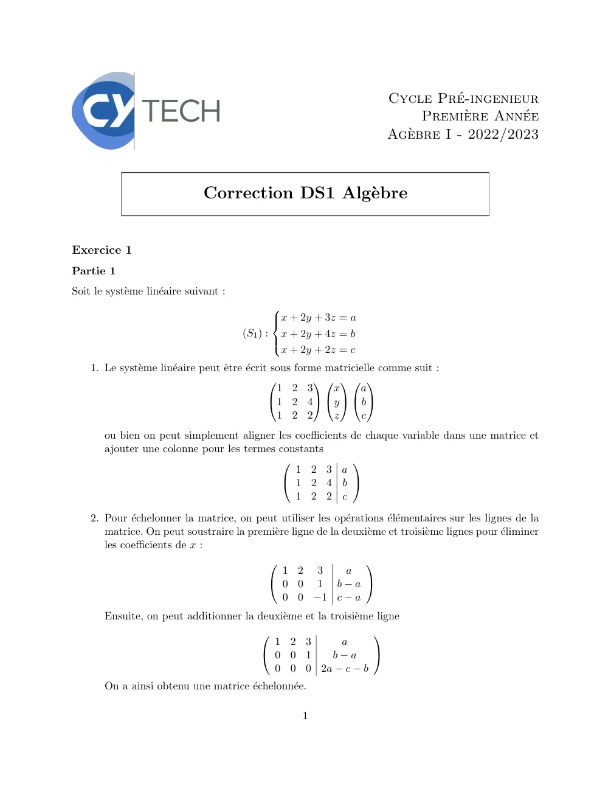
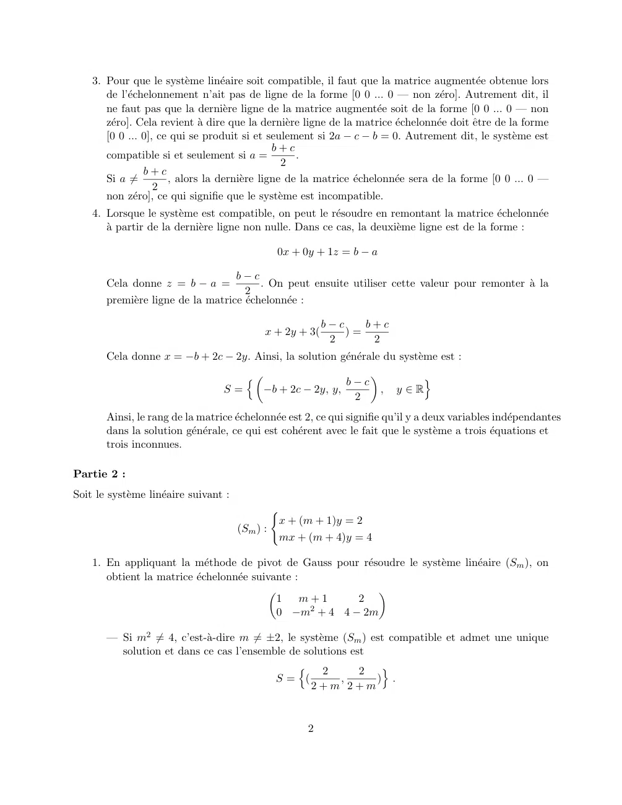
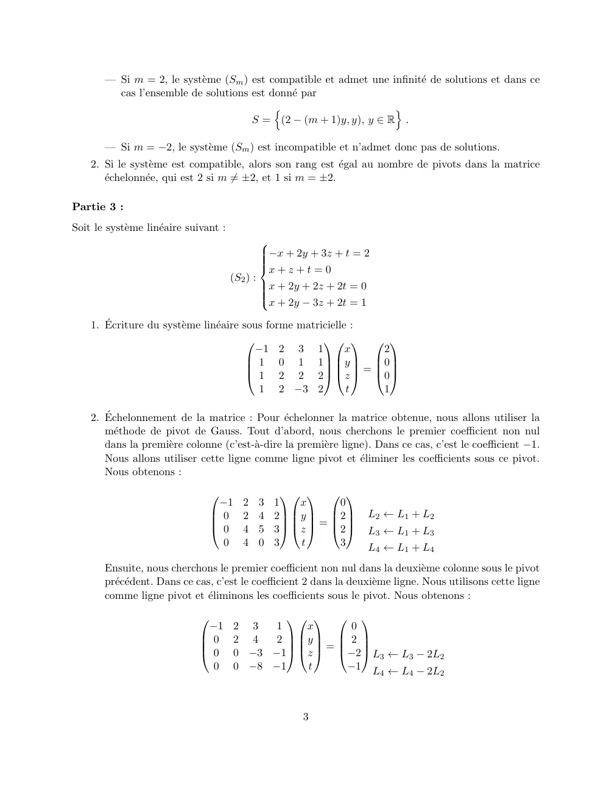
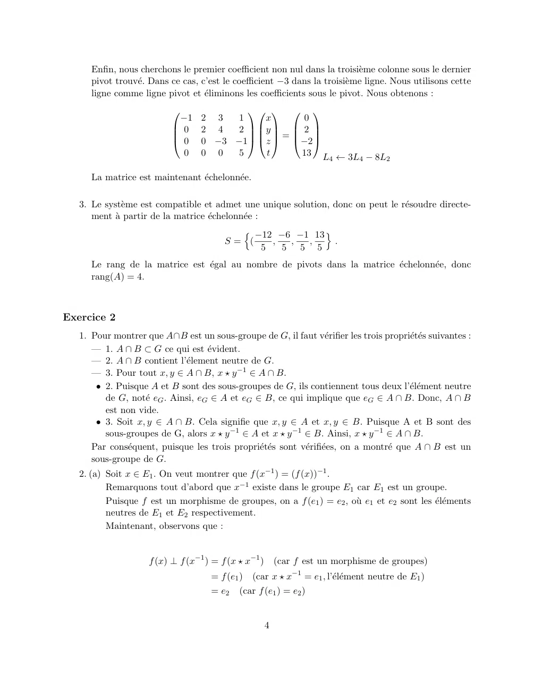
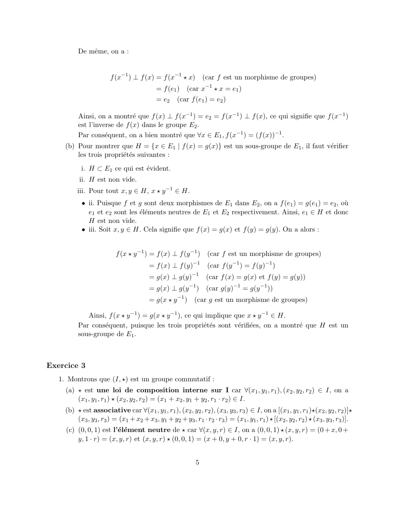
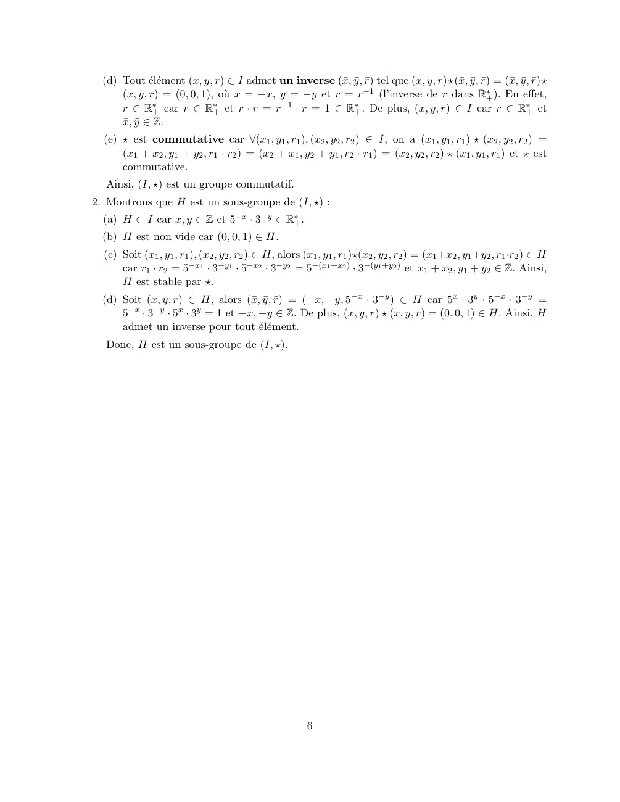

# DS1-2022-2023-V1-Correction_Algebre2-DS_P1S2_DMaths.pdf

[Ouvrir l’original](https://drive.google.com/open?id=1LIdmeyUrfSbSoIE8PIhBahRE2gDe3eJi) · Les deux lectures automatiques du PDF divergent sur les pages indiquées. Leur fac-similé accompagne le texte.

**Pages présentant un écart entre les deux extractions** — 1–6.

## Page 1

~~~text
                                                                      Cycle Pré-ingenieur
                                                                           Première Année
                                                                      Agèbre I - 2022/2023

                              Correction DS1 Algèbre

Exercice 1
Partie 1
Soit le système linéaire suivant :
                                              
                                              x + 2y + 3z = a
                                              
                                       (S1 ) : x + 2y + 4z = b
                                              
                                               x + 2y + 2z = c
                                              

    1. Le système linéaire peut être écrit sous forme matricielle comme suit :
                                                         
                                                1 2 3      x     a
                                              1 2 4 y   b 
                                                1 2 2      z      c
       ou bien on peut simplement aligner les coefficients de chaque variable dans une matrice et
       ajouter une colonne pour les termes constants
                                                          
                                              1 2 3 a
                                            1 2 4 b 
                                              1 2 2 c
    2. Pour échelonner la matrice, on peut utiliser les opérations élémentaires sur les lignes de la
       matrice. On peut soustraire la première ligne de la deuxième et troisième lignes pour éliminer
       les coefficients de x :
                                                          
                                              1 2 3    a
                                             0 0 1 b−a 
                                              0 0 −1 c − a
       Ensuite, on peut additionner la deuxième et la troisième ligne
                                                            
                                            1 2 3     a
                                           0 0 1   b−a      
                                            0 0 0 2a − c − b
       On a ainsi obtenu une matrice échelonnée.

                                                   1
~~~

## Page 2

~~~text
    3. Pour que le système linéaire soit compatible, il faut que la matrice augmentée obtenue lors
       de l’échelonnement n’ait pas de ligne de la forme [0 0 ... 0 — non zéro]. Autrement dit, il
       ne faut pas que la dernière ligne de la matrice augmentée soit de la forme [0 0 ... 0 — non
       zéro]. Cela revient à dire que la dernière ligne de la matrice échelonnée doit être de la forme
       [0 0 ... 0], ce qui se produit si et seulement si 2a − c − b = 0. Autrement dit, le système est
                                              b+c
       compatible si et seulement si a =           .
                                                2
                b+c
       Si a ̸=        , alors la dernière ligne de la matrice échelonnée sera de la forme [0 0 ... 0 —
                   2
       non zéro], ce qui signifie que le système est incompatible.
    4. Lorsque le système est compatible, on peut le résoudre en remontant la matrice échelonnée
       à partir de la dernière ligne non nulle. Dans ce cas, la deuxième ligne est de la forme :

                                              0x + 0y + 1z = b − a

                                   b−c
       Cela donne z = b − a =            . On peut ensuite utiliser cette valeur pour remonter à la
                                     2
       première ligne de la matrice échelonnée :

                                                          b−c    b+c
                                            x + 2y + 3(       )=
                                                           2      2
       Cela donne x = −b + 2c − 2y. Ainsi, la solution générale du système est :
                                     n                 b−c
                                                                           o
                                  S=   −b + 2c − 2y, y,       ,          y∈R
                                                         2
       Ainsi, le rang de la matrice échelonnée est 2, ce qui signifie qu’il y a deux variables indépendantes
       dans la solution générale, ce qui est cohérent avec le fait que le système a trois équations et
       trois inconnues.

Partie 2 :
Soit le système linéaire suivant :
                                               (
                                                x + (m + 1)y = 2
                                       (Sm ) :
                                                mx + (m + 4)y = 4

    1. En appliquant la méthode de pivot de Gauss pour résoudre le système linéaire (Sm ), on
       obtient la matrice échelonnée suivante :
                                                             
                                             1    m+1     2
                                             0 −m2 + 4 4 − 2m

       — Si m2 ̸= 4, c’est-à-dire m ̸= ±2, le système (Sm ) est compatible et admet une unique
         solution et dans ce cas l’ensemble de solutions est
                                              n     2      2    o
                                         S= (           ,      ) .
                                                 2+m 2+m

                                                     2
~~~

## Page 3

~~~text
       — Si m = 2, le système (Sm ) est compatible et admet une infinité de solutions et dans ce
         cas l’ensemble de solutions est donné par
                                          n                       o
                                     S = (2 − (m + 1)y, y), y ∈ R .

       — Si m = −2, le système (Sm ) est incompatible et n’admet donc pas de solutions.
    2. Si le système est compatible, alors son rang est égal au nombre de pivots dans la matrice
       échelonnée, qui est 2 si m ̸= ±2, et 1 si m = ±2.

Partie 3 :
Soit le système linéaire suivant :
                                               
                                               
                                               
                                               −x + 2y + 3z + t = 2
                                               
                                               x + z + t = 0
                                       (S2 ) :
                                               
                                               
                                               x + 2y + 2z + 2t = 0
                                               
                                               x + 2y − 3z + 2t = 1

    1. Écriture du système linéaire sous forme matricielle :
                                                         
                                         −1 2 3 1            x  2
                                         1 0 1 1 y  0
                                         1 2 2 2  z  = 0
                                                         

                                          1 2 −3 2           t  1

    2. Échelonnement de la matrice : Pour échelonner la matrice obtenue, nous allons utiliser la
       méthode de pivot de Gauss. Tout d’abord, nous cherchons le premier coefficient non nul
       dans la première colonne (c’est-à-dire la première ligne). Dans ce cas, c’est le coefficient −1.
       Nous allons utiliser cette ligne comme ligne pivot et éliminer les coefficients sous ce pivot.
       Nous obtenons :

                                                    
                                   −1    2   3   1   x     0
                                 0      2   4   2 y  2       L2 ← L1 + L2
                                                   =  
                                 0      4   5   3  z  2      L3 ← L1 + L3
                                   0     4   0   3    t    3       L4 ← L1 + L4
       Ensuite, nous cherchons le premier coefficient non nul dans la deuxième colonne sous le pivot
       précédent. Dans ce cas, c’est le coefficient 2 dans la deuxième ligne. Nous utilisons cette ligne
       comme ligne pivot et éliminons les coefficients sous le pivot. Nous obtenons :

                                                
                               −1      2 3  1    x     0
                             0        2 4  2  y   2 
                                               =  
                             0        0 −3 −1  z  −2 L3 ← L3 − 2L2
                               0       0 −8 −1    t    −1 L ← L − 2L
                                                                       4    4       2

                                                      3
~~~

## Page 4

~~~text
      Enfin, nous cherchons le premier coefficient non nul dans la troisième colonne sous le dernier
      pivot trouvé. Dans ce cas, c’est le coefficient −3 dans la troisième ligne. Nous utilisons cette
      ligne comme ligne pivot et éliminons les coefficients sous le pivot. Nous obtenons :
                                           
                            −1    2 3  1    x      0
                          0      2 4  2  y   2 
                                          =  
                          0      0 −3 −1  z  −2
                             0    0 0  5     t    13 L ← 3L − 8L
                                                      4    4    2

      La matrice est maintenant échelonnée.

   3. Le système est compatible et admet une unique solution, donc on peut le résoudre directe-
      ment à partir de la matrice échelonnée :
                                          n −12 −6 −1 13 o
                                        S= (   ,  ,  ,     .
                                             5   5 5 5
      Le rang de la matrice est égal au nombre de pivots dans la matrice échelonnée, donc
      rang(A) = 4.

Exercice 2
   1. Pour montrer que A∩B est un sous-groupe de G, il faut vérifier les trois propriétés suivantes :
      — 1. A ∩ B ⊂ G ce qui est évident.
      — 2. A ∩ B contient l’élement neutre de G.
      — 3. Pour tout x, y ∈ A ∩ B, x ⋆ y −1 ∈ A ∩ B.
       • 2. Puisque A et B sont des sous-groupes de G, ils contiennent tous deux l’élément neutre
         de G, noté eG . Ainsi, eG ∈ A et eG ∈ B, ce qui implique que eG ∈ A ∩ B. Donc, A ∩ B
         est non vide.
       • 3. Soit x, y ∈ A ∩ B. Cela signifie que x, y ∈ A et x, y ∈ B. Puisque A et B sont des
         sous-groupes de G, alors x ⋆ y −1 ∈ A et x ⋆ y −1 ∈ B. Ainsi, x ⋆ y −1 ∈ A ∩ B.
      Par conséquent, puisque les trois propriétés sont vérifiées, on a montré que A ∩ B est un
      sous-groupe de G.
   2. (a) Soit x ∈ E1 . On veut montrer que f (x−1 ) = (f (x))−1 .
          Remarquons tout d’abord que x−1 existe dans le groupe E1 car E1 est un groupe.
          Puisque f est un morphisme de groupes, on a f (e1 ) = e2 , où e1 et e2 sont les éléments
          neutres de E1 et E2 respectivement.
          Maintenant, observons que :

                    f (x) ⊥ f (x−1 ) = f (x ⋆ x−1 )       (car f est un morphisme de groupes)
                                     = f (e1 )   (car x ⋆ x−1 = e1 , l’élément neutre de E1 )
                                     = e2   (car f (e1 ) = e2 )

                                                      4
~~~

## Page 5

~~~text
          De même, on a :

                        f (x−1 ) ⊥ f (x) = f (x−1 ⋆ x)             (car f est un morphisme de groupes)
                                            = f (e1 )    (car x−1 ⋆ x = e1 )
                                            = e2     (car f (e1 ) = e2 )

          Ainsi, on a montré que f (x) ⊥ f (x−1 ) = e2 = f (x−1 ) ⊥ f (x), ce qui signifie que f (x−1 )
          est l’inverse de f (x) dans le groupe E2 .
          Par conséquent, on a bien montré que ∀x ∈ E1 , f (x−1 ) = (f (x))−1 .
     (b) Pour montrer que H = {x ∈ E1 | f (x) = g(x)} est un sous-groupe de E1 , il faut vérifier
         les trois propriétés suivantes :
           i. H ⊂ E1 ce qui est évident.
           ii. H est non vide.
          iii. Pour tout x, y ∈ H, x ⋆ y −1 ∈ H.
            • ii. Puisque f et g sont deux morphismes de E1 dans E2 , on a f (e1 ) = g(e1 ) = e2 , où
              e1 et e2 sont les éléments neutres de E1 et E2 respectivement. Ainsi, e1 ∈ H et donc
              H est non vide.
            • iii. Soit x, y ∈ H. Cela signifie que f (x) = g(x) et f (y) = g(y). On a alors :

                          f (x ⋆ y −1 ) = f (x) ⊥ f (y −1 )         (car f est un morphisme de groupes)
                                                            −1
                                         = f (x) ⊥ f (y)            (car f (y −1 ) = f (y)−1 )
                                         = g(x) ⊥ g(y)−1            (car f (x) = g(x) et f (y) = g(y))
                                                          −1
                                         = g(x) ⊥ g(y          )    (car g(y)−1 = g(y −1 ))
                                         = g(x ⋆ y −1 )     (car g est un morphisme de groupes)

             Ainsi, f (x ⋆ y −1 ) = g(x ⋆ y −1 ), ce qui implique que x ⋆ y −1 ∈ H.
          Par conséquent, puisque les trois propriétés sont vérifiées, on a montré que H est un
          sous-groupe de E1 .

Exercice 3
   1. Montrons que (I, ⋆) est un groupe commutatif :
     (a) ⋆ est une loi de composition interne sur I car ∀(x1 , y1 , r1 ), (x2 , y2 , r2 ) ∈ I, on a
         (x1 , y1 , r1 ) ⋆ (x2 , y2 , r2 ) = (x1 + x2 , y1 + y2 , r1 · r2 ) ∈ I.
     (b) ⋆ est associative car ∀(x1 , y1 , r1 ), (x2 , y2 , r2 ), (x3 , y3 , r3 ) ∈ I, on a [(x1 , y1 , r1 )⋆(x2 , y2 , r2 )]⋆
         (x3 , y3 , r3 ) = (x1 + x2 + x3 , y1 + y2 + y3 , r1 · r2 · r3 ) = (x1 , y1 , r1 ) ⋆ [(x2 , y2 , r2 ) ⋆ (x3 , y3 , r3 )].
     (c) (0, 0, 1) est l’élément neutre de ⋆ car ∀(x, y, r) ∈ I, on a (0, 0, 1) ⋆ (x, y, r) = (0 + x, 0 +
         y, 1 · r) = (x, y, r) et (x, y, r) ⋆ (0, 0, 1) = (x + 0, y + 0, r · 1) = (x, y, r).

                                                             5
~~~

## Page 6

~~~text
  (d) Tout élément (x, y, r) ∈ I admet un inverse (x̄, ȳ, r̄) tel que (x, y, r)⋆(x̄, ȳ, r̄) = (x̄, ȳ, r̄)⋆
      (x, y, r) = (0, 0, 1), où x̄ = −x, ȳ = −y et r̄ = r−1 (l’inverse de r dans R∗+ ). En effet,
      r̄ ∈ R∗+ car r ∈ R∗+ et r̄ · r = r−1 · r = 1 ∈ R∗+ . De plus, (x̄, ȳ, r̄) ∈ I car r̄ ∈ R∗+ et
      x̄, ȳ ∈ Z.
  (e) ⋆ est commutative car ∀(x1 , y1 , r1 ), (x2 , y2 , r2 ) ∈ I, on a (x1 , y1 , r1 ) ⋆ (x2 , y2 , r2 ) =
      (x1 + x2 , y1 + y2 , r1 · r2 ) = (x2 + x1 , y2 + y1 , r2 · r1 ) = (x2 , y2 , r2 ) ⋆ (x1 , y1 , r1 ) et ⋆ est
      commutative.
  Ainsi, (I, ⋆) est un groupe commutatif.
2. Montrons que H est un sous-groupe de (I, ⋆) :
  (a) H ⊂ I car x, y ∈ Z et 5−x · 3−y ∈ R∗+ .
  (b) H est non vide car (0, 0, 1) ∈ H.
  (c) Soit (x1 , y1 , r1 ), (x2 , y2 , r2 ) ∈ H, alors (x1 , y1 , r1 )⋆(x2 , y2 , r2 ) = (x1 +x2 , y1 +y2 , r1 ·r2 ) ∈ H
      car r1 · r2 = 5−x1 · 3−y1 · 5−x2 · 3−y2 = 5−(x1 +x2 ) · 3−(y1 +y2 ) et x1 + x2 , y1 + y2 ∈ Z. Ainsi,
      H est stable par ⋆.
  (d) Soit (x, y, r) ∈ H, alors (x̄, ȳ, r̄) = (−x, −y, 5−x · 3−y ) ∈ H car 5x · 3y · 5−x · 3−y =
      5−x · 3−y · 5x · 3y = 1 et −x, −y ∈ Z. De plus, (x, y, r) ⋆ (x̄, ȳ, r̄) = (0, 0, 1) ∈ H. Ainsi, H
      admet un inverse pour tout élément.
  Donc, H est un sous-groupe de (I, ⋆).

                                                        6
~~~
