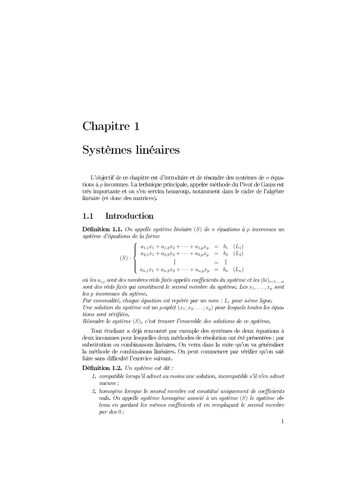
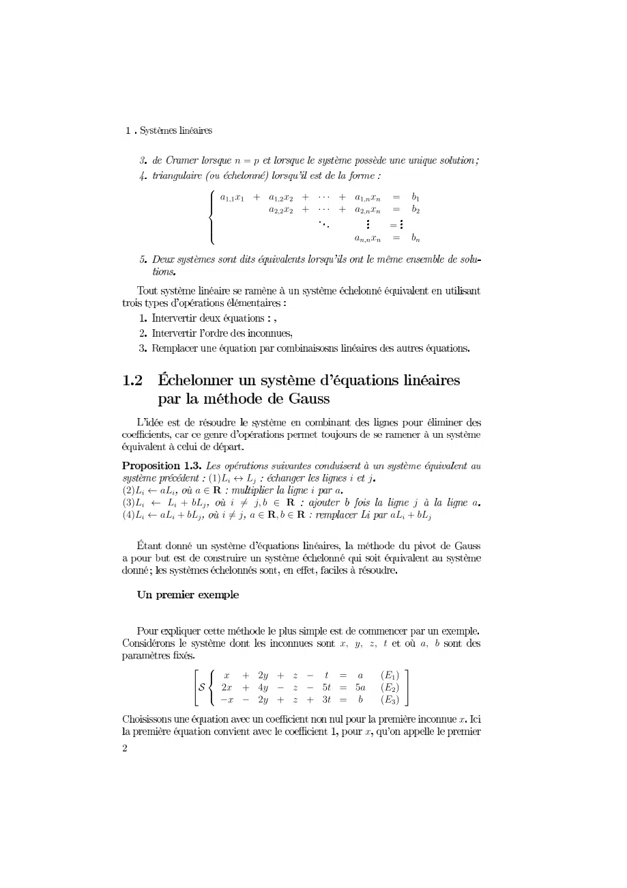
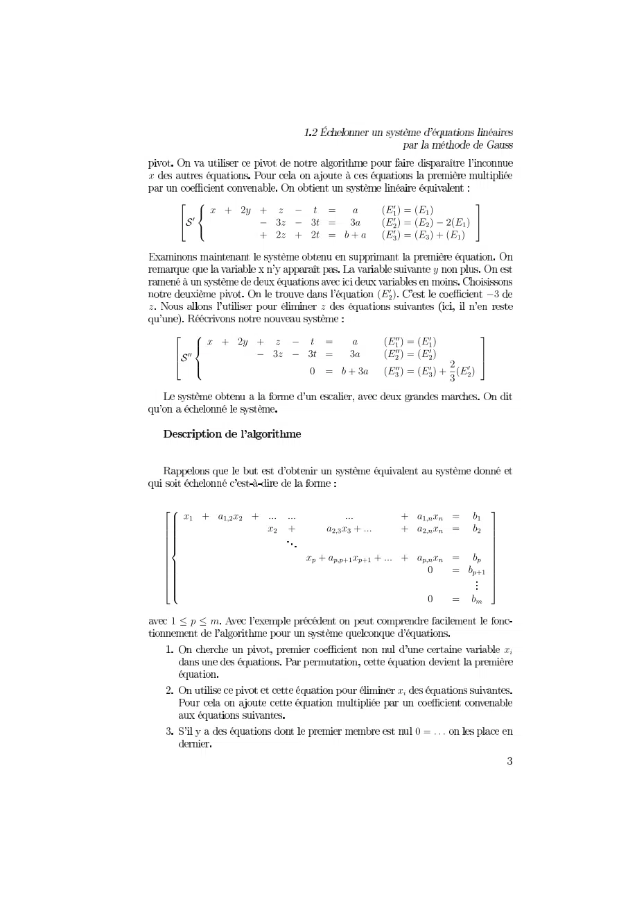
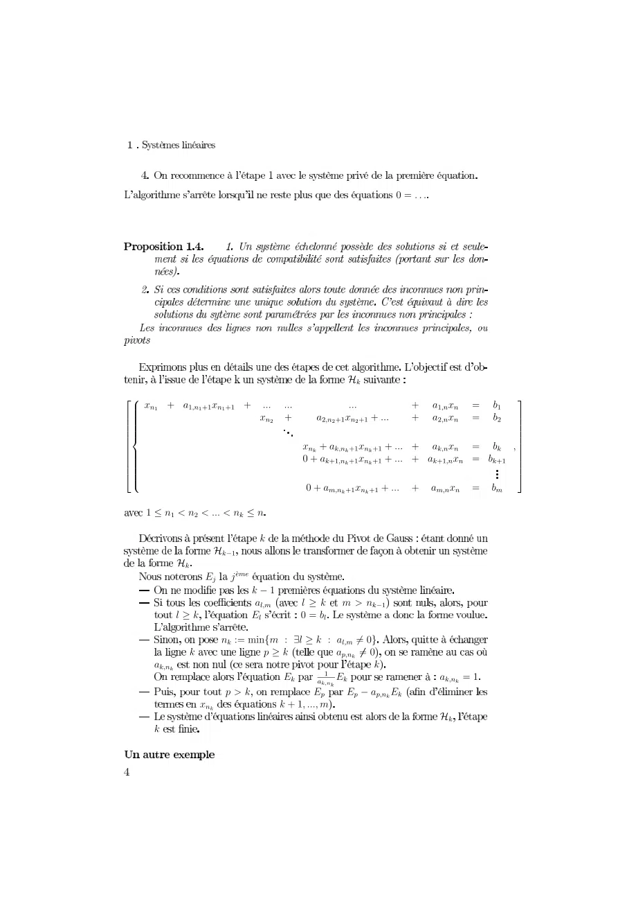
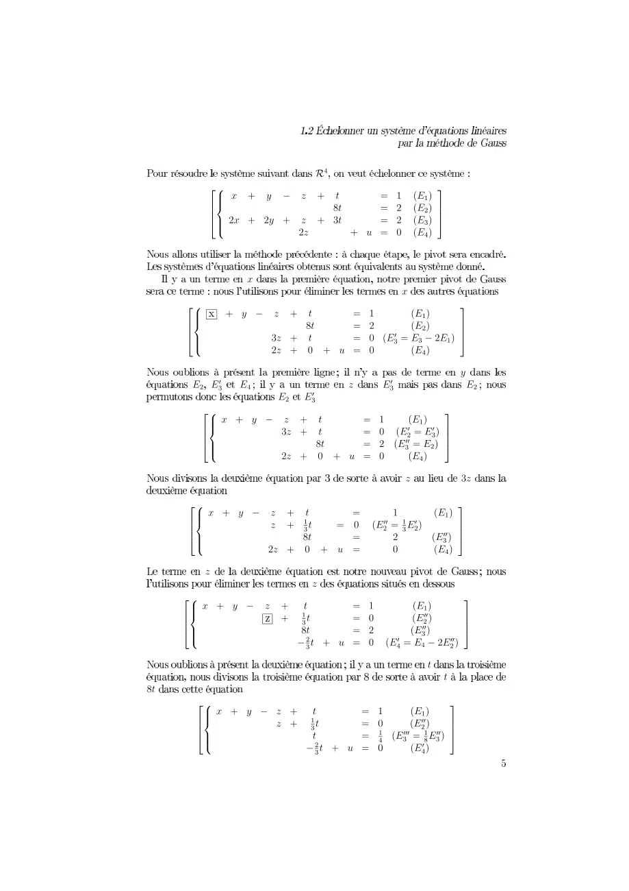
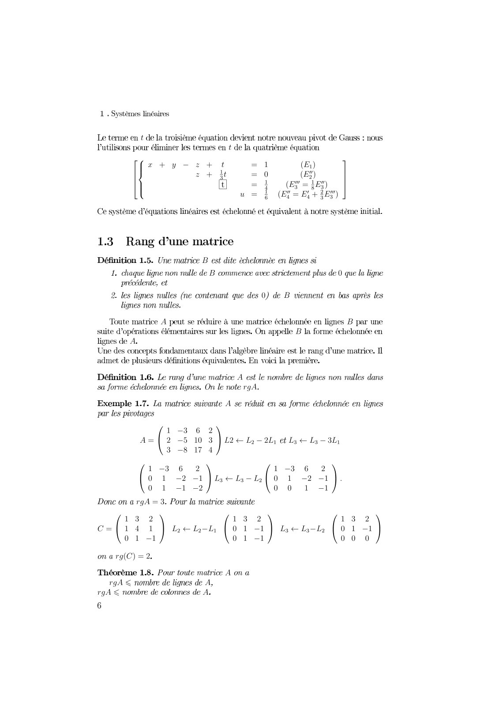
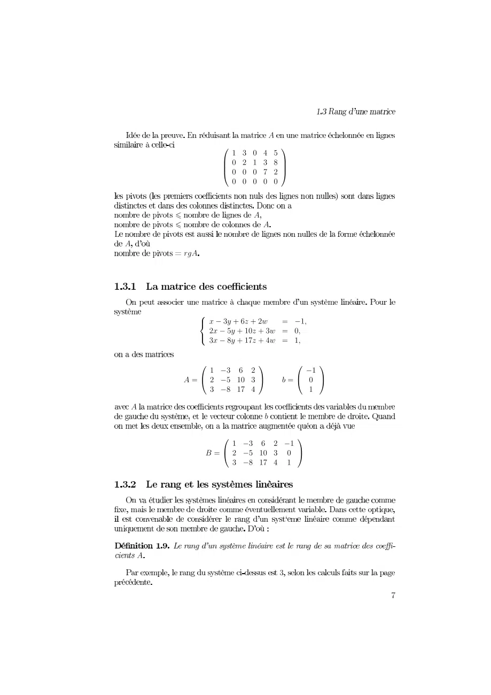
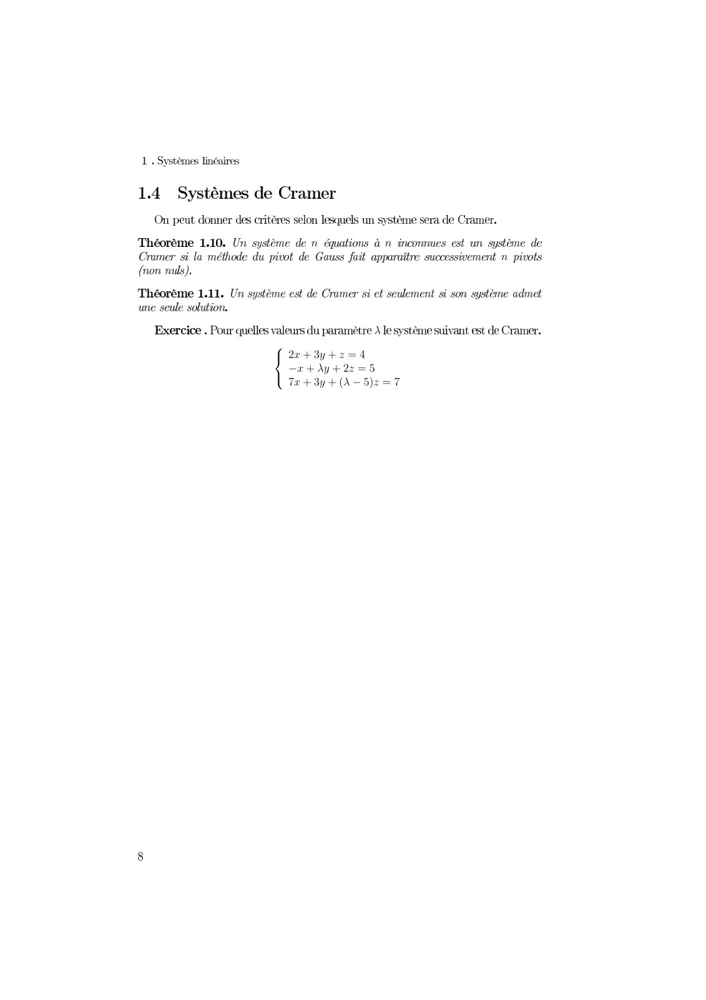

# Feuille-Cours1-Systeme_2021-2022_Algebre2_P1S2_KGuezguez.pdf

[Ouvrir l’original](https://drive.google.com/open?id=1tTbRBExfIH2sSJ8FPb4qGJdd1iRGKa_-) · Les pages signalées comprennent du texte reconnu automatiquement ou des éléments graphiques. Le fac-similé permet de vérifier chaque lecture.

**Pages avec fac-similé ou lecture OCR** — 1, 6, 8.

**Pages présentant un écart entre les deux extractions** — 1–8.

## Page 1

~~~text
                                                        0
    1

                               234 0          1
             67
              78    
                                  2 4
                            
                                  24
         23457
               79         24
                                                    24 
                                                   
1
                                        
                    1     2 4
             234

                                             234
         
~~~

**Lecture OCR à contrôler**

~~~text
Chapitre 1

Systèmes linéaires

L'objectif de ce chapitre est d'introduire et de résoudre des systèmes de n équa-
tions à p inconnues. La technique principale, appelée méthode du Pivot de Gauss est
très importante et on s’en servira beaucoup, notamment dans le cadre de l'algèbre
linéaire (et donc des matrices).

1.1 Introduction
Définition 1.1. On appelle système linéaire (S) de n équations à p inconnues un
système d'équations de la forme

aan +a
42,121 + a2,

pts Fait, = b (Li)
a+ + Arpt, = bo (La)

(S):

Anti + Anata + + Any

où les a,,; sont des nombres réels firés appelés coefficients du système et les (bi)i=1,..n
sont des réels firés qui constituent le second membre du système. Les x1,...,p sont
les p inconnues du sytème.

Par commodité, chaque équation est repérée par un nom : L; pour i-ème ligne.

Une solution du système est un p-uplet (x1;22;…;%,) pour lesquels toutes les équa-
tions sont vérifiées.

Résoudre le système (S), c'est trouver l'ensemble des solutions de ce système.

Tout étudiant a déjà rencontré par exemple des systèmes de deux équations à
deux inconnues pour lesquelles deux méthodes de résolution ont présent par
substitution ou combinaisons linéaires. On verra dans la suite qu’on va généraliser
la méthode de combinaisons linéaires. On peut commencer par vérifier qu’on sait
faire sans difficulté l'exercice suivant.

Définition 1.2. Un système est dit :

1. compatible lorsqu'il admet au moins une solution, incompatible s’il en admet

aucune ;

2. homogène lorsque le second membre est constitué uniquement de coefficients
nuls. On appelle système homogène associé à un système (S) le système ob-
tenu en gardant les mêmes coefficients et en remplaçant le second membre
par des 0;
~~~

## Page 2

~~~text
                 012
           34 7        789    789  1 8
            45 898 8   79     79  1 
             446                     1
                              79  1 

                       
 7 7             7
    1                        7
 7  17         7 

                             !"#       7
         $ 35     ! " ' # 1 7 (8+
         %&6      ! ' " ' )#1 )7 ( ,
              ' ' ! " #1  (*
~~~

## Page 3

~~~text
0
      1 56 0 8 9 8           4      
                                 
      2347             44 9
                 8 9 8 9  8 8

                                         4                 
     1 5 0 8 9 8                444444        
     23446                                 
          7                                        9
                               8 4448 4

    15 0 8 0 8                 8 0   
                 0 8 08 8 0   
     6                                                    
                            0!8!!"0!"88 !0  ! 
                                                 !" 
        2                                                  
           7                                        #
            $%&%'
                                                                  0(
                                            0(
                                                 
~~~

## Page 4

~~~text
                                             01222

                                     34
58
 9       2   22  2
                             22      222                 1 
                                                               
                                                                  
6
69
 9                                222   1  
6
69
 9                                                                
6
6                                  4 222 4 1 4 
6
69
 9                              04 222 4 1 4 
79
69                                                                 
 9                               0 222   1 
     222 4
                       !
               34"
         34
             #$ %'&'
                     !(
                      ) *+! , -4"
         *+!         #)         01)
                4.1/012, .3*+!.) 4105
           !             6+!           7 41 0
    4                                       !
                            #4 89:#4                4 1
                 6-!              #7 #7(7#4
                            !222,
              
                                                       34
    !
~~~

## Page 5

~~~text
                                 01
            256 9                             
            337                              
             468 9                         
                                             1

                 9
                                        9
     256                               
     337                           
      468                          
                                 1
        1                                         
                         
       256 9                           
       337                             
        468                          
                                    1
                                                   
     256 9                                  
     337                                        
                                    
                                       
      468                         
                                         1

     256 9                                            
     337                     
                                     
                                                    
                                                 
      468                               
                                     11 
                                                       
                                                         

       256 9                                        
       337                     
                               
                                                  
                                          
        468                           1  
                                      1
~~~

## Page 6

~~~text
        0
                      0
     145 8 9      9 0                       
     226          9 0                     
      357                                
                                                 
                                     9 
                                   
                                                  

                 
                                                      
                                    
                                                          
                                           
     

                          
                              !
                      
          "  $ % &+
        # & '  $,-&. - &- -. - $-
            $ ( ) *
       " $ % &+            " $ % &+
       #   & ,-. - -#   & ,/
           &                 
       ! $
  "$ &+              "$ &+             "$ &+
0 #  *  , -. - - #   , -. - - #   ,
                                      
   !0 &
                      
  !1             
!1               
~~~

**Lecture OCR à contrôler**

~~~text
1. Systèmes linéaires

Le terme en ¢ de la troisième équation devient notre nouveau pivot de Gauss : nous
Lutilisons pour éliminer les termes en t de la quatrième équation

cty- 2 + 1 (E)
2 + 0 (EX)
1 ey tee)
À (EY = BY +3BY)

Ce système d’équations linéaires est échelonné et équivalent à notre système initial.

13 Rang d’une matrice

Définition 1.5. Une matrice B est dite èchelonnèe en lignes si
1. chaque ligne non nulle de B commence avec strictement plus de O que la ligne
précédente, et
2. les lignes nulles (ne contenant que des 0) de B viennent en bas après les
lignes non nulles.

Toute matrice A peut se réduire à une matrice échelonnée en lignes B par une
suite d'opérations élémentaires sur les lignes. On appelle B la forme échelonnée en
lignes de A.

Une des concepts fondamentaux dans l'algèbre linéaire est le rang d’une matrice. Il
admet de plusieurs définitions équivalentes, En voici la première,

Définition 1.6. Le rang d’une matrice A est le nombre de lignes non nulles dans
sa forme échelonnée en lignes. On le note rgA.

Exemple 1.7. La matrice suivante A se réduit en sa forme échelonnée en lignes
par les pivotages

3 —8 17 4

1-3 6 2 1-3 6 2
0 1 -2 -1 |Ls+ La—Lol 0 1 -2 -1
0 1 -1 -2 0 0 1 —1

Donc on a rgA = 3. Pour la matrice suivante

13 2 13 2 13 2
C={14 1 | Bell | 0 1 -1 | Le Lila | 0 1 —1
0 1 -1 0 1 -1 0 0 0

on a rg(C) = 2.

1-3 6 2
A=[ 2 -5 10 3 |L24 Li-2L et lye Li 3

Théorème 1.8. Pour toute matrice A on a
rgA < nombre de lignes de A,
rgA < nombre de colonnes de A.

6
~~~

## Page 7

~~~text
                              0
                    145678
                    22 6 9 4 5
                     3 6 6 6 9
                       66666

                         0
                             0
0
            0

               59  4
                958465  6
                    47  4
              1 4 5  9     1 4
            03 9 8 46 5 3 6 
                5 4 7         4
0
                              
                    1 4 5  9 4
                  3 9 8 46 5 6 
                      5 4 7 4

    0
                                  5
~~~

## Page 8

~~~text
    0        0
                   0

             1
23 567897
    671975 
 4 678971  
~~~

**Lecture OCR à contrôler**

~~~text
1. Systèmes linéaires

1.4 Systèmes de Cramer
On peut donner des critères selon lesquels un système sera de Cramer.

Théorème 1.10. Un système de n équations à n inconnues est un système de
Cramer si la méthode du pivot de Gauss fait apparaître successivement n pivots
(non nuls).

Théorème 1.11. Un système est de Cramer si et seulement si son système admet
une seule solution.

Exercice . Pour quelles valeurs du paramètre A le système suivant est de Cramer.

22+3y+2=4
—2+)y+2z2=5

Te +3y+(A—5)z=7
~~~
