# Feuille-Cours2-Groupes_2021-2022_Algebre2_P1S2_KGuezguez.pdf

[Ouvrir l’original](https://drive.google.com/open?id=18NVovsvHSCn0g7bZfDGbFEyQaFqNB4a0) · Les pages signalées comprennent du texte reconnu automatiquement ou des éléments graphiques. Le fac-similé permet de vérifier chaque lecture.

**Pages avec fac-similé ou lecture OCR** — 4–6, 10, 13–14.

**Pages présentant un écart entre les deux extractions** — 1–12.

## Page 1

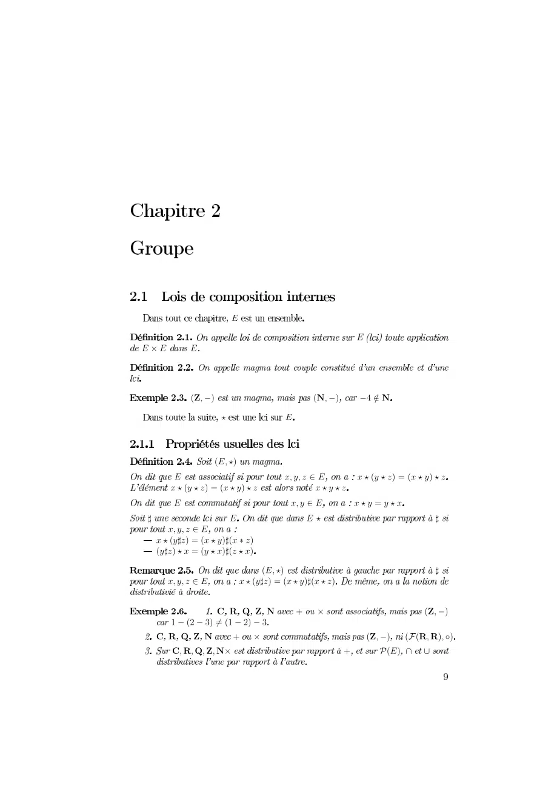

~~~text
              0
010   0

      23456                27456 5897
                      0

          2046
    0                  44 0        2 62 6 
      2 62 6               
    0                   4 0         
            0           0                  
    44 0
   262 62 6
 26 2 62 6
                  2046                        
    44 0       262 62 6
              37        1               23456
   52562565
    37  1                     23456 224646
   4443471                       206 
~~~

## Page 2

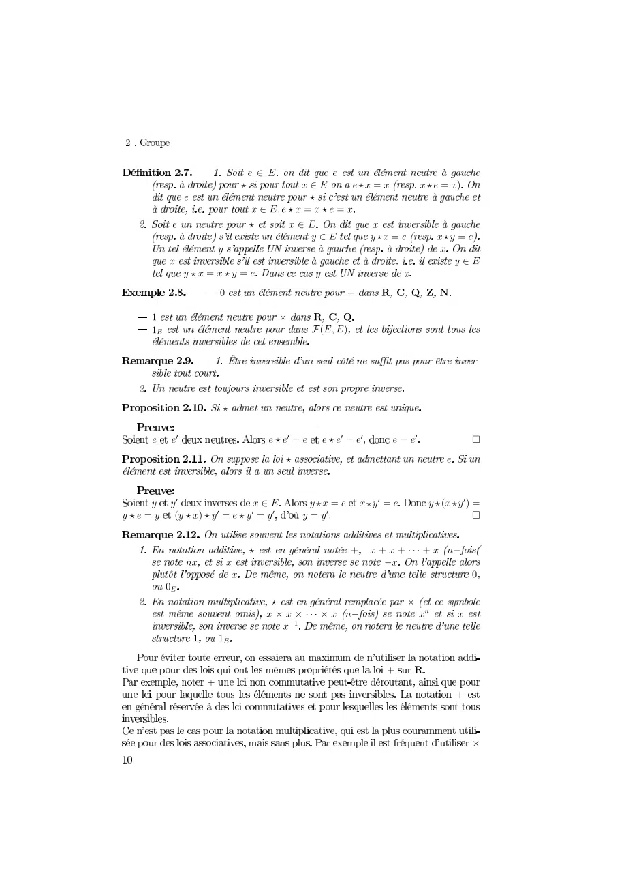

~~~text
                 012         0
                3        412 03454 430546
         0                3
                  4127034543054
       0         3 412           4
                          812    83450 43850
             8                          4
       4                                  812
         834543850
             9                         
                    
                        2726

                3
    0 0                 03050 03050     050              
                            3                         0

    8 8          412          83450 43850        8343865
83058 834638503858        858
                                                          
                     3                    4 4  4 
           4   4                          4
                 4                                            9
      9
                          3                   
                         44  4         4          4
                            4
            

                                                              
~~~

## Page 3

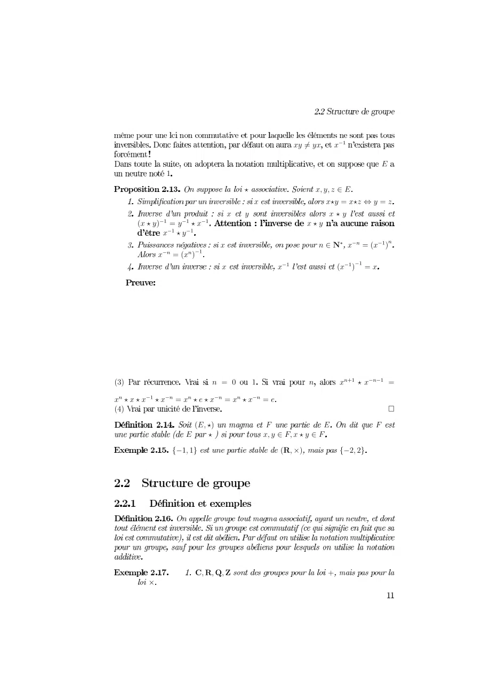

~~~text
                                         012310 045
                                                          6
          7
                          8                 0919 6
                               0               081308 13
                         0 1                    081
     08145453145458045                    081
          0 81
                        0                      04 3 045
         04 3 045
                        0          045            0454530

                   3  7              05 80445 3
0808045804 308804 30804 3
                                                    
                  698                   6        
               6 8             091 9081 
            797                 9     9

                 99!9"                        #
      
~~~

## Page 4

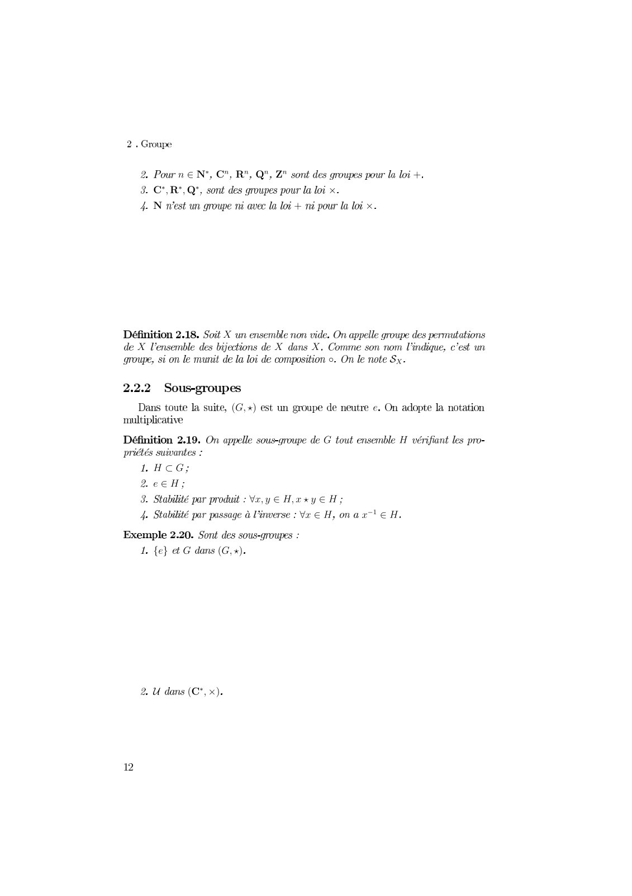

~~~text
    0123 45 65 75 85                     9
43 63 73
2                    9

                                    

                            
                                    

1
                 1 1
                        1   1
      

     43 
~~~

**Lecture OCR à contrôler**

~~~text
2 . Groupe

2. Pour n e N', C", R", Q”, Z" sont des groupes pour la loi +.
3. C*,R*,Q’, sont des groupes pour la loi x.
4. N west un groupe ni avec la loi + nù pour la loi x.

Définition 2.18. Soit X un ensemble non vide. On appelle groupe des permutations
de X l’ensemble des bijections de X dans X. Comme son nom l'indique, c'est un
groupe, si on le munit de la loi de composition o. On le note Sx.

2.2.2 Sous-groupes
Dans toute la suite, (G,x) est un groupe de neutre e. On adopte la notation
multiplicative
Définition 2.19. On appelle sous-groupe de G tout ensemble H vérifiant les pro-
priétés suivantes :
1 HCG;
2eeH;
3. Stabilité par produit : Vr,y € H;xxyeH;
4. Stabilité par passage à l'inverse : Vx € H,onax "EH.

Exemple 2.20. Sont des sous-groupes :
1. {e} et G dans (G, +).

2. U dans (C*, x).

12
~~~

## Page 5

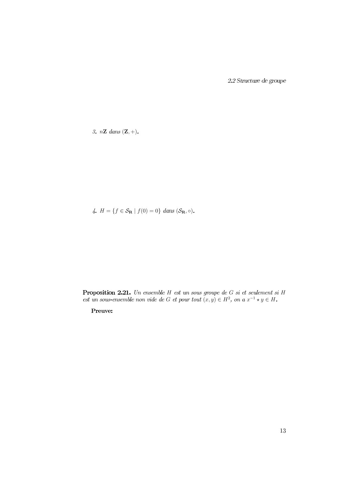

~~~text
01     21345

6789       9257       2 35

                     6                               6
                                235 6    6
~~~

**Lecture OCR à contrôler**

~~~text
2.2 Structure de groupe

3. nZ dans (Z,+).

4. H = {f € SR | f(0) — 0} dans (Sp,°).

Proposition 2.21. Un ensemble H est un sous groupe de G si et seulement si H
est un sous-ensemble non vide de G et pour tout (x,y) € H?, on ax xy € H.

Preuve:

13
~~~

## Page 6

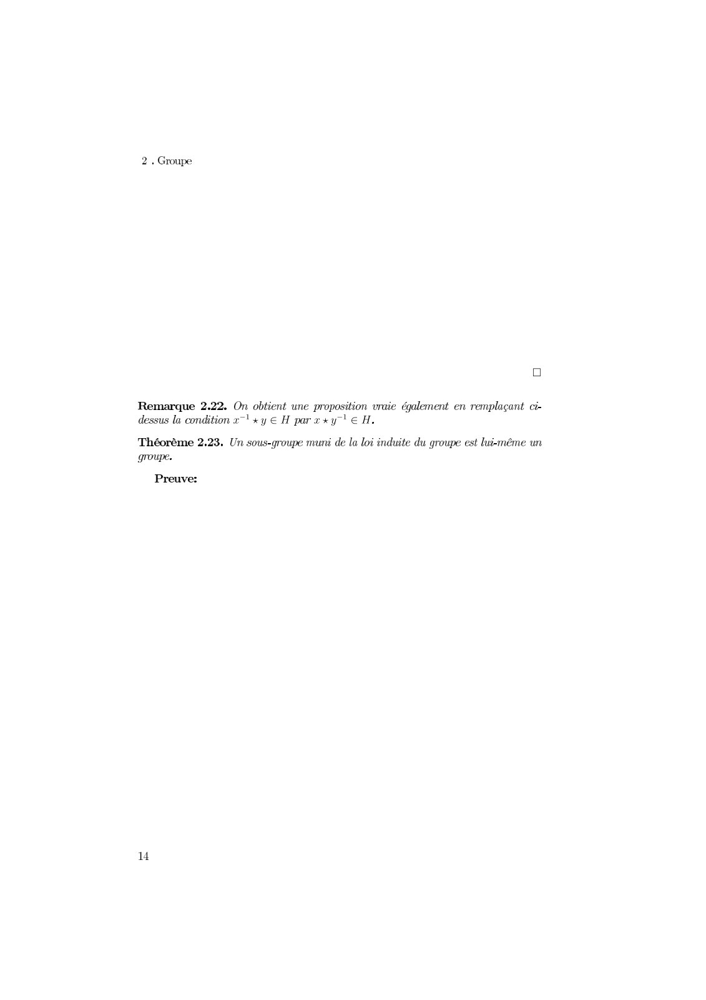

~~~text
                  0

1234567 1452367
~~~

**Lecture OCR à contrôler**

~~~text
2 . Groupe

o
Remarque 2.22. On obtient une proposition vraie également en remplaçant ci-
dessus la condition x”! xy € H par x xy7! € H.

Théorème 2.23. Un sous-groupe muni de la loi induite du groupe est lui-même un
groupe.

Preuve:

4
~~~

## Page 7

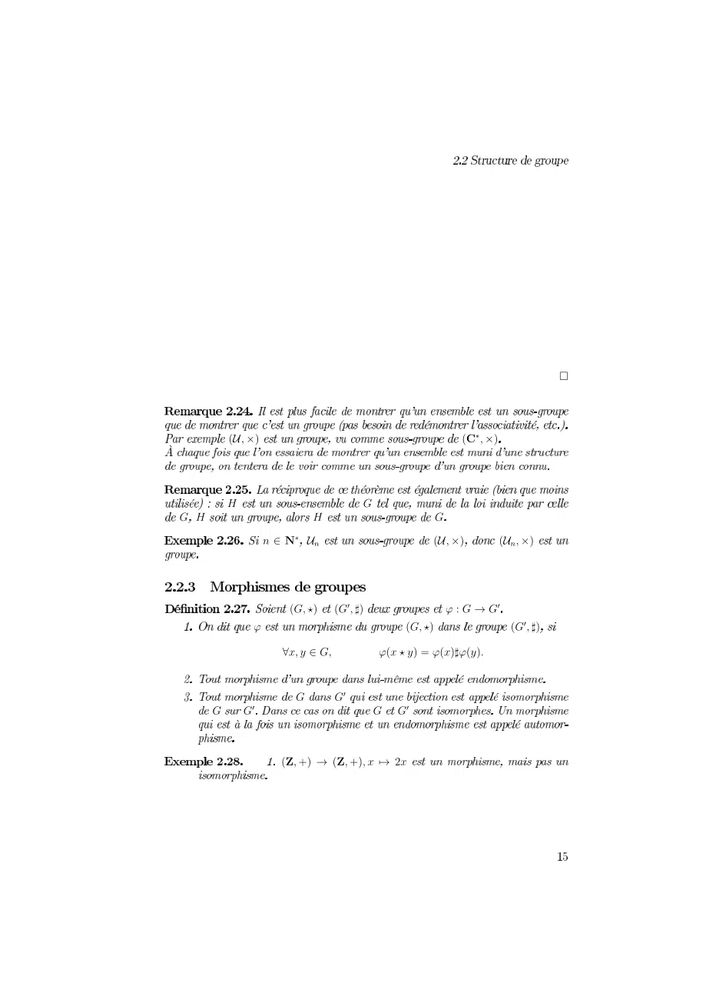

~~~text
                                                             0

         12345                               167345

         8                    9
98                   8                   9
                   72                    12345     12 345

                   1935 1935            9 9
                                     1935         1935
                  3 93         151515
                    9    9
     9       9                   9 9

                  135 1353 
~~~

## Page 8

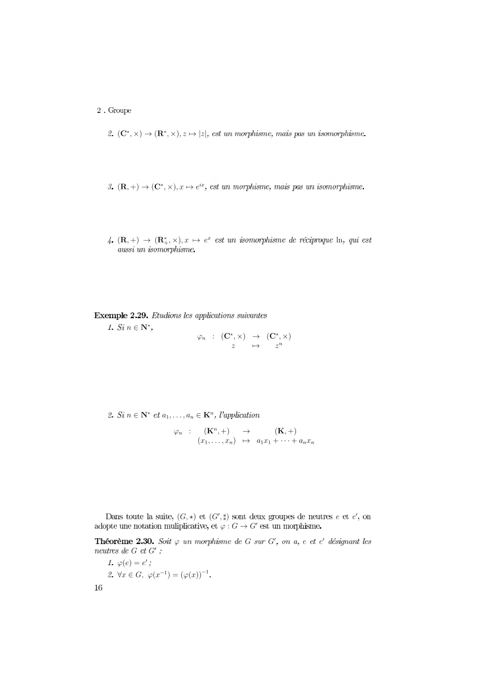

~~~text
0123456 0723453896 8

073 56 0123453 96 

073 56 0723453 96                           

  2
                  012345 6 012345
                       8 69 8

  2 33 
            03 5 6           03 5
                 0335 96     

            035 03!5
                    6 
                        
   
05"
# 30$5"0055$
~~~

## Page 9

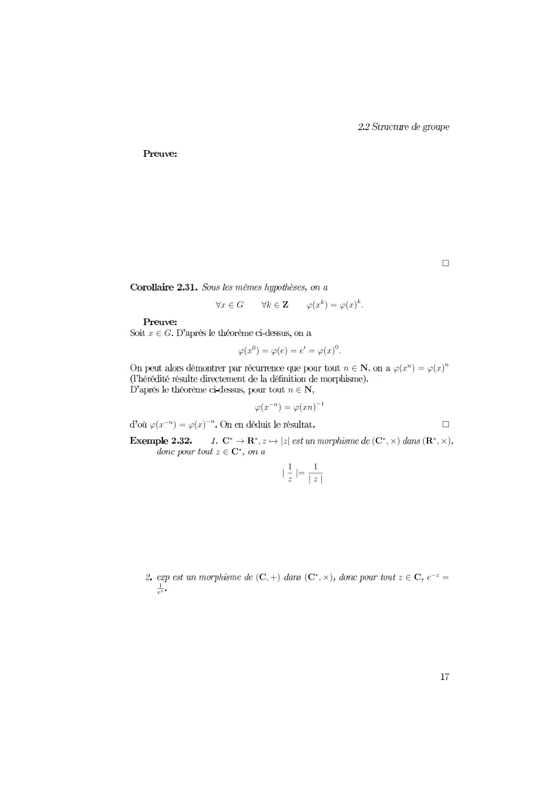

~~~text
                                                      0

          1234 1536 7829 7829
234
              782 78  782
                                   3      782 782
                       3
                 782 782
782 782                                          0
                            8   8
          3
                         
                              

  
                 8      8             3 
 !"
~~~

## Page 10

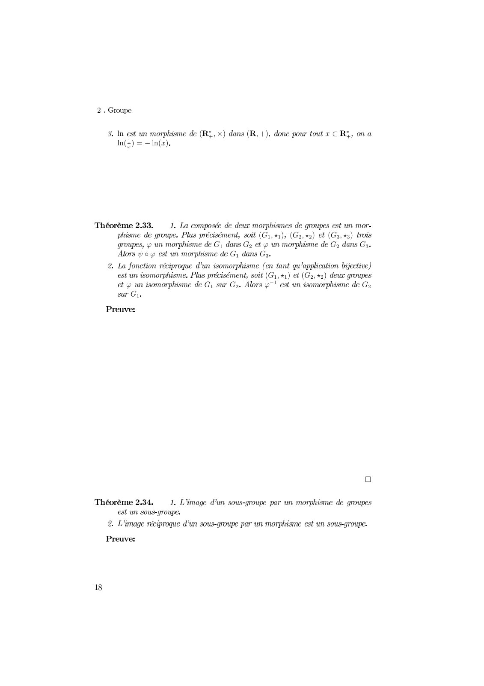

~~~text
01           2345678     23698              345
01280128

                           2 68268 268
                                      
                    
                            2 68 268
                                           
  

                                                  
~~~

**Lecture OCR à contrôler**

~~~text
2 . Groupe

3. In est un morphisme de (Ri, x) dans (R, +), donc pour tout x € RY, ona
In(2) = —In(x).

1

Théorème 2.33. 1. La composée de deur morphismes de groupes est un mor-
phisme de groupe. Plus précisément, soit (G1,41), (Ga,%2) et (G3,+3) trois
groupes, un morphisme de G dans Gy et un morphisme de G dans G.
Alors 4 o est un morphisme de G dans G3.

2. La fonction réciproque d'un isomorphisme (en tant qu’application bijective)
est un isomorphisme. Plus précisément, soit (G1,+1) et (G2, +2) deux groupes
et un isomorphisme de Gy sur G2. Alors g~} est un isomorphisme de G2
sur Gh.

Preuve:

o

Théorème 2.34. 1. L'image d’un sous-groupe par un morphisme de groupes
est un sous-groupe.
2. L'image réciproque d'un sous-groupe par un morphisme est un sous-groupe.
Preuve:

18
~~~

## Page 11

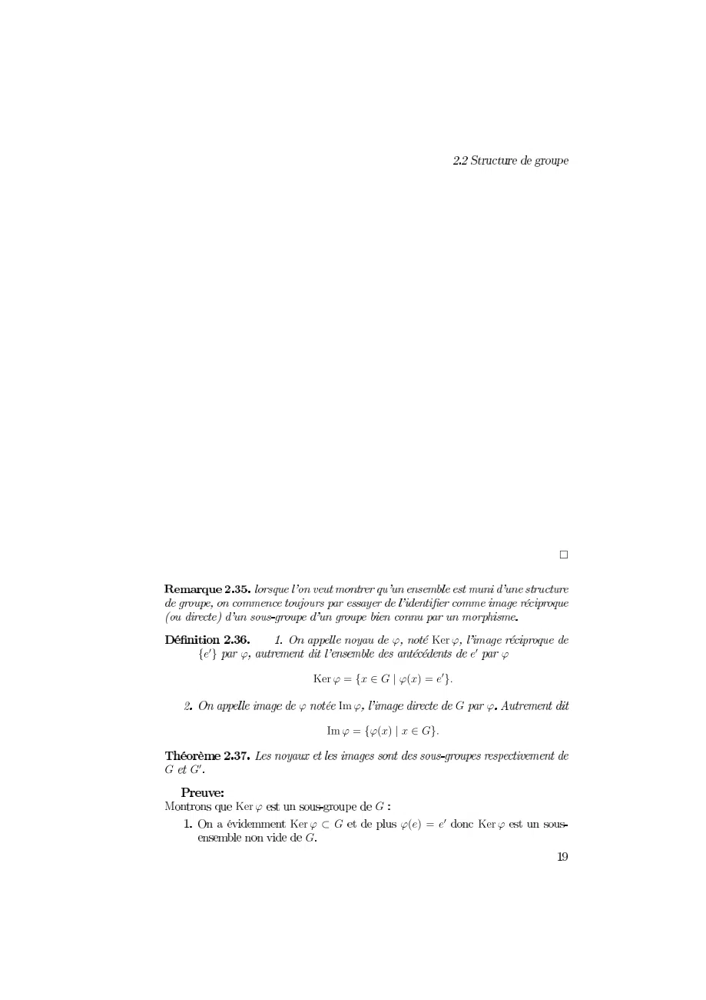

~~~text
                                      0

                    1   2341 7
5678 1                       6 1
             234195 19678
            1 1              1
               1951 8
7

    2341
           2341     16967   2341
~~~

## Page 12

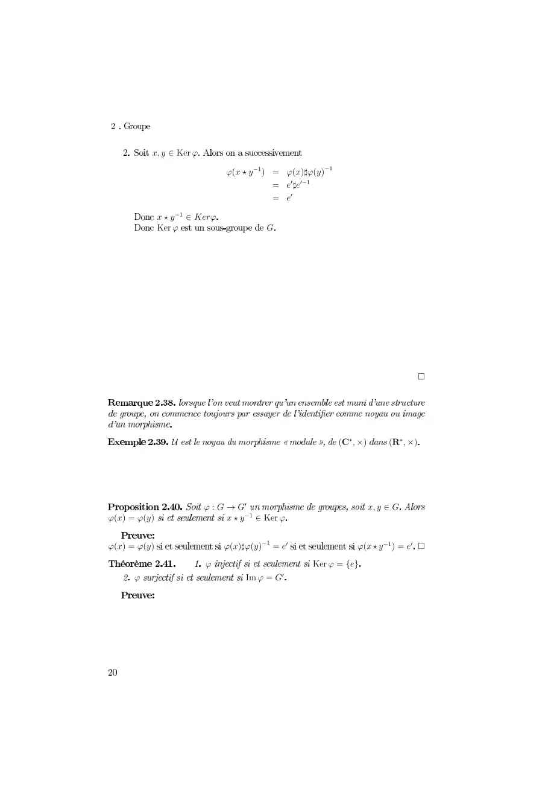

~~~text
       01234567
                      78092         780782
                                    
                                    
          092 37
          4567                  

                                                                 

                                             81      81

                  7                              0123
780 782              092 34567
780 782               780782                 78092          
                  7                      4567 
   7                     7 
~~~

## Page 13

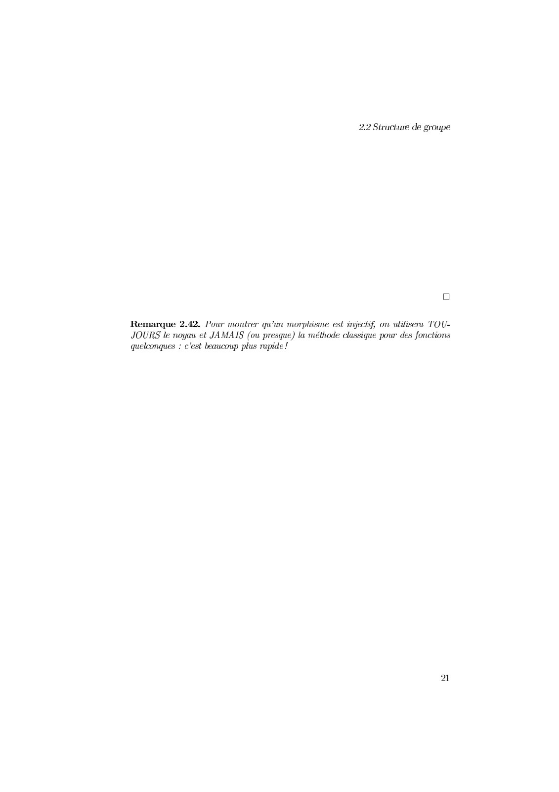

~~~text
0
~~~

**Lecture OCR à contrôler**

~~~text
2.2 Structure de groupe

a

Remarque 2.42. Pour montrer qu'un morphisme est injectif, on utilisera TOU-
JOURS le noyau et JAMAIS (ou presque) la méthode classique pour des fonctions
quelconques : c'est beaucoup plus rapide !

21
~~~

## Page 14

**Lecture OCR à contrôler**

~~~text
2 . Groupe

22
~~~
