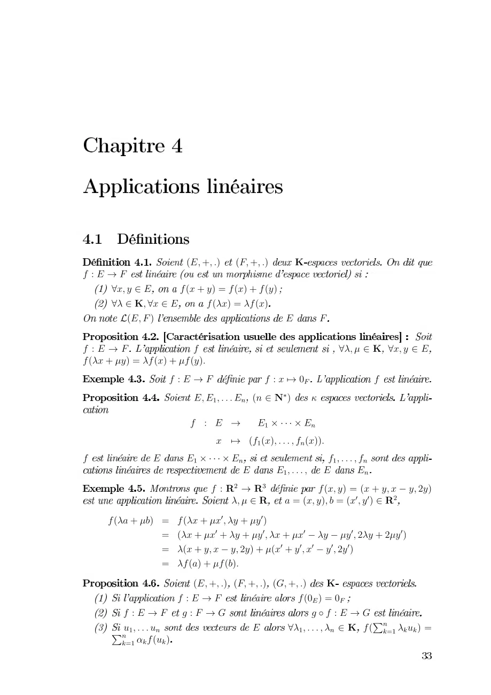
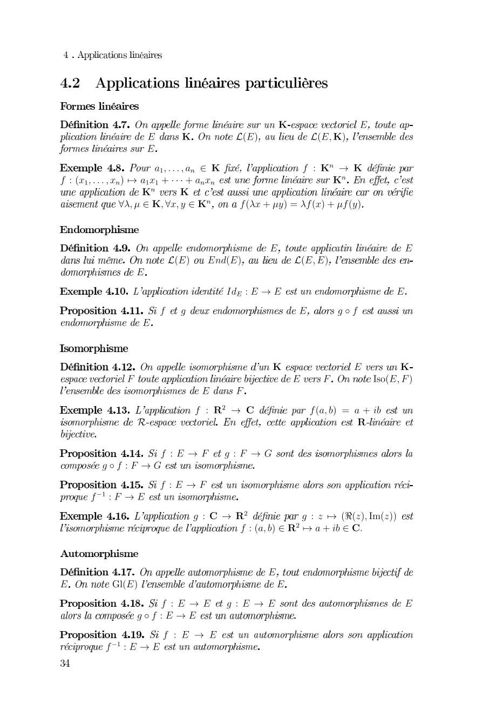
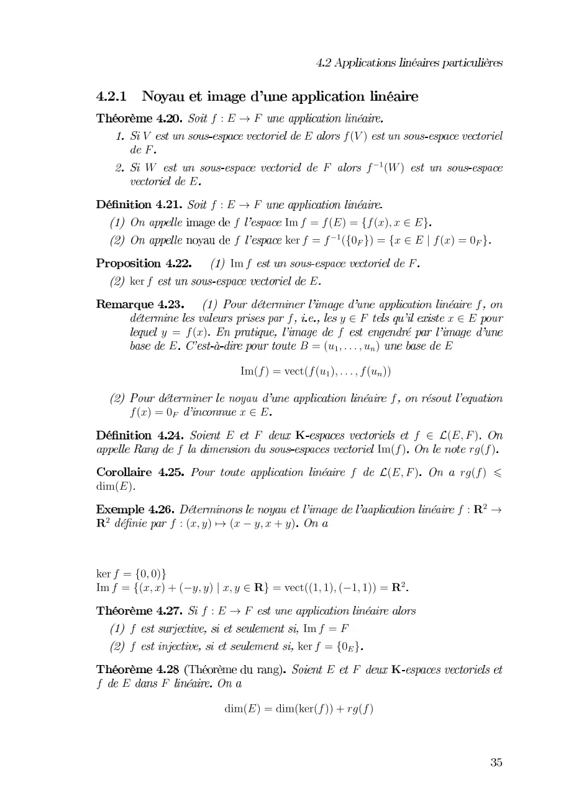

# Feuille-Cours4-Applications-lineaires_2021-2022_Algebre2_P1S2_KGuezguez.pdf

[Ouvrir l’original](https://drive.google.com/open?id=10d1ZL1txsCTH1bWmjHqRtmzNZ88Y11IS) · Les deux lectures automatiques du PDF divergent sur les pages indiquées. Leur fac-similé accompagne le texte.

**Pages présentant un écart entre les deux extractions** — 1–3.

## Page 1

~~~text
           0123245 0623245 7
891 6
     2 1 80 3 58053805
    72 1 80 5805
    01265                 1 6
891 6                    8                             27 2 1
80 3 580538054
                     891 6            89                   8
                         12124441 05 
                         8 91        11
                                 08052444280554
8                1 11                       8244428
                                  1 124442 1 1
                            89                80250      3 2! 2"5
                                2 #0252$0 2 5    %  %
    80#3$5  80 3 %2 3 %5
                     0 3 %3 3 %2 3 %! ! %2" 3" %5
                     0 3 2 ! 2"530%3 %2%! %2"%5
                     80#5380$54
                         012324506232450&23245 7
                       891 6                80'5
       891 6 (96 &                             ()891 &+
     +*2.44,48*0*,5              1      24442 7 80 ,-,*,5
       ,-
~~~

## Page 2

~~~text
                                        0            1
                   1 0           2314       231504
                  1
                     675888569 0               09 9 0
    375888594 6797699                  0
                  0 0 9
              5 055 0        34 34 34

                                       1                        1
                      2314 1314          231514
              1
                                 1 1                      1
                                          1        
                  1

                                       0             1        0
                                          1            3154
                           1     
                               !" #            365$4 6%$
                  &                                   !
                       1   '
          '
       (7 
                       1 
                  1
                            # !"            ) 3*3)45+3)44
                                     365$4 !" 6%$ #8

                         1
1         ,-314           1
                  1 1 1 1                                      1
               1 1
          (7 1 1
                  1 1
~~~

## Page 3

~~~text
                  0123 4
       5                       2    0657
       4
       8                           4 09 687
              2
                 0123 4
                     0         0 0627 0672
                     0      0 09 67 2067 
                       0                         4
     0                       2
                                                          0
                             0       4             2
           067                     0
           2                    67          2
                        607 60670677
                                              0
     067           2
                   2 4 !                          0"6247
            0                                 607        #$607
                                       0 "6247        #$607%
&' 627
                                                       01 ( )3
()         0167*
                  3 6+,7

0 7
   0 67,6+7( 66--76+--77 ()
                0123 4
     0                            0 4
     0                        0 .
                                   2 4 !
0 2 4
                   &' 627 &' 66077,#$607
~~~
