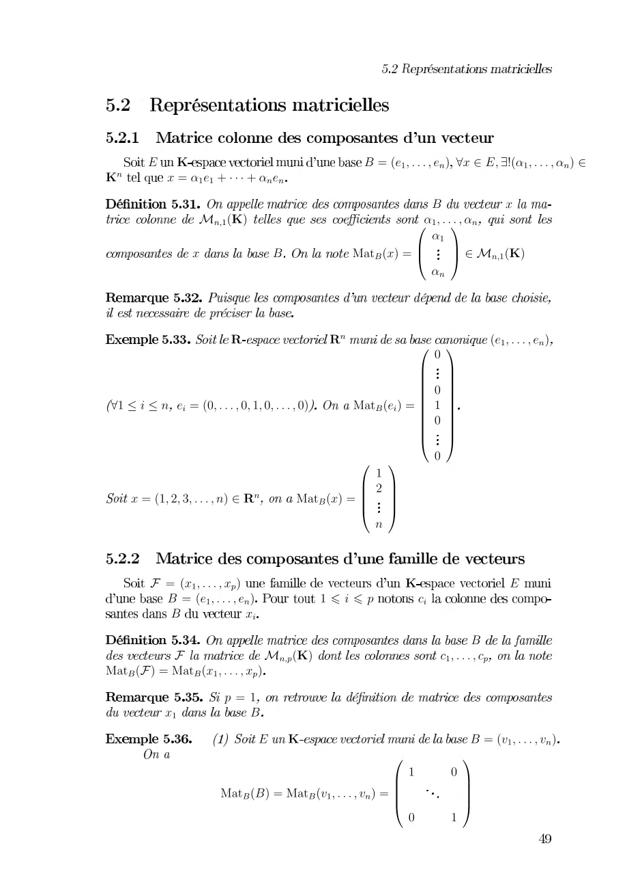
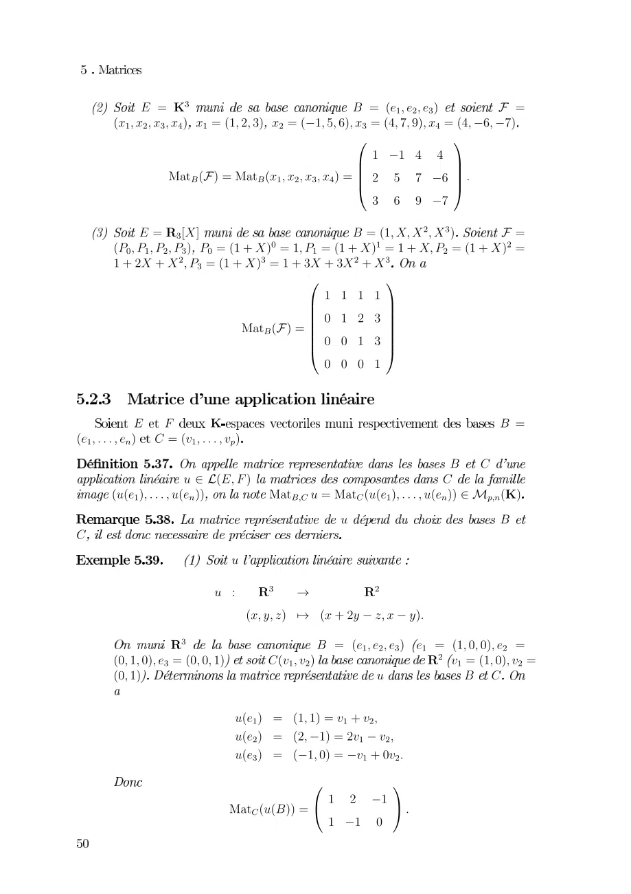
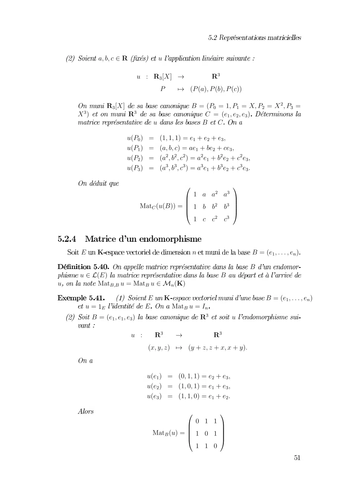
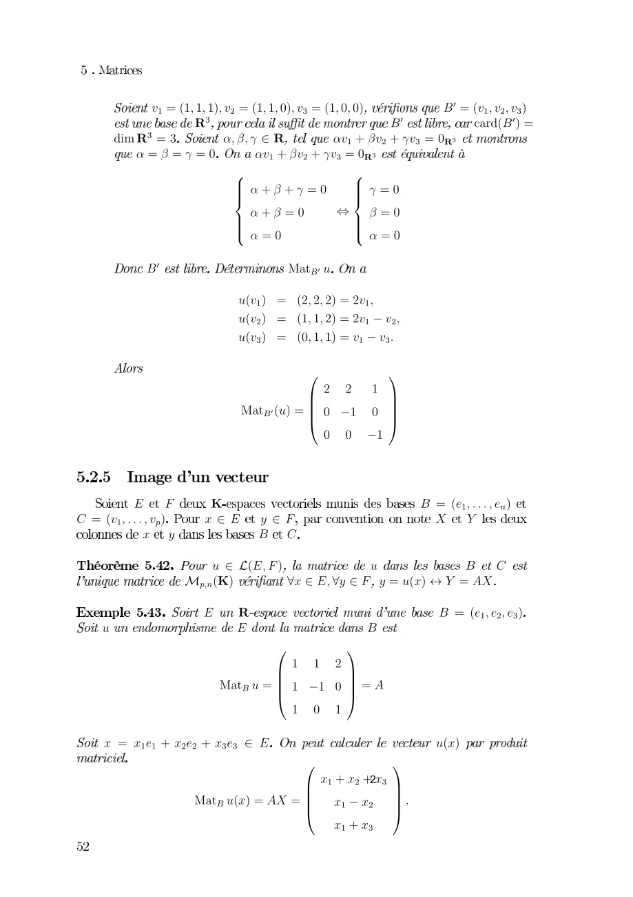
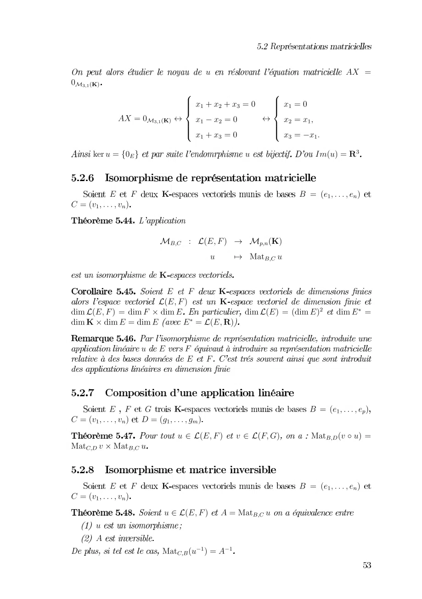
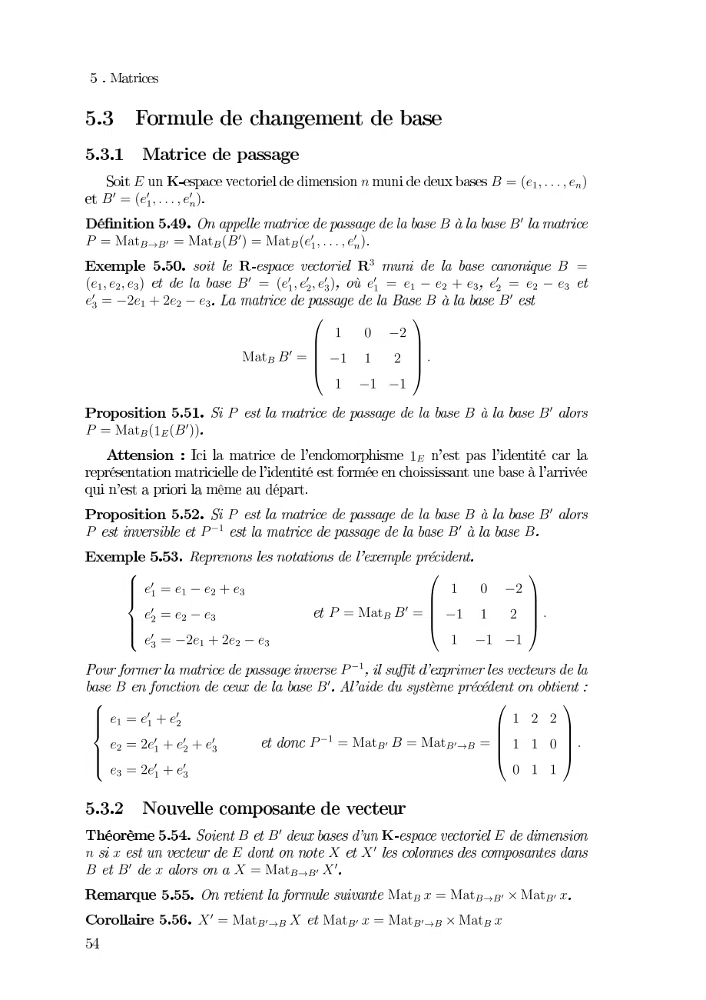
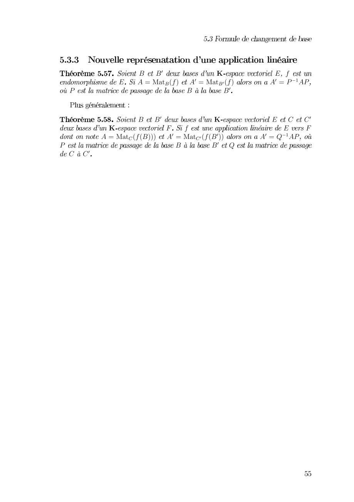

# Feuille-Cours5-Matrices-2_2021-2022_Algebre2_P1S2_KGuezguez.pdf

[Ouvrir l’original](https://drive.google.com/open?id=1Yxy4g2NQ9dAGkBVZrfMhqzvBd7BwU4w4) · Les deux lectures automatiques du PDF divergent sur les pages indiquées. Leur fac-similé accompagne le texte.

**Pages présentant un écart entre les deux extractions** — 1–7.

## Page 1

~~~text
       0 1                           234567888759            0746788879
19       3656959
                                              2
               9641                       6788879
                                            
                                                6
                          2         4 3
                                                  9641
                                             9

                              9        %                  4567888759
                                        
                                          
                                           
                                        
                                         %
                                           
     !"!# 5$34%78887%77%78887% 45$ 3
                                        
                                        
                                           
                                           
                                           
                                        
                                         %
                                         
                                  %
                                 &
      347&7'78887# 9 4 3  
                                 
                                    
                                    
                                  #

       ( 34678887)                           1                    0
         234567888759          *"*+              ,$
         2            $
                                                            2
        (             9)41                          ,678887,)
4( 34678887)
               +3
        6          2
                    0 1                                  234-678887-9
                                                       
                                                      %
                 42 34-678887-9 3
                                         
                                         
                                                        
                                                        
                                                        
                                             %
~~~

## Page 2

~~~text
         0 1 23                     4 1 567869863       1
     5789838 71588 915888315888 1588
                                                  
                                          
              5 15789838 1          
                                                   !
                                     
                                          
         01"3#$%                    415 8$8 $ 98$3     1
     5&'8&78&98&93 &'15($3 18&715($
                            '          7 1($8&915($ 1
                                                      9
     ($($ 8&315($ 1($($9($3
                                        
                                   
                               
                                )    
                                         
                        5 1
                               
                               
                                         
                                         
                                ) )  
                                 )))

          0 * 2                                             41
5678!!!86+ ,15-78!!!8-.
                                                     4 ,
                 /01508*                            ,
    5/567 8!!!8/56+      23 /135/567 8!!!8/56+ 04 .2+52
                                   /                        4
,
                      /
                    / 5 "3 6             "9
                        58788 9 6 5 (788 7!
              "3                   4 1 567869863 67 19 58)8)869 1
     5)88)86315)8)8      ,5-78-9                 " -7158)8-91
     5)8                                   /            4 ,
                      /567 1 58 1-7(-98
                      /569 1 58 1-7-98
                      /563 1 58) 1-7()-9!
                                         
                     35/54 1    !
                                    )
~~~

## Page 3

~~~text
        0121345       6
                  6 7589         58
                          01 21 3
    8
       589                      1   1   1 8 
           58                    118
                 6              
           6  1181
           6  0121302381
           6  0121302381
           68  081281380828388
                                      "
                             00 0#
                                    8
              6!  2 2 28 # #
                                       $
                             33 3  8

    % &                       '             11(
                                            
    64)%                           
6      *+* 6* 64, (&
                    % &                      11(
     6-          % * 6.(
      118               58     6
                6 7 58              58
                    /1011  0111/1/0

                   6  21181
                   6  12181
                   68  112
                                     "
                                 2  #
                     *6!  2 # #
                                      $
                                 2
~~~

## Page 4

~~~text
         012345459465072345458650923458586           23015075096
                                                       3 62
     2
        9            55          01070928
       2228 01070928
                      
                                       
                       28 
                                        28
                                        
                        28   28
                      
                       28             
                                         28
                                !"#$
                       $3016 2 3%5%5%62%015
                       $3076 2 34545%62%01&075
                       $3096 2 3854546201&09'
                                  (          +
                                  ) % % 4,
                         !"#3$62)) 8 &4   8 ,
                                             ,
                                  *          -
                                    8 8 &4

       . / 0                                  2 3115'''5126
323015'''5046 5. 6/                        7 8
         5 6                 3
                  $93.5/6              $               3
             : 4;2306        <5.5<6/ 62$356= 82>7
                .                                2 3115175196
  $                    .
                            (        +
                            ) 4 4  % ,
                      !" $2)
                            )
                            * 4 &4 8,
                                     , 2>
                                     -
                              484
  52 511157175919 .                        $356
                               (          +
                               ) 5 5  5
                                  1 7 9,?
                 !" $3562>72) )          ,'
                               * 51&57 ,  -
                                   5159
~~~

## Page 5

~~~text
                               0                        12 3
45 6789
                           
                            34
                                         
                                           34
                                          
              12345 6789    34       3
                           
                            34      
                                           3
      034                      0             !0"3#

        $ %           &                       ' 3 !(()"
*3!++)"

               , -./ 01!$%" 2 , 3.)!&"
                        0 4  2 567-./ 0
               &
                 $ % &
               1!$%"     &
89:1!$%"389:%;89:$ <         89:1!$"3!89:$" 89:$< 3
89:&;89:$389:$ $ 31!$#"
                  0 $      %
                           $ %

        $ % = &                                 '3!((3"
*3!++)" >3!??@"
                     0A1!$%" +A1!%="          567-.B!+C0"3
567/.B +;567-./ 0

        $ %           &                       ' 3 !(()"
*3!++)"
                       0A1!$%" 13567-./ 0
          0
          1
                       567/.-!0D"31D
~~~

## Page 6

~~~text
        0 1                      2            34567899986
   3 4567899986
                                         3       3
   4453 4567899986
                                                    34
5678686         3 4 5678686 67 4 6766 6 4 66
646766                          3      3
                                     
                                
                   3 4     !9
                            
                                 
                                           3         3
   45"53
                                      "

                                            3     3
              #7                        3       3
    $
    %                                          
    & 6746766
    %                                      
    % 6466                4 3 4
                                           !9
                                       
    %
    ' 646766                       
                              #7
$  3                      3
%                                                  
& 674676
%                                            
                                             
                                               
                          #7434 4    9
% 646766                                     !
%
' 64676                                    

               3 3              1             0
2 (            0         ) )
3 3 (          )4)
                                 (4*(
            ) 4 ) (4 * (
~~~

## Page 7

~~~text
           0 01         2         31 4
         3 56789 4 5 6789 41
                     1           5 6 5
                  0     0

              0 01         2       3  1
        2          1 4             3 
       56789 40 5 6789 4011   5 6 5
                                 1  
                    0    0 
   1
~~~
