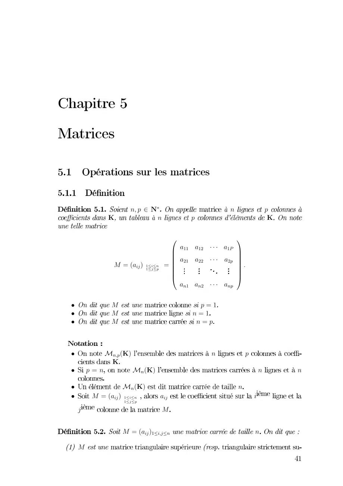
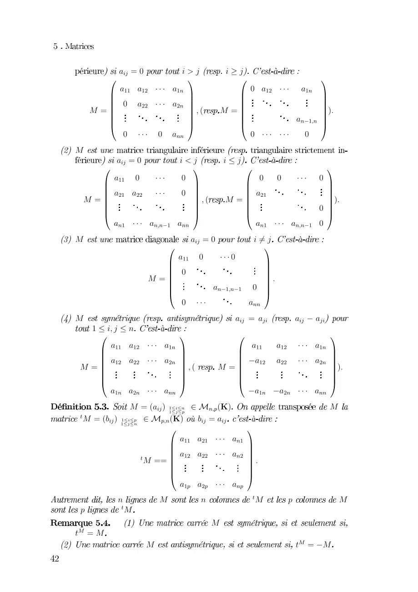
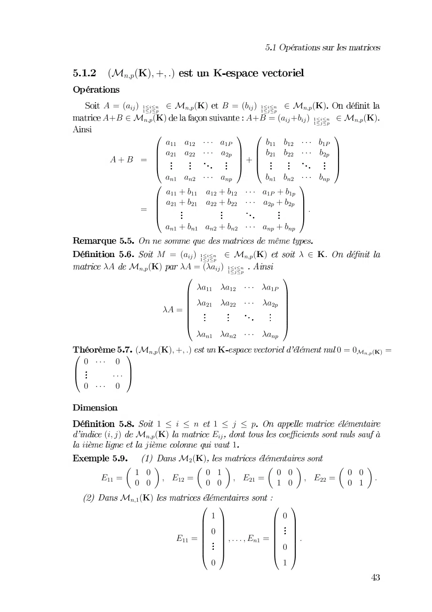
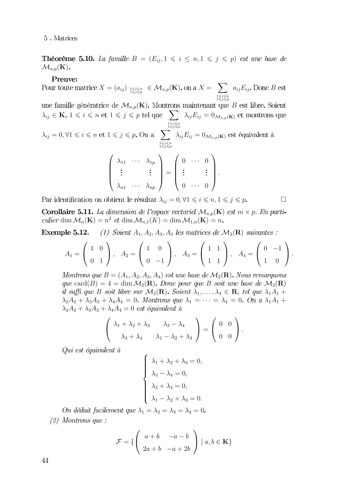
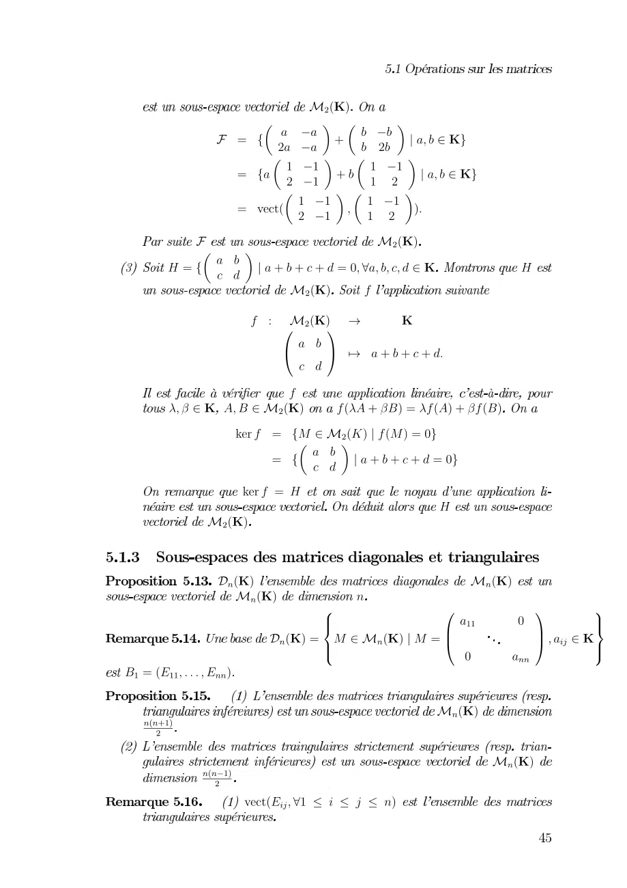
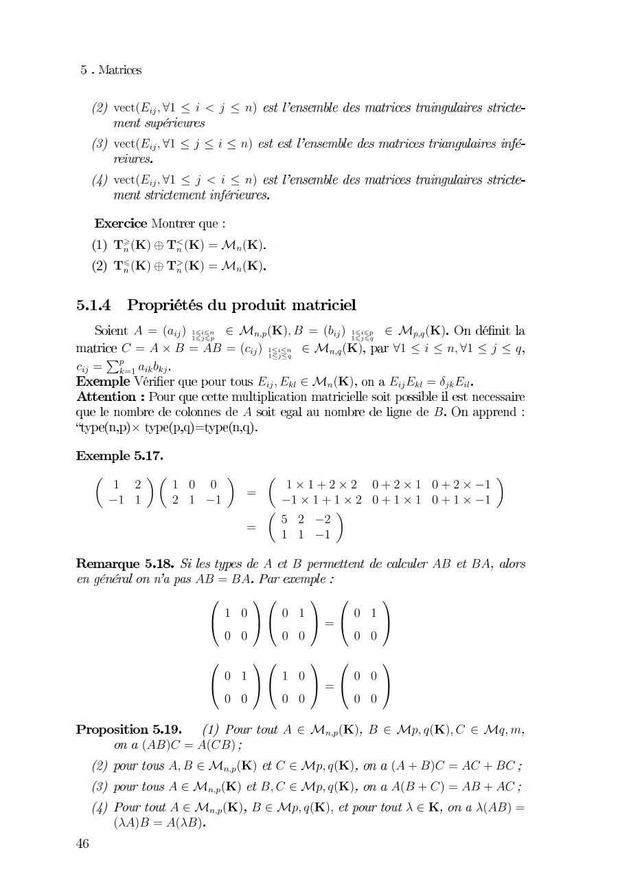
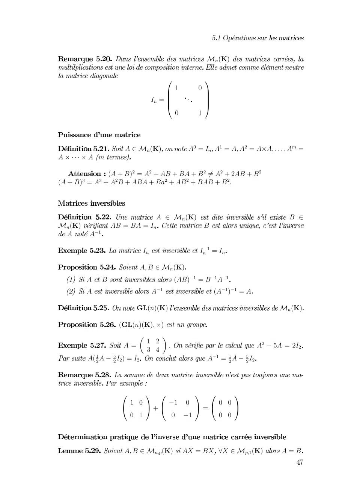
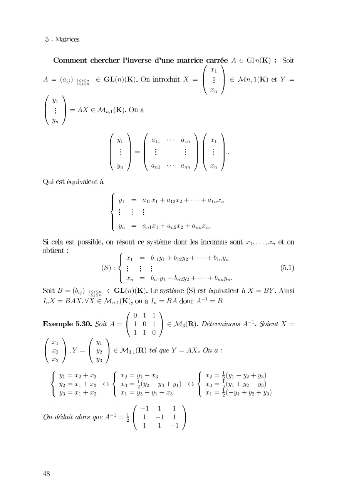

# Feuille-Cours5-Matrices_2021-2022_Algebre2_P1S2_KGuezguez.pdf

[Ouvrir l’original](https://drive.google.com/open?id=1lE3s1eBXcrvDtkBM-ToqICtgGT5HQBjU) · Les deux lectures automatiques du PDF divergent sur les pages indiquées. Leur fac-similé accompagne le texte.

**Pages présentant un écart entre les deux extractions** — 1–8.

## Page 1

~~~text
              012345               0               2
        6          0       2                       6
                                    
                           
                      
                                 
                                     
         7 89    8 
                              
                                     
                 
                 
                                    
                                     
                           

!        7                   28"
!        7                 08"
!        7                  082

!    # $96                   0           2
       6
! 280          # 96                           0       0
!          # 96                       0
! 7 89     
           
                                               %
 &                   7
             7 89 ' $'                       0
 7
~~~

## Page 2

~~~text
       01234       567
                         587               
       0 0 0            4 0  0 
        4  0   
               0   
                                           
                                            
    93           
                      
                        9 3                
                                            
                     
                                     0 
                                           
                                            
        4  4 0           4  4
9
          01234              57  57                          
         0 4  4                               4 4  4
         0     0     
                            4  
                                                0              
                                                                
  93                          
                                     9  3                   
                                                                 
                                 
                                                             4 
                                                                
         0 0 0                         0 0 4
9                               01234           537
                           0 4 4 
                              4                    
                                                   
                   93                              
                                                    
                                     0  4    
                              4             0
9                                          012 3021 012021
   57                                                      
        0 0 0                             0 0 0 
        0     0    0     
                                              0     0    
                                                            0   
                                                                 
 93                    
                                   9  3                  
                                                                  
                            
                                                                
                                                                 
        0 0 0                          0 0 0
              9 3012 !"!$!#!% &' ()                        9
 *9 3+12 !"!% &' (  ) +123012
            !$!#
                                              
                              0 0 0 
                                              
                 *9 33 0 0 0           
                                              
                                              
                                              
                              0( 0( 0(
          *          9                        *9       ,         9
 ,          9
                                     9
- 39
.
                   9                                      -. 39
~~~

## Page 3

~~~text
      01 23405678796       5
        0 6 1 0
                    56  06    1 0
                                             56
      81 056                  8 0 86     1 0
                                                        56
                               "                  "
                         !                 !
                         #       #
       8      
                
                                #
                                # 8
                                $ 
                                   
                                                      #
                                                       #
                                                       $
                 8 8           " 
                              ! 8
                
                  8 8       8 #
                                              #
                
                                             $9
                                              #
                  8 8       8

             % 0 6   1 0
                             56      &5
   & 1 056 & 0& 6    
                              
                                        "
                    &     &
                               & ! #
                   
                    &     &       &    #
                                        #
              &                 #
                                        #
                   
                                       #
                                        $
                     &  &  & 
 ' ' "01 05678796 5                       ' '( )*+,

     #
      $
  ' '

                -. /. 0 -. 1. 2
    0/716 1 056        3
 /            1               -
         4 - '5 1 056 4 ' -5        4 ' '5  4 ' '5
   3 ' ' 73 ' ' 73 - ' 73 ' - 9
        1 056        "             "
                         -#           '#
                       
                         '#
                           #          
                                        #
                                         #
                   3 
                       
                       
                           #
                           #
                           # 7
                             9997
                                3   
                                      
                                      
                                         #
                                         #
                                         # 9
                        $              '
                                       $
                          '             -
~~~

## Page 4

~~~text
                         0 1 2345678 9 678 8 
 2
               1245          2       1      3          0
                         
                                                    45 45
                                                     
                                                     
                     2                              0
45 7898 78 8                           453451 !"#$
4516%7898 78 8                   
                                    
                                       453451 !"#$
                                
                                
                 &              + &                +
                 ' )) ***) , '  ***,
                 '              ,  1  '            ,
                 '
                 (              ,
                                - (   '            -.
                                                   ,
                   ) ***              ***
                                4516%7898 678 8                      /
                                                2 01
    234 21 5 234 )261234 )21
                        7)675678679                     2:
          & +            &         +           & +5 &                   +
      7)1( 7 -6751( 7  -6781( 7 7-6791(  ;7-.
             7              ;7                  77              7
                0127)675678679                    52:
        <=>2201?1234 52:                      0                 52:
              0              52:           )6...69 :         )7)@
     575@878@979 1                    ) 1***19 1 )7)@
     575@878@9791
                &                             + & +
                ( )@5@8 8;9 - 1(  -.
                    8@9 );5@8                    
                           A
                           B
                           B
                           B )@5@816
                           C 8;916
                           B
                           B 8@916
                           B
                           D );5@81.
                          )1518191
                        &                    +
                   E1F( @G ;;G - I6GJ
                           H@G ;@HG
~~~

## Page 5

~~~text
                        0 1234
                  8 9 9 8 
            567 9 9                 93
                   8  8 
              6 79                   93
                    8  8 
              6 2    4
         58                      0 1234
      67 9  9   693           
                     0 1234 
                  !0 1234#         3
                    " 9 $ % 9   
                       
                     
      &'3 ()0 1234 2&( ')46&2(4 '2)4
              *+ 6 7,8 0 12-42,46
                   6 7 9  9   6
               *+6 
                                           
          0 1234

             ./234                              0 /234
               0 /234            0
                             1
                             2             !9           #        :
                                                                  2
                             3             5 66
                                                           7      ;
                       ./23462
                             4, 0 /234, 6"              $98932
                                                                  <
                                                       9//
)662=66=//4
  />/?6@
                                            0 /234
     1

           />/A6@
                                                     0 /234
              1
                    2=89B CB DB 04
~~~

## Page 6

~~~text
      0123456789   
      0123456789  
      0123456789  

      44 4
      44 4

        467
               !" # $%48& 4'67!  ( # %$)4
                                          "       
    / *+&&4,67-     -!--( # $)4
                                          9            89  .
,67 01260'07
      %
                          5678503# 4 567503470563
                                                      &
        +       
  5      685 9 9 8  5 + :6+6 9:6+ 9:6+7 8
      7       6 7         5 ;7 6+ 76
                                   : 8+6 9: + 9: +7
                                 7
                           &                  & &
                &&
                 < >< > < >
                 = 9?= 9 ? = 9 ?
                     99 99             99
                 < >< > < >
                 = 9 ?= 9? = 9 9?
                     99 99             99
                             # $%4&# @8.48*# .8A
          4&*4*&
             8&# $%4 *# @8.4 4:&**:&*
             # $%4 &8*# @8.4 4&:*&:*
              # $%4&# @8.48         B# B4&
      4B&4B&
~~~

## Page 7

~~~text
                                      0 1234
                           7
                           8
                       51 68
                           8
                           9         

                 0 1234        65166 6
 
          2
          466 
246

                             0 1234                        
0 1234  6651                     
   
                       51            51651
                     0 1234
                             246  
                                     2 46
                    !"2#4234                              0 1234
                2!"2#42344
                     $ '
                 6 % &                              ()65
      2( *5465                   6 ( *5

                7        7             7
                9      9 (         69       
                                (

                 0 1+,234 -6- .-0 ,+234          6
~~~

## Page 8

~~~text
                                        01234567
                                        
08 59 7   1547567            8 
                                          1 4567 8
!                                    
   

    801 "567
  !
                                   
                 !   9 ###9   
                     8               
                
                                
                                      
                                         $
                  !       9 ###9 
                %
                &
                ' ! 8 9)9**)###)9
                &
                &
                &
                ( ! 8 9)9**)9$
                                                  $$$
                      %
                      &
                      '  8 -!)-*!*)###)-!
                  5+7,&
                      (  8 -!)-*!*)###)-!$
    .85-7 //// 1547567                           8.
08.011 "567 0 8.0 028.
                         3  
                    08   3  1 4557               02    8
    !    3
 *  8 !*  1 4"557            80
  *          !4
  %
  ' !8*)4 %       ' *8!74         %
                                         ' *8 *5!7!*)!47
  (! *8)4 6 ( 48 *5!*7!4)!7 6 ( 48 *
    !48)*           8!47!)4
                                                  5!)!*7!47
                                            8 *57!)!*)!47
                                                 
                           7   
                   028 *  7  
                               7
~~~
