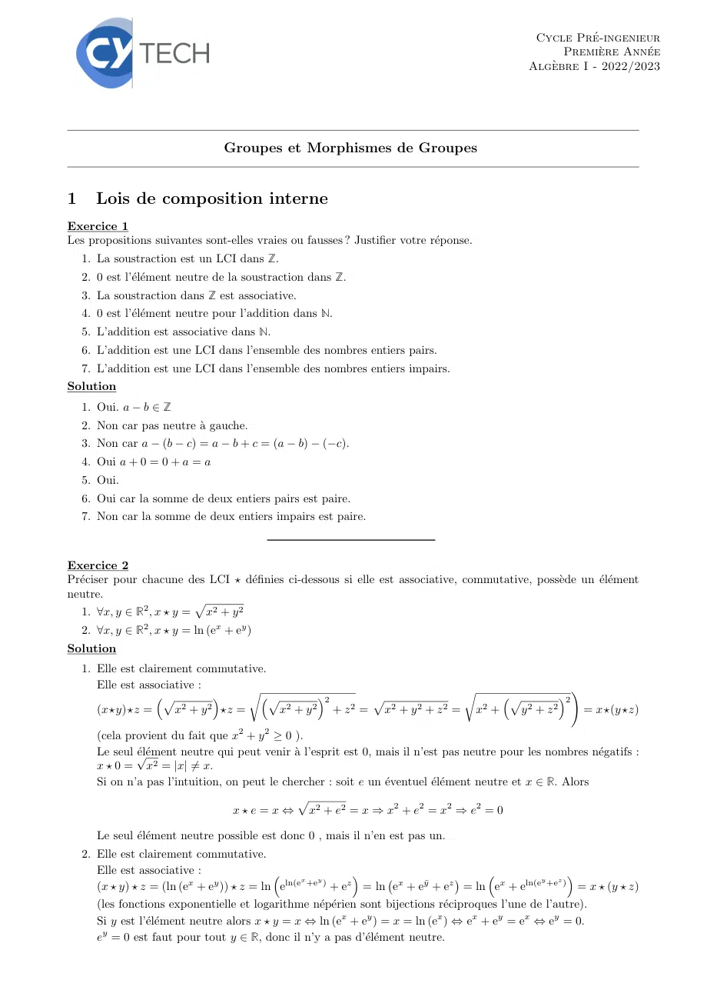
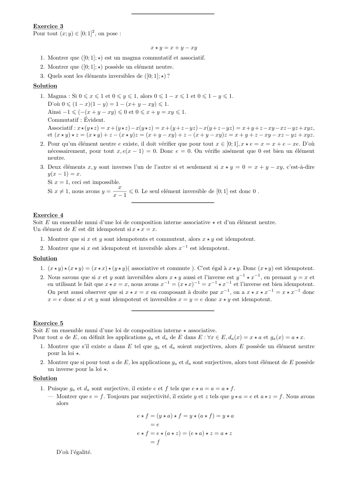
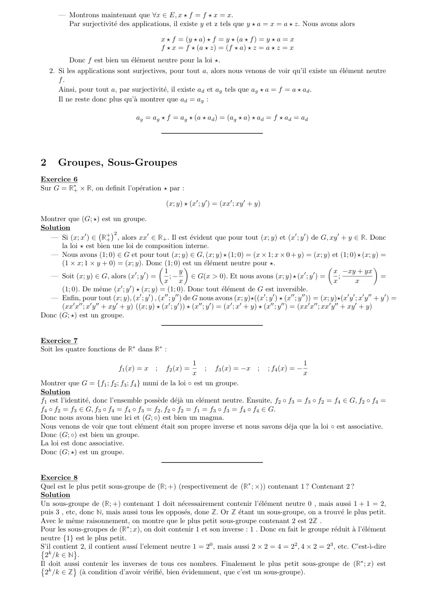
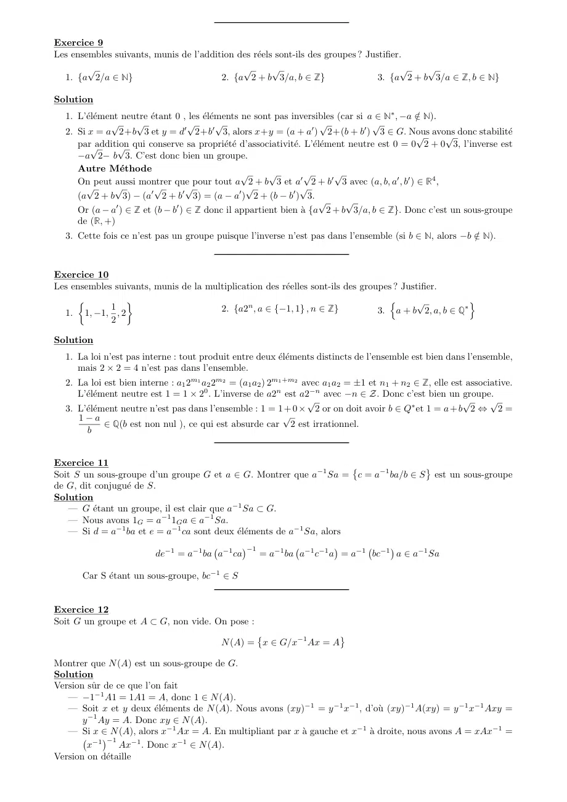
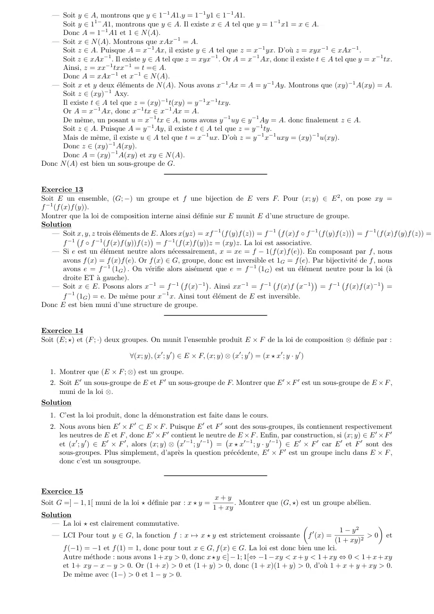
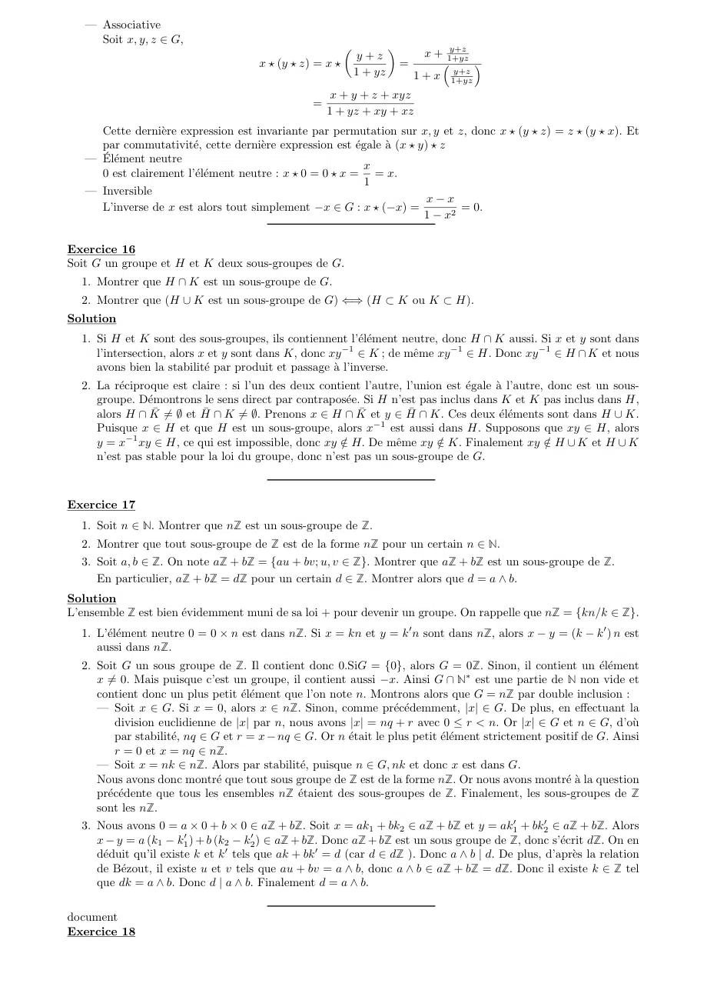
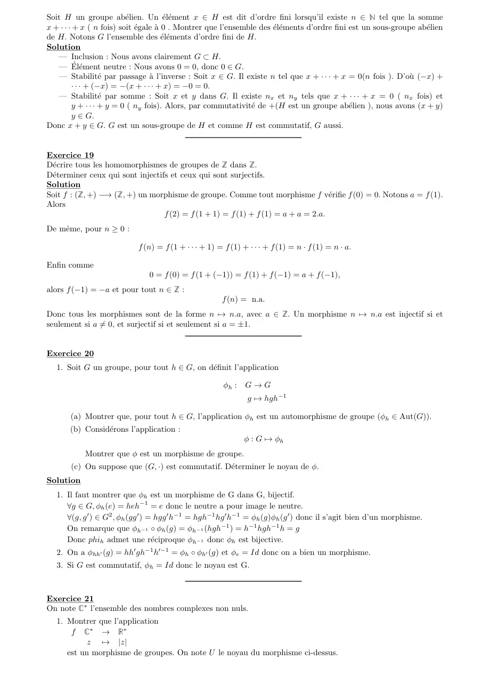
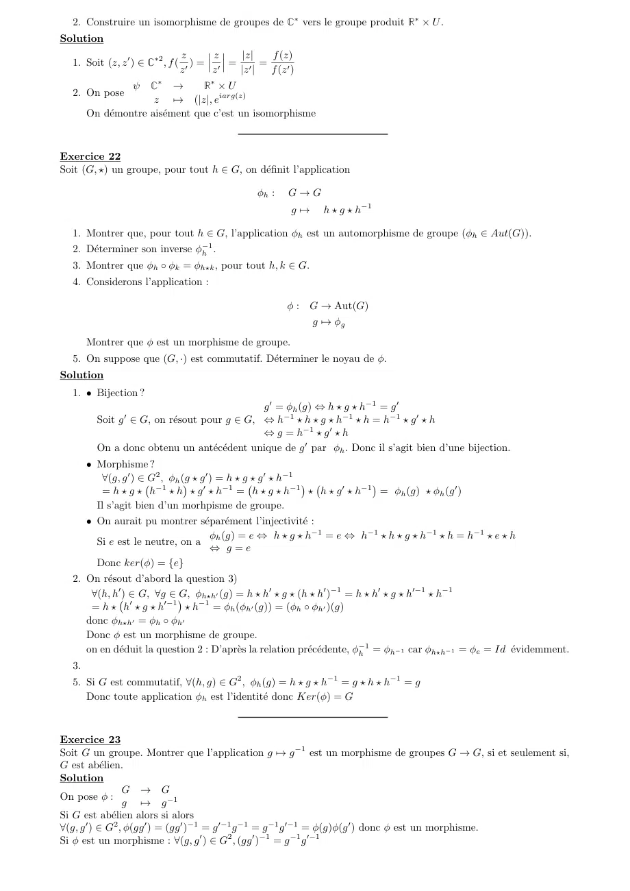
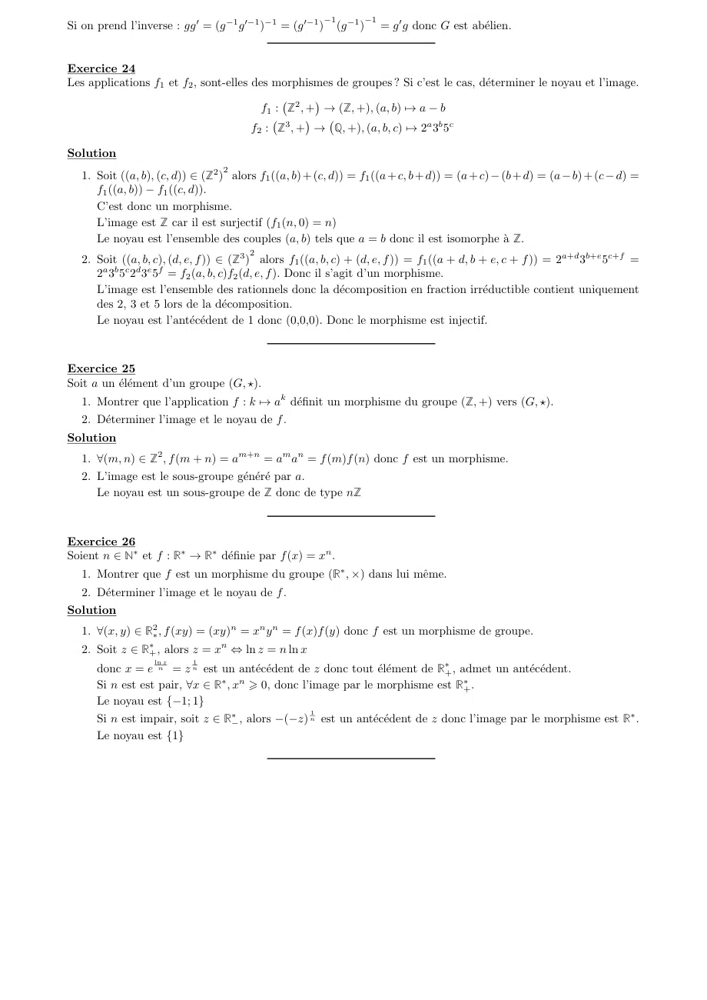

# TD1-Groupes-Correction_2023-2024_Algebre2_P1S2_DMaths.pdf

[Ouvrir l’original](https://drive.google.com/open?id=1c5zyKlGkG4jIB7z0ZxLVPb1tj06UuOof) · Les deux lectures automatiques du PDF divergent sur les pages indiquées. Leur fac-similé accompagne le texte.

**Pages présentant un écart entre les deux extractions** — 1–9.

## Page 1

~~~text
                                                                                                 Cycle Pré-ingenieur
                                                                                                      Première Année
                                                                                                Algèbre I - 2022/2023

                                  Groupes et Morphismes de Groupes

1      Lois de composition interne
Exercice 1
Les propositions suivantes sont-elles vraies ou fausses ? Justifier votre réponse.
    1. La soustraction est un LCI dans Z.
    2. 0 est l’élément neutre de la soustraction dans Z.
    3. La soustraction dans Z est associative.
    4. 0 est l’élément neutre pour l’addition dans N.
    5. L’addition est associative dans N.
    6. L’addition est une LCI dans l’ensemble des nombres entiers pairs.
    7. L’addition est une LCI dans l’ensemble des nombres entiers impairs.
Solution
    1. Oui. a − b ∈ Z
    2. Non car pas neutre à gauche.
    3. Non car a − (b − c) = a − b + c = (a − b) − (−c).
    4. Oui a + 0 = 0 + a = a
    5. Oui.
    6. Oui car la somme de deux entiers pairs est paire.
    7. Non car la somme de deux entiers impairs est paire.

Exercice 2
Préciser pour chacune des LCI ⋆ définies ci-dessous si elle est associative, commutative, possède un élément
neutre.
                          p
   1. ∀x, y ∈ R2 , x ⋆ y = x2 + y 2
    2. ∀x, y ∈ R2 , x ⋆ y = ln (ex + ey )
Solution
    1. Elle est clairement commutative.
       Elle est associative :        r                                    r                   !
                    p                 p         2      p                      p         2
       (x⋆y)⋆z =       x2 + y 2 ⋆z =      x2 + y 2 + z 2 = x2 + y 2 + z 2 = x2 +    y2 + z2      = x⋆(y ⋆z)

       (cela provient du fait que x2 + y 2 ≥ 0 ).
       Le seul √
               élément neutre qui peut venir à l’esprit est 0, mais il n’est pas neutre pour les nombres négatifs :
       x ⋆ 0 = x2 = |x| =  ̸ x.
       Si on n’a pas l’intuition, on peut le chercher : soit e un éventuel élément neutre et x ∈ R. Alors
                                                p
                                   x ⋆ e = x ⇔ x2 + e2 = x ⇒ x2 + e2 = x2 ⇒ e2 = 0

       Le seul élément neutre possible est donc 0 , mais il n’en est pas un.
    2. Elle est clairement commutative.
       Elle est associative :                                                                     
                                                   x  y                                         y  z
       (x ⋆ y) ⋆ z = (ln (ex + ey )) ⋆ z = ln eln(e +e ) + ez = ln ex + eȳ + ez = ln ex + eln(e +e ) = x ⋆ (y ⋆ z)
                                                                                

       (les fonctions exponentielle et logarithme népérien sont bijections réciproques l’une de l’autre).
       Si y est l’élément neutre alors x ⋆ y = x ⇔ ln (ex + ey ) = x = ln (ex ) ⇔ ex + ey = ex ⇔ ey = 0.
       ey = 0 est faut pour tout y ∈ R, donc il n’y a pas d’élément neutre.
~~~

## Page 2

~~~text
Exercice 3
Pour tout (x; y) ∈ [0; 1]2 , on pose :

                                                   x ⋆ y = x + y − xy
   1. Montrer que ([0; 1]; ⋆) est un magma commutatif et associatif.
   2. Montrer que ([0; 1]; ⋆) possède un elément neutre.
   3. Quels sont les éléments inversibles de ([0; 1]; ⋆) ?
Solution
   1. Magma : Si 0 ⩽ x ⩽ 1 et 0 ⩽ y ⩽ 1, alors 0 ⩽ 1 − x ⩽ 1 et 0 ⩽ 1 − y ⩽ 1.
      D’où 0 ⩽ (1 − x)(1 − y) = 1 − (x+ y − xy) ⩽ 1.
      Ainsi −1 ⩽ (−(x + y − xy) ⩽ 0 et 0 ⩽ x + y = xy ⩽ 1.
      Commutatif : Évident.
      Associatif : x⋆(y ⋆z) = x+(y ⋆z)−x(y ⋆z) = x+(y +z −yz)−x(y +z −yz) = x+y +z −xy −xz −yz +xyz,
      et (x ⋆ y) ⋆ z = (x ⋆ y) + z − (x ⋆ y)z = (x + y − xy) + z − (x + y − xy)z = x + y + z − xy − xz − yz + xyz.
   2. Pour qu’un élément neutre e existe, il doit vérifier que pour tout x ∈ [0; 1], x ⋆ e = x = x + e − xe. D’où
      nécessairement, pour tout x, e(x − 1) = 0. Donc e = 0. On vérifie aisément que 0 est bien un élément
      neutre.
   3. Deux éléments x, y sont inverses l’un de l’autre si et seulement si x ⋆ y = 0 = x + y − xy, c’est-â-dire
      y(x − 1) = x.
      Si x = 1, ceci est impossible.
                                   x
      Si x ̸= 1, nous avons y =        ⩽ 0. Le seul elément inversible de [0; 1] est donc 0 .
                                 x−1

Exercice 4
Soit E un ensemble muni d’une loi de composition interne associative ⋆ et d’un élément neutre.
Un élément de E est dit idempotent si x ⋆ x = x.
   1. Montrer que si x et y sont idempotents et commutent, alors x ⋆ y est idempotent.
   2. Montrer que si x est idempotent et inversible alors x−1 est idempotent.
Solution
   1. (x ⋆ y) ⋆ (x ⋆ y) = (x ⋆ x) ⋆ (y ⋆ y)( associative et commute ). C’est égal à x ⋆ y. Donc (x ⋆ y) est idempotent.
   2. Nous savons que si x et y sont inversibles alors x ⋆ y aussi et l’inverse est y −1 ⋆ x−1 , en prenant y = x et
      en utilisant le fait que x ⋆ x = x, nous avons x−1 = (x ⋆ x)−1 = x−1 ⋆ x−1 et l’inverse est bien idempotent.
      On peut aussi observer que si x ⋆ x = x en composant à droite par x−1 , on a x ⋆ x ⋆ x−1 = x ⋆ x−1 donc
      x = e donc si x et y sont idempotent et inversibles x = y = e donc x ⋆ y est idempotent.

Exercice 5
Soit E un ensemble muni d’une loi de composition interne ⋆ associative.
Pour tout a de E, on définit les applications ga et da de E dans E : ∀x ∈ E, da (x) = x ⋆ a et ga (x) = a ⋆ x.
   1. Montrer que s’il existe a dans E tel que ga et da soient surjectives, alors E possède un élément neutre
      pour la loi ⋆.
   2. Montrer que si pour tout a de E, les applications ga et da sont surjectives, alors tout élément de E possède
      un inverse pour la loi ⋆.
Solution
   1. Puisque ga et da sont surjective, il existe e et f tels que e ⋆ a = a = a ⋆ f .
      — Montrer que e = f . Toujours par surjectivité, il existe y et z tels que y ⋆ a = e et a ⋆ z = f . Nous avons
         alors

                                             e ⋆ f = (y ⋆ a) ⋆ f = y ⋆ (a ⋆ f ) = y ⋆ a
                                                   =e
                                             e ⋆ f = e ⋆ (a ⋆ z) = (e ⋆ a) ⋆ z = a ⋆ z
                                                   =f
          D’où l’égalité.
~~~

## Page 3

~~~text
       — Montrons maintenant que ∀x ∈ E, x ⋆ f = f ⋆ x = x.
         Par surjectivité des applications, il existe y et z tels que y ⋆ a = x = a ⋆ z. Nous avons alors

                                                 x ⋆ f = (y ⋆ a) ⋆ f = y ⋆ (a ⋆ f ) = y ⋆ a = x
                                                 f ⋆ x = f ⋆ (a ⋆ z) = (f ⋆ a) ⋆ z = a ⋆ z = x
           Donc f est bien un élément neutre pour la loi ⋆.
    2. Si les applications sont surjectives, pour tout a, alors nous venons de voir qu’il existe un élément neutre
       f.
       Ainsi, pour tout a, par surjectivité, il existe ad et ag tels que ag ⋆ a = f = a ⋆ ad .
       Il ne reste donc plus qu’à montrer que ad = ag :

                                       ag = ag ⋆ f = ag ⋆ (a ⋆ ad ) = (ag ⋆ a) ⋆ ad = f ⋆ ad = ad

2      Groupes, Sous-Groupes
Exercice 6
Sur G = R∗+ × R, on definit l’opération ⋆ par :

                                                   (x; y) ⋆ (x′ ; y ′ ) = (xx′ ; xy ′ + y)

Montrer que (G; ⋆) est un groupe.
Solution
                            2
   — Si (x; x′ ) ∈ R+                    ′                                                                  ′ ′
                          + , alors xx ∈ R+ . Il est évident que pour tout (x; y) et (x ; y ) de G, xy + y ∈ R. Donc
                                                                                                                                ′

      la loi ⋆ est bien une loi de composition interne.
   — Nous avons (1; 0) ∈ G et pour tout (x; y) ∈ G, (x; y) ⋆ (1; 0) = (x × 1; x × 0 + y) = (x; y) et (1; 0) ⋆ (x; y) =
      (1 × x; 1 × y + 0) = (x; y). Donc       (1; 0) est   un élément neutre pour ⋆.                                                    
                                     ′ ′        1       y                                                                    x −xy + yx
   — Soit (x; y) ∈ G, alors (x ; y ) =            ;−         ∈ G(x > 0). Et nous avons (x; y) ⋆ (x′ ; y ′ ) =                    ;             =
                                                x x                                                                          x        x
      (1; 0). De même (x′ ; y ′ ) ⋆ (x; y) = (1; 0). Donc tout élément de G est inversible.
   — Enfin, pour tout (x; y), (x′ ; y ′ ) , (x′′ ; y ′′ ) de G nous avons (x; y)⋆((x′ ; y ′ ) ⋆ (x′′ ; y ′′ )) = (x; y)⋆(x′ y ′ ; x′ y ′′ + y ′ ) =
      (xx′ x′′ ; x′ y ′′ + xy ′ + y) ((x; y) ⋆ (x′ ; y ′ )) ⋆ (x′′ ; y ′ ) = (x′ ; x′ + y) ⋆ (x′′ ; y ′′ ) = (xx′ x′′ ; xx′ y ′′ + xy ′ + y)
Donc (G; ⋆) est un groupe.

Exercice 7
Soit les quatre fonctions de R∗ dans R∗ :
                                                      1                                    1
                                f1 (x) = x ;       f2 (x) =; f3 (x) = −x ; ; f4 (x) = −
                                                      x                                    x
Montrer que G = {f1 ; f2 ; f3 ; f4 } muni de la loi ◦ est un groupe.
Solution
f1 est l’identité, donc l’ensemble possède déjà un elément neutre. Ensuite, f2 ◦ f3 = f3 ◦ f2 = f4 ∈ G, f2 ◦ f4 =
f4 ◦ f2 = f3 ∈ G, f3 ◦ f4 = f4 ◦ f3 = f2 , f2 ◦ f2 = f1 = f3 ◦ f3 = f4 ◦ f4 ∈ G.
Donc nous avons bien une lci et (G; ◦) est bien un magma.
Nous venons de voir que tout elément était son propre inverse et nous savons déja que la loi ◦ est associative.
Donc (G; ◦) est bien un groupe.
La loi est donc associative.
Donc (G; ⋆) est un groupe.

Exercice 8
Quel est le plus petit sous-groupe de (R; +) (respectivement de (R∗ ; ×)) contenant 1 ? Contenant 2 ?
Solution
Un sous-groupe de (R; +) contenant 1 doit nécessairement contenir l’élément neutre 0 , mais aussi 1 + 1 = 2,
puis 3 , etc, donc N, mais aussi tous les opposés, done Z. Or Z étant un sous-groupe, on a trouvé le plus petit.
Avec le même raisonnement, on montre que le plus petit sous-groupe contenant 2 est 2Z .
Pour les sous-groupes de (R∗ ; x), on doit contenir 1 et son inverse : 1 . Donc en fait le groupe réduit à l’élément
neutre {1} est le plus petit.
                                                         0                           2           3
 k contient 2, il contient aussı́ l’element neutre 1 = 2 , mais aussi 2 × 2 = 4 = 2 , 4 × 2 = 2 , etc. C’est-ı̀-dire
S’il
  2 /k ∈ N .
                                                                                                              ∗
 kdoit aussi contenir les inverses de tous ces nombres. Finalement le plus petit sous-groupe de (R ; x) est
Il
  2 /k ∈ Z (à condition d’avoir vérifié, bien évidemment, que c’est un sous-groupe).
~~~

## Page 4

~~~text
Exercice 9
Les ensembles suivants, munis de l’addition des réels sont-ils des groupes ? Justifier.
       √                                        √     √                                   √     √
  1. {a 2/a ∈ N}                           2. {a 2 + b 3/a, b ∈ Z}                   3. {a 2 + b 3/a ∈ Z, b ∈ N}

Solution
  1. L’élément neutre étant 0 , les éléments ne sont pas inversibles (car si a ∈ N∗ , −a ∈  / N).
              √     √             ′
                                    √      ′
                                             √                         ′
                                                                          √         ′
                                                                                      √
  2. Si x = a 2+b 3 et y = d 2+b 3, alors x+y = (a + a ) 2+(b + b ) 3 ∈ G. Nous                   √ avons
                                                                                                        √ donc stabilité
     par√addition
                √  qui conserve     sa propriété d’associativité. L’élément neutre est 0 = 0  2 + 0 3, l’inverse est
     −a 2− b 3. C’est donc bien un groupe.
     Autre Méthode                                √      √          √        √
     On peut aussi montrer que pour tout a 2 + b 3 et a′ 2 + b′ 3 avec (a, b, a′ , b′ ) ∈ R4 ,
       √       √          √        √                √              √
     (a 2 + b 3) − (a′ 2 + b′ 3) = (a − a′ ) 2 + (b − b′ ) 3.
                                                                         √       √
     Or (a − a′ ) ∈ Z et (b − b′ ) ∈ Z donc il appartient bien à {a 2 + b 3/a, b ∈ Z}. Donc c’est un sous-groupe
     de (R, +)
  3. Cette fois ce n’est pas un groupe puisque l’inverse n’est pas dans l’ensemble (si b ∈ N, alors −b ∈
                                                                                                       / N).

Exercice 10
Les ensembles suivants, munis de la multiplication des réelles sont-ils des groupes ? Justifier.
     
             1
                                                                                  n       √           o
  1. 1, −1, , 2                        2. {a2n , a ∈ {−1, 1} , n ∈ Z}            3. a + b 2, a, b ∈ Q∗
             2

Solution
  1. La loi n’est pas interne : tout produit entre deux éléments distincts de l’ensemble est bien dans l’ensemble,
     mais 2 × 2 = 4 n’est pas dans l’ensemble.
  2. La loi est bien interne : a1 2m1 a2 2m2 = (a1 a2 ) 2m1 +m2 avec a1 a2 = ±1 et n1 + n2 ∈ Z, elle est associative.
     L’élément neutre est 1 = 1 × 20 . L’inverse de a2n est a2−n avec −n ∈ Z. Donc c’est bien un groupe.
                                                                 √                                      √      √
  3. L’élément neutre n’est pas dans l’ensemble : 1 = 1 + 0 × 2 or on doit avoir b ∈ Q∗ et 1 = a + b 2 ⇔ 2 =
     1−a                                                    √
             ∈ Q(b est non nul ), ce qui est absurde car 2 est irrationnel.
        b

Exercice 11
Soit S un sous-groupe d’un groupe G et a ∈ G. Montrer que a−1 Sa = c = a−1 ba/b ∈ S
                                                                       
                                                                                                    est un sous-groupe
de G, dit conjugué de S.
Solution
   — G étant un groupe, il est clair que a−1 Sa ⊂ G.
   — Nous avons 1G = a−1 1G a ∈ a−1 Sa.
   — Si d = a−1 ba et e = a−1 ca sont deux éléments de a−1 Sa, alors
                                             −1
                         de−1 = a−1 ba a−1 ca    = a−1 ba a−1 c−1 a = a−1 bc−1 a ∈ a−1 Sa
                                                                             

       Car S étant un sous-groupe, bc−1 ∈ S

Exercice 12
Soit G un groupe et A ⊂ G, non vide. On pose :

                                           N (A) = x ∈ G/x−1 Ax = A
                                                  

Montrer que N (A) est un sous-groupe de G.
Solution
Version sûr de ce que l’on fait
   — −1−1 A1 = 1A1 = A, donc 1 ∈ N (A).
   — Soit x et y deux éléments de N (A). Nous avons (xy)−1 = y −1 x−1 , d’où (xy)−1 A(xy) = y −1 x−1 Axy =
       y −1 Ay = A. Donc xy ∈ N (A).
   — Si x ∈ N (A), alors x−1 Ax = A. En multipliant par x à gauche et x−1 à droite, nous avons A = xAx−1 =
             −1
        x−1      Ax−1 . Donc x−1 ∈ N (A).
Version on détaille
~~~

## Page 5

~~~text
  — Soit y ∈ A, montrons que y ∈ 1−1 A1.y = 1−1 y1 ∈ 1−1 A1.
      Soit y ∈ 11− A1, montrons que y ∈ A. Il existe x ∈ A tel que y = 1−1 x1 = x ∈ A.
      Donc A = 1−1 A1 et 1 ∈ N (A).
  — Soit x ∈ N (A). Montrons que xAx−1 = A.
      Soit z ∈ A. Puisque A = x−1 Ax, il existe y ∈ A tel que z = x−1 yx. D’où z = xyx−1 ∈ xAx−1 .
      Soit z ∈ xAx−1 . Il existe y ∈ A tel que z = xyx−1 . Or A = x−1 Ax, donc il existe t ∈ A tel que y = x−1 tx.
      Ainsi, z = xx−1 txx−1 = t =∈ A.
      Donc A = xAx−1 et x−1 ∈ N (A).
  — Soit x et y deux éléments de N (A). Nous avons x−1 Ax = A = y −1 Ay. Montrons que (xy)−1 A(xy) = A.
      Soit z ∈ (xy)−1 Axy.
      Il existe t ∈ A tel que z = (xy)−1 t(xy) = y −1 x−1 txy.
      Or A = x−1 Ax, donc x−1 tx ∈ x−1 Ax = A.
      De même, un posant u = x−1 tx ∈ A, nous avons y −1 uy ∈ y −1 Ay = A. donc finalement z ∈ A.
      Soit z ∈ A. Puisque A = y −1 Ay, il existe t ∈ A tel que z = y −1 ty.
      Mais de même, il existe u ∈ A tel que t = x−1 ux. D’où z = y −1 x−1 uxy = (xy)−1 u(xy).
      Donc z ∈ (xy)−1 A(xy).
      Donc A = (xy)−1 A(xy) et xy ∈ N (A).
Donc N (A) est bien un sous-groupe de G.

Exercice 13
Soit E un ensemble, (G; −) un groupe et f une bijection de E vers F. Pour (x; y) ∈ E 2 , on pose xy =
f −1 (f (x)f (y)).
Montrer que la loi de composition interne ainsi définie sur E munit E d’une structure de groupe.
Solution
    — Soit x, y, z trois éléments de E. Alors x(yz) = xf −1 (f (y)f (z)) = f −1 f (x)f ◦ f −1 (f (y)f (z)) = f −1 (f (x)f (y)f (z)) =
                                                                                                            

         f −1 f ◦ f −1 (f (x)f (y))f (z) = f −1 (f (x)f (y))z = (xy)z. La loi est associative.
                                        

    — Si e est un élément neutre alors nécessairement, x = xe = f − 1(f (x)f (e)). En composant par f , nous
         avons f (x) = f (x)f (e). Or f (x) ∈ G, groupe, donc est inversible et 1G = f (e). Par bijectivité de f , nous
         avons e = f −1 (1G ) . On vérifie alors aisément que e = f −1 (1G ) est un élément neutre pour la loi (à
         droite ET à gauche).
    — Soit x ∈ E. Posons alors x−1 = f −1 f (x)−1 . Ainsi xx−1 = f −1 f (x)f x−1 = f −1 f (x)f (x)−1 =
                                                                                                                  

         f −1 (1G ) = e. De même pour x−1 x. Ainsi tout élément de E est inversible.
Donc E est bien muni d’une structure de groupe.

Exercice 14
Soit (E; ⋆) et (F ; ·) deux groupes. On munit l’ensemble produit E × F de la loi de composition ⊗ définie par :

                              ∀(x; y), (x′ ; y ′ ) ∈ E × F, (x; y) ⊗ (x′ ; y ′ ) = (x ⋆ x′ ; y · y ′ )

   1. Montrer que (E × F ; ⊗) est un groupe.
   2. Soit E ′ un sous-groupe de E et F ′ un sous-groupe de F. Montrer que E ′ × F ′ est un sous-groupe de E × F ,
      muni de la loi ⊗.
Solution
   1. C’est la loi produit, donc la démonstration est faite dans le cours.
   2. Nous avons bien E ′ × F ′ ⊂ E × F . Puisque E ′ et F ′ sont des sous-groupes, ils contiennent respectivement
      les neutres de E et F , donc E ′ × F ′ contient le neutre de E × F . Enfin,par construction, si (x; y) ∈ E ′ × F ′
            ′ ′       ′    ′                     ′−1 ′−1
                                                            = x ⋆ x′−1 ; y · y ′−1 ∈ E ′ × F ′ car E ′ et F ′ sont des
                                                          
      et (x ; y ) ∈ E × F , alors (x; y) ⊗ x ; y
      sous-groupes. Plus simplement, d’après la question précédente, E ′ × F ′ est un groupe inclu dans E × F ,
      donc c’est un sousgroupe.

Exercice 15
                                                                 x+y
Soit G =] − 1, 1[ muni de la loi ⋆ définie par : x ⋆ y =              . Montrer que (G, ⋆) est un groupe abélien.
                                                                1 + xy
Solution
   — La loi ⋆ est clairement commutative.
                                                                                                1 − y2
                                                                                                          
   — LCI Pour tout y ∈ G, la fonction f : x 7→ x ⋆ y est strictement croissante f ′ (x) =               > 0 et
                                                                                              (1 + xy)2
       f (−1) = −1 et f (1) = 1, donc pour tout x ∈ G, f (x) ∈ G. La loi est donc bien une lci.
       Autre méthode : nous avons 1 + xy > 0, donc x ⋆ y ∈] − 1; 1[⇔ −1 − xy < x + y < 1 + xy ⇔ 0 < 1 + x + xy
       et 1+ xy − x − y > 0. Or (1 + x) > 0 et (1 + y) > 0, donc (1 + x)(1 + y) > 0, d’où 1 + x + y + xy > 0.
       De même avec (1−) > 0 et 1 − y > 0.
~~~

## Page 6

~~~text
   — Associative
     Soit x, y, z ∈ G,
                                                                                    y+z
                                                                               x + 1+yz
                                                                      
                                                              y+z
                                      x ⋆ (y ⋆ z) = x ⋆                    =            
                                                              1 + yz                 y+z
                                                                             1 + x 1+yz
                                                       x + y + z + xyz
                                                  =
                                                      1 + yz + xy + xz
     Cette dernière expression est invariante par permutation sur x, y et z, donc x ⋆ (y ⋆ z) = z ⋆ (y ⋆ x). Et
     par commutativité, cette dernière expression est égale à (x ⋆ y) ⋆ z
   — Élément neutre
                                                          x
     0 est clairement l’élément neutre : x ⋆ 0 = 0 ⋆ x = = x.
                                                           1
   — Inversible
                                                                         x−x
     L’inverse de x est alors tout simplement −x ∈ G : x ⋆ (−x) =              = 0.
                                                                        1 − x2

Exercice 16
Soit G un groupe et H et K deux sous-groupes de G.
  1. Montrer que H ∩ K est un sous-groupe de G.
  2. Montrer que (H ∪ K est un sous-groupe de G) ⇐⇒ (H ⊂ K ou K ⊂ H).
Solution
  1. Si H et K sont des sous-groupes, ils contiennent l’élément neutre, donc H ∩ K aussi. Si x et y sont dans
     l’intersection, alors x et y sont dans K, donc xy −1 ∈ K ; de même xy −1 ∈ H. Donc xy −1 ∈ H ∩ K et nous
     avons bien la stabilité par produit et passage à l’inverse.
  2. La réciproque est claire : si l’un des deux contient l’autre, l’union est égale à l’autre, donc est un sous-
     groupe. Démontrons le sens direct par contraposée. Si H n’est pas inclus dans K et K pas inclus dans H,
     alors H ∩ K̄ ̸= ∅ et H̄ ∩ K ̸= ∅. Prenons x ∈ H ∩ K̄ et y ∈ H̄ ∩ K. Ces deux éléments sont dans H ∪ K.
     Puisque x ∈ H et que H est un sous-groupe, alors x−1 est aussi dans H. Supposons que xy ∈ H, alors
     y = x−1 xy ∈ H, ce qui est impossible, donc xy ∈ / H. De même xy ∈  / K. Finalement xy ∈    / H ∪ K et H ∪ K
     n’est pas stable pour la loi du groupe, donc n’est pas un sous-groupe de G.

Exercice 17
  1. Soit n ∈ N. Montrer que nZ est un sous-groupe de Z.
  2. Montrer que tout sous-groupe de Z est de la forme nZ pour un certain n ∈ N.
  3. Soit a, b ∈ Z. On note aZ + bZ = {au + bv; u, v ∈ Z}. Montrer que aZ + bZ est un sous-groupe de Z.
     En particulier, aZ + bZ = dZ pour un certain d ∈ Z. Montrer alors que d = a ∧ b.
Solution
L’ensemble Z est bien évidemment muni de sa loi + pour devenir un groupe. On rappelle que nZ = {kn/k ∈ Z}.
  1. L’élément neutre 0 = 0 × n est dans nZ. Si x = kn et y = k ′ n sont dans nZ, alors x − y = (k − k ′ ) n est
     aussi dans nZ.
  2. Soit G un sous groupe de Z. Il contient donc 0.SiG = {0}, alors G = 0Z. Sinon, il contient un élément
     x ̸= 0. Mais puisque c’est un groupe, il contient aussi −x. Ainsi G ∩ N∗ est une partie de N non vide et
     contient donc un plus petit élément que l’on note n. Montrons alors que G = nZ par double inclusion :
     — Soit x ∈ G. Si x = 0, alors x ∈ nZ. Sinon, comme précédemment, |x| ∈ G. De plus, en effectuant la
         division euclidienne de |x| par n, nous avons |x| = nq + r avec 0 ≤ r < n. Or |x| ∈ G et n ∈ G, d’où
         par stabilité, nq ∈ G et r = x − nq ∈ G. Or n était le plus petit élément strictement positif de G. Ainsi
         r = 0 et x = nq ∈ nZ.
     — Soit x = nk ∈ nZ. Alors par stabilité, puisque n ∈ G, nk et donc x est dans G.
     Nous avons donc montré que tout sous groupe de Z est de la forme nZ. Or nous avons montré à la question
     précédente que tous les ensembles nZ étaient des sous-groupes de Z. Finalement, les sous-groupes de Z
     sont les nZ.
  3. Nous avons 0 = a × 0 + b × 0 ∈ aZ + bZ. Soit x = ak1 + bk2 ∈ aZ + bZ et y = ak1′ + bk2′ ∈ aZ + bZ. Alors
     x − y = a (k1 − k1′ ) + b (k2 − k2′ ) ∈ aZ + bZ. Donc aZ + bZ est un sous groupe de Z, donc s’écrit dZ. On en
     déduit qu’il existe k et k ′ tels que ak + bk ′ = d (car d ∈ dZ ). Donc a ∧ b | d. De plus, d’après la relation
     de Bézout, il existe u et v tels que au + bv = a ∧ b, donc a ∧ b ∈ aZ + bZ = dZ. Donc il existe k ∈ Z tel
     que dk = a ∧ b. Donc d | a ∧ b. Finalement d = a ∧ b.

document
Exercice 18
~~~

## Page 7

~~~text
Soit H un groupe abélien. Un élément x ∈ H est dit d’ordre fini lorsqu’il existe n ∈ N tel que la somme
x + · · · + x ( n fois) soit égale à 0 . Montrer que l’ensemble des éléments d’ordre fini est un sous-groupe abélien
de H. Notons G l’ensemble des éléments d’ordre fini de H.
Solution
   — Inclusion : Nous avons clairement G ⊂ H.
   — Élément neutre : Nous avons 0 = 0, donc 0 ∈ G.
   — Stabilité par passage à l’inverse : Soit x ∈ G. Il existe n tel que x + · · · + x = 0(n fois ). D’où (−x) +
         · · · + (−x) = −(x + · · · + x) = −0 = 0.
   — Stabilité par somme : Soit x et y dans G. Il existe nx et ny tels que x + · · · + x = 0 ( nx fois) et
         y + · · · + y = 0 ( ny fois). Alors, par commutativité de +(H est un groupe abélien ), nous avons (x + y)
         y ∈ G.
Donc x + y ∈ G. G est un sous-groupe de H et comme H est commutatif, G aussi.

Exercice 19
Décrire tous les homomorphismes de groupes de Z dans Z.
Déterminer ceux qui sont injectifs et ceux qui sont surjectifs.
Solution
Soit f : (Z, +) −→ (Z, +) un morphisme de groupe. Comme tout morphisme f vérifie f (0) = 0. Notons a = f (1).
Alors
                                  f (2) = f (1 + 1) = f (1) + f (1) = a + a = 2.a.
De même, pour n ≥ 0 :

                            f (n) = f (1 + · · · + 1) = f (1) + · · · + f (1) = n · f (1) = n · a.

Enfin comme
                               0 = f (0) = f (1 + (−1)) = f (1) + f (−1) = a + f (−1),
alors f (−1) = −a et pour tout n ∈ Z :
                                                       f (n) = n.a.
Donc tous les morphismes sont de la forme n 7→ n.a, avec a ∈ Z. Un morphisme n 7→ n.a est injectif si et
seulement si a ̸= 0, et surjectif si et seulement si a = ±1.

Exercice 20
   1. Soit G un groupe, pour tout h ∈ G, on définit l’application

                                                       ϕh : G → G
                                                               g 7→ hgh−1

       (a) Montrer que, pour tout h ∈ G, l’application ϕh est un automorphisme de groupe (ϕh ∈ Aut(G)).
       (b) Considérons l’application :
                                                              ϕ : G 7→ ϕh
           Montrer que ϕ est un morphisme de groupe.
       (c) On suppose que (G, ·) est commutatif. Déterminer le noyau de ϕ.
Solution
   1. Il faut montrer que ϕh est un morphisme de G dans G, bijectif.
      ∀g ∈ G, ϕh (e) = heh−1 = e donc le neutre a pour image le neutre.
      ∀(g, g ′ ) ∈ G2 , ϕh (gg ′ ) = hgg ′ h−1 = hgh−1 hg ′ h−1 = ϕh (g)ϕh (g ′ ) donc il s’agit bien d’un morphisme.
      On remarque que ϕh−1 ◦ ϕh (g) = ϕh−1 (hgh−1 ) = h−1 hgh−1 h = g
      Donc phih admet une réciproque ϕh−1 donc ϕh est bijective.
   2. On a ϕhh′ (g) = hh′ gh−1 h′−1 = ϕh ◦ ϕh′ (g) et ϕe = Id donc on a bien un morphisme.
   3. Si G est commutatif, ϕh = Id donc le noyau est G.

Exercice 21
On note C∗ l’ensemble des nombres complexes non nuls.
   1. Montrer que l’application
       f C∗ → R∗
            z 7→ |z|
      est un morphisme de groupes. On note U le noyau du morphisme ci-dessus.
~~~

## Page 8

~~~text
  2. Construire un isomorphisme de groupes de C∗ vers le groupe produit R∗ × U .
Solution
                               z      z   |z| f (z)
  1. Soit (z, z ′ ) ∈ C∗2 , f ( ′ ) = ′ = ′ =
                               z      z  |z | f (z ′ )
                   ψC∗ →        R∗ × U
  2. On pose
                     z 7→ (|z|, eiarg(z)
       On démontre aisément que c’est un isomorphisme

Exercice 22
Soit (G, ⋆) un groupe, pour tout h ∈ G, on définit l’application

                                             ϕh :   G→G
                                                     g 7→     h ⋆ g ⋆ h−1

  1. Montrer que, pour tout h ∈ G, l’application ϕh est un automorphisme de groupe (ϕh ∈ Aut(G)).
  2. Déterminer son inverse ϕ−1
                              h .
  3. Montrer que ϕh ◦ ϕk = ϕh⋆k , pour tout h, k ∈ G.
  4. Considerons l’application :

                                                    ϕ : G → Aut(G)
                                                            g 7→ ϕg
       Montrer que ϕ est un morphisme de groupe.
  5. On suppose que (G, ·) est commutatif. Déterminer le noyau de ϕ.
Solution
  1. • Bijection ?
                                            g ′ = ϕh (g) ⇔ h ⋆ g ⋆ h−1 = g ′
               ′
         Soit g ∈ G, on résout pour g ∈ G, ⇔ h−1 ⋆ h ⋆ g ⋆ h−1 ⋆ h = h−1 ⋆ g ′ ⋆ h
                                            ⇔ g = h−1 ⋆ g ′ ⋆ h
         On a donc obtenu un antécédent unique de g ′ par ϕh . Donc il s’agit bien d’une bijection.
       • Morphisme ?
           ∀(g, g ′ ) ∈ G2 , ϕh (g     ′
                                            h ⋆ g ⋆ g ′ ⋆ h−1 
                                  ⋆ g′ ) =−1
          = h ⋆ g ⋆ h ⋆ h ⋆ g ⋆ h = h ⋆ g ⋆ h−1 ⋆ h ⋆ g ′ ⋆ h−1 = ϕh (g) ⋆ ϕh (g ′ )
                         −1
                                                                

         Il s’agit bien d’un morhpisme de groupe.
       • On aurait pu montrer séparément l’injectivité :
                                  ϕ (g) = e ⇔ h ⋆ g ⋆ h−1 = e ⇔ h−1 ⋆ h ⋆ g ⋆ h−1 ⋆ h = h−1 ⋆ e ⋆ h
         Si e est le neutre, on a h
                                  ⇔ g=e
         Donc ker(ϕ) = {e}
  2. On résout d’abord la question 3)
      ∀(h, h′ ) ∈ G, ∀g ∈ G, ϕh⋆h′ (g) = h ⋆ h′ ⋆ g ⋆ (h ⋆ h′ )−1 = h ⋆ h′ ⋆ g ⋆ h′−1 ⋆ h−1
      = h ⋆ h′ ⋆ g ⋆ h′−1 ⋆ h−1 = ϕh (ϕh′ (g)) = (ϕh ◦ ϕh′ )(g)
     donc ϕh⋆h′ = ϕh ◦ ϕh′
     Donc ϕ est un morphisme de groupe.
     on en déduit la question 2 : D’après la relation précédente, ϕ−1
                                                                       h = ϕh−1 car ϕh⋆h−1 = ϕe = Id évidemment.
  3.
  5. Si G est commutatif, ∀(h, g) ∈ G2 , ϕh (g) = h ⋆ g ⋆ h−1 = g ⋆ h ⋆ h−1 = g
     Donc toute application ϕh est l’identité donc Ker(ϕ) = G

Exercice 23
Soit G un groupe. Montrer que l’application g 7→ g −1 est un morphisme de groupes G → G, si et seulement si,
G est abélien.
Solution
                 G → G
On pose ϕ :
                 g 7→ g −1
Si G est abélien alors si alors
∀(g, g ′ ) ∈ G2 , ϕ(gg ′ ) = (gg ′ )−1 = g ′−1 g −1 = g −1 g ′−1 = ϕ(g)ϕ(g ′ ) donc ϕ est un morphisme.
Si ϕ est un morphisme : ∀(g, g ′ ) ∈ G2 , (gg ′ )−1 = g −1 g ′−1
~~~

## Page 9

~~~text
                                                          −1         −1
Si on prend l’inverse : gg ′ = (g −1 g ′−1 )−1 = (g ′−1 )      (g −1 )    = g ′ g donc G est abélien.

Exercice 24
Les applications f1 et f2 , sont-elles des morphismes de groupes ? Si c’est le cas, déterminer le noyau et l’image.

                                         f1 : Z2 , + → (Z, +), (a, b) 7→ a − b
                                                     

                                       f2 : Z3 , + → Q, +), (a, b, c) 7→ 2a 3b 5c
                                                   

Solution
                                  2
   1. Soit ((a, b), (c, d)) ∈ (Z2 ) alors f1 ((a, b) + (c, d)) = f1 ((a + c, b + d)) = (a + c) − (b + d) = (a − b) + (c − d) =
      f1 ((a, b)) − f1 ((c, d)).
      C’est donc un morphisme.
      L’image est Z car il est surjectif (f1 (n, 0) = n)
      Le noyau est l’ensemble des couples (a, b) tels que a = b donc il est isomorphe à Z.
                                        2
   2. Soit ((a, b, c), (d, e, f )) ∈ (Z3 ) alors f1 ((a, b, c) + (d, e, f )) = f1 ((a + d, b + e, c + f )) = 2a+d 3b+e 5c+f =
      2a 3b 5c 2d 3e 5f = f2 (a, b, c)f2 (d, e, f ). Donc il s’agit d’un morphisme.
      L’image est l’ensemble des rationnels donc la décomposition en fraction irréductible contient uniquement
      des 2, 3 et 5 lors de la décomposition.
      Le noyau est l’antécédent de 1 donc (0,0,0). Donc le morphisme est injectif.

Exercice 25
Soit a un élément d’un groupe (G, ⋆).
   1. Montrer que l’application f : k 7→ ak définit un morphisme du groupe (Z, +) vers (G, ⋆).
   2. Déterminer l’image et le noyau de f .
Solution
   1. ∀(m, n) ∈ Z2 , f (m + n) = am+n = am an = f (m)f (n) donc f est un morphisme.
   2. L’image est le sous-groupe généré par a.
      Le noyau est un sous-groupe de Z donc de type nZ

Exercice 26
Soient n ∈ N∗ et f : R∗ → R∗ définie par f (x) = xn .
   1. Montrer que f est un morphisme du groupe (R∗ , ×) dans lui même.
   2. Déterminer l’image et le noyau de f .
Solution
   1. ∀(x, y) ∈ R2∗ , f (xy) = (xy)n = xn y n = f (x)f (y) donc f est un morphisme de groupe.
   2. Soit z ∈ R∗+ , alors z = xn ⇔ ln z = n ln x
                   ln z    1
      donc x = e n = z n est un antécédent de z donc tout élément de R∗+ , admet un antécédent.
      Si n est est pair, ∀x ∈ R∗ , xn ⩾ 0, donc l’image par le morphisme est R∗+ .
      Le noyau est {−1; 1}
                                                      1
      Si n est impair, soit z ∈ R∗− , alors −(−z) n est un antécédent de z donc l’image par le morphisme est R∗ .
      Le noyau est {1}
~~~
