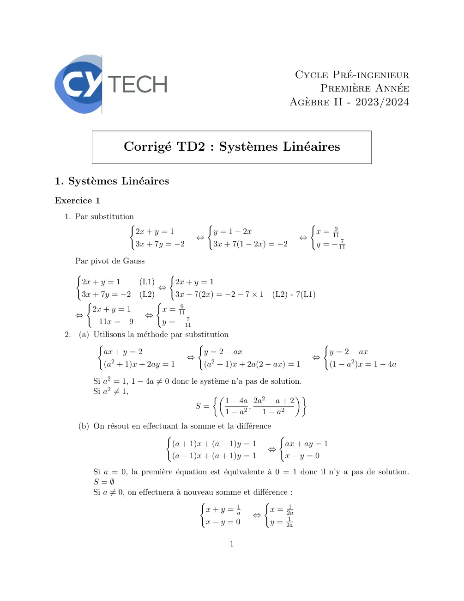
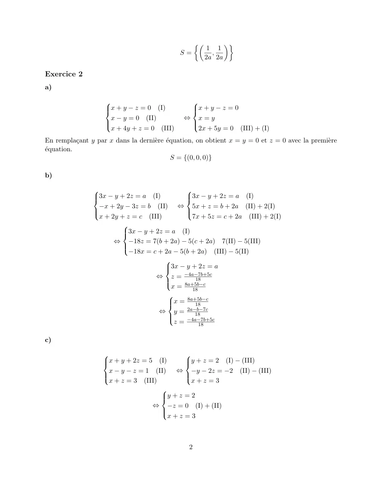
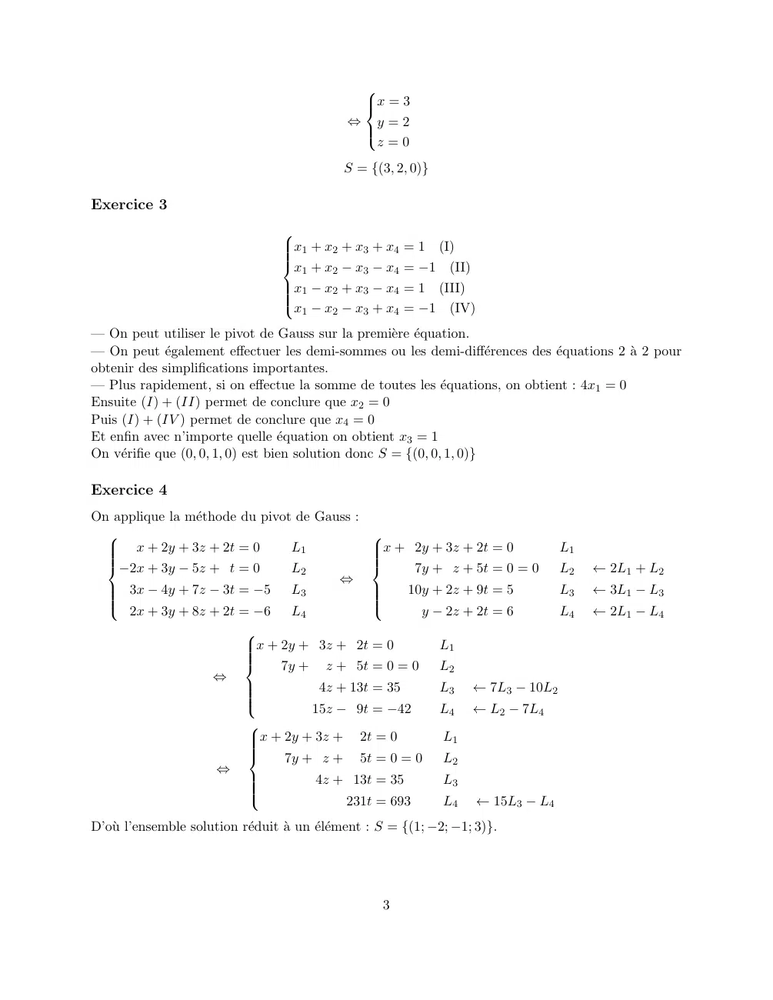
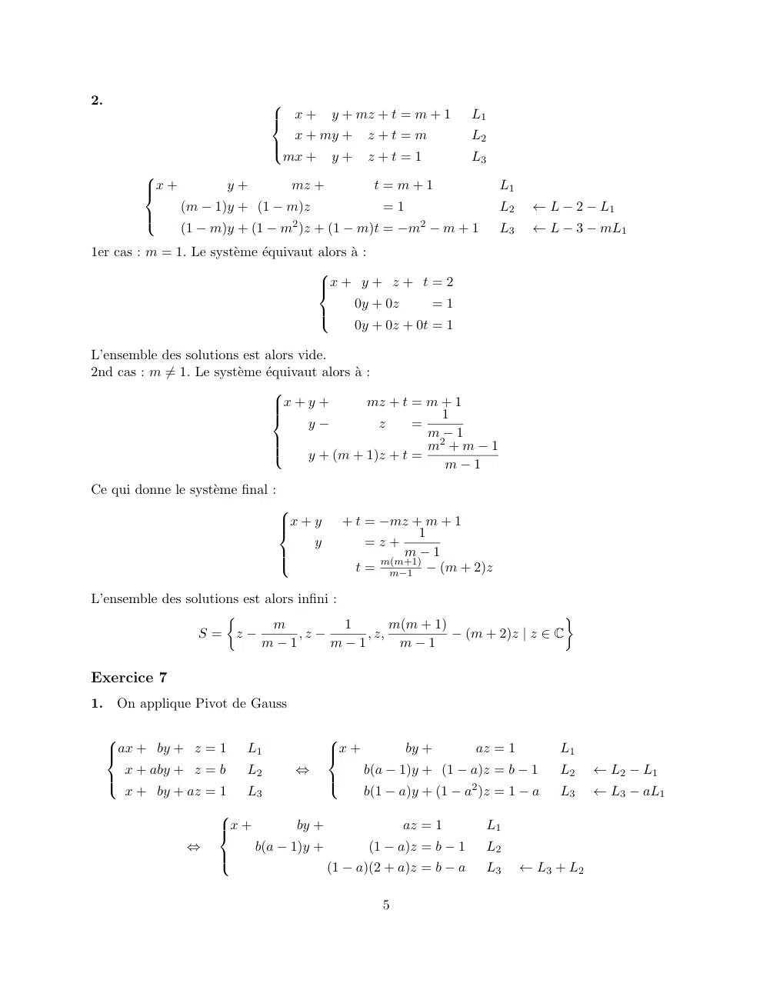
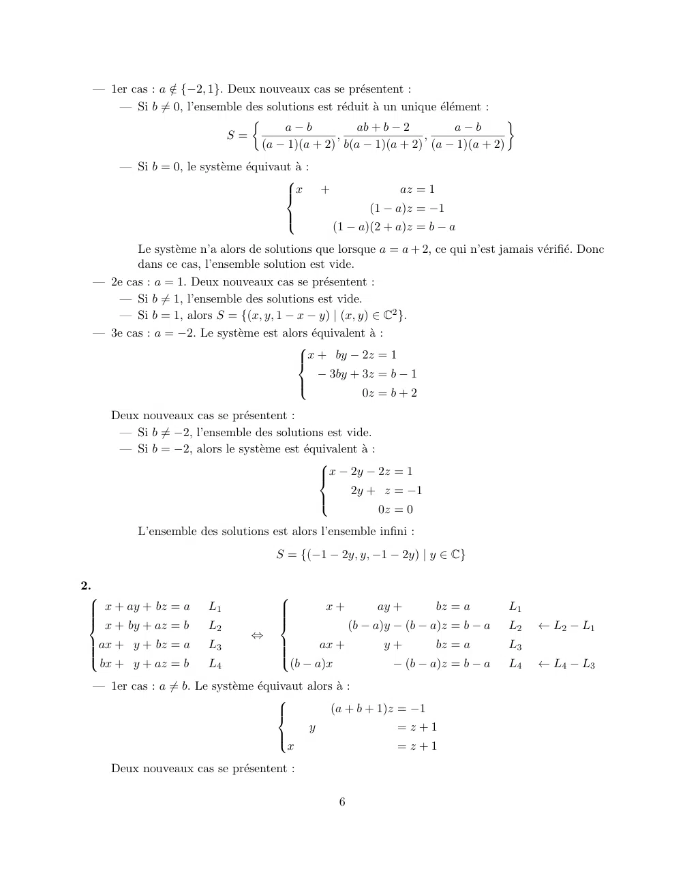
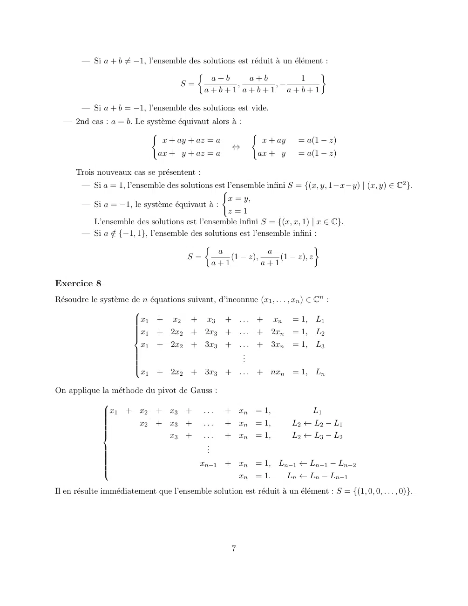
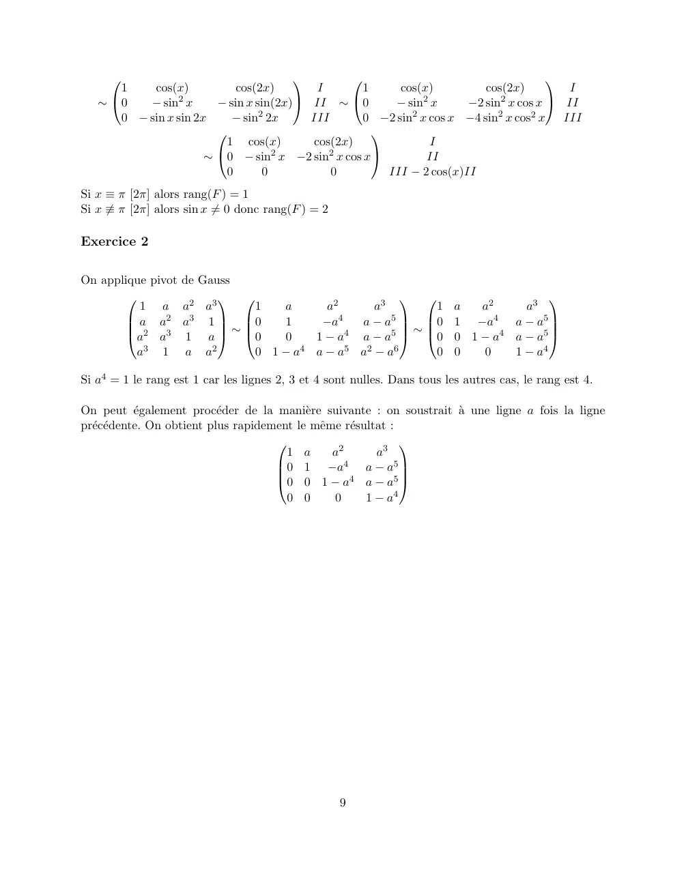

# TD2-Systeme-lineaire-Correction_2023-2024_Algebre2_P1S2_DMaths.pdf

[Ouvrir l’original](https://drive.google.com/open?id=1kXhM9fbhoWZi1KblQn4aeky1-nUAGvC8) · Les deux lectures automatiques du PDF divergent sur les pages indiquées. Leur fac-similé accompagne le texte.

**Pages présentant un écart entre les deux extractions** — 1–3, 5–7, 9.

## Page 1

~~~text
                                                                 Cycle Pré-ingenieur
                                                                     Première Année
                                                                Agèbre II - 2023/2024

                 Corrigé TD2 : Systèmes Linéaires

1. Systèmes Linéaires
Exercice 1
  1. Par substitution
                    (                  (                            (
                                                                         9
                      2x + y = 1        y = 1 − 2x                   x = 11
                                     ⇔                            ⇔         7
                      3x + 7y = −2      3x + 7(1 − 2x) = −2          y = − 11

    Par pivot de Gauss
    (                       (
     2x + y = 1     (L1)     2x + y = 1
                         ⇔
     3x + 7y = −2 (L2)       3x − 7(2x) = −2 − 7 × 1       (L2) - 7(L1)
      (                  (
                              9
        2x + y = 1        x = 11
    ⇔                  ⇔         7
        −11x = −9         y = − 11
  2. (a) Utilisons la méthode par substitution
          (                           (                                   (
           ax + y = 2                   y = 2 − ax                         y = 2 − ax
              2
                                   ⇔                                    ⇔
           (a + 1)x + 2ay = 1           (a2 + 1)x + 2a(2 − ax) = 1         (1 − a2 )x = 1 − 4a

         Si a2 = 1, 1 − 4a ̸= 0 donc le système n’a pas de solution.
         Si a2 ̸= 1,
                                               1 − 4a 2a2 − a + 2
                                                                 
                                      S=              ,
                                               1 − a2     1 − a2
     (b) On résout en effectuant la somme et la différence
                              (                              (
                               (a + 1)x + (a − 1)y = 1        ax + ay = 1
                                                           ⇔
                               (a − 1)x + (a + 1)y = 1        x−y =0
         Si a = 0, la première équation est équivalente à 0 = 1 donc il n’y a pas de solution.
         S=∅
         Si a ̸= 0, on effectuera à nouveau somme et différence :
                                         (                (
                                          x + y = a1             1
                                                            x = 2a
                                                       ⇔         1
                                          x−y =0            y = 2a

                                               1
~~~

## Page 2

~~~text
                                                               
                                                          1 1
                                             S=            ,
                                                         2a 2a

Exercice 2
a)

                                               
                    x + y − z = 0 (I)
                                               x + y − z = 0
                                                
                     x − y = 0 (II)            ⇔ x=y
                                               
                     x + 4y + z = 0 (III)        2x + 5y = 0 (III) + (I)
                                               

En remplaçant y par x dans la dernière équation, on obtient x = y = 0 et z = 0 avec la première
équation.
                                           S = {(0, 0, 0)}

b)

                                            
                
                3x − y + 2z = a  (I)        3x − y + 2z = a (I)
                                             
                 −x + 2y − 3z = b (II) ⇔ 5x + z = b + 2a (II) + 2(I)
                                            
                 x + 2y + z = c (III)          7x + 5z = c + 2a (III) + 2(I)
                                            
                        
                        3x − y + 2z = a (I)
                        
                      ⇔ −18z = 7(b + 2a) − 5(c + 2a) 7(II) − 5(III)
                        
                           −18x = c + 2a − 5(b + 2a) (III) − 5(II)
                        
                                      
                                      3x − y + 2z = a
                                      
                                   ⇔ z = −4a−7b+5c
                                                18
                                      
                                        x = 8a+5b−c
                                      
                                               18
                                       
                                             8a+5b−c
                                       x =
                                               18
                                    ⇔ y = 2a−b−7c
                                                18
                                         z = −4a−7b+5c
                                       
                                       
                                                  18

c)

                                           
                   
                   x + y + 2z = 5  (I)     y + z = 2 (I) − (III)
                                            
                    x − y − z = 1 (II) ⇔ −y − 2z = −2 (II) − (III)
                                           
                    x + z = 3 (III)           x+z =3
                                           
                                     
                                     y + z = 2
                                     
                                   ⇔ −z = 0 (I) + (II)
                                     
                                        x+z =3
                                     

                                                2
~~~

## Page 3

~~~text
                                               
                                               x = 3
                                               
                                              ⇔ y=2
                                               
                                                z=0
                                               

                                             S = {(3, 2, 0)}

Exercice 3
                                  
                                  x1 + x2 + x3 + x4 = 1 (I)
                                  
                                  
                                  
                                  x + x − x − x = −1 (II)
                                     1     2     3     4
                                  
                                  
                                  x 1 − x 2 + x 3 − x 4 = 1 (III)
                                  
                                  x − x − x + x = −1 (IV)
                                     1     2     3     4

— On peut utiliser le pivot de Gauss sur la première équation.
— On peut également effectuer les demi-sommes ou les demi-différences des équations 2 à 2 pour
obtenir des simplifications importantes.
— Plus rapidement, si on effectue la somme de toutes les équations, on obtient : 4x1 = 0
Ensuite (I) + (II) permet de conclure que x2 = 0
Puis (I) + (IV ) permet de conclure que x4 = 0
Et enfin avec n’importe quelle équation on obtient x3 = 1
On vérifie que (0, 0, 1, 0) est bien solution donc S = {(0, 0, 1, 0)}

Exercice 4
On applique la méthode du pivot de Gauss :
                                                 
  
     x + 2y + 3z + 2t = 0      L1                
                                                  x + 2y + 3z + 2t = 0            L1
                                                 
  −2x + 3y − 5z + t = 0
  
                                L2
                                                  
                                                      7y + z + 5t = 0 = 0         L2   ← 2L1 + L2
                                       ⇔
  
  
    3x − 4y + 7z − 3t = −5 L3                    
                                                  
                                                     10y + 2z + 9t = 5            L3   ← 3L1 − L3
  
   2x + 3y + 8z + 2t = −6 L                      
                                  4
                                                       y − 2z + 2t = 6            L4   ← 2L1 − L4
                           
                           
                           x + 2y + 3z + 2t = 0               L1
                           
                           
                               7y + z + 5t = 0 = 0            L2
                     ⇔
                           
                           
                                    4z + 13t = 35             L3   ← 7L3 − 10L2
                           
                                   15z − 9t = −42             L4   ← L2 − 7L4
                            
                            
                            x + 2y + 3z + 2t = 0              L1
                            
                            
                                7y + z + 5t = 0 = 0           L2
                      ⇔
                            
                            
                                     4z + 13t = 35            L3
                            
                                         231t = 693           L4    ← 15L3 − L4
D’où l’ensemble solution réduit à un élément : S = {(1; −2; −1; 3)}.

                                                    3
~~~

## Page 4

~~~text
Exercice 5
On applique la méthode du pivot de Gauss :
                                                
    
      x + 2y − z + 3t = −1     L1               
                                                 x + 2y − z + 3t = −1              L1
                                                
                                                      5y − 4z + 7t = −9                   ← 3L1 − L2
    
    3x + y + z + 2t = 6                         
                                L2                                                 L2
                                       ⇔
    
    
      x − 3y + 3z − t = 5      L3               
                                                 
                                                     5y − 4z + 4t = −6             L3    ← L1 − L3
    
    5x + 5y − z + 7t = 5                        
                                L   4
                                                     5y − 4z + 8t = −10            L4    ← 5L1 − L4
              
              x + 2y − z + 3t = −1         L1                           
                                                                         x + 2y − z           =2
              
              
                   5y − 4z + 7t = −9
                                                                        
                                           L2
          ⇔                                                        ⇔          5y − 4z          = −2
                            3t = −3        L3   ← L2 − L3               
                                                                                              t = −1
              
                                                                        
              
                             t = −1        L4   ← L4 − L2

                                                  
      
          2y − z      = −x + 2     L1             
                                                            z         = x + 2y − 2      L1
⇔          5y − 4z     = −2         L2       ⇔          3y             = −4x + 10        L2     ← 4L1 − L2
                                                  
                     t = −1         L3                             t = −1                L3
                                                  

En résolvant ce système, on trouve l’ensemble infini de solutions :
                                       4   10 5    14
                              S = {x; − x + ; − x + ; −1 | x ∈ C}
                                       3   3   3   3

Exercice 6
1.   On applique la méthode du pivot de Gauss :
                                        
       x − y + z = m
                           L1           x −
                                                     y+ z=m                     L1
         x + my − z = 1     L2      ⇔          (m + 1)y − 2z = 1 − m             L2      ← L2 − L1
                                        
         x− y−z =1          L3                            2z = m − 1             L3      ← L1 − L3
                                        

                                                     m+1
                                            
                                            x = y + 2
                                            
                                            
                                        ⇔    (m + 1)y = 0
                                            
                                             z = m−1
                                            
                                            
                                                   2

1er cas : m = −1. Le système admet une solution infinie :

                                        S = {(y, y, −1) | y ∈ C}

2nd cas : m ̸= −1. Le système admet une solution unique :
                                                         
                                          m+1         m−1
                                  S=             , 0,
                                             2         2

                                                   4
~~~

## Page 5

~~~text
2.                              
                                 x + y + mz + t = m + 1
                                                                     L1
                                  x + my + z + t = m                  L2
                                
                                 mx + y + z + t = 1                   L3
                                
          
          x +
                        y+         mz +            t=m+1                   L1
                 (m − 1)y + (1 − m)z                  =1                    L2    ← L − 2 − L1
          
                 (1 − m)y + (1 − m2 )z + (1 − m)t = −m2 − m + 1             L3    ← L − 3 − mL1
          

1er cas : m = 1. Le système équivaut alors à :
                                       
                                       x + y + z + t = 2
                                       
                                              0y + 0z      =1
                                       
                                              0y + 0z + 0t = 1
                                       

L’ensemble des solutions est alors vide.
2nd cas : m ̸= 1. Le système équivaut alors à :
                                
                                 x+y+           mz + t = m + 1
                                                            1
                                
                                
                                      y−           z    =
                                
                                                          m−1
                                
                                                         m2 + m − 1
                                
                                     y + (m + 1)z + t =
                                                            m−1
Ce qui donne le système final :
                                   
                                   x+y         + t = −mz + m + 1
                                                           1
                                   
                                   
                                      y             =z+
                                                        m−1
                                                  t = m(m+1)
                                   
                                                       m−1 − (m + 2)z
                                   

L’ensemble des solutions est alors infini :
                                                                              
                              m             1      m(m + 1)
                 S= z−             ,z −       , z,          − (m + 2)z | z ∈ C
                            m−1          m−1        m−1

Exercice 7
1.    On applique Pivot de Gauss

                                           
     ax + by + z = 1
                          L1               x +
                                                          by +       az = 1          L1
       x + aby + z = b     L2       ⇔              b(a − 1)y + (1 − a)z = b − 1       L2     ← L2 − L1
                                           
       x + by + az = 1     L3                      b(1 − a)y + (1 − a2 )z = 1 − a     L3     ← L3 − aL1
                                           

                      
                      x +
                                   by +                  az = 1           L1
                 ⇔            b(a − 1)y +          (1 − a)z = b − 1        L2
                      
                                            (1 − a)(2 + a)z = b − a        L3    ← L3 + L2
                      

                                                      5
~~~

## Page 6

~~~text
  — 1er cas : a ∈
                / {−2, 1}. Deux nouveaux cas se présentent :
     — Si b ̸= 0, l’ensemble des solutions est réduit à un unique élément :
                                                                               
                                     a−b           ab + b − 2            a−b
                           S=                  ,                 ,
                                (a − 1)(a + 2) b(a − 1)(a + 2) (a − 1)(a + 2)
       — Si b = 0, le système équivaut à :
                                       
                                       x +
                                                              az = 1
                                                          (1 − a)z = −1
                                       
                                                (1 − a)(2 + a)z = b − a
                                       

         Le système n’a alors de solutions que lorsque a = a + 2, ce qui n’est jamais vérifié. Donc
         dans ce cas, l’ensemble solution est vide.
  — 2e cas : a = 1. Deux nouveaux cas se présentent :
     — Si b ̸= 1, l’ensemble des solutions est vide.
     — Si b = 1, alors S = {(x, y, 1 − x − y) | (x, y) ∈ C2 }.
  — 3e cas : a = −2. Le système est alors équivalent à :
                                        
                                        x + by − 2z = 1
                                        
                                             − 3by + 3z = b − 1
                                        
                                                     0z = b + 2
                                        

     Deux nouveaux cas se présentent :
      — Si b ̸= −2, l’ensemble des solutions est vide.
      — Si b = −2, alors le système est équivalent à :
                                            
                                            x − 2y − 2z = 1
                                            
                                                   2y + z = −1
                                            
                                                          0z = 0
                                            

          L’ensemble des solutions est alors l’ensemble infini :
                                     S = {(−1 − 2y, y, −1 − 2y) | y ∈ C}

2.
                                     
  x + ay + bz = a
 
 
                        L1            
                                      
                                      
                                               x+          ay +         bz = a      L1
                                                      (b − a)y − (b − a)z = b − a        ← L2 − L1
 
  x + by + az = b                    
                        L2                                                         L2
                                ⇔
 
 
  ax + y + bz = a      L3            
                                      
                                            ax +           y+          bz = a      L3
                                     
                                      (b − a)x
  bx + y + az = b      L4                                    − (b − a)z = b − a    L4   ← L4 − L3
  — 1er cas : a ̸= b. Le système équivaut alors à :
                                      
                                      
                                                (a + b + 1)z = −1
                                            y                 =z+1
                                      
                                        x                     =z+1
                                      

     Deux nouveaux cas se présentent :

                                                  6
~~~

## Page 7

~~~text
        — Si a + b ̸= −1, l’ensemble des solutions est réduit à un élément :
                                                                            
                                           a+b        a+b               1
                                  S=               ,           ,−
                                         a+b+1 a+b+1 a+b+1

        — Si a + b = −1, l’ensemble des solutions est vide.
  — 2nd cas : a = b. Le système équivaut alors à :
                         (                                  (
                             x + ay + az = a                    x + ay     = a(1 − z)
                                                 ⇔
                           ax + y + az = a                    ax + y       = a(1 − z)

      Trois nouveaux cas se présentent :
        — Si a = 1, l’ensemble des solutions est l’ensemble infini S = {(x, y, 1−x−y) | (x, y) ∈ C2 }.
                                                (
                                                 x = y,
        — Si a = −1, le système équivaut à :
                                                 z=1
          L’ensemble des solutions est l’ensemble infini S = {(x, x, 1) | x ∈ C}.
        — Si a ∈
               / {−1, 1}, l’ensemble des solutions est l’ensemble infini :
                                                                          
                                               a             a
                                     S=            (1 − z),     (1 − z), z
                                            a+1             a+1

Exercice 8
Résoudre le système de n équations suivant, d’inconnue (x1 , . . . , xn ) ∈ Cn :
                      
                      
                      
                       x1 + x2 + x3 + . . . + xn = 1, L1
                      
                      x1 + 2x2 + 2x3 + . . . + 2xn = 1, L2
                      
                      
                      
                        x1 + 2x2 + 3x3 + . . . + 3xn = 1, L3
                      
                                                     ..
                      
                      
                      
                                                      .
                      
                      x + 2x + 3x + . . . + nx = 1, L
                            1         2          3                   n            n

On applique la méthode du pivot de Gauss :
            
            
             x1 + x2 + x3 + . . .                   + xn = 1,               L1
            
                      x2 + x3 + . . .                + xn = 1,           L2 ← L2 − L1
            
            
            
            
            
                              x3 + . . .             + xn = 1,           L2 ← L3 − L2
            
            
                                        ..
            
            
                                        .
            
                                      xn−1           + xn = 1, Ln−1 ← Ln−1 − Ln−2
            
            
            
            
            
                                                       xn = 1.   Ln ← Ln − Ln−1
            

Il en résulte immédiatement que l’ensemble solution est réduit à un élément : S = {(1, 0, 0, . . . , 0)}.

                                                      7
~~~

## Page 8

~~~text
1    Rang d’une matrice
Exercice 1
                                                  
                             −1 1 2     I     −1 1 2      I
                        A=  −2 2 4   II ∼  0 0 0   II − 2I
                             −1 1 2   III     0 0 0    III − I
Une seule ligne ne contient pas que des 0 donc le rang de la matrice est 1
                                                                      
                4 0 2 2         I       2 0 1 1        I/2        2 0 1 1    I
         B = 2 3 4 1 II ∼ 2 3 4 1 II                      ∼ 0 3 3 0 II − I
                6 0 3 3 III             2 0 1 1 III/3             0 0 0 0 III − I
Le rang de la matrice est 2.

                                                             
             1 t 1    I      1     t   1     I      1     t     1        I
∀t ∈ R, C =  t 1 1 II ∼ t − 1 1 − t 0 II − I ∼ 0 −(t − 1)2 0 II − I(t − 1)
             1 t 1 III       0     0   0 III − I    0     0     0      III

Si t = 1, le rang est 1.
Si t ̸= 1, le rang est 2.

                                                                              
    1 2  1  2    I    1 2  1  2       I       1 2                              1 2       I
  −2 −3 0 −5 II    0 1  2  −1  II + I   0 1                               2 −1    II
D=                ∼                    ∼                                      
  4  9  6  7  III  0 1  2  3  III − 4I  0 0                               0 4  III − II
    1 −1 −5 5   IV    0 −3 −6 3    IV − I     0 0                              0 0   IV + 3II

Il y a une seule ligne de 0 et 3 lignes non complètement nulles donc le rang est 3.
                                                                    
                     1       1       1      I        1     1        1            I
            E = b + c c + a a + b II ∼ 0 a − b                a − c  II − (b + c)I
                     bc     ca       ab    III       0 ca − bc ab − bc      III − bcI
                                                          
                                   1    1          1              I
                              ∼ 0 a − b         a−c            II
                                   0    0    (b − c)(a − c) III − cII
Si a = b = c, le rang est 1 (2 lignes de 0).
Si a ̸= b et a ̸= b et a ̸= c, le rang est 3.
Sinon : si a = b, c ̸= a, le rang est 2 car a ̸= c.
Si a = c, b ̸= a, le rang est 2 car a ̸= c.
Si b = c, a ̸= b, le rang est 2 car a ̸= c.

                                                                                  
        1     cos(x) cos(2x)   I     1         cos(x)                 cos(2x)                I
F =  cos(x) cos(2x) cos(3x) II ∼ 0     cos(2x) − cos2 x    cos(3x) − cos x cos(2x) II − cos(x)I
     cos(2x) cos(3x) cos(4x) III     0 cos(3x) − cos x cos 2x   cos(4x) − cos(2x)2     III − cos(2x)I

                                                      8
~~~

## Page 9

~~~text
                                                                                  
      1    cos(x)           cos(2x)       I       1     cos(x)          cos(2x)         I
   ∼ 0   − sin2 x      − sin x sin(2x) II ∼ 0       − sin2 x      −2 sin2 x cos x  II
      0 − sin x sin 2x     − sin2 2x     III      0 −2 sin2 x cos x −4 sin2 x cos2 x III
                                                   
                          1 cos(x)       cos(2x)              I
                      ∼ 0 − sin2 x −2 sin2 x cos x         II
                          0       0          0        III − 2 cos(x)II
Si x ≡ π [2π] alors rang(F ) = 1
Si x ̸≡ π [2π] alors sin x ̸= 0 donc rang(F ) = 2

Exercice 2

On applique pivot de Gauss

          1 a a2 a3                    a2      a3                             a2     a3
                                                                                     
                            1   a                      1                  a
         a a 2 a3 1  0       1     −a  4 a −  a5  0                  1 −a4 a − a5 
        a2 a3 1 a  ∼ 0
                                                 ∼                                   
                                0    1 − a4 a − a5  0                   0 1 − a4 a − a5 
         a3 1 a a 2         0 1 − a4 a − a5 a2 − a6    0                  0   0    1 − a4

Si a4 = 1 le rang est 1 car les lignes 2, 3 et 4 sont nulles. Dans tous les autres cas, le rang est 4.

On peut également procéder de la manière suivante : on soustrait à une ligne a fois la ligne
précédente. On obtient plus rapidement le même résultat :

                                                a2       a3
                                                             
                                       1 a
                                     0 1 −a4 a − a5 
                                                             
                                     0 0 1 − a4 a − a5 
                                       0 0      0      1 − a4

                                                    9
~~~
