# CM_2024-2025_Analyse1_P1S1_NArancibia.pdf

[Ouvrir l’original](https://drive.google.com/open?id=1lwHVBIfH9p-pwTCILts6EU7yALw5xJqC) · Les deux lectures automatiques du PDF divergent sur les pages indiquées. Leur fac-similé accompagne le texte.

**Pages présentant un écart entre les deux extractions** — 131–133, 143–145, 148–150, 160, 166, 172, 179, 194, 230–231, 238–239, 246–247.

## Page 1

~~~text
Analyse 1 - Premier semestre 2024 - 2025

            Analyse 1 - Premier semestre 2024 - 2025

  Responsable CM :                     Nicolas Arancibia Robert
                                       Bureau : Site St Martin, Bâtiment E, cinquième étage,
                                       Bureau 552
                                       e-mail : nat@cy-tech.fr - nicolas.arancibia-robert@cyu.fr

  Évaluation :              • DS 1 : Semaine du 12/11/2024 (25%)
                            • DS 2 : Semaine du 09/12/2024 (25%)
                            • Examen : Semaine du 13/01/2025 (40%)
                            • Note TD : (10%)

Nicolas Arancibia Robert / CY-tech Cergy          Analyse (Pré-ING1)                 2023/2024   1 / 277
~~~

## Page 2

~~~text
 Modalités d’Évaluations en Mathématiques

                 Préing 1

CYTech
2024-2025
~~~

## Page 3

~~~text
Modalités d’Évaluation

Vous aurez 4 notes :
 I   2 Contrôles continus : CC1 et CC2, durée 1h, en séance de TD
       I   Algèbre 1 : Semaines du 21 Octobre et du 25 Novembre.
       I   Analyse 1 : Semaines du 12 Novembre et du 9 Décembre.
 I   1 Contôle continu Final : CCF , durée 2h, semaine du 13 Janvier.
 I   1 note de TD : T D, donnée par l’enseignant.
On calcule alors une moyenne (pondérée) M

               M = 0.25 × (CC1 + CC2) + 0.4 × CCF + 0.1 × T D

Votre note finale N F est le max entre la moyenne M et le CCF

                             N F = max(M , CCF ).

                                                                        2 of 6
~~~

## Page 4

~~~text
Exemples

       Moyenne : M = 0.25 × (CC1 + CC2) + 0.4 × CCF + 0.1 × T D

 I   Exemple 1       CC1 = 8 CC2 = 17 CCF = 9 T D = 19
     On calcule la moyenne :

                 M = 0.25 × (8 + 17) + 0.4 × 9 + 0.1 × 19 = 11.75

     La note finale est le max entre M et CCF donc N F = 11.75

 I   Exemple 2       CC1 = 15 CC2 = 2 CCF = 13 T D = 12
     On calcule la moyenne :

                 M = 0.25 × (15 + 2) + 0.4 × 13 + 0.1 × 12 = 10.65

     La note finale est le max entre M et CCF donc N F = 13.

                                                                     3 of 6
~~~

## Page 5

~~~text
Rattrapage pour Absence
En cas d’absence (justifiée ou injustifiée) la note correspondante dans la
formule de la moyenne sera 0.
Il y aura à la fin de semestre une épreuve de rattrapage pour les absences qui
durera 2h et portera sur l’ensemble du programme du semestre.
   Attention ! C’est un rattrapage pour les absences uniquement,
           indépendant des notes que vous avez obtenues.

Si vous êtes absent.e à l’examen vous devez obligatoirement passer l’épreuve
de rattrapage.
Si vous êtes absent.e à CC1 ou CC2 vous pouvez passer l’épreuve de
rattrapage si vous le souhaitez. Il y aura une unique épreuve de rattrapage qui
portera sur l’ensemble du semestre, même si vous la passez pour une absence
au CC1 ou CC2.
             La note R obtenue au rattrapage remplace le 0 dans
             le calcul de la moyenne M et de la note finale N F .

                                                                            4 of 6
~~~

## Page 6

~~~text
Exemples

 I   Exemple 1        CC1 = 10 CC2 = 15 CCF =ABS T D = 16
     Rattrapage OBLIGATOIRE. Vous obtenez R = 12 qui remplace CCF
                 M = 0.25 × (10 + 15) + 0.4 × 12 + 0.1 × 16 = 12.65
     La note finale est le max entre M et CCF = R = 12 donc N F = 12.65

 I   Exemple 2        CC1 = 12 CC2 = ABS CCF = 13 T D = 15
     On peut calculer la moyenne :
                  M = 0.25 × (12 + 0) + 0.4 × 13 + 0.1 × 15 = 9.7
     La note finale est le max entre M et CCF donc a priori N F = 13.
     Rattrapage optionnel. Vous décidez de passer le rattrapage et obtenez
     R = 14, on recalcule alors
                 M 0 = 0.25 × (12 + 14) + 0.4 × 13 + 0.1 × 15 = 13.2
     La note finale est le max entre M 0 et CCF donc N F = 13.2.

                                                                       5 of 6
~~~

## Page 7

~~~text
Défaillance

Vous serez déclaré Défaillant dans les 2 cas suivants :
  I   Vous avez été absent.e 2 fois parmi les épreuves CC1, CC2 et CCFinal.
  I   Vous avez été absent.e au CC Final et au Rattrapage.

En cas de défaillance les jurys de fin de semestre et de fin d’année étudieront
votre dossier et prendront une décision sur la suite de vos études.

                                                                              6 of 6
~~~

## Page 8

~~~text
Plan

    • Chapitre 0 : Mise en jambes - Rappel.
            • Propriétés elementaires de l’ensemble R : relation d’ordre - valeur absolue -
              equations - inéquations.
            • Utilisation des symboles Σ et Π : Définitions et opérations - sommes et
              produits télescopiques - sommes et produits usuels.
            • Fonctions trigonométriques : Formules usuelles - Equations trigonométriques.

    • Chapitre 1 : L’ensemble R.
            • Majorants - Minorants - Min - Max - Borne supérieure - Borne inférieur.
            • R est archimédien - partie entière - approximation décimale.
            • Densité de Q dans R.
    • Chapitre 2 : Suites numériques.
            • Généralités : définitions - opérations sur les suites.
            • Limites de suites : Définitions - opérations - théorèmes d’existence de limite
            • Suites récurrentes.
            • Extension aux suites complexes.

Nicolas Arancibia Robert / CY-tech Cergy   Analyse (Pré-ING1)                     2023/2024    2 / 277
~~~

## Page 9

~~~text
Plan

    • Chapitre 3 : Limites et continuité de fonctions
            • Limite d’une fonction : limite en un point - limite à droite, à gauche -
              opérations - théorèmes d’existence de limites.
            • Continuité : définitions - prolongement par continuité - caractérisation
              séquentielle de la continuité - opérations
            • Les grands théorèmes de la continuité : Théorème des valeurs intermédiaires -
              Image d’un segment - Théorème de la bijection

Nicolas Arancibia Robert / CY-tech Cergy   Analyse (Pré-ING1)                   2023/2024   3 / 277
~~~

## Page 10

~~~text
Propriétés élémentaires de l’ensemble R
Commencons avec notre étude de l’ensemble R. On commence par introduire
l’ensemble de nombres réels et ses sous-ensembles.
Définition
    • Entiers naturels :
                                                     N = {0, 1, 2, 3, · · · }.
    • Entiers relatifs :
                                               Z = {· · · , −2, −1, 0, 1, 2, · · · }.

Introduisons aussi

                                       N∗       = {1, 2, 3, · · · }
                                           ∗
                                           Z    = {· · · , −2, −1, 1, 2, · · · }.

L’ensemble Z a le gros défaut suivant : seuls n = 1 et n = −1 admettent un
inverse, c’est-à-dire un élément m ∈ Z tel que

                                                         nm = 1.

Nous remédions à ce problème en introduisant l’ensemble des nombres rationnels.
Nicolas Arancibia Robert / CY-tech Cergy               Analyse (Pré-ING1)               2023/2024   4 / 277
~~~

## Page 11

~~~text
Propriétés élémentaires de l’ensemble R
Définition (L’ensemble Q)
L’ensemble des nombres rationnels est
                                                
                               p
                        Q=       : p ∈ Z, q ∈ Z .
                                               ∗
                               q

avec des opérations + et × définis par

                                p p0    pq 0 + p0 q                 p p0   pp0
                                  + 0 =                   et          × 0 = 0.
                                q  q        qq 0                    q  q   qq

Exemple : Un exemple important de nombre rationnel, sont les nombres
décimaux, c’est-à-dire les nombres de la forme
                                  p
                                      , p ∈ Z, n ∈ N.
                                10n
On peut choisir comme exemple :
  • 1, 375 = 1375 × 10−3 = 1375
                            1000
                                 .
  • 0, 1375 = 1375 × 10−4 = 10000
                              1375
                                    .
  • 0, 001375 = 1375 × 10−6 = 1000000
                                   1375
                                         .
Nicolas Arancibia Robert / CY-tech Cergy       Analyse (Pré-ING1)                2023/2024   5 / 277
~~~

## Page 12

~~~text
Propriétés élémentaires de l’ensemble R

En d’autre termes, un nombre est décimal s’il admet une écriture décimale finie.
Le résultat suivant nous donne une caractérisation de Q.

Proposition
Un nombre est rationnel si et seulement si il admet une écriture décimale
périodique ou finie.

Exemple : Les nombres suivants sont de rationnels :

                    4                           1
        0, 8 =                0, 1111 · · · =           23, 12505505505 · · · = 23, 12505.
                    5                           9
Nous n’allons pas démontrer la proposition, mais voyons comment le sens (⇐=)
marche sur un exemple : Montrons que r = 23, 12505 est rationnel.

Nicolas Arancibia Robert / CY-tech Cergy            Analyse (Pré-ING1)                   2023/2024   6 / 277
~~~

## Page 13

~~~text
Propriétés élémentaires de l’ensemble R
L’idée est d’abord de faire apparaître la partie périodique juste après la virgule. Ici
la période commence deux chiffres après la virgule, on multiplie par 100 :

                                           100r = 2312, 505505505 · · · .                          (1)

Maintenant on va décaler tout vers la gauche de la longueur d’une période, donc
ici on multiplie encore par 1000 pour décaler de 3 chiffres :

                                  1000 × 100r = 2312505, 505505505 · · · .                         (2)

Les parties après la virgule des deux lignes (1) et (2) sont les mêmes, si on les
soustrait en faisant (2) - (1) les parties décimales s’annulent :

                                  1000 × 100r − 100r = 2312505 − 2312.

Donc 99900r = 2310193 et
                                     2310193                               2310193
                              r=                   =⇒        23, 12505 =           .
                                      99900                                 99900
 Remarque : on peut aussi utiliser la somme d’une suite géométrique !
Nicolas Arancibia Robert / CY-tech Cergy            Analyse (Pré-ING1)                 2023/2024   7 / 277
~~~

## Page 14

~~~text
Propriétés élémentaires de l’ensemble R
Remarque : La notion de nombre permet de compter ; c’est le cas bien sûr pour
les entiers naturels, pour les entiers relatifs (qui peuvent « compter des
dettes »), pour les rationnels (qui permettent de former des « parts égales »
d’une même quantité).
Depuis longtemps, elle est également utilisée pour mesurer des longueurs. Vous
avez l’habitude d’attacher à chaque segment de droite une longueur et de
considérer que cette longueur est un nombre ; il est alors naturel d’additionner des
longueurs, de les multiplier (pour obtenir des aires), etc.
On peut alors s’appuyer sur les théorèmes de la géométrie pour calculer certaines
longueurs. Dans ce contexte, le Théorème de Pythagore a une conséquence
célèbre : la longueur de la diagonale d’un carré dont les côtés ont pour
longueur un mètre, doit être donnée par un « nombre » dont le carré vaut
                                           12 + 12 = 2.
                                           √
Théorème (Irrationnalité de                 2)
Il n’existe pas de nombre rationnel dont le carré soit égal à 2. L’equation p2 = 2
n’a donc pas de solution dans Q.
Nicolas Arancibia Robert / CY-tech Cergy      Analyse (Pré-ING1)         2023/2024   8 / 277
~~~

## Page 15

~~~text
Nombres élémentaires de l’ensemble R

Le théorème précédent a été découvert au moins cinq siècles avant notre ère ; on
l’attribue en général aux pythagoriciens. Il y a au moins deux réactions possibles
à ce fait :

  1. Considérer que le mot « nombre » doit être réservé aux rationnels et séparer
     tout ce qui se rapporte à la notion de longueur en géométrie de ce qui se
     rapporte à l’arithmétique.
  2. étendre la signification donnée au mot « nombre » pour que ce mot puisse
     désigner la longueur de « tout » segment de droite.

La première réaction n’est pas absurde : elle fut longtemps dominante. De la
deuxième réaction est issue la notion de nombre réel à laquelle vous êtes habitués.

Définition
Nous notons par R l’ensemble des nombres réels. L’ensemble de nombres
irrationnels I est défini par
                                  I = R \ Q.

Nicolas Arancibia Robert / CY-tech Cergy   Analyse (Pré-ING1)          2023/2024   9 / 277
~~~

## Page 16

~~~text
Nombres élémentaires de l’ensemble R

Exemple : Les nombres suivants sont irrationnels :
   √
  • 2 = 1, 4142 · · · ,
    • π = 3, 14159265 · · ·
    • e = 2, 718 · · ·

Les différents ensembles introduis jusqu’à maintenant, sont liés par les inclusions

                                           N ⊂ Z ⊂ Q ⊂ R.

Nicolas Arancibia Robert / CY-tech Cergy     Analyse (Pré-ING1)         2023/2024   10 / 277
~~~

## Page 17

~~~text
Propriétés élémentaires de l’ensemble R

Finalement, notons par
    • Q∗ l’ensemble Q privé de 0.
    • R∗ l’ensemble R privé de 0.
    • R+ l’ensemble des réels positifs ou nuls.
    • R− l’ensemble des réels négatifs ou nuls.
    • R∗+ l’ensemble des réels strictement positifs.
    • R∗− l’ensemble des réels strictement négatifs.

Nicolas Arancibia Robert / CY-tech Cergy   Analyse (Pré-ING1)   2023/2024   11 / 277
~~~

## Page 18

~~~text
Propriétés élémentaires de l’ensemble R

Passons maintenant à une étude plus détaillé de R. Plus précisément nous allons
définir une relation d’ordre sur R. Ça nous permettra :
    • définir la valeur absolue.
    • étudier le comportement de certaines fonctions par rapport aux inégalités.
    • parler de majorant, minorant et surtout introduire la très importante notion
      de borne supérieure et inférieure.
    • introduire la notion d’intervalle.
    • définir la fonction partie entière.
    • introduire la notion d’ensemble dense dans R.

Nicolas Arancibia Robert / CY-tech Cergy   Analyse (Pré-ING1)           2023/2024   12 / 277
~~~

## Page 19

~~~text
Relation d’ordre dans R

On commence par introduire une relation d’ordre sur l’ensemble des nombres réels.

Définition (≤)
R est muni d’une relation de comparaison ≤ défini comme suit : pour toute
couple x, y ∈ R on définit :

                                      x≤y   ⇐⇒      y − x ∈ R+
                                      x<y   ⇐⇒      (x ≤ y            et x 6= y).

L’ordre ≤ est une relation d’ordre (total), c’est à dire qu’elle possède les
propriétés suivantes :
    • Réflexivité : pour tout x ∈ R, x ≤ x.
    • Antisymétrie : pour tout x, y ∈ R, (x ≤ y et y ≤ x) =⇒ x = y.
    • Transitivité : pour tout x, y, z ∈ R, (x ≤ y et y ≤ z) =⇒ x ≤ z.
    • Elle est totale : ∀ x, y ∈ R, on a nécessairement x ≤ y ou y ≤ x.

Nicolas Arancibia Robert / CY-tech Cergy         Analyse (Pré-ING1)                 2023/2024   13 / 277
~~~

## Page 20

~~~text
Relation d’ordre dans R

Étudions la compatibilité de la relation d’ordre avec l’addition et la multiplication.

Proposition (Somme)
Soit a, b, c, d des nombres réels.
  • Somme :
            • Nous avons

                                           a≤b   si et seulement si      a + c ≤ b + c.

            • Si a ≤ b et c ≤ d, alors
                                                        a + c ≤ b + d.

Nicolas Arancibia Robert / CY-tech Cergy           Analyse (Pré-ING1)                     2023/2024   14 / 277
~~~

## Page 21

~~~text
Relation d’ordre dans R

Proposition (Produit)
Soit a, b, c, d des nombres réels.
  • Produit :
            • Pour tout c > 0, nous avons

                                           a≤b    si et seulement si   ac ≤ bc.

            • Pour tout c < 0, nous avons

                                           a≤b    si et seulement si   ac ≥ bc.

            • Si 0 ≤ a ≤ b et 0 ≤ c ≤ d, alors

                                                           ac ≤ bd.

    • Passage à l’inverse : Si a, b ∈ R∗+ ou a, b ∈ R∗− tels que a ≤ b, alors

                                                        1  1
                                                          ≥ .
                                                        a  b

Nicolas Arancibia Robert / CY-tech Cergy         Analyse (Pré-ING1)               2023/2024   15 / 277
~~~

## Page 22

~~~text
Relation d’ordre dans R
Exemples :
  • Pour x ≤ y, montrer l’inégalité 1 − x ≥ 1 − y.

       Réponse : Comme x ≤ y on a −y ≤ −x, d’où on obtient
                                       1−y ≤1−x         =⇒          1 − x ≥ 1 − y.

    • Pour x ≤ y ∈ [0, 1[, montrer l’inégalité 1−x
                                                x     y
                                                   ≤ 1−y .

       Réponse : On a −x ≥ −y, donc
                                           1−x≥1−y >0               (car y < 1)
       par passage à l’inverse
                                        1        1
                                            ≤ 0<     .
                                     1−x       1−y
       Comme 0 ≤ x ≤ y, en multipliant les deux derniers inégalités, on obtient
                                     x         y
                                          ≤        .
                                   1−x       1−y
Nicolas Arancibia Robert / CY-tech Cergy       Analyse (Pré-ING1)                    2023/2024   16 / 277
~~~

## Page 23

~~~text
Relation d’ordre dans R
Remarque :
    • Majorer une fraction de réels positifs, c’est majorer son numérateur et minorer son
      dénominateur.
    • Minorer une fraction de réels positifs, c’est minorer son numérateur et majorer son
      dénominateur.
Exemple : Soit x ∈ [1, 2]. On souhaite encadrer grossièrement le réel
                                                2x + 1
                                                3x2 + 4
par un calcul simple.

Réponse :
    • Comme 1 ≤ x ≤ 2 on obtient 2 ≤ 2x ≤ 4 d’où 3 ≤ 2x + 1 ≤ 5.
    • Comme 1 ≤ x ≤ 2 on obtient 1 ≤ x2 ≤ 4, puis 3 ≤ 3x2 ≤ 12. D’où
      7 ≤ 3x2 + 4 ≤ 16.
Enfin, par passage à l’inverse, on conclut
                                            3   2x + 1   5
                                              ≤         ≤ .
                                           16   3x2 + 4  7
Nicolas Arancibia Robert / CY-tech Cergy      Analyse (Pré-ING1)            2023/2024   17 / 277
~~~

## Page 24

~~~text
Intervalles de R

Maintenant qu’on a défini une relation d’ordre sur R, rappelons la notion
d’intervalle.

Définition (Intervalle de R)
On appelle intervalle de R toute partie I de R vérifiant la propriété suivante

                          ∀x, y ∈ I, ∀t ∈ R, x ≤ t ≤ y           =⇒   t ∈ I.

Remarque : De une manière plus géométrique, les intervalles sont les parties de R
qui « n’ont pas de trou ».

Nicolas Arancibia Robert / CY-tech Cergy    Analyse (Pré-ING1)                 2023/2024   18 / 277
~~~

## Page 25

~~~text
Intervalles de R

La proposition suivant nous donne une caractérisation des « parties sans trou »
de R.

Proposition (Classification des intervalles)
Soit a, b ∈ R tels que a ≤ b. Les intervalles de R sont exactement les ensembles :
    • Segment (ou intervalle fermé) :

                                            [a, b]      =       {x ∈ R : a ≤ x ≤ b}.

    • Intervalle ouvert :

                                               ]a, b[       =     {x ∈ R : a < x < b}
                                            ]a, +∞[         =     {x ∈ R : a < x < +∞}
                                           ] − ∞, b[        =     {x ∈ R : −∞ < x < b}
                                    ] − ∞, +∞[              =     R.

Nicolas Arancibia Robert / CY-tech Cergy                Analyse (Pré-ING1)               2023/2024   19 / 277
~~~

## Page 26

~~~text
Intervalles de R

Proposition (Classification des intervalles (Continuation) )
    • Intervalle semi-ouvert à droite :

                                           [a, b[   =    {x ∈ R : a ≤ x < b},
                                       [a, +∞[      =    {x ∈ R : a ≤ x < +∞}.

    • Intervalle semi-ouvert à gauche :

                                         ]a, b]     =    {x ∈ R : a < x ≤ b},
                                       ]−∞, b]      =    {x ∈ R : −∞ < x ≤ b}.

Nicolas Arancibia Robert / CY-tech Cergy            Analyse (Pré-ING1)           2023/2024   20 / 277
~~~

## Page 27

~~~text
Valeur Absolue
Passons maintenant à étudier la notion de valeur absolue.

Définition (Valeur absolue)
Soit x ∈ R. La valeur absolue de x est le nombre réel noté |x| défini par :

                                 −x, si x ≤ 0,
                               
                         |x| =
                                   x, si x ≥ 0.

Ce réel est positif ou nul, et nul seulement si x = 0.

Remarque : La définition même de | · | nous indique comment prouver que

                                              |x| ≤ a.

Il faut montrer que x ≤ a et −x ≤ a, c’est-à-dire ils nous faut montrer

                                           −a ≤ x ≤ a.

Cette astuce utile est à retenir : une inégalité invoquant une valeur
absolue se montre en montrant deux inégalités.
Nicolas Arancibia Robert / CY-tech Cergy    Analyse (Pré-ING1)        2023/2024   21 / 277
~~~

## Page 28

~~~text
Valeur Absolue
Nous avons le résultat suivant.
Proposition
Soit a un réel quelconque et r un réel strictement positif. Alors :
    • |x − a| ≤ r est équivalent à x ∈ [a − r, a + r]. C’est-à-dire

                             |x − a| ≤ r        si et seulement si a − r ≤ x ≤ a + r

    • |x − a| ≥ r est équivalent à x ∈ ] − ∞, a − r] ou x ∈ [a + r, +∞[. C’est-à-dire

                    |x − a| ≥ r            si et seulement si x ≤ a − r   ou   a + r ≤ x.

Remarque :
    • Ces propriétés sont encore vraies en remplaçant les inégalités larges par des
      inégalites strictes et les intervalles fermés par des intervalles ouverts.
    • Interprétation géométrique : La valeur absolue d’un réel représente sa
      distance à 0. Si a et x sont deux réels, |x − a| est la distance de a à x. Si
      r ≥ 0, l’inégalité |x − a| ≤ r signifie que x est à une distance de a inférieure
      ou égale à r.
Nicolas Arancibia Robert / CY-tech Cergy            Analyse (Pré-ING1)                 2023/2024   22 / 277
~~~

## Page 29

~~~text
Valeur Absolue
Exemple : Trouver une expression de |x − 3| − |x + 2| qui ne fasse apparaître aucune
valeur absolue.

Réponse : On a
                             x−3           si x ≥ 3                                   x+2
                                                                              
                                                                                              si x ≥ −2
      |x − 3| =                                             et     |x + 2| =
                          −(x − 3)         si x < 3                                −(x + 2)   si x < −2.

La quantité |x − 3| − |x + 2| nous oblige donc à distinguer trois intervalles :] − ∞, −2[,
[−2, 3[ et [3, +∞[. Par conséquent
  • Si x ∈] − ∞, −2[ alors
                                      |x − 3| − |x + 2| = −(x − 3) + (x + 2) = 5.

    • Si x ∈ [−2, 3[ alors
                                 |x − 3| − |x + 2| = −(x − 3) − (x + 2) = 1 − 2x.

    • Si x ∈ [3, +∞[ alors
                                      |x − 3| − |x + 2| = (x − 3) − (x + 2) = −5.

Nicolas Arancibia Robert / CY-tech Cergy              Analyse (Pré-ING1)                         2023/2024   23 / 277
~~~

## Page 30

~~~text
Valeur Absolue

Exemple : Résoudre l’équation : |x − 4| = 2x + 10 d’inconnue x ∈ R.

Réponse : On a deux cas à étudier

    • Pour tout x ≥ 4 :

                      |x − 4| = 2x + 10 ⇐⇒ x − 4 = 2x + 10 ⇐⇒ x = −14.

               / [4, +∞[, l’équation n’a donc pas de solution sur [4, +∞[.
       Or :−14 ∈
    • Pour tout x < 4 :

           |x − 4| = 2x + 10 ⇐⇒ 4 − x = 2x + 10 ⇐⇒ 3x = −6 ⇐⇒ x = −2.

       Comme −2 ∈] − ∞, 4[, −2 est bien solution. C’est finalement la seule
       solution sur R.

Nicolas Arancibia Robert / CY-tech Cergy   Analyse (Pré-ING1)            2023/2024   24 / 277
~~~

## Page 31

~~~text
Valeur Absolue

Étudions l’effet de la valeur absolue sur la somme et le produit

Proposition
Pour tous réels x, y on a
  1. |x| = 0 alors x = 0.
  2.
                                               |xy| = |x| · |y|.
  3. Inégalité triangulaire :

                                             |x + y|       ≤        |x| + |y|
                                           ||x| − |y|| ≤            |x − y|

Nicolas Arancibia Robert / CY-tech Cergy       Analyse (Pré-ING1)               2023/2024   25 / 277
~~~

## Page 32

~~~text
Valeur Absolue

Démonstration.
  1. Puisque |x| = 0, nous avons x ≤ 0 et −x ≤ 0, i.e. x ≤ 0 et x ≥ 0. Ainsi,
     x = 0.
  2. Traitons différents cas selon les signes de x et y. Si x, y > 0, nous obtenons

                                           x = |x|       et        y = |y|

       et l’égalité est claire. Si x, y < 0, nous obtenons

                                           x = −|x| et y = −|y|

       et l’égalité est également claire. Les cas x > 0 et y < 0 ou x < 0 et y > 0
       suivent aussi facilement.

Nicolas Arancibia Robert / CY-tech Cergy      Analyse (Pré-ING1)             2023/2024   26 / 277
~~~

## Page 33

~~~text
Valeur Absolue
Suite.
   3.       • Commençons par la première inégalité. Les inégalités x ≤ |x| et y ≤ |y|
              impliquent
                                          x + y ≤ |x| + |y|.
               De même, −x ≤ |x| et −y ≤ |y| impliquent

                                                   −(x + y) ≤ |x| + |y|.

              Ainsi, −(|x| + |y|) ≤ x + y ≤ |x| + |y|, d’où |x + y| ≤ |x| + |y|.
            • Pour la deuxième inégalité, appliquons la première inégalité triangulaire

                                           |x| = |x − y + y| ≤ |x − y| + |y|.

               Donc, |x| − |y| ≤ |x − y|. Par la symétrie du rôle de x et y, on a

                                                     |y| − |x| ≤ |x − y|.

               Ainsi, −|x − y| ≤ |x| − |y| ≤ |x − y|, d’où on obtient

                                                    ||x| − |y|| ≤ |x − y|.

Nicolas Arancibia Robert / CY-tech Cergy           Analyse (Pré-ING1)               2023/2024   27 / 277
~~~

## Page 34

~~~text
Valeur Absolue
Exemple : Pour x, y ∈] − 1, 1[, montrer que                           x+y
                                                                     1+xy     < 1.
Solution : Puisque

                                      0 ≤ |x| < 1      et       0 ≤ |y| < 1

on déduit en multipliant les inégalités

                                   0 ≤ |x| · |y| < 1        =⇒           0 ≤ |xy| < 1.

 Ainsi
                                      −1 < xy < 1           =⇒           0 < 1 + xy.
 Pour x, y ∈] − 1, 1[, on a donc :
           x+y
                  <1                ⇐⇒     |x + y| < |1 + xy| = 1 + xy
           1 + xy
                                    ⇐⇒     −1 − xy < x + y < 1 + xy
                                    ⇐⇒     0 < x + y + xy + 1                et      0 < 1 + xy − x − y
                                    ⇐⇒     0 < (1 + x)(1 + y)               et    0 < (1 − x)(1 − y)

Nicolas Arancibia Robert / CY-tech Cergy            Analyse (Pré-ING1)                           2023/2024   28 / 277
~~~

## Page 35

~~~text
Valeur Absolue

Maintenant

                0 < (1 + x)(1 + y)         est vrai car          x > −1    et    y > −1
                0 < (1 − x)(1 − y)         est vrai car          x<1      et    y < 1.

En remontant les équivalences, on a donc prouvé l’inégalité voulue.

Nicolas Arancibia Robert / CY-tech Cergy    Analyse (Pré-ING1)                           2023/2024   29 / 277
~~~

## Page 36

~~~text
Rappel sur les puissances et les racines carrées
Définition (Puissance)
Soit x ∈ R et n ∈ N.
    • On appelle x puissance n le nombre xn défini par

                        xn = x × x × · · · × x                  avec       x0 = 1 (par convention).
                                 |          {z        }
                                           n f ois

    • Si x 6= 0, on appelle x puissance -n le nombre x−n défini par
                                              1             1               1  1       1
                                                        n
                                 x−n =          =                      =      × × ··· × .
                                             xn             x               x  x       x

On a les règles de calcul suivants : pour tous x, y ∈ R et m, n ∈ N

                                                     xn+m         =        xn xm
                                                      xnm         =        (xn )m
                                                     (xy) n
                                                                  =        xn y n .

Ces formules sont encore vraies si m ou n est négatif à condition que x et y soient non
nuls.
Nicolas Arancibia Robert / CY-tech Cergy                  Analyse (Pré-ING1)                          2023/2024   30 / 277
~~~

## Page 37

~~~text
Rappel sur les puissances et les racines carrées

Définition (Racine carrées)
Soit x ≥ 0. Il existe un et un seul réel r ≥ 0 pour lequel

                                             x = r2 .
                                                √
On l’appelle la racine carrée de x et on le note x. On a les règles de calcul
suivants : pour tous x, y ≥ 0
                                √           √ √
                                  xy =       x y
                                √
                                  x = |x|.
                                   2

Nicolas Arancibia Robert / CY-tech Cergy   Analyse (Pré-ING1)        2023/2024   31 / 277
~~~

## Page 38

~~~text
Rappel sur les puissances et les racines carrées

Étudions le comportement des carrés et racines carrées par rapport aux égalités.

Proposition
Pour tous a, x, y ∈ R, on a

                                     ax = ay           ⇐⇒          a = 0 ou x = y.

Si a ∈ R∗ , alors
                                                   ax = ay      ⇐⇒             x = y.
Pour tous a, b ∈ R :

                a2 = b2           ⇐⇒           a = b ou a = −b                   ⇐⇒     |a| = |b|.

Pour a ≥ 0
                                           √
                                 x=            a     ⇐⇒       x2 = a et x ≥ 0.

Nicolas Arancibia Robert / CY-tech Cergy                  Analyse (Pré-ING1)                         2023/2024   32 / 277
~~~

## Page 39

~~~text
Rappel sur les puissances et les racines carrées
Exemples :
       Résoudre l’équation : |x − 2| = 2|x + 1| d’inconnu x ∈ R.

       Réponse : Pour tout x ∈ R, nous avons

                   |x − 2| = 2|x + 1|              ⇐⇒      (x − 2)2 = 4(x + 1)2
                                                   ⇐⇒      x2 − 4x + 4 = 4x2 + 8x + 4
                                                   ⇐⇒      0 = 3x2 + 12x = 3(x(x + 4))
                                                   ⇐⇒      0 = x(x + 4) ⇐⇒ x = 0 ou x = −4.
                                           √
       Résoudre l’équation :                   x + 8 = x + 2 d’inconnu x ∈ [−8, +∞[.

       Réponse : Pour tout x ∈ [−8, +∞[, nous avons
                 √
                   x + 8 = x + 2 ⇐⇒ x + 8 = (x + 2)2                              et   x+2≥0
                                                     ⇐⇒        x2 + 3x − 4 = 0    et   x ≥ −2
                                                     ⇐⇒        x ∈ {−4, 1}   et   x ≥ −2
                                                     ⇐⇒        x = 1.

       Donc x = 1.
Nicolas Arancibia Robert / CY-tech Cergy                Analyse (Pré-ING1)                      2023/2024   33 / 277
~~~

## Page 40

~~~text
Rappel sur les puissances et les racines carrées

Étudions le comportement des racines carrées par rapport aux inégalités.
Attention : Pour x, a ∈ R

                                    x≤a       n’implique pas            x2 ≤ a2

De même,

                                    x2 ≤ a2     n’implique pas           x≤a

Par exemple, nous avons

                                           −2 ≤ 1 et (−2)2 > 1.

De même

                                           1 ≤ (−2)2 et 1 > −2.

Nicolas Arancibia Robert / CY-tech Cergy           Analyse (Pré-ING1)             2023/2024   34 / 277
~~~

## Page 41

~~~text
Rappel sur les puissances et les racines carrées

Par contre nous avons le résultat suivant.
Proposition
Pour tous x, a ∈ R, on a

                                           x2 ≤ a2       ⇐⇒          |x| ≤ |a|.

Pour x, a ≥ 0

                                           x≤a   ⇐⇒             x2 ≤ a2 .

Et pour x ≥ 0 seulement

                                     x≤a      ⇐⇒         x2 ≤ a2          et a ≥ 0.

Nicolas Arancibia Robert / CY-tech Cergy             Analyse (Pré-ING1)               2023/2024   35 / 277
~~~

## Page 42

~~~text
Rappel sur les puissances et les racines carrées

Exemple : Résoudre l’inéquation : |x − 1| ≤ |2x + 1| d’inconnu x ∈ R.
Réponse : Pour tout x ∈ R, nous avons

                     |x − 1| ≤ |2x + 1|    ⇐⇒       (x − 1)2 ≤ (2x + 1)2
                                           ⇐⇒       x2 − 2x + 1 ≤ 4x2 + 4x + 1
                                           ⇐⇒       0 ≤ 3x2 + 6x = 3x(x + 2)
                                           ⇐⇒       0 ≤ x(x + 2).

Par conséquent, x est solution de l’inéquation si x ∈] − ∞, −2] ∪ [0, +∞[.

Nicolas Arancibia Robert / CY-tech Cergy    Analyse (Pré-ING1)                   2023/2024   36 / 277
~~~

## Page 43

~~~text
Le symbole Σ

Passons maintenant à étudier plus en profondeur la somme et le produit.

Définition (Le symbole Σ)
Soit m et n deux entiers naturels avec m ≤ n. Alors pour tous am , · · · , an ∈ R la
somme
                             am + am+1 + · · · + an
sera notée
                                           n
                                                 ai = am + am+1 + · · · + an
                                           X

                                           i=m
                    n
                    X
La notation                ai se lit par exemple :
                    i=m

                                 somme pour i variant de m à n des ai

Nicolas Arancibia Robert / CY-tech Cergy               Analyse (Pré-ING1)      2023/2024   37 / 277
~~~

## Page 44

~~~text
Le symbole Σ

Remarques :

    • La lettre i est une variable muette, autrement dit on peut la changer par
      n’importe quelle autre lettre sans changer la valeur de la somme. C’est-à-dire
                                           n              n
                                                 ai =
                                           X              X
                                                                ak .
                                           i=m           k=m

      On choisit traditionnellement les lettres i, j, k, etc. pour les indices de
      sommes.
                   n
                     ai comporte n − m + 1 termes.
                 X
    • La somme
                          i=m

Nicolas Arancibia Robert / CY-tech Cergy   Analyse (Pré-ING1)              2023/2024   38 / 277
~~~

## Page 45

~~~text
Le symbole Σ

Exemples :

    • Calculer
                                           n+1
                                                 1      = 1 + 1 + ··· + 1
                                           X
                                                          |     {z      }
                                           i=2                  (n+1)−2+1 fois
                                                        = n.

    • Calculer
                                                             n
                                                             X
                                                                    i.
                                                             i=1

       Réponse : Nous allons voir un peu plus tard que la valeur de cette somme est

                                                         n(n + 1)
                                                                  .
                                                            2

Nicolas Arancibia Robert / CY-tech Cergy             Analyse (Pré-ING1)          2023/2024   39 / 277
~~~

## Page 46

~~~text
Le symbole Π
Nous avons parlé de la somme, parlons maintenant du produit.

Définition (Le symbole Π)
Soit m et n deux entiers naturels avec m ≤ n. Alors pour tous a1 , · · · , an ∈ R, le
produit
                             am × am+1 × · · · × an
sera notée
                                           n
                                                 ai = am × am+1 × · · · × an .
                                           Y

                                           i=m

Comme pour la somme nous avons les remarques suivants :

Remarque :
       La lettre i est une variable muette, autrement dit on peut la changer par
       n’importe quelle autre lettre sans changer la valeur du produit.
                     n
                        ai comporte n − m + 1 termes.
                    Y
       La produit
                          i=m
Nicolas Arancibia Robert / CY-tech Cergy                Analyse (Pré-ING1)       2023/2024   40 / 277
~~~

## Page 47

~~~text
Le symbole Π

Un exemple important de produit, est donné par la factorielle.

Définition (Factorielle)
Pour tout n ∈ N, on définit la factorielle de n par
                                                      n
                                                =
                                                      Y
                                           n!               k
                                                      k=1
                                                =     1 × 2 × 3 × · · · × n.

On lit « factorielle n ». D’après la convention sur le produit vide

                                                         0! = 1.

Remarque : Si n ≥ 1, nous avons

                                                    n! = n(n − 1)!.

Nicolas Arancibia Robert / CY-tech Cergy              Analyse (Pré-ING1)       2023/2024   41 / 277
~~~

## Page 48

~~~text
Le symboles Σ et Π

La somme et le produit satisfont la propriété suivant.

Proposition (Relation de Chasles)
Soit m, n et p trois entiers naturels avec m ≤ p ≤ n. Alors
                                           n              p                    n
                                                     =           ak +
                                           X              X                    X
                                                ak                                  ak .
                                       k=m                k=m              k=p+1

De même
                                   n                     p
                                                                    !          n
                                                                                           

                                                 =
                                   Y                     Y                      Y
                                           ak                  ak         ·           ak  .
                                  k=m                    k=m                   k=p+1

Nicolas Arancibia Robert / CY-tech Cergy             Analyse (Pré-ING1)                         2023/2024   42 / 277
~~~

## Page 49

~~~text
Méthodes de calculs pour la somme et le produit
Étudions quelques méthodes de calculs pour la somme et le produit.
Méthode 1 : Règles de calcul pour la somme.

Proposition (Linéarité de la somme)
Soit m et n deux entiers naturels avec m ≤ n et

                                    {am , · · · , an }        ;     {bm , · · · , bn }
 deux familles de nombres réels. Alors
                         n                                            n               n
                        X                                             X               X
                                                 (ai + bi )    =               ai +         bi .
                                           i=m                        i=m             i=m

 et pour tout λ ∈ R
                                                  n                        n
                                                                  = λ
                                                  X                        X
                                                       λai                        ai .
                                                 i=m                       i=m

Nicolas Arancibia Robert / CY-tech Cergy                  Analyse (Pré-ING1)                       2023/2024   43 / 277
~~~

## Page 50

~~~text
Méthodes de calculs pour la somme et le produit

Remarque : Si on combine les deux propriétés précédentes, on a
                                 n                                   n              n
                                       (λai + βbi )       =                ai + β
                                 X                                   X              X
                                                                 λ                        bi .
                                i=m                                  i=m            i=m

Nicolas Arancibia Robert / CY-tech Cergy              Analyse (Pré-ING1)                         2023/2024   44 / 277
~~~

## Page 51

~~~text
Méthodes de calculs pour la somme et le produit
Méthode 1 : Règles de calcul pour le produit.

Proposition
       Multiplicativité :
                                             n                              n             n
                                                       (ai bi )     =
                                             Y                              Y             Y
                                                                                  ai            bi
                                             i=m                           i=m            i=m

       Passage à la puissance :
                                           n                         n
                                                                                 !p
                                                           =
                                           Y                         Y
                                                 api                        ai        ,    p ∈ N.
                                           i=m                      i=m

       Constante : Pour tout λ ∈ R
                                            n                                             n
                                                                  = λn−m+1
                                            Y                                             Y
                                                  λ · ak                                         ak .
                                           k=m                                            k=m

Nicolas Arancibia Robert / CY-tech Cergy                   Analyse (Pré-ING1)                           2023/2024   45 / 277
~~~

## Page 52

~~~text
Méthodes de calculs pour la somme et le produit
Méthode 2 : Simplification télescopique cas de la somme.
Définition
On appelle somme télescopique toute somme du type suivant
                                                  n

                                                        (ai+1 − ai ).
                                                  X

                                                  i=m

Ces sommes se calculent merveilleusement bien. En effet
                                     n

                                           (ai+1 − ai ) =
                                     X
                                                                     am+1 − am
                                     i=m
                                                              +      am+2 − am+1
                                                              +      am+3 − am+2
                                                              ..
                                                               .
                                                              +      an − an−1
                                                              +      an+1 − an

                                                              =      an+1 − am .
Nicolas Arancibia Robert / CY-tech Cergy            Analyse (Pré-ING1)             2023/2024   46 / 277
~~~

## Page 53

~~~text
Méthodes de calculs pour la somme et le produit

Nous avons donc le résultat suivant.

Proposition (Simplification télescopique)
Pour tous am , · · · , an+1 ∈ R avec m ≤ n, on a
                                           n
                                                 ai+1 − ai = an+1 − am .
                                           X

                                           i=m

Nicolas Arancibia Robert / CY-tech Cergy             Analyse (Pré-ING1)    2023/2024   47 / 277
~~~

## Page 54

~~~text
Méthodes de calculs pour la somme et le produit

Méthode 2 : Simplification télescopique cas du produit.

Proposition (Simplification télescopique)
Pour tous am , · · · , an+1 ∈ R∗ (tous non nuls) avec m ≤ n, on a
                                           n
                                             ai+1                an+1
                                                           =
                                           Y
                                                                      .
                                           i=m
                                                  ai              am

Nicolas Arancibia Robert / CY-tech Cergy         Analyse (Pré-ING1)       2023/2024   48 / 277
~~~

## Page 55

~~~text
Méthodes de calculs pour la somme et le produit

Remarque : La vraie difficulté n’est pas de calculer, mais de repérer les sommes
et les produits télescopiques en les mettant sous la bonne forme.

Exemple : Calculer
                                                         2k + 3
                                                     156
                                                     Y
                                                                          .
                                                           2k + 1
                                                    k=54

Solution : Soit ak = 2k + 1, alors

                                           2k + 3 = 2(k + 1) + 1 = ak+1 .

 Donc

             2k + 3                                                 2 × 157 + 1   315
         156                      156
                                      ak+1          a156+1   a157
                             =                  =          =      =             =
         Y                        Y
                                                                                      .
                2k + 1                     ak        a54     a54     2 × 54 + 1   109
        k=54                     k=54

Nicolas Arancibia Robert / CY-tech Cergy             Analyse (Pré-ING1)              2023/2024   49 / 277
~~~

## Page 56

~~~text
Méthodes de calculs pour la somme et le produit
Méthode 3 : Changement d’indices cas de la somme.
Commençons par un exemple :
                           n
                                 (k + 1)2     =    12 + 22 + · · · + n2 + (n + 1)2
                           X

                           k=0
                                                   n+1
                                              =
                                                   X
                                                         j2.
                                                   j=1

Nous avons changé d’indice : au lieu de calculer pour k entre 0 et n, nous avons
posé j = k + 1 qui est entre 1 et n + 1, ce qui simplifie l’expression de la somme.

                                      k ∈ J0, nK    ⇐⇒           j ∈ J1, n + 1K.
                                                   j=k+1

Remarque : Comme l’indice est muet, on peut garder la lettre k dans la seconde
somme. On n’est pas obligé de la remplacer par j (même si c’est plus facile au
début).

Nicolas Arancibia Robert / CY-tech Cergy           Analyse (Pré-ING1)                2023/2024   50 / 277
~~~

## Page 57

~~~text
Méthodes de calculs pour la somme et le produit
On peut procéder à un changement d’indice pour deux types de raison :
• Décalage d’indice : Le décalage d’indice revient à utiliser un indice translaté d’une
valeur fixe. Par exemple, en posant j = k + p avec p ≤ m, on obtient
                                           n                n+p

                                                 ak+p =
                                           X                X
                                                                        aj .
                                           k=m            j=m+p

    • On repère le changement d’indice que l’on souhaite réaliser, par exemple j = k + p
      dans le cas ci-dessus pour transformer ak+p en aj .

    • On cherche les premières et dernières valeurs de la somme. Dans notre exemple, la
      première commence par k = m, ainsi

                                           k=m       =⇒         j = m + p.

       Il faut donc que la nouvelle somme commence à j = m + p. La première somme se
       termine avec k = n, ainsi

                                           k=n       =⇒         j = n + p.

       Il faut donc que la nouvelle somme finisse avec j = n + p.
Nicolas Arancibia Robert / CY-tech Cergy           Analyse (Pré-ING1)          2023/2024   51 / 277
~~~

## Page 58

~~~text
Méthodes de calculs pour la somme et le produit

La deuxième raison qui nous amème à realiser un changement d’indice est :
• Inversion de l’ordre de sommation : Pour inverser l’ordre de sommation (lire
la somme en sens contraire) pour k variant de 0 à n, on remplace k par j = n − k
qui varie de 0 à n.
                                           n                n
                                                 an−k =
                                           X                X
                                                                   aj .
                                           k=0              j=0

Nicolas Arancibia Robert / CY-tech Cergy           Analyse (Pré-ING1)     2023/2024   52 / 277
~~~

## Page 59

~~~text
Méthodes de calculs pour la somme et le produit

Méthode 3 : Changement d’indices cas du produit. Comme pour la somme, on
peut procéder à un changement d’indice pour deux types de raison :

• Décalage d’indice : Le décalage d’indice revient à utiliser un indice translaté
d’une valeur fixe. Par exemple, en posant j = k + p avec p ≤ m, on obtient
                                           n                 n+p
                                                 ak+p =
                                           Y                 Y
                                                                         aj .
                                           k=m             j=m+p

• Inversion de l’ordre de multiplication : Pour inverser l’ordre de multiplication
(lire le produit en sens contraire) pour k variant de 0 à n, on remplace k par
j = n − k qui varie de 0 à n.
                                            n                n
                                                  an−k =
                                            Y                Y
                                                                    aj .
                                            k=0              j=0

Nicolas Arancibia Robert / CY-tech Cergy            Analyse (Pré-ING1)          2023/2024   53 / 277
~~~

## Page 60

~~~text
Méthodes de calculs pour la somme et le produit
Méthode 4 : Indices pairs/impairs.
Séparation des termes d’indices pairs et impairs : Lorsque le signe change en fonction
de la parité de n, il est parfois intéressant de séparer la somme des indices pairs de celle
des indices impairs.
Exemple : Calculer
         2n                           2n                         2n

               (−1)k k         =               (−1)k k +               (−1)k k
         X                            X                          X

         k=1                          k=1                        k=1
                                      k pair                    k impair

                                      2n              2n

                               =
                                      X               X
                                               k −              k
                                      k=1             k=1
                                      k pair         k impair
                                                                                              !
                               =                  2i −                               2i − 1
                                           X                               X

                                      2≤2i≤2n                       1≤2i−1≤2n−1
                                      n                  n
                                                                           !         n            n            n

                               =               2i −                 2i − 1       =         2i −         2i +         1 = n.
                                      X                  X                           X            X            X

                                      i=1                i=1                         i=1          i=1          i=1

Nicolas Arancibia Robert / CY-tech Cergy                    Analyse (Pré-ING1)                                       2023/2024   54 / 277
~~~

## Page 61

~~~text
Sommes usuelles
Étudions quelques sommes classiques.

Proposition (Somme de constantes)
Soit a ∈ R, soient m ≤ n deux entiers. Alors
                      n

                                    =       (n − m + 1)a                =       (nombre de termes) × a.
                      X
                             a
                      k=m

Proposition (Somme arithmétiques)
Soient m et n deux entiers avec m ≤ n. Alors
                                           n
                                                                 (n − m + 1)(m + n)
                                                       =
                                           X
                                                 k                                  .
                                                                         2
                                           k=m

En particulier
                                                     n
                                                                          n(n + 1)
                                                                   =
                                                     X
                                                           k                       .
                                                                             2
                                                     k=0

Nicolas Arancibia Robert / CY-tech Cergy                       Analyse (Pré-ING1)                         2023/2024   55 / 277
~~~

## Page 62

~~~text
Sommes usuelles

Proposition (Somme géométrique)
Soit q 6= 1. Soient m et n deux entiers avec m ≤ n. Alors

                                                                         1 − q n−m+1
                                           n
                                                        =
                                           X
                                                 qi              qm ·                .
                                           i=m
                                                                            1−q

En particulier

                                                                       1 − q n+1
                                                 n
                                                                =
                                                 X
                                                       qi                        .
                                                 i=0
                                                                         1−q

Nicolas Arancibia Robert / CY-tech Cergy                    Analyse (Pré-ING1)           2023/2024   56 / 277
~~~

## Page 63

~~~text
Sommes usuelles

Comme dernier exemple étudions les sommes binomiales. Pour cela, on commence
par introduire les coefficients binomiaux.

Définition (Coefficient binomial)
Pour tout n, k ∈ N avec k ≤ n, on appelle coefficient binomial de paramètres
n, k, le nombre
                            
                             n         n!
                                 =            .
                             k     k!(n − k)!

Le nombre nk se lit : k parmi n. Par convention : si n < k, alors nk = 0.
                                                                   

Nicolas Arancibia Robert / CY-tech Cergy   Analyse (Pré-ING1)      2023/2024   57 / 277
~~~

## Page 64

~~~text
Sommes binomiales
Donons quelques propriétés des coefficients binomiaux

Proposition (Propriétés des coefficients binomiaux)
Soit n ∈ N, k ∈ N avec k ≤ n.
    • Symétrie :                                         
                                                  n      n
                                                     =        .
                                                  k     n−k
    • Pour k 6= 0 :
                                                            n−1
                                                             
                                                  n
                                            k·       = n·        .
                                                  k         k−1
    • Triangle de Pascal :

                                                 n−1     n−1
                                                        
                                            n
                                              =       +        .
                                            k     k      k−1

Remarque : La dernière formule à l’immense intérêt de donner une relation
sommatoire entre les coefficients binomiaux. Elle permet d’obtenir facilement les
coefficients binomiaux par récurrence
Nicolas Arancibia Robert / CY-tech Cergy          Analyse (Pré-ING1)   2023/2024   58 / 277
~~~

## Page 65

~~~text
Sommes binomiales
Elle s’illustre et se mémorise à travers le triangle de Pascal.

Pour trouver un coefficient binomial, on fait la somme de celui juste au dessus et de celui
au dessus à gauche. Et si l’un des deux n’existe pas pour la somme, on prend seulement
la valeur de celui qui existe. Par exemple, pour obtenir 51 , on fait la somme du 1 et du
4 au dessus (eux-mêmes obtenus à partir des éléments supérieurs). Cela revient à faire le
calcul :
                                           5       4
                                                               4
                                                                    
                                                =   0
                                                            +   1
                                                                        = 1 + 4 = 5.
                                           1
Nicolas Arancibia Robert / CY-tech Cergy                Analyse (Pré-ING1)             2023/2024   59 / 277
~~~

## Page 66

~~~text
Sommes binomiales

Le triangle de Pascal nous permet de conclure le résultat suivant.

Corollaire
Les coefficients binomiaux sont des entiers.

Maintenant que nous avons introduit les coefficients binomiaux, parlons des
sommes binomiales.

Théorème (Formule du binôme)
Pour tous n ∈ N et x, y ∈ R, nous avons
                                           n  
                                              n n−k k
                                                               =      (x + y)n .
                                           X
                                                x  y
                                              k
                                           k=0

Nicolas Arancibia Robert / CY-tech Cergy         Analyse (Pré-ING1)                2023/2024   60 / 277
~~~

## Page 67

~~~text
Sommes binomiales

Exemple : En utilisant la formule du binôme nous pouvons écrire
                                                                 n  
                                                                    n
                                   2       = (1 + 1)      =                     1n−k 1k
                                                                 X
                                     n             n
                                                                        k
                                                                 k=0
                                                                  n        
                                                                        n
                                                          =
                                                                 X
                                                                        k
                                                                 k=0

et
                                                                 n  
                                                                    n n−k
                              0 = (1 + (−1))             =            1   (−1)k
                                                                X
                                                   n
                                                                    k
                                                                k=0
                                                                 n  
                                                                    n
                                                         =            (−1)k .
                                                                X
                                                                    k
                                                                k=0

Nicolas Arancibia Robert / CY-tech Cergy           Analyse (Pré-ING1)                     2023/2024   61 / 277
~~~

## Page 68

~~~text
Rappel sur les fonctions trigonométriques

Nous allons finir ce chapitre revision avec un courte étude d’une famille très
importante de fonctions : les fonction trigonométriques.

Nicolas Arancibia Robert / CY-tech Cergy   Analyse (Pré-ING1)           2023/2024   62 / 277
~~~

## Page 69

~~~text
Définition (Fonctions cosinus et sinus)
Considérons le cercle de centre O de rayon 1 :

orienté dans le sens direct (sens inverse des aiguilles d’une montre). Prennons un point
N de coordones (a, b) sur le cercle et notons par x une mesure en radians de l’angle
 −→ −−→
(OI, ON ). Alors on appelle :
    • cosinus de x, noté cos x l’abscisse du point N :

                                           cos x = a.

    • sinus de x, noté sin x l’ordonnée du point N :

                                            sin x = b.
Nicolas Arancibia Robert / CY-tech Cergy   Analyse (Pré-ING1)               2023/2024   63 / 277
~~~

## Page 70

~~~text
Rappel sur les fonctions trigonométriques
Remarque : Puisque pour tout point (a, b) du cercle trigonométrique, nous avons

                         −1 ≤ a ≤ 1,            −1 ≤ b ≤ 1          et a2 + b2 = 1,

on conclut

           −1 ≤ cos x ≤ 1,                  − 1 ≤ sin x ≤ 1          et   cos2 x + sin2 x = 1.

La notation suivante va se montrer utile par la suite.

Notation : Soit θ ∈ R. Pour tous x, y ∈ R, on dit que

                                           x est congru à y modulo θ,

ce qu’on note :

                                                   x ≡ y [θ],

s’il existe k ∈ Z tel que

                                     x−y =k·θ             ⇐⇒         x = y + k · θ.
Nicolas Arancibia Robert / CY-tech Cergy             Analyse (Pré-ING1)                      2023/2024   64 / 277
~~~

## Page 71

~~~text
Fonctions Trigonométriques

Nicolas Arancibia Robert / CY-tech Cergy   Analyse (Pré-ING1)   2023/2024   65 / 277
~~~

## Page 72

~~~text
Fonctions sinus et cosinus

Donnons quelques propriétés des fonctions cosinus et sinus.

Proposition (Propriétés)
    • Les fonctions sin et cos sont 2π-périodiques, c’est-à-dire, pour tout x ∈ R,
      nous avons

                          sin(x + 2π) = sin(x) et            cos(x + 2π) = cos(x).

    • La fonction sinus est impaire :

                                           sin(−x) = − sin x

       et la fonction cosinus est paire :

                                             cos(−x) = cos x.

Nicolas Arancibia Robert / CY-tech Cergy       Analyse (Pré-ING1)                    2023/2024   66 / 277
~~~

## Page 73

~~~text
Rappel sur les fonctions sinus et cosinus
En étudiant le cercle trigonométrique, on peut facilement verifier la parité des
fonctions trigonométriques.

La parité des fonctions trigonométriques nous permet de montrer
Proposition
       Résolution d’équations : pour tous x, y ∈ R, nous avons
                              sin x = sin y   ⇐⇒     x ≡ y [2π]     ou   x ≡ π − y [2π].
                             cos x = cos y    ⇐⇒     x ≡ y [2π]     ou   x ≡ −y [2π].
Nicolas Arancibia Robert / CY-tech Cergy       Analyse (Pré-ING1)                          2023/2024   67 / 277
~~~

## Page 74

~~~text
Rappel sur les fonctions sinus et cosinus

Grâce au cercle trigonométrique, et avec des considérations géométriques simples,
on peut aussi voir que les fonctions sinus et cosinus satisfont les relations
suivantes.

Proposition (Transformations affines)
Pour tout x ∈ R, on a

                          sin(x + π) = − sin(x)      ;       sin(π − x) = sin(x)
                         cos(x + π) = − cos(x)       ;       cos(π − x) = − cos(x)

et
                                 π                                π    
                          sin x +    = cos(x)            ;    sin      − x = cos(x)
                                  2                                2π
                               π                                        
                        cos x +     = − sin(x)           ;    cos      − x = sin(x)
                                2                                    2

Nicolas Arancibia Robert / CY-tech Cergy    Analyse (Pré-ING1)                        2023/2024   68 / 277
~~~

## Page 75

~~~text
Fonctions sinus et cosinus

En effet, en regardant le cercle cercle trigonométrique on conclut :

Nicolas Arancibia Robert / CY-tech Cergy   Analyse (Pré-ING1)          2023/2024   69 / 277
~~~

## Page 76

~~~text
Fonctions sinus et cosinus

Exemple : Résoudre l’équation

                                                   sin x = cos x

Solution : Nous avons
                                                                 π
                                                                          
             sin x = cos x            ⇐⇒      sin x = sin          −x
                                                                 2
                                                  π                                              π
                                                                                                       
                                      ⇐⇒      x≡    − x [2π] ou x ≡ π −                            −x       [2π]
                                                  2                                              2
                                                   π             π
                                      ⇐⇒      2x ≡   [2π] ou 0 ≡    [2π]
                                                   2              2
                                                               | {z    }
                                                                                impossible

Donc sin x = cos x si et seulement si
                                                  π                             π
                                           2x ≡     [2π]     ⇐⇒            x≡     [π].
                                                  2                             4

Nicolas Arancibia Robert / CY-tech Cergy              Analyse (Pré-ING1)                                    2023/2024   70 / 277
~~~

## Page 77

~~~text
Fonctions sinus et cosinus

Les fonctions sinus et cosinus satisfont aussi les propriétés suivantes.

Proposition (Formules d’addition)
Pour tous x, y ∈ R, on a
  sin(x + y) = sin x cos y + cos x sin y                  cos(x + y) = cos x cos y − sin x sin y

La parité des fonctions trigonométriques nous permet d’écrire
  sin(x − y) = sin x cos y − cos x sin y                  cos(x − y) = cos x cos y + sin x sin y

Pour x = y, ces relations s’appellent formules de duplication :

                sin(2x)          = 2 sin x cos x
                cos(2x)          = cos2 x − sin2 x = 2 cos2 x − 1 = 1 − 2 sin2 x.

Nicolas Arancibia Robert / CY-tech Cergy       Analyse (Pré-ING1)                     2023/2024   71 / 277
~~~

## Page 78

~~~text
Fonctions sinus et cosinus

En additionant les formules d’addition on obtient les formules de produit :

Proposition (Formules de produit)
Pour tous x, y ∈ R, on a
                                                 1
                              cos x cos y    =     (cos(x + y) + cos(x − y))
                                                 2
                                                 1
                               sin x sin y   =     (cos(x − y) − cos(x + y))
                                                 2
                                                 1
                              sin x cos y    =     (sin(x + y) + sin(x − y)).
                                                 2
Les formules d’addition et de duplication doivent être connues PAR
COEUR - et ce même si les secondes découlent des premières. En
revanche, vous devez juste savoir retrouver vite et bien les formules de
produit, si possible de tête.

Nicolas Arancibia Robert / CY-tech Cergy         Analyse (Pré-ING1)             2023/2024   72 / 277
~~~

## Page 79

~~~text
Fonction Tangente

Finissons ce rappel des fonctions trigonométriques avec un étude de la fonction
tangente. Pour cela définissons
i π πh                   n                       π      o
 − ,       + πZ =         x ∈ R : ∀k ∈ Z, x 6= + kπ
   2 2                                           2
                            n         π        π        π π π         π         o
                    = R \ · · · , − − 2π, − − π, − , , + π, + 2π, · · · .
                                      2        2        2 2 2         2

Définition (Tangente)
On appelle fonction tangente la fonction définie sur
                               i π πh
                                 − ,      + πZ
                                   2 2
par la relation
                                                       sin x
                                           tan x =           .
                                                       cos x

Nicolas Arancibia Robert / CY-tech Cergy    Analyse (Pré-ING1)      2023/2024   73 / 277
~~~

## Page 80

~~~text
Fonction Tangente
Donnons quelques propriétés de la fonction tangente.

Proposition (Propriétés)
                                                                                + πZ
                                                                           
       Résolution d’équations : pour tous x, y ∈ − π2 , π2

                                           tan x = tan y       ⇐⇒         x = y [π].

       En particulier, la fonction tan est π-périodique.
       La fonction tan est impaire :

                                               tan(−x)         =        − tan x.

       Formules d’addition et de duplication :
                                                                    tan x + tan y
                                           tan(x + y)      =
                                                                   1 − tan x tan y
                                                                    tan x − tan y
                                           tan(x − y)      =
                                                                   1 + tan x tan y
                                                                     2 tan x
                                               tan 2x      =                  .
                                                                   1 − tan2 x
Nicolas Arancibia Robert / CY-tech Cergy           Analyse (Pré-ING1)                  2023/2024   74 / 277
~~~

## Page 81

~~~text
Fonction Tangente

Nicolas Arancibia Robert / CY-tech Cergy   Analyse (Pré-ING1)   2023/2024   75 / 277
~~~

## Page 82

~~~text
Fonctions Trigonométriques

Valeurs remarquables du sinus, du cosinus et de la tangente :

Nicolas Arancibia Robert / CY-tech Cergy   Analyse (Pré-ING1)   2023/2024   76 / 277
~~~

## Page 83

~~~text
Chapitre 1 - Nombres réels continuation

On connait très bien maintenant l’ensemble des réels, nous avons étudié :
    • ses sous-ensembles les plus importantes.
    • l’addition et la multiplication sur R.
    • la relation d’ordre ≤ et ses propriétés.
    • la valeur absolue et quelques fonctions importantes.
Vous savez donc presque tout sur les réels − mais pas tout. Alors que vous
manipulez des inégalités depuis assez longtemps, il y a tout de même une
propriété de la relation

                                           ≤ sur R

que vous ne connaissez pas :

                          − dite propriété de la borne supérieure −

et qui revêt une importance fondamentale. Cette section vise principalement à
motiver et vous présenter cette propriété.

Nicolas Arancibia Robert / CY-tech Cergy    Analyse (Pré-ING1)        2023/2024   77 / 277
~~~

## Page 84

~~~text
 Majorant et Minorant
Commençons par donner quelques définitions.

Définition (Majorant-Minorant)
Soit A une partie de R.
       A est majorée s’il existe M ∈ R tel que pour tout x ∈ A nous avons

                                                 x ≤ M.

       On dit alors que M est un majorant de A.
       A est minorée s’il existe m ∈ R tel que pour tout x ∈ A nous avons

                                                 x ≥ m.

       On dit alors que m est un minorant de A.
       A est bornée lorsque A est à la fois majorée et minorée. C’est-à-dire, s’il
       existe m ∈ R et M ∈ R tel que pour tout x ∈ A nous avons

                                            m ≤ x ≤ M.

Nicolas Arancibia Robert / CY-tech Cergy   Analyse (Pré-ING1)             2023/2024   78 / 277
~~~

## Page 85

~~~text
 Majorant et Minorant

Remarques :

    • On ne parle jamais « du » majorant d’une partie majorée de R mais bien
      toujours d’UN majorant car une telle partie en possède toujours plein. En
      effet, si A est une partie majorée de R et si M est un majorant de A, alors
      tout nombre supérieur ou égal à M est aussi un majorant de A. Par
      conséquent, si une partie de R admet au moins un majorant, alors elle en
      admet une infinité. Tout réel supérieur ou égal à un majorant est lui-même
      un majorant. Même chose à dire sur les minorants.

    • La partie A est bornée si et seulement si :

                                           ∃m ∈ R+ tel que ∀x ∈ A, |x| ≤ m.

Nicolas Arancibia Robert / CY-tech Cergy            Analyse (Pré-ING1)        2023/2024   79 / 277
~~~

## Page 86

~~~text
 Majorant et Minorant

Exemples :
    • L’ensemble A = {−10, 4, 24, 2500} est majoré par tout réel supérieur ou
      égale à 2500. A est minoré par tout réel inférieur ou égale à -10. L’ensemble
      A est donc borné.

    • L’ensemble A = Q∩ ]0, 1[ est majoré et le nombre 1 en est un majorant.

       Les intervalles [a, b], ]a, b[, [a, b[ et ]a, b] ont les mêmes majorants et les
       même minorants.

    • L’ensemble N est minorée par 0 (et tout réel inférieur à 0), mais il n’est pas
      majorée.

    • L’intervalle [3, +∞[ est minoré par 3, MAIS AUSSI par 2, e, 0, −1,
      −10,−100, · · · . Il n’est pas majoré en revanche.

    • Les ensembles Z, Q et R ne sont ni majorées, ni minorées.

Nicolas Arancibia Robert / CY-tech Cergy   Analyse (Pré-ING1)                  2023/2024   80 / 277
~~~

## Page 87

~~~text
Maximum et Minimum

Un majorant ou minorant de une partie A de R, n’appartient pas necéssairement à
A. Quand il appartient à l’ensemble on dit :

Définition (Maximum-Minimum)
    • Plus grand élément : On appelle plus grand élément de A ou maximum
      de A tout élément de A qui majore A. C’est-à-dire,
      tout majorant de A qui est dans A.
    • Plus petit élément : On appelle plus petit élément de A ou minimum de
      A tout élément de A qui minore A. C’est-à-dire,
      tout minorant de A qui est dans A.

Exemples :
    • Dans l’ensemble A = {−10, 4, 24, 2500}, 2500 est un maximun et −10 est un
      minimum.
    • Le nombre 0 est un minimum de N.
    • Dans l’intervalle [a, b], b est un maximun et a est un minimum.

Nicolas Arancibia Robert / CY-tech Cergy   Analyse (Pré-ING1)           2023/2024   81 / 277
~~~

## Page 88

~~~text
 Maximum et Minimum
Exemple : Montrer que l’intervalle [a, b[ admet a pour plus petit élément mais n’a pas
de plus grand élément.
Solution : Soit I = [a, b[.
    • On va tout d’abord montrer que a est un minimum de I. Par définition de [a, b[,
      pour tout x ∈ I, nous avons
                                           a ≤ x.
       Ainsi a est un minorant de I. De plus, a ∈ I, donc a est un minimum de I.
    • Montrons maintenant que I n’admet pas un plus grand élément. Tout d’abord, b
      n’est pas un maximum de I car b 6∈ I. Raisonnons en suite par l’absurde et
      supposons que b0 est un maximum de I. Alors pour tout x ∈ I, nous avons

                                      x ≤ b0   (car b0 est un majorant de I).

       Posons
                      b + b0               b + b0
             b00 =                  =⇒            ∈ I.     (car a < b0 < b et donc a < b00 < b)
                        2                    2
       De plus b0 < b00 , donc b0 n’est pas un majorant de I. Contradiction ! Par
       conséquent, I ne possede pas de plus grand élémént.
Nicolas Arancibia Robert / CY-tech Cergy           Analyse (Pré-ING1)                      2023/2024   82 / 277
~~~

## Page 89

~~~text
Maximum et Minimum
Des exemples précédents on peut déduire le résultat suivant.

Théorème (Unicité)
Si A possède un plus grand (resp. petit) élément, celui-ci est UNIQUE. On peut donc
l’appeler LE plus grand (resp. petit) élément de A et le noter

                                           max A   (resp. min A).

Démonstration.
Soit M, M 0 ∈ R. Si M et M 0 sont deux plus grands éléments de A, alors
                                                      M0 ≤ M
                                   0
 car M majore A et M ∈ A, et de même
                                                      M ≤ M0
 car M 0 majore A et M ∈ A. Par conséquent
                                  M0 ≤ M     et    M ≤ M0                =⇒   M = M 0.

 Ainsi le maximum est unique. Même preuve permet de conclure que le plus petit
élément est unique aussi.
Nicolas Arancibia Robert / CY-tech Cergy            Analyse (Pré-ING1)                   2023/2024   83 / 277
~~~

## Page 90

~~~text
Maximum et Minimum

Attention : On ne peut écrire max A que si on a déjà démontré que A admet un
plus grand élément, ou si on se trouve dans un contexte où l’existence du plus
grand élément ne fait pas de doute.
Au contraire, si A est une partie donnée de R, il n’y a aucune raison de penser
qu’elle a un plus grand élément si on n’a pas d’information supplémentaire : c’est
une erreur grave de parler de max A (ou de s’en servir dans des exercices) si on
n’a pas déjà étudié l’existence d’un plus grand élément pour A ou si cette
existence n’est pas évidente d’après le contexte.

Nicolas Arancibia Robert / CY-tech Cergy   Analyse (Pré-ING1)          2023/2024   84 / 277
~~~

## Page 91

~~~text
Maximum et Minimum
Le résultat suivant nous donne une caractérisation des ensemble de N possédant
un plus petit élément ou un plus grand élément.

Théorème
    • Toute partie non vide de N possède un plus petit élément (minimum).
    • Toute partie non vide majorée de N possède un plus grand élément
      (maximum).

Démonstration.
Voir le cours d’algèbre.

Remarque : Comme vous avez vu dans le cours d’algèbre, cette propriété est la
base du Raisonnement par Récurrence.

Remarque : Dans le cas de Z nous avons :
    • Toute partie non vide majorée de Z possède un maximum.
    • Toute partie non vide minorée de Z possède un minimum.
Nicolas Arancibia Robert / CY-tech Cergy   Analyse (Pré-ING1)       2023/2024   85 / 277
~~~

## Page 92

~~~text
Borne supérieure - Borne inférieure
Nous avons vu que l’intervalle
                                                [a, b[
n’a pas de plus grand élément, pourtant sa borne b est quelque chose de cet ordre −
mais quoi ? Comment décrire conceptuellement ce réel qui n’est pas dans [a, b[ mais qui
n’est pas n’importe qui pour [a, b[?
Ce qui rend le majorant b si particulier pour [a, b[, c’est qu’il est le meilleur majorant
qu’on pouvait espérer :
                             LE PLUS PETIT POSSIBLE.
Nous allons donc le donner un nom au plus petit majorant (et au plus grand minorant).

Définition (Borne supérieure/inférieure)
    • Borne supérieure : S’il existe, le plus petit majorant de A est appelé la borne
      supérieure de A et noté
                                            sup(A).
    • Borne inférieure : S’il existe, le plus grand minorant de A est appelé la borne
      inférieure de A et noté
                                              inf(A).

Nicolas Arancibia Robert / CY-tech Cergy   Analyse (Pré-ING1)                    2023/2024   86 / 277
~~~

## Page 93

~~~text
Borne supérieure - Borne inférieure

Exemple : Les intervalles [a, b], ]a, b[, [a, b[ et ]a, b] ont a pour borne inférieur et b
pour borne supérieur.

Montrons proprement que [a, b[ admet b pour borne supérieure.

Solution : Pour commencer, b est un majorant de [a, b[. Nous devons donc
montrer que b est le plus petit majorant de [a, b[, c’est-à-dire, montrer que tout
réel strictement inférieur à b ne majore pas l’intervalle. Soit x < b un tel réel.
    • Si x < a, alors clairement x ne majore pas [a, b[ car x < a.
    • Si x > a, posons
                                                 x+b
                                             x0 =     .
                                                  2
         Alors x0 ∈ [a, b[ et x < x0 , donc x ne majore pas [a, b[.
Ainsi, b est le plus petit majorant de [a, b[. En résumé, [a, b[ possède une borne
supérieure, mais PAS de plus grand élément.

Nicolas Arancibia Robert / CY-tech Cergy   Analyse (Pré-ING1)                2023/2024   87 / 277
~~~

## Page 94

~~~text
Borne supérieure - Borne inférieure
La différence essentielle entre plus grand élément et borne supérieure, c’est que la borne
supérieure, quand elle existe, n’appartient pas forcement à la ensemble consideré.
Inversement, nous avons le résultat suivant.

Théorème (Lien entre les notions de plus grand/petit élément et
borne supérieure/inférieure)
Si A possède un plus grand (resp. petit) élément, alors A possède une borne supérieure
(resp. inférieure) et :

                            sup(A) = max(A) (resp. inf(A) = min(A)).

Démonstration.
Supposons que A possède un plus grand élément et montrons que max A est la borné
supérieur de A. Nous avons deux choses à vérifier :
   1. que : max A est un majorant de A, or par définition max A majore A,
   2. que : max A est le plus petit de majorants, or par définition max A ∈ A, donc
      max A ≤ M pour tout majorant M de A.
Puisque max A vérifie les deux points précédents, on conclut sup A = max A.
Nicolas Arancibia Robert / CY-tech Cergy     Analyse (Pré-ING1)               2023/2024   88 / 277
~~~

## Page 95

~~~text
Borne supérieure - Borne inférieure

En conclusion, nous avons :

Proposition
Soit A une partie non vide et majorée de R. Alors il y a équivalence entre :
    • A admet un plus grand élément ;
    • sup(A) ∈ A.
De même, si A est une partie non vide et minorée de R. Alors il y a équivalence
entre :
    • A admet un plus petit élément ;
    • inf(A) ∈ A.

Nicolas Arancibia Robert / CY-tech Cergy   Analyse (Pré-ING1)          2023/2024   89 / 277
~~~

## Page 96

~~~text
Borne supérieure - Borne inférieure

On a deja donné quelques exemples de parties de R possèdant une borne
supérieure. On voudrais aller plus loin et déterminer toutes les parties de R qui
possèdent une borne supérieure. Le théorème suivant nous donne la réponse.

Propriété (Propriété de la borne supérieure/inférieure)
    • Toute partie non vide majorée de R possède une borne supérieure.
    • Toute partie non vide minorée de R possède une borne inférieure.

Nicolas Arancibia Robert / CY-tech Cergy   Analyse (Pré-ING1)            2023/2024   90 / 277
~~~

## Page 97

~~~text
Borne supérieure - borne inférieure

La caractérisation suivante de la borne supérieur et inférieur va se montrer très
utile dans la suite.

Propriété (Caractérisation de la borne supérieure)
Soit A une partie non vide et majorée de R.
                          
                             M est un majorant de A,
  M = sup(A) ⇐⇒
                             pour tout M 0 majorant de A, M ≤ M 0 .
                          
                             M est un majorant de A,
                   ⇐⇒
                             pour tout b < M, b n’est pas un majorant de A.
                          
                             M est un majorant de A
                   ⇐⇒
                             pour tout y < M, il existe x ∈ A tel que y < x.
                          
                             M est un majorant de A
                   ⇐⇒
                             pour tout  > 0, ∃x ∈ A tel que M −  < x.

Nicolas Arancibia Robert / CY-tech Cergy   Analyse (Pré-ING1)           2023/2024   91 / 277
~~~

## Page 98

~~~text
Borne supérieure - borne inférieure

Propriété (Caractérisation de la borne inférieure)
Soit A une partie non vide et minorée de R.
                         
                             m est un minorant de A,
  m = inf(A) ⇐⇒
                             pour tout m0 minorant de A, m0 ≤ m.
                         
                             m est un minorant de A,
                   ⇐⇒
                             pour tout a > m, a n’est pas un minorant de A.
                         
                             m est un minorant de A
                   ⇐⇒
                             pour tout y > m, il existe x ∈ A tel que y > x.
                         
                             m est un minorant de A
                   ⇐⇒
                             pour tout  > 0, ∃x ∈ A tel que x < m + .

Nicolas Arancibia Robert / CY-tech Cergy   Analyse (Pré-ING1)        2023/2024   92 / 277
~~~

## Page 99

~~~text
Borne supérieure - borne inférieure

Exemple Nous avons

Nicolas Arancibia Robert / CY-tech Cergy   Analyse (Pré-ING1)   2023/2024   93 / 277
~~~

## Page 100

~~~text
Borne supérieure - borne inférieure
Exemple : Trouvons le max, min, inf et sup dans le cas de l’ensemble :
                                 1
                                           
                        A =         : n ∈ N∗ .
                                 n
Solution : On commence par noter que
                                                                     1
                                    ∀n ∈ N∗ , 1 ≤ n      =⇒            ≤ 1.
                                                                     n
Ainsi 1 est un majorant de A. De plus
                  1
                           1=
                     =⇒ 1 ∈ A =⇒ max A = 1.
                  1
Comme A possède 1 comme plus grand élémént, on conclut
                                              1 = sup A.
Maintenant, pour tout 0 < n < m nous avons
                                 1    1
                                   < .
                                m     n
 L’ensemble A ne possède donc pas un plus petit élément.
Nicolas Arancibia Robert / CY-tech Cergy        Analyse (Pré-ING1)            2023/2024   94 / 277
~~~

## Page 101

~~~text
Borne supérieure - borne inférieure
Finalement
                                                                    1
                                             ∀n ∈ N∗ , 0 <
                                                                    n
Ainsi, 0 est un minorant de A, montrons que 0 est la borne inférieure de A.
D’après la propriété dite de, caractérisation de la borne inférieure, il ne nous
reste qu’à vérifier que

                         pour tout y > 0, il existe x ∈ A tel que x < y.

Pour montrer cela, notons que comme l’ensemble N n’est pas bornée, pour tout
y > 0, il existe n ∈ N∗ , tel que
                                           1                     1
                                             <n     =⇒             < y.
                                           y                     n
Par conséquent, 0 satisfait les deux propriétés caractérisant la borne inférieur, d’où
on conclut

                                                  inf A = 0.
Nicolas Arancibia Robert / CY-tech Cergy            Analyse (Pré-ING1)     2023/2024   95 / 277
~~~

## Page 102

~~~text
Borne supérieure - borne inférieure

Autre Méthode : Par définition de la borne inférieure, pour tout n ∈ N∗ on a
                                                    1
                                                      ≥ inf(A).
                                                    n
Donc par passage à la limite (la limite preserve les inégalités), on obtient
                                                1
                                 0 = lim            ≥     lim inf(A) = inf(A).
                                           n→+∞ n       n→+∞

 Or 0 est un minorant de A, donc 0 ≤ inf(A). Par conséquent

                                                    inf(A) = 0.

Nicolas Arancibia Robert / CY-tech Cergy            Analyse (Pré-ING1)           2023/2024   96 / 277
~~~

## Page 103

~~~text
Borne supérieure - Borne inférieure

Théorème (Opérations sur les bornes supérieures)
On suppose que A et B possèdent chacune une borne supérieure.
    • Si : A ⊂ B, alors
                                                   sup(A) ≤ sup(B).
    • L’ensemble A ∪ B possède une borne supérieure et

                                           sup(A ∪ B) = max{sup(A), sup(B)}.

    • L’ensemble A + B = {a + b : a ∈ A et b ∈ B} possède une borne supérieure
      et
                         sup(A + B) = sup(A) + sup(B).
    • Pour tout λ > 0, l’ensemble

                                                  λ · A = {λa : a ∈ A}.

       possède une borne supérieur et sup(λ · A) = λ · sup A.

Nicolas Arancibia Robert / CY-tech Cergy             Analyse (Pré-ING1)        2023/2024   97 / 277
~~~

## Page 104

~~~text
Propriété d’Archimède
Continuons avec notre étude de l’ensemble des nombres réels. La dernière propriété de
l’ensemble des nombres réels que nous allons étudier est la propriété dite d’Archimède :

Proposition (Propriété d’Archimède)
Pour tout nombre réel x, il existe un unique entier relatif n ∈ Z vérifiant

                                                  n ≤ x < n + 1.

Démonstration.
Soit x ∈ R, et considérons l’ensemble

                                               B = {k ∈ Z | k ≤ x}.

Alors B est une partie non vide et majorée de Z. On sait alors qu’elle possède un plus
grand élément n. D’après la définition du maximum, on conclut :

                                               n∈B        =⇒        n≤x
                                           n + 1 6∈ B     =⇒        x<n+1

Ainsi, n ≤ x < n + 1.
Nicolas Arancibia Robert / CY-tech Cergy            Analyse (Pré-ING1)        2023/2024   98 / 277
~~~

## Page 105

~~~text
Propriété d’Archimède

Unicité de n.
Montrons à présent l’unicité : supposons n1 , n2 tels que :

                                 n1 ≤ x < n1 + 1           et n2 ≤ x < n2 + 1.

Alors −n2 − 1 < −x ≤ −n2 et par somme on obtient

                                           n1 − n2 − 1 < 0 < n1 − n2 + 1.

Ainsi
                                                 −1 < n1 − n2 < 1.
Puisque n1 − n2 ∈ Z, on en déduit que n1 − n2 = 0. C’est-à-dire

                                                   n1 = n2 .

Nicolas Arancibia Robert / CY-tech Cergy             Analyse (Pré-ING1)          2023/2024   99 / 277
~~~

## Page 106

~~~text
Partie entière

La propriété d’Archimède peut sembler évidente, elle est pourtant essentielle, elle
nous permet par exemple de définir la partie entière d’un nombre réel.

Définition (partie entière)
Soit x ∈ R. L’unique entier n vérifiant

                                            n ≤ x < n + 1,

s’appelle la partie entière de x et est noté

                                           E(x) ou bxc.

Remarque : La partie entière de x est donc le plus grand entier relatif inférieur ou
égal à x, c’est-à-dire
                          x − 1 < bxc ≤ x < bxc + 1.

Nicolas Arancibia Robert / CY-tech Cergy      Analyse (Pré-ING1)       2023/2024   100 / 277
~~~

## Page 107

~~~text
Partie entière
Exemple :
    • E(2.853) = 2, E(−1.53) = −2, E(−3) = −3 et E(5) = 5.
    •
                          E(x) = 3 ⇐⇒ 3 ≤ x < 4.

                                       Figure – La fonction partie entière.

Nicolas Arancibia Robert / CY-tech Cergy           Analyse (Pré-ING1)         2023/2024   101 / 277
~~~

## Page 108

~~~text
Densité
Finissons ce chapitre en introduisant la notion de densité.

Définition (Partie dense dans R)
On dit que A est dense dans R si pour tous x, y ∈ R avec : x < y, il existe a ∈ A
tel que

                                           x < a < y.

Autrement dit, si l’intervalle ]x, y[ contient un élément de A.

Nous avons l’exemple suivant.

Théorème (Densité des rationnels et des irrationnels)
Les ensembles Q et R \ Q sont denses dans R.

Remarque : Il y a ainsi toujours un rationnel entre deux irrationnels distincts et
un irrationnel entre deux rationnels distincts. Les ensembles Q et R \ Q sont
imbriqués l’un dans l’autre.

Nicolas Arancibia Robert / CY-tech Cergy     Analyse (Pré-ING1)        2023/2024   102 / 277
~~~

## Page 109

~~~text
Densité
Donnons une idée de la preuve de la densité de Q, pour cela on introduit la notion
d’approximation décimal.

Définition (Approximations décimales)
Soit x ∈ R et n ∈ N. Alors
                                           pn = b10n xc
est l’unique entier tel que :
                                                             pn       pn + 1
                           pn ≤ 10n x < pn + 1    =⇒              ≤x<        .
                                                             10 n      10n
                     pn
Le nombre décimal 10  n est appelé approximation décimale par défaut de x à la

précision 10 . Le nombre p10
            −n               n +1
                               n  est appelé approximation décimale par excès
de x à la précision 10 .
                      −n

Exemple
                √
1.1414 ≤            2 < 1.1415 à 10−4 près, 3.1415 ≤ π < 3.1416 à 10−4 près.

Nicolas Arancibia Robert / CY-tech Cergy    Analyse (Pré-ING1)                   2023/2024   103 / 277
~~~

## Page 110

~~~text
Densité

Idée de preuve : Soit x ∈ R. Pour tout n ∈ N, notons

                                                       pn + 1
                                             un =
                                                        10n
l’approximation décimale par excès de x. On a alors

                                           0 ≤ un − x ≤ 10−n

pour tout n ∈ N. Par passage à la limite, on obtient (la limite preśerve les
inégalités) que
                                   lim un = x.
                                               n

On a ainsi obtenu une suite (un )n de nombres rationnel qui tend vers x ∈ R. En
particulier, pour tout y ∈ R avec x < y, il existe n ∈ N tel que

                                            x < un < y.

Ce qui montre que Q est dense dans R.

Nicolas Arancibia Robert / CY-tech Cergy       Analyse (Pré-ING1)      2023/2024   104 / 277
~~~

## Page 111

~~~text
Densité

Proposition (Caractérisation de la densité en termes de voisinages)
Soit U une partie de R. Les propriétés suivantes sont équivalentes :
   i. U est dense dans R,
   ii. ∀x ∈ R, ∀ > 0, ∃u ∈ U tel que

                                                  |u − x| < .

Remarque :Ainsi, dire que U est dense dans R, c’est dire que tout point de la
droite réelle peut être

                                 « approché d’aussi près qu’on veut »

par des éléments de U .

Nicolas Arancibia Robert / CY-tech Cergy        Analyse (Pré-ING1)      2023/2024   105 / 277
~~~

## Page 112

~~~text
Chapitre 2 - Suites numériques

Suites numériques :
    • Généralités :
            • Définition.
            • Propriétés.
            • Opérations sur les suites.

    • Limites de suites :
            • Définition.
            • Opérations sur les limite.
            • Théorèmes d’existence de limite.

    • Suites adjacentes et récurrentes.
    • Extension aux suites complexes.

Nicolas Arancibia Robert / CY-tech Cergy   Analyse (Pré-ING1)   2023/2024   106 / 277
~~~

## Page 113

~~~text
Suites numériques

Définition (Suite réelle)
Une suite réelle u est une fonction de N dans R

                                            u:N     −→         R
                                               n 7−→           u(n).

Pour tout n ∈ N, on préfère noter

                                           un le réel u(n)

et on l’appele le n-ième terme de la suite ou terme général de la suite.
La suite est notée u, ou plus souvent (un )n∈N ou (un )n≥0 , ou simplement (un ).

Remarque : On prendra garde à bien distinguer la suite (un )n≥0 avec son n-ième
terme un .

Nicolas Arancibia Robert / CY-tech Cergy       Analyse (Pré-ING1)      2023/2024   107 / 277
~~~

## Page 114

~~~text
Suites numériques
Une suite peut être définie de trois manières différentes :
  • par une formule explicite : chaque terme de la suite est donné directement
    en fonction de n, soit un = f (n). Par exemple
                                                                      1
                                           ∀n ∈ N,       un =                .
                                                                    n2 + 1
    • par une formule de récurrence : un est exprimé en fonction de n et des
      termes précédents : un−1 , . . . , u0 . Par exemple
                                      √
      u0 = 1 et ∀n > 0, un+1 = un + 2 (relation de récurrence d’ordre 1)

       nous pouvons donner aussi comme exemple

       v0 = 1, v1 = 1, et ∀n > 1, vn+2 = vn+1 + vn (relation de récurrence d’odre 2)

    • par une formule implicite : le terme général un de la suite est solution d’une
      équation dépendant de n. Par exemple

               ∀n ∈ N, un est l’unique solution réel de l’équation x3 + x − 1 = n.

Nicolas Arancibia Robert / CY-tech Cergy       Analyse (Pré-ING1)                2023/2024   108 / 277
~~~

## Page 115

~~~text
Suites numériques

Sur les suites on peut définir les opérations suivants.

Définition (Opérations sur les suites)
Soient u = (un )n∈N et v = (vn )n∈N deux suites réelles.

    • La somme de u et v est la suite notée (u + v) définie par :

                                           ∀n ∈ N,      (u + v)n = un + vn .

    • Le produit de u et v est la suite notée (u · v) définie par :

                                            ∀n ∈ N,       (u · v)n = un · vn .

    • Le produit de u par un scalaire λ ∈ R est la suite notée λ · u définie par :

                                            ∀n ∈ N,        (λ · u)n = λ · un .

Nicolas Arancibia Robert / CY-tech Cergy             Analyse (Pré-ING1)          2023/2024   109 / 277
~~~

## Page 116

~~~text
Suites réelles et relation d’ordre
Étudions quelques propriétés éventuelles des suites numériques.
Définition (suite majorée, minorée, bornée)
Soit (un )n∈N une suite réele.
    • On dit que (un )n∈N est majorée, s’il existe M ∈ R tel que

                                                ∀n ∈ N, un ≤ M.

    • On dit que (un )n∈N est minorée, s’il existe m ∈ R tel que

                                                ∀n ∈ N, m ≤ un .

    • On dit que (un )n∈N est bornée, si elle est majorée et minorée, c’est-à-dire,
      s’il existe m ∈ R, M ∈ R tel que

                                            ∀n ∈ N, m ≤ un ≤ M.

       Ce qui peut aussi être dite par

                                           ∃M > 0, ∀n ∈ N,            |un | ≤ M.
Nicolas Arancibia Robert / CY-tech Cergy         Analyse (Pré-ING1)                2023/2024   110 / 277
~~~

## Page 117

~~~text
Suites réelles et relation d’ordre

Définition
Soit (un )n∈N une suite réele.

    • On dit que (un )n∈N est croissante si

                                           ∀n ∈ N, un ≤ un+1 .

    • On dit que (un )n∈N est strictement croissante si

                                           ∀n ∈ N, un < un+1 .

    • On dit que (un )n∈N est décroissante si

                                           ∀n ∈ N, un ≥ un+1 .

    • On dit que (un )n∈N est strictement décroissante si

                                           ∀n ∈ N, un > un+1 .

Nicolas Arancibia Robert / CY-tech Cergy     Analyse (Pré-ING1)   2023/2024   111 / 277
~~~

## Page 118

~~~text
Suites réelles et relation d’ordre
Définition
    • On dit que (un )n∈N est monotone si elle est croissante ou décroissante.
    • On dit que (un )n∈N est strictement monotone si elle est strictement croissante
      ou strictement décroissante.

Remarque : Pour montrer qu’une suite (un )n∈N est monotone, deux méthodes
courantes :
    • étudier le signe de un+1 − un . Ainsi
                                  si un+1 − un ≥ 0         =⇒           (un ) est croissante
                                  si un+1 − un ≤ 0         =⇒           (un ) est décroissante

    • si ∀n ∈ N, un > 0, étudier la position de de
                                                                        un+1
                                                                         un
                                                                               par rapport à 1. Ainsi
                                         un+1
                                      si      ≥1       =⇒        (un ) est croissante
                                          un
                                         un+1
                                      si      ≤1       =⇒        (un ) est décroissante
                                          un
       Cette méthode est intéressante surtout lorsque un est défini par des produits et des
       quotients et qu’on peut espérer des simplifications.
Nicolas Arancibia Robert / CY-tech Cergy           Analyse (Pré-ING1)                             2023/2024   112 / 277
~~~

## Page 119

~~~text
Suites réelles et relation d’ordre

Exemple : Étudions la monotonie de la suite définie par

                                                                       n!
                                               ∀n ∈ N, un =               .
                                                                       nn
Solution : Nous avons un > 0. Pour décrire la monotonie de (un )n∈N il suffit
donc d’étudier la position de uun+1
                                 n
                                    par rapport à 1. Nous avons

                      (n+1)!
                                             (n + 1)!nn        (n + 1)nn
                                                                                              n
   un+1                                                                                   n
        =                             =                     =            =
                     (n+1)n+1
                                                                                                    .
    un                  n!
                        nn
                                           n! · (n + 1) n+1   (n + 1)n+1                 n+1

Or
                                                                        n
                                   n                           n
                                      <1         =⇒                           < 1.
                                  n+1                         n+1

Donc (un )n∈N est strictement décroissante.

Nicolas Arancibia Robert / CY-tech Cergy          Analyse (Pré-ING1)                       2023/2024    113 / 277
~~~

## Page 120

~~~text
Suites réelles et relation d’ordre

Finalement, introduisons.

Définition (suites constantes)
On dit que (un )n∈N est constante si

                       ∀n ∈ N, un+1 = un     ⇐⇒           ∀n ∈ N, un = u0 .

Nicolas Arancibia Robert / CY-tech Cergy   Analyse (Pré-ING1)                 2023/2024   114 / 277
~~~

## Page 121

~~~text
Propriétés à partir d’un certain rang

Ce qu’une suite a d’intéressant pour nous dans ce chapitre, ce ne sont pas ses
premiers termes mais son comportement asymptotique, c’est-à-dire son
comportement à l’infini. Si par exemple tous ses termes sont majorés par 1 sauf
les 30 premiers, on a bien envie de dire que la suite est

                                           « presque » majorée par 1.

On dit qu’elle est majorée par 1 à partir d’un certain rang.
Ce qui nous amène à définir.

Définition
On dit qu’une suite (un )n∈N satisfait la propriété P(n) à partir d’un certain rang
s’il existe n0 ∈ N tel que

                                           ∀n ≥ n0 ,   P(n) est vraie.

Nicolas Arancibia Robert / CY-tech Cergy               Analyse (Pré-ING1)   2023/2024   115 / 277
~~~

## Page 122

~~~text
Suites numériques
Par exemple on dit :

Définition (suite stationnaire)
La suite (un )n∈N est dite stationnaire si elle est constante à partir d’un certain
rang i.e si
                             ∃n0 : ∀n ≥ n0 , un = un0 .

Exemple : Considérons la suite (un )n∈N définie par
                                                             n
                                           ∀n ∈ N, un =            (100 − k).
                                                             Y

                                                             k=0

Alors pour tout n ≥ 100 nous avons
    n
          (100 − k)            =      100 · (100 − 1) · · · (100 − 99) · (100 − 100) · · · (100 − n)
    Y

    k=0
                               =      0

Ainsi, (un )n∈N est stationnaire, constante égale à 0 à partir du rang n = 100.
Nicolas Arancibia Robert / CY-tech Cergy           Analyse (Pré-ING1)                    2023/2024   116 / 277
~~~

## Page 123

~~~text
Limite d’une suite réelle
Nous allons nous intereser maintenant à l’une des notions le plus importantes en
mathématiques, la notion de convergence de une suite ou limite de une suite.

Définition Provisoire
Soit (un )n∈N une suite réelle. On dit que

                                    (un )n∈N a pour limite le réel ` ∈ R

si (un )n∈N est proche d’aussi près que l’on veux de ` pour n suffisamment grand (i.e. à
partir d’un certain rang).

Exemple : Avec cette définition, étudions le cas de la suite (un )n∈N définie pour tout
n ∈ N∗ par
                                                              1
                                              un = 3 +          .
                                                              n
 Vraisemblablement

                          quand n tend vers l’infini, la suite un tend vers 3

Selon notre définition provisoire, pour montrer la convergence de la suite vers 3, on doit
vérifier que un est proche d’aussi près que l’on veux de 3 à partir d’un certain rang.
Nicolas Arancibia Robert / CY-tech Cergy          Analyse (Pré-ING1)            2023/2024   117 / 277
~~~

## Page 124

~~~text
Limite d’une suite réelle
Par exemple, supposons qu’on veut que un soit à une distance de 10
                                                                1
                                                                   de 3. Pour
cela, on doit avoir
                                  1                  1
                            3−       ≤ un ≤ 3 + ,
                                 10                 10
ce qui est équivalent à
                                                1
                                |un − 3| ≤        .
                                               10
Et cette dernière inégalité est vraie, si et seulement si
                               1        1    1   1
                       3+        − 3 ≤    ⇐⇒   ≤    ⇐⇒ 10 ≤ n.
                               n       10    n   10
Notons qu’il n’a rien de spécial sur 10
                                      1
                                        , si l’on veut que
                                  |un − 3| ≤  pour  un réel positif,
il suffit que
                                          1
                                            .      n>
                                          
Ainsi, on vient de démontrer que (un )n∈N est proche d’aussi près que l’on veux de
3 pour n suffisamment grand.
Nicolas Arancibia Robert / CY-tech Cergy         Analyse (Pré-ING1)      2023/2024   118 / 277
~~~

## Page 125

~~~text
Limite d’une suite réelle
Formalisons notre définition provisoire de limite, on commence par faire plus
précise la notion :

                                           « d’être proche de »

Dans notre exemple, nous avons vu que pour que (un )n∈N soit proche de 3, il faut
que la distance

                                           |un − 3| soit petit.

Ainsi, le premier changement qu’on va faire à notre définition provisoire est :

Définition Provisoire 2
Soit (un )n∈N une suite réelle. On dit que

                                 (un )n∈N a pour limite le réel ` ∈ R

si |un − `| est aussi petit que l’on veut pour n suffisamment grand (i.e. à partir
d’un certain rang).

Nicolas Arancibia Robert / CY-tech Cergy          Analyse (Pré-ING1)    2023/2024   119 / 277
~~~

## Page 126

~~~text
Limite d’une suite réelle
Maintenant, dans notre exemple nous avons vu que, pour que

                             |un − 3| soit aussi petit que l’on veut,

pour tout  > 0, on doit avoir

                             |un − 3| ≤     a partir d’un certain rang.

Le deuxième changement qu’on va faire à notre définition provisoire est donc :

Définition Provisoire 3
Soit (un )n∈N une suite réelle. On dit que

                                 (un )n∈N a pour limite le réel ` ∈ R

si pour tout  > 0, on a
                                               |un − `| ≤ 
pour n suffisamment grand (i.e. à partir d’un certain rang).

Nicolas Arancibia Robert / CY-tech Cergy        Analyse (Pré-ING1)         2023/2024   120 / 277
~~~

## Page 127

~~~text
Limite d’une suite réelle
Il ne nous reste donc qu’a faire plus précise la phrase :

                                    « pour n suffisamment grand »

Dans notre exemple, nous avons vu que
                                                   1
                                     |un − 3| ≤          ⇐⇒             n ≥ 10.
                                                  10
Ainsi, la propriété est vraie à partir de N = 10. De même, pour tout  > 0 nous
avons
                                                                             1
                                       |un − 3| ≤      ⇐⇒              n≥     .
                                                                             
Donc pour tout  > 0, il existe un entier

                                                                                    1
                                                                                    
                             N ∈ N,        il suffit de prendre N = E                  + 1,
                                                                                    

 pour que pour tout n > N la propriété est vraie.
Nicolas Arancibia Robert / CY-tech Cergy           Analyse (Pré-ING1)                         2023/2024   121 / 277
~~~

## Page 128

~~~text
Limite d’une suite réelle
On est à présent prêt pour donner la définition de la limite d’une suite.

Définition (Limite d’une suite)
Soit (un )n∈N une suite réelle. On dit que

                                (un )n∈N converge vers un réel ` ∈ R

ou que

                                           (un )n∈N a pour limite `

si : pour tout  > 0 existe un entier N ∈ N, tel que si n > N alors

                                                 |un − l| ≤ .

Ce que on peut exprimer à l’aide de quantificateurs par

                      ∀ > 0, ∃N ∈ N, ∀n ∈ N, (n ≥ N =⇒ |un − `| ≤ ) .

Nicolas Arancibia Robert / CY-tech Cergy            Analyse (Pré-ING1)    2023/2024   122 / 277
~~~

## Page 129

~~~text
Limite d’une suite réelle

On constate que le rang en question dépend en général de  : de manière vague, on
peut penser que typiquement, « plus  est petit, plus il faudra attendre un grand
rang N avant de voir la distance entre un et ` rester systématiquement <  ».

Nicolas Arancibia Robert / CY-tech Cergy   Analyse (Pré-ING1)       2023/2024   123 / 277
~~~

## Page 130

~~~text
Limite d’une suite réelle
Remarque :
    • Si (un )n∈N converge vers `, on pourra aussi dire que :
                                           la suite (un )n∈N tend vers `,
       et on note
                                                    lim un = `,
                                                  n→+∞
       ou
                                                    un −→ `.
                                                        n→+∞

    • Noter que dans la phrase logique
                           ∀ > 0, ∃N ∈ N, ∀n ∈ N, (n ≥ N ⇒ |un − l| ≤ ) .
      N dépend de  et qu’on ne peut pas échanger l’ordre du « pour tout » et
      du « il existe ».
    • D’après la définition de la limite, (un )n∈N converge vers ` si et seulement si
                                                    lim |un − `| = 0.
                                                  n→+∞

Nicolas Arancibia Robert / CY-tech Cergy            Analyse (Pré-ING1)      2023/2024   124 / 277
~~~

## Page 131

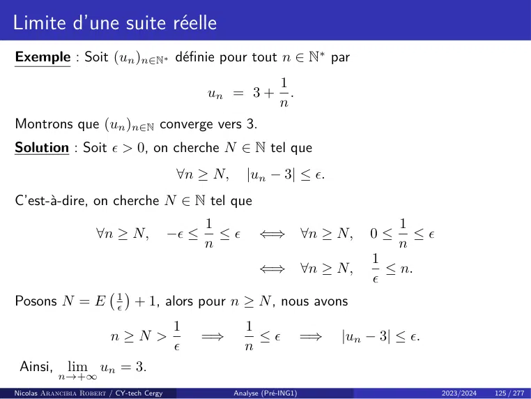

~~~text
Limite d’une suite réelle
Exemple : Soit (un )n∈N∗ définie pour tout n ∈ N∗ par
                                                                    1
                                                  un = 3 +            .
                                                                    n
Montrons que (un )n∈N converge vers 3.
Solution : Soit  > 0, on cherche N ∈ N tel que
                                            ∀n ≥ N,       |un − 3| ≤ .
C’est-à-dire, on cherche N ∈ N tel que
                                                  1                                        1
                      ∀n ≥ N,              − ≤     ≤        ⇐⇒            ∀n ≥ N,   0≤     ≤
                                                  n                                        n
                                                                                      1
                                                              ⇐⇒            ∀n ≥ N,     ≤ n.
                                                                                      
Posons N = E               1
                                   + 1, alors pour n ≥ N , nous avons
                               
                           
                                           1              1
                         n≥N >                    =⇒        ≤              =⇒   |un − 3| ≤ .
                                                         n
 Ainsi, lim un = 3.
           n→+∞
Nicolas Arancibia Robert / CY-tech Cergy               Analyse (Pré-ING1)                         2023/2024   125 / 277
~~~

## Page 132

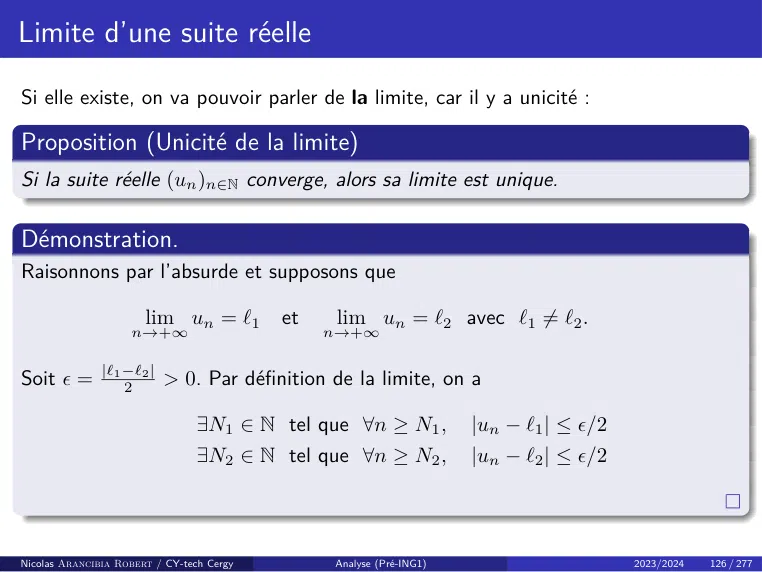

~~~text
Limite d’une suite réelle

Si elle existe, on va pouvoir parler de la limite, car il y a unicité :

Proposition (Unicité de la limite)
Si la suite réelle (un )n∈N converge, alors sa limite est unique.

Démonstration.
Raisonnons par l’absurde et supposons que

                       lim un = `1         et   lim un = `2 avec `1 6= `2 .
                    n→+∞                        n→+∞

Soit  = |`1 −`
             2
                2|
                   > 0. Par définition de la limite, on a

                                 ∃N1 ∈ N tel que ∀n ≥ N1 ,           |un − `1 | ≤ /2
                                 ∃N2 ∈ N tel que ∀n ≥ N2 ,           |un − `2 | ≤ /2

Nicolas Arancibia Robert / CY-tech Cergy        Analyse (Pré-ING1)                      2023/2024   126 / 277
~~~

## Page 133

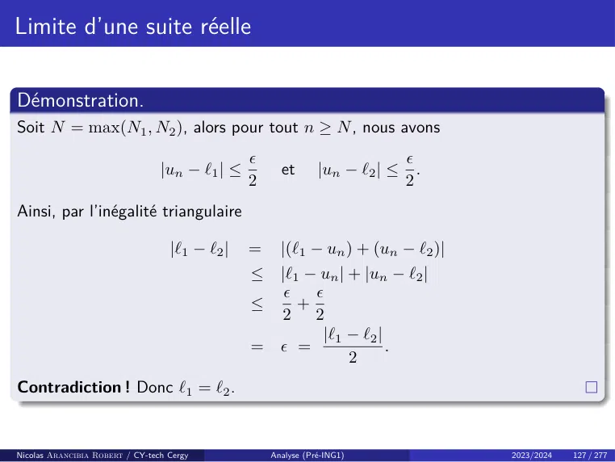

~~~text
Limite d’une suite réelle

Démonstration.
Soit N = max(N1 , N2 ), alors pour tout n ≥ N , nous avons
                                                                             
                                 |un − `1 | ≤         et       |un − `2 | ≤     .
                                                2                             2
Ainsi, par l’inégalité triangulaire

                                   |`1 − `2 |   =     |(`1 − un ) + (un − `2 )|
                                                ≤ |`1 − un | + |un − `2 |
                                                      
                                                ≤    +
                                                  2 2
                                                        |`1 − `2 |
                                                =  =              .
                                                             2
Contradiction ! Donc `1 = `2 .

Nicolas Arancibia Robert / CY-tech Cergy            Analyse (Pré-ING1)              2023/2024   127 / 277
~~~

## Page 134

~~~text
Limite d’une suite réelle
Définition
Soit (un )n∈N une suite réelle.

    • On dit que (un )n∈N tend vers +∞ si

                      ∀A ∈ R, ∃N ∈ N, ∀n ∈ N,              (n ≥ N =⇒ un ≥ A) .

    • On dit que (un )n∈N tend vers −∞ si

                      ∀A ∈ R, ∃N ∈ N, ∀n ∈ N,              (n ≥ N =⇒ un ≤ A) .

Remarque :
    • Si (un )n∈N tend vers ±∞, on note
                                           lim un = ±∞.
                                           n→+∞

    • Nous avons
                               lim un = −∞      ⇐⇒                lim −un = +∞.
                             n→+∞                           n→+∞

Nicolas Arancibia Robert / CY-tech Cergy     Analyse (Pré-ING1)                   2023/2024   128 / 277
~~~

## Page 135

~~~text
Limite d’une suite réelle

Remarque : Dire que (un )n∈N tend vers +∞, c’est dire que
   « Pour tout A > 0, même arbitrairement grand, on aura un > A à partir d’un
                                 certain rang. »

Nicolas Arancibia Robert / CY-tech Cergy   Analyse (Pré-ING1)      2023/2024   129 / 277
~~~

## Page 136

~~~text
Limite d’une suite réelle
Remarque : Soit (un )n∈N une suite réelle et ` un nombre réel. En niant la
définition, l’affirmation « (un )n∈N ne converge pas vers ` » s’écrit avec des
quantificateurs :

                   ∃ > 0, ∀N ∈ N, ∃n ∈ N,         n ≥ N et |un − `| ≥ .

Pour dire qu’une suite n’admet pas de limite finie, on doit verifier qu’elle ne
converge vers aucun réel : ainsi, si (un )n∈N est une suite réelle, l’affirmation
« (un )n∈N n’est pas convergente » s’écrit avec des quantificateurs :

           ∀` ∈ R, ∃ > 0, ∀N ∈ N, ∃n ∈ N,                 n ≥ N et |un − `| ≥ .

Définition (Convergence - Divergence)
    • Une suite est dite convergente si elle admet une limite finie.
    • Elle est divergente sinon. C’est-à-dire, une suite est divergente si elle
      n’admet pas de limite finie. En particulier, une suite est divergente si elle tend
      vers ±∞.

Nicolas Arancibia Robert / CY-tech Cergy   Analyse (Pré-ING1)                   2023/2024   130 / 277
~~~

## Page 137

~~~text
Limite d’une suite réelle

Nous avons donc :
                               Limite finie   Limite ±∞            Pas de limite
                              Convergence     Divergence           Divergence

Exemples :

    • La suite de terme général nnsin(n)
                                   2 +4  est convergente, sa limite est 0.

    • La suite de terme général n2 + (−1)n n est divergente, elle tend vers +∞.

    • La suite de terme général (−1)n est divergente, elle n’admet pas de limite.

Nicolas Arancibia Robert / CY-tech Cergy      Analyse (Pré-ING1)                   2023/2024   131 / 277
~~~

## Page 138

~~~text
Limite d’une suite réelle
Étudions quelques propriétés des suites convergentes.

Proposition
Toute suite réelle convergente est bornée.

Démonstration.
Soit (un )n une suite convergente vers un réel ` ∈ R. Posons  = 1 > 0, par
définition de la limite, il existe N ∈ N tel que :
                                                 ∀n ≥ N, |un − `| ≤ 1.

 Pour tout n ≥ N , on a donc
                                    |un | = |un − ` + `|           ≤         |un − `| + |`|
                                                                   ≤         |`| + 1 < +∞.

 Posons alors
                                           M = max(|u0 |, . . . , |uN |, 1 + |`|).
 Ainsi, pour tout n ∈ N, nous avons |un | ≤ M .
Nicolas Arancibia Robert / CY-tech Cergy                Analyse (Pré-ING1)                    2023/2024   132 / 277
~~~

## Page 139

~~~text
Limite d’une suite réelle

Remarques :

    • La réciproque est fausse, la suite de terme général

                                               (−1)n + 4

       est bornée entre 3 et 5 sans être convergente.
    • Une suite non bornée n’admet pas forcément +∞ ou −∞ pour limite. La
      suite de terme général
                                    (−1)n n3 + 1,
       n’est pas bornée et n’a pas de limite.

Nicolas Arancibia Robert / CY-tech Cergy   Analyse (Pré-ING1)    2023/2024   133 / 277
~~~

## Page 140

~~~text
Limite d’une suite réelle
Le lemme suivant peut se montrer utile pour vérifier la valeur d’une limite.

Lemme
Considérons la suite (un )n∈N et soit ` ∈ R. Supposons (αn )n∈N une suite réelle positive
tendant vers 0 telle que
                                ∀n ∈ N, |un − `| ≤ αn .
Alors, la suite (un )n∈N est convergente de limite lim un = `.

Démonstration.
Soit  > 0. Par définition de la convergence, il existe N1 ∈ N tel que

                                             ∀n ≥ N1 ,       |αn | ≤ .

De plus, il existe N2 ∈ N tel que

                                           ∀n ≥ N2 ,     |un − `| ≤ αn .

Posons, N = max(N1 , N2 ). Pour tout n ≥ N , on a : |un − `| ≤ αn ≤ . Ainsi, (un )
converge vers `.

Nicolas Arancibia Robert / CY-tech Cergy          Analyse (Pré-ING1)           2023/2024   134 / 277
~~~

## Page 141

~~~text
Limite d’une suite réelle

Remarque : Pour montrer qu’une suite (un )n∈N converge vers `, on peut tenter
de majorer
                                 |un − `|
par une suite qui converge vers 0.

Proposition
Soit (un )n une suite convergente vers un réel ` ∈ R. Alors

                                           lim |un | = |`|.
                                           n→+∞

Démonstration.
Voir T.D.

Nicolas Arancibia Robert / CY-tech Cergy     Analyse (Pré-ING1)    2023/2024   135 / 277
~~~

## Page 142

~~~text
Opérations sur les limites
Nous avons vu que sur l’ensemble des suites on peut définir une addition et un
produit. Étudions le comportement de la convergence par rapport a ces deux
opérations.

Proposition (Cas de deux limites finies)
Soient (un )n∈N et (vn )n∈N deux suites qui convergent respectivement vers ` et `0 .
  • Somme : Nous avons
                                            lim un + vn = ` + `0 .
                                            n→+∞

    • Produit : Nous avons
                                             lim un · vn = ` · `0 .
                                            n→+∞

    • Multiplication par un réel : Soit λ ∈ R, alors
                                              lim λ · un = λ · `.
                                             n→+∞

Remarque : Si on combine les points un et trois du résultat précédent, on a

                           ∀(λ, µ) ∈ R2 ,    lim λun + µvn = λ` + µ`0 .
                                            n→+∞

Nicolas Arancibia Robert / CY-tech Cergy       Analyse (Pré-ING1)         2023/2024   136 / 277
~~~

## Page 143

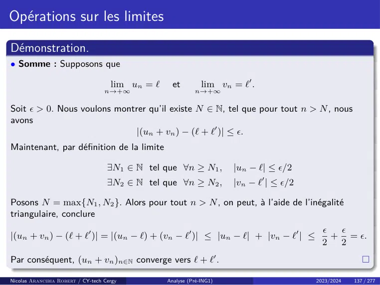

~~~text
Opérations sur les limites

Démonstration.
• Somme : Supposons que

                                     lim un = `     et         lim vn = `0 .
                                   n→+∞                     n→+∞

Soit  > 0. Nous voulons montrer qu’il existe N ∈ N, tel que pour tout n > N , nous
avons
                             |(un + vn ) − (` + `0 )| ≤ .
Maintenant, par définition de la limite

                                    ∃N1 ∈ N tel que ∀n ≥ N1 ,          |un − `| ≤ /2
                                    ∃N2 ∈ N tel que ∀n ≥ N2 ,          |vn − `0 | ≤ /2

Posons N = max{N1 , N2 }. Alors pour tout n > N , on peut, à l’aide de l’inégalité
triangulaire, conclure
                                                                                              
|(un + vn ) − (` + `0 )| = |(un − `) + (vn − `0 )| ≤ |un − `| + |vn − `0 | ≤                  + = .
                                                                                            2  2
Par conséquent, (un + vn )n∈N converge vers ` + `0 .

Nicolas Arancibia Robert / CY-tech Cergy          Analyse (Pré-ING1)                      2023/2024   137 / 277
~~~

## Page 144

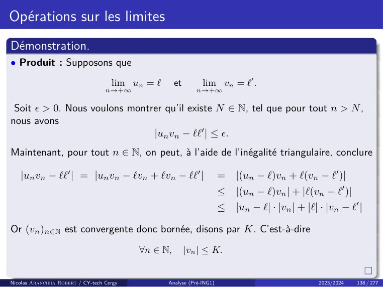

~~~text
Opérations sur les limites
Démonstration.
• Produit : Supposons que
                                     lim un = `      et        lim vn = `0 .
                                   n→+∞                      n→+∞

 Soit  > 0. Nous voulons montrer qu’il existe N ∈ N, tel que pour tout n > N ,
nous avons
                               |un vn − ``0 | ≤ .
Maintenant, pour tout n ∈ N, on peut, à l’aide de l’inégalité triangulaire, conclure

   |un vn − ``0 | = |un vn − `vn + `vn − ``0 |                         =   |(un − `)vn + `(vn − `0 )|
                                                                       ≤   |(un − `)vn | + |`(vn − `0 )|
                                                                       ≤   |un − `| · |vn | + |`| · |vn − `0 |

Or (vn )n∈N est convergente donc bornée, disons par K. C’est-à-dire
                                           ∀n ∈ N,        |vn | ≤ K.

Nicolas Arancibia Robert / CY-tech Cergy          Analyse (Pré-ING1)                             2023/2024   138 / 277
~~~

## Page 145

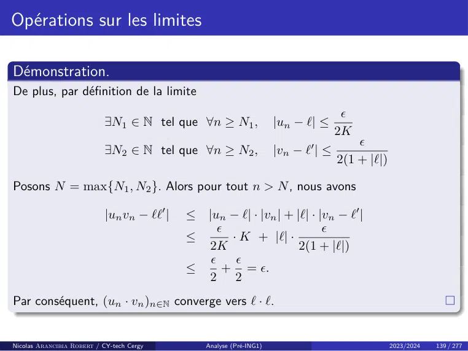

~~~text
Opérations sur les limites

Démonstration.
De plus, par définition de la limite
                                                                                      
                            ∃N1 ∈ N tel que ∀n ≥ N1 ,                 |un − `| ≤
                                                                                     2K
                                                                                         
                            ∃N2 ∈ N tel que ∀n ≥ N2 ,                 |vn − `0 | ≤
                                                                                     2(1 + |`|)

Posons N = max{N1 , N2 }. Alors pour tout n > N , nous avons

                            |un vn − ``0 |   ≤   |un − `| · |vn | + |`| · |vn − `0 |
                                                                          
                                             ≤        · K + |`| ·
                                                 2K                  2(1 + |`|)
                                                      
                                             ≤       + = .
                                                 2 2
Par conséquent, (un · vn )n∈N converge vers ` · `.

Nicolas Arancibia Robert / CY-tech Cergy         Analyse (Pré-ING1)                               2023/2024   139 / 277
~~~

## Page 146

~~~text
Opérations sur les limites

Proposition (Cas des limites infinies)
Soit (vn )n∈N une suite qui tend vers +∞.

    • Si (un )n∈N est une suite minorée, alors

                                           lim un + vn = +∞.
                                           n→+∞

       En particulier, si (un )n∈N est convergente, alors lim un + vn = +∞.
                                                                    n→+∞
    • Si (un )n∈N est une suite minorée par un réel strictement positif à partir
      d’un certain rang, alors

                                            lim un · vn = +∞.
                                           n→+∞

       En particulier, si lim un = ` ∈ R∗+ , alors lim un · vn = +∞.
                                    n→+∞                          n→+∞

Remarque : On a de résultats similaires quand on suppose lim vn = −∞
                                                                           n→+∞
comme on verra dans un instant.
Nicolas Arancibia Robert / CY-tech Cergy     Analyse (Pré-ING1)                   2023/2024   140 / 277
~~~

## Page 147

~~~text
Opérations sur les limites

Proposition (Cas du quotient)
    • Si (un ) converge vers ` ∈ R et (vn ) converge vers `0 ∈ R∗ , alors la suite                     un
                                                                                                              
                                                                                                       vn         n∈N
      est définie à partir d’un certain rang et
                                                         un        `
                                              lim             =       .
                                            n→+∞ vn                `0

    • Si (|un |)n∈N diverge vers +∞, alors la suite                1
                                                                       
                                                                  un
                                                                                 est définie à partir d’un
                                                                           n∈N
      certain rang et
                                                     1
                                            lim            = 0.
                                           n→+∞ un

    • Si (un )n∈N converge vers 0 et est strictement
                                                    positif (resp. strictement négatif) à
      partir d’un certain rang, alors la suite u1n      est définie à partir d’un certain rang
                                                    n∈N
      et
                               1                              1
                                                                          
                         lim       = +∞         resp. lim         = −∞ .
                       n→+∞ un                        n→+∞ un

Nicolas Arancibia Robert / CY-tech Cergy     Analyse (Pré-ING1)                                   2023/2024        141 / 277
~~~

## Page 148

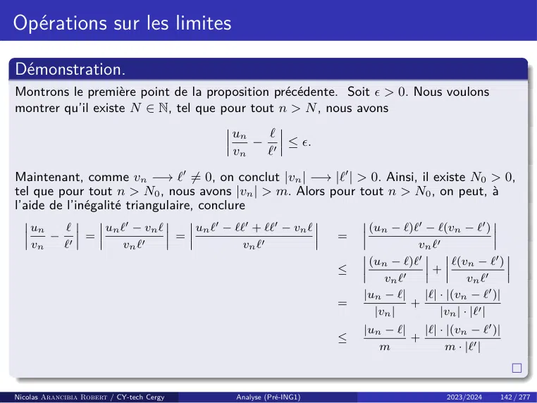

~~~text
Opérations sur les limites

Démonstration.
Montrons le première point de la proposition précédente. Soit  > 0. Nous voulons
montrer qu’il existe N ∈ N, tel que pour tout n > N , nous avons
                                                      un   `
                                                         − 0 ≤ .
                                                      vn  `
Maintenant, comme vn −→ `0 6= 0, on conclut |vn | −→ |`0 | > 0. Ainsi, il existe N0 > 0,
tel que pour tout n > N0 , nous avons |vn | > m. Alors pour tout n > N0 , on peut, à
l’aide de l’inégalité triangulaire, conclure
    un   `              un `0 − vn `           un `0 − ``0 + ``0 − vn `          (un − `)`0 − `(vn − `0 )
       − 0        =                        =                                =
    vn  `                   vn `0                        vn `0                             vn `0
                                                                                 (un − `)`0        `(vn − `0 )
                                                                            ≤                 +
                                                                                    vn `0              vn `0
                                                                                |un − `|    |`| · |(vn − `0 )|
                                                                            =             +
                                                                                  |vn |         |vn | · |`0 |
                                                                                |un − `|   |`| · |(vn − `0 )|
                                                                            ≤            +
                                                                                   m             m · |`0 |

Nicolas Arancibia Robert / CY-tech Cergy               Analyse (Pré-ING1)                        2023/2024   142 / 277
~~~

## Page 149

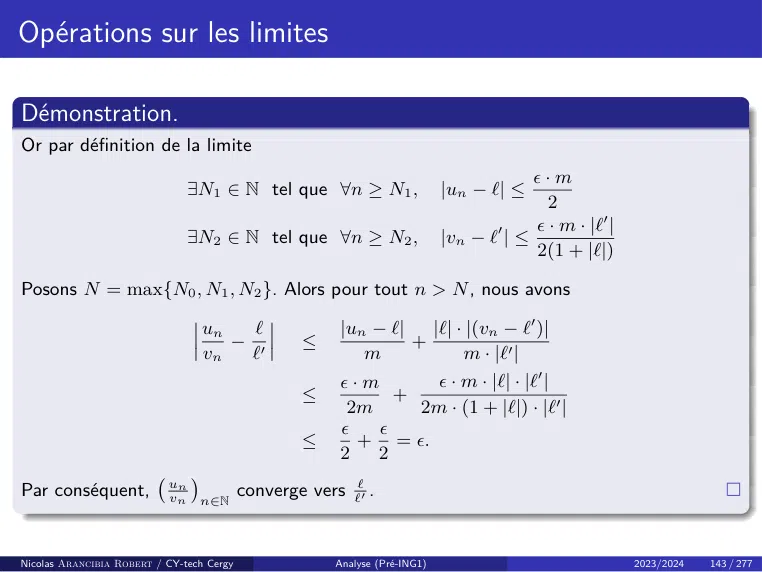

~~~text
Opérations sur les limites

Démonstration.
Or par définition de la limite
                                                                                         ·m
                                ∃N1 ∈ N tel que ∀n ≥ N1 ,                    |un − `| ≤
                                                                                           2
                                                                                    0     · m · |`0 |
                                ∃N2 ∈ N tel que ∀n ≥ N2 ,                    |vn − ` | ≤
                                                                                         2(1 + |`|)

Posons N = max{N0 , N1 , N2 }. Alors pour tout n > N , nous avons

                                    un   `               |un − `|   |`| · |(vn − `0 )|
                                       − 0         ≤              +
                                    vn  `                   m            m · |`0 |
                                                         ·m          · m · |`| · |`0 |
                                                   ≤            +
                                                          2m       2m · (1 + |`|) · |`0 |
                                                             
                                                   ≤       + = .
                                                         2   2
                           un
                                
Par conséquent,            vn
                                           converge vers ``0 .
                                    n∈N

Nicolas Arancibia Robert / CY-tech Cergy                Analyse (Pré-ING1)                               2023/2024   143 / 277
~~~

## Page 150

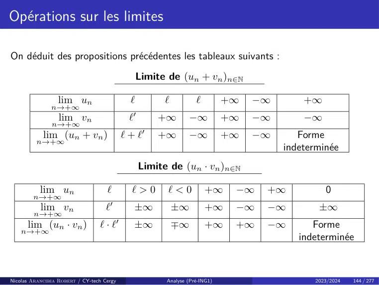

~~~text
Opérations sur les limites

On déduit des propositions précédentes les tableaux suivants :
                                                   Limite de (un + vn )n∈N

                  lim un                       `          `          `         +∞   −∞       +∞
               n→+∞
                  lim vn                       `0
                                                        +∞        −∞           +∞   −∞       −∞
               n→+∞
            lim (un + vn )                   ` + `0     +∞        −∞           +∞   −∞      Forme
         n→+∞
                                                                                         indeterminée
                                                    Limite de (un · vn )n∈N

           lim un                   `          `>0        `<0            +∞     −∞   +∞           0
        n→+∞
           lim vn                   `0
                                                   ±∞         ±∞         +∞     −∞   −∞         ±∞
        n→+∞
      lim (un · vn )             `·`     0
                                                   ±∞         ∓∞         +∞     +∞   −∞        Forme
    n→+∞
                                                                                            indeterminée

Nicolas Arancibia Robert / CY-tech Cergy                  Analyse (Pré-ING1)                   2023/2024   144 / 277
~~~

## Page 151

~~~text
Opérations sur les limites

                                                 Limite de (λun )n∈N

                                           λ>0                    λ=0                     λ<0
               lim un            +∞        ` 6= 0   −∞         peu importe           +∞   ` 6= 0     −∞
             n→+∞
              lim λun            +∞         λ`      −∞                    0          −∞     λ`       +∞
            n→+∞

                                                                  1
                                                                      
                                                 Limite de       un       n∈N

                                                un > 0                   un < 0                    sinon
                                             à partir d’un            à partir d’un
                                             certain rang             certain rang
      lim un           ` 6= 0       ±∞              0                        0                      0
   n→+∞
    lim 1                 1
                                      0             +∞                          −∞        Forme indeterminée
   n→+∞ un                `

Remarque : Forme indéterminée, signifie que c’est une forme à déterminer. C’est-à-dire,
en effectuant une opération (+∞) − (+∞) ou 0 × (+∞), on peut tomber a priori sur
n’importe quel résultat.

Nicolas Arancibia Robert / CY-tech Cergy             Analyse (Pré-ING1)                             2023/2024   145 / 277
~~~

## Page 152

~~~text
Opérations sur les limites
Exemples :
Cas de la forme indéterminée (+∞) − (+∞) :
    • Nous avons

                              lim 3n2 + 1 = +∞     et           lim 3n2 = +∞ ,
                           n→+∞                              n→+∞

         mais       lim (3n2 + 1) − 3n2 = 1.
                  n→+∞

    • Nous avons

                              lim 3n2 + 1 = +∞     et           lim 2n2 = +∞ ,
                           n→+∞                              n→+∞

         mais       lim (3n2 + 1) − 2n2 = +∞.
                  n→+∞

    • Nous avons

                          lim 3n2 + (−1)n = +∞          et       lim 3n2 = +∞ ,
                       n→+∞                                     n→+∞

         mais (3n2 + (−1)n ) − 3n2 = (−1)n n’as pas de limite.

Nicolas Arancibia Robert / CY-tech Cergy   Analyse (Pré-ING1)                     2023/2024   146 / 277
~~~

## Page 153

~~~text
Opérations sur les limites
Exemples :
Cas de la forme indéterminée 0 × +∞ :
    • Nous avons
                                             1
                                   lim             = 0     et        lim 4n2 = +∞ ,
                              n→+∞ n2 + 1                          n→+∞

         mais       lim        2
                                1
                                      · 4n2 = 4.
                  n→+∞ n +1

    • Nous avons
                                             1
                                    lim            = 0    et        lim 4n2 = +∞ ,
                               n→+∞ n + 1                         n→+∞

         mais       lim        1
                                     · 4n2 = +∞.
                  n→+∞ n+1

    • Nous avons
                                 (−1)n
                              lim       = 0              et        lim n2 + 1 = +∞ ,
                            n→+∞ n2 + 1                         n→+∞

                             (−1)n
         mais       lim        2         · (n2 + 1) = (−1)n n’as pas de limite.
                  n→+∞ n +1

Nicolas Arancibia Robert / CY-tech Cergy              Analyse (Pré-ING1)               2023/2024   147 / 277
~~~

## Page 154

~~~text
Opérations sur les limites
La dernière opération sur les limites que nous avons étudier, c’est la composition à
gauche par une fonction.

Théorème (Composition à gauche par une fonction)
Soient I un intervalle
                                              f :I→R
une fonction, ` ∈ {R, +∞, −∞}, L ∈ {R, +∞, −∞} et (un )n∈N une suite à
valeurs dans I. Si
                       lim un = ` et    lim f (x) = L,
                                     n→+∞                    x→`

alors
                                            lim f (un ) = L.
                                            n→+∞

Remarque : Si f : I → R est une fonction continue, d’après le théorème
précédente nous pouvons conclure
                                                 
                      lim f (un ) = f     lim un .
                                    n→+∞                  n→+∞

Nicolas Arancibia Robert / CY-tech Cergy      Analyse (Pré-ING1)       2023/2024   148 / 277
~~~

## Page 155

~~~text
Passage à la limite dans une inégalité

Étudions le comportement des limites par rapport à la relation d’ordre ≤ sur R.

Proposition (Passage à la limite dans les inégalités strictes)
Soit (un )n∈N une suite réelle possedant une limite `, et soient m, M ∈ R.
    • Si ` < M , alors
                                                un < M
       à partir d’un certain rang.
    • Si ` > m, alors
                                                 un > m
       à partir d’un certain rang.

Nicolas Arancibia Robert / CY-tech Cergy   Analyse (Pré-ING1)         2023/2024   149 / 277
~~~

## Page 156

~~~text
Passage à la limite dans une inégalité

Démonstration.
Prouvons le première point, le deuxieme point se montre de la même façon.
Supposons ` < M .
    • Si ` = −∞, alors par définition de la limite

                                      ∃N ∈ N tel que ∀n > N,             un < M.

       C’est-à-dire, un < M à partir d’un certain rang.
    • Si ` ∈ R, sachant que M − ` > 0 on peut, d’après la définition de la limite,
      conclure
                     ∃N ∈ N tel que ∀n > N, |un − `| < M − `
       Ainsi

                     ∀n > N,               ` − M < un − ` < M − `        =⇒   un < M.

       C’est-à-dire, un < M à partir d’un certain rang.

Nicolas Arancibia Robert / CY-tech Cergy            Analyse (Pré-ING1)                  2023/2024   150 / 277
~~~

## Page 157

~~~text
Passage à la limite dans une inégalité

Théorème (Passage à la limite dans les inégalités larges)
Soient (un )n∈N et (vn )n∈N deux suites convergentes vers ` et `0 respectivement.
Si
                                     un ≤ vn
à partir d’un certain rang, alors

                                           lim un ≤ lim vn .
                                           n→+∞           n→+∞

C’est-à-dire, ` ≤ `0 .

Remarque : On retiendra que les inégalités strictes deviennent larges en
passant à la limite. Par exemple, pour tout n ∈ N, n+1
                                                    1
                                                       > 0, mais

                                                        1
                                             lim                = 0.
                                            n→+∞ n + 1

Nicolas Arancibia Robert / CY-tech Cergy       Analyse (Pré-ING1)      2023/2024   151 / 277
~~~

## Page 158

~~~text
Passage à la limite dans une inégalité

Démonstration.
Par l’absurde. Supposons donc que un ≤ vn à partir d’un certain rang, et que

                       lim un > lim vn                =⇒            lim un − vn > 0.
                     n→+∞                  n→+∞                   n→+∞

Or la proposition précédent montre que

                                           un − vn > 0      =⇒          un > vn

à partir d’un certain rang. Contradiction ! Par conséquent,

                                               lim un ≤ lim vn .
                                              n→+∞            n→+∞

Nicolas Arancibia Robert / CY-tech Cergy           Analyse (Pré-ING1)                  2023/2024   152 / 277
~~~

## Page 159

~~~text
Théorèmes d’existence d’une limite
L’existence d’une limite n’est jamais acquise. Jusqu’à maintenant, nous avons
surtout étudié des théorèmes de CALCUL, de manipulation des limites. Les
quatre théorèmes suivants nous donnent de conditions pour conclure l’existence
d’une limite, ils nous fournissent donc pas tant la VALEUR d’une limite mais son
EXISTENCE.

Théorème (Théorème d’encadrement)
Soit (un )n∈N , (vn )n∈N et (wn )n∈N trois suites rééls et ` ∈ R. Supposons

                                           lim un = ` = lim wn
                                           n→+∞                   n→+∞

 et qu’il existe N ∈ N, tel que pour tout n ≥ N , nous avons

                                                  un ≤ vn ≤ wn .

Alors (vn )n∈N converge et
                                                  lim vn = `.
                                              n→+∞

Nicolas Arancibia Robert / CY-tech Cergy           Analyse (Pré-ING1)    2023/2024   153 / 277
~~~

## Page 160

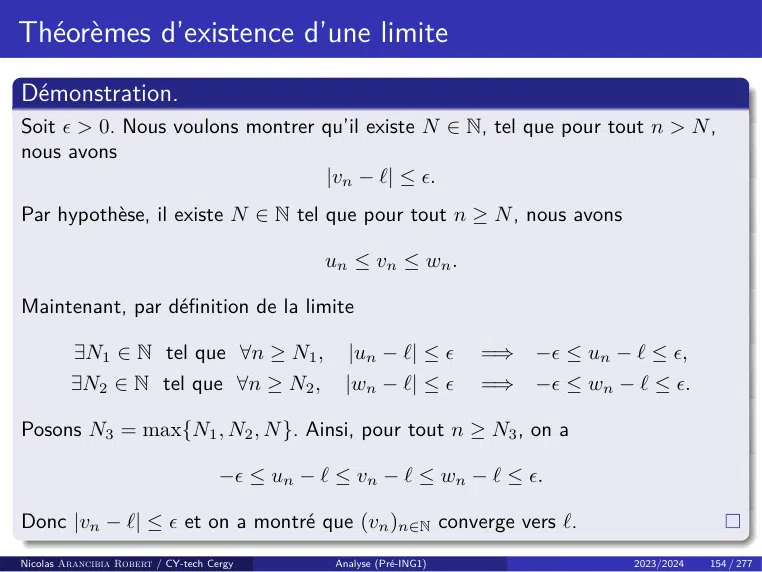

~~~text
Théorèmes d’existence d’une limite
Démonstration.
Soit  > 0. Nous voulons montrer qu’il existe N ∈ N, tel que pour tout n > N ,
nous avons
                                 |vn − `| ≤ .
Par hypothèse, il existe N ∈ N tel que pour tout n ≥ N , nous avons

                                                un ≤ vn ≤ wn .

Maintenant, par définition de la limite

         ∃N1 ∈ N tel que ∀n ≥ N1 ,                 |un − `| ≤        =⇒ − ≤ un − ` ≤ ,
         ∃N2 ∈ N tel que ∀n ≥ N2 ,                |wn − `| ≤         =⇒ − ≤ wn − ` ≤ .

Posons N3 = max{N1 , N2 , N }. Ainsi, pour tout n ≥ N3 , on a

                                     − ≤ un − ` ≤ vn − ` ≤ wn − ` ≤ .

Donc |vn − `| ≤  et on a montré que (vn )n∈N converge vers `.
Nicolas Arancibia Robert / CY-tech Cergy         Analyse (Pré-ING1)                 2023/2024   154 / 277
~~~

## Page 161

~~~text
Théorèmes d’existence d’une limite
Exemple : Pour tout n ∈ N∗ , on pose
                                                           n
                                                                    n
                                                  un =
                                                           X
                                                                         .
                                                                  n2 + k
                                                           k=1

Calculer       lim un .
             n→+∞

Solution : Il suffit de remarquer que, pour tout 1 ≤ k ≤ n, nous avons
                                                                n                            n
             n       n     n                                              n        X n
                                                       =⇒
                                                                X
                 ≤ 2   ≤ 2                                                  ≤ un ≤         .
          n2 + n  n +k  n +1                                           n +n
                                                                        2           n2 + 1
                                                                k=1                       k=1

Maintenant
                         n                                      n
                                   n      n                                 n        n2
                                       =                                        =
                         X                                      X
                                                        et                                   .
                                n2 + n   n+1                           n2 + 1       n2 + 1
                         k=1                                    k=1

Ainsi
                                                         n          n2
                                           ∀n ∈ N∗ ,        ≤ un ≤ 2   .
                                                        n+1       n +1
                                                       2
Or, limn→+∞ n+1 n
                    = 1 et limn→+∞ n2n+1 = 1. Le Théorème d’encadrement permet
d’affirmer que la suite (un )n∈N∗ tend vers 1.
Nicolas Arancibia Robert / CY-tech Cergy               Analyse (Pré-ING1)                        2023/2024   155 / 277
~~~

## Page 162

~~~text
Théorèmes d’existence d’une limite

Théorème (Théorème de Minoration/Majoration)
Soit (un )n∈N et (vn )n∈N deux suites réelles.
    • Si lim un = +∞ et il existe N ∈ N tel que pour tout n ≥ N , nous avons
            n→+∞

                                                u n ≤ vn ,

       alors
                                           lim vn = +∞.
    • Si lim vn = −∞ et il existe N ∈ N tel que pour tout n ≥ N , nous avons
            n→+∞

                                                u n ≤ vn ,

       alors
                                           lim un = −∞.

Nicolas Arancibia Robert / CY-tech Cergy   Analyse (Pré-ING1)     2023/2024   156 / 277
~~~

## Page 163

~~~text
Théorèmes d’existence d’une limite
Exemple : Pour tout n ∈ N∗ , on pose

                                                             1
                                                         n
                                                 un =
                                                        X
                                                            √ .
                                                        k=1
                                                              k

Étudier la limite de (un )n∈N∗ .
Solution : Notons que
                                             1  1                         1     1
                                                                       n     n
      ∀k ∈ N, 1 ≤ k ≤ n,                                   =⇒                  √ = un .
                                                                       X     X
                                            √ ≤√                         √ ≤
                                              n  k                         n     k
                                                                       k=1   k=1

Maintenant
                                              1
                                           n
                                                  n  √
                                             √ = √ = n.
                                           X
                                               n   n
                                           k=1

Ainsi                                             √
                                                      n ≤ un .
                       √
Or, limn→+∞ n = +∞. Le Théorème de Majoration nous permet d’affirmer que
la suite (un )n∈N∗ tend vers +∞.
Nicolas Arancibia Robert / CY-tech Cergy          Analyse (Pré-ING1)                2023/2024   157 / 277
~~~

## Page 164

~~~text
Théorèmes d’existence d’une limite

Notre troisième théorème d’existence est l’important Théorème de la limite
monotone.

Théorème (Théorème de la limite monotone)
    • Toute suite réel (un )n∈N croissante et majorée est convergent, et a
      pour limite :
                              lim un = sup{un : n ∈ N}.
                                           n→+∞

       Toute suite réel (un )n∈N croissante non-majorée diverge vers +∞.
    • Toute suite réel (un ) décroissante et minorée converge, et a pour limite :

                                            lim un = inf{un : n ∈ N}.
                                           n→+∞

       Toute suite réel (un )n∈N décroissante et non-minorée diverge vers −∞.

Nicolas Arancibia Robert / CY-tech Cergy          Analyse (Pré-ING1)    2023/2024   158 / 277
~~~

## Page 165

~~~text
Théorèmes d’existence d’une limite

Démonstration.
Montrons le premier point. Supposons (un )n∈N majorée. L’ensemble

                                           A = {un : n ∈ N}

est alors une partie non vide majorée de R, donc possède une borne supérieure `
dans R d’après la propriété de la borne supérieure.

Montrons que lim un = `.
                        n→+∞

Nicolas Arancibia Robert / CY-tech Cergy      Analyse (Pré-ING1)    2023/2024   159 / 277
~~~

## Page 166

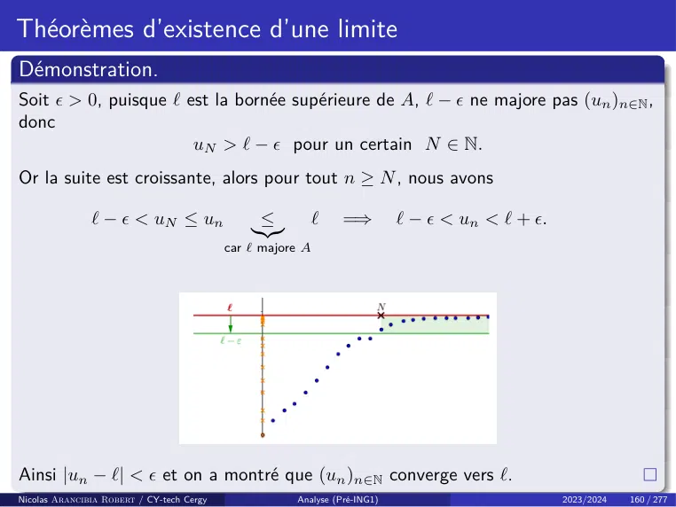

~~~text
Théorèmes d’existence d’une limite
Démonstration.
Soit  > 0, puisque ` est la bornée supérieure de A, ` −  ne majore pas (un )n∈N ,
donc
                       uN > ` −  pour un certain N ∈ N.
Or la suite est croissante, alors pour tout n ≥ N , nous avons

               ` −  < uN ≤ un                  ≤           `   =⇒         ` −  < un < ` + .
                                               |{z}
                                           car ` majore A

Ainsi |un − `| <  et on a montré que (un )n∈N converge vers `.
Nicolas Arancibia Robert / CY-tech Cergy              Analyse (Pré-ING1)                         2023/2024   160 / 277
~~~

## Page 167

~~~text
Théorèmes d’existence d’une limite

Démonstration.
Supposons maintenant que (un )n∈N est non majorée. Soit M > 0. Puisque
(un )n∈N est non majorée, il existe N ∈ N tel que

                                               uN > M.

Or, par hypothèse, la suite est croissante, donc pour tout n ≥ N , on a

                                           un ≥ uN > M.

Nous avons donc montré que (un )n∈N tend vers +∞.

Nicolas Arancibia Robert / CY-tech Cergy      Analyse (Pré-ING1)      2023/2024   161 / 277
~~~

## Page 168

~~~text
Théorèmes d’existence d’une limite
Exemple : Pour tout n ∈ N∗ , on pose

                                                                 1
                                                               n
                                                       un =
                                                               X
                                                                             .
                                                                      k2
                                                               k=1

Étudier la convergence de (un )n∈N∗ .
Solution : Comme
                                1    X 1       1       X 1    X 1       1
                         n+1               n                                     n           n
un+1 − un =                               =          +             =          > 0.
                         X
                                   −                        −
                                k2     k2   (n + 1)2     k2     k2   (n + 1)2
                         k=1               k=1                                   k=1         k=1

la suite (un )n∈N est strictement croissante. De plus
                          1                               1                                       1   1
                        n                        n                                     n                 
        un = 1 +                      ≤ 1+                                   =    1+
                        X                        X                                     X
                                                                                                    −
                               k2                      k(k − 1)                                  k−1 k
                        k=2                      k=2                                   k=2
                                                         1         1
                                                             = 2 − ≤ 2.      =    1+1−
                                                         n         n
Donc la suite (un )n∈N∗ est majorée. Par le Théorème de la limite monotone,
                                           2
elle converge. (Notons que ça limite est π6 !).
Nicolas Arancibia Robert / CY-tech Cergy                Analyse (Pré-ING1)                            2023/2024   162 / 277
~~~

## Page 169

~~~text
Théorèmes d’existence d’une limite
Notre dérnier théorème d’existence est le Théorème des suites adjacentes.
Commençons donc par introduire la notion de suites adjacentes.

Définition (Suites adjacentes)
On dit que deux suites (un )n∈N et (vn )n∈N sont adjacentes si :
    • (un )n∈N est croissante ;
    • (vn )n∈N est décroissante ;
    •
                                           lim vn − un = 0.
                                           n→+∞

Remarque : Deux suites adjacentes sont deux suites qui viennent à la rencontre
l’une de l’autre, l’une en croissant, l’autre en décroissant, et qui finissent par
s’écraser l’une contre l’autre.

                      « Il faut bien qu’elles s’écrasent QUELQUE PART ! »

nous dit le théorème des suites adjacentes.
Nicolas Arancibia Robert / CY-tech Cergy    Analyse (Pré-ING1)              2023/2024   163 / 277
~~~

## Page 170

~~~text
Théorèmes d’existence d’une limite

Théorème (Théorème des suites adjacentes)
Soient (un )n∈N et (vn )n∈N deux suites adjacentes, avec

                         (un )n∈N croissante            et       (vn )n∈N décroissante.

Alors (un )n∈N et (vn )n∈N convergent vers la même limite `, c’est-à-dire

                                           lim un = ` = lim vn .
                                           n→+∞                  n→+∞

De plus, pour tout n ∈ N, nous avons

                                                  un ≤ ` ≤ vn .

Nicolas Arancibia Robert / CY-tech Cergy           Analyse (Pré-ING1)                     2023/2024   164 / 277
~~~

## Page 171

~~~text
Théorèmes d’existence d’une limite
Démonstration.
Soient (un )n∈N et (vn )n∈N deux suites adjacentes, avec

                            (un )n∈N croissante            et       (vn )n∈N décroissante.

Notons que pour tout n ∈ N, nous avons

 (vn+1 − un+1 ) − (vn − un ) =                    (vn+1 − vn )                −        (un+1 − un )               ≤ 0.
                                                  |       {z        }                  |      {z       }
                                            ≤ 0, car (vn ) est décroissante       ≥ 0, car (un ) est croissante

La suite (vn − un )n∈N est donc décroissante. Comme, par hypothèse, elle converge vers
0, on obtient que pour tout n ∈ N, nous avons

                                       v n − un ≥ 0       =⇒         un ≤ vn .

Pour tout n ∈ N, on a donc
                                               u0 ≤ un ≤ vn ≤ v0 .
Ainsi, (un )n∈N est croissante et majorée par v0 et (vn )n∈N est décroissante et minorée
par u0 . D’après le Théorème de la limite monotone, ces deux suites convergent, disons
vers `1 et `2 . Il ne nous reste qu’à montrer l’égalité `1 = `2 .
Nicolas Arancibia Robert / CY-tech Cergy              Analyse (Pré-ING1)                                    2023/2024    165 / 277
~~~

## Page 172

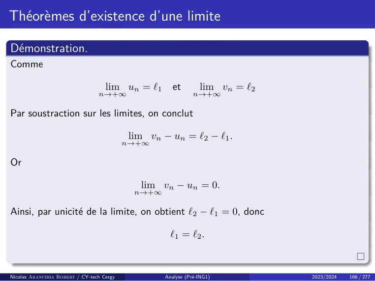

~~~text
Théorèmes d’existence d’une limite

Démonstration.
Comme

                                    lim un = `1       et        lim vn = `2
                                 n→+∞                         n→+∞

Par soustraction sur les limites, on conclut

                                           lim vn − un = `2 − `1 .
                                           n→+∞

Or

                                             lim vn − un = 0.
                                            n→+∞

Ainsi, par unicité de la limite, on obtient `2 − `1 = 0, donc

                                                     `1 = `2 .

Nicolas Arancibia Robert / CY-tech Cergy           Analyse (Pré-ING1)         2023/2024   166 / 277
~~~

## Page 173

~~~text
Théorèmes d’existence d’une limite
Exemple : Pour tout n ∈ N∗ , on pose

                                                 1                                     1
                                               n
                                    un =                             vn = un +
                                               X
                                                              et                           .
                                                     k!                              n(n!)
                                               k=0

Établir que ces suites sont adjacentes.
Solution :
  • On a
                    n+1       n                                                n           n
                         1       1                                1       X 1 X 1        1
       un+1 − un =                                        =             +           =          > 0.
                    X        X
                                           −                                   −
                                      k!             k!        (n + 1)!     k!   k!   (n + 1)!
                               k=0             k=0                             k=0         k=0

      Donc la suite (un )n∈N∗ est croissante.
    • On a aussi
                                                             1              1
                                                                                      
                                                                                                       −1
       vn+1 − vn = un+1 − un +                                          −                   =                     < 0.
                                                     (n + 1) · (n + 1)!   n · n!                 n(n + 1)(n + 1)!
     Donc la suite (vn )n∈N∗ est décroissante.
  • (vn − un )n∈N∗ = n·n!1
                             n∈N∗
                                   converge clairement vers 0.
Donc les suites (un )n∈N∗ et (vn )n∈N∗ sont adjacentes, donc convergent vers la
même limite.
Nicolas Arancibia Robert / CY-tech Cergy                  Analyse (Pré-ING1)                            2023/2024   167 / 277
~~~

## Page 174

~~~text
Suites extraites

Définition (Extraction)
Lorsque ϕ est une application de N dans N strictement croissante, on dit que ϕ
est une extraction.

On vérifie par récurrence que toute extraction vérifie la propriété suivant.

Proposition
Si ϕ : N −→ N est strictement croissante, alors on a la propriété

                                           ∀n ∈ N, ϕ(n) ≥ n.

Nicolas Arancibia Robert / CY-tech Cergy      Analyse (Pré-ING1)        2023/2024   168 / 277
~~~

## Page 175

~~~text
Suites extraites
Définition (Suite extraite)
On appelle suite extraite (ou encore sous-suite) de (un )n∈N toute suite de la
forme
                                  (uϕ(n) )n∈N
où ϕ : N → N est une extraction, c’est-à-dire, une fonction strictement
croissante.
Exemple : L’application ϕ : n 7−→ n2 + 1 est une extraction ; la sous-suite
(uϕ(n) )n∈N est la suite dont les termes sont : u1 , u2 , u5 , u10 , u17 , etc.

Une sous-suite de (un )n∈N est obtenue en sélectionnant une infinité de termes de
(un )n∈N , dans l’ordre, mais « pas forcément tous ».
Nicolas Arancibia Robert / CY-tech Cergy   Analyse (Pré-ING1)             2023/2024   169 / 277
~~~

## Page 176

~~~text
Suites extraites

Exemples :
                 √
    • Les suites   5n + 3n n∈N et (n)n∈N sont deux suites extraites de la suite de
                          
                    √
      terme général n, associées respectivement aux extractions n 7−→ 5n + 3n et
      n 7−→ n2 .

    • Les suites constantes égales à 1 et −1 respectivement sont deux suites
      extraites de la suite de terme général (−1)n , associées respectivement aux
      extractions n 7−→ 2n et n 7−→ 2n + 1.

    • Plus généralement, les suites (u2n )n∈N et (u2n+1 )n∈N sont deux suites
      extraites de (un )n∈N appelées suites extraites paire et impaire.

Nicolas Arancibia Robert / CY-tech Cergy   Analyse (Pré-ING1)          2023/2024   170 / 277
~~~

## Page 177

~~~text
Suites extraites

Proposition (Limites de suites extraites)
Soit (un )n∈N une suite réelle et ` ∈ {R, +∞, −∞}.
    • Si lim un = `, alors pour toute fonction ϕ : N −→ N strictement
            n→+∞
       croissante, nous avons
                                            lim uϕ(n) = `.
                                           n→+∞

       Autrement dit, toute suite extraite d’une suite (un )n∈N convergente,
       converge vers la même limite que (un )n∈N .
    • Si lim u2n = lim u2n+1 = `, alors
            n→+∞                  n→+∞

                                              lim un = `.
                                           n→+∞

Nicolas Arancibia Robert / CY-tech Cergy   Analyse (Pré-ING1)           2023/2024   171 / 277
~~~

## Page 178

~~~text
Suites extraites

Démonstration.
Montrons le premier point. Supposons ` ∈ R. Soit  > 0. Par définition de la
limite, il existe N ∈ N tel que
                                            ∀n ∈ N, n ≥ N |un − `| ≤ .

 Or pour tout n ≥ N , on a
             ϕ(n) ≥ n ≥ N                  =⇒    |uϕ(n) − `| ≤            =⇒     lim uϕ(n) = `.
                                                                                 n→+∞

 Montrons le cas ` = +∞ (Même raisonnement dans le cas ` = −∞). Par
définition de la limite, pour tout M ∈ R, il existe N ∈ N tel que
                                                ∀n ∈ N, n ≥ N, un ≥ M.

 Or pour tout n ≥ N , on a
            ϕ(n) ≥ n ≥ N                   =⇒    uϕ (n) ≥ M         =⇒          lim uϕ(n) = +∞.
                                                                            n→+∞

Nicolas Arancibia Robert / CY-tech Cergy              Analyse (Pré-ING1)                           2023/2024   172 / 277
~~~

## Page 179

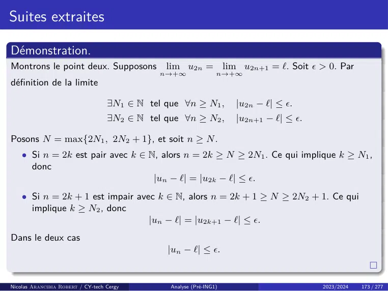

~~~text
Suites extraites

Démonstration.
Montrons le point deux. Supposons              lim u2n = lim u2n+1 = `. Soit  > 0. Par
                                              n→+∞               n→+∞
définition de la limite

                                   ∃N1 ∈ N tel que ∀n ≥ N1 ,         |u2n − `| ≤ .
                                   ∃N2 ∈ N tel que ∀n ≥ N2 ,         |u2n+1 − `| ≤ .

Posons N = max{2N1 , 2N2 + 1}, et soit n ≥ N .
    • Si n = 2k est pair avec k ∈ N, alors n = 2k ≥ N ≥ 2N1 . Ce qui implique k ≥ N1 ,
      donc
                                   |un − `| = |u2k − `| ≤ .
    • Si n = 2k + 1 est impair avec k ∈ N, alors n = 2k + 1 ≥ N ≥ 2N2 + 1. Ce qui
      implique k ≥ N2 , donc
                                  |un − `| = |u2k+1 − `| ≤ .
Dans le deux cas
                                               |un − `| ≤ .

Nicolas Arancibia Robert / CY-tech Cergy        Analyse (Pré-ING1)                      2023/2024   173 / 277
~~~

## Page 180

~~~text
Suites extraites
Remarque : Ce théorème est souvent utilisé pour montrer qu’une suite n’a pas
de limite. En effet, si on trouve deux suites extraites de (un )n∈N qui ne
convergent pas vers la même limite, alors (un )n∈N diverge.
Exemples :
  • La suite un = ((−1)n )n∈N n’a pas de limite car

                                       lim u2n =          lim (−1)2n = 1
                                     n→+∞               n→+∞

       par contre
                                    lim u2n+1 =            lim (−1)2n+1 = −1.
                                 n→+∞                   n→+∞

    • La suite vn = cos n π2                    n’a pas de limite car
                                           

                                       lim v4n =          lim cos (2nπ) = 1
                                    n→+∞               n→+∞

       par contre
                                                                     π               
                               lim v4n+1 =            lim cos                 + 2nπ       = 0.
                             n→+∞                   n→+∞                  2
Nicolas Arancibia Robert / CY-tech Cergy             Analyse (Pré-ING1)                          2023/2024   174 / 277
~~~

## Page 181

~~~text
Suites récurrentes de la forme un+1 = f (un )

Nous allons nous intéreser à présent aux suites récurrentes définies par :

                                                    un+1 = f (un ),

avec f une fonction à valeurs réelles définie sur un intervalle I.
Remarque : Une telle relation de récurrence ne permet pas toujours de bien
définir une suite. Par exemple, il n’existe pas de suite définie par
                                                       √
                 u0 = 1 et un+1 = f (un ) = 2 + 1 − un .

En effet, comme                                                       √
                                           f (u0 ) = f (1) = 2 +           1 − 1 = 2,
on peut poser u1 = 2. Mais ensuite f (2)? La fonction
                         √
                      2 + 1 − x n’est pas définié en 2.

Quelle valeur alors pour u2 ? La suite (un )n∈N n’est donc pas définie.

Nicolas Arancibia Robert / CY-tech Cergy              Analyse (Pré-ING1)                2023/2024   175 / 277
~~~

## Page 182

~~~text
Suites récurrentes de la forme un+1 = f (un )

La proposition qui suit, nous donne une condition qui permet de garantir
l’existence de suites récurrentes du type un+1 = f (un ).

Proposition
Soit f : I −→ R telle que I est stable par f , c’est à dire

                                                  f (I) ⊂ I.

Soit a ∈ I, alors il existe une unique suite (un )n∈N vérifiant :

                                                       u0       = a
                                           ∀n ∈ N, un+1         = f (un ).

Nicolas Arancibia Robert / CY-tech Cergy          Analyse (Pré-ING1)         2023/2024   176 / 277
~~~

## Page 183

~~~text
Suites récurrentes de la forme un+1 = f (un )

Étudions quelques propriétés des suites récurrentes. Étudions d’abord la
monotonie d’une telle suite.

Proposition (Monotonie)
Soit f : I −→ R avec I stable par f et (un )n∈N définie par

                                                       u0       = a ∈ I,
                                           ∀n ∈ N, un+1         = f (un ).

Nous avons :
 1. Si f est croissante sur I, alors la suite (un ) est monotone :
            • Si f (u0 ) − u0 ≥ 0, alors (un ) est croissante.
            • Si f (u0 ) − u0 ≤ 0, alors (un ) est décroissante.
  2. Si f est décroissante sur I, alors les suites extraites (u2n )n∈N et (u2n+1 )n∈N
     sont monotones et de monotonie contraire. Leurs sens de variation
     dépendent donc de la position de u0 par rapport de u2 .

Nicolas Arancibia Robert / CY-tech Cergy          Analyse (Pré-ING1)         2023/2024   177 / 277
~~~

## Page 184

~~~text
Suites récurrentes de la forme un+1 = f (un )

Figure – Suites récurrentes par une fonction croissante (gauche) et décroissante
(droite).

Nicolas Arancibia Robert / CY-tech Cergy   Analyse (Pré-ING1)             2023/2024   178 / 277
~~~

## Page 185

~~~text
Suites récurrentes de la forme un+1 = f (un )
Remarques :
    • Pour déterminer la monotonie de (un )n∈N , il peut parfois être intéressant
      d’étudier le signe de x 7−→ f (x) − x sur I. En effet, supposons par exemple

                                               ∀x ∈ I, f (x) − x ≥ 0.

       Alors, pour tout n ∈ N, nous avons

                                           un+1 − un = f (un ) − un ≥ 0.

       Ainsi, (un )n∈N est croissante.
    • Pour tout n ∈ N, nous avons

                            f (u2n ) = u2n+1      =⇒          u2n+2 = f ◦ f (u2n ).

       Ainsi, (u2n )n∈N est récurrente associée à la fonction f ◦ f . Même chose
       pour (u2n+1 )n∈N .
    • Si f est décroissante alors f ◦ f est croissante.

Nicolas Arancibia Robert / CY-tech Cergy          Analyse (Pré-ING1)                  2023/2024   179 / 277
~~~

## Page 186

~~~text
Suites récurrentes de la forme un+1 = f (un )

Démonstration Monotonie.
(1) Supposons f est croissante. Si f (u0 ) − u0 ≥ 0, alors u1 ≥ u0 . Puisque f est
croissante, la relation
                                           un+2 − un+1 = f (un+1 ) − f (un )

 permet alors de montrer par récurrence que (un )n∈N est croissante. En effet,
                           u1 ≥ u0           =⇒    u2 = f (u1 ) ≥ f (u0 ) = u1
                                              ..
                                               .
                                             =⇒    un+1 = f (un ) ≥ f (un−1 ) = un
                                             =⇒    un+2 = f (un+1 ) ≥ f (un ) = un+1 .

 De même, si f (u0 ) − u0 ≤ 0, alors u1 ≤ u0 . La relation
                                           un+1 − un+2 = f (un ) − f (un+1 ),

 nous permet comme dans le cas précédent de conclure que (un )n∈N est
 décroissante.
Nicolas Arancibia Robert / CY-tech Cergy              Analyse (Pré-ING1)                 2023/2024   180 / 277
~~~

## Page 187

~~~text
Suites récurrentes de la forme un+1 = f (un )

Démonstration Monotonie.
(2) Supposons f est décroissante. Posons

                                                      g = f ◦ f.

Cette application est croissante sur I. Soit

                                           vn = u2n       et wn = u2n+1 .

Alors

               vn+1 = u2n+2 = f (u2n+1 ) = f (f (u2n )) = g(u2n ) = g(vn ).

De même
                                                wn+1 = g(wn ).
Ainsi, (vn )n∈N est récurrente associée à la fonction g. Même chose pour
(wn )n∈N . Le point (1), permet alors d’en déduire que chacune des suites (vn )n∈N
et (wn )n∈N est monotone.
Nicolas Arancibia Robert / CY-tech Cergy              Analyse (Pré-ING1)      2023/2024   181 / 277
~~~

## Page 188

~~~text
Suites récurrentes de la forme un+1 = f (un )

Démonstration Monotonie.
Si par exemple nous supposons que (vn )n∈N est croissante. On peut donc écrire,
pour tout
                             n ∈ N, vn ≤ vn+1 .
Maintenant comme f décroissante, on en déduit

                                           f (vn ) ≥ f (vn+1 ).

Or u2n = vn et u2n+2 = vn+1 , donc

                  u2n+1 = f (u2n ) ≥ f (u2n+2 ) = u2n+3               =⇒ wn ≥ wn+1 .

La suite (wn )n∈N est donc décroissante.
Finalement, si l’on suppose que (vn )n∈N est décroissante, le même raisonnement
nous permet de déduire que (wn )n∈N est croissante.

Nicolas Arancibia Robert / CY-tech Cergy         Analyse (Pré-ING1)                2023/2024   182 / 277
~~~

## Page 189

~~~text
Suites récurrentes de la forme un+1 = f (un )
Étudions maintenant la convergence des suites récurrentes.

Proposition (Convergence)
Soit f : I −→ R avec I stable par f et (un )n∈N définie par

                                                       u0       = a ∈ I,
                                           ∀n ∈ N, un+1         = f (un ).

Si f est continue sur I et si (un )n∈N converge vers `, alors

                                                   f (`) = `.

On dit que ` est un point fixe de f .

Remarque : Pour déterminer les points fixes de f , il peut parfois être intéressant
d’étudier les points d’annulation de

                                             x 7−→ f (x) − x sur I.

Nicolas Arancibia Robert / CY-tech Cergy          Analyse (Pré-ING1)         2023/2024   183 / 277
~~~

## Page 190

~~~text
Suites complexes

Dans le cours d’algèbre vous avez commence à étudier l’ensemble des nombres
complexes C. Dans cette section nous allons étendre la notion de suite réel aux
nombres complexes.

Définition (Suite complexe)
Une suite complexe u est une fonction de N dans C

                                              u:N      −→         C
                                                 n 7−→            u(n).

Pour tout n ∈ N, on préfère noter

                                           un le complexe u(n).

La suite est notée u, ou plus souvent (un )n∈N ou (un )n≥0 , ou simplement (un ).

Nicolas Arancibia Robert / CY-tech Cergy          Analyse (Pré-ING1)      2023/2024   184 / 277
~~~

## Page 191

~~~text
Suites complexes

On peut se demander dans quelle mesure les définitions et les théorèmes de ce
chapitre peuvent-ils être étendus aux suites complexes. En tout cas, nous n’avons
pas droit aux inégalités dans C, donc une suite complexe ne peut pas être
majorée, minorée ou motonone. Par contre, les propriétés faisant intervenir la
valeur absolue seront étendues en la remplaçant par le module.

Définition (Suite bornée)
Soit (un )n∈N une suite complexe. On dit que (un )n∈N est bornée s’il existe
M > 0 tel que pour tout n ∈ N, nous avons

                                           |un | ≤ M.

où |un | est le module du complexe un .

Nicolas Arancibia Robert / CY-tech Cergy   Analyse (Pré-ING1)         2023/2024   185 / 277
~~~

## Page 192

~~~text
Suites complexes
À l’aide du module nous pouvons étendre la notion de limite aux suites complexes.

Définition (Limite d’une suite complexe)
Soit (un )n∈N une suite complexe. On dit que (un )n∈N converge vers ` ∈ C si
                                                                  
            ∀ > 0, ∃N ∈ N, ∀n ∈ N       ∀n ≥ N =⇒ |un − l| ≤  .

Le théorème d’unicité de la limite est encore valable, ce qui autorise la notation

                                           lim un = `.
                                           n→+∞

Remarques :
    • Il n’existe pas de limite infinie. En effet, la notion de limite infinie n’a aucun
      sens pour une suite complexe. Ils sont où −∞ et +∞ dans C ?
    • Nous avons

                  lim un = ` dans C         ⇐⇒             lim |un − `| = 0 dans R.
               n→+∞                                     n→+∞

Nicolas Arancibia Robert / CY-tech Cergy    Analyse (Pré-ING1)                  2023/2024   186 / 277
~~~

## Page 193

~~~text
Suites complexes

Théorème (Caractérisation de la limite par les parties réelle et
imaginaire)
Soit (un )n∈N une suite complexe et ` ∈ C. Nous avons

                                           lim un = `.
                                           n→+∞

si et seulement si

                           lim Re(un ) = Re(`) et          lim Im(un ) = Im(`).
                        n→+∞                             n→+∞

Nicolas Arancibia Robert / CY-tech Cergy    Analyse (Pré-ING1)                    2023/2024   187 / 277
~~~

## Page 194

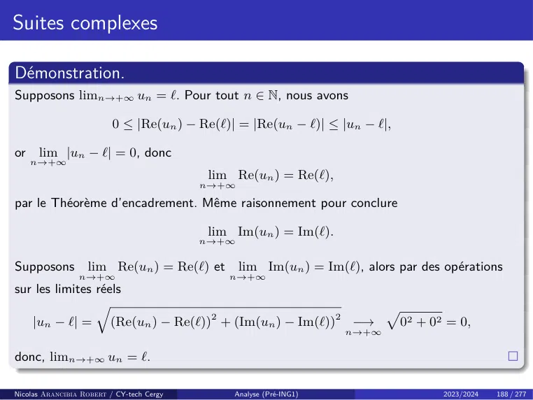

~~~text
Suites complexes

Démonstration.
Supposons limn→+∞ un = `. Pour tout n ∈ N, nous avons

                          0 ≤ |Re(un ) − Re(`)| = |Re(un − `)| ≤ |un − `|,

or    lim |un − `| = 0, donc
     n→+∞
                                           lim Re(un ) = Re(`),
                                           n→+∞

par le Théorème d’encadrement. Même raisonnement pour conclure

                                           lim Im(un ) = Im(`).
                                           n→+∞

Supposons          lim Re(un ) = Re(`) et         lim Im(un ) = Im(`), alors par des opérations
                 n→+∞                         n→+∞
sur les limites réels
                     q
     |un − `| =          (Re(un ) − Re(`))2 + (Im(un ) − Im(`))2 −→            02 + 02 = 0,
                                                                           p
                                                                    n→+∞

donc, limn→+∞ un = `.

Nicolas Arancibia Robert / CY-tech Cergy       Analyse (Pré-ING1)                     2023/2024   188 / 277
~~~

## Page 195

~~~text
Suites complexes
Grâce au résultat précédent nous pouvons conclure :
  • Il est toujours vrai qu’une suite convergente est bornée.
  • Les opérations d’addition, produit, multiplication par un scalaire et
    inverse sur les limites donnent lieu aux mêmes résultats que dans le cas réel,
    à ceci près que les symboles +∞ et −∞ sont bannis. Nous avons de plus le
    résultat suivant :
                        Si lim un = `, alors        lim un = `.
                                           n→+∞                        n→+∞
  • Le résultats sur les suites extraites sont intégralement maintenus.
En résumé :
               Ce qui reste valable :                          Ce qui n’est plus valable :
                 Unicité de la limite                              Majorant/minorant
           Une suite convergente est bornée                             Monotonie
              Opérations sur les limites                             Limites infinies
                    Suites extraites                         Passage à la limite des inégalités
                                                                Théorème d’Encadrement
                                                             Théorème de la limite monotone
                                                                    Suites adjacentes
Nicolas Arancibia Robert / CY-tech Cergy          Analyse (Pré-ING1)                     2023/2024   189 / 277
~~~

## Page 196

~~~text
Chapitre 3 - Limites et continuité de fonctions

    • Généralités sur les fonctions.
    • Limite d’une fonction :
            • Limite en un point.
            • Limite à droite, à gauche.
            • Opérations sur les limites.
            • Théorèmes d’existence de limites.

    • Continuité :
            • Définition.
            • Prolongement par continuité.
            • Caractérisation séquentielle de la continuité.
            • Opérations sur les fonctions continues.

    • Les grands théorèmes de la continuité :
            • Théorème des valeurs intermédiaires.
            • Image d’un segment.
            • Théorème de la bijection.

Nicolas Arancibia Robert / CY-tech Cergy   Analyse (Pré-ING1)   2023/2024   190 / 277
~~~

## Page 197

~~~text
Généralités sur les fonctions
Tout ce que vous avez étudié sur les applications dans le cours d’algèbre, nous
allons l’appliquer dans ce chapitre. Rappelons certaines notions.

Définition
Soit E une partie de R et

                                           f : E −→ R
                                               x 7−→ f (x),

une fonction à valeurs réels.
    • L’ensemble E est appelé l’ensemble de départ ou domaine de définition
      de f .
    • Pour tous x ∈ E et y ∈ R, si y = f (x), on dit que :
            • y est l’image de x par f .
            • x est un antécédent de y par f (pas forcément unique).

Remarque : Étant donné une fonction f , il faudra toujours commencer par
préciser le domaine de définition de f .
Nicolas Arancibia Robert / CY-tech Cergy     Analyse (Pré-ING1)        2023/2024   191 / 277
~~~

## Page 198

~~~text
Généralités sur les fonctions
Rappelons du cours d’algèbre, les notions d’image directe et image reciproque.

Définition (Image directe - Image reciproque)
Soit f : E → R une fonction à valeurs réels.
    • Pour toute partie A de E, on appelle image (directe) de A par f , notée f (A),
      l’ensemble :

                       f (A) = {y ∈ R : ∃a ∈ A, y = f (a)} = {f (a) : a ∈ A}.

    • L’image de E tout entier est simplement appelée l’image de f et est notée
      généralement
                                    Imf plutôt que f (E).
    • Soit B une partie de R. Si toute valeur de f est élément de B(i.e. Imf ⊂ B). Alors
      on dit que f est à valeurs dans B.
    • Pour toute partie B de R, on appelle image réciproque de B par f , notée f −1 (B),
      l’ensemble des éléments de E dont l’image est dans B :

                                           f −1 (B) = {x ∈ E, f (x) ∈ B}.

Nicolas Arancibia Robert / CY-tech Cergy          Analyse (Pré-ING1)            2023/2024   192 / 277
~~~

## Page 199

~~~text
Généralités sur les fonctions

Sur l’ensemble des fonctions réels nous pouvons définir les opérations suivants.

Définition (Opérations sur le fonctions réels)
Soit f et g deux fonctions définies sur un intervalle commun I.
    • La somme de f et g est la fonction notée (f + g) définie pour tout x ∈ I par

                                           (f + g)(x) = f (x) + g(x).

    • Le produit de f et g est la fonction notée f · g définie pour tout x ∈ I par

                                            (f · g)(x) = f (x) · g(x).

    • Supposons de plus que g ne s’annule pas sur I. Le quotient de f par g est la
      fonction notée fg définie pour tout x ∈ I par :

                                                         f (x)
                                                
                                                f
                                                   (x) =       .
                                                g        g(x)

Nicolas Arancibia Robert / CY-tech Cergy        Analyse (Pré-ING1)       2023/2024   193 / 277
~~~

## Page 200

~~~text
Généralités sur les fonctions

La dernière opération à introduire sur l’ensemble de fonctions est la composition.

Définition (Composition)
Soit E et F deux parties de R et

                                           f : E −→ R       et       g : F −→ R

deux fonctions. On suppose f à valeurs dans F . On appelle composée de f
suivie de g la fonction g ◦ f définie sur E par :

                                               (g ◦ f )(x) = g(f (x)).

Nicolas Arancibia Robert / CY-tech Cergy            Analyse (Pré-ING1)            2023/2024   194 / 277
~~~

## Page 201

~~~text
Généralités sur les fonctions

Remarques :

    • La composition, en général, n’est possible que dans un seul sens, et quand
      elle est possible dans les deux, on n’a aucune raison d’avoir :

                                                     f ◦ g = g ◦ f.

    • La composition est associative : Soit

                                f : E −→ R      ;     g : F −→ R         ;   h : G −→ R

       trois fonction à valeurs réels avec

                                           Im(f ) ⊂ F          et Im(g) ⊂ G.

       Alors :

                                             (h ◦ g) ◦ f = h ◦ (g ◦ f ).

Nicolas Arancibia Robert / CY-tech Cergy            Analyse (Pré-ING1)                    2023/2024   195 / 277
~~~

## Page 202

~~~text
Fonction paire, Fonction impaire

Rappelons la notion de fonction paire/impaire.

Définition (Partie Symétrique)
Soit A une partie de R. Alors on dit que A est symétrique par rapport à 0, si

                                            ∀x ∈ A,       −x ∈ A.

Définition (Fonction paire, Fonction impaire)
Supposons A est une partie symétrique de R. Soit f : A → R une fonction.
    • On dit que f est paire si

                                           ∀x ∈ A,       f (−x) = f (x).

    • On dit que f est impaire si

                                           ∀x ∈ A,     f (−x) = −f (x).

Nicolas Arancibia Robert / CY-tech Cergy        Analyse (Pré-ING1)         2023/2024   196 / 277
~~~

## Page 203

~~~text
Fonction paire, Fonction impaire

Exemples :

    • Les fonctions

                                 x 7−→ x2     ;   x 7−→ |x| ;          x 7−→ cos x

       sont paires.

    • Les fonctions

                    x 7−→ 3x           ;   x 7−→ x3    ;     x 7−→ 1/x     ;   x 7−→ sin x

       sont impaires.

Nicolas Arancibia Robert / CY-tech Cergy          Analyse (Pré-ING1)                         2023/2024   197 / 277
~~~

## Page 204

~~~text
Fonction paire, Fonction impaire

Remarques :

    • Si f est paire, alors le graphe de f est symétrique par rapport à l’axe des
      ordonnées.

    • Si f est impaire, alors le graphe de f est symétrique par rapport à l’origine.

    • Pas besoin d’étudier une fonction f : A → R paire ou impaire sur A tout
      entier, une étude sur A ∩ R+ suffit.

Nicolas Arancibia Robert / CY-tech Cergy   Analyse (Pré-ING1)            2023/2024   198 / 277
~~~

## Page 205

~~~text
Fonction périodique

Rappelons maintenant la notion de fonction périodique.

Définition (Partie T -périodique)
Soit T > 0 et A une partie de R. Alors on dit que A T -périodique, si

                                 ∀x ∈ A,      x+T ∈A                 et   x − T ∈ A.

Définition (Fonction périodique)
Soit T > 0 et A une partie de R, T -périodique. Soit f : A → R une fonction. On
dit que f est T -périodique ou périodique de période T si

                                           ∀x ∈ A,      f (x + T ) = f (x).

 Le réel T est alors appelé une période de f .

Nicolas Arancibia Robert / CY-tech Cergy             Analyse (Pré-ING1)                2023/2024   199 / 277
~~~

## Page 206

~~~text
Fonction périodique

Exemple :

    • Les fonctions cosinus et sinus sont 2π-périodiques, la fonction tangente est
      π-périodique.
    • La fonction
                                           x 7−→ x − E(x)
       est périodique de période 1.

Remarque : Pas besoin d’étudier une fonction f : A → R périodique sur A tout
entier, une étude sur une période suffit, par exemple sur l’ensemble

                                           A ∩ [−T, T [.

C’est-à dire, si la fonction est T -périodique, on restreindra son étude à un
segment de longueur T et on complétera la courbe par translation.

Nicolas Arancibia Robert / CY-tech Cergy    Analyse (Pré-ING1)          2023/2024   200 / 277
~~~

## Page 207

~~~text
Fonctions et relation d’ordre

Étudions quelques propriétés eventuelles des fonctions à valeurs réels.
Commençons par nous intéresser à des fonctions qui préservent (ou inversent) la
relation d’ordre usuel sur R.

Définition (Fonction croissante, Fonction décroissante)
Soit A une partie de R et f : A −→ R une fonction.
    • On dit que f est croissante (resp. strictement croissante), si

                 ∀x ∈ A, y ∈ A,             x < y =⇒ f (x) ≤ f (y)       (resp. f (x) < f (y)).

    • On dit que f est décroissante (resp. strictement croissante), si

             ∀x ∈ A, y ∈ A,                x < y =⇒ f (x) ≥ f (y)      (resp. f (x) > f (y).

    • On dit que f est (resp. strictement) monotone, si f est (resp. strictement)
      croissante ou décroissante.

Nicolas Arancibia Robert / CY-tech Cergy          Analyse (Pré-ING1)                   2023/2024   201 / 277
~~~

## Page 208

~~~text
Fonctions et relations d’ordre
Exemples :
    • La fonction x 7−→ 2x + 1 est strictement croissant sur R.
    • La fonction x 7−→ −3x + 1 est strictement décroissant sur R.
    • La fonction x 7−→ 1/x est strictement décroissant sur ]0, +∞[.
    • La fonction x 7−→ x2 est strictement croissant sur [0, +∞[ et strictement
      décroissant sur ] − ∞, 0[.
    • La fonction x 7−→ ex est strictement croissant sur R.
    • La fonction x 7−→ ln x est strictement croissant sur ]0, +∞[.
    • La fonction cosinus est strictement décroissante sur tout intervalle de la forme
                                              [2kπ, (2k + 1)π], (k ∈ Z)
         et strictement croissante sur tout intervalle de la forme
                                           [(2k + 1)π, (2k + 2)π], (k ∈ Z).
         Mais elle n’est pas monotone sur R.
Nicolas Arancibia Robert / CY-tech Cergy           Analyse (Pré-ING1)         2023/2024   202 / 277
~~~

## Page 209

~~~text
Fonctions et relations d’ordre

Définition (Majorée, Minorée, Bornée)
Soit A une partie de R et f : A −→ R une fonction.
    • On dit que f est majorée sur A si

                            existe M ∈ R, tel que pour tout x ∈ A, f (x) ≤ M.

       Le réel M est appelé un majorant de f .
    • On dit que f est minorée sur A si

                             existe m ∈ R, tel que pour tout x ∈ A, f (x) ≥ m.

       Le réel m est appelé un minorant de f .
    • On dit que f est bornée sur A, si f est à la fois majorée et minorée sur A.

Exemple :
    • Les fonctions cosinus et sinus sont majorées par 1 et minorées par -1.
    • La fonction x 7−→ 1+x
                          1
                            2 est majorée par 1 et minorée par 0.

Nicolas Arancibia Robert / CY-tech Cergy      Analyse (Pré-ING1)                 2023/2024   203 / 277
~~~

## Page 210

~~~text
Fonctions et relations d’ordre

Définition (Maximum, Minimum)
Soit A une partie de R, f : A → R une fonction et x0 ∈ I ⊂ A.
    • On dit que f admet un maximum global en x0 , si pour tout x ∈ A

                                           f (x) ≤ f (x0 ).

    • On dit que f admet un minimum global en x0 si pour tout x ∈ A

                                           f (x) ≥ f (x0 ).

    • On dit que f admet un maximum local en x0 , si pour tout x ∈ I

                                           f (x) ≤ f (x0 ).

    • On dit que f admet un minimum local en x0 , si pour tout x ∈ I

                                           f (x) ≥ f (x0 ).

Nicolas Arancibia Robert / CY-tech Cergy   Analyse (Pré-ING1)      2023/2024   204 / 277
~~~

## Page 211

~~~text
Fonctions et relation d’ordre

Exemples :

    • La fonction cosinus admet un maximun global, en tout point de la forme :

                                                 x = 2kπ, k ∈ Z.

    • La fonction sinus admet un minimun global, en tout point de la forme :
                                                     3π
                                              x=        + 2kπ, k ∈ Z.
                                                      2
    • La fonction
                                              1
                                                 f (x) =
                                                  ,
                                           1 + x2
       admet un maximum global en 0. En effet
                                                        1
                                           ∀x ∈ R,          ≤ f (0) = 1.
                                                     1 + x2

Nicolas Arancibia Robert / CY-tech Cergy         Analyse (Pré-ING1)        2023/2024   205 / 277
~~~

## Page 212

~~~text
Limites d’une fonction
Passons maintenant à étudier la notion de limite de une fonction. Pour cela,
dans tout ce qui suit, l’ensemble I désignera un intervalle de R non vide et non
réduit à un point. On notera :
        ◦
    • I = I \ {extrémités de I}.
    • I¯ = I ∪ {extrémités de I}.
Exemples :
    • Nous avons
                              ◦                          ◦                         ◦
                           [a, b] = ]a, b[     ;       [a, b[ = ]a, b[       ;   ]a, b[ = ]a, b[.
    • Nous avons
                          ]a, b[ = [a, b]    ;         [a, b[ = [a, b]       ;   [a, b] = [a, b].
    • Nous avons
             ◦                    ◦
       [a, +∞[ = ]a, +∞[ = ]a, +∞[                        et     ]a, +∞[ = [a, +∞[ = [a, +∞[∪{+∞}.
    • Nous avons
                                       ◦
                                       R = R       ;     R = R ∪ {−∞, +∞}.

Nicolas Arancibia Robert / CY-tech Cergy                Analyse (Pré-ING1)                          2023/2024   206 / 277
~~~

## Page 213

~~~text
Limites d’une fonction
Commençons par donner une définition provisoire mais très intuitive de la limite
de une fonction.
Définition Provisoire
Soit f : I → R et a un réel appartenant à I. On dit que

                               f admet une limite (finie) ` ∈ R en a

si f (x) est proche d’aussi près que l’on veux de ` pour x suffisamment proche
de a.
Avec cette définition, étudions la limite de la fonction
                                           f : x 7−→ x2 .

 en a = 3. Vraisemblablement
                 quand x tend vers 3, la fonction f (x) = x2 tend vers 9.
Selon notre définition provisoire, pour montrer la convergence de la fonction vers
9 en 3, on doit vérifier que x2 est proche d’aussi près que l’on veux de 9, lorsque x
est suffisamment proche de 3.
Nicolas Arancibia Robert / CY-tech Cergy      Analyse (Pré-ING1)            2023/2024   207 / 277
~~~

## Page 214

~~~text
Limites d’une fonction
Par exemple, supposons qu’on veut que x2 soit à une distance de 100
                                                                 1
                                                                    de 9. Pour
cela, on doit avoir
                            1                   1
                        9−     ≤ f (x) ≤ 9 +      ,
                           100                100
ce qui est équivalent à
                                                 1
                                                |f (x) − 9| ≤
                                                    .
                                                100
Et cette dernière inégalité est vraie, si et seulement si
                          1                                1
                       x2 − 9 ≤
                              ⇐⇒ |x − 3| · |x + 3| ≤
                        100                               100
Maintenant, comme on se intéresse ici à x proche de 3, nous pouvons supposer
                 |x − 3| < 1               =⇒     −1 < x − 3 < 1           =⇒ 2 < x < 4
                                                                           =⇒ 5 < x + 3 < 7.
Ainsi
                        x2 − 9             = |x − 3| · |x + 3| ≤ 7 |x − 3| .
Nicolas Arancibia Robert / CY-tech Cergy              Analyse (Pré-ING1)                  2023/2024   208 / 277
~~~

## Page 215

~~~text
Limites d’une fonction

Par conséquent, si
                                        1                                  7     1
                      |x − 3| ≤              alors         x2 − 9 ≤           =     .
                                       700                                700   100
Notons qu’il n’a rien de spécial sur 100
                                      1
                                         , si l’on veut que

                                     x2 − 9 ≤  pour  un réel positif,

il suffit que
                                              
                                                .|x − 3| <
                                             7
Ainsi, on vient de démontrer que f (x) est proche d’aussi près que l’on veux de 9,
lorsque x est suffisamment proche de 3.

Nicolas Arancibia Robert / CY-tech Cergy             Analyse (Pré-ING1)                 2023/2024   209 / 277
~~~

## Page 216

~~~text
Limites d’une fonction

Formalisons notre définition provisoire de limite, on commence par faire plus
précise la notion :

                                           « d’être proche de »

Dans notre exemple, nous avons vu que pour que f (x) soit proche de 9, il faut
que la distance

                                           |f (x) − 9| soit petit.

Ainsi, le premier changement qu’on va faire à notre définition provisoire est :

Définition Provisoire 2
Soit f : I → R et a un réel appartenant à I. On dit que

                               f admet une limite (finie) ` ∈ R en a

si |f (x) − `| est aussi petit que l’on veut pour x suffisamment proche de a.

Nicolas Arancibia Robert / CY-tech Cergy           Analyse (Pré-ING1)   2023/2024   210 / 277
~~~

## Page 217

~~~text
Limites d’une fonction
Maintenant, dans notre exemple nous avons vu que, pour que

                           |f (x) − 9| soit aussi petit que l’on veut,

pour tout  > 0, on doit avoir

                  |f (x) − 9| ≤           lorsque x est suffisament proche de 3.

Le deuxième changement qu’on va faire à notre définition provisoire est donc :

Définition Provisoire 3
Soit f : I → R et a un réel appartenant à I. On dit que

                               f admet une limite (finie) ` ∈ R en a

si pour tout  > 0, on a
                                                |f (x) − `| < ,
lorsque x est suffisamment proche de a.

Nicolas Arancibia Robert / CY-tech Cergy          Analyse (Pré-ING1)                2023/2024   211 / 277
~~~

## Page 218

~~~text
Limites d’une fonction
Il ne nous reste donc qu’a faire plus précise la phrase :

                              « pour x suffisamment proche de 3 »

Dans notre exemple, nous avons vu que
                                             1                                  1
                            |f (x) − 9| ≤             ⇐⇒           |x − 3| ≤       .
                                            100                                700
Ainsi, la propriété est vraie pour tout x ∈ R, avec |x − 3| ≤ 700
                                                               1
                                                                  . De même, pour
tout  > 0, nous avons
                                                                               
                                 |f (x) − 9| ≤      ⇐⇒           |x − 3| ≤      .
                                                                               7
Donc pour tout  > 0, il existe un réel strictement positif
                                                                           
                                   δ > 0,   il suffit de prendre δ =         ,
                                                                           7
tel que pour tout x ∈ R, |x − 3| ≤ δ la propriété est vraie.
Nicolas Arancibia Robert / CY-tech Cergy           Analyse (Pré-ING1)                  2023/2024   212 / 277
~~~

## Page 219

~~~text
Limites d’une fonction

On est à présent prêt pour donner la définition de la limite d’une fonction.

Définition (Limite en un point)
Soit f : I → R et a un réel appartenant à I. On dit que :
    • f admet une limite (finie) ` ∈ R en a, si

                       ∀ > 0, ∃δ > 0, ∀x ∈ I, |x − a| ≤ δ =⇒ |f (x) − `| ≤ .

    • f admet pour limite +∞ en a, si

                         ∀M > 0, ∃δ > 0, ∀x ∈ I, |x − a| ≤ δ =⇒ f (x) ≥ M.

    • f admet pour limite −∞ en a, si

                         ∀M < 0, ∃δ > 0, ∀x ∈ I, |x − a| ≤ δ =⇒ f (x) ≤ M.

Nicolas Arancibia Robert / CY-tech Cergy   Analyse (Pré-ING1)              2023/2024   213 / 277
~~~

## Page 220

~~~text
Limites d’une fonction

Remarque : Dire que f tend vers ` en a, c’est dire que
Pour tout  > 0, l’écart entre f (x) et ` est strictement inférieur à  dès que x est
                                 assez proche de a.

Nicolas Arancibia Robert / CY-tech Cergy   Analyse (Pré-ING1)           2023/2024   214 / 277
~~~

## Page 221

~~~text
Limites d’une fonction
Remarque :
    • l’écart δ dépend de  : intuitivement, « plus  est petit, plus il faudra que x
      soit proche de a pour avoir |f (x) − `| <  ».

    • l’écart δ dépend aussi de a : intuitivement, si f a des variations « brusques »
      au voisinage de a, l’écart δ nécessaire n’est pas le même que si f a des
      variations « douces » au voisinage de a.

Nicolas Arancibia Robert / CY-tech Cergy   Analyse (Pré-ING1)             2023/2024   215 / 277
~~~

## Page 222

~~~text
Limites d’une fonction

Exemple : f admet pour limite +∞ en a

Nicolas Arancibia Robert / CY-tech Cergy   Analyse (Pré-ING1)   2023/2024   216 / 277
~~~

## Page 223

~~~text
Limites d’une fonction

Étendons la définition de limite de une fonction au cas ou a = +∞.

Définition (Limite en +∞)
Soit f : I → R. On suppose que +∞ est une extrémité de I. On dit que :
    • f admet une limite (finie) ` ∈ R en +∞, si

                          ∀ > 0, ∃A > 0, ∀x ∈ I, x ≥ A =⇒ |f (x) − `| ≤ .

    • f admet pour limite +∞ en +∞, si

                            ∀M > 0, ∃A > 0, ∀x ∈ I, x ≥ A =⇒ f (x) ≥ M.

    • f admet pour limite −∞ en +∞, si :

                             ∀N < 0, ∃A > 0, ∀x ∈ I, x ≥ A =⇒ f (x) ≤ N.

Nicolas Arancibia Robert / CY-tech Cergy    Analyse (Pré-ING1)             2023/2024   217 / 277
~~~

## Page 224

~~~text
Limites d’une fonction

Exemples :

    • Soit
                                                            x2
                                           f (x) =               .
                                                        x2 + 1
       Alors f admet 1 comme limite en +∞.

    • Soit
                                            ex
                                           f (x) =
                                                 .
                                         x3 + 3x
       Alors f admet +∞ comme limite en +∞.

    • Soit
                                                         ln(x)
                                            f (x) =            .
                                                           x
       Alors f admet 0 comme limite en +∞.

Nicolas Arancibia Robert / CY-tech Cergy   Analyse (Pré-ING1)        2023/2024   218 / 277
~~~

## Page 225

~~~text
Limites d’une fonction

Faisons de même lorsque a = −∞.

Définition (Limite en −∞)
Soit f : I → R. On suppose que −∞ est une extrémité de I. On dit que :
    • f admet une limite (finie) ` ∈ R en −∞, si

                           ∀ > 0, ∃B < 0, ∀x ∈ I, x ≤ B =⇒ |f (x) − `| ≤ .

    • f admet pour limite +∞ en −∞, si

                             ∀M > 0, ∃B < 0, ∀x ∈ I, x ≤ B =⇒ f (x) ≥ M.

    • f admet pour limite −∞ en −∞, si

                              ∀N < 0, ∃B < 0, ∀x ∈ I, x ≤ B =⇒ f (x) ≤ N.

Nicolas Arancibia Robert / CY-tech Cergy    Analyse (Pré-ING1)              2023/2024   219 / 277
~~~

## Page 226

~~~text
Limites d’une fonction

Exemples :

    • Soit
                                           x3
                                           f (x) =
                                                .
                                         x2 + 1
       Alors f admet −∞ comme limite en −∞.

    • Soit
                                              f (x) = ex .
       Alors f admet 0 comme limite en −∞.

    • Soit
                                         x5 + 1
                                           f (x) =
                                                .
                                         x3 + 1
       Alors f admet +∞ comme limite en −∞.

Nicolas Arancibia Robert / CY-tech Cergy   Analyse (Pré-ING1)   2023/2024   220 / 277
~~~

## Page 227

~~~text
Limites d’une fonction

Nicolas Arancibia Robert / CY-tech Cergy   Analyse (Pré-ING1)   2023/2024   221 / 277
~~~

## Page 228

~~~text
Limites d’une fonction

                                  ¯ Supposons ` ∈ R. Alors
Remarque : Soit f : I −→ R et a ∈ I.

                                   f (x) −→ `       ⇐⇒          |f (x) − `| −→ 0.
                                           x→a                              x→a

En particulier
                                       f (x) −→ 0      ⇐⇒           |f (x)| −→ 0.
                                            x→a                           x→a

Nicolas Arancibia Robert / CY-tech Cergy            Analyse (Pré-ING1)              2023/2024   222 / 277
~~~

## Page 229

~~~text
Unicité de la limite

Si elle existe, on va pouvoir parler de la limite, car il y a unicité :

Proposition (Unicité de la limite)
Soit f : I −→ R, a ∈ I. Si f admet une limite en a, cette limite est alors unique
et notée

                                           lim f (x) ou          lim f.
                                           x→a                     a

Notation : Pour tout ` ∈ R, la relation lim f (x) = ` est souvent notée :
                                                          x→a

                                           f (x) −→ ` ou f −→ `
                                                 x→a                      a

Nicolas Arancibia Robert / CY-tech Cergy           Analyse (Pré-ING1)         2023/2024   223 / 277
~~~

## Page 230

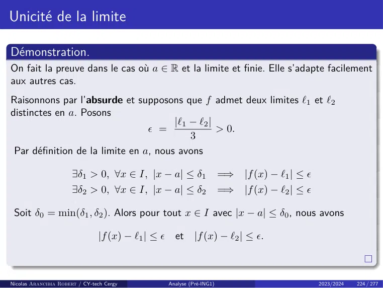

~~~text
Unicité de la limite

Démonstration.
On fait la preuve dans le cas où a ∈ R et la limite et finie. Elle s’adapte facilement
aux autres cas.
Raisonnons par l’absurde et supposons que f admet deux limites `1 et `2
distinctes en a. Posons
                                       |`1 − `2 |
                                  =              > 0.
                                           3
 Par définition de la limite en a, nous avons

                       ∃δ1 > 0, ∀x ∈ I, |x − a| ≤ δ1                 =⇒   |f (x) − `1 | ≤ 
                       ∃δ2 > 0, ∀x ∈ I, |x − a| ≤ δ2                 =⇒   |f (x) − `2 | ≤ 

 Soit δ0 = min(δ1 , δ2 ). Alors pour tout x ∈ I avec |x − a| ≤ δ0 , nous avons

                                |f (x) − `1 | ≤  et |f (x) − `2 | ≤ .

Nicolas Arancibia Robert / CY-tech Cergy        Analyse (Pré-ING1)                            2023/2024   224 / 277
~~~

## Page 231

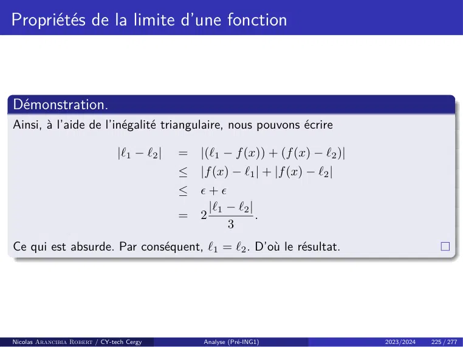

~~~text
Propriétés de la limite d’une fonction

Démonstration.
Ainsi, à l’aide de l’inégalité triangulaire, nous pouvons écrire

                                |`1 − `2 |   =   |(`1 − f (x)) + (f (x) − `2 )|
                                             ≤   |f (x) − `1 | + |f (x) − `2 |
                                             ≤   +
                                                   |`1 − `2 |
                                             =   2            .
                                                       3
Ce qui est absurde. Par conséquent, `1 = `2 . D’où le résultat.

Nicolas Arancibia Robert / CY-tech Cergy         Analyse (Pré-ING1)               2023/2024   225 / 277
~~~

## Page 232

~~~text
Propriétés de la limite d’une fonction
Étudions quelques propriétés de la limite.
Proposition
Soit f : I → R, a ∈ I¯ et ` ∈ R. Si lim f (x) = `, alors
                                             x→a

                                           lim |f (x)| = |`|.
                                           x→a

Démonstration.
On fait la preuve dans le cas où a ∈ R. Elle s’adapte facilement aux autres cas.
Supposons a ∈ R, et soit  > 0. Par définition de la limite en a, nous avons

                       ∃η > 0, ∀x ∈ I, |x − a| ≤ η             =⇒    |f (x) − `| ≤ .

Ainsi, d’après l’inégalité triangulaire, pour tout x ∈ I∩ ]a − η, a + η[, nous avons

                | |f (x)| − |`| | ≤ |f (x) − `| ≤          =⇒      lim |f (x)| = |`|.
                                                                    x→a

Nicolas Arancibia Robert / CY-tech Cergy      Analyse (Pré-ING1)                         2023/2024   226 / 277
~~~

## Page 233

~~~text
Propriétés de la limite d’une fonction
Avant de continuer avec notre étude de la limite, introduisons la notion de voisinage.

Définition (Voisinage)
Soit a ∈ I. Si a ∈ R, alors on dit qu’une fonction f : I −→ R satisfait la propriété P(x)
dans un voisinage de a, si

                        ∃δ > 0, ∀x ∈ ]a − δ, a + δ[ ∩ I             =⇒   P(x) est vraie.

c’est-à-dire

                            ∃δ > 0, ∀x ∈ I, |x − a| ≤ δ         =⇒       P(x) est vraie.

Si a = +∞, alors on dit qu’une fonction f : I −→ R satisfait la propriété P(x) dans un
voisinage de a, si

                             ∃A > 0, ∀x ∈ I, x > A         =⇒        P(x) est vraie.

Si a = −∞, alors on dit qu’une fonction f : I −→ R satisfait la propriété P(x) dans un
voisinage de a, si

                             ∃B < 0, ∀x ∈ I, x < B         =⇒        P(x) est vraie.

Nicolas Arancibia Robert / CY-tech Cergy       Analyse (Pré-ING1)                          2023/2024   227 / 277
~~~

## Page 234

~~~text
Propriétés de la limite d’une fonction

Proposition
Soit f : I → R et a ∈ I. Si f admet une limite finie en a, alors f est bornée au
voisinage de a, c’est-à-dire :
    • si a ∈ R alors

          ∃m ∈ R, ∃M ∈ R, ∃δ > 0, ∀x ∈ I, |x − a| ≤ δ            =⇒    m ≤ f (x) ≤ M.

    • si a = +∞ alors

              ∃m ∈ R, ∃M ∈ R, ∃A > 0, ∀x ∈ I, x ≥ A             =⇒ m ≤ f (x) ≤ M.

    • si a = −∞ alors

              ∃m ∈ R, ∃M ∈ R, ∃B < 0, ∀x ∈ I, x ≤ B             =⇒    m ≤ f (x) ≤ M.

Nicolas Arancibia Robert / CY-tech Cergy   Analyse (Pré-ING1)               2023/2024   228 / 277
~~~

## Page 235

~~~text
Propriétés de la limite d’une fonction

Démonstration.
On fait la preuve dans le cas où a ∈ R. Elle s’adapte facilement aux autres cas.
Notons ` = lim f (x). D’après la définition de la limite, pour  = 1, nous avons
                   x→a

                    ∃δ > 0, ∀x ∈ I, |x − a| ≤ δ              =⇒     |f (x) − `| ≤ 1.

Ainsi, pour x ∈ I∩]a − δ, a + δ[, nous pouvons écrire

        |f (x)| = |f (x) − ` + `|          ≤     |f (x) − `| + |`| (inégalité triangulaire)
                                           ≤     1 + |`|.

Par conséquent, f est bien bornée au voisinage de a.

Nicolas Arancibia Robert / CY-tech Cergy       Analyse (Pré-ING1)                      2023/2024   229 / 277
~~~

## Page 236

~~~text
Propriétés de la limite d’une fonction

Remarques :

    • Si f : I −→ R admet une limite ` > 0 en a ∈ R, alors f est minorée au
      voisinage de a par un nombre strictement positif :

                   ∃m > 0, ∃δ > 0, ∀x ∈ I, |x − a| ≤ δ               =⇒     f (x) ≥ m.

    • Si f : I −→ R admet une limite ` < 0 en a ∈ R, alors f est majorée au
      voisinage de a par un nombre strictement negatif :

                   ∃m < 0, ∃δ > 0, ∀x ∈ I, |x − a| ≤ δ               =⇒     f (x) ≤ m.

    • Si f : I −→ R admet une limite non nulle en a ∈ R, alors f est non nulle au
      voisinage de a :

                                ∃δ > 0, ∀x ∈ I, |x − a| ≤ δ         =⇒    f (x) 6= 0.

On a les mêmes résultats lorsque a = ±∞.

Nicolas Arancibia Robert / CY-tech Cergy       Analyse (Pré-ING1)                       2023/2024   230 / 277
~~~

## Page 237

~~~text
Limites à gauche - Limites à droite

Définition (Limites à gauche et à droite)
                                    ◦
Soit f : I −→ R et a ∈ I.
    • On dit que f admet une limite à gauche en a, si la restriction

                                                      f|I∩]−∞,a[

       admet une limite en a. Cette limite est alors notée :

                                           lim f (x)         ou        lim f (x).
                                           x→a−                        x→a
                                                                       x<a

    • On dit que f admet une limite à droite en a, si la restriction

                                                      f|I∩]a,+∞[

         admet une limite en a. Cette limite est alors notée :

                                           lim f (x)         ou        lim f (x).
                                           x→a+                        x→a
                                                                       x>a

Nicolas Arancibia Robert / CY-tech Cergy          Analyse (Pré-ING1)                2023/2024   231 / 277
~~~

## Page 238

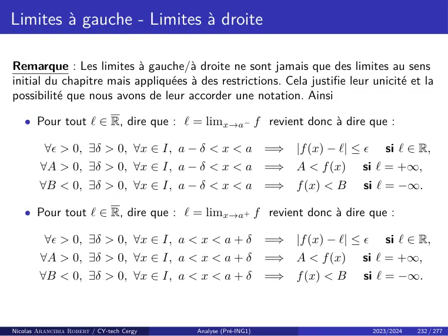

~~~text
Limites à gauche - Limites à droite

Remarque : Les limites à gauche/à droite ne sont jamais que des limites au sens
initial du chapitre mais appliquées à des restrictions. Cela justifie leur unicité et la
possibilité que nous avons de leur accorder une notation. Ainsi

    • Pour tout ` ∈ R, dire que : ` = limx→a− f revient donc à dire que :

          ∀ > 0, ∃δ > 0, ∀x ∈ I, a − δ < x < a                 =⇒   |f (x) − `| ≤       si ` ∈ R,
         ∀A > 0, ∃δ > 0, ∀x ∈ I, a − δ < x < a                  =⇒   A < f (x)    si ` = +∞,
        ∀B < 0, ∃δ > 0, ∀x ∈ I, a − δ < x < a =⇒                     f (x) < B    si ` = −∞.

    • Pour tout ` ∈ R, dire que : ` = limx→a+ f revient donc à dire que :

          ∀ > 0, ∃δ > 0, ∀x ∈ I, a < x < a + δ                 =⇒   |f (x) − `| ≤       si ` ∈ R,
         ∀A > 0, ∃δ > 0, ∀x ∈ I, a < x < a + δ                  =⇒   A < f (x)    si ` = +∞,
        ∀B < 0, ∃δ > 0, ∀x ∈ I, a < x < a + δ                   =⇒   f (x) < B    si ` = −∞.

Nicolas Arancibia Robert / CY-tech Cergy   Analyse (Pré-ING1)                          2023/2024   232 / 277
~~~

## Page 239

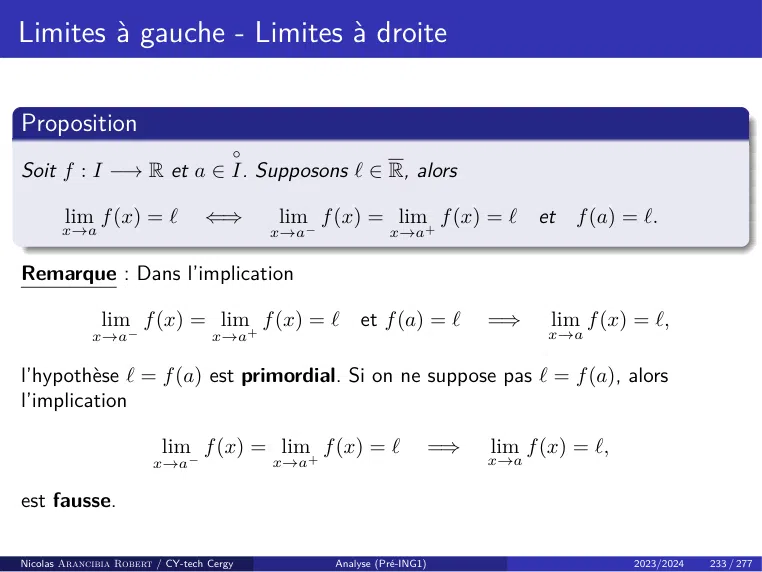

~~~text
Limites à gauche - Limites à droite

Proposition
                                       ◦
Soit f : I −→ R et a ∈ I. Supposons ` ∈ R, alors

        lim f (x) = `             ⇐⇒       lim f (x) = lim+ f (x) = ` et f (a) = `.
       x→a                                 x→a−             x→a

Remarque : Dans l’implication

               lim f (x) = lim+ f (x) = ` et f (a) = `                      =⇒     lim f (x) = `,
             x→a−                  x→a                                            x→a

l’hypothèse ` = f (a) est primordial. Si on ne suppose pas ` = f (a), alors
l’implication

                          lim f (x) = lim+ f (x) = `                   =⇒   lim f (x) = `,
                        x→a−               x→a                              x→a

est fausse.

Nicolas Arancibia Robert / CY-tech Cergy          Analyse (Pré-ING1)                         2023/2024   233 / 277
~~~

## Page 240

~~~text
Limites à gauche - Limites à droite

En effet, considérons f définie sur R par

                                        0                       si x ∈ R∗
                                     
                             f (x) =
                                        1                       si x = 0.

On a bien
                                           lim f (x) = lim+ f (x) = 0.
                                           x→0−            x→0

Ainsi, par la proposition précédente, si f a une limite en 0, celle ci doit
nécessairement être 0. Posons  = 12 . Alors pour tout δ > 0, on a

                                                  0 = |0 − 0| ≤ δ,

alors que
                                              |f (0) − 0| = 1 > .
La fonction f n’admet donc pas 0 comme limite et n’admet donc pas de limite en
0.

Nicolas Arancibia Robert / CY-tech Cergy            Analyse (Pré-ING1)      2023/2024   234 / 277
~~~

## Page 241

~~~text
Caractérisation séquentielle de la limite
Les limites d’une fonction peuvent être exprimé à l’aide de la limite de suites numériques.

Théorème (Caractérisation séquentielle de la limite)
                              ¯ Les assertions suivantes sont équivalentes :
Soit f : I −→ R, ` ∈ R et a ∈ I.
    • lim f (x) = `.
       x→a

    • Pour toute suite (un )n∈N à valeurs dans I, tel que       lim un = a, nous avons
                                                                n→+∞

                                            lim f (un ) = `.
                                           n→+∞

Remarques :
    • Le théorème précédente contient en particulier le théorème « Composition à
      gauche par une fonction » de notre précédent chapitre.
    • Notons que pour utiliser l’implication ⇐= du théorème, il ne suffit pas de montrer
      que c’est vrai pour une seule suite, mais pour toutes les suites. Cela rend cette
      implication difficile à utiliser sauf dans le cadre d’exercices « théoriques ». Ce
      théorème est surtout utile pour étendre certaines propriétés étudiées dans le
      chapitre limite d’une suite au cas de limites d’une fonction.

Nicolas Arancibia Robert / CY-tech Cergy   Analyse (Pré-ING1)                  2023/2024   235 / 277
~~~

## Page 242

~~~text
Caractérisation séquentielle de la limite

Démonstration.
On fait la preuve dans le cas où a ∈ R. Elle s’adapte facilement aux autres cas.
=⇒ Supposons que lim f (x) = `. Fixons  > 0. D’après la défition de la limite
                                 x→a

                       ∃η > 0, ∀x ∈ I, |x − a| ≤ η              =⇒   |f (x) − `| ≤ .

Soit (un )n∈N telle que lim un = a. Maintenant, par définition de la limite
                                      n→+∞
d’une suite

                         ∃N ∈ N, ∀n ∈ N, n ≥ N               =⇒ |un − a| ≤ η
                                                             =⇒ |f (un ) − `| ≤ .

Ainsi
                                             lim f (un ) = `.
                                             n→+∞

Nicolas Arancibia Robert / CY-tech Cergy       Analyse (Pré-ING1)                       2023/2024   236 / 277
~~~

## Page 243

~~~text
Caractérisation séquentielle de la limite
Démonstration.
⇐= Pour montrer la réciproque, nous allons procéder par contraposition.
Supposons donc que f ne tend pas vers ` quand x tend vers a. Ainsi

                    ∃ > 0, ∀η > 0, ∃x ∈ I, |x − a| ≤ η et |f (x) − `| > .                      (3)

On doit montrer qu’il existe une suite (xn )n∈N telle que lim xn = a, alors que
                                                                              n→+∞

                                       (f (xn ))n∈N ne converge pas vers `.

 Puisque f ne tend pas vers ` quand x tend vers a, on peut d’après (3), pour
 chaque n ∈ N∗ , trouver xn ∈ I, tel que
                                                        1
                                           |xn − a| ≤     et |f (xn ) − `| > .
                                                        n
 Considérons la suite (xn )n∈N ainsi définie, alors il est clair que
                                       (f (xn ))n∈N ne converge pas vers `.

 Ce qui montre la contraposé de notre implication.
Nicolas Arancibia Robert / CY-tech Cergy                Analyse (Pré-ING1)           2023/2024   237 / 277
~~~

## Page 244

~~~text
Caractérisation séquentielle de la limite
Remarque : La caractérisation séquentielle de la limite est souvent utilisé
pour montrer qu’une fonction n’admet pas de limite en a. En effet, si on trouve
deux suites (xn )n∈N et (yn )n∈N qui tendent vers a et telles que
                                           (f (xn ))n∈N     et (f (yn ))n∈N
ont deux limites différentes, alors la fonction f n’a pas de limite en a.
Exemples :
    • La fonction
                                                  x 7−→ f (x) = cos(x)
       n’a pas de limite en +∞. En effet, les suites
                          (xn )n∈N = (2πn)n∈N               et       (yn )n∈N = (π + 2nπ)n∈N
       divergent vers +∞, mais
                                    lim f (xn )      =         lim cos(2πn) = 1       et
                                  n→+∞                      n→+∞
                                     lim f (yn )     =         lim cos(π + 2πn) = −1
                                  n→+∞                      n→+∞

       Donc, f n’a pas de limite en +∞.
Nicolas Arancibia Robert / CY-tech Cergy             Analyse (Pré-ING1)                    2023/2024   238 / 277
~~~

## Page 245

~~~text
Caractérisation séquentielle de la limite
    • La fonction
                                                 1      1
                                                       
                                  x 7−→ f (x) = sin
                                                 x      x
       n’a pas de limite en 0+ . En effet, pour tout n ≥ 1, posons
                                        1                    1
                            un =                  et vn =       .
                                  π/2 + 2nπ                 2nπ
       Alors lim un = lim vn = 0, mais
             n→+∞        n→+∞

                    1
                         
            f               = (π/2 + 2nπ) · sin (π/2 + 2nπ) = π/2 + 2nπ
                π/2 + 2nπ
                       1
                         
                  f         = (2nπ) · sin (2nπ) = 0
                      2nπ
       Donc
                                           lim f (un ) = +∞            et
                                           n→+∞
                                                     lim f (vn ) = 0.
                                                   n→+∞

       Donc, f n’a pas de limite en 0+ .
Nicolas Arancibia Robert / CY-tech Cergy          Analyse (Pré-ING1)        2023/2024   239 / 277
~~~

## Page 246

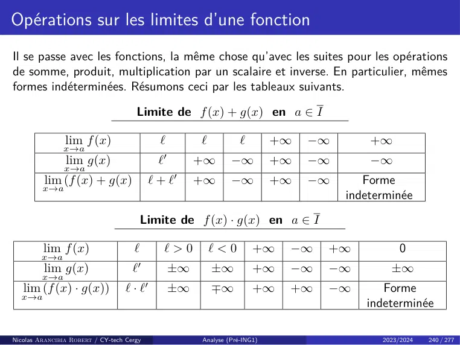

~~~text
Opérations sur les limites d’une fonction
Il se passe avec les fonctions, la même chose qu’avec les suites pour les opérations
de somme, produit, multiplication par un scalaire et inverse. En particulier, mêmes
formes indéterminées. Résumons ceci par les tableaux suivants.

                                      Limite de f (x) + g(x) en a ∈ I

                lim f (x)                       `            `           `        +∞   −∞       +∞
               x→a
                lim g(x)                        `   0
                                                             +∞       −∞          +∞   −∞       −∞
                x→a
         lim (f (x) + g(x)                     `+`      0
                                                             +∞       −∞          +∞   −∞      Forme
         x→a
                                                                                            indeterminée
                                         Limite de f (x) · g(x) en a ∈ I

         lim f (x)                   `              `>0          `<0         +∞    −∞   +∞            0
         x→a
         lim g(x)                    ` 0
                                                        ±∞       ±∞          +∞    −∞   −∞          ±∞
         x→a
   lim (f (x) · g(x))              `·`     0
                                                        ±∞       ∓∞          +∞    +∞   −∞        Forme
  x→a
                                                                                               indeterminée

Nicolas Arancibia Robert / CY-tech Cergy                     Analyse (Pré-ING1)                   2023/2024   240 / 277
~~~

## Page 247

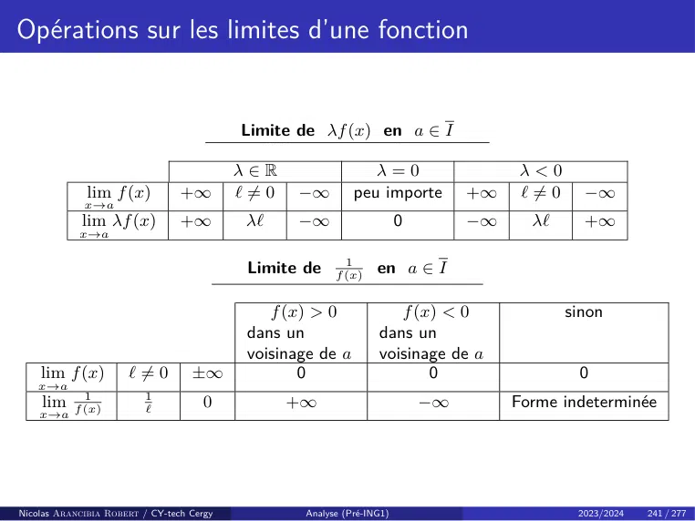

~~~text
Opérations sur les limites d’une fonction

                                            Limite de λf (x) en a ∈ I

                                           λ∈R                    λ=0                   λ<0
              lim f (x)          +∞        ` 6= 0   −∞         peu importe         +∞   ` 6= 0     −∞
             x→a
            lim λf (x)           +∞         λ`      −∞                    0        −∞     λ`       +∞
            x→a

                                                             1
                                            Limite de      f (x)
                                                                    en a ∈ I

                                               f (x) > 0               f (x) < 0                 sinon
                                            dans un                 dans un
                                            voisinage de a          voisinage de a
    lim f (x)         ` 6= 0       ±∞              0                       0                      0
    x→a
    lim 1                1
                                     0              +∞                        −∞        Forme indeterminée
    x→a f (x)            `

Nicolas Arancibia Robert / CY-tech Cergy             Analyse (Pré-ING1)                           2023/2024   241 / 277
~~~

## Page 248

~~~text
Opérations sur les limites d’une fonction

La dernière opération à étudier sur les limites, est la composition.

Proposition (Composition des limites)
Soit f : I −→ R et g : J → R telles que f (I) ⊂ J, et a ∈ I. Si

                                           lim f (x) = b et           lim g(y) = c
                                           x→a                        y→b

 alors
                                                 lim (g ◦ f )(x) = c.
                                                 x→a

Nicolas Arancibia Robert / CY-tech Cergy               Analyse (Pré-ING1)            2023/2024   242 / 277
~~~

## Page 249

~~~text
Opérations sur les limites d’une fonction
Démonstration.
Faisons la preuve dans le cas où a, b et c sont des réels. Elle s’adapte facilement
aux autres cas.
Soit  > 0. Par définition de la limite de g, nous avons

                        ∃δ > 0, ∀y ∈ J, |y − b| ≤ δ               =⇒   |g(y) − c| ≤ .

Maintenant, par définition de la limite de f , on a

                       ∃η > 0, ∀x ∈ I, |x − a| ≤ η                =⇒   |f (x) − b| ≤ δ.

On a donc pour tout x ∈ I avec |x − a| ≤ η , l’inégalité

                                           |g(f (x)) − c| ≤ .

Par conséquent
                                           lim (g ◦ f )(x) = c.
                                           x→a

Nicolas Arancibia Robert / CY-tech Cergy         Analyse (Pré-ING1)                       2023/2024   243 / 277
~~~

## Page 250

~~~text
Passage à la limite dans une inégalité

Comme pour les suites, nous pouvons décrire le comportement des limites d’une
fonction par rapport à la relation d’ordre ≤ sur R.

Proposition (Passage à la limite dans les inégalités strictes)
Soit a ∈ I et f : I −→ R une fonction possedant une limite ` en a. Soient
m, M ∈ R.
    • Si ` < M , alors
                                              f (x) < M,
       dans un voisinage de a.
    • Si ` > m, alors
                                              f (x) > m,
       dans un voisinage de a.

Nicolas Arancibia Robert / CY-tech Cergy   Analyse (Pré-ING1)       2023/2024   244 / 277
~~~

## Page 251

~~~text
Passage à la limite dans une inégalité
Démonstration.
Prouvons le première point, le deuxieme point se montre de la même façon.
Suppsons ` < M .
    • Si ` = −∞, alors par définition de la limite

                             ∃δ > 0, ∀x ∈ I, |x − a| ≤ δ              =⇒   f (x) < M.

       C’est-à-dire, f (x) < M dans le voisinage de a donné par ]a − δ, a + δ[ ∩ I.
    • Si ` ∈ R, sachant que M − ` > 0 on peut, d’après la définition de la limite,
      conclure
                      ∃δ > 0, ∀x ∈ I, |x − a| ≤ δ               =⇒     |f (x) − `| < M − `.

       Ainsi

        ∀x ∈ I, |x − a| ≤ δ,               ` − M < f (x) − ` < M − `         =⇒     f (x) < M.

       C’est-à-dire, f (x) < M dans le voisinage de a donné par ]a − δ, a + δ[ ∩ I.

Nicolas Arancibia Robert / CY-tech Cergy         Analyse (Pré-ING1)                     2023/2024   245 / 277
~~~

## Page 252

~~~text
Passage à la limite dans une inégalité

Proposition (Passage à la limite dans les inégalités larges)
Soient f et g deux fonctions définies sur I à valeurs dans R et a ∈ I. Supposons

    • lim f (x) = ` ∈ R                    et   lim g(x) = `0 ∈ R,
       x→a                                      x→a

    • f (x) ≤ g(x) dans un voisinage de a.

Alors ` ≤ `0 , c’est-à-dire
                                                lim f (x) ≤ lim g(x).
                                                x→a              x→a

Remarque : On retiendra que les inégalités strictes deviennent larges en passant à
la limite. Par exemple, pour tout
                                                                1
                                                x ∈ R,              > 0,
                                                             1 + x2
mais
                                                               1
                                                  lim                  = 0.
                                                 x→+∞ 1 + x2

Nicolas Arancibia Robert / CY-tech Cergy              Analyse (Pré-ING1)      2023/2024   246 / 277
~~~

## Page 253

~~~text
Passage à la limite dans une inégalité

Démonstration.
Faisons la preuve dans le cas où a est un réel. Elle s’adapte facilement aux autres cas.
Par l’absurde. Supposons donc

                                  ∃δ > 0, ∀x ∈ I, |x − a| ≤ δ, f (x) ≤ g(x).

et

                                           lim f (x) > lim g(x).
                                           x→a            x→a

Ainsi, f (x) − g(x) ≤ 0 dans un voisinage de a et

                                           lim f (x) − g(x) > 0.
                                           x→a

Or la proposition sur le passage à la limite dans les inégalités strictes montre que

                                                 f (x) − g(x) > 0

dans un voisinage de a. Contradiction ! Par conséquent, lim f (x) ≤ lim g(x).
                                                                        x→a    x→a

Nicolas Arancibia Robert / CY-tech Cergy           Analyse (Pré-ING1)                2023/2024   247 / 277
~~~

## Page 254

~~~text
Théorèmes d’existence de limites

Les théorèmes

    • d’Encadrement,
    • de Minoration/Majoration,
    • de la limite monotone,

que nous avons vu dans le chapitre sur les suites réels, restent valides dans le cas
de limites d’une fonction.

Nicolas Arancibia Robert / CY-tech Cergy   Analyse (Pré-ING1)           2023/2024   248 / 277
~~~

## Page 255

~~~text
Théorèmes d’existence de limites

Théorème (Théorème d’encadrement)
Soient f, g et h trois fonctions de I dans R, ` ∈ R et a ∈ I. Supposons

    • lim f (x) = ` = lim h(x),
       x→a                        x→a

    • f (x) ≤ g(x) ≤ h(x) dans un voisinage de a.

Alors
                                           lim g(x) = `.
                                           x→a

Nicolas Arancibia Robert / CY-tech Cergy    Analyse (Pré-ING1)       2023/2024   249 / 277
~~~

## Page 256

~~~text
Théorèmes d’existence de limites

Comme corollaire du Théorème d’encadrement nous avons le resultat suivant.
Corollaire
Soient f et g deux fonctions de I dans R et a ∈ I. Supposons

    • f (x) −→ 0.
                x→a

    • il existe m ∈ R, M ∈ R, tel que m ≤ g(x) ≤ M dans un voisinage de a
      (i.e. g est bornée au voisinage de a).

Alors
                                           lim f (x) · g(x) = 0.
                                           x→a

Nicolas Arancibia Robert / CY-tech Cergy         Analyse (Pré-ING1)   2023/2024   250 / 277
~~~

## Page 257

~~~text
Théorèmes d’existence de limites

Exemple : Déterminer si elle existe la limite en 0 de

                                           f : R∗ −→ R
                                                            1
                                                            
                                               x 7−→ x sin     .
                                                            x

Solution : Nous avons :
    • La fonction x 7−→ x tend vers 0 lorsque x tend vers 0.
    • La fonction x 7−→ sin x1 est une fonction bornée au voisinage de 0.
                              

Ainsi, d’après la proposition précédente, on en déduit l’égalité

                                               lim f (x) = 0.
                                              x→0

Nicolas Arancibia Robert / CY-tech Cergy        Analyse (Pré-ING1)   2023/2024   251 / 277
~~~

## Page 258

~~~text
Théorèmes d’existence de limites

Théorème (Théorème de Minoration/Majoration)
Soient f et g deux fonctions de I dans R et a ∈ I.
    • Si lim g(x) = +∞, et
            x→a
                                             f (x) ≥ g(x)
       dans un voisinage de a, alors

                                           lim f (x) = +∞.
                                           x→a

    • Si lim g(x) = −∞, et
            x→a
                                            f (x) ≤ g(x),
       dans un voisinage de a, alors

                                           lim f (x) = −∞.
                                           x→a

Nicolas Arancibia Robert / CY-tech Cergy   Analyse (Pré-ING1)   2023/2024   252 / 277
~~~

## Page 259

~~~text
Théorèmes d’existence de limites

Théorème (Théorème de la limite monotone cas f croissante)
Soient a, b ∈ R avec a < b et f : ]a, b[−→ R.
Supposons que f est croissante.
    • Si f est majorée, alors f admet une limite finie en b, et

                                           lim f (x) = sup f (x).
                                           x→b−             x∈]a,b[

       Sinon, on a lim f (x) = +∞.
                           x→b−
    • Si f est minorée, alors f admit une limite finie en a, et

                                           lim f (x) = inf f (x).
                                           x→a+             x∈]a,b[

       Sinon, on a lim+ f (x) = −∞.
                           x→a

Nicolas Arancibia Robert / CY-tech Cergy      Analyse (Pré-ING1)      2023/2024   253 / 277
~~~

## Page 260

~~~text
Théorèmes d’existence de limites

Théorème (Théorème de la limite monotone cas f décroissante)
Soient a, b ∈ R avec a < b et f : ]a, b[−→ R.
Supposons que f est décroissante.
    • Si f est minorée, alors f admet une limite finie en b et

                                           lim f (x) = inf f (x).
                                           x→b−             x∈]a,b[

       Sinon, lim f (x) = −∞.
                   x→b−
    • Si f est majorée, alors f admet une limite finie en a et

                                           lim f (x) = sup f (x).
                                           x→a+             x∈]a,b[

       Sinon, lim+ f (x) = +∞.
                   x→a

Nicolas Arancibia Robert / CY-tech Cergy      Analyse (Pré-ING1)      2023/2024   254 / 277
~~~

## Page 261

~~~text
Théorèmes d’existence de limites

Comme corollaire du Théorème de la limite monotone, nous avons le résultat
suivant.
Corollaire
                                                                ◦
Soit f : I −→ R une fonction monotone et a ∈ I. Alors, f admet des limites
finies à gauche et à droite en a et on a :

                   si f est croissante alors    lim f (x) ≤ f (a) ≤ lim+ f (x).
                                               x→a−                 x→a
              si f est décroissante alors       lim+ f (x) ≤ f (a) ≤ lim− f (x).
                                               x→a                  x→a

Nicolas Arancibia Robert / CY-tech Cergy   Analyse (Pré-ING1)                  2023/2024   255 / 277
~~~

## Page 262

~~~text
Continuité

Définition (Continuité)
Soit I un intervalle, f : I −→ R une fonction et a ∈ I. On dit que f est continue
en a si
                                 lim f (x) = f (a).
                                                  x→a

Autrement dit, f est continue en a si et seulement si

             ∀ > 0, ∃η > 0, ∀x ∈ I, |x − a| ≤ η                          =⇒   |f (x) − f (a)| ≤ .

Remarque : Géométriquement, une fonction est continue si son graphe se trace
« sans lever le crayon ».

                                           Figure – Continuité en un point.

Nicolas Arancibia Robert / CY-tech Cergy             Analyse (Pré-ING1)                       2023/2024   256 / 277
~~~

## Page 263

~~~text
Continuité
                                           √
Exemple : La fonction x 7−→                    x est continue en 2.
Solution : Nous devons montrer que
                                                      √           √
                                                lim       x =          2.
                                               x→2

Pour cela, notons que pour tout x ∈ R+ , nous avons
                                 √   √      |x − 2|
                                | x − 2| = √     √ ≤ |x − 2|.
                                             x+ 2

Ainsi, pour tout  > 0, prenons
                                                      η = .
Si |x − 2| ≤ , alors
                    √   √                                              √          √
                   | x − 2| ≤                     =⇒         lim           x =       2.
                                                              x→2
                              √
La fonction x 7−→                 x est donc continue en 2.

Nicolas Arancibia Robert / CY-tech Cergy          Analyse (Pré-ING1)                       2023/2024   257 / 277
~~~

## Page 264

~~~text
Continuité sur un intervalle

Définition (Continuité sur un intervalle)
On dit que f : I −→ R est continue sur l’intervalle I si elle est continue en
chaque point de I.
On note C 0 (I, R) ou C(I, R), l’ensemble des fonctions continues sur I dans R, i.e.
continues en tout point de I.

Exemple : Les fonctions

                  x 7−→ x ;                x 7−→ exp x ;       x 7−→ cos x ;   x 7−→ sin x

sont continues sur R. La fonction
                                                               √
                                                    x 7−→          x

est continues sur R≥0 . Finalement, la fonction

                                                    x 7−→ ln(x)

est continues sur R>0 .
Nicolas Arancibia Robert / CY-tech Cergy            Analyse (Pré-ING1)                  2023/2024   258 / 277
~~~

## Page 265

~~~text
Continuité

Définition (Continuité à gauche/à droite en un point)
Soient f : I → R une fonction et a ∈ I.
    • Continuité à gauche : On dit que f est continue à gauche en a si f (a) est
      la limite à gauche de f en a, i.e.

                                           lim f (x) = f (a).
                                           x→a−

    • Continuité à droite : On dit que f est continue à droite en a si f (a) est la
      limite à droite de f en a, i.e.

                                           lim f (x) = f (a).
                                           x→a+

Remarque : Une fonction f est continue en a si et seulement si f est continue
à droite et à gauche en a.

Nicolas Arancibia Robert / CY-tech Cergy    Analyse (Pré-ING1)         2023/2024   259 / 277
~~~

## Page 266

~~~text
Continuité

Exemple : La fonction partie entière

                                           x 7−→ E(x)

est continue à droite en tout point de R mais elle n’est continue à gauche qu’aux
points de R\Z.

Nicolas Arancibia Robert / CY-tech Cergy   Analyse (Pré-ING1)        2023/2024   260 / 277
~~~

## Page 267

~~~text
Continuité

Définition (Prolongement par continuité)
Soit a ∈ I et f : I\{a} −→ R une fonction. On dit que f est prolongeable par
continuité en a s’il existe une fonction

                                            f˜ : I → R

continue en a et telle que
                                           f˜|I\{a} = f.

Nicolas Arancibia Robert / CY-tech Cergy   Analyse (Pré-ING1)     2023/2024   261 / 277
~~~

## Page 268

~~~text
Continuité

Proposition
Soit a ∈ I et f : I\{a} → R une fonction.
La fonction f est prolongeable par continuité en a si et seulement si f admet
une limite finie ` en a. Dans ce cas, un tel prolongement f˜ : I −→ R est unique,
et donné par :
                                         f (x) si x 6= a,
                                      
                           ˜
                          f : x 7−→
                                           `     si x = a.
On l’appelle le prolongement par continuité de f en a (qu’on notera souvent f
sans distinction par abus de notation).

Nicolas Arancibia Robert / CY-tech Cergy   Analyse (Pré-ING1)         2023/2024   262 / 277
~~~

## Page 269

~~~text
Continuité

Démonstration.
=⇒ Supposons que f est prolongeable par continuité en a. Par définition, il existe
donc
                                f˜ : I −→ R
continue en a et telle que
                                                     f˜|I\{a} = f.
Par continuité de f˜ en a, nous avons

                                           f˜(a) = lim− f˜(x) = lim+ f˜(x).
                                                  x→a                 x→a

Or f˜|I\{a} = f , donc

                                           f (a) = lim f (x) = lim+ f (x).
                                                  x→a−                x→a

Ainsi f admet une limite ` en a avec ` = f˜(a). Ceci prouve également l’unicité
(s’il existe) du prolongement par continuité de f en a.

Nicolas Arancibia Robert / CY-tech Cergy             Analyse (Pré-ING1)       2023/2024   263 / 277
~~~

## Page 270

~~~text
Continuité

Démonstration.
⇐= Supposons que f admet une limite finie ` en a. Posons alors

                                  f (x) si x 6= a
                               
                      ˜
                      f : x 7→                      .
                                  `       si x = a

La fonction f˜ prolonge bien f , et est continue en a puisque

                                           f˜(a) = lim− f˜(x) = lim+ f˜(x).
                                                  x→a                 x→a

Nicolas Arancibia Robert / CY-tech Cergy             Analyse (Pré-ING1)       2023/2024   264 / 277
~~~

## Page 271

~~~text
Continuité
Exemples :
  • Considérons la fonction
                                                                    sin(x)
                                                    f : x 7−→
                                                                       x
       définie sur R∗ . Puisque
                     sin(x)       sin(x) − sin(0)
              lim           = lim                 = sin0 (0) = cos(0) = 1.
              x→0       x     x→0      x−0
      On peut donc prolonger f par continuité en 0 en posant f (0) = 1.
    • Fonctions puissances : Soit α ∈ R. On rappelle que la fonction puissance
      d’exposant α, notée pα , est définie sur R∗+ par

                                                 pα (x) = xα = eα ln(x) .
       On a
                                                            +∞ si α < 0
                                                       
                                           lim xα =                      .
                                           x→0              0  si α > 0.
       Ainsi, si α > 0, la fonction pα peut être prolongeable par continuité en 0 en
       posant pα (0) = 0.
Nicolas Arancibia Robert / CY-tech Cergy            Analyse (Pré-ING1)       2023/2024   265 / 277
~~~

## Page 272

~~~text
Continuité

Le résultat suivant est la version continue du résultat analogue sur les limites
d’une fonction.

Théorème (Caractérisation séquentielle de la continuité en un point)
Soit f : I −→ R et a ∈ I. Les assertions suivantes sont équivalentes
    • f est continue en a.
    • Pour toute suite (un )n∈N à valeurs dans I, tel que

                                               lim un = a,
                                             n→+∞

       nous avons
                                           lim f (un ) = f (a).
                                           n→+∞

Nicolas Arancibia Robert / CY-tech Cergy    Analyse (Pré-ING1)          2023/2024   266 / 277
~~~

## Page 273

~~~text
Continuité

Remarques :

    • En résumé, pour une fonction continué f et pour tout suite (un )n∈N
      convergent, nous avons
                                       
                           f    lim un = lim f (un )
                                           n→+∞                    n→+∞

    • Ce théorème a déjà souvent été utilisé dans le contexte des suites récurrentes

                                              un+1 = f (un ).

       Si (un )n∈N converge vers un réel ` et si f est (définie et) continue en `,
       alors
                               
           f (`) = f    lim un     = lim f (un ) = lim un+1 = `.
                                  n→+∞            n→+∞                    n→+∞

       C’est-à-dire, ` est un point fixe de f .

Nicolas Arancibia Robert / CY-tech Cergy      Analyse (Pré-ING1)                 2023/2024   267 / 277
~~~

## Page 274

~~~text
Opérations sur les fonctions continues

Proposition (Somme et produit sur les fonctions continues)
Soient f et g deux fonctions continues sur I et (λ, µ) ∈ R2 .
  1. Les fonctions λf + µg, f × g sont continues sur I.
  2. Si de plus, g ne s’annule pas sur I, alors fg est continue sur I.

Démonstration.
Ces résultats découlent immédiatement des résultats analogues que nous avons vu
dans le chapitre limites de fonctions.

Exemples :
  • Les fonctions polynomiales sont continues sur R en tant que sommes et
    produits de fonctions continues.
  • Pour tout k ∈ Z, la fonction tan est continue sur ] − π2 + kπ, π2 + kπ[ en tant
    que quotient de fonctions continues.
                                    P (x)
    • La fonction rationnelle x 7→ Q(x)   est continue sur R privé de ses pôles,
      c’est-à-dire des racines de son dénominateur Q.
Nicolas Arancibia Robert / CY-tech Cergy   Analyse (Pré-ING1)             2023/2024   268 / 277
~~~

## Page 275

~~~text
Opérations sur les fonctions continues

Le dernière opération à étudier sur les fonctions continues est la composition.

Proposition (Composition sur les fonctions continues)
Soit f : I −→ R une fonction continue sur I, et g : J −→ R une fonction
continue sur J avec f (I) ⊂ J. Alors, la fonction

                                               g◦f

est continue sur I.

Nicolas Arancibia Robert / CY-tech Cergy   Analyse (Pré-ING1)          2023/2024   269 / 277
~~~

## Page 276

~~~text
Les Grands Théorèmes de la Continuité

Passons maintenant à étudier quelques propriétés fondamentales des fonctions
continues.

Théorème (Théorème des valeurs intermédiaires (TVI))
Soit f : I −→ R une fonction continue et a, b ∈ I, tels que

                                           f (a)f (b) ≤ 0.

Alors il existe c compris entre a et b tel que

                                             f (c) = 0.

Nicolas Arancibia Robert / CY-tech Cergy    Analyse (Pré-ING1)      2023/2024   270 / 277
~~~

## Page 277

~~~text
Les Grands Théorèmes de la Continuité
Démonstration.
Supposons que a < b. On construit par récurrence deux suites adjacentes
                                           (an )n∈N      et      (bn )n∈N

 d’éléments de [a, b] dont la limite commune c vérifie f (c) = 0. Construisons
(an )n∈N et (bn )n∈N . On pose a0 = a et b0 = b.Pour n ∈ N, nous allons définir an
et bn de façon d’avoir
                                                 b−a
                                     bn − an =           et     f (an )f (bn ) < 0.
                                                  2n

 Pour cela, posons mn = an +b  2
                                 n
                                   . Ainsi
  • si f (an ) · f (mn ) ≤ 0, on pose an+1 = an et bn+1 = mn .
  • si f (an ) · f (mn ) > 0, on pose an+1 = mn et bn+1 = bn .
Dans chacun de ces deux cas, on obtient
                                                                        bn − an  b−a
                 f (an+1 )f (bn+1 ) ≤ 0      et   bn+1 − an+1 =                 = n+1
                                                                           2     2

Nicolas Arancibia Robert / CY-tech Cergy          Analyse (Pré-ING1)                    2023/2024   271 / 277
~~~

## Page 278

~~~text
Les Grands Théorèmes de la Continuité
Démonstration.
Montrons que les suites (an )n∈N et (bn )n∈N sont adjacentes. Par construction
    • (an )n∈N est croissante, et
    • (bn )n∈N est décroissante.
    • De plus, par construction, pour tout n ∈ N, nous avons
                                              b−a
                              bn+1 − an+1 =              =⇒        lim bn − an = 0.
                                              2n+1                 n→+∞

Les suites (an )n∈N et (bn )n∈N sont donc adjacentes et convergent vers la même
limite c ∈ [a, b].
Comme f est continue, en passant à la limite dans l’inégalité f (an )f (bn ) ≤ 0, on
obtient
                                     
    f (c)2 = f   lim an f      lim bn       = lim f (an )f (bn ) ≤ 0.
                            n→+∞           n→+∞                    n→+∞

Ainsi, f 2 (c) ≤ 0. Donc f (c) = 0 et le théorème est démontré.
Nicolas Arancibia Robert / CY-tech Cergy      Analyse (Pré-ING1)                      2023/2024   272 / 277
~~~

## Page 279

~~~text
Les Grands Théorèmes de la Continuité

Théorème (Théorème des valeurs intermédiaires, version « existence
d’un antécédent »)
Soit a, b ∈ R avec a ≤ b et f : [a, b] −→ R une fonction continue sur [a, b]. Alors
pour tout y entre f (a) et f (b), il existe c ∈ [a, b] tel que

                                           f (c) = y.

Nicolas Arancibia Robert / CY-tech Cergy   Analyse (Pré-ING1)          2023/2024   273 / 277
~~~

## Page 280

~~~text
Les Grands Théorèmes de la Continuité

Démonstration.
Soit y entre f (a) et f (b) et posons g(x) = f (x) − y. Alors
    • La fonction g est continue, et
    • g(a) et g(b) sont de signes contraires, c’est-à-dire g(a) · g(b) ≤ 0.
Par le théorème des valeurs intermédiaires, il existe donc c ∈ [a, b], tel que

                                           f (c) = y.

Nicolas Arancibia Robert / CY-tech Cergy   Analyse (Pré-ING1)             2023/2024   274 / 277
~~~

## Page 281

~~~text
Les grands théorèmes de la continuité

Comme corollaire du résultat précédent nous avons le théorème suivant.

Théorème (Théorème des valeurs intermédiaires, version « image d’un
intervalle »)
Si I est un intervalle et si f est continue sur I, alors f (I) est un intervalle.

Remarque : Si I est un intervalle et f : I −→ R une fonction continue, cette
version du TVI affirme que f (I) est également un intervalle, mais pas que I et
f (I) sont de même nature. Il se peut que I soit ouvert et f (I) un segment
(intervalle fermé et borné), ou bien que I soit semi-ouvert et f (I) ouvert, etc.
Exemples :

                             f (x) = sin(x) et f (] − π, π[) = [−1, 1];
                                    g(x) = x2   et g(] − 1, 1[) = [0, 1[.

Nicolas Arancibia Robert / CY-tech Cergy        Analyse (Pré-ING1)          2023/2024   275 / 277
~~~

## Page 282

~~~text
Les Grands Théorèmes de la Continuité

Théorème (Théorème des bornes atteintes)
    • Toute fonction continue sur un segment (intervalle fermé et borné) y est
      bornée et atteint ses bornes. Autrement dit, si f : [a, b] −→ R est continue
      sur [a, b], alors il existe c ∈ [a, b] et d ∈ [a, b] tels que pour tout x ∈ [a, b],
      nous avons
                                       f (c) ≤ f (x) ≤ f (d).
    • L’image d’un segment par une fonction continue est un segment.

Remarques :

    • Nous avons vu que la continuité ne préserve pas la forme des intervalles en
      général, mais en tout cas une chose est sûre, un segment est toujours
      transformé en un segment.
    • Sur un intervalle borné qui n’est pas un segment, une fonction continue n’a
       π π raison d’être bornée en général. Par exemple, la fonction tangente sur
      aucune
       −2, 2 .

Nicolas Arancibia Robert / CY-tech Cergy   Analyse (Pré-ING1)                 2023/2024   276 / 277
~~~

## Page 283

~~~text
Les Grands théorèmes de la Continuité

On fini ce chapitre en étudiant la réciproque d’une fonction continue.

Théorème
Soit f : I −→ R une fonction continue. Alors f est injective sur I si et
seulement si f est strictement monotone.

Théorème (Continuité d’une réciproque)
Toute fonction f continue et strictement monotone sur un intervalle I réalise une
bijection de I sur l’intervalle f (I). Sa réciproque est de plus continue et
strictement monotone sur l’intervalle f (I) de même monotonie que f .

Nicolas Arancibia Robert / CY-tech Cergy   Analyse (Pré-ING1)            2023/2024   277 / 277
~~~
