# TD0-Rappels-Correction_2024-2025_Analyse1_P1S1_NArancibia.pdf

[Ouvrir l’original](https://drive.google.com/open?id=1_K512heWZXC76nH48er90jIIFZ2SP3cV) · Les pages signalées comprennent du texte reconnu automatiquement ou des éléments graphiques. Le fac-similé permet de vérifier chaque lecture.

**Pages avec fac-similé ou lecture OCR** — 8, 36.

**Pages présentant un écart entre les deux extractions** — 2–7, 9–10, 12–13, 16, 18–24, 27–31, 41, 44, 48–49, 52, 59–62, 64, 66, 73, 77, 79–80, 85.

## Page 1

~~~text
Analyse 1 - Premier semestre 2024 - 2025

                       CY Tech

                      TD Analyse

    Inégalités, Sigma et Fonctions Trigonometriques.

                              Analyse
~~~

## Page 2

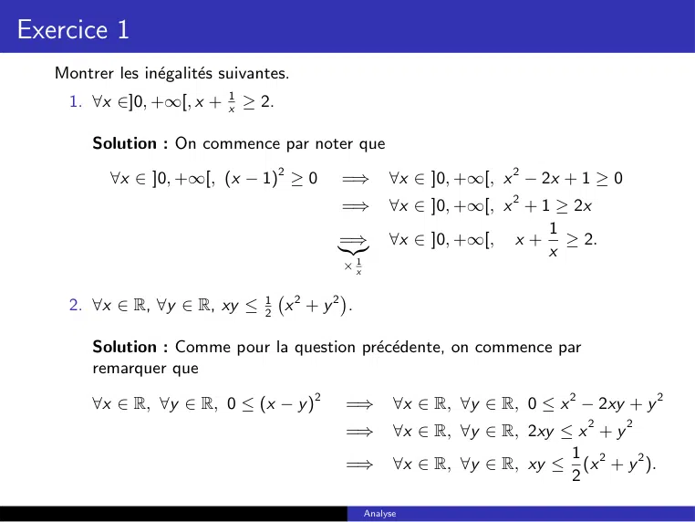

~~~text
Exercice 1
   Montrer les inégalités suivantes.
     1. ∀x ∈]0, +∞[, x + x1 ≥ 2.

        Solution : On commence par noter que

           ∀x ∈ ]0, +∞[, (x − 1)2 ≥ 0    =⇒          ∀x ∈ ]0, +∞[, x 2 − 2x + 1 ≥ 0
                                         =⇒          ∀x ∈ ]0, +∞[, x 2 + 1 ≥ 2x
                                                                          1
                                         =⇒          ∀x ∈ ]0, +∞[, x + ≥ 2.
                                         |{z}                             x
                                         × x1

     2. ∀x ∈ R, ∀y ∈ R, xy ≤ 12 x 2 + y 2 .
                                         

        Solution : Comme pour la question précédente, on commence par
        remarquer que

        ∀x ∈ R, ∀y ∈ R, 0 ≤ (x − y )2     =⇒          ∀x ∈ R, ∀y ∈ R, 0 ≤ x 2 − 2xy + y 2
                                          =⇒          ∀x ∈ R, ∀y ∈ R, 2xy ≤ x 2 + y 2
                                                                           1
                                          =⇒          ∀x ∈ R, ∀y ∈ R, xy ≤ (x 2 + y 2 ).
                                                                           2

                                                Analyse
~~~

## Page 3

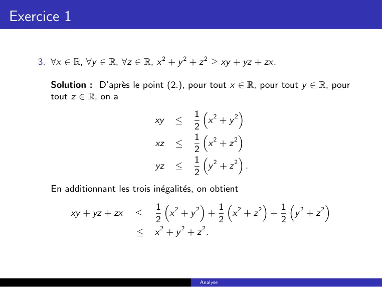

~~~text
Exercice 1

    3. ∀x ∈ R, ∀y ∈ R, ∀z ∈ R, x 2 + y 2 + z 2 ≥ xy + yz + zx.

       Solution : D’après le point (2.), pour tout x ∈ R, pour tout y ∈ R, pour
       tout z ∈ R, on a
                                           1 2       
                                 xy ≤         x + y2
                                           2
                                           1 2       
                                 xz ≤         x + z2
                                           2
                                           1 2       
                                 yz ≤         y + z2 .
                                           2
       En additionnant les trois inégalités, on obtient
                                  1 2           1           1         
           xy + yz + zx ≤             x + y2 +         x2 + z2 +   y2 + z2
                                  2                 2            2
                            ≤ x 2 + y 2 + z 2.

                                           Analyse
~~~

## Page 4

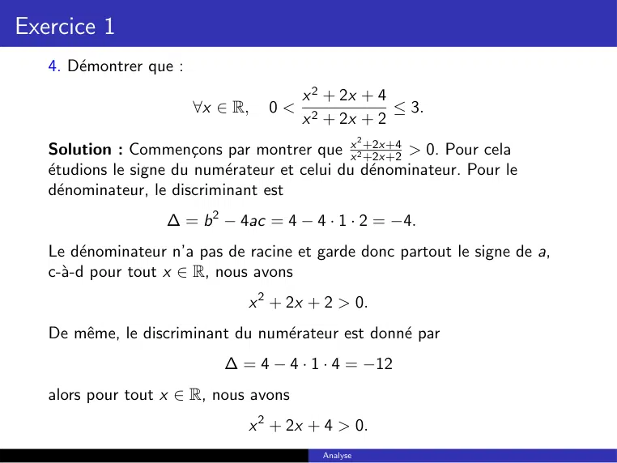

~~~text
Exercice 1
   4. Démontrer que :
                                        x 2 + 2x + 4
                         ∀x ∈ R,   0<                ≤ 3.
                                        x 2 + 2x + 2
                                                    2
   Solution : Commençons par montrer que xx 2 +2x+4
                                                 +2x+2 > 0. Pour cela
   étudions le signe du numérateur et celui du dénominateur. Pour le
   dénominateur, le discriminant est
                    ∆ = b 2 − 4ac = 4 − 4 · 1 · 2 = −4.
   Le dénominateur n’a pas de racine et garde donc partout le signe de a,
   c-à-d pour tout x ∈ R, nous avons
                                x 2 + 2x + 2 > 0.
   De même, le discriminant du numérateur est donné par
                            ∆ = 4 − 4 · 1 · 4 = −12
   alors pour tout x ∈ R, nous avons
                                x 2 + 2x + 4 > 0.
                                          Analyse
~~~

## Page 5

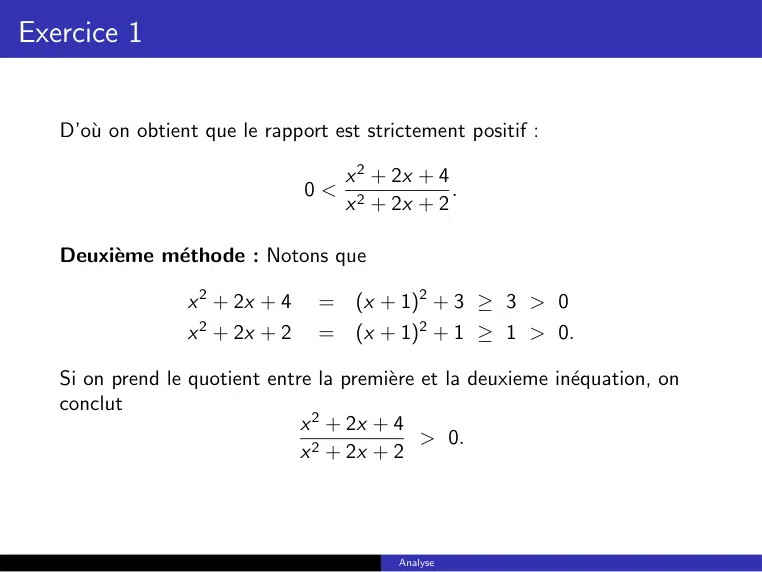

~~~text
Exercice 1

   D’où on obtient que le rapport est strictement positif :

                                      x 2 + 2x + 4
                                 0<                .
                                      x 2 + 2x + 2

   Deuxième méthode : Notons que

                  x 2 + 2x + 4   = (x + 1)2 + 3 ≥ 3 > 0
                  x 2 + 2x + 2   = (x + 1)2 + 1 ≥ 1 > 0.

   Si on prend le quotient entre la première et la deuxieme inéquation, on
   conclut
                               x 2 + 2x + 4
                                              > 0.
                               x 2 + 2x + 2

                                            Analyse
~~~

## Page 6

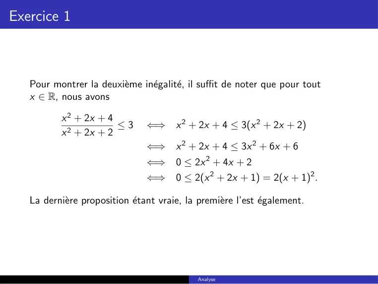

~~~text
Exercice 1

   Pour montrer la deuxième inégalité, il suffit de noter que pour tout
   x ∈ R, nous avons

           x 2 + 2x + 4
                        ≤3      ⇐⇒     x 2 + 2x + 4 ≤ 3(x 2 + 2x + 2)
           x 2 + 2x + 2
                                ⇐⇒     x 2 + 2x + 4 ≤ 3x 2 + 6x + 6
                                ⇐⇒     0 ≤ 2x 2 + 4x + 2
                                ⇐⇒     0 ≤ 2(x 2 + 2x + 1) = 2(x + 1)2 .

   La dernière proposition étant vraie, la première l’est également.

                                             Analyse
~~~

## Page 7

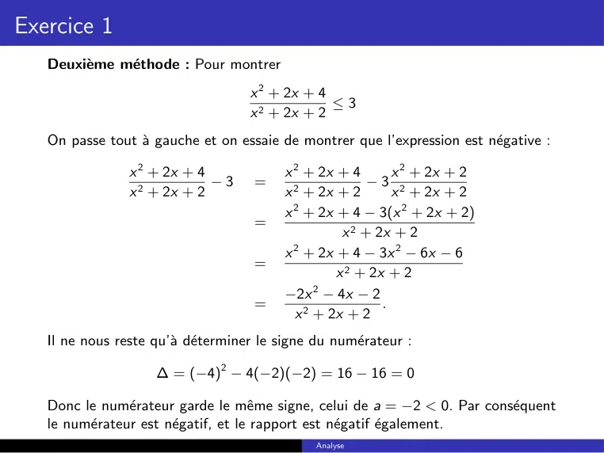

~~~text
Exercice 1
   Deuxième méthode : Pour montrer
                                    x 2 + 2x + 4
                                                 ≤3
                                    x 2 + 2x + 2
   On passe tout à gauche et on essaie de montrer que l’expression est négative :

                x 2 + 2x + 4              x 2 + 2x + 4       x 2 + 2x + 2
                             −3      =                   −3 2
                x 2 + 2x + 2                2
                                          x + 2x + 2         x + 2x + 2
                                          x 2 + 2x + 4 − 3(x 2 + 2x + 2)
                                     =
                                                    x 2 + 2x + 2
                                          x + 2x + 4 − 3x 2 − 6x − 6
                                            2
                                     =
                                                   x 2 + 2x + 2
                                          −2x 2 − 4x − 2
                                     =                     .
                                            x 2 + 2x + 2
   Il ne nous reste qu’à déterminer le signe du numérateur :

                    ∆ = (−4)2 − 4(−2)(−2) = 16 − 16 = 0

   Donc le numérateur garde le même signe, celui de a = −2 < 0. Par conséquent
   le numérateur est négatif, et le rapport est négatif également.
                                               Analyse
~~~

## Page 8

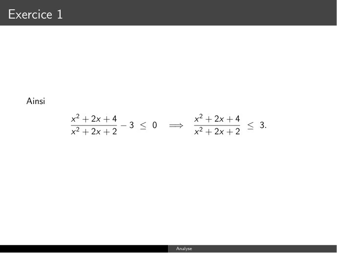

~~~text
Exercice 1

   Ainsi
             x 2 + 2x + 4                    x 2 + 2x + 4
                          −3 ≤ 0   =⇒                     ≤ 3.
             x 2 + 2x + 2                    x 2 + 2x + 2

                                   Analyse
~~~

**Lecture OCR à contrôler**

~~~text
Ainsi

x2+2x+4 x2+2x+4
x2+2x+2 = x2 42x42 —
~~~

## Page 9

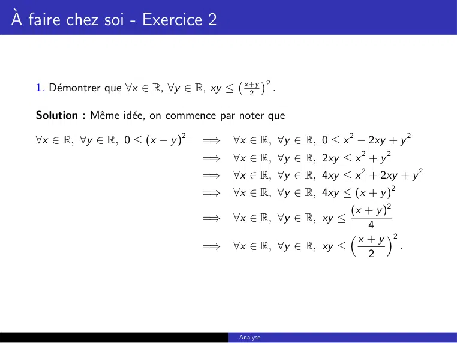

~~~text
À faire chez soi - Exercice 2

                                             x+y
                                                      2
   1. Démontrer que ∀x ∈ R, ∀y ∈ R, xy ≤     2
                                                           .

   Solution : Même idée, on commence par noter que

   ∀x ∈ R, ∀y ∈ R, 0 ≤ (x − y )2   =⇒    ∀x ∈ R, ∀y ∈ R, 0 ≤ x 2 − 2xy + y 2
                                   =⇒    ∀x ∈ R, ∀y ∈ R, 2xy ≤ x 2 + y 2
                                   =⇒    ∀x ∈ R, ∀y ∈ R, 4xy ≤ x 2 + 2xy + y 2
                                   =⇒    ∀x ∈ R, ∀y ∈ R, 4xy ≤ (x + y )2
                                                              (x + y )2
                                   =⇒    ∀x ∈ R, ∀y ∈ R, xy ≤
                                                                  4
                                                               x + y 2
                                   =⇒    ∀x ∈ R, ∀y ∈ R, xy ≤            .
                                                                  2

                                            Analyse
~~~

## Page 10

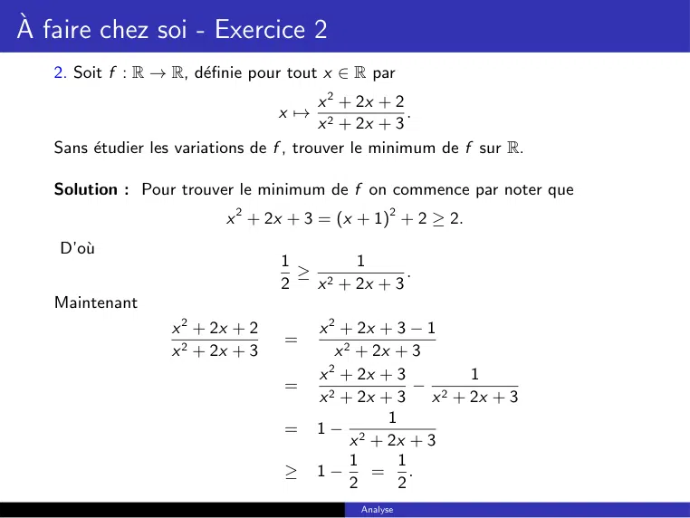

~~~text
À faire chez soi - Exercice 2
   2. Soit f : R → R, définie pour tout x ∈ R par
                                          x 2 + 2x + 2
                                  x 7→                 .
                                          x 2 + 2x + 3
   Sans étudier les variations de f , trouver le minimum de f sur R.

   Solution : Pour trouver le minimum de f on commence par noter que
                           x 2 + 2x + 3 = (x + 1)2 + 2 ≥ 2.
    D’où
                                  1      1
                                    ≥ 2         .
                                  2  x + 2x + 3
   Maintenant
                   x 2 + 2x + 2          x 2 + 2x + 3 − 1
                                   =
                   x 2 + 2x + 3             x 2 + 2x + 3
                                         x 2 + 2x + 3        1
                                   =                    − 2
                                         x 2 + 2x + 3    x + 2x + 3
                                                    1
                                   =     1− 2
                                               x + 2x + 3
                                               1      1
                                   ≥     1−       = .
                                               2      2
                                              Analyse
~~~

## Page 11

~~~text
À faire chez soi - Exercice 2

   Ainsi, pour tout x ∈ R nous avons
                                         1
                               f (x) ≥     .         (1)
                                         2
   Notons de plus que
                                               1
                                   f (−1) =      .
                                               2
   Le minimum de f est donc 12 .

                                           Analyse
~~~

## Page 12

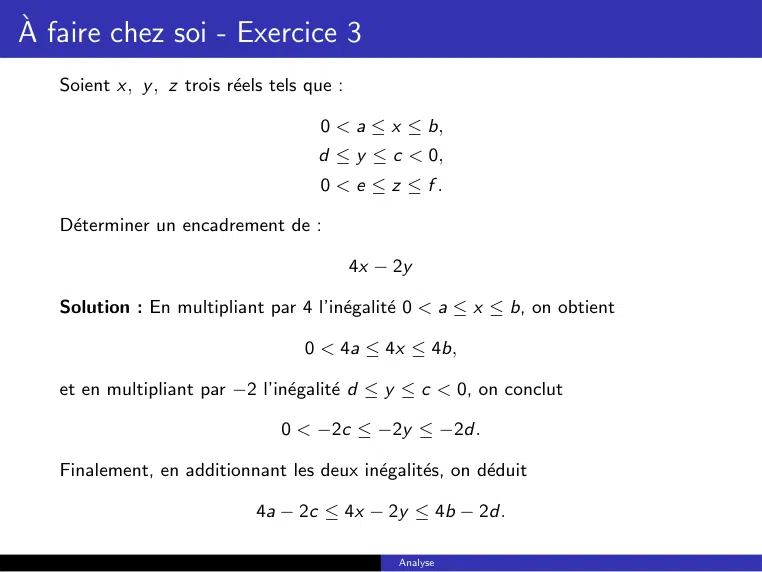

~~~text
À faire chez soi - Exercice 3
   Soient x, y , z trois réels tels que :

                                      0 < a ≤ x ≤ b,
                                      d ≤ y ≤ c < 0,
                                      0 < e ≤ z ≤ f.

   Déterminer un encadrement de :

                                             4x − 2y

   Solution : En multipliant par 4 l’inégalité 0 < a ≤ x ≤ b, on obtient

                                    0 < 4a ≤ 4x ≤ 4b,

   et en multipliant par −2 l’inégalité d ≤ y ≤ c < 0, on conclut

                                 0 < −2c ≤ −2y ≤ −2d.

   Finalement, en additionnant les deux inégalités, on déduit

                              4a − 2c ≤ 4x − 2y ≤ 4b − 2d.

                                                  Analyse
~~~

## Page 13

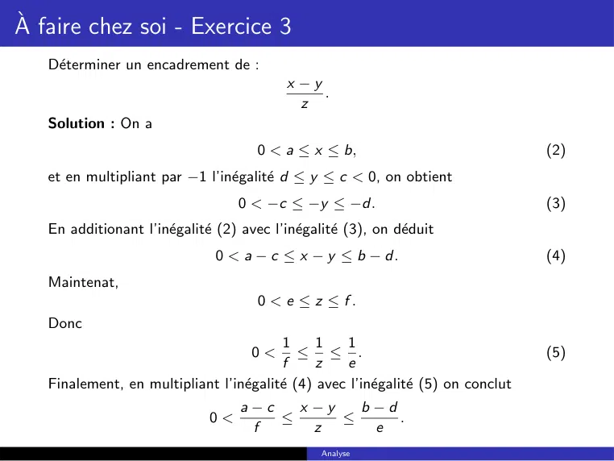

~~~text
À faire chez soi - Exercice 3
   Déterminer un encadrement de :
                                            x −y
                                                 .
                                              z
   Solution : On a
                                       0 < a ≤ x ≤ b,                               (2)
   et en multipliant par −1 l’inégalité d ≤ y ≤ c < 0, on obtient
                                    0 < −c ≤ −y ≤ −d.                               (3)
   En additionant l’inégalité (2) avec l’inégalité (3), on déduit
                                0 < a − c ≤ x − y ≤ b − d.                          (4)
   Maintenat,
                                       0 < e ≤ z ≤ f.
   Donc
                                          1     1   1
                                      0<     ≤ ≤ .                                  (5)
                                          f     z   e
   Finalement, en multipliant l’inégalité (4) avec l’inégalité (5) on conclut
                                    a−c   x −y   b−d
                               0<       ≤      ≤     .
                                     f      z     e
                                                  Analyse
~~~

## Page 14

~~~text
À faire chez soi - Exercice 3

   Remarque :
                        1≤x ≤3   et   − 2 ≤ y ≤ −1
   n’implique pas que
                             −2 ≤ xy ≤ −3.

                                      Analyse
~~~

## Page 15

~~~text
À faire chez soi - Exercice 4
   Calculer le domaine de définition de la fonction
                                         r
                                             ln |x|
                                  x 7→              .
                                               x
    On rappelle que la curve de la fonction ln(x) est :

                                              Analyse
~~~

## Page 16

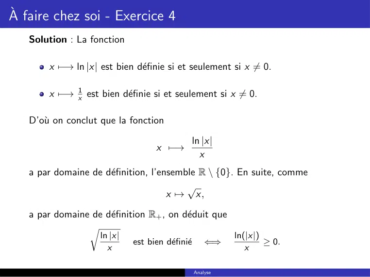

~~~text
À faire chez soi - Exercice 4
   Solution : La fonction

       x 7−→ ln |x| est bien définie si et seulement si x 6= 0.

       x 7−→ x1 est bien définie si et seulement si x 6= 0.

   D’où on conclut que la fonction
                                               ln |x|
                                     x 7−→
                                                 x
   a par domaine de définition, l’ensemble R \ {0}. En suite, comme
                                         √
                                     x 7→ x,

   a par domaine de définition R+ , on déduit que
                 r
                     ln |x|                                  ln(|x|)
                              est bien définié       ⇐⇒            ≥ 0.
                       x                                        x

                                                   Analyse
~~~

## Page 17

~~~text
À faire chez soi - Exercice 4
   On rappelle que
                     ln |x| ≥ 0   si et seulement si   |x| ≥ 1.
   Donc
       Pour tout x ≥ 1
                                      ln(|x|)
                                              ≥ 0.
                                         x

       Pour tout 0 < x ≤ 1
                                      ln(|x|)
                                              ≤ 0.
                                         x

       Pour tout −1 ≤ x < 0
                                      ln(|x|)
                                              ≥ 0.
                                         x

       Pour tout x ≤ −1
                                      ln(|x|)
                                              ≤ 0.
                                         x
                                            Analyse
~~~

## Page 18

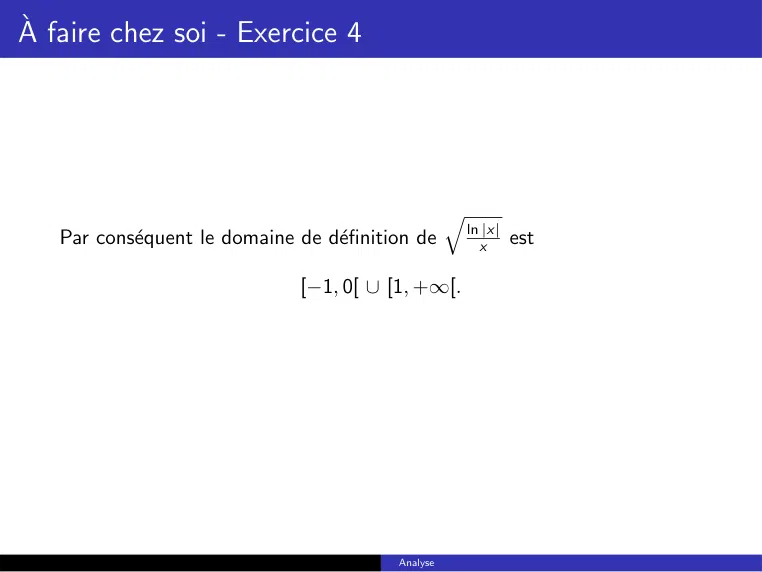

~~~text
À faire chez soi - Exercice 4

                                                    q
                                                        ln |x|
   Par conséquent le domaine de définition de           x    est

                               [−1, 0[ ∪ [1, +∞[.

                                          Analyse
~~~

## Page 19

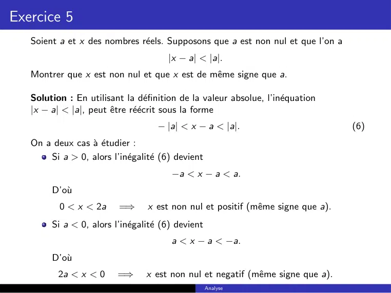

~~~text
Exercice 5
   Soient a et x des nombres réels. Supposons que a est non nul et que l’on a
                                       |x − a| < |a|.
   Montrer que x est non nul et que x est de même signe que a.

   Solution : En utilisant la définition de la valeur absolue, l’inéquation
   |x − a| < |a|, peut être réécrit sous la forme
                                    − |a| < x − a < |a|.                         (6)
   On a deux cas à étudier :
       Si a > 0, alors l’inégalité (6) devient
                                        −a < x − a < a.
        D’où
          0 < x < 2a      =⇒     x est non nul et positif (même signe que a).
        Si a < 0, alors l’inégalité (6) devient
                                        a < x − a < −a.
        D’où
          2a < x < 0     =⇒      x est non nul et negatif (même signe que a).
                                                    Analyse
~~~

## Page 20

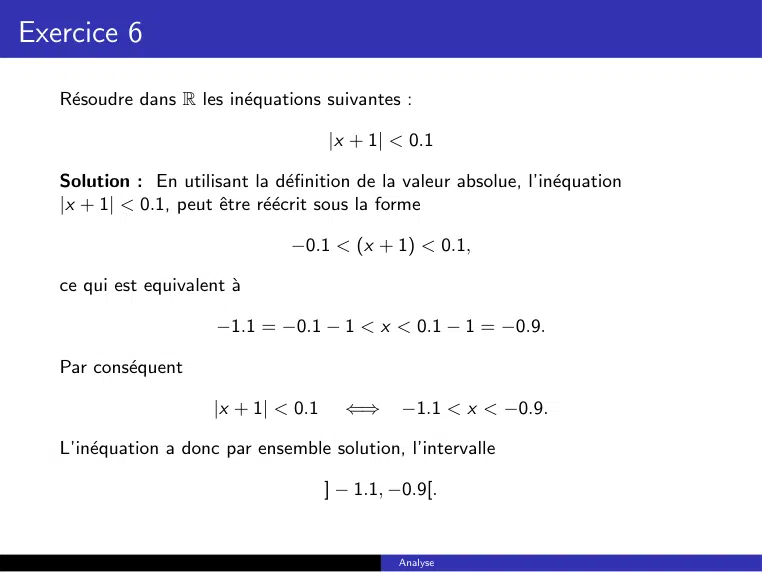

~~~text
Exercice 6

   Résoudre dans R les inéquations suivantes :

                                       |x + 1| < 0.1

   Solution : En utilisant la définition de la valeur absolue, l’inéquation
   |x + 1| < 0.1, peut être réécrit sous la forme

                                 −0.1 < (x + 1) < 0.1,

   ce qui est equivalent à

                       −1.1 = −0.1 − 1 < x < 0.1 − 1 = −0.9.

   Par conséquent

                       |x + 1| < 0.1     ⇐⇒      −1.1 < x < −0.9.

   L’inéquation a donc par ensemble solution, l’intervalle

                                       ] − 1.1, −0.9[.

                                                Analyse
~~~

## Page 21

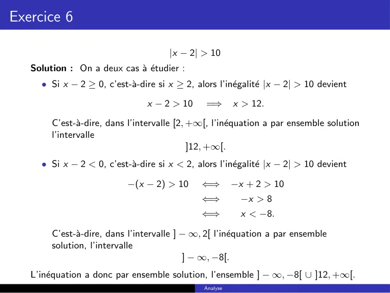

~~~text
Exercice 6

                                      |x − 2| > 10
   Solution : On a deux cas à étudier :
     • Si x − 2 ≥ 0, c’est-à-dire si x ≥ 2, alors l’inégalité |x − 2| > 10 devient

                                x − 2 > 10      =⇒       x > 12.

        C’est-à-dire, dans l’intervalle [2, +∞[, l’inéquation a par ensemble solution
        l’intervalle
                                             ]12, +∞[.
     • Si x − 2 < 0, c’est-à-dire si x < 2, alors l’inégalité |x − 2| > 10 devient

                           −(x − 2) > 10       ⇐⇒        −x + 2 > 10
                                               ⇐⇒          −x > 8
                                               ⇐⇒          x < −8.

        C’est-à-dire, dans l’intervalle ] − ∞, 2[ l’inéquation a par ensemble
        solution, l’intervalle
                                           ] − ∞, −8[.
   L’inéquation a donc par ensemble solution, l’ensemble ] − ∞, −8[ ∪ ]12, +∞[.
                                               Analyse
~~~

## Page 22

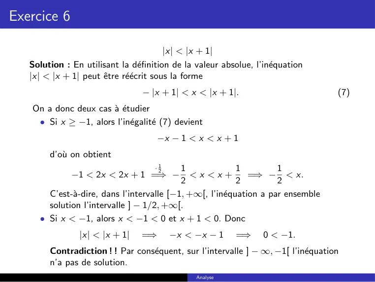

~~~text
Exercice 6

                                         |x| < |x + 1|
   Solution : En utilisant la définition de la valeur absolue, l’inéquation
   |x| < |x + 1| peut être réécrit sous la forme
                                 − |x + 1| < x < |x + 1|.                          (7)
   On a donc deux cas à étudier
    • Si x ≥ −1, alors l’inégalité (7) devient
                                      −x − 1 < x < x + 1
        d’où on obtient
                                2
                                    ·1     1              1         1
              −1 < 2x < 2x + 1 =⇒ −           <x <x+         =⇒ − < x.
                                           2              2         2
       C’est-à-dire, dans l’intervalle [−1, +∞[, l’inéquation a par ensemble
       solution l’intervalle ] − 1/2, +∞[.
     • Si x < −1, alors x < −1 < 0 et x + 1 < 0. Donc
                |x| < |x + 1|    =⇒      −x < −x − 1      =⇒      0 < −1.
        Contradiction ! ! Par conséquent, sur l’intervalle ] − ∞, −1[ l’inéquation
        n’a pas de solution.
                                                Analyse
~~~

## Page 23

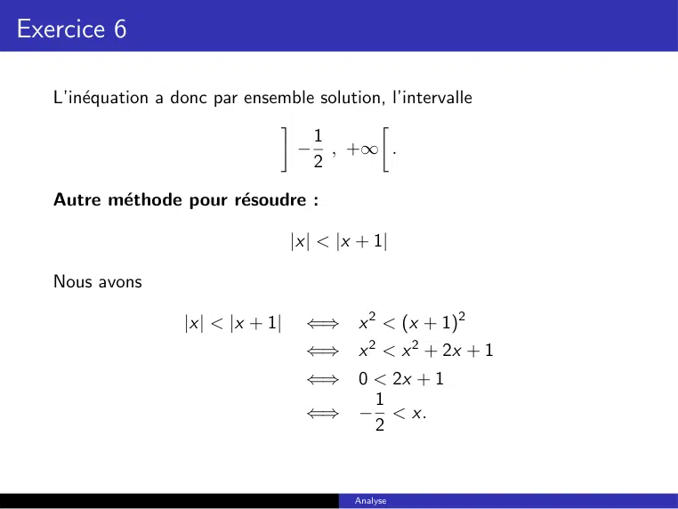

~~~text
Exercice 6

   L’inéquation a donc par ensemble solution, l’intervalle
                                            
                                    1
                                  − , +∞ .
                                    2

   Autre méthode pour résoudre :

                                    |x| < |x + 1|

   Nous avons

                    |x| < |x + 1|     ⇐⇒     x 2 < (x + 1)2
                                      ⇐⇒     x 2 < x 2 + 2x + 1
                                      ⇐⇒     0 < 2x + 1
                                               1
                                      ⇐⇒     − < x.
                                               2

                                            Analyse
~~~

## Page 24

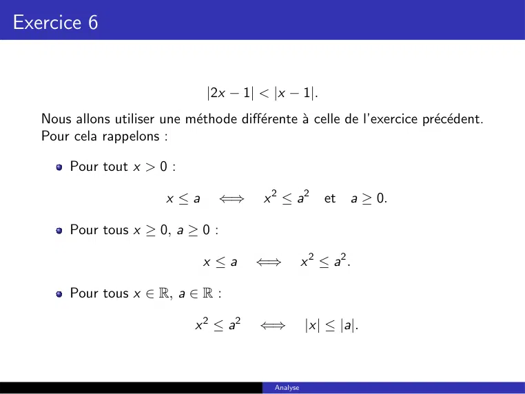

~~~text
Exercice 6

                                 |2x − 1| < |x − 1|.
   Nous allons utiliser une méthode différente à celle de l’exercice précédent.
   Pour cela rappelons :

        Pour tout x > 0 :

                         x ≤a      ⇐⇒      x 2 ≤ a2        et   a ≥ 0.

        Pour tous x ≥ 0, a ≥ 0 :

                                x ≤a      ⇐⇒           x 2 ≤ a2 .

        Pour tous x ∈ R, a ∈ R :

                               x 2 ≤ a2    ⇐⇒          |x| ≤ |a|.

                                             Analyse
~~~

## Page 25

~~~text
Exercice 6

   Solution : On a

           |2x − 1| < |x − 1|   ⇐⇒   (2x − 1)2 < (x − 1)2
                                ⇐⇒   4x 2 − 4x + 1 < x 2 − 2x + 1
                                ⇐⇒   3x 2 − 2x < 0
                                ⇐⇒   x · (3x − 2) < 0
                                                 
                                                2
                                ⇐⇒   3x · x −       <0
                                                3
                                                
                                               2
                                ⇐⇒   x· x−         <0
                                               3
                                                            2
                                ⇐⇒   0<x         et    x<
                                                            3
                                                 2
                                ⇐⇒   0<x <         .
                                                 3

                                       Analyse
~~~

## Page 26

~~~text
Exercice 6

   L’inéquation a donc par ensemble solution, l’intervalle
                                          
                                        2
                                    0,       .
                                        3

                                           Analyse
~~~

## Page 27

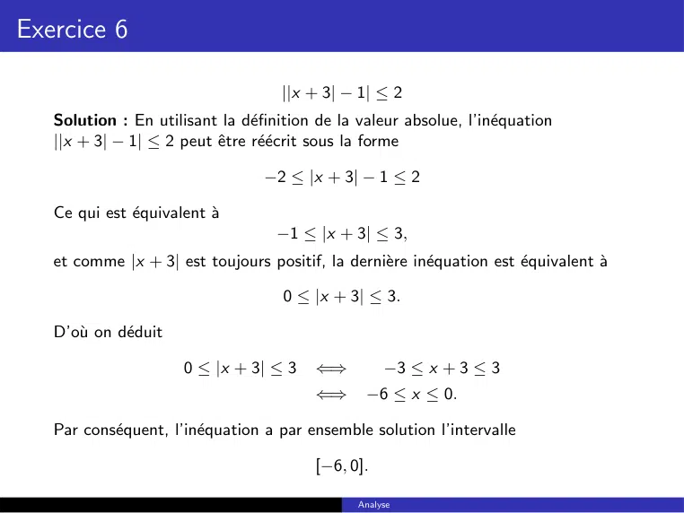

~~~text
Exercice 6

                                    ||x + 3| − 1| ≤ 2
   Solution : En utilisant la définition de la valeur absolue, l’inéquation
   ||x + 3| − 1| ≤ 2 peut être réécrit sous la forme

                                  −2 ≤ |x + 3| − 1 ≤ 2

   Ce qui est équivalent à
                                    −1 ≤ |x + 3| ≤ 3,
   et comme |x + 3| est toujours positif, la dernière inéquation est équivalent à

                                     0 ≤ |x + 3| ≤ 3.

   D’où on déduit

                      0 ≤ |x + 3| ≤ 3    ⇐⇒          −3 ≤ x + 3 ≤ 3
                                         ⇐⇒      −6 ≤ x ≤ 0.

   Par conséquent, l’inéquation a par ensemble solution l’intervalle

                                         [−6, 0].

                                                Analyse
~~~

## Page 28

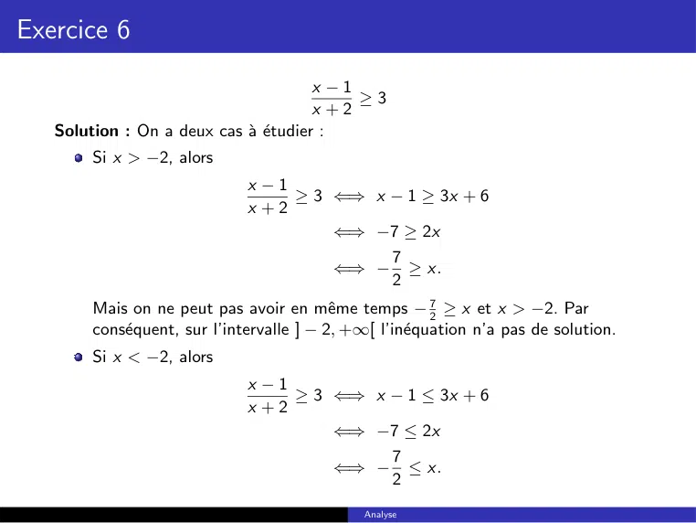

~~~text
Exercice 6
                                       x −1
                                            ≥3
                                       x +2
   Solution : On a deux cas à étudier :
       Si x > −2, alors
                             x −1
                                  ≥ 3 ⇐⇒ x − 1 ≥ 3x + 6
                             x +2
                                      ⇐⇒ −7 ≥ 2x
                                           7
                                      ⇐⇒ − ≥ x.
                                           2
       Mais on ne peut pas avoir en même temps − 27 ≥ x et x > −2. Par
       conséquent, sur l’intervalle ] − 2, +∞[ l’inéquation n’a pas de solution.
       Si x < −2, alors
                             x −1
                                  ≥ 3 ⇐⇒ x − 1 ≤ 3x + 6
                             x +2
                                      ⇐⇒ −7 ≤ 2x
                                           7
                                      ⇐⇒ − ≤ x.
                                           2
                                             Analyse
~~~

## Page 29

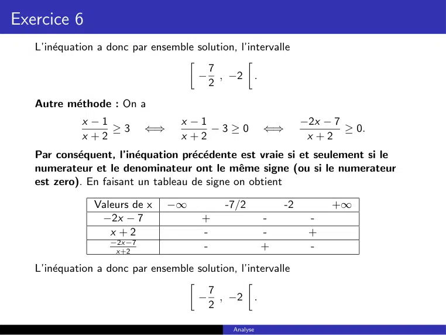

~~~text
Exercice 6
   L’inéquation a donc par ensemble solution, l’intervalle
                                                
                                       7
                                     − , −2 .
                                       2
   Autre méthode : On a
             x −1                  x −1                           −2x − 7
                  ≥3       ⇐⇒           −3≥0            ⇐⇒                ≥ 0.
             x +2                  x +2                            x +2
   Par conséquent, l’inéquation précédente est vraie si et seulement si le
   numerateur et le denominateur ont le même signe (ou si le numerateur
   est zero). En faisant un tableau de signe on obtient

               Valeurs de x     −∞          -7/2             -2        +∞
                −2x − 7                +                -          -
                  x +2                 -                -          +
                   −2x−7
                    x+2
                                       -                +          -

   L’inéquation a donc par ensemble solution, l’intervalle
                                                
                                       7
                                     − , −2 .
                                       2

                                              Analyse
~~~

## Page 30

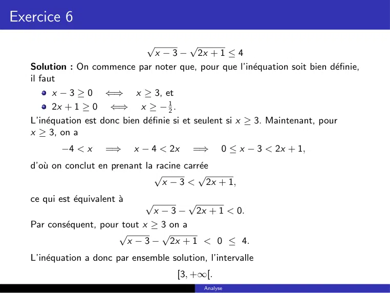

~~~text
Exercice 6
                                √            √
                                   x − 3 − 2x + 1 ≤ 4
   Solution : On commence par noter que, pour que l’inéquation soit bien définie,
   il faut
         x − 3 ≥ 0 ⇐⇒ x ≥ 3, et
         2x + 1 ≥ 0 ⇐⇒ x ≥ − 21 .
   L’inéquation est donc bien définie si et seulent si x ≥ 3. Maintenant, pour
   x ≥ 3, on a
           −4 < x      =⇒      x − 4 < 2x   =⇒      0 ≤ x − 3 < 2x + 1,
   d’où on conclut en prenant la racine carrée
                                 √           √
                                    x − 3 < 2x + 1,
   ce qui est équivalent à   √         √
                                x − 3 − 2x + 1 < 0.
   Par conséquent, pour tout x ≥ 3 on a
                        √         √
                          x − 3 − 2x + 1 < 0 ≤ 4.
   L’inéquation a donc par ensemble solution, l’intervalle
                                        [3, +∞[.
                                              Analyse
~~~

## Page 31

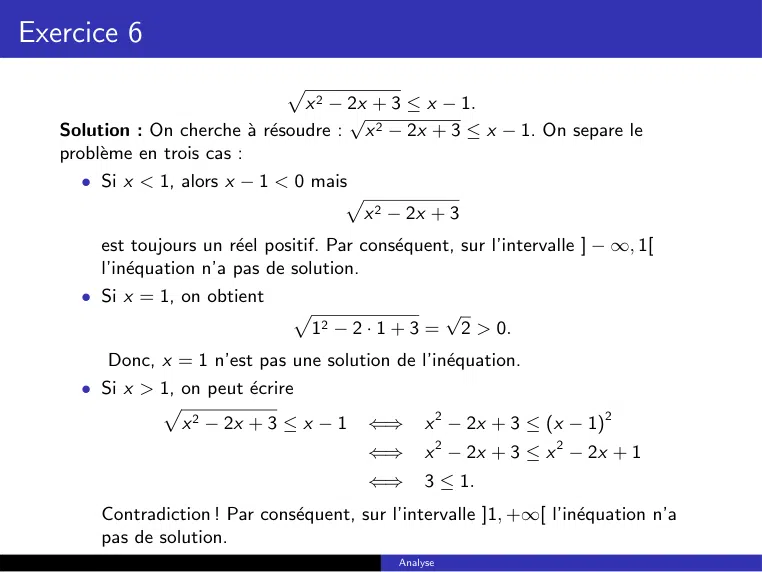

~~~text
Exercice 6
                                p
                                  x 2 − 2x + 3 ≤ x − 1.
                                        √
   Solution : On cherche à résoudre : x 2 − 2x + 3 ≤ x − 1. On separe le
   problème en trois cas :
      • Si x < 1, alors x − 1 < 0 mais
                                       p
                                          x 2 − 2x + 3
       est toujours un réel positif. Par conséquent, sur l’intervalle ] − ∞, 1[
       l’inéquation n’a pas de solution.
     • Si x = 1, on obtient
                                p                   √
                                    12 − 2 · 1 + 3 = 2 > 0.
        Donc, x = 1 n’est pas une solution de l’inéquation.
     • Si x > 1, on peut écrire
              p
                 x 2 − 2x + 3 ≤ x − 1 ⇐⇒ x 2 − 2x + 3 ≤ (x − 1)2
                                           ⇐⇒       x 2 − 2x + 3 ≤ x 2 − 2x + 1
                                           ⇐⇒       3 ≤ 1.
        Contradiction ! Par conséquent, sur l’intervalle ]1, +∞[ l’inéquation n’a
        pas de solution.
                                               Analyse
~~~

## Page 32

~~~text
Exercice 7
   Calculer la valeur de :
     1
                                                 n
                                                 X
                                                       2
                                                 i=1
         Solution : On a
                                    !                                           
                n
                X             n
                              X
                      2=2           1      = 2 1 + 1 + 1 + · · · + 1 = 2n
                                                |       {z          }
                i=1           i=1                              n fois

     2
                                                 n
                                                 Y
                                                       3
                                                 i=1
         Solution : On a
                        n
                                                                   !
                        Y
                              3=        | · 3 · 3 · {z · · ·
                                        3                       · 3}    = 3n .
                        i=1                       n fois

                                                     Analyse
~~~

## Page 33

~~~text
Exercice 7
                              n
                              X
                                (2ak+1 − 3ak + ak−1 )
                               k=1

   Solution : Notons que

                2ak+1 − 3ak + ak−1   =   2ak+1 − 2ak − ak + ak−1
                                     =   2(ak+1 − ak ) − (ak − ak−1 ).

   Ce qui nous permet d’écrire
         n
         X                               n
                                         X
           (2ak+1 − 3ak + ak−1 )     =         2(ak+1 − ak ) − (ak − ak−1 )
         k=1                             k=1
                                          X n                       n
                                                                    X
                                     =   2         (ak+1 − ak ) −     (ak − ak−1 ).
                                             k=1                    k=1

   Maintenant
                        n
                        X                      n
                                               X
                          (ak+1 − ak )   et      (ak − ak−1 )
                        k=1                        k=1

   sont de sommes téléscopiques.
                                              Analyse
~~~

## Page 34

~~~text
Exercice 7

   Par conséquent
                      n
                      X
                            (ak+1 − ak )    =      (an+1 − a1 )
                      k=1
                      Xn
                            (ak − ak−1 ) =         (an − a0 ).
                      k=1

   D’où on obtient
     n
     X                                     n
                                           X                      n
                                                                  X
       (2ak+1 − 3ak + ak−1 )      =    2         (ak+1 − ak ) −         (ak − ak−1 )
     k=1                                   k=1                    k=1
                                  =    2(an+1 − a1 ) − (an − a0 )
                                  =    2an+1 − an − 2a1 + a0 .

                                             Analyse
~~~

## Page 35

~~~text
Exercice 7
                                                n
                                                X
                                                      k.
                                                k=1
   Solution : Notons que
                           n
                           X
                                 k = 1 + 2 + 3 + ··· + n − 1 + n
                           k=1

                                                      +
                           n
                           X
                                 k = n + n − 1 + ··· + 3 + 2 + 1
                           k=1

                          n
                          X
                      2          k = (n + 1) + (n + 1) + · · · + (n + 1)
                                     |              {z                 }
                           k=1
                                                            n fois

   Par conséquent
                                         n
                                         X
                                     2         k = n(n + 1).
                                         k=1

                                                       Analyse
~~~

## Page 36

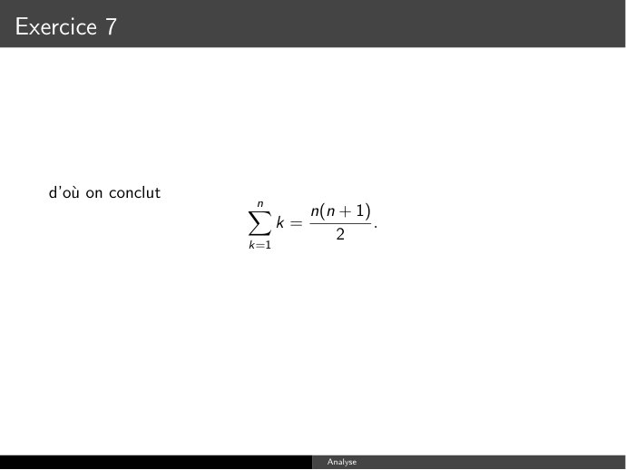

~~~text
Exercice 7

   d’où on conclut
                      n
                      X          n(n + 1)
                            k=            .
                                    2
                      k=1

                                   Analyse
~~~

**Lecture OCR à contrôler**

~~~text
d'où on conclut
n(n+1)
~~~

## Page 37

~~~text
Exercice 7

                                          n
                                          X
                                            32k .
                                          k=2

   Solution : On commence par rappeler la valeur de la somme géométrique. Pour
   tout a ∈ R avec a 6= 1, on a
                                   n
                                   X      1 − an+1
                                     ak =          .
                                            1−a
                                   k=0

   Pour demontrer cette formule il suffit de noter
                       X n
                           ak = 1 + a + a2 + · · · + an−1 + an
                            k=0
                                                        −
                         n
                         X
                      a·   ak      =     a + a + · · · + an + an+1
                                                2

                            k=0

           n
           X                n
                            X
                 ak − a ·     ak   =     1 − an+1
           k=0              k=0

                                                    Analyse
~~~

## Page 38

~~~text
Exercice 7
   Par conséquent
                        n
                        X             n
                                      X                n
                                                       X
            (1 − a) ·         ak =          ak − a ·          ak = 1 − an+1
                        k=0           k=0              k=0

   Ainsi
                                     n
                                     X            1 − an+1
                                           ak =            .
                                                    1−a
                                     k=0

   Maintenant
   n
   X             n
                 X                n
                                  X
         32k =         9k     =         9k − (1 + 9)
   k=2           k=2              k=0
                                  1 − 9n+1
                              =            − 10
                                    1−9
                                  9n+1 − 1 80     9n+1 − 92   92 (9n−1 − 1)
                              =            −    =           =               .
                                     8        8       8             8

                                                    Analyse
~~~

## Page 39

~~~text
Exercice 7
   En remarquant que
                               (k + 1)2 − k 2 = 2k + 1,
   montrer que :
                        n−1
                        X                            n
                                                     X
                              (2k + 1) = n2 =          (2k − 1).
                        k=0                          k=1
   Solution : En effet on a
                   (k + 1)2 − k 2 = k 2 + 2k + 1 − k 2 = 2k + 1.
   Ce qui nous permet d’écrire
                n−1
                X                             n−1
                                              X
                                                      (k + 1)2 − k 2
                                                                       
                    (2k + 1)      =
                k=0                           k=0
                                              |             {z         }
                                       somme télescopique de terme ak =k 2
                                  =    an − a0
                                  =    n2 − (0)2
                                  =    n2 .
                                                  Analyse
~~~

## Page 40

~~~text
Exercice 7

   Notons aussi que

                k 2 − (k − 1)2 = k 2 − (k 2 − 2k + 1) = 2k − 1.

   Par conséquent
              n
              X                         n
                                        X
                                                k 2 − (k − 1)2
                                                                 
                (2k − 1)     =
              k=1                       k=1
                                        |             {z         }
                                 somme télescopique de terme ak =(k−1)2
                             = an+1 − a1
                             = (n + 1 − 1)2 − (1 − 1)2
                             = n2 .

                                            Analyse
~~~

## Page 41

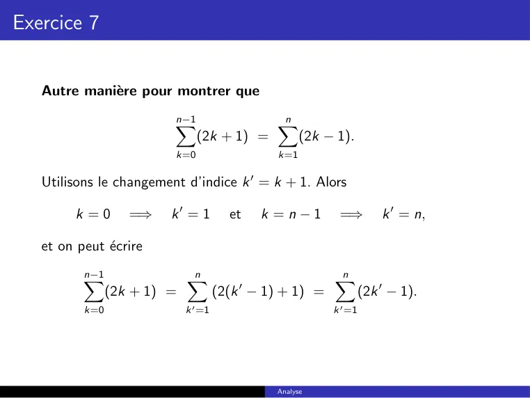

~~~text
Exercice 7

   Autre manière pour montrer que
                         n−1
                         X              n
                                        X
                             (2k + 1) =   (2k − 1).
                         k=0                      k=1

                                             0
   Utilisons le changement d’indice k = k + 1. Alors

         k=0       =⇒    k0 = 1         et       k =n−1      =⇒      k 0 = n,

   et on peut écrire
          n−1
          X                  n
                             X                              n
                                                            X
                (2k + 1) =            (2(k 0 − 1) + 1) =         (2k 0 − 1).
          k=0                k 0 =1                         k 0 =1

                                                  Analyse
~~~

## Page 42

~~~text
Exercice 7
   Montrer que
               n              n          n
              X              X          X        (n + 1)(3n + 2)
                  (k + 1)3 −     k3 = 3     k2 +                 .
                                                        2
              k=0            k=0        k=1
               Pn
   En déduire k=0 k 2 .

   Solution : On commence par noter que
           n
           X            n
                        X      n
                               X
             (k + 1)3 −   k3 =   (k + 1)3 − k 3
                                                

           k=0            k=0         k=0
                                      n
                                      X
                                             k 3 + 3k 2 + 3k + 1 − k 3
                                                                             
                                  =
                                      k=0
                                      n
                                      X
                                             3k 2 + 3k + 1
                                                              
                                  =
                                      k=0
                                       Xn              n
                                                       X          n
                                                                  X
                                  = 3         k2 + 3         k+         1.
                                        k=0            k=0        k=0

                                            Analyse
~~~

## Page 43

~~~text
Exercice 7
   Maintenant
                                      n
                                      X
                                            1=n+1
                                      k=0

   et d’après l’Exercice 7 Question 4 on sait
                                    n
                                    X          n(n + 1)
                                          k=            .
                                                  2
                                    k=0

   Par conséquent
              n
              X            n
                           X        n
                                    X        n
                                             X    n
                                                  X
                (k + 1)3 −   k3 = 3   k2 + 3   k+   1
                k=0           k=0           k=0              k=0     k=0
                                            n
                                            X                n(n + 1)
                                      =3          k2 + 3              +n+1
                                                                2
                                            k=0
                                            n
                                            X               3n(n + 1) + 2(n + 1)
                                      =3          k2 +
                                                                     2
                                            k=0
                                            n
                                            X               (n + 1)(3n + 2)
                                      =3          k2 +                      .
                                                                   2
                                            k=0

                                                  Analyse
~~~

## Page 44

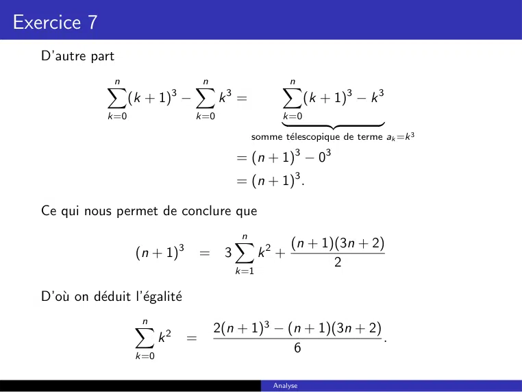

~~~text
Exercice 7
   D’autre part
                n
                X                  n
                                   X                     n
                                                         X
                      (k + 1)3 −          k3 =             (k + 1)3 − k 3
                k=0                k=0                   k=0
                                                         |        {z        }
                                                 somme télescopique de terme ak =k 3

                                               = (n + 1)3 − 03
                                               = (n + 1)3 .

   Ce qui nous permet de conclure que
                                               n
                                               X             (n + 1)(3n + 2)
                       (n + 1)3       =    3         k2 +
                                                                    2
                                               k=1

   D’où on déduit l’égalité
                       n
                       X                  2(n + 1)3 − (n + 1)(3n + 2)
                             k2   =                                   .
                                                       6
                       k=0

                                                       Analyse
~~~

## Page 45

~~~text
Exercice 7

   Finalement,

      2(n + 1)3 − (n + 1)(3n + 2)   (n + 1)[2(n + 1)2 − (3n + 2)]
                                  =
                   6                              6
                                    (n + 1)[(2n2 + 4n + 2) − (3n + 2)]
                                  =
                                                     6
                                    (n + 1)[2n2 + n]
                                  =
                                           6
                                    n(n + 1)(2n + 1)
                                  =                  .
                                            6
   et on conclut
                        n
                        X            n(n + 1)(2n + 1)
                              k2 =                    .
                                            6
                        k=1

                                           Analyse
~~~

## Page 46

~~~text
Exercice 8
   Calculer les sommes suivantes :
               n           n−1                   n    
                   k n                k n                 n
              X              X                       X
                  5       ;      (−3)      ;           k    .
                     k                  k                 k
             k=1               k=0                   k=0
   Solution :

                n                   n         !  
                X
                      k  n           X   n k     n 0   n 0
                      5       =            5 +     5 −   5
                         k               k       0     0
                k=1                  k=1
                                      n  
                                             !  
                                     X   n k     n 0
                              =            5 −     5
                                         k       0
                                     k=0
                                      n  
                                             !
                                     X   n k
                              =            5 −1
                                         k
                                     k=0
                                      n  
                                                 !
                                     X   n k n−k
                              =            5 ·1    −1
                                         k
                                     k=0
                              = (5 + 1)n − 1 = 6n − 1.
                                           Analyse
~~~

## Page 47

~~~text
Exercice 8

      n−1                n−1                    !  
      X          n         X    n             n          n
          (−3)k       =           (−3) +    k       n
                                                (−3) −      (−3)n
                 k             k              n          n
      k=0                  k=0
                            n  
                                        !  
                           X   n              n
                      =           (−3)k −       (−3)n
                               k              n
                           k=0
                            n  
                                        !
                           X   n
                      =           (−3) − (−3)n
                                      k
                               k
                           k=0
                            n  
                                              !
                           X   n      k   n−k
                      =           (−3) · 1      − (−3)n
                               k
                           k=0
                      =   (−3 + 1)n − (−3)n
                      =   (−2)n − (−3)n .

                                     Analyse
~~~

## Page 48

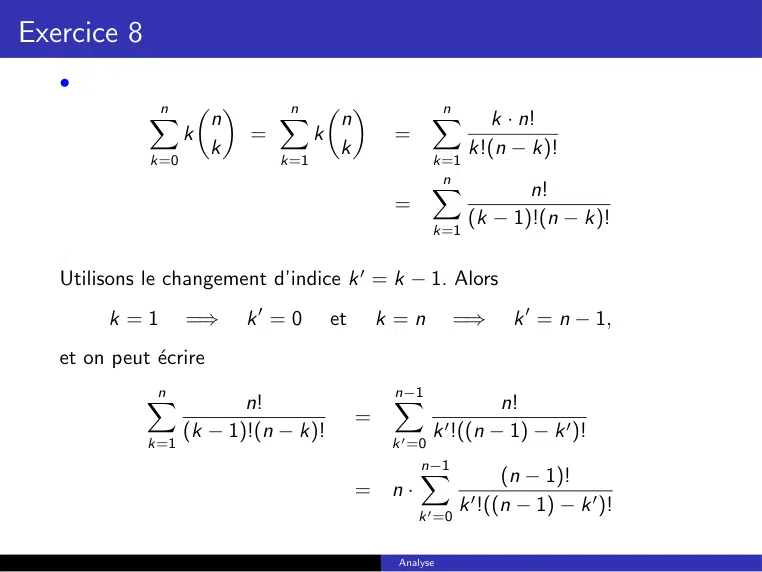

~~~text
Exercice 8
   •
              n       n                               n
              X    n    X    n                            X       k · n!
                k     =   k                      =
                   k         k                                  k!(n − k)!
              k=0             k=1                         k=1
                                                          n
                                                          X            n!
                                                 =
                                                                (k − 1)!(n − k)!
                                                          k=1

   Utilisons le changement d’indice k 0 = k − 1. Alors
         k=1        =⇒     k0 = 0      et       k =n           =⇒     k 0 = n − 1,
   et on peut écrire
             n                                   n−1
             X             n!                    X                  n!
                                            =
                    (k − 1)!(n − k)!                      k 0 !((n − 1) − k 0 )!
             k=1                                 k 0 =0
                                                      n−1
                                                      X               (n − 1)!
                                            =    n·
                                                               k 0 !((n − 1) − k 0 )!
                                                      k 0 =0

                                                  Analyse
~~~

## Page 49

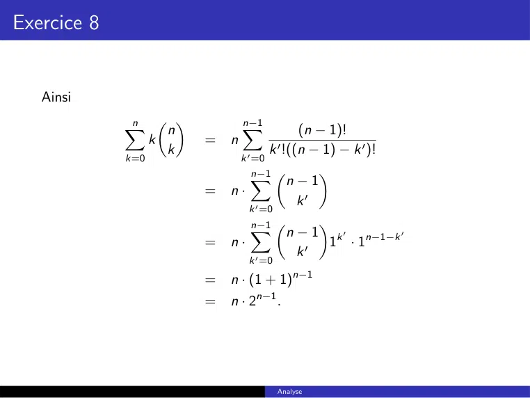

~~~text
Exercice 8

   Ainsi
             n             n−1
             X    n          X               (n − 1)!
               k       = n
                  k                   k 0 !((n − 1) − k 0 )!
             k=0             k 0 =0
                               n−1    
                               X    n−1
                       = n·
                                             k0
                               k 0 =0
                               n−1    
                               X    n−1              0          0
                       = n·                       1k · 1n−1−k
                                             k0
                               k 0 =0
                       = n · (1 + 1)n−1
                       = n · 2n−1 .

                                        Analyse
~~~

## Page 50

~~~text
Exercice 9

   Écrire à l’aide de factorielles les expressions suivantes :
                         n
                         Y                   n−1
                                             Y                  n
                                                                Y
                               k2    ;             k   ;                 2k + 1.
                         k=1                 k=3                k=2

   Solution :

                               n                   n
                                                               !2
                               Y         2
                                                   Y
                                     k       =             k          = (n!)2 .
                               k=1                 k=1

                            n−1                        n−1
                            Y                 1    Y     (n − 1)!
                                  k =            ·   k =
                                             1·2            2
                            k=3                        k=1

                                                               Analyse
~~~

## Page 51

~~~text
Exercice 9

       n                   2n+1
                                      !       n
                                                         !−1
       Y                    Y                 Y
             2k + 1   =           k       ·         2k
       k=2                  k=5               k=3
                           2n+1
                                      !       n
                                                        !−1       n
                                                                        !−1
                            Y                 Y                   Y
                      =           k       ·         k         ·         2
                            k=5               k=3                 k=3
                                          2n+1
                                                !          n
                                                                !−1
                                 1         Y           1 Y              1
                      =                 ·      k ·            k     · n+1−3
                            1·2·3·4                   1·2            2
                                          k=1             k=1
                                        −1
                          (2n + 1)!      n!         1
                      =              ·          · n−2
                              4!          2       2
                           (2n + 1)!
                      =
                          12 · 2n−2 n!

                                               Analyse
~~~

## Page 52

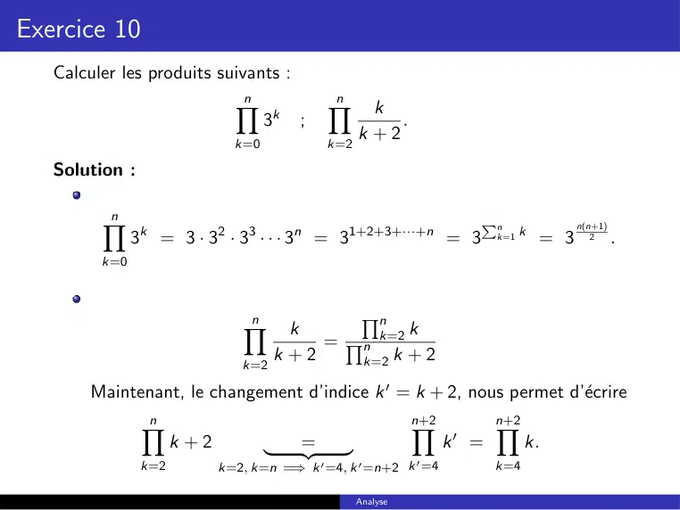

~~~text
Exercice 10
   Calculer les produits suivants :
                               n                n
                               Y                Y       k
                                     3k    ;               .
                                                      k +2
                               k=0              k=2

   Solution :

         n
         Y                                                                  Pn                n(n+1)
               3k = 3 · 32 · 33 · · · 3n = 31+2+3+···+n = 3                     k=1 k   = 3      2     .
         k=0

                                n                Qn
                                Y          k           k
                                              = Qn k=2
                                         k +2    k=2 k + 2
                                k=2

        Maintenant, le changement d’indice k 0 = k + 2, nous permet d’écrire
                n
                Y                                               n+2
                                                                Y               n+2
                                                                                Y
                      k +2           |     =
                                           {z     }                      k0 =         k.
                k=2          k=2, k=n =⇒ k 0 =4, k 0 =n+2       k 0 =4          k=4

                                                      Analyse
~~~

## Page 53

~~~text
Exercice 10

   Ainsi
     Qn          Qn                 Qn
           k      k=2 k      2 · 3 · k=4 k               6
   Qn k=2      = Qn+2 =                   Qn     =                .
     k=2 k + 2    k=4 k
                        (n + 1)(n  + 2) ·  k=4 k   (n + 1)(n + 2)

   Par conséquent
                     n
                     Y       k          6
                                =                .
                           k +2   (n + 1)(n + 2)
                     k=2

                                        Analyse
~~~

## Page 54

~~~text
Pour aller plus loin - Exercice 11

   Soit p ∈ N× et n ∈ N× tels que p < n. Montrer que
                        !        !         !                     !
                     n         p       p+1                   n−1
                           =       +          + ··· +             .
                    p+1        p         p                    p

   Solution : On commence par rappeler la définition du coefficients binomial :
   pour toute couple d’entiers 0 ≤ k ≤ n on appelle coefficients binomial le
   nombre                           !
                                  n          n!
                                      =             .
                                  k      k!(n − k)!
   Le nombre kn se lit : k parmi n. Le coefficient binomial satisfait la propriété
                

   suivant, appellée Formule de Pascal : pour tous entiers n et k tels que
   0 < k ≤ n on a                !           !           !
                              n        n−1          n−1
                                   =            +          .
                           k +1        k +1           k

                                              Analyse
~~~

## Page 55

~~~text
Pour aller plus loin - Exercice 11
                                                         
                                 n                n−1      n−1
                                          =             +       .
                               k +1               k +1      k
   Preuve :
             !             !
      n−1            n−1               (n − 1)!             (n − 1)!
                 +             =                       +
      k +1            k          (k + 1)!(n − 2 − k)!    k!(n − 1 − k)!
                                                                                 
                                                     1                   1
                               = (n − 1)!                        +
                                            (k + 1)!(n − 2 − k)!   k!(n − 1 − k)!

   Maintenant

          (k + 1)! = k!(k + 1)      et    (n − 1 − k)! = (n − 2 − k)!(n − 1 − k).

   Donc
            1                        n−1−k                        n−1−k
                        =                                 =
   (k + 1)!(n − 2 − k)!   (k + 1)!(n − 2 − k)!(n − 1 − k)    (k + 1)!(n − 1 − k)!
               1                  k +1                    k +1
                        =                       =                       .
         k!(n − 1 − k)!   k!(k + 1)(n − 1 − k)!    (k + 1)!(n − 1 − k)!

                                                     Analyse
~~~

## Page 56

~~~text
Pour aller plus loin - Exercice 11

   D’où on conclut
          !           !                                                          
    n−1          n−1                           1                      1
             +          = (n − 1)!                         +
    k +1            k                 (k + 1)!(n − 2 − k)!   (k + 1)!(n − 1 − k)!
                                                                                 
                                           n−1−k                    k +1
                        = (n − 1)!                         +
                                      (k + 1)!(n − 1 − k)!   (k + 1)!(n − 1 − k)!
                                   (n − 1 − k + k + 1)
                        = (n − 1)!
                                   (k + 1)!(n − 1 − k)!
                                             n
                        = (n − 1)!
                                   (k + 1)!(n − 1 − k)!
                                (n − 1)!n
                        =
                          (k + 1)!(n − 1 − k)!
                                    n!
                        =
                          (k + 1)!(n − 1 − k)!
                                 !
                              n
                        =           .
                            k +1

                                            Analyse
~~~

## Page 57

~~~text
Pour aller plus loin - Exercice 11

   En utilisant la formule de Pascal, on peut écrire
                       !             !          !
                 n             n−1           n−1
                           =             +
                p+1            p+1            p
                       !             !          !
                n−1            n−2           n−2
                           =             +
                p+1            p+1            p
                       !             !          !
                n−2            n−3           n−3
                           =             +
                p+1            p+1            p
                  ..            ..            ..
                   .             .             .
                       !             !             !
                p+3            p+2           p+2
                           =             +
                p+1            p+1            p
                       !             !             !             !           !
                p+2            p+1           p+1             p           p+1
                           =             +               =           +         .
                p+1            p+1            p              p            p

                                               Analyse
~~~

## Page 58

~~~text
Pour aller plus loin - Exercice 11
   Ce qui nous permet de conclure
          !                                           !                                                  !
     n                                       n−1                                                 n−1
              =                                                                              +
    p+1                                      p+1                                                  p
                  |                           {z                                         }
                                   !                      !                                         !
                             n−2                       n−2                                       n−1
              =                                  +                                           +
                             p+1                        p                                         p
                  |           {z             }
                            !               !                      !          !
                      n−3          n−3                 n−2                 n−1
              =              +                   +                     +
                      p+1           p                   p                   p
                       ..              ..             ..
                        .               .              .
                         !                           !                           !               !             !
                     p+2                    p+2                            n−3           n−2             n−1
              =                 +                          + ··· +                   +               +
                     p+1                     p                              p             p               p
                |     {z    }
                    !         !                      !                           !               !           !
                  p      p+1                p+2                            n−3           n−2             n−1
              =       +         +                          + ··· +                   +               +        .
                  p        p                 p                              p             p               p

                                                         Analyse
~~~

## Page 59

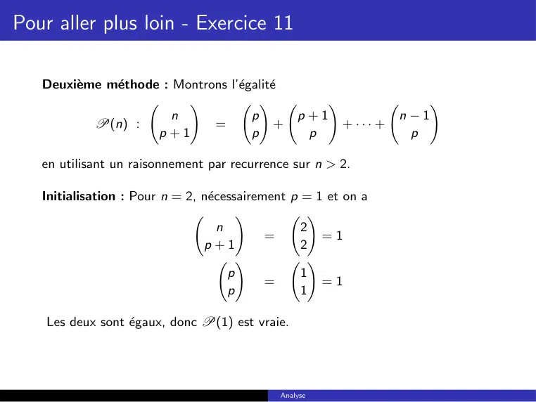

~~~text
Pour aller plus loin - Exercice 11

   Deuxième méthode : Montrons l’égalité
                          !             !              !                   !
                        n             p          p+1                 n−1
           P(n) :             =            +               + ··· +
                     p+1              p           p                   p

   en utilisant un raisonnement par recurrence sur n > 2.

   Initialisation : Pour n = 2, nécessairement p = 1 et on a
                                       !            !
                                   n              2
                                            =         =1
                                p+1               2
                                       !            !
                                     p            1
                                            =         =1
                                     p            1

    Les deux sont égaux, donc P(1) est vraie.

                                             Analyse
~~~

## Page 60

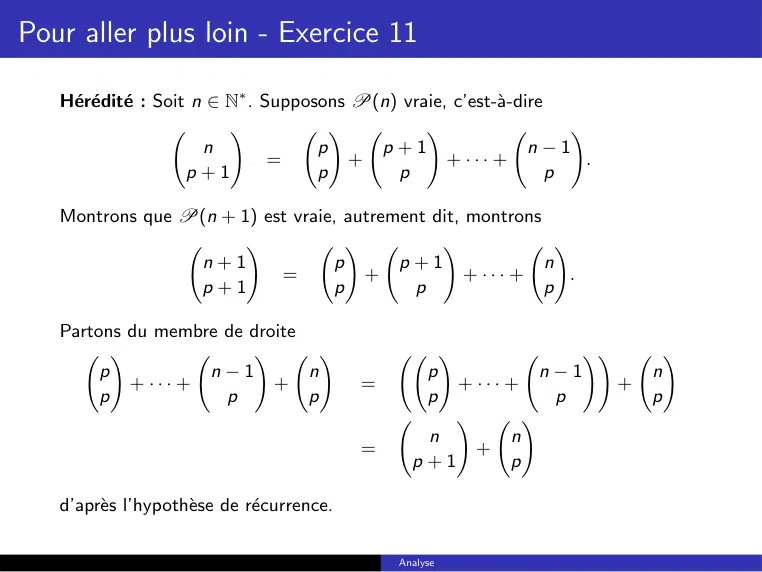

~~~text
Pour aller plus loin - Exercice 11

   Hérédité : Soit n ∈ N∗ . Supposons P(n) vraie, c’est-à-dire
                          !            !         !                   !
                       n             p     p+1                  n−1
                                =        +          + ··· +           .
                     p+1             p       p                     p

   Montrons que P(n + 1) est vraie, autrement dit, montrons
                       !            !          !              !
                 n+1              p       p+1               n
                           =          +            + ··· +      .
                 p+1              p         p               p

   Partons du membre de droite
          !             !        !                       !                      !!         !
        p           n−1        n                    p                        n−1       n
            + ··· +        +               =                 + ··· +               +
        p            p         p                    p                         p        p
                                                             !           !
                                                  n                  n
                                           =                     +
                                                 p+1                 p

   d’après l’hypothèse de récurrence.

                                               Analyse
~~~

## Page 61

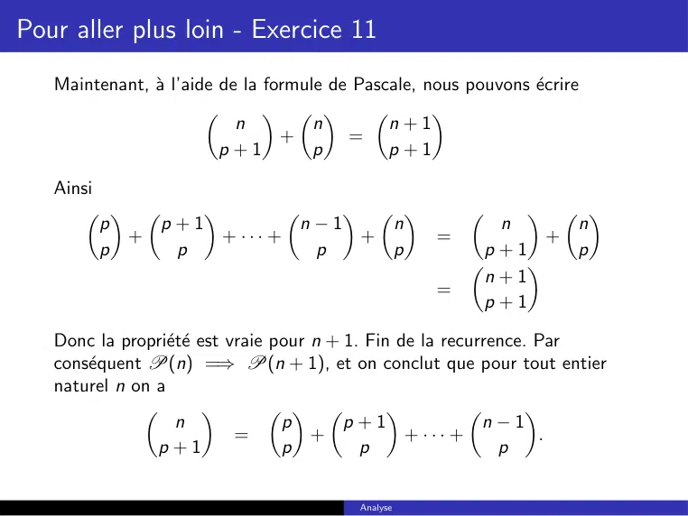

~~~text
Pour aller plus loin - Exercice 11
   Maintenant, à l’aide de la formule de Pascale, nous pouvons écrire
                                               
                           n         n        n+1
                                 +       =
                         p+1         p        p+1

   Ainsi
                                                       
         p   p+1             n−1   n                       n      n
           +       + ··· +       +    =                         +
         p    p               p    p                     p+1      p
                                                             
                                                          n+1
                                                    =
                                                         p+1

   Donc la propriété est vraie pour n + 1. Fin de la recurrence. Par
   conséquent P(n) =⇒ P(n + 1), et on conclut que pour tout entier
   naturel n on a
                                                           
                   n              p       p+1               n−1
                            =         +           + ··· +           .
                p+1               p         p                 p

                                          Analyse
~~~

## Page 62

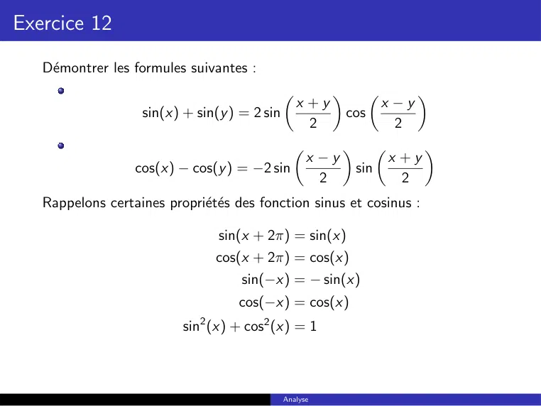

~~~text
Exercice 12
   Démontrer les formules suivantes :
                                                                           
                                                  x +y                 x −y
                   sin(x) + sin(y ) = 2 sin                  cos
                                                    2                    2
                                                                             
                                                    x −y                 x +y
                  cos(x) − cos(y ) = −2 sin                    sin
                                                      2                    2
   Rappelons certaines propriétés des fonction sinus et cosinus :

                                 sin(x + 2π) = sin(x)
                                 cos(x + 2π) = cos(x)
                                    sin(−x) = − sin(x)
                                    cos(−x) = cos(x)
                             2
                          sin (x) + cos2 (x) = 1

                                              Analyse
~~~

## Page 63

~~~text
Exercice 12
   Formules d’addition :
                      sin(x + y ) = sin x cos y + cos x sin y
                      sin(x − y ) = sin x cos y − cos x sin y
                      cos(x + y ) = cos x cos y − sin x sin y
                      cos(x − y ) = cos x cos y + sin x sin y .
   Pour x = y , ces relations s’appellent formules de duplication
             sin(2x) = 2 sin x cos x
            cos(2x) = cos2 x − sin2 x = 2 cos2 x − 1 = 1 − 2 sin2 x.
   À partir de ces formules (ou en regardant le cercle trigonométrique) on
   peut déduire
             sin(x + π) = − sin(x)       et             sin(x − π) = sin(x).
            sin(x + π/2) = cos(x)        et             sin(x − π/2) = cos(x).
            cos(x + π) = − cos(x)        et             cos(x − π) = − cos(x).
          cos(x + π/2) = − sin(x)        et             cos(x + π/2) = sin(x).
                                              Analyse
~~~

## Page 64

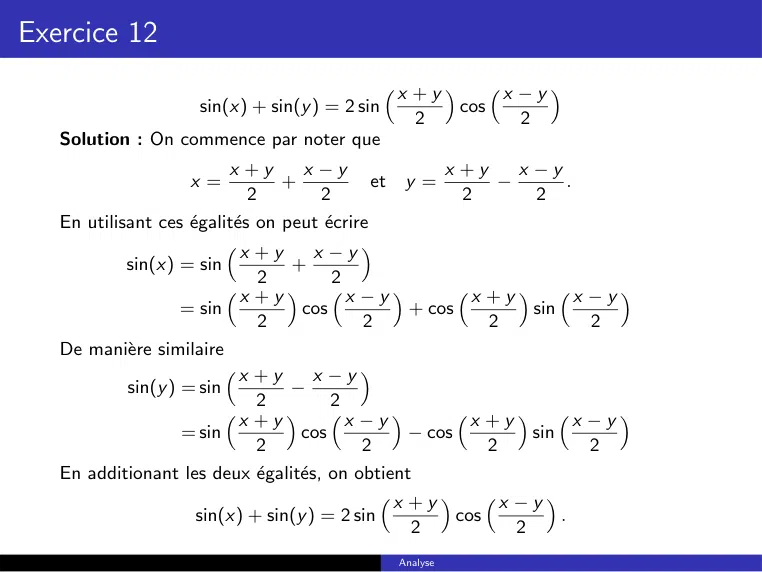

~~~text
Exercice 12
                                                x + y          x − y 
                     sin(x) + sin(y ) = 2 sin              cos
                                                    2               2
   Solution : On commence par noter que
                          x +y      x −y               x +y     x −y
                    x=            +            et y =         −        .
                              2       2                   2       2
   En utilisant ces égalités on peut écrire
                          x + y     x −y
            sin(x) = sin           +
                                2        2
                          x + y       x − y          x + y      x − y 
                    = sin           cos            + cos          sin
                                2            2               2           2
   De manière similaire
                          x + y     x −y
            sin(y ) = sin          −
                               2        2
                          x + y       x − y          x + y      x − y 
                    = sin           cos            − cos          sin
                               2             2               2           2
   En additionant les deux égalités, on obtient
                                                x + y      x − y 
                     sin(x) + sin(y ) = 2 sin            cos          .
                                                   2            2
                                                 Analyse
~~~

## Page 65

~~~text
Exercice 12

   Méthode 2 : En utilisant directement les formules de produit. En effet :
       x + y      x − y         1  x + y         x −y       x + y     x − y 
   sin          cos             =       sin        +         + sin          −
          2            2            2          2          2            2        2
                                    1
                                =     (sin(x) + sin(y )) .
                                    2
   Ainsi                                     x + y          x − y 
                  sin(x) + sin(y ) = 2 sin              cos              .
                                                 2               2

                                              Analyse
~~~

## Page 66

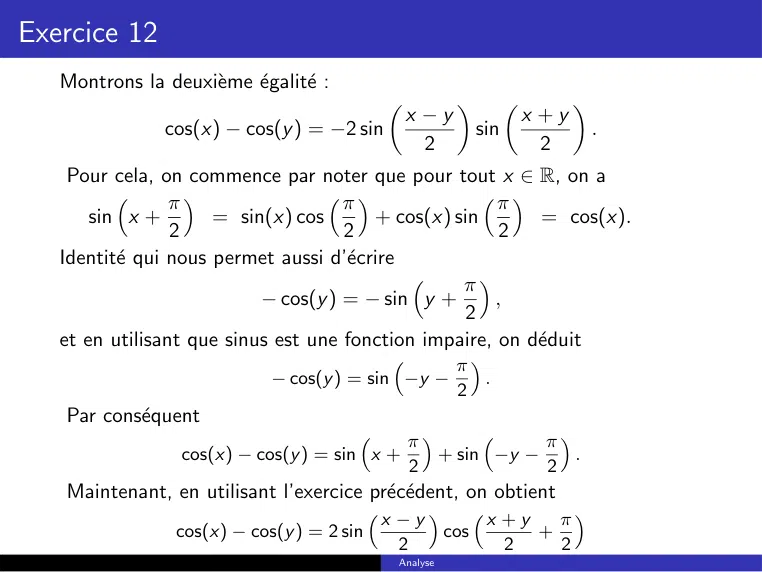

~~~text
Exercice 12
   Montrons la deuxième égalité :
                                                                             
                                                  x −y                   x +y
               cos(x) − cos(y ) = −2 sin                       sin                  .
                                                    2                      2
    Pour cela, on commence par noter que pour tout x ∈ R, on a
                π                π                π
       sin x +        = sin(x) cos       + cos(x) sin       = cos(x).
                 2                   2                  2
   Identité qui nous permet aussi d’écrire
                                                  π
                           − cos(y ) = − sin y +       ,
                                                   2
   et en utilisant que sinus est une fonction impaire, on déduit
                                                 π
                             − cos(y ) = sin −y −    .
                                                  2
   Par conséquent
                                           π           π
                 cos(x) − cos(y ) = sin x +    + sin −y −    .
                                            2             2
   Maintenant, en utilisant l’exercice précédent, on obtient
                                            x − y            x + y         π
                 cos(x) − cos(y ) = 2 sin                cos              +
                                               2                     2        2
                                               Analyse
~~~

## Page 67

~~~text
Exercice 12

   Finalement
                                                          
         x +y   π               x +y        π         x +y      π
   cos        +         = cos           cos     − sin         sin
           2    2                 2          2            2       2
                                       
                                  x +y
                        = − sin           .
                                    2

   d’où on conclut
                                                            
                                       x −y          x +y    π
           cos(x) − cos(y )   = 2 sin          cos         +
                                         2             2     2
                                                        
                                         x −y         x +y
                              = −2 sin           sin         .
                                           2             2

                                          Analyse
~~~

## Page 68

~~~text
Exercice 12

   Méthode 2 : En utilisant directement les formules de produit. En effet :
       x − y      x + y         1     x + y     x −y        x + y      x − y 
   sin          sin            =       cos          −        − cos           +
          2            2            2           2        2             2         2
                                    1
                               =      (cos(y ) − cos(x)) .
                                    2
   Ainsi                                     x − y          x + y 
                 cos(x) − cos(y ) = −2 sin              sin              .
                                                   2             2

                                             Analyse
~~~

## Page 69

~~~text
Exercice 12
   Démontrer la formule suivante
                                          tan(x) + tan(y )
                         tan(x + y ) =
                                         1 − tan(x) tan(y )

   Solution : En utilisant la définition de la tangente, on peut écrire
                                     sin(x)   sin(y )
                tan(x) + tan(y )     cos(x) + cos(y )
                                  =
               1 − tan(x) tan(y )   1 − sin(x) sin(y )
                                            cos(x) cos(y )
                                       sin(x) cos(y )+cos(x) sin(y )
                                               cos(x) cos(y )
                                   =   cos(x) cos(y )−sin(x) sin(y )
                                               cos(x) cos(y )
                                     sin(x) cos(y ) + cos(x) sin(y )
                                   =
                                     cos(x) cos(y ) − sin(x) sin(y )
                                      sin(x + y )
                                   =
                                     cos(x + y )
                                   = tan(x + y )

                                              Analyse
~~~

## Page 70

~~~text
Exercice 12

   Autre Méthode :
                        sin(x + y )
           tan(x + y ) =
                        cos(x + y )
                        sin(x) cos(y ) + cos(x) sin(y )
                      =
                        cos(x) cos(y ) − sin(x) sin(y )
                                                                            
                                         sin(x) cos(y )       cos(x) sin(y )
                        cos(x) cos(y ) cos(x)    cos(y )  +   cos(x) cos(y )
                      =                                              
                                                       sin(x) sin(y )
                             cos(x) cos(y ) 1 − cos(x) cos(y )
                                                              
                                          sin(x)      sin(y )
                         cos(x) cos(y ) cos(x)    + cos(y   )
                      =                                       
                                               sin(x) sin(y )
                        cos(x) cos(y ) 1 − cos(x)      cos(y )
                         sin(x)     sin(y )
                         cos(x) + cos(y )            tan(x) + tan(y )
                      =       sin(x) sin(y )
                                               =                       .
                        1 − cos(x)                  1 − tan(x) tan(y )
                                     cos(y )

                                               Analyse
~~~

## Page 71

~~~text
Exercice 12

   Soit                                   x 
                                t = tan             .
                                           2
   Démontrer les formules suivantes

                                 1 − t2
                                        = cos(x).
                                 1 + t2

                                    2t
                                         = sin(x).
                                  1 + t2

                                          Analyse
~~~

## Page 72

~~~text
Exercice 12
   Solution : Montrons la première identité. On compute
                                1 − tan2 x2
                                              
                     1 − t2
                             =
                                1 + tan2 x2
                                              
                     1 + t2
                                        sin2 ( x )
                                1 − cos2 2x
                                             (2)
                              =
                                        sin2 ( x2 )
                                1 + cos2 x
                                             (2)
                                 cos2 ( x2 )−sin2 ( x2 )
                                       cos2 ( x2 )
                              =
                                 cos2 ( x2 )+sin2 ( x2 )
                                       cos2 ( x2 )

                                cos2 x2 − sin2 x2
                                                           
                              =
                                cos2 x2 + sin2 x2
                                                           
                                       x                x 
                              = cos2              − sin2
                                      x2 x                2
                              = cos         +           = cos(x).
                                          2       2
                                             Analyse
~~~

## Page 73

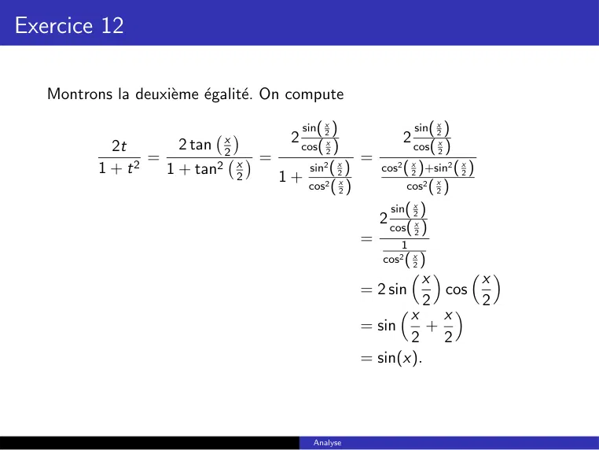

~~~text
Exercice 12

   Montrons la deuxième égalité. On compute
                                         sin( x )                  sin( x )
                     2 tan x2
                                      2 cos 2x                2 cos 2x
            2t                               (2)                      (2)
                 =              =                     =
          1 + t2   1 + tan2 x2             sin2 ( x2 )
                                     1 + cos2 x
                                                          cos2 ( x2 )+sin2 ( x2 )
                                                (2)             cos2 ( x2 )

                                                            sin( x )
                                                         2 cos 2x
                                                               (2)
                                                       =      1
                                                          cos2 ( x2 )
                                                                 x            x 
                                                       = 2 sin            cos
                                                              x 2 x  2
                                                       = sin          +
                                                                 2        2
                                                       = sin(x).

                                            Analyse
~~~

## Page 74

~~~text
Exercice 13

   Calculer
                           π        π             π
                        cos   , sin      et tan .
                           12       12            12
   Rappelons quelques valeurs remarquables du sinus, du cosinus et de la
   tangente

                                         Analyse
~~~

## Page 75

~~~text
Exercice 13

   Solution : On commence par noter que
                                 π   π π
                                    = − .
                                 12  4 6
   Alors
                           π        π       π
                     cos      = cos      −
                           12         4      6
                                    π       π       π   π
                              = cos cos + sin sin
                                    4       6       4   6
                                √     √        √
                                  2      3       2 1
                              =     ·       +     ·
                                 2      2       2 2
                                √       √       √     √
                                  6        2      6+ 2
                              =     +         =         .
                                 4        4         4

                                          Analyse
~~~

## Page 76

~~~text
Exercice 13

   et
                      π        π       π
                sin      = sin      −
                      12          4     6
                               π       π        π   π
                         = sin cos − cos sin
                                4      6        4   6
                           √       √       √
                              2      3       2 1
                         =       ·      −     ·
                             2      2       2 2
                           √        √       √     √
                              6        2      6− 2
                         =       −        =         .
                             4       4          4
   Finalement
                              π
                                   √   √
                     π    sin 12     6− 2
                 tan    =      π = √   √ .
                     12   cos 12     6+ 2

                                      Analyse
~~~

## Page 77

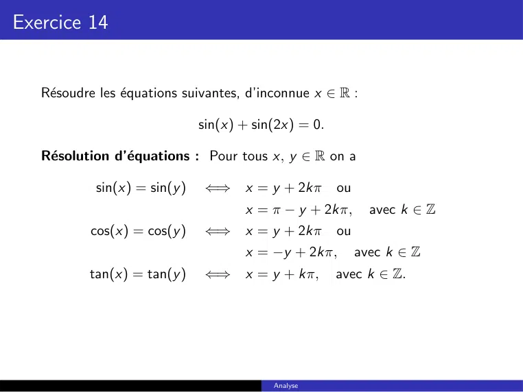

~~~text
Exercice 14

   Résoudre les équations suivantes, d’inconnue x ∈ R :

                               sin(x) + sin(2x) = 0.

   Résolution d’équations : Pour tous x, y ∈ R on a

            sin(x) = sin(y )    ⇐⇒    x = y + 2kπ      ou
                                      x = π − y + 2kπ,        avec k ∈ Z
           cos(x) = cos(y )     ⇐⇒    x = y + 2kπ      ou
                                      x = −y + 2kπ,         avec k ∈ Z
           tan(x) = tan(y )     ⇐⇒    x = y + kπ,      avec k ∈ Z.

                                           Analyse
~~~

## Page 78

~~~text
Exercice 14
   Solution : Pour tout x ∈ R, on a
             sin(x) + sin(2x) = 0   ⇐⇒     sin(x) + 2 sin(x) cos(x) = 0
                                    ⇐⇒     sin(x)(1 + 2 cos(x)) = 0.
   Ainsi
       sin(x) + sin(2x) = 0    ⇐⇒       sin(x) = 0 ou (1 + 2 cos(x)) = 0.
   Maintenant
       sin(x) = 0, si et seulement si
                                    x = kπ,       k ∈ Z.
       (1 + 2 cos(x)) = 0, si et seulement si
                                             1
                                  cos(x) = − .
                                             2
       Essayons de trouver x tel que cos(x) = − 12 . La table de valeurs
       remarquables nous dit que cos π3 = 12 , mais
                                        
                                              
                  π         π    1        2π
           cos π −    = − cos     = − =⇒ cos     = −1/2.
                   3           3     2         3
                                              Analyse
~~~

## Page 79

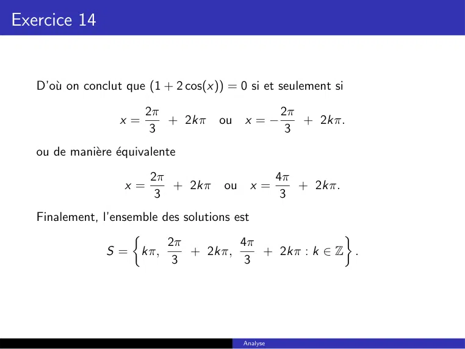

~~~text
Exercice 14

   D’où on conclut que (1 + 2 cos(x)) = 0 si et seulement si

                         2π                          2π
                   x=       + 2kπ    ou x = −           + 2kπ.
                          3                           3
   ou de manière équivalente
                         2π                          4π
                    x=      + 2kπ     ou     x=         + 2kπ.
                          3                           3
   Finalement, l’ensemble des solutions est
                                                        
                           2π            4π
                S = kπ,        + 2kπ,       + 2kπ : k ∈ Z .
                            3             3

                                           Analyse
~~~

## Page 80

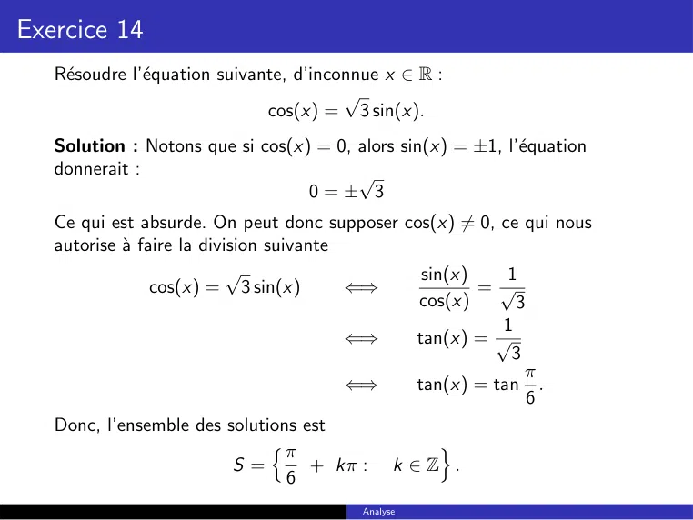

~~~text
Exercice 14
   Résoudre l’équation suivante, d’inconnue x ∈ R :
                                         √
                               cos(x) = 3 sin(x).
   Solution : Notons que si cos(x) = 0, alors sin(x) = ±1, l’équation
   donnerait :                          √
                                  0=± 3
   Ce qui est absurde. On peut donc supposer cos(x) 6= 0, ce qui nous
   autorise à faire la division suivante
                            √                     sin(x)    1
                 cos(x) = 3 sin(x)        ⇐⇒             =√
                                                 cos(x)      3
                                                           1
                                          ⇐⇒     tan(x) = √
                                                            3
                                                              π
                                          ⇐⇒     tan(x) = tan .
                                                               6
   Donc, l’ensemble des solutions est
                                  nπ                 o
                             S=        + kπ : k ∈ Z .
                                    6
                                          Analyse
~~~

## Page 81

~~~text
Exercice 14
   Autre méthode : Nous avons
           √                          √
   cos(x) = 3 sin(x) ⇐⇒ cos(x) − 3 sin(x) = 0
                                             √         !
                                1              3
                      ⇐⇒ 2         cos(x) −      sin(x) = 0
                                2             2
                                         √
                             1             3
                      ⇐⇒       cos(x) −      sin(x) = 0
                             2            2
                                 π               π
                      ⇐⇒ cos cos(x) − sin sin(x) = 0
                                 3               3
                                      π
                      ⇐⇒ cos x +           =0
                                       3
                                      π          π
                      ⇐⇒ cos x +           = cos
                                       3          2
                                 π     π                    π    π
                      ⇐⇒ x + = + 2kπ ou x + = − + 2kπ
                                  3    2                    3    2
                                    π π                        π π
                      ⇐⇒ x = − + + 2kπ ou x = − − + 2kπ
                                    3    2                     3   2
                                  π                      5π
                      ⇐⇒ x = + 2kπ ou x = −                 + 2kπ.
                                  6                       6
                                   Analyse
~~~

## Page 82

~~~text
Exercice 14

   Ainsi, l’ensemble des solutions est
                                                        
                             π           5π
                  S =           + 2kπ, −    + 2kπ : k ∈ Z
                             6            6
                           nπ               o
                      =         + kπ : k ∈ Z .
                             6

                                       Analyse
~~~

## Page 83

~~~text
Exercice 14
   Résoudre l’équation suivante, d’inconnue x ∈ R :

                              tan(2x) = 3 tan(x).

   Solution : Pour tout x ∈ R avec
                   π                                    π   π
               x 6= + kπ, k ∈ Z        et        x 6=     +k , k ∈Z
                   2                                    4   2
   on a
                               2 tan(x)
   tan(2x) = 3 tan(x)   ⇐⇒                = 3 tan(x)
                             1 − tan2 (x)
                        ⇐⇒ 2 tan(x) = 3 tan(x)(1 − tan2 (x))
                        ⇐⇒ tan(x)[2 − 3(1 − tan2 (x))] = 0
                        ⇐⇒ tan(x) = 0       ou    2 − 3(1 − tan2 (x)) = 0
                                                             1
                        ⇐⇒ tan(x) = 0       ou    tan2 (x) =
                                                             3
                                                            r                    r
                                                               1                   1
                        ⇐⇒ tan(x) = 0       ou    tan(x) =         ou tan(x) = −     .
                                                               3                   3

                                            Analyse
~~~

## Page 84

~~~text
Exercice 14

   Maintenant
       tan(x) = 0 si et seulement si x = kπ, k ∈ Z.
                q
       tan(x) = 13 si et seulement si x = π6 + kπ, k ∈ Z.
                  q
       tan(x) = − 13 si et seulement si x = − π6 + kπ, k ∈ Z.
   Par conséquent, l’ensemble des solutions est
                      n     π             π            o
                S = kπ,        + kπ, − + kπ :      k ∈Z .
                            6             6

                                       Analyse
~~~

## Page 85

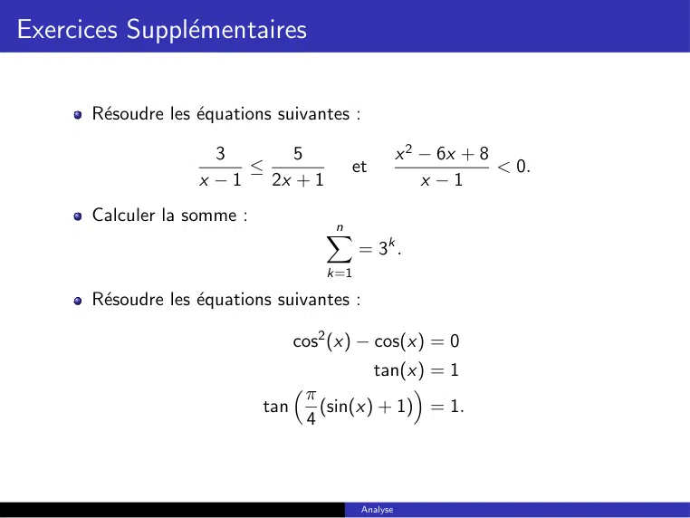

~~~text
Exercices Supplémentaires

      Résoudre les équations suivantes :

                      3       5                        x 2 − 6x + 8
                         ≤                et                        < 0.
                    x −1   2x + 1                          x −1
      Calculer la somme :
                                       n
                                       X
                                             = 3k .
                                       k=1

      Résoudre les équations suivantes :

                                  cos2 (x) − cos(x) = 0
                                              tan(x) = 1
                                  π               
                            tan        (sin(x) + 1) = 1.
                                   4

                                             Analyse
~~~
