# TD1-Reels-Correction_2023-2024_Analyse1_P1S1_NArancibia.pdf

[Ouvrir l’original](https://drive.google.com/open?id=1VjbkKGos_MA8EDqiGIbVxZGT8vJILrwF) · Les deux lectures automatiques du PDF divergent sur les pages indiquées. Leur fac-similé accompagne le texte.

**Pages présentant un écart entre les deux extractions** — 2–5, 8–9, 11, 13, 15–25, 27–37, 39–41, 43–45, 47–52, 55–67, 69–77, 79–80, 83–84, 86–94, 96–100.

## Page 1

~~~text
Analyse - Premier semestre 2023 - 2024

                                      CY Tech

                                 TD Analyse

                                           Réels.

              Nicolás Arancibia Robert CY-Tech   Analyse
~~~

## Page 2

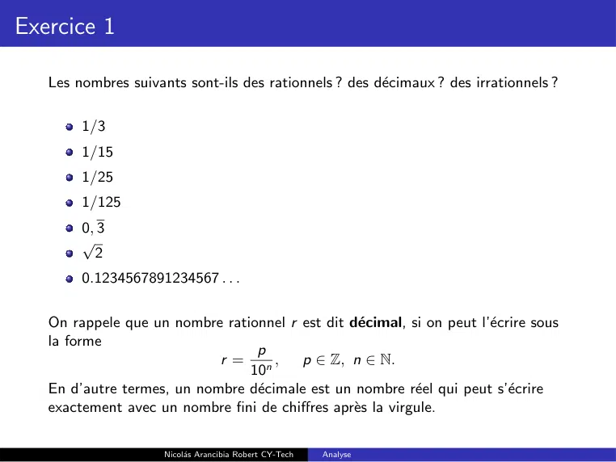

~~~text
Exercice 1

   Les nombres suivants sont-ils des rationnels ? des décimaux ? des irrationnels ?

        1/3
        1/15
        1/25
        1/125
        0, 3
        √
          2
        0.1234567891234567 . . .

   On rappele que un nombre rationnel r est dit décimal, si on peut l’écrire sous
   la forme
                                 p
                            r = n,      p ∈ Z, n ∈ N.
                                10
   En d’autre termes, un nombre décimale est un nombre réel qui peut s’écrire
   exactement avec un nombre fini de chiffres après la virgule.

                     Nicolás Arancibia Robert CY-Tech   Analyse
~~~

## Page 3

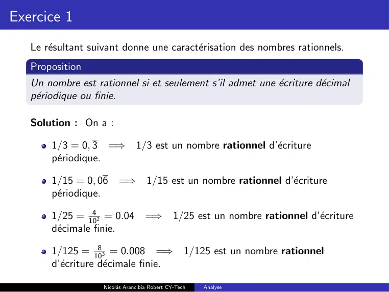

~~~text
Exercice 1
   Le résultant suivant donne une caractérisation des nombres rationnels.
   Proposition
   Un nombre est rationnel si et seulement s’il admet une écriture décimal
   périodique ou finie.

   Solution : On a :

       1/3 = 0, 3 =⇒ 1/3 est un nombre rationnel d’écriture
       périodique.

       1/15 = 0, 06      =⇒         1/15 est un nombre rationnel d’écriture
       périodique.

       1/25 = 1042 = 0.04 =⇒ 1/25 est un nombre rationnel d’écriture
       décimale finie.

       1/125 = 1083 = 0.008 =⇒                     1/125 est un nombre rationnel
       d’écriture décimale finie.

                   Nicolás Arancibia Robert CY-Tech   Analyse
~~~

## Page 4

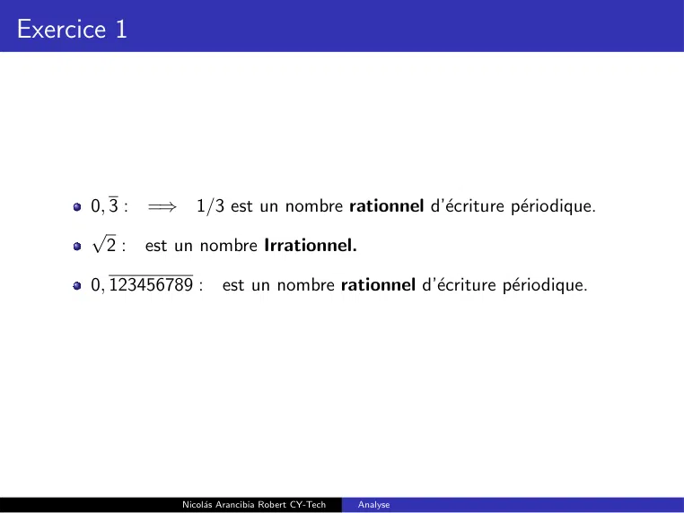

~~~text
Exercice 1

      0, 3 : =⇒ 1/3 est un nombre rationnel d’écriture périodique.
      √
        2 : est un nombre Irrationnel.

      0, 123456789 : est un nombre rationnel d’écriture périodique.

                 Nicolás Arancibia Robert CY-Tech   Analyse
~~~

## Page 5

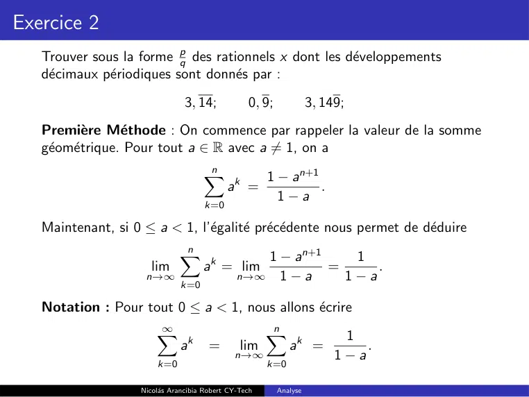

~~~text
Exercice 2
   Trouver sous la forme qp des rationnels x dont les développements
   décimaux périodiques sont donnés par :
                                3, 14;             0, 9;             3, 149;
   Première Méthode : On commence par rappeler la valeur de la somme
   géométrique. Pour tout a ∈ R avec a 6= 1, on a
                                      n
                                      X                 1 − an+1
                                             ak =                .
                                                          1−a
                                      k=0

   Maintenant, si 0 ≤ a < 1, l’égalité précédente nous permet de déduire
                               n
                               X                   1 − an+1    1
                       lim            ak = lim              =     .
                     n→∞                        n→∞ 1 − a     1−a
                               k=0

   Notation : Pour tout 0 ≤ a < 1, nous allons écrire
                        ∞                               n
                        X                               X                  1
                               ak       =        lim          ak =            .
                                               n→∞                        1−a
                        k=0                             k=0

                    Nicolás Arancibia Robert CY-Tech      Analyse
~~~

## Page 6

~~~text
Exercice 2

                                                         ?    p
                                                3, 14 =         .
                                                              q
   Solution : On a
                                              14    14       14
                       3.14 = 3 +                +     2
                                                         +      + ···
                                             100 100       1003
                                                 +∞       k
                                              14 X      1
                                =3+
                                             100               100
                                                    k=0
                                     14       1
                                =3+      ·       1
                                    100 1 − 100
                                     14 100
                                =3+      ·
                                    100 99
                                    14     311
                                =3+     =      .
                                    99      99

                     Nicolás Arancibia Robert CY-Tech       Analyse
~~~

## Page 7

~~~text
Exercice 2

                                                         ?   p
                                               3, 149 =        .
                                                             q
   Solution : On a
                                  314   9    9      9
                     3.149 =          + 3 + 4 + 5 + ···
                                  100 10    10     10
                                          +∞     k
                                  314   9 X 1
                                =     +
                                  100 103      10
                                                         k=0
                                  314   9    1
                                =     +   ·    1
                                  100 103 1 − 10
                                  314   9 10
                                =     +   ·
                                  100 103 9
                                  314   1   315
                                =     +   =     .
                                  100 100   100

                     Nicolás Arancibia Robert CY-Tech    Analyse
~~~

## Page 8

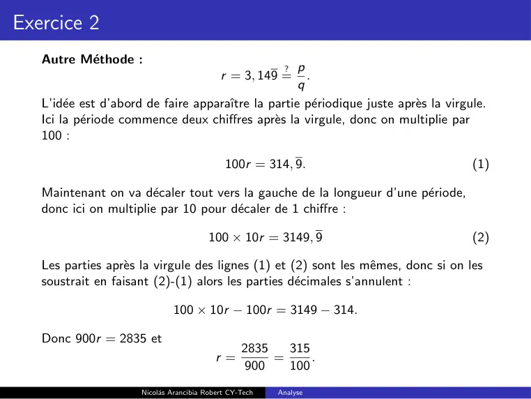

~~~text
Exercice 2
   Autre Méthode :
                                                     p     ?
                                             r = 3, 149 =
                                                       .
                                                     q
   L’idée est d’abord de faire apparaı̂tre la partie périodique juste après la virgule.
   Ici la période commence deux chiffres après la virgule, donc on multiplie par
   100 :

                                              100r = 314, 9.                           (1)

   Maintenant on va décaler tout vers la gauche de la longueur d’une période,
   donc ici on multiplie par 10 pour décaler de 1 chiffre :

                                         100 × 10r = 3149, 9                           (2)

   Les parties après la virgule des lignes (1) et (2) sont les mêmes, donc si on les
   soustrait en faisant (2)-(1) alors les parties décimales s’annulent :

                               100 × 10r − 100r = 3149 − 314.

   Donc 900r = 2835 et
                                                   2835   315
                                           r=           =     .
                                                   900    100
                      Nicolás Arancibia Robert CY-Tech   Analyse
~~~

## Page 9

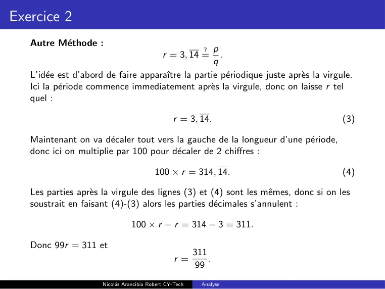

~~~text
Exercice 2
   Autre Méthode :
                                                    p        ?
                                              r = 3, 14 =
                                                      .
                                                    q
   L’idée est d’abord de faire apparaı̂tre la partie périodique juste après la virgule.
   Ici la période commence immediatement après la virgule, donc on laisse r tel
   quel :

                                                  r = 3, 14.                           (3)

   Maintenant on va décaler tout vers la gauche de la longueur d’une période,
   donc ici on multiplie par 100 pour décaler de 2 chiffres :

                                           100 × r = 314, 14.                          (4)

   Les parties après la virgule des lignes (3) et (4) sont les mêmes, donc si on les
   soustrait en faisant (4)-(3) alors les parties décimales s’annulent :

                                 100 × r − r = 314 − 3 = 311.

   Donc 99r = 311 et
                                                          311
                                                   r=         .
                                                           99
                      Nicolás Arancibia Robert CY-Tech     Analyse
~~~

## Page 10

~~~text
À faire chez soi - Exercice 2

                                                         ?   p
                                                 0, 9 =        .
                                                             q
   Solution : On a
                                              9    9   9
                           0.9 = 0 +            + 2 + 3 + ···
                                              10 10   10
                                                +∞  k
                                              9 X 1
                                  =0+
                                              10              10
                                                    k=0
                                       9     1
                                  =0+    ·     1
                                       10 1 − 10
                                       9 10
                                  =0+    ·
                                       10 9
                                       9
                                  = 0 + = 1.
                                       9

                     Nicolás Arancibia Robert CY-Tech       Analyse
~~~

## Page 11

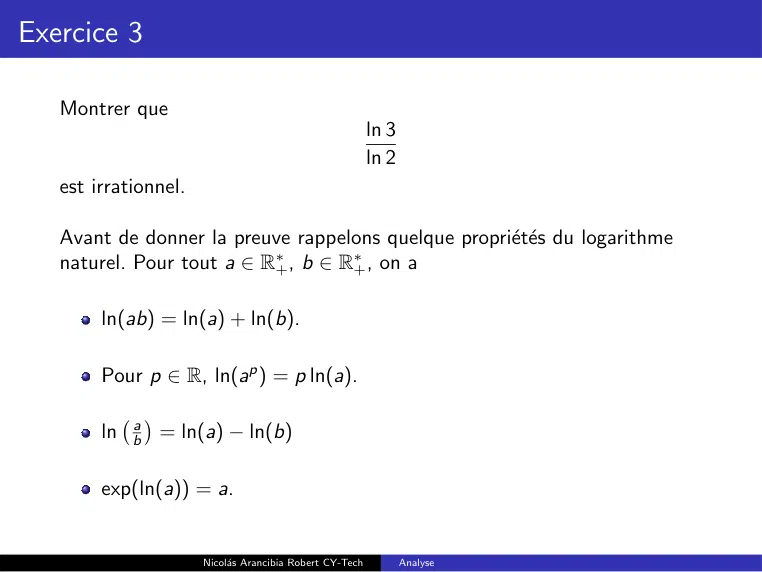

~~~text
Exercice 3

   Montrer que
                                                             ln 3
                                                             ln 2
   est irrationnel.

   Avant de donner la preuve rappelons quelque propriétés du logarithme
   naturel. Pour tout a ∈ R∗+ , b ∈ R∗+ , on a

        ln(ab) = ln(a) + ln(b).

        Pour p ∈ R, ln(ap ) = p ln(a).

             a
                 
        ln   b       = ln(a) − ln(b)

        exp(ln(a)) = a.

                         Nicolás Arancibia Robert CY-Tech          Analyse
~~~

## Page 12

~~~text
Exercice 3

   Preuve : Nous allons montrer la proposition en raisonnant par l’absurde.
   Supposons donc que ln   3
                        ln 2 est rationnel et essayons d’arriver à une
   contradiction. Autrement dit, supposons qu’il existe p ∈ Z et q ∈ Z∗ tels
   que
                                               ln 3  p
                                                    = .
                                               ln 2  q
   On a
                   ln 3   p
                        =              ⇐⇒              p ln 2 = q ln 3
                   ln 2   q
                                       ⇐⇒              ln 2p = ln 3q
                                       ⇐⇒              exp(ln 2p ) = exp(ln 3q )
                                       ⇐⇒              2p = 3q .

   Contradiction ! Par conséquent ln 3
                                   ln 2 est irrationnel.

                   Nicolás Arancibia Robert CY-Tech      Analyse
~~~

## Page 13

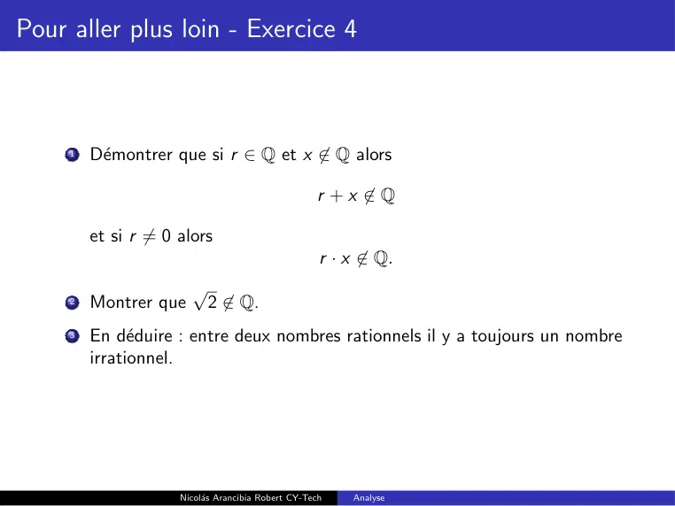

~~~text
Pour aller plus loin - Exercice 4

     1   Démontrer que si r ∈ Q et x 6∈ Q alors

                                                     r + x 6∈ Q

         et si r 6= 0 alors
                                                      r · x 6∈ Q.
                        √
     2   Montrer que        2 6∈ Q.
     3   En déduire : entre deux nombres rationnels il y a toujours un nombre
         irrationnel.

                      Nicolás Arancibia Robert CY-Tech    Analyse
~~~

## Page 14

~~~text
Pour aller plus loin - Exercice 4

   La somme et le produit d’un nombre rationnel (non-nul pour le produit)
   et d’un nombre irrationnel sont des nombres irrationnels.

   Rappelons que :
       La somme de deux nombres rationnels est un nombres rationnel. En
       effet
                          p  p0     pq 0 + p 0 q
                            + 0 =                ∈ Q.
                          q  q          qq 0

       Le produit de deux nombres rationnels est un nombres rationnel. En
       effet
                              p p0      pp 0
                                · 0 = 0 ∈ Q.
                              q q       qq
   Nous allons montrer la proposition en raisonant par l’absurde.

                     Nicolás Arancibia Robert CY-Tech   Analyse
~~~

## Page 15

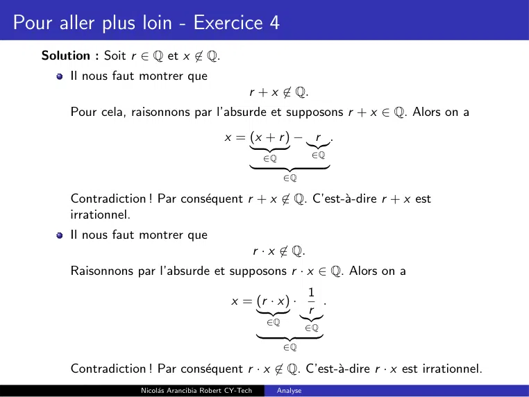

~~~text
Pour aller plus loin - Exercice 4
   Solution : Soit r ∈ Q et x 6∈ Q.
        Il nous faut montrer que
                                                     r + x 6∈ Q.
        Pour cela, raisonnons par l’absurde et supposons r + x ∈ Q. Alors on a
                                             x = (x + r ) − |{z}
                                                              r .
                                                 | {z }
                                                   ∈Q        ∈Q
                                                 |     {z      }
                                                                  ∈Q

        Contradiction ! Par conséquent r + x 6∈ Q. C’est-à-dire r + x est
        irrationnel.
        Il nous faut montrer que
                                                         r · x 6∈ Q.
        Raisonnons par l’absurde et supposons r · x ∈ Q. Alors on a
                                                             1
                                               x = (r · x) ·   .
                                                             r
                                                   | {z } |{z}
                                                             ∈Q
                                                                        ∈Q
                                                         |        {z     }
                                                                  ∈Q

        Contradiction ! Par conséquent r · x 6∈ Q. C’est-à-dire r · x est irrationnel.
                     Nicolás Arancibia Robert CY-Tech        Analyse
~~~

## Page 16

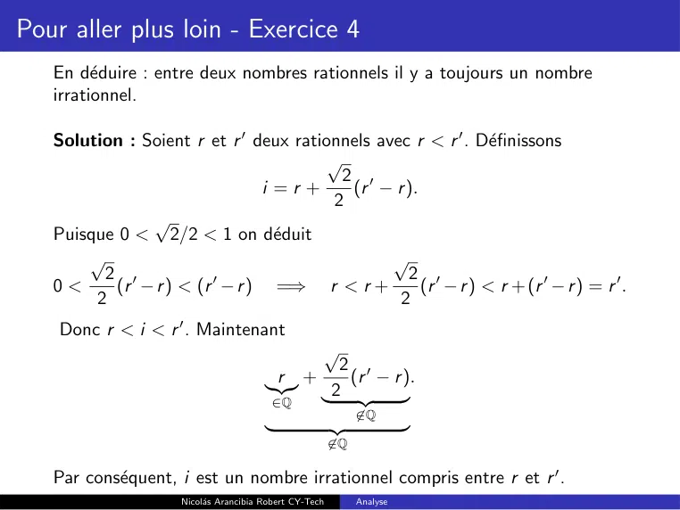

~~~text
Pour aller plus loin - Exercice 4
   En déduire : entre deux nombres rationnels il y a toujours un nombre
   irrationnel.

   Solution : Soient r et r 0 deux rationnels avec r < r 0 . Définissons
                                        √
                                          2 0
                               i =r+       (r − r ).
                                         2
               √
   Puisque 0 < 2/2 < 1 on déduit
       √                                        √
         2 0                                      2 0
   0<     (r − r ) < (r 0 − r ) =⇒ r < r +           (r − r ) < r + (r 0 − r ) = r 0 .
        2                                        2
    Donc r < i < r 0 . Maintenant
                                                     √
                                                2 0
                                          r +    (r − r ).
                                        |{z}   2
                                         ∈Q   | {z }
                                                               6∈Q
                                        |                {z              }
                                                         6∈Q

   Par conséquent, i est un nombre irrationnel compris entre r et r 0 .
                     Nicolás Arancibia Robert CY-Tech         Analyse
~~~

## Page 17

~~~text
Exercice 5

   Étant donné un ensemble A ⊂ R, écrire avec des quantificateurs les
   propriétés suivantes :
     1   10 est un majorant de A ;
     2   m est un minorant de A ;
     3   P n’est pas un majorant de A ;
     4   A est majoré ;
     5   A n’est pas minoré ;
     6   A est borné ;
     7   A n’est pas borné.

                     Nicolás Arancibia Robert CY-Tech   Analyse
~~~

## Page 18

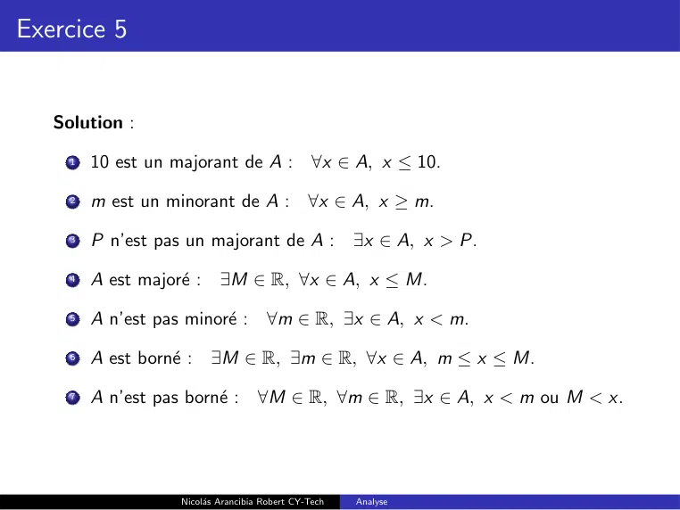

~~~text
Exercice 5

   Solution :
     1   10 est un majorant de A : ∀x ∈ A, x ≤ 10.
     2   m est un minorant de A : ∀x ∈ A, x ≥ m.
     3   P n’est pas un majorant de A : ∃x ∈ A, x > P.
     4   A est majoré : ∃M ∈ R, ∀x ∈ A, x ≤ M.
     5   A n’est pas minoré : ∀m ∈ R, ∃x ∈ A, x < m.
     6   A est borné :    ∃M ∈ R, ∃m ∈ R, ∀x ∈ A, m ≤ x ≤ M.
     7   A n’est pas borné : ∀M ∈ R, ∀m ∈ R, ∃x ∈ A, x < m ou M < x.

                     Nicolás Arancibia Robert CY-Tech   Analyse
~~~

## Page 19

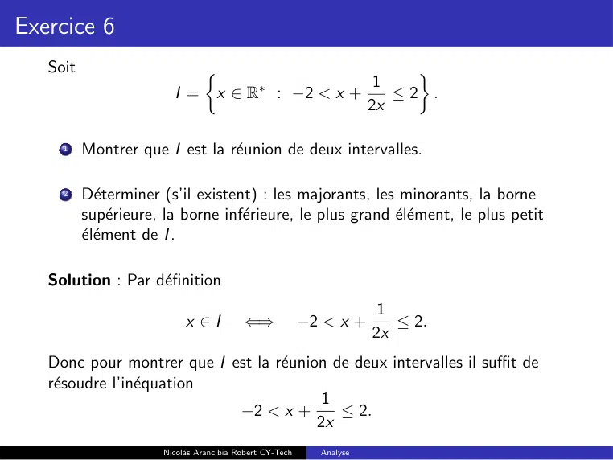

~~~text
Exercice 6
   Soit                                                                   
                                                                       1
                        I =         x ∈ R∗ : −2 < x +                    ≤2 .
                                                                      2x

     1    Montrer que I est la réunion de deux intervalles.

     2    Déterminer (s’il existent) : les majorants, les minorants, la borne
          supérieure, la borne inférieure, le plus grand élément, le plus petit
          élément de I .

   Solution : Par définition
                                                                       1
                           x ∈I           ⇐⇒              −2 < x +       ≤ 2.
                                                                      2x
   Donc pour montrer que I est la réunion de deux intervalles il suffit de
   résoudre l’inéquation
                                          1
                            −2 < x +        ≤ 2.
                                         2x
                      Nicolás Arancibia Robert CY-Tech     Analyse
~~~

## Page 20

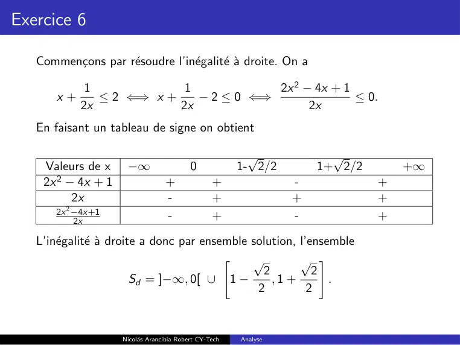

~~~text
Exercice 6

   Commençons par résoudre l’inégalité à droite. On a

             1             1            2x 2 − 4x + 1
       x+      ≤ 2 ⇐⇒ x +    − 2 ≤ 0 ⇐⇒               ≤ 0.
            2x            2x                  2x
   En faisant un tableau de signe on obtient

                                                          √             √
    Valeurs de x     −∞                    0            1- 2/2        1+ 2/2       +∞
    2x 2 − 4x + 1                 +               +               -            +
          2x                      -               +               +            +
       2x 2 −4x+1
            2x                    -               +               -            +
   L’inégalité à droite a donc par ensemble solution, l’ensemble
                                          "    √         √ #
                                                 2          2
                         Sd = ]−∞, 0[ ∪ 1 −        ,1 +        .
                                                2          2

                    Nicolás Arancibia Robert CY-Tech   Analyse
~~~

## Page 21

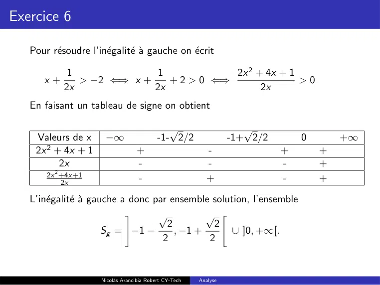

~~~text
Exercice 6

   Pour résoudre l’inégalité à gauche on écrit

            1              1            2x 2 + 4x + 1
      x+      > −2 ⇐⇒ x +    + 2 > 0 ⇐⇒               >0
           2x             2x                  2x
   En faisant un tableau de signe on obtient

                                               √                      √
    Valeurs de x      −∞                    -1- 2/2                -1+ 2/2       0       +∞
    2x 2 + 4x + 1                  +                       -                 +       +
          2x                       -                       -                 -       +
       2x 2 +4x+1
            2x                     -                       +                 -       +
   L’inégalité à gauche a donc par ensemble solution, l’ensemble
                            #      √          √ "
                                     2          2
                       Sg = −1 −       , −1 +       ∪ ]0, +∞[.
                                    2          2

                     Nicolás Arancibia Robert CY-Tech   Analyse
~~~

## Page 22

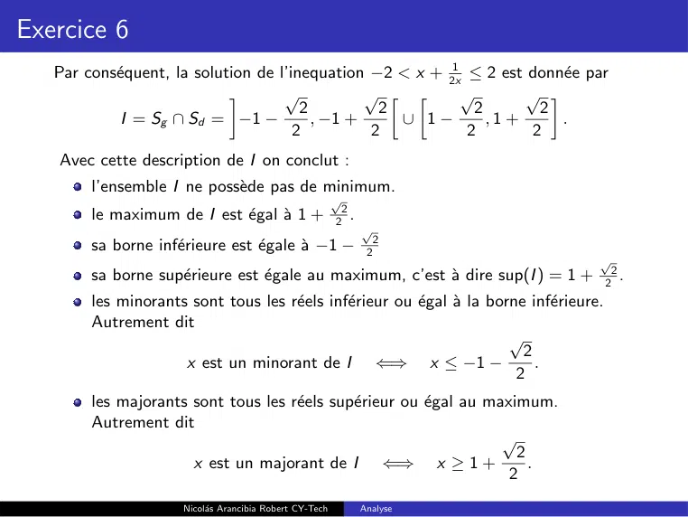

~~~text
Exercice 6
   Par conséquent, la solution de l’inequation −2 < x + 2x1 ≤ 2 est donnée par
                                   √           √         √        √ 
                                       2         2            2        2
            I = Sg ∩ Sd = −1 −           , −1 +    ∪ 1−         ,1 +     .
                                      2         2            2        2
   Avec cette description de I on conclut :
        l’ensemble I ne possède pas de minimum.
                                                          √
        le maximum de I est égal à 1 + 22 .
                                                              √
        sa borne inférieure est égale à −1 − 22
                                                                                      √
        sa borne supérieure est égale au maximum, c’est à dire sup(I ) = 1 + 22 .
        les minorants sont tous les réels inférieur ou égal à la borne inférieure.
        Autrement dit
                                                                        √
                                                                          2
                     x est un minorant de I ⇐⇒ x ≤ −1 −                     .
                                                                         2
        les majorants sont tous les réels supérieur ou égal au maximum.
        Autrement dit
                                                                    √
                                                                      2
                      x est un majorant de I ⇐⇒ x ≥ 1 +                 .
                                                                     2
                      Nicolás Arancibia Robert CY-Tech       Analyse
~~~

## Page 23

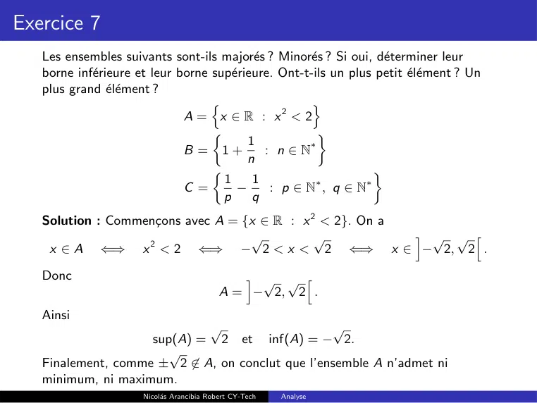

~~~text
Exercice 7
   Les ensembles suivants sont-ils majorés ? Minorés ? Si oui, déterminer leur
   borne inférieure et leur borne supérieure. Ont-t-ils un plus petit élément ? Un
   plus grand élément ?
                                   n                  o
                              A = x ∈ R : x2 < 2
                                                      
                                          1          ∗
                              B = 1+         : n∈N
                                          n
                                                                
                                     1     1
                              C =       −     : p ∈ N∗ , q ∈ N∗
                                     p     q
   Solution : Commençons avec A = {x ∈ R : x 2 < 2}. On a
                                    √          √           i √ √ h
    x ∈ A ⇐⇒ x 2 < 2 ⇐⇒ − 2 < x < 2 ⇐⇒ x ∈ − 2, 2 .

   Donc                                        i √ √ h
                                            A = − 2, 2 .
   Ainsi
                             √                    √
                    sup(A) = 2 et inf(A) = − 2.
                       √
   Finalement, comme ± 2 6∈ A, on conclut que l’ensemble A n’admet ni
   minimum, ni maximum.
                      Nicolás Arancibia Robert CY-Tech   Analyse
~~~

## Page 24

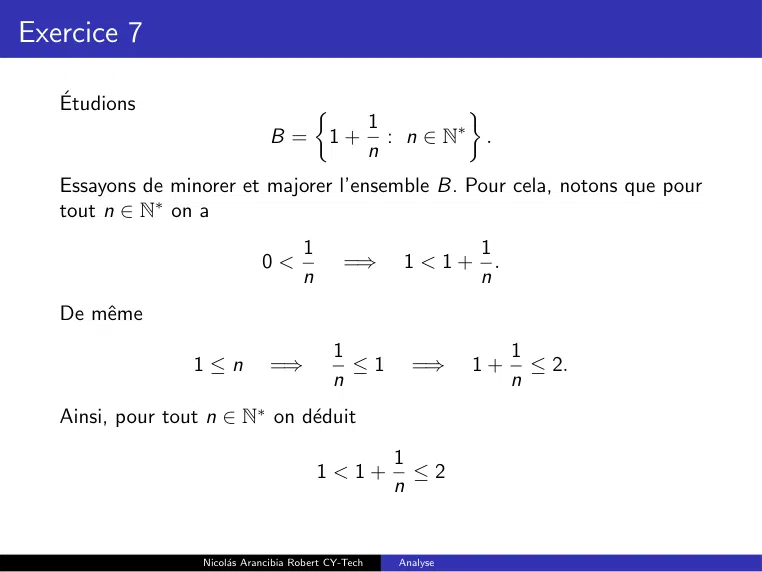

~~~text
Exercice 7

   Étudions                                                    
                                                       1
                                B=           1+          : n ∈ N∗ .
                                                       n
   Essayons de minorer et majorer l’ensemble B. Pour cela, notons que pour
   tout n ∈ N∗ on a
                                       1                      1
                               0<              =⇒         1<1+ .
                                       n                      n
   De même
                                             1                           1
                  1≤n           =⇒             ≤1           =⇒      1+     ≤ 2.
                                             n                           n
   Ainsi, pour tout n ∈ N∗ on déduit
                                                         1
                                           1<1+            ≤2
                                                         n

                   Nicolás Arancibia Robert CY-Tech      Analyse
~~~

## Page 25

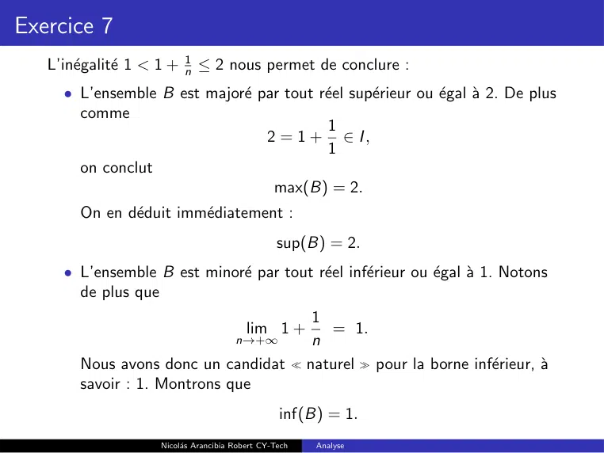

~~~text
Exercice 7
   L’inégalité 1 < 1 + n1 ≤ 2 nous permet de conclure :
     • L’ensemble B est majoré par tout réel supérieur ou égal à 2. De plus
       comme
                                           1
                                 2 = 1 + ∈ I,
                                           1
       on conclut
                                  max(B) = 2.
       On en déduit immédiatement :
                                                 sup(B) = 2.
     • L’ensemble B est minoré par tout réel inférieur ou égal à 1. Notons
       de plus que
                                      1
                                        = 1.
                                         lim 1 +
                                      n
                                      n→+∞

       Nous avons donc un candidat  naturel  pour la borne inférieur, à
       savoir : 1. Montrons que
                                                 inf(B) = 1.
                   Nicolás Arancibia Robert CY-Tech   Analyse
~~~

## Page 26

~~~text
Exercice 7
   On doit pour cela montrer :
                     
                        1 est un minorant de B
                        1 est le plus grand des minorants de B
                     
                        1 est un minorant de B
              ⇐⇒
                        ∀m > 1, m n’est pas un minorant de B
                     
                        1 est un minorant de B
              ⇐⇒
                        ∀m > 1, ∃x ∈ B, x < m
   On sait déjà que 1 est un minorant. Montrons que :
                                ∀m > 1, ∃x ∈ B, x < m.
   Soit m > 1, on doit montrer qu’il existe n ∈ N∗ tel que
                                        1
                                   x =1+  < m.
                                        n
   Cela revient à montrer qu’il existe n ∈ N∗ tel que
                         1                                     1
                           < m−1                       ⇐⇒         < n.
                         n                                    m−1
                   Nicolás Arancibia Robert CY-Tech    Analyse
~~~

## Page 27

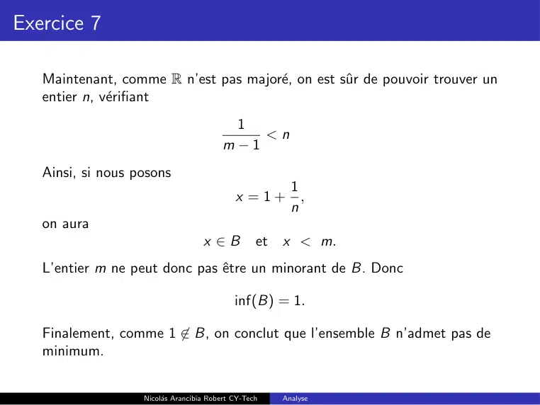

~~~text
Exercice 7

   Maintenant, comme R n’est pas majoré, on est sûr de pouvoir trouver un
   entier n, vérifiant
                                          1
                                             <n
                                         m−1
   Ainsi, si nous posons
                                                  1
                                             x =1+ ,
                                                  n
   on aura
                                    x ∈B           et   x < m.
   L’entier m ne peut donc pas être un minorant de B. Donc

                                             inf(B) = 1.

   Finalement, comme 1 6∈ B, on conclut que l’ensemble B n’admet pas de
   minimum.

                   Nicolás Arancibia Robert CY-Tech    Analyse
~~~

## Page 28

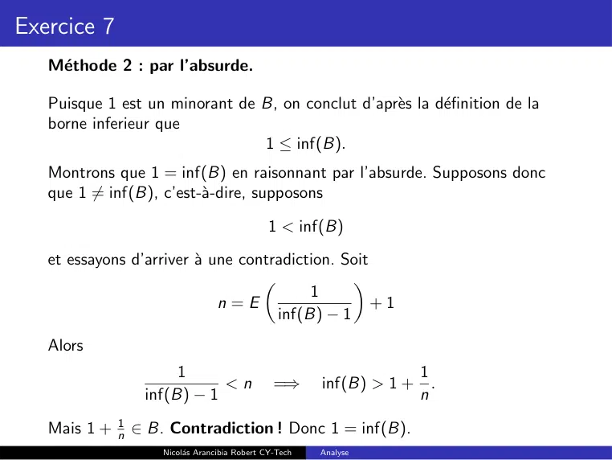

~~~text
Exercice 7
   Méthode 2 : par l’absurde.

   Puisque 1 est un minorant de B, on conclut d’après la définition de la
   borne inferieur que
                                1 ≤ inf(B).
   Montrons que 1 = inf(B) en raisonnant par l’absurde. Supposons donc
   que 1 6= inf(B), c’est-à-dire, supposons

                                             1 < inf(B)

   et essayons d’arriver à une contradiction. Soit
                                               
                                          1
                             n=E                    +1
                                     inf(B) − 1
   Alors
                      1                                            1
                            <n                 =⇒      inf(B) > 1 + .
                 inf(B) − 1                                        n

   Mais 1 + n1 ∈ B. Contradiction ! Donc 1 = inf(B).
                   Nicolás Arancibia Robert CY-Tech   Analyse
~~~

## Page 29

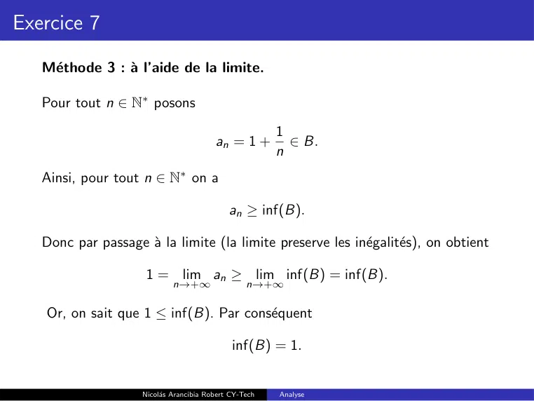

~~~text
Exercice 7

   Méthode 3 : à l’aide de la limite.

   Pour tout n ∈ N∗ posons
                                                        1
                                         an = 1 +         ∈ B.
                                                        n
   Ainsi, pour tout n ∈ N∗ on a

                                             an ≥ inf(B).

   Donc par passage à la limite (la limite preserve les inégalités), on obtient

                     1 = lim an ≥ lim inf(B) = inf(B).
                             n→+∞                 n→+∞

   Or, on sait que 1 ≤ inf(B). Par conséquent

                                              inf(B) = 1.

                    Nicolás Arancibia Robert CY-Tech   Analyse
~~~

## Page 30

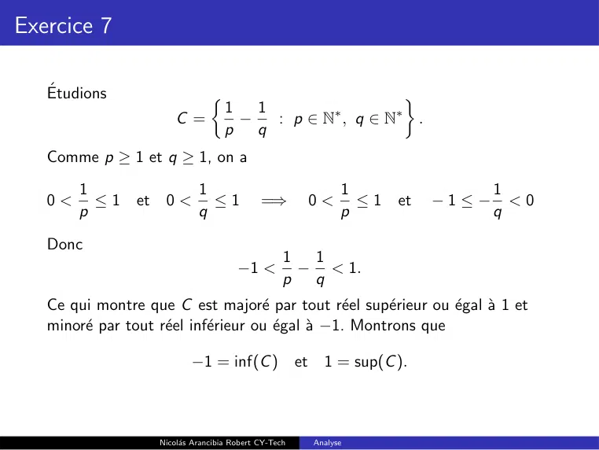

~~~text
Exercice 7

   Étudions                                                
                                      1   1
                         C=             −   : p ∈ N∗ , q ∈ N∗ .
                                      p   q
   Comme p ≥ 1 et q ≥ 1, on a
        1                      1                                    1                  1
   0<     ≤1    et    0<         ≤1            =⇒             0<      ≤1   et   −1≤−     <0
        p                      q                                    p                  q
   Donc
                                                     1  1
                                         −1 <          − < 1.
                                                     p  q
   Ce qui montre que C est majoré par tout réel supérieur ou égal à 1 et
   minoré par tout réel inférieur ou égal à −1. Montrons que

                             −1 = inf(C )                et     1 = sup(C ).

                     Nicolás Arancibia Robert CY-Tech        Analyse
~~~

## Page 31

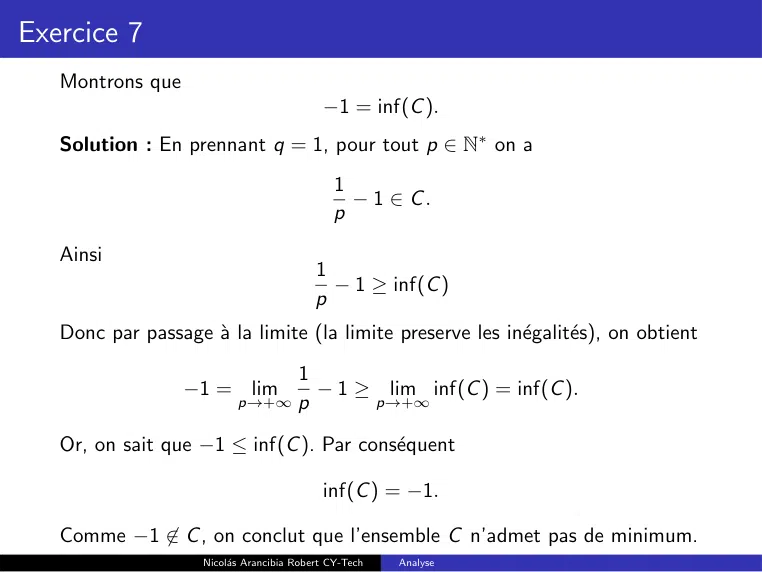

~~~text
Exercice 7
   Montrons que
                                            −1 = inf(C ).
   Solution : En prennant q = 1, pour tout p ∈ N∗ on a
                                              1
                                                − 1 ∈ C.
                                              p
   Ainsi
                                           1
                                             − 1 ≥ inf(C )
                                           p
   Donc par passage à la limite (la limite preserve les inégalités), on obtient
                                       1
                  −1 = lim                 − 1 ≥ lim inf(C ) = inf(C ).
                           p→+∞ p                       p→+∞

   Or, on sait que −1 ≤ inf(C ). Par conséquent

                                            inf(C ) = −1.

   Comme −1 6∈ C , on conclut que l’ensemble C n’admet pas de minimum.
                    Nicolás Arancibia Robert CY-Tech    Analyse
~~~

## Page 32

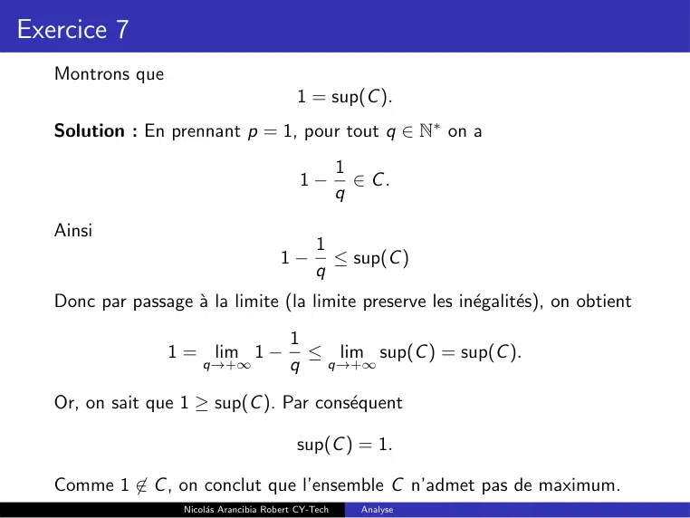

~~~text
Exercice 7
   Montrons que
                                             1 = sup(C ).
   Solution : En prennant p = 1, pour tout q ∈ N∗ on a
                                                        1
                                              1−          ∈ C.
                                                        q
   Ainsi
                                                 1
                                         1−        ≤ sup(C )
                                                 q
   Donc par passage à la limite (la limite preserve les inégalités), on obtient
                                            1
                  1 = lim 1 −                 ≤ lim sup(C ) = sup(C ).
                        q→+∞                q q→+∞

   Or, on sait que 1 ≥ sup(C ). Par conséquent

                                             sup(C ) = 1.

   Comme 1 6∈ C , on conclut que l’ensemble C n’admet pas de maximum.
                    Nicolás Arancibia Robert CY-Tech     Analyse
~~~

## Page 33

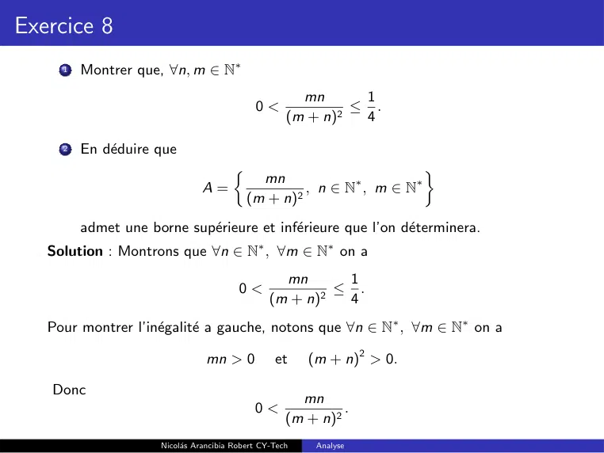

~~~text
Exercice 8
     1   Montrer que, ∀n, m ∈ N∗
                                                        mn      1
                                              0<               ≤ .
                                                      (m + n)2  4

     2   En déduire que
                                                                         
                                              mn
                                A=                   , n ∈ N∗ , m ∈ N∗
                                            (m + n)2
         admet une borne supérieure et inférieure que l’on déterminera.
   Solution : Montrons que ∀n ∈ N∗ , ∀m ∈ N∗ on a
                                                    mn      1
                                          0<               ≤ .
                                                  (m + n)2  4
   Pour montrer l’inégalité a gauche, notons que ∀n ∈ N∗ , ∀m ∈ N∗ on a

                                 mn > 0            et     (m + n)2 > 0.

   Donc
                                                        mn
                                              0<               .
                                                      (m + n)2
                      Nicolás Arancibia Robert CY-Tech    Analyse
~~~

## Page 34

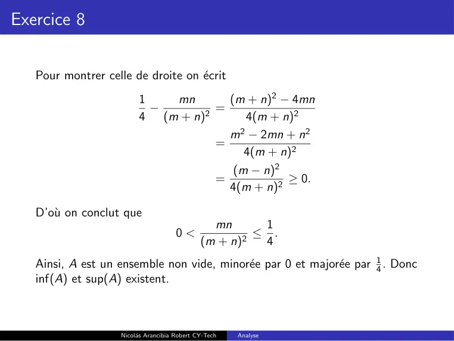

~~~text
Exercice 8

   Pour montrer celle de droite on écrit
                          1   mn       (m + n)2 − 4mn
                            −        =
                          4 (m + n)2       4(m + n)2
                                       m − 2mn + n2
                                         2
                                     =
                                          4(m + n)2
                                        (m − n)2
                                     =            ≥ 0.
                                       4(m + n)2

   D’où on conclut que
                                                 mn      1
                                       0<               ≤ .
                                               (m + n)2  4
   Ainsi, A est un ensemble non vide, minorée par 0 et majorée par 14 . Donc
   inf(A) et sup(A) existent.

                    Nicolás Arancibia Robert CY-Tech   Analyse
~~~

## Page 35

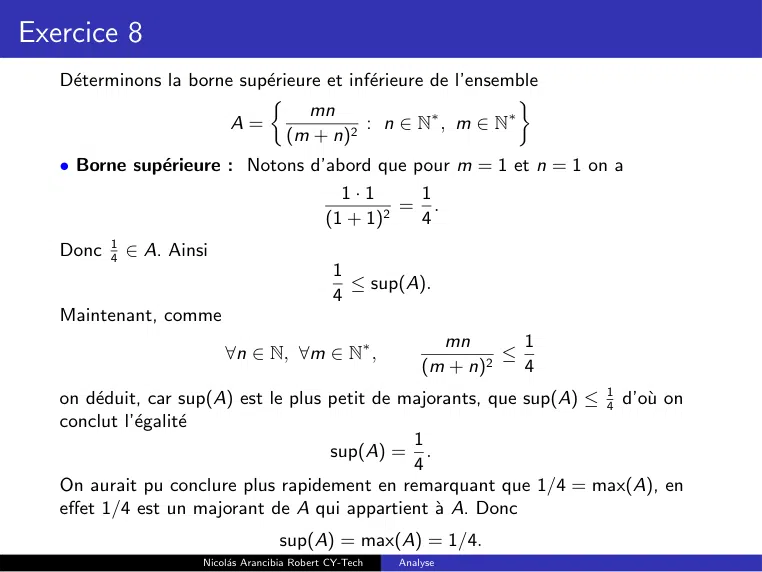

~~~text
Exercice 8
   Déterminons la borne supérieure et inférieure de l’ensemble
                                                               
                                   mn               ∗         ∗
                        A=                :   n ∈ N   , m ∈ N
                                (m + n)2
   • Borne supérieure : Notons d’abord que pour m = 1 et n = 1 on a
                                    1·1      1
                                           = .
                                  (1 + 1)2   4
   Donc 14 ∈ A. Ainsi
                                               1
                                                 ≤ sup(A).
                                               4
   Maintenant, comme
                                                               mn       1
                         ∀n ∈ N, ∀m ∈ N∗ ,                            ≤
                                                             (m + n)2   4
   on déduit, car sup(A) est le plus petit de majorants, que sup(A) ≤ 14 d’où on
   conclut l’égalité
                                                1
                                      sup(A) = .
                                                4
   On aurait pu conclure plus rapidement en remarquant que 1/4 = max(A), en
   effet 1/4 est un majorant de A qui appartient à A. Donc
                                    sup(A) = max(A) = 1/4.
                     Nicolás Arancibia Robert CY-Tech   Analyse
~~~

## Page 36

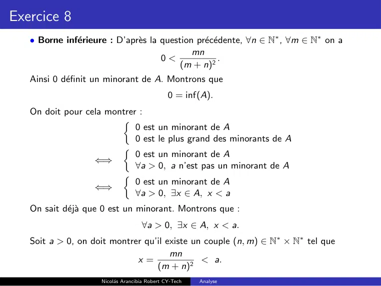

~~~text
Exercice 8
   • Borne inférieure : D’après la question précédente, ∀n ∈ N∗ , ∀m ∈ N∗ on a
                                             mn
                                     0<              .
                                          (m + n)2
   Ainsi 0 définit un minorant de A. Montrons que
                                                0 = inf(A).
   On doit pour cela montrer :
                        
                            0 est un minorant de A
                            0 est le plus grand des minorants de A
                        
                            0 est un minorant de A
                  ⇐⇒
                            ∀a > 0, a n’est pas un minorant de A
                        
                            0 est un minorant de A
                  ⇐⇒
                            ∀a > 0, ∃x ∈ A, x < a
   On sait déjà que 0 est un minorant. Montrons que :
                                     ∀a > 0, ∃x ∈ A, x < a.
   Soit a > 0, on doit montrer qu’il existe un couple (n, m) ∈ N∗ × N∗ tel que
                                      mn
                             x=               < a.
                                  (m + n)2
                     Nicolás Arancibia Robert CY-Tech   Analyse
~~~

## Page 37

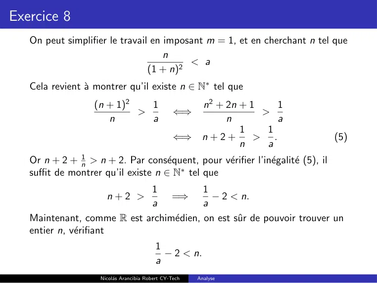

~~~text
Exercice 8
   On peut simplifier le travail en imposant m = 1, et en cherchant n tel que
                                    n
                                         < a
                                (1 + n)2
   Cela revient à montrer qu’il existe n ∈ N∗ tel que
                   (n + 1)2   1                           n2 + 2n + 1    1
                            >                      ⇐⇒                 >
                      n       a                                n         a
                                                                  1    1
                                                   ⇐⇒     n+2+       > .          (5)
                                                                  n    a
   Or n + 2 + n1 > n + 2. Par conséquent, pour vérifier l’inégalité (5), il
   suffit de montrer qu’il existe n ∈ N∗ tel que
                            1            1
                       n+2 >     =⇒        − 2 < n.
                            a            a
   Maintenant, comme R est archimédien, on est sûr de pouvoir trouver un
   entier n, vérifiant
                                           1
                                             − 2 < n.
                                           a
                     Nicolás Arancibia Robert CY-Tech   Analyse
~~~

## Page 38

~~~text
Exercice 8

   Ainsi, il existe
                                                             n
                                 x ∈ A, x =                        < a.
                                                          (n + 1)2
   Le nombre a ne peut donc pas être un minorant de A. Donc

                                                inf(A) = 0.

                      Nicolás Arancibia Robert CY-Tech     Analyse
~~~

## Page 39

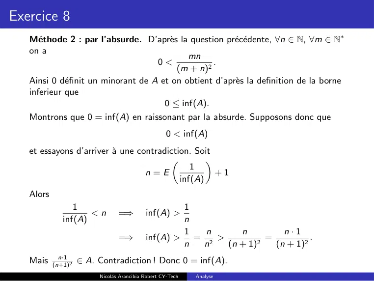

~~~text
Exercice 8
   Méthode 2 : par l’absurde. D’après la question précédente, ∀n ∈ N, ∀m ∈ N∗
   on a
                                            mn
                                    0<            .
                                         (m + n)2
   Ainsi 0 définit un minorant de A et on obtient d’après la definition de la borne
   inferieur que
                                      0 ≤ inf(A).
   Montrons que 0 = inf(A) en raissonant par la absurde. Supposons donc que
                                                0 < inf(A)
   et essayons d’arriver à une contradiction. Soit
                                                 
                                              1
                                  n=E               +1
                                           inf(A)
   Alors
              1                                 1
                  <n        =⇒          inf(A) >
           inf(A)                               n
                                                1  n      n         n·1
                            =⇒          inf(A) > = 2 >          =          .
                                                n n    (n + 1)2   (n + 1)2
          n·1
   Mais (n+1) 2 ∈ A. Contradiction ! Donc 0 = inf(A).

                     Nicolás Arancibia Robert CY-Tech   Analyse
~~~

## Page 40

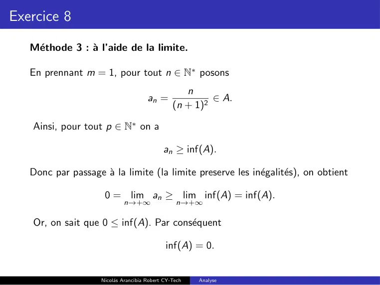

~~~text
Exercice 8
   Méthode 3 : à l’aide de la limite.

   En prennant m = 1, pour tout n ∈ N∗ posons
                                                    n
                                       an =               ∈ A.
                                                 (n + 1)2

   Ainsi, pour tout p ∈ N∗ on a

                                             an ≥ inf(A).

   Donc par passage à la limite (la limite preserve les inégalités), on obtient

                     0 = lim an ≥ lim inf(A) = inf(A).
                             n→+∞                 n→+∞

   Or, on sait que 0 ≤ inf(A). Par conséquent

                                              inf(A) = 0.

                    Nicolás Arancibia Robert CY-Tech   Analyse
~~~

## Page 41

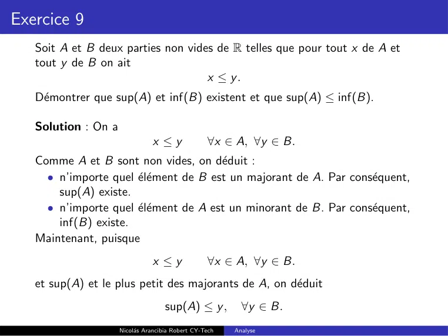

~~~text
Exercice 9
   Soit A et B deux parties non vides de R telles que pour tout x de A et
   tout y de B on ait
                                    x ≤ y.
   Démontrer que sup(A) et inf(B) existent et que sup(A) ≤ inf(B).

   Solution : On a
                                x ≤y               ∀x ∈ A, ∀y ∈ B.
   Comme A et B sont non vides, on déduit :
     • n’importe quel élément de B est un majorant de A. Par conséquent,
       sup(A) existe.
     • n’importe quel élément de A est un minorant de B. Par conséquent,
       inf(B) existe.
   Maintenant, puisque
                                x ≤y               ∀x ∈ A, ∀y ∈ B.
   et sup(A) et le plus petit des majorants de A, on déduit
                                     sup(A) ≤ y ,          ∀y ∈ B.
                     Nicolás Arancibia Robert CY-Tech   Analyse
~~~

## Page 42

~~~text
Exercice 9

   Ainsi sup(A) est un minorant de B, et comme inf(B) est le plus grand
   minorant de B, on conclut

                                       sup(A) ≤ inf(B).

                  Nicolás Arancibia Robert CY-Tech   Analyse
~~~

## Page 43

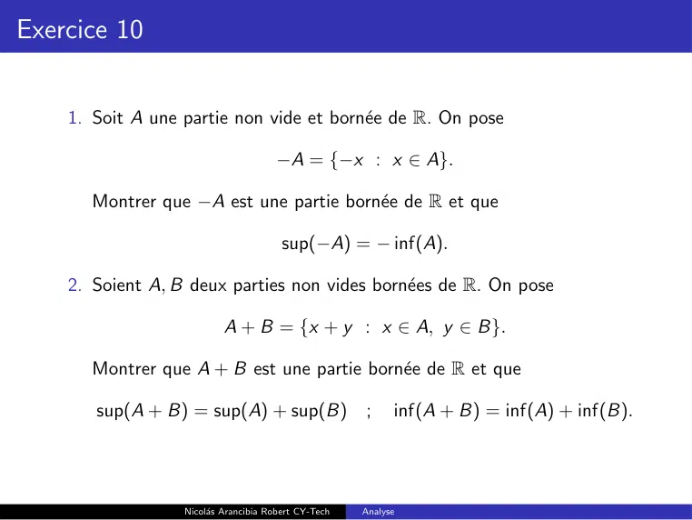

~~~text
Exercice 10

    1. Soit A une partie non vide et bornée de R. On pose

                                      −A = {−x : x ∈ A}.

       Montrer que −A est une partie bornée de R et que

                                        sup(−A) = − inf(A).

    2. Soient A, B deux parties non vides bornées de R. On pose

                          A + B = {x + y : x ∈ A, y ∈ B}.

       Montrer que A + B est une partie bornée de R et que

       sup(A + B) = sup(A) + sup(B)                   ;     inf(A + B) = inf(A) + inf(B).

                  Nicolás Arancibia Robert CY-Tech   Analyse
~~~

## Page 44

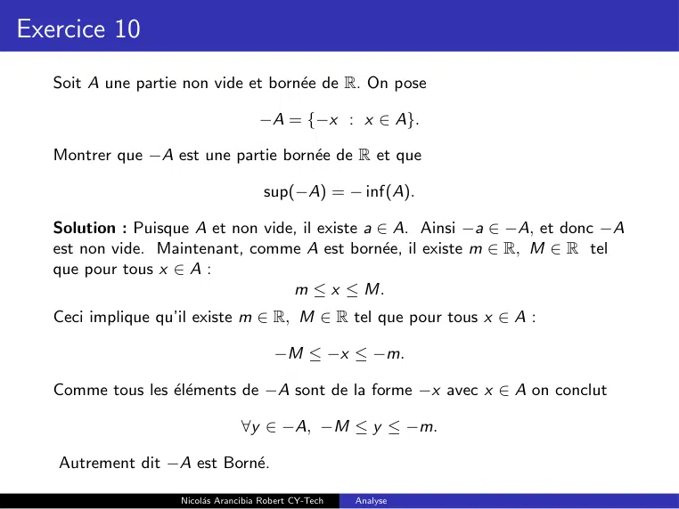

~~~text
Exercice 10
   Soit A une partie non vide et bornée de R. On pose

                                      −A = {−x : x ∈ A}.

   Montrer que −A est une partie bornée de R et que

                                       sup(−A) = − inf(A).

   Solution : Puisque A et non vide, il existe a ∈ A. Ainsi −a ∈ −A, et donc −A
   est non vide. Maintenant, comme A est bornée, il existe m ∈ R, M ∈ R tel
   que pour tous x ∈ A :
                                   m ≤ x ≤ M.
   Ceci implique qu’il existe m ∈ R, M ∈ R tel que pour tous x ∈ A :

                                         −M ≤ −x ≤ −m.

   Comme tous les éléments de −A sont de la forme −x avec x ∈ A on conclut

                                 ∀y ∈ −A, −M ≤ y ≤ −m.

   Autrement dit −A est Borné.

                    Nicolás Arancibia Robert CY-Tech   Analyse
~~~

## Page 45

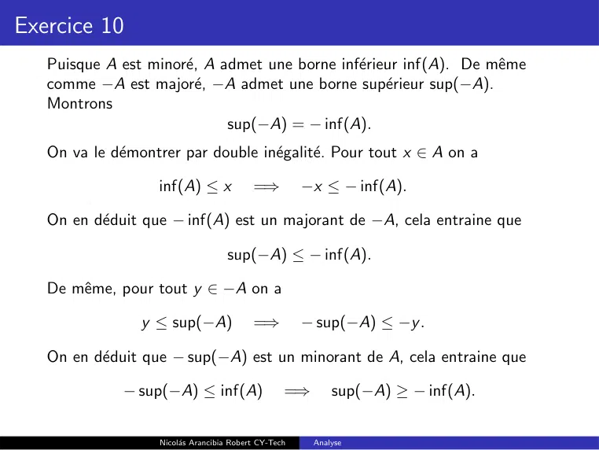

~~~text
Exercice 10
   Puisque A est minoré, A admet une borne inférieur inf(A). De même
   comme −A est majoré, −A admet une borne supérieur sup(−A).
   Montrons
                             sup(−A) = − inf(A).
   On va le démontrer par double inégalité. Pour tout x ∈ A on a

                   inf(A) ≤ x              =⇒          −x ≤ − inf(A).

   On en déduit que − inf(A) est un majorant de −A, cela entraine que

                                    sup(−A) ≤ − inf(A).

   De même, pour tout y ∈ −A on a

                y ≤ sup(−A)                =⇒          − sup(−A) ≤ −y .

   On en déduit que − sup(−A) est un minorant de A, cela entraine que

              − sup(−A) ≤ inf(A)                   =⇒       sup(−A) ≥ − inf(A).

                   Nicolás Arancibia Robert CY-Tech    Analyse
~~~

## Page 46

~~~text
Exercice 10

   Donc
              sup(−A) ≥ − inf(A)                         et      sup(−A) ≤ − inf(A).
   Par conséquent
                                      sup(−A) = − inf(A).

                     Nicolás Arancibia Robert CY-Tech        Analyse
~~~

## Page 47

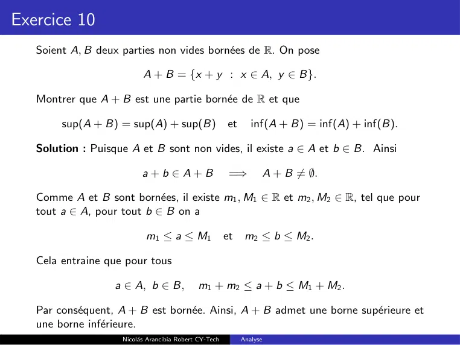

~~~text
Exercice 10
   Soient A, B deux parties non vides bornées de R. On pose

                           A + B = {x + y : x ∈ A, y ∈ B}.

   Montrer que A + B est une partie bornée de R et que

        sup(A + B) = sup(A) + sup(B)                    et      inf(A + B) = inf(A) + inf(B).

   Solution : Puisque A et B sont non vides, il existe a ∈ A et b ∈ B. Ainsi

                          a+b ∈A+B                       =⇒            A + B 6= ∅.

   Comme A et B sont bornées, il existe m1 , M1 ∈ R et m2 , M2 ∈ R, tel que pour
   tout a ∈ A, pour tout b ∈ B on a

                           m 1 ≤ a ≤ M1                 et    m 2 ≤ b ≤ M2 .

   Cela entraine que pour tous

                   a ∈ A, b ∈ B,             m1 + m2 ≤ a + b ≤ M1 + M2 .

   Par conséquent, A + B est bornée. Ainsi, A + B admet une borne supérieure et
   une borne inférieure.
                    Nicolás Arancibia Robert CY-Tech        Analyse
~~~

## Page 48

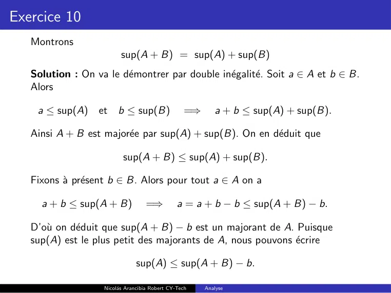

~~~text
Exercice 10
   Montrons
                         sup(A + B) = sup(A) + sup(B)
   Solution : On va le démontrer par double inégalité. Soit a ∈ A et b ∈ B.
   Alors

    a ≤ sup(A)    et    b ≤ sup(B)                =⇒      a + b ≤ sup(A) + sup(B).

   Ainsi A + B est majorée par sup(A) + sup(B). On en déduit que

                          sup(A + B) ≤ sup(A) + sup(B).

   Fixons à présent b ∈ B. Alors pour tout a ∈ A on a

     a + b ≤ sup(A + B)            =⇒           a = a + b − b ≤ sup(A + B) − b.

   D’où on déduit que sup(A + B) − b est un majorant de A. Puisque
   sup(A) est le plus petit des majorants de A, nous pouvons écrire

                               sup(A) ≤ sup(A + B) − b.

                   Nicolás Arancibia Robert CY-Tech   Analyse
~~~

## Page 49

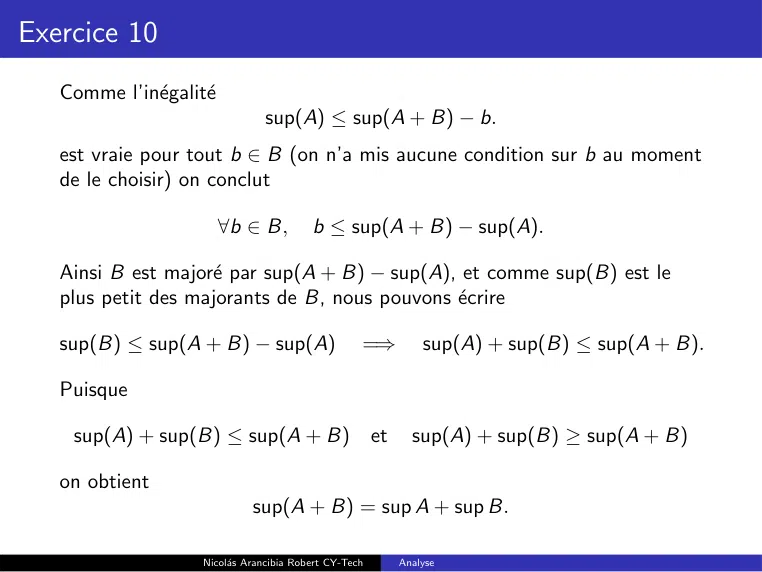

~~~text
Exercice 10
   Comme l’inégalité
                                sup(A) ≤ sup(A + B) − b.
   est vraie pour tout b ∈ B (on n’a mis aucune condition sur b au moment
   de le choisir) on conclut

                         ∀b ∈ B,          b ≤ sup(A + B) − sup(A).

   Ainsi B est majoré par sup(A + B) − sup(A), et comme sup(B) est le
   plus petit des majorants de B, nous pouvons écrire

   sup(B) ≤ sup(A + B) − sup(A)                     =⇒           sup(A) + sup(B) ≤ sup(A + B).

   Puisque

    sup(A) + sup(B) ≤ sup(A + B)                        et     sup(A) + sup(B) ≥ sup(A + B)

   on obtient
                              sup(A + B) = sup A + sup B.

                    Nicolás Arancibia Robert CY-Tech        Analyse
~~~

## Page 50

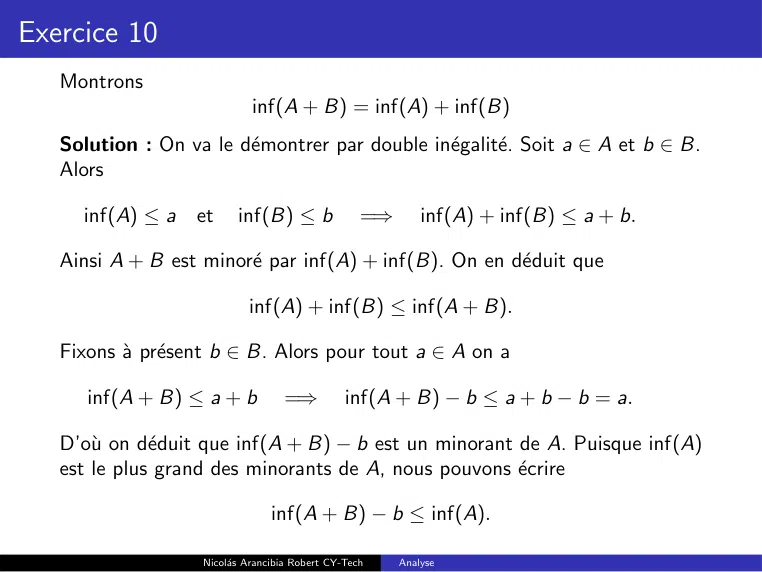

~~~text
Exercice 10
   Montrons
                             inf(A + B) = inf(A) + inf(B)
   Solution : On va le démontrer par double inégalité. Soit a ∈ A et b ∈ B.
   Alors

     inf(A) ≤ a    et     inf(B) ≤ b               =⇒       inf(A) + inf(B) ≤ a + b.

   Ainsi A + B est minoré par inf(A) + inf(B). On en déduit que

                            inf(A) + inf(B) ≤ inf(A + B).

   Fixons à présent b ∈ B. Alors pour tout a ∈ A on a

      inf(A + B) ≤ a + b           =⇒           inf(A + B) − b ≤ a + b − b = a.

   D’où on déduit que inf(A + B) − b est un minorant de A. Puisque inf(A)
   est le plus grand des minorants de A, nous pouvons écrire

                                 inf(A + B) − b ≤ inf(A).

                   Nicolás Arancibia Robert CY-Tech    Analyse
~~~

## Page 51

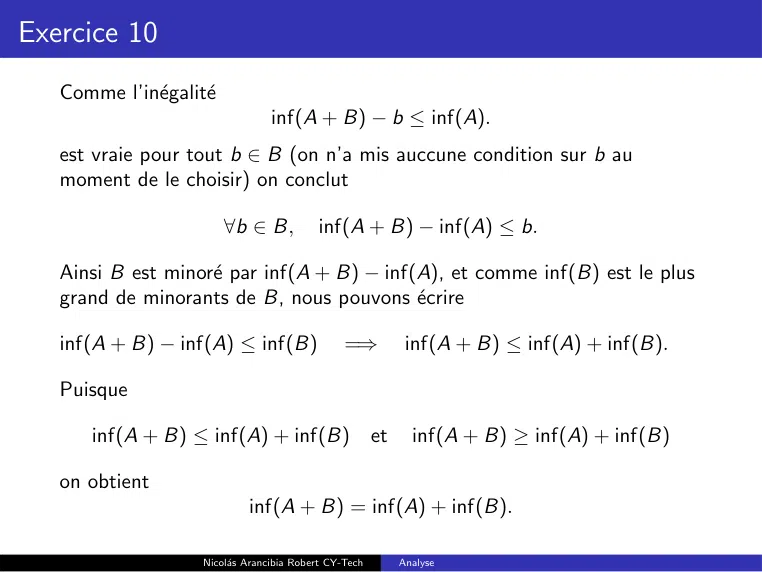

~~~text
Exercice 10
   Comme l’inégalité
                                  inf(A + B) − b ≤ inf(A).
   est vraie pour tout b ∈ B (on n’a mis auccune condition sur b au
   moment de le choisir) on conclut

                         ∀b ∈ B,           inf(A + B) − inf(A) ≤ b.

   Ainsi B est minoré par inf(A + B) − inf(A), et comme inf(B) est le plus
   grand de minorants de B, nous pouvons écrire

   inf(A + B) − inf(A) ≤ inf(B)                  =⇒           inf(A + B) ≤ inf(A) + inf(B).

   Puisque

      inf(A + B) ≤ inf(A) + inf(B)                      et     inf(A + B) ≥ inf(A) + inf(B)

   on obtient
                             inf(A + B) = inf(A) + inf(B).

                    Nicolás Arancibia Robert CY-Tech        Analyse
~~~

## Page 52

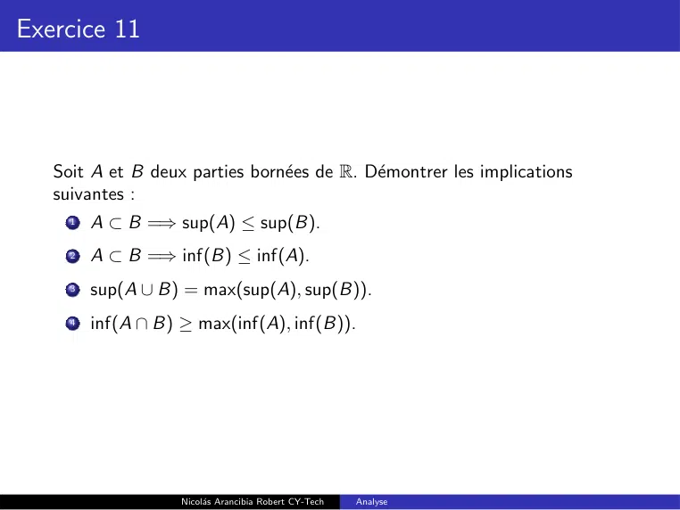

~~~text
Exercice 11

   Soit A et B deux parties bornées de R. Démontrer les implications
   suivantes :
     1   A ⊂ B =⇒ sup(A) ≤ sup(B).
     2   A ⊂ B =⇒ inf(B) ≤ inf(A).
     3   sup(A ∪ B) = max(sup(A), sup(B)).
     4   inf(A ∩ B) ≥ max(inf(A), inf(B)).

                    Nicolás Arancibia Robert CY-Tech   Analyse
~~~

## Page 53

~~~text
Exercice 11

   Montrons
                            A ⊂ B =⇒ sup(A) ≤ sup(B)
   Solution : Par hypothèse A et B sont bornées, donc sup(A) et sup(B)
   existent. Puisque A ⊂ B, pour tout x ∈ A nous avons x ∈ B, donc

                                           x ≤ sup(B).

   Ce qui nous permet de conclure que

                                  ∀x ∈ A,             x ≤ sup(B).

   Ainsi sup(B) est un majorant de A. Comme sup(A) est le plus petit
   majorant de A, on en déduit que

                                      sup(A) ≤ sup(B).

                  Nicolás Arancibia Robert CY-Tech     Analyse
~~~

## Page 54

~~~text
Exercice 11

   Montrons
                              A ⊂ B =⇒ inf(B) ≤ inf(A)
   Solution : Par hypothèse A et B sont bornées, donc inf(A) et inf(B)
   existent. Puisque A ⊂ B, pour tout x ∈ A nous avons x ∈ B , donc

                                             inf(B) ≤ x.

   Ce qui nous permet de conclure

                                   ∀x ∈ A,             inf(B) ≤ x.

   Ainsi inf(B) est un minorant de A, et comme inf(A) est le plus grand
   minorant de A, on en déduit que

                                        inf(B) ≤ inf(A).

                   Nicolás Arancibia Robert CY-Tech     Analyse
~~~

## Page 55

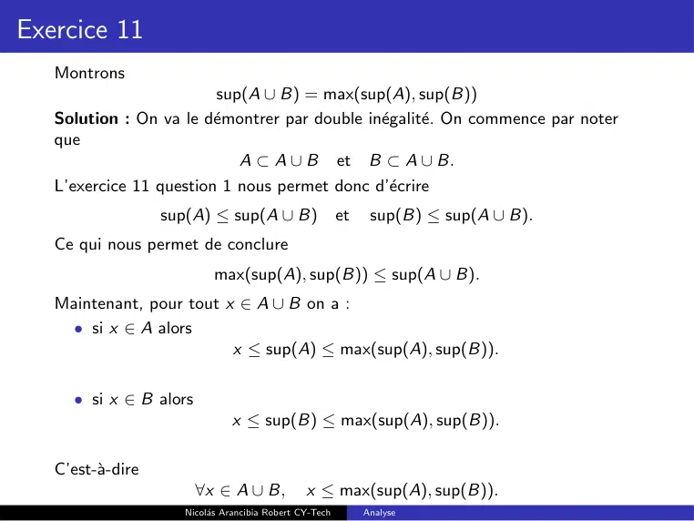

~~~text
Exercice 11
   Montrons
                         sup(A ∪ B) = max(sup(A), sup(B))
   Solution : On va le démontrer par double inégalité. On commence par noter
   que
                            A ⊂ A ∪ B et B ⊂ A ∪ B.
   L’exercice 11 question 1 nous permet donc d’écrire
                   sup(A) ≤ sup(A ∪ B)                   et    sup(B) ≤ sup(A ∪ B).
   Ce qui nous permet de conclure
                           max(sup(A), sup(B)) ≤ sup(A ∪ B).
   Maintenant, pour tout x ∈ A ∪ B on a :
     • si x ∈ A alors
                          x ≤ sup(A) ≤ max(sup(A), sup(B)).

      • si x ∈ B alors
                               x ≤ sup(B) ≤ max(sup(A), sup(B)).

   C’est-à-dire
                         ∀x ∈ A ∪ B,            x ≤ max(sup(A), sup(B)).
                     Nicolás Arancibia Robert CY-Tech        Analyse
~~~

## Page 56

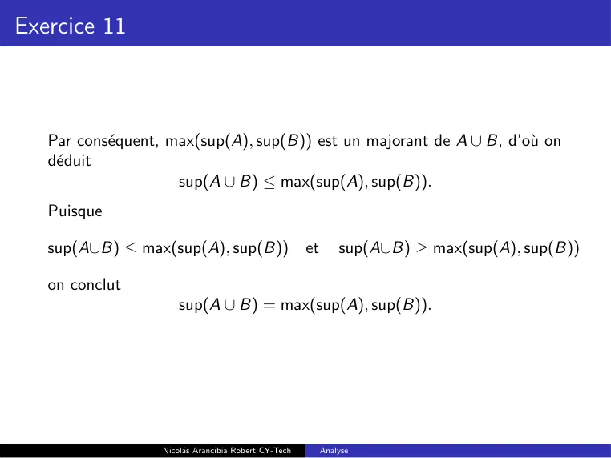

~~~text
Exercice 11

   Par conséquent, max(sup(A), sup(B)) est un majorant de A ∪ B, d’où on
   déduit
                     sup(A ∪ B) ≤ max(sup(A), sup(B)).
   Puisque

   sup(A∪B) ≤ max(sup(A), sup(B))                     et       sup(A∪B) ≥ max(sup(A), sup(B))

   on conclut
                      sup(A ∪ B) = max(sup(A), sup(B)).

                  Nicolás Arancibia Robert CY-Tech        Analyse
~~~

## Page 57

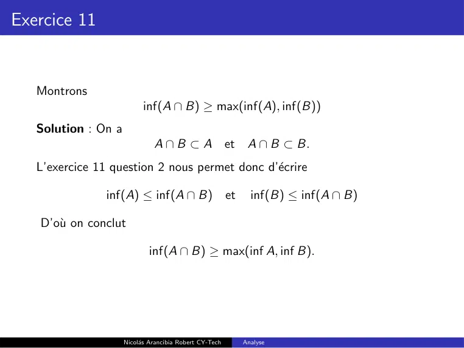

~~~text
Exercice 11

   Montrons
                           inf(A ∩ B) ≥ max(inf(A), inf(B))
   Solution : On a
                               A∩B ⊂A                    et    A ∩ B ⊂ B.
   L’exercice 11 question 2 nous permet donc d’écrire

                inf(A) ≤ inf(A ∩ B) et                          inf(B) ≤ inf(A ∩ B)

   D’où on conclut

                             inf(A ∩ B) ≥ max(inf A, inf B).

                     Nicolás Arancibia Robert CY-Tech        Analyse
~~~

## Page 58

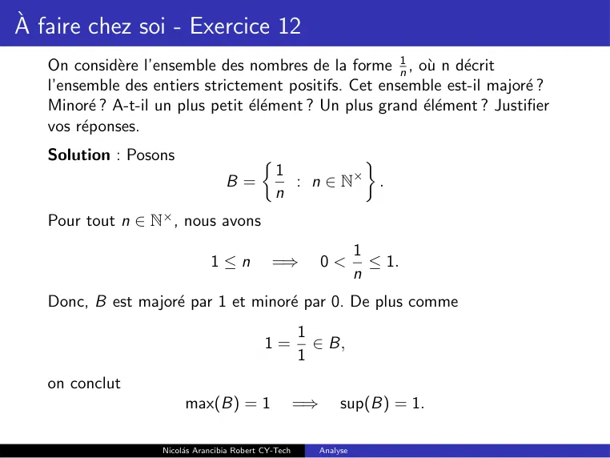

~~~text
À faire chez soi - Exercice 12
   On considère l’ensemble des nombres de la forme n1 , où n décrit
   l’ensemble des entiers strictement positifs. Cet ensemble est-il majoré ?
   Minoré ? A-t-il un plus petit élément ? Un plus grand élément ? Justifier
   vos réponses.
   Solution : Posons                                      
                                                 1
                                    B=             : n ∈ N× .
                                                 n
   Pour tout n ∈ N× , nous avons
                                                                       1
                                1≤n             =⇒           0<          ≤ 1.
                                                                       n
   Donc, B est majoré par 1 et minoré par 0. De plus comme
                                                        1
                                              1=          ∈ B,
                                                        1
   on conclut
                         max(B) = 1                     =⇒        sup(B) = 1.

                    Nicolás Arancibia Robert CY-Tech        Analyse
~~~

## Page 59

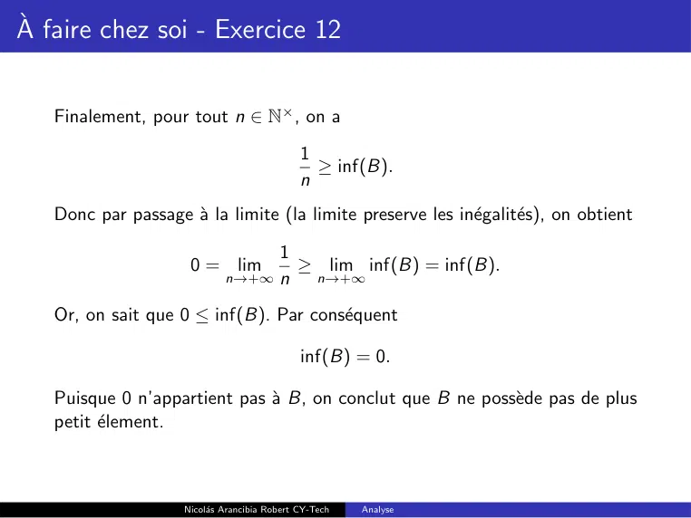

~~~text
À faire chez soi - Exercice 12

   Finalement, pour tout n ∈ N× , on a
                                              1
                                                ≥ inf(B).
                                              n
   Donc par passage à la limite (la limite preserve les inégalités), on obtient

                                  1
                     0 = lim        ≥ lim inf(B) = inf(B).
                             n→+∞ n  n→+∞

   Or, on sait que 0 ≤ inf(B). Par conséquent

                                              inf(B) = 0.

   Puisque 0 n’appartient pas à B, on conclut que B ne possède pas de plus
   petit élement.

                    Nicolás Arancibia Robert CY-Tech   Analyse
~~~

## Page 60

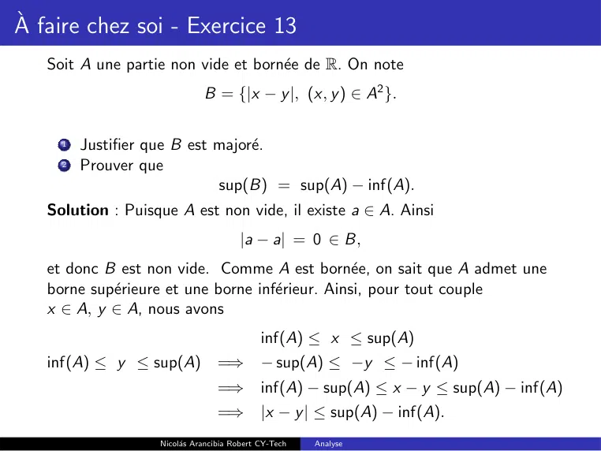

~~~text
À faire chez soi - Exercice 13
   Soit A une partie non vide et bornée de R. On note
                              B = {|x − y |, (x, y ) ∈ A2 }.

     1   Justifier que B est majoré.
     2   Prouver que
                             sup(B) = sup(A) − inf(A).
   Solution : Puisque A est non vide, il existe a ∈ A. Ainsi
                                       |a − a| = 0 ∈ B,
   et donc B est non vide. Comme A est bornée, on sait que A admet une
   borne supérieure et une borne inférieur. Ainsi, pour tout couple
   x ∈ A, y ∈ A, nous avons
                                             inf(A) ≤ x ≤ sup(A)
   inf(A) ≤ y ≤ sup(A)           =⇒          − sup(A) ≤ −y ≤ − inf(A)
                                 =⇒ inf(A) − sup(A) ≤ x − y ≤ sup(A) − inf(A)
                                 =⇒          |x − y | ≤ sup(A) − inf(A).
                   Nicolás Arancibia Robert CY-Tech   Analyse
~~~

## Page 61

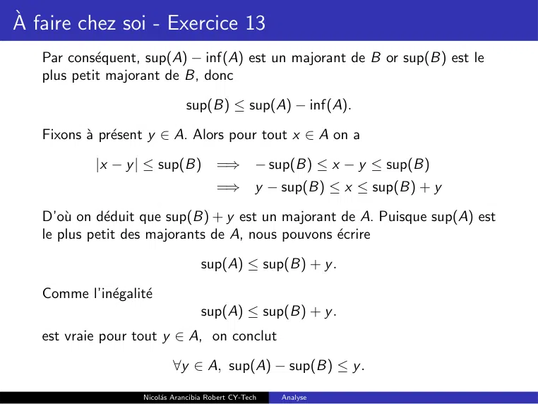

~~~text
À faire chez soi - Exercice 13
   Par conséquent, sup(A) − inf(A) est un majorant de B or sup(B) est le
   plus petit majorant de B, donc

                                sup(B) ≤ sup(A) − inf(A).

   Fixons à présent y ∈ A. Alors pour tout x ∈ A on a

            |x − y | ≤ sup(B) =⇒                    − sup(B) ≤ x − y ≤ sup(B)
                                         =⇒ y − sup(B) ≤ x ≤ sup(B) + y

   D’où on déduit que sup(B) + y est un majorant de A. Puisque sup(A) est
   le plus petit des majorants de A, nous pouvons écrire

                                    sup(A) ≤ sup(B) + y .

   Comme l’inégalité
                                    sup(A) ≤ sup(B) + y .
   est vraie pour tout y ∈ A, on conclut

                            ∀y ∈ A, sup(A) − sup(B) ≤ y .

                    Nicolás Arancibia Robert CY-Tech   Analyse
~~~

## Page 62

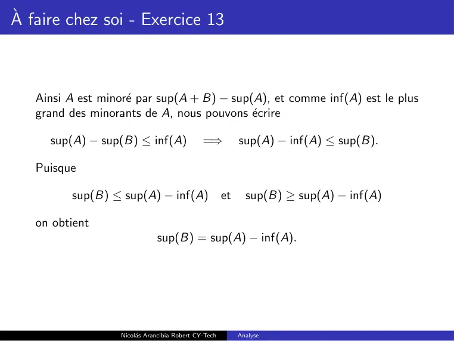

~~~text
À faire chez soi - Exercice 13

   Ainsi A est minoré par sup(A + B) − sup(A), et comme inf(A) est le plus
   grand des minorants de A, nous pouvons écrire

     sup(A) − sup(B) ≤ inf(A)                  =⇒           sup(A) − inf(A) ≤ sup(B).

   Puisque

         sup(B) ≤ sup(A) − inf(A)                      et     sup(B) ≥ sup(A) − inf(A)

   on obtient
                               sup(B) = sup(A) − inf(A).

                   Nicolás Arancibia Robert CY-Tech        Analyse
~~~

## Page 63

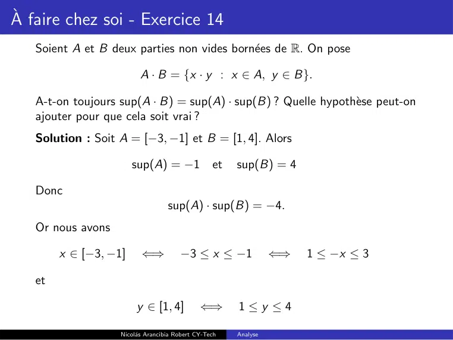

~~~text
À faire chez soi - Exercice 14
   Soient A et B deux parties non vides bornées de R. On pose

                         A · B = {x · y : x ∈ A, y ∈ B}.

   A-t-on toujours sup(A · B) = sup(A) · sup(B) ? Quelle hypothèse peut-on
   ajouter pour que cela soit vrai ?
   Solution : Soit A = [−3, −1] et B = [1, 4]. Alors

                       sup(A) = −1                et   sup(B) = 4

   Donc
                                   sup(A) · sup(B) = −4.
   Or nous avons

        x ∈ [−3, −1]      ⇐⇒           −3 ≤ x ≤ −1               ⇐⇒   1 ≤ −x ≤ 3

   et

                        y ∈ [1, 4]            ⇐⇒       1≤y ≤4

                   Nicolás Arancibia Robert CY-Tech   Analyse
~~~

## Page 64

~~~text
À faire chez soi - Exercice 14

   On en déduit par multiplication des encadrement (positifs) que

                    1 ≤ −xy ≤ 12                ⇐⇒        −12 ≤ xy ≤ −1.

   C’est-à-dire

                                     A · B = [−12, −1].

   Ce qui implique que

                   sup(A · B) = −1 6= −4 = sup(A) · sup(B).

                      Nicolás Arancibia Robert CY-Tech   Analyse
~~~

## Page 65

~~~text
À faire chez soi - Exercice 14
   Démontrons que
                             sup(A · B) = sup(A) · sup(B)
   lorsque A et B sont des parties majorées non vides de R+ .
   Solution : Puisque A et B sont non vides, il existe a ∈ A et b ∈ B. Ainsi

                                            a · b ∈ A · B,

   et donc A · B est non vide. Comme A et B sont majorées, il existe
   M1 ∈ R+ et M2 ∈ R+ , tel que pour tout a ∈ A, pour tout b ∈ B on a

                           0 ≤ a ≤ M1                  et    0 ≤ b ≤ M2 .

   Cela entraine que pour tous

                         a ∈ A, b ∈ B,                  a · b ≤ M1 · M2 .

   Par conséquent, A · B est majorée. Ainsi A · B admet une borne
   supérieure.
                   Nicolás Arancibia Robert CY-Tech        Analyse
~~~

## Page 66

~~~text
À faire chez soi - Exercice 14

   Montrons
                               sup(A · B) = sup(A) · sup(B)
   Solution : On va le démontrer par double inégalité. Soit a ∈ A et b ∈ B,
   alors

    0 ≤ a ≤ sup(A)       et      0 ≤ b ≤ sup(B)               =⇒   a · b ≤ sup(A) · sup(B).

    Ainsi A · B est majorée par sup(A) · sup(B). On en déduit que

                              sup(A · B) ≤ sup(A) · sup(B).

   Maintenant, pour tout a ∈ A et b ∈ B, nous avons

                                     0 ≤ a · b ≤ sup(A · B).

   Si b = 0, alors
                               sup(A) · b = 0 ≤ sup(A · B).

                     Nicolás Arancibia Robert CY-Tech   Analyse
~~~

## Page 67

~~~text
À faire chez soi - Exercice 14
   Si b > 0, alors
                                             sup(A · B)
                                  ∀a ∈ A,            a≤
                                                  b
   et A est majorée par sup(A·B)
                             b    . D’où on déduit que
                          sup(A · B)
               sup(A) ≤               =⇒ sup(A) · b ≤ sup(A · B).
                              b
   Par conséquent, pour tout b ∈ B on conclut
                                     sup(A) · b ≤ sup(A · B).
   Si sup(A) = 0, alors
                             sup(A) · sup(B) = 0 ≤ sup(A · B).
   Si sup(A) > 0, pour tout b ∈ B on peut écrire
                                                    sup(A · B)
                                            b≤
                                                      sup(A)
   et sup(A·B)
       sup(A)
               est un majorant de B. D’où on déduit
                        sup(A · B)
            sup(B) ≤                           =⇒        sup(B) · sup(A) ≤ sup(A · B).
                          sup(A)
                     Nicolás Arancibia Robert CY-Tech    Analyse
~~~

## Page 68

~~~text
À faire chez soi - Exercice 14

   Dans tous le cas on obtient

                            sup(B) · sup(A) ≤ sup(A · B).

   Finalement, puisque

      sup(A · B) ≤ sup(A) · sup(B)                     et     sup(A · B) ≥ sup(A) · sup(B)

   on conclut
                            sup(A · B) = sup(A) · sup(B).

                   Nicolás Arancibia Robert CY-Tech        Analyse
~~~

## Page 69

~~~text
À faire chez soi - Exercice 15

   Soit A et B deux parties bornées de R. Démontrer les implications
   suivantes :
     1   inf(A ∪ B) = min(inf(A), inf(B)),
     2   sup(A ∩ B) ≤ min(sup(A), sup(B)),

                    Nicolás Arancibia Robert CY-Tech   Analyse
~~~

## Page 70

~~~text
À faire chez soi - Exercice 15
   Montrons
                          inf(A ∪ B) = min(inf(A), inf(B)).
   Solution : On va le démontrer par double inégalité. On commence par noter
   que
                            A ⊂ A ∪ B et B ⊂ A ∪ B.
   L’exercice 11 question 2 nous permet donc d’écrire
                   inf(A ∪ B) ≤ inf(A)                  et    inf(A ∪ B) ≤ inf(B).
   Ce qui nous permet de conclure
                            inf(A ∪ B) ≤ min(inf(A), inf(B)).
   Maintenant, pour tout x ∈ A ∪ B on a :
     • si x ∈ A alors
                           min(inf(A), inf(B)) ≤ inf(A) ≤ x.

      • si x ∈ B alors
                                min(inf(A), inf(B)) ≤ inf(B) ≤ x.

   c’est-à-dire
                         ∀x ∈ A ∪ B,            min(inf(A), inf(B)) ≤ x.
                    Nicolás Arancibia Robert CY-Tech        Analyse
~~~

## Page 71

~~~text
À faire chez soi - Exercice 15

   Par conséquent, min(inf(A), inf(B)) est un minorant de A ∪ B, d’où on
   déduit
                         min(inf A, inf B) ≤ inf(A ∪ B)
   Puisque

      min(inf A, inf B) ≤ inf(A ∪ B)                   et     min(inf A, inf B) ≥ inf(A ∪ B)

   on conclut
                         inf(A ∪ B) = min(inf(A), inf(B)).

                   Nicolás Arancibia Robert CY-Tech        Analyse
~~~

## Page 72

~~~text
À faire chez soi - Exercice 15

   Montrons
                          sup(A ∩ B) ≤ min(sup(A), sup(B))
   Solution : On a
                               A∩B ⊂A                    et    A ∩ B ⊂ B.
   L’exercice 11 question 1 nous permet donc d’écrire

              sup(A ∩ B) ≤ sup(A) et                           sup(A ∩ B) ≤ sup(B).

    D’où on conclut

                            sup(A ∩ B) ≤ min(sup A, sup B).

                     Nicolás Arancibia Robert CY-Tech        Analyse
~~~

## Page 73

~~~text
Exercice 16
   Montrer que la fonction partie entière est croissante.

   Avant de montrer la propositon, rappelons la définition de la fonction
   partie entière. Pour tout x ∈ R on définit

                               E (x) := max{n ∈ Z : n ≤ x}.

   Ceci implique que

                             x − 1 < E (x) ≤ x < E (x) + 1.

   Solution : Soient x, y ∈ R tels que x ≤ y . Nous devons montrer que

                                             E (x) ≤ E (y ).

   Par définition on a
                                                E (x) ≤ x.
   Donc
                                            E (x) ≤ x ≤ y .
   Ainsi, E (x) est un entier relatif inférieur ou égal à y .
                     Nicolás Arancibia Robert CY-Tech   Analyse
~~~

## Page 74

~~~text
Exercice 16

   Comme E (y ) est le plus grand entier inférieur ou égal à y on en deduit
   que
                                E (x) ≤ E (y ).
   C’est-à-dire, la fonction partie entière est croissant.

   Notons que la fonction partie entière n’est pas strictement croissante. En
   effet, pour x = 1.5 et y = 1.9 on a

                                                    x <y

   mais
                                         E (x) = 1 = E (y ).

                     Nicolás Arancibia Robert CY-Tech   Analyse
~~~

## Page 75

~~~text
Exercice 17
   Monter que pour tout (x, y ) ∈ R2 ,
                     E (x) + E (y ) ≤ E (x + y ) ≤ E (x) + E (y ) + 1.
   Solution : Soient x, y ∈ R. Commençons par montrer l’inégalité
                                     E (x) + E (y ) ≤ E (x + y )
   Par définition
                                   E (x) ≤ x               et    E (y ) ≤ y .
   Ce qui implique
                                       E (x) + E (y ) ≤ x + y .
   D’après l’exercice précédent, on sait que la fonction E (·) est croissante
   sur R, donc
                            E (E (x) + E (y )) ≤ E (x + y ).
   Or E (x) + E (y ) ∈ Z, donc
                             E (E (x) + E (y )) = E (x) + E (y ).
   Ainsi
                                    E (x) + E (y ) ≤ E (x + y ).
                       Nicolás Arancibia Robert CY-Tech        Analyse
~~~

## Page 76

~~~text
Exercice 17

   Pour montrer l’inégalité

                               E (x + y ) ≤ E (x) + E (y ) + 1,

   on fait noter :
        E (x + y ) ≤ x + y .
        x < E (x) + 1.
        y < E (y ) + 1.
   Ainsi

                     E (x + y ) ≤ x + y < E (x) + E (y ) + 2.

   Comme l’inégalité est stricte et E (x + y ) et E (x) + E (y ) + 2 sont des
   entiers, on peut affirmer que

                               E (x + y ) ≤ E (x) + E (y ) + 1.

                      Nicolás Arancibia Robert CY-Tech   Analyse
~~~

## Page 77

~~~text
Exercice 17
   Pour tout x ∈ R. Calculer
                                         E (x) + E (−x).
   Solution : On a :
       si x ∈ Z, alors E (x) = x et E (−x) = −x. Par conséquent
                                          E (x) + E (−x) = 0.
       si x ∈ R \ Z, alors
                                       E (x) < x < E (x) + 1.
       Donc
                                  −E (x) − 1 < −x < −E (x).
       Ceci implique que −E (x) − 1 est le plus grand entier relatif inferieur
       ou égal à E (−x). Ce qui nous permet de conclure
                                        E (−x) = −E (x) − 1.
       Donc
                      E (x) + E (−x) = E (x) − E (x) − 1 = −1.

                   Nicolás Arancibia Robert CY-Tech   Analyse
~~~

## Page 78

~~~text
Exercice 17

   Par conséquent
                                                     
                                                          0 si x ∈ Z
                     E (x) + E (−x) =
                                                         −1 sinon

                     Nicolás Arancibia Robert CY-Tech    Analyse
~~~

## Page 79

~~~text
Exercice 17
   Montrer ∀n ∈ N∗ et ∀x ∈ R que
                                                                     
                                                            E (nx)
                                     E (x) = E                            .
                                                               n
   Solution : Par définition

                                    E (x) ≤ x < E (x) + 1.

   En multipliant par n, on obtient

                                 nE (x) ≤ nx < nE (x) + n

   et comme la fonction partie entiere est croissant on en déduit

          nE (x) = E (nE (x)) ≤ E (nx) < E (nE (x) + n) = nE (x) + n.

   D’où on obtient en divisant par n
                                              E (nx)
                               E (x) ≤               < E (x) + 1.
                                                 n
                    Nicolás Arancibia Robert CY-Tech       Analyse
~~~

## Page 80

~~~text
Exercice 17

   Ceci implique que E (x) est le plus grand entier relatif inferieur ou égal à

                                                   E (nx)
                                                          .
                                                      n
   Par conséquent                                                    
                                                             E (nx)
                                      E (x) = E                            .
                                                                n

                     Nicolás Arancibia Robert CY-Tech       Analyse
~~~

## Page 81

~~~text
À faire chez soi - Exercice 18

   Soient n un entier naturel et x un réel positif.
    1. Combien y a-t-il d’entiers naturels entre 1 et n ? entre 1 et x ?
    2. Combien y a-t-il d’entiers naturels entre 0 et n ? entre 0 et x ?
    3. Combien y a-t-il d’entiers naturels pairs entre 0 et x ? Combien y
       a-t-il d’entiers naturels impairs entre 0 et x ?
    4. Combien y a-t-il de multiples de 3 entre 0 et x ?
    5. Combien l’équation x + 2y = n, n entier naturel donné et x et y
       entiers naturels inconnus, a-t-elle de couples solutions ?
    6. De combien de façons peut-on payer 10 euros avec des pièces de 10
       et 20 centimes d’euros ?

                   Nicolás Arancibia Robert CY-Tech   Analyse
~~~

## Page 82

~~~text
À faire chez soi - Exercice 18
    1. Par définition d’un entier, il y a n entiers entre 1 et n. Ensuite, pour
       tout entier naturel k, on a

                            1≤k ≤x                     ⇐⇒     1 ≤ k ≤ E (x).

        Il y a donc E (x) entiers entre 1 et x.
    2. Il y a n + 1 entiers entre 0 et n et E (x) + 1 entiers entre 0 et x.
    3. Les entiers naturels pairs sont les entiers de la forme 2k, k ∈ N. Or
                                                                      x
                                   0 ≤ 2k ≤ x ⇐⇒ 0 ≤ k ≤                .
                                                                      2
        Le nombre des entiers pairs compris entre 0 et x est le nombre des
       entiers k compris entre 0 et x2 . D’après 2), il y a E x2 + 1 entiers
       pairs entre 0 et x. De même,
                                                                      x −1
                          0 ≤ 2k + 1 ≤ x ⇐⇒ 0 ≤ k ≤                        .
                                                                        2
                        x−1
                               
       Il y a donc E     2         + 1 entiers impairs entre 0 et x.
                   Nicolás Arancibia Robert CY-Tech    Analyse
~~~

## Page 83

~~~text
À faire chez soi - Exercice 18
     4. Les multiples de 3 sont les entiers de la forme 3k, k ∈ N. Or
                                                                          x
                                      0 ≤ 3k ≤ x ⇐⇒ 0 ≤ k ≤                 .
                                                                          3
        Le nombre des multiples de 3 compris entre 0 et x estle nombre des
        entiers k compris entre 0 et x3 . D’après 2), il y a E x3 + 1 multiples de 3
        entre 0 et x.
     5. Soient n ∈ N et (x, y ) ∈ N2 . On a

                                 x + 2y = n              ⇐⇒        x = n − 2y .

         Donc, (x, y ) est solution si et seulement si y ∈ N et n − 2y ∈ N ou encore
        si et seulement si 0 ≤ 2y ≤ n. Il y a donc E n2 + 1 couples solutions.
     6. Si x et y sont respectivement le nombre de pièces de 10 centimes d’euros
        et le nombre de pièces de 20 centimes d’euros, le nombre cherché est le
        nombre de couples d’entiers naturels solutions de l’équation

                                              10x + 20y = 1000

        qui s’écrit encore x + 2y = 100. D’après 5), il y a E 100
                                                                    
                                                                 2
                                                                      + 1 = 51 façons
        de payer 10 euros avec des pièces de 10 et 20 centimes d’euros.
                     Nicolás Arancibia Robert CY-Tech   Analyse
~~~

## Page 84

~~~text
À faire chez soi - Exercice 19

   Résoudre, dans R, les équations suivantes :

    1. (5E (x) + 2) · (3E (x) + 6) = 0.

    2. (2E (x) + 1)2 < 4.

                    Nicolás Arancibia Robert CY-Tech   Analyse
~~~

## Page 85

~~~text
À faire chez soi - Exercice 19

                           (5E (x) + 2) · (3E (x) + 6) = 0.

   Solution : Nous avons
                                                                     2             6
   (5E (x) + 2) · (3E (x) + 6) = 0               ⇐⇒      E (x) = −     ou E (x) = − = −2.
                                                                     5             3
   Or pour tout x ∈ R, E (x) est un entier. Donc l’equation

                                                           2
                                             E (x) = −
                                                           5
   n’a pas de solution. Ainsi

   (5E (x) + 2) · (3E (x) + 6) = 0               ⇐⇒       E (x) = −2    ⇐⇒    x ∈ [−2, −1[.

                   Nicolás Arancibia Robert CY-Tech   Analyse
~~~

## Page 86

~~~text
À faire chez soi - Exercice 19

                                        (2E (x) + 1)2 < 4.

   Solution : On cherche à résoudre (2E (x) + 1)2 < 4 ce qui est équivalent
   à résoudre

              |2E (x) + 1| < 2             ⇐⇒           −2 < 2E (x) + 1 < 2.

   On obtient
        3           1
    −     < E (x) <         ⇐⇒            −1 ≤ E (x) ≤ 0           ⇐⇒   −1 < x < 1.
        2           2
   Donc
                                           S2 = ] − 1; 1[.

                    Nicolás Arancibia Robert CY-Tech    Analyse
~~~

## Page 87

~~~text
Pour aller plus loin - Exercice 20

   Nous voulons montrer que n ∈ N∗ , x ∈ R :
                                   n−1                   
                                   X                 k
                                          E       x+            = E (nx).
                                                     n
                                   k=0

     1   Nous posons :
                                              n−1                      
                                              X                     k
                                 f (x) =             E        x+            − E (nx).
                                                                    n
                                               k=0

         Montrer que f est périodique de période T = n1 .
         Calculer la valeur de f (x) pour x ∈ 0, n1 .
                                                  
     2

     3   En déduire l’égalité souhaitée.

                      Nicolás Arancibia Robert CY-Tech       Analyse
~~~

## Page 88

~~~text
Pour aller plus loin - Exercice 20
   Montrons que
                                         n−1                    
                                         X                   k
                           f (x) =              E       x+           − E (nx)
                                                             n
                                         k=0
   est périodique de période n1 . Nous devons montrer l’égalité
                                          
                                         1
                                 f x+        = f (x).
                                         n
   Solution : On compute
                         n−1         
                   1       X       k  1
             f x+        =     E x+ +     − E (nx + 1).
                   n               n n
                                         k=0
   Comme
     E (nx) ≤ nx < E (nx) + 1                =⇒         E (nx) + 1 ≤ nx + 1 < E (nx) + 2
   on déduit E (nx + 1) = E (nx) + 1. D’où on peut écrire
                              n−1               
                       1        X            k +1
               f x+         =       E x+             − E (nx) − 1
                       n                       n
                                           k=0
                    Nicolás Arancibia Robert CY-Tech    Analyse
~~~

## Page 89

~~~text
Pour aller plus loin - Exercice 20
   Maintenant, en utilisant le changement de indice k + 1 = l on obtient
                                          n−1                
                          1                 X           k +1
             f       x+             =              Ex+            − E (nx) − 1
                          n                                n
                                            k=0
                                             n            
                                            X            l
                                     =          E x+         − E (nx) − 1
                                                        n
                                            l=1
                                                        n−1            
                                                        X             l
                                     =      E (x + 1) +      E x+          − E (nx) − 1
                                                                     n
                                                        l=1
                                                        n−1            
                                                        X             l
                                     =      E (x) + 1 +      E x+          − E (nx) − 1
                                                                     n
                                                        l=1
                                                       X  n−1           
                                                     0                   l
                                     =      E x+        +       E x+         − E (nx)
                                                     n                   n
                                                            l=1
                                            n−1           
                                            X            l
                                     =          E x+         − E (nx) = f (x).
                                                        n
                                             l=0

   Par conséquent, f es une fonction périodique de période n1 .
                          Nicolás Arancibia Robert CY-Tech   Analyse
~~~

## Page 90

~~~text
Pour aller plus loin - Exercice 20
   Calculer la valeur de f (x) pour x ∈ 0, n1 .
                                            

   Solution : Si
     0 ≤ x < n1                    0 ≤ x < n1
                                                          
                                                               0 ≤ nx < 1
                              =⇒                       =⇒
     0≤k ≤n−1                      0 ≤ kn ≤ 1 − n1             0 ≤ x + kn < 1
                                        1
   D’où on conclut que pour tout x ∈ 0, n et tout entier 0 ≤ k ≤ n − 1 on
   a                                               
                                                  k
                      E (nx) = 0 et E x +             = 0.
                                                  n
   Par conséquent, pour tout x ∈ 0, n1
                                       

                             n−1           
                             X            k
                     f (x) =     E x+         − E (nx) = 0.
                                          n
                                    k=0

   Finalement, par la périodicité de f , on en déduit que
                  n−1             
                  X             k
                      E x+           − E (nx) = 0,        ∀x ∈ R.
                                n
                   k=0

                    Nicolás Arancibia Robert CY-Tech   Analyse
~~~

## Page 91

~~~text
Pour aller plus loin - Inégalité de Cauchy-Schwartz
   Soit n ∈ N∗ , a1 , . . . , an et b1 , . . . , bn ∈ R. Montrer que
                                                 v         v
                               Xn                u n       u n
                                                 uX uX
                                   ak bk ≤ t           ak2 t   bk2 .
                                    k=1                       k=1             k=1
                                                                             Pn                  2
   Indication : Considérer le polynôme f (x) =                                  k=1 (ak + bk x) .

   Solution : Pour montrer l’inégalité de Cauchy-Schwarz, nous allons
   étudier le discriminant du polynome
                                                        n
                                                        X
                                           f (x) =        (ak + bk x)2 .
                                                        k=1

    On compute
   n                      n                            n                                    n
                                                                                                             !       n
                                                                                                                                     !
   X                      X                            X                                    X                        X
         (ak + bk x)2 =     ak2 + 2ak bk x + bk2 x 2 =   ak2 +                                    2ak bk x       +         bk2 x 2       .
   k=1                     k=1                                         k=1                  k=1                      k=1
                       n        n
                                       !                                    n
                                                                                        !
                       X  2
                                X                                           X
                     =   ak + 2   ak bk x +                                       bk2       x 2 = c + bx + ax 2 .
                           k=1                 k=1                          k=1
                          | {z }         |         {z         }        |     {z         }
                               c                    b                         a

                          Nicolás Arancibia Robert CY-Tech       Analyse
~~~

## Page 92

~~~text
Pour aller plus loin - Inégalité de Cauchy-Schwarz
   Donc
                                          n
                                                         !2              n
                                                                                     !       n
                                                                                                         !
                                          X                              X                   X
                 2
           ∆ = b − 4ac = 4                       ak bk         −4              ak2                 bk2       .
                                          k=1                            k=1                 k=1
    Maintenant, pour tout x ∈ R on a
                                              n
                                              X
                                f (x) =             (ak + bk x)2 ≥ 0.
                                              k=1
   C’est-à-dire que f est un polynôme de degré 2 en x qui est positif ou nul
   pour tout x. Cela signifie que le discriminant de ce polynôme est négatif
   ou nul. Autrement dit on a
                     n
                             !2        n
                                             ! n       !
                   X                 X          X
                                           2         2
                4      ak bk    −4        ak        bk = ∆ ≤ 0.
                     k=1                           k=1               k=1
   Par conséquent
                           n
                                          !2             n
                                                                     !   n
                                                                                     !
                           X                             X               X
                                 ak bk          ≤              ak2             bk2       .
                           k=1                           k=1             k=1
                     Nicolás Arancibia Robert CY-Tech     Analyse
~~~

## Page 93

~~~text
Pour aller plus loin - Inégalité de Cauchy-Schwarz

   On conclut en prennant la racine carrée
                                     v         v
                       Xn            u n       u n
                                     uX uX
                            ak bk ≤ t       a2 t   b2 .      k          k
                             k=1                       k=1        k=1

                   Nicolás Arancibia Robert CY-Tech    Analyse
~~~

## Page 94

~~~text
Pour aller plus loin - Exercice 22

   Soit x et y deux réels tels que 0 < x ≤ y . On pose
                                 x+y
                  A =             2                (moyenne arithmétique)
                                √
                  G =               xy             (moyenne géométrique)
                                  1
                  H =          1 1  1              (moyenne harmonique).
                               2(x +y )

   Montrer l’inégalité arithmético-géométrique :

                                      x ≤ H ≤ G ≤ A ≤ y.

   Solution : Supposons 0 < x ≤ y . Montrons tout d’abord A ≤ y . On a
                                      y   y
                                  y=    +
                                      2   2
                                      x   y x +y
                                     ≥ + =       = A.
                                      2   2   2
   Donc A ≤ y .

                     Nicolás Arancibia Robert CY-Tech   Analyse
~~~

## Page 95

~~~text
Pour aller plus loin - Exercice 22

                                 √
   Pour montrer que G =              xy ≤ x+y
                                           2 = A, on compute

                       x +y √     x √      y
            A−G =          − xy = − xy +
                         2        2        2
                                  1 √ 2     √      √ 
                                =   ( x) − 2 xy + ( y )2
                                  2
                                  1 √   √
                                = ( x − y )2 ≥ 0.
                                  2
   C’est-à-dire A − G ≥ 0 et donc
                                           √           x +y
                                 G =           xy ≤         = A.
                                                         2

                   Nicolás Arancibia Robert CY-Tech   Analyse
~~~

## Page 96

~~~text
Pour aller plus loin - Exercice 22

   Montrons l’inégalité
                                       1     √
                                H= 1 1   1 ≤   xy = G .
                                   2(x + y )

   Pour montrer ceci, on fait noter que d’après la preuve précédente, la
   moyenne géométrique des deux réels
                                                1               1
                                                         et
                                                x               y
   est inférieure ou égale à leur moyenne arithmétique, c’est-à-dire
                    s                      
              1        1 1        1 1     1                  1         √
           √     =       ·    ≤        +         =⇒     1 1     1 ≤       xy .
              xy       x y        2 x     y              (
                                                        2 x  +  y )

    On a donc montré que H ≤ G .

                     Nicolás Arancibia Robert CY-Tech        Analyse
~~~

## Page 97

~~~text
Pour aller plus loin - Exercice 22
   Montrons finalement l’inégalité
                                                1
                                      x ≤H= 1 1   1 .
                                            2 x + y)
                                             (
   On commence par noter que la moyenne arithmétique de
                                1      1
                                   et
                                y      x
   est compris entre y1 et x1 . En effet, comme 0 < x ≤ y on peut écrire
                                                        
            1    1 1        1       1 1      1     1 1     1      1
               ≤         +       ≤         +     ≤      +      ≤
            y    2 y        y       2 x      y     2 x     x      x
    Maintenant, en prennant le quotient
                           
            1    1 1      1      1                                          1
              ≤        +      ≤       =⇒                      x≤                   ≤ y.
            y    2 x     y       x                                 1       1   1
                                                                   2       x + y

    On a donc montré que x ≤ H. Par conséquent
                                     x ≤ H ≤ G ≤ A ≤ y.
                    Nicolás Arancibia Robert CY-Tech   Analyse
~~~

## Page 98

~~~text
Pour aller plus loin - Exercice 22
   Soit a un réel positif et n ∈ N. Montrer l’inégalité de Bernoulli suivante :

                              P(n) :             (1 + a)n ≥ 1 + na.

   Solution : On fixe a ∈ R+ et on raisnone par récurrence sur n.

   Initialisation : On a

                           (1 + a)1 = 1 + a ≥ 1                   (car a ≥ 0)

   Donc P(1) est vraie. Notons que P(0) est vraie aussi.

   Hérédité : Soit n ∈ N× . Supposons P(n) vraie, c’est-à-dire

                                       (1 + a)n ≥ 1 + na.

   Montrons que P(n + 1) est vraie, autrement dit, montrons

                                (1 + a)n+1 ≥ 1 + (n + 1)a.

                    Nicolás Arancibia Robert CY-Tech   Analyse
~~~

## Page 99

~~~text
Pour aller plus loin - Exercice 22
   On a

            (1 + a)n+1                          =                   (1 + a)n · (1 + a)
                                               ≥                    (1 + na) · (1 + a)
                                              |{z}
                                Hypothèse de Recurrence

                                                =                   1 + a + na + na2
                                                =                   1 + (n + 1)a + na2 .

   Mais n ∈ N, donc
                                                   na2 ≥ 0.
   D’où on conclut

               (1 + a)n+1 ≥ 1 + (n + 1)a + na2 ≥ 1 + (n + 1)a.

   Fin de la recurrence. Par conséquent P(n) =⇒ P(n + 1), et on
   conclut pour tout a ∈ R+ et tout entier naturel n, l’inégalité

                                         (1 + a)n ≥ 1 + na.

                      Nicolás Arancibia Robert CY-Tech   Analyse
~~~

## Page 100

~~~text
Pour aller plus loin - Exercice 23
   Tout entier naturel non nul n s’écrit de manière unique sous la forme

                               n = a0 + 10a1 + . . . + 10p ap ,

   où p est un entier naturel et les ai sont des entiers éléments de

                                               {0, . . . , 9},

   ap étant non nul. Déterminer p en fonction de n.

   Solution : On a

                    n =a0 + 10a1 + . . . + 10p ap
                       =10p a0 10−p + 10−p+1 a1 + . . . + ap .
                                                            

   En prenant le logarithme décimal, on obtient

            log10 (n) = log10 10p a0 10−p + 10−p+1 a1 + . . . + ap
                                                                   

                      = p + log10 a0 10−p + 10−p+1 a1 + . . . + ap .
                                                                  

                     Nicolás Arancibia Robert CY-Tech   Analyse
~~~

## Page 101

~~~text
Pour aller plus loin - Exercice 23

   Maintenant, puisque la fonction logarithme est croissante et

                      a0 10−p + 10−p+1 a1 + . . . + ap < 10,

   on déduit

            log10 a0 10−p + 10−p+1 a1 + . . . + ap < log10 (10) = 1.
                                                  

   Ce qui nous permet conclure

         E (log10 (n)) = E p + log10 a0 10−p + 10−p+1 a1 + . . . + ap
                                                                        

                      = p.

                   Nicolás Arancibia Robert CY-Tech   Analyse
~~~
