# TD1-Reels-Correction_2024-2025_Analyse1_P1S1_NArancibia.pdf

[Ouvrir l’original](https://drive.google.com/open?id=1La2QF6rbmGdFenyTJtN-siaDBa4PIzKk) · Les deux lectures automatiques du PDF divergent sur les pages indiquées. Leur fac-similé accompagne le texte.

**Pages présentant un écart entre les deux extractions** — 2–5, 8–9, 11, 13, 15–25, 27–37, 39–41.

## Page 1

~~~text
Analyse - Premier semestre 2024 - 2025

                                      CY Tech

                                 TD Analyse

                                           Réels.

              Nicolás Arancibia Robert CY-Tech   Analyse
~~~

## Page 2

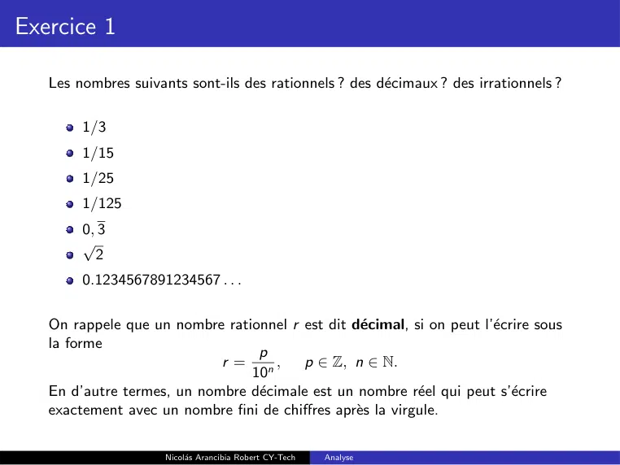

~~~text
Exercice 1

   Les nombres suivants sont-ils des rationnels ? des décimaux ? des irrationnels ?

        1/3
        1/15
        1/25
        1/125
        0, 3
        √
          2
        0.1234567891234567 . . .

   On rappele que un nombre rationnel r est dit décimal, si on peut l’écrire sous
   la forme
                                 p
                            r = n,      p ∈ Z, n ∈ N.
                                10
   En d’autre termes, un nombre décimale est un nombre réel qui peut s’écrire
   exactement avec un nombre fini de chiffres après la virgule.

                     Nicolás Arancibia Robert CY-Tech   Analyse
~~~

## Page 3

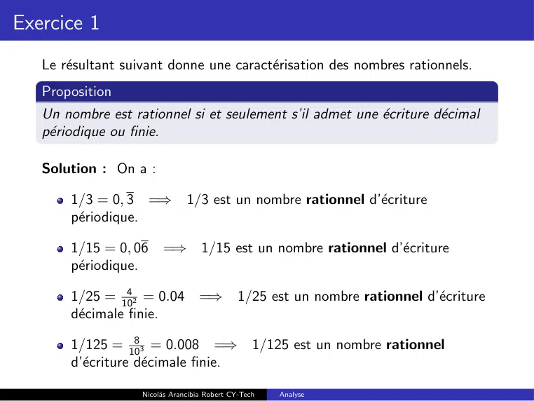

~~~text
Exercice 1
   Le résultant suivant donne une caractérisation des nombres rationnels.
   Proposition
   Un nombre est rationnel si et seulement s’il admet une écriture décimal
   périodique ou finie.

   Solution : On a :

       1/3 = 0, 3 =⇒ 1/3 est un nombre rationnel d’écriture
       périodique.

       1/15 = 0, 06      =⇒         1/15 est un nombre rationnel d’écriture
       périodique.

       1/25 = 1042 = 0.04 =⇒ 1/25 est un nombre rationnel d’écriture
       décimale finie.

       1/125 = 1083 = 0.008 =⇒                     1/125 est un nombre rationnel
       d’écriture décimale finie.

                   Nicolás Arancibia Robert CY-Tech   Analyse
~~~

## Page 4

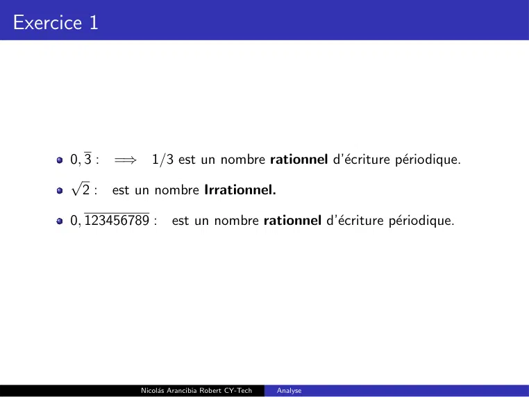

~~~text
Exercice 1

      0, 3 : =⇒ 1/3 est un nombre rationnel d’écriture périodique.
      √
        2 : est un nombre Irrationnel.

      0, 123456789 : est un nombre rationnel d’écriture périodique.

                 Nicolás Arancibia Robert CY-Tech   Analyse
~~~

## Page 5

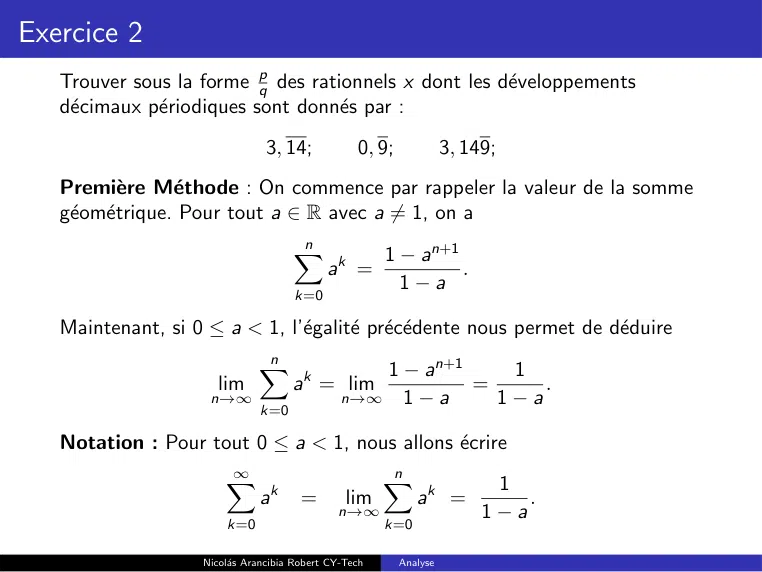

~~~text
Exercice 2
   Trouver sous la forme qp des rationnels x dont les développements
   décimaux périodiques sont donnés par :
                                3, 14;             0, 9;             3, 149;
   Première Méthode : On commence par rappeler la valeur de la somme
   géométrique. Pour tout a ∈ R avec a 6= 1, on a
                                      n
                                      X                 1 − an+1
                                             ak =                .
                                                          1−a
                                      k=0

   Maintenant, si 0 ≤ a < 1, l’égalité précédente nous permet de déduire
                               n
                               X                   1 − an+1    1
                       lim            ak = lim              =     .
                     n→∞                        n→∞ 1 − a     1−a
                               k=0

   Notation : Pour tout 0 ≤ a < 1, nous allons écrire
                        ∞                               n
                        X                               X                  1
                               ak       =        lim          ak =            .
                                               n→∞                        1−a
                        k=0                             k=0

                    Nicolás Arancibia Robert CY-Tech      Analyse
~~~

## Page 6

~~~text
Exercice 2

                                                         ?    p
                                                3, 14 =         .
                                                              q
   Solution : On a
                                              14    14       14
                       3.14 = 3 +                +     2
                                                         +      + ···
                                             100 100       1003
                                                 +∞       k
                                              14 X      1
                                =3+
                                             100               100
                                                    k=0
                                     14       1
                                =3+      ·       1
                                    100 1 − 100
                                     14 100
                                =3+      ·
                                    100 99
                                    14     311
                                =3+     =      .
                                    99      99

                     Nicolás Arancibia Robert CY-Tech       Analyse
~~~

## Page 7

~~~text
Exercice 2

                                                         ?   p
                                               3, 149 =        .
                                                             q
   Solution : On a
                                  314   9    9      9
                     3.149 =          + 3 + 4 + 5 + ···
                                  100 10    10     10
                                          +∞     k
                                  314   9 X 1
                                =     +
                                  100 103      10
                                                         k=0
                                  314   9    1
                                =     +   ·    1
                                  100 103 1 − 10
                                  314   9 10
                                =     +   ·
                                  100 103 9
                                  314   1   315
                                =     +   =     .
                                  100 100   100

                     Nicolás Arancibia Robert CY-Tech    Analyse
~~~

## Page 8

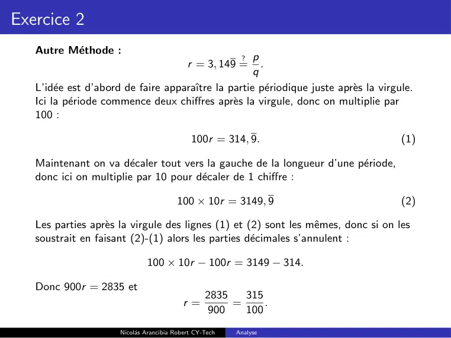

~~~text
Exercice 2
   Autre Méthode :
                                                     p     ?
                                             r = 3, 149 =
                                                       .
                                                     q
   L’idée est d’abord de faire apparaı̂tre la partie périodique juste après la virgule.
   Ici la période commence deux chiffres après la virgule, donc on multiplie par
   100 :

                                              100r = 314, 9.                           (1)

   Maintenant on va décaler tout vers la gauche de la longueur d’une période,
   donc ici on multiplie par 10 pour décaler de 1 chiffre :

                                         100 × 10r = 3149, 9                           (2)

   Les parties après la virgule des lignes (1) et (2) sont les mêmes, donc si on les
   soustrait en faisant (2)-(1) alors les parties décimales s’annulent :

                               100 × 10r − 100r = 3149 − 314.

   Donc 900r = 2835 et
                                                   2835   315
                                           r=           =     .
                                                   900    100
                      Nicolás Arancibia Robert CY-Tech   Analyse
~~~

## Page 9

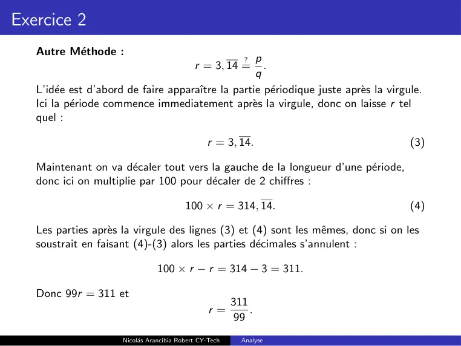

~~~text
Exercice 2
   Autre Méthode :
                                                    p        ?
                                              r = 3, 14 =
                                                      .
                                                    q
   L’idée est d’abord de faire apparaı̂tre la partie périodique juste après la virgule.
   Ici la période commence immediatement après la virgule, donc on laisse r tel
   quel :

                                                  r = 3, 14.                           (3)

   Maintenant on va décaler tout vers la gauche de la longueur d’une période,
   donc ici on multiplie par 100 pour décaler de 2 chiffres :

                                           100 × r = 314, 14.                          (4)

   Les parties après la virgule des lignes (3) et (4) sont les mêmes, donc si on les
   soustrait en faisant (4)-(3) alors les parties décimales s’annulent :

                                 100 × r − r = 314 − 3 = 311.

   Donc 99r = 311 et
                                                          311
                                                   r=         .
                                                           99
                      Nicolás Arancibia Robert CY-Tech     Analyse
~~~

## Page 10

~~~text
À faire chez soi - Exercice 2

                                                         ?   p
                                                 0, 9 =        .
                                                             q
   Solution : On a
                                              9    9   9
                           0.9 = 0 +            + 2 + 3 + ···
                                              10 10   10
                                                +∞  k
                                              9 X 1
                                  =0+
                                              10              10
                                                    k=0
                                       9     1
                                  =0+    ·     1
                                       10 1 − 10
                                       9 10
                                  =0+    ·
                                       10 9
                                       9
                                  = 0 + = 1.
                                       9

                     Nicolás Arancibia Robert CY-Tech       Analyse
~~~

## Page 11

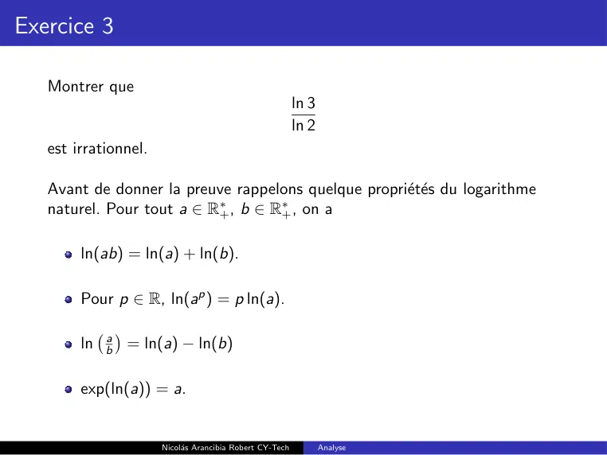

~~~text
Exercice 3

   Montrer que
                                                             ln 3
                                                             ln 2
   est irrationnel.

   Avant de donner la preuve rappelons quelque propriétés du logarithme
   naturel. Pour tout a ∈ R∗+ , b ∈ R∗+ , on a

        ln(ab) = ln(a) + ln(b).

        Pour p ∈ R, ln(ap ) = p ln(a).

             a
                 
        ln   b       = ln(a) − ln(b)

        exp(ln(a)) = a.

                         Nicolás Arancibia Robert CY-Tech          Analyse
~~~

## Page 12

~~~text
Exercice 3

   Preuve : Nous allons montrer la proposition en raisonnant par l’absurde.
   Supposons donc que ln   3
                        ln 2 est rationnel et essayons d’arriver à une
   contradiction. Autrement dit, supposons qu’il existe p ∈ Z et q ∈ Z∗ tels
   que
                                               ln 3  p
                                                    = .
                                               ln 2  q
   On a
                   ln 3   p
                        =              ⇐⇒              p ln 2 = q ln 3
                   ln 2   q
                                       ⇐⇒              ln 2p = ln 3q
                                       ⇐⇒              exp(ln 2p ) = exp(ln 3q )
                                       ⇐⇒              2p = 3q .

   Contradiction ! Par conséquent ln 3
                                   ln 2 est irrationnel.

                   Nicolás Arancibia Robert CY-Tech      Analyse
~~~

## Page 13

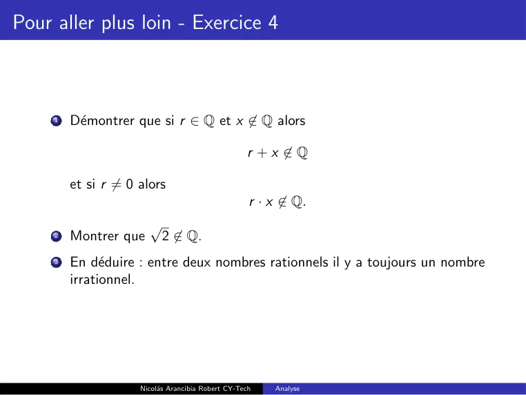

~~~text
Pour aller plus loin - Exercice 4

     1   Démontrer que si r ∈ Q et x 6∈ Q alors

                                                     r + x 6∈ Q

         et si r 6= 0 alors
                                                      r · x 6∈ Q.
                        √
     2   Montrer que        2 6∈ Q.
     3   En déduire : entre deux nombres rationnels il y a toujours un nombre
         irrationnel.

                      Nicolás Arancibia Robert CY-Tech    Analyse
~~~

## Page 14

~~~text
Pour aller plus loin - Exercice 4

   La somme et le produit d’un nombre rationnel (non-nul pour le produit)
   et d’un nombre irrationnel sont des nombres irrationnels.

   Rappelons que :
       La somme de deux nombres rationnels est un nombres rationnel. En
       effet
                          p  p0     pq 0 + p 0 q
                            + 0 =                ∈ Q.
                          q  q          qq 0

       Le produit de deux nombres rationnels est un nombres rationnel. En
       effet
                              p p0      pp 0
                                · 0 = 0 ∈ Q.
                              q q       qq
   Nous allons montrer la proposition en raisonant par l’absurde.

                     Nicolás Arancibia Robert CY-Tech   Analyse
~~~

## Page 15

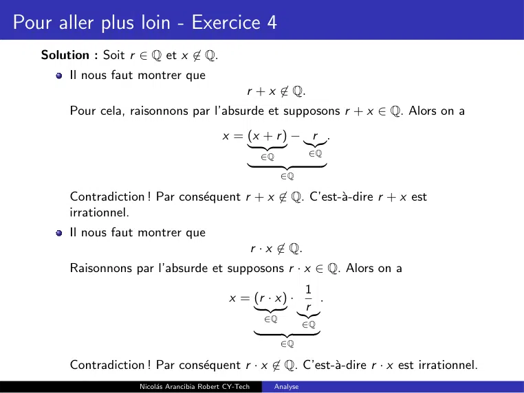

~~~text
Pour aller plus loin - Exercice 4
   Solution : Soit r ∈ Q et x 6∈ Q.
        Il nous faut montrer que
                                                     r + x 6∈ Q.
        Pour cela, raisonnons par l’absurde et supposons r + x ∈ Q. Alors on a
                                             x = (x + r ) − |{z}
                                                              r .
                                                 | {z }
                                                   ∈Q        ∈Q
                                                 |     {z      }
                                                                  ∈Q

        Contradiction ! Par conséquent r + x 6∈ Q. C’est-à-dire r + x est
        irrationnel.
        Il nous faut montrer que
                                                         r · x 6∈ Q.
        Raisonnons par l’absurde et supposons r · x ∈ Q. Alors on a
                                                             1
                                               x = (r · x) ·   .
                                                             r
                                                   | {z } |{z}
                                                             ∈Q
                                                                        ∈Q
                                                         |        {z     }
                                                                  ∈Q

        Contradiction ! Par conséquent r · x 6∈ Q. C’est-à-dire r · x est irrationnel.
                     Nicolás Arancibia Robert CY-Tech        Analyse
~~~

## Page 16

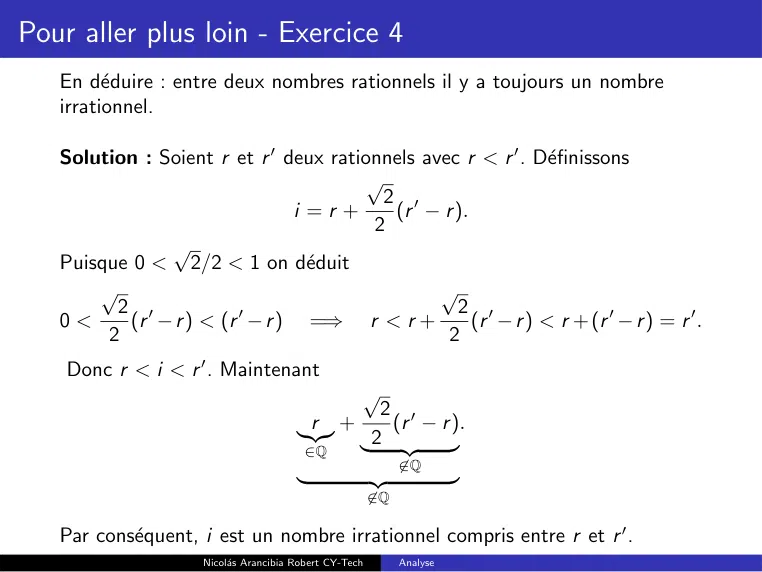

~~~text
Pour aller plus loin - Exercice 4
   En déduire : entre deux nombres rationnels il y a toujours un nombre
   irrationnel.

   Solution : Soient r et r 0 deux rationnels avec r < r 0 . Définissons
                                        √
                                          2 0
                               i =r+       (r − r ).
                                         2
               √
   Puisque 0 < 2/2 < 1 on déduit
       √                                        √
         2 0                                      2 0
   0<     (r − r ) < (r 0 − r ) =⇒ r < r +           (r − r ) < r + (r 0 − r ) = r 0 .
        2                                        2
    Donc r < i < r 0 . Maintenant
                                                     √
                                                2 0
                                          r +    (r − r ).
                                        |{z}   2
                                         ∈Q   | {z }
                                                               6∈Q
                                        |                {z              }
                                                         6∈Q

   Par conséquent, i est un nombre irrationnel compris entre r et r 0 .
                     Nicolás Arancibia Robert CY-Tech         Analyse
~~~

## Page 17

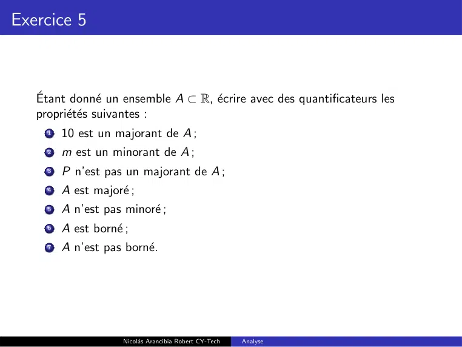

~~~text
Exercice 5

   Étant donné un ensemble A ⊂ R, écrire avec des quantificateurs les
   propriétés suivantes :
     1   10 est un majorant de A ;
     2   m est un minorant de A ;
     3   P n’est pas un majorant de A ;
     4   A est majoré ;
     5   A n’est pas minoré ;
     6   A est borné ;
     7   A n’est pas borné.

                     Nicolás Arancibia Robert CY-Tech   Analyse
~~~

## Page 18

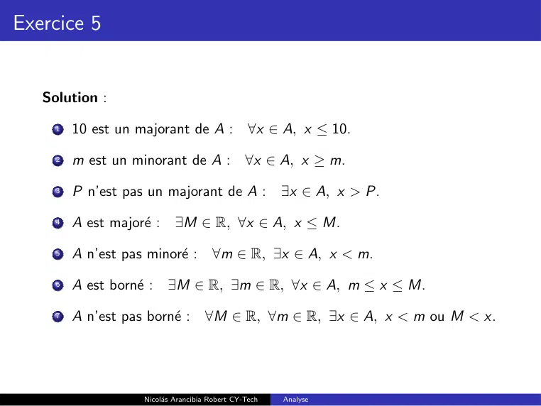

~~~text
Exercice 5

   Solution :
     1   10 est un majorant de A : ∀x ∈ A, x ≤ 10.
     2   m est un minorant de A : ∀x ∈ A, x ≥ m.
     3   P n’est pas un majorant de A : ∃x ∈ A, x > P.
     4   A est majoré : ∃M ∈ R, ∀x ∈ A, x ≤ M.
     5   A n’est pas minoré : ∀m ∈ R, ∃x ∈ A, x < m.
     6   A est borné :    ∃M ∈ R, ∃m ∈ R, ∀x ∈ A, m ≤ x ≤ M.
     7   A n’est pas borné : ∀M ∈ R, ∀m ∈ R, ∃x ∈ A, x < m ou M < x.

                     Nicolás Arancibia Robert CY-Tech   Analyse
~~~

## Page 19

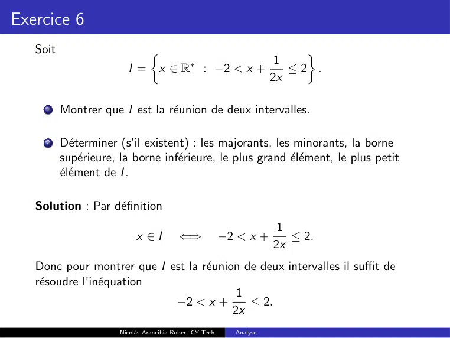

~~~text
Exercice 6
   Soit                                                                   
                                                                       1
                        I =         x ∈ R∗ : −2 < x +                    ≤2 .
                                                                      2x

     1    Montrer que I est la réunion de deux intervalles.

     2    Déterminer (s’il existent) : les majorants, les minorants, la borne
          supérieure, la borne inférieure, le plus grand élément, le plus petit
          élément de I .

   Solution : Par définition
                                                                       1
                           x ∈I           ⇐⇒              −2 < x +       ≤ 2.
                                                                      2x
   Donc pour montrer que I est la réunion de deux intervalles il suffit de
   résoudre l’inéquation
                                          1
                            −2 < x +        ≤ 2.
                                         2x
                      Nicolás Arancibia Robert CY-Tech     Analyse
~~~

## Page 20

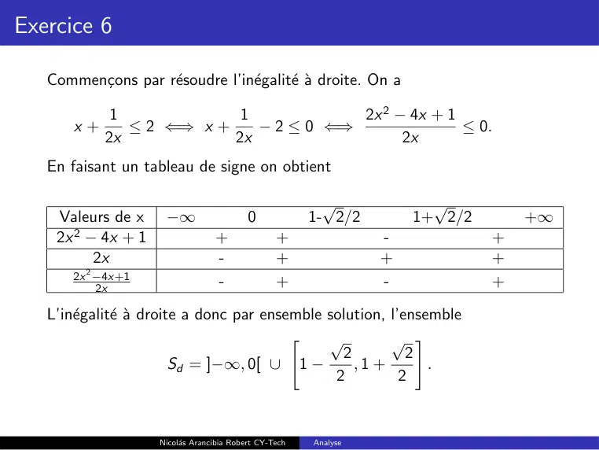

~~~text
Exercice 6

   Commençons par résoudre l’inégalité à droite. On a

             1             1            2x 2 − 4x + 1
       x+      ≤ 2 ⇐⇒ x +    − 2 ≤ 0 ⇐⇒               ≤ 0.
            2x            2x                  2x
   En faisant un tableau de signe on obtient

                                                          √             √
    Valeurs de x     −∞                    0            1- 2/2        1+ 2/2       +∞
    2x 2 − 4x + 1                 +               +               -            +
          2x                      -               +               +            +
       2x 2 −4x+1
            2x                    -               +               -            +
   L’inégalité à droite a donc par ensemble solution, l’ensemble
                                          "    √         √ #
                                                 2          2
                         Sd = ]−∞, 0[ ∪ 1 −        ,1 +        .
                                                2          2

                    Nicolás Arancibia Robert CY-Tech   Analyse
~~~

## Page 21

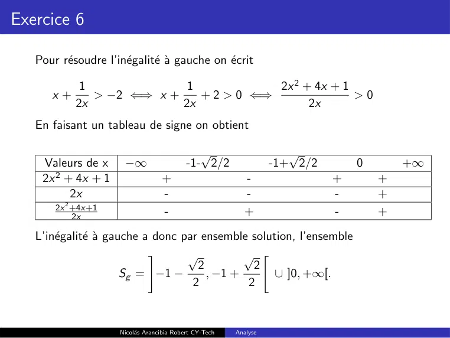

~~~text
Exercice 6

   Pour résoudre l’inégalité à gauche on écrit

            1              1            2x 2 + 4x + 1
      x+      > −2 ⇐⇒ x +    + 2 > 0 ⇐⇒               >0
           2x             2x                  2x
   En faisant un tableau de signe on obtient

                                               √                      √
    Valeurs de x      −∞                    -1- 2/2                -1+ 2/2       0       +∞
    2x 2 + 4x + 1                  +                       -                 +       +
          2x                       -                       -                 -       +
       2x 2 +4x+1
            2x                     -                       +                 -       +
   L’inégalité à gauche a donc par ensemble solution, l’ensemble
                            #      √          √ "
                                     2          2
                       Sg = −1 −       , −1 +       ∪ ]0, +∞[.
                                    2          2

                     Nicolás Arancibia Robert CY-Tech   Analyse
~~~

## Page 22

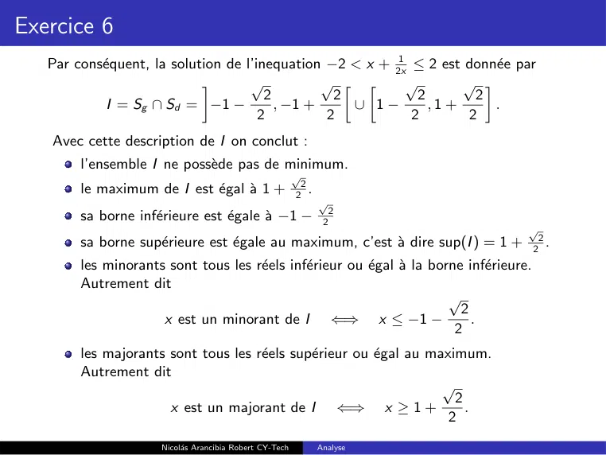

~~~text
Exercice 6
   Par conséquent, la solution de l’inequation −2 < x + 2x1 ≤ 2 est donnée par
                                   √           √         √        √ 
                                       2         2            2        2
            I = Sg ∩ Sd = −1 −           , −1 +    ∪ 1−         ,1 +     .
                                      2         2            2        2
   Avec cette description de I on conclut :
        l’ensemble I ne possède pas de minimum.
                                                          √
        le maximum de I est égal à 1 + 22 .
                                                              √
        sa borne inférieure est égale à −1 − 22
                                                                                      √
        sa borne supérieure est égale au maximum, c’est à dire sup(I ) = 1 + 22 .
        les minorants sont tous les réels inférieur ou égal à la borne inférieure.
        Autrement dit
                                                                        √
                                                                          2
                     x est un minorant de I ⇐⇒ x ≤ −1 −                     .
                                                                         2
        les majorants sont tous les réels supérieur ou égal au maximum.
        Autrement dit
                                                                    √
                                                                      2
                      x est un majorant de I ⇐⇒ x ≥ 1 +                 .
                                                                     2
                      Nicolás Arancibia Robert CY-Tech       Analyse
~~~

## Page 23

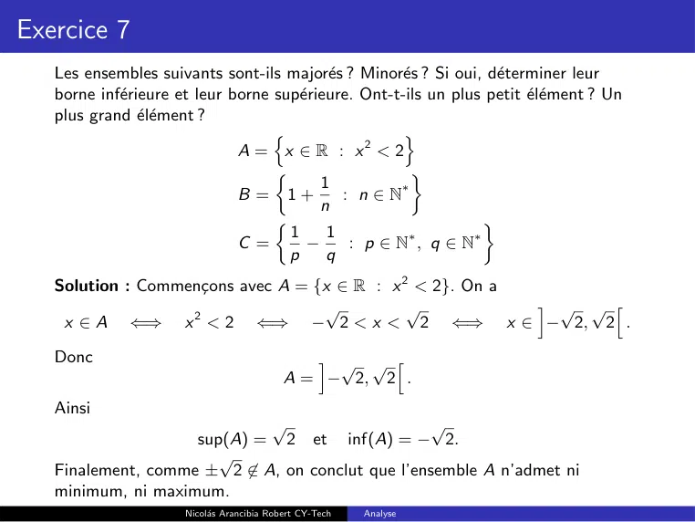

~~~text
Exercice 7
   Les ensembles suivants sont-ils majorés ? Minorés ? Si oui, déterminer leur
   borne inférieure et leur borne supérieure. Ont-t-ils un plus petit élément ? Un
   plus grand élément ?
                                   n                  o
                              A = x ∈ R : x2 < 2
                                                      
                                          1          ∗
                              B = 1+         : n∈N
                                          n
                                                                
                                     1     1
                              C =       −     : p ∈ N∗ , q ∈ N∗
                                     p     q
   Solution : Commençons avec A = {x ∈ R : x 2 < 2}. On a
                                    √          √           i √ √ h
    x ∈ A ⇐⇒ x 2 < 2 ⇐⇒ − 2 < x < 2 ⇐⇒ x ∈ − 2, 2 .

   Donc                                        i √ √ h
                                            A = − 2, 2 .
   Ainsi
                             √                    √
                    sup(A) = 2 et inf(A) = − 2.
                       √
   Finalement, comme ± 2 6∈ A, on conclut que l’ensemble A n’admet ni
   minimum, ni maximum.
                      Nicolás Arancibia Robert CY-Tech   Analyse
~~~

## Page 24

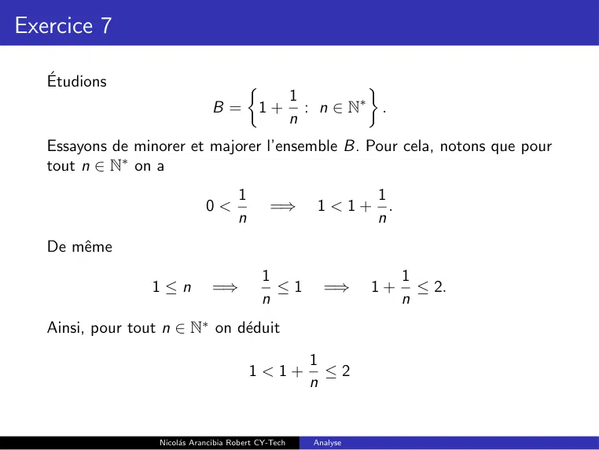

~~~text
Exercice 7

   Étudions                                                    
                                                       1
                                B=           1+          : n ∈ N∗ .
                                                       n
   Essayons de minorer et majorer l’ensemble B. Pour cela, notons que pour
   tout n ∈ N∗ on a
                                       1                      1
                               0<              =⇒         1<1+ .
                                       n                      n
   De même
                                             1                           1
                  1≤n           =⇒             ≤1           =⇒      1+     ≤ 2.
                                             n                           n
   Ainsi, pour tout n ∈ N∗ on déduit
                                                         1
                                           1<1+            ≤2
                                                         n

                   Nicolás Arancibia Robert CY-Tech      Analyse
~~~

## Page 25

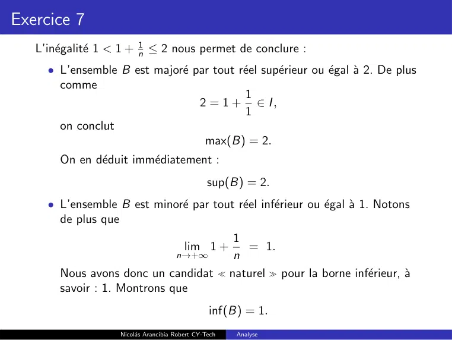

~~~text
Exercice 7
   L’inégalité 1 < 1 + n1 ≤ 2 nous permet de conclure :
     • L’ensemble B est majoré par tout réel supérieur ou égal à 2. De plus
       comme
                                           1
                                 2 = 1 + ∈ I,
                                           1
       on conclut
                                  max(B) = 2.
       On en déduit immédiatement :
                                                 sup(B) = 2.
     • L’ensemble B est minoré par tout réel inférieur ou égal à 1. Notons
       de plus que
                                      1
                                        = 1.
                                         lim 1 +
                                      n
                                      n→+∞

       Nous avons donc un candidat  naturel  pour la borne inférieur, à
       savoir : 1. Montrons que
                                                 inf(B) = 1.
                   Nicolás Arancibia Robert CY-Tech   Analyse
~~~

## Page 26

~~~text
Exercice 7
   On doit pour cela montrer :
                     
                        1 est un minorant de B
                        1 est le plus grand des minorants de B
                     
                        1 est un minorant de B
              ⇐⇒
                        ∀m > 1, m n’est pas un minorant de B
                     
                        1 est un minorant de B
              ⇐⇒
                        ∀m > 1, ∃x ∈ B, x < m
   On sait déjà que 1 est un minorant. Montrons que :
                                ∀m > 1, ∃x ∈ B, x < m.
   Soit m > 1, on doit montrer qu’il existe n ∈ N∗ tel que
                                        1
                                   x =1+  < m.
                                        n
   Cela revient à montrer qu’il existe n ∈ N∗ tel que
                         1                                     1
                           < m−1                       ⇐⇒         < n.
                         n                                    m−1
                   Nicolás Arancibia Robert CY-Tech    Analyse
~~~

## Page 27

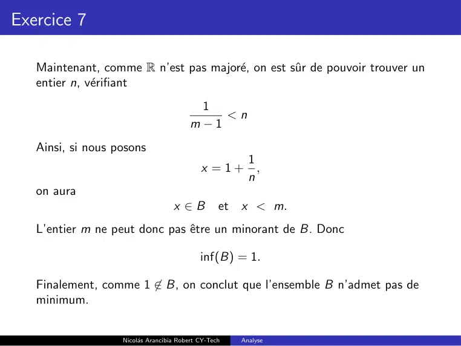

~~~text
Exercice 7

   Maintenant, comme R n’est pas majoré, on est sûr de pouvoir trouver un
   entier n, vérifiant
                                          1
                                             <n
                                         m−1
   Ainsi, si nous posons
                                                  1
                                             x =1+ ,
                                                  n
   on aura
                                    x ∈B           et   x < m.
   L’entier m ne peut donc pas être un minorant de B. Donc

                                             inf(B) = 1.

   Finalement, comme 1 6∈ B, on conclut que l’ensemble B n’admet pas de
   minimum.

                   Nicolás Arancibia Robert CY-Tech    Analyse
~~~

## Page 28

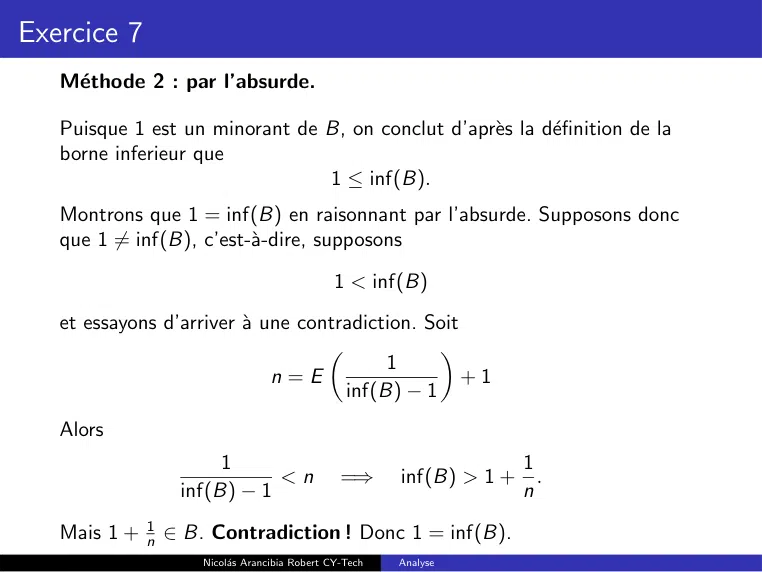

~~~text
Exercice 7
   Méthode 2 : par l’absurde.

   Puisque 1 est un minorant de B, on conclut d’après la définition de la
   borne inferieur que
                                1 ≤ inf(B).
   Montrons que 1 = inf(B) en raisonnant par l’absurde. Supposons donc
   que 1 6= inf(B), c’est-à-dire, supposons

                                             1 < inf(B)

   et essayons d’arriver à une contradiction. Soit
                                               
                                          1
                             n=E                    +1
                                     inf(B) − 1
   Alors
                      1                                            1
                            <n                 =⇒      inf(B) > 1 + .
                 inf(B) − 1                                        n

   Mais 1 + n1 ∈ B. Contradiction ! Donc 1 = inf(B).
                   Nicolás Arancibia Robert CY-Tech   Analyse
~~~

## Page 29

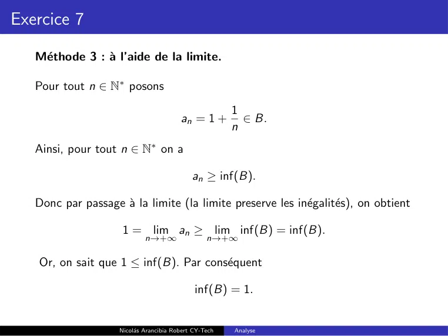

~~~text
Exercice 7

   Méthode 3 : à l’aide de la limite.

   Pour tout n ∈ N∗ posons
                                                        1
                                         an = 1 +         ∈ B.
                                                        n
   Ainsi, pour tout n ∈ N∗ on a

                                             an ≥ inf(B).

   Donc par passage à la limite (la limite preserve les inégalités), on obtient

                     1 = lim an ≥ lim inf(B) = inf(B).
                             n→+∞                 n→+∞

   Or, on sait que 1 ≤ inf(B). Par conséquent

                                              inf(B) = 1.

                    Nicolás Arancibia Robert CY-Tech   Analyse
~~~

## Page 30

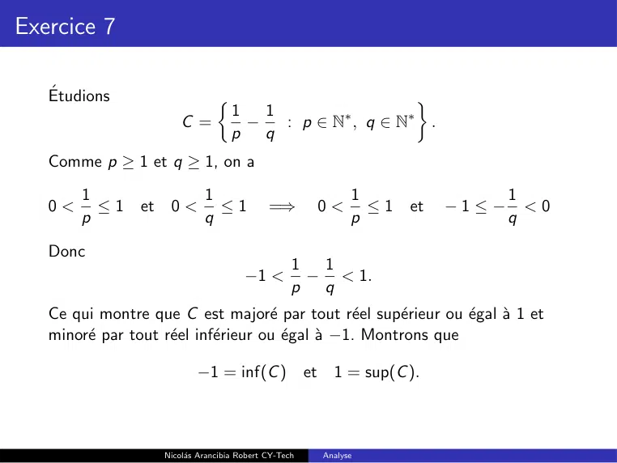

~~~text
Exercice 7

   Étudions                                                
                                      1   1
                         C=             −   : p ∈ N∗ , q ∈ N∗ .
                                      p   q
   Comme p ≥ 1 et q ≥ 1, on a
        1                      1                                    1                  1
   0<     ≤1    et    0<         ≤1            =⇒             0<      ≤1   et   −1≤−     <0
        p                      q                                    p                  q
   Donc
                                                     1  1
                                         −1 <          − < 1.
                                                     p  q
   Ce qui montre que C est majoré par tout réel supérieur ou égal à 1 et
   minoré par tout réel inférieur ou égal à −1. Montrons que

                             −1 = inf(C )                et     1 = sup(C ).

                     Nicolás Arancibia Robert CY-Tech        Analyse
~~~

## Page 31

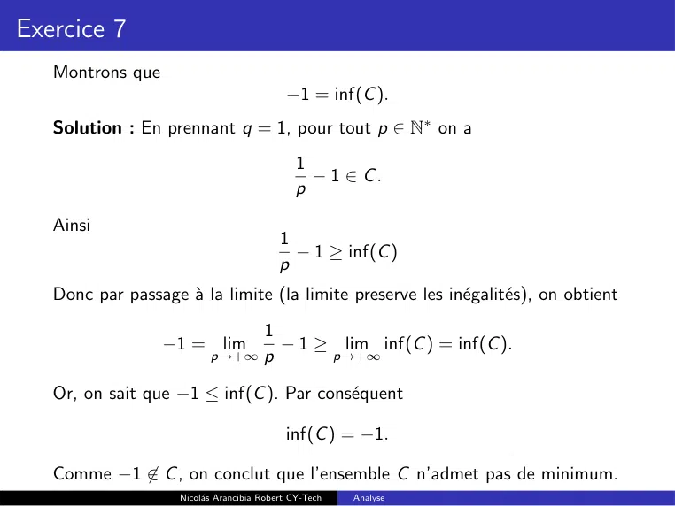

~~~text
Exercice 7
   Montrons que
                                            −1 = inf(C ).
   Solution : En prennant q = 1, pour tout p ∈ N∗ on a
                                              1
                                                − 1 ∈ C.
                                              p
   Ainsi
                                           1
                                             − 1 ≥ inf(C )
                                           p
   Donc par passage à la limite (la limite preserve les inégalités), on obtient
                                       1
                  −1 = lim                 − 1 ≥ lim inf(C ) = inf(C ).
                           p→+∞ p                       p→+∞

   Or, on sait que −1 ≤ inf(C ). Par conséquent

                                            inf(C ) = −1.

   Comme −1 6∈ C , on conclut que l’ensemble C n’admet pas de minimum.
                    Nicolás Arancibia Robert CY-Tech    Analyse
~~~

## Page 32

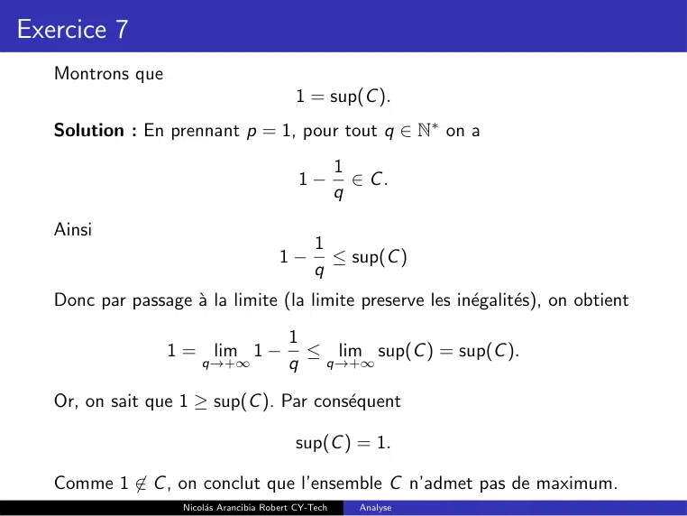

~~~text
Exercice 7
   Montrons que
                                             1 = sup(C ).
   Solution : En prennant p = 1, pour tout q ∈ N∗ on a
                                                        1
                                              1−          ∈ C.
                                                        q
   Ainsi
                                                 1
                                         1−        ≤ sup(C )
                                                 q
   Donc par passage à la limite (la limite preserve les inégalités), on obtient
                                            1
                  1 = lim 1 −                 ≤ lim sup(C ) = sup(C ).
                        q→+∞                q q→+∞

   Or, on sait que 1 ≥ sup(C ). Par conséquent

                                             sup(C ) = 1.

   Comme 1 6∈ C , on conclut que l’ensemble C n’admet pas de maximum.
                    Nicolás Arancibia Robert CY-Tech     Analyse
~~~

## Page 33

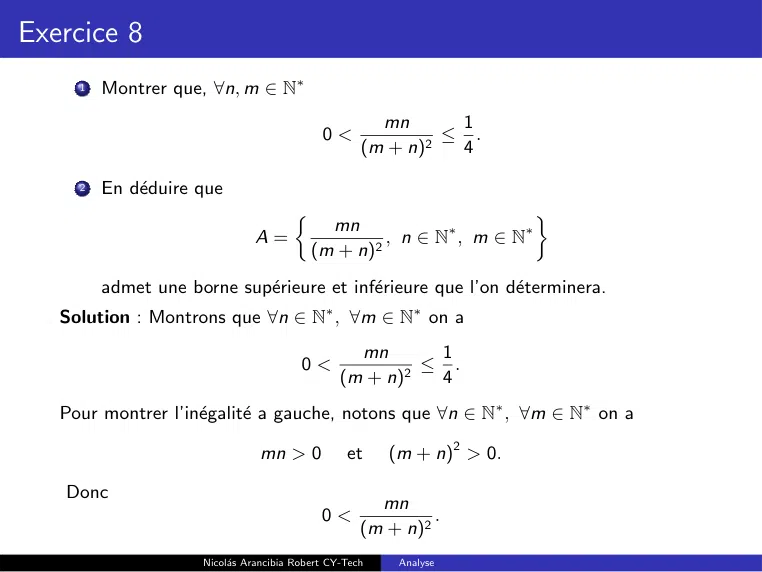

~~~text
Exercice 8
     1   Montrer que, ∀n, m ∈ N∗
                                                        mn      1
                                              0<               ≤ .
                                                      (m + n)2  4

     2   En déduire que
                                                                         
                                              mn
                                A=                   , n ∈ N∗ , m ∈ N∗
                                            (m + n)2
         admet une borne supérieure et inférieure que l’on déterminera.
   Solution : Montrons que ∀n ∈ N∗ , ∀m ∈ N∗ on a
                                                    mn      1
                                          0<               ≤ .
                                                  (m + n)2  4
   Pour montrer l’inégalité a gauche, notons que ∀n ∈ N∗ , ∀m ∈ N∗ on a

                                 mn > 0            et     (m + n)2 > 0.

   Donc
                                                        mn
                                              0<               .
                                                      (m + n)2
                      Nicolás Arancibia Robert CY-Tech    Analyse
~~~

## Page 34

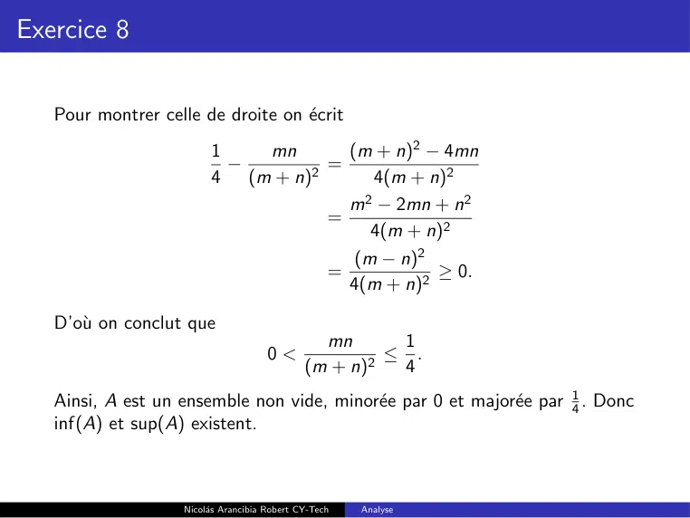

~~~text
Exercice 8

   Pour montrer celle de droite on écrit
                          1   mn       (m + n)2 − 4mn
                            −        =
                          4 (m + n)2       4(m + n)2
                                       m − 2mn + n2
                                         2
                                     =
                                          4(m + n)2
                                        (m − n)2
                                     =            ≥ 0.
                                       4(m + n)2

   D’où on conclut que
                                                 mn      1
                                       0<               ≤ .
                                               (m + n)2  4
   Ainsi, A est un ensemble non vide, minorée par 0 et majorée par 14 . Donc
   inf(A) et sup(A) existent.

                    Nicolás Arancibia Robert CY-Tech   Analyse
~~~

## Page 35

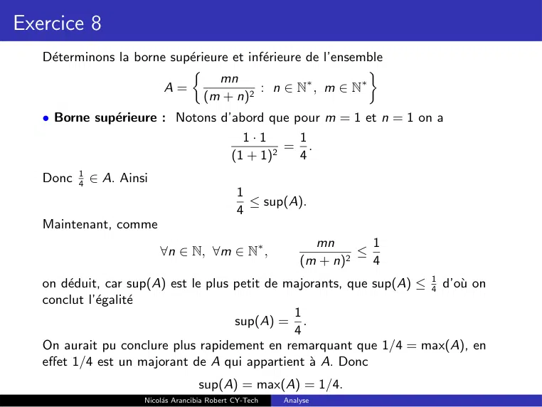

~~~text
Exercice 8
   Déterminons la borne supérieure et inférieure de l’ensemble
                                                               
                                   mn               ∗         ∗
                        A=                :   n ∈ N   , m ∈ N
                                (m + n)2
   • Borne supérieure : Notons d’abord que pour m = 1 et n = 1 on a
                                    1·1      1
                                           = .
                                  (1 + 1)2   4
   Donc 14 ∈ A. Ainsi
                                               1
                                                 ≤ sup(A).
                                               4
   Maintenant, comme
                                                               mn       1
                         ∀n ∈ N, ∀m ∈ N∗ ,                            ≤
                                                             (m + n)2   4
   on déduit, car sup(A) est le plus petit de majorants, que sup(A) ≤ 14 d’où on
   conclut l’égalité
                                                1
                                      sup(A) = .
                                                4
   On aurait pu conclure plus rapidement en remarquant que 1/4 = max(A), en
   effet 1/4 est un majorant de A qui appartient à A. Donc
                                    sup(A) = max(A) = 1/4.
                     Nicolás Arancibia Robert CY-Tech   Analyse
~~~

## Page 36

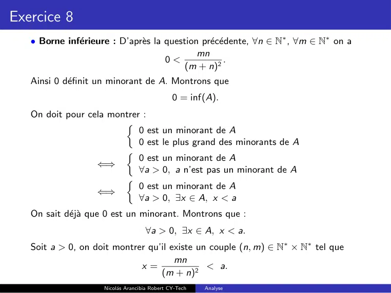

~~~text
Exercice 8
   • Borne inférieure : D’après la question précédente, ∀n ∈ N∗ , ∀m ∈ N∗ on a
                                             mn
                                     0<              .
                                          (m + n)2
   Ainsi 0 définit un minorant de A. Montrons que
                                                0 = inf(A).
   On doit pour cela montrer :
                        
                            0 est un minorant de A
                            0 est le plus grand des minorants de A
                        
                            0 est un minorant de A
                  ⇐⇒
                            ∀a > 0, a n’est pas un minorant de A
                        
                            0 est un minorant de A
                  ⇐⇒
                            ∀a > 0, ∃x ∈ A, x < a
   On sait déjà que 0 est un minorant. Montrons que :
                                     ∀a > 0, ∃x ∈ A, x < a.
   Soit a > 0, on doit montrer qu’il existe un couple (n, m) ∈ N∗ × N∗ tel que
                                      mn
                             x=               < a.
                                  (m + n)2
                     Nicolás Arancibia Robert CY-Tech   Analyse
~~~

## Page 37

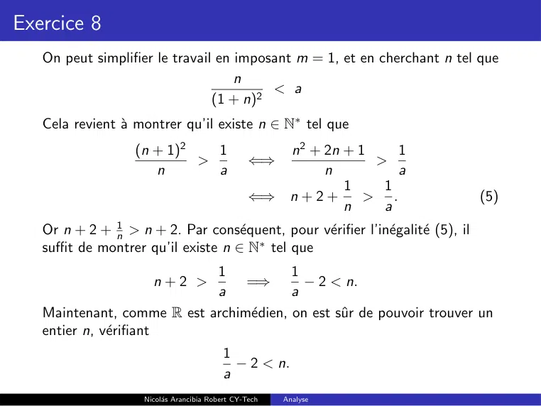

~~~text
Exercice 8
   On peut simplifier le travail en imposant m = 1, et en cherchant n tel que
                                    n
                                         < a
                                (1 + n)2
   Cela revient à montrer qu’il existe n ∈ N∗ tel que
                   (n + 1)2   1                           n2 + 2n + 1    1
                            >                      ⇐⇒                 >
                      n       a                                n         a
                                                                  1    1
                                                   ⇐⇒     n+2+       > .          (5)
                                                                  n    a
   Or n + 2 + n1 > n + 2. Par conséquent, pour vérifier l’inégalité (5), il
   suffit de montrer qu’il existe n ∈ N∗ tel que
                            1            1
                       n+2 >     =⇒        − 2 < n.
                            a            a
   Maintenant, comme R est archimédien, on est sûr de pouvoir trouver un
   entier n, vérifiant
                                           1
                                             − 2 < n.
                                           a
                     Nicolás Arancibia Robert CY-Tech   Analyse
~~~

## Page 38

~~~text
Exercice 8

   Ainsi, il existe
                                                             n
                                 x ∈ A, x =                        < a.
                                                          (n + 1)2
   Le nombre a ne peut donc pas être un minorant de A. Donc

                                                inf(A) = 0.

                      Nicolás Arancibia Robert CY-Tech     Analyse
~~~

## Page 39

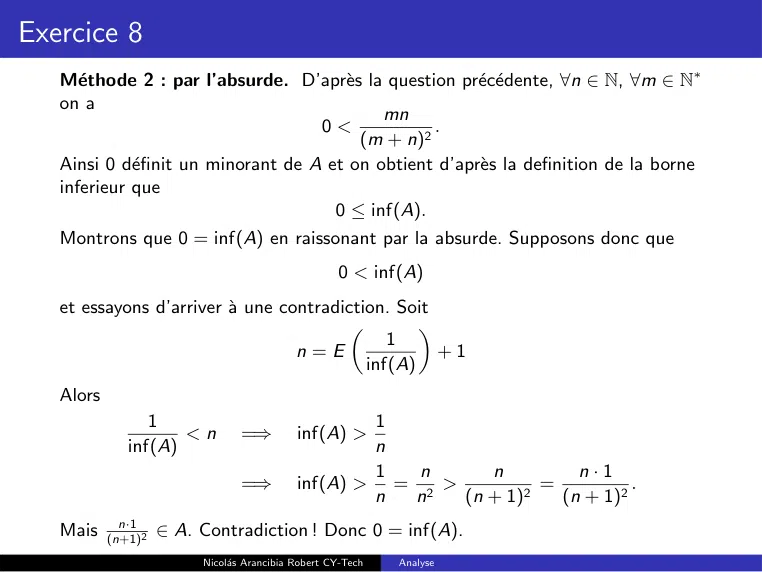

~~~text
Exercice 8
   Méthode 2 : par l’absurde. D’après la question précédente, ∀n ∈ N, ∀m ∈ N∗
   on a
                                            mn
                                    0<            .
                                         (m + n)2
   Ainsi 0 définit un minorant de A et on obtient d’après la definition de la borne
   inferieur que
                                      0 ≤ inf(A).
   Montrons que 0 = inf(A) en raissonant par la absurde. Supposons donc que
                                                0 < inf(A)
   et essayons d’arriver à une contradiction. Soit
                                                 
                                              1
                                  n=E               +1
                                           inf(A)
   Alors
              1                                 1
                  <n        =⇒          inf(A) >
           inf(A)                               n
                                                1  n      n         n·1
                            =⇒          inf(A) > = 2 >          =          .
                                                n n    (n + 1)2   (n + 1)2
          n·1
   Mais (n+1) 2 ∈ A. Contradiction ! Donc 0 = inf(A).

                     Nicolás Arancibia Robert CY-Tech   Analyse
~~~

## Page 40

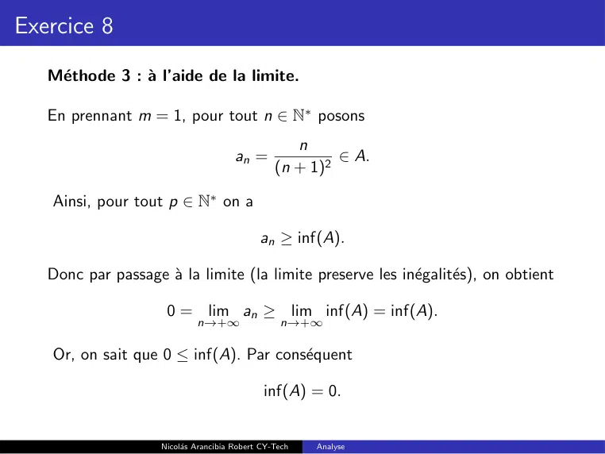

~~~text
Exercice 8
   Méthode 3 : à l’aide de la limite.

   En prennant m = 1, pour tout n ∈ N∗ posons
                                                    n
                                       an =               ∈ A.
                                                 (n + 1)2

   Ainsi, pour tout p ∈ N∗ on a

                                             an ≥ inf(A).

   Donc par passage à la limite (la limite preserve les inégalités), on obtient

                     0 = lim an ≥ lim inf(A) = inf(A).
                             n→+∞                 n→+∞

   Or, on sait que 0 ≤ inf(A). Par conséquent

                                              inf(A) = 0.

                    Nicolás Arancibia Robert CY-Tech   Analyse
~~~

## Page 41

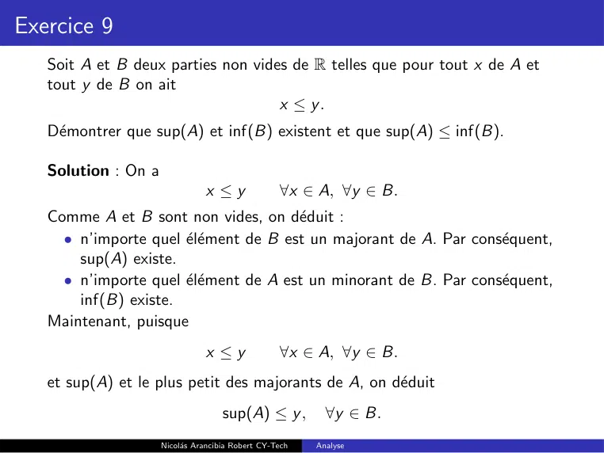

~~~text
Exercice 9
   Soit A et B deux parties non vides de R telles que pour tout x de A et
   tout y de B on ait
                                    x ≤ y.
   Démontrer que sup(A) et inf(B) existent et que sup(A) ≤ inf(B).

   Solution : On a
                                x ≤y               ∀x ∈ A, ∀y ∈ B.
   Comme A et B sont non vides, on déduit :
     • n’importe quel élément de B est un majorant de A. Par conséquent,
       sup(A) existe.
     • n’importe quel élément de A est un minorant de B. Par conséquent,
       inf(B) existe.
   Maintenant, puisque
                                x ≤y               ∀x ∈ A, ∀y ∈ B.
   et sup(A) et le plus petit des majorants de A, on déduit
                                     sup(A) ≤ y ,          ∀y ∈ B.
                     Nicolás Arancibia Robert CY-Tech   Analyse
~~~

## Page 42

~~~text
Exercice 9

   Ainsi sup(A) est un minorant de B, et comme inf(B) est le plus grand
   minorant de B, on conclut

                                       sup(A) ≤ inf(B).

                  Nicolás Arancibia Robert CY-Tech   Analyse
~~~
