# TD2-Suites-Correction_2023-2024_Analyse1_P1S1_NArancibia.pdf

[Ouvrir l’original](https://drive.google.com/open?id=17o73AWeEN827UEwuxU0BRuNN2H830IXz) · Les deux lectures automatiques du PDF divergent sur les pages indiquées. Leur fac-similé accompagne le texte.

**Pages présentant un écart entre les deux extractions** — 2–6, 8, 10, 22, 25, 28–29, 32, 36–44, 50, 53, 55–56, 62–63, 65–68, 73, 79, 81–82, 84–89, 91, 93, 95, 97–109, 114, 116, 119–122, 124–127, 130.

## Page 1

~~~text
Analyse-Premier semestre 2023-2024

                      CY Tech

                     TD Analyse

                        Suites.

                             Analyse
~~~

## Page 2

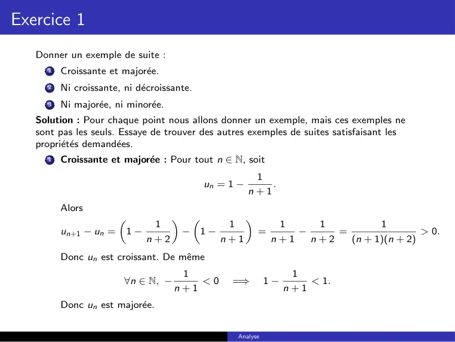

~~~text
Exercice 1
   Donner un exemple de suite :
     1   Croissante et majorée.
     2   Ni croissante, ni décroissante.
     3   Ni majorée, ni minorée.
   Solution : Pour chaque point nous allons donner un exemple, mais ces exemples ne
   sont pas les seuls. Essaye de trouver des autres exemples de suites satisfaisant les
   propriétés demandées.
     1   Croissante et majorée : Pour tout n ∈ N, soit
                                                           1
                                               un = 1 −       .
                                                          n+1
         Alors
                                                       
                                 1                   1             1     1          1
         un+1 − un =       1−             −    1−             =       −     =                > 0.
                                n+2                 n+1           n+1   n+2   (n + 1)(n + 2)
         Donc un est croissant. De même
                                       1                              1
                        ∀n ∈ N, −         <0         =⇒         1−       < 1.
                                      n+1                            n+1
         Donc un est majorée.

                                                      Analyse
~~~

## Page 3

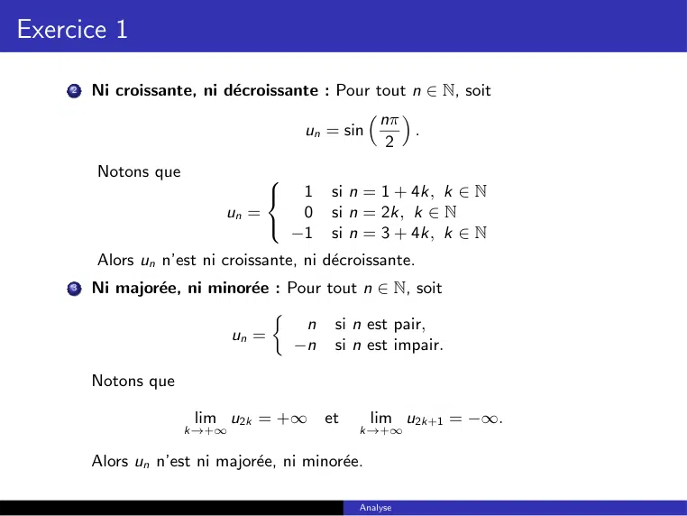

~~~text
Exercice 1

    2   Ni croissante, ni décroissante : Pour tout n ∈ N, soit
                                               nπ 
                                     un = sin        .
                                                 2
        Notons que                
                                    1     si n = 1 + 4k, k ∈ N
                           un =      0     si n = 2k, k ∈ N
                                    −1     si n = 3 + 4k, k ∈ N
                                  

        Alors un n’est ni croissante, ni décroissante.
    3   Ni majorée, ni minorée : Pour tout n ∈ N, soit
                                
                                     n si n est pair,
                          un =
                                    −n si n est impair.

        Notons que

                       lim u2k = +∞       et       lim u2k+1 = −∞.
                     k→+∞                      k→+∞

        Alors un n’est ni majorée, ni minorée.

                                               Analyse
~~~

## Page 4

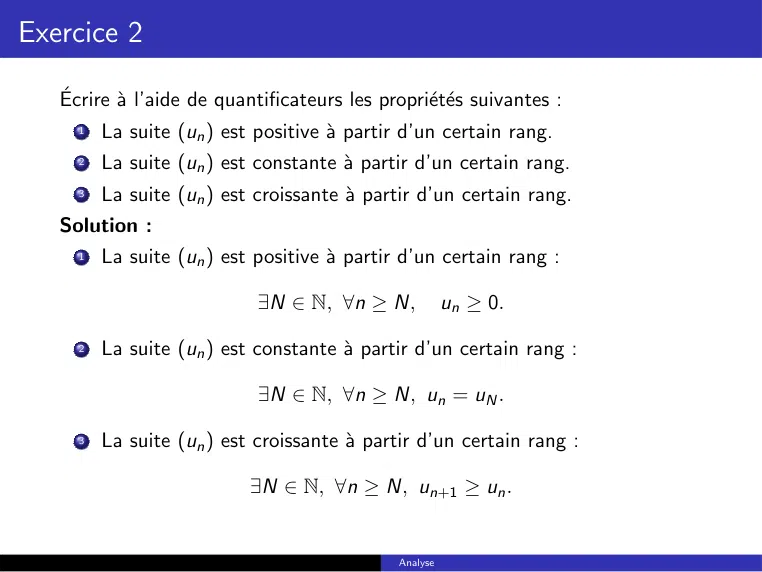

~~~text
Exercice 2

   Écrire à l’aide de quantificateurs les propriétés suivantes :
     1   La suite (un ) est positive à partir d’un certain rang.
     2   La suite (un ) est constante à partir d’un certain rang.
     3   La suite (un ) est croissante à partir d’un certain rang.
   Solution :
     1   La suite (un ) est positive à partir d’un certain rang :

                            ∃N ∈ N, ∀n ≥ N,             un ≥ 0.

     2   La suite (un ) est constante à partir d’un certain rang :

                            ∃N ∈ N, ∀n ≥ N, un = uN .

     3   La suite (un ) est croissante à partir d’un certain rang :

                           ∃N ∈ N, ∀n ≥ N, un+1 ≥ un .

                                              Analyse
~~~

## Page 5

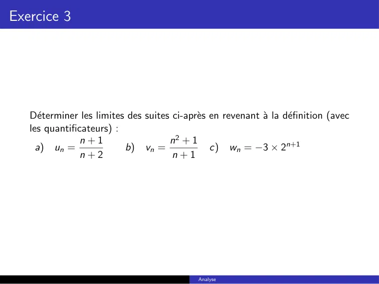

~~~text
Exercice 3

   Déterminer les limites des suites ci-après en revenant à la définition (avec
   les quantificateurs) :
                n+1                  n2 + 1
     a) un =              b) vn =               c) wn = −3 × 2n+1
                n+2                   n+1

                                             Analyse
~~~

## Page 6

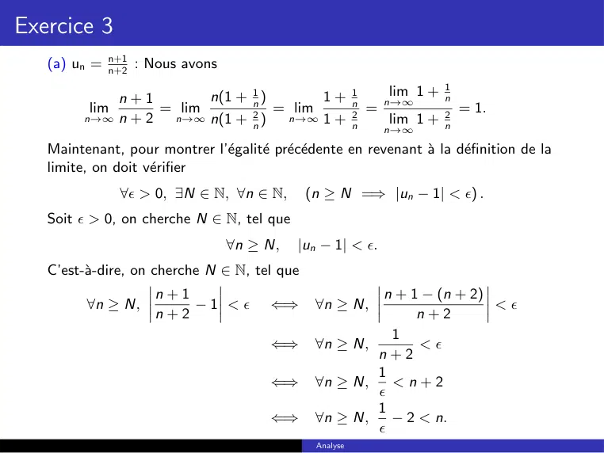

~~~text
Exercice 3
   (a) un = n+1
            n+2
                : Nous avons

             n+1         n(1 + n1 )        1 + n1    lim 1 + n1
                                                    n→∞
          lim      = lim            =  lim        =             = 1.
         n→∞ n + 2  n→∞ n(1 + 2 )     n→∞ 1 + 2      lim 1 + n2
                               n               n             n→∞

   Maintenant, pour montrer l’égalité précédente en revenant à la définition de la
   limite, on doit vérifier
                ∀ > 0, ∃N ∈ N, ∀n ∈ N,       (n ≥ N =⇒ |un − 1| < ) .
   Soit  > 0, on cherche N ∈ N, tel que
                                 ∀n ≥ N,     |un − 1| < .
   C’est-à-dire, on cherche N ∈ N, tel que
                     n+1                                 n + 1 − (n + 2)
         ∀n ≥ N,         −1 <          ⇐⇒      ∀n ≥ N,                  <
                     n+2                                      n+2
                                                          1
                                        ⇐⇒      ∀n ≥ N,       <
                                                        n+2
                                                        1
                                        ⇐⇒      ∀n ≥ N,   <n+2
                                                        
                                                        1
                                        ⇐⇒      ∀n ≥ N,   − 2 < n.
                                                        
                                                Analyse
~~~

## Page 7

~~~text
Exercice 3

   Ainsi
                                           1
                   |un − 1| <     ⇐⇒        − 2 ≤ n.
                                           
                  1
                      
   Posons N = E    −2    + 1. Alors pour tout n ≥ N, nous avons

                  1
           n≥N>     −2     =⇒     |un − 1| <      =⇒    lim un = 1.
                                                       n→+∞

                                         Analyse
~~~

## Page 8

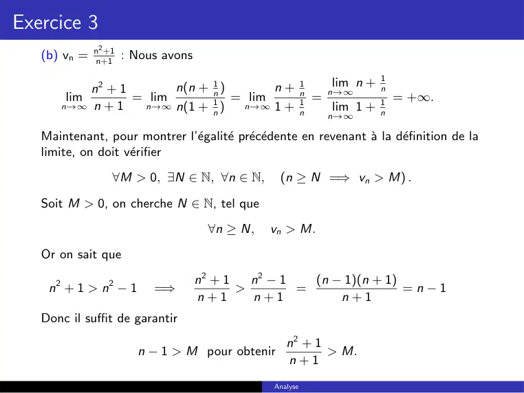

~~~text
Exercice 3
              2
   (b) vn = nn+1
              +1
                 : Nous avons

          n2 + 1       n(n + n1 )        n + n1    lim n + n1
                                                  n→∞
       lim       = lim            =  lim        =             = +∞.
      n→∞ n + 1   n→∞ n(1 + 1 )     n→∞ 1 + 1      lim 1 + n1
                             n               n            n→∞

   Maintenant, pour montrer l’égalité précédente en revenant à la définition de la
   limite, on doit vérifier
                  ∀M > 0, ∃N ∈ N, ∀n ∈ N,        (n ≥ N =⇒ vn > M) .
   Soit M > 0, on cherche N ∈ N, tel que
                                   ∀n ≥ N,     vn > M.
   Or on sait que
                                n2 + 1   n2 − 1   (n − 1)(n + 1)
    n2 + 1 > n2 − 1     =⇒             >        =                =n−1
                                n+1      n+1          n+1
   Donc il suffit de garantir
                                                   n2 + 1
                      n − 1 > M pour obtenir              > M.
                                                   n+1
                                                Analyse
~~~

## Page 9

~~~text
Exercice 3

   Sachant que
                        n−1>M      ⇐⇒       n > M + 1,
   il suffit de poser
                             N = E (M + 1) + 1.
   Alors pour tout n ≥ N, nous avons

                             n2 + 1
          n >M +1       =⇒          >M            =⇒    lim vn = +∞.
                             n+1                       n→+∞

                                        Analyse
~~~

## Page 10

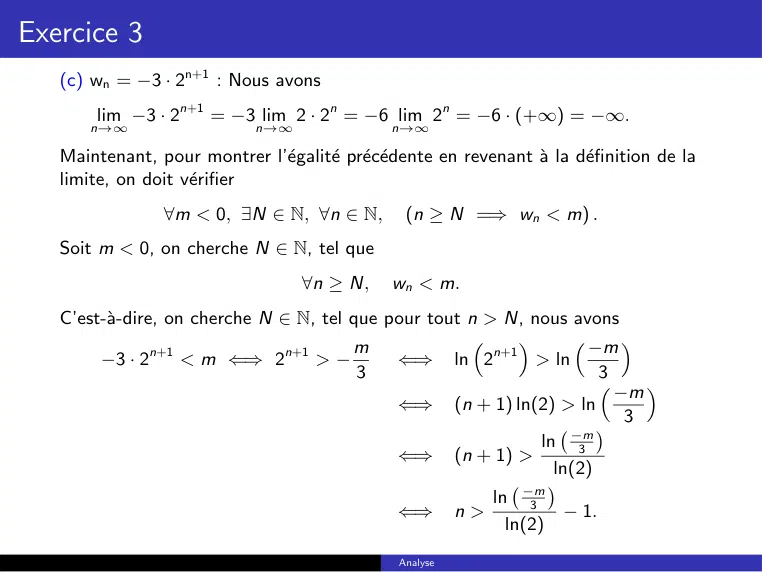

~~~text
Exercice 3
   (c) wn = −3 · 2n+1 : Nous avons
       lim −3 · 2n+1 = −3 lim 2 · 2n = −6 lim 2n = −6 · (+∞) = −∞.
       n→∞                   n→∞               n→∞

   Maintenant, pour montrer l’égalité précédente en revenant à la définition de la
   limite, on doit vérifier
                ∀m < 0, ∃N ∈ N, ∀n ∈ N,          (n ≥ N =⇒ wn < m) .
   Soit m < 0, on cherche N ∈ N, tel que
                                   ∀n ≥ N,     wn < m.
   C’est-à-dire, on cherche N ∈ N, tel que pour tout n > N, nous avons
                                        m                            −m 
        −3 · 2n+1 < m ⇐⇒ 2n+1 > −            ⇐⇒ ln 2n+1 > ln
                                         3                                3
                                                                           −m 
                                             ⇐⇒ (n + 1) ln(2) > ln
                                                                          3
                                                                 ln −m3
                                             ⇐⇒ (n + 1) >
                                                                   ln(2)
                                                         ln −m
                                                                  
                                                               3
                                             ⇐⇒ n >                  − 1.
                                                           ln(2)
                                                Analyse
~~~

## Page 11

~~~text
Exercice 3

   Ainsi
                                           ln −m
                                                   
                                                3
                  wn < m        ⇐⇒      n>           − 1.
                                             ln(2)
                               
                      ln( −m
                           3 )
   Posons N = E         ln(2) − 1   + 1. Alors pour tout n ≥ N, nous avons

        ln −m
                
             3
   n≥N>           −1           =⇒     wn < m          =⇒    lim wn = −∞.
          ln(2)                                            n→+∞

                                            Analyse
~~~

## Page 12

~~~text
Exercice 4
   Déterminer si elles existent les limites des suites définies par :
                                                                       √
         1092 n2                   √           √                          n sin n
    a)          3
                              b)      n  + 2 −   n                c)         √
         n +  n                                                         n + n
                  √     √                                              (−1)n + n
         q                         p                p
    d)     n + n − n e)               n2 + n + 1 − n2 + 1 f )                  √
                                                                         n+7 n
               n     n                 2
         (−3) + 7                    n + cos n                          1      2     n
    g)                        h)                                  i)       + 2 + ... 2
           2n + 5n                 sin(n) − 3n2                       n2      n     n
   À faire chez soi :
                                                  √
       √         √                                  n−1          2n − 3n+1
    j)  n+1− n                             k)     √         l)
        √              √                            n+1             52n
    m)    n2 + 2n + 3 − n2 + n + 1
   Solution :
             92 2
   a) un = 10n+nn3 : Nous avons

       1092 n2
                            92 1
                      n3 10 n
                                                1                lim 1       0
                                      92        n        92     n→∞ n
   lim         =  lim   ·        = 10     lim       = 10    ·               = = 0.
   n→∞ n + n3    n→∞ n3 12 + 1           n→∞ 12 + 1           lim    1
                                                                      2 + 1  1
                          n                   n                     n
                                                                  n→∞

                                                Analyse
~~~

## Page 13

~~~text
Exercice 4

             √           √
   b) un =       n+2−        n : Nous avons
                                                           √     √
              √           √                √          √    n+2+ n
                   n+2−       n        =          n+2− n · √     √
                                                             n+2+ n
                                                 n+2−n         2
                                       =       √      √ =√       √
                                                 n+2+ n     n+2+ n

   Donc
                   √           √                         2
             lim       n+2−        n       =    lim √       √
          n→∞                                   n→∞   n+2+ n
                                                       2         2
                                           =        √       √ =    = 0.
                                                 lim n + 2 + n  +∞
                                                n→∞

                                                      Analyse
~~~

## Page 14

~~~text
Exercice 4

              √
              n·sin(n)
   c) un =       √
              n+ n
                       : Nous avons
                            √                    √
          √                    n
                                                                √1 · sin(n)
                              n · sin(n)
                                                    n
           n sin n n                               n · sin(n)     n
              √ = ·                 √         =         √    =
                                                                  1 + √1n
                             
          n+ n     n           1 + nn               1 + nn

   Donc
                        √                             √1 · sin(n)
                        n · sin(n)                      n
                  lim        √        =        lim
                  n→∞   n+ n                   n→∞ 1 + √1
                                                               n

                                                lim √1n · sin(n)   0
                                               n→∞
                                      =                       1   = = 0.
                                                   lim 1 + √n      1
                                                  n→∞

                                                   Analyse
~~~

## Page 15

~~~text
Exercice 4
          p    √   √
   d) un = n + n − n : Nous avons
                                           p  √    √
              √   √               √     √
                          q
                                             n+ n+ n
          q
           n+ n− n =           n+ n− n · p     √    √
                                             n+ n+ n
                                 √
                             n+ n−n
                       = p       √     √
                             n+ n+ n
                                   √
                                    n
                       = r         √    √
                             n 1 + nn + n
                                   √
                                     n            1
                      = √ q               √ = q            .
                             n · 1 + √1n + n   1 + √1n + 1

   Donc
                            √  √                           1
                   q
             lim       n+    n− n   =   lim q
             n→∞                        n→∞
                                                      1 + √1n + 1
                                                       1                1
                                    =             q                 =     .
                                         lim          1 + √1n + 1       2
                                        n→∞

                                        Analyse
~~~

## Page 16

~~~text
Exercice 4
              p            p
   (e) un =    n2 + n + 1 − n2 + 1 : Nous avons
                                                         √             √
   p                  p          p              p          n2 + n + 1 + n2 + 1
       n2 + n + 1 −    n2 + 1 = ( n2 + n + 1 − n2 + 1) · √             √
                                                           n2 + n + 1 + n2 + 1
                                 n2 + n + 1 − (n2 + 1)              n
                              = √              √       = √             √       .
                                  n2 + n + 1 + n2 + 1      n2 + n + 1 + n2 + 1
   Donc
       p              p                        n
    lim n2 + n + 1 − ( n2 + 1) = lim √            √
   n→∞                          n→∞   n2 + n + 1 + n2 + 1
                                                     n
                               = lim q                q
                                n→∞
                                       n · 1 + n + n2 + n2 · 1 + n12
                                                1  1
                                                                     
                                        2

                                                            n
                                     = lim        q                q
                                         n→∞
                                               n · 1 + n + n2 + n · 1 + n12
                                                       1   1

                                                     1
                                     = lim q            q
                                      n→∞
                                            1 + n + n2 + 1 + n12
                                                1   1

                                         1
                                     =     .
                                         2
                                               Analyse
~~~

## Page 17

~~~text
Exercice 4
                    n
   (f) un = (−1)√
                 +n
             n+7 n
                    : Nous avons
                                        n
                           (−1)                                (−1)n
         (−1)n + n      n       +1                                   +1
       lim     √ = lim    · n √n                      =    lim   n
     n→+∞ n + 7 n  n→+∞ n  1+7                            n→+∞ 1 + 7 √1
                                            n                          n
                                                                 (−1)n
                                                           lim         +1
                                                          n→+∞     n            1
                                                      =                     =     = 1.
                                                           lim 1 + 7 √1n        1
                                                          n→+∞

                    n   n
   (g) un = (−3)  +7
              2n +5n
                     : Nous avons
                                   n                                               n   !
        (−3)n + 7n        7n   − 73 + 1         7n                              − 73 + 1
                                                  
    lim            =  lim    ·  2 n
                                       =   lim      ·                 lim       2 n
                                                                                   
   n→+∞   2n + 5 n   n→+∞ 5n
                                5
                                     +1    n→+∞ 5n                    n→+∞
                                                                                 5
                                                                                      +1
                                                   = (+∞) · (1) = +∞.
                2
              n +cos n
   (h) un = sin(n)−3n  2 : Nous avons

                                           cos n
              n2 + cos n         n2 1 + 2             1 + cos2 n 1
          lim              = lim 2 · sin(n) n = lim sin(n) n = −
        n→+∞ sin(n) − 3n 2  n→+∞ n          −  3 n→+∞      −   3 3
                                        2   n           2         n

                                                Analyse
~~~

## Page 18

~~~text
Exercice 4

   (i) un = n12 + n22 + . . . nn2 : Nous avons

                                        1       2       n
                            un    =       2
                                            + 2 + ... 2
                                        n      n       n
                                        1 + 2 + ··· + n
                                   =
                                                 n2
                                        n(n + 1)
                                   =
                                            2n2
                                        n+1
                                   =           .
                                          2n
   Par conséquent

                         n+1       n 1 + n1       1 + n1  1
         lim un = lim        = lim   ·      = lim        = .
       n→+∞          n→+∞ 2n  n→+∞ n   2     n→+∞   2     2

                                                 Analyse
~~~

## Page 19

~~~text
Exercice 4
              √          √
   (j) un =       n+1−       n : Nous avons
                                                √     √
                  √           √     √      √    n+1+ n
                      n+1−        n=   n+1− n · √     √
                                                  n+1+ n
                                      n+1−n         1
                                   =√      √ =√       √
                                      n+1+ n     n+1+ n
   Donc
         √         √                  1                             1       0
   lim       n + 1− n = lim √           √ =                    √       √ =    = 0.
   n→∞                   n→∞        n+1+ n               lim       n+1+ n  +∞
                                                        n→+∞
            √
   (k) un = √n−1
              n+1
                  : Nous avons
        √            √                     √
          n−1          n + (1 − 2)           n+1     2
    lim √      = lim    √          = lim √       −√
   n→+∞   n + 1 n→+∞      n+1        n→+∞    n+1    n+1
                                                2
                                   = 1 − lim √     = 1 − 0 = 1.
                                        n→+∞   n+1

                                              Analyse
~~~

## Page 20

~~~text
Exercice 4

             n   n+1
   (l) un = 2 −3
              52n      : Nous avons
                                  n  n
          2n − 3n+1
                                              
                                       3 2
      lim           = lim           ·       −3
     n→+∞    52n     n→+∞             25 3
                                n         n    
                                3            2
                         = lim      · lim        − 3 = 0 · 0 = 0.
                          n→+∞ 25     n→+∞   3

                                           Analyse
~~~

## Page 21

~~~text
Exercice 4
            √            √
   (m) un = n2 + 2n + 3 − n2 + n + 1 : Nous avons
    p              p                  p               p
      n2 + 2n + 3 − n2 + n + 1  = ( n2 + 2n + 3 − n2 + n + 1)
                                                   √              √
                                                     n2 + 2n + 3 + n2 + n + 1
                                                  ·√              √
                                                     n2 + 2n + 3 + n2 + n + 1
                                      n2 + 2n + 3 − (n2 + n + 1)
                                = √                  √
                                       n2 + 2n + 3 + n2 + n + 1
                                                n+2
                                = √                  √
                                       n2 + 2n + 3 + n2 + n + 1
                                                           n(1 + n2 )
                                          =     q                   q            .
                                               n 1 + 2 n1 + n32 + n 1 + n1 + n12

   Donc
          p                   p                                          1 + n2
    lim       n2 + 2n + 3 −       n2 + n + 1   =     lim      q               q
   n→+∞                                             n→+∞
                                                               1 + 2 n + n32 + 1 + n1 + n12
                                                                     1

                                                                 lim 1 + n2
                                                                   n→+∞                1
                                               =          q               q           = .
                                                      lim         1   3        1   1
                                                            1 + 2 n + n2 + 1 + n + n2  2
                                                    n→+∞

                                                    Analyse
~~~

## Page 22

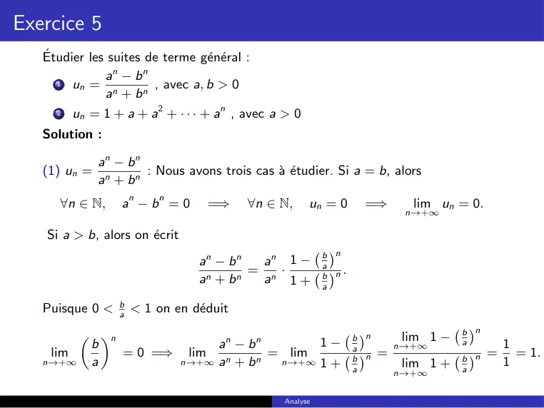

~~~text
Exercice 5
   Étudier les suites de terme général :
               an − b n
      1  un = n         , avec a, b > 0
               a + bn
      2  un = 1 + a + a2 + · · · + an , avec a > 0
   Solution :

              an − b n
   (1) un =            : Nous avons trois cas à étudier. Si a = b, alors
              an + b n
      ∀n ∈ N,     an − b n = 0    =⇒     ∀n ∈ N,      un = 0        =⇒        lim un = 0.
                                                                             n→+∞

   Si a > b, alors on écrit
                                                          b n
                                                            
                                 an − b n  an 1 −         a
                                  n     n
                                          = n ·              .
                                                          b n
                                 a +b      a 1+           a

   Puisque 0 < ba < 1 on en déduit
                                                                                      b n
                                                                                        
         n                                                      b n
                                                                           lim 1 −
         b              an − b n       1−                         a         n→+∞      a         1
    lim      = 0 =⇒ lim n      n
                                 = lim                            b n
                                                                       =             b n
                                                                                           =     = 1.
   n→+∞  a         n→+∞ a +b      n→+∞ 1+                         a
                                                                            lim 1 +   a
                                                                                                1
                                                                            n→+∞

                                                Analyse
~~~

## Page 23

~~~text
Exercice 5

   Si b > a, alors on écrit
                                                a n
                                                  
                               an − b n  bn     b
                                                    −1
                                n     n
                                        = n ·   a n
                                                      .
                               a +b      b      b
                                                    +1

   Puisque 0 < ba < 1 on en déduit
                                                                      a n
                                                                        
                                                      a n
                                                               lim       −1
           a n              an − b n                b
                                                          −1   n→+∞   b
    lim            = 0 =⇒ lim n        = lim          a n
                                                            =        a n
                                                                            = −1.
   n→+∞    b             n→+∞ a + b n   n→+∞              +1    lim       +1
                                                      b        n→+∞   b

                                            Analyse
~~~

## Page 24

~~~text
Exercice 5

   (2) un = 1 + a + a2 + · · · + an , avec a > 0 : Nous avons
                                               
                          2             n           n+1       si a = 1,
                 1 + a + a + ··· + a =              an+1 −1
                                                      a−1     si a 6= 1.

   Par conséquent
                                    
                                       lim n + 1 = +∞
                                     n→∞                                         si a = 1,
    lim 1 + a + a2 + · · · + an =                  n+1        lim a   n+1
                                                                            −1
   n→∞                                     lim a a−1−1 = n→+∞a−1                 si a 6= 1.
                                        n→∞

    Maintenant
                                                                           
               +∞ si a > 1                                                       +∞    si a ≥ 1,
    lim an =                                =⇒ lim 1+· · ·+an =                   1
   n→∞          0 si 0 ≤ a < 1                  n→∞                              1−a   si 0 ≤ a < 1.

                                               Analyse
~~~

## Page 25

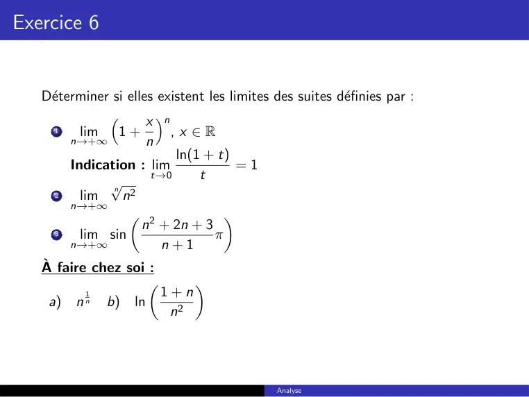

~~~text
Exercice 6

   Déterminer si elles existent les limites des suites définies par :
                     x n
     1    lim 1 +          ,x ∈R
        n→+∞          n
                            ln(1 + t)
        Indication : lim               =1
                       t→0      t
              √n
     2    lim    n2
        n→+∞
                   2               
                     n + 2n + 3
     3    lim sin                 π
        n→+∞             n+1
   À faire chez soi :
                          
           1           1+n
    a) n n b) ln
                        n2

                                             Analyse
~~~

## Page 26

~~~text
Exercice 6
                          n                                    n
   (1)    lim    1 + xn
                     , x ∈ R : Si x = 0, alors ∀n ∈ N, 1 + n0 = 1, donc
         n→+∞
                                                   0 n
                                                    
                                     lim       1+        = 1.
                                  n→+∞             n
                   ∗
   Supposons x ∈ R , nous pouvons écrire
               x n                        x n 
           1+           = exp ln 1 +
                n                             n
                                              x 
                        = exp n ln 1 +
                                                n
                                                                              !
                                x                 x             ln 1 + xn
                        = exp          · n ln 1 +         = exp x ·     x        .
                                   x                n                   n
   Maintenant
        Pour tout x ∈ R,        lim x = 0.
                               n→+∞ n
                ln(1+t)
          lim       t
                        = 1.
          t→0
   Le Theorème de Composition à gauche par une fonction, avec
                                   ln(1 + t)             x
                           f (t) =            et un = ,
                                       t                 n
   nous permet donc de conclure
                              !                                    !
                    ln 1 + xn                             ln 1 + xn
              lim        x        = 1    =⇒    lim    x ·     x        = x.
                n→+∞                              n→+∞
                               n                                   n

                                                 Analyse
~~~

## Page 27

~~~text
Exercice 6

   Finalement, notons que
                              lim exp(t) = exp(x).
                              t→x

   Le Theorème de Composition à gauche par une fonction, avec

                                               ln 1 + xn
                                                         
                    f (t) = exp(t) et un = x ·      x      ,
                                                       n

   nous permet donc de conclure
                             !
                   ln 1 + xn                                        x n
       lim exp x ·      x       = exp(x)    =⇒       lim        1+        = exp(x).
     n→+∞
                        n
                                                     n→+∞            n

                                           Analyse
~~~

## Page 28

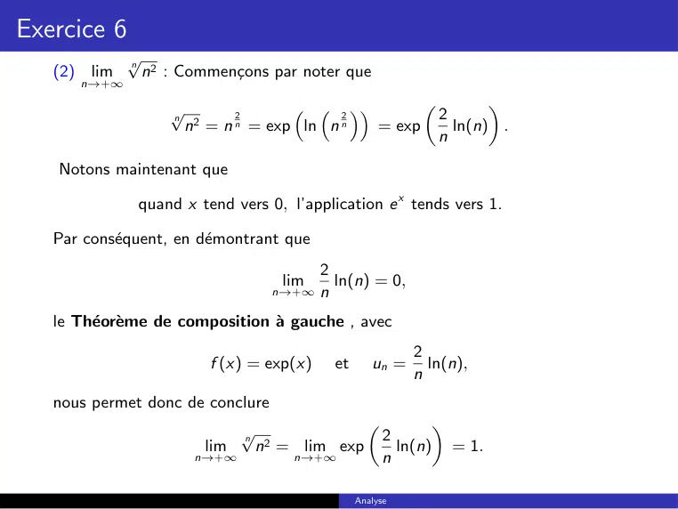

~~~text
Exercice 6
             √
             n
   (2) lim     n2 : Commençons par noter que
      n→+∞

                  √
                  n        2
                                    2        
                                                   2
                                                          
                    n2 = n n = exp ln n n  = exp     ln(n) .
                                                   n
   Notons maintenant que

              quand x tend vers 0, l’application e x tends vers 1.

   Par conséquent, en démontrant que
                                         2
                                   lim       ln(n) = 0,
                                  n→+∞ n

   le Théorème de composition à gauche , avec
                                                            2
                        f (x) = exp(x)       et      un =     ln(n),
                                                            n
   nous permet donc de conclure
                           √
                           n
                                          
                                            2
                                                   
                       lim   n2 = lim exp     ln(n) = 1.
                      n→+∞       n→+∞       n

                                                  Analyse
~~~

## Page 29

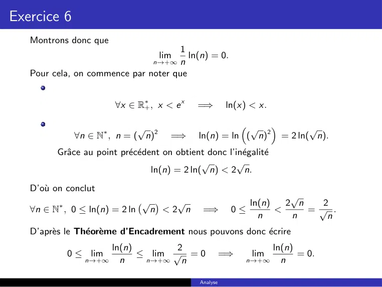

~~~text
Exercice 6
   Montrons donc que
                                          1
                                    lim       ln(n) = 0.
                                  n→+∞ n
   Pour cela, on commence par noter que

                        ∀x ∈ R∗+ , x < e x      =⇒        ln(x) < x.

                            √                             √           √
             ∀n ∈ N∗ , n = ( n)2       =⇒       ln(n) = ln ( n)2 = 2 ln( n).
         Grâce au point précédent on obtient donc l’inégalité
                                               √        √
                                  ln(n) = 2 ln( n) < 2 n.
   D’où on conclut
                                                                         √
                                √   √                          ln(n)   2 n    2
   ∀n ∈ N∗ , 0 ≤ ln(n) = 2 ln    n <2 n          =⇒        0≤         <     = √ .
                                                                  n      n      n
   D’après le Théorème d’Encadrement nous pouvons donc écrire
                       ln(n)        2                                  ln(n)
            0 ≤ lim          ≤ lim √ = 0                  =⇒    lim          = 0.
                n→+∞     n    n→+∞   n                         n→+∞      n

                                                Analyse
~~~

## Page 30

~~~text
Exercice 6

   Puisque
                                  ln(n)
                              lim       =0
                            n→+∞    n
   du Theorème de Composition à gauche par une fonction, on conclut
                      √
                      n
                                        
                                          2
                                                 
                  lim    2
                        n = lim exp         ln(n) = 1.
                 n→+∞        n→+∞         n

                                     Analyse
~~~

## Page 31

~~~text
Exercice 6
                    2             
                       n +2n+3
   (3) lim sin           n+1
                               π       : Nous avons
         n→+∞
          2                                                        
          n + 2n + 3                     2π                          2π
   sin               π = sin (n + 1)π +       = cos((n + 1)π) sin         .
             n+1                        n+1                         n+1
   Donc
                        2                                                               
                        n + 2n + 3                                                    2π
            lim sin                π           =         lim cos((n + 1)π) sin                 .
          n→+∞             n+1                          n→+∞                         n+1
   Maintenant
                  2π
            lim        = 0.
          n→+∞ n+1

          Quand x tend vers 0, l’application sin(x) tend vers 0.
   Le Theorème de Composition à gauche par une fonction, avec
                                                                          2π
                               f (x) = sin(x)           et       un =        ,
                                                                         n+1
   nous permet donc de conclure
                                                                
                                                         2π
                                          lim sin                      = 0.
                                        n→+∞            n+1

                                                             Analyse
~~~

## Page 32

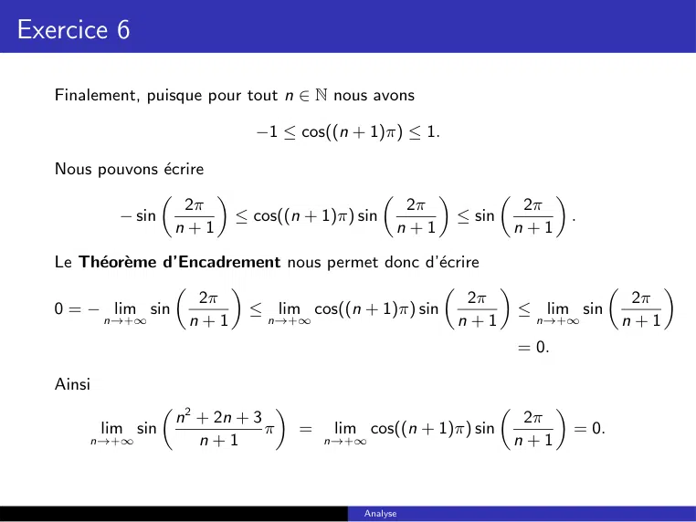

~~~text
Exercice 6

   Finalement, puisque pour tout n ∈ N nous avons

                               −1 ≤ cos((n + 1)π) ≤ 1.

   Nous pouvons écrire
                                                             
                    2π                           2π            2π
          − sin           ≤ cos((n + 1)π) sin         ≤ sin         .
                  n+1                           n+1           n+1

   Le Théorème d’Encadrement nous permet donc d’écrire
                                                                       
                     2π                                2π                2π
   0 = − lim sin           ≤ lim cos((n + 1)π) sin          ≤ lim sin
         n→+∞       n+1     n→+∞                     n+1     n→+∞       n+1
                                                             = 0.

   Ainsi
                      2                                       
                      n + 2n + 3                              2π
           lim sin               π = lim cos((n + 1)π) sin         = 0.
       n→+∞              n+1         n→+∞                    n+1

                                            Analyse
~~~

## Page 33

~~~text
Exercice 6
                1
   (a) lim n n : Nous avons
      n→+∞
                                                   
                      1
                               1          ln(n)
                    n n = exp ln n n  = exp           .
                                                n

   Maintenant
                ln(n)
        lim       n = 0.
       n→+∞
       Quand x tend vers 0 par la droite, l’application exp(x) tend vers 1.
   Le Theorème de Composition à gauche par une fonction, avec

                                                            ln(n)
                       f (x) = exp(x)    et    un =               ,
                                                              n
   nous permet donc de conclure
                                                           
                             1                      ln(n)
                       lim n = lim exp
                             n                                  = 1.
                      n→+∞        n→+∞                n

                                          Analyse
~~~

## Page 34

~~~text
Exercice 6

                1+n
                      
   (b) lim ln    n2       : Notons que
      n→+∞

        lim 1+n
              2 = 0.
       n→+∞ n
       Quand x tend vers 0 par la droite, l’application ln(x) tend vers −∞.

   Le Theorème de Composition à gauche par une fonction, , avec
                                                          1+n
                          f (x) = ln(x)   et       un =       ,
                                                           n2
   nous permet donc de conclure
                                  
                               1+n
                          ln          −→ −∞.
                                n2   n→+∞

                                               Analyse
~~~

## Page 35

~~~text
Exercice 7

   Déterminer si elles existent les limites des suites définies par :
                        1       1                1
    a) ne −n       b)     +      √ + ··· +        √
                        n n+ 1             n+ n
         E (nx)           √        √ 
    c)             d)       n + 1 − n cos (e n )
            n
         n!
    e)
         nn

                                             Analyse
~~~

## Page 36

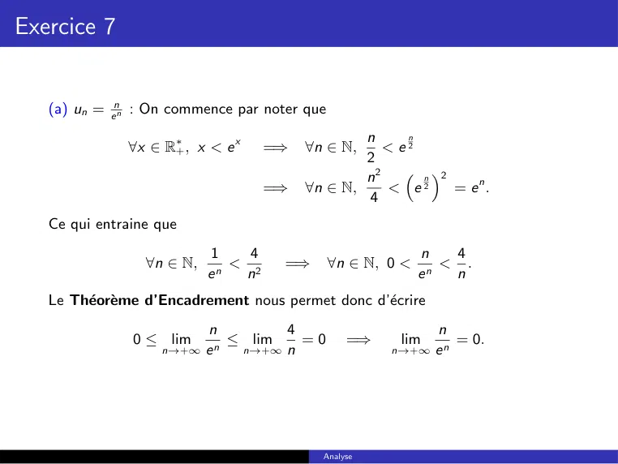

~~~text
Exercice 7

   (a) un = enn : On commence par noter que
                                                    n     n
              ∀x ∈ R∗+ , x < e x     =⇒     ∀n ∈ N,    < e2
                                                    2
                                                    n2     n 2
                                     =⇒     ∀n ∈ N,     < e2     = en.
                                                    4
   Ce qui entraine que
                           1    4                              n   4
                 ∀n ∈ N,      < 2      =⇒        ∀n ∈ N, 0 <      < .
                           en  n                               en  n
   Le Théorème d’Encadrement nous permet donc d’écrire
                           n            4                        n
               0 ≤ lim         ≤ lim        =0     =⇒     lim        = 0.
                   n→+∞ e n        n→+∞ n                n→+∞ e n

                                              Analyse
~~~

## Page 37

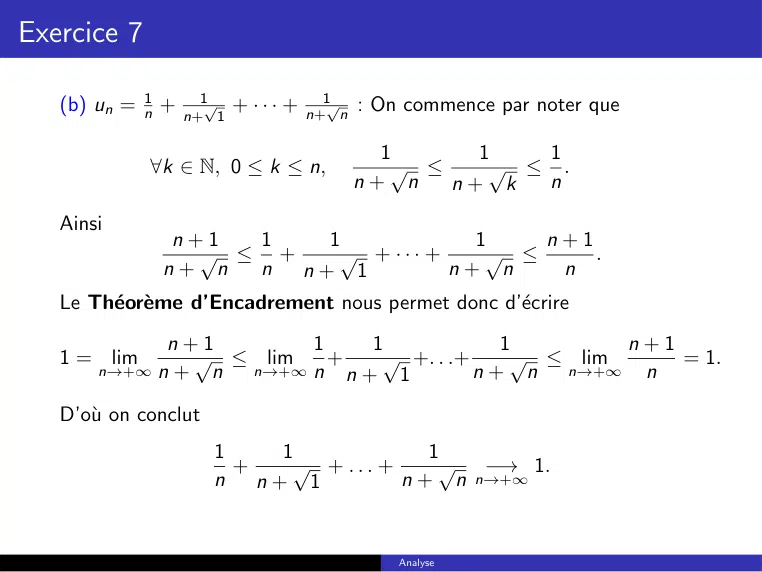

~~~text
Exercice 7

   (b) un = n1 + n+1√1 + · · · + n+1√n : On commence par noter que

                                      1      1   1
             ∀k ∈ N, 0 ≤ k ≤ n,        √ ≤    √ ≤ .
                                    n+ n   n+ k  n

   Ainsi
               n+1  1   1            1    n+1
                 √ ≤ +   √ + ··· +    √ ≤     .
              n+ n  n n+ 1         n+ n    n
   Le Théorème d’Encadrement nous permet donc d’écrire
               n+1       1   1            1        n+1
   1 = lim       √ ≤ lim   +  √ +. . .+    √ ≤ lim     = 1.
       n→+∞ n +   n n→+∞ n n+ 1         n+ n  n→+∞  n

   D’où on conclut
                      1   1             1
                        +  √ + ... +     √ −→ 1.
                      n n+ 1         n + n n→+∞

                                         Analyse
~~~

## Page 38

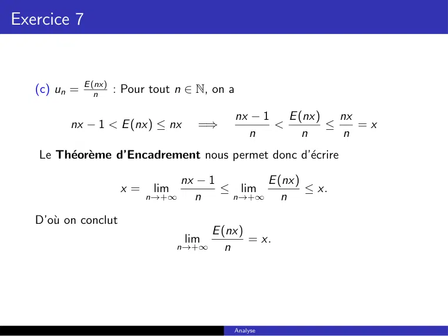

~~~text
Exercice 7

   (c) un = E (nx)
               n   : Pour tout n ∈ N, on a

                                             nx − 1   E (nx)   nx
         nx − 1 < E (nx) ≤ nx        =⇒             <        ≤    =x
                                               n         n      n
   Le Théorème d’Encadrement nous permet donc d’écrire

                                  nx − 1       E (nx)
                      x=    lim          ≤ lim        ≤ x.
                           n→+∞     n     n→+∞    n
   D’où on conclut
                                         E (nx)
                                   lim          = x.
                                  n→+∞      n

                                             Analyse
~~~

## Page 39

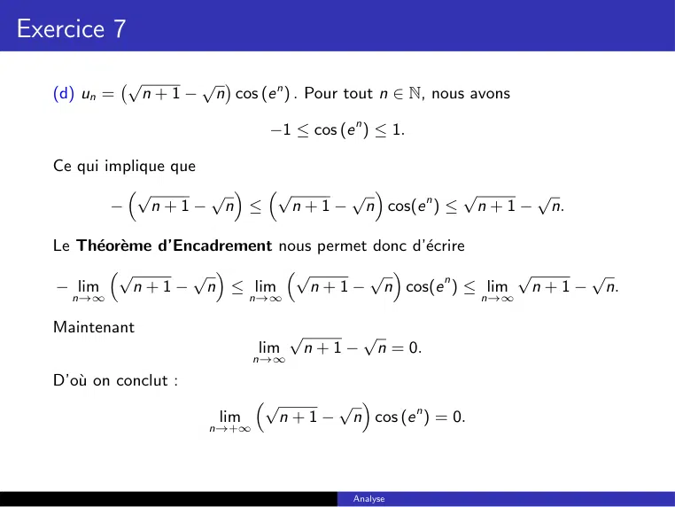

~~~text
Exercice 7
              √          √ 
   (d) un =       n+1−    n cos (e n ) . Pour tout n ∈ N, nous avons

                                  −1 ≤ cos (e n ) ≤ 1.

   Ce qui implique que
             √        √  √        √            √       √
           −    n+1− n ≤      n + 1 − n cos(e n ) ≤ n + 1 − n.

   Le Théorème d’Encadrement nous permet donc d’écrire
          √         √         √        √                √       √
   − lim      n + 1 − n ≤ lim      n + 1 − n cos(e n ) ≤ lim n + 1 − n.
     n→∞                         n→∞                           n→∞

   Maintenant                          √          √
                                 lim       n+1−       n = 0.
                                 n→∞

   D’où on conclut :
                                 √       √ 
                           lim     n + 1 − n cos (e n ) = 0.
                          n→+∞

                                              Analyse
~~~

## Page 40

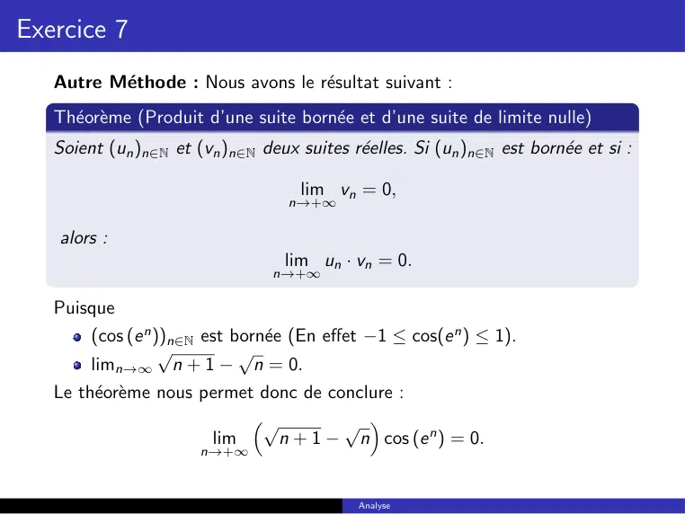

~~~text
Exercice 7
   Autre Méthode : Nous avons le résultat suivant :
   Théorème (Produit d’une suite bornée et d’une suite de limite nulle)
   Soient (un )n∈N et (vn )n∈N deux suites réelles. Si (un )n∈N est bornée et si :

                                     lim vn = 0,
                                   n→+∞

   alors :
                                   lim un · vn = 0.
                                 n→+∞

   Puisque
        (cos (e n ))n∈N est bornée (En effet −1 ≤ cos(e n ) ≤ 1).
                   √         √
        limn→∞ n + 1 − n = 0.
   Le théorème nous permet donc de conclure :
                            √         √ 
                       lim     n + 1 − n cos (e n ) = 0.
                       n→+∞

                                             Analyse
~~~

## Page 41

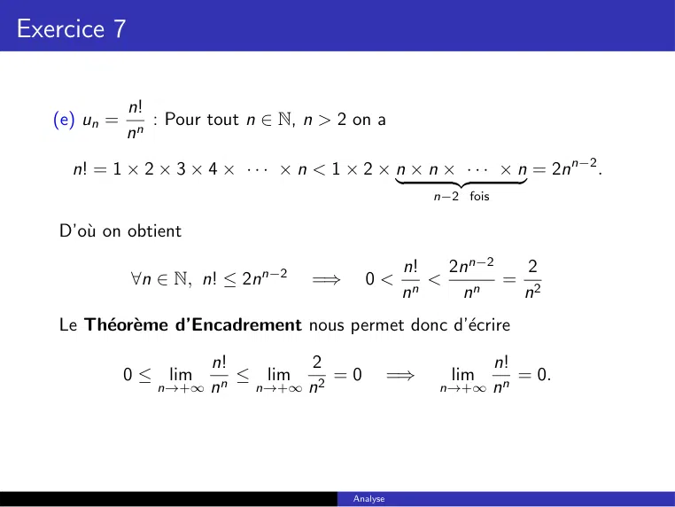

~~~text
Exercice 7

              n!
   (e) un =      : Pour tout n ∈ N, n > 2 on a
              nn
     n! = 1 × 2 × 3 × 4 × · · · × n < 1 × 2 × n × n × · · · × n = 2nn−2 .
                                              |      {z       }
                                                         n−2 fois

   D’où on obtient
                                                     n!   2nn−2   2
              ∀n ∈ N, n! ≤ 2nn−2     =⇒       0<        <       = 2
                                                     nn    nn    n
   Le Théorème d’Encadrement nous permet donc d’écrire
                        n!           2                              n!
              0 ≤ lim        ≤ lim       =0         =⇒     lim           = 0.
                 n→+∞ nn      n→+∞ n2                    n→+∞ nn

                                          Analyse
~~~

## Page 42

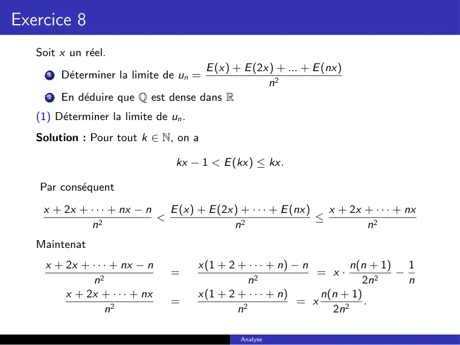

~~~text
Exercice 8
   Soit x un réel.
                                      E (x) + E (2x) + ... + E (nx)
     1   Déterminer la limite de un =
                                                   n2
     2   En déduire que Q est dense dans R
   (1) Déterminer la limite de un .
   Solution : Pour tout k ∈ N, on a

                                 kx − 1 < E (kx) ≤ kx.

   Par conséquent

    x + 2x + · · · + nx − n   E (x) + E (2x) + · · · + E (nx)   x + 2x + · · · + nx
                            <                                 ≤
             n2                            n2                          n2
   Maintenat
     x + 2x + · · · + nx − n           x(1 + 2 + · · · + n) − n        n(n + 1)   1
                                =                               = x·            −
              n2                                 n2                      2n2      n
         x + 2x + · · · + nx           x(1 + 2 + · · · + n)      n(n + 1)
                                =                            = x          .
                  n2                           n2                  2n2

                                               Analyse
~~~

## Page 43

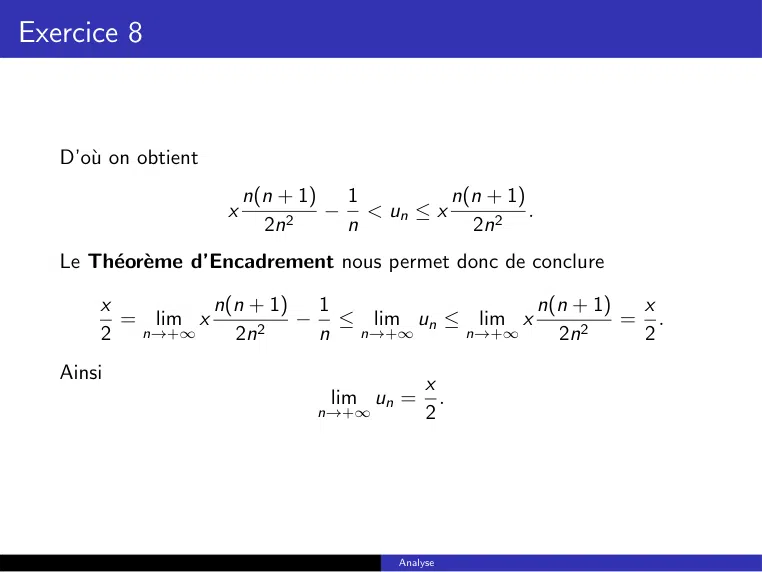

~~~text
Exercice 8

   D’où on obtient
                          n(n + 1) 1         n(n + 1)
                      x           − < un ≤ x          .
                            2n2    n           2n2
   Le Théorème d’Encadrement nous permet donc de conclure

       x         n(n + 1) 1                 n(n + 1)  x
         = lim x         − ≤ lim un ≤ lim x          = .
       2 n→+∞      2n2    n n→+∞     n→+∞     2n2     2
   Ainsi
                                              x
                                  lim un =      .
                                 n→+∞         2

                                         Analyse
~~~

## Page 44

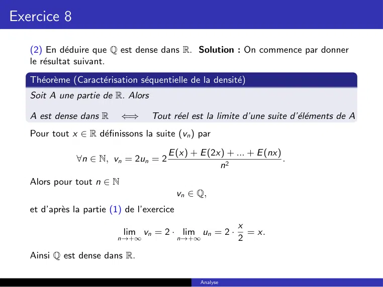

~~~text
Exercice 8

   (2) En déduire que Q est dense dans R. Solution : On commence par donner
   le résultat suivant.
   Théorème (Caractérisation séquentielle de la densité)
   Soit A une partie de R. Alors

   A est dense dans R      ⇐⇒      Tout réel est la limite d’une suite d’éléments de A
   Pour tout x ∈ R définissons la suite (vn ) par

                                        E (x) + E (2x) + ... + E (nx)
               ∀n ∈ N, vn = 2un = 2                                   .
                                                     n2
   Alors pour tout n ∈ N
                                             vn ∈ Q,
   et d’après la partie (1) de l’exercice
                                                            x
                            lim vn = 2 · lim un = 2 ·         = x.
                          n→+∞               n→+∞           2
   Ainsi Q est dense dans R.

                                                  Analyse
~~~

## Page 45

~~~text
Exercice 9

   Démontrer la propriété si elle est vrai, donner un contre exemple sinon.
     1   Si ∀n ∈ N, un < vn et lim vn = 0 alors lim un = 0.
                                   n→+∞                  n→+∞
     2   Une suite non majorée tend vers +∞.
     3   Si la suite (un ) converge vers l, alors ∀p ∈ N, lim un+p − un = 0.
                                                             n→+∞
     4   Si les suites (xn ) et (yn ) divergent alors la suite (xn + yn ) diverge.
     5   Si les suites (xn ) et (yn ) divergent alors la suite (xn yn ) diverge.
     6   Pour toute suite de réels (yn ), si lim xn = 0 alors lim xn yn = 0.
                                              n→∞                 n→∞
     7   Si lim xn yn = 0 alors soit lim xn = 0 soit lim yn = 0. (Indication :
           n→∞                         n→∞                n→∞
         considérer l’exemple xn = (1 + (−1)n )/2, yn = (1 − (−1)n )/2 ).
     8   Si (un ) est convergente et les un sont strictement positifs, alors la
         limite de (un ) est strictement positive.
     9   Si (un ) est une suite croissante et un ≤ 7 alors lim un = 7.
                                                              n→∞

                                               Analyse
~~~

## Page 46

~~~text
Exercice 9

   (1) Si ∀n ∈ N, un < vn et      lim vn = 0 alors      lim un = 0 : Faux. En
                                n→+∞                   n→+∞
   effet, il suffit pour tout n ∈ N de choisir

                               un ≤ a < 0, a ∈ R∗− .

   Par exemple, soit un = −2 + n1 et vn = n1 . Alors

                   un < vn    mais      lim un = −2 < 0.
                                      n→+∞

   (2) Une suite non majorée tend vers +∞ : Faux. En effet, pour tout
   n ∈ N, soit               
                              n si n pair,
                       un =
                                −n si n impair.
                             

                                            Analyse
~~~

## Page 47

~~~text
Exercice 9
   (3) Si la suite (un ) converge vers l, alors ∀p ∈ N, un+p − un → 0. Vrai. Soit
                                                                        +∞
    > 0. Par définition de la limite
                                                                  
                    ∃N ∈ N, n ∈ N, n > N =⇒ |un − l| <              .
                                                                  2
   Donc pour tout n > N, on a n + p > N et
                                                                          
    |un+p − un | = |un+p + (l − l) − un | ≤ |un+p − l| + |l − un | <      + =
                                                                        2  2
   Ce qui montre que lim un+p − un = 0.
                        n→+∞
   (4) Si les suites (xn ) et (yn ) divergent alors la suite (xn + yn ) diverge. Faux.
   En effet, pour tout n ∈ N, choisissons

           yn = −xn     =⇒      xn + yn = 0     =⇒        lim xn + yn = 0.
                                                          n→+∞

   Par exemple, soit un = n et vn = −n. Alors

              lim un = +∞        et      lim vn = −∞       mais     un + vn = 0.
             n→+∞                        n→+∞

                                                Analyse
~~~

## Page 48

~~~text
Exercice 9

   (5) Si les suites (xn ) et (yn ) divergent alors la suite (xn yn ) diverge. Faux. En
   effet, pour tout n ∈ N, soit
                                                      
                   1       si n pair,                  −1 si n pair,
            xn =                            et yn =
                      −1 si n impair.                      1     si n impair.
                                                      

   Donc
                       xn · yn = −1    =⇒        lim xn · yn = −1.
                                              n→+∞

   (6) Pour toute suite de réels (yn ), si lim xn = 0 alors lim xn yn = 0. Faux.
                                             n→∞                  n→∞
   En effet, pour tout n ∈ N, soit
          1
   xn =       et   yn = na   avec a > 1     =⇒           lim xn · yn = lim na−1 = +∞.
          n                                         n→+∞             n→+∞

                                               Analyse
~~~

## Page 49

~~~text
Exercice 9

   (7) Si lim xn yn = 0 alors soit lim xn = 0 soit lim yn = 0. Faux. En effet,
           n→∞                           n→∞                  n→∞
   pour tout n ∈ N, soit

          (1 + (−1)n )                   (1 − (−1)n )                          (1 − (−1)2n )
   xn =                  et    yn =                          =⇒     xn ·yn =                 = 0.
               2                              2                                      4
   mais les limites lim xn et lim yn n’existent pas.
                     n→∞          n→∞

   (8) Si (un ) est convergente et les un sont strictement positifs, alors la
   limite de (un ) est strictement positive. Faux. En effet, pour tout n ∈ N, soit
                                     1
                              un =         =⇒        lim un = 0.
                                     n            n→+∞

   (9) Si (un ) est une suite croissante et un ≤ 7 alors lim un = 7. Faux. En
                                                                    n→∞
   effet, pour tout n ∈ N, soit
                               1
                   un = m −      , m<7          =⇒           lim un = m < 7.
                               n                        n→+∞

                                                   Analyse
~~~

## Page 50

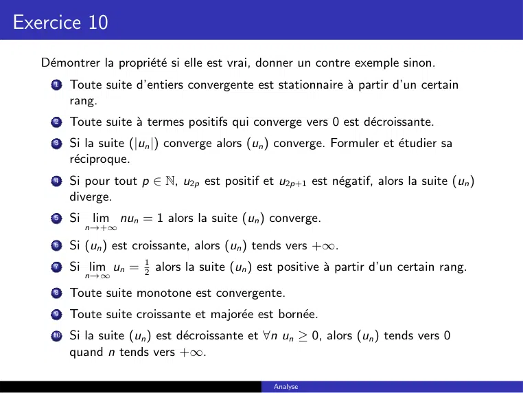

~~~text
Exercice 10
   Démontrer la propriété si elle est vrai, donner un contre exemple sinon.
     1    Toute suite d’entiers convergente est stationnaire à partir d’un certain
          rang.
     2    Toute suite à termes positifs qui converge vers 0 est décroissante.
     3    Si la suite (|un |) converge alors (un ) converge. Formuler et étudier sa
          réciproque.
     4    Si pour tout p ∈ N, u2p est positif et u2p+1 est négatif, alors la suite (un )
          diverge.
     5    Si lim nun = 1 alors la suite (un ) converge.
            n→+∞
     6    Si (un ) est croissante, alors (un ) tends vers +∞.
     7    Si lim un = 12 alors la suite (un ) est positive à partir d’un certain rang.
            n→∞
     8    Toute suite monotone est convergente.
     9    Toute suite croissante et majorée est bornée.
     10   Si la suite (un ) est décroissante et ∀n un ≥ 0, alors (un ) tends vers 0
          quand n tends vers +∞.

                                                 Analyse
~~~

## Page 51

~~~text
Exercice 10
   (1)Toute suite d’entiers convergente est stationnaire à partir d’un
   certain rang : Vrai. En effet, soit lim un = L. Alors d’après la
                                        n→+∞
   définition de la limite, pour  = 12 , nous avons
                                                             1
                   ∃N ∈ N, ∀n ∈ N, n ≥ N =⇒ |un − L| <         .
                                                             2
   Ainsi, pour tout n ≥ N, on a
                                                               
                1            1                          1     1
           L−     < un < L +         =⇒     un ∈ L − , L +        .
                2            2                          2     2
   Maintenant, dans l’intervalle L − 12 , L + 12 il existe au plus un entier.
                                               

   Or pour tout n ∈ N, un est un entier, donc
                                   
                          1       1
     ∀n ≥ N, un ∈ L − , L +           ∩ Z =⇒ ∀n ≥ N, un = uN .
                          2       2
   La suite (un )n∈N est donc stationnaire (au moins) à partir de N, et
                                 lim un = L = uN .
                                n→+∞

                                             Analyse
~~~

## Page 52

~~~text
Exercice 10

   (2) Toute suite à termes positifs qui converge vers 0 est
   décroissante : Faux. En effet, pour tout n ∈ N, soit
             1
             n si n pair,
      un =                          =⇒ u2n > u2n+1 et u2n+1 < u2n+2 .
             1
               n 2 si n impair.

                                       Analyse
~~~

## Page 53

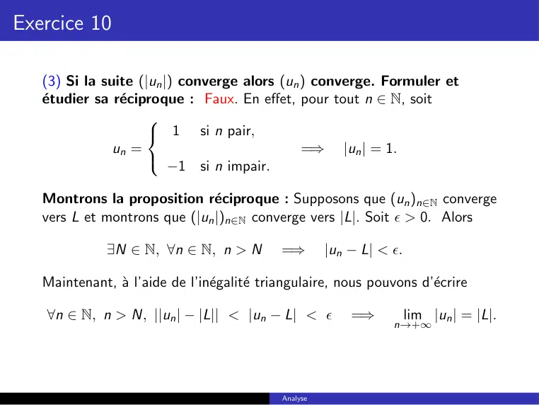

~~~text
Exercice 10

   (3) Si la suite (|un |) converge alors (un ) converge. Formuler et
   étudier sa réciproque : Faux. En effet, pour tout n ∈ N, soit
                     
                      1 si n pair,
               un =                           =⇒ |un | = 1.
                         −1 si n impair.
                     

   Montrons la proposition réciproque : Supposons que (un )n∈N converge
   vers L et montrons que (|un |)n∈N converge vers |L|. Soit  > 0. Alors

              ∃N ∈ N, ∀n ∈ N, n > N          =⇒        |un − L| < .

   Maintenant, à l’aide de l’inégalité triangulaire, nous pouvons d’écrire

   ∀n ∈ N, n > N, ||un | − |L|| < |un − L| <              =⇒          lim |un | = |L|.
                                                                  n→+∞

                                             Analyse
~~~

## Page 54

~~~text
Exercice 10

   (4) Si pour tout p ∈ N, u2p est positif et u2p+1 est négatif, alors la
   suite (un ) diverge : Faux. En effet, pour tout n ∈ N, soit
                     1
                     n      si n pair,
               un =                          =⇒       lim un = 0.
                     1                             n→+∞
                       − n si n impair.

                                         Analyse
~~~

## Page 55

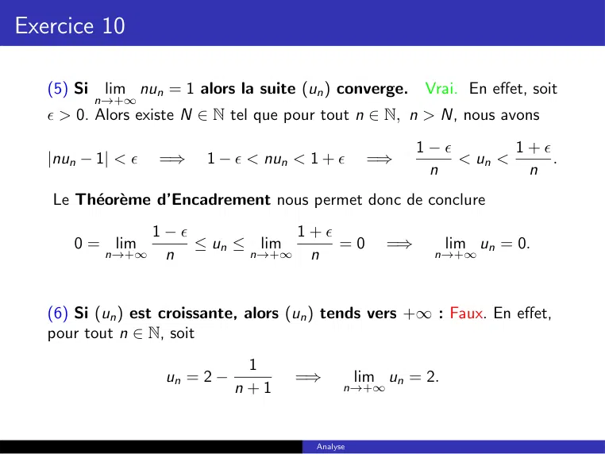

~~~text
Exercice 10

   (5) Si    lim nun = 1 alors la suite (un ) converge. Vrai. En effet, soit
            n→+∞
    > 0. Alors existe N ∈ N tel que pour tout n ∈ N, n > N, nous avons
                                                             1−        1+
   |nun − 1| <     =⇒     1 −  < nun < 1 +        =⇒          < un <     .
                                                              n          n
   Le Théorème d’Encadrement nous permet donc de conclure
                   1−            1+
      0 = lim          ≤ un ≤ lim     =0                =⇒        lim un = 0.
            n→+∞    n        n→+∞  n                           n→+∞

   (6) Si (un ) est croissante, alors (un ) tends vers +∞ : Faux. En effet,
   pour tout n ∈ N, soit
                                 1
                     un = 2 −          =⇒           lim un = 2.
                                n+1             n→+∞

                                          Analyse
~~~

## Page 56

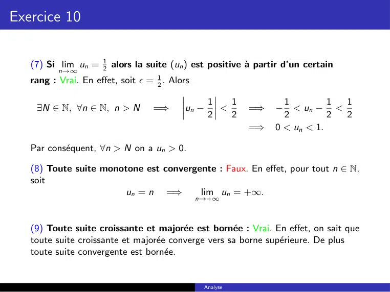

~~~text
Exercice 10

   (7) Si lim un = 12 alors la suite (un ) est positive à partir d’un certain
          n→∞
   rang : Vrai. En effet, soit  = 21 . Alors

                                                  1   1           1         1 1
    ∃N ∈ N, ∀n ∈ N, n > N          =⇒      un −     <      =⇒   −   < un − <
                                                  2   2           2         2 2
                                                           =⇒   0 < un < 1.

   Par conséquent, ∀n > N on a un > 0.

   (8) Toute suite monotone est convergente : Faux. En effet, pour tout n ∈ N,
   soit
                        un = n =⇒       lim un = +∞.
                                                n→+∞

   (9) Toute suite croissante et majorée est bornée : Vrai. En effet, on sait que
   toute suite croissante et majorée converge vers sa borne supérieure. De plus
   toute suite convergente est bornée.

                                                 Analyse
~~~

## Page 57

~~~text
Exercice 10

   (10) Si la suite (un ) est décroissante et ∀n un ≥ 0, alors (un ) tends
   vers 0 quand n tends vers +∞ :Faux. En effet, pour tout n ∈ N, soit
                                1
                    un = 2 +          =⇒           lim un = 2.
                               n+1             n→+∞

                                         Analyse
~~~

## Page 58

~~~text
Exercice 11

   Montrer que les suites suivants divergent :

   (1) an = n sin( nπ
                    2 ).
                  n 3      2
   (2) bn = (−1)2−5n
                 n +3n +5
                     3    .
                   n           nπ
                                    
   (3) cn = (−1)n 1+n cos       7       .

                                            Analyse
~~~

## Page 59

~~~text
Exercice 11
   Montrer que la suite                                 nπ 
                                          an = n sin              .
                                                         2
   diverge.
   Solution : Notons que si on choisit
                               φ1 (n) = 2n      et    φ2 (n) = 1 + 4n.
   Nous avons
                                   
                              2nπ
   aφ1 (n)   =   2n sin          = 2n sin(nπ) = 0
                               2
                                         
                                (1 + 4n)π                  π      
   aφ2 (n)   =   (1 + 4n) sin               = (1 + 4n) sin    + 2nπ = (1 + 4n).
                                    2                       2

   Ce qui nous permet de conclure
                                        lim aφ1 (n)    =         0.
                                        n→∞
                                        lim aφ2 (n)    =         +∞.
                                        n→∞

   Nous avons donc trouvé deux suites extraites de (an )n∈N qui ne convergent pas
   vers la même limite. Ce qui implique que (an )n∈N diverge.
                                                       Analyse
~~~

## Page 60

~~~text
Exercice 11
   Montrer que la suite
                                     (−1)n n3 + 3n2 + 5
                              bn =                      .
                                          2 − 5n3
   diverge.
   Solution : Notons que si on choisit
                          φ1 (n) = 2n    et   φ2 (n) = 2n + 1.
   Nous avons
                 (−1)2n (2n)3 + 3(2n)2 + 5   (2n)3 + 3(2n)2 + 5
   bφ1 (n)   =                             =                    .
                         2 − 5(2n)3              2 − 5(2n)3
                 (−1)2n+1 (2n + 1)3 + 3(2n + 1)2 + 5   −(2n + 1)3 + 3(2n + 1)2 + 5
   bφ2 (n)   =                                       =                             .
                            2 − 5(2n + 1) 3                  2 − 5(2n + 1)3
   Ce qui nous permet de conclure
                                                            1
                                lim bφ1 (n)    =         − .
                               n→∞                          5
                                                         1
                                lim bφ2 (n)    =           .
                               n→∞                       5
   Nous avons donc trouvé deux suites extraites de (bn )n∈N qui ne convergent pas
   vers la même limite. Ce qui implique que (bn )n∈N diverge.
                                               Analyse
~~~

## Page 61

~~~text
Exercice 11
   Montrer que la suite
                                             n       nπ 
                             cn = (−1)n         cos        .
                                            1+n        7
   diverge.
   Solution : Notons que si on choisit

                          φ1 (n) = 7n      et       φ2 (n) = 14n + 1.

   Nous avons
                          7n                       7n           (−1)8n 7n     7n
   cφ1 (n)   =   (−1)7n        cos (nπ) = (−1)7n        (−1)n =           =
                        1 + 7n                   1 + 7n          1 + 7n     1 + 7n
                           14n + 1      π            14n + 1     π
   cφ2 (n)   =   (−1)14n+1          cos    + 2nπ = −           cos      .
                           2 + 14n       7             2 + 14n      7
   Ce qui nous permet de conclure

                             lim cφ1 (n)        =     1
                            n→∞
                                                               π
                             lim cφ2 (n)        =     − cos          .
                            n→∞                                 7
   Nous avons donc trouvé deux suites extraites de (cn )n∈N qui ne convergent pas
   vers la même limite. Ce qui implique que (cn )n∈N diverge.
                                                     Analyse
~~~

## Page 62

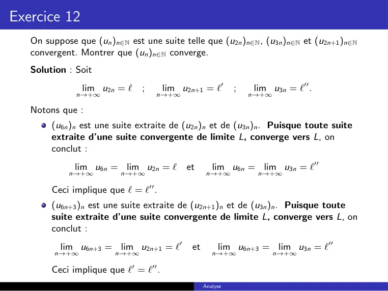

~~~text
Exercice 12
   On suppose que (un )n∈N est une suite telle que (u2n )n∈N , (u3n )n∈N et (u2n+1 )n∈N
   convergent. Montrer que (un )n∈N converge.
   Solution : Soit
                lim u2n = `      ;         lim u2n+1 = `0        ;   lim u3n = `00 .
              n→+∞                        n→+∞                       n→+∞

   Notons que :
        (u6n )n est une suite extraite de (u2n )n et de (u3n )n . Puisque toute suite
        extraite d’une suite convergente de limite L, converge vers L, on
        conclut :
              lim u6n = lim u2n = `              et       lim u6n = lim u3n = `00
            n→+∞          n→+∞                          n→+∞          n→+∞

                                     00
        Ceci implique que ` = ` .
        (u6n+3 )n est une suite extraite de (u2n+1 )n et de (u3n )n . Puisque toute
        suite extraite d’une suite convergente de limite L, converge vers L, on
        conclut :
          lim u6n+3 = lim u2n+1 = `0              et        lim u6n+3 = lim u3n = `00
         n→+∞           n→+∞                              n→+∞              n→+∞

                             0        00
        Ceci implique que ` = ` .
                                                       Analyse
~~~

## Page 63

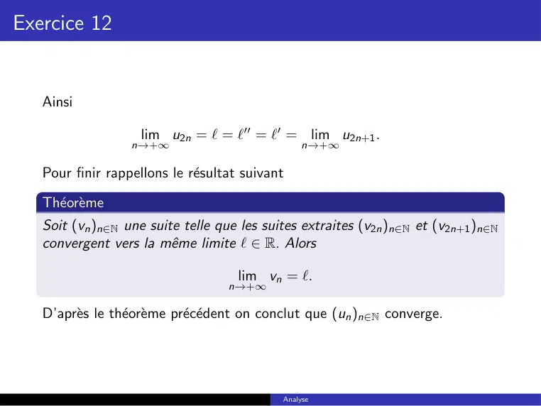

~~~text
Exercice 12

   Ainsi

                    lim u2n = ` = `00 = `0 = lim u2n+1 .
                  n→+∞                           n→+∞

   Pour finir rappellons le résultat suivant
   Théorème
   Soit (vn )n∈N une suite telle que les suites extraites (v2n )n∈N et (v2n+1 )n∈N
   convergent vers la même limite ` ∈ R. Alors

                                     lim vn = `.
                                   n→+∞

   D’après le théorème précédent on conclut que (un )n∈N converge.

                                            Analyse
~~~

## Page 64

~~~text
Exercice 13

   Soit (un )n∈N une suite de réels strictement positifs. On suppose que
                                  un+1
                            lim        = l avec l ∈ [0, +∞] .
                           n→+∞    un

     1   Montrer que, si l < 1, alors lim un = 0.
                                       n→+∞
     2   Montrer que, si l > 1, alors lim un = +∞.
                                       n→+∞
     3   Peut-on conclure si l = 1 ?
     4   Appliquer ces résultats aux exemples suivants :
                    an
           1  un = , avec a ∈ R∗+
                    n!
                   nn
           2  vn =
                    n!n
                    a
           3  wn = p avec a ∈ ]1, +∞[ et p ∈ N.
                   √n
           4  zn = n a, a ∈ R.

                                              Analyse
~~~

## Page 65

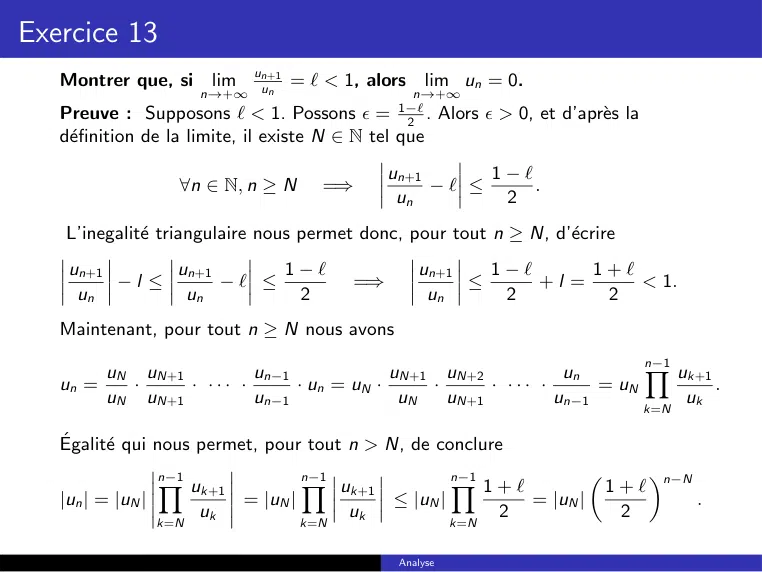

~~~text
Exercice 13
                                 un+1
   Montrer que, si lim            un
                                        = ` < 1, alors lim un = 0.
                          n→+∞                         n→+∞
   Preuve : Supposons ` < 1. Possons  = 1−`      2
                                                     . Alors  > 0, et d’après la
   définition de la limite, il existe N ∈ N tel que
                                                    un+1      1−`
                     ∀n ∈ N, n ≥ N         =⇒            −` ≤     .
                                                     un        2
   L’inegalité triangulaire nous permet donc, pour tout n ≥ N, d’écrire
    un+1      un+1      1−`                             un+1   1−`      1+`
         −l ≤      −` ≤                        =⇒            ≤     +l =     < 1.
     un        un        2                               un     2        2
   Maintenant, pour tout n ≥ N nous avons
                                                                                     n−1
          uN uN+1         un−1             uN+1 uN+2           un       Y uk+1
   un =     ·     · ··· ·      · un = uN ·     ·      · ··· ·      = uN        .
          uN uN+1         un−1              uN   uN+1         un−1         uk
                                                                                     k=N

   Égalité qui nous permet, pour tout n > N, de conclure
                   n−1                   n−1                   n−1                  n−N
                   Y     uk+1         Y uk+1         Y 1+`                     1+`
   |un | = |uN |              = |uN |        ≤ |uN |       = |uN |                          .
                          uk             uk             2                       2
                   k=N                   k=N                   k=N

                                                     Analyse
~~~

## Page 66

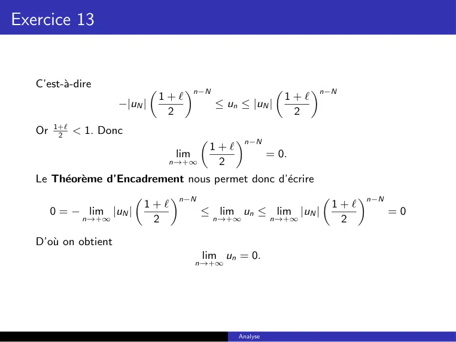

~~~text
Exercice 13

   C’est-à-dire                        n−N                            n−N
                                   1+`                              1+`
                      −|uN |                    ≤ un ≤ |uN |
                                    2                                2
   Or 1+`
       2
          < 1. Donc
                                                    n−N
                                               1+`
                                     lim                       = 0.
                                    n→+∞        2
   Le Théorème d’Encadrement nous permet donc d’écrire
                           n−N                               n−N
                        1+`                                 1+`
      0 = − lim |uN |            ≤ lim un ≤ lim |uN |                =0
            n→+∞         2          n→+∞      n→+∞           2

   D’où on obtient
                                           lim un = 0.
                                           n→+∞

                                                     Analyse
~~~

## Page 67

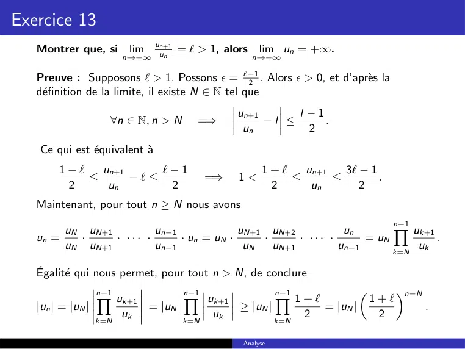

~~~text
Exercice 13
                                 un+1
   Montrer que, si lim            un
                                        = ` > 1, alors lim un = +∞.
                          n→+∞                         n→+∞

   Preuve :    Supposons ` > 1. Possons  = `−1
                                             2
                                                . Alors  > 0, et d’après la
   définition de la limite, il existe N ∈ N tel que
                                                    un+1      l −1
                     ∀n ∈ N, n > N         =⇒            −l ≤      .
                                                     un         2
   Ce qui est équivalent à
        1−`   un+1     `−1                                1+`   un+1   3` − 1
            ≤      −`≤                         =⇒   1<        ≤      ≤        .
         2     un       2                                  2     un       2
   Maintenant, pour tout n ≥ N nous avons
                                                                                  n−1
          uN uN+1         un−1             uN+1 uN+2           un       Y uk+1
   un =     ·     · ··· ·      · un = uN ·     ·      · ··· ·      = uN        .
          uN uN+1         un−1              uN   uN+1         un−1         uk
                                                                                  k=N

   Égalité qui nous permet, pour tout n > N, de conclure
                   n−1                   n−1                   n−1                 n−N
                   Y     uk+1         Y uk+1         Y 1+`                    1+`
   |un | = |uN |              = |uN |        ≥ |uN |       = |uN |                         .
                          uk             uk             2                      2
                   k=N                  k=N                    k=N

                                                     Analyse
~~~

## Page 68

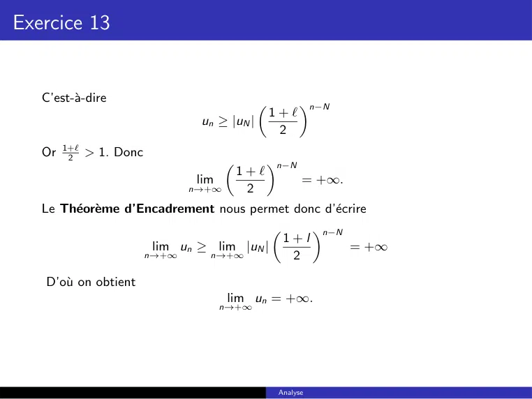

~~~text
Exercice 13

   C’est-à-dire                                 n−N
                                            1+`
                           un ≥ |uN |
                                             2
   Or 1+`
       2
          > 1. Donc
                                          n−N
                                     1+`
                           lim                     = +∞.
                         n→+∞         2
   Le Théorème d’Encadrement nous permet donc d’écrire
                                             n−N
                                          1+l
                     lim un ≥ lim |uN |              = +∞
                    n→+∞     n→+∞          2

   D’où on obtient
                                 lim un = +∞.
                                 n→+∞

                                             Analyse
~~~

## Page 69

~~~text
Exercice 13

   Peut-on conclure si ` = 1 ? Si ` = 1, on ne peut pas conclure : par
   exemple,
       Pour tout n ∈ N, soit un = n. Alors
                                  un+1       n+1
                            lim        = lim     =1
                           n→+∞    un   n→+∞  n

        et la suite (un )n∈N diverge.
                                   1
       Pour tout n ∈ N, soit vn = n+1 . Alors
                                  vn+1         n
                            lim        = lim       = 1,
                          n→+∞     vn   n→+∞ n + 1

       et la suite (vn )n∈N converge vers 0.

                                          Analyse
~~~

## Page 70

~~~text
Exercice 13

                                    an
   (1) Calculer la limite de un =      , avec a ∈ R∗+ :Nous avons
                                    n!
              un+1     an+1    n!     a
                   =         ×    =        −→ 0 < 1.
               un    (n + 1)! an    n + 1 n→+∞

   Le point 1 de la question 13 nous permet donc de conclure : un → 0
   lorsque n tend vers +∞.
                                      n
   (2) Calculer la limite de vn = nn! : Nous avons
                                      n                         n
          (n + 1)n+1 n!
                                                     
   vn+1                         n+1          n+1             1
        =               =                  ×     =        1+          −→ e > 1.
    vn     (n + 1)! nn           n           n+1             n        n→+∞

   Le point 2 de la question 13 nous permet donc de conclure : vn → +∞
   lorsque n tend vers +∞.

                                            Analyse
~~~

## Page 71

~~~text
Exercice 13
                                      n
   (3) Calculer la limite de wn = nap avec a ∈ ]1, +∞[ et p ∈ N : Nous avons
                                                       p
                               an+1      np
                                                
                     wn+1                           n
                           =           ×    = a
                      wn     (n + 1)p    an        n+1

   Maintenant, le Theorème de Composition à gauche par une fonction, avec
                                                               n
                          f (x) = x p         et    un =          ,
                                                              n+1
   nous permet donc de conclure
                                                   p
                                               n
                                lim                          = 1.
                              n→+∞            n+1

   Ainsi
                                             p
                      wn+1           n
                           =a                       −→ a > 1.
                       wn           n+1            n→+∞

   Le point 2 de la question 13 nous permet donc de conclure : wn tend vers +∞
   lorsque n tend vers +∞.

                                                   Analyse
~~~

## Page 72

~~~text
Exercice 13
                                     √
   (4) Calculer la limite de zn = n a, a ∈ R∗+ : Nous avons
                     √
          zn+1      n+1
                        a   a1/(n+1)      1    1       −1
                = √       =     1/n
                                     = a n+1 − n = a n(n+1) −→ 1.
           zn        n
                       a      a                            n→+∞

   Il faut donc trouver une autre méthode pour calculer la limite de zn
   lorsque n tend vers +∞. Notons que
                  √
                                                             
                   n
                           1
                                    1            1
                     a = a n = exp ln a n   = exp      ln (a)
                                                     n
   Le Theorème de Composition à gauche par une fonction, avec
                                                          ln(a)
                       f (x) = exp(x)     et       un =         ,
                                                            n
   nous permet donc de conclure
                            √
                                                         
                            n
                                                   1
                      lim       a = lim exp          ln(a) = 1.
                    n→+∞           n→+∞            n

                                           Analyse
~~~

## Page 73

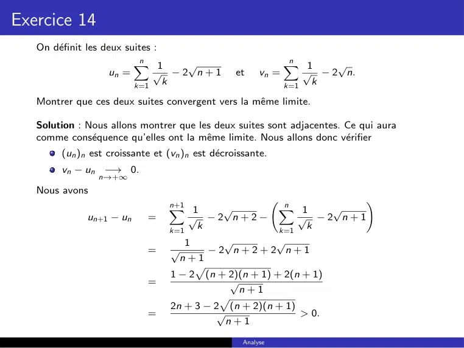

~~~text
Exercice 14
   On définit les deux suites :
                            n                                     n
                           X    1  √                             X    1   √
                    un =       √ −2 n+1            et     vn =       √ − 2 n.
                           k=1
                                 k                               k=1
                                                                       k
   Montrer que ces deux suites convergent vers la même limite.

   Solution : Nous allons montrer que les deux suites sont adjacentes. Ce qui aura
   comme conséquence qu’elles ont la même limite. Nous allons donc vérifier
         (un )n est croissante et (vn )n est décroissante.
         vn − un −→ 0.
                 n→+∞
   Nous avons
                                   n+1                          n
                                                                                !
                                   X    1  √                   X    1  √
               un+1 − un     =         √ −2 n+2−                   √ −2 n+1
                                   k=1
                                         k                     k=1
                                                                     k
                                      1      √          √
                             =     √       −2 n+2+2 n+1
                                     n+1
                                        p
                                   1 − 2 (n + 2)(n + 1) + 2(n + 1)
                             =                 √
                                                n+1
                                             p
                                   2n + 3 − 2 (n + 2)(n + 1)
                             =              √                > 0.
                                              n+1

                                                     Analyse
~~~

## Page 74

~~~text
Exercice 14

   En effet
               p
     2n + 3 − 2 (n + 2)(n + 1)                                p
               √               >0          ⇐⇒    2n + 3 − 2 (n + 2)(n + 1) > 0
                n+1
                                                           p
                                           ⇐⇒    2n + 3 > 2 (n + 2)(n + 1)
                                           ⇐⇒    4n2 + 12n + 9 > 4n2 + 12n + 8.

   Donc, (un )n est croissante. De même
                    n+1                    n
                                                        !
                    X     1    √         X     1     √
    vn+1 − vn   =        √ −2 n+1−            √ −2 n
                    k=1
                           k              k=1
                                                k
                        1      √         √
                =   √        −2 n+1+2 n
                      n+1
                                    p                        p
                    1 − 2(n + 1) + 2 n(n + 1)     −1 − 2n + 2 n(n + 1)
                =             √               =          √             < 0.
                                n+1                        n+1

                                            Analyse
~~~

## Page 75

~~~text
Exercice 14

   En effet
                     p
          −1 − 2n + 2 n(n + 1)                                  p
                 √             <0         ⇐⇒         −1 − 2n + 2 n(n + 1) < 0
                   n+1
                                                      p
                                          ⇐⇒         2 n(n + 1) < 1 + 2n
                                          ⇐⇒         4n2 + 4n < 4n2 + 4n + 1.

   Donc, (vn )n est décroissante. Finalement
                               n              n
                                                                        !
                              X    1    √    X    1  √
              vn − un    =        √ −2 n−        √ −2 n+1
                              k=1
                                    k        k=1
                                                   k
                                √       √
                         =    2( n + 1 − n) −→ 0.
                                                  n→+∞

   Ainsi, (un )n et (vn )n sont deux suites adjacentes. Elles convergent donc vers la
   même limite.

                                                Analyse
~~~

## Page 76

~~~text
Exercice 15
               n
               X (−1)k−1
   Soit un =              . Montrer que (u2n ) et (u2n+1 ) sont adjacentes.
                     k
               k=1
   En déduire que un converge.
   Solution : Nous allons vérifier que :
        (u2n )n∈N est croissante et (u2n+1 )n∈N est décroissante.
        u2n − u2n+1 −→ 0.
                        n→+∞

   Nous avons
                                       2n+2                    2n
                                       X      (−1)k−1 X (−1)k−1
                     u2n+2 − u2n   =                 −
                                                 k         k
                                       k=1                     k=1

                                              2n+11               1
                                   =   (−1)            + (−1)2n
                                                2n + 2          2n + 1
                                           1         1
                                   =   −        +         > 0.
                                         2n + 2    2n + 1
   Donc u2n+2 > u2n et (u2n )n∈N est croissante.

                                                     Analyse
~~~

## Page 77

~~~text
Exercice 15
   De même
                                        2n+3                    2n+1
                                        X      (−1)k−1   X (−1)k−1
              u2n+3 − u2n+1     =                      −
                                                  k           k
                                        k=1                         k=1
                                                   1                 1
                                =       (−1)2n+2        + (−1)2n+1
                                                 2n + 3            2n + 2
                                          1          1
                                =              −         < 0.
                                        2n + 3    2n + 2
   Donc u2n+3 < u2n+1 et (u2n+1 )n∈N est décroissante. Finalement
                                          2n+1                        2n
                                          X      (−1)k−1 X (−1)k−1
                  u2n+1 − u2n       =                   −
                                                    k         k
                                          k=1                        k=1
                                                 1
                                                 2n       1
                                    =     (−1)        =        .
                                               2n + 1   2n + 1
   Donc
                                                                1
                     lim u2n+1 − u2n = lim                                = 0.
                   n→+∞                         n→+∞ 2n + 1

                                                      Analyse
~~~

## Page 78

~~~text
Exercice 15

   Ainsi, (u2n )n∈N et (u2n+1 )n∈N sont deux suites adjacentes. Elles
   convergent donc vers la même limite. Par conséquent, (un )n∈N est une
   suite convergent.

                                          Analyse
~~~

## Page 79

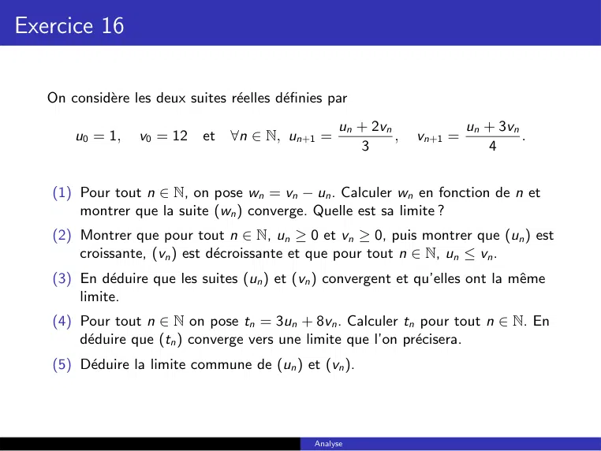

~~~text
Exercice 16

   On considère les deux suites réelles définies par
                                                      un + 2vn              un + 3vn
       u0 = 1,    v0 = 12     et   ∀n ∈ N, un+1 =              ,   vn+1 =            .
                                                         3                     4

   (1) Pour tout n ∈ N, on pose wn = vn − un . Calculer wn en fonction de n et
       montrer que la suite (wn ) converge. Quelle est sa limite ?
   (2) Montrer que pour tout n ∈ N, un ≥ 0 et vn ≥ 0, puis montrer que (un ) est
       croissante, (vn ) est décroissante et que pour tout n ∈ N, un ≤ vn .
   (3) En déduire que les suites (un ) et (vn ) convergent et qu’elles ont la même
       limite.
   (4) Pour tout n ∈ N on pose tn = 3un + 8vn . Calculer tn pour tout n ∈ N. En
       déduire que (tn ) converge vers une limite que l’on précisera.
   (5) Déduire la limite commune de (un ) et (vn ).

                                                 Analyse
~~~

## Page 80

~~~text
Exercice 16

   (1) On commence par noter que pour tout n ∈ N, nous avons

                                                 un + 3vn   un + 2vn
                wn+1   =        vn+1 − un+1 =             −
                                                    4          3
                                vn − un
                       =
                                   12
                                 1
                       =           wn .
                                12
   Ainsi,
                               2                                n+1
            1               1                                  1                    11
    wn+1 =    · wn =                 · wn−1 = · · · =                     · w0 =         .
           12              12                                 12                   12n+1
                                                                 1
   (la suite (wn )n∈N est une suite géométrique de raison q = 12 .) D’où on
   conclut
                                                      11
                     lim wn = lim q n w0 = lim            = 0.
                    n→+∞        n→+∞           n→+∞ 12n

                                                Analyse
~~~

## Page 81

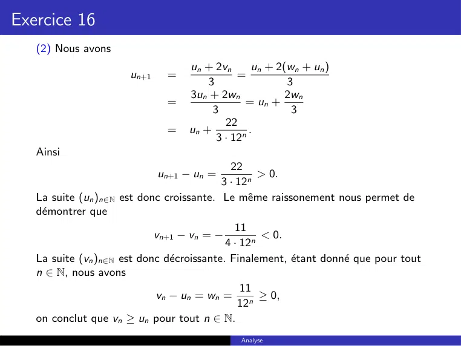

~~~text
Exercice 16
   (2) Nous avons
                                   un + 2vn       un + 2(wn + un )
                      un+1    =               =
                                       3                 3
                                   3un + 2wn             2wn
                              =                 = un +
                                        3                 3
                                           22
                              =    un +          .
                                         3 · 12n
   Ainsi
                                             22
                             un+1 − un =            > 0.
                                           3 · 12n
   La suite (un )n∈N est donc croissante. Le même raissonement nous permet de
   démontrer que
                                               11
                            vn+1 − vn = −           < 0.
                                            4 · 12n
   La suite (vn )n∈N est donc décroissante. Finalement, étant donné que pour tout
   n ∈ N, nous avons
                                                11
                            vn − un = wn = n ≥ 0,
                                               12
   on conclut que vn ≥ un pour tout n ∈ N.
                                              Analyse
~~~

## Page 82

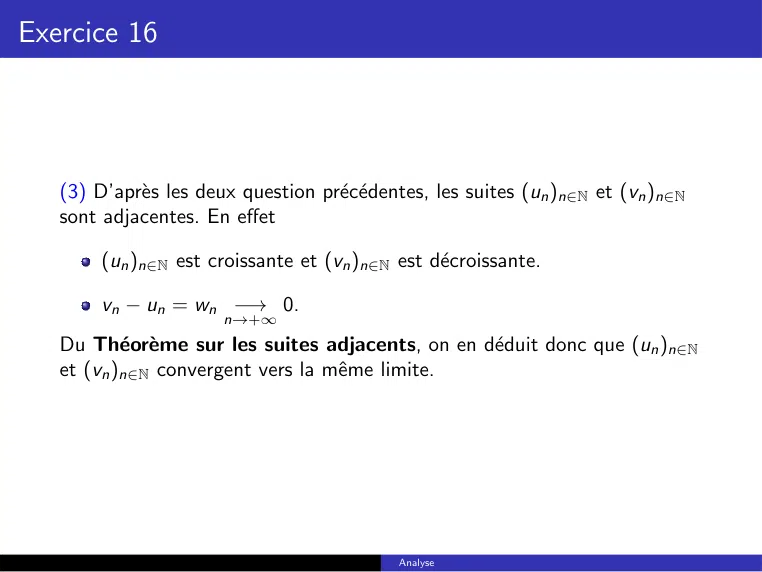

~~~text
Exercice 16

   (3) D’après les deux question précédentes, les suites (un )n∈N et (vn )n∈N
   sont adjacentes. En effet

        (un )n∈N est croissante et (vn )n∈N est décroissante.

        vn − un = wn −→ 0.
                       n→+∞
   Du Théorème sur les suites adjacents, on en déduit donc que (un )n∈N
   et (vn )n∈N convergent vers la même limite.

                                            Analyse
~~~

## Page 83

~~~text
Exercice 16

   (4) Pour tout n ∈ N, soit tn = 3un + 8vn . Dans la question 2 nous avons
   montré                                   22
                             un = un+1 − 3·12   n

                                             11
                                vn = vn+1 + 4·12n.
                            

   Ce qui nous permet, pour tout n ∈ N, d’écrire
                                22           22
   tn = 3un + 8vn = 3un+1 −       n
                                    + 8vn+1 + n = 3un+1 + 8vn+1 = tn+1 .
                                12           12
   Ainsi, (tn )n∈N est une suite constanteet

                    tn = t0 = 3u0 + 8v0 = 3 + 8 · 12 = 99.

   La suite (tn )n∈N converge donc vers 99.

                                          Analyse
~~~

## Page 84

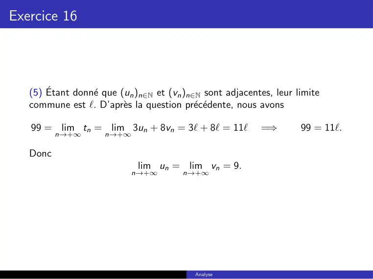

~~~text
Exercice 16

   (5) Étant donné que (un )n∈N et (vn )n∈N sont adjacentes, leur limite
   commune est `. D’après la question précédente, nous avons

   99 = lim tn = lim 3un + 8vn = 3` + 8` = 11`             =⇒        99 = 11`.
          n→+∞       n→+∞

   Donc
                             lim un = lim vn = 9.
                            n→+∞        n→+∞

                                           Analyse
~~~

## Page 85

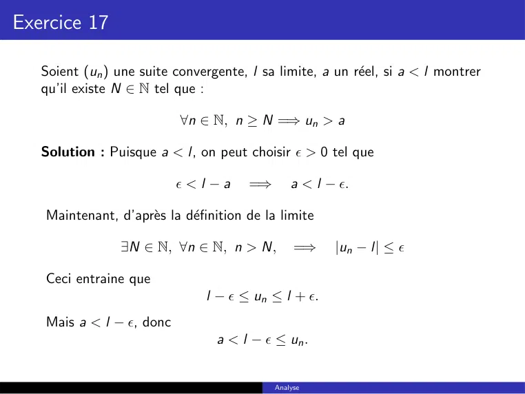

~~~text
Exercice 17

   Soient (un ) une suite convergente, l sa limite, a un réel, si a < l montrer
   qu’il existe N ∈ N tel que :

                           ∀n ∈ N, n ≥ N =⇒ un > a

   Solution : Puisque a < l, on peut choisir  > 0 tel que

                          <l −a       =⇒       a < l − .

   Maintenant, d’après la définition de la limite

                ∃N ∈ N, ∀n ∈ N, n > N,           =⇒    |un − l| ≤ 

   Ceci entraine que
                               l −  ≤ un ≤ l + .
   Mais a < l − , donc
                                 a < l −  ≤ un .

                                            Analyse
~~~

## Page 86

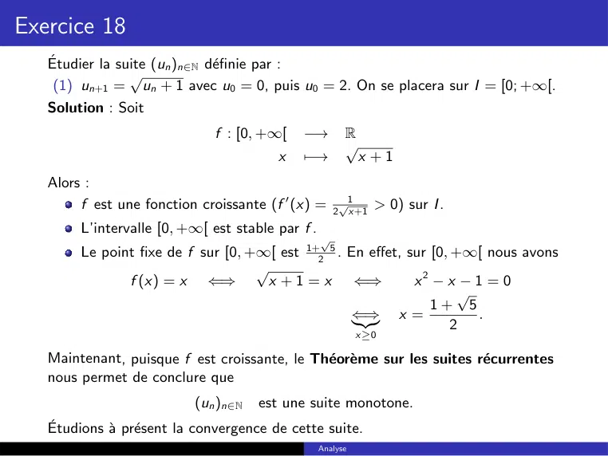

~~~text
Exercice 18
   Étudier la suite (un )n∈N définie par :
                 √
    (1) un+1 = un + 1 avec u0 = 0, puis u0 = 2. On se placera sur I = [0; +∞[.
   Solution : Soit
                              f : [0, +∞[    −→         R
                                                        √
                                         x   7−→          x +1
   Alors :
        f est une fonction croissante (f 0 (x) = 2√1x+1 > 0) sur I .
        L’intervalle [0, +∞[ est stable par f .
                                                  √
        Le point fixe de f sur [0, +∞[ est 1+2 5 . En effet, sur [0, +∞[ nous avons
                                    √
               f (x) = x ⇐⇒           x + 1 = x ⇐⇒            x2 − x − 1 = 0
                                                                      √
                                                                 1+ 5
                                                    ⇐⇒     x  =         .
                                                    |{z}             2
                                                            x≥0

   Maintenant, puisque f est croissante, le Théorème sur les suites récurrentes
   nous permet de conclure que
                           (un )n∈N   est une suite monotone.
   Étudions à présent la convergence de cette suite.
                                                  Analyse
~~~

## Page 87

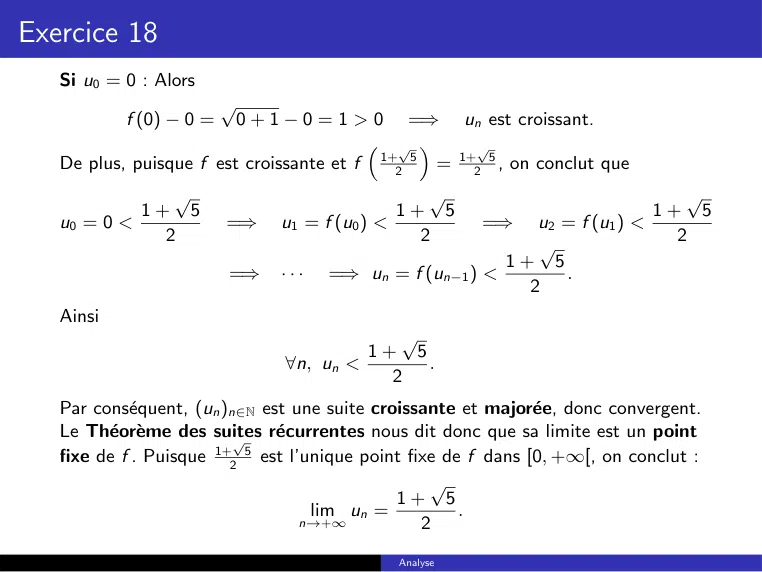

~~~text
Exercice 18
   Si u0 = 0 : Alors
                      √
           f (0) − 0 =   0 + 1 − 0 = 1 > 0 =⇒ un est croissant.
                                          √       √
   De plus, puisque f est croissante et f 1+2 5 = 1+2 5 , on conclut que
               √                                √                          √
            1+ 5                             1+ 5                       1+ 5
   u0 = 0 <              =⇒   u1 = f (u0 ) <          =⇒ u2 = f (u1 ) <
              2                                2                          2
                                                           √
                                                        1+ 5
                         =⇒   ···   =⇒ un = f (un−1 ) <      .
                                                          2
   Ainsi
                                             √
                                          1+ 5
                               ∀n, un <        .
                                            2
   Par conséquent, (un )n∈N est une suite croissante et majorée, donc convergent.
   Le Théorème des suites
                          √
                              récurrentes nous dit donc que sa limite est un point
   fixe de f . Puisque 1+2 5 est l’unique point fixe de f dans [0, +∞[, on conclut :
                                                   √
                                              1+ 5
                                    lim un =           .
                                   n→+∞           2
                                             Analyse
~~~

## Page 88

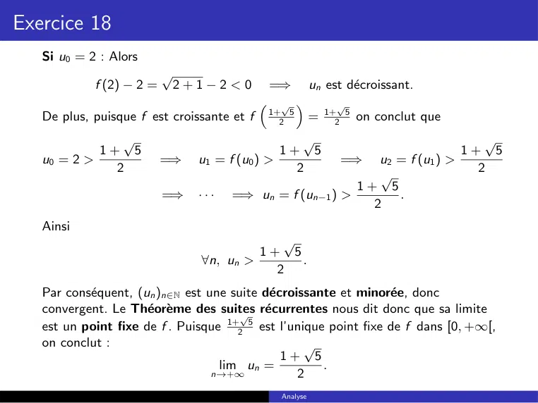

~~~text
Exercice 18
   Si u0 = 2 : Alors
                            √
              f (2) − 2 =       2+1−2<0          =⇒          un est décroissant.
                                                  √             √
                                                 1+ 5
   De plus, puisque f est croissante et f          2
                                                             = 1+2 5 on conclut que
                 √                                    √                                  √
              1+ 5                                 1+ 5                               1+ 5
   u0 = 2 >                 =⇒    u1 = f (u0 ) >                   =⇒
                                                               u2 = f (u1 ) >
                2                                    2                                  2
                                                               √
                                                            1+ 5
                            =⇒    ···   =⇒ un = f (un−1 ) >       .
                                                              2
   Ainsi
                                                √
                                             1+ 5
                                  ∀n, un >        .
                                               2
   Par conséquent, (un )n∈N est une suite décroissante et minorée, donc
   convergent. Le Théorème des suites
                                      √
                                           récurrentes nous dit donc que sa limite
   est un point fixe de f . Puisque 1+2 5 est l’unique point fixe de f dans [0, +∞[,
   on conclut :                                    √
                                               1+ 5
                                   lim un =           .
                                  n→+∞            2
                                                   Analyse
~~~

## Page 89

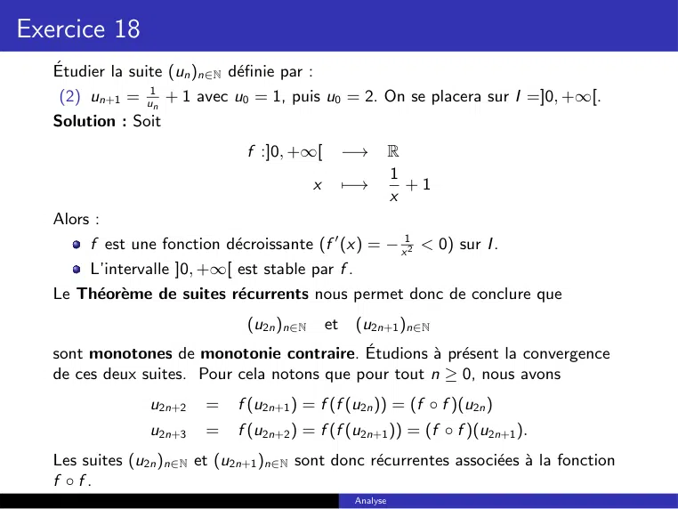

~~~text
Exercice 18
   Étudier la suite (un )n∈N définie par :
    (2) un+1 = u1n + 1 avec u0 = 1, puis u0 = 2. On se placera sur I =]0, +∞[.
   Solution : Soit
                               f :]0, +∞[            −→         R
                                                                1
                                            x        7−→          +1
                                                                x
   Alors :
        f est une fonction décroissante (f 0 (x) = − x12 < 0) sur I .
        L’intervalle ]0, +∞[ est stable par f .
   Le Théorème de suites récurrents nous permet donc de conclure que
                                (u2n )n∈N       et    (u2n+1 )n∈N
   sont monotones de monotonie contraire. Étudions à présent la convergence
   de ces deux suites. Pour cela notons que pour tout n ≥ 0, nous avons
                 u2n+2   =    f (u2n+1 ) = f (f (u2n )) = (f ◦ f )(u2n )
                 u2n+3   =    f (u2n+2 ) = f (f (u2n+1 )) = (f ◦ f )(u2n+1 ).
   Les suites (u2n )n∈N et (u2n+1 )n∈N sont donc récurrentes associées à la fonction
   f ◦f.
                                                      Analyse
~~~

## Page 90

~~~text
Exercice 18

   Maintenant
                         1         1        x       2x + 1
       (f ◦ f )(x) =         +1= 1    +1=       +1=        .
                       f (x)     x +1
                                          x + 1      x +1

   La fonction f ◦ f est donc continue et croissante sur [0, +∞[ :

                       f décroissante =⇒ f ◦ f croissante.

   De plus, pour tout x ∈ [0, +∞[, nous avons

                                   2x + 1
         (f ◦ f )(x) = x    ⇐⇒            =x         ⇐⇒     x2 − x − 1 = 0
                                    x +1
                                                                    √
                                                                1+ 5
                                                     ⇐⇒     x=          .
                                                     |{z}          2
                                                     x≥0
            √
   Ainsi, 1+2 5 est le unique point fixe de f ◦ f    dans [0, +∞[.

                                           Analyse
~~~

## Page 91

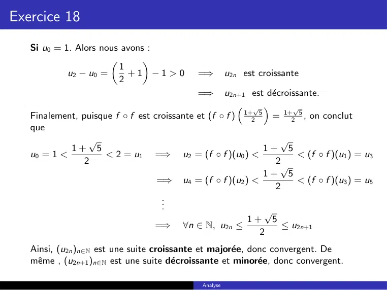

~~~text
Exercice 18
   Si u0 = 1. Alors nous avons :
                             
                        1
            u2 − u0 =     +1 −1>0            =⇒         u2n est croissante
                        2
                                             =⇒    u2n+1 est décroissante.
                                                        √         √
   Finalement, puisque f ◦ f est croissante et (f ◦ f ) 1+2 5 = 1+2 5 , on conclut
   que
                 √                                               √
            1+ 5                                             1+ 5
   u0 = 1 <          < 2 = u1 =⇒ u2 = (f ◦ f )(u0 ) <                 < (f ◦ f )(u1 ) = u3
                2                                               2
                                                                 √
                                                             1+ 5
                                  =⇒ u4 = (f ◦ f )(u2 ) <             < (f ◦ f )(u3 ) = u5
                                                                2
                                   ..
                                    .
                                                             √
                                                         1+ 5
                                 =⇒ ∀n ∈ N, u2n ≤                 ≤ u2n+1
                                                            2
   Ainsi, (u2n )n∈N est une suite croissante et majorée, donc convergent. De
   même , (u2n+1 )n∈N est une suite décroissante et minorée, donc convergent.

                                              Analyse
~~~

## Page 92

~~~text
Exercice 18

   Le Théorème sur les suites récurrentes nous dit √donc que la valeur de
   leurs limites est un point fixe de f ◦ f . Puisque 1+2 5 est l’unique point
   fixe de f ◦ f dans ]0, +∞[, on conclut :
                                                    √
                                                1+ 5
                                lim u2n =
                              n→+∞                 2
                                                    √
                                                1+ 5
                             lim u2n+1 =               .
                           n→+∞                    2
   Ce qui nous permet de conclure
                                           √
                                        1+ 5
                               lim un =      .
                              n→+∞        2

                                          Analyse
~~~

## Page 93

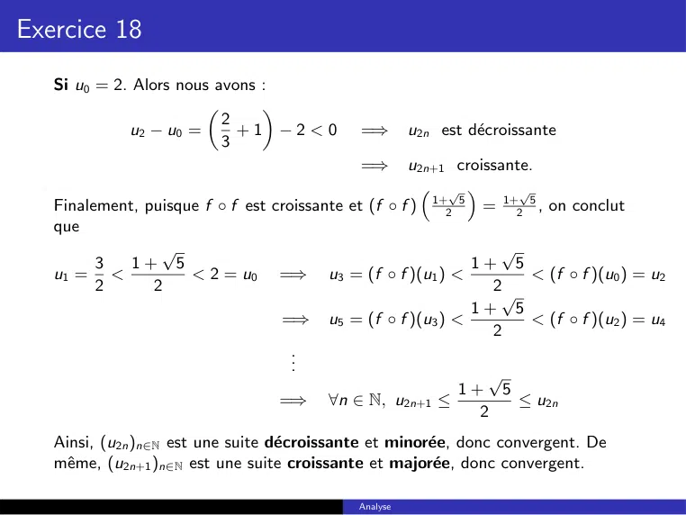

~~~text
Exercice 18
   Si u0 = 2. Alors nous avons :
                              
                          2
             u2 − u0 =      +1 −2<0           =⇒        u2n est décroissante
                          3
                                              =⇒     u2n+1 croissante.
                                                        √         √
   Finalement, puisque f ◦ f est croissante et (f ◦ f ) 1+2 5 = 1+2 5 , on conclut
   que
                 √                                               √
         3   1+ 5                                            1+ 5
   u1 = <            < 2 = u0 =⇒ u3 = (f ◦ f )(u1 ) <                 < (f ◦ f )(u0 ) = u2
         2      2                                               2
                                                                 √
                                                             1+ 5
                                  =⇒ u5 = (f ◦ f )(u3 ) <             < (f ◦ f )(u2 ) = u4
                                                                2
                                    ..
                                     .
                                                                √
                                                            1+ 5
                                  =⇒ ∀n ∈ N, u2n+1 ≤                ≤ u2n
                                                              2
   Ainsi, (u2n )n∈N est une suite décroissante et minorée, donc convergent. De
   même, (u2n+1 )n∈N est une suite croissante et majorée, donc convergent.

                                              Analyse
~~~

## Page 94

~~~text
Exercice 18

   Le Théorème sur les suites récurrentes nous dit √donc que la valeur de
   leurs limites est un point fixe de f ◦ f . Puisque 1+2 5 est l’unique point
   fixe de f ◦ f dans ]0, +∞[, on conclut :
                                                    √
                                                1+ 5
                                lim u2n =
                              n→+∞                 2
                                                    √
                                                1+ 5
                             lim u2n+1 =               .
                           n→+∞                    2
   Ce qui nous permet de conclure
                                           √
                                        1+ 5
                               lim un =      .
                              n→+∞        2

                                          Analyse
~~~

## Page 95

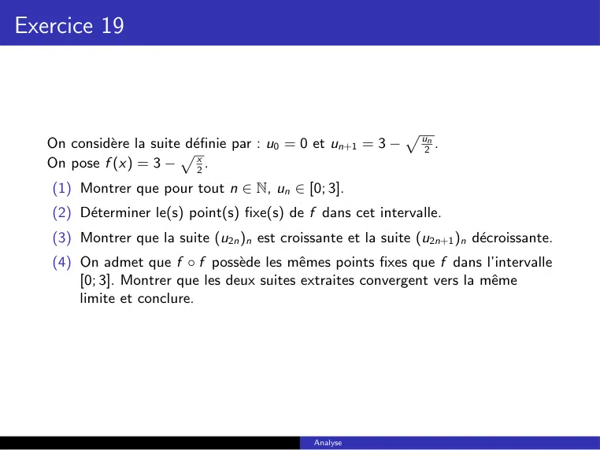

~~~text
Exercice 19

                                                                p un
   On considère la suite définie par : u0 = 0 et un+1 = 3 −     2
                                                                       .
   On pose f (x) = 3 − x2 .
                         p

   (1) Montrer que pour tout n ∈ N, un ∈ [0; 3].
   (2) Déterminer le(s) point(s) fixe(s) de f dans cet intervalle.
   (3) Montrer que la suite (u2n )n est croissante et la suite (u2n+1 )n décroissante.
   (4) On admet que f ◦ f possède les mêmes points fixes que f dans l’intervalle
       [0; 3]. Montrer que les deux suites extraites convergent vers la même
       limite et conclure.

                                              Analyse
~~~

## Page 96

~~~text
Exercice 19
   Solution : Soit

                               f :]0, +∞[        −→     R
                                                                 r
                                                                     x
                                          x      7−→    3−
                                                                     2
   Alors :
        f est une fonction décroissante (f 0 (x) = − √1 x < 0) sur I .
                                                             4   2

        Puisque f est décroissante, pour tout x ∈ [0, 3], nous avons
                 r
                    3
         0<3−         = f (3) ≤ f (x) ≤ f (0) = 3 =⇒ f ([0, 3]) ⊂ [0, 3] .
                    2
        C’est-à-dire [0, 3] es stable par f .
        Sur l’intervalle [0, 3], nous avons :
                   r
                     x                        13
              3−        = x ⇐⇒ x 2 −             x +9=0                  ⇐⇒        x = 2.
                     2                         2                         |{z}
                                                                         x∈[0,3]

        Ainsi 2 est l’unique point fixe de f dans [0, 3].
                                                   Analyse
~~~

## Page 97

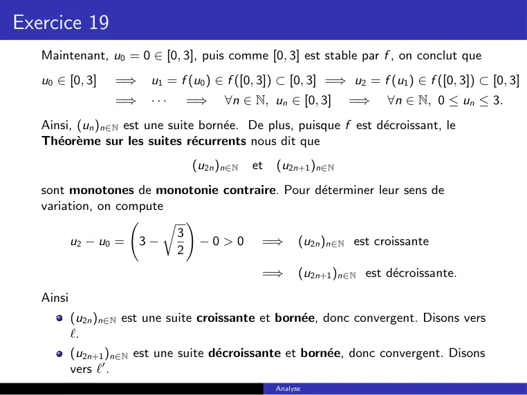

~~~text
Exercice 19
   Maintenant, u0 = 0 ∈ [0, 3], puis comme [0, 3] est stable par f , on conclut que
   u0 ∈ [0, 3]     =⇒    u1 = f (u0 ) ∈ f ([0, 3]) ⊂ [0, 3] =⇒ u2 = f (u1 ) ∈ f ([0, 3]) ⊂ [0, 3]
                   =⇒    ···   =⇒      ∀n ∈ N, un ∈ [0, 3]       =⇒     ∀n ∈ N, 0 ≤ un ≤ 3.
   Ainsi, (un )n∈N est une suite bornée. De plus, puisque f est décroissant, le
   Théorème sur les suites récurrents nous dit que
                                 (u2n )n∈N   et   (u2n+1 )n∈N
   sont monotones de monotonie contraire. Pour déterminer leur sens de
   variation, on compute
                        r !
                         3
        u2 − u0 = 3 −       − 0 > 0 =⇒ (u2n )n∈N est croissante
                         2
                                              =⇒        (u2n+1 )n∈N est décroissante.
   Ainsi
           (u2n )n∈N est une suite croissante et bornée, donc convergent. Disons vers
           `.
           (u2n+1 )n∈N est une suite décroissante et bornée, donc convergent. Disons
           vers `0 .
                                                  Analyse
~~~

## Page 98

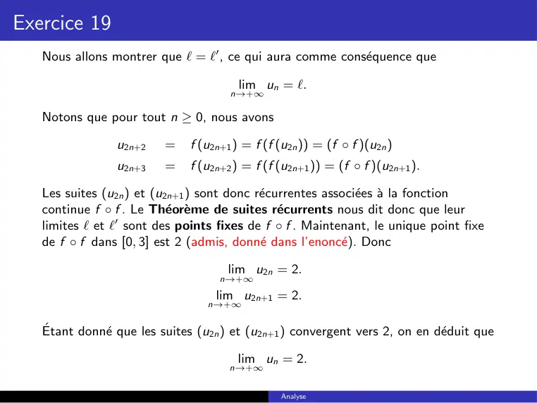

~~~text
Exercice 19
   Nous allons montrer que ` = `0 , ce qui aura comme conséquence que

                                        lim un = `.
                                      n→+∞

   Notons que pour tout n ≥ 0, nous avons

                u2n+2    =    f (u2n+1 ) = f (f (u2n )) = (f ◦ f )(u2n )
                u2n+3    =    f (u2n+2 ) = f (f (u2n+1 )) = (f ◦ f )(u2n+1 ).

   Les suites (u2n ) et (u2n+1 ) sont donc récurrentes associées à la fonction
   continue f ◦ f . Le Théorème de suites récurrents nous dit donc que leur
   limites ` et `0 sont des points fixes de f ◦ f . Maintenant, le unique point fixe
   de f ◦ f dans [0, 3] est 2 (admis, donné dans l’enoncé). Donc

                                     lim u2n = 2.
                                    n→+∞
                                   lim u2n+1 = 2.
                                 n→+∞

   Étant donné que les suites (u2n ) et (u2n+1 ) convergent vers 2, on en déduit que

                                       lim un = 2.
                                      n→+∞

                                                Analyse
~~~

## Page 99

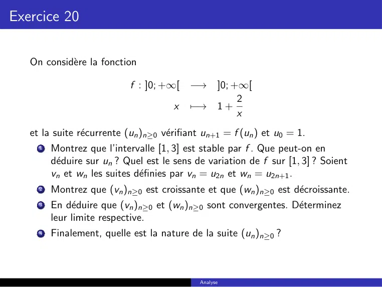

~~~text
Exercice 20

   On considère la fonction

                            f : ]0; +∞[    −→      ]0; +∞[
                                                        2
                                       x   7−→     1+
                                                        x
   et la suite récurrente (un )n≥0 vérifiant un+1 = f (un ) et u0 = 1.
     1   Montrez que l’intervalle [1, 3] est stable par f . Que peut-on en
         déduire sur un ? Quel est le sens de variation de f sur [1, 3] ? Soient
         vn et wn les suites définies par vn = u2n et wn = u2n+1 .
     2   Montrez que (vn )n≥0 est croissante et que (wn )n≥0 est décroissante.
     3   En déduire que (vn )n≥0 et (wn )n≥0 sont convergentes. Déterminez
         leur limite respective.
     4   Finalement, quelle est la nature de la suite (un )n≥0 ?

                                             Analyse
~~~

## Page 100

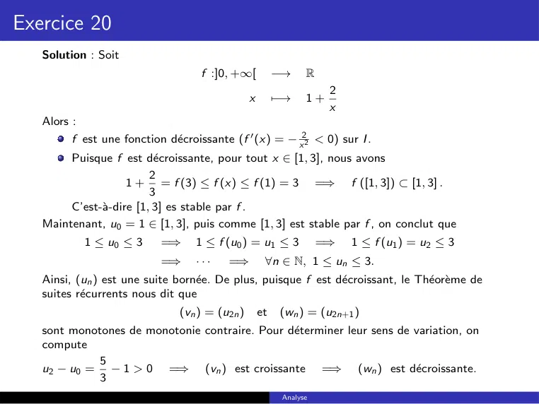

~~~text
Exercice 20
   Solution : Soit
                                   f :]0, +∞[            −→     R
                                                                     2
                                                x        7−→    1+
                                                                     x
   Alors :
         f est une fonction décroissante (f 0 (x) = − x22 < 0) sur I .
        Puisque f est décroissante, pour tout x ∈ [1, 3], nous avons
                         2
                    1 + = f (3) ≤ f (x) ≤ f (1) = 3 =⇒ f ([1, 3]) ⊂ [1, 3] .
                         3
        C’est-à-dire [1, 3] es stable par f .
   Maintenant, u0 = 1 ∈ [1, 3], puis comme [1, 3] est stable par f , on conclut que
           1 ≤ u0 ≤ 3      =⇒     1 ≤ f (u0 ) = u1 ≤ 3              =⇒   1 ≤ f (u1 ) = u2 ≤ 3
                           =⇒     ···    =⇒          ∀n ∈ N, 1 ≤ un ≤ 3.
   Ainsi, (un ) est une suite bornée. De plus, puisque f est décroissant, le Théorème de
   suites récurrents nous dit que
                               (vn ) = (u2n )       et    (wn ) = (u2n+1 )
   sont monotones de monotonie contraire. Pour déterminer leur sens de variation, on
   compute
             5
   u2 − u0 = − 1 > 0 =⇒ (vn ) est croissante =⇒ (wn ) est décroissante.
             3
                                                          Analyse
~~~

## Page 101

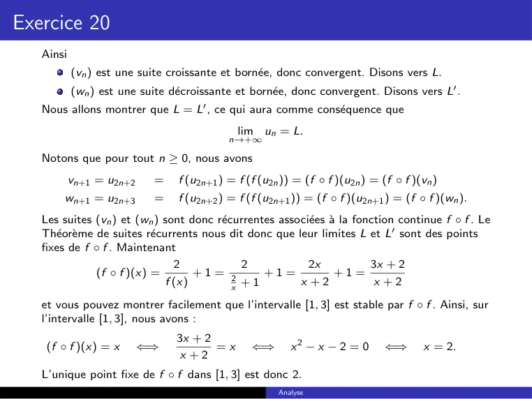

~~~text
Exercice 20
   Ainsi
           (vn ) est une suite croissante et bornée, donc convergent. Disons vers L.
           (wn ) est une suite décroissante et bornée, donc convergent. Disons vers L0 .
   Nous allons montrer que L = L0 , ce qui aura comme conséquence que
                                             lim un = L.
                                           n→+∞

   Notons que pour tout n ≥ 0, nous avons
           vn+1 = u2n+2    =    f (u2n+1 ) = f (f (u2n )) = (f ◦ f )(u2n ) = (f ◦ f )(vn )
       wn+1 = u2n+3        =    f (u2n+2 ) = f (f (u2n+1 )) = (f ◦ f )(u2n+1 ) = (f ◦ f )(wn ).
   Les suites (vn ) et (wn ) sont donc récurrentes associées à la fonction continue f ◦ f . Le
   Théorème de suites récurrents nous dit donc que leur limites L et L0 sont des points
   fixes de f ◦ f . Maintenant
                               2             2            2x            3x + 2
              (f ◦ f )(x) =        +1= 2         +1=             +1=
                             f (x)         x
                                             + 1        x +   2          x +2
   et vous pouvez montrer facilement que l’intervalle [1, 3] est stable par f ◦ f . Ainsi, sur
   l’intervalle [1, 3], nous avons :
                                3x + 2
    (f ◦ f )(x) = x       ⇐⇒           =x       ⇐⇒       x2 − x − 2 = 0       ⇐⇒      x = 2.
                                x +2
   L’unique point fixe de f ◦ f dans [1, 3] est donc 2.
                                                      Analyse
~~~

## Page 102

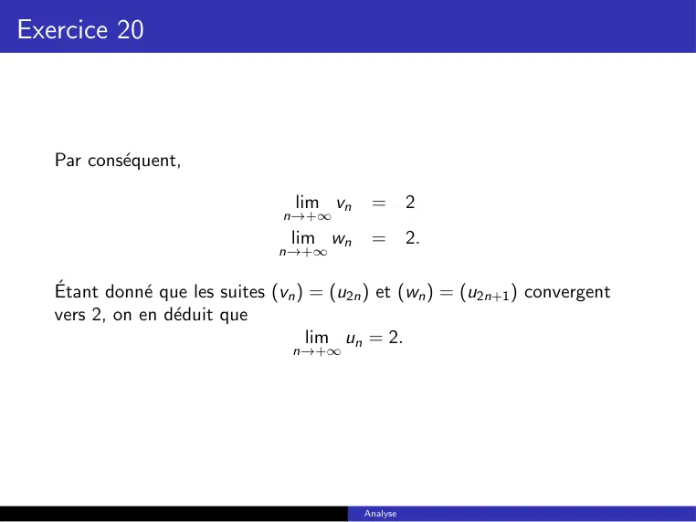

~~~text
Exercice 20

   Par conséquent,

                                   lim vn    =        2
                                 n→+∞
                                  lim wn     =        2.
                                n→+∞

   Étant donné que les suites (vn ) = (u2n ) et (wn ) = (u2n+1 ) convergent
   vers 2, on en déduit que
                                     lim un = 2.
                                  n→+∞

                                            Analyse
~~~

## Page 103

~~~text
Exercice 21

   Étudier les suites (un ) à termes réels vérifiant

                            1
                  un+1 =      un (un2 − 3un + 4),         pour tout n ≥ 0.
                            2
   On pourra étudier les variation de la fonction f définissant cette suite,
   déterminer ses points fixes, étudier le signe de f (x) − x puis distinguer
   plusieurs cas selon la valeur de u0 .

                                                Analyse
~~~

## Page 104

~~~text
Exercice 21
   Solution : Soit

                            f :R      −→    R
                                            1
                                x     7−→     x(x 2 − 3x + 4)
                                            2
   Alors :
        f est une fonction croissante, en effet f 0 (x) = 32 x 2 − 3x + 2, qui est un
        polynôme de discriminant negatif sur R, donc f 0 (x) = 32 x 2 − 3x + 2 > 0.
        Le point fixe de f sont 0, 1 et 2. En effet
                                                                                           
                         1                                                1 2 3
        f (x) = x ⇐⇒       x(x 2 − 3x + 4) = x             ⇐⇒          x    x − x +1            =0
                         2                                                2     2
                                                            ⇐⇒         x = 0, 1 ou 2.
                                      1 2
                                        x − 32 x + 1
                                                       
        Notons que f (x) − x = x      2
                                                           satisfait les inégalités suivants :

                          f (x) − x    ≤    0, si x ∈ ] − ∞, 0] ∪ [1, 2]
                      et f (x) − x     ≥    0, si x ∈ [0, 1] ∪ [2, +∞].

                                                Analyse
~~~

## Page 105

~~~text
Exercice 21
        Puisque f est croissante et les points fixes de f sont 0, 1 et 2, on conclut
        que
         ∀x ∈] − ∞, 0], −∞ < f (x) < f (0) = 0           =⇒       f (] − ∞, 0]) ⊂ ] − ∞, 0].
        ∀x ∈ [0, 1], 0 = f (0) < f (x) < f (1) = 1       =⇒       f ([0, 1]) ⊂ [0, 1].
        ∀x ∈ [1, 2], 1 = f (1) < f (x) < f (2) = 2       =⇒       f ([1, 2]) ⊂ [1, 2].
                 ∀x ∈ [2, +∞[, 2 = f (2) < f (x)         =⇒       f ([2, ∞[) ⊂ [2, +∞[.
   Les distinctions qui suivent sont justifiées par le fait que les ensembles
                    ] − ∞, 0[ ; {0} ; ]0, 1] ; [1, 2[ ; {2} ; ]2, +∞[
   sont tous stables par f .
        Cas où u0 ∈ ] − ∞, 0[ : l’intervalle ] − ∞, 0[ est stable par f et
                         f (x) ≤ x, pour tout x ∈ ] − ∞, 0[.
        En particulier f (u0 ) − u0 ≤ 0. Ainsi, (un ) est décroissante d’après le
        Théorème sur les suites récurrents. De plus, (un ) possède une limite `
        d’après le Théorème de la limite monotone. Comme f ne possède pas
        de point fixe dans ] − ∞, 0[, il en découle que : ` = −∞. Conclusion :
                                        lim un = −∞.
                                       n→+∞

                                               Analyse
~~~

## Page 106

~~~text
Exercice 21

      Cas où u0 = 0 : Cette fois, (un ) est constante de valeur 0, donc

                                     lim un = 0.
                                    n→+∞

      Cas où u0 ∈]0, 1] : l’intervalle ]0, 1] est stable par f et :

                       f (x) ≥ x, pour tout x ∈ ]0, 1].

      En particulier f (u0 ) − u0 ≥ 0. Donc (un ) est à la fois bornée entre 0
      et 1 et croissante d’après le Théorème sure les suites récurrents.
      Par conséquent, (un ) possède une limite ` ∈]0, 1] d’après le
      Théorème de la limite monotone. Puisque f est continue, le
      Théorème sur les suites récurrents nous dit que ` est un pointe
      fixe de f dans ]0, 1]. Ainsi, ` = 1. Conclusion :

                                     lim un = 1.
                                    n→+∞

                                           Analyse
~~~

## Page 107

~~~text
exercice 21

      Cas où u0 ∈ [1, 2[ : l’intervalle [1, 2[ est stable par f et

                       f (x) ≤ x, pour tout x ∈ [1, 2[.

      En particulier f (u0 ) − u0 ≤ 0. Donc (un ) est à la fois bornée entre 1
      et 2 et décroissante d’après le Théorème sur les suites récurrents.
      Par conséquent, (un ) possède une limite ` ∈ [1, 2[ d’après le
      Théorème de la limite monotone. Puisque f est continue, le
      Théorème des suites récurrents nous dit donc que l est un pointe
      fixe de f dans [1, 2[. Ainsi, ` = 1. Conclusion :

                                     lim un = 1.
                                    n→+∞

      Cas où u0 = 2 : Cette fois, (un ) est constante de valeur 2, donc

                                     lim un = 2.
                                    n→+∞

                                           Analyse
~~~

## Page 108

~~~text
exercice 21

      Cas où u0 ∈]2, +∞[ : l’intervalle ]2, +∞[ est stable par f et

                     f (x) ≥ x, pour tout x ∈]2, +∞[.

      En particulier f (u0 ) − u0 ≥ 0. Ainsi, (un ) est croissante d’après le
      Théorème sur les suites récurrents. De plus, (un ) possède une
      limite l d’après le Théorème de la limite monotone. Comme f ne
      possède pas de point fixe dans ]2, +∞[, il en découle que : ` = +∞.
      Conclusion :
                                    lim un = +∞.
                                 n→+∞

                                         Analyse
~~~

## Page 109

~~~text
Suites Complexes
   L’étude des suites complexes se ramène à l’étude des suites réels :

   Proposition
   Soit (un )n∈N une suite complexe (∀n ∈ N, un ∈ C). Alors (un )n∈N converge si et
   seulement si
                              (Re(un ))n∈N et (Im(un ))n∈N
   convergent, et on a alors
                                                                         
                         lim un =     lim Re(un ) + i          lim Im(un ) .
                        n→+∞         n→+∞                     n→+∞

   Proposition
   Soit (un )n∈N une suite complexe. Alors
                                            lim un = l
                                          n→+∞

   si et seulement si
                                         lim |un − l| = 0.
                                       n→+∞
   En particulier,    lim un = 0 si et seulement si     lim |un | = 0.
                     n→+∞                             n→+∞

                                                    Analyse
~~~

## Page 110

~~~text
Exercice 22

   Étudier les suites suivantes :
               2 n
   (1) un = nn3 +1
                i
                   : Nous avons

               n2 i n     n2        n       n2         n     n2
                      =        · |i   | =        · |i|   =        .
              n3 + 1    n3 + 1            n3 + 1           n3 + 1

   Par conséquent

                             n2 i n          n2
                        lim         =  lim        =0
                       n→+∞ n3 + 1    n→+∞ n3 + 1

   Ainsi
                                       n2 i n
                                     lim      = 0.
                                 n→+∞ n3 + 1

                                           Analyse
~~~

## Page 111

~~~text
Exercice 22

   (2) un = n1 + (−1)n i : Nous avons

                   1
       Re(un ) =        =⇒        lim Re(un ) = 0.
                   n             n→+∞
                                           
                                               1 si n = 2k, k ∈ N
   Im(un ) = (−1)n      =⇒       Im(un ) =
                                             − 1 si n = 2k + 1, k ∈ N
                        =⇒       (Im(un ))n∈N ne converge pas.

   Puisque la partie imaginaire de (un )n∈N ne converge pas, on conclut que
   la limite de (un )n∈N n’existe pas, c’est-à-dire (un )n∈N diverge.

                                         Analyse
~~~

## Page 112

~~~text
Exercice 22

        n      in
   (3) n+3i − n+1 : Nous avons

                    n       in           n(n − 3i)       in
                         −       =                   −
                  n + 3i   n+1            n2 + 9       n+1
                                         n2 − 3in       in
                                 =                −
                                          n2 + 9      n+1
                                           n2
                                                                   
                                                          3n     n
                                 =              −  i          +
                                         n2 + 9        n2 + 9   n+1

   Ainsi
                            n2
                                                            
                                            3n      n
           lim un = lim    2
                                −i       lim     +               = 1 − i.
           n→+∞      n→+∞ n + 9      n→+∞ n2 + 9   n+1

                                               Analyse
~~~

## Page 113

~~~text
Exercice 22
           2
         n i−in+1−3i
   (4) (2n+4i−3)(n−i) : Nous avons
     n2 i − in + 1 − 3i              (n2 − n − 3)i + 1
                          =
   (2n + 4i − 3)(n − i)        2n2 − 2ni + 4ni + 4 − 3n + 3i
                                   (n2 − n − 3)i + 1
                          =
                               2n2 − 3n + 4 + (2n + 3)i
                               ((n2 − n − 3)i + 1)(2n2 − 3n + 4 − (2n + 3)i)
                          =
                                        (2n2 − 3n + 4)2 + (2n + 3)2
                               2n − 12n − 5 + i(2n4 − 5n3 + n2 + 3n − 15)
                                 3
                          =
                                        (2n2 − 3n + 4)2 + (2n + 3)2
   Ainsi
          n2 i − in + 1 − 3i                       2n3 − 12n − 5
    lim                          =    lim                               +
   n→+∞ (2n + 4i − 3)(n − i)         n→+∞ (2n2 − 3n + 4)2 + (2n + 3)2

                                               2n4 − 5n3 + n2 + 3n − 15
                                                                              
                                       i  lim
                                         n→+∞ (2n2 − 3n + 4)2 + (2n + 3)2

                                       i  i
                                 =   0+ = .
                                       2  2
                                         Analyse
~~~

## Page 114

~~~text
Exercice 23
   Étudier la suite définie par la donnée de z0 ∈ C et la relation de récurrence :
                                             1
                                     zn+1 = (2zn − z n ).
                                             3
   Solution : Nous avons
                                  1               1
                         zn+1 = (2zn − z n ) = (zn + (zn − z n )).
                                  3               3
    Si on sépare zn en partie réel et partie imaginaire, on obtient
                                         zn = xn + iyn .
   Ainsi
                            1                        1              1
           xn+1 + iyn+1 =     ((xn + iyn ) + 2iyn ) = (xn + 3iyn ) = xn + iyn .
                            3                        3              3
   Ceci implique que
                                               2           3                    n+1
         1                            1         1              1                    1
   xn+1 = xn         =⇒         xn+1 = xn =         xn−1 =          xn−2 = · · · =        x0
         3                            3         3              3                    3
                                               n
                                               1
                     =⇒         ∀n ∈ N, xn =        x0 .
                                               3
    yn+1 = yn        =⇒         yn+1 = yn = yn−1 = yn−2 = · · · = y0
                     =⇒         ∀n ∈ N, yn = y0 .
                                                  Analyse
~~~

## Page 115

~~~text
Exercice 23

   Par conséquent
                                                        
                     lim zn   =    lim xn + i     lim yn
                     n→+∞         n→+∞          n→+∞
                                          n                 
                                          1
                              =    lim        x0 + i    lim y0
                                  n→+∞    3            n→+∞

                              =   0 + iy0 = iy0 .

                                           Analyse
~~~

## Page 116

~~~text
Exercice 24
   Soient (xn )n≥0 et (yn )n≥0 deux suites réelles telles que :
                                   xn+1 = xn −y
                                                n
                                               2
                                            xn +yn
                                   yn+1 = 2 .
   On introduit la suite complexe de terme général
                                   zn = xn + iyn .
   (1) Établir une relation de récurrence entre zn et zn+1 .
   Solution : Nous avons
                ∀n ∈ N, zn+1      = xn+1 + iyn+1
                                    xn − yn       xn + yn
                                  =          +i
                                        2            2
                                    1                1
                                  =   (xn + iyn ) + (−yn + ixn )
                                    2                2
                                    1      1 2
                                  =   zn + (i yn + ixn )
                                    2      2
                                    1      i        1
                                  =   zn + zn = (1 + i)zn .
                                    2      2        2
                                             Analyse
~~~

## Page 117

~~~text
Exercice 24

   Par conséquent
                          1                      1
                 zn+1 =     (1 + i)zn   =          (1 + i)2 zn−1
                          2                      4
                                                 1
                                         =         (1 + i)3 zn−2
                                                 8
                                         ..
                                          .
                                                   1
                                        =             (1 + i)n+1 z0 .
                                                 2n+1
   Ainsi
                                        1
                     ∀n ∈ N, zn =          (1 + i)n z0 .
                                        2n

                                              Analyse
~~~

## Page 118

~~~text
Exercice 24
   (2) En déduire que les deux suites réelles sont convergentes et donner leur
   limite.
   Solution : Commençons par noter que

                                                  1
                        lim |zn |   =     lim         (1 + i)n · |z0 |
                       n→+∞              n→+∞     2n
                                                 1
                                    =      lim       |1 + i|n · |z0 |
                                         n→+∞ 2n
                                                  √ n
                                                      2
                                    =      lim             · |z0 |
                                         n→+∞       2
                                                           n
                                                         1
                                    =    |z0 | lim      √         = 0.
                                              n→+∞        2
   Ceci implique que

                lim zn = 0     =⇒       lim xn + iyn = 0
               n→+∞                     n→+∞
                               =⇒       lim xn + i · lim yn = 0
                                        n→+∞              n→+∞
                               =⇒       lim xn = 0        et     lim yn = 0.
                                        n→+∞                     n→+∞

                                                Analyse
~~~

## Page 119

~~~text
Exercice 15 - Théorème de Cesàro

   Soit (un )n∈N∗ une suite réelle. Pour tout ∀n ∈ N∗ , on pose
                                                           n
                                    u1 + · · · + un   1X
                           vn =                     =    uk .
                                          n           n
                                                          k=1

   (vn est la moyenne arithmétique des n premiers termes de la suite u).
     1   On suppose lim un = l avec l ∈ R. Montrer qu’alors on a aussi
                      n→+∞

                                           lim vn = l.
                                         n→+∞

         Étudier la réciproque.
     2   Que peut-on dire si lim un = +∞ ?
                               n→+∞

                                                Analyse
~~~

## Page 120

~~~text
Exercice 25 - Théorème de Cesàro
   On suppose      lim un = l avec l ∈ R. Montrons                lim vn = l. Soit  > 0. Comme
                  n→+∞                                      n→+∞
   (un ) converge vers l il existe N0 ∈ N tel que
                                                                         
                                ∀n ∈ N, n > N0 , =⇒ |un − l| ≤             .
                                                                         2
    Soit n > N0 . Nous avons
                 n              n                n          n         n
             1X              1X        n      1X         1X        1 X
   |vn −l| =       uk − l =        uk − · l =       uk −       l =       (uk − l) .
             n k=1           n k=1     n      n k=1      n k=1     n k=1

   L’inégalité triangulaire (|a1 + a2 + · · · + an | ≤ |a1 | + |a2 | + · · · + |an |) nous permets
   d’écrire
                      n                n               N0 −1                n
                   1 X              1X               1 X                1 X
      |vn − l| =         (uk − l) ≤       |uk − l| =         |uk − l| +       |uk − l| .
                   n k=1            n k=1            n k=1              n k=N
                                                                                        0

   Ainsi pour tout n > N0 :
                           N0 −1                n              N0 −1                n
                         1 X                1 X              1 X                1 X 
       |vn − l|    ≤             |uk − l| +       |uk − l| ≤         |uk − l| +
                         n k=1              n k=N            n k=1              n k=N 2
                                                    0                                         0

                             0 −1
                            NX
                         1                (n − N0 + 1)
                    =          |uk − l| +               .
                         n k=1                 2n

                                                        Analyse
~~~

## Page 121

~~~text
Exercice 25 - Théorème de Cesàro
   Puis comme n−Nn0 +1 < 1, on peut écrire
                          N0 −1                              N0 −1
                        1 X                (n − N0 + 1)   1 X               
           |vn − l| ≤           |uk − l| +               ≤         |uk − l| + .            (1)
                        n k=1                    n         n k=1             2

   Or                                                     
                         N0 −1              NX0 −1
                       1 X                                         1
                   lim         |uk − l| =         |uk − l| · lim   = 0.
                  n→+∞ n                                      n→+∞ n
                          k=1                k=1

   Donc, d’après la définition de la limite
                                                     N −1
                                                      1
                                                   1 X             
                          ∃N1 ∈ N, n > N1 =⇒             |uk − l| ≤ .
                                                   n k=1           2

   On pose N = max(N0 , N1 ). En combinant ce dernier résultat à l’inégalité (1), on
   obtient                                                  
                      ∀n ∈ N, n > N =⇒ |vn − l| ≤ 2 · = .
                                                            2

   On a donc démontré que
                               ∃N ∈ N, n > N =⇒ |vn − l| ≤ .
   Cela permet d’affirmer que (vn ) converge vers l.
                                                   Analyse
~~~

## Page 122

~~~text
Exercice 25 - Théorème de Cesàro

   La réciproque du Théorème de Cesàro est fausse. En effet, considérons la
   suite (un ) définie par

                            ∀n ∈ N∗ ,   un = (−1)n+1 .

   Alors pour tout n ∈ N∗
                                             1
                                   0 ≤ vn ≤    .
                                             n
   Par le Théorème d’Encadrement, on en déduit que la suite (vn ) converge
   vers 0. En revanche, la suite un est une suite divergente. La réciproque du
   Théorème de Cesàro est donc fausse.

                                           Analyse
~~~

## Page 123

~~~text
Exercice 25 - Théorème de Cesàro
   Que peut-on dire si    lim un = +∞ ? Montrons que          lim vn = +∞. Puisque
                         n→+∞                               n→+∞
    lim un   = +∞. Pour tout A ∈ R+ il existe N       0 ∈ N tel que
   n→+∞
                                    n > N0 =⇒ un > 4A.
   Par conséquent, si n > N0 nous avons
        u1 + · · · + uN0 −1  uN + · · · + un   u1 + · · · + uN0 −1
                                                                                    
                                                                          n − N0 + 1
   vn =                     + 0              ≥                     + 4A                .
                  n                n                     n                    n

                                n−N0 +1
   Maintenant, comme      lim     n
                                        = 1, il existe N1 ∈ N tel que
                         n→+∞
                                n − N0 + 1      1    n − N0 + 1  1
               n > N1 =⇒                   −1 <   =⇒            > .
                                    n           2        n       2
                     u1 +···+uN0 −1
   Et comme    lim          n
                                    = 0, on conclut
              n→+∞
                                u1 + · · · + uN0 −1        u1 + · · · + uN0 −1
      ∃N2 ∈ N, n > N2 =⇒                            < A =⇒                     > −A.
                                          n                          n

   Ainsi, en posant N = max(N0 , N1 , N2 ), on obtient que
                            u1 + · · · + uN0 −1
                                                                  
                                                        n − N0 + 1              A
   ∀n ∈ N, n > N =⇒ vn >                        + 4A                 > −A + 4 ·   = A.
                                      n                     n                   2
    Cela permet d’affirmer que limn→+∞ vn = +∞.
                                                 Analyse
~~~

## Page 124

~~~text
Exercice 26 - constante d’Euler
   Soit :
                                               1         1
                                   Hn = 1 +      + ... +
                                               2         n

    (1)   Montrer que pour tout n ∈ N∗ , on a :
                                  1                        1
                                     ≤ ln(n + 1) − ln(n) ≤
                                 n+1                       n
    (2)   En déduire que :
                                   ln(n + 1) ≤ Hn ≤ ln(n) + 1
    (3)   En déduire la limite de Hn lorsque n tend vers +∞
    (4)   Montrer que la suite (un )n>0 définie par :

                                           un = Hn − ln(n)

          est décroissante et positive.
    (5)   Conclure (La limite de (un ) souvent notée γ est appelée la constante
          d’Euler, du nom du mathématicien Suisse Leonhard Euler, 1707-1783.
          Cette limite vaut environ 0.5772156649... mais on ne sait toujours pas si
          ce réel est rationnel ou irrationnel. La question est toujours ouverte !)
                                                  Analyse
~~~

## Page 125

~~~text
Exercice 26 - constante d’Euler

   Solution :

   (1) Considérons la fonction f : R \ {0} définie par

                                            1
                                     x 7→     .
                                            x
   La fonction f est une fonction continue et décroissante sur ]0, +∞[.
   Ainsi,
                                         Z n+1
                                   1
     (n + 1 − n)f (n + 1) =            ≤       f (x)dx
                                n+1       n
                                                                           1
                             =   ln(n + 1) − ln(n) ≤ (n + 1 − n)f (n) =      .
                                                                           n
   D’où le résultat.

                                            Analyse
~~~

## Page 126

~~~text
Exercice 21 - constante d’Euler
                                      R k+1 1                               Rk
   (2) On a pour k ≥ 1, k1 ≥              k
                                                                  1
                                              x dx et pour k ≥ 2, k ≤
                                                                                 1
                                                                             k−1 x
                                                                                   dx. Ainsi,
   pour n ≥ 1,
                    n               n Z k+1                Z n+1
                    X 1             X       1                      1
            Hn =              ≥                     dx =             dx = ln(n + 1).
                          k               k     x           1      x
                    k=1             k=1

   Pour n ≥ 2,
          n               n               n Z k        Z n
          X 1             X 1             X      1         1
   Hn =             =1+               ≤1+          =1+       dx = 1 + ln(n),
                k                   k        k−1 k      1  x
          k=1                 k=2             k=2

   cette dernière inégalité restant vraie quand n = 1. Donc,

                     ∀n ∈ N∗ ,            ln(n + 1) ≤ Hn ≤ 1 + ln(n).

   (3) D’après le théorème de gendarme, lim Hn = +∞.
                                                      n→+∞

                                                      Analyse
~~~

## Page 127

~~~text
Exercice 26 - constante d’Euler
                                            1
   (4) On a un+1 = Hn+1 − ln(n + 1) = Hn + n+1 − ln(n + 1). Donc,

                                                1
              un+1 − un      =          Hn +       − ln(n + 1) − Hn + ln(n)
                                               n+1
                                           1
                             =               − (ln(n + 1) − ln(n))
                                        n+1
                             ≤          0.
                            |{z}
                          d’après 1.

   Ainsi, (un ) est décroissante. Pour tout n ∈ N∗ , montrons que un ≥ 0. En effet,
   u1 = H1 = 1 > 0. On suppose que l’hypothèse est vraie jusqu’au rang (n) et on
   va la démontrer au rang (n + 1) :
                                                 1
         un+1 = Hn+1 − ln(n + 1) = Hn +             − ln(n + 1)          >             0.
                                                n+1                     |{z}
                                                                  car Hn ≥ ln(n + 1)

   D’où le résultat.
   (5) La suite (un )n>0 est décroissante et minorée par 0, donc (un )n converge
   vers γ ≥ 0.

                                                  Analyse
~~~

## Page 128

~~~text
Exercice 27
   Soit zn = an est une suite complexe de raison a ∈ C.
    (1)   Étudier cette suite dans le cas |a| < 1, puis dans le cas |a| > 1. Solution :
               Si |a| < 1 : Alors

                 lim |zn | = lim |an | = lim |a|n = 0             =⇒       lim zn = 0.
               n→+∞           n→+∞            n→+∞                        n→+∞

               Si |a| > 1 : Alors

                 lim |zn | = lim |an | = lim |a|n = +∞               =⇒      (zn ) diverge .
               n→+∞           n→+∞            n→+∞

                                                                          θ
    (2)   Dans le cas |a| = 1, on notera a = e iθ . Que se passe t-il si 2π ∈ Z?
                         θ
          Solution : Si 2π ∈ Z, alors il existe k ∈ Z tel que
             θ
               =k       =⇒     θ = 2kπ     =⇒     e iθ = e 2kiπ = 1
            2π
                                                                   n
                                           =⇒     ∀n ∈ N, zn = e iθ    = 1n = 1.
                                           =⇒     (zn ) est une suite constante de valeur 1
                                           =⇒      lim zn = 1.
                                                  n→+∞

                                                    Analyse
~~~

## Page 129

~~~text
Exercice 27
                                             θ
   (3) Supposons |a| = 1. Montrer que si 2π    ∈ Q\Z, la suite est périodique et
                                                                 θ
   donc divergente. Dans les autres cas, c’est-à-dire lorsque 2π  6∈ Q, on montre
   que la suite est également divergente.
   Solution :
       θ
   Si 2π  ∈ Q\Z, alors il existe p, q ∈ Z, avec p et q premiers entre eux, et q 6= 0,
   tel que
    θ     p                2pπ                             2ipπ n      2ipnπ
        =      =⇒ θ =               =⇒ ∀n ∈ N, zn = e q              =e q
   2π     q                  q
                                                             2ip(n+q)π        2ipnπ
                                  =⇒     ∀n ∈ N, zn+q = e         q      =e      q    e 2ipπ = zn .

   Ainsi, (zn ) est une suite périodique et donc divergente. Nous pouvons aussi
   noter que, pour tout n ∈ N nous avons :
                       
                          1           si n = kq, k ∈ Z
                             2ipπ
                       
                       
                           e   q       si n = 1 + kq, k ∈ Z
                       
                       
                       
                       
                        4ipπ
                  zn =    e    q       si n = 2 + kq, k ∈ Z
                       
                         ..
                           .
                       
                       
                       
                       
                        2ip(q−1)π
                           e           si n = (q − 1) + kq, k ∈ Z
                                 q

                                              Analyse
~~~

## Page 130

~~~text
Exercice 27
       θ
   Si 2π ∈
         / Q, alors pour tout n, m ∈ N, nous avons
                                            zn 6= zm .
   En effet, s’il existe n, m ∈ N tel que zn = zm , alors
                                                                          2kπ
         e iθn = e iθm   =⇒      θn = θm + 2kπ, k ∈ Z            =⇒   θ=
                                                                         n−m
                                                                       θ     k
                                                                 =⇒      =     ∈ Q.
                                                                      2π   n−m
   Par contraposée, on conclut donc que pour tout n, m ∈ N, nous avons zn 6= zm . Ceci a
   comme conséquence le résultat suivant :

   Proposition
              θ
   Supposons 2π ∈
                / Q, alors l’ensemble

                                         {e inθ : n ∈ N}
   est dense dans le cercle unité U.
   Maintenant, d’après la proposition précédente pour tout élément u ∈ U, il existe une
   suite extraite (un ) de (zn ), tel que lim un = u. Ainsi, (zn ) admet des suites extraites
                                        n→+∞
   avec des limites différents. Donc (zn ) diverge.

                                                       Analyse
~~~
