# TD3-Limites-Correction_2023-2024_Analyse1_P1S1_NArancibia.pdf

[Ouvrir l’original](https://drive.google.com/open?id=1XpEYxE_K3Cbqlm3cXqD-D6yzL6tSKMZD) · Les pages signalées comprennent du texte reconnu automatiquement ou des éléments graphiques. Le fac-similé permet de vérifier chaque lecture.

**Pages avec fac-similé ou lecture OCR** — 20.

**Pages présentant un écart entre les deux extractions** — 2–5, 8–9, 17–19, 21–24, 26, 28, 30–31, 42–43, 45, 47, 51, 53, 55, 57, 59–60, 64, 66, 68, 70–71, 74–75, 77–82, 84–86, 88–92, 95, 97.

## Page 1

~~~text
Analyse-Premier semestre 2023-2024

                       CY Tech

                     TD Analyse

                 Limites et Continuité.

                              Analyse
~~~

## Page 2

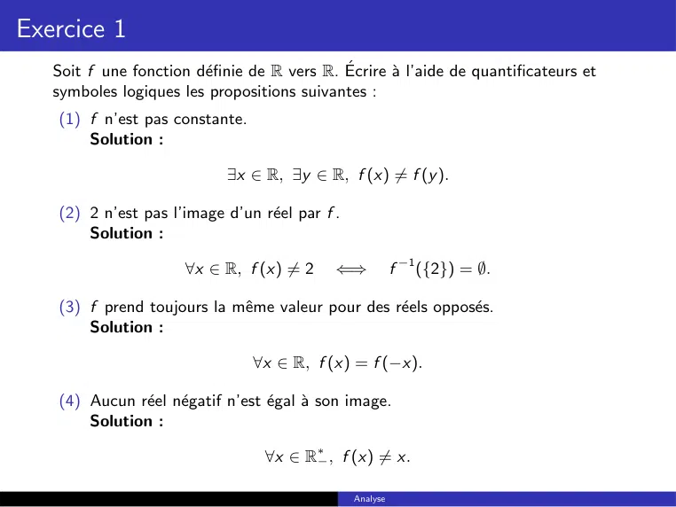

~~~text
Exercice 1
   Soit f une fonction définie de R vers R. Écrire à l’aide de quantificateurs et
   symboles logiques les propositions suivantes :
   (1) f n’est pas constante.
       Solution :

                            ∃x ∈ R, ∃y ∈ R, f (x) 6= f (y ).

   (2) 2 n’est pas l’image d’un réel par f .
       Solution :

                      ∀x ∈ R, f (x) 6= 2     ⇐⇒           f −1 ({2}) = ∅.

   (3) f prend toujours la même valeur pour des réels opposés.
       Solution :

                                ∀x ∈ R, f (x) = f (−x).

   (4) Aucun réel négatif n’est égal à son image.
       Solution :

                                  ∀x ∈ R∗− , f (x) 6= x.

                                                Analyse
~~~

## Page 3

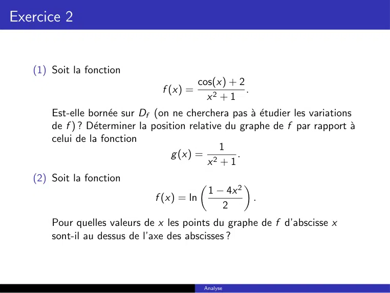

~~~text
Exercice 2

   (1) Soit la fonction
                                            cos(x) + 2
                                f (x) =                .
                                              x2 + 1
       Est-elle bornée sur Df (on ne cherchera pas à étudier les variations
       de f ) ? Déterminer la position relative du graphe de f par rapport à
       celui de la fonction
                                               1
                                    g (x) = 2      .
                                            x +1
   (2) Soit la fonction
                                                1 − 4x 2
                                                          
                               f (x) = ln                      .
                                                   2
       Pour quelles valeurs de x les points du graphe de f d’abscisse x
       sont-il au dessus de l’axe des abscisses ?

                                             Analyse
~~~

## Page 4

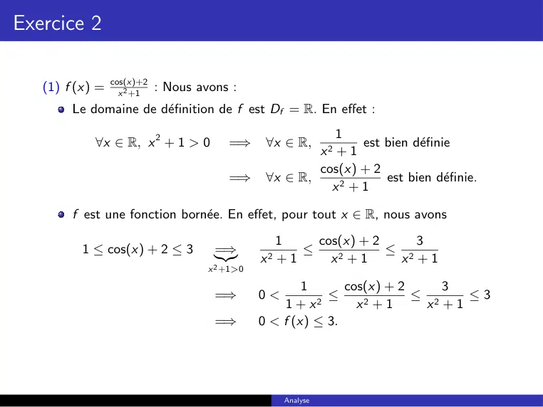

~~~text
Exercice 2

   (1) f (x) = cos(x)+2
                 x 2 +1
                        : Nous avons :
        Le domaine de définition de f est Df = R. En effet :
                                                       1
            ∀x ∈ R, x 2 + 1 > 0     =⇒      ∀x ∈ R,        est bien définie
                                                    x2 + 1
                                                    cos(x) + 2
                                    =⇒      ∀x ∈ R,            est bien définie.
                                                      x2 + 1

        f est une fonction bornée. En effet, pour tout x ∈ R, nous avons

                                              1     cos(x) + 2     3
          1 ≤ cos(x) + 2 ≤ 3      =⇒              ≤            ≤ 2
                                  |{z}     x2 + 1     x2 + 1    x +1
                                x 2 +1>0

                                                   1      cos(x) + 2     3
                                  =⇒       0<          ≤             ≤ 2   ≤3
                                               1 + x2       x2 + 1    x +1
                                  =⇒       0 < f (x) ≤ 3.

                                                Analyse
~~~

## Page 5

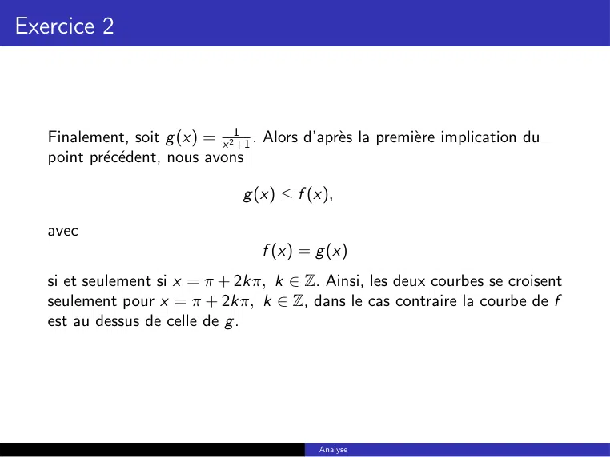

~~~text
Exercice 2

   Finalement, soit g (x) = x 21+1 . Alors d’après la première implication du
   point précédent, nous avons

                                 g (x) ≤ f (x),

   avec
                                    f (x) = g (x)
   si et seulement si x = π + 2kπ, k ∈ Z. Ainsi, les deux courbes se croisent
   seulement pour x = π + 2kπ, k ∈ Z, dans le cas contraire la courbe de f
   est au dessus de celle de g .

                                            Analyse
~~~

## Page 6

~~~text
Exercice 2
                                
                        1−4x 2
   (2) f (x) = ln         2          : Nous avons :
        Nous avons :
                   1 − 4x 2                                          1 − 4x 2
                           
              ln              est bien définie                 ⇐⇒            >0
                      2                                                 2
                                                                ⇐⇒   1 − 4x 2 > 0
                                                                     1
                                                                ⇐⇒     > x2
                                                                     4
                                                                       1         1
                                                                ⇐⇒   − <x < .
                                                                       2         2
        Ainsi, le domaine de définition de f est
                                                 
                                              1 1
                                    Df = − ;        .
                                              2 2

                                                      Analyse
~~~

## Page 7

~~~text
Exercice 2

      Pour tout x ∈ Df = − 12 ; 21 , nous avons
                                 

                          1                   1
               0 ≤ x2 <       =⇒ 0 ≥ −x 2 > −
                          4                   4
                              =⇒ 0 ≥ −4x 2 > −1
                              =⇒ 1 ≥ 1 − 4x 2 > 0
                                 1    1 − 4x 2
                              =⇒   ≥           >0
                                 2      2 
                                                     1 − 4x 2
                                                             
                                         1
                              =⇒ 0 > ln       ≥ ln              .
                                         2              2

      Ainsi, le graphe de f n’est jamais au dessus l’axe des abscisses.

                                         Analyse
~~~

## Page 8

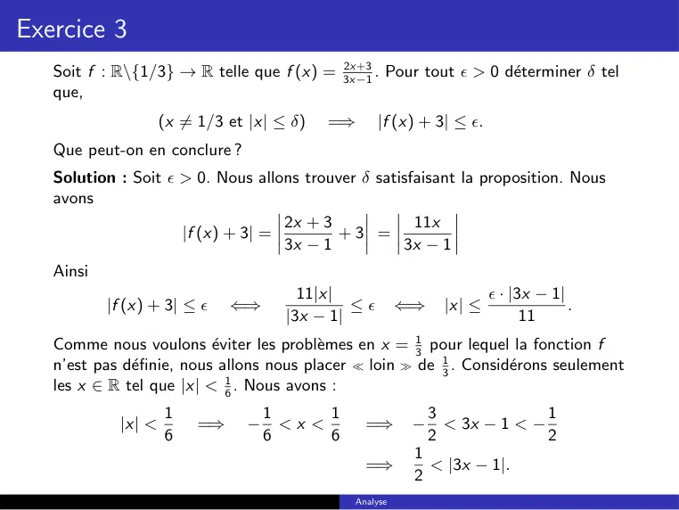

~~~text
Exercice 3
                                          2x+3
   Soit f : R\{1/3} → R telle que f (x) = 3x−1 . Pour tout  > 0 déterminer δ tel
   que,
                    (x 6= 1/3 et |x| ≤ δ)   =⇒      |f (x) + 3| ≤ .
   Que peut-on en conclure ?
   Solution : Soit  > 0. Nous allons trouver δ satisfaisant la proposition. Nous
   avons
                                   2x + 3             11x
                     |f (x) + 3| =        +3 =
                                   3x − 1           3x − 1
   Ainsi
                                        11|x|                            · |3x − 1|
           |f (x) + 3| ≤     ⇐⇒               ≤        ⇐⇒     |x| ≤                .
                                      |3x − 1|                                11
   Comme nous voulons éviter les problèmes en x = 13 pour lequel la fonction f
   n’est pas définie, nous allons nous placer  loin  de 13 . Considérons seulement
   les x ∈ R tel que |x| < 16 . Nous avons :
                    1               1      1                  3              1
            |x| <        =⇒     −     <x <       =⇒       −     < 3x − 1 < −
                    6               6      6                  2              2
                                                          1
                                                 =⇒         < |3x − 1|.
                                                          2
                                               Analyse
~~~

## Page 9

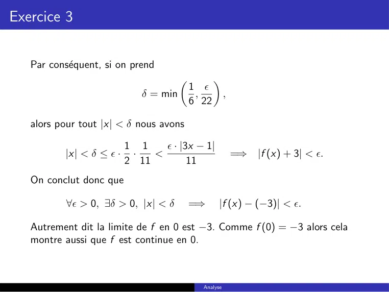

~~~text
Exercice 3

   Par conséquent, si on prend
                                                 
                                           1 
                             δ = min        ,          ,
                                           6 22

   alors pour tout |x| < δ nous avons

                          1 1     · |3x − 1|
          |x| < δ ≤  ·    ·   <                           =⇒   |f (x) + 3| < .
                          2 11         11
   On conclut donc que

           ∀ > 0, ∃δ > 0, |x| < δ         =⇒     |f (x) − (−3)| < .

   Autrement dit la limite de f en 0 est −3. Comme f (0) = −3 alors cela
   montre aussi que f est continue en 0.

                                             Analyse
~~~

## Page 10

~~~text
Exercice 4

   Montrer, en revenant à la définition, que :
           √
    1  lim x + 1 = 2.
      x→3
       lim x 2 cos( x1 ) = 0.
                        
    2
         x→0
     3   lim x+1 = +∞.
         x→2 |x−2|
     4     lim x1 = 0.
         x→+∞ e +1

                                            Analyse
~~~

## Page 11

~~~text
Exercice 4
             √
   (1) lim       x + 1 = 2. Solution : Soit  > 0. Montrons qu’il existe δ > 0
      x→3
   tel que pour tout |x − 3| ≤ δ nous avons
                              √
                             | x + 1 − 2| ≤ .

   On commence par noter que
                                         √              √
         √                              ( x + 1 − 2) · ( x + 1 + 2)
             x +1−2 ≤          ⇐⇒              √                   <
                                                  x +1+2
                                           x −3
                                ⇐⇒      √           < .
                                          x +1+2
   Maintenant
                   √                             1      1
                       x +1+2≥2       =⇒    √         ≤
                                              x +1+2    2
                                              |x − 3|   |x − 3|
                                      =⇒    √         ≤         .
                                              x +1+2       2

                                             Analyse
~~~

## Page 12

~~~text
Exercice 4

   Ainsi pour avoir
                               √
                              | x + 1 − 2| ≤ ,

   il suffit d’avoir
                       |x − 3|
                               ≤   ⇐⇒    |x − 3| ≤ 2.
                          2
   On peut donc prendre
                                     δ = 2,
   pour conclure
                                                     √
             ∀x ∈ [−1, +∞[, |x − 3| < δ     =⇒      | x + 1 − 2| ≤ .

                                          Analyse
~~~

## Page 13

~~~text
Exercice 4
   (2) lim x 2 cos( x1 ) = 0.
                        
       x→0

   Solution : Soit  > 0. Montrons qu’il existe δ > 0, tel que pour tout
   x ∈ R∗ , avec |x| ≤ δ, nous avons
                                    
                               2     1
                             x cos        ≤ .
                                     x
   Pour tout x ∈ R∗ on a
                                                            
                      1                                       1
            0 ≤ cos      ≤1               =⇒     x 2 cos         ≤ x 2.
                      x                                       x
   Ainsi pour avoir
                                           
                                           1
                                x 2 cos       ≤ ,
                                           x
   il suffit d’avoir
                                                         √
                         x2 ≤        =⇒       |x| ≤         

                                               Analyse
~~~

## Page 14

~~~text
Exercice 4

   On peut donc prendre               √
                                 δ=       ,
   pour conclure
                                            
                                            1
        ∀x ∈ R∗ , |x| ≤ δ   =⇒   x 2 cos       ≤ x 2 ≤ δ 2 = .
                                            x

                                      Analyse
~~~

## Page 15

~~~text
Exercice 4
            x+1
   (3) lim |x−2| = +∞.
        x→2

   Solution : Soit A > 0. Montrons qu’il existe δ > 0 tel que pour tout
   x 6= 2, avec |x − 2| ≤ δ, nous avons
                                       x +1
                               A≤             .
                                      |x − 2|
   Maintenant, puisque on s’interesse à la limite quand x tend vers 2, nous
   allons nous concentrer sur des réels proches de 2. Nous pouvons donc
   supposer

              |x − 2| ≤ 1 =⇒ 1 ≤ x ≤ 3        =⇒ 2 ≤ x + 1
                                                    2       x +1
                                              =⇒         ≤         .
                                                 |x − 2|   |x − 2|
   Or
                               2                              2
                       A≤              ⇐⇒         |x − 2| ≤     .
                            |x − 2|                           A

                                            Analyse
~~~

## Page 16

~~~text
Exercice 4
   Ainsi pour avoir
                                         x +1
                                A≤              .
                                        |x − 2|
   Il suffit d’avoir
                                                   2
                                      |x − 2| ≤      .
                                                   A
   On peut donc prendre                              
                                           2
                                δ = min 1,                ,
                                           A
   pour conclure
                                                              2
               ∀x 6= 2, |x − 2| ≤ δ      =⇒ |x − 2| ≤
                                                              A
                                                   2
                                         =⇒ A ≤
                                                |x − 2|
                                                   2       x +1
                                         =⇒ A ≤         ≤         .
                                                |x − 2|   |x − 2|

                                                Analyse
~~~

## Page 17

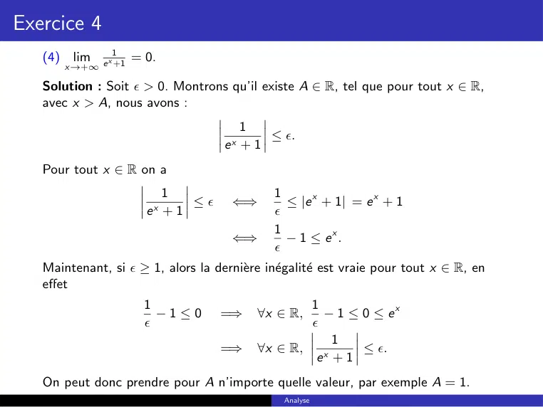

~~~text
Exercice 4
                   1
   (4) lim     x       = 0.
       x→+∞ e +1

   Solution : Soit  > 0. Montrons qu’il existe A ∈ R, tel que pour tout x ∈ R,
   avec x > A, nous avons :
                                        1
                                            ≤ .
                                     ex + 1
   Pour tout x ∈ R on a
                            1                1
                                ≤    ⇐⇒       ≤ |e x + 1| = e x + 1
                         ex + 1              
                                             1
                                      ⇐⇒       − 1 ≤ ex .
                                             
   Maintenant, si  ≥ 1, alors la dernière inégalité est vraie pour tout x ∈ R, en
   effet
                         1                         1
                           −1≤0      =⇒    ∀x ∈ R,   − 1 ≤ 0 ≤ ex
                                                  
                                                       1
                                     =⇒    ∀x ∈ R,         ≤ .
                                                    ex + 1
   On peut donc prendre pour A n’importe quelle valeur, par exemple A = 1.
                                               Analyse
~~~

## Page 18

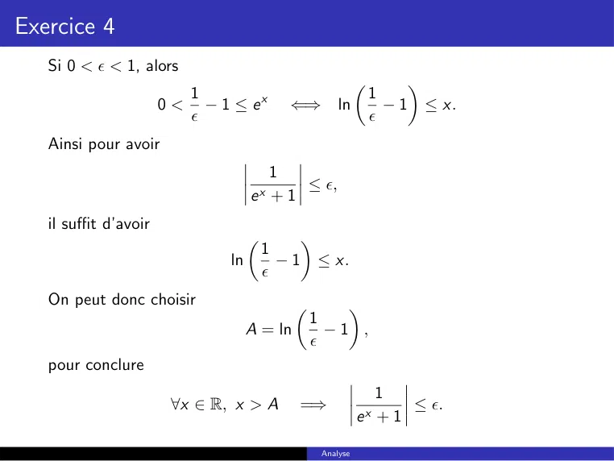

~~~text
Exercice 4
   Si 0 <  < 1, alors
                                                                     
                          1                                      1
                       0 < − 1 ≤ ex       ⇐⇒           ln          − 1 ≤ x.
                                                                
   Ainsi pour avoir
                                       1
                                           ≤ ,
                                    ex + 1
   il suffit d’avoir
                                              
                                        1
                               ln         −1       ≤ x.
                                        
   On peut donc choisir                             
                                                 1
                                    A = ln         −1 ,
                                                 
   pour conclure
                                                                 1
                        ∀x ∈ R, x > A        =⇒                       ≤ .
                                                             ex + 1

                                                   Analyse
~~~

## Page 19

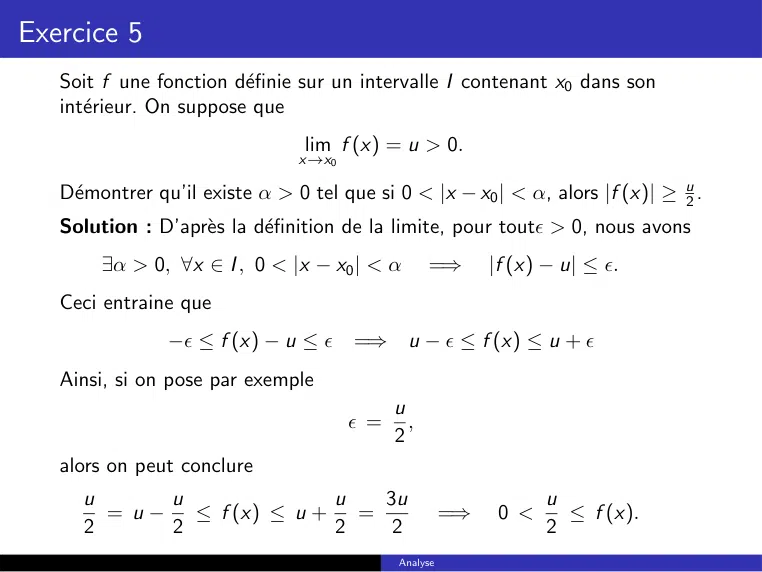

~~~text
Exercice 5
   Soit f une fonction définie sur un intervalle I contenant x0 dans son
   intérieur. On suppose que
                                 lim f (x) = u > 0.
                                x→x0

   Démontrer qu’il existe α > 0 tel que si 0 < |x − x0 | < α, alors |f (x)| ≥ u2 .
   Solution : D’après la définition de la limite, pour tout > 0, nous avons
        ∃α > 0, ∀x ∈ I , 0 < |x − x0 | < α         =⇒       |f (x) − u| ≤ .
   Ceci entraine que
                − ≤ f (x) − u ≤      =⇒ u −  ≤ f (x) ≤ u + 
   Ainsi, si on pose par exemple
                                             u
                                        =     ,
                                             2
   alors on peut conclure
     u      u             u  3u                                    u
       = u − ≤ f (x) ≤ u + =                           =⇒    0 <     ≤ f (x).
     2      2             2   2                                    2
                                             Analyse
~~~

## Page 20

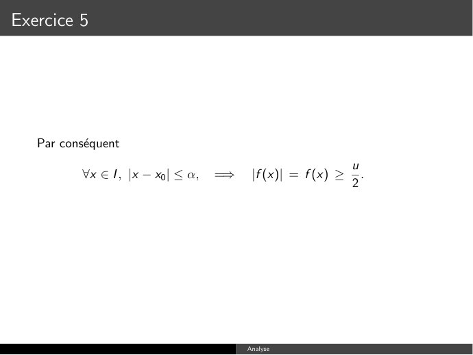

~~~text
Exercice 5

   Par conséquent
                                                               u
           ∀x ∈ I , |x − x0 | ≤ α,   =⇒    |f (x)| = f (x) ≥     .
                                                               2

                                          Analyse
~~~

**Lecture OCR à contrôler**

~~~text
Par conséquent

veel, [xx] <a, => |F(xX)| = F(x) >
~~~

## Page 21

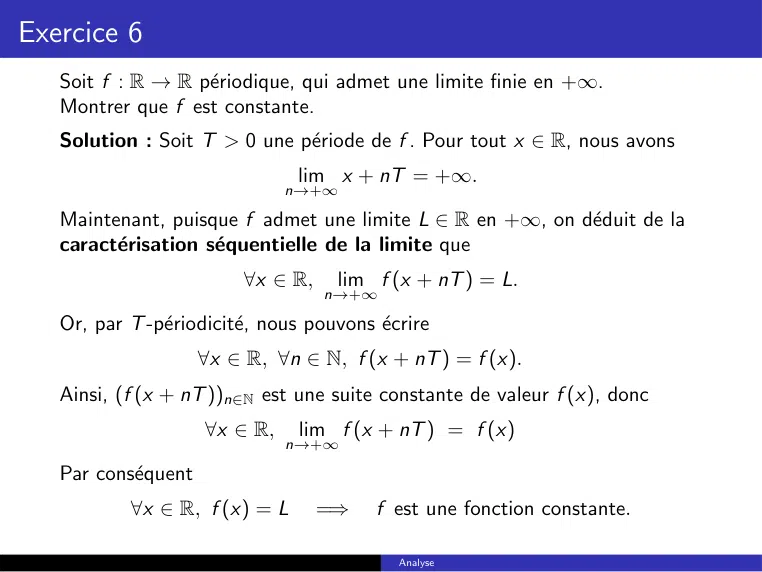

~~~text
Exercice 6
   Soit f : R → R périodique, qui admet une limite finie en +∞.
   Montrer que f est constante.
   Solution : Soit T > 0 une période de f . Pour tout x ∈ R, nous avons
                                lim x + nT = +∞.
                               n→+∞

   Maintenant, puisque f admet une limite L ∈ R en +∞, on déduit de la
   caractérisation séquentielle de la limite que
                          ∀x ∈ R,    lim f (x + nT ) = L.
                                    n→+∞

   Or, par T -périodicité, nous pouvons écrire
                     ∀x ∈ R, ∀n ∈ N, f (x + nT ) = f (x).
   Ainsi, (f (x + nT ))n∈N est une suite constante de valeur f (x), donc
                     ∀x ∈ R,    lim f (x + nT ) = f (x)
                               n→+∞

   Par conséquent
           ∀x ∈ R, f (x) = L        =⇒    f est une fonction constante.

                                             Analyse
~~~

## Page 22

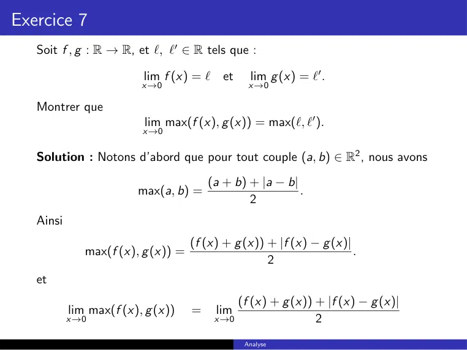

~~~text
Exercice 7
   Soit f , g : R → R, et `, `0 ∈ R tels que :

                         lim f (x) = ` et        lim g (x) = `0 .
                         x→0                     x→0

   Montrer que
                          lim max(f (x), g (x)) = max(`, `0 ).
                         x→0

   Solution : Notons d’abord que pour tout couple (a, b) ∈ R2 , nous avons
                                        (a + b) + |a − b|
                        max(a, b) =                       .
                                                2
   Ainsi
                                    (f (x) + g (x)) + |f (x) − g (x)|
              max(f (x), g (x)) =                                     .
                                                    2
   et
                                               (f (x) + g (x)) + |f (x) − g (x)|
           lim max(f (x), g (x))    =    lim
           x→0                           x→0                   2
                                                Analyse
~~~

## Page 23

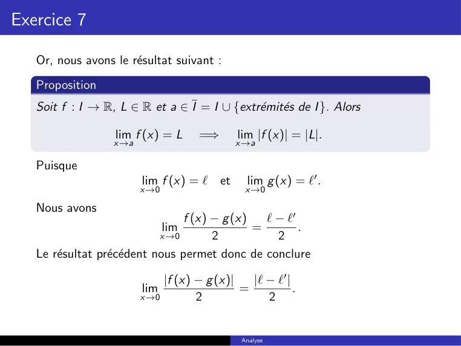

~~~text
Exercice 7

   Or, nous avons le résultat suivant :
   Proposition
   Soit f : I → R, L ∈ R et a ∈ I = I ∪ {extrémités de I }. Alors

                  lim f (x) = L     =⇒      lim |f (x)| = |L|.
                  x→a                       x→a

   Puisque
                        lim f (x) = ` et      lim g (x) = `0 .
                        x→0                   x→0

   Nous avons
                                 f (x) − g (x)   ` − `0
                              lim              =        .
                             x→0       2           2
   Le résultat précédent nous permet donc de conclure

                            |f (x) − g (x)|   |` − `0 |
                        lim                 =           .
                        x→0        2             2

                                             Analyse
~~~

## Page 24

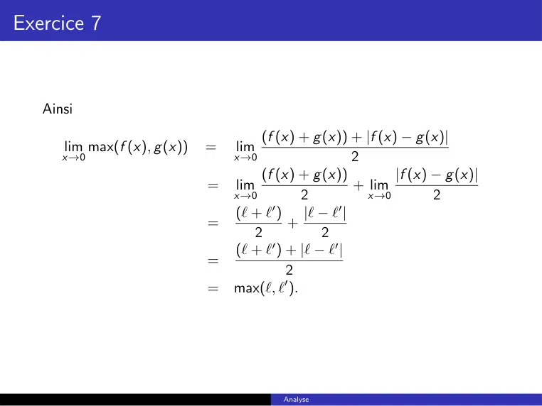

~~~text
Exercice 7

   Ainsi
                                       (f (x) + g (x)) + |f (x) − g (x)|
      lim max(f (x), g (x))   =   lim
      x→0                         x→0                  2
                                       (f (x) + g (x))         |f (x) − g (x)|
                              =   lim                  + lim
                                  x→0          2         x→0          2
                                  (` + `0 ) |` − `0 |
                              =             +
                                      2           2
                                  (` + ` ) + |` − `0 |
                                         0
                              =
                                            2
                              =   max(`, `0 ).

                                          Analyse
~~~

## Page 25

~~~text
Exercice 8

   Est-il vrai que si f et g sont deux fonctions positives sur R+ , et si f et g
   ont même limite en +∞, alors lim gf (x) (x) = 1.
                                       x→+∞

   Solution : La proposition est fausse. En effet, soit

                   f (x) = e x    et    g (x) = x α , α ∈ R∗+ .

   Alors

                       lim f (x) = +∞ = lim g (x),
                     x→+∞                       x→+∞

   mais
                                       f (x)
                                 lim           = +∞.
                            x→+∞ g (x)

                                                Analyse
~~~

## Page 26

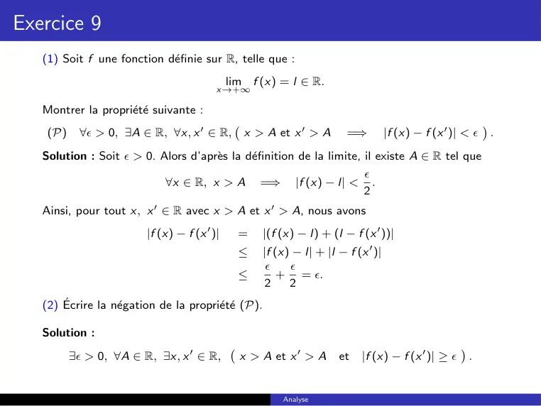

~~~text
Exercice 9
   (1) Soit f une fonction définie sur R, telle que :
                                              lim f (x) = l ∈ R.
                                          x→+∞

   Montrer la propriété suivante :
           ∀ > 0, ∃A ∈ R, ∀x, x 0 ∈ R,          x > A et x 0 > A                  |f (x) − f (x 0 )| < 
                                                                                                            
    (P)                                                                =⇒                                       .
   Solution : Soit  > 0. Alors d’après la définition de la limite, il existe A ∈ R tel que
                                                                      
                           ∀x ∈ R, x > A =⇒ |f (x) − l| < .
                                                                      2
   Ainsi, pour tout x, x 0 ∈ R avec x > A et x 0 > A, nous avons
                         |f (x) − f (x 0 )|     =   |(f (x) − l) + (l − f (x 0 ))|
                                                ≤   |f (x) − l| + |l − f (x 0 )|
                                                         
                                                ≤       + = .
                                                     2    2
   (2) Écrire la négation de la propriété (P).

   Solution :
          ∃ > 0, ∀A ∈ R, ∃x, x 0 ∈ R,          x > A et x 0 > A           |f (x) − f (x 0 )| ≥ 
                                                                                                    
                                                                     et                                 .

                                                        Analyse
~~~

## Page 27

~~~text
Exercice 9
   (3) Montrer que la négation de (P) est vraie pour la fonction f (x) = sin(x) (on
   pourra penser à prendre x = 2nπ, x 0 = 2nπ + π2 ). Conclure.

   Solution : On commence par noter que :
                                             π
                 ∀n ∈ N, sin(2nπ) − sin 2nπ +    = |0 − 1| = 1.
                                              2
   Ainsi, si on prend  = 1 et pour tout A > 0 on choisit :
                                                                        π
                   x = 2(E (A) + 1)π     et    x 0 = 2(E (A) + 1)π +      .
                                                                        2
   on aura
                 x > A et x 0 > A       et      |sin(x) − sin(x 0 )| ≥ 1 = .
   La negation de (P) est donc vrai pour sin(x). Maintenant, dans la question 1 nous
   avons vu que :
                   f admet une limite finie en + ∞            =⇒   f satisfait (P)
   Par contrapose,
              f satisfait non P     =⇒       f n’admet pas de limite finie en + ∞.
   Ainsi,    lim sin(x) n’existe pas.
            x→+∞

                                                    Analyse
~~~

## Page 28

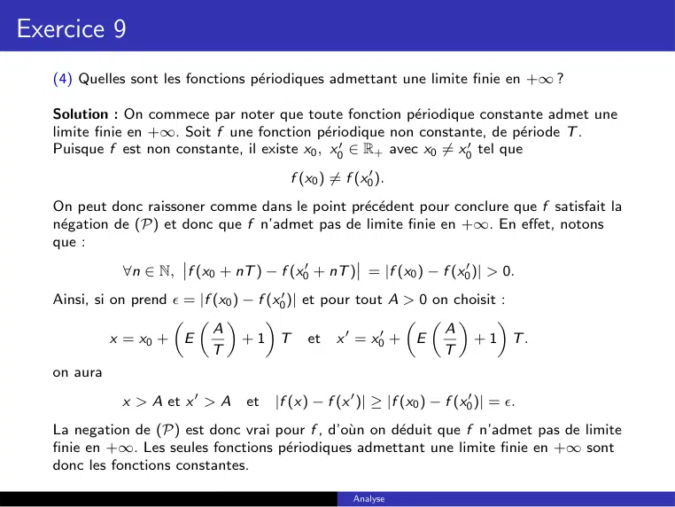

~~~text
Exercice 9
   (4) Quelles sont les fonctions périodiques admettant une limite finie en +∞ ?

   Solution : On commece par noter que toute fonction périodique constante admet une
   limite finie en +∞. Soit f une fonction périodique non constante, de période T .
   Puisque f est non constante, il existe x0 , x00 ∈ R+ avec x0 6= x00 tel que
                                         f (x0 ) 6= f (x00 ).
   On peut donc raissoner comme dans le point précédent pour conclure que f satisfait la
   négation de (P) et donc que f n’admet pas de limite finie en +∞. En effet, notons
   que :
              ∀n ∈ N, f (x0 + nT ) − f (x00 + nT ) = |f (x0 ) − f (x00 )| > 0.
   Ainsi, si on prend  = |f (x0 ) − f (x00 )| et pour tout A > 0 on choisit :
                                                                     
                             A                                      A
             x = x0 + E            + 1 T et x 0 = x00 + E               + 1 T.
                             T                                     T
   on aura
             x > A et x 0 > A     et   |f (x) − f (x 0 )| ≥ |f (x0 ) − f (x00 )| = .
   La negation de (P) est donc vrai pour f , d’oùn on déduit que f n’admet pas de limite
   finie en +∞. Les seules fonctions périodiques admettant une limite finie en +∞ sont
   donc les fonctions constantes.

                                                      Analyse
~~~

## Page 29

~~~text
Exercice 10

   Soit f et g deux fonctions définies sur R+ telles que
                                                              f (x)
                       ∀x ∈ R+ ,    g (x) > 0 et    lim               = L 6= 0.
                                                   x→+∞ g (x)

     1   Montrer que
                                 lim f (x) = 0 ⇐⇒            lim g (x) = 0.
                              x→+∞                      x→+∞

     2   Montrer que si L > 0,
                            lim f (x) = +∞ ⇐⇒                lim g (x) = +∞.
                          x→+∞                          x→+∞

                                                   Analyse
~~~

## Page 30

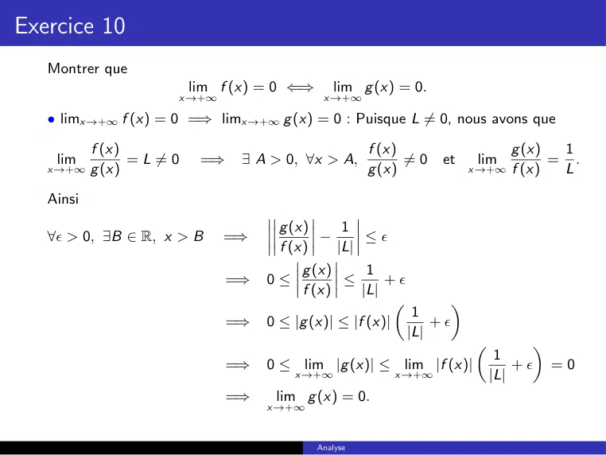

~~~text
Exercice 10
   Montrer que
                              lim f (x) = 0 ⇐⇒      lim g (x) = 0.
                          x→+∞                    x→+∞

   • limx→+∞ f (x) = 0 =⇒ limx→+∞ g (x) = 0 : Puisque L 6= 0, nous avons que

           f (x)                                           f (x)                    g (x)       1
    lim            = L 6= 0    =⇒    ∃ A > 0, ∀x > A,            6= 0   et    lim           =     .
   x→+∞ g (x)                                              g (x)             x→+∞ f (x)         L

   Ainsi
                                           g (x)    1
   ∀ > 0, ∃B ∈ R, x > B          =⇒             −     ≤
                                           f (x)   |L|
                                              g (x)       1
                                    =⇒   0≤          ≤       +
                                              f (x)      |L|
                                                                       
                                                                  1
                                    =⇒   0 ≤ |g (x)| ≤ |f (x)|       +
                                                                 |L|
                                                                                       
                                                                                   1
                                    =⇒   0 ≤ lim |g (x)| ≤ lim |f (x)|                + =0
                                              x→+∞             x→+∞               |L|
                                    =⇒    lim g (x) = 0.
                                         x→+∞

                                                 Analyse
~~~

## Page 31

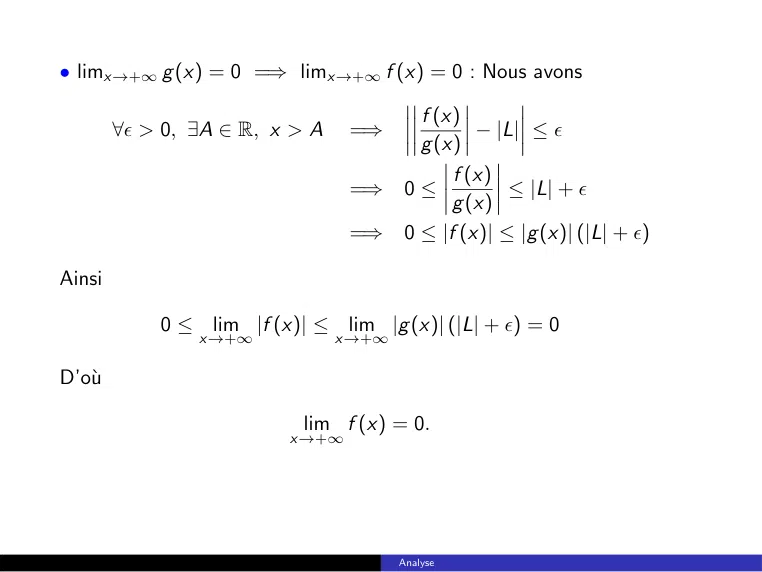

~~~text
• limx→+∞ g (x) = 0 =⇒ limx→+∞ f (x) = 0 : Nous avons

                                      f (x)
        ∀ > 0, ∃A ∈ R, x > A    =⇒          − |L| ≤ 
                                      g (x)
                                          f (x)
                                 =⇒ 0 ≤          ≤ |L| + 
                                          g (x)
                                 =⇒ 0 ≤ |f (x)| ≤ |g (x)| (|L| + )

Ainsi

            0 ≤ lim |f (x)| ≤ lim |g (x)| (|L| + ) = 0
                x→+∞            x→+∞

D’où

                           lim f (x) = 0.
                         x→+∞

                                       Analyse
~~~

## Page 32

~~~text
Exercice 10
   Montrer que
                       lim f (x) = +∞ ⇐⇒        lim g (x) = +∞.
                       x→+∞                  x→+∞

   • limx→+∞ f (x) = +∞ =⇒ limx→+∞ g (x) = +∞ : Puisque L > 0, nous
   avons que
                        f (x)                         g (x)       1
                 lim            =L>0    =⇒ lim                =     > 0.
              x→+∞ g (x)                   x→+∞ f (x)             L

   Ainsi
                                          g (x)     1       1
           ∃B, ∀x ∈ R, x > B       =⇒           −      ≤
                                          f (x)     L      2L
                                          1     g (x)      3
                                   =⇒         ≤        ≤
                                         2L      f (x)    2L
                                         f (x)
                                   =⇒           ≤ g (x)
                                          2L
                                                         f (x)
                                   =⇒    +∞ = lim              ≤ lim g (x)
                                                  x→+∞ 2L       x→+∞

                                   =⇒      lim g (x) = +∞.
                                         x→+∞

                                            Analyse
~~~

## Page 33

~~~text
Exercice 10

   • limx→+∞ g (x) = +∞ =⇒ limx→+∞ f (x) = +∞ : Nous avons
                                               f (x)          L
                 ∃A, ∀x ∈ R, x > A    =⇒              −L ≤
                                               g (x)          2
                                              L     f (x)    3L
                                      =⇒         ≤        ≤
                                              2     g (x)     2
                                              g (x) · L
                                      =⇒                ≤ f (x)
                                                  2
   Ainsi
                                g (x) · L
                  +∞ =    lim             ≤ lim f (x)
                         x→+∞       2      x→+∞

   D’où
                           lim f (x) = +∞.
                          x→+∞

                                        Analyse
~~~

## Page 34

~~~text
Exercice 11
   Calculer les limites
                      suivantes :
   (1) lim x · sin x1 . Solution : Nous avons
         x→0
                                                              
                             1                                    1
                0 ≤ sin         ≤1          =⇒    0 ≤ |x| · sin        ≤ |x|
                             x                                    x
                                                                    
                                                                     1
                                            =⇒    0 ≤ lim x · sin         ≤ lim |x| = 0
                                                      x→0            x       x→0
                                                               
                                                                1
                                            =⇒    lim x · sin        =0
                                                  x→0           x
                                                               
                                                               1
                                            =⇒    lim x · sin       = 0.
                                                  x→0          x
                x cos(e x )
   (2)    lim     x 2 +1
                            .   Solution : Nous avons
         x→+∞

                                              x     x cos(e x )     x
   −1 ≤ cos (e x ) ≤ 1          =⇒     −          ≤             ≤ 2
                                |{z}       x2 + 1    x2 + 1      x +1
                                 x>0
                                                     x          x cos(e x )         x
                                 =⇒    0 = lim −          ≤ lim             ≤ lim 2    =0
                                            x→∞   x2 + 1    x→∞ x 2 + 1      x→∞ x + 1
                                                   x
                                            x cos(e )
                                =⇒      lim            = 0.
                                       x→∞ x 2 + 1

                                                        Analyse
~~~

## Page 35

~~~text
Exercice 11
   (3)    lim e x−sin(x) . Solution : Nous avons
         x→+∞

   −1 ≤ − sin (x) ≤ 1         =⇒    x − 1 ≤ x − sin (x) ≤ x + 1
                              =⇒    e x−1 ≤ e x−sin(x) ≤ e x+1
                              =⇒    +∞ = lim e x−1 ≤ lim e x−sin(x) ≤ lim e x+1 = +∞
                                                 x→∞             x→∞        x→∞

                             =⇒          lim e x−sin(x) = +∞.
                                    x→+∞

                   1
                        . Solution : Pour tout x ∈ R∗+ nous avons
                       
   (4) lim x · E   x
         x→0
                                                                 
           1             1    1                                    1
             −1≤E           ≤             =⇒       1−x ≤x ·E          ≤1
           x             x    x           |{z}                     x
                                         car x>0
                                                                                
                                                                                1
                                          =⇒       1 = lim 1 − x ≤ lim x · E       ≤1
                                                       x→0+        x→0+         x
                                                               
                                                               1
                                          =⇒        lim x · E     =1
                                                   x→0+        x
   De même, pour tout x ∈ R∗− nous avons
                                                                                   
   1           1      1                           1                                    1
     −1≤E          ≤       =⇒      1 − x ≥ x · E     ≥1                =⇒ lim x · E       =1
   x           x      x    |{z}                   x                        x→0−        x
                               car x<0

                                                       Analyse
~~~

## Page 36

~~~text
Exercice 11

   Ainsi                                          
                                                  1
                                     lim x · E       = 1.
                                     x→0          x

           lim x · E x1 . Solution : Nous avons
                       
   (5)
         x→+∞
                                                                               
                   1                         1                                    1
         ∀x > 1,     <1   =⇒    ∀x > 1, E       =0           =⇒   ∀x > 1, x · E      =0
                   x                         x                                    x
                                                                               
                                                                                1
                                                             =⇒    lim x · E        = 0.
                                                                  x→+∞          x

                                                   Analyse
~~~

## Page 37

~~~text
Exercice 12
                                                                   
                                                     3        2
   (1) Déterminer la limite suivante : lim
                                       x→1        x 3 −1 − x 2 −1       .

   Solution : Nous avons
           3           2                   3                  2
                 −            =                        −
        x3 − 1       x2 − 1                 2
                                  (x − 1)(x + x + 1) (x − 1)(x + 1)
                                   3(x + 1) − 2(x 2 + x + 1)
                              =
                                  (x − 1)(x + 1)(x 2 + x + 1)
                                    3x + 3 − 2x 2 − 2x − 2
                              =
                                  (x − 1)(x + 1)(x 2 + x + 1)
                                         −2x 2 + x + 1
                              =
                                  (x − 1)(x + 1)(x 2 + x + 1)
                                       (x − 1)(−2x − 1)
                              =
                                  (x − 1)(x + 1)(x 2 + x + 1)
                                        −2x − 1
                              =
                                  (x + 1)(x 2 + x + 1)

                                              Analyse
~~~

## Page 38

~~~text
Exercice 12

   Par conséquent :
                               
                     3      2                           −2x − 1
           lim         −            =      lim
           x→1 x 3 − 1   x2 − 1           x→1 (x + 1)(x 2 + x + 1)

                                                  lim (−2x − 1)
                                                  x→1
                                    =
                                           lim (x + 1)(x 2 + x + 1)
                                           x→1
                                      −3
                                    =
                                      2·3
                                       1
                                    = − .
                                       2

                                        Analyse
~~~

## Page 39

~~~text
Exercice 12
                                               √                
   (2) Déterminer la limite suivante : lim     x 2 + 2x − 1 − x .
                                      x→+∞

   Solution : Pour tou x > 0, nous avons
                                    √                   √                  
         p                            x 2 + 2x − 1 − x     x 2 + 2x − 1 + x
           x 2 + 2x − 1 − x =                  √
                                                 x 2 + 2x − 1 + x
                                   x + 2x − 1 − x 2
                                    2
                              = √
                                    x 2 + 2x − 1 + x
                                          2x − 1
                              =     q
                                  x 1 + x2 − x12 + x
                                        x · (2 − x1 )
                              =       q                 
                                   x·   1 + x2 − x12 + 1

   Par conséquent
               p                                          2 − x1              2
         lim     x 2 + 2x − 1 − x     =       lim q                         =     = 1.
        x→+∞                                  x→+∞
                                                         1 + x2 − x12 + 1       2

                                               Analyse
~~~

## Page 40

~~~text
Exercice 12
   (3) Déterminer la limite suivante : lim g (x) avec
                                     x→+∞

                                 √         √
                            q         q        
                    g (x) =   x + x +1− x + x −1 .

   Solution : Pour tou x > 1, nous avons
               p      √         p     √       p    √     p   √    
                   x + x +1− x + x −1              x + x +1+ x + x −1
   g (x) =                       p     √         p    √
                                   x + x +1+ x + x −1
                     √              √     
                x + x +1− x + x −1
          = p         √        p      √
                 x + x +1+ x + x −1
                      √        √
                        x +1− x −1
          = p         √        p      √
                 x + x +1+ x + x −1
                       √         √       √         √    
                         x +1− x −1         x +1+ x −1
          = p         √         p     √        √      √    
                   x + x +1+ x + x −1             x +1+ x −1
                           x +1−x +1
          =    p   √     p   √      √     √     .
                 x + x +1+ x + x −1    x +1+ x −1

                                            Analyse
~~~

## Page 41

~~~text
Exercice 12

   Par conséquent
                                                  2
    lim g (x)    =    lim p        √        p   √      √      √
   x→+∞              x→+∞
                                                                      
                               x+       x +1+ x + x −1     x +1+ x −1
                 =   0.

                                          Analyse
~~~

## Page 42

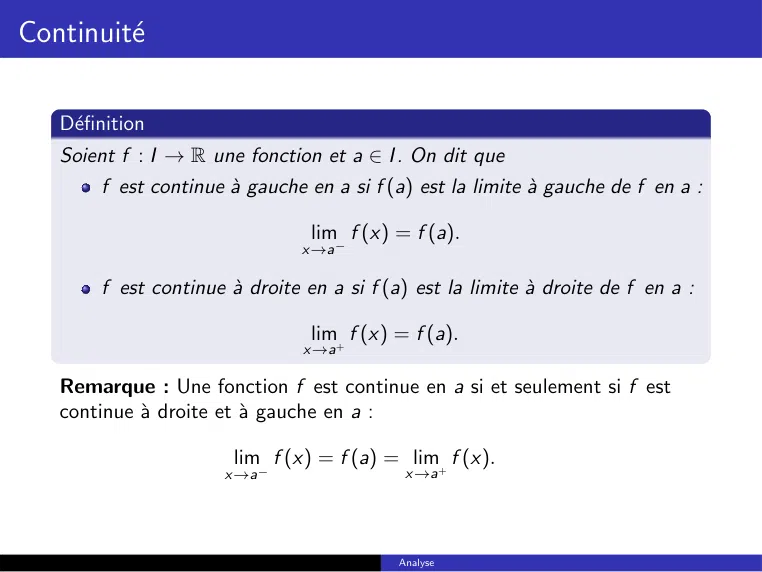

~~~text
Continuité

   Définition
   Soient f : I → R une fonction et a ∈ I . On dit que
       f est continue à gauche en a si f (a) est la limite à gauche de f en a :

                                 lim f (x) = f (a).
                                x→a−

       f est continue à droite en a si f (a) est la limite à droite de f en a :

                                 lim f (x) = f (a).
                                x→a+

   Remarque : Une fonction f est continue en a si et seulement si f est
   continue à droite et à gauche en a :

                       lim f (x) = f (a) = lim+ f (x).
                      x→a−                   x→a

                                            Analyse
~~~

## Page 43

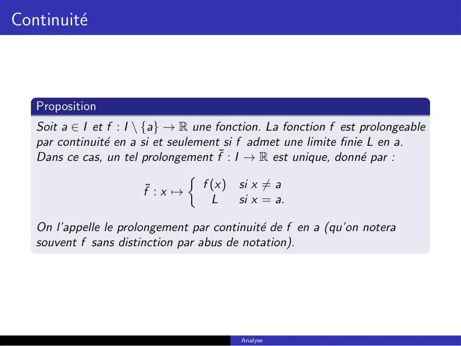

~~~text
Continuité

   Proposition
   Soit a ∈ I et f : I \ {a} → R une fonction. La fonction f est prolongeable
   par continuité en a si et seulement si f admet une limite finie L en a.
   Dans ce cas, un tel prolongement f˜ : I → R est unique, donné par :
                                  
                          ˜         f (x) si x 6= a
                         f : x 7→
                                      L     si x = a.

   On l’appelle le prolongement par continuité de f en a (qu’on notera
   souvent f sans distinction par abus de notation).

                                          Analyse
~~~

## Page 44

~~~text
Continuité

   Proposition (Opérations sur les fonctions continues)
   Soient f et g des fonctions continues sur I et λ, µ ∈ R.
     1   Les fonctions λf + µg , f · g sont continue sur I .
     2   Si de plus, g ne s’annule pas sur I , gf est continue sur I .

   Proposition
   Soient f : I → R continue sur I et g : J → R continue sur J avec
   f (I ) ⊂ J. Alors, la fonction g ◦ f est continue sur I .

                                             Analyse
~~~

## Page 45

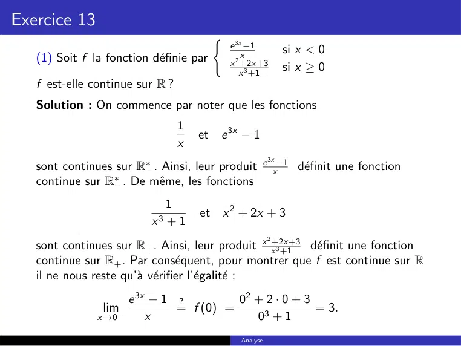

~~~text
Exercice 13
                                          (
                                               e 3x −1
                                                   x            si x < 0
   (1) Soit f la fonction définie par         x 2 +2x+3
                                                  x 3 +1        si x ≥ 0
   f est-elle continue sur R ?
   Solution : On commence par noter que les fonctions
                                 1
                                     et   e 3x − 1
                                 x
                                                           3x
   sont continues sur R∗− . Ainsi, leur produit e x−1 définit une fonction
   continue sur R∗− . De même, les fonctions
                             1
                                     et       x 2 + 2x + 3
                           x3 + 1
                                                           2
   sont continues sur R+ . Ainsi, leur produit x x+2x+3
                                                   3 +1 définit une fonction
   continue sur R+ . Par conséquent, pour montrer que f est continue sur R
   il ne nous reste qu’à vérifier l’égalité :
                       e 3x − 1 ?         02 + 2 · 0 + 3
                lim−            = f (0) =                = 3.
               x→0         x                 03 + 1
                                                 Analyse
~~~

## Page 46

~~~text
Exercice 13

   Calculons cette dernière limite. Nous avons :
                              e 3x − 1            e 3x − e 3·0
                       lim−              =  lim−
                     x→0          x        x→0       x −0
                                              3x 0
                                                
                                         = e       |x=0
                                         = 3e 0
                                         = 3 = f (0).

   La fonction f est donc continue sur R.

                                             Analyse
~~~

## Page 47

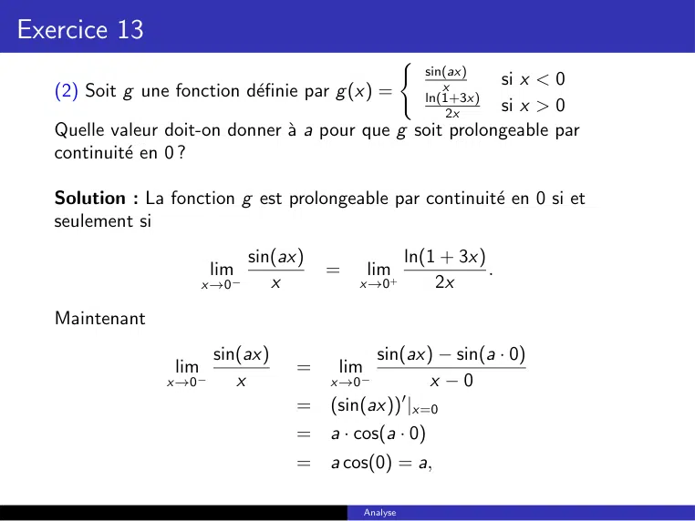

~~~text
Exercice 13
                                                          (
                                                              sin(ax)
                                                           si x < 0
                                                                 x
   (2) Soit g une fonction définie par g (x) =               ln(1+3x)
                                                           si x > 0
                                                                  2x
   Quelle valeur doit-on donner à a pour que g soit prolongeable par
   continuité en 0 ?

   Solution : La fonction g est prolongeable par continuité en 0 si et
   seulement si
                               sin(ax)                    ln(1 + 3x)
                        lim              =      lim                  .
                        x→0−      x          x→0+             2x
   Maintenant
                         sin(ax)             sin(ax) − sin(a · 0)
                  lim                =    lim
                 x→0−       x            x→0−        x −0
                                     = (sin(ax))0 |x=0
                                     = a · cos(a · 0)
                                     = a cos(0) = a,

                                                Analyse
~~~

## Page 48

~~~text
et en efectuant le changement de variable 1 + 3x = y , nous avons

             ln(1 + 3x)         ln(y )             3        ln(y ) − ln(1)
      lim+              = lim+                =      · lim+
                         y →1 2 · y −1                          y −1
                                       
     x→0         2x                 3
                                                   2 y →1
                                                   3
                                              =      (ln(y ))0
                                                   2  y =1
                                                   3     1
                                              =       ·
                                                   2     y y =1
                                                   3
                                              =      .
                                                   2
Ainsi g est prolongeable par continuité en 0 si et seulement si a = 32 .

                                         Analyse
~~~

## Page 49

~~~text
Exercice 14
   Soit g la fonction définie par :
                                 
                                       ln x
                                 
                                 
                                  x −1
                                                   si 0 < x < 1
                       g (x) =          2           si x = 1
                                 
                                     x +1
                                 
                                                   si x > 1
                                     3x − 1
   La fonction g est-elle continue en 1 ?

   Solution : La fonction g est continue en 1 si et seulement si :
                ln(x)                                   x +1
          lim           = g (1) = 2 et        lim              = g (1) = 2.
         x→1− x − 1                       x→1+ 3x − 1

   Maintent
                                 x +1               lim x + 1
                                                    x→1+
                          lim+            =
                         x→1     3x − 1             lim 3x − 1
                                                 x→1+
                                                 2
                                          =        = 1 6= 2.
                                                 2
                                              Analyse
~~~

## Page 50

~~~text
Exercice 14

   et
                            ln(x)             ln(x) − ln(1)
                      lim             =   lim
                    x→1− x − 1            x→1−    x −1
                                           0
                                      = ln (x)|x=1
                                      = 1 6= 2.

   Ainsi g n’est pas continue en 1.

                                           Analyse
~~~

## Page 51

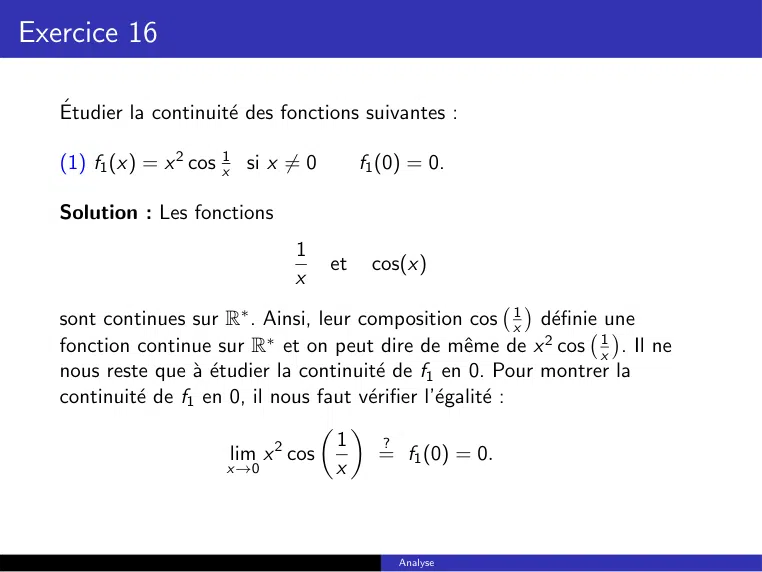

~~~text
Exercice 16

   Étudier la continuité des fonctions suivantes :

   (1) f1 (x) = x 2 cos x1 si x 6= 0        f1 (0) = 0.

   Solution : Les fonctions
                                 1
                                       et    cos(x)
                                 x
   sont continues sur R∗ . Ainsi, leur composition cos x1 définie une
                                                                

   fonction continue sur R∗ et on peut dire de même de x 2 cos x1 . Il ne
                                                                     

   nous reste que à étudier la continuité de f1 en 0. Pour montrer la
   continuité de f1 en 0, il nous faut vérifier l’égalité :
                                     
                                     1      ?
                        lim x 2 cos        = f1 (0) = 0.
                        x→0          x

                                                 Analyse
~~~

## Page 52

~~~text
Exercice 16

   Calculons cette dernière limite. Nous avons
                                               
                1                                1
   − 1 ≤ cos        ≤ 1 =⇒ −x 2 ≤ x 2 cos           ≤ x2
                x                                x
                                                            
                                                            1
                          =⇒ 0 = − lim x 2 ≤ lim x 2 cos       ≤ lim x 2 = 0
                                     x→0      x→0           x    x→0
                                          
                                          1
                          =⇒ lim x 2 cos      =0
                             x→0          x
                                          
                                          1
                          =⇒ lim x 2 cos      = f1 (0)
                             x→0          x
                          =⇒ f1 est continue en 0.

                                        Analyse
~~~

## Page 53

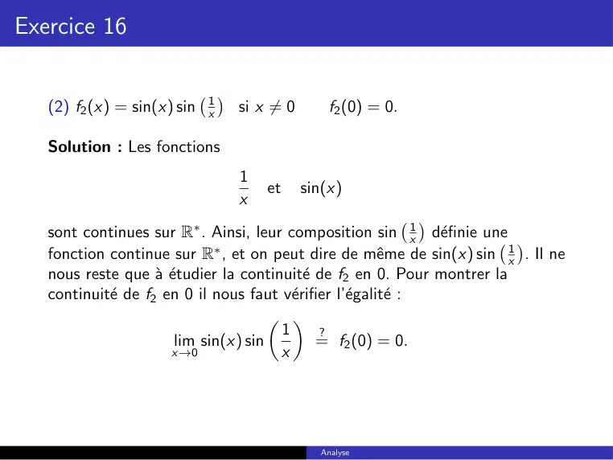

~~~text
Exercice 16

                             1
                                 
   (2) f2 (x) = sin(x) sin   x       si x 6= 0       f2 (0) = 0.

   Solution : Les fonctions
                                     1
                                         et      sin(x)
                                     x
   sont continues sur R∗ . Ainsi, leur composition sin x1 définie une 
                                                               

   fonction continue sur R∗ , et on peut dire de même de sin(x) sin x1 . Il ne
   nous reste que à étudier la continuité de f2 en 0. Pour montrer la
   continuité de f2 en 0 il nous faut vérifier l’égalité :
                                      
                                       1      ?
                      lim sin(x) sin         = f2 (0) = 0.
                      x→0              x

                                                   Analyse
~~~

## Page 54

~~~text
Exercice 16

   Calculons cette dernière limite. Nous avons
                                                 
             1                                     1
   0 ≤ sin        ≤ 1 =⇒ 0 ≤ |sin(x)| · sin              ≤ | sin(x)|
             x                                     x
                                                      
                                                        1
                          =⇒ 0 ≤ lim |sin(x)| · sin           ≤ lim | sin(x)| = 0
                                      x→0               x       x→0
                                                   
                                                   1
                          =⇒ lim |sin(x)| · sin          =0
                                 x→0               x
                                               
                                                1
                          =⇒ lim sin(x) sin         =0
                                 x→0            x
                                               
                                                1
                          =⇒ lim sin(x) sin         = f2 (0)
                                 x→0            x
                          =⇒ f2 est continue en 0.

                                           Analyse
~~~

## Page 55

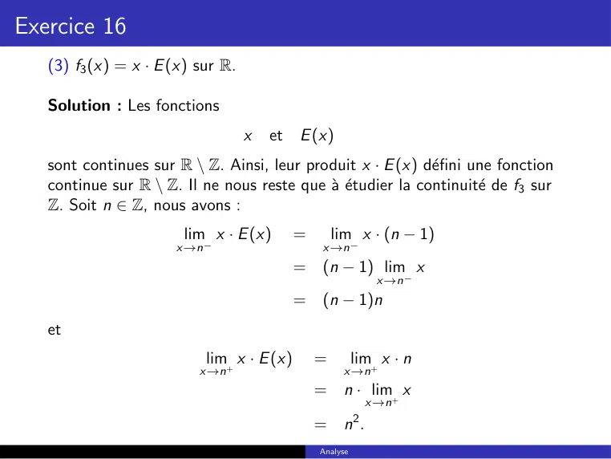

~~~text
Exercice 16
   (3) f3 (x) = x · E (x) sur R.

   Solution : Les fonctions
                                   x   et   E (x)
   sont continues sur R \ Z. Ainsi, leur produit x · E (x) défini une fonction
   continue sur R \ Z. Il ne nous reste que à étudier la continuité de f3 sur
   Z. Soit n ∈ Z, nous avons :
                       lim x · E (x)        =       lim x · (n − 1)
                      x→n−                      x→n−
                                            = (n − 1) lim− x
                                                             x→n
                                            = (n − 1)n
   et
                           lim x · E (x)        =         lim x · n
                          x→n+                       x→n+
                                                =    n · lim+ x
                                                            x→n
                                                =    n2 .
                                                Analyse
~~~

## Page 56

~~~text
Exercice 16

   Par conséquent

                          lim f3 (x) 6= lim+ f3 (x).
                         x→n−          x→n

   Ainsi, la fonction f3 n’est continue en aucun point de Z.

                                           Analyse
~~~

## Page 57

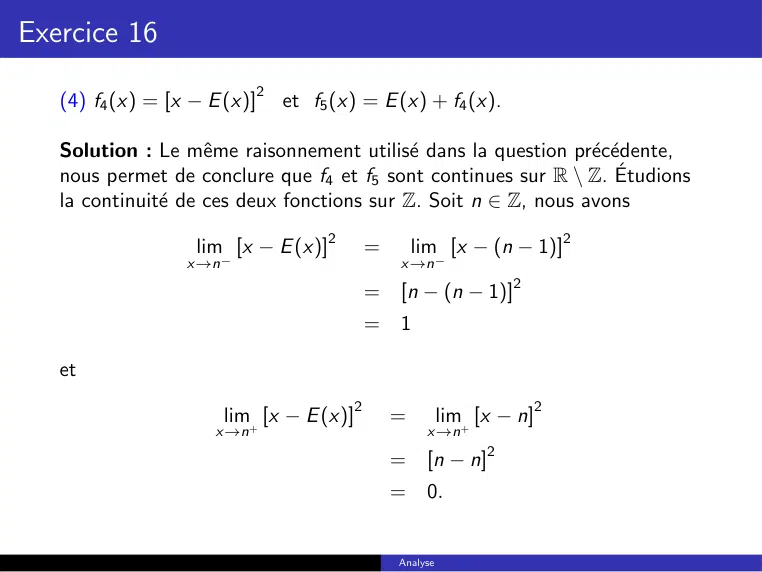

~~~text
Exercice 16
                          2
   (4) f4 (x) = [x − E (x)]   et f5 (x) = E (x) + f4 (x).

   Solution : Le même raisonnement utilisé dans la question précédente,
   nous permet de conclure que f4 et f5 sont continues sur R \ Z. Étudions
   la continuité de ces deux fonctions sur Z. Soit n ∈ Z, nous avons
                                     2                                      2
                   lim [x − E (x)]           =       lim [x − (n − 1)]
                  x→n−                           x→n−
                                                                    2
                                             = [n − (n − 1)]
                                             = 1

   et
                                         2                              2
                       lim [x − E (x)]           =         lim [x − n]
                      x→n+                            x→n+
                                                                2
                                                 =    [n − n]
                                                 =    0.

                                                 Analyse
~~~

## Page 58

~~~text
Exercice 16
   Par conséquent

                             lim f4 (x) 6= lim+ f4 (x).
                         x→n−              x→n

   Ainsi, la fonction f4 n’est continue en aucun point de Z.
   Maintenant, pour tout n ∈ Z, nous avons
                                       2                               2
            lim E (x) + [x − E (x)]        = (n − 1) + [n − (n − 1)]
           x→n−
                                           = n

   et
                                           2                  2
                lim E (x) + [x − E (x)]          = n + [n − n] = n.
               x→n+

   Par conséquent

                      lim f5 (x) = f5 (n) = lim+ f5 (x).
                      x→n+                       x→n

   Ainsi, la fonction f5 est continue dans tout point de Z.
                                               Analyse
~~~

## Page 59

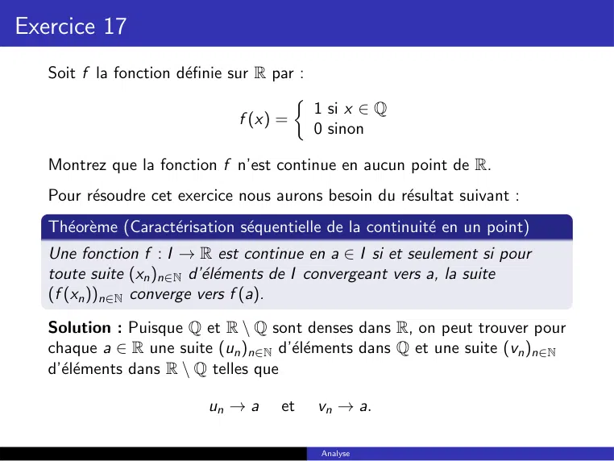

~~~text
Exercice 17
   Soit f la fonction définie sur R par :
                                         
                                           1 si x ∈ Q
                                 f (x) =
                                           0 sinon

   Montrez que la fonction f n’est continue en aucun point de R.
   Pour résoudre cet exercice nous aurons besoin du résultat suivant :
   Théorème (Caractérisation séquentielle de la continuité en un point)
   Une fonction f : I → R est continue en a ∈ I si et seulement si pour
   toute suite (xn )n∈N d’éléments de I convergeant vers a, la suite
   (f (xn ))n∈N converge vers f (a).

   Solution : Puisque Q et R \ Q sont denses dans R, on peut trouver pour
   chaque a ∈ R une suite (un )n∈N d’éléments dans Q et une suite (vn )n∈N
   d’éléments dans R \ Q telles que

                           un → a     et   vn → a.

                                            Analyse
~~~

## Page 60

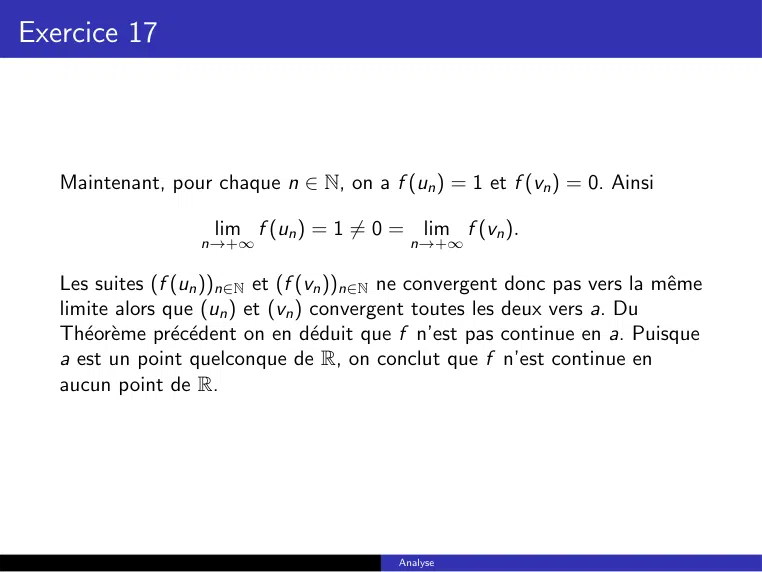

~~~text
Exercice 17

   Maintenant, pour chaque n ∈ N, on a f (un ) = 1 et f (vn ) = 0. Ainsi

                     lim f (un ) = 1 6= 0 = lim f (vn ).
                   n→+∞                      n→+∞

   Les suites (f (un ))n∈N et (f (vn ))n∈N ne convergent donc pas vers la même
   limite alors que (un ) et (vn ) convergent toutes les deux vers a. Du
   Théorème précédent on en déduit que f n’est pas continue en a. Puisque
   a est un point quelconque de R, on conclut que f n’est continue en
   aucun point de R.

                                           Analyse
~~~

## Page 61

~~~text
Exercice 18
   (1) Trouver toutes les fonctions f : R −→ R, continues en 0, qui vérifient :
                                ∀x ∈ R, f (x) = f (3x).
   Solution : Fixons x ∈ R. Nous allons calculer la valeur de f(x). Pour cela, on
   commence par noter que
                              x     x               x 
                    f (x) = f      =f     2
                                            = ··· = f
                               3        3                3n
   Ainsi, en posant
                                              x
                                ∀n ∈ N, xn = n .
                                             3
   on conclut
                 ∀n ∈ N, f (xn ) = f (x)   =⇒           lim f (xn ) = f (x).
                                                    n→+∞

   Maintenant
                                    lim xn = 0,
                                  n→+∞

   et par continuité de f en 0 on en déduit que
                     lim f (xn ) = f (0)   =⇒       f (x) = f (0).
                   n→+∞

   Comme ce raisonnement est valable pour tout x ∈ R nous venons de montrer
   que f est une fonction constante.
                                              Analyse
~~~

## Page 62

~~~text
Exercice 18
   (2) Trouver toutes les fonctions f : R −→ R , continues en 1, qui vérifient :
                                ∀x ∈ R, f (x) = −f (x 2 ).
   Solution : Soit f une fonction satisfaisant la propriété. On commence par noter
   que
                      f (−x) = −f ((−x)2 ) = −f (x 2 ) = f (x).
   Ainsi f est une fonction paire. Il suffit donc d’étudier f sur l’ensemble des réels
   positifs. Tout d’abord
           f (0) = −f (02 ) = −f (0)    =⇒      2f (0) = 0    =⇒     f (0) = 0.
   Fixons en suite x ∈ R>0 . Nous allons calculer la valeur de f (x). On commence
   par noter que
                          1         1                     1
              f (x) = −f x 2 = f x 4 = · · · = (−1)n f x 2n
   Ainsi, en posant
                                                   1
                                ∀n ∈ N, xn = x 2n .
   on conclut
        ∀n ∈ N, f (xn ) = (−1)n f (x)    =⇒        lim f (xn ) = lim (−1)n f (x).
                                                 n→+∞             n→+∞

                                                Analyse
~~~

## Page 63

~~~text
Exercice 18

   Notons que la limite
                                      lim (−1)n f (x)
                                 n→+∞

   existe si et seulement si f (x) = 0.
   Maintenant
                                                  1
                           lim xn = lim x 2n = 1,
                          n→+∞          n→+∞

   et par continuité de f en 1 on en déduit que

                lim f (xn ) = f (1)     =⇒       lim (−1)n f (x) = f (1)
              n→+∞                             n→+∞
                                        =⇒ f (x) = f (1) = 0.

   Comme ce raisonnement est valable pour tout x ∈ R>0 et pour x = 0
   nous avons f (0) = 0, nous venons de montrer que f est la fonction nulle
   sur R+ . Finalement, par parité de f on conclut f est la fonction nulle sur
   R.

                                              Analyse
~~~

## Page 64

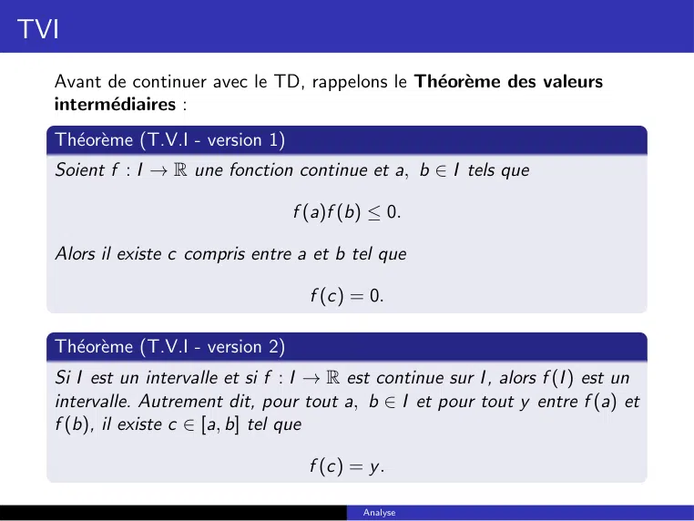

~~~text
TVI
  Avant de continuer avec le TD, rappelons le Théorème des valeurs
  intermédiaires :
  Théorème (T.V.I - version 1)
  Soient f : I → R une fonction continue et a, b ∈ I tels que

                                   f (a)f (b) ≤ 0.

  Alors il existe c compris entre a et b tel que

                                     f (c) = 0.

  Théorème (T.V.I - version 2)
  Si I est un intervalle et si f : I → R est continue sur I , alors f (I ) est un
  intervalle. Autrement dit, pour tout a, b ∈ I et pour tout y entre f (a) et
  f (b), il existe c ∈ [a, b] tel que

                                     f (c) = y .

                                            Analyse
~~~

## Page 65

~~~text
Exercice 19

   (1) Soit f une fonction continue sur [a, b] telle que f ([a, b]) ⊂ [a, b].
       Montrer, par considération de φ(x) = f (x) − x, qu’il existe c dans
       [a, b] tel que f (c) = c.
   (2) Soit f une fonction continue sur [0, 1] telle que f (0) = f (1).
       Montrer qu’il existe c dans [0, 21 ] tel que f (c) = f (c + 12 ).
   (3) Un mobile parcours, à vitesse continue, une distance d en une unité
       de temps. Montrer qu’il existe un intervalle d’une demi-unité de
       temps pendant lequel il parcourt une distance d2 .

                                           Analyse
~~~

## Page 66

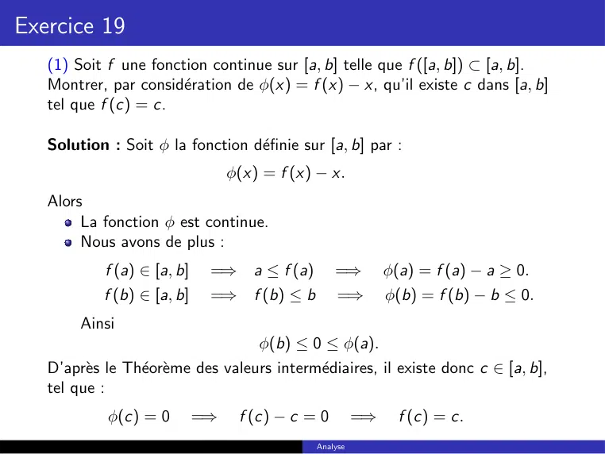

~~~text
Exercice 19
   (1) Soit f une fonction continue sur [a, b] telle que f ([a, b]) ⊂ [a, b].
   Montrer, par considération de φ(x) = f (x) − x, qu’il existe c dans [a, b]
   tel que f (c) = c.

   Solution : Soit φ la fonction définie sur [a, b] par :
                                 φ(x) = f (x) − x.
   Alors
        La fonction φ est continue.
        Nous avons de plus :
           f (a) ∈ [a, b]    =⇒     a ≤ f (a)       =⇒         φ(a) = f (a) − a ≥ 0.
           f (b) ∈ [a, b]    =⇒     f (b) ≤ b        =⇒        φ(b) = f (b) − b ≤ 0.
        Ainsi
                                     φ(b) ≤ 0 ≤ φ(a).
   D’après le Théorème des valeurs intermédiaires, il existe donc c ∈ [a, b],
   tel que :
            φ(c) = 0        =⇒    f (c) − c = 0           =⇒     f (c) = c.
                                                Analyse
~~~

## Page 67

~~~text
Exercice 19
   (2) Soit f une fonction  continue sur [0, 1] telle que f (0) = f (1). Montrer
   qu’il existe c dans 0, 12 tel que f (c) = f (c + 21 ).
                      

   Solution : Soit g la fonction définie sur 0, 12 par :
                                                  
                                                  
                                                1
                        g (x) = f (x) − f x +        .
                                                2
   Alors
        La fonction g est continue.
        Nous avons de plus :
                                                              
                           1         1                            1
        g (0) = f (0) − f       ; g                    =       f     − f (1)
                           2         2                            2
                                                                  
                                                                  1
                                                           =   f     − f (0)
                                                                  2
                                                                           
                                                                             1
                                                           =   − f (0) − f      = −g (0).
                                                                             2
                           1
                               
        Ainsi g (0) et g   2       sont de signes opposés.
                                                 Analyse
~~~

## Page 68

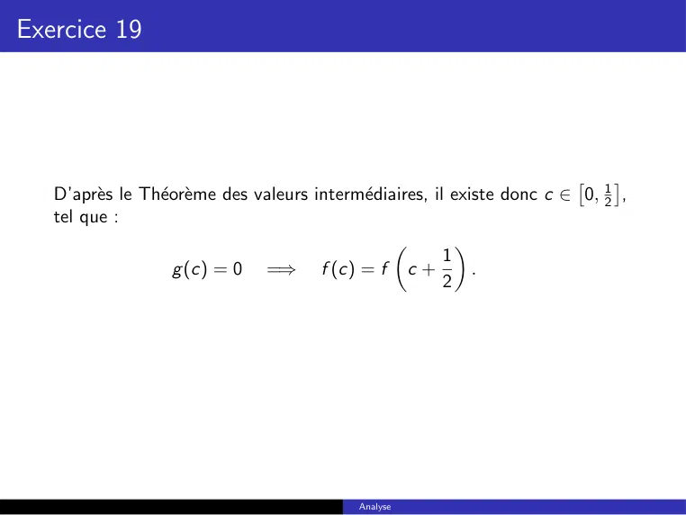

~~~text
Exercice 19

   D’après le Théorème des valeurs intermédiaires, il existe donc c ∈ 0, 21 ,
                                                                              

   tel que :
                                                          
                                                         1
                   g (c) = 0 =⇒ f (c) = f c +                .
                                                         2

                                            Analyse
~~~

## Page 69

~~~text
Exercice 19
   (3) Un mobile parcours, à vitesse continue, une distance d en une unité
   de temps. Montrer qu’il existe un intervalle d’une demi-unité de temps
   pendant lequel il parcourt une distance d2 .

   Solution : Notons t le temps (en heure) et D(t) la distance parcourue
   (en km) entre les instants 0 et t. Par hypothèse

                                      D(1) = d.

   Maintenant, supposons que la fonction

                                      t 7−→ D(t),

   est continue, et considérons la fonction

                              f (t) = D(t) − d · t.

   Alors

                          f (0) = 0     et   f (1) = 0.

                                              Analyse
~~~

## Page 70

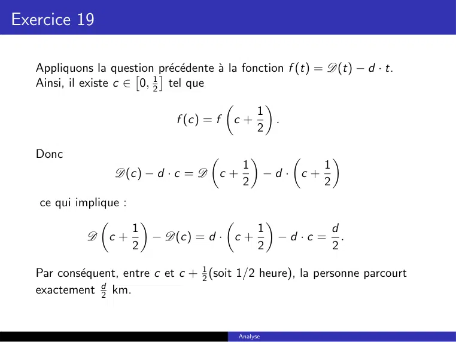

~~~text
Exercice 19

   Appliquons la question    précédente à la fonction f (t) = D(t) − d · t.
   Ainsi, il existe c ∈ 0, 21 tel que
                            

                                                    
                                                   1
                                 f (c) = f c +         .
                                                   2

   Donc                                                        
                                        1                       1
                   D(c) − d · c = D c +                −d · c +
                                        2                       2
   ce qui implique :
                                         
                     1                    1          d
            D c+         − D(c) = d · c +     −d ·c = .
                     2                    2          2

   Par conséquent, entre c et c + 21 (soit 1/2 heure), la personne parcourt
   exactement d2 km.

                                             Analyse
~~~

## Page 71

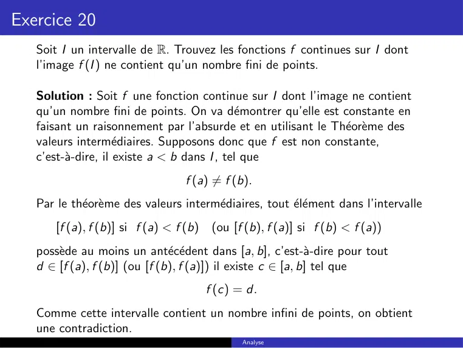

~~~text
Exercice 20
   Soit I un intervalle de R. Trouvez les fonctions f continues sur I dont
   l’image f (I ) ne contient qu’un nombre fini de points.

   Solution : Soit f une fonction continue sur I dont l’image ne contient
   qu’un nombre fini de points. On va démontrer qu’elle est constante en
   faisant un raisonnement par l’absurde et en utilisant le Théorème des
   valeurs intermédiaires. Supposons donc que f est non constante,
   c’est-à-dire, il existe a < b dans I , tel que
                                   f (a) 6= f (b).
   Par le théorème des valeurs intermédiaires, tout élément dans l’intervalle
       [f (a), f (b)] si f (a) < f (b)    (ou [f (b), f (a)] si f (b) < f (a))
   possède au moins un antécédent dans [a, b], c’est-à-dire pour tout
   d ∈ [f (a), f (b)] (ou [f (b), f (a)]) il existe c ∈ [a, b] tel que
                                         f (c) = d.
   Comme cette intervalle contient un nombre infini de points, on obtient
   une contradiction.
                                                Analyse
~~~

## Page 72

~~~text
Exercice 20

   Donc, pour tous a, b ∈ I , on a

                                     f (a) = f (b).

   Autrement dit, f est constante.

                                              Analyse
~~~

## Page 73

~~~text
Exercice 21

   Soit f une fonction continue sur R. Les propositions suivantes sont-elles
   vraies ou fausses.
   (1) L’image par f d’un intervalle ouvert est un intervalle ouvert.
       Solution : Faux. En effet, soit

                     f (x) = sin(x)      et     I =] − 3π, 3π[.

       Alors

                 f (I ) = [−1, 1],    qui est un intervalle fermé.

   (2) L’image par f d’un segment est un segment.
       Solution : Vrai. Théorème vu en CM.

                                              Analyse
~~~

## Page 74

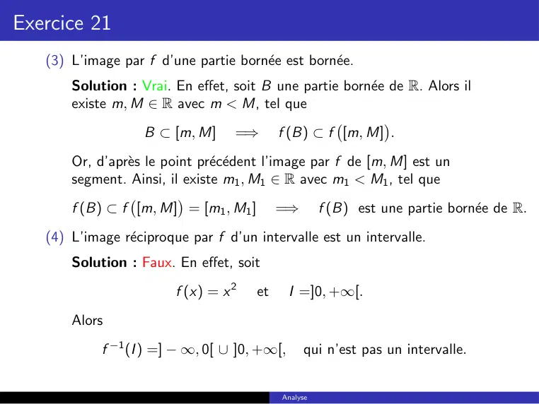

~~~text
Exercice 21
   (3) L’image par f d’une partie bornée est bornée.
       Solution : Vrai. En effet, soit B une partie bornée de R. Alors il
       existe m, M ∈ R avec m < M, tel que
                                                           
                  B ⊂ [m, M] =⇒ f (B) ⊂ f [m, M] .
       Or, d’après le point précédent l’image par f de [m, M] est un
       segment. Ainsi, il existe m1 , M1 ∈ R avec m1 < M1 , tel que
                          
       f (B) ⊂ f [m, M] = [m1 , M1 ] =⇒ f (B) est une partie bornée de R.
   (4) L’image réciproque par f d’un intervalle est un intervalle.
       Solution : Faux. En effet, soit
                        f (x) = x 2   et      I =]0, +∞[.
       Alors
            f −1 (I ) =] − ∞, 0[ ∪ ]0, +∞[,     qui n’est pas un intervalle.

                                           Analyse
~~~

## Page 75

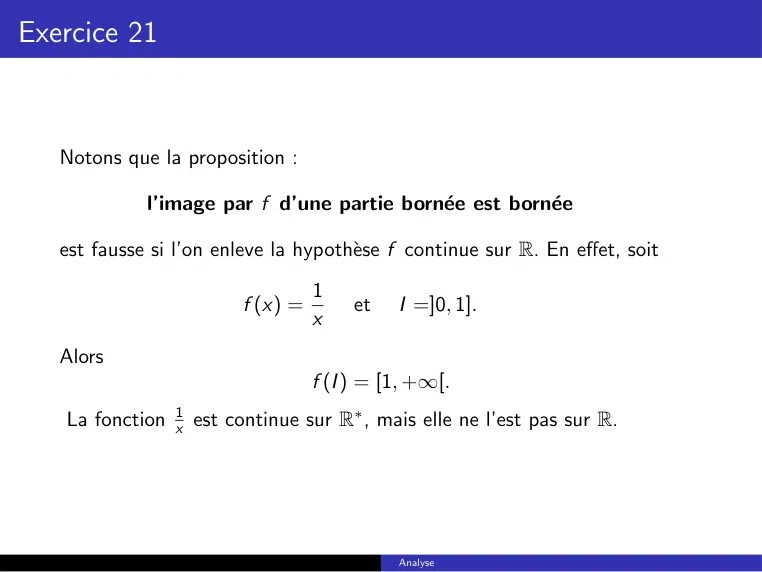

~~~text
Exercice 21

   Notons que la proposition :

             l’image par f d’une partie bornée est bornée

   est fausse si l’on enleve la hypothèse f continue sur R. En effet, soit
                                   1
                         f (x) =        et   I =]0, 1].
                                   x
   Alors
                                   f (I ) = [1, +∞[.
   La fonction x1 est continue sur R∗ , mais elle ne l’est pas sur R.

                                             Analyse
~~~

## Page 76

~~~text
Exercice 21
   Reprendre ces questions en supposant cette fois que f est strictement
   monotone en plus d’être continue.
   (1) L’image par f d’un intervalle ouvert est un intervalle ouvert.
       Solution : Vrai. En effet, puisque f est continue sur R et
       strictement monotone, pour tout a, b ∈ R avec a < b, nous avons :
       Si f est croissante :

           f (]a, b[) =]f (a), f (b)[   ; f (]a, +∞[) =]f (a), lim f (x)[
                                                              x→+∞
                                        ; f (] − ∞, a[) =] lim f (x), f (a)[.
                                                          x→−∞

       Si f est décroissante :

           f (]a, b[) =]f (b), f (a)[   ; f (]a, +∞[) =] lim f (x), f (a)[
                                                          x→+∞
                                        ; f (] − ∞, a[) =]f (a), lim f (x)[.
                                                                x→−∞

   (2) L’image par f d’un segment est un segment.
       Solution : Vrai.
                                             Analyse
~~~

## Page 77

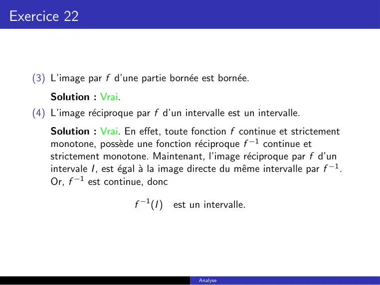

~~~text
Exercice 22

   (3) L’image par f d’une partie bornée est bornée.
       Solution : Vrai.
   (4) L’image réciproque par f d’un intervalle est un intervalle.
       Solution : Vrai. En effet, toute fonction f continue et strictement
       monotone, possède une fonction réciproque f −1 continue et
       strictement monotone. Maintenant, l’image réciproque par f d’un
       intervale I , est égal à la image directe du même intervalle par f −1 .
       Or, f −1 est continue, donc

                            f −1 (I )   est un intervalle.

                                              Analyse
~~~

## Page 78

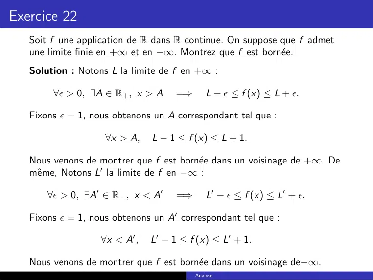

~~~text
Exercice 22
   Soit f une application de R dans R continue. On suppose que f admet
   une limite finie en +∞ et en −∞. Montrez que f est bornée.
   Solution : Notons L la limite de f en +∞ :

        ∀ > 0, ∃A ∈ R+ , x > A      =⇒       L −  ≤ f (x) ≤ L + .

   Fixons  = 1, nous obtenons un A correspondant tel que :

                    ∀x > A,    L − 1 ≤ f (x) ≤ L + 1.

   Nous venons de montrer que f est bornée dans un voisinage de +∞. De
   même, Notons L0 la limite de f en −∞ :

       ∀ > 0, ∃A0 ∈ R− , x < A0     =⇒       L0 −  ≤ f (x) ≤ L0 + .

   Fixons  = 1, nous obtenons un A0 correspondant tel que :

                   ∀x < A0 ,   L0 − 1 ≤ f (x) ≤ L0 + 1.

   Nous venons de montrer que f est bornée dans un voisinage de−∞.
                                          Analyse
~~~

## Page 79

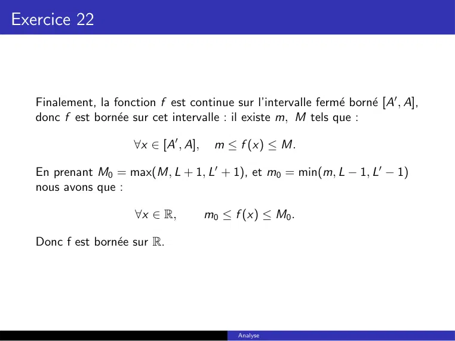

~~~text
Exercice 22

   Finalement, la fonction f est continue sur l’intervalle fermé borné [A0 , A],
   donc f est bornée sur cet intervalle : il existe m, M tels que :

                       ∀x ∈ [A0 , A],    m ≤ f (x) ≤ M.

   En prenant M0 = max(M, L + 1, L0 + 1), et m0 = min(m, L − 1, L0 − 1)
   nous avons que :

                       ∀x ∈ R,          m0 ≤ f (x) ≤ M0 .

   Donc f est bornée sur R.

                                              Analyse
~~~

## Page 80

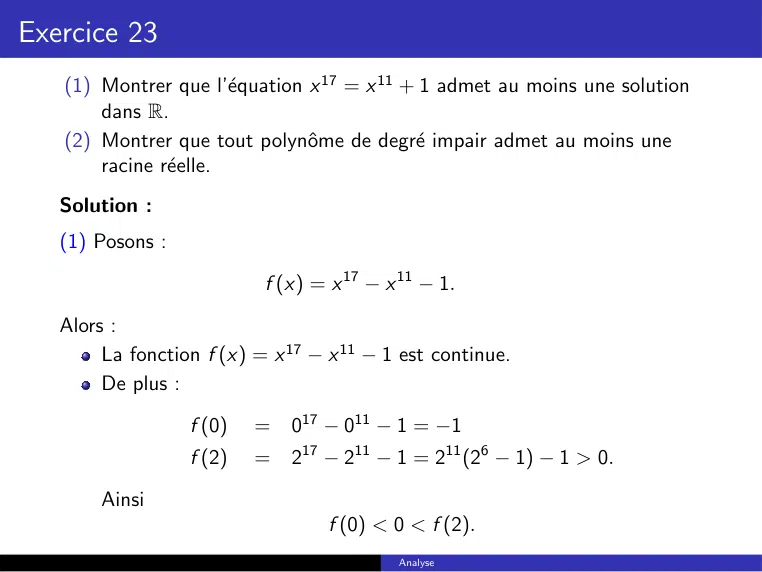

~~~text
Exercice 23
   (1) Montrer que l’équation x 17 = x 11 + 1 admet au moins une solution
       dans R.
   (2) Montrer que tout polynôme de degré impair admet au moins une
       racine réelle.
   Solution :
   (1) Posons :

                           f (x) = x 17 − x 11 − 1.

   Alors :
        La fonction f (x) = x 17 − x 11 − 1 est continue.
        De plus :

                  f (0)   =   017 − 011 − 1 = −1
                  f (2)   =   217 − 211 − 1 = 211 (26 − 1) − 1 > 0.

        Ainsi
                                   f (0) < 0 < f (2).
                                           Analyse
~~~

## Page 81

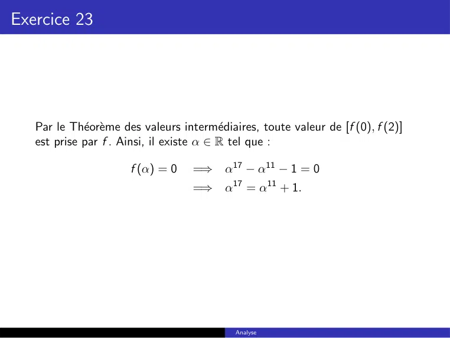

~~~text
Exercice 23

   Par le Théorème des valeurs intermédiaires, toute valeur de [f (0), f (2)]
   est prise par f . Ainsi, il existe α ∈ R tel que :

                      f (α) = 0     =⇒    α17 − α11 − 1 = 0
                                    =⇒    α17 = α11 + 1.

                                            Analyse
~~~

## Page 82

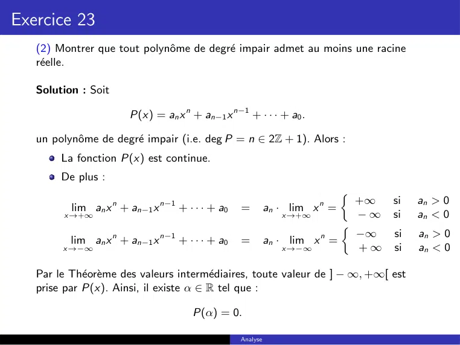

~~~text
Exercice 23
   (2) Montrer que tout polynôme de degré impair admet au moins une racine
   réelle.

   Solution : Soit

                         P(x) = an x n + an−1 x n−1 + · · · + a0 .

   un polynôme de degré impair (i.e. deg P = n ∈ 2Z + 1). Alors :
        La fonction P(x) est continue.
        De plus :
                                                                                
                                                                                    +∞   si   an > 0
          lim an x n + an−1 x n−1 + · · · + a0       =         an · lim x n =
        x→+∞                                                      x→+∞              −∞   si   an < 0
                                                                                
                     n          n−1                                      n          −∞   si   an > 0
          lim an x + an−1 x           + · · · + a0   =         an · lim x =
        x→−∞                                                      x→−∞              +∞   si   an < 0

   Par le Théorème des valeurs intermédiaires, toute valeur de ] − ∞, +∞[ est
   prise par P(x). Ainsi, il existe α ∈ R tel que :

                                         P(α) = 0.

                                                     Analyse
~~~

## Page 83

~~~text
Exercice 24
   Soient f et g deux fonctions continues sur un intervalle I de R t. q. :
                         ∀x ∈ I ,     (f (x))2 = (g (x))2 6= 0.
   Montrer que l’on a : ou bien f = g , ou bien f = −g .

   Solution :
   Méthode 1 : Considérons la fonction
                                             f (x)
                                    h(x) =         .
                                             g (x)
   Comme pour tout x ∈ I , nous avons
                        (g (x))2 6= 0    =⇒        g (x) 6= 0,
   on conclut que h est une fonction continue sur I en tant que quotient de
   fonctions continues. De plus
                         (f (x))2
   ∀x ∈ I ,   h(x)2 =             = 1        =⇒        ∀x ∈ I ,   h(x) = 1 ou h(x) = −1.
                         (g (x))2
                                                 Analyse
~~~

## Page 84

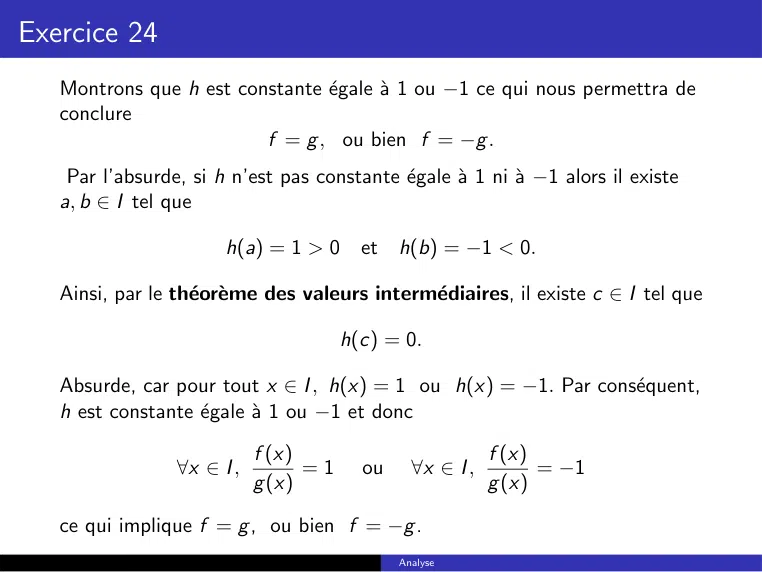

~~~text
Exercice 24
   Montrons que h est constante égale à 1 ou −1 ce qui nous permettra de
   conclure
                         f = g , ou bien f = −g .
    Par l’absurde, si h n’est pas constante égale à 1 ni à −1 alors il existe
   a, b ∈ I tel que

                       h(a) = 1 > 0      et   h(b) = −1 < 0.

   Ainsi, par le théorème des valeurs intermédiaires, il existe c ∈ I tel que

                                       h(c) = 0.

   Absurde, car pour tout x ∈ I , h(x) = 1 ou h(x) = −1. Par conséquent,
   h est constante égale à 1 ou −1 et donc

                            f (x)                          f (x)
                 ∀x ∈ I ,         =1     ou     ∀x ∈ I ,         = −1
                            g (x)                          g (x)

   ce qui implique f = g , ou bien f = −g .
                                              Analyse
~~~

## Page 85

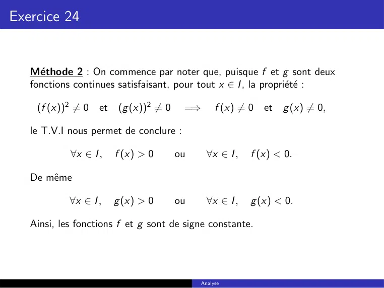

~~~text
Exercice 24

   Méthode 2 : On commence par noter que, puisque f et g sont deux
   fonctions continues satisfaisant, pour tout x ∈ I , la propriété :

    (f (x))2 6= 0   et    (g (x))2 6= 0    =⇒       f (x) 6= 0   et g (x) 6= 0,

   le T.V.I nous permet de conclure :

            ∀x ∈ I ,     f (x) > 0        ou     ∀x ∈ I ,    f (x) < 0.

   De même

            ∀x ∈ I ,     g (x) > 0        ou     ∀x ∈ I ,    g (x) < 0.

   Ainsi, les fonctions f et g sont de signe constante.

                                               Analyse
~~~

## Page 86

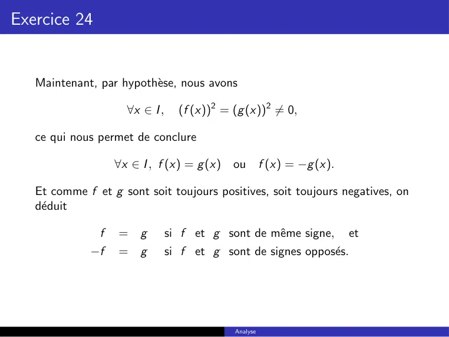

~~~text
Exercice 24

   Maintenant, par hypothèse, nous avons

                     ∀x ∈ I ,     (f (x))2 = (g (x))2 6= 0,

   ce qui nous permet de conclure

                   ∀x ∈ I , f (x) = g (x)    ou        f (x) = −g (x).

   Et comme f et g sont soit toujours positives, soit toujours negatives, on
   déduit

               f   = g          si f et g sont de même signe,           et
             −f    = g          si f et g sont de signes opposés.

                                             Analyse
~~~

## Page 87

~~~text
Exercice 25
   Soient f et g des fonctions définies et continues sur l’intervalle [0, 1]. On
   suppose que f (0) = g (1) = 0, et g (0) = f (1) = 1. Montrer que :

                        ∀λ > 0, ∃x ∈ [0, 1], f (x) = λg (x).

   Solution : Pour tout λ > 0, soit φλ la fonction définie sur [0, 1] par :

                           φλ (x) = f (x) − λg (x).

   Alors :
        Pour tout λ, la fonction φλ est continue.
        Nous avons de plus :

                        φλ (0)   = f (0) − λg (0) = −λ < 0.
                        φλ (1)   = f (1) − λg (1) = 1.

        Ainsi
                                  φλ (0) < 0 < φλ (1)

                                            Analyse
~~~

## Page 88

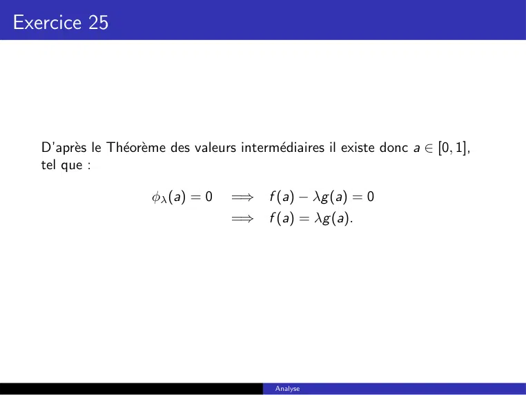

~~~text
Exercice 25

   D’après le Théorème des valeurs intermédiaires il existe donc a ∈ [0, 1],
   tel que :

                      φλ (a) = 0     =⇒ f (a) − λg (a) = 0
                                     =⇒ f (a) = λg (a).

                                            Analyse
~~~

## Page 89

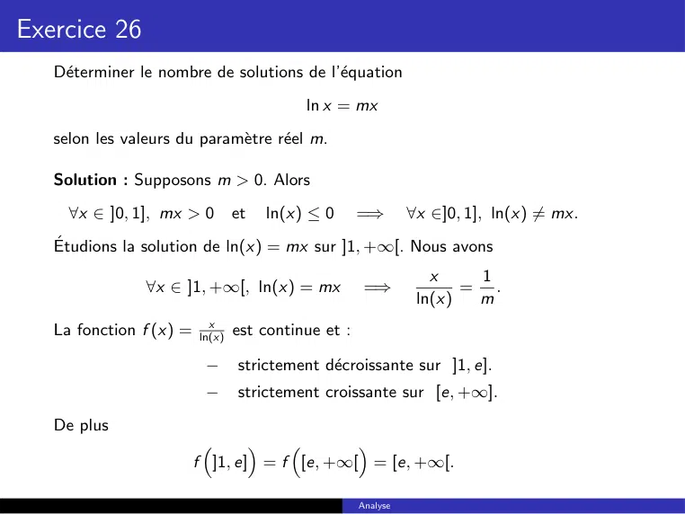

~~~text
Exercice 26
   Déterminer le nombre de solutions de l’équation
                                       ln x = mx
   selon les valeurs du paramètre réel m.

   Solution : Supposons m > 0. Alors
     ∀x ∈ ]0, 1], mx > 0     et   ln(x) ≤ 0      =⇒        ∀x ∈]0, 1], ln(x) 6= mx.
   Étudions la solution de ln(x) = mx sur ]1, +∞[. Nous avons
                                                              x    1
                ∀x ∈ ]1, +∞[, ln(x) = mx          =⇒              = .
                                                            ln(x)  m
                         x
   La fonction f (x) = ln(x) est continue et :

                         −   strictement décroissante sur ]1, e].
                         −   strictement croissante sur [e, +∞].
   De plus
                                        
                       f ]1, e] = f [e, +∞[ = [e, +∞[.

                                                 Analyse
~~~

## Page 90

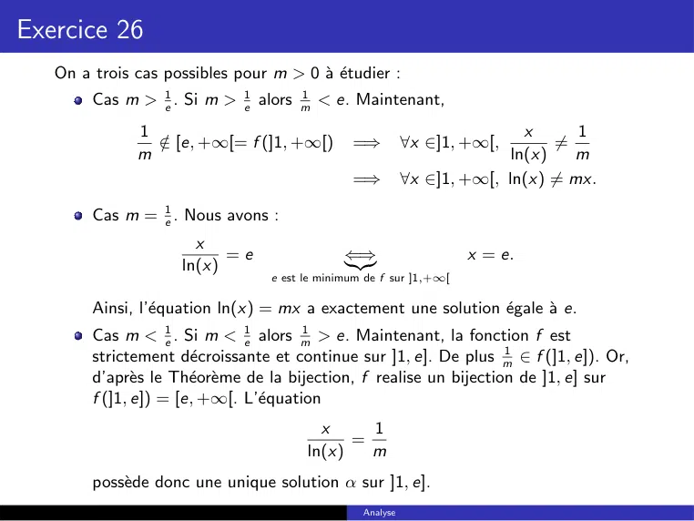

~~~text
Exercice 26
   On a trois cas possibles pour m > 0 à étudier :
        Cas m > e1 . Si m > e1 alors m1 < e. Maintenant,
              1                                                            x      1
                ∈
                / [e, +∞[= f (]1, +∞[)         =⇒          ∀x ∈]1, +∞[,        6=
              m                                                          ln(x)    m
                                               =⇒          ∀x ∈]1, +∞[, ln(x) 6= mx.

        Cas m = e1 . Nous avons :
                       x
                           =e                 ⇐⇒                    x = e.
                     ln(x)                    |{z}
                                 e est le minimum de f sur ]1,+∞[

        Ainsi, l’équation ln(x) = mx a exactement une solution égale à e.
        Cas m < e1 . Si m < e1 alors m1 > e. Maintenant, la fonction f est
        strictement décroissante et continue sur ]1, e]. De plus m1 ∈ f (]1, e]). Or,
        d’après le Théorème de la bijection, f realise un bijection de ]1, e] sur
        f (]1, e]) = [e, +∞[. L’équation
                                         x     1
                                             =
                                       ln(x)   m
        possède donc une unique solution α sur ]1, e].
                                                 Analyse
~~~

## Page 91

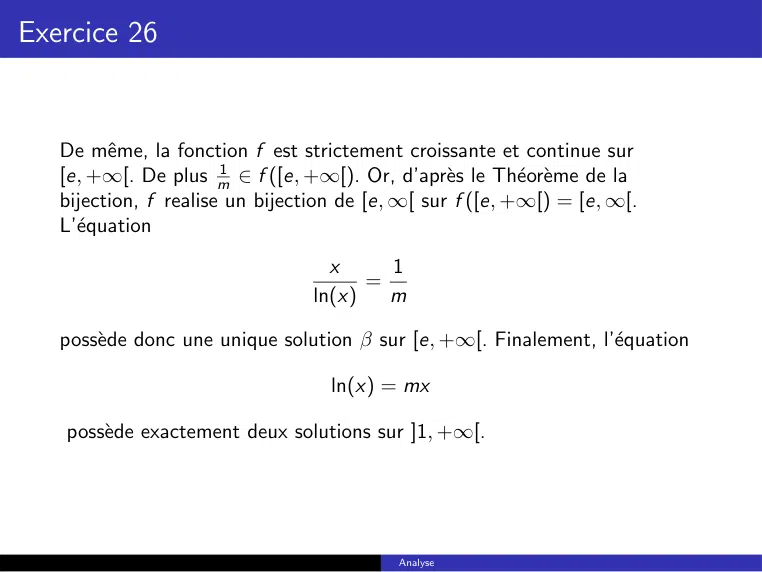

~~~text
Exercice 26

   De même, la fonction f est strictement croissante et continue sur
   [e, +∞[. De plus m1 ∈ f ([e, +∞[). Or, d’après le Théorème de la
   bijection, f realise un bijection de [e, ∞[ sur f ([e, +∞[) = [e, ∞[.
   L’équation
                                   x     1
                                       =
                                 ln(x)   m

   possède donc une unique solution β sur [e, +∞[. Finalement, l’équation

                                   ln(x) = mx

   possède exactement deux solutions sur ]1, +∞[.

                                           Analyse
~~~

## Page 92

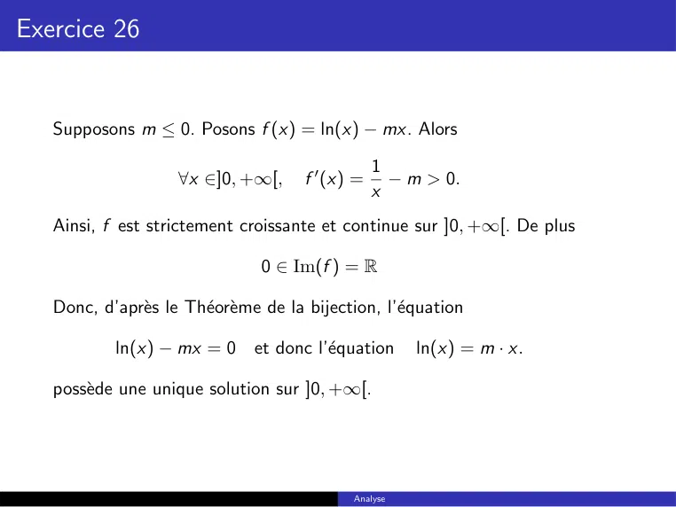

~~~text
Exercice 26

   Supposons m ≤ 0. Posons f (x) = ln(x) − mx. Alors

                                                 1
                    ∀x ∈]0, +∞[,     f 0 (x) =     − m > 0.
                                                 x
   Ainsi, f est strictement croissante et continue sur ]0, +∞[. De plus

                               0 ∈ Im(f ) = R

   Donc, d’après le Théorème de la bijection, l’équation

           ln(x) − mx = 0     et donc l’équation     ln(x) = m · x.

   possède une unique solution sur ]0, +∞[.

                                            Analyse
~~~

## Page 93

~~~text
Exercice 27
   Soit f la fonction définie par
                                                              ex
                                     ∀x ∈ R,      f (x) =          .
                                                            1 + ex
   Montrer que f est continue, bijective et déterminer sa réciproque f −1 .
   Solution : Les fonctions
                                       ex    et   ex + 1
   sont continues sur R. De plus la fonction x 7→ e x + 1 ne s’annule pas sur R. Leur
                x
   quotient e xe+1 définit donc une fonction continue sur R. Maintenant, pour tout x ∈ R
   nous avons
                                   ex     ex + 1 − 1       1
                       f (x) =          =            =1− x
                                 1 + ex     ex + 1      e +1
   D’où on conclut
                                                      1       1                       1      1
   x <y      =⇒     ex + 1 < ey + 1         =⇒            < x               =⇒    − x   <− y
                                                   ey + 1  e +1                    e +1   e +1
                            1             1
             =⇒     1−           <1− y               =⇒         f (x) < f (y )
                         ex + 1        e +1
             =⇒     f est strictement croissant       =⇒        f realise une bijection sur f (R).

                                                      Analyse
~~~

## Page 94

~~~text
Exercice 27
   Maintenant
                                1                                   1
                   lim 1 −          =0        et     lim 1 −            = 1.
                 x→−∞        ex + 1                x→+∞          ex + 1
   Ainsi
                     f (R) =]0, 1[    =⇒      f est bijective sur ]0, 1[.
   Finalement, pour tout y ∈ ]0, 1[ nous avons
                    1                   1                                        1
        y =1−              =⇒               =1−y           =⇒        ex + 1 =
                 ex + 1              ex + 1                                     1−y
                                                                             1         y
                                                           =⇒        ex =        −1=
                                                                           1−y        1−y
                                                                             y
                                                           =⇒        ex =
                                                                           1−y
                                                                              
                                                                           y
                                                           =⇒        ln          = x.
                                                                          1−y
   Par conséquent, l’application réciproque de f est donnée par
                              f −1 : ]0, 1[    −→     R
                                                                    
                                                                y
                                         y     7−→    ln                 .
                                                               1−y

                                                     Analyse
~~~

## Page 95

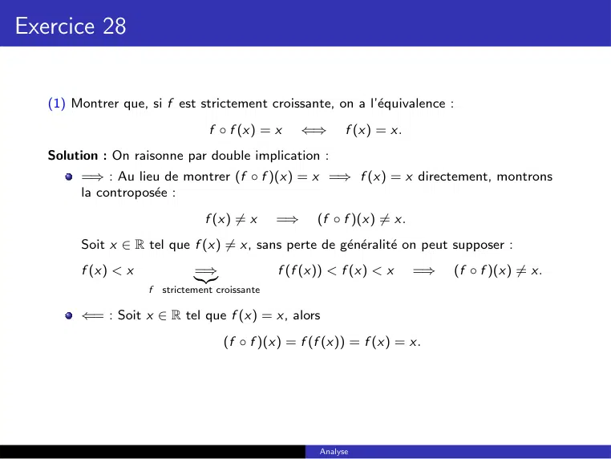

~~~text
Exercice 28

   (1) Montrer que, si f est strictement croissante, on a l’équivalence :
                                  f ◦ f (x) = x       ⇐⇒      f (x) = x.
   Solution : On raisonne par double implication :
        =⇒ : Au lieu de montrer (f ◦ f )(x) = x =⇒ f (x) = x directement, montrons
        la controposée :
                                 f (x) 6= x      =⇒     (f ◦ f )(x) 6= x.
        Soit x ∈ R tel que f (x) 6= x, sans perte de généralité on peut supposer :
        f (x) < x              =⇒
                               |{z}              f (f (x)) < f (x) < x      =⇒   (f ◦ f )(x) 6= x.
                    f   strictement croissante

        ⇐= : Soit x ∈ R tel que f (x) = x, alors
                                      (f ◦ f )(x) = f (f (x)) = f (x) = x.

                                                        Analyse
~~~

## Page 96

~~~text
Exercice 28

   (2) Soit f : R → R définie par f (x) = x 5 + x − 1 pour x ∈ R.

   (a) Montrer que f est bijective.

   Solution : Pour tout x ∈ R nous avons
                                 f 0 (x) = 5x 4 + 1 > 0.
   Ainsi, f est strictement croissante. D’où on conclut que f realise un bijection sur f (R).
   Maintenant
                lim x 5 + x − 1 = −∞        et    lim x 5 + x − 1 = +∞.
              x→−∞                               x→+∞

   Par conséquent
                        f (R) = R     =⇒    f est bijective sur R.

                                                   Analyse
~~~

## Page 97

~~~text
Exercice 28

   (b) Résoudre dans R l’équation f (x) = f −1 (x).

   Solution : Puisque f est strictement croissante, nous pouvons écrire :
   f (x) = f −1 (x)    ⇐⇒     (f ◦ f )(x) = x   ⇐⇒           f (x) = x   ⇐⇒   x5 + x − 1 = x
   Ainsi
           f (x) = f −1 (x)   ⇐⇒      x5 − 1 = 0     ⇐⇒         x5 = 1   ⇐⇒    x = 1.

                                                   Analyse
~~~
