# TD3-Limites-Correction_2024-2025_Analyse1_P1S1_NArancibia.pdf

[Ouvrir l’original](https://drive.google.com/open?id=16c73jJ3zqiCaDmyL5Lp8qKE7ujLfH0h5) · Les pages signalées comprennent du texte reconnu automatiquement ou des éléments graphiques. Le fac-similé permet de vérifier chaque lecture.

**Pages avec fac-similé ou lecture OCR** — 20.

**Pages présentant un écart entre les deux extractions** — 2–5, 8–9, 17–19, 21–24, 26, 28, 30–31, 42–43, 45.

## Page 1

~~~text
Analyse-Premier semestre 2024 - 2025

                       CY Tech

                     TD Analyse

                 Limites et Continuité.

                              Analyse
~~~

## Page 2

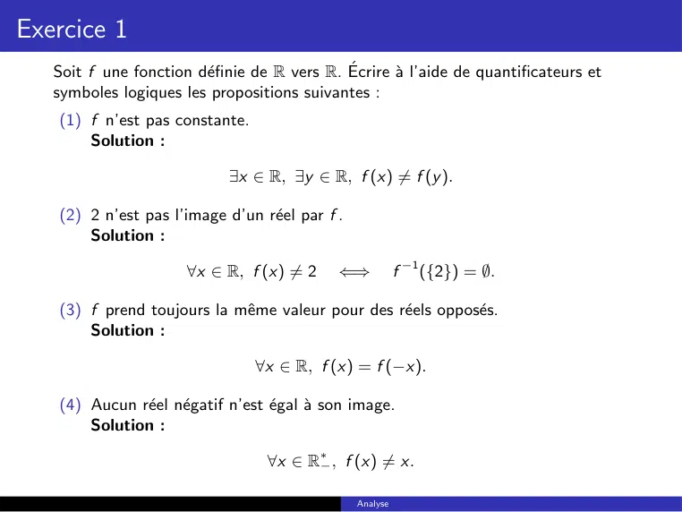

~~~text
Exercice 1
   Soit f une fonction définie de R vers R. Écrire à l’aide de quantificateurs et
   symboles logiques les propositions suivantes :
   (1) f n’est pas constante.
       Solution :

                            ∃x ∈ R, ∃y ∈ R, f (x) 6= f (y ).

   (2) 2 n’est pas l’image d’un réel par f .
       Solution :

                      ∀x ∈ R, f (x) 6= 2     ⇐⇒           f −1 ({2}) = ∅.

   (3) f prend toujours la même valeur pour des réels opposés.
       Solution :

                                ∀x ∈ R, f (x) = f (−x).

   (4) Aucun réel négatif n’est égal à son image.
       Solution :

                                  ∀x ∈ R∗− , f (x) 6= x.

                                                Analyse
~~~

## Page 3

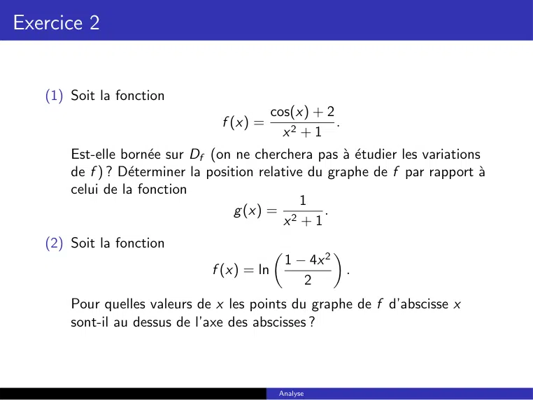

~~~text
Exercice 2

   (1) Soit la fonction
                                            cos(x) + 2
                                f (x) =                .
                                              x2 + 1
       Est-elle bornée sur Df (on ne cherchera pas à étudier les variations
       de f ) ? Déterminer la position relative du graphe de f par rapport à
       celui de la fonction
                                               1
                                    g (x) = 2      .
                                            x +1
   (2) Soit la fonction
                                                1 − 4x 2
                                                          
                               f (x) = ln                      .
                                                   2
       Pour quelles valeurs de x les points du graphe de f d’abscisse x
       sont-il au dessus de l’axe des abscisses ?

                                             Analyse
~~~

## Page 4

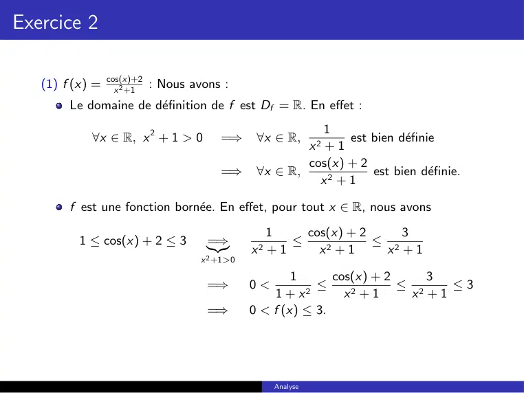

~~~text
Exercice 2

   (1) f (x) = cos(x)+2
                 x 2 +1
                        : Nous avons :
        Le domaine de définition de f est Df = R. En effet :
                                                       1
            ∀x ∈ R, x 2 + 1 > 0     =⇒      ∀x ∈ R,        est bien définie
                                                    x2 + 1
                                                    cos(x) + 2
                                    =⇒      ∀x ∈ R,            est bien définie.
                                                      x2 + 1

        f est une fonction bornée. En effet, pour tout x ∈ R, nous avons

                                              1     cos(x) + 2     3
          1 ≤ cos(x) + 2 ≤ 3      =⇒              ≤            ≤ 2
                                  |{z}     x2 + 1     x2 + 1    x +1
                                x 2 +1>0

                                                   1      cos(x) + 2     3
                                  =⇒       0<          ≤             ≤ 2   ≤3
                                               1 + x2       x2 + 1    x +1
                                  =⇒       0 < f (x) ≤ 3.

                                                Analyse
~~~

## Page 5

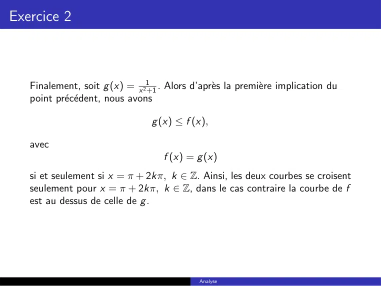

~~~text
Exercice 2

   Finalement, soit g (x) = x 21+1 . Alors d’après la première implication du
   point précédent, nous avons

                                 g (x) ≤ f (x),

   avec
                                    f (x) = g (x)
   si et seulement si x = π + 2kπ, k ∈ Z. Ainsi, les deux courbes se croisent
   seulement pour x = π + 2kπ, k ∈ Z, dans le cas contraire la courbe de f
   est au dessus de celle de g .

                                            Analyse
~~~

## Page 6

~~~text
Exercice 2
                                
                        1−4x 2
   (2) f (x) = ln         2          : Nous avons :
        Nous avons :
                   1 − 4x 2                                          1 − 4x 2
                           
              ln              est bien définie                 ⇐⇒            >0
                      2                                                 2
                                                                ⇐⇒   1 − 4x 2 > 0
                                                                     1
                                                                ⇐⇒     > x2
                                                                     4
                                                                       1         1
                                                                ⇐⇒   − <x < .
                                                                       2         2
        Ainsi, le domaine de définition de f est
                                                 
                                              1 1
                                    Df = − ;        .
                                              2 2

                                                      Analyse
~~~

## Page 7

~~~text
Exercice 2

      Pour tout x ∈ Df = − 12 ; 21 , nous avons
                                 

                          1                   1
               0 ≤ x2 <       =⇒ 0 ≥ −x 2 > −
                          4                   4
                              =⇒ 0 ≥ −4x 2 > −1
                              =⇒ 1 ≥ 1 − 4x 2 > 0
                                 1    1 − 4x 2
                              =⇒   ≥           >0
                                 2      2 
                                                     1 − 4x 2
                                                             
                                         1
                              =⇒ 0 > ln       ≥ ln              .
                                         2              2

      Ainsi, le graphe de f n’est jamais au dessus l’axe des abscisses.

                                         Analyse
~~~

## Page 8

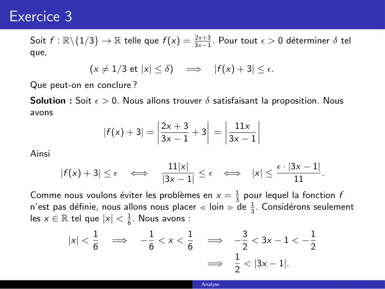

~~~text
Exercice 3
                                          2x+3
   Soit f : R\{1/3} → R telle que f (x) = 3x−1 . Pour tout  > 0 déterminer δ tel
   que,
                    (x 6= 1/3 et |x| ≤ δ)   =⇒      |f (x) + 3| ≤ .
   Que peut-on en conclure ?
   Solution : Soit  > 0. Nous allons trouver δ satisfaisant la proposition. Nous
   avons
                                   2x + 3             11x
                     |f (x) + 3| =        +3 =
                                   3x − 1           3x − 1
   Ainsi
                                        11|x|                            · |3x − 1|
           |f (x) + 3| ≤     ⇐⇒               ≤        ⇐⇒     |x| ≤                .
                                      |3x − 1|                                11
   Comme nous voulons éviter les problèmes en x = 13 pour lequel la fonction f
   n’est pas définie, nous allons nous placer  loin  de 13 . Considérons seulement
   les x ∈ R tel que |x| < 16 . Nous avons :
                    1               1      1                  3              1
            |x| <        =⇒     −     <x <       =⇒       −     < 3x − 1 < −
                    6               6      6                  2              2
                                                          1
                                                 =⇒         < |3x − 1|.
                                                          2
                                               Analyse
~~~

## Page 9

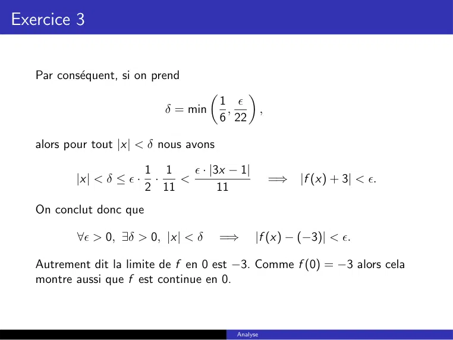

~~~text
Exercice 3

   Par conséquent, si on prend
                                                 
                                           1 
                             δ = min        ,          ,
                                           6 22

   alors pour tout |x| < δ nous avons

                          1 1     · |3x − 1|
          |x| < δ ≤  ·    ·   <                           =⇒   |f (x) + 3| < .
                          2 11         11
   On conclut donc que

           ∀ > 0, ∃δ > 0, |x| < δ         =⇒     |f (x) − (−3)| < .

   Autrement dit la limite de f en 0 est −3. Comme f (0) = −3 alors cela
   montre aussi que f est continue en 0.

                                             Analyse
~~~

## Page 10

~~~text
Exercice 4

   Montrer, en revenant à la définition, que :
           √
    1  lim x + 1 = 2.
      x→3
       lim x 2 cos( x1 ) = 0.
                        
    2
         x→0
     3   lim x+1 = +∞.
         x→2 |x−2|
     4     lim x1 = 0.
         x→+∞ e +1

                                            Analyse
~~~

## Page 11

~~~text
Exercice 4
             √
   (1) lim       x + 1 = 2. Solution : Soit  > 0. Montrons qu’il existe δ > 0
      x→3
   tel que pour tout |x − 3| ≤ δ nous avons
                              √
                             | x + 1 − 2| ≤ .

   On commence par noter que
                                         √              √
         √                              ( x + 1 − 2) · ( x + 1 + 2)
             x +1−2 ≤          ⇐⇒              √                   <
                                                  x +1+2
                                           x −3
                                ⇐⇒      √           < .
                                          x +1+2
   Maintenant
                   √                             1      1
                       x +1+2≥2       =⇒    √         ≤
                                              x +1+2    2
                                              |x − 3|   |x − 3|
                                      =⇒    √         ≤         .
                                              x +1+2       2

                                             Analyse
~~~

## Page 12

~~~text
Exercice 4

   Ainsi pour avoir
                               √
                              | x + 1 − 2| ≤ ,

   il suffit d’avoir
                       |x − 3|
                               ≤   ⇐⇒    |x − 3| ≤ 2.
                          2
   On peut donc prendre
                                     δ = 2,
   pour conclure
                                                     √
             ∀x ∈ [−1, +∞[, |x − 3| < δ     =⇒      | x + 1 − 2| ≤ .

                                          Analyse
~~~

## Page 13

~~~text
Exercice 4
   (2) lim x 2 cos( x1 ) = 0.
                        
       x→0

   Solution : Soit  > 0. Montrons qu’il existe δ > 0, tel que pour tout
   x ∈ R∗ , avec |x| ≤ δ, nous avons
                                    
                               2     1
                             x cos        ≤ .
                                     x
   Pour tout x ∈ R∗ on a
                                                            
                      1                                       1
            0 ≤ cos      ≤1               =⇒     x 2 cos         ≤ x 2.
                      x                                       x
   Ainsi pour avoir
                                           
                                           1
                                x 2 cos       ≤ ,
                                           x
   il suffit d’avoir
                                                         √
                         x2 ≤        =⇒       |x| ≤         

                                               Analyse
~~~

## Page 14

~~~text
Exercice 4

   On peut donc prendre               √
                                 δ=       ,
   pour conclure
                                            
                                            1
        ∀x ∈ R∗ , |x| ≤ δ   =⇒   x 2 cos       ≤ x 2 ≤ δ 2 = .
                                            x

                                      Analyse
~~~

## Page 15

~~~text
Exercice 4
            x+1
   (3) lim |x−2| = +∞.
        x→2

   Solution : Soit A > 0. Montrons qu’il existe δ > 0 tel que pour tout
   x 6= 2, avec |x − 2| ≤ δ, nous avons
                                       x +1
                               A≤             .
                                      |x − 2|
   Maintenant, puisque on s’interesse à la limite quand x tend vers 2, nous
   allons nous concentrer sur des réels proches de 2. Nous pouvons donc
   supposer

              |x − 2| ≤ 1 =⇒ 1 ≤ x ≤ 3        =⇒ 2 ≤ x + 1
                                                    2       x +1
                                              =⇒         ≤         .
                                                 |x − 2|   |x − 2|
   Or
                               2                              2
                       A≤              ⇐⇒         |x − 2| ≤     .
                            |x − 2|                           A

                                            Analyse
~~~

## Page 16

~~~text
Exercice 4
   Ainsi pour avoir
                                         x +1
                                A≤              .
                                        |x − 2|
   Il suffit d’avoir
                                                   2
                                      |x − 2| ≤      .
                                                   A
   On peut donc prendre                              
                                           2
                                δ = min 1,                ,
                                           A
   pour conclure
                                                              2
               ∀x 6= 2, |x − 2| ≤ δ      =⇒ |x − 2| ≤
                                                              A
                                                   2
                                         =⇒ A ≤
                                                |x − 2|
                                                   2       x +1
                                         =⇒ A ≤         ≤         .
                                                |x − 2|   |x − 2|

                                                Analyse
~~~

## Page 17

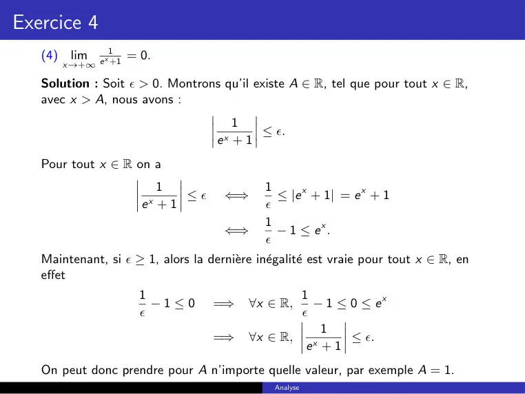

~~~text
Exercice 4
                   1
   (4) lim     x       = 0.
       x→+∞ e +1

   Solution : Soit  > 0. Montrons qu’il existe A ∈ R, tel que pour tout x ∈ R,
   avec x > A, nous avons :
                                        1
                                            ≤ .
                                     ex + 1
   Pour tout x ∈ R on a
                            1                1
                                ≤    ⇐⇒       ≤ |e x + 1| = e x + 1
                         ex + 1              
                                             1
                                      ⇐⇒       − 1 ≤ ex .
                                             
   Maintenant, si  ≥ 1, alors la dernière inégalité est vraie pour tout x ∈ R, en
   effet
                         1                         1
                           −1≤0      =⇒    ∀x ∈ R,   − 1 ≤ 0 ≤ ex
                                                  
                                                       1
                                     =⇒    ∀x ∈ R,         ≤ .
                                                    ex + 1
   On peut donc prendre pour A n’importe quelle valeur, par exemple A = 1.
                                               Analyse
~~~

## Page 18

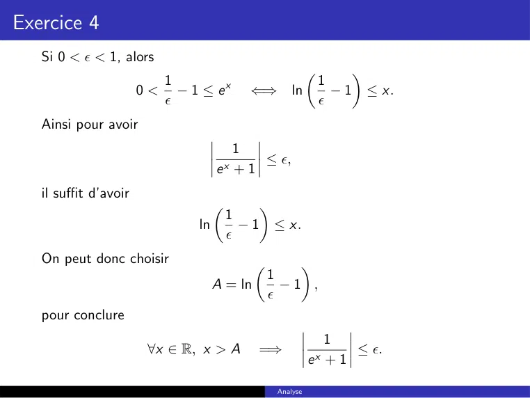

~~~text
Exercice 4
   Si 0 <  < 1, alors
                                                                     
                          1                                      1
                       0 < − 1 ≤ ex       ⇐⇒           ln          − 1 ≤ x.
                                                                
   Ainsi pour avoir
                                       1
                                           ≤ ,
                                    ex + 1
   il suffit d’avoir
                                              
                                        1
                               ln         −1       ≤ x.
                                        
   On peut donc choisir                             
                                                 1
                                    A = ln         −1 ,
                                                 
   pour conclure
                                                                 1
                        ∀x ∈ R, x > A        =⇒                       ≤ .
                                                             ex + 1

                                                   Analyse
~~~

## Page 19

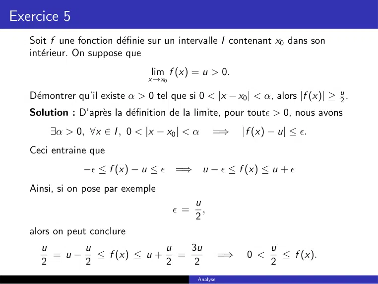

~~~text
Exercice 5
   Soit f une fonction définie sur un intervalle I contenant x0 dans son
   intérieur. On suppose que
                                 lim f (x) = u > 0.
                                x→x0

   Démontrer qu’il existe α > 0 tel que si 0 < |x − x0 | < α, alors |f (x)| ≥ u2 .
   Solution : D’après la définition de la limite, pour tout > 0, nous avons
        ∃α > 0, ∀x ∈ I , 0 < |x − x0 | < α         =⇒       |f (x) − u| ≤ .
   Ceci entraine que
                − ≤ f (x) − u ≤      =⇒ u −  ≤ f (x) ≤ u + 
   Ainsi, si on pose par exemple
                                             u
                                        =     ,
                                             2
   alors on peut conclure
     u      u             u  3u                                    u
       = u − ≤ f (x) ≤ u + =                           =⇒    0 <     ≤ f (x).
     2      2             2   2                                    2
                                             Analyse
~~~

## Page 20

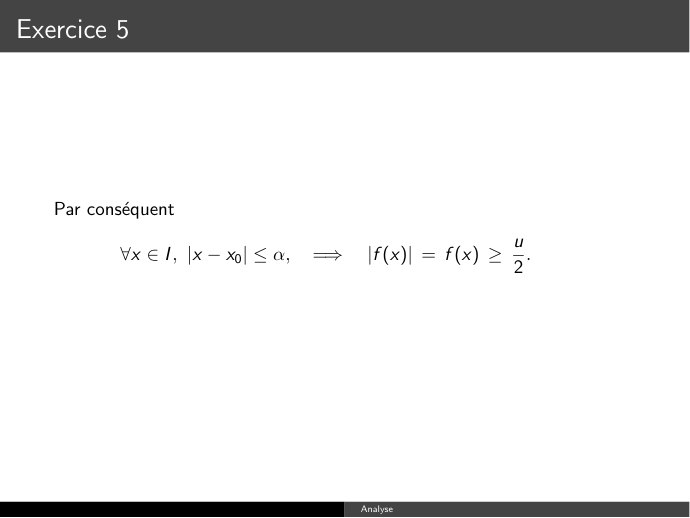

~~~text
Exercice 5

   Par conséquent
                                                               u
           ∀x ∈ I , |x − x0 | ≤ α,   =⇒    |f (x)| = f (x) ≥     .
                                                               2

                                          Analyse
~~~

**Lecture OCR à contrôler**

~~~text
Par conséquent

veel, [xx] <a, => |F(xX)| = F(x) >
~~~

## Page 21

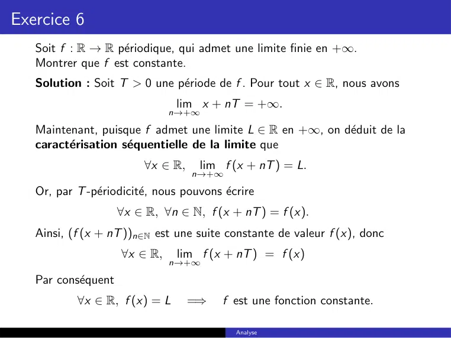

~~~text
Exercice 6
   Soit f : R → R périodique, qui admet une limite finie en +∞.
   Montrer que f est constante.
   Solution : Soit T > 0 une période de f . Pour tout x ∈ R, nous avons
                                lim x + nT = +∞.
                               n→+∞

   Maintenant, puisque f admet une limite L ∈ R en +∞, on déduit de la
   caractérisation séquentielle de la limite que
                          ∀x ∈ R,    lim f (x + nT ) = L.
                                    n→+∞

   Or, par T -périodicité, nous pouvons écrire
                     ∀x ∈ R, ∀n ∈ N, f (x + nT ) = f (x).
   Ainsi, (f (x + nT ))n∈N est une suite constante de valeur f (x), donc
                     ∀x ∈ R,    lim f (x + nT ) = f (x)
                               n→+∞

   Par conséquent
           ∀x ∈ R, f (x) = L        =⇒    f est une fonction constante.

                                             Analyse
~~~

## Page 22

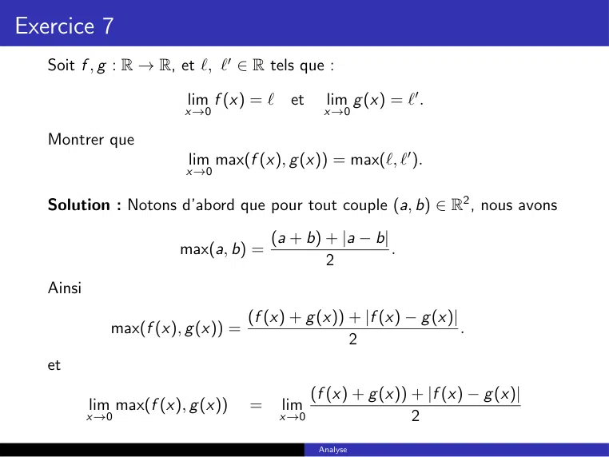

~~~text
Exercice 7
   Soit f , g : R → R, et `, `0 ∈ R tels que :

                         lim f (x) = ` et        lim g (x) = `0 .
                         x→0                     x→0

   Montrer que
                          lim max(f (x), g (x)) = max(`, `0 ).
                         x→0

   Solution : Notons d’abord que pour tout couple (a, b) ∈ R2 , nous avons
                                        (a + b) + |a − b|
                        max(a, b) =                       .
                                                2
   Ainsi
                                    (f (x) + g (x)) + |f (x) − g (x)|
              max(f (x), g (x)) =                                     .
                                                    2
   et
                                               (f (x) + g (x)) + |f (x) − g (x)|
           lim max(f (x), g (x))    =    lim
           x→0                           x→0                   2
                                                Analyse
~~~

## Page 23

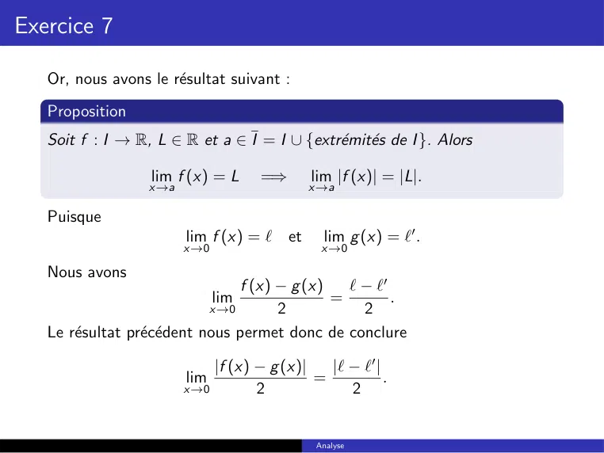

~~~text
Exercice 7

   Or, nous avons le résultat suivant :
   Proposition
   Soit f : I → R, L ∈ R et a ∈ I = I ∪ {extrémités de I }. Alors

                  lim f (x) = L     =⇒      lim |f (x)| = |L|.
                  x→a                       x→a

   Puisque
                        lim f (x) = ` et      lim g (x) = `0 .
                        x→0                   x→0

   Nous avons
                                 f (x) − g (x)   ` − `0
                              lim              =        .
                             x→0       2           2
   Le résultat précédent nous permet donc de conclure

                            |f (x) − g (x)|   |` − `0 |
                        lim                 =           .
                        x→0        2             2

                                             Analyse
~~~

## Page 24

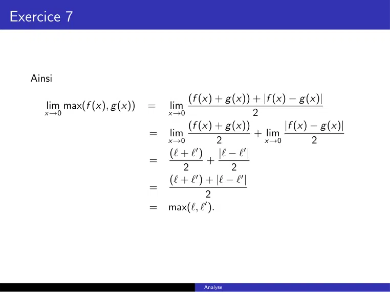

~~~text
Exercice 7

   Ainsi
                                       (f (x) + g (x)) + |f (x) − g (x)|
      lim max(f (x), g (x))   =   lim
      x→0                         x→0                  2
                                       (f (x) + g (x))         |f (x) − g (x)|
                              =   lim                  + lim
                                  x→0          2         x→0          2
                                  (` + `0 ) |` − `0 |
                              =             +
                                      2           2
                                  (` + ` ) + |` − `0 |
                                         0
                              =
                                            2
                              =   max(`, `0 ).

                                          Analyse
~~~

## Page 25

~~~text
Exercice 8

   Est-il vrai que si f et g sont deux fonctions positives sur R+ , et si f et g
   ont même limite en +∞, alors lim gf (x) (x) = 1.
                                       x→+∞

   Solution : La proposition est fausse. En effet, soit

                   f (x) = e x    et    g (x) = x α , α ∈ R∗+ .

   Alors

                       lim f (x) = +∞ = lim g (x),
                     x→+∞                       x→+∞

   mais
                                       f (x)
                                 lim           = +∞.
                            x→+∞ g (x)

                                                Analyse
~~~

## Page 26

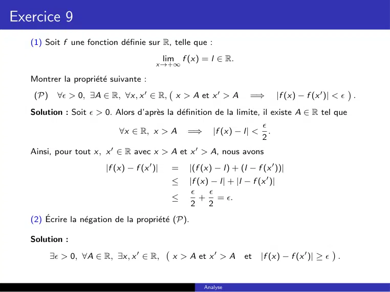

~~~text
Exercice 9
   (1) Soit f une fonction définie sur R, telle que :
                                              lim f (x) = l ∈ R.
                                          x→+∞

   Montrer la propriété suivante :
           ∀ > 0, ∃A ∈ R, ∀x, x 0 ∈ R,          x > A et x 0 > A                  |f (x) − f (x 0 )| < 
                                                                                                            
    (P)                                                                =⇒                                       .
   Solution : Soit  > 0. Alors d’après la définition de la limite, il existe A ∈ R tel que
                                                                      
                           ∀x ∈ R, x > A =⇒ |f (x) − l| < .
                                                                      2
   Ainsi, pour tout x, x 0 ∈ R avec x > A et x 0 > A, nous avons
                         |f (x) − f (x 0 )|     =   |(f (x) − l) + (l − f (x 0 ))|
                                                ≤   |f (x) − l| + |l − f (x 0 )|
                                                         
                                                ≤       + = .
                                                     2    2
   (2) Écrire la négation de la propriété (P).

   Solution :
          ∃ > 0, ∀A ∈ R, ∃x, x 0 ∈ R,          x > A et x 0 > A           |f (x) − f (x 0 )| ≥ 
                                                                                                    
                                                                     et                                 .

                                                        Analyse
~~~

## Page 27

~~~text
Exercice 9
   (3) Montrer que la négation de (P) est vraie pour la fonction f (x) = sin(x) (on
   pourra penser à prendre x = 2nπ, x 0 = 2nπ + π2 ). Conclure.

   Solution : On commence par noter que :
                                             π
                 ∀n ∈ N, sin(2nπ) − sin 2nπ +    = |0 − 1| = 1.
                                              2
   Ainsi, si on prend  = 1 et pour tout A > 0 on choisit :
                                                                        π
                   x = 2(E (A) + 1)π     et    x 0 = 2(E (A) + 1)π +      .
                                                                        2
   on aura
                 x > A et x 0 > A       et      |sin(x) − sin(x 0 )| ≥ 1 = .
   La negation de (P) est donc vrai pour sin(x). Maintenant, dans la question 1 nous
   avons vu que :
                   f admet une limite finie en + ∞            =⇒   f satisfait (P)
   Par contrapose,
              f satisfait non P     =⇒       f n’admet pas de limite finie en + ∞.
   Ainsi,    lim sin(x) n’existe pas.
            x→+∞

                                                    Analyse
~~~

## Page 28

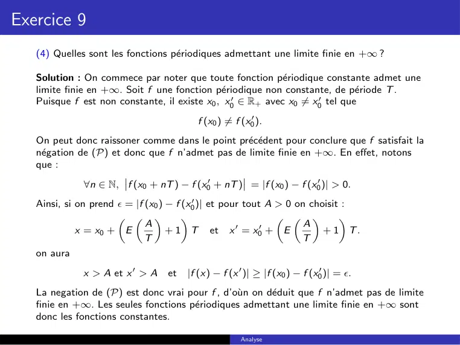

~~~text
Exercice 9
   (4) Quelles sont les fonctions périodiques admettant une limite finie en +∞ ?

   Solution : On commece par noter que toute fonction périodique constante admet une
   limite finie en +∞. Soit f une fonction périodique non constante, de période T .
   Puisque f est non constante, il existe x0 , x00 ∈ R+ avec x0 6= x00 tel que
                                         f (x0 ) 6= f (x00 ).
   On peut donc raissoner comme dans le point précédent pour conclure que f satisfait la
   négation de (P) et donc que f n’admet pas de limite finie en +∞. En effet, notons
   que :
              ∀n ∈ N, f (x0 + nT ) − f (x00 + nT ) = |f (x0 ) − f (x00 )| > 0.
   Ainsi, si on prend  = |f (x0 ) − f (x00 )| et pour tout A > 0 on choisit :
                                                                     
                             A                                      A
             x = x0 + E            + 1 T et x 0 = x00 + E               + 1 T.
                             T                                     T
   on aura
             x > A et x 0 > A     et   |f (x) − f (x 0 )| ≥ |f (x0 ) − f (x00 )| = .
   La negation de (P) est donc vrai pour f , d’oùn on déduit que f n’admet pas de limite
   finie en +∞. Les seules fonctions périodiques admettant une limite finie en +∞ sont
   donc les fonctions constantes.

                                                      Analyse
~~~

## Page 29

~~~text
Exercice 10

   Soit f et g deux fonctions définies sur R+ telles que
                                                              f (x)
                       ∀x ∈ R+ ,    g (x) > 0 et    lim               = L 6= 0.
                                                   x→+∞ g (x)

     1   Montrer que
                                 lim f (x) = 0 ⇐⇒            lim g (x) = 0.
                              x→+∞                      x→+∞

     2   Montrer que si L > 0,
                            lim f (x) = +∞ ⇐⇒                lim g (x) = +∞.
                          x→+∞                          x→+∞

                                                   Analyse
~~~

## Page 30

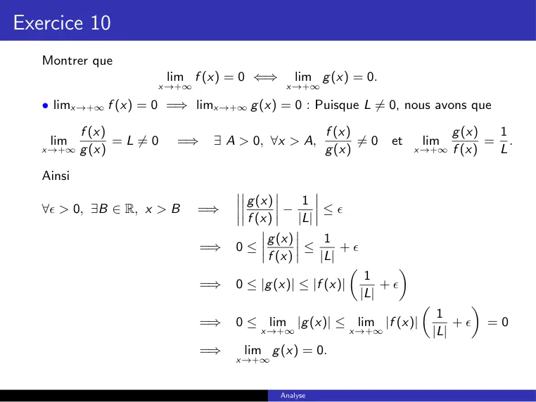

~~~text
Exercice 10
   Montrer que
                              lim f (x) = 0 ⇐⇒      lim g (x) = 0.
                          x→+∞                    x→+∞

   • limx→+∞ f (x) = 0 =⇒ limx→+∞ g (x) = 0 : Puisque L 6= 0, nous avons que

           f (x)                                           f (x)                    g (x)       1
    lim            = L 6= 0    =⇒    ∃ A > 0, ∀x > A,            6= 0   et    lim           =     .
   x→+∞ g (x)                                              g (x)             x→+∞ f (x)         L

   Ainsi
                                           g (x)    1
   ∀ > 0, ∃B ∈ R, x > B          =⇒             −     ≤
                                           f (x)   |L|
                                              g (x)       1
                                    =⇒   0≤          ≤       +
                                              f (x)      |L|
                                                                       
                                                                  1
                                    =⇒   0 ≤ |g (x)| ≤ |f (x)|       +
                                                                 |L|
                                                                                       
                                                                                   1
                                    =⇒   0 ≤ lim |g (x)| ≤ lim |f (x)|                + =0
                                              x→+∞             x→+∞               |L|
                                    =⇒    lim g (x) = 0.
                                         x→+∞

                                                 Analyse
~~~

## Page 31

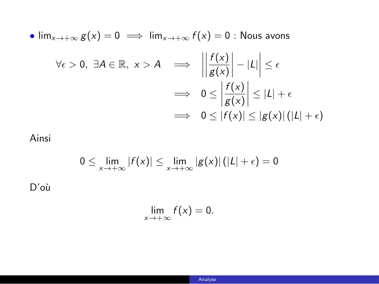

~~~text
• limx→+∞ g (x) = 0 =⇒ limx→+∞ f (x) = 0 : Nous avons

                                      f (x)
        ∀ > 0, ∃A ∈ R, x > A    =⇒          − |L| ≤ 
                                      g (x)
                                          f (x)
                                 =⇒ 0 ≤          ≤ |L| + 
                                          g (x)
                                 =⇒ 0 ≤ |f (x)| ≤ |g (x)| (|L| + )

Ainsi

            0 ≤ lim |f (x)| ≤ lim |g (x)| (|L| + ) = 0
                x→+∞            x→+∞

D’où

                           lim f (x) = 0.
                         x→+∞

                                       Analyse
~~~

## Page 32

~~~text
Exercice 10
   Montrer que
                       lim f (x) = +∞ ⇐⇒        lim g (x) = +∞.
                       x→+∞                  x→+∞

   • limx→+∞ f (x) = +∞ =⇒ limx→+∞ g (x) = +∞ : Puisque L > 0, nous
   avons que
                        f (x)                         g (x)       1
                 lim            =L>0    =⇒ lim                =     > 0.
              x→+∞ g (x)                   x→+∞ f (x)             L

   Ainsi
                                          g (x)     1       1
           ∃B, ∀x ∈ R, x > B       =⇒           −      ≤
                                          f (x)     L      2L
                                          1     g (x)      3
                                   =⇒         ≤        ≤
                                         2L      f (x)    2L
                                         f (x)
                                   =⇒           ≤ g (x)
                                          2L
                                                         f (x)
                                   =⇒    +∞ = lim              ≤ lim g (x)
                                                  x→+∞ 2L       x→+∞

                                   =⇒      lim g (x) = +∞.
                                         x→+∞

                                            Analyse
~~~

## Page 33

~~~text
Exercice 10

   • limx→+∞ g (x) = +∞ =⇒ limx→+∞ f (x) = +∞ : Nous avons
                                               f (x)          L
                 ∃A, ∀x ∈ R, x > A    =⇒              −L ≤
                                               g (x)          2
                                              L     f (x)    3L
                                      =⇒         ≤        ≤
                                              2     g (x)     2
                                              g (x) · L
                                      =⇒                ≤ f (x)
                                                  2
   Ainsi
                                g (x) · L
                  +∞ =    lim             ≤ lim f (x)
                         x→+∞       2      x→+∞

   D’où
                           lim f (x) = +∞.
                          x→+∞

                                        Analyse
~~~

## Page 34

~~~text
Exercice 11
   Calculer les limites
                      suivantes :
   (1) lim x · sin x1 . Solution : Nous avons
         x→0
                                                              
                             1                                    1
                0 ≤ sin         ≤1          =⇒    0 ≤ |x| · sin        ≤ |x|
                             x                                    x
                                                                    
                                                                     1
                                            =⇒    0 ≤ lim x · sin         ≤ lim |x| = 0
                                                      x→0            x       x→0
                                                               
                                                                1
                                            =⇒    lim x · sin        =0
                                                  x→0           x
                                                               
                                                               1
                                            =⇒    lim x · sin       = 0.
                                                  x→0          x
                x cos(e x )
   (2)    lim     x 2 +1
                            .   Solution : Nous avons
         x→+∞

                                              x     x cos(e x )     x
   −1 ≤ cos (e x ) ≤ 1          =⇒     −          ≤             ≤ 2
                                |{z}       x2 + 1    x2 + 1      x +1
                                 x>0
                                                     x          x cos(e x )         x
                                 =⇒    0 = lim −          ≤ lim             ≤ lim 2    =0
                                            x→∞   x2 + 1    x→∞ x 2 + 1      x→∞ x + 1
                                                   x
                                            x cos(e )
                                =⇒      lim            = 0.
                                       x→∞ x 2 + 1

                                                        Analyse
~~~

## Page 35

~~~text
Exercice 11
   (3)    lim e x−sin(x) . Solution : Nous avons
         x→+∞

   −1 ≤ − sin (x) ≤ 1         =⇒    x − 1 ≤ x − sin (x) ≤ x + 1
                              =⇒    e x−1 ≤ e x−sin(x) ≤ e x+1
                              =⇒    +∞ = lim e x−1 ≤ lim e x−sin(x) ≤ lim e x+1 = +∞
                                                 x→∞             x→∞        x→∞

                             =⇒          lim e x−sin(x) = +∞.
                                    x→+∞

                   1
                        . Solution : Pour tout x ∈ R∗+ nous avons
                       
   (4) lim x · E   x
         x→0
                                                                 
           1             1    1                                    1
             −1≤E           ≤             =⇒       1−x ≤x ·E          ≤1
           x             x    x           |{z}                     x
                                         car x>0
                                                                                
                                                                                1
                                          =⇒       1 = lim 1 − x ≤ lim x · E       ≤1
                                                       x→0+        x→0+         x
                                                               
                                                               1
                                          =⇒        lim x · E     =1
                                                   x→0+        x
   De même, pour tout x ∈ R∗− nous avons
                                                                                   
   1           1      1                           1                                    1
     −1≤E          ≤       =⇒      1 − x ≥ x · E     ≥1                =⇒ lim x · E       =1
   x           x      x    |{z}                   x                        x→0−        x
                               car x<0

                                                       Analyse
~~~

## Page 36

~~~text
Exercice 11

   Ainsi                                          
                                                  1
                                     lim x · E       = 1.
                                     x→0          x

           lim x · E x1 . Solution : Nous avons
                       
   (5)
         x→+∞
                                                                               
                   1                         1                                    1
         ∀x > 1,     <1   =⇒    ∀x > 1, E       =0           =⇒   ∀x > 1, x · E      =0
                   x                         x                                    x
                                                                               
                                                                                1
                                                             =⇒    lim x · E        = 0.
                                                                  x→+∞          x

                                                   Analyse
~~~

## Page 37

~~~text
Exercice 12
                                                                   
                                                     3        2
   (1) Déterminer la limite suivante : lim
                                       x→1        x 3 −1 − x 2 −1       .

   Solution : Nous avons
           3           2                   3                  2
                 −            =                        −
        x3 − 1       x2 − 1                 2
                                  (x − 1)(x + x + 1) (x − 1)(x + 1)
                                   3(x + 1) − 2(x 2 + x + 1)
                              =
                                  (x − 1)(x + 1)(x 2 + x + 1)
                                    3x + 3 − 2x 2 − 2x − 2
                              =
                                  (x − 1)(x + 1)(x 2 + x + 1)
                                         −2x 2 + x + 1
                              =
                                  (x − 1)(x + 1)(x 2 + x + 1)
                                       (x − 1)(−2x − 1)
                              =
                                  (x − 1)(x + 1)(x 2 + x + 1)
                                        −2x − 1
                              =
                                  (x + 1)(x 2 + x + 1)

                                              Analyse
~~~

## Page 38

~~~text
Exercice 12

   Par conséquent :
                               
                     3      2                           −2x − 1
           lim         −            =      lim
           x→1 x 3 − 1   x2 − 1           x→1 (x + 1)(x 2 + x + 1)

                                                  lim (−2x − 1)
                                                  x→1
                                    =
                                           lim (x + 1)(x 2 + x + 1)
                                           x→1
                                      −3
                                    =
                                      2·3
                                       1
                                    = − .
                                       2

                                        Analyse
~~~

## Page 39

~~~text
Exercice 12
                                               √                
   (2) Déterminer la limite suivante : lim     x 2 + 2x − 1 − x .
                                      x→+∞

   Solution : Pour tou x > 0, nous avons
                                    √                   √                  
         p                            x 2 + 2x − 1 − x     x 2 + 2x − 1 + x
           x 2 + 2x − 1 − x =                  √
                                                 x 2 + 2x − 1 + x
                                   x + 2x − 1 − x 2
                                    2
                              = √
                                    x 2 + 2x − 1 + x
                                          2x − 1
                              =     q
                                  x 1 + x2 − x12 + x
                                        x · (2 − x1 )
                              =       q                 
                                   x·   1 + x2 − x12 + 1

   Par conséquent
               p                                          2 − x1              2
         lim     x 2 + 2x − 1 − x     =       lim q                         =     = 1.
        x→+∞                                  x→+∞
                                                         1 + x2 − x12 + 1       2

                                               Analyse
~~~

## Page 40

~~~text
Exercice 12
   (3) Déterminer la limite suivante : lim g (x) avec
                                     x→+∞

                                 √         √
                            q         q        
                    g (x) =   x + x +1− x + x −1 .

   Solution : Pour tou x > 1, nous avons
               p      √         p     √       p    √     p   √    
                   x + x +1− x + x −1              x + x +1+ x + x −1
   g (x) =                       p     √         p    √
                                   x + x +1+ x + x −1
                     √              √     
                x + x +1− x + x −1
          = p         √        p      √
                 x + x +1+ x + x −1
                      √        √
                        x +1− x −1
          = p         √        p      √
                 x + x +1+ x + x −1
                       √         √       √         √    
                         x +1− x −1         x +1+ x −1
          = p         √         p     √        √      √    
                   x + x +1+ x + x −1             x +1+ x −1
                           x +1−x +1
          =    p   √     p   √      √     √     .
                 x + x +1+ x + x −1    x +1+ x −1

                                            Analyse
~~~

## Page 41

~~~text
Exercice 12

   Par conséquent
                                                  2
    lim g (x)    =    lim p        √        p   √      √      √
   x→+∞              x→+∞
                                                                      
                               x+       x +1+ x + x −1     x +1+ x −1
                 =   0.

                                          Analyse
~~~

## Page 42

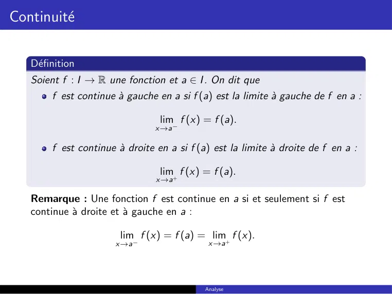

~~~text
Continuité

   Définition
   Soient f : I → R une fonction et a ∈ I . On dit que
       f est continue à gauche en a si f (a) est la limite à gauche de f en a :

                                 lim f (x) = f (a).
                                x→a−

       f est continue à droite en a si f (a) est la limite à droite de f en a :

                                 lim f (x) = f (a).
                                x→a+

   Remarque : Une fonction f est continue en a si et seulement si f est
   continue à droite et à gauche en a :

                       lim f (x) = f (a) = lim+ f (x).
                      x→a−                   x→a

                                            Analyse
~~~

## Page 43

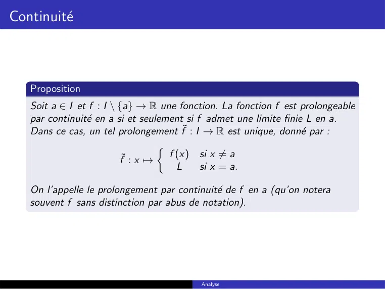

~~~text
Continuité

   Proposition
   Soit a ∈ I et f : I \ {a} → R une fonction. La fonction f est prolongeable
   par continuité en a si et seulement si f admet une limite finie L en a.
   Dans ce cas, un tel prolongement f˜ : I → R est unique, donné par :
                                  
                          ˜         f (x) si x 6= a
                         f : x 7→
                                      L     si x = a.

   On l’appelle le prolongement par continuité de f en a (qu’on notera
   souvent f sans distinction par abus de notation).

                                          Analyse
~~~

## Page 44

~~~text
Continuité

   Proposition (Opérations sur les fonctions continues)
   Soient f et g des fonctions continues sur I et λ, µ ∈ R.
     1   Les fonctions λf + µg , f · g sont continue sur I .
     2   Si de plus, g ne s’annule pas sur I , gf est continue sur I .

   Proposition
   Soient f : I → R continue sur I et g : J → R continue sur J avec
   f (I ) ⊂ J. Alors, la fonction g ◦ f est continue sur I .

                                             Analyse
~~~

## Page 45

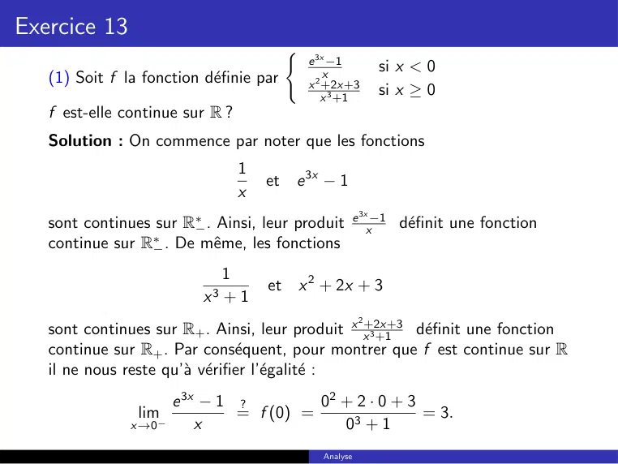

~~~text
Exercice 13
                                          (
                                               e 3x −1
                                                   x            si x < 0
   (1) Soit f la fonction définie par         x 2 +2x+3
                                                  x 3 +1        si x ≥ 0
   f est-elle continue sur R ?
   Solution : On commence par noter que les fonctions
                                 1
                                     et   e 3x − 1
                                 x
                                                           3x
   sont continues sur R∗− . Ainsi, leur produit e x−1 définit une fonction
   continue sur R∗− . De même, les fonctions
                             1
                                     et       x 2 + 2x + 3
                           x3 + 1
                                                           2
   sont continues sur R+ . Ainsi, leur produit x x+2x+3
                                                   3 +1 définit une fonction
   continue sur R+ . Par conséquent, pour montrer que f est continue sur R
   il ne nous reste qu’à vérifier l’égalité :
                       e 3x − 1 ?         02 + 2 · 0 + 3
                lim−            = f (0) =                = 3.
               x→0         x                 03 + 1
                                                 Analyse
~~~

## Page 46

~~~text
Exercice 13

   Calculons cette dernière limite. Nous avons :
                              e 3x − 1            e 3x − e 3·0
                       lim−              =  lim−
                     x→0          x        x→0       x −0
                                              3x 0
                                                
                                         = e       |x=0
                                         = 3e 0
                                         = 3 = f (0).

   La fonction f est donc continue sur R.

                                             Analyse
~~~
