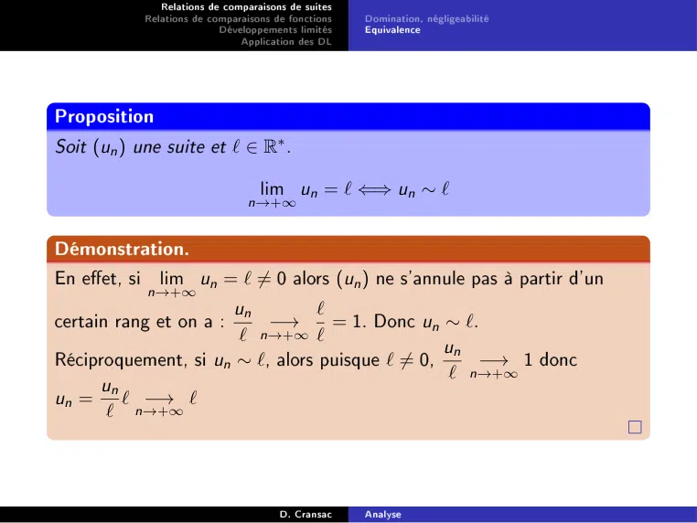

# CM-Comportement-Asymptotique_2023-2024_Analyse2_P1S2_DCransac.pdf

[Ouvrir l’original](https://drive.google.com/open?id=1TYZJTignhf8MlQYcOf7ZEJ9ZDEzW46_j) · Les deux lectures automatiques du PDF divergent sur les pages indiquées. Leur fac-similé accompagne le texte.

**Pages présentant un écart entre les deux extractions** — 20.

## Page 1

~~~text
               Relations de comparaisons de suites
            Relations de comparaisons de fonctions
                           Développements limités
                               Application des DL

      Comportements Asymptotiques
1   Relations de comparaisons de suites
      Domination, négligeabilité

      Equivalence

2   Relations de comparaisons de fonctions
      Domination, négligeabilité

      Equivalence

3   Développements limités
      Généralités

      Formule de Taylor-Young

      Opérations sur les D.L.

4   Application des DL
      Recherche de limites et équivalents

      Etude locale de fonctions

      Application à l'étude d'asymptotes obliques

                                       D. Cransac    Analyse
~~~

## Page 2

~~~text
               Relations de comparaisons de suites
            Relations de comparaisons de fonctions   Domination, négligeabilité
                           Développements limités    Equivalence
                               Application des DL

Dénition
Soit (un ) et (vn ) deux suites.
On dit que :
                                                                   
                                                               un
     (un ) est dominée par (vn ) si la suite                            est bornée.
                                                               vn
     On note alors un = O (vn ).
     la suite (un ) est négligeable devant (vn ) (ou que (vn ) est
     prépondérante
                    devant la suite (un ))
                 un
     si la suite      converge vers 0.
                 vn
     On note alors un = o (vn ).
Exemples.                 
       cos(n) + 4           1
On a :             =  O           car (cos(n) + 4) est bornée.
           n2               n 2
        3               5
                          
On a : n sin(n) = o n
                  3
                n sin(n)        sin(n)
En eet :  lim        5
                             =          −→ 0 (théorème d'encadrement)
          n→+∞      n             n2 n→+∞
                                       D. Cransac    Analyse
~~~

## Page 3

~~~text
                Relations de comparaisons de suites
             Relations de comparaisons de fonctions   Domination, négligeabilité
                            Développements limités    Equivalence
                                Application des DL

Remarques.
       (un ) est bornée si et seulement si un = O(1).
       (un ) converge vers 0 si et seulement si un = o(1).
       un = o (vn ) =⇒ un = O (vn ) .

Proposition
Soient (un ) , (vn ) et (wn ) trois suites.
     Si un = O (vn ) et vn = O (wn ),
     alors un = O (wn ) (transitivité de la relation O ).
     Si un = o (vn ) et vn = o (wn ), alors un = o (wn ) (transitivité de la
     relation o ).

Démonstration.
On démontre le deuxième point, le premier point est analogue.

Soit (un ) une suite telle que un = o (wn ) et wn = o (tn ) .
                                  un    u n vn
Alors, pour tout  n ≥ n0 , on a :    =      ·     −→ 0 · 0 = 0.
                                  wn    vn wn n→+∞
Ainsi, un = o (tn ) .

                                        D. Cransac    Analyse
~~~

## Page 4

~~~text
               Relations de comparaisons de suites
            Relations de comparaisons de fonctions   Domination, négligeabilité
                           Développements limités    Equivalence
                               Application des DL

Proposition
Soient (un ) , (vn ) , (wn ) et (tn ) quatre suites telles que (wn ) et (tn ) ne
s'annulent pas à partir d'un certain rang. Soit (λ, µ) ∈ K2 .
     Si un = O (wn ) et vn = O (wn ), alors λun + µvn = O (wn ) .
     Si un = o (wn ) et vn = o (wn ), alors λun + µvn = o (wn ) .
     Si un = O (wn ) et vn = O (tn ), alors un vn = O (wn tn )
     Si un = O (wn ) et vn = o (tn ), alors un vn = o (wn tn ) .
Exemples
     n2          o n4 .
                     
           =
          n→+∞
      n
     2     =o (3n ).
          n→+∞
                
     1           1

      2
         =   o       .
     n n→+∞      n

                                       D. Cransac    Analyse
~~~

## Page 5

~~~text
                Relations de comparaisons de suites
             Relations de comparaisons de fonctions   Domination, négligeabilité
                            Développements limités    Equivalence
                                Application des DL

Rappel

  Dénition (Exponentielle d'exposant réel quelconque)
  Soit a ∈ R+∗ et b ∈ R,
                                             ab = e b ln a

  Démonstration.
  On a

                                           ln ab = b ln a
  en appliquant la fonction exponentielle on obtient le résultat.

                                        D. Cransac    Analyse
~~~

## Page 6

~~~text
              Relations de comparaisons de suites
           Relations de comparaisons de fonctions     Domination, négligeabilité
                          Développements limités      Equivalence
                              Application des DL

Proposition
                                                    ln n
                                          lim            =0
                                        n→+∞         n

Démonstration.

On étudie φ(x) = ln x − x .
         1−x
φ0 (x) =     , donc sur [1; +∞[ φ est décroissante . Comme φ(1) = −1,
          x
φ < 0, donc
                            0 ⩽ ln x ⩽ x sur [1; +∞[
                         √                     √   √        1      √
Si on remplace x par      x , on obtient 0 ⩽ ln x ⩽ x =⇒ 0 ⩽ ln x ⩽ x
                                                                                   2
                                                ln x    2
                                        0⩽           ⩽ √
                                                 x       x

En passant à la limite en +∞, d'après le théorème des gendarmes on a
                                                    ln x
                                           lim           =0
                                         x→+∞        x
                                      D. Cransac      Analyse
~~~

## Page 7

~~~text
                    Relations de comparaisons de suites
                 Relations de comparaisons de fonctions              Domination, négligeabilité
                                Développements limités               Equivalence
                                    Application des DL

Proposition
                                                                        n
                                                                     1
                                           lim           1       +             =e
                                        n→+∞                         n

Démonstration.
                                                         n
                                                                               1
                                         
                                                                 = e n ln(1+ n )
                                                     1
                                            1   +
                                                     n
Or
                             ln(1 + X )   ln(1 + X ) − ln(1 + 0)
                                        =                         → 1
                                 X                X −0           X →0
            1
et    lim       = 0 donc, par composition,
     n→+∞ n

                                    ln 1 + 1n
                                                                                                
                                                                                              1
                             lim           1         =1=                 lim n ln     1   +
                          n→+∞
                                           n
                                                                     n→+∞                     n

On en déduit, par composition, que
                                                                        n
                                                                     1
                                               lim           1   +            =e
                                           n→+∞                      n

                                            D. Cransac               Analyse
~~~

## Page 8

~~~text
              Relations de comparaisons de suites
           Relations de comparaisons de fonctions   Domination, négligeabilité
                          Développements limités    Equivalence
                              Application des DL

Proposition (croissances comparées)
Soit (α, β) ∈ R avec α, β > 0, et q > 1. Alors :

                          lnβ n = o (nα )             nα = o (q n )

                             q n = o (n!)           n! = o (nn )

Démonstration.
                         nα
                             = e α ln n−n ln q = e n(α n −ln q)
                                                         ln n
    On étudie le rapport
                         qn                                  
           ln n                                ln n
    On a α      − ln q → − ln q donc n α            − ln q       → −∞ car
            n           n→+∞                    n               n→+∞
    q>1
             → 0 donc par composition e n(α n −ln q) → 0
                                                     ln n
         X
    Or e
           X →−∞                                                                 n→+∞
               α
              n
    On a bien      → 0
              q n n→+∞                D. Cransac    Analyse
~~~

## Page 9

~~~text
            Relations de comparaisons de suites
         Relations de comparaisons de fonctions   Domination, négligeabilité
                        Développements limités    Equivalence
                            Application des DL

Démonstration.
                              lnβ n                                 ln(ln n)
   On étudie le rapport
                                 α
                                    = e β ln(ln n)−α ln n = e ln n(β ln n −α)
                               n
       ln X
   Or        →0         et ln n → +∞ donc par composition
        X X →+∞            n→+∞
   ln(ln n)              ln(ln n)
             → 0 donc β           − α → −α
     ln n n→+∞
                          lnn      n→+∞
                ln(ln n)
   donc ln n  β          −α     → −∞.
                  ln n         n→+∞
                                             ln(ln n)
   Or e
        X
            → 0 donc par composition e ln n(β ln n −α)                          →     0
         X →−∞                                                                 n→−∞
              β
                ln n
   On a bien          → 0
                 nα n→−∞

                                    D. Cransac    Analyse
~~~

## Page 10

~~~text
                Relations de comparaisons de suites
           Relations de comparaisons de fonctions     Domination, négligeabilité
                           Développements limités     Equivalence
                                Application des DL

Démonstration.
                                          qn
   On étudie la suite            un =
                                          n!
   On souhaite démontrer que cette suite tend vers 0.

                                               q n+1 n!         q
   On a    ∀n ∈ N∗ , un+1 = un                          n
                                                          = un
                                             (n + 1)!q         n+1
   Pour   n + 1 > q , cette suite est décroissante. De plus elle est minorée
   par 0. Donc elle est convergente.

   Soit   ` la limite de un , on passe à la limite sur la relation de
   récurrence.

   On obtient      ` = 0.
   Donc    un      → 0
                n→+∞
                  n
                   q
   On a bien           → 0
                   n! n→+∞

                                        D. Cransac    Analyse
~~~

## Page 11

~~~text
              Relations de comparaisons de suites
           Relations de comparaisons de fonctions   Domination, négligeabilité
                          Développements limités    Equivalence
                              Application des DL

Démonstration.
                                   n!
   On étudie la suite          vn = n
                                   n
   On souhaite démontrer que cette suite tend vers 0.
                                              n
                             (n + 1)nn
                                         
                   vn+1
                     ∗                      n
   On a ∀n ∈ N ,         =             =           <1
                     vn     (n + 1)n+1  n + 1
                                                n
                                           n
   on a la relation de récurrence vn+1 =          vn
                                          n+1
   Cette suite est décroissante. De plus elle est minorée par 0. Donc

   elle est convergente.

   Soit  ` la limite de vn , on souhaite passer à la limite sur la relation de
   récurrence.
            n            n                        n
       n+1                                         n
                                                          = e −1
                         1
                 = 1+             → e donc
        n                n      n→+∞            n+1
   Donc si on passe à la limite sur la relation de récurrence, on obtient

   ` = `e −1 donc ` = 0
   Donc vn    → 0
              n→+∞
                  n!
   On a bien          → 0
                  nn n→+∞
                                      D. Cransac    Analyse
~~~

## Page 12

~~~text
              Relations de comparaisons de suites
           Relations de comparaisons de fonctions    Domination, négligeabilité
                          Développements limités     Equivalence
                                Application des DL

On en déduit directement la proposition suivante :

Proposition
                                                                         
                         1                 1           1                1
                              =o                            =o
                        n   α
                                       lnβ            q   n         nα
                                                                  
                            1              1           1               1
                                =o                         =o
                         n!               qn          nn              n!

                                       D. Cransac    Analyse
~~~

## Page 13

~~~text
                 Relations de comparaisons de suites
            Relations de comparaisons de fonctions      Domination, négligeabilité
                            Développements limités      Equivalence
                                 Application des DL

Remarque.
En notant   un  vn au lieu de un = o (vn ), on a donc lorsque n tend vers
+∞ :
    1       1           1          1            1
                                                    lnβ n  nα  q n  n!  nn .
   nn       n!         qn         nα         lnβ n

                                         D. Cransac     Analyse
~~~

## Page 14

~~~text
                     Relations de comparaisons de suites
                 Relations de comparaisons de fonctions         Domination, négligeabilité
                                 Développements limités         Equivalence
                                     Application des DL

Equivalence

  Dénition
  Soit (un ) et (vn ) deux suites.
  On dit que (un )n∈N est équivalente à (vn )n∈N ,
                                                          
                                                    un
                                 si la suite                   converge vers 1.
                                                    vn
  On note alors
                                                     un ∼ vn
                                                                    √                 r
                             √      √                                     n+1                        1
  Exemple. On a n ∼ n + 1. En eet,                                       √   =              1   +       . Or,

                                                                          n                        n
                     1
   lim       1   + = 1 et par composition par la fonction racine, continue
  n→+∞               n  √
                           n+1 √
  en 1, on a bien  lim     √    = 1 = 1.
                  n→+∞       n
                                             D. Cransac         Analyse
~~~

## Page 15

~~~text
              Relations de comparaisons de suites
           Relations de comparaisons de fonctions   Domination, négligeabilité
                          Développements limités    Equivalence
                              Application des DL

Proposition
La relation ∼ est une relation d'équivalence sur l'ensemble des suites
ne s'annulant pas, c'est à dire :
     ∼ est réexive : un ∼ un ;
     ∼ est symétrique : un ∼ vn ⇒ vn ∼ un ;
     ∼ est transitive : si un ∼ vn et vn ∼ wn , alors un ∼ wn .

                                      D. Cransac    Analyse
~~~

## Page 16

~~~text
                Relations de comparaisons de suites
             Relations de comparaisons de fonctions   Domination, négligeabilité
                            Développements limités    Equivalence
                                Application des DL

Proposition
Soient (un ) , (vn ).
     un ∼ vn ⇐⇒ un − vn = o (vn ) .
     un ∼ vn       =⇒          un = O (vn ) et vn = O (un ).

Démonstration.
                                                
                        un                 un
     un ∼ vn ⇔ lim          = 1 ⇔ lim         −1 =0
                n→+∞ v n         n→+∞    vn
                 un − vn
     ⇔ lim                  = 0 ⇔ un − vn = o (vn ) .
        n→+∞        vn
                        
                         un
     Si un ∼ vn alors             converge vers 1 donc bornée. De plus, comme
                         vn n≥n0
      
       un                              u
                 converge vers 1 alors n donc un est non nulle à partir d'un
       vn n≥n0                         vn
                                                     
                        vn                              vn
     certain rang et             converge vers 1 donc            est bornée.
                        un n≥n0                         un n≥n0

                                        D. Cransac    Analyse
~~~

## Page 17

~~~text
               Relations de comparaisons de suites
            Relations de comparaisons de fonctions   Domination, négligeabilité
                           Développements limités    Equivalence
                               Application des DL

Proposition
Soient (un ) , (vn ) , (wn ) et (tn ) quatre suites telles que un ∼ wn et
vn ∼ tn . Alors on a :
                                          un   wn
        un vn ∼ wn tn                        ∼                       ∀p ∈ N, unp ∼ wnp
                                          vn   tn

Démonstration.

                             un wn   un   wn
     On a, pour n ∈ N,             =    ×     −→ 1 par produit de limites
                             vn zn   vn   zn n→+∞
     Pour n ∈ N, on a
                             un                                   −1
                                      un zn   un              wn
                                                                          −→ 1
                             vn
                             wn   =         =    ×
                             zn
                                      vn wn   vn              zn         n→+∞

     comme quotient de limites.
                                                              p
                                             unp
                                                     
                                                         un
     Enn, pour n et p ∈ N, on a                 =                 −→ 1p = 1 par opérations
                                             vnp         vn        n→+∞
     sur les limites.

                                       D. Cransac    Analyse
~~~

## Page 18

~~~text
              Relations de comparaisons de suites
           Relations de comparaisons de fonctions      Domination, négligeabilité
                             Développements limités    Equivalence
                                  Application des DL

Exemple.
                                      n6
                        
                     n
Montrons que                    ∼          .
                     6               720

En eet, pour tout       j ∈ N xé, on a n − j ∼ n ;

par conséquent :

                                          5              5
                                                               n6
                             
                         n             1
                                          Y           1
                                                         Y
                                  =         (n − j) ∼      n=
                         6             6!             6!      720
                                           j=0                    j=0

                                         D. Cransac    Analyse
~~~

## Page 19

~~~text
            Relations de comparaisons de suites
         Relations de comparaisons de fonctions   Domination, négligeabilité
                        Développements limités    Equivalence
                            Application des DL

                        ATTENTION ! ! ! !

On ne peut ni ajouter, ni soustraire,                  les équivalents :

                  n + 1 ∼ n + 2 et n ∼ n mais on n'a pas 1 ∼ 2
On ne compose pas les équivalents :

si f est une fonction (même continue sur R ) et si un ∼ vn , on n'a
pas forcément    f (un ) ∼ f (vn ) :
          2              2
si un = n + n, vn = n       et f = exp, on a un ∼ vn , mais :

f (un )     n2 +n−n2      n
        =e            = e −→ +∞, donc f (un ) 6∼ f (vn ) .
f (vn )                      n→+∞

Lors d'une mise en puissance d'un équivalent, l'exposant doit être

constant :                  n
              1            1
on a 1   +  ∼ 1 mais 1 +        6∼ 1n
         n
                n        n           n   
               1                      1
(en eet   1 +      → e , donc 1 +         ∼e .
               n                      n
En règle générale, on ne sépare pas les limites

                                    D. Cransac    Analyse
~~~

## Page 20

~~~text
                 Relations de comparaisons de suites
              Relations de comparaisons de fonctions   Domination, négligeabilité
                             Développements limités    Equivalence
                                 Application des DL

Proposition
Soit (un ) une suite et ` ∈ R∗ .

                                     lim un = ` ⇐⇒ un ∼ `
                                  n→+∞

Démonstration.
En eet, si      lim un = ` 6= 0 alors (un ) ne s'annule pas à partir d'un
              n→+∞
                      un        `
certain rang et on a :    −→      = 1. Donc un ∼ `.
                       ` n→+∞ `
                                                 un
Réciproquement, si un ∼ `, alors puisque ` 6= 0,     −→ 1 donc
                                                  ` n→+∞
     un
un = ` −→ `
      ` n→+∞

                                         D. Cransac    Analyse
~~~

## Page 21

~~~text
              Relations de comparaisons de suites
           Relations de comparaisons de fonctions   Domination, négligeabilité
                          Développements limités    Equivalence
                              Application des DL

Proposition
Soient (un ) et (vn ) deux suites telles que un ∼ vn .
     un et vn ont même signe strict (> 0 ou < 0) à partir d'un certain
     rang.
     (un )n∈N admet une limite (nie ou innie) si et seulement si (vn )n∈N
     admet une limite et alors lim un = lim vn .
                                          n→+∞            n→+∞

                                      D. Cransac    Analyse
~~~

## Page 22

~~~text
             Relations de comparaisons de suites
          Relations de comparaisons de fonctions   Domination, négligeabilité
                         Développements limités    Equivalence
                             Application des DL

Démonstration.
                                              un
   Comme     (un ) et (vn ) sont équivalentes, on a−→ 1. Donc pour
                                              vn n→+∞
       1                                      un          1
    = > 0, il existe N ∈ N tel que ∀n ≥ N,      −1 ≤ .
       2                                      vn          2

                                         un  1
   En particulier pour tout n ≥ N , on a    ≥ , et un et vn ont même
                                         vn  2
   signe strict.

                                                             un
   Supposons que        (vn )n∈N admet une limite ` ∈ R. On a un =
                                                                 × vn ,
                                                             vn
   done un  −→ l par opérations sur les limites. De même si (un )n∈N
           n→+∞
                                  vn
   admet une limite l , on a vn =    × un , vn −→ l par opérations sur
                                  un          n→+∞
   les limites.

                                     D. Cransac    Analyse
~~~

## Page 23

~~~text
                Relations de comparaisons de suites
           Relations de comparaisons de fonctions       Domination, négligeabilité
                            Développements limités      Equivalence
                                Application des DL

Relations de comparaisons de fonctions

     I désignera un intervalle réel non vide et non réduit à un point,                a un
     point de   I ou une extrémité de I (éventuellement ±∞ )
     D désignera I ou I \{a} ;
     toutes les fonctions considérées seront dénies sur D à valeurs dans

     K = R ou C, et supposées non nulles sur I \{a} (de sorte que le
     quotient de deux fonctions est toujours bien déni sur I \{a} ) ;

     si les fonctions sont dénies en                 a, on supposera de plus qu'elles sont
     continues en      a.

                                        D. Cransac      Analyse
~~~

## Page 24

~~~text
               Relations de comparaisons de suites
            Relations de comparaisons de fonctions         Domination, négligeabilité
                           Développements limités          Equivalence
                               Application des DL

Dénition
Soient f et g : D → K . On dit que :
                                                                         f
    f est dominée par g au voisinage de a si                               est bornée au voisinage
                                                                         g
    de a.
    On note alors f (x) = O(g (x)) ou f = O(g ).
                                                                                        f (x)
    f est négligeable devant g au voisinage de a si lim                                         = 0.
                                                                                 x→a g (x)
    On note alors f (x) = o(g (x)) ou f = o(g ).
Exemples.
    x 2 sin x 3 = O x 2 :
                      

    En eet pour I = R, x 7→ x 2 et x 7→ x 2 sin x 3 sont dénies sur R\{0} et
                                                                     

                                       x 2 sin x     3
                                                       
    pour tout x ∈ R∗ , on a :                              = sin x 3
                                                                         
                                                                             ⩽ 1.
                                             x2
    Si p < q, x p +∞
                   = o (x q ) et x q = o (x p ) :
                                     0
    En eet pour I = R, x 7→ x p et x 7→ x q ne s'annulent pas sur I \{0} et
         xp            xq
      lim    = 0 = lim p
    x→+∞ x q       x→0 x

                                       D. Cransac          Analyse
~~~

## Page 25

~~~text
                  Relations de comparaisons de suites
               Relations de comparaisons de fonctions   Domination, négligeabilité
                              Développements limités    Equivalence
                                  Application des DL

Remarque.

  Pour   f : D → R, on a :
         f est bornée au voisinage de a si et seulement si f = O(1).
         f converge vers 0 au voisinage de a si et seulement si f = o(1).
         f (x) = o(g (x)) =⇒ f (x) = O(g (x)).

                                          D. Cransac    Analyse
~~~

## Page 26

~~~text
              Relations de comparaisons de suites
          Relations de comparaisons de fonctions    Domination, négligeabilité
                          Développements limités    Equivalence
                              Application des DL

Proposition
                     2
Soit (α, β) ∈ R+
               ∗

                  (ln x)β = o (x α )                     x β = o (e αx )
                              +∞                              +∞

                                                                              
                                        1                                   1
                   lnβ x = o                           e αx = o
                            0          xα                     −∞            xβ

                                       D. Cransac   Analyse
~~~

## Page 27

~~~text
                     Relations de comparaisons de suites
                  Relations de comparaisons de fonctions   Domination, négligeabilité
                                 Développements limités    Equivalence
                                     Application des DL

Equivalence

  Dénition
  Soient f et g : D → K.
                                                                                        f (x)
  On dit que f est équivalente à g au voisinage de a si lim                                     = 1.
                                                                                    x→a g (x)
  On note alors f (x) ∼ g (x) ou f ∼ g .
                                a                    a

  Exemple.
  sin x ∼ x :en eet pour I = R, x 7→ x ne s'annule pas su r I \ {0} et
         0
     sin x
  lim      =1
  x→0 x
  Remarque :
        Si   f est continue en a, on a : f (x) ∼ f (a) si f (a) 6= 0.
                                                                     a
        Si f est dérivable en a, on a : f (x) − f (a) ∼ f 0 (a)(x − a) si f 0 (a) 6= 0.
                       p          p−1
        Si P(x) = ap x + ap−1 x       + . . . aq x q (p ≥ q est une fonction polynomiale,
        alors :

                                      P(x) ∼ ap x p        et     P(x) ∼ aq x q .
                                             +∞                           0
                                             D. Cransac    Analyse
~~~

## Page 28

~~~text
                   Relations de comparaisons de suites
              Relations de comparaisons de fonctions             Domination, négligeabilité
                              Développements limités             Equivalence
                                   Application des DL

Proposition
Soient f et g dénies sur D.
    f (x) ∼ g (x) ⇐⇒ f (x) − g (x) = o(g (x)).
          a
    f (x) ∼ g (x)             =⇒            f (x) = O(g (x)) et g (x) = O(f (x)).
          a

Proposition
La relation ∼ est une relation d'équivalence, c'est à dire :
               a
    ∼ est réexive : f ∼ f ;
     a                              a
    ∼ est symétrique : f ∼ g ⇒ g ∼ f ;
     a                                      a                a
    ∼ est transitive : f ∼ g et g ∼ h impliquent f ∼ h.
     a                                  a                a                             a

                                                D. Cransac       Analyse
~~~

## Page 29

~~~text
               Relations de comparaisons de suites
            Relations de comparaisons de fonctions    Domination, négligeabilité
                           Développements limités     Equivalence
                               Application des DL

Proposition (Opérations sur les équivalents)
Soient f , g , h, u quatre fonctions dénies sur D.
Si f (x) ∼ g (x) et si h(x) ∼ u(x), alors :
         x→a                          x→a
     f (x)h(x) ∼ g (x)u(x) ;
                x→a
     f (x)      g (x)
           ∼          ;
     h(x) x→a u(x)
     ∀p ∈ N, f (x)p ∼ g (x)p ;
                         x→a
     Pour α ∈ R∗+ , et si f α et g α sont bien dénies sur D, alors

                                           f (x)α ∼ g (x)α
                                                     x→a

     .

                                       D. Cransac     Analyse
~~~

## Page 30

~~~text
              Relations de comparaisons de suites
          Relations de comparaisons de fonctions    Domination, négligeabilité
                           Développements limités   Equivalence
                               Application des DL

Démonstration.
                                f (x)h(x)   f (x)   h(x)
   On a, pour      x ∈ D,                 =       ×      −→ 1 par produit de
                                g (x)u(x)   g (x) u(x) x→a
   limites.

   Pour   x ∈ D, on a
                   f (x)                                                −1
                   h(x)       f (x)u(x)   f (x)                   h(x)
                   g (x)
                            =           =       ×                                −→ 1
                              g (x)h(x)   g (x)                   u(x)           x→a
                   u(x)

   comme quotient de limites.
                                                                      p
                             f (x)p
                                                         
                                                              f (x)
   Pour x ∈ D et p ∈ N, on a        =                                      −→ 1p = 1 par
                             g (x)p                           g (x)        x→a
   opérations sur les limites.
                                           α
                    f α (x)
                                   
                                     f (x)              f (x)
   Pour tout x ∈ D,            =              = e α ln( g (x) ) . Comme
                    g α (x)          g (x)
   f (x)                   f (x)
         −→ 1 donc e α ln( g (x) ) −→ 1.
   g (x) x→a                       x→a

                                      D. Cransac    Analyse
~~~

## Page 31

~~~text
             Relations de comparaisons de suites
          Relations de comparaisons de fonctions         Domination, négligeabilité
                         Développements limités          Equivalence
                             Application des DL

Proposition (Équivalents classiques au voisinage de 0 )
                          ex − 1 ∼ x                         ln(1 + x) ∼ x
                                        0                                       0

                            sin x ∼ x                          tan x ∼ x
                                     0                                   0

                         arcsin x ∼ x                        arctan x ∼ x
                                         0                                      0

                            sh x ∼ x                               th x ∼ x
                                    0                                   0

                   (1 + x)α − 1 ∼ αx                          avec α ∈ R∗
                                                0

                                                    x2                              x2
                     1   − cos(x) ∼                      1   − ch(x) ∼ −
                                            0       2                       0       2

                                     D. Cransac          Analyse
~~~

## Page 32

~~~text
               Relations de comparaisons de suites
            Relations de comparaisons de fonctions    Domination, négligeabilité
                           Développements limités     Equivalence
                               Application des DL

Démonstration.
On a :

                                     1   − cos2 (x)     sin2 (x)   x2
                   1   − cos x =                    =            ∼
                                        1 + cos(x)    1 + cos(x)   2

car sin(x) ∼ x et 1 + cos(x) ∼ 2.
           0                              0
De même, :

                                    1 − ch2 (x)      sh2 (x)    x2
               1   − ch(x) =                    =−           ∼−
                                     1 + ch(x)     1 + ch(x) 0  2

Dans tous les autres cas, on utilise la propriété ci-dessous.

Proposition
Si f est dérivable en a, si f 0 (a) 6= 0,

                               f (x) − f (a) ∼ f 0 (a)(x − a)
                                         D. Cransac   Analyse
~~~

## Page 33

~~~text
              Relations de comparaisons de suites
           Relations de comparaisons de fonctions        Domination, négligeabilité
                          Développements limités         Equivalence
                              Application des DL

Proposition (Composition à droite dans un équivalent)
Soient f et g deux fonctions dénies sur D.
On suppose que g ne s'annule pas au voisinage de a et que f (x) ∼ g (x).
                                                                 a
Soit φ une fonction à valeurs dans D telle que lim φ(t) = a avec
                                                                       t→b
b ∈ R ∪ {±∞}.
On a :
                                    f ◦ φ(t) ∼ g ◦ φ(t)
                                                    b

Démonstration.
En utilisant le théorème de composition pour les limites, on peut écrire :

                                   f                          f
                             lim       (φ(t)) = lim                (x) = 1
                            t→b g                       x→a g

D'où le résultat.

                                       D. Cransac        Analyse
~~~

## Page 34

~~~text
                Relations de comparaisons de suites
            Relations de comparaisons de fonctions            Domination, négligeabilité
                           Développements limités             Equivalence
                                Application des DL

IMPORTANT. On veillera à ne pas additionner, soustraire ou composer à

gauche des équivalents sans justication, car les résultats obtenus sont

généralement faux.

Par exemple :
    x + 1 ∼ x + 2 et −x ∼ −x mais 1 ∼ 2;
            ±∞                         ±∞                            ±∞
    x + 1 ∼ x , mais on n'a pas exp(x + 1) ∼ exp(x) ;
            ±∞                                                           ±∞
    1   + 2x ∼ 1 + x et ln(1 + 2x) ∼ 2x, ln(1 + x) ∼ x .
                0                                     0                           0
Exemple.
Puisque   lim sin t = 0 et ln(1 + x) ∼ x , on en déduit :
          t→0                                         0

                                  ln(1 + sin t) ∼ sin t ∼ t.
                                                          0             0

                                        D. Cransac            Analyse
~~~

## Page 35

~~~text
              Relations de comparaisons de suites
           Relations de comparaisons de fonctions   Domination, négligeabilité
                          Développements limités    Equivalence
                              Application des DL

Mais dans certains cas, la composition à gauche peut s'appliquer.

    On ne peut pas déduire directement de

                               sin(t) ∼ t et 1 + sin t ∼ 1 + t
    que

                                    ln(1 + sin t) ∼ ln(1 + t)
    car alors on compose à gauche les équivalents par                            x 7→ ln(1 + x).
    Pourtant c'est bien exact car

                      ln(1 + sin t)   ln(1 + sin t) sin t   t
                                    =
                        ln(1 + t)         sin t       t ln(1 + t)
    Donc la limite est 1.

    On a bien :

                                         1   + 2x ∼ 3 + 2x
                                                    +∞
    et

                                   ln(1 + 2x) ∼ ln(3 + 2x)
                                                    +∞

Lorsqu'on compose à gauche, il faut donc vérier dans chaque cas.

                                      D. Cransac    Analyse
~~~

## Page 36

~~~text
              Relations de comparaisons de suites
           Relations de comparaisons de fonctions   Domination, négligeabilité
                          Développements limités    Equivalence
                              Application des DL

Proposition
Soient f , g : D → R deux fonctions telle que f (x) ∼ g (x).
                                                                        a
    Si g est de signe constant (> 0 ou < 0) au voisinage de a, alors f
    est de même signe strict que g au voisinage de a.
    Si g admet une limite nie ou innie en a alors f admet une limite
    en a et lim f (x) = lim g (x).
              x→a               x→a

Démonstration.
           f (x)                                                        1
    On a          −→ 1, donc par dénition de la limite, en posant  = > 0, il
           g (x) x→a                                                    2
                                                     f (x)        1
    existe r > 0 tel que ∀x ∈ [a − r , a + r ] ∩ D,        − 1 ≤ et pour
                                                    g (x)         2
                              f (x)  1
    x ∈ [a − r , a + r ] ∩ D,       ≥ , donc f (x) et g (x) ont même signe strict.
                              f (x)  2
                                                                                 f (x)
    Supposons que g (x) −→ l . Pour tout x ∈ D, on a f (x) =                           × g (x),
                                x→a                                              g (x)
    donc g (x) −→ l par opérations sur les limites.
                x→a
                                      D. Cransac    Analyse
~~~

## Page 37

~~~text
                Relations de comparaisons de suites
                                                      Généralités
             Relations de comparaisons de fonctions
                                                      Formule de Taylor-Young
                            Développements limités
                                                      Opérations sur les D.L.
                                Application des DL

Développements limités

  Dans toute cette section :

      I désignera un intervalle réel non vide et non réduit à un point

      a désignera un réel appartenant à I¯(= I ∪ {extrémité de I } )
      D désignera I ou I \{a}
      Toutes les fonctions considérées seront dénies sur                       D à valeurs dans
      K = R ou C.

                                        D. Cransac    Analyse
~~~

## Page 38

~~~text
                Relations de comparaisons de suites
                                                      Généralités
             Relations de comparaisons de fonctions
                                                      Formule de Taylor-Young
                            Développements limités
                                                      Opérations sur les D.L.
                                Application des DL

Dénition
On dit que f : D → K admet un développement limité en a à l'ordre
n ∈ N (en abrégé DLn (a)) s'il existe (a0 , . . . , an ) ∈ Kn+1 tel que

         f (x) = a0 + a1 (x − a) + · · · + an (x − a)n + o ((x − a)n ) .

Remarque On distingue dans ce développement limité :
   Sa partie régulière, qui est la fonction polynomiale :

                                                                                n
                                                                                X
          Pn (x) = a0 + a1 (x − a) + . . . + an (x − a)n =                            pk (x − a)k
                                                                                k=0

    le   reste o ((x − a)n ), fonction négligeable devant (x − a)n lorsque
    x → a, qui s'écrit aussi

                                           (x − a)n εn (x − a)

    où   εn : D → K est telle que lim ε(x) = 0.
                                                x→0

                                        D. Cransac    Analyse
~~~

## Page 39

~~~text
              Relations de comparaisons de suites
                                                    Généralités
           Relations de comparaisons de fonctions
                                                    Formule de Taylor-Young
                          Développements limités
                                                    Opérations sur les D.L.
                              Application des DL

Exemples
                      f :     ] − 1, +∞[
                                → R
                                      x − x 2 + x 3 ln(1 + x)
   La fonction
                                7 →x
   admet un développement limité à l'ordre 3 en 0.
                                          3                   3
                                                                
   En eet, comme ln(1 + x) −→ 0, on a x ln(1 + x) = o x          , ce qui
                                            x→0
   permet d'écrire :

                                     f (x) = x − x 2 + o x 3
                                                                      

                                      D. Cransac    Analyse
~~~

## Page 40

~~~text
           Relations de comparaisons de suites
                                                   Généralités
       Relations de comparaisons de fonctions
                                                   Formule de Taylor-Young
                         Développements limités
                                                   Opérations sur les D.L.
                              Application des DL

On sait que      ∀n ⩾ 1

                                 − x n+1
                                         = 1 + x + x2 + . . . + xn
                             1

                                 1 − x

Donc
                                                                             x n+1
                                   = 1 + x + x2 + . . . + xn +
                          1

                     1    −x                                                 1 − x

Il vient
                                                                                 x
                                 − (1 + x + x 2 + . . . + x n ) = x n
                     1

                 1   −x                                                        1 − x

On en conclut que

                              = 1 + x + x 2 + . . . + x n + o(x n )
                         1

                     1   − x x→0

                                      D. Cransac   Analyse
~~~

## Page 41

~~~text
                Relations de comparaisons de suites
                                                      Généralités
           Relations de comparaisons de fonctions
                                                      Formule de Taylor-Young
                           Développements limités
                                                      Opérations sur les D.L.
                                Application des DL

Proposition
Une fonction f admet, au voisinage de a ∈ R, un développement limité à
                               l'ordre n
                                        si et seulement si
la fonction g : h 7→ f (a + h) admet au voisinage de 0 un développement
                             limité à l'ordre n.
On a de plus
          n
          X                                                                      n
                                                                                 X
                ak (x −a)k +o ((x − a)n ) ⇐⇒ f (a+h) =                                 ak hk +o hk
                                                                                                     
f (x) =
    x→a                                                                    h→0
          k=0                                                                    k=0

                                        D. Cransac    Analyse
~~~

## Page 42

~~~text
               Relations de comparaisons de suites
                                                         Généralités
            Relations de comparaisons de fonctions
                                                         Formule de Taylor-Young
                           Développements limités
                                                         Opérations sur les D.L.
                               Application des DL

Exemple
                                             1
Calculons le   DL2 (3) de f (x) =                . On pose         h = x − 3. On a alors :
                                             x
                                                             1            1       1
                       f (x) = f (3 + h) =                            =
                                                         3   +h           3 1     + h3

                                                                              1
On utilise alors le DL en 0 de la fonction                       x→                    calculé
                                                                          1   −x
précédemment pour obtenir nalement :

                                                                  h2
                                                                                          
                                         1               h                         2
                                                                                       
                      f (3 + h) =                1   −       +         +o h
                                         3               3        9

et donc :

                                   (x − 3)           (x − 3)2
                                                                       + o (x − 3)2
                           1                                                                   
               f (x) =         −                 +
                           3            9                    27

                                       D. Cransac        Analyse
~~~

## Page 43

~~~text
                   Relations de comparaisons de suites
                                                         Généralités
                Relations de comparaisons de fonctions
                                                         Formule de Taylor-Young
                               Développements limités
                                                         Opérations sur les D.L.
                                   Application des DL

Proposition (Unicité d'un DL)
Si f admet un développement limité à l'ordre n en a, celui-ci est unique.

Démonstration.
Par l'absurde, supposons que
          n
          X                                                n
                                                           X
f (x) =         ak (x − a)k + o ((x − a)n ) =                      bk (x − a)k + o ((x − a)n )
          k=0                                              k=0
avec  (a0 , . . . , an ) 6= (b0 , . . . , bn ) .
Soit p le plus petit entier tel que bp 6= ap .

Alors, pour tout 0 ≤ k < p , on a ak − bk = 0. On a

        X n
f (x) −        ak (x − a)k = o ((x − a)n ) et
          k=0
          n
          X
f (x) −         bk (x − a)k = o ((x − a)n ).
          k=0

                                           D. Cransac    Analyse
~~~

## Page 44

~~~text
                 Relations de comparaisons de suites
                                                       Généralités
              Relations de comparaisons de fonctions
                                                       Formule de Taylor-Young
                             Développements limités
                                                       Opérations sur les D.L.
                                 Application des DL

Démonstration.
Ainsi, pour tout      x 6= a :
                                         n
                                         X
          0   = f (x) − f (x) =                 (ak − bk ) (x − a)k + o ((x − a)n )
                                         k=0

En divisant par      (x − a)p :
                                      n
                                                (ak − bk ) (x − a)k−p−1 + o (x − a)n−p
                                      X                                                  
 0   = (ap − bp ) + (x − a)
                                     k=p+1

Donc

                                            0   −→ ap − bp
                                                x→a

D'où   ap = bp , ce qui constitue une contradiction.

                                         D. Cransac    Analyse
~~~

## Page 45

~~~text
              Relations de comparaisons de suites
                                                    Généralités
           Relations de comparaisons de fonctions
                                                    Formule de Taylor-Young
                          Développements limités
                                                    Opérations sur les D.L.
                              Application des DL

Proposition (Troncature d'un DL)
Supposons que f admette un développement limité à l'ordre n en a,

       f (x) = a0 + a1 (x − a) + · · · + an (x − a)n + o ((x − a)n )
             x→a

Alors pour tout p ∈ J0, nK, f admet un développement limité à l'ordre p
en a obtenu en tronquant le développement limité à l'ordre p :

       f (x) = a0 + a1 (x − a) + · · · + ap (x − a)p + o ((x − a)p )
             x→a

                                      D. Cransac    Analyse
~~~

## Page 46

~~~text
                     Relations de comparaisons de suites
                                                               Généralités
                  Relations de comparaisons de fonctions
                                                               Formule de Taylor-Young
                                 Développements limités
                                                               Opérations sur les D.L.
                                     Application des DL

Démonstration.
Si f admet un développement limité à l'ordre n en a dont la partie
                   n
                   X
régulière est x 7→   ak (x − a)k , alors, pour tout p ≤ n, on a :
                            k=0
            n
            X
f (x) =           ak (x − a)k + o ((x − a)n )
            k=0
     p
     X                              n
                                    X
=          ak (x − a)k +                 ak (x − a)k + o ((x − a)n )
     k=0                        k=p+1
     p
     X                                          n
                                                X
=          ak (x − a)k + (x − a)p                          ak (x − a)k−p + o ((x − a)n )
     k=0                                      k=p+1
     p
     X                                         Xn
=          ak (x − a)k + (x − a)p                          ak (x − a)k−p + o ((x − a)n )
     k=0                                      k=p+1
                                |                                {z                      }
                                                             o((x−a)p )

                                             D. Cransac        Analyse
~~~

## Page 47

~~~text
                 Relations de comparaisons de suites
                                                       Généralités
              Relations de comparaisons de fonctions
                                                       Formule de Taylor-Young
                             Développements limités
                                                       Opérations sur les D.L.
                                 Application des DL

Proposition
Si f est paire (resp. impaire) et admet un développement limité à l'ordre
n en 0, ce développement limité ne contient que des termes pairs (resp.
impairs).

Démonstration.
Supposons par exemple             f paire, et notons

                        f (x) = a0 + a1 x + · · · + an x n + o (x n )

son développement limité en 0 .

On a alors

            f (x) = f (−x) = a0 + a1 (−x) + · · · + an (−x)n + o (x n )

                                  (−x)n l'est aussi devant x n . Par
car une fonction négligeable devant
                                     k
unicité du DL, ak = (−1) ak pour tout k ∈ J0, nK.

On a donc pour tout k impair, ak = −ak donc ak = 0.

                                         D. Cransac    Analyse
~~~

## Page 48

~~~text
              Relations de comparaisons de suites
                                                    Généralités
           Relations de comparaisons de fonctions
                                                    Formule de Taylor-Young
                          Développements limités
                                                    Opérations sur les D.L.
                              Application des DL

Proposition
Supposons que f admette un développement limité à l'ordre n en a de
partie régulière non nulle :

        f (x) = a0 + a1 (x − a) + . . . + an (x − a)n + o ((x − a)n ) .

Alors en notant p le plus petit entier tel que ap 6= 0, on a :

                                   f (x) ∼ ap (x − a)p
                                            x→a

Remarque
f est donc du même signe strict que le premier terme non nul de son DL
au voisinage dea.

                                      D. Cransac    Analyse
~~~

## Page 49

~~~text
               Relations de comparaisons de suites
                                                     Généralités
            Relations de comparaisons de fonctions
                                                     Formule de Taylor-Young
                           Développements limités
                                                     Opérations sur les D.L.
                               Application des DL

Démonstration.
Comme pour k ∈ J0, p − 1K, ak = 0, on a

f (x) = ap (x − a)p + · · · + an (x − a)n + oa (x − a)n , puis

    f (x)         ap+1              an
                       (x −a)+· · ·+ (x −a)n−p +o (x − a)n−p −→ 1.
                                                            
           p
             = 1+
ap (x − a)         ap               ap                        x→a

                                       D. Cransac    Analyse
~~~

## Page 50

~~~text
                  Relations de comparaisons de suites
                                                        Généralités
               Relations de comparaisons de fonctions
                                                        Formule de Taylor-Young
                              Développements limités
                                                        Opérations sur les D.L.
                                  Application des DL

Formule de Taylor-Young

  Théorème (Lemme de primitivation des développements limités)
  Soient I un intervalle, g ∈ D(I , R), a ∈ I et n ∈ N.
  Si g 0 (x) = o ((x − a)n ) alors g (x) = g (a) + o (x − a)n+1 .
                                                               
              x→a                                       x→a

  Démonstration.

  Pour tout x ∈ I \{a}, g est continue sur [a, x] (ou [x, a] ) et dérivable sur ]a, x[
  (ou ]x, a[ ), donc d'après le théorème des accroissements
        g (x) − g (a)
  nis :            = g 0 (cx ) pour un certain cx ∈] a, x[ (ou ]x, a[).
          x −a
  Ce procédé nous fournit une fonction c : I \{a} −→ R telle que pour tout
  x ∈ I \{a} : |cx − a| < |x − a|.
  Par encadrement : lim cx = a, donc :
                         x→a
                                                                           n
   g (x) − g (a)    g 0 (cx )      g 0 (cx )    cx − a
                 =            =               ×        −→ 0
    (x − a)n+1     (x − a)n       (cx − a)n     x −a   x→a
                                |     {z     } | {z }
                                                  −→0                 ⩽1
                                                  x→0

                                          D. Cransac    Analyse
~~~

## Page 51

~~~text
                  Relations de comparaisons de suites
                                                        Généralités
              Relations de comparaisons de fonctions
                                                        Formule de Taylor-Young
                             Développements limités
                                                        Opérations sur les D.L.
                                  Application des DL

Théorème (Primitivation des développements limités)
Soient I un intervalle, f ∈ D(I , R) et a ∈ I .
Si f 0 possède un développement limité à l'ordre n au voisinage de a :
            n
                                                            avec a0 , . . . , an ∈ R,
            X
f 0 (x) =         ak (x − a)k + o ((x − a)n )
            x→0
alors f possède un développement limité à l'ordre n + 1 au voisinage de
a:
                               (x − a)k+1
                n
                                          + o (x − a)n+1 .
                    X                                   
f (x) = f (a) +           ak
                    x=0
                                  k +1

Remarque
On peut donc toujours primitiver terme à terme le développement limité

d'une dérivée !

                                          D. Cransac    Analyse
~~~

## Page 52

~~~text
                 Relations de comparaisons de suites
                                                        Généralités
              Relations de comparaisons de fonctions
                                                        Formule de Taylor-Young
                             Développements limités
                                                        Opérations sur les D.L.
                                 Application des DL

Démonstration.
                                       (x − a)k+1
                                                 n
                    g                            X
La fonction    x −→ f (x) − f (a) −                 est dérivable sur I et
                                                       ak
                                          k +1
                                 k=0
                                         n
                              g0 0
                                        X
sa dérivée est la fonction x −→ f (x) −     ak (x − a)k .
                                                            k=0
Or ici :   g 0 (x) = o ((x − a)n ) ,
                  x→a
                                    g (x) = g (a) + o (x − a)n+1
                                                                                  
donc, d'après le lemme :                                                              , d'où le

résultat.

                                         D. Cransac     Analyse
~~~

## Page 53

~~~text
                   Relations de comparaisons de suites
                                                           Généralités
              Relations de comparaisons de fonctions
                                                           Formule de Taylor-Young
                              Développements limités
                                                           Opérations sur les D.L.
                                   Application des DL

Exemple
                                                         n
                                                                          xk
                                                               (−1)k−1
                                                         X
                               ∗
                   ∀n ∈ N : ln(1 + x) =                                      + o (x n )
                                                                          k
                                                         k=1

                                           x2        x3        x4                       xn
∀n ∈ N∗ : ln(1 + x) = x −                       +         −         + . . . + (−1)n−1      + o (x n ) .
                                            2        3         4                        n

Démonstration.
                            n−1
                                   x k + o x n−1 , alors :
                 1
                            X                   
Puisque :               =
             1   −x
                            k=0
             n−1
                   (−1)k x k + o x n−1
    1
             X                                   
         =                                           en remplaçant         x par −x .
1   +x
             k=0
                                       n
                                                 xk
                                         (−1)k−1
                                       X
Primitivons      : ln(1 + x) =                      + o (x n ) sachant que :
                                                 k
                                       k=1
ln 1 = 0      et que pour tout             k ∈ N, (−1)k+1 = (−1)k−1
                                           D. Cransac      Analyse
~~~

## Page 54

~~~text
              Relations de comparaisons de suites
                                                        Généralités
           Relations de comparaisons de fonctions
                                                        Formule de Taylor-Young
                          Développements limités
                                                        Opérations sur les D.L.
                              Application des DL

Théorème (Formule de Taylor Young)
Soit I un intervalle, n ∈ N, f ∈ C n (I , R), et a ∈ I .
Alors f possède un développement limité à l'ordre n au voisinage de a et
                              n
                              X f (k) (a)
                  f (x) =                           (x − a)k + o((x − a)n )
                                         k!
                              k=0

Remarque
Ce résultat est un théorème d'existence de développement limités.

On a les résultats suivants :

     Continuité   ⇔ existence d'un développement limité à l'ordre 0.
     Dérivabilité   ⇔ existence d'un développement limité à l'ordre 1.
     f de classe C n ⇒ existence d'un développement limité à l'ordre n
ATTENTION La dernière proposition n'est qu'une implication.

                                      D. Cransac        Analyse
~~~

## Page 55

~~~text
                  Relations de comparaisons de suites
                                                           Généralités
             Relations de comparaisons de fonctions
                                                           Formule de Taylor-Young
                              Développements limités
                                                           Opérations sur les D.L.
                                  Application des DL

Démonstration.

Initialisation   : Nous savons déjà que pour toute fonction f : I −→ R continue :
f (x) = f (a) + o(1).
Hérédité : Soit n ∈ N.

On suppose la proposition vraie au rang n.
Soit f ∈ C n+1 (I , R). La fonction f 0 est de classe C n sur I , donc par hypothèse
de récurrence :
                                  n       (k)
                                  X (f 0 ) (a)
                     f 0 (x) =                          (x − a)k + o ((x − a)n )
                                                k!
                                  k=0

                                f (k+1) (a)
                              n
                              X
                          =                          (x − a)k + o ((x − a)n )
                                           k!
                               k=0

Le théorème de primitivation des développements limités montre aussitôt le
résultat souhaité :
                                       f (k+1) (a) (x − a)k+1
                                     n
                                                                         + o (x − a)n+1
                                     X                                                    
            f (x) = f (a) +
                                                k!         k +1
                                     k=0

                                           D. Cransac      Analyse
~~~

## Page 56

~~~text
            Relations de comparaisons de suites
                                                  Généralités
         Relations de comparaisons de fonctions
                                                  Formule de Taylor-Young
                        Développements limités
                                                  Opérations sur les D.L.
                            Application des DL

Démonstration.
                             f (k+1) (a) (x − a)k+1
                           n
                                                                 + o (x − a)n+1
                           X                                                      
      f (x) = f (a) +
                                        k!         k +1
                           k=0

                                  f (k+1) (a)
                            n
                                              (x − a)k+1 + o (x − a)n+1
                           X                                            
            = f (a) +
                                   (k + 1)!
                            k=0
                           n+1 (k)
                              f (a)
                                              (x − a)k + o (x − a)n+1
                           X                                                
            = f (a) +
                                      k!
                            k=1
                n+1 (k)
                   f (a)
                                  (x − a)k + o (x − a)n+1 .
                X                                        
            =
                          k!
                k=0

                                    D. Cransac    Analyse
~~~

## Page 57

~~~text
             Relations de comparaisons de suites
                                                        Généralités
          Relations de comparaisons de fonctions
                                                        Formule de Taylor-Young
                         Développements limités
                                                        Opérations sur les D.L.
                             Application des DL

Exemple
                                         n
                                         X xk
   Pour tout    n∈N:             ex =                   + o (x n )
                                                   k!
                                         k=0
    x                 x2       x3        x4
                                          xn
   e =1+x +                +        +        + o (x n ).
                                              + ... +
                  2     6     24          n!
                                     (−1)k x 2k
                                  n
                                                + o x 2n
                                 X                       
   Pour tout n ∈ N :     cos x =
                                       (2k)!
                                 k=0
               x 2   x 4               n 2n
                                  (−1) x
                                             + o x 2n .
                                                       
   cos x = 1 −     +      + ... +
                2    24             (2n)!

                                     D. Cransac         Analyse
~~~

## Page 58

~~~text
                  Relations de comparaisons de suites
                                                        Généralités
               Relations de comparaisons de fonctions
                                                        Formule de Taylor-Young
                              Développements limités
                                                        Opérations sur les D.L.
                                  Application des DL

Remarque.
On l'a dit, la formule de Taylor-Young est dicile à appliquer en pratique

pour obtenir un DL, car elle impose de calculer les dérivées successives de

la fonction.

On présente dans cette section des résultats permettant d'obtenir des DL

à partir de DL connus :

     par intégration de DL.

     par opérations (combinaison linéaire, produits,...) sur les DL.

                                          D. Cransac    Analyse
~~~

## Page 59

~~~text
                Relations de comparaisons de suites
                                                      Généralités
            Relations de comparaisons de fonctions
                                                      Formule de Taylor-Young
                           Développements limités
                                                      Opérations sur les D.L.
                                Application des DL

Combinaison linéaire, produit

  Proposition
  Supposons que f et g admettent des développements limités à l'ordre n
  en 0 :
             f (x) = Pn (x) + o (x n ) et (x) = Qn (x) + o (x n ) .

      ∀(λ, µ) ∈ K2 , λf + µg a un développement limité à l'ordre n en 0 :
      et
                       (λf + µg )(x)= (λPn + µQn ) (x) + o (x n ) .
      fg a un développement limité à l'ordre n en 0 et

                                  (fg )(x)=Tn (PQ)(x) + o (x n )
      où Tn (PQ) désigne la troncature à l'ordre n du polynôme PQ .

                                        D. Cransac    Analyse
~~~

## Page 60

~~~text
               Relations de comparaisons de suites
                                                     Généralités
            Relations de comparaisons de fonctions
                                                     Formule de Taylor-Young
                           Développements limités
                                                     Opérations sur les D.L.
                               Application des DL

Démonstration.
   On a :

                     (λf + µg )(x) = (λPn + µQn ) (x) + o (x n )
                                            x→0

   C'est le   DLn (0) de λf + µg car λPn + µQn est une fonction
   polynomiale de degré    ≤ n.
   On a par produit des développements limités :

   f (x)g (x) = (Pn (x) + o (x n )) (Qn (x) + o (x n )) = Pn (x)Qn (x)+o (x n )
                 x→0

   car Pn (x)o (x n ) + Qn (x)o (x n ) + o (x n ) o (x n ) est négligeable devant
   x n en 0 . On sait que Pn (x)Qn (x) = Tn (Pn Qn ) (x) + x n+1 Rn (x) où
   Rn est une fonction polynomiale. On en déduit que
   Pn (x)Qn (x) = Tn (Pn Qn ) (x) + o (x n ) et donc :

                           f (x)g (x) = Tn (Pn Qn ) (x) + o (x n )
                                          x→0

   qui est le   DLn (0) de fg car Tn (Pn Qn ) est une fonction polynomiale
   de degré     ≤ n.
                                       D. Cransac    Analyse
~~~

## Page 61

~~~text
                Relations de comparaisons de suites
                                                          Généralités
            Relations de comparaisons de fonctions
                                                          Formule de Taylor-Young
                           Développements limités
                                                          Opérations sur les D.L.
                                Application des DL

Exemple

    Calculons le DL
                  3 (0) de x 7→ cosx 
                                       sin x :
                               x2                                x3
                                                                                  
                          1−        + o x3                            + o x3
                                                                                
    cos x sin x =                                         x−
                                2                   6
            x3       x3             3        2 3
                                         = x − x + o x3
                                                        
    =x−          −        +o x
            6         2                       3
                                                                          ex
    Calculons le DL3 (0) de la fonction f : x 7→                             .
                                                                         1−x
      1                                                                                    x2       x3
           = 1 + x + x2 + x3 + o x3                        et         ex = 1 + x +                         + o x3
                                                                                                                   
                                                                                                +
    1−x                                                                                     2          6
    D'où par produit :
                                                                                 x2       x3
                                                                                                           
                                    2        3            3                                              3
          f (x) = 1 + x + x + x + o x                              1+x +              +         +o x
                                                                                 2         6
    ce qui donne, en développant et en simpliant :
                                         2                               3
                                                                                     x3
                                                                                                  
                                         x                                x
      f (x) = 1 + (x + x) +                      + x2 + x2                                + 2x 3       + o x3
                                                                                                                
                                                                     +         +
                          2                                                6          2
                      5 2 8 3
            = 1 + 2x + x + x + o x 3
                                     
                      2   3
                                         D. Cransac       Analyse
~~~

## Page 62

~~~text
                   Relations de comparaisons de suites
                                                             Généralités
              Relations de comparaisons de fonctions
                                                             Formule de Taylor-Young
                              Développements limités
                                                             Opérations sur les D.L.
                                   Application des DL

Composition

  Proposition
  Si f : I → J et g : J → K ont des développements limités en 0 à l'ordre
  n:
             f (x) = Pn (x) + o (x n )                   ;   g (x) = Qn (x) + o (x n ) ,
  si lim f (x) = 0, alors la composée g ◦ f a un développement limité
    x→0

                          g ◦ f (x) = Tn (Qn ◦ Pn ) (x) + o (x n ) .

  Démonstration.

  Puisque lim f (x) = 0, on peut factoriser dans le DL de f en 0 :
          x→0

                   f (x) = Pn (x) + o (x n ) = x Pn−1 (x) + o x n−1
                                                                                       
                                                                                            .
                   n
                         qk (Pn (x) + o (x n )) + x n Pn−1 (x) + o x n−1
                   X                                 k                                      n
     g ◦ f (x) =                                                                                  εg (f (x)).
                   k=0

                                           D. Cransac        Analyse
~~~

## Page 63

~~~text
              Relations de comparaisons de suites
                                                        Généralités
           Relations de comparaisons de fonctions
                                                        Formule de Taylor-Young
                          Développements limités
                                                        Opérations sur les D.L.
                               Application des DL

Démonstration.
On regarde à présent chaque terme de cette expression :

                           k
    (Pn (x) + o (x n )) : en développant par la formule du binôme, on a
                          k                                           n
    un terme en (Pn (x))    et tous les autres termes contiennent o (x ) et
                                n
    sont négligeables devant x . Ainsi, on a :

                                                    k                  k
                  (Pn (x) + o (x n )) = (Pn (x)) + o (x n ) .

    x n Pn−1 (x) + o x n−1
                           n
                               ε (f (x)) : on a
                             g
                        n−1 n
    lim Pn−1 (x) + o x          εg (f (x)) = 0, donc :
    x→0

                   x n Pn−1 (x) + o x n−1
                                                        n
                                                              εg (f (x)) = o (x n ) .

                                      D. Cransac        Analyse
~~~

## Page 64

~~~text
                Relations de comparaisons de suites
                                                      Généralités
           Relations de comparaisons de fonctions
                                                      Formule de Taylor-Young
                           Développements limités
                                                      Opérations sur les D.L.
                                Application des DL

Démonstration.
Finalement, on obtient que :

                        n
                        X                      k
       g ◦ f (x) =            qk (Pn (x)) + o (x n ) = Qn ◦ Pn (x) + o (x n ) .
                        k=0

Et comme   Qn (x) ◦ Pn (x) = Tn (Qn ◦ Pn ) (x) + x n+1 Rn (x) où Rn est une
fonction polynomiale, on en déduit que

                   Qn (x) ◦ Pn (x) = Tn (Qn ◦ Pn ) (x) + o (x n )

C'est bien le   DLn (0) de g ◦ f car Tn (Qn ◦ Pn ) est une fonction
polynomiale de degré     ≤ n.

                                        D. Cransac    Analyse
~~~

## Page 65

~~~text
              Relations de comparaisons de suites
                                                     Généralités
           Relations de comparaisons de fonctions
                                                     Formule de Taylor-Young
                          Développements limités
                                                     Opérations sur les D.L.
                               Application des DL

Exemple
Déterminons le    DL4 (0) de x 7→ f (x) = (1 + x)x . Pour tout
                 x ln(1+x)
x ∈ I , f (x) = e         avec lim x ln(1 + x) = 0.
                                       x→0
On utilise la composition des DL. Le développement limité à l'ordre 4 de

x 7→ x ln(1 + x) s'écrit :
                          x2   x3                   x3   x4
                                          
                                  + o x3     = x2 −         + o x4 .
                                                                 
  x ln(1 + x) = x x −        +                         +
                           2   3                    2
                                               |        {z3       }
                                                                               =u(x)

      u(x)2 = x 4 + o x , u(x)3 = o x
                                 4                       4
                                                          
On a                                                           . Il sut donc de faire le
DL2 (0) de l'exponentielle :
                                                    u2
                               eu = 1 + u +              + o u2
                                                                     
                                                     2

On obtient en substituant (composition à droite) :

                          x3        x4                               x3 5
                                          
                   2
                                               + x 4 +o x 4 = 1+x 2 − + x 4 +o x 4
                                                1
       x
                                                                                  
(1+x) = 1+ x −                  +
                           2           3        2                              2       6

                                       D. Cransac    Analyse
~~~

## Page 66

~~~text
                Relations de comparaisons de suites
                                                      Généralités
             Relations de comparaisons de fonctions
                                                      Formule de Taylor-Young
                            Développements limités
                                                      Opérations sur les D.L.
                                Application des DL

Quotient de DL

  Proposition
  Soient f , g : D → K.
  Si f et g ont des développements limités à l'ordre n en 0 et si g admet
  une limite nie non nulle en 0,
        f
  alors admet un développement limité à l'ordre n en 0.
       g

                                        D. Cransac    Analyse
~~~

## Page 67

~~~text
                  Relations de comparaisons de suites
                                                        Généralités
               Relations de comparaisons de fonctions
                                                        Formule de Taylor-Young
                              Développements limités
                                                        Opérations sur les D.L.
                                  Application des DL

Démonstration.

Puisque lim g (x) = ` 6= 0, il existe un intervalle J contenant 0 et inclus dans I
         x→0
                                                                          f
sur lequel g ne s'annule pas sur D ∩ J , et la fonction                     est dénie sur D ∩ J .
                                                                          g
                                                        g (x) − `
Écrivons g (x) = `(1 + u(x)) (où u(x) =           ).
                                             `
On a alors : Puisque lim u(x) = 0 et que u admet un DLn (0) (car c'est le cas
                     x→0
                                      1
pour g ), on en déduit que x 7→            admet un DLn (0) par composition
                                  1 + u(x)
                       1
des DLn (0) de x 7→         et de x 7→ u(x).
                     1+x
                                f
On obtient ainsi le DLn (0) de en multipliant le DLn (0) ainsi obtenu avec
                                          g
celui de f .

                                          D. Cransac    Analyse
~~~

## Page 68

~~~text
              Relations de comparaisons de suites
                                                      Généralités
           Relations de comparaisons de fonctions
                                                      Formule de Taylor-Young
                          Développements limités
                                                      Opérations sur les D.L.
                              Application des DL

Remarque
                                                             1
Pour faire le DL en 0 d'un quotient                 x 7→            avec    lim g 6= 0, on se
                                                           g (x)                0
ramènera toujours (comme dans la preuve précédente) à un

développement limité d'une fonction de la forme :

                                     1
                      x 7→                          avec        u(x) −→ 0.
                               1   + u(x)                             x→0

                                      D. Cransac      Analyse
~~~

## Page 69

~~~text
               Relations de comparaisons de suites
                                                                        Généralités
            Relations de comparaisons de fonctions
                                                                        Formule de Taylor-Young
                                Développements limités
                                                                        Opérations sur les D.L.
                                    Application des DL

Exemple   Déterminons le DL5 (0) de tan.

              sin x                  sin x                      1
    tan x =         =                              = sin x ×
              cos x                    x2
                                      x4        5           1 + u(x)
                                1− +       +o x
                                 | 2  24
                                       {z        }
                                                 =u(x)

           = sin x × 1 − u(x) + u(x)2 − u(x)3 + u(x)4 − u(x)5 + o x 5
                                                                                                  

               x2
On a u(x)2 =     + o x 4 , u(x)3 = o x 4 .
                                                                       
               4
D'où en substituant :
                 x3    x5                 x2    x4    x4
                                                              
                          + o x5      1+                 + o x4
                                                               
    tan x = x −     +                        −     +
         x→0      6   120                  2    24    4
               x3    x5                  2
                                              5  4
                                                        
                                       x       x
                         + o x5     1+             + o x4
                                                         
         = x−      +                        +
                            6          120                                        2      24
                        3              5            3           5            5
                    x              x            x           x            5x
                                                                            + o x5
                                                                                   
           =x−              +               +           −           +
                     6
                   120    2    12                                        24
                    x3
                   2x 5      5
           =x+   +      +o x
               3   15
                                                D. Cransac              Analyse
~~~

## Page 70

~~~text
                  Relations de comparaisons de suites
                                                        Généralités
               Relations de comparaisons de fonctions
                                                        Formule de Taylor-Young
                              Développements limités
                                                        Opérations sur les D.L.
                                  Application des DL

Remarque
                                                             f
Si g tend vers 0, il est encore possible que la fonction       possède un
                                                             g
développement limité : si f et g admettent des DLn (0) de formes normalisées :

         f (x) = x p1 ap1 + ap1 +1 x + . . . + an1 x n1 −p1 + o x n1 −p1 
                                                                         
                   p2                                 n2 −p2       n2 −p2
         g (x) = x     bp2 + bp2 +1 x + . . . + bn2 x        +o x

avec ap1 , bp2 6= 0, alors le quotient s'écrit :
                                                                                     !
        f (x)                    ap1 + ap1 +1 x + . . . + an1 x n1 −p1 + o x n1 −p1
              = x p1 −p2
        g (x)                    bp2 + bp2 +1 x + . . . + bn2 x n2 −p2 + o (x n2 −p2 )
                               |                          {z                           }
                                                             =h(x)

Comme bp2 6= 0, la proposition précédente, assure que la fonction h possède un
développement limité.
                                                                          a
De plus, le terme constant du développement limité de la fonction h vaut p1
                                                                                           bp2
donc est non nul.
          f
Par suite admet un développement limité si et seulement si p1 − p2 ∈ N,
           g
c'est à dire p2 ≤ p1 , et son ordre est min (n1 − p1 , n2 − p2 ).
                                          D. Cransac    Analyse
~~~

## Page 71

~~~text
               Relations de comparaisons de suites
                                                     Généralités
            Relations de comparaisons de fonctions
                                                     Formule de Taylor-Young
                           Développements limités
                                                     Opérations sur les D.L.
                               Application des DL

Exemple
                                                                               ex − 1 − x
Déterminer, s'il existe, le        DL3 (0) de la fonction x 7→                            .
                                                                                ln(1 + x)
     Prédiction de l'ordre des DL à choisir (au brouillon) :

                                                                                           x2
                                                                                                       
                                                                                   1
                x
              e −1−x                  x2
                                   + + + ...   x3    x4                x2              x
                                                                                   2 + 6 + 24 + . . .
     f (x) =                = 2 x 26 x24 3        =                                          2
                                                                                    + x2 + x3 + . . .
                                                                                                        
               ln(1 + x)       x +# 2 + 3 + . . .   x                          1

               1         x2
            "
                    x
                 +    +     + . . .
     = x × 2 x6 x242
               1 +
                    2 + 3 + ...
            |          {z           }
                         =h(x)
     Pour obtenir le DL3 (0) de f , il faut donc le DL2 (0) de h ce qui
     nécessite un DL2 (0) du numérateur et du dénominateur de h. Cela
     nécessite donc un DL4 (0) de x 7→ e
                                           x
                                             − 1 − x (on a factorisé par x 2 )
     et un DL3 (0) de x 7→ ln(1 + x) (on a factorisé par x ).

                                       D. Cransac    Analyse
~~~

## Page 72

~~~text
          Relations de comparaisons de suites
                                                       Généralités
       Relations de comparaisons de fonctions
                                                       Formule de Taylor-Young
                      Développements limités
                                                       Opérations sur les D.L.
                             Application des DL

Rédaction :
               x2       x3       x4                                                        x2       x3
e x − 1 −x =                          +o x 4            et       ln(1 +x) = x −                          +o x 3
                                                                                                                 
                    +        +                                                                  +
             2    6 24                              2   3
 ou sous forme normalisée :
             2 1         x2                               x2
                                                                 
                    x            2                    x          2
e −1−x = x
 x
                  + +       +o x     et ln(1+x) = x 1 − +    +o x
                 2 6 24                                2  3
On obtient l'écriture suivante :
                     1 x x2                                                            1
                                        
                                 + o x2
                                        
     f (x) = x ×       + +                 ×
                     2 6 24                                                   x    x2
                                                                      1− +    + o x2
                                                                                                         
                                                                       | 2 3{z       }
                                                                                   =u(x)

Comme on a :
                                                       x2
                                        u(x)2 =             + o x2
                                                                      
                                                       4
on obtient :
                        1                              1                  x       x2
                                                                 =1+                   + o x2
                                                                                                     
                        x2
                                            =                                 −
         1 − 2x + 3 + o (x 2 )                     1 − u(x)               2       12

                                      D. Cransac       Analyse
~~~

## Page 73

~~~text
                Relations de comparaisons de suites
                                                              Généralités
            Relations de comparaisons de fonctions
                                                              Formule de Taylor-Young
                              Développements limités
                                                              Opérations sur les D.L.
                                     Application des DL

Pour obtenir le développement limité de                          f cherché, il reste à calculer le
produit :

                                           x2       x2
                                                             
                                 x             x
                              + o x2 × 1 + −           + o x2
                        1                                    
     f (x) = x              +          +
                 2   6    24                   2    12
                                  2
                                          x2   x2
                    x                                     
                           x       x
                                                    + o x2
                 1                                         
            =x     +     +     + − +         +
                 2     4   6        24    12   24
               
                     5x    x 2          
                               + o x2
                 1                    
            =x     +     +
                        2          2         12

                x           5x
                               2        x3
                                             + o x3
                                                          
            =       +              +
                2            2          12

                                             D. Cransac       Analyse
~~~

## Page 74

~~~text
       Relations de comparaisons de suites
                                             Recherche de limites et équivalents
    Relations de comparaisons de fonctions
                                             Etude locale de fonctions
                   Développements limités
                                             Application à l'étude d'asymptotes obliques
                       Application des DL

Application des Développements Limités

                               D. Cransac    Analyse
~~~

## Page 75

~~~text
               Relations de comparaisons de suites
                                                           Recherche de limites et équivalents
           Relations de comparaisons de fonctions
                                                           Etude locale de fonctions
                          Développements limités
                                                           Application à l'étude d'asymptotes obliques
                               Application des DL

Rappel
Supposons que     f admette un développement limité à l'ordre n en a de
partie régulière non nulle. On écrit sa forme normalisée :

f (x) = (x−a)p ap + ap+1 (x − a) + . . . + an−p (x − a)n−p + o (x − a)n−p .
                                                                         

Alors on a :   f (x) ∼ ap (x − a)p
                     x→a
Exemple
                                                                             sin(2x) − sh(2x)
Déterminons un équivalent au voisinage de 0 de                                                   .
                                                                           (2x − sin x − tan x)2
Cherchons un équivalent du numérateur :

   sin(2x) = 2x − x 3 + o x 3                                  sh(2x) = 2x + x 3 + o x 3
                        4                                                               4               
                                                      et
                        3                                                                3

                         sin(2x) − sh(2x) ∼ − x 3 .
                                                               8
    ce qui donne :
                                                               3

Cherchons un équivalent du dénominateur.
                                                         
                              1
                                3     3         1
                                                  3     3
                                                         
2x − sin x − tan x = 2x −  x − x +o x      − x + x +o x
                                                6                                         3

                        = − x3 + o x                 3
                                                           ∼ − x3
                                1                               1

                                6                                6
                                       D. Cransac          Analyse
~~~

## Page 76

~~~text
              Relations de comparaisons de suites
                                                    Recherche de limites et équivalents
           Relations de comparaisons de fonctions
                                                    Etude locale de fonctions
                          Développements limités
                                                    Application à l'étude d'asymptotes obliques
                              Application des DL

On en déduit par produit et quotient d'équivalents :

                     sin(2x) − sh(2x)     − 83 x 3    96
                                        ∼          ∼− 3
                    (2x − sin x tan x)2    1 3 2      x
                                          −6x

                                      D. Cransac    Analyse
~~~

## Page 77

~~~text
                 Relations de comparaisons de suites
                                                           Recherche de limites et équivalents
              Relations de comparaisons de fonctions
                                                           Etude locale de fonctions
                             Développements limités
                                                           Application à l'étude d'asymptotes obliques
                                 Application des DL

Rappel Si f admet un DL1 (a), f est dérivable en a et la courbe
représentative de       f admet une tangente en a.
Pour déterminer la position relative de la courbe représentative d'une

fonction f par rapport à sa tangente, on cherche un equivalent de

x 7→ f (x) − f (a) − (x − a)f 0 (a) en a en eectuant un DL de f :

f (x)−f (a)−f 0 (a)(x −a) ∼ ap (x −a)p                         avec        ap ∈ R∗ et p ∈ N\{0, 1}

Alors x 7→ f (x) − f (a) − f 0 (a)(x − a) est du signe de ap (x − a)p au
voisinage de a :

     si   p est pair, f (x) − f (a) − f 0 (a)(x − a) est de signe constant au
     voisinage de a. La courbe est au-dessus ou en-dessous de sa

     tangente en a (suivant le signe de                     ap ).
                                                       0
     si   p est impair, f (x) − f (a) − f (a)(x − a) change de signe en a.
La courbe traverse sa tangente en a. On parle de point d'inexion.

                                         D. Cransac        Analyse
~~~

## Page 78

~~~text
   Relations de comparaisons de suites
                                             Recherche de limites et équivalents
Relations de comparaisons de fonctions
                                             Etude locale de fonctions
               Développements limités
                                             Application à l'étude d'asymptotes obliques
                   Application des DL

                                         y
        DL321 (0)
                                 1

                                                                                           x
                                 0             1

                           D. Cransac        Analyse
~~~

## Page 79

~~~text
                  Relations de comparaisons de suites
                                                         Recherche de limites et équivalents
             Relations de comparaisons de fonctions
                                                         Etude locale de fonctions
                             Développements limités
                                                         Application à l'étude d'asymptotes obliques
                                  Application des DL

Remarque.
Dans le cas d'un point critiquea, c'est à dire si f 0 (a) = 0, cette étude
nous dit si on a un extremum local (si n pair) ou non (si n est impair).

Exemple
                  cos x − 1
Soit   f : x 7→             .f admet le DL3 (0) suivant :
                      x

                                                             x3 + o x3
                                               1        1                   
                               f (x) = − x +
                                               2        24

                                                                                                           x 3,
                                                            1                             1            1
Ainsi   f est dérivable en 0, et f 0 (0) = −                    . Comme      f (x) + x ∼
                                                            2                             2    x→0 24
qui change de signe en 0, la courbe représentative de         f traverse sa
tangente en 0 . Ainsi          f admet un point d'inexion en 0 .

                                          D. Cransac     Analyse
~~~

## Page 80

~~~text
                  Relations de comparaisons de suites
                                                                Recherche de limites et équivalents
               Relations de comparaisons de fonctions
                                                                Etude locale de fonctions
                              Développements limités
                                                                Application à l'étude d'asymptotes obliques
                                  Application des DL

Dénition
Soit f : I → R dénie au voisinage de 
                                       ±∞. On dit que f possède un
                                                            1
DLn (±∞) si la fonction g : u → f                                  possède un DLn (0).
                                                            u
                                                                            x                1
Exemple Calculons le DL2 (∞) de f : x 7→                                       . On pose u =   . Alors
                                                                          x −1               x
                     = 1 + u + u2 + o u2
              1                                             
g (u) =                                                          et on en déduit le             DL2 (∞) de f :
          1   − u u→0
                                                                                       
                                                        1          1               1
                           f (x)       =       1   +        +             +o
                                    x→+∞                x         x2               x2

                                          D. Cransac            Analyse
~~~

## Page 81

~~~text
               Relations de comparaisons de suites
                                                     Recherche de limites et équivalents
            Relations de comparaisons de fonctions
                                                     Etude locale de fonctions
                           Développements limités
                                                     Application à l'étude d'asymptotes obliques
                               Application des DL

Dénition
Soit f : I → R.
On dit que f admet une asymptote oblique en ±∞
s'il existe (a, b) ∈ R2 tel que f (x) − ax − b tende vers 0 en ±∞.

                                       D. Cransac    Analyse
~~~

## Page 82

~~~text
                  Relations de comparaisons de suites
                                                        Recherche de limites et équivalents
              Relations de comparaisons de fonctions
                                                        Etude locale de fonctions
                             Développements limités
                                                        Application à l'étude d'asymptotes obliques
                                  Application des DL

Soit   f : I → R telle que f (x) −→ ±∞.
                                            x→+∞
On souhaite préciser son comportement en                          +∞, en étudiant l'existence
éventuelle d'une asymptote oblique et sa position relative par rapport à

Cf . Pour cela, on procèdera comme suit :
                                 f (x)
      On eectue un DL2 (+∞) de         :
                                   x
                            f (x)        a1  a2
                                            + 2 + o 1/x 2 .
                                                         
                                  = a0 +
                              x x→+∞     x   x
                                                                                      a2
       En multipliant par         x , il vient f (x)       =        a0 x + a1 +          + o(1/x). La
                                                        x→+∞                          x
       courbe admet alors la droite                y = a0 x + a1 pour asymptote oblique
       en   +∞.
       La position de la courbe de f par rapport à l'asymptote oblique est
                              a2
       donnée par le signe de    (si a2 = 0, on augmente l'ordre du DL
                              x
       jusqu'à trouver un coecient non nul).

                                          D. Cransac    Analyse
~~~

## Page 83

~~~text
                  Relations de comparaisons de suites
                                                         Recherche de limites et équivalents
             Relations de comparaisons de fonctions
                                                         Etude locale de fonctions
                             Développements limités
                                                         Application à l'étude d'asymptotes obliques
                                  Application des DL

                        x3
                  r
Soit   f : x 7→            . Déterminons l'asymptote éventuelle de f en +∞.
                      x −1
                                        y
                                                DL1 (+∞)

                                   1
                                                                          x
                                   0        1

                                            D. Cransac   Analyse
~~~

## Page 84

~~~text
                 Relations de comparaisons de suites
                                                                 Recherche de limites et équivalents
             Relations de comparaisons de fonctions
                                                                 Etude locale de fonctions
                               Développements limités
                                                                 Application à l'étude d'asymptotes obliques
                                    Application des DL

                                           x3
                                     r
Exemple. Soit f : x 7→                        . Déterminons l'asymptote éventuelle de
                                         x −1
f en +∞.
                          f (x)
                                = uf u −1 = √
                  1                           1
On pose     u=        et on étudie                  (on recherche
             x              x                 1 − u

l'asymptote en +∞, donc 0 < u < 1 ).

                                                   1
On eectue le      DL(0) de u 7→ √                               :
                                                  1   −u

                                                      u              u2
                                                                                     u2
                                 1                               3                        
                            √             =1+                +             + o
                                1   −u                 2             8        u→0

                                                                                x −1 .
                                              1          3                          
Donc on obtient         f (x) = x +               +            +          o
                                              2          8 x         x→+∞
                           1
La droite   y =x+               est asymptote à la courbe et le graphe de                                 f est
                           2
au-dessus de l'asymptote au voisinage de
                                                                        +∞ ( car
              1         3
f (x) − x −       ∼            >0 .
              2        8 x

                                           D. Cransac            Analyse
~~~

## Page 85

~~~text
                   Relations de comparaisons de suites
                                                         Recherche de limites et équivalents
                Relations de comparaisons de fonctions
                                                         Etude locale de fonctions
                               Développements limités
                                                         Application à l'étude d'asymptotes obliques
                                   Application des DL

DÉVELOPPEMENTS LIMITÉS USUELS

Les formules du tableau qui suit doivent être connues PAR COEUR sans

délai et sans la moindre hésitation.

Pour les fonctions paires, les développements limités sont donnés à

l'ordre 2   n pour tout n ∈ N, mais par exemple, puisque vous connaissez un
développement limité de la fonction cosinus au voisinage de 0 aux ordres

 , , , . . ., bien sûr que vous en connaissez un à l'ordre 3 , il sut de
0 2 4 6

                                          x2
                                             + o x3 .
                                                     
tronquer au bon endroit :     cos x = 1 −
                                                             2
Notez bien que ce développement est PLUS FIN que le développement à

                                         x2
                                              + o x 2 . Sur le développement à l'ordre 3,
                                                     
l'ordre 2   :     cos x = 1 −
                           x→0            2
on ne voit pas de terme d'ordre 3 mais ce n'est qu'une impression, IL Y A

UN TERME D'ORDRE 3 , avec un coecient 0 .

À l'ordre 2, c'est diérent, on ne voit pas de terme d'ordre 3 parce qu'un

tel terme est réellement invisble à ce niveau de précision.

                                           D. Cransac    Analyse
~~~

## Page 86

~~~text
                   Relations de comparaisons de suites
                                                              Recherche de limites et équivalents
              Relations de comparaisons de fonctions
                                                              Etude locale de fonctions
                              Développements limités
                                                              Application à l'étude d'asymptotes obliques
                                   Application des DL

                     n
                            x k + o (x n ) = = 1 + x + x 2 + . . . + x n + o (x n )
         1
                     X
               =
     1   −x                                    x→0
                     x→0
                                                 n
                                                                        xk
                                                         (−1)k−1
                                                 X
                          ln(1 + x) =                                      + o (x n )
                                          x→0                           k
                                                 k=1

                                     x2       x3         x4                               xn
     ln(1 + x) = x −                      +         −          + . . . + (−1)n−1             + o (x n )
                      x→0             2        3          4                               n

                                                          x2            x3       x4
         n
         X xk                                                                                       xn
 ex =                 + o (x n ) = 1 + x +                        +          +        + ... +          + o (x n )
   x→0          k!                   x→0                      2         6        24                 n!
         k=0

                                    α(α − 1) 2 α(α − 1)(α − 2) 3
(1 + x)α = 1 + αx +                         x +               x + ...
             x→0                          2                                  6
  α(α − 1)(α − 2) . . . (α − n + 1) n
+                                  x + o (x n )
               n!

                                           D. Cransac         Analyse
~~~

## Page 87

~~~text
                Relations de comparaisons de suites
                                                          Recherche de limites et équivalents
             Relations de comparaisons de fonctions
                                                          Etude locale de fonctions
                             Développements limités
                                                          Application à l'étude d'asymptotes obliques
                                  Application des DL

                  x 2k+1
        n
                          + o x 2n+1
        X
          (−1)k
                                     
sin x =
    x→0         (2k + 1)!
          k=0
                 x3          x5                             x 2n+1
                                      + . . . + (−1)n               + o x 2n+1
                                                                               
sin x = x −              +
    x→0             6        120                          (2n + 1)!
                  x 2k
         n
                       + o x 2n
         X
           (−1)k
                                
cos x =
     x→0         (2k)!
          k=0
              x2            x4                          x 2n
                                 + . . . + (−1)n               + o x 2n
                                                                        
cos x = 1 −         +
                2           24                         (2n)!
                                 x 2k+1
              n
                                                       2n+1
              X
                    (−1)k
                                                             
Arctan x =                              +o x
                                 2k + 1
             x→0
                        x3       x5       x7          x 2n+1
                                                             + o x 2n+1
                                               + . . . + (−1)n
                                                                        
Arctan x = x −               +        −
                        3         5     7            2n + 1

                                               x3
                                                  + o x3
                                                          
                                   tan x = x +
                                           x→0            3

                                          D. Cransac      Analyse
~~~
