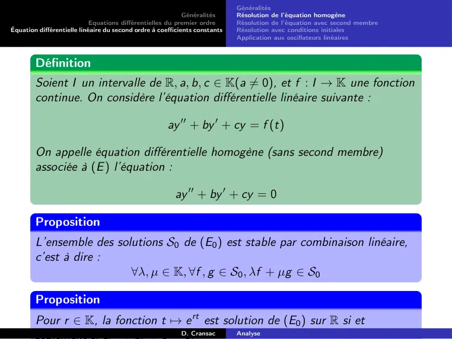

# CM-Equations-Differentielles_2023-2024_Analyse2_P1S2_DCransac.pdf

[Ouvrir l’original](https://drive.google.com/open?id=1ZwUokBeIfKgu_scr2IRUl2Jw1ntBhWQX) · Les deux lectures automatiques du PDF divergent sur les pages indiquées. Leur fac-similé accompagne le texte.

**Pages présentant un écart entre les deux extractions** — 166.

## Page 1

~~~text
                                                            Généralités
                            Equations différentielles du premier ordre
Équation différentielle linéaire du second ordre à coefficients constants

                              Equations Différentielles
        1    Généralités
        2    Equations différentielles du premier ordre
               Définitions
               Equation différentielles linéaires du premier ordre quelconque
               Problème de Cauchy
               Equation différentielles linéaires à coefficient constant
               Equations à variables séparables
               Equations homogènes
        3    Équation différentielle linéaire du second ordre à coefficients
             constants
               Généralités
               Résolution de l’équation homogène
               Résolution de l’équation avec second membre
               Résolution avec conditions initiales
               Application aux oscillateurs linéaires
                                                          D. Cransac        Analyse
~~~

## Page 2

~~~text
                                                            Généralités
                            Equations différentielles du premier ordre
Équation différentielle linéaire du second ordre à coefficients constants

                       Généralités sur les équations
                              différentielles

                                                          D. Cransac        Analyse
~~~

## Page 3

~~~text
                                                            Généralités
                            Equations différentielles du premier ordre
Équation différentielle linéaire du second ordre à coefficients constants

Introduction
        Définition
        Soit une fonction
                                                             f : Rn+1 → R
        On note y les fonctions définies de R dans R, n fois dérivables.
        On définit l’équation différentielle

                                              f (y , y 0 , . . . , y (n) , t) = 0     (E )

                                                          D. Cransac        Analyse
~~~

## Page 4

~~~text
                                                            Généralités
                            Equations différentielles du premier ordre
Équation différentielle linéaire du second ordre à coefficients constants

Introduction
        Définition
        Soit une fonction
                                                             f : Rn+1 → R
        On note y les fonctions définies de R dans R, n fois dérivables.
        On définit l’équation différentielle

                                              f (y , y 0 , . . . , y (n) , t) = 0          (E )

        Définition
        Un équation différentielle (E) est d’ordre n ∈ N lorsque n est le plus petit
        entier naturel telle qu’il existe une fonction f : Rn+1 → R
        telle que (E) peut s’écrire

                                                     f (y , y 0 , . . . , y (n) , t) = 0
                                                          D. Cransac        Analyse
~~~

## Page 5

~~~text
                                                            Généralités
                            Equations différentielles du premier ordre
Équation différentielle linéaire du second ordre à coefficients constants

        Définition
        Résoudre une équation différentielle c’est déterminer l’ensemble des
        fonctions y dérivables (n fois) sur I qui vérifient cette équation.
        On les nomme solutions de l’équation.

                                                          D. Cransac        Analyse
~~~

## Page 6

~~~text
                                                            Généralités
                            Equations différentielles du premier ordre
Équation différentielle linéaire du second ordre à coefficients constants

        Définition
        Résoudre une équation différentielle c’est déterminer l’ensemble des
        fonctions y dérivables (n fois) sur I qui vérifient cette équation.
        On les nomme solutions de l’équation.

                                                          D. Cransac        Analyse
~~~

## Page 7

~~~text
                                                            Généralités
                            Equations différentielles du premier ordre
Équation différentielle linéaire du second ordre à coefficients constants

        Définition
        Résoudre une équation différentielle c’est déterminer l’ensemble des
        fonctions y dérivables (n fois) sur I qui vérifient cette équation.
        On les nomme solutions de l’équation.
        Exemples :

                                                     y 00 − 2x 2 + 1 y 0 + y 2 = xe x
                                                                    
                                         (E1 )
        Une fonction f est solution de E1 différentielle si et seulement si :

                   ∀x ∈ R, f 00 (x) − 2x 2 + 1 f 0 (x) + f (x)2 = xe x
                                                 

                                                          D. Cransac        Analyse
~~~

## Page 8

~~~text
                                                            Généralités
                            Equations différentielles du premier ordre
Équation différentielle linéaire du second ordre à coefficients constants

        Vérifions que les fonctions suivantes sont solutions des équations
        différentielles indiquées :

                                                          D. Cransac        Analyse
~~~

## Page 9

~~~text
                                                            Généralités
                            Equations différentielles du premier ordre
Équation différentielle linéaire du second ordre à coefficients constants

        Vérifions que les fonctions suivantes sont solutions des équations
        différentielles indiquées :
                            2   1
          1   f (x) = 3e −x + pour l’équation différentielle : y 0 + 2xy = x.
                                2

                                                          D. Cransac        Analyse
~~~

## Page 10

~~~text
                                                            Généralités
                            Equations différentielles du premier ordre
Équation différentielle linéaire du second ordre à coefficients constants

        Vérifions que les fonctions suivantes sont solutions des équations
        différentielles indiquées :
                            2   1
          1   f (x) = 3e −x + pour l’équation différentielle : y 0 + 2xy = x.
                                2
                                                                                 2    2
                                                 f 0 (x) = 3(−2x)e −x = −6xe −x

                                                          D. Cransac        Analyse
~~~

## Page 11

~~~text
                                                            Généralités
                            Equations différentielles du premier ordre
Équation différentielle linéaire du second ordre à coefficients constants

        Vérifions que les fonctions suivantes sont solutions des équations
        différentielles indiquées :
                            2   1
          1   f (x) = 3e −x + pour l’équation différentielle : y 0 + 2xy = x.
                                2
                                                                                 2    2
                                                 f 0 (x) = 3(−2x)e −x = −6xe −x
                                                                            2
                                                 2xf (x) = 6xe −x + x

                                                          D. Cransac        Analyse
~~~

## Page 12

~~~text
                                                            Généralités
                            Equations différentielles du premier ordre
Équation différentielle linéaire du second ordre à coefficients constants

        Vérifions que les fonctions suivantes sont solutions des équations
        différentielles indiquées :
                            2   1
          1   f (x) = 3e −x + pour l’équation différentielle : y 0 + 2xy = x.
                                2
                                                                                 2    2
                                                 f 0 (x) = 3(−2x)e −x = −6xe −x
                                                                            2
                                                 2xf (x) = 6xe −x + x
                 On vérifie bien que : f 0 (x) + 2xf (x) = x

                                                          D. Cransac        Analyse
~~~

## Page 13

~~~text
                                                            Généralités
                            Equations différentielles du premier ordre
Équation différentielle linéaire du second ordre à coefficients constants

        Vérifions que les fonctions suivantes sont solutions des équations
        différentielles indiquées :
                            2   1
          1   f (x) = 3e −x + pour l’équation différentielle : y 0 + 2xy = x.
                                2
                                                                                 2    2
                                                 f 0 (x) = 3(−2x)e −x = −6xe −x
                                                                            2
                                                 2xf (x) = 6xe −x + x
                 On vérifie bien que√: f 0 (x) + 2xf (x) = x
            2    f (x) = 2e −x cos(x 3) pour l’équation différentielle :
                                                             y 00 + 2y 0 + 4y = 0

                                                          D. Cransac        Analyse
~~~

## Page 14

~~~text
                                                            Généralités
                            Equations différentielles du premier ordre
Équation différentielle linéaire du second ordre à coefficients constants

        Vérifions que les fonctions suivantes sont solutions des équations
        différentielles indiquées :
                            2   1
          1   f (x) = 3e −x + pour l’équation différentielle : y 0 + 2xy = x.
                                2
                                                                                 2    2
                                                 f 0 (x) = 3(−2x)e −x = −6xe −x
                                                                            2
                                                 2xf (x) = 6xe −x + x
                 On vérifie bien que√: f 0 (x) + 2xf (x) = x
            2    f (x) = 2e −x cos(x 3) pour l’équation différentielle :
                                                             y 00 + 2y 0 + 4y = 0

                                          √    √       √
                  f 0 (x) = 2e −x (− cos(x 3) − 3 sin(x 3))

                                                          D. Cransac        Analyse
~~~

## Page 15

~~~text
                                                            Généralités
                            Equations différentielles du premier ordre
Équation différentielle linéaire du second ordre à coefficients constants

        Vérifions que les fonctions suivantes sont solutions des équations
        différentielles indiquées :
                            2   1
          1   f (x) = 3e −x + pour l’équation différentielle : y 0 + 2xy = x.
                                2
                                                                                 2    2
                                                 f 0 (x) = 3(−2x)e −x = −6xe −x
                                                                            2
                                                 2xf (x) = 6xe −x + x
                 On vérifie bien que√: f 0 (x) + 2xf (x) = x
            2    f (x) = 2e −x cos(x 3) pour l’équation différentielle :
                                                             y 00 + 2y 0 + 4y = 0

                                          √     √      √
                  f 0 (x) = 2e −x (− cos(x 3) − 3 sin(x 3))
                                        √     √      √     √      √            √
                 f 00 (x) = 2e −x (cos(x 3) + 3 sin(x 3) + 3 sin(x 3) − 3 cos(x 3))
                            =

                                                          D. Cransac        Analyse
~~~

## Page 16

~~~text
                                                            Généralités
                            Equations différentielles du premier ordre
Équation différentielle linéaire du second ordre à coefficients constants

        Vérifions que les fonctions suivantes sont solutions des équations
        différentielles indiquées :
                            2   1
          1   f (x) = 3e −x + pour l’équation différentielle : y 0 + 2xy = x.
                                2
                                                                                 2    2
                                                 f 0 (x) = 3(−2x)e −x = −6xe −x
                                                                            2
                                                 2xf (x) = 6xe −x + x
                 On vérifie bien que√: f 0 (x) + 2xf (x) = x
            2    f (x) = 2e −x cos(x 3) pour l’équation différentielle :
                                                             y 00 + 2y 0 + 4y = 0

                                          √     √       √
                  f 0 (x) = 2e −x (− cos(x 3) − 3 sin(x 3))
                                        √     √      √      √     √            √
                 f 00 (x) = 2e −x (cos(x 3) + 3 sin(x 3) + 3 sin(x 3) − 3 cos(x 3))
                                           √      √       √
                          = 2e −x (−2 cos(x 3) + 2 3 sin(x 3))

                                                          D. Cransac        Analyse
~~~

## Page 17

~~~text
                                                            Généralités
                            Equations différentielles du premier ordre
Équation différentielle linéaire du second ordre à coefficients constants

        Vérifions que les fonctions suivantes sont solutions des équations
        différentielles indiquées :
                            2   1
          1   f (x) = 3e −x + pour l’équation différentielle : y 0 + 2xy = x.
                                2
                                                                                2        2
                                                 f 0 (x) = 3(−2x)e −x = −6xe −x
                                                                            2
                                                 2xf (x) = 6xe −x + x
                 On vérifie bien que√: f 0 (x) + 2xf (x) = x
            2    f (x) = 2e −x cos(x 3) pour l’équation différentielle :
                                                             y 00 + 2y 0 + 4y = 0

                                          √     √       √
                  f 0 (x) = 2e −x (− cos(x 3) − 3 sin(x 3))
                                        √     √      √      √     √            √
                 f 00 (x) = 2e −x (cos(x 3) + 3 sin(x 3) + 3 sin(x 3) − 3 cos(x 3))
                                           √      √       √
                          = 2e −x (−2 cos(x 3) + 2 3 sin(x 3))
                  On vérifie que l’on a bien :
                                                     f 00 (x)  + 2f 0 (x)
                                                          D. Cransac
                                                                          + 4f (x) = 0
                                                                        Analyse
~~~

## Page 18

~~~text
                                                                            Définitions
                                                                            Equation différentielles linéaires du premier ordre quelconque
                                                            Généralités
                                                                            Problème de Cauchy
                            Equations différentielles du premier ordre
                                                                            Equation différentielles linéaires à coefficient constant
Équation différentielle linéaire du second ordre à coefficients constants
                                                                            Equations à variables séparables
                                                                            Equations homogènes

                                       Equations différentielles
                                          du premier ordre

                                                          D. Cransac        Analyse
~~~

## Page 19

~~~text
                                                                            Définitions
                                                                            Equation différentielles linéaires du premier ordre quelconque
                                                            Généralités
                                                                            Problème de Cauchy
                            Equations différentielles du premier ordre
                                                                            Equation différentielles linéaires à coefficient constant
Équation différentielle linéaire du second ordre à coefficients constants
                                                                            Equations à variables séparables
                                                                            Equations homogènes

                                                          Définitions

                                                          D. Cransac        Analyse
~~~

## Page 20

~~~text
                                                                            Définitions
                                                                            Equation différentielles linéaires du premier ordre quelconque
                                                            Généralités
                                                                            Problème de Cauchy
                            Equations différentielles du premier ordre
                                                                            Equation différentielles linéaires à coefficient constant
Équation différentielle linéaire du second ordre à coefficients constants
                                                                            Equations à variables séparables
                                                                            Equations homogènes

        Définition
        On dit qu’une équation différentielle (E ) est linéaire si et seulement si la
        fonction f est linéaire en y , y 0 , y ”, . . . y (n)

                                                          D. Cransac        Analyse
~~~

## Page 21

~~~text
                                                                            Définitions
                                                                            Equation différentielles linéaires du premier ordre quelconque
                                                            Généralités
                                                                            Problème de Cauchy
                            Equations différentielles du premier ordre
                                                                            Equation différentielles linéaires à coefficient constant
Équation différentielle linéaire du second ordre à coefficients constants
                                                                            Equations à variables séparables
                                                                            Equations homogènes

        Définition
        On dit qu’une équation différentielle (E ) est linéaire si et seulement si la
        fonction f est linéaire en y , y 0 , y ”, . . . y (n)

        Définition
        Soient I un intervalle de R, a et b : I → K des fonctions continues.
        On appelle équation différentielle linéaire du premier ordre (ou d’ordre 1)
        l’équation :

                                                       y 0 + a(t)y (t) = b(t)

                                                          D. Cransac        Analyse
~~~

## Page 22

~~~text
                                                                            Définitions
                                                                            Equation différentielles linéaires du premier ordre quelconque
                                                            Généralités
                                                                            Problème de Cauchy
                            Equations différentielles du premier ordre
                                                                            Equation différentielles linéaires à coefficient constant
Équation différentielle linéaire du second ordre à coefficients constants
                                                                            Equations à variables séparables
                                                                            Equations homogènes

        Définition
        On dit qu’une équation différentielle (E ) est linéaire si et seulement si la
        fonction f est linéaire en y , y 0 , y ”, . . . y (n)

        Définition
        Soient I un intervalle de R, a et b : I → K des fonctions continues.
        On appelle équation différentielle linéaire du premier ordre (ou d’ordre 1)
        l’équation :

                                                       y 0 + a(t)y (t) = b(t)
        Remarque

                                                          D. Cransac        Analyse
~~~

## Page 23

~~~text
                                                                            Définitions
                                                                            Equation différentielles linéaires du premier ordre quelconque
                                                            Généralités
                                                                            Problème de Cauchy
                            Equations différentielles du premier ordre
                                                                            Equation différentielles linéaires à coefficient constant
Équation différentielle linéaire du second ordre à coefficients constants
                                                                            Equations à variables séparables
                                                                            Equations homogènes

        Définition
        On dit qu’une équation différentielle (E ) est linéaire si et seulement si la
        fonction f est linéaire en y , y 0 , y ”, . . . y (n)

        Définition
        Soient I un intervalle de R, a et b : I → K des fonctions continues.
        On appelle équation différentielle linéaire du premier ordre (ou d’ordre 1)
        l’équation :

                                                       y 0 + a(t)y (t) = b(t)
        Remarque
           Soit f une solution de (E) sur I, f est C 1 sur I.
           En effet f 0 (t) = −a(t)f (t) + b(t)

                                                          D. Cransac        Analyse
~~~

## Page 24

~~~text
                                                                            Définitions
                                                                            Equation différentielles linéaires du premier ordre quelconque
                                                            Généralités
                                                                            Problème de Cauchy
                            Equations différentielles du premier ordre
                                                                            Equation différentielles linéaires à coefficient constant
Équation différentielle linéaire du second ordre à coefficients constants
                                                                            Equations à variables séparables
                                                                            Equations homogènes

        Définition
        On dit qu’une équation différentielle (E ) est linéaire si et seulement si la
        fonction f est linéaire en y , y 0 , y ”, . . . y (n)

        Définition
        Soient I un intervalle de R, a et b : I → K des fonctions continues.
        On appelle équation différentielle linéaire du premier ordre (ou d’ordre 1)
        l’équation :

                                                       y 0 + a(t)y (t) = b(t)
        Remarque
           Soit f une solution de (E) sur I, f est C 1 sur I.
           En effet f 0 (t) = −a(t)f (t) + b(t)
           Si on a une équation de type α(t)y 0 (t) + β(t)y (t) = γ(t), on peut
           la ramener à une équation linéaire du premier ordre en travaillant
           dans une intervalle où α ne s’annule pas et en divisant par α(t).
                                                          D. Cransac        Analyse
~~~

## Page 25

~~~text
                                                                            Définitions
                                                                            Equation différentielles linéaires du premier ordre quelconque
                                                            Généralités
                                                                            Problème de Cauchy
                            Equations différentielles du premier ordre
                                                                            Equation différentielles linéaires à coefficient constant
Équation différentielle linéaire du second ordre à coefficients constants
                                                                            Equations à variables séparables
                                                                            Equations homogènes

        Définition
        Soient I un intervalle de R, a et b : I → K des fonctions continues.
        Soit l’équation différentielle

                                                    (E ) y 0 + a(t)y = b(t)
        On appelle équation différentielle homogène associée à (E) l’équation
        obtenue en remplaçant le second membre par 0 dans l’équation E :
                                                       (E ) y 0 + a(t)y = 0

                                                          D. Cransac        Analyse
~~~

## Page 26

~~~text
                                                                            Définitions
                                                                            Equation différentielles linéaires du premier ordre quelconque
                                                            Généralités
                                                                            Problème de Cauchy
                            Equations différentielles du premier ordre
                                                                            Equation différentielles linéaires à coefficient constant
Équation différentielle linéaire du second ordre à coefficients constants
                                                                            Equations à variables séparables
                                                                            Equations homogènes

        Définition
        Soient I un intervalle de R, a et b : I → K des fonctions continues.
        Soit l’équation différentielle

                                                    (E ) y 0 + a(t)y = b(t)
        On appelle équation différentielle homogène associée à (E) l’équation
        obtenue en remplaçant le second membre par 0 dans l’équation E :
                                                       (E ) y 0 + a(t)y = 0

        Attention Ne pas confondre équation différentielle homogène (sans
                   y
        précision : ) et équation différentielle homogène associée à (E)
                   x

                                                          D. Cransac        Analyse
~~~

## Page 27

~~~text
                                                                            Définitions
                                                                            Equation différentielles linéaires du premier ordre quelconque
                                                            Généralités
                                                                            Problème de Cauchy
                            Equations différentielles du premier ordre
                                                                            Equation différentielles linéaires à coefficient constant
Équation différentielle linéaire du second ordre à coefficients constants
                                                                            Equations à variables séparables
                                                                            Equations homogènes

                                       Equations différentielles
                                          du premier ordre
                                       à coefficients constants

                                                          D. Cransac        Analyse
~~~

## Page 28

~~~text
                                                                            Définitions
                                                                            Equation différentielles linéaires du premier ordre quelconque
                                                            Généralités
                                                                            Problème de Cauchy
                            Equations différentielles du premier ordre
                                                                            Equation différentielles linéaires à coefficient constant
Équation différentielle linéaire du second ordre à coefficients constants
                                                                            Equations à variables séparables
                                                                            Equations homogènes

        Proposition
        Pour toute équation différentielle linéaire homogène, la combinaison
        linéaire de deux solutions de l’équation est également solution de
        l’équation.
        C’est à dire

                                        ∀f et g solution de (E ), ∀(λ, µ) ∈ R2

                                                  λf + µg est solution de E

                                                          D. Cransac        Analyse
~~~

## Page 29

~~~text
                                                                            Définitions
                                                                            Equation différentielles linéaires du premier ordre quelconque
                                                            Généralités
                                                                            Problème de Cauchy
                            Equations différentielles du premier ordre
                                                                            Equation différentielles linéaires à coefficient constant
Équation différentielle linéaire du second ordre à coefficients constants
                                                                            Equations à variables séparables
                                                                            Equations homogènes

Résolution des équations homogènes

        Proposition
        Soit une équation linéaire homogène :

                                              (E ) y 0 + a(x)y = 0
                                    avec a fonction continue sur un intervalle I

                                L’ensemble des solutions de cette équation est
                                                          − x a(t)dt
                                   n                       R                o
                                    f /∀x ∈ I , f (x) = λe x0        ,λ ∈ R

                                                          D. Cransac        Analyse
~~~

## Page 30

~~~text
                                                                            Définitions
                                                                            Equation différentielles linéaires du premier ordre quelconque
                                                            Généralités
                                                                            Problème de Cauchy
                            Equations différentielles du premier ordre
                                                                            Equation différentielles linéaires à coefficient constant
Équation différentielle linéaire du second ordre à coefficients constants
                                                                            Equations à variables séparables
                                                                            Equations homogènes

        Démonstration.
        Soit f une solution de l’équation (E )
        On définit                               Rx
                                                     a(t)dt
                                   g (x) = f (x)e x0

                                                          D. Cransac        Analyse
~~~

## Page 31

~~~text
                                                                            Définitions
                                                                            Equation différentielles linéaires du premier ordre quelconque
                                                            Généralités
                                                                            Problème de Cauchy
                            Equations différentielles du premier ordre
                                                                            Equation différentielles linéaires à coefficient constant
Équation différentielle linéaire du second ordre à coefficients constants
                                                                            Equations à variables séparables
                                                                            Equations homogènes

        Démonstration.
        Soit f une solution de l’équation (E )
        On définit                               Rx
                                                     a(t)dt
                                   g (x) = f (x)e x0
        La fonction g est dérivable comme produit de fonctions dérivables et

                                                          D. Cransac        Analyse
~~~

## Page 32

~~~text
                                                                              Définitions
                                                                              Equation différentielles linéaires du premier ordre quelconque
                                                            Généralités
                                                                              Problème de Cauchy
                            Equations différentielles du premier ordre
                                                                              Equation différentielles linéaires à coefficient constant
Équation différentielle linéaire du second ordre à coefficients constants
                                                                              Equations à variables séparables
                                                                              Equations homogènes

        Démonstration.
        Soit f une solution de l’équation (E )
        On définit                               Rx
                                                     a(t)dt
                                   g (x) = f (x)e x0
        La fonction g est dérivable comme produit de fonctions dérivables et

                                                                     Rx                                 Rx
                                                                            a(t)dt                           a(t)dt
                            ∀x ∈ I , g 0 (x) = f 0 (x)e x0                           + f (x)a(x)e x0
                                                                                            Rx
                                                                                                 a(t)dt
                                                     = (f 0 (x) + f (x)a(x))e x0
                                                     =0

                                                          D. Cransac          Analyse
~~~

## Page 33

~~~text
                                                                              Définitions
                                                                              Equation différentielles linéaires du premier ordre quelconque
                                                            Généralités
                                                                              Problème de Cauchy
                            Equations différentielles du premier ordre
                                                                              Equation différentielles linéaires à coefficient constant
Équation différentielle linéaire du second ordre à coefficients constants
                                                                              Equations à variables séparables
                                                                              Equations homogènes

        Démonstration.
        Soit f une solution de l’équation (E )
        On définit                               Rx
                                                     a(t)dt
                                   g (x) = f (x)e x0
        La fonction g est dérivable comme produit de fonctions dérivables et

                                                                     Rx                                 Rx
                                                                            a(t)dt                           a(t)dt
                            ∀x ∈ I , g 0 (x) = f 0 (x)e x0                           + f (x)a(x)e x0
                                                                                            Rx
                                                                                                 a(t)dt
                                                     = (f 0 (x) + f (x)a(x))e x0
                                                     =0

        Donc la fonction g est constante, donc il existe A ∈ R tel que g (x) = A
                     − x a(t)dt
                       R
        et f (x) = Ae x0        .

                                                          D. Cransac          Analyse
~~~

## Page 34

~~~text
                                                                              Définitions
                                                                              Equation différentielles linéaires du premier ordre quelconque
                                                            Généralités
                                                                              Problème de Cauchy
                            Equations différentielles du premier ordre
                                                                              Equation différentielles linéaires à coefficient constant
Équation différentielle linéaire du second ordre à coefficients constants
                                                                              Equations à variables séparables
                                                                              Equations homogènes

        Démonstration.
        Soit f une solution de l’équation (E )
        On définit                               Rx
                                                     a(t)dt
                                   g (x) = f (x)e x0
        La fonction g est dérivable comme produit de fonctions dérivables et

                                                                     Rx                                 Rx
                                                                            a(t)dt                           a(t)dt
                            ∀x ∈ I , g 0 (x) = f 0 (x)e x0                           + f (x)a(x)e x0
                                                                                            Rx
                                                                                                 a(t)dt
                                                     = (f 0 (x) + f (x)a(x))e x0
                                                     =0

        Donc la fonction g est constante, donc il existe A ∈ R tel que g (x) = A
                     − x a(t)dt
                       R
        et f (x) = Ae x0        .
        Donc toute fonction f solution de (E) et de cette forme.
                                                                 ... suite ...

                                                          D. Cransac          Analyse
~~~

## Page 35

~~~text
                                                                             Définitions
                                                                             Equation différentielles linéaires du premier ordre quelconque
                                                            Généralités
                                                                             Problème de Cauchy
                            Equations différentielles du premier ordre
                                                                             Equation différentielles linéaires à coefficient constant
Équation différentielle linéaire du second ordre à coefficients constants
                                                                             Equations à variables séparables
                                                                             Equations homogènes

        Démonstration.
                                                                            Rx
                                                                        −        a(t)dt
        Par ailleurs, si on définit h(x)  = Ae x0         , on aR
                                    − xx a(t)dt               − x a(t)dt
                                     R
         0
        h (x) + a(x)h(x) = −Ae         0        a(x) + a(x)Ae x0         = 0 donc les
        fonctions de cette forme sont bien solution de l’équation.
        D’où le résultat.

                                                          D. Cransac         Analyse
~~~

## Page 36

~~~text
                                                                            Définitions
                                                                            Equation différentielles linéaires du premier ordre quelconque
                                                            Généralités
                                                                            Problème de Cauchy
                            Equations différentielles du premier ordre
                                                                            Equation différentielles linéaires à coefficient constant
Équation différentielle linéaire du second ordre à coefficients constants
                                                                            Equations à variables séparables
                                                                            Equations homogènes

        Exemple
                                                         (EH ) xy 0 − y = 0

                                                          D. Cransac        Analyse
~~~

## Page 37

~~~text
                                                                            Définitions
                                                                            Equation différentielles linéaires du premier ordre quelconque
                                                            Généralités
                                                                            Problème de Cauchy
                            Equations différentielles du premier ordre
                                                                            Equation différentielles linéaires à coefficient constant
Équation différentielle linéaire du second ordre à coefficients constants
                                                                            Equations à variables séparables
                                                                            Equations homogènes

        Exemple
                                                         (EH ) xy 0 − y = 0
        Solution
        On se place dans une intervalle où x 6= 0, I =]0; +∞[ ou J =] − ∞; 0[

                                                          D. Cransac        Analyse
~~~

## Page 38

~~~text
                                                                            Définitions
                                                                            Equation différentielles linéaires du premier ordre quelconque
                                                            Généralités
                                                                            Problème de Cauchy
                            Equations différentielles du premier ordre
                                                                            Equation différentielles linéaires à coefficient constant
Équation différentielle linéaire du second ordre à coefficients constants
                                                                            Equations à variables séparables
                                                                            Equations homogènes

        Exemple
                                                         (EH ) xy 0 − y = 0
        Solution
        On se place dans une intervalle où x 6= 0, I =]0; +∞[ ou J =] − ∞; 0[
        On a
                                               1
                                   Eh ⇔ y 0 − y = 0
                                               x

                                                          D. Cransac        Analyse
~~~

## Page 39

~~~text
                                                                            Définitions
                                                                            Equation différentielles linéaires du premier ordre quelconque
                                                            Généralités
                                                                            Problème de Cauchy
                            Equations différentielles du premier ordre
                                                                            Equation différentielles linéaires à coefficient constant
Équation différentielle linéaire du second ordre à coefficients constants
                                                                            Equations à variables séparables
                                                                            Equations homogènes

        Exemple
                                                         (EH ) xy 0 − y = 0
        Solution
        On se place dans une intervalle où x 6= 0, I =]0; +∞[ ou J =] − ∞; 0[
        On a
                                               1
                                   Eh ⇔ y 0 − y = 0
                                               x
        L’ensemble des solutions est l’ensemble des fonctions f telles que

                                                          D. Cransac        Analyse
~~~

## Page 40

~~~text
                                                                            Définitions
                                                                            Equation différentielles linéaires du premier ordre quelconque
                                                            Généralités
                                                                            Problème de Cauchy
                            Equations différentielles du premier ordre
                                                                            Equation différentielles linéaires à coefficient constant
Équation différentielle linéaire du second ordre à coefficients constants
                                                                            Equations à variables séparables
                                                                            Equations homogènes

        Exemple
                                                         (EH ) xy 0 − y = 0
        Solution
        On se place dans une intervalle où x 6= 0, I =]0; +∞[ ou J =] − ∞; 0[
        On a
                                               1
                                   Eh ⇔ y 0 − y = 0
                                               x
        L’ensemble des solutions est l’ensemble des fonctions f telles que
                                                     R x dx
                                  f (x) = Ae 1 x = Ae ln |x| = A|x| avec A ∈ R

                                                          D. Cransac        Analyse
~~~

## Page 41

~~~text
                                                                            Définitions
                                                                            Equation différentielles linéaires du premier ordre quelconque
                                                            Généralités
                                                                            Problème de Cauchy
                            Equations différentielles du premier ordre
                                                                            Equation différentielles linéaires à coefficient constant
Équation différentielle linéaire du second ordre à coefficients constants
                                                                            Equations à variables séparables
                                                                            Equations homogènes

        Exemple
                                                         (EH ) xy 0 − y = 0
        Solution
        On se place dans une intervalle où x 6= 0, I =]0; +∞[ ou J =] − ∞; 0[
        On a
                                               1
                                   Eh ⇔ y 0 − y = 0
                                               x
        L’ensemble des solutions est l’ensemble des fonctions f telles que
                                                     R x dx
                                  f (x) = Ae 1 x = Ae ln |x| = A|x| avec A ∈ R
        Construction des solutions sur R

                                                          D. Cransac        Analyse
~~~

## Page 42

~~~text
                                                                            Définitions
                                                                            Equation différentielles linéaires du premier ordre quelconque
                                                            Généralités
                                                                            Problème de Cauchy
                            Equations différentielles du premier ordre
                                                                            Equation différentielles linéaires à coefficient constant
Équation différentielle linéaire du second ordre à coefficients constants
                                                                            Equations à variables séparables
                                                                            Equations homogènes

        Exemple
                                                         (EH ) xy 0 − y = 0
        Solution
        On se place dans une intervalle où x 6= 0, I =]0; +∞[ ou J =] − ∞; 0[
        On a
                                               1
                                   Eh ⇔ y 0 − y = 0
                                               x
        L’ensemble des solutions est l’ensemble des fonctions f telles que
                                                     R x dx
                                  f (x) = Ae 1 x = Ae ln |x| = A|x| avec A ∈ R
        Construction des solutions sur R
        On veut définir une fonction f sur R qui est de classe C 1 .

                                                          D. Cransac        Analyse
~~~

## Page 43

~~~text
                                                                            Définitions
                                                                            Equation différentielles linéaires du premier ordre quelconque
                                                            Généralités
                                                                            Problème de Cauchy
                            Equations différentielles du premier ordre
                                                                            Equation différentielles linéaires à coefficient constant
Équation différentielle linéaire du second ordre à coefficients constants
                                                                            Equations à variables séparables
                                                                            Equations homogènes

        Exemple
                                                         (EH ) xy 0 − y = 0
        Solution
        On se place dans une intervalle où x 6= 0, I =]0; +∞[ ou J =] − ∞; 0[
        On a
                                               1
                                   Eh ⇔ y 0 − y = 0
                                               x
        L’ensemble des solutions est l’ensemble des fonctions f telles que
                                                     R x dx
                                  f (x) = Ae 1 x = Ae ln |x| = A|x| avec A ∈ R
        Construction des solutions sur R
        On veut définir une fonction f sur R qui est de classe C 1 .
        On a donc sur ] − ∞; 0[, f (x) = Bx et sur ]0; +∞[, f (x) = Ax.

                                                          D. Cransac        Analyse
~~~

## Page 44

~~~text
                                                                            Définitions
                                                                            Equation différentielles linéaires du premier ordre quelconque
                                                            Généralités
                                                                            Problème de Cauchy
                            Equations différentielles du premier ordre
                                                                            Equation différentielles linéaires à coefficient constant
Équation différentielle linéaire du second ordre à coefficients constants
                                                                            Equations à variables séparables
                                                                            Equations homogènes

        Exemple
                                                         (EH ) xy 0 − y = 0
        Solution
        On se place dans une intervalle où x 6= 0, I =]0; +∞[ ou J =] − ∞; 0[
        On a
                                               1
                                   Eh ⇔ y 0 − y = 0
                                               x
        L’ensemble des solutions est l’ensemble des fonctions f telles que
                                                     R x dx
                                  f (x) = Ae 1 x = Ae ln |x| = A|x| avec A ∈ R
        Construction des solutions sur R
        On veut définir une fonction f sur R qui est de classe C 1 .
        On a donc sur ] − ∞; 0[, f (x) = Bx et sur ]0; +∞[, f (x) = Ax.
        Pour que la fonction soit de classe C 1 il faut et il suffit que A = B.

                                                          D. Cransac        Analyse
~~~

## Page 45

~~~text
                                                                            Définitions
                                                                            Equation différentielles linéaires du premier ordre quelconque
                                                            Généralités
                                                                            Problème de Cauchy
                            Equations différentielles du premier ordre
                                                                            Equation différentielles linéaires à coefficient constant
Équation différentielle linéaire du second ordre à coefficients constants
                                                                            Equations à variables séparables
                                                                            Equations homogènes

        Exemple
                                                         (EH ) xy 0 − y = 0
        Solution
        On se place dans une intervalle où x 6= 0, I =]0; +∞[ ou J =] − ∞; 0[
        On a
                                               1
                                   Eh ⇔ y 0 − y = 0
                                               x
        L’ensemble des solutions est l’ensemble des fonctions f telles que
                                                     R x dx
                                  f (x) = Ae 1 x = Ae ln |x| = A|x| avec A ∈ R
        Construction des solutions sur R
        On veut définir une fonction f sur R qui est de classe C 1 .
        On a donc sur ] − ∞; 0[, f (x) = Bx et sur ]0; +∞[, f (x) = Ax.
        Pour que la fonction soit de classe C 1 il faut et il suffit que A = B.
        Donc l’ensemble des solutions de l’équation (E ) est l’ensemble des
        fonctions linéaires.
                                                          D. Cransac        Analyse
~~~

## Page 46

~~~text
                                                                            Définitions
                                                                            Equation différentielles linéaires du premier ordre quelconque
                                                            Généralités
                                                                            Problème de Cauchy
                            Equations différentielles du premier ordre
                                                                            Equation différentielles linéaires à coefficient constant
Équation différentielle linéaire du second ordre à coefficients constants
                                                                            Equations à variables séparables
                                                                            Equations homogènes

        Exemple
                                                        (EH ) 2xy 0 − y = 0

                                                          D. Cransac        Analyse
~~~

## Page 47

~~~text
                                                                            Définitions
                                                                            Equation différentielles linéaires du premier ordre quelconque
                                                            Généralités
                                                                            Problème de Cauchy
                            Equations différentielles du premier ordre
                                                                            Equation différentielles linéaires à coefficient constant
Équation différentielle linéaire du second ordre à coefficients constants
                                                                            Equations à variables séparables
                                                                            Equations homogènes

        Exemple
                                                        (EH ) 2xy 0 − y = 0
        Solution

                                                          D. Cransac        Analyse
~~~

## Page 48

~~~text
                                                                            Définitions
                                                                            Equation différentielles linéaires du premier ordre quelconque
                                                            Généralités
                                                                            Problème de Cauchy
                            Equations différentielles du premier ordre
                                                                            Equation différentielles linéaires à coefficient constant
Équation différentielle linéaire du second ordre à coefficients constants
                                                                            Equations à variables séparables
                                                                            Equations homogènes

        Exemple
                                                        (EH ) 2xy 0 − y = 0
        Solution
        On se place dans une intervalle où x 6= 0, I =]0; +∞[ ou J =] − ∞; 0[

                                                          D. Cransac        Analyse
~~~

## Page 49

~~~text
                                                                            Définitions
                                                                            Equation différentielles linéaires du premier ordre quelconque
                                                            Généralités
                                                                            Problème de Cauchy
                            Equations différentielles du premier ordre
                                                                            Equation différentielles linéaires à coefficient constant
Équation différentielle linéaire du second ordre à coefficients constants
                                                                            Equations à variables séparables
                                                                            Equations homogènes

        Exemple
                                                        (EH ) 2xy 0 − y = 0
        Solution
        On se place dans une intervalle où x 6= 0, I =]0; +∞[ ou J =] − ∞; 0[
        On a
                                                1
                                  Eh ⇔ y 0 −      y =0
                                               2x

                                                          D. Cransac        Analyse
~~~

## Page 50

~~~text
                                                                            Définitions
                                                                            Equation différentielles linéaires du premier ordre quelconque
                                                            Généralités
                                                                            Problème de Cauchy
                            Equations différentielles du premier ordre
                                                                            Equation différentielles linéaires à coefficient constant
Équation différentielle linéaire du second ordre à coefficients constants
                                                                            Equations à variables séparables
                                                                            Equations homogènes

        Exemple
                                                        (EH ) 2xy 0 − y = 0
        Solution
        On se place dans une intervalle où x 6= 0, I =]0; +∞[ ou J =] − ∞; 0[
        On a
                                                1
                                  Eh ⇔ y 0 −      y =0
                                               2x
        L’ensemble des solutions est l’ensemble des fonctions f telles que

                                                          D. Cransac        Analyse
~~~

## Page 51

~~~text
                                                                            Définitions
                                                                            Equation différentielles linéaires du premier ordre quelconque
                                                            Généralités
                                                                            Problème de Cauchy
                            Equations différentielles du premier ordre
                                                                            Equation différentielles linéaires à coefficient constant
Équation différentielle linéaire du second ordre à coefficients constants
                                                                            Equations à variables séparables
                                                                            Equations homogènes

        Exemple
                                                        (EH ) 2xy 0 − y = 0
        Solution
        On se place dans une intervalle où x 6= 0, I =]0; +∞[ ou J =] − ∞; 0[
        On a
                                                 1
                                    Eh ⇔ y 0 −     y =0
                                                2x
        L’ensemble des solutions est l’ensemble des fonctions f telles que
                                          1
                              R x dx                 p
                    f (x) = Ae 1 2x = Ae 2 ln |x| = A |x| avec A ∈ R

                                                          D. Cransac        Analyse
~~~

## Page 52

~~~text
                                                                            Définitions
                                                                            Equation différentielles linéaires du premier ordre quelconque
                                                            Généralités
                                                                            Problème de Cauchy
                            Equations différentielles du premier ordre
                                                                            Equation différentielles linéaires à coefficient constant
Équation différentielle linéaire du second ordre à coefficients constants
                                                                            Equations à variables séparables
                                                                            Equations homogènes

        Exemple
                                                        (EH ) 2xy 0 − y = 0
        Solution
        On se place dans une intervalle où x 6= 0, I =]0; +∞[ ou J =] − ∞; 0[
        On a
                                                 1
                                    Eh ⇔ y 0 −     y =0
                                                2x
        L’ensemble des solutions est l’ensemble des fonctions f telles que
                                          1
                              R x dx                 p
                    f (x) = Ae 1 2x = Ae 2 ln |x| = A |x| avec A ∈ R
        Construction des solutions sur R

                                                          D. Cransac        Analyse
~~~

## Page 53

~~~text
                                                                            Définitions
                                                                            Equation différentielles linéaires du premier ordre quelconque
                                                            Généralités
                                                                            Problème de Cauchy
                            Equations différentielles du premier ordre
                                                                            Equation différentielles linéaires à coefficient constant
Équation différentielle linéaire du second ordre à coefficients constants
                                                                            Equations à variables séparables
                                                                            Equations homogènes

        Exemple
                                                        (EH ) 2xy 0 − y = 0
        Solution
        On se place dans une intervalle où x 6= 0, I =]0; +∞[ ou J =] − ∞; 0[
        On a
                                                 1
                                    Eh ⇔ y 0 −     y =0
                                                2x
        L’ensemble des solutions est l’ensemble des fonctions f telles que
                                          1
                              R x dx                 p
                    f (x) = Ae 1 2x = Ae 2 ln |x| = A |x| avec A ∈ R
        Construction des solutions sur R
        On veut définir une fonction f sur R qui est de classe C 1 .

                                                          D. Cransac        Analyse
~~~

## Page 54

~~~text
                                                                            Définitions
                                                                            Equation différentielles linéaires du premier ordre quelconque
                                                            Généralités
                                                                            Problème de Cauchy
                            Equations différentielles du premier ordre
                                                                            Equation différentielles linéaires à coefficient constant
Équation différentielle linéaire du second ordre à coefficients constants
                                                                            Equations à variables séparables
                                                                            Equations homogènes

        Exemple
                                                        (EH ) 2xy 0 − y = 0
        Solution
        On se place dans une intervalle où x 6= 0, I =]0; +∞[ ou J =] − ∞; 0[
        On a
                                                 1
                                    Eh ⇔ y 0 −     y =0
                                                2x
        L’ensemble des solutions est l’ensemble des fonctions f telles que
                                          1
                              R x dx                 p
                    f (x) = Ae 1 2x = Ae 2 ln |x| = A |x| avec A ∈ R
        Construction des solutions sur R
        On veut définir une fonction f sur R qui est de classe C 1 .
                                           √
        On a donc sur ]0; +∞[, f (x) = A x.
        Si A 6= 0, cette fonction est prolongeable par continuité en 0 mais la
        fonction obtenue n’est pas dérivable.

                                                          D. Cransac        Analyse
~~~

## Page 55

~~~text
                                                                            Définitions
                                                                            Equation différentielles linéaires du premier ordre quelconque
                                                            Généralités
                                                                            Problème de Cauchy
                            Equations différentielles du premier ordre
                                                                            Equation différentielles linéaires à coefficient constant
Équation différentielle linéaire du second ordre à coefficients constants
                                                                            Equations à variables séparables
                                                                            Equations homogènes

        Exemple
                                                        (EH ) 2xy 0 − y = 0
        Solution
        On se place dans une intervalle où x 6= 0, I =]0; +∞[ ou J =] − ∞; 0[
        On a
                                                 1
                                    Eh ⇔ y 0 −     y =0
                                                2x
        L’ensemble des solutions est l’ensemble des fonctions f telles que
                                          1
                              R x dx                 p
                    f (x) = Ae 1 2x = Ae 2 ln |x| = A |x| avec A ∈ R
        Construction des solutions sur R
        On veut définir une fonction f sur R qui est de classe C 1 .
                                           √
        On a donc sur ]0; +∞[, f (x) = A x.
        Si A 6= 0, cette fonction est prolongeable par continuité en 0 mais la
        fonction obtenue n’est pas dérivable. Donc il n’y a pas de solution sur R.

                                                          D. Cransac        Analyse
~~~

## Page 56

~~~text
                                                                            Définitions
                                                                            Equation différentielles linéaires du premier ordre quelconque
                                                            Généralités
                                                                            Problème de Cauchy
                            Equations différentielles du premier ordre
                                                                            Equation différentielles linéaires à coefficient constant
Équation différentielle linéaire du second ordre à coefficients constants
                                                                            Equations à variables séparables
                                                                            Equations homogènes

        Exemple
                                                        (EH ) 2xy 0 − y = 0
        Solution
        On se place dans une intervalle où x 6= 0, I =]0; +∞[ ou J =] − ∞; 0[
        On a
                                                 1
                                    Eh ⇔ y 0 −     y =0
                                                2x
        L’ensemble des solutions est l’ensemble des fonctions f telles que
                                          1
                              R x dx                 p
                    f (x) = Ae 1 2x = Ae 2 ln |x| = A |x| avec A ∈ R
        Construction des solutions sur R
        On veut définir une fonction f sur R qui est de classe C 1 .
                                           √
        On a donc sur ]0; +∞[, f (x) = A x.
        Si A 6= 0, cette fonction est prolongeable par continuité en 0 mais la
        fonction obtenue n’est pas dérivable. Donc il n’y a pas de solution sur R.
        L’unique solution est donc la fonction nulle.
                                                          D. Cransac        Analyse
~~~

## Page 57

~~~text
                                                                            Définitions
                                                                            Equation différentielles linéaires du premier ordre quelconque
                                                            Généralités
                                                                            Problème de Cauchy
                            Equations différentielles du premier ordre
                                                                            Equation différentielles linéaires à coefficient constant
Équation différentielle linéaire du second ordre à coefficients constants
                                                                            Equations à variables séparables
                                                                            Equations homogènes

        Exemple Résoudre sur I =]0; π[

                                                 (EH ) y 0 sin t − y cos t = 0

                                                          D. Cransac        Analyse
~~~

## Page 58

~~~text
                                                                            Définitions
                                                                            Equation différentielles linéaires du premier ordre quelconque
                                                            Généralités
                                                                            Problème de Cauchy
                            Equations différentielles du premier ordre
                                                                            Equation différentielles linéaires à coefficient constant
Équation différentielle linéaire du second ordre à coefficients constants
                                                                            Equations à variables séparables
                                                                            Equations homogènes

        Exemple Résoudre sur I =]0; π[

                                                 (EH ) y 0 sin t − y cos t = 0

        Solution

                                                          D. Cransac        Analyse
~~~

## Page 59

~~~text
                                                                            Définitions
                                                                            Equation différentielles linéaires du premier ordre quelconque
                                                            Généralités
                                                                            Problème de Cauchy
                            Equations différentielles du premier ordre
                                                                            Equation différentielles linéaires à coefficient constant
Équation différentielle linéaire du second ordre à coefficients constants
                                                                            Equations à variables séparables
                                                                            Equations homogènes

        Exemple Résoudre sur I =]0; π[

                                                 (EH ) y 0 sin t − y cos t = 0

        Solution
        La fonction sin ne s’annule par sur I donc l’équation revient à

                                                          D. Cransac        Analyse
~~~

## Page 60

~~~text
                                                                            Définitions
                                                                            Equation différentielles linéaires du premier ordre quelconque
                                                            Généralités
                                                                            Problème de Cauchy
                            Equations différentielles du premier ordre
                                                                            Equation différentielles linéaires à coefficient constant
Équation différentielle linéaire du second ordre à coefficients constants
                                                                            Equations à variables séparables
                                                                            Equations homogènes

        Exemple Résoudre sur I =]0; π[

                                                 (EH ) y 0 sin t − y cos t = 0

        Solution
        La fonction sin ne s’annule par sur I donc l’équation revient à
                                                                     cos x
                                                           y0 −            y =0
                                                                     sin x

                                                          D. Cransac        Analyse
~~~

## Page 61

~~~text
                                                                            Définitions
                                                                            Equation différentielles linéaires du premier ordre quelconque
                                                            Généralités
                                                                            Problème de Cauchy
                            Equations différentielles du premier ordre
                                                                            Equation différentielles linéaires à coefficient constant
Équation différentielle linéaire du second ordre à coefficients constants
                                                                            Equations à variables séparables
                                                                            Equations homogènes

        Exemple Résoudre sur I =]0; π[

                                                 (EH ) y 0 sin t − y cos t = 0

        Solution
        La fonction sin ne s’annule par sur I donc l’équation revient à
                                                                     cos x
                                                           y0 −            y =0
                                                                     sin x
        Donc les solutions sont
                                                Rx cos t
                                            −    π sin t dt
                          f (t) = Ae             2            = Ae ln | sin t| = A sin t avec A ∈ R

                                                          D. Cransac        Analyse
~~~

## Page 62

~~~text
                                                                            Définitions
                                                                            Equation différentielles linéaires du premier ordre quelconque
                                                            Généralités
                                                                            Problème de Cauchy
                            Equations différentielles du premier ordre
                                                                            Equation différentielles linéaires à coefficient constant
Équation différentielle linéaire du second ordre à coefficients constants
                                                                            Equations à variables séparables
                                                                            Equations homogènes

        Proposition
        Soit une équation différentielle linéaire
                                          (E ) y 0 + a(x)y = b(x)
                              avec a et b fonctions continues sur un intervalle I
        Soit yP une solution de l’équation (E), alors
             yH est une solution de l’équation homogène E0 ) associée à (E )
             si et seulement si yH + yP est une solution de l’équation (E)

                                                          D. Cransac        Analyse
~~~

## Page 63

~~~text
                                                                              Définitions
                                                                              Equation différentielles linéaires du premier ordre quelconque
                                                            Généralités
                                                                              Problème de Cauchy
                            Equations différentielles du premier ordre
                                                                              Equation différentielles linéaires à coefficient constant
Équation différentielle linéaire du second ordre à coefficients constants
                                                                              Equations à variables séparables
                                                                              Equations homogènes

        Proposition
        Soit une équation différentielle linéaire
                                          (E ) y 0 + a(x)y = b(x)
                              avec a et b fonctions continues sur un intervalle I
        Soit yP une solution de l’équation (E), alors
             yH est une solution de l’équation homogène E0 ) associée à (E )
             si et seulement si yH + yP est une solution de l’équation (E)

        Démonstration.

        yH solution de (E0 ) ⇔ yH0 + ayH = 0                                ⇔ yH0 + a(x)yH + (yP0 + a(x)yP ) = b(x)
                                                                             ⇔ yH0 + yP0 + a(x)yH + a(x)yP = b(x)
                                                                             ⇔ (yH + yP )0 + a(x)(yH + yP ) = b(x)
                                                                                              ⇔ yH + yP solution de (E )

                                                          D. Cransac          Analyse
~~~

## Page 64

~~~text
                                                                            Définitions
                                                                            Equation différentielles linéaires du premier ordre quelconque
                                                            Généralités
                                                                            Problème de Cauchy
                            Equations différentielles du premier ordre
                                                                            Equation différentielles linéaires à coefficient constant
Équation différentielle linéaire du second ordre à coefficients constants
                                                                            Equations à variables séparables
                                                                            Equations homogènes

        Exemple Résoudre l’équation

                                                   (E )       (1 + x 2 )y 0 + y = 1

                                                          D. Cransac        Analyse
~~~

## Page 65

~~~text
                                                                            Définitions
                                                                            Equation différentielles linéaires du premier ordre quelconque
                                                            Généralités
                                                                            Problème de Cauchy
                            Equations différentielles du premier ordre
                                                                            Equation différentielles linéaires à coefficient constant
Équation différentielle linéaire du second ordre à coefficients constants
                                                                            Equations à variables séparables
                                                                            Equations homogènes

        Exemple Résoudre l’équation

                                                   (E )       (1 + x 2 )y 0 + y = 1

        Solution

                                                          D. Cransac        Analyse
~~~

## Page 66

~~~text
                                                                            Définitions
                                                                            Equation différentielles linéaires du premier ordre quelconque
                                                            Généralités
                                                                            Problème de Cauchy
                            Equations différentielles du premier ordre
                                                                            Equation différentielles linéaires à coefficient constant
Équation différentielle linéaire du second ordre à coefficients constants
                                                                            Equations à variables séparables
                                                                            Equations homogènes

        Exemple Résoudre l’équation

                                                   (E )       (1 + x 2 )y 0 + y = 1

        Solution
        La solution de l’equation homogène est x 7→ λe − arctan x , λ ∈ R

                                                          D. Cransac        Analyse
~~~

## Page 67

~~~text
                                                                            Définitions
                                                                            Equation différentielles linéaires du premier ordre quelconque
                                                            Généralités
                                                                            Problème de Cauchy
                            Equations différentielles du premier ordre
                                                                            Equation différentielles linéaires à coefficient constant
Équation différentielle linéaire du second ordre à coefficients constants
                                                                            Equations à variables séparables
                                                                            Equations homogènes

        Exemple Résoudre l’équation

                                                   (E )       (1 + x 2 )y 0 + y = 1

        Solution
        La solution de l’equation homogène est x 7→ λe − arctan x , λ ∈ R
        La solution constante x 7→ 1 est une solution particulière évidente donc

                                                          D. Cransac        Analyse
~~~

## Page 68

~~~text
                                                                            Définitions
                                                                            Equation différentielles linéaires du premier ordre quelconque
                                                            Généralités
                                                                            Problème de Cauchy
                            Equations différentielles du premier ordre
                                                                            Equation différentielles linéaires à coefficient constant
Équation différentielle linéaire du second ordre à coefficients constants
                                                                            Equations à variables séparables
                                                                            Equations homogènes

        Exemple Résoudre l’équation

                                                   (E )       (1 + x 2 )y 0 + y = 1

        Solution
        La solution de l’equation homogène est x 7→ λe − arctan x , λ ∈ R
        La solution constante x 7→ 1 est une solution particulière évidente donc
        L’ensemble des solutions de l’équation est l’ensemble des fonctions :

                                                          D. Cransac        Analyse
~~~

## Page 69

~~~text
                                                                            Définitions
                                                                            Equation différentielles linéaires du premier ordre quelconque
                                                            Généralités
                                                                            Problème de Cauchy
                            Equations différentielles du premier ordre
                                                                            Equation différentielles linéaires à coefficient constant
Équation différentielle linéaire du second ordre à coefficients constants
                                                                            Equations à variables séparables
                                                                            Equations homogènes

        Exemple Résoudre l’équation

                                                   (E )       (1 + x 2 )y 0 + y = 1

        Solution
        La solution de l’equation homogène est x 7→ λe − arctan x , λ ∈ R
        La solution constante x 7→ 1 est une solution particulière évidente donc
        L’ensemble des solutions de l’équation est l’ensemble des fonctions :

                                                 x 7→ 1 + λe − arctan x               λ∈R

                                                          D. Cransac        Analyse
~~~

## Page 70

~~~text
                                                                            Définitions
                                                                            Equation différentielles linéaires du premier ordre quelconque
                                                            Généralités
                                                                            Problème de Cauchy
                            Equations différentielles du premier ordre
                                                                            Equation différentielles linéaires à coefficient constant
Équation différentielle linéaire du second ordre à coefficients constants
                                                                            Equations à variables séparables
                                                                            Equations homogènes

        Proposition
        Soient a, b1 , b2 : I → K des fonctions continues.
        Si f1 est solution sur I de y 0 + a(t)y = b1 (t) et f2 est solution sur I de
        y 0 + a(t)y = b2 (t) alors pour tout λ, µ ∈ K, λf1 + µf2 est solution sur I de

                                                    y 0 + a(t)y = λb1 + µb2

                                                          D. Cransac        Analyse
~~~

## Page 71

~~~text
                                                                            Définitions
                                                                            Equation différentielles linéaires du premier ordre quelconque
                                                            Généralités
                                                                            Problème de Cauchy
                            Equations différentielles du premier ordre
                                                                            Equation différentielles linéaires à coefficient constant
Équation différentielle linéaire du second ordre à coefficients constants
                                                                            Equations à variables séparables
                                                                            Equations homogènes

        Proposition
        Soient a, b1 , b2 : I → K des fonctions continues.
        Si f1 est solution sur I de y 0 + a(t)y = b1 (t) et f2 est solution sur I de
        y 0 + a(t)y = b2 (t) alors pour tout λ, µ ∈ K, λf1 + µf2 est solution sur I de

                                                    y 0 + a(t)y = λb1 + µb2

        Remarque
        Cette proposition peut être utile dans la pratique : pour résoudre une
        équation différentielle linéaire, on peut éventuellement scinder le second
        membre afin de se ramener à plusieurs équations différentielles dont les
        seconds membres seront plus simples à traiter.

                                                          D. Cransac        Analyse
~~~

## Page 72

~~~text
                                                                            Définitions
                                                                            Equation différentielles linéaires du premier ordre quelconque
                                                            Généralités
                                                                            Problème de Cauchy
                            Equations différentielles du premier ordre
                                                                            Equation différentielles linéaires à coefficient constant
Équation différentielle linéaire du second ordre à coefficients constants
                                                                            Equations à variables séparables
                                                                            Equations homogènes

Problème de Cauchy
        Définition
        Étant données deux fonctions a et b continues sur un intervalle I et à
        valeurs dans K, on considère l’équation différentielle
        (E ) : y 0 + a(t)y = b(t).
        Le problème de Cauchy associé au couple (t0 , y0 ) où t0 ∈ I , y0 ∈ K est
        la recherche des solutions y de (E ) vérifiant la condition initiale (ou
        condition de Cauchy) y (t0 ) = y0 .

        Proposition
        On considère deux fonctions a et b continues sur un intervalle I et à valeurs
        dans K, on considère l’équation différentielle

                                                          y 0 + a(t)y = b(t).

        Pour (t0 , y0 ) ∈ I × K, le problème de Cauchy associé à la condition initiale
        y (t0 ) = y0 admet une unique solution sur I .
                                                          D. Cransac        Analyse
~~~

## Page 73

~~~text
                                                                            Définitions
                                                                            Equation différentielles linéaires du premier ordre quelconque
                                                            Généralités
                                                                            Problème de Cauchy
                            Equations différentielles du premier ordre
                                                                            Equation différentielles linéaires à coefficient constant
Équation différentielle linéaire du second ordre à coefficients constants
                                                                            Equations à variables séparables
                                                                            Equations homogènes

        Démonstration.
        Soit A une primitive de la fonction continue a, qui vérifie donc A0 = a.
        Puisque e A(t) ne s’annule pas sur I , on a une équation équivalente en
        multipliant y 0 + a(t)y = b(t) par e A(t) :

                                                                            d  A(t)      
                      ∀t ∈ I ,         e A(t) (y 0 + a(t)y ) =                 e     y (t) = e A(t) b(t).
                                                                            dt
        Compte tenu de la condition y (t0 ) = y0 , ceci équivaut par intégration de
        t0 à t à :                               Z                                  t
                                        e A(t) y (t) − e A(t0 ) y0 =                    e A(u) f (u)du
                                                                                   t0

        Soit encore si A désigne plus particulièrement la primitive de a s’annulant
        en t0 :                                Z                             t
                                        y (t) = e −A(t) y0 +                       e A(u) f (u)du
                                                                             t0

                                                          D. Cransac        Analyse
~~~

## Page 74

~~~text
                                                                            Définitions
                                                                            Equation différentielles linéaires du premier ordre quelconque
                                                            Généralités
                                                                            Problème de Cauchy
                            Equations différentielles du premier ordre
                                                                            Equation différentielles linéaires à coefficient constant
Équation différentielle linéaire du second ordre à coefficients constants
                                                                            Equations à variables séparables
                                                                            Equations homogènes

        Remarque On a montré en particulier dans la preuve de ce résultat que
        toute solution de (E ) est bien de la forme t 7→ λ(t)e −A(t) , ce qui justifie
        la méthode de variation de la constante.
                                    1     √
        Exemple. Résoudre y 0 −       y = x sur I = R∗+ , avec pour condition
                                   2x
        initiale y (1) = 1.
        Solution Il s’agit d’une équation linéaire du première ordre à coefficient
        continus sur I .
        La solutiongénérale  de son équation homogène associée est donc
                      1            √
        x 7→ λ exp       ln x = λ x, λ ∈ R.
                      2
        Par la méthode de la variation de la constante,
                                                     √ on cherche une solution
        particulière de (E ) sous la forme x 7→ λ(x) √x, avec
                                                           √ λ dérivable sur I .
        En reportant dans l’équation, il vient λ0 (x) x = x donc λ0 (x) = 1 √   puis on
        peut prendre λ : x 7→ x et une solution particulière√de (E ) est x 7→ x x.
        La solution générale de (E ) est donc x 7→ (λ + x) x, λ ∈ R.
        Pour trouver l’unique solution du problème considéré, il faut résoudre
        l’équation (λ + 1) = 1 i.e. λ = 0.                             √
        Ainsi la solution du problème de Cauchy considéré est x 7→ x x.

                                                          D. Cransac        Analyse
~~~

## Page 75

~~~text
                                                                            Définitions
                                                                            Equation différentielles linéaires du premier ordre quelconque
                                                            Généralités
                                                                            Problème de Cauchy
                            Equations différentielles du premier ordre
                                                                            Equation différentielles linéaires à coefficient constant
Équation différentielle linéaire du second ordre à coefficients constants
                                                                            Equations à variables séparables
                                                                            Equations homogènes

        Proposition
        On considère deux fonctions a et b continues sur un intervalle I et à
        valeurs dans R, on considère l’équation différentielle

                                                         y 0 + a(t)y = b(t).

                 Une seule courbe intégrale définie sur I passe par tout point
                 (t0 , y0 ) ∈ I × R.

                                                          D. Cransac        Analyse
~~~

## Page 76

~~~text
                                                                            Définitions
                                                                            Equation différentielles linéaires du premier ordre quelconque
                                                            Généralités
                                                                            Problème de Cauchy
                            Equations différentielles du premier ordre
                                                                            Equation différentielles linéaires à coefficient constant
Équation différentielle linéaire du second ordre à coefficients constants
                                                                            Equations à variables séparables
                                                                            Equations homogènes

        Proposition
        On considère deux fonctions a et b continues sur un intervalle I et à
        valeurs dans R, on considère l’équation différentielle

                                                         y 0 + a(t)y = b(t).

                 Une seule courbe intégrale définie sur I passe par tout point
                 (t0 , y0 ) ∈ I × R.
                 Deux telles courbes intégrales distinctes ne peuvent se couper dans
                 I × R.

                                                          D. Cransac        Analyse
~~~

## Page 77

~~~text
                                                                            Définitions
                                                                            Equation différentielles linéaires du premier ordre quelconque
                                                            Généralités
                                                                            Problème de Cauchy
                            Equations différentielles du premier ordre
                                                                            Equation différentielles linéaires à coefficient constant
Équation différentielle linéaire du second ordre à coefficients constants
                                                                            Equations à variables séparables
                                                                            Equations homogènes

        Démonstration.
        Le premier point est une reformulation du résultat précédent.
        Montrons le deuxième point : supposons que deux courbes intégrales se
        coupent en M0 (t0 , y0 ).
        Notons y1 et y2 les solutions de (E ) sur I correspondantes. Elles sont
        donc toutes deux solutions du même problème de Cauchy :
                                      
                                         (E )
                                         y (t0 ) = y0

        Par unicité, on a donc y1 = y2 .

        Remarque. La seule solution de (E0 ) : y 0 + a(t)y = 0 telle que
        y (t0 ) = 0 est la fonction nulle.
        En effet, la fonction nulle est solution de (E0 ).
        Et par la proposition précédente, c’est l’unique solution telle que
        y (t0 ) = 0.
        En particulier, la seule solution de (E0 ) qui s’annule est la fonction nulle.
                                                          D. Cransac        Analyse
~~~

## Page 78

~~~text
                                                                            Définitions
                                                                            Equation différentielles linéaires du premier ordre quelconque
                                                            Généralités
                                                                            Problème de Cauchy
                            Equations différentielles du premier ordre
                                                                            Equation différentielles linéaires à coefficient constant
Équation différentielle linéaire du second ordre à coefficients constants
                                                                            Equations à variables séparables
                                                                            Equations homogènes

        On revient sur le cas des équations différentielles linéaires du premier
        ordre non normalisées :

                                                      a(t)y 0 + b(t)y = c(t)

        où a, b, c sont continues sur un intervalle I , mais où a est susceptible de
        s’annuler sur I . Nous allons voir sur des exemples que les résultats
        précédents, comme le théorème de Cauchy, peuvent alors tomber en
        défaut. Supposons par exemple que a s’annule en un unique point t0 de
        I . On procèdera alors comme suit.

                                                          D. Cransac        Analyse
~~~

## Page 79

~~~text
                                                                            Définitions
                                                                            Equation différentielles linéaires du premier ordre quelconque
                                                            Généralités
                                                                            Problème de Cauchy
                            Equations différentielles du premier ordre
                                                                            Equation différentielles linéaires à coefficient constant
Équation différentielle linéaire du second ordre à coefficients constants
                                                                            Equations à variables séparables
                                                                            Equations homogènes

Méthode pour étudier les raccordements
        Pour résoudre (E ) sur I :
                 On commence par résoudre l’équation sur les intervalles
                 Ig =] − ∞, t0 [∩I et Id =] t0 , +∞[∩I où a ne s’annule pas.
                 On cherche ensuite une solution f de (E ) sur I . On remarque que f
                 est solution de (E ) sur Ig .
                 On en connait donc la forme explicite f = fg .
                 De même sur l’intervalle Id , on connait la forme fd de f .
                 La fonction f étant
                                       solution de (E ) sur I , la fonction
                                    fg (t) si t ∈ Ig
                 t ∈ I \ {t0 } 7→                     doit être :
                                    fd (t) si t ∈ Id
                         prolongeable par continuité en t0 ,
                         de classe C 1 sur I (c’est à dire en t0 )
                         solution de l’équation différentielle sur I (c’est à dire en t0 ).
        On va voir sur des exemples que ces conditions sont satisfaites dans
        certains cas, pas dans d’autres.
                                                          D. Cransac        Analyse
~~~

## Page 80

~~~text
                                                                            Définitions
                                                                            Equation différentielles linéaires du premier ordre quelconque
                                                            Généralités
                                                                            Problème de Cauchy
                            Equations différentielles du premier ordre
                                                                            Equation différentielles linéaires à coefficient constant
Équation différentielle linéaire du second ordre à coefficients constants
                                                                            Equations à variables séparables
                                                                            Equations homogènes

        Exemple.
        Déterminer les solutions de (E ) : ty 0 − 2y = t 3 sur R.
        Solution
        C’est une équation différentielle linéaire d’ordre un à coefficients variables
        et continus, non normalisée.
        On commence par la résoudre sur des intervalles sur lesquels t 6= 0, soit
        sur R∗+ et sur R∗− .
        On montre alors alors que :

            SR∗+ = t → λt 2 + t 3 , λ ∈ R et SR∗− = t → µt 2 + t 3 , µ ∈ R .
                                                       

        On cherche à présent les solutions de (E ) sur R. Soit f une solution de
        l’équation sur R. Elle est donc solution sur R∗+ et sur R∗− , et on a :

                                     ∃λ ∈ R, f (t) = λt 2 + t 3 pour tout t > 0,
                                     ∃µ ∈ R, f (t) = µt 2 + t 3 pour tout t < 0.

                                                          D. Cransac        Analyse
~~~

## Page 81

~~~text
                                                                            Définitions
                                                                            Equation différentielles linéaires du premier ordre quelconque
                                                            Généralités
                                                                            Problème de Cauchy
                            Equations différentielles du premier ordre
                                                                            Equation différentielles linéaires à coefficient constant
Équation différentielle linéaire du second ordre à coefficients constants
                                                                            Equations à variables séparables
                                                                            Equations homogènes

        Prenons t = 0 dans l’équation, on obtient : 0 × f 0 (0) − 2f (0) = 0, soit
        f (0) = 0.
        La fonction f doit être continue et dérivable en 0 . D’où :

                                                 lim f (t) = f (0) = lim− f (t)
                                               x→0+                              x→0

        Ici on a :
                                      lim λt 2 + t 3 = 0 et lim− µt 2 + t 3 = 0.
                                     x→0+                                   x→0

        Donc cette condition est bien satisfaite pour tout λ, µ ∈ R.

                                                          D. Cransac        Analyse
~~~

## Page 82

~~~text
                                                                            Définitions
                                                                            Equation différentielles linéaires du premier ordre quelconque
                                                            Généralités
                                                                            Problème de Cauchy
                            Equations différentielles du premier ordre
                                                                            Equation différentielles linéaires à coefficient constant
Équation différentielle linéaire du second ordre à coefficients constants
                                                                            Equations à variables séparables
                                                                            Equations homogènes

        On étudie la dérivabilité :
                                             f (t) − f (0)        λt 2 + t 3
                                        lim+               = lim+            =0
                                       t→0         t        t→0        t
                                             f (t) − f (0)        µt 2 + t 3
                                        lim−               = lim−            =0
                                       t→0         t         t→0        t
        Là encore, cette condition est bien satisfaite pour tout λ, µ ∈ R.
        Finalement, on obtient que les solutions de (E ) sur R sont les fonctions
        de la forme :
                                        λt 2 + t 3 si t ≥ 0
                                     
                                t 7→
                                        µt 2 + t 3 si t < 0
        pour tout λ, µ ∈ R.
        On représente plusieurs de ces solutions :

                                                          D. Cransac        Analyse
~~~

## Page 83

~~~text
                                                                            Définitions
                                                                            Equation différentielles linéaires du premier ordre quelconque
                                                            Généralités
                                                                            Problème de Cauchy
                            Equations différentielles du premier ordre
                                                                            Equation différentielles linéaires à coefficient constant
Équation différentielle linéaire du second ordre à coefficients constants
                                                                            Equations à variables séparables
                                                                            Equations homogènes

                                                                        
                                                                            (E )
        Remarque Le problème de Cauchy                                                a donc une infinité de
                                                                            y (0) = 0
        solutions.                                                     
                                             (E )
        À l’opposé, le problème de Cauchy                 n’a aucune solution.
                                             y (0) = 1
        On voit ici que le théorème de Cauchy tombe en défaut en t = 0, là où le
        coefficient t de y 0 s’annule.

                                                          D. Cransac        Analyse
~~~

## Page 84

~~~text
                                                                            Définitions
                                                                            Equation différentielles linéaires du premier ordre quelconque
                                                            Généralités
                                                                            Problème de Cauchy
                            Equations différentielles du premier ordre
                                                                            Equation différentielles linéaires à coefficient constant
Équation différentielle linéaire du second ordre à coefficients constants
                                                                            Equations à variables séparables
                                                                            Equations homogènes

        Exemple. Résoudre (1 − t)y 0 − y = t sur R.
        Solution
        C’est une équation différentielle linéaire d’ordre un à coefficients variables
        et continus, non normalisée.
        On commence par la résoudre sur des intervalles sur lesquels 1 − t 6= 0,
        soit sur ]1, +∞[ et sur ] − ∞, 1[.
        On montre alors alors que :

                                                       t2
                                                                   
                                             λ
                       S]1,+∞[ = t →             +           ,λ ∈ R
                                          1−t       2(1 − t)
        et
                                                                      t2
                                                                                                         
                                                              µ
                                   S]−∞,1[ =              t→     +          ,λ ∈ R
                                                             1−t   2(1 − t)

                                                          D. Cransac        Analyse
~~~

## Page 85

~~~text
                                                                            Définitions
                                                                            Equation différentielles linéaires du premier ordre quelconque
                                                            Généralités
                                                                            Problème de Cauchy
                            Equations différentielles du premier ordre
                                                                            Equation différentielles linéaires à coefficient constant
Équation différentielle linéaire du second ordre à coefficients constants
                                                                            Equations à variables séparables
                                                                            Equations homogènes

        On cherche à présent les solutions de (E ) sur R.
        Soit f l’une d’elles.
        On a alors :
                                      λ         t2
                     ∃λ ∈ R, f (t) =      +            pour tout t > 1
                                     1−t    2(1 − t)
                                      µ         t2
                     ∃µ ∈ R, f (t) =      +            pour tout t < 1
                                     1−t     2(1 − t)
        Prenons t = 1 dans l’équation, on obtient : 0 × f 0 (1) − f (1) = 1, soit
        f (1) = −1.
        La fonction f doit être continue et dérivable en 1 :
                                               
                            λ         t2        +∞ si λ > −1/2
                     lim+       +           =     −∞ si λ < −1/2 .
                    x→1 1 − t      2(1 − t) 
                                                  −1 si λ = −1/2
        Ainsi on a nécessairement λ = −1/2.
                                                     1 t
        De même, µ = −1/2. On obtient alors f (t) = − − sur R. En
                                                     2 2
        particulier f est bien dérivable sur R.
                                                          D. Cransac        Analyse
~~~

## Page 86

~~~text
                                                                            Définitions
                                                                            Equation différentielles linéaires du premier ordre quelconque
                                                            Généralités
                                                                            Problème de Cauchy
                            Equations différentielles du premier ordre
                                                                            Equation différentielles linéaires à coefficient constant
Équation différentielle linéaire du second ordre à coefficients constants
                                                                            Equations à variables séparables
                                                                            Equations homogènes

        Finalement, on obtient qu’il y a une unique solutions de (E ) sur R, qui
        est :
                                             1 t
                                       t 7→ − −
                                             2 2
                                
                                   (E )
        Le problème de Cauchy                    n’a pas de solution dans ce cas.
                                   y (1) = 0
                                
                                   (E )
        Le problème de Cauchy                   a pour sa part une unique
                                   y (1) = −1
        solution.

                                                          D. Cransac        Analyse
~~~

## Page 87

~~~text
                                                                            Définitions
                                                                            Equation différentielles linéaires du premier ordre quelconque
                                                            Généralités
                                                                            Problème de Cauchy
                            Equations différentielles du premier ordre
                                                                            Equation différentielles linéaires à coefficient constant
Équation différentielle linéaire du second ordre à coefficients constants
                                                                            Equations à variables séparables
                                                                            Equations homogènes

                                       Equations différentielles
                                            du premier ordre
                                          à coefficient constant

                                                          D. Cransac        Analyse
~~~

## Page 88

~~~text
                                                                            Définitions
                                                                            Equation différentielles linéaires du premier ordre quelconque
                                                            Généralités
                                                                            Problème de Cauchy
                            Equations différentielles du premier ordre
                                                                            Equation différentielles linéaires à coefficient constant
Équation différentielle linéaire du second ordre à coefficients constants
                                                                            Equations à variables séparables
                                                                            Equations homogènes

Equations différentielles linéaires à coefficient
constant
        Proposition
        Soit une équation différentielle linéaire
                                      (E ) y 0 + ay = b avec a ∈ R et b ∈ R
                                                 L’ensemble des solutions est
                                                                                                              
                                                                                             b
                                  f : R → R, ∃λ ∈ R∀x ∈ R, f (x) =                             + λe −ax
                                                                                             a

        Pour tout (x0 , y0 ) ∈ R2 , il existe une unique solution telle que f (x0 ) = y0

                                                          D. Cransac        Analyse
~~~

## Page 89

~~~text
                                                                            Définitions
                                                                            Equation différentielles linéaires du premier ordre quelconque
                                                            Généralités
                                                                            Problème de Cauchy
                            Equations différentielles du premier ordre
                                                                            Equation différentielles linéaires à coefficient constant
Équation différentielle linéaire du second ordre à coefficients constants
                                                                            Equations à variables séparables
                                                                            Equations homogènes

Equations différentielles linéaires à coefficient
constant
        Proposition
        Soit une équation différentielle linéaire
                                       (E ) y 0 + ay = b avec a ∈ R et b ∈ R
                                                 L’ensemble des solutions est
                                                                                                              
                                                                                             b
                                  f : R → R, ∃λ ∈ R∀x ∈ R, f (x) =                             + λe −ax
                                                                                             a

        Pour tout (x0 , y0 ) ∈ R2 , il existe une unique solution telle que f (x0 ) = y0
        Remarque Si b = 0

                                       f : R → R, ∃λ ∈ R∀x ∈ R, f (x) = λe −ax
                                   

                                                          D. Cransac        Analyse
~~~

## Page 90

~~~text
                                                                            Définitions
                                                                            Equation différentielles linéaires du premier ordre quelconque
                                                            Généralités
                                                                            Problème de Cauchy
                            Equations différentielles du premier ordre
                                                                            Equation différentielles linéaires à coefficient constant
Équation différentielle linéaire du second ordre à coefficients constants
                                                                            Equations à variables séparables
                                                                            Equations homogènes

        Démonstration.
                 On cherche une solution particulière constante :

                                                                                                b
                                                      0 + af0 (x) = b ⇔ f0 (x) =
                                                                                                a
                 On connaît les solutions de l’équation homogène :

                                                                        − xx a(t)dt
                                                                         R
                                                      fH (x) = λe           0         = λe −ax
                 On peut donc conclure que les solutions de l’équation sont f = f0 + fH
                 Donc l’ensemble des solutions est bien
                                                                            
                                                                  b
                              f : R → R, ∃λ ∈ R∀x ∈ R, f (x) = + λe −ax
                                                                  a

                 On résout f (x0 ) = y0 pour obtenir
                                                                          
                                                                b        b
                                                   f (x) =        + y0 −     e −a(x−x0 )
                                                                a        a

                                                          D. Cransac        Analyse
~~~

## Page 91

~~~text
                                                                            Définitions
                                                                            Equation différentielles linéaires du premier ordre quelconque
                                                            Généralités
                                                                            Problème de Cauchy
                            Equations différentielles du premier ordre
                                                                            Equation différentielles linéaires à coefficient constant
Équation différentielle linéaire du second ordre à coefficients constants
                                                                            Equations à variables séparables
                                                                            Equations homogènes

Méthode de résolution (Rappel)
        Pour résoudre
                                          (E ) y 0 + a(x)y = b(x)
                              avec a et b fonctions continues sur un intervalle I
        on procède en général en deux étapes :
            Etape 1 : on résout l’équation homogène, obtenue en remplaçant le
            second membre par zéro,
                                                          (EH )        y 0 + a(x)y = 0
                 la solution générale est alors notée yH .
                 Etape 2 : on cherche une solution particulière yP de l’équation
                 initiale (E ).

        La solution générale de (E ) est alors la somme des deux : y = yH + yP .
        Elle comporte toujours une constante, qui ne peut être déterminée que
        par une condition initiale.
                                                          D. Cransac        Analyse
~~~

## Page 92

~~~text
                                                                            Définitions
                                                                            Equation différentielles linéaires du premier ordre quelconque
                                                            Généralités
                                                                            Problème de Cauchy
                            Equations différentielles du premier ordre
                                                                            Equation différentielles linéaires à coefficient constant
Équation différentielle linéaire du second ordre à coefficients constants
                                                                            Equations à variables séparables
                                                                            Equations homogènes

Recherche de solutions particulières

        Rechercher des solutions particulières
        Méthode
                 Il faut toujours commencer par rechercher d’éventuelles solutions
                 évidentes (par exemple solution constante aisé car dans ce cas :
                 y 0 = 0).

                                                          D. Cransac        Analyse
~~~

## Page 93

~~~text
                                                                            Définitions
                                                                            Equation différentielles linéaires du premier ordre quelconque
                                                            Généralités
                                                                            Problème de Cauchy
                            Equations différentielles du premier ordre
                                                                            Equation différentielles linéaires à coefficient constant
Équation différentielle linéaire du second ordre à coefficients constants
                                                                            Equations à variables séparables
                                                                            Equations homogènes

Recherche de solutions particulières

        Rechercher des solutions particulières
        Méthode
                 Il faut toujours commencer par rechercher d’éventuelles solutions
                 évidentes (par exemple solution constante aisé car dans ce cas :
                 y 0 = 0).
                 Si l’on n’en trouve pas, on peut toujours utiliser la méthode de
                 variation de la constante :
                 On part de la solution générale de l’équation homogène et on
                 remplace la constante λ par une fonction λ(x).

                                                          D. Cransac        Analyse
~~~

## Page 94

~~~text
                                                                            Définitions
                                                                            Equation différentielles linéaires du premier ordre quelconque
                                                            Généralités
                                                                            Problème de Cauchy
                            Equations différentielles du premier ordre
                                                                            Equation différentielles linéaires à coefficient constant
Équation différentielle linéaire du second ordre à coefficients constants
                                                                            Equations à variables séparables
                                                                            Equations homogènes

        Exemple

                                                          D. Cransac        Analyse
~~~

## Page 95

~~~text
                                                                            Définitions
                                                                            Equation différentielles linéaires du premier ordre quelconque
                                                            Généralités
                                                                            Problème de Cauchy
                            Equations différentielles du premier ordre
                                                                            Equation différentielles linéaires à coefficient constant
Équation différentielle linéaire du second ordre à coefficients constants
                                                                            Equations à variables séparables
                                                                            Equations homogènes

        Exemple
        Déterminer les solutions de (t + 1)y 0 − ty + 1 = 0 sur ] − 1, +∞[.

                                                          D. Cransac        Analyse
~~~

## Page 96

~~~text
                                                                            Définitions
                                                                            Equation différentielles linéaires du premier ordre quelconque
                                                            Généralités
                                                                            Problème de Cauchy
                            Equations différentielles du premier ordre
                                                                            Equation différentielles linéaires à coefficient constant
Équation différentielle linéaire du second ordre à coefficients constants
                                                                            Equations à variables séparables
                                                                            Equations homogènes

        Exemple
        Déterminer les solutions de (t + 1)y 0 − ty + 1 = 0 sur ] − 1, +∞[.
        Solution

                                                          D. Cransac        Analyse
~~~

## Page 97

~~~text
                                                                            Définitions
                                                                            Equation différentielles linéaires du premier ordre quelconque
                                                            Généralités
                                                                            Problème de Cauchy
                            Equations différentielles du premier ordre
                                                                            Equation différentielles linéaires à coefficient constant
Équation différentielle linéaire du second ordre à coefficients constants
                                                                            Equations à variables séparables
                                                                            Equations homogènes

        Exemple
        Déterminer les solutions de (t + 1)y 0 − ty + 1 = 0 sur ] − 1, +∞[.
        Solution
                        t            1
        On écrit y 0 −      y =−
                       1+t        1+t

                                                          D. Cransac        Analyse
~~~

## Page 98

~~~text
                                                                            Définitions
                                                                            Equation différentielles linéaires du premier ordre quelconque
                                                            Généralités
                                                                            Problème de Cauchy
                            Equations différentielles du premier ordre
                                                                            Equation différentielles linéaires à coefficient constant
Équation différentielle linéaire du second ordre à coefficients constants
                                                                            Equations à variables séparables
                                                                            Equations homogènes

        Exemple
        Déterminer les solutions de (t + 1)y 0 − ty + 1 = 0 sur ] − 1, +∞[.
        Solution
                         t           1
        On écrit y 0 −       y =−
                       1+t         1+t
        Equation différentielle homogène
        Les solutions de l’équation homogène sont de la forme :

                                                          D. Cransac        Analyse
~~~

## Page 99

~~~text
                                                                            Définitions
                                                                            Equation différentielles linéaires du premier ordre quelconque
                                                            Généralités
                                                                            Problème de Cauchy
                            Equations différentielles du premier ordre
                                                                            Equation différentielles linéaires à coefficient constant
Équation différentielle linéaire du second ordre à coefficients constants
                                                                            Equations à variables séparables
                                                                            Equations homogènes

        Exemple
        Déterminer les solutions de (t + 1)y 0 − ty + 1 = 0 sur ] − 1, +∞[.
        Solution
                         t           1
        On écrit y 0 −       y =−
                       1+t         1+t
        Equation différentielle homogène
        Les solutions de l’équation homogène sont de la forme :
                                                        Rt       u                                  Ae t
                                   f (t) = Ae − 1 − 1+u dt = Ae t−ln(1+t) =
                                                                                                    1+t

                                                          D. Cransac        Analyse
~~~

## Page 100

~~~text
                                                                            Définitions
                                                                            Equation différentielles linéaires du premier ordre quelconque
                                                            Généralités
                                                                            Problème de Cauchy
                            Equations différentielles du premier ordre
                                                                            Equation différentielles linéaires à coefficient constant
Équation différentielle linéaire du second ordre à coefficients constants
                                                                            Equations à variables séparables
                                                                            Equations homogènes

        Exemple
        Déterminer les solutions de (t + 1)y 0 − ty + 1 = 0 sur ] − 1, +∞[.
        Solution
                         t           1
        On écrit y 0 −       y =−
                       1+t         1+t
        Equation différentielle homogène
        Les solutions de l’équation homogène sont de la forme :
                                                        Rt       u                                  Ae t
                                   f (t) = Ae − 1 − 1+u dt = Ae t−ln(1+t) =
                                                                                                    1+t
        Solution particulière

                                                          D. Cransac        Analyse
~~~

## Page 101

~~~text
                                                                            Définitions
                                                                            Equation différentielles linéaires du premier ordre quelconque
                                                            Généralités
                                                                            Problème de Cauchy
                            Equations différentielles du premier ordre
                                                                            Equation différentielles linéaires à coefficient constant
Équation différentielle linéaire du second ordre à coefficients constants
                                                                            Equations à variables séparables
                                                                            Equations homogènes

        Exemple
        Déterminer les solutions de (t + 1)y 0 − ty + 1 = 0 sur ] − 1, +∞[.
        Solution
                         t           1
        On écrit y 0 −       y =−
                       1+t         1+t
        Equation différentielle homogène
        Les solutions de l’équation homogène sont de la forme :
                                                        Rt       u                                  Ae t
                                   f (t) = Ae − 1 − 1+u dt = Ae t−ln(1+t) =
                                                                                                    1+t
        Solution particulière
                                                                                          A(t)e t
        On cherche une solution g de la forme g (t) =
                                                                                          1+t
                       A0 (t)e t   A(t)e t    A(t)e t
        g 0 (t) =                +         −
                        t +1       t +1      (t + 1)2

                                                          D. Cransac        Analyse
~~~

## Page 102

~~~text
                                                                            Définitions
                                                                            Equation différentielles linéaires du premier ordre quelconque
                                                            Généralités
                                                                            Problème de Cauchy
                            Equations différentielles du premier ordre
                                                                            Equation différentielles linéaires à coefficient constant
Équation différentielle linéaire du second ordre à coefficients constants
                                                                            Equations à variables séparables
                                                                            Equations homogènes

        Exemple
        Déterminer les solutions de (t + 1)y 0 − ty + 1 = 0 sur ] − 1, +∞[.
        Solution
                         t           1
        On écrit y 0 −       y =−
                       1+t         1+t
        Equation différentielle homogène
        Les solutions de l’équation homogène sont de la forme :
                                                        Rt       u                                  Ae t
                                   f (t) = Ae − 1 − 1+u dt = Ae t−ln(1+t) =
                                                                                                    1+t
        Solution particulière
                                                                                          A(t)e t
        On cherche une solution g de la forme g (t) =
                                                                                          1+t
                       A0 (t)e t   A(t)e t    A(t)e t
        g 0 (t) =                +         −
                        t +1       t +1      (t + 1)2
                                                                               A(t)e t
        donc (t + 1)g 0 (t) = A0 (t)e t + A(t)e t −
                                                                               t +1

                                                          D. Cransac        Analyse
~~~

## Page 103

~~~text
                                                                            Définitions
                                                                            Equation différentielles linéaires du premier ordre quelconque
                                                            Généralités
                                                                            Problème de Cauchy
                            Equations différentielles du premier ordre
                                                                            Equation différentielles linéaires à coefficient constant
Équation différentielle linéaire du second ordre à coefficients constants
                                                                            Equations à variables séparables
                                                                            Equations homogènes

        On a obtenu

                                                                                                A(t)e t
                                    (t + 1)g 0 (t) = A0 (t)e t + A(t)e t −
                                                                                                t +1
        On a donc (t + 1)g 0 (t) − tg (t) + 1
                                A(t)e t   tA(t)e t
        = A0 (t)e t + A(t)e t −         −          +1
                                t +1       t +1
           0      t
        = A (t)e + 1
        Donc A0 (t) = e −1 et A(t) = −e −t donc une solution particulière est

                                                                             1
                                                            g (t) = −
                                                                            1+t
        L’ensemble des solutions est l’ensemble des fonctions de la forme

                                                                   Ae t − 1
                                                     f (t) =                ,A ∈ R
                                                                    t +1

                                                          D. Cransac        Analyse
~~~

## Page 104

~~~text
                                                                            Définitions
                                                                            Equation différentielles linéaires du premier ordre quelconque
                                                            Généralités
                                                                            Problème de Cauchy
                            Equations différentielles du premier ordre
                                                                            Equation différentielles linéaires à coefficient constant
Équation différentielle linéaire du second ordre à coefficients constants
                                                                            Equations à variables séparables
                                                                            Equations homogènes

        Exemple
                                                   (E )           xy 0 − y = x 2 + 1

                                                          D. Cransac        Analyse
~~~

## Page 105

~~~text
                                                                            Définitions
                                                                            Equation différentielles linéaires du premier ordre quelconque
                                                            Généralités
                                                                            Problème de Cauchy
                            Equations différentielles du premier ordre
                                                                            Equation différentielles linéaires à coefficient constant
Équation différentielle linéaire du second ordre à coefficients constants
                                                                            Equations à variables séparables
                                                                            Equations homogènes

        Exemple
                                                   (E )           xy 0 − y = x 2 + 1
        Solution
        On a vu que la solution de l’équation homogène (EH ) était :
                                                                 yH (x) = λx

                                                          D. Cransac        Analyse
~~~

## Page 106

~~~text
                                                                            Définitions
                                                                            Equation différentielles linéaires du premier ordre quelconque
                                                            Généralités
                                                                            Problème de Cauchy
                            Equations différentielles du premier ordre
                                                                            Equation différentielles linéaires à coefficient constant
Équation différentielle linéaire du second ordre à coefficients constants
                                                                            Equations à variables séparables
                                                                            Equations homogènes

        Exemple
                                                   (E )           xy 0 − y = x 2 + 1
        Solution
        On a vu que la solution de l’équation homogène (EH ) était :
                                                                 yH (x) = λx
        On va donc chercher une solution particulière sous la forme :
                                                              y (x) = λ(x)x

                                                          D. Cransac        Analyse
~~~

## Page 107

~~~text
                                                                            Définitions
                                                                            Equation différentielles linéaires du premier ordre quelconque
                                                            Généralités
                                                                            Problème de Cauchy
                            Equations différentielles du premier ordre
                                                                            Equation différentielles linéaires à coefficient constant
Équation différentielle linéaire du second ordre à coefficients constants
                                                                            Equations à variables séparables
                                                                            Equations homogènes

        Exemple
                                                   (E )           xy 0 − y = x 2 + 1
        Solution
        On a vu que la solution de l’équation homogène (EH ) était :
                                                                 yH (x) = λx
        On va donc chercher une solution particulière sous la forme :
                                                              y (x) = λ(x)x
        On l’injecte dans l’équation différentielle (E ), ce qui donne :
                     xy 0 − y = x 2 + 1 ⇐⇒ x [λ0 (x)x + λ(x)] − λ(x)x = x 2 + 1
                                                                    1
                              ⇔ λ0 (x)x 2 = x 2 + 1 ⇐⇒ λ0 (x) = 1 + 2
                                                                   x

                                                          D. Cransac        Analyse
~~~

## Page 108

~~~text
                                                                            Définitions
                                                                            Equation différentielles linéaires du premier ordre quelconque
                                                            Généralités
                                                                            Problème de Cauchy
                            Equations différentielles du premier ordre
                                                                            Equation différentielles linéaires à coefficient constant
Équation différentielle linéaire du second ordre à coefficients constants
                                                                            Equations à variables séparables
                                                                            Equations homogènes

        Exemple
                                                   (E )           xy 0 − y = x 2 + 1
        Solution
        On a vu que la solution de l’équation homogène (EH ) était :
                                                                 yH (x) = λx
        On va donc chercher une solution particulière sous la forme :
                                                              y (x) = λ(x)x
        On l’injecte dans l’équation différentielle (E ), ce qui donne :
               xy 0 − y = x 2 + 1 ⇐⇒ x [λ0 (x)x + λ(x)] − λ(x)x = x 2 + 1
                                                               1
                        ⇔ λ0 (x)x 2 = x 2 + 1 ⇐⇒ λ0 (x) = 1 + 2
                                                              x
        Une solution particulière sera obtenue en prenant :
                                     Z          
                                               1            1
                            λ(x) =       1 + 2 dx = x − ,
                                              x             x
                                                          D. Cransac        Analyse
~~~

## Page 109

~~~text
                                                                            Définitions
                                                                            Equation différentielles linéaires du premier ordre quelconque
                                                            Généralités
                                                                            Problème de Cauchy
                            Equations différentielles du premier ordre
                                                                            Equation différentielles linéaires à coefficient constant
Équation différentielle linéaire du second ordre à coefficients constants
                                                                            Equations à variables séparables
                                                                            Equations homogènes

        Une solution particulière sera obtenue en prenant :
                                     Z         
                                              1             1
                            λ(x) =       1 + 2 dx = x − ,
                                             x              x

                                                          D. Cransac        Analyse
~~~

## Page 110

~~~text
                                                                            Définitions
                                                                            Equation différentielles linéaires du premier ordre quelconque
                                                            Généralités
                                                                            Problème de Cauchy
                            Equations différentielles du premier ordre
                                                                            Equation différentielles linéaires à coefficient constant
Équation différentielle linéaire du second ordre à coefficients constants
                                                                            Equations à variables séparables
                                                                            Equations homogènes

        Une solution particulière sera obtenue en prenant :
                                     Z         
                                              1             1
                            λ(x) =       1 + 2 dx = x − ,
                                             x              x

        ce qui donne comme solution particulière de l’équation différentielle :
                                                  
                                                 1
                        yP (x) = λ(x)x = x −         x = x2 − 1
                                                 x

                                                          D. Cransac        Analyse
~~~

## Page 111

~~~text
                                                                            Définitions
                                                                            Equation différentielles linéaires du premier ordre quelconque
                                                            Généralités
                                                                            Problème de Cauchy
                            Equations différentielles du premier ordre
                                                                            Equation différentielles linéaires à coefficient constant
Équation différentielle linéaire du second ordre à coefficients constants
                                                                            Equations à variables séparables
                                                                            Equations homogènes

        Une solution particulière sera obtenue en prenant :
                                     Z         
                                              1             1
                            λ(x) =       1 + 2 dx = x − ,
                                             x              x

        ce qui donne comme solution particulière de l’équation différentielle :
                                                  
                                                 1
                        yP (x) = λ(x)x = x −         x = x2 − 1
                                                 x

        La solution générale de l’équation différentielle avec second membre est
        alors donnée par (en prolongeant en 0) :

                                                          D. Cransac        Analyse
~~~

## Page 112

~~~text
                                                                            Définitions
                                                                            Equation différentielles linéaires du premier ordre quelconque
                                                            Généralités
                                                                            Problème de Cauchy
                            Equations différentielles du premier ordre
                                                                            Equation différentielles linéaires à coefficient constant
Équation différentielle linéaire du second ordre à coefficients constants
                                                                            Equations à variables séparables
                                                                            Equations homogènes

        Une solution particulière sera obtenue en prenant :
                                     Z         
                                              1             1
                            λ(x) =       1 + 2 dx = x − ,
                                             x              x

        ce qui donne comme solution particulière de l’équation différentielle :
                                                  
                                                 1
                        yP (x) = λ(x)x = x −         x = x2 − 1
                                                 x

        La solution générale de l’équation différentielle avec second membre est
        alors donnée par (en prolongeant en 0) :

                                        y (x) = yP (x) + yH (x) = x 2 − 1 + λx,
        avec λ réel quelconque.

                                                          D. Cransac        Analyse
~~~

## Page 113

~~~text
                                                                            Définitions
                                                                            Equation différentielles linéaires du premier ordre quelconque
                                                            Généralités
                                                                            Problème de Cauchy
                            Equations différentielles du premier ordre
                                                                            Equation différentielles linéaires à coefficient constant
Équation différentielle linéaire du second ordre à coefficients constants
                                                                            Equations à variables séparables
                                                                            Equations homogènes

        Autres Exemples
            1    y 0 + 4y = 0
            2    y 0 + 2xy = 0
                                                    2
                 Solution générale : yH (x) = λe −x
            3    xy 0 + 2y = 0
                 √ 0
            4       xy + 5y = 0                       √
                 Solution Générale : yH (x) = λe −10 x

                                                          D. Cransac        Analyse
~~~

## Page 114

~~~text
                                                                            Définitions
                                                                            Equation différentielles linéaires du premier ordre quelconque
                                                            Généralités
                                                                            Problème de Cauchy
                            Equations différentielles du premier ordre
                                                                            Equation différentielles linéaires à coefficient constant
Équation différentielle linéaire du second ordre à coefficients constants
                                                                            Equations à variables séparables
                                                                            Equations homogènes

        Exemples
                                                                                           2
                                                        y 0 + 2xy = 6x 2 e −x
        Solution
        On sait que la solution générale de l’équation homogène est :
                                                                                   2
                                                            yH (x) = λe −x
        On va chercher une solution particulière sous la forme :
                                                                                       2
                                                           y (x) = λ(x)e −x
        On a alors :                                                    2                             2
                                         y 0 (x) = λ0 (x)e −x + λ(x)(−2x)e −x

                                                                                   2
        y solution de (E2 ) ⇐⇒ y 0 + 2xy = 6x 2 e −x
                                                                   2                             2                         2                 2
                                          ⇐⇒ λ0 (x)e −x + λ(x)(−2x)e −x + 2xλ(x)e −x = 6x 2 e −x
                                                                   2                   2
                                          ⇐⇒ λ0 (x)e −x = 6x 2 e −x
                                          ⇐⇒ λ0 (x)  = 6x 2
                                                  D. Cransac                Analyse
~~~

## Page 115

~~~text
                                                                            Définitions
                                                                            Equation différentielles linéaires du premier ordre quelconque
                                                            Généralités
                                                                            Problème de Cauchy
                            Equations différentielles du premier ordre
                                                                            Equation différentielles linéaires à coefficient constant
Équation différentielle linéaire du second ordre à coefficients constants
                                                                            Equations à variables séparables
                                                                            Equations homogènes

                                                                                                       2                  2
        On peut donc prendre λ(x) = 2x 3 ⇒ yp (x) = λ(x)e −x = 2x 3 e −x
        La solution générale de (E2 ) est donc :

                                                       2       2                2
            y (x) = yP (x) + yH (x) = y (x) = 2x 3 e −x + λe −x = 2x 3 + λ e −x
                                                                          

                                                                           2
                                                     y (x) = 2x 3 + λ e −x
                                                                     

        avec λ réel déterminé par une éventuelle condition initiale.

                                                          D. Cransac        Analyse
~~~

## Page 116

~~~text
                                                                            Définitions
                                                                            Equation différentielles linéaires du premier ordre quelconque
                                                            Généralités
                                                                            Problème de Cauchy
                            Equations différentielles du premier ordre
                                                                            Equation différentielles linéaires à coefficient constant
Équation différentielle linéaire du second ordre à coefficients constants
                                                                            Equations à variables séparables
                                                                            Equations homogènes

        Exemples
        √ 0          √
         xy + 5y = 10 x

                                                          D. Cransac        Analyse
~~~

## Page 117

~~~text
                                                                            Définitions
                                                                            Equation différentielles linéaires du premier ordre quelconque
                                                            Généralités
                                                                            Problème de Cauchy
                            Equations différentielles du premier ordre
                                                                            Equation différentielles linéaires à coefficient constant
Équation différentielle linéaire du second ordre à coefficients constants
                                                                            Equations à variables séparables
                                                                            Equations homogènes

        Dans certains cas, il y a des méthode plus rapides que celle de la
        variation de la constante :
        Proposition (Solution particulière avec second membre
        exponentielle-polynôme)
        On considère un nombre a ∈ K, une fonction polynomiale P à
        coefficients dans K et l’équation différentielle linéaire :

                                                         y 0 + ay = e λt P(t)

        Alors l’équation (E ) a au moins une solution particulière de la forme

                                                            t → e λt t m Q(t)

        où Q est une fonction polynomiales à coefficients dans K telle que
        deg(Q) = deg(P) et :
                 m = 0 si λ + a 6= 0.
                 m = 1 si λ + a = 0.
                                                          D. Cransac        Analyse
~~~

## Page 118

~~~text
                                                                            Définitions
                                                                            Equation différentielles linéaires du premier ordre quelconque
                                                            Généralités
                                                                            Problème de Cauchy
                            Equations différentielles du premier ordre
                                                                            Equation différentielles linéaires à coefficient constant
Équation différentielle linéaire du second ordre à coefficients constants
                                                                            Equations à variables séparables
                                                                            Equations homogènes

        Exemple.

                                                          D. Cransac        Analyse
~~~

## Page 119

~~~text
                                                                            Définitions
                                                                            Equation différentielles linéaires du premier ordre quelconque
                                                            Généralités
                                                                            Problème de Cauchy
                            Equations différentielles du premier ordre
                                                                            Equation différentielles linéaires à coefficient constant
Équation différentielle linéaire du second ordre à coefficients constants
                                                                            Equations à variables séparables
                                                                            Equations homogènes

        Exemple.
        Déterminer les solutions de l’équation différentielle y 0 + y = 4 ch(t)                                                (E ).

                                                          D. Cransac        Analyse
~~~

## Page 120

~~~text
                                                                            Définitions
                                                                            Equation différentielles linéaires du premier ordre quelconque
                                                            Généralités
                                                                            Problème de Cauchy
                            Equations différentielles du premier ordre
                                                                            Equation différentielles linéaires à coefficient constant
Équation différentielle linéaire du second ordre à coefficients constants
                                                                            Equations à variables séparables
                                                                            Equations homogènes

        Exemple.
        Déterminer les solutions de l’équation différentielle y 0 + y = 4 ch(t)                                                (E ).
        Solution
        L’équation s’écrit :
                                                         y 0 + y = 2e t + 2e −t

                                                          D. Cransac        Analyse
~~~

## Page 121

~~~text
                                                                            Définitions
                                                                            Equation différentielles linéaires du premier ordre quelconque
                                                            Généralités
                                                                            Problème de Cauchy
                            Equations différentielles du premier ordre
                                                                            Equation différentielles linéaires à coefficient constant
Équation différentielle linéaire du second ordre à coefficients constants
                                                                            Equations à variables séparables
                                                                            Equations homogènes

        Exemple.
        Déterminer les solutions de l’équation différentielle y 0 + y = 4 ch(t)                                                (E ).
        Solution
        L’équation s’écrit :
                                                         y 0 + y = 2e t + 2e −t
        Par superposition, on résout
                                     y 0 + y = 2e t           (E1 ) et y 0 + y = 2e −t              (E2 )

                                                          D. Cransac        Analyse
~~~

## Page 122

~~~text
                                                                            Définitions
                                                                            Equation différentielles linéaires du premier ordre quelconque
                                                            Généralités
                                                                            Problème de Cauchy
                            Equations différentielles du premier ordre
                                                                            Equation différentielles linéaires à coefficient constant
Équation différentielle linéaire du second ordre à coefficients constants
                                                                            Equations à variables séparables
                                                                            Equations homogènes

        Exemple.
        Déterminer les solutions de l’équation différentielle y 0 + y = 4 ch(t)                                                (E ).
        Solution
        L’équation s’écrit :
                                                         y 0 + y = 2e t + 2e −t
        Par superposition, on résout
                                     y 0 + y = 2e t           (E1 ) et y 0 + y = 2e −t              (E2 )

                 Pour E1 , on cherche f (t) = λe t
                 On résout f 0 (t) + f (t) = 2e 2 ⇔ 2λe t = 2e t ⇔ λ = 1
                 Donc t 7→ e t est une solution de (E1 )

                                                          D. Cransac        Analyse
~~~

## Page 123

~~~text
                                                                            Définitions
                                                                            Equation différentielles linéaires du premier ordre quelconque
                                                            Généralités
                                                                            Problème de Cauchy
                            Equations différentielles du premier ordre
                                                                            Equation différentielles linéaires à coefficient constant
Équation différentielle linéaire du second ordre à coefficients constants
                                                                            Equations à variables séparables
                                                                            Equations homogènes

        Exemple.
        Déterminer les solutions de l’équation différentielle y 0 + y = 4 ch(t)                                                (E ).
        Solution
        L’équation s’écrit :
                                                         y 0 + y = 2e t + 2e −t
        Par superposition, on résout
                                     y 0 + y = 2e t           (E1 ) et y 0 + y = 2e −t              (E2 )

                 Pour E1 , on cherche f (t) = λe t
                 On résout f 0 (t) + f (t) = 2e 2 ⇔ 2λe t = 2e t ⇔ λ = 1
                 Donc t 7→ e t est une solution de (E1 )
                 Pour E2 , on cherche f (t) = αte −t
                 On résout f 0 (t) + f (t) = 2e −t ⇔ (α − αt + αt)e −t = 2e −t ⇔ α = 2
                 Donc t 7→ 2te −t est une solution de (E2 )

                                                          D. Cransac        Analyse
~~~

## Page 124

~~~text
                                                                            Définitions
                                                                            Equation différentielles linéaires du premier ordre quelconque
                                                            Généralités
                                                                            Problème de Cauchy
                            Equations différentielles du premier ordre
                                                                            Equation différentielles linéaires à coefficient constant
Équation différentielle linéaire du second ordre à coefficients constants
                                                                            Equations à variables séparables
                                                                            Equations homogènes

        Exemple.
        Déterminer les solutions de l’équation différentielle y 0 + y = 4 ch(t)                                                (E ).
        Solution
        L’équation s’écrit :
                                                         y 0 + y = 2e t + 2e −t
        Par superposition, on résout
                                     y 0 + y = 2e t           (E1 ) et y 0 + y = 2e −t              (E2 )

              Pour E1 , on cherche f (t) = λe t
              On résout f 0 (t) + f (t) = 2e 2 ⇔ 2λe t = 2e t ⇔ λ = 1
              Donc t 7→ e t est une solution de (E1 )
              Pour E2 , on cherche f (t) = αte −t
              On résout f 0 (t) + f (t) = 2e −t ⇔ (α − αt + αt)e −t = 2e −t ⇔ α = 2
              Donc t 7→ 2te −t est une solution de (E2 )
        L’ensemble des solutions de l’équation (E) est l’ensemble des fonctions f telles
        que :

                                                          D. Cransac        Analyse
~~~

## Page 125

~~~text
                                                                            Définitions
                                                                            Equation différentielles linéaires du premier ordre quelconque
                                                            Généralités
                                                                            Problème de Cauchy
                            Equations différentielles du premier ordre
                                                                            Equation différentielles linéaires à coefficient constant
Équation différentielle linéaire du second ordre à coefficients constants
                                                                            Equations à variables séparables
                                                                            Equations homogènes

        Exemple.
        Déterminer les solutions de l’équation différentielle y 0 + y = 4 ch(t)                                                (E ).
        Solution
        L’équation s’écrit :
                                                         y 0 + y = 2e t + 2e −t
        Par superposition, on résout
                                     y 0 + y = 2e t           (E1 ) et y 0 + y = 2e −t              (E2 )

              Pour E1 , on cherche f (t) = λe t
              On résout f 0 (t) + f (t) = 2e 2 ⇔ 2λe t = 2e t ⇔ λ = 1
              Donc t 7→ e t est une solution de (E1 )
              Pour E2 , on cherche f (t) = αte −t
              On résout f 0 (t) + f (t) = 2e −t ⇔ (α − αt + αt)e −t = 2e −t ⇔ α = 2
              Donc t 7→ 2te −t est une solution de (E2 )
        L’ensemble des solutions de l’équation (E) est l’ensemble des fonctions f telles
        que :

                                             f (x) = λe −t + e t + 2te −t                 λ∈R
                                                          D. Cransac        Analyse
~~~

## Page 126

~~~text
                                                                            Définitions
                                                                            Equation différentielles linéaires du premier ordre quelconque
                                                            Généralités
                                                                            Problème de Cauchy
                            Equations différentielles du premier ordre
                                                                            Equation différentielles linéaires à coefficient constant
Équation différentielle linéaire du second ordre à coefficients constants
                                                                            Equations à variables séparables
                                                                            Equations homogènes

Rechercher des solutions particulières

        Pour une équation du type

                                                      a(t)y 0 + b(t)y = c(t)

        En général on imite le second membre :
                 Si c(t) est un polynôme, rechercher une solution particulière de
                 même degré.
                 Si c(t) est une fonction trigonométrique, rechercher une solution
                 particulière trigonométrique : α cos ωt + β sin ωt
                 Si c(t) est solution de l’équation homogène associée, rechercher une
                 solution particulière αtc(t)

                                                          D. Cransac        Analyse
~~~

## Page 127

~~~text
                                                                            Définitions
                                                                            Equation différentielles linéaires du premier ordre quelconque
                                                            Généralités
                                                                            Problème de Cauchy
                            Equations différentielles du premier ordre
                                                                            Equation différentielles linéaires à coefficient constant
Équation différentielle linéaire du second ordre à coefficients constants
                                                                            Equations à variables séparables
                                                                            Equations homogènes

        Exemple 15.
                                                      y 0 − 2y = t 2 − 3t + 1
        On pose yP (t) = αt 2 + βt + γ et on cherche les coefficients α, β et γ.

                                                      yP (t) = αt 2 + βt + γ

        donc
                                                           yP0 (t) = 2αt + β
        Comme on veut que yP soit solution de (2), on cherche α, β et γ tels
        que :

        yP0 − 2yP = t 2 − 3t + 1 ⇔ 2αt + β − 2 αt 2 + βt + γ = t 2 − 3t + 1
                                                              

                                                   ⇔   −2αt 2 + 2(α − β)t + β − 2γ = t 2 − 3t + 1
                                                                                        1
                                                                           
                                                      −2α = 1
                                                                            α= −
                                                                            
                                                   ⇔    2α − 2β = −3 ⇔                  2
                                                                               β= 1
                                                      β − 2γ
                                                     
                                                                  =1
                                                                            
                                                                               γ= 0
                                                                            

                                                          D. Cransac        Analyse
~~~

## Page 128

~~~text
                                                                            Définitions
                                                                            Equation différentielles linéaires du premier ordre quelconque
                                                            Généralités
                                                                            Problème de Cauchy
                            Equations différentielles du premier ordre
                                                                            Equation différentielles linéaires à coefficient constant
Équation différentielle linéaire du second ordre à coefficients constants
                                                                            Equations à variables séparables
                                                                            Equations homogènes

        Exemple 16.
                                                             y 0 − 2y = e 8t
        On pose yP (t) = αe 8t et on cherche le coefficient α.

                                                              yP (t) = αe 8t

        donc
                                                             yP0 (t) = 8αe 8t
        Comme on veut que yP soit solution de (3), on cherche α tel que :

                                      yP0 − 2yP = e 8t ⇔ 8αe 8t − 2αe 8t = e 8t
                                                                   ⇔ 6αe 8t = e 8t
                                                                   ⇔ 6α = 1
                                                                                   1
                                                                   ⇔        α=
                                                                                   6
                                   1 8t
        Donc yP (t) =                e est une solution particulière de l’équation (3).
                                   6
                                                          D. Cransac        Analyse
~~~

## Page 129

~~~text
                                                                            Définitions
                                                                            Equation différentielles linéaires du premier ordre quelconque
                                                            Généralités
                                                                            Problème de Cauchy
                            Equations différentielles du premier ordre
                                                                            Equation différentielles linéaires à coefficient constant
Équation différentielle linéaire du second ordre à coefficients constants
                                                                            Equations à variables séparables
                                                                            Equations homogènes

        Exemple 17.
                                                          y 0 − 2y = cos(3t)
        On pose yP (t) = α cos(3t) + β sin(3t) et on cherche les coefficients α et
        β.
                             yP (t) = α cos(3t) + β sin(3t)
        donc
                                             yP0 (t) = 3β cos(3t) − 3α sin(3t)
        Comme on veut que yP soit solution de (4), on cherche α et β tels que :
        yP0 − 2yP = cos(3t) ⇔                         3β cos(3t) − 3α sin(3t) − 2(α cos(3t) + β sin(3t)) = co
                                            ⇔         (3β − 2α) cos(3t) − (3α + 2β) sin(3t) = cos(3t)
                                                  
                                                       3β − 2α = 1
                                            ⇔
                                                       3α + 2β = 0
            
             α=− 2
            
         ⇔            13
                    3
             β=
            
                    13
                        2          3
        Donc y (t) = − cos(3t) +       sin(3t)
                               D. Cransac       est une solution particulière de
                                             Analyse
~~~

## Page 130

~~~text
                                                                            Définitions
                                                                            Equation différentielles linéaires du premier ordre quelconque
                                                            Généralités
                                                                            Problème de Cauchy
                            Equations différentielles du premier ordre
                                                                            Equation différentielles linéaires à coefficient constant
Équation différentielle linéaire du second ordre à coefficients constants
                                                                            Equations à variables séparables
                                                                            Equations homogènes

        Exemple 18.
                                                             y 0 − 3y = e 3t
        Les solutions de l’équation homogène associée y 0 − 3y = 0 sont de la
                            3t
        forme yH (t) =  ke pour tout k ∈ R. On remarque        donc que le second
        membre e    3t
                         de l’équation différentielle y 0 − 3y = e 3t est solution de
        l’équation homogène associée. On pose yP (t) = αte 3t et on cherche le
        coefficient α.
                                        yP (t) = αte 3t
        donc
                                                     yP0 (t) = αe 3t + 3αte 3t
        Comme on veut que yP soit solution de (5), on cherche α tel que :

                            yP0 − 3yP = e 3t ⇔                    αe 3t + 3αte 3t − 3αte 3t = e 3t
                                                        ⇔ αe 3t = e 3t
                                                        ⇔         α=1

        Donc yP (t) = te 3t est une solution particulière de (5).
                                                          D. Cransac        Analyse
~~~

## Page 131

~~~text
                                                                            Définitions
                                                                            Equation différentielles linéaires du premier ordre quelconque
                                                            Généralités
                                                                            Problème de Cauchy
                            Equations différentielles du premier ordre
                                                                            Equation différentielles linéaires à coefficient constant
Équation différentielle linéaire du second ordre à coefficients constants
                                                                            Equations à variables séparables
                                                                            Equations homogènes

                                       Equations différentielles
                                            du premier ordre
                                          à variables séparables

                                                          D. Cransac        Analyse
~~~

## Page 132

~~~text
                                                                            Définitions
                                                                            Equation différentielles linéaires du premier ordre quelconque
                                                            Généralités
                                                                            Problème de Cauchy
                            Equations différentielles du premier ordre
                                                                            Equation différentielles linéaires à coefficient constant
Équation différentielle linéaire du second ordre à coefficients constants
                                                                            Equations à variables séparables
                                                                            Equations homogènes

        Définition
        Soit deux intervalles I et J.
        On note y les fonction dérivables définies et dérivables sur I à valeur dans
        J.
        On appelle équation différentielle à variables séparables, toute équation
        qui peut se mettre sous la forme :

                                                      y 0 = g (t)h(y )                (E )

        avec g fonction continue sur I et h fonction continue sur J.

                                                          D. Cransac        Analyse
~~~

## Page 133

~~~text
                                                                            Définitions
                                                                            Equation différentielles linéaires du premier ordre quelconque
                                                            Généralités
                                                                            Problème de Cauchy
                            Equations différentielles du premier ordre
                                                                            Equation différentielles linéaires à coefficient constant
Équation différentielle linéaire du second ordre à coefficients constants
                                                                            Equations à variables séparables
                                                                            Equations homogènes

        Définition
        Soit deux intervalles I et J.
        On note y les fonction dérivables définies et dérivables sur I à valeur dans
        J.
        On appelle équation différentielle à variables séparables, toute équation
        qui peut se mettre sous la forme :

                                                      y 0 = g (t)h(y )                (E )

        avec g fonction continue sur I et h fonction continue sur J.

        Proposition
        Si h(a) = 0 alors y (t) = a est une solution constante de (E).

                                                          D. Cransac        Analyse
~~~

## Page 134

~~~text
                                                                            Définitions
                                                                            Equation différentielles linéaires du premier ordre quelconque
                                                            Généralités
                                                                            Problème de Cauchy
                            Equations différentielles du premier ordre
                                                                            Equation différentielles linéaires à coefficient constant
Équation différentielle linéaire du second ordre à coefficients constants
                                                                            Equations à variables séparables
                                                                            Equations homogènes

        Définition
        Soit deux intervalles I et J.
        On note y les fonction dérivables définies et dérivables sur I à valeur dans
        J.
        On appelle équation différentielle à variables séparables, toute équation
        qui peut se mettre sous la forme :

                                                      y 0 = g (t)h(y )                (E )

        avec g fonction continue sur I et h fonction continue sur J.

        Proposition
        Si h(a) = 0 alors y (t) = a est une solution constante de (E).
                                             2y
        Exemple Résoudre l’équation y 0 =       ,t > 0
                                              t
                   1
        Ici g (t) = et h(y ) = 2y
                   t
        Ici h(0) = 0 donc y (t) = 0 est une solution de l’équation.
                                                          D. Cransac        Analyse
~~~

## Page 135

~~~text
                                                                            Définitions
                                                                            Equation différentielles linéaires du premier ordre quelconque
                                                            Généralités
                                                                            Problème de Cauchy
                            Equations différentielles du premier ordre
                                                                            Equation différentielles linéaires à coefficient constant
Équation différentielle linéaire du second ordre à coefficients constants
                                                                            Equations à variables séparables
                                                                            Equations homogènes

        Proposition
        Soit deux intervalles I et J.
        On note y les fonction dérivables définies et dérivables sur I à valeur dans
        J.
        Soit l’équation différentielle

                                                      y 0 = g (t)h(y )                (E )

        avec g fonction continue sur I et h fonction continue sur J.
                                                                1
        Si h ne s’annule pas sur J et si K est une primitive de et G une
                                                               h
        primitve de g alors

                                   y 0 = g (t)h(y ) ⇔ K (y ) = G (t) + A, A ∈ R

                                                          D. Cransac        Analyse
~~~

## Page 136

~~~text
                                                                            Définitions
                                                                            Equation différentielles linéaires du premier ordre quelconque
                                                            Généralités
                                                                            Problème de Cauchy
                            Equations différentielles du premier ordre
                                                                            Equation différentielles linéaires à coefficient constant
Équation différentielle linéaire du second ordre à coefficients constants
                                                                            Equations à variables séparables
                                                                            Equations homogènes

        Proposition
        Soit deux intervalles I et J.
        On note y les fonction dérivables définies et dérivables sur I à valeur dans
        J.
        Soit l’équation différentielle

                                                      y 0 = g (t)h(y )                (E )

        avec g fonction continue sur I et h fonction continue sur J.
                                                                1
        Si h ne s’annule pas sur J et si K est une primitive de et G une
                                                               h
        primitve de g alors

                                   y 0 = g (t)h(y ) ⇔ K (y ) = G (t) + A, A ∈ R

        Démonstration.
                                                      y0
                     y 0 = g (t)h(y ) ⇔                    = g (t) ⇔ K (y ) = G (t) + A, A ∈ R
                                                     h(y )
                                                          D. Cransac        Analyse
~~~

## Page 137

~~~text
                                                                            Définitions
                                                                            Equation différentielles linéaires du premier ordre quelconque
                                                            Généralités
                                                                            Problème de Cauchy
                            Equations différentielles du premier ordre
                                                                            Equation différentielles linéaires à coefficient constant
Équation différentielle linéaire du second ordre à coefficients constants
                                                                            Equations à variables séparables
                                                                            Equations homogènes

        Exemple
                                                      2y
        Résoudre l’équation y 0 =                        ,t > 0
                                                       t

                                                          D. Cransac        Analyse
~~~

## Page 138

~~~text
                                                                            Définitions
                                                                            Equation différentielles linéaires du premier ordre quelconque
                                                            Généralités
                                                                            Problème de Cauchy
                            Equations différentielles du premier ordre
                                                                            Equation différentielles linéaires à coefficient constant
Équation différentielle linéaire du second ordre à coefficients constants
                                                                            Equations à variables séparables
                                                                            Equations homogènes

        Exemple
                                                      2y
        Résoudre l’équation y 0 =                        ,t > 0
                                                       t
        Solution

                                                          D. Cransac        Analyse
~~~

## Page 139

~~~text
                                                                            Définitions
                                                                            Equation différentielles linéaires du premier ordre quelconque
                                                            Généralités
                                                                            Problème de Cauchy
                            Equations différentielles du premier ordre
                                                                            Equation différentielles linéaires à coefficient constant
Équation différentielle linéaire du second ordre à coefficients constants
                                                                            Equations à variables séparables
                                                                            Equations homogènes

        Exemple
                                                      2y
        Résoudre l’équation y 0 =                        ,t > 0
                                                       t
        Solution
        Si y 6= 0,
        y0     1
            =
        2y     t

                                                          D. Cransac        Analyse
~~~

## Page 140

~~~text
                                                                            Définitions
                                                                            Equation différentielles linéaires du premier ordre quelconque
                                                            Généralités
                                                                            Problème de Cauchy
                            Equations différentielles du premier ordre
                                                                            Equation différentielles linéaires à coefficient constant
Équation différentielle linéaire du second ordre à coefficients constants
                                                                            Equations à variables séparables
                                                                            Equations homogènes

        Exemple
                                                      2y
        Résoudre l’équation y 0 =                        ,t > 0
                                                       t
        Solution
        Si y 6= 0,
        y0     1
            =
        2y     t
        En intégrant :

                                                          D. Cransac        Analyse
~~~

## Page 141

~~~text
                                                                            Définitions
                                                                            Equation différentielles linéaires du premier ordre quelconque
                                                            Généralités
                                                                            Problème de Cauchy
                            Equations différentielles du premier ordre
                                                                            Equation différentielles linéaires à coefficient constant
Équation différentielle linéaire du second ordre à coefficients constants
                                                                            Equations à variables séparables
                                                                            Equations homogènes

        Exemple
                                                      2y
        Résoudre l’équation y 0 =                        ,t > 0
                                                       t
        Solution
        Si y 6= 0,
        y0     1
            =
        2y     t
        En intégrant :
                                          1
                                            ln |y | = ln |t| + A
                                          2
                                                    = ln |t| + ln a
                                                       = ln |at| en posant ln a = A

                                                          D. Cransac        Analyse
~~~

## Page 142

~~~text
                                                                            Définitions
                                                                            Equation différentielles linéaires du premier ordre quelconque
                                                            Généralités
                                                                            Problème de Cauchy
                            Equations différentielles du premier ordre
                                                                            Equation différentielles linéaires à coefficient constant
Équation différentielle linéaire du second ordre à coefficients constants
                                                                            Equations à variables séparables
                                                                            Equations homogènes

        Exemple
                                                      2y
        Résoudre l’équation y 0 =                        ,t > 0
                                                       t
        Solution
        Si y 6= 0,
        y0     1
            =
        2y     t
        En intégrant :
                                          1
                                            ln |y | = ln |t| + A
                                          2
                                                    = ln |t| + ln a
                                                       = ln |at| en posant ln a = A

        On a donc ln |y | = 2 ln |at| = ln (at)2
                                                                            

                                                          D. Cransac        Analyse
~~~

## Page 143

~~~text
                                                                            Définitions
                                                                            Equation différentielles linéaires du premier ordre quelconque
                                                            Généralités
                                                                            Problème de Cauchy
                            Equations différentielles du premier ordre
                                                                            Equation différentielles linéaires à coefficient constant
Équation différentielle linéaire du second ordre à coefficients constants
                                                                            Equations à variables séparables
                                                                            Equations homogènes

        Exemple
                                                      2y
        Résoudre l’équation y 0 =                        ,t > 0
                                                       t
        Solution
        Si y 6= 0,
        y0     1
            =
        2y     t
        En intégrant :
                                          1
                                            ln |y | = ln |t| + A
                                          2
                                                    = ln |t| + ln a
                                                       = ln |at| en posant ln a = A

        On a donc ln |y | = 2 ln |at| = ln (at)2
                                                                            

        donc |y | = (at)2 donc y = bt 2 b ∈ R

                                                          D. Cransac        Analyse
~~~

## Page 144

~~~text
                                                                            Définitions
                                                                            Equation différentielles linéaires du premier ordre quelconque
                                                            Généralités
                                                                            Problème de Cauchy
                            Equations différentielles du premier ordre
                                                                            Equation différentielles linéaires à coefficient constant
Équation différentielle linéaire du second ordre à coefficients constants
                                                                            Equations à variables séparables
                                                                            Equations homogènes

        Exemple
                                                      2y
        Résoudre l’équation y 0 =                        ,t > 0
                                                       t
        Solution
        Si y 6= 0,
        y0     1
            =
        2y     t
        En intégrant :
                                          1
                                            ln |y | = ln |t| + A
                                          2
                                                    = ln |t| + ln a
                                                       = ln |at| en posant ln a = A

        On a donc ln |y | = 2 ln |at| = ln (at)2
                                                 

        donc |y | = (at)2 donc y = bt 2 b ∈ R
        L’ensemble des solutions est l’ensemble des fonctions de la forme
                                                         f (t) = at 2 , a ∈ R
                                                          D. Cransac        Analyse
~~~

## Page 145

~~~text
                                                                            Définitions
                                                                            Equation différentielles linéaires du premier ordre quelconque
                                                            Généralités
                                                                            Problème de Cauchy
                            Equations différentielles du premier ordre
                                                                            Equation différentielles linéaires à coefficient constant
Équation différentielle linéaire du second ordre à coefficients constants
                                                                            Equations à variables séparables
                                                                            Equations homogènes

                                       Equations différentielles
                                                   homogènes
                                                 du premier ordre

                                                          D. Cransac        Analyse
~~~

## Page 146

~~~text
                                                                            Définitions
                                                                            Equation différentielles linéaires du premier ordre quelconque
                                                            Généralités
                                                                            Problème de Cauchy
                            Equations différentielles du premier ordre
                                                                            Equation différentielles linéaires à coefficient constant
Équation différentielle linéaire du second ordre à coefficients constants
                                                                            Equations à variables séparables
                                                                            Equations homogènes

        Définition
        Une équation différentielle du premier ordre est dite homogène si elle
        peut s’écrire sous la forme
                                                               dy    y 
                                                                  =h
                                                               dx     x
        où h est une fonction continue

                                                          D. Cransac        Analyse
~~~

## Page 147

~~~text
                                                                            Définitions
                                                                            Equation différentielles linéaires du premier ordre quelconque
                                                            Généralités
                                                                            Problème de Cauchy
                            Equations différentielles du premier ordre
                                                                            Equation différentielles linéaires à coefficient constant
Équation différentielle linéaire du second ordre à coefficients constants
                                                                            Equations à variables séparables
                                                                            Equations homogènes

        Définition
        Une équation différentielle du premier ordre est dite homogène si elle
        peut s’écrire sous la forme
                                                               dy    y 
                                                                  =h
                                                               dx     x
        où h est une fonction continue
        Résolution d’une équation homogène
                                               y
        En posant le changement de fonction z = , on obtient une équation à
                                               x
        variables séparées.

                                                          D. Cransac        Analyse
~~~

## Page 148

~~~text
                                                                            Définitions
                                                                            Equation différentielles linéaires du premier ordre quelconque
                                                            Généralités
                                                                            Problème de Cauchy
                            Equations différentielles du premier ordre
                                                                            Equation différentielles linéaires à coefficient constant
Équation différentielle linéaire du second ordre à coefficients constants
                                                                            Equations à variables séparables
                                                                            Equations homogènes

        Définition
        Une équation différentielle du premier ordre est dite homogène si elle
        peut s’écrire sous la forme
                                                               dy    y 
                                                                  =h
                                                               dx     x
        où h est une fonction continue
        Résolution d’une équation homogène
                                               y
        En posant le changement de fonction z = , on obtient une équation à
                                               x
        variables séparées.
        Démonstration.
        On a xz = y donc z + xz 0 = y 0 donc
                                           y                                              z0      1
                               y0 = h                ⇔ z + xz 0 = h(z) ⇔                          =
                                              z                                          h(z) − z   x

                                                          D. Cransac        Analyse
~~~

## Page 149

~~~text
                                                                            Définitions
                                                                            Equation différentielles linéaires du premier ordre quelconque
                                                            Généralités
                                                                            Problème de Cauchy
                            Equations différentielles du premier ordre
                                                                            Equation différentielles linéaires à coefficient constant
Équation différentielle linéaire du second ordre à coefficients constants
                                                                            Equations à variables séparables
                                                                            Equations homogènes

        Exemple

                                                           x 2 y 0 + y 2 = 2x 2

                                                          D. Cransac        Analyse
~~~

## Page 150

~~~text
                                                                            Définitions
                                                                            Equation différentielles linéaires du premier ordre quelconque
                                                            Généralités
                                                                            Problème de Cauchy
                            Equations différentielles du premier ordre
                                                                            Equation différentielles linéaires à coefficient constant
Équation différentielle linéaire du second ordre à coefficients constants
                                                                            Equations à variables séparables
                                                                            Equations homogènes

        Exemple

                                                           x 2 y 0 + y 2 = 2x 2
        Solution
               y2
        y0 = − 2 + 2
               x
                    y
        On pose z = donc y = zx donc y 0 = z 0 x + z
                    x

                                                          D. Cransac        Analyse
~~~

## Page 151

~~~text
                                                                            Définitions
                                                                            Equation différentielles linéaires du premier ordre quelconque
                                                            Généralités
                                                                            Problème de Cauchy
                            Equations différentielles du premier ordre
                                                                            Equation différentielles linéaires à coefficient constant
Équation différentielle linéaire du second ordre à coefficients constants
                                                                            Equations à variables séparables
                                                                            Equations homogènes

        Exemple

                                                           x 2 y 0 + y 2 = 2x 2
        Solution
               y2
        y0 = − 2 + 2
               x
                        y
        On pose z = donc y = zx donc y 0 = z 0 x + z
                        x
                x 2 y 0 + y 2 = 2x 2
           ⇔

                                                          D. Cransac        Analyse
~~~

## Page 152

~~~text
                                                                            Définitions
                                                                            Equation différentielles linéaires du premier ordre quelconque
                                                            Généralités
                                                                            Problème de Cauchy
                            Equations différentielles du premier ordre
                                                                            Equation différentielles linéaires à coefficient constant
Équation différentielle linéaire du second ordre à coefficients constants
                                                                            Equations à variables séparables
                                                                            Equations homogènes

        Exemple

                                                           x 2 y 0 + y 2 = 2x 2
        Solution
               y2
        y0 = − 2 + 2
               x
                        y
        On pose z = donc y = zx donc y 0 = z 0 x + z
                        x
                x 2 y 0 + y 2 = 2x 2
           ⇔ x 2 (z 0 x + z) + z 2 x 2 = 2x 2
           ⇔

                                                          D. Cransac        Analyse
~~~

## Page 153

~~~text
                                                                            Définitions
                                                                            Equation différentielles linéaires du premier ordre quelconque
                                                            Généralités
                                                                            Problème de Cauchy
                            Equations différentielles du premier ordre
                                                                            Equation différentielles linéaires à coefficient constant
Équation différentielle linéaire du second ordre à coefficients constants
                                                                            Equations à variables séparables
                                                                            Equations homogènes

        Exemple

                                                           x 2 y 0 + y 2 = 2x 2
        Solution
               y2
        y0 = − 2 + 2
               x
                        y
        On pose z = donc y = zx donc y 0 = z 0 x + z
                        x
                x 2 y 0 + y 2 = 2x 2
           ⇔ x 2 (z 0 x + z) + z 2 x 2 = 2x 2
           ⇔ xz 0 + z + z 2 = 2
           ⇔

                                                          D. Cransac        Analyse
~~~

## Page 154

~~~text
                                                                            Définitions
                                                                            Equation différentielles linéaires du premier ordre quelconque
                                                            Généralités
                                                                            Problème de Cauchy
                            Equations différentielles du premier ordre
                                                                            Equation différentielles linéaires à coefficient constant
Équation différentielle linéaire du second ordre à coefficients constants
                                                                            Equations à variables séparables
                                                                            Equations homogènes

        Exemple

                                                           x 2 y 0 + y 2 = 2x 2
        Solution
               y2
        y0 = − 2 + 2
               x
                        y
        On pose z = donc y = zx donc y 0 = z 0 x + z
                        x
                x 2 y 0 + y 2 = 2x 2
           ⇔ x 2 (z 0 x + z) + z 2 x 2 = 2x 2
           ⇔ xz 0 + z + z 2 = 2
           ⇔ xz 0 = 2 − z − z 2
              ⇔

                                                          D. Cransac        Analyse
~~~

## Page 155

~~~text
                                                                            Définitions
                                                                            Equation différentielles linéaires du premier ordre quelconque
                                                            Généralités
                                                                            Problème de Cauchy
                            Equations différentielles du premier ordre
                                                                            Equation différentielles linéaires à coefficient constant
Équation différentielle linéaire du second ordre à coefficients constants
                                                                            Equations à variables séparables
                                                                            Equations homogènes

        Exemple

                                                           x 2 y 0 + y 2 = 2x 2
        Solution
               y2
        y0 = − 2 + 2
               x
                         y
        On pose z = donc y = zx donc y 0 = z 0 x + z
                         x
                x 2 y 0 + y 2 = 2x 2
           ⇔ x 2 (z 0 x + z) + z 2 x 2 = 2x 2
           ⇔ xz 0 + z + z 2 = 2
           ⇔ xz 0 = 2 − z − z 2
                        z0        1
           ⇔                   =
                 2 − z − z2      x
        On décompose la fraction en éléments simples :
                                                                     
                        1               1               1        1
                               =                =           +
                 2 − z − z2      (1 − z)(z + 2)     3(1 − z) 3(z + 2)
                                                          D. Cransac        Analyse
~~~

## Page 156

~~~text
                                                                            Définitions
                                                                            Equation différentielles linéaires du premier ordre quelconque
                                                            Généralités
                                                                            Problème de Cauchy
                            Equations différentielles du premier ordre
                                                                            Equation différentielles linéaires à coefficient constant
Équation différentielle linéaire du second ordre à coefficients constants
                                                                            Equations à variables séparables
                                                                            Equations homogènes

                           z0       1
              ⇔                   =
                       2 − z − z2   x

              ⇔

                                                          D. Cransac        Analyse
~~~

## Page 157

~~~text
                                                                            Définitions
                                                                            Equation différentielles linéaires du premier ordre quelconque
                                                            Généralités
                                                                            Problème de Cauchy
                            Equations différentielles du premier ordre
                                                                            Equation différentielles linéaires à coefficient constant
Équation différentielle linéaire du second ordre à coefficients constants
                                                                            Equations à variables séparables
                                                                            Equations homogènes

                            z0       1
              ⇔                    =
                       2 − z − z2    x
                                             
                                1        1        1
              ⇔        z0           +           =
                            3(1 − z) 3(z + 2)     x

              ⇔

                                                          D. Cransac        Analyse
~~~

## Page 158

~~~text
                                                                            Définitions
                                                                            Equation différentielles linéaires du premier ordre quelconque
                                                            Généralités
                                                                            Problème de Cauchy
                            Equations différentielles du premier ordre
                                                                            Equation différentielles linéaires à coefficient constant
Équation différentielle linéaire du second ordre à coefficients constants
                                                                            Equations à variables séparables
                                                                            Equations homogènes

                            z0       1
              ⇔                    =
                       2 − z − z2    x
                                             
                                1        1         1
              ⇔        z0           +           =
                            3(1 − z) 3(z + 2)      x
                                                   
                              1          1             1
              ⇔        z 0 − ln |1 − z| + ln |z + 2| =
                              3          3             x

              ⇔

                                                          D. Cransac        Analyse
~~~

## Page 159

~~~text
                                                                            Définitions
                                                                            Equation différentielles linéaires du premier ordre quelconque
                                                            Généralités
                                                                            Problème de Cauchy
                            Equations différentielles du premier ordre
                                                                            Equation différentielles linéaires à coefficient constant
Équation différentielle linéaire du second ordre à coefficients constants
                                                                            Equations à variables séparables
                                                                            Equations homogènes

                            z0       1
              ⇔                    =
                       2 − z − z2    x
                                             
                                1        1         1
              ⇔        z0           +           =
                            3(1 − z) 3(z + 2)      x
                                                   
                              1          1             1
              ⇔        z 0 − ln |1 − z| + ln |z + 2| =
                              3          3             x
                       1    2+z                                                                           z +2
              ⇔          ln     = ln |ax|                                                   ⇔       ln         = 3 ln |ax|
                       3    1−z                                                                           1−z
                          z +2                                                                        z +2
              ⇔        ln        = ln |ax|3                                                 ⇔              = |ax|3 , a ∈ R+
                          1−z                                                                         1−z
                       z +2
              ⇔              = ax 3 , a ∈ R                                                 ⇔       z + 2 = ax 3 (1 − z)
                       1−z
                       z 1 + ax 3 = ax 3 − 2
                                 
              ⇔                                                                             ⇔

                                                          D. Cransac        Analyse
~~~

## Page 160

~~~text
                                                                            Définitions
                                                                            Equation différentielles linéaires du premier ordre quelconque
                                                            Généralités
                                                                            Problème de Cauchy
                            Equations différentielles du premier ordre
                                                                            Equation différentielles linéaires à coefficient constant
Équation différentielle linéaire du second ordre à coefficients constants
                                                                            Equations à variables séparables
                                                                            Equations homogènes

                            z0       1
              ⇔                    =
                       2 − z − z2    x
                                             
                                1        1         1
              ⇔        z0           +           =
                            3(1 − z) 3(z + 2)      x
                                                   
                              1          1             1
              ⇔        z 0 − ln |1 − z| + ln |z + 2| =
                              3          3             x
                       1    2+z                                                                           z +2
              ⇔          ln     = ln |ax|                                                   ⇔       ln         = 3 ln |ax|
                       3    1−z                                                                           1−z
                          z +2                                                                        z +2
              ⇔        ln        = ln |ax|3                                                 ⇔              = |ax|3 , a ∈ R+
                          1−z                                                                         1−z
                       z +2
              ⇔              = ax 3 , a ∈ R                                                 ⇔       z + 2 = ax 3 (1 − z)
                       1−z
                                                                                                            2 + a3 x 3
                       z 1 + ax 3 = ax 3 − 2
                                 
              ⇔                                                                             ⇔       z=
                                                                                                            a3 x 3 − 1

                                                          D. Cransac        Analyse
~~~

## Page 161

~~~text
                                                                            Définitions
                                                                            Equation différentielles linéaires du premier ordre quelconque
                                                            Généralités
                                                                            Problème de Cauchy
                            Equations différentielles du premier ordre
                                                                            Equation différentielles linéaires à coefficient constant
Équation différentielle linéaire du second ordre à coefficients constants
                                                                            Equations à variables séparables
                                                                            Equations homogènes

                            z0       1
              ⇔                    =
                       2 − z − z2    x
                                             
                                1        1         1
              ⇔        z0           +           =
                            3(1 − z) 3(z + 2)      x
                                                   
                              1          1             1
              ⇔        z 0 − ln |1 − z| + ln |z + 2| =
                              3          3             x
                       1    2+z                                                                           z +2
              ⇔          ln     = ln |ax|                                                   ⇔       ln         = 3 ln |ax|
                       3    1−z                                                                           1−z
                          z +2                                                                        z +2
              ⇔        ln        = ln |ax|3                                                 ⇔              = |ax|3 , a ∈ R+
                          1−z                                                                         1−z
                       z +2
              ⇔              = ax 3 , a ∈ R                                                 ⇔       z + 2 = ax 3 (1 − z)
                       1−z
                                                                  2 + a3 x 3
                       z 1 + ax 3 = ax 3 − 2
                                 
              ⇔                                                                             ⇔       z=
                                                                  a3 x 3 − 1
        L’ensemble des solutions est l’ensemble de fonctions de la forme

                                                          D. Cransac        Analyse
~~~

## Page 162

~~~text
                                                                            Définitions
                                                                            Equation différentielles linéaires du premier ordre quelconque
                                                            Généralités
                                                                            Problème de Cauchy
                            Equations différentielles du premier ordre
                                                                            Equation différentielles linéaires à coefficient constant
Équation différentielle linéaire du second ordre à coefficients constants
                                                                            Equations à variables séparables
                                                                            Equations homogènes

                            z0       1
              ⇔                    =
                       2 − z − z2    x
                                             
                                1        1         1
              ⇔        z0           +           =
                            3(1 − z) 3(z + 2)      x
                                                   
                              1          1             1
              ⇔        z 0 − ln |1 − z| + ln |z + 2| =
                              3          3             x
                       1    2+z                                                                           z +2
              ⇔          ln     = ln |ax|                                                   ⇔       ln         = 3 ln |ax|
                       3    1−z                                                                           1−z
                          z +2                                                                        z +2
              ⇔        ln        = ln |ax|3                                                 ⇔              = |ax|3 , a ∈ R+
                          1−z                                                                         1−z
                       z +2
              ⇔              = ax 3 , a ∈ R                                                 ⇔       z + 2 = ax 3 (1 − z)
                       1−z
                                                                  2 + a3 x 3
                       z 1 + ax 3 = ax 3 − 2
                                 
              ⇔                                                                             ⇔       z=
                                                                  a3 x 3 − 1
        L’ensemble des solutions est l’ensemble de fonctions de la forme

                                                                  2 + Ax 3
                                                   f (x) = x                 ,A ∈ R
                                                                  Ax 3 −Analyse
                                                          D. Cransac
                                                                          1
~~~

## Page 163

~~~text
                                                                            Généralités
                                                            Généralités     Résolution de l’équation homogène
                            Equations différentielles du premier ordre      Résolution de l’équation avec second membre
Équation différentielle linéaire du second ordre à coefficients constants   Résolution avec conditions initiales
                                                                            Application aux oscillateurs linéaires

              Équation différentielle linéaire du second
                   ordre à coefficients constants

                                                          D. Cransac        Analyse
~~~

## Page 164

~~~text
                                                                            Généralités
                                                            Généralités     Résolution de l’équation homogène
                            Equations différentielles du premier ordre      Résolution de l’équation avec second membre
Équation différentielle linéaire du second ordre à coefficients constants   Résolution avec conditions initiales
                                                                            Application aux oscillateurs linéaires

        On désigne toujours par K l’ensemble des réels R ou des complexes C.
        Définition
        Soient I un intervalle de R, a, b, c ∈ K(a 6= 0), et f : I → K une fonction
        continue. On appelle équation différentielle linéaire du second ordre à
        coefficients constants :

                                                      ay 00 + by 0 + cy = f (t)

        La fonction f s’appelle le second membre. On appelle solution sur I de
        (E ) toute fonction y : I → K deux fois dérivable sur I telle que :

                                       ∀t ∈ I , ay 00 (t) + by 0 (t) + cy (t) = f (t)

        La courbe représentative d’une solution y sur I est alors appelée courbe
        intégrale sur I .
        Remarque Soit y une solution de (E ) sur I , alors f est de classe C 2 sur
        I . En effet, elle est supposée deux fois dérivable sur I .
                                                           1        b        c
        De plus f 00 est continue sur D.           00
                                                      (t) = f (t) − y 0 (t) − y (t).
                                         puisque yAnalyse
                                       I Cransac
~~~

## Page 165

~~~text
                                                                            Généralités
                                                            Généralités     Résolution de l’équation homogène
                            Equations différentielles du premier ordre      Résolution de l’équation avec second membre
Équation différentielle linéaire du second ordre à coefficients constants   Résolution avec conditions initiales
                                                                            Application aux oscillateurs linéaires

        Exemples d’équations différentielles linéaires du second ordre.
                 La tension U aux bornes d’un condensateur de capacité C en série
                 avec une résistance R, une bobine d’inductance L et un générateur
                 de force électromotrice E (t) vérifie l’équation différentielle :

                                                      LCU 00 + RCU 0 + U = E (t)

                 L’intensité I dans un circuit LC constitué d’un condensateur de
                 capacité R et d’une bobine d’inductance L vérifie l’équation
                 différentielle :
                                                     1
                                             I 00 +    I =0
                                                    LC

                                                          D. Cransac        Analyse
~~~

## Page 166

~~~text
                                                                            Généralités
                                                            Généralités     Résolution de l’équation homogène
                            Equations différentielles du premier ordre      Résolution de l’équation avec second membre
Équation différentielle linéaire du second ordre à coefficients constants   Résolution avec conditions initiales
                                                                            Application aux oscillateurs linéaires

        Définition
        Soient I un intervalle de R, a, b, c ∈ K(a 6= 0), et f : I → K une fonction
        continue. On considère l’équation différentielle linéaire suivante :

                                                      ay 00 + by 0 + cy = f (t)

        On appelle équation différentielle homogène (sans second membre)
        associée à (E ) l’équation :

                                                        ay 00 + by 0 + cy = 0

        Proposition
        L’ensemble des solutions S0 de (E0 ) est stable par combinaison linéaire,
        c’est à dire :
                          ∀λ, µ ∈ K, ∀f , g ∈ S0 , λf + µg ∈ S0

        Proposition
        Pour r ∈ K, la fonction t 7→ e rt est solution de (E0 ) sur R si et
                                   2                      D. Cransac        Analyse
~~~

## Page 167

~~~text
                                                                            Généralités
                                                            Généralités     Résolution de l’équation homogène
                            Equations différentielles du premier ordre      Résolution de l’équation avec second membre
Équation différentielle linéaire du second ordre à coefficients constants   Résolution avec conditions initiales
                                                                            Application aux oscillateurs linéaires

        Définition
        On appelle équation caractéristique associée à (E ) l’équation
        ar 2 + br + c = 0 d’inconnue r ∈ C.

                                                          D. Cransac        Analyse
~~~

## Page 168

~~~text
                                                                            Généralités
                                                            Généralités     Résolution de l’équation homogène
                            Equations différentielles du premier ordre      Résolution de l’équation avec second membre
Équation différentielle linéaire du second ordre à coefficients constants   Résolution avec conditions initiales
                                                                            Application aux oscillateurs linéaires

        Proposition (Résolution de l’équation homogène dans C)
        On considère trois nombres a, b, c ∈ C où a 6= 0, et l’équation
        différentielle :
                                  ay 00 + by 0 + c = 0
        Soit ∆ = b 2 − 4ac le discriminant de l’équation caractéristique.
                 Si ∆ 6= 0, l’équation caractéristique admet deux racines complexes
                 distinctes r et r 0 . Les solutions complexes de (E0 ) sur R sont les
                 fonctions de la forme t 7→ λe r1 t + µe r2 t , (λ, µ) ∈ C2 .
                                        n                      0
                                                                              o
                               S0 = t ∈ R 7→ λe rt + µe r t ; (λ, µ) ∈ C2

                                                          D. Cransac        Analyse
~~~

## Page 169

~~~text
                                                                            Généralités
                                                            Généralités     Résolution de l’équation homogène
                            Equations différentielles du premier ordre      Résolution de l’équation avec second membre
Équation différentielle linéaire du second ordre à coefficients constants   Résolution avec conditions initiales
                                                                            Application aux oscillateurs linéaires

        Proposition (Résolution de l’équation homogène dans C)
        On considère trois nombres a, b, c ∈ C où a 6= 0, et l’équation
        différentielle :
                                  ay 00 + by 0 + c = 0
        Soit ∆ = b 2 − 4ac le discriminant de l’équation caractéristique.
                 Si ∆ 6= 0, l’équation caractéristique admet deux racines complexes
                 distinctes r et r 0 . Les solutions complexes de (E0 ) sur R sont les
                 fonctions de la forme t 7→ λe r1 t + µe r2 t , (λ, µ) ∈ C2 .
                                        n                      0
                                                                              o
                               S0 = t ∈ R 7→ λe rt + µe r t ; (λ, µ) ∈ C2

                 Si ∆ = 0 : l’équation caractéristique admet une racine double
                        b
                 r =−      ∈ C.
                        2a
                 Les solutions complexes de (E0 ) sur R sont les fonctions de la forme
                 t 7→ (λ + µt)e rt , (λ, µ) ∈ C2 .

                                                       µt)e rt ; (λ, µ) ∈ C2
                                       
                               S0 = t ∈D.RCransac
                                               7→ (λ +Analyse
~~~

## Page 170

~~~text
                                                                            Généralités
                                                            Généralités     Résolution de l’équation homogène
                            Equations différentielles du premier ordre      Résolution de l’équation avec second membre
Équation différentielle linéaire du second ordre à coefficients constants   Résolution avec conditions initiales
                                                                            Application aux oscillateurs linéaires

        Démonstration.
        Soit r une solution de l’équation caractéristique (qui existe toujours sur C
        ).
        La fonction t 7→ e rt est solution de (E0 ) sur R.
        Posons maintenant y (t) = u(t)e rt avec u une fonction de classe C 2 sur R.
        On montre alors que y est solution de (E0 ) sur R si et seulement si u est
        solution de l’équation :

                   au 00 (t) + (2ar + b)u 0 (t) + ar 2 + br + c u(t) = 0.
                                                               

                                                     b
        Puisque ar 2 + br + c = 0 et r + r 0 = − , soit 2ar + b = a (r − r 0 ),
                                                     a
        celle-ci s’écrit :
                               u 00 (t) + (r − r 0 ) u 0 (t) = 0.
                                                                 ... suite ...

                                                          D. Cransac        Analyse
~~~

## Page 171

~~~text
                                                                            Généralités
                                                            Généralités     Résolution de l’équation homogène
                            Equations différentielles du premier ordre      Résolution de l’équation avec second membre
Équation différentielle linéaire du second ordre à coefficients constants   Résolution avec conditions initiales
                                                                            Application aux oscillateurs linéaires

        Démonstration.
        On obtient ici une équation différentielle linéaire d’ordre 1 en u 0
            Si ∆ = 0, alors r = r 0 et l’équation devient u 00 (t) = 0, d’où :

                            ∃λ, µ ∈ C :              u(t) = λ + µt                et      y (t) = (λ + µt)e rt .

                 Si ∆ 6= 0, alors r et r 0 sont distinctes, et la résolution de l’équation
                                         0
                 donne u 0 (t) = λe (r −r )t avec λ ∈ C, et donc :
                                                                        0                                                 0
                      ∃λ, µ ∈ C :              u(t) = λe (r −r )t + µ                  et      y (t) = λe rt + µe r t

                                                          D. Cransac        Analyse
~~~

## Page 172

~~~text
                                                                            Généralités
                                                            Généralités     Résolution de l’équation homogène
                            Equations différentielles du premier ordre      Résolution de l’équation avec second membre
Équation différentielle linéaire du second ordre à coefficients constants   Résolution avec conditions initiales
                                                                            Application aux oscillateurs linéaires

        Proposition (Résolution de l’équation homogène dans R)
        On considère trois nombres a, b, c ∈ R où a 6= 0, et l’équation
        différentielle :
                                  ay 00 + by 0 + c = 0
        Soit ∆ = b 2 − 4ac le discriminant de l’équation caractéristique.
                 Si ∆ > 0 : l’équation caractéristique admet deux racines réelles
                 distinctes r et r 0 . Les solutions de (E0 ) sont alors les fonctions de la
                                            0
                 forme : t 7→ λe rt + µe r t , (λ, µ) ∈ R2 .
                 Si ∆ = 0 : l’équation caractéristique admet une racine double r ∈ R.
                 La solution générale de (E0 ) est x 7→ (λ + µx)e rx , (λ, µ) ∈ R2 .
                 Si ∆ < 0 : l’équation caractéristique admet deuxsolutions
                 complexes non réelles α ± iβ, (avec (α, β) ∈ R2 .
                 La solution générale de (E ) est
                 x 7→ e αx (λ cos(βx) + µ sin(βx)), (λ, µ) ∈ R2 .
        Remarque. On peut aussi écrire x 7→ e αx (A cos(βx + φ)), avec
        (A, φ) ∈ R2
                                                          D. Cransac        Analyse
~~~

## Page 173

~~~text
                                                                            Généralités
                                                            Généralités     Résolution de l’équation homogène
                            Equations différentielles du premier ordre      Résolution de l’équation avec second membre
Équation différentielle linéaire du second ordre à coefficients constants   Résolution avec conditions initiales
                                                                            Application aux oscillateurs linéaires

        Démonstration.
        Notons d’abord que les solutions à valeurs réelles de cette équation sont
        des solutions à valeurs complexes caractérisées par le fait qu’elles sont
        égales à leur conjugué). On a donc selon le signe du discriminant :
                 si ∆ > 0, l’équation caractéristique a deux racines distinctes r < r 0 .
                 Les solutions complexes sont les fonctions de la forme :
                                                                                       0
                                                               t 7→ λe rt + µe r t

                 avec(λ, µ) ∈ C2 . Ces solutions sont réelles si pour tout t ∈ R
                                                                        0                      0
                                                      λe rt + µe r t = λ̄e rt + µ̄e r t

                 soit si λ = λ̄ et µ = µ̄ (quitte à prendre t = 0 ou à faire t → +∞ ).
                                                                   suite ...

                                                          D. Cransac        Analyse
~~~

## Page 174

~~~text
                                                                            Généralités
                                                            Généralités     Résolution de l’équation homogène
                            Equations différentielles du premier ordre      Résolution de l’équation avec second membre
Équation différentielle linéaire du second ordre à coefficients constants   Résolution avec conditions initiales
                                                                            Application aux oscillateurs linéaires

        Démonstration.
        Inversement si λ = λ̄ et µ = µ̄, l’égalité précédente est bien vérifiée. Les
        solutions réelles dans ce cas sont donc les fonctions de la forme
                                                                    0
                                         t 7→ λe rt + µe r t                avec       λ, µ ∈ R.

                 On traite le cas ∆ = 0 de façon similaire.
                 si ∆ < 0, l’équation caractéristique admet deux racines complexes
                 conjuguées α ± iβ. Les solutions complexes sont les fonctions de la
                 forme :
                                      t 7→ λe (α+iβ)t + µe (α−iβ)t
                 avec(λ, µ) ∈ C2 . Ces solutions sont réelles si pour tout t ∈ R

                                    λe (α+iβ)t + µe (α−iβ)t = λ̄e (α−iβ)t + µ̄e (α+iβ)t

                 soit si λ = µ̄ (quitte à prendre t = 0 ou t = π/2β ).
                                                          D. Cransac        Analyse
~~~

## Page 175

~~~text
                                                                            Généralités
                                                            Généralités     Résolution de l’équation homogène
                            Equations différentielles du premier ordre      Résolution de l’équation avec second membre
Équation différentielle linéaire du second ordre à coefficients constants   Résolution avec conditions initiales
                                                                            Application aux oscillateurs linéaires

        Démonstration.
        Inversement si λ = µ̄, l’égalité précédente est bien vérifiée. Si on note
        λ = a + ib, les solutions réelles sont donc les fonctions de la forme (avec
        a, b ∈ R )

          t 7→ (a + ib)e (α+iβ)t + (a − ib)e (α−iβ)t = e αt (2a cos(βt) − 2b sin(βt))

        Enfin :
                                                                  a                             b
        En posant φ tel que cos ϕ =                                         et sin ϕ =
                                                             a2 + b 2                      a2 + b 2
        On a

                     a cos(βt) − b sin(βt) = (a2 + b 2 )(cos β cos ϕ − sin β sin ϕ)
                                                            = (a2 + b 2 ) cos(β + ϕ)

                                                          D. Cransac        Analyse
~~~

## Page 176

~~~text
                                                                            Généralités
                                                            Généralités     Résolution de l’équation homogène
                            Equations différentielles du premier ordre      Résolution de l’équation avec second membre
Équation différentielle linéaire du second ordre à coefficients constants   Résolution avec conditions initiales
                                                                            Application aux oscillateurs linéaires

        Remarque On dit que l’ensemble des solutions de (E0 ) forme un plan
        vectoriel, puisque celles-ci sont combinaisons linéaires de deux fonctions
        non proportionnelles (que ce soit dans le cas réel ou complexe).
        Exemple. Déterminer les solutions réelles et complexes de l’équation
        différentielle y 00 + y 0 + y = 0, et montrer qu’elles tendent vers 0 en +∞.

                                                          D. Cransac        Analyse
~~~

## Page 177

~~~text
                                                                            Généralités
                                                            Généralités     Résolution de l’équation homogène
                            Equations différentielles du premier ordre      Résolution de l’équation avec second membre
Équation différentielle linéaire du second ordre à coefficients constants   Résolution avec conditions initiales
                                                                            Application aux oscillateurs linéaires

        Proposition
        Soient I un intervalle de R, a, b, c ∈ K(a 6= 0), et f : I → K une fonction
        continue. On considère l’équation différentielle :

                                                      ay 00 + by 0 + cy = f (t)

        Alors toute solution de (E ) s’obtient en ajoutant à une solution
        particulière yP de (E ) une solution de l’équation homogène associée (E0 ).
        Ainsi l’ensemble S des solutions de (E ) satisfait :

                                                               S = yp + S0
        Remarque
           Pour obtenir l’ensemble des solutions de (E ), il faudra donc
           déterminer une solution particulière de (E ), et lui ajouter l’ensemble
           des solutions de (E0 ) (dont on a vu la forme).
           L’ensemble S est donc la somme d’un point yp et de combinaisons
           linéaires de deux fonctions non proportionnelles. On dit alors que S
           est un plan affine.
                                                          D. Cransac        Analyse
~~~

## Page 178

~~~text
                                                                             Généralités
                                                            Généralités      Résolution de l’équation homogène
                            Equations différentielles du premier ordre       Résolution de l’équation avec second membre
Équation différentielle linéaire du second ordre à coefficients constants    Résolution avec conditions initiales
                                                                             Application aux oscillateurs linéaires

        Proposition (Principe de superposition)
        Soient I un intervalle de R, a, b, c ∈ K(a 6= 0), et f1 , f2 : I → K des
        fonctions continues sur I et les équations différentielles :

             (E1 ) : ay 00 + by 0 + cy = f1 (t)                         et      (E2 ) : ay 00 + by 0 + cy = f2 (t)

        Si y1 est solution sur I de (E1 ) , y2 est solution sur I de (E2 ), alors pour
        tout λ, µ ∈ K, λy1 + µy2 est solution sur I de :

                                                ay 00 + by 0 + cy = λf1 + µf2 .

                                                          D. Cransac         Analyse
~~~

## Page 179

~~~text
                                                                            Généralités
                                                            Généralités     Résolution de l’équation homogène
                            Equations différentielles du premier ordre      Résolution de l’équation avec second membre
Équation différentielle linéaire du second ordre à coefficients constants   Résolution avec conditions initiales
                                                                            Application aux oscillateurs linéaires

        Proposition (Solution particulière avec second membre
        exponentiel-polynôme)
        On considère des nombres a, b, c, λ ∈ K (où a 6= 0 ), une fonction
        polynomiale P à coefficients dans K et l’équation différentielle linéaire :

                                                   ay 00 + by 0 + c = e λt P(t).

        Alors l’équation (E ) a au moins une solution particulière de la forme

                                                            t 7→ e λt t m Q(t)

        où Q est une fonction polynomiales à coefficients dans K telle que
        deg(Q) = deg(P) et :
                 m = 0 si λ n’est pas racine du polynôme caractéristique
                 m = 1 si λ est racine simple du polynôme caractéristique
                 m = 2 si λ est racine double du polynôme caractéristique

                                                          D. Cransac        Analyse
~~~

## Page 180

~~~text
                                                                            Généralités
                                                            Généralités     Résolution de l’équation homogène
                            Equations différentielles du premier ordre      Résolution de l’équation avec second membre
Équation différentielle linéaire du second ordre à coefficients constants   Résolution avec conditions initiales
                                                                            Application aux oscillateurs linéaires

        Exemple.
        Déterminer les solutions réelles de (E ) : y 00 − 3y 0 + 2y = xe 2x .
        Solutions L’équation caractéristique de (E ) est r 2 − 3r + 2 = 0, dont les
        solutions sont 1 et 2 . Ainsi la solution générale de l’équation homogène
        associée à (E ) est
                                                x 7→ λe 2x + µe x , (λ, µ) ∈ R2
        Comme 2 est solution simple de l’équation caractéristique, on cherche
        une solution particulière sous la forme y : x 7→ xQ(x)e 2x , avec Q
        fonction polynomiale de degré 1 , donc il existe (a, b) ∈ R2 telles que
        Q(x) = (ax + b).
        y est deux fois dérivable comme produit de fonctions qui le sont, et
                         y 0 (x) = (2ax + b)e 2x + 2 ax 2 + bx e 2x
                                                              

                                 = 2ax 2 + 2bx + 2ax + b e 2x
                                                          

        puis
                   y 00 (x) = (4ax + 2b + 2a)e 2x + 2 2ax 2 + 2bx + 2ax + b e 2x
                                                                           

                            = 4ax 2 + 4bx + 8ax + 4b + 2a e 2x
                                                           
                                                          D. Cransac        Analyse
~~~

## Page 181

~~~text
                                                                            Généralités
                                                            Généralités     Résolution de l’équation homogène
                            Equations différentielles du premier ordre      Résolution de l’équation avec second membre
Équation différentielle linéaire du second ordre à coefficients constants   Résolution avec conditions initiales
                                                                            Application aux oscillateurs linéaires

        En reportant dans (E ), il vient

                xe x = 4ax 2 + 4bx + 8ax + 4b + 2a e 2x
                                                  

                             − 3 2ax 2 + 2bx + 2ax + b e 2x + 2 ax 2 + bx e 2x
                                                                        

                       = 2axe 2x + (b + 2a)e 2x

        donc 2a = 1 et b + 2a = 0 par unicité des coefficients d’un polynôme,
                1
        i.e. a = et b = −1.
                2                                         
                                                  1 2
        Une solution particulière est donc x 7→     x − x e 2x et la solution
                                                  2
        générale de (E ) est
                                    
                             1 2
                     x 7→      x − x e 2x + λe 2x + µe x , (λ, µ) ∈ R2
                             2

                                                          D. Cransac        Analyse
~~~

## Page 182

~~~text
                                                                            Généralités
                                                            Généralités     Résolution de l’équation homogène
                            Equations différentielles du premier ordre      Résolution de l’équation avec second membre
Équation différentielle linéaire du second ordre à coefficients constants   Résolution avec conditions initiales
                                                                            Application aux oscillateurs linéaires

        Définition
        Étant donnés trois nombres a, b, c de K(a 6= 0) et une fonction continue
        f : I → K, on considère l’équation différentielle :

                                                     ay 00 + by 0 + cy = f (t).

        Le problème de Cauchy associé à un triplet (t0 , y0 , y00 ) ∈ I × K2 est la
        recherche des solutions de (E ) vérifiant les deux conditions initiales
        y (t0 ) = y0 , y 0 (t0 ) = y00 .

                                                          D. Cransac        Analyse
~~~

## Page 183

~~~text
                                                                            Généralités
                                                            Généralités     Résolution de l’équation homogène
                            Equations différentielles du premier ordre      Résolution de l’équation avec second membre
Équation différentielle linéaire du second ordre à coefficients constants   Résolution avec conditions initiales
                                                                            Application aux oscillateurs linéaires

        Proposition
        Pour (t0 , y0 , y00 ) ∈ I × K2 , le problème de Cauchy associé aux conditions
        initiales y (t0 ) = y0 , y 0 (t0 ) = y00 admet une solution unique sur I .

                                                          D. Cransac        Analyse
~~~

## Page 184

~~~text
                                                                            Généralités
                                                            Généralités     Résolution de l’équation homogène
                            Equations différentielles du premier ordre      Résolution de l’équation avec second membre
Équation différentielle linéaire du second ordre à coefficients constants   Résolution avec conditions initiales
                                                                            Application aux oscillateurs linéaires

        Proposition
        On considère trois nombres a, b, c de R(a 6= 0), une fonction continue
        f : I → R et l’équation différentielle :

                                                     ay 00 + by 0 + cy = f (t).

            1    Une seule courbe intégrale définie sur I passe par le point M0 (t0 , y0 )
                 de I × R avec une tangente de pente donnée y00 ∈ R en ce point.
            2    Deux telles courbes intégrales distinctes ne peuvent se couper dans
                 I × R avec une tangente commune.

                                                          D. Cransac        Analyse
~~~

## Page 185

~~~text
                                                                            Généralités
                                                            Généralités     Résolution de l’équation homogène
                            Equations différentielles du premier ordre      Résolution de l’équation avec second membre
Équation différentielle linéaire du second ordre à coefficients constants   Résolution avec conditions initiales
                                                                            Application aux oscillateurs linéaires

        Démonstration.
        Le premier point est une reformulation du résultat précédent.
        Montrons le deuxième point : supposons que deux courbes intégrales se
        coupent en M0 (t0 , y0 ) avec une tangente commune de pente y00 ∈ R.
        Notons y1 et y2 les solutions de (E ) sur I correspondantes. Elles sont
        donc toutes deux solutions du même problème de Cauchy :
                                      
                                       (E )
                                         y (t0 ) = y0
                                       0
                                         y (t0 ) = y00

        Par unicité, on a donc y1 = y2 .

                                                          D. Cransac        Analyse
~~~

## Page 186

~~~text
                                                                            Généralités
                                                            Généralités     Résolution de l’équation homogène
                            Equations différentielles du premier ordre      Résolution de l’équation avec second membre
Équation différentielle linéaire du second ordre à coefficients constants   Résolution avec conditions initiales
                                                                            Application aux oscillateurs linéaires

        Remarque La seule solution de (E0 ) : ay 00 + by 0 + cy = 0 telle que
        y (t0 ) = y 0 (t0 ) = 0 est la fonction nulle. En effet, la fonction nulle est
        solution de (E0 ). Et par la proposition précédente, c’est l’unique solution
        telle que y (t0 ) = y 0 (t0 ) = 0.

                                                          D. Cransac        Analyse
~~~

## Page 187

~~~text
                                                                            Généralités
                                                            Généralités     Résolution de l’équation homogène
                            Equations différentielles du premier ordre      Résolution de l’équation avec second membre
Équation différentielle linéaire du second ordre à coefficients constants   Résolution avec conditions initiales
                                                                            Application aux oscillateurs linéaires

                                  Application à la mécanique

                                                          D. Cransac        Analyse
~~~

## Page 188

~~~text
                                                                            Généralités
                                                            Généralités     Résolution de l’équation homogène
                            Equations différentielles du premier ordre      Résolution de l’équation avec second membre
Équation différentielle linéaire du second ordre à coefficients constants   Résolution avec conditions initiales
                                                                            Application aux oscillateurs linéaires

        Exercice
        Considérons le mouvement d’une masse m suspendue à un ressort vertical
        de raideur K et de longueur L, et soumise à une force de frottement
        fluide (par exemple en plaçant l’oscillateur dans un liquide visqueux)
        F~f = −α~v .
            1    En utilisant le principe fondamental de la dynamique, montrer que
                 l’équation du mouvement est régie par l’équation différentielle :

                                                           z 00 + 2λz 0 + ω02 z = 0
                               α
                        2λ =
                                  le coefficient d’amortissement de l’oscillateur
                                m
                 avec           r
                                  k
                        ω0 =
                                     qui représente sa pulsation propre
                                  m
            2    On précise les conditions initiales : z(0) = 10 et z 0 (0) = 0 (c’est à
                 dire qu’on suppose l’oscillateur lâché sans vitesse initiale après avoir
                 tiré d’une longueur 10 à partir de sa position d’équilibre).
                   a)    Avec λ = 0, ω0 = 1, déterminer l’expression explicite du mouvement.
                   b)    Avec λ = ω0 = 1, déterminer l’expression explicite du mouvement.
                                                          D. Cransac        Analyse
~~~

## Page 189

~~~text
                                                                            Généralités
                                                            Généralités     Résolution de l’équation homogène
                            Equations différentielles du premier ordre      Résolution de l’équation avec second membre
Équation différentielle linéaire du second ordre à coefficients constants   Résolution avec conditions initiales
                                                                            Application aux oscillateurs linéaires
                                                       √
                   c)    Avec λ = 1, ω0 =                  5, déterminer l’expression explicite du
                         mouvement.
        Solution
          1 Si l’origine est en haut du ressort et l’axe vertical orienté vers le bas,
            la loi fondamentale de la dynamique donne :
                    mz 00 = −αz 0 − K (z − L) + mg ou mz 00 + αz 0 + Kz = KL + mg .
                 Cette équation équation différentielle a un second membre constant,
                                              mg
                 et on vérifie que z0 = L +         est solution constante (correspondant
                                               K
                 à l’équilibre).
                 En portant l’origine en z0 , i.e. en posant Z = z − z0 , on obtient :
                                  mZ 00 + αZ 0 + KZ = 0 ou Z 00 + 2λZ 0 + ω02 Z = 0.
            2    Dans tous les cas l’équation caractéristique est r 2 + 2λr + ω02 = 0
                   a)    Avec λ = 0, ω0 = 1, r1 = iω0 et r2 = −iω0
                         La solution de l’équation est z(t) = Ae iω0 t + Be iω0 t
                         Avec les conditions initiales : A + B = 10 et A − B = 0 donc
                         A = B = 5 donc z(t) = 5(e iω0 t + e iω0 t ) = 10 cos(ω0 t)
                                                          D. Cransac        Analyse
~~~

## Page 190

~~~text
                                                                            Généralités
                                                            Généralités     Résolution de l’équation homogène
                            Equations différentielles du premier ordre      Résolution de l’équation avec second membre
Équation différentielle linéaire du second ordre à coefficients constants   Résolution avec conditions initiales
                                                                            Application aux oscillateurs linéaires

                                               −1 + i
                   b)    Avec λ = ω0 = 1, r1 =
                                          √      2
                   c)    Avec λ = 1, ω0 = 5, déterminer l’expression explicite du
                         mouvement.
                 Interprétation géométrique. Dans ce dernier cas, on observe un
                 comportement transitoire qui présente quelques oscillations
                 périodiques avant de retrouver un état stable.
                                                    √
            3    Supposons toujours λ = 1, ω0 = 5. On impose à présent à
                 l’extrémité supérieure du ressort un mouvement verticale sinusoïdale
                 de sorte que son ordonnée à l’instant t est f (t) = 5 cos(t).
                 Déterminer une expression explicite du mouvement. Déterminer le
                 comportement asymptotique des solutions (état stable).
                 Vocabulaire. Le second membre d’une équation différentielle
                 ay 00 + by 0 + cy = f (t) est également appelé signal d’entrée et les
                 solutions de l’équation définiront la réponse du système étudié. On
                 parle de régime libre si f est la fonction nulle, et de régime forcé
                 sinon. Dans le cas d’un oscillateur harmonique amorti en régime
                 libre, on parle de :
                         régime apériodique quand λ > ω0 ,
                         régime critique quand λ = ω0 ,
                                                          D. Cransac        Analyse
~~~

## Page 191

~~~text
                                                                            Généralités
                                                            Généralités     Résolution de l’équation homogène
                            Equations différentielles du premier ordre      Résolution de l’équation avec second membre
Équation différentielle linéaire du second ordre à coefficients constants   Résolution avec conditions initiales
                                                                            Application aux oscillateurs linéaires

                         régime pseudo-périodique quand λ < ω0 .

                                                          D. Cransac        Analyse
~~~
