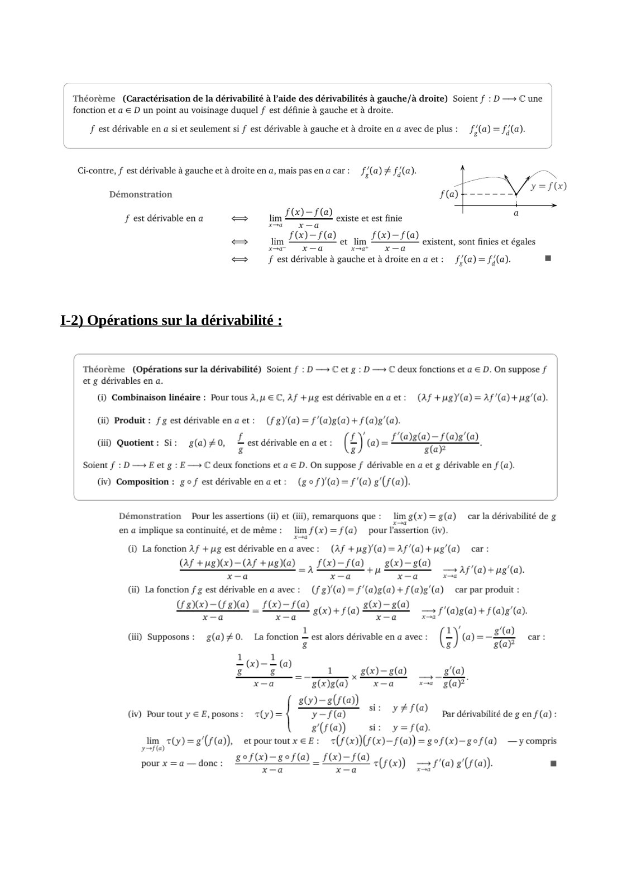
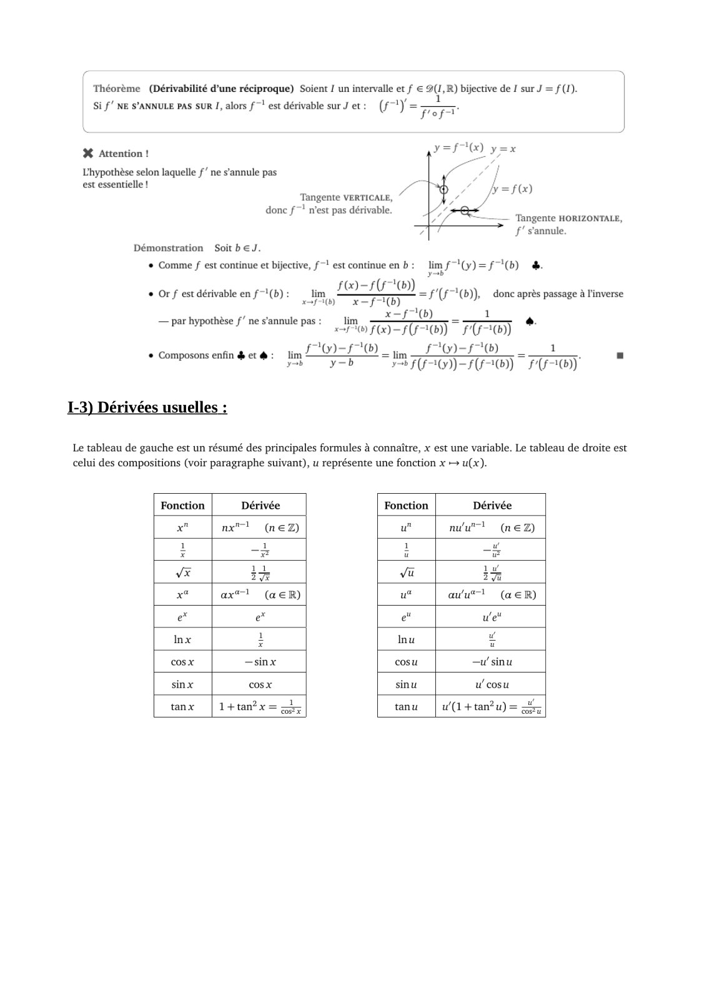
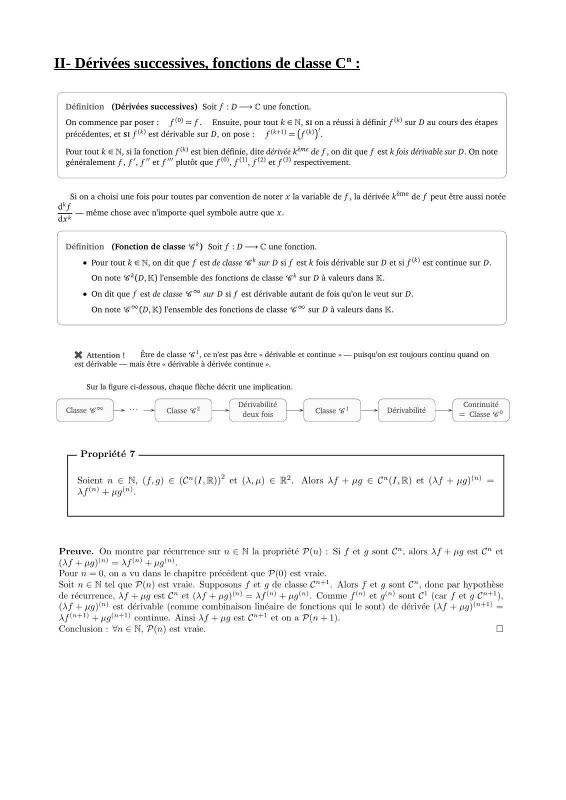
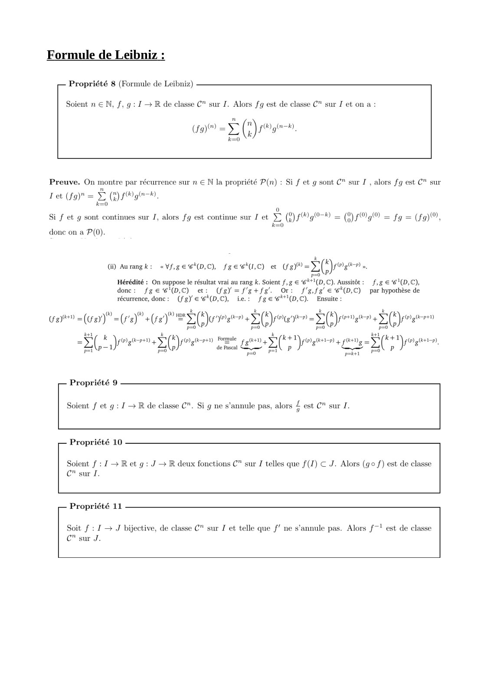
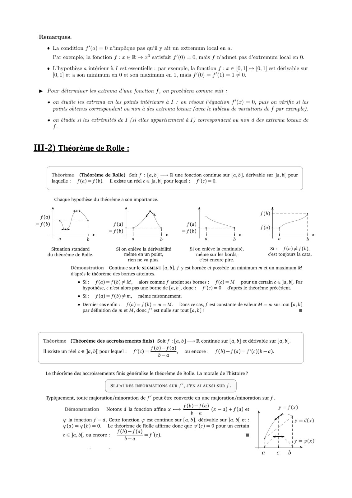
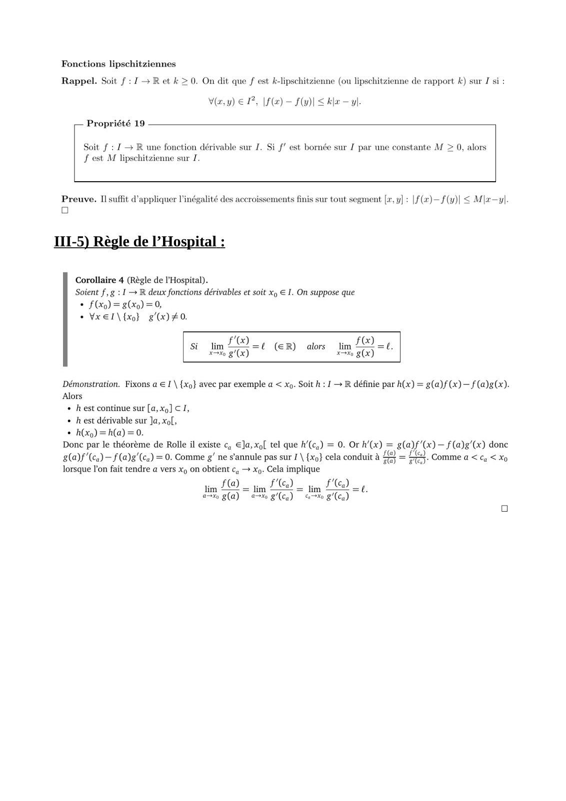

# CM4-Derivabilite_2024-2025_Analyse2_P1S2_DMaths.pdf

[Ouvrir l’original](https://drive.google.com/open?id=1CsmuxDvWQlhMF808pNvowuM96_SW3fLd) · Les pages signalées comprennent du texte reconnu automatiquement ou des éléments graphiques. Le fac-similé permet de vérifier chaque lecture.

**Pages avec fac-similé ou lecture OCR** — 2–5, 7, 9.

## Page 1

~~~text
                       Chapitre 4 : Dérivabilité
I- Nombre dérivé, fonction dérivée, opérations :

I-1) Définitions :
~~~

## Page 2

~~~text
I-2) Opérations sur la dérivabilité :
~~~

**Lecture OCR à contrôler**

~~~text
Théorème (Caractérisation de la dérivabilité à l’aide des dérivabilités à gauche/à droite) Soient f : D — C une
fonction et a € D un point au voisinage duquel f est définie à gauche et à droite.

Ff est dérivable en a si et seulement si f est dérivable à gauche et à droite en a avec de plus: f(a) = f(a).

Ci-contre, f est dérivable à gauche et à droite en a, mais pas enacar: f/(a)# f(a).

Démonstration

festdérivableena + im LIL este et est finie

lim

x=a

FOI à tim LOI FO existent, sont finies et égales
x=a x=a

<>  f est dérivable à gauche et à droite enaet: f/(a)=f/(a).

1-2) Opérations sur la dérivabilité :

Théorème (Opérations sur la dérivabilité) Soient f : D — € et g : D — C deux fonctions et a € D. On suppose f
et g dérivables en a.

(i) Combinaison linéaire : Pour tous À,u € C, Af +ug est dérivableenaet: (Af +ug)(a)=Af’(a)+ug’(a).

(i) Produit : fg est dérivableenaet: (fg)(a) = f'(a)g(a) + f (a)g(a).
i jent : Si: £ , 2 (LY @=LOs@=-f@e'@
ii) Quotient : Si: g(a) #0, est dérivable en a et: (£) @)= rod .

Soient f : D — E et g : E— C deux fonctions et a € D. On suppose f dérivable en a et g dérivable en f(a).

(iv) Composition : go f est dérivableenaet: (gof)'(a)=f'(a) g'(f(a)).

Démonstration Pour les assertions (ii) et (iii), remarquons que: limg(x)=g(a) car la dérivabilité de g
en a implique sa continuité, et de même: lim f(x) = f(a) _ pour l'assertion (iv).
() La fonction Af +g est dérivable en a avec: (Af +ug)(a)=Af'(a)+ug'(a) car:

Of +ug)Q)- AS +ug)a) _, fCO-f(@) , s(x)=sl@) a "
ea eg M ga at F(a) +8"

(ii) La fonction f g est dérivable en a avec: (fg) (a) = f'(a)g(a) + f (a)g’(a)
LIU END _ LOL veu) + 5(q) LEO, phase) + FD (0.

x—a =
g(a)

car par produit :

(ii) Supposons: g(a) #0. La fonction L est alors dérivable en a avec : (Jo = car:
8 g g(a?
1 +
EE ® 1 Le-e@ _,_s@
x—a g(x)g(a) x-a xa g(a)?"

g0)-s(f()) #10
(iv) Pourtouty €E, posons: +(y)= fla) YFS() par dérivabilité de g en f(a):
s(F(a)) si: y=f(a).
jim, 70) =s'(f(a)), etpourtoutxeE:  2(F(x))(F)-F(@) =gof(x)-gef(a) —y compris
gof(x)~sef(a) _ sa A (f(x) 10) e(F@)). =

x-a x

pour x = a — donc : >
~~~

## Page 3

~~~text
I-3) Dérivées usuelles :
~~~

**Lecture OCR à contrôler**

~~~text
Théorème. (Dérivabilité d'une réciproque) Soient J un intervalle et f € 2(1,R) bijective de I sur J = (1)

Si f’ NE S'ANNULE PAS SUR I, alors f~' est dérivable sur J et: (f-!)

% Attention !

L'hypothèse selon laquelle f’ ne s'annule pas
est essentielle !

=f)

Tangente VERTICALE, /
donc f~" n'est pas dérivable.

— Tangente HORIZONTALE,
717 f's'annule.

Démonstration Soit b EJ.

+ Comme f est continue et bijective, ft est continue en b: lim f-(y)=f-"(b) à.
bs

f@)-F(F"))

+ Or f est dérivable en f-1(b) : im, == FB) ate donc après passage à l'inverse
a 5 x=f""@)
— par hypothèse f’ ne s'annule pas: | li = 1020) 700) |
=i er É
+ Composons enfin & et à : tim £ OST) «jim OI) 1
Em

yob FFON)-KFAO) PFA)

1-3) Dérivées usuelles

Le tableau de gauche est un résumé des principales formules à connaître, x est une variable. Le tableau de droite est
celui des compositions (voir paragraphe suivant), u représente une fonction x + u(x).

Fonction Dérivée Fonction Dérivée
x" nx"l (neZ) u" nu'u™! (nez)
1 1 1 uw
F Tx u Te
11 lu
vx it Vi ia
xt ax™! (@eER) ut aut (ae R)
e* e ue"
a mu :
cosx —sinx cosu —u'sinu
sinx cosx sinu u'cosu

tanx | 1+tan?x= Zh. tanu | w/(1+tan?u)=
~~~

## Page 4

~~~text
II- Dérivées successives, fonctions de classe Cn :
~~~

**Lecture OCR à contrôler**

~~~text
II- Dérivées successives, fonctions de classe C" :

Définition (Dérivées successives) Soit f : D —> C une fonction.

On commence par poser: _f(® = f. Ensuite, pour tout k € N, st on a réussi a définir f® sur D au cours des étapes
précédentes, et st f est dérivable sur D, on pose : F9 = (FU).

Pour tout k € N, si la fonction f® est bien définie, dite dérivée Kè" de f, on dit que f est k fois dérivable sur D. On note
généralement f, f’, f” et f’” plutôt que f, Ff, f@) et FO) respectivement.

Si on a choisi une fois pour toutes par convention de noter x la variable de f, la dérivée kè®® de f peut être aussi notée

a Z ,

sf — même chose avec n'importe quel symbole autre que x.
be

Définition (Fonction de classe *) Soit f : D —> C une fonction.
© Pour tout k € N, on dit que f est de classe 6" sur D si f est k fois dérivable sur D et si f est continue sur D.
On note *(D,K) l'ensemble des fonctions de classe * sur D à valeurs dans K.

+ On dit que f est de classe € sur D si f est dérivable autant de fois qu’on le veut sur D.

On note @°(D, K) l'ensemble des fonctions de classe @°° sur D à valeurs dans K.

% Attention! Être de classe €}, ce n'est pas être « dérivable et continue » — puisqu'on est toujours continu quand on
est dérivable — mais être « dérivable à dérivée continue ».

Sur la figure ci-dessous, chaque flèche décrit une implication.

ae of > | Dérivabilité | )
| Classe J TL Gasse 6? deux fois

Continuité
= Classe 6° |

Propriété 7

Soient n € N, (f,9) € (C"(Z,R))? et (A) € R2. Alors Af + yg € C"(I,R) et (Af + pg) =
MO) + yg.

Preuve. On montre par récurrence sur n € N la propriété P(n) : Si f et g sont C”, alors Af + jug est C” et
OF + ng) =F + pg.

Pour n = 0, on a vu dans le chapitre précédent que P(0) est vraie.

Soit n € N tel que P(n) est vraie. Supposons f et g de classe C"+!, Alors f et g sont C”, donc par hypothèse
de récurrence, Af + pig est C" et (Af + pg) =Af™ + pg”. Comme f) et g sont C1 (car f et g C"*1),
(Af + 1g) est dérivable (comme combinaison linéaire de fonctions qui le sont) de dérivée (Af + pg)(®+1) =
AFF) + pglr+1 continue. Ainsi Af + pg est C"+! et on a P(n +1).

Conclusion : Vn € N, P(n) est vraie. a
~~~

## Page 5

~~~text
Formule de Leibniz :
~~~

**Lecture OCR à contrôler**

~~~text
Formule de Leibniz :

— Propriété 8 (Formule de Leibniz)

Soient n EN, f, g : I — R de classe C" sur I. Alors fg est de classe C" sur I et ona:

(fg) = > (R)s@ar,

k=0

Preuve. On montre par récurrence sur n € N la propriété P(n) : Si f et g sont C” sur I, alors fg est C" sur

Let (a = À (Fa

=0

0
Si f et g sont continues sur J, alors fg est continue sur J et > (2) f“g°) = (3) fg = fg = (Fg),
io

done on a P(0).

7 k
(i) Aurangk: «Vf,ge@(D,C), fee@“(I,C) et CAEN (TN .
=
Hérédité : On suppose le résultat vrai au rang k. Soient f,g € @**4(D,C). Aussitôt: f,g € @"(D,C),
donc: fge@'(D,C) et: (fg) =f'e+fg. Or: f'a.fg € 6“(D,C) par hypothèse de
récurrence, donc: (fg)e%(D,C), ie: fgee'(D,C). Ensuite:

D re NE L Ce VE AO moe (Ra en) à SK PT TE EST —
caro)" (ra) +(Fe) Loren D (rente Di (prose iGreen
L

k _ ke arpayenonmule, 29643 k+1 _ si RET vests;
SC ratrn esi (Bptngtcren ate un 57(FtNingiorn 4 peng SET) pingaor,
£b- Ab. easel Se AU p =< AU

pe

Propriété 9

Soient f et g : I+ R de classe C”. Si g ne s'annule pas, alors £ est C” sur I.

Propriété 10

Soient f : I> Ret g : J > R deux fonctions C” sur J telles que f(I) € J. Alors (go f) est de classe
C" sur I.

Propriété 11

Soit f : I + J bijective, de classe C” sur J et telle que f’ ne s’annule pas. Alors f~! est de classe
Cc" sur J.
~~~

## Page 6

~~~text
III- Propriétés des fonctions dérivables :

III-1) Extremum local :

                                         =0.
~~~

## Page 7

~~~text
III-2) Théorème de Rolle :

                             a   c   b
~~~

**Lecture OCR à contrôler**

~~~text
Remarques.
« La condition f’(a) = 0 n'implique pas qu'il y ait un extremum local en a.
Par exemple, la fonction f : 2 € R ++ 2° satisfait f/(0) =0, mais f n’admet pas d’extremum local en 0.
« L'hypothèse a intérieur à J est essentielle : par exemple, la fonction  : x € [0,1] + [0,1] est dérivable sur
(0, 1] et a son minimum en 0 et son maximum en 1, mais f/(0) = f/(1) = 10.
> Pour déterminer les extrema d’une fonction f, on procèdera comme suit :

«on étudie les extrema en les points intérieurs à I : on résout l'équation f'(x) = 0, puis on vérifie si les
points obtenus correspondent ou non à des extrema locaux (avec le tableau de variations de f par exemple).

«on étudie si les extrémités de I (si elles appartiennent à I) correspondent ou non à des extrema locaux de

f.

III-2) Théorème de Rolle :

Théorème (Théorème de Rolle) Soit f : [a,b] —> R une fonction continue sur [a,b], dérivable sur Ja, b[ pour
laquelle: f(a)= f(b). Mexiste un réel c € Ja, b[ pour lequel : f’(c)=0.

Chaque hypothèse du théorème a son importance.

F(a) a Z\ SN

=F0) [ | SG) F(a) Ti
nes F(a)
Ol oly FES _
Va b la b l'a b la b
Situation standard Si on enlève la dérivabilité Si on enlève la continuité, Si: f(a)£f(b),
du théorème de Rolle. même en un point, même sur les bords, c'est toujours la cata.
rien ne va plus. c'est encore pire.

Démonstration Continue sur le SEGMENT [a, b], f y est bornée et possède un minimum m et un maximum M
d'après le théorème des bornes atteintes.

© Si: f(a)=f(b)#M, alors comme f atteint ses bornes:  f(c)=M pour un certain c € Ja, bl. Par
hypothèse, c n'est alors pas une borne de [a, b], donc: f/(c)=0 d'après le théorème précédent.

Si: f(a)=f(b)#m, même raisonnement.

© Dernier casenfin: _f(a)=f(b)=m=M. Dans ce cas, f est constante de valeur M = m sur tout [a, b]
par définition de m et M, donc f’ est nulle sur tout [a, b]! =

Théorème (Théorème des accroissement finis) Soit f : [a, b]— R continue sur [a, b] et dérivable sur Ja, b[.
Il existe un réel c € Ja, bf pour lequel: f'(c)= Le, ou encore: _f(b)—f(a)= f/(cXb—a).

Le théorème des accroissements finis généralise le théorème de Rolle. La morale de l’histoire ?

rc +
| Si J'a1 DES INFORMATIONS sUR f’, J'EN AI AUSSI SUR f. |
U y

‘Typiquement, toute majoration/minoration de f’ peut être convertie en une majoration/minoration sur f .
b)-f(a
OO) t LO ( a) + f(a) et
—a

& la fonction f — d. Cette fonction ÿ est continue sur [a, b], dérivable sur Ja, b et :
(a) = (b) =0. Le théorème de Rolle affirme donc que 4’(c) = 0 pour un certain

OST .
Ta

Démonstration Notons d la fonction affine x —

c€ Ja, b[, ou encore :
~~~

## Page 8

~~~text
III-3) Sens de variations et dérivabilité :

III-4) Inégalité des accroissements finis :
~~~

## Page 9

~~~text
III-5) Règle de l’Hospital :
~~~

**Lecture OCR à contrôler**

~~~text
Fonctions lipschitziennes

Rappel. Soit f : J > R et k > 0. On dit que f est k-lipschitzienne (ou lipschitzienne de rapport k) sur I si:
V(a.y) € PF [f(æ) — fu) < ble — yl.

— Propriété 19

Soit f : 1 + R une fonction dérivable sur J. Si f/ est bornée sur J par une constante M > 0, alors
fest M lipschitzienne sur I.

Preuve. II suffit d'appliquer l'inégalité des accroissements finis sur tout segment [x,y] : [f(x)—f(y)| < Mla—yl
Oo

III-5) Règle de l’Hospital :

Corollaire 4 (Règle de l'Hospital).

Soient f, g : | — R deux fonctions dérivables et soit xp € I. On suppose que
+ £0) = 8%) =90,
+ Vxel\{xo} g(x) #0.

Fo,

dim D lin fc,

Si a(x)

(ER) alors

Démonstration. Fixons a € I \ {xo} avec par exemple a < xp. Soit À : 1 + R définie par h(x) = g(a) f(x) — f(a)g(x).
Alors

+ hest continue sur [a,x] CI,

+ hest dérivable sur Ja, xo[,

+ h(x) =h(a) =0.
Donc par le théorème de Rolle il existe c, €]a,xof tel que A'(.) = 0. Or RG) = &(aÿ (x) (ag) done

8(a)f (Ca) —f (a)g'(ca) = 0. Comme g’ ne s'annule pas sur 1 \ {xo} cela conduit à 43 = LE). Comme a < cq < Xo
lorsque l'on fait tendre a vers xq on obtient c, —» x). Cela implique

im FED im LC) 2 jm LC) =

pa g(a) mg) «x (Ca)
~~~

## Page 10

*Page blanche.*
