# CM5-Analyse-Asymptotique_2024-2025_Analyse2_P1S2_DMaths.pdf

[Ouvrir l’original](https://drive.google.com/open?id=1AO_cVPpX8bdkaQ82hWI5ePdzHedbGlgS) · Les pages signalées comprennent du texte reconnu automatiquement ou des éléments graphiques. Le fac-similé permet de vérifier chaque lecture.

**Pages avec fac-similé ou lecture OCR** — 2–3, 5–18.

## Page 1

~~~text
                  Chapitre 5 : Analyse asymptotique
I- Relations de comparaison de suites :

I-1) Domination, négligeabilité :

Exemples :
~~~

## Page 2

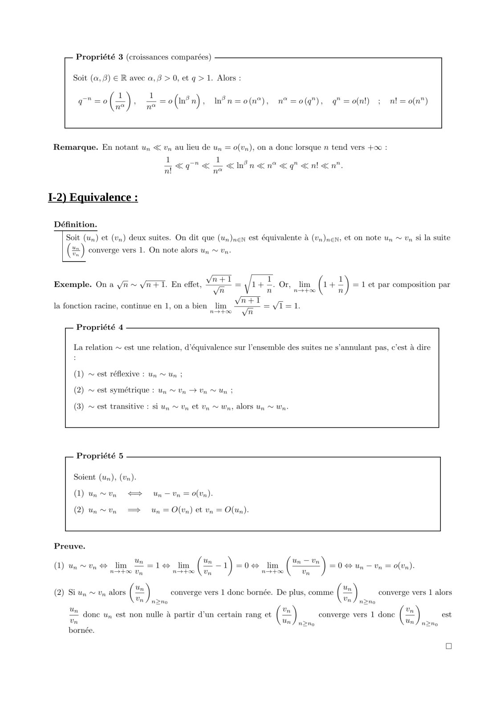

~~~text
I-2) Equivalence :
~~~

**Lecture OCR à contrôler**

~~~text
- Propriété 3 (croissances comparées)

Soit (a, 8) € R avec a, 8 > 0, et q > 1. Alors :

n) In?n=o(n%), n°=o(g"), g®=oln!) ; n!=o(n")

Remarque. En notant un < v, au lieu de up; = o(v,), on a donc lorsque n tend vers +0 :

1 1
w<r"<n< ncn <qr<ni<n".

1-2) Equivalence

Définition.
Soit (u,) et (vp) deux suites. On dit que (un)nen est équivalente à (v,)nen, et on note Uy + Up si la suite
(#) converge vers 1. On note alors un ~ Up.

Exemple. On a /i~ Vn FI. En effet, = sie
3

la fonction racine, continue en 1, on a bien lim
n—-+00

1
n

1
. Or, lim ( + >) = 1 et par composition par
n

nt

Propriété 4

La relation ~ est une relation, d'équivalence sur l’ensemble des suites ne s’annulant pas, c'est à dire

(1) ~ est réflexive : un ~ un §

(2) ~ est

métrique : tn ~ Un > Up ~ Un à

(3) ~ est transitive : si u, + v, et v, ~ Wp, alors Up = Wh

Propriété 5

Soient (un), (vn).
(1) Un tp + uv = (dp).

(2) un ~ Un — Un = O(vp) et Un = O(ttn)-

Preuve.

Durée lim “218 lim (-1)-0e lim (=)

++ v nto un n+00

0 un — Un = O(Un).

u, uy,

a converge vers 1 alors
Un / n>no

(2) Siu, ~ vp alors ( ) converge vers 1 done bornée. De plu
n>no

Un

Un & noce if F Un Un
—" donc u, est non nulle à partir d'un certain rang et (=) converge vers 1 donc (=) est
Un Un} n>n9 Un / n>no

bornée.

0
~~~

## Page 3

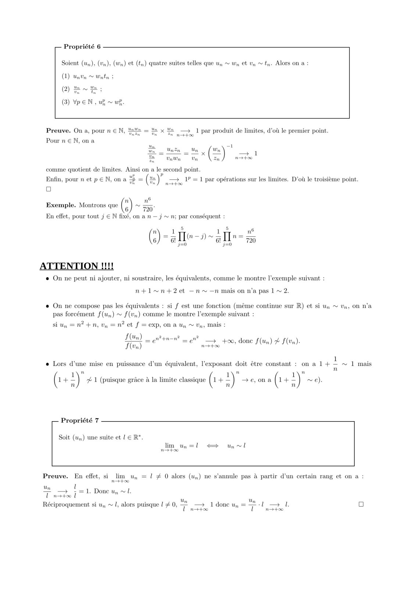

~~~text
ATTENTION !!!!
~~~

**Lecture OCR à contrôler**

~~~text
Propriété 6
Soient (un), (Un), (wn) et (tn) quatre suites telles que u, ~ w, et v, ~ tn. Alors on a:

(1) tty ~ wate à

(3) VEN, ur.

=>, 1 par produit de limites, d'où le premier point.

=
Unzn wx (2) — 4

Bi nt

Preuve. On a, pour n € N,

Pour n € N, on a

UnWn mn

comme quotient de limites. Ainsi on a le second point.

- »
= (#) —+ 1? =1 par opérations sur les limites. D'où le troisième point

Enfin, pour n et p € N, ona \
mn) nt

a

6

n\n

Exemple. Montrons que De.
a a (") 720

En effet, pour tout j € N fixé, on a n — j ~ n; par conséquent

= The gee pee
6) ~ aA a Le" = 720

=0

TTENTION

+ On ne peut ni ajouter, ni soustraire, les équivalents, comme le montre l’exemple suivant :

n+1~+n+2et —n~—n mais on n'a pas 1 +2.

¢ On ne compose pas les équivalents : si f est une fonction (même continue sur R) et si un + Un, on n'a
pas forcément f(u,) ~ f(v,) comme le montre l'exemple suivant :

Si Un =n?+n, Vp, =n? et f =exp, on a Uy © Up, mais :

Lun) L enfant Len _, 400, done flun) # fun).

Flom) — are

e Lors d’une mise en puissance d’un équivalent, l'exposant doit être constant : on a 1+— ~ 1 mais

n
1\"
(: + =) #1 (puisque grâce à la limite cla
n
Propriété 7
Soit (u,) une suite et 1 € R*.
lim un=l + unvl
n+oe
Preuve. En effet, si lim u, = 1 # 0 alors (u,) ne s'annule pas à partir d'un certain rang et on a :
n°
n l
521 Doncu, +1.
T noto0 |

Réciproquement si up, ~ 1, alors puisque ! # 0, 2 — 1done ti, = il — 1 o
He anes
~~~

## Page 4

~~~text
II- Relations de comparaison de fonctions :

II-1) Domination, négligeabilité :
~~~

## Page 5

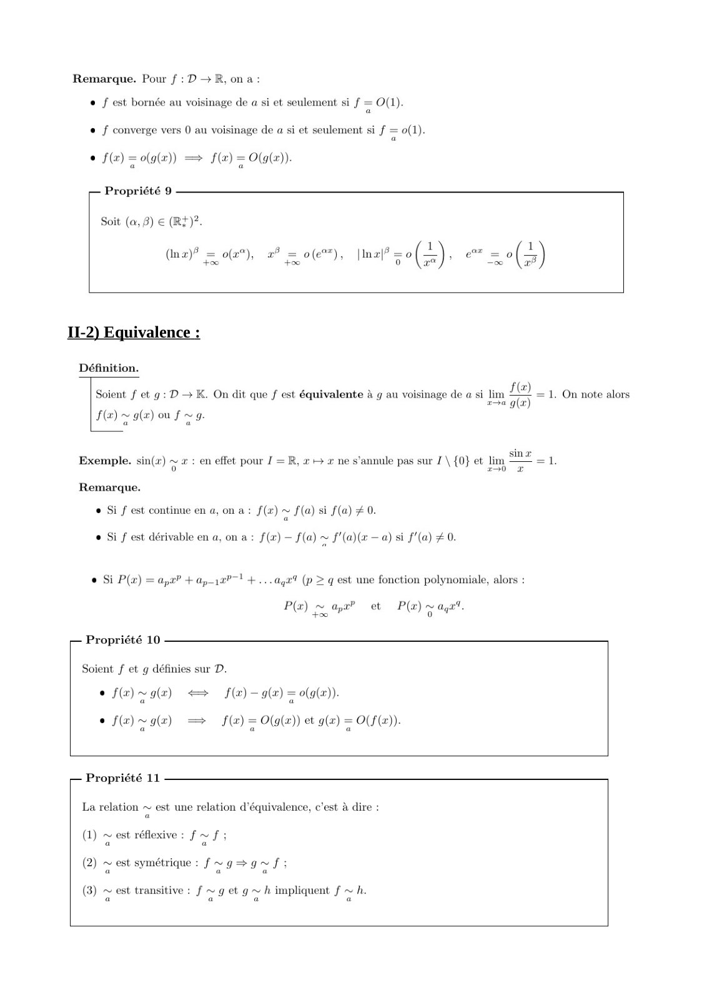

~~~text
II-2) Equivalence :
~~~

**Lecture OCR à contrôler**

~~~text
Remarque. Pour f : DR, ona:

«_f est bornée au voisinage de a si et seulement si f = O(1).
© f converge vers 0 au voisinage de a si et seulement si f = o(1).

# f(a) = or) => F(x) = O(a).

Propriété 9

Soit (a, 8) € (Rt)?.

(nx)? = 08), a? = o(e™),

II-2) Equivalence
Définition.

= 1. On note alors

Soient f ot ge DR. On ditique Fest équivalente à ya voisinage dean ta À a
ra g(x
f(a) ~ g(x) ou f ~ 9.

sina

Exemple. sin(x) ~ : en effet pour J = IR, æ ++ x ne s'annule pas sur 1 \ {0} et lim

Remarque.

© Si f est continue en a, on a : f(x) ~ f(a) si f(a) £0.

e Si f est dérivable en a, on a: f(x) — f(a) oo f'(a)(x — a) si f'(a) £0.

© Si P(x) = aa? + air" +. agat (p > q est une fonction polynomiale, alors :

Pla) ~ ape” et P(x) ~ aga.

Propriété 10

Soient f et g définies sur D.
# fa) vole) > f(x) g(x) = o(9(a)).

e S(2)~ gz) — f(a) = O(g(2)) et g(x) = O(F(2)).

Propriété 11

La relation ~ est une relation d'équivalence, c'est à dire :
(1) + est réflexive : f ~ f ;

(2) ~ est symétrique : f 799% fs

(3) ~ est transitive : f = g et g = h impliquent f ~ h.
~~~

## Page 6

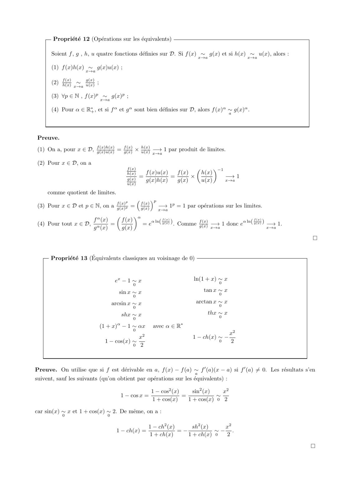

**Lecture OCR à contrôler**

~~~text
— Propriété 12 (Opérations sur les équivalents)

Soient f, 9, h, u quatre fonctions définies sur D. Si f(x) =, g(x) et si h(x) +, u(x), alors :

(4) Pour a € Ry, et si f® et g® sont bien définies sur D, alors f(x)* ~ g(x)*.

Preuve.

(1) Ona, pour x € D, OR = Le x 9 — + 1 par produit de limites.

EE

(2) Pour x € D, on a
a _ fente) _ fe) «(ie
i

a) g(x)h() g(x)

u(z)

comme quotient de limites.

é »
(3) Lak = (H2)" — 17 = 1 par opérations sur les limites.
(4) Pour tout x € D, on (4 ) 4). Comme LD — 1 donc (5) =

— Propriété 13 (Equivalents classiques au voisinage de 0)

In +2) va

tang x
0

arctanr ~ x
0

the x
0

shx x
0

(l+2)"-1 yor avecae R°

2 ae
ii 1) S

2

si f(a) 0. Les résultats s’en

Preuve. On utilise que si f est dérivable en a, f(x) — f(a) ~ f'(a)(x —
suivent, sauf les suivants (qu'on obtient par opérations sur les équivalents) :

in2(x) a
T+cos(x) 0 2

1— cos?(a

T+ cosa

1— cosa =

car sin(x) ~ æ et 1 + cos(x) ~ 2. De même, on a :

— ch?(x) sh? (ar) 2

T+ ch(a) oo

“T¥ch(a) 0 2

1 ch(x) =
~~~

## Page 7

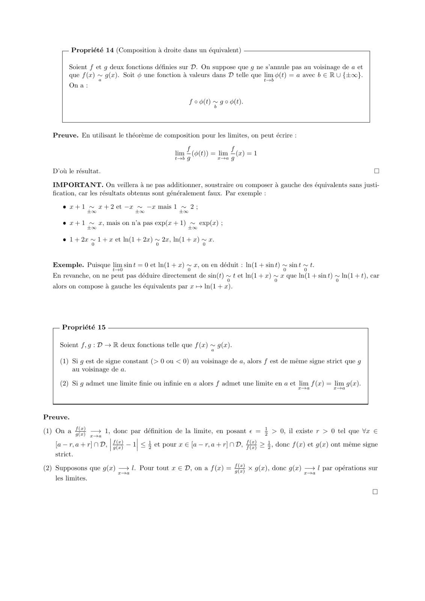

**Lecture OCR à contrôler**

~~~text
— Propriété 14 (Composition à droite dans un équivalent)

Soient f et g deux fonctions définies sur D. On suppose que g ne s’annule pas au voisinage de a et
que f(z) ~ g(z). Soit @ une fonction à valeurs dans D telle que lim #(t) = a avec b € RU {00}.
h ce

Ona:

Food) x92 0(t).

Preuve. En utilisant le théoréme de composition pour les limites, on peut écrire :

f

tim LG) = tim LG = 1

D'où le résultat. im

IMPORTANT. On veillera à ne pas additionner, soustraire ou composer à gauche des équivalents sans justi-
fication, car les résultats obtenus sont généralement faux. Par exemple :

exr+l ~ zr+2et -x = -x maisi ~
Eo Eo £0
o +1 7 2, mais on n'a pas exp(e+1) x exp(r) :

. 1+22v1+eet In(1 + 2x) ~ 2x, n(l+x) ae.

Exemple. Puisque lim sin¢ = 0 et In(1 +2) ~ x, on en déduit : (1 +sint) + int = 1.
mt
En revanche, on ne peut pas déduire directement de sin(t) ~ £ et In(1 + x) = x que In(1 +sint) ~ In(1 +t), car

alors on compose à gauche les équivalents par x ++ In(1 +).

Propriété 15

Soient f, g : D — R deux fonctions telle que f(x) ~ g(x).

(1) Sig est de signe constant (> 0 ou < 0) au voisinage de a, alors f est de même signe strict que g
au voisinage de a.

(2) Sig admet une limite finie ou infinie en a alors f admet une limite en a et lim f(x) = lim g(x

Preuve.

(1) On a 42 —> 1, donc par définition de la limite, en posant € = } > 0, il existe r > 0 tel que Va €

> 4, done f(x) et g(x) ont même signe

[a-ra+r]D, | -

< det pour x € [a-r,a+r]nD, 42
strict.

(2) Supposons que g(x) — 1. Pour tout x € D, ona f(x) = nl x g(a), donc g(x) — 1 par opérations sur
ze ma
les limites.

D
~~~

## Page 8

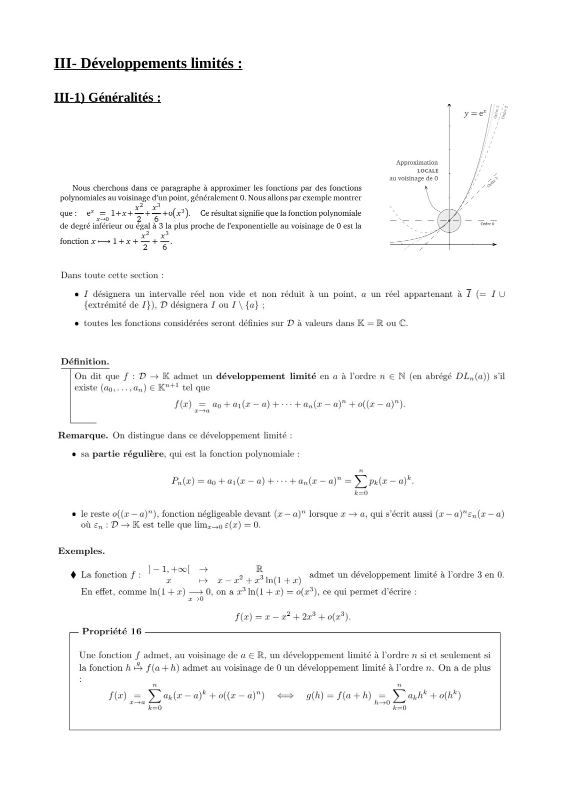

~~~text
III- Développements limités :

III-1) Généralités :
~~~

**Lecture OCR à contrôler**

~~~text
IIT- Développements limités :

III-1) Généralités

Approximation Î
LOCALE /
au voisinage de 0 ls
Nous cherchons dans ce paragraphe à approximer les fonctions par des fonctions *
polynomiales au voisinage Si point, généralement 0. Nous allons par exemple montrer

que: e* = 1+x + a +2 a À +o(x%). Ce résultat signifie que la fonction polynomiale

de degré inférieur ou égal 43 la plus proche de l'exponentielle au voisinage de 0 est la

x?
fonction x 14x42 42,
2 6

Dans toute cette section :

e 1 désignera un intervalle réel non vide et non réduit à un point, a un réel appartenant à T (= 1 U
{extrémité de 1}), D désignera I ou 1 \ {a} ;

e toutes les fonctions considérées seront définies sur D à valeurs dans K = R ou C.

Définition.
On dit que f : D + K admet un développement limité en a à l'ordre n € N (en abrégé DL, (a)) s'il
existe (ag,..., An) € K"*? tel que

F(a) =, ao + ar — a) +++ an(x — a)" + o(( — a)").

Remarque. On distingue dans ce développement limité :

« sa partie régulière, qui est la fonction polynomiale :
Pa(&) = ag + ay (a — a) + +++ + n(2 — a)" = D pa(x — a).

@ le reste o((x — a)"), fonction négligeable devant (x — a)" lorsque x + a, qui s'écrit aussi (x —a)"en(x— a)
où en : D —+ K est telle que lim, <() = 0.

Exemples.

]-1,t+00[ — R
£ mn 2-2? +2 In(1 +2)
En effet, comme In(1 + x) — 0, on a 2 In(1 +2) = o(#%), ce qui permet d'écrire :
=

@ La fonction f : admet un développement limité à l’ordre 3 en 0

f(a) = x — 2? + 22° + o(x°).
Propriété 16

Une fonction f admet, au voisinage de a € R, un développement limité à l’ordre n si et seulement si
la fonction À + f(a + h) admet au voisinage de 0 un développement limité à l’ordre n. On a de plus

fle) = Dai = a) + (2 = a") <= gh)=fla+h), = eut +o(h*)
k=0
~~~

## Page 9

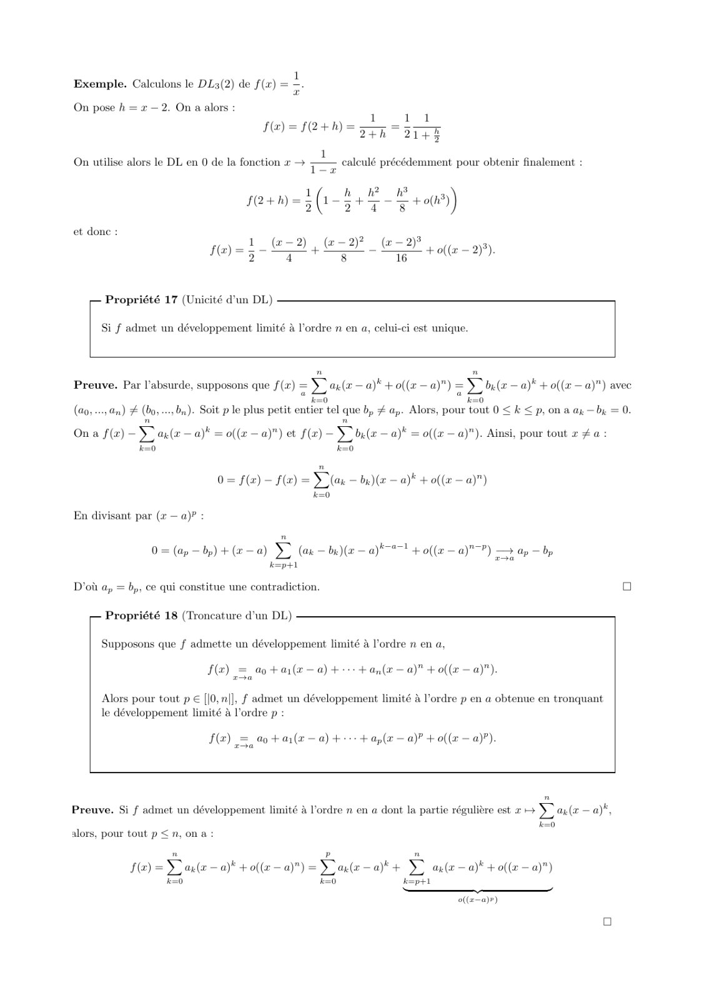

**Lecture OCR à contrôler**

~~~text
Exemple. Calculons le DL(2) de f(x)

On pose h —2. On a alors :

et donc :

Propriété 17 (Unicité d’un DL)

Si f admet un développement limité à l’ordre n en a, celui-ci est unique.

Preuve. Par l'absurde, supposons que f(x) = = Date æ —a)* + o((x — a) syne —a)* +o((x — a)") avec

(a0,

On a f(x) — DC -a

k=0

an) # (os bn). Soit p le plus petit entier tel ue by # ay. Alors, pour out 0: pion sûr tL 0.

o((a —a)") et f(x Dnt x —a)* = o((x — a)"). Ainsi, pour tout 2 4 a:

= F(x) — Se) = Slax — bu)(@ — a) + o((æ — a)")

k=0

En divisant par (x — a)?

0 = (ap — bp) + (w@ =a) D (ak = de)(a = a) 9! + o((x — a)"-”) Sh — bp

k=p+i

D'où a, = bp, ce qui constitue une contradiction. a

— Propriété 18 (Troncature d'un DL)
Supposons que f admette un développement limité à l’ordre n en a,
F(@) =, a0 +ai( a) ++: +an(r — a)" + f(a — a)").

Alors pour tout p € [|0,n|], f admet un développement limité à l’ordre p en a obtenue en tronquant
le développement limité à l'ordre p :

SG) =, 00 + a = a) + +++ + ap(@ — a) + o((x — a)).

Preuve. Si f admet un développement limité à l'ordre n en a dont la partie régulière est a+ ax(x — a)",
kao
alors, pour tout p <n, ona:

7
= Vale a)h+ D ar a) +o((r—a)")
=

+1

= Sate —a)¥ + o((x — a

k=0

o((z—a)P)
~~~

## Page 10

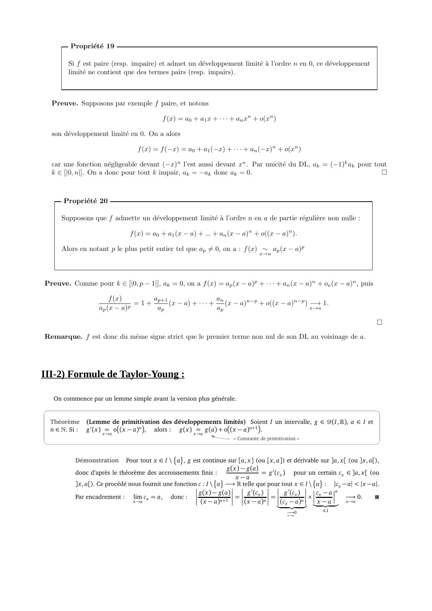

~~~text
III-2) Formule de Taylor-Young :
~~~

**Lecture OCR à contrôler**

~~~text
Propriété 19

Si f est paire (resp. impaire) et admet un développement limité à l'ordre n en 0, ce développement
limité ne contient que des termes pairs (resp. impairs).

Preuve. Supposons par exemple f paire, et notons
(a) = a9 + ax +--+ + aux" +0(2")
son développement limité en 0. On a alors
Sa) = f(—2) = a9 + ay(—2) +--+ + an(—2)" + o(2")

car une fonction négligeable devant (—x)" l'est aussi devant #". Par unicité du DL, a = (—1)ay pour tout
k € [|0,n|]. On a done pour tout k impair, ax = ax done ax = 0. a

Propriété 20

Supposons que f admette un développement limité à l'ordre n en a de partie régulière non nulle :

f(x)

Alors en notant p le plus petit entier tel que ay #0, ona: f(x) + ap(x—a)?

ag + &(x — a) +... + an(x — a)" +o((x — a)").

—a)+-..+an(x— a)" +o4(x — a)", puis

Preuve. Comme pour k € [|0,p— 1}, ax = 0, on a f(x) =

toe =1+ ea) ++ Ge a? +ol(e a) 7) DL.

An

Remarque. f est donc du même signe strict que le premier terme non nul de son DL au voisinage de a

IIIL-2) Formule de Taylor-Young

On commence par un lemme simple avant la version plus générale.

Théorème (Lemme de primitivation des développements limités) Soient 1 un intervalle, g € 9(I,R), a € I et
nEN.Siz: g(x) = o((x—a)"), alors: g(x) = g(a)+o((x—a)"*1).
Y-—— «Constante de primitivation »

Démonstration Pour tout x € 1 \ {a}, g est continue sur [a,x] (ou [x,a]) et dérivable sur Ja, x{ (ou Jx, af),

donc d'après le théorème des accroissements finis : g@)=s(@) _ g(c,) pour un certain c, € Ja, x[ (ou
x=a
]x,a[). Ce procédé nous fournit une fonction c : 1\ {a} — R telle que pour tout x €1\{a}:  |e,—al <|x—al.
Par encadrement : lime, done: |8@2=8@| _| 8) |_| #0) |, a 0 =
aa (at | |G&—ay| [Carl al ea
HO à

—0
~~~

## Page 11

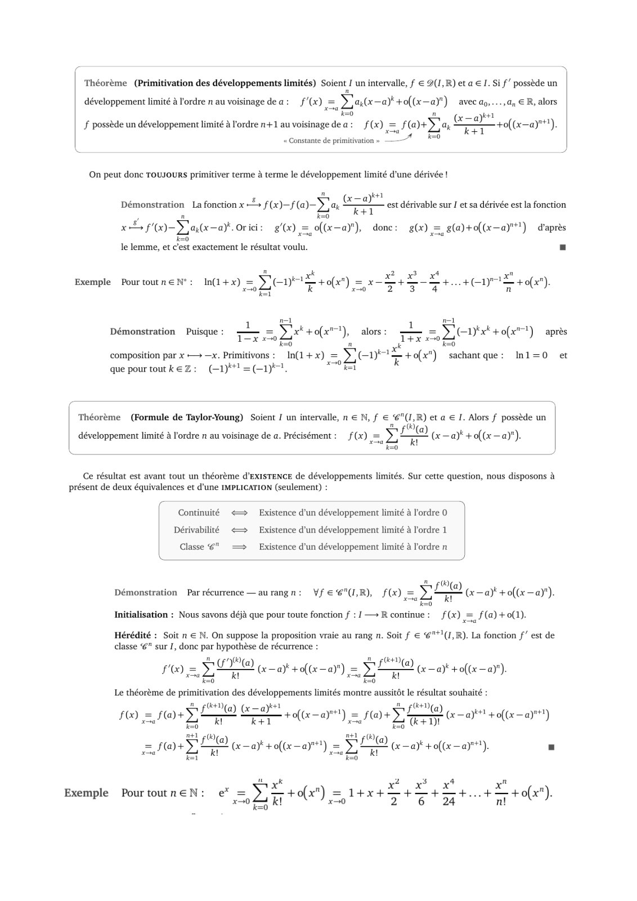

**Lecture OCR à contrôler**

~~~text
Théorème (Primitivation des développements limités) Soient / un intervalle, f € 2(1,R) et a € I. Si f’ possède un

développement limité à l'ordre n au voisinage dea: f(x) = > a,(x—a)*+0((x—-a)") avec ao... a, € R, alors

k=0 yk

F possède un développement limité à l'ordre n+1 au voisinage de a: f(x) = o> a, CD soa").

« Constante de primitivation ». —

On peut donc Tousours primitiver terme à terme le développement limité d’une dérivée !

ÿ ï # a (x—a)tt 5 5 FE 5
Démonstration La fonction x <> f(x)—f(a)— Da: ZA est dérivable sur Let sa dérivée est a fonction
; n i=
x5 FO Y at-a).orici: gx) =, Alea"), donc: gx) = g(a)+o((x—a)*) d'après
=
le lemme, et c’est exactement le résultat voulu. =

2 k
Exemple Pour toutn EN": In(1+x) = DCD +0(x") = x
0 0
=

1
& i isque : nt) : k ne à
Démonstration Puisque : = es => x K+ o(x' J, alors = fez = ae kx! K+ o(x' ) après

composition par x — —x. Primitivons : In(1+x) = = De are = of x” ) sachant que: Inl=0 et
que pour toutkeZ: (-1)? =(-1).

Théoreme (Formule de Taylor-Young) Soient | un intervalle, n € N, f € '6"(I,R) et a € I. Alors f possède un

développement limité à l'ordre n au voisinage de a. Précisément : f(x) = De (x—a)* +o((x a").

Ce résultat est avant tout un théorème d’EXISTENCE de développements limités. Sur cette question, nous disposons à
présent de deux équivalences et d'une IMPLICATION (seulement) :
Continuité <=> Existence d’un développement limité à l'ordre 0
Dérivabilité <=> Existence d'un développement limité à l'ordre 1

Classe @" => Existence d'un développement limité à l'ordre n

Démonstration Par récurrence — au rangn: Wf eR), f(x) = oe ola) a} +o((x—a)").
Initialisation : Nous savons déjà que pour toute fonction f : 1 —R continue: f(x) =, f(a) +0(1).

Hérédité : Soit n € N. On suppose la proposition vraie au rang n. Soit f € @"*"(I,R). La fonction f’ est de
classe sur I, donc par hypothèse de récurrence :

ro, Oo MO) (ea + (x09) alae Ga} +o{(x—a)).

Le théorème de primitivation des Hivelonpements limités montre aussitôt le résultat souhai

mn ra
feo) ro) PO Gar D + (x of) efor Fo a)

(x—a)*1 + 0((x—a)"*")

eT Œ+i)
mi à
=, f@ ose a) cata) =, SO Ga} + 0((x—a)"*"). =
Exemple PourtoutneN: e* = DE +0(x') = leet LE + 2 + 0(x")
p mr ay: > ate tatty ;
~~~

## Page 12

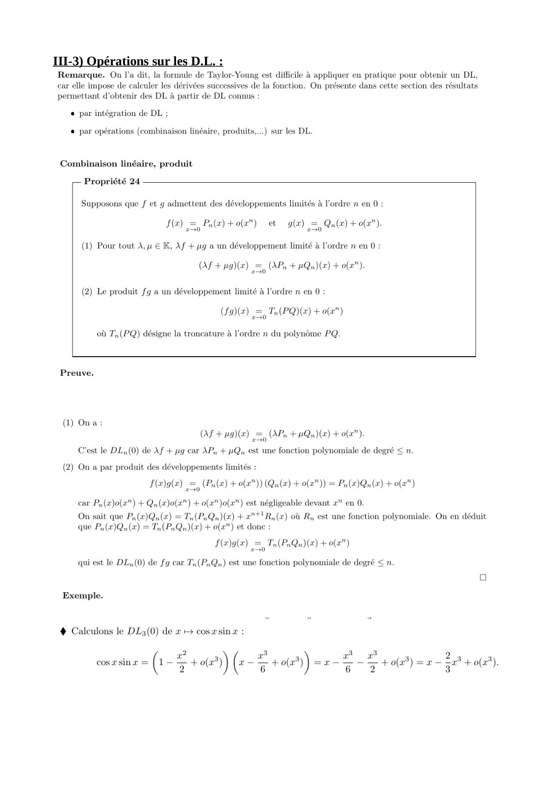

~~~text
III-3) Opérations sur les D.L. :
~~~

**Lecture OCR à contrôler**

~~~text
III-3) Opérations sur les D.L. :

Remarque. On l'a dit, la formule de Taylor-Young est difficile à appliquer en pratique pour obtenir un DL,
car elle impose de calculer les dérivées successives de la fonction. On présente dans cette section des résultats
permettant d'obtenir des DL à partir de DL connus :

© par intégration de DL ;

© par opérations (combinaison linéaire, produits,...) sur les DL.

Combinaison linéaire, produit

Propriété 24

Supposons que f et g admettent des développements limités à l'ordre n en 0 :

SG) =, Pala) +o(2") et g(x) =, Qn(x) + o(2”).

(1) Pour tout A, € K, Af + pg a un développement limité à l’ordre n en 0:

).

(AF + ug)(0) =, Pa + #Qn)(2) + or

(2) Le produit fg a un développement limité à l’ordre n en 0 :
(F9)(2) =, Ta(PQ)(2) + o(a")

où T, (PQ) désigne la troncature à l'ordre n du polynôme PQ.

Preuve.

(1) Ona

(AF + pg)(2) =, APn + Qn) (@) + of
C'est le DL, (0) de Af + 1g car AP, + nQ, est une fonction polynomiale de degré < n.

(2) On a par produit des développements limités :
(2) 9(@) =, (Pa(z) + o(@")) (Qn(x) + 0(2")) = Pa(x)Qn(x) + o(2")

car P,(æ)o(x") + Qn(x)o(a”) + o(2”)o(a”) est négligeable devant x” en 0.

On sait que P,(x)Qh(x) = Tn(PrQn)(x) + 2"*TR, (x) où R, est une fonction polynomiale. On en déduit
que Px(2)Qn(x) = Ta(PaQn)(x) + 0(x") et done :

Sage) =, Ta(PaQn)(2) + 0(2")

qui est le DL, (0) de fg car T,(P,Q,) est une fonction polynomiale de degré < n.

Exemple.

@ Calculons le DL3(0) de x ++ cosxsinx :

x? 3
cosæsinx = [1— + 0(x°) |) [x — — +o(x*)
2 6
~~~

## Page 13

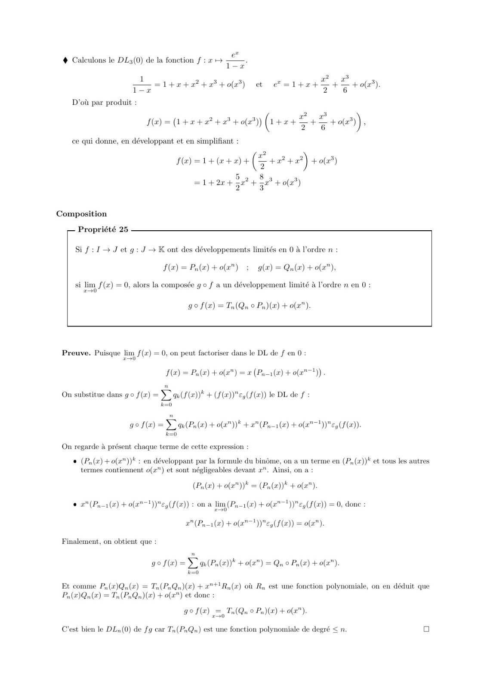

**Lecture OCR à contrôler**

~~~text
@ Calculons le DL3(0) de la fonction f : 2 >

L =1l+ata?+23+0(2%) et és1tr+ + + o(e)
rite : : =lte+to te -

D'où par produit :

f(z) = (14+ 2427 +23 + o(x)) (+

ce qui donne, en développant et en simplifiant :
2
f(x) =14 (e@+2)+ (F+e+2") + o(a*)
5 2 8 3 3
= 1420+ 527+ 52° +o(r)

Composition

Propriété 25

Si f:1— J et g: J + K ont des développements limités en 0 à l’ordre n :

F(a) = Pa(æ) + 0(2") à g(r) = Qn(x) + o(2"),

si lim f(z) =0, alors la composée go f a un développement limité à l'ordre n en 0 :
ra

9° f(2) = Tn(Qn © Pa)(x) + o(x").

Preuve. Puisque lim f(r) = 0, on peut factoriser dans le DL de f en 0 :

F(x) = Pa(x) + oe") = x (Paa(2) + ofa").

On substitue dans go f(x) = D a(f(x))* + (f(x))"eg(f(æ)) le DL de f :

k=0

90 (a) = D a(Pa(a) + 0(2"))* +2" (Pa (2) + 0f0"))"eg(f(2))-

r=)
On regarde à présent chaque terme de cette expression :

e (P,(x) +.0(2"))* : en développant par la formule du binôme, on a un terme en (P,(a))* et tous les autres
termes contiennent o(x") et sont négligeables devant x”. Ainsi, on a :

(Pala) + o(2"))* = (Pa(z))* + ofa").
2" (Paa(e) + o(e"""))"eg(f(x)) : on a lim (Py—1(x) + o(2"~"))"eg(f(2)) = 0, donc :
a” (Pn—1 (a) + o(a"- 1e (f(x) =o(z").
Finalement, on obtient que :
go f(x) = D ae(Pa(2))* + 02") = Qn o Pa(x) + o(2”).

Et comme P,(r)Qu(x) = Ta(PaQn)(x) + £"*1R,,(a) où R, est une fonction polynomiale, on en déduit que
Pa(x)Qn(x) = Tn(PnQn)(x) + 0(2") et donc :

99 f(t) =, Tn(Qn 0 Pa)(c) + o(a").

Crest bien le DL, (0) de fg car Ta(PnQn) est une fonction polynomiale de degré <n. a
~~~

## Page 14

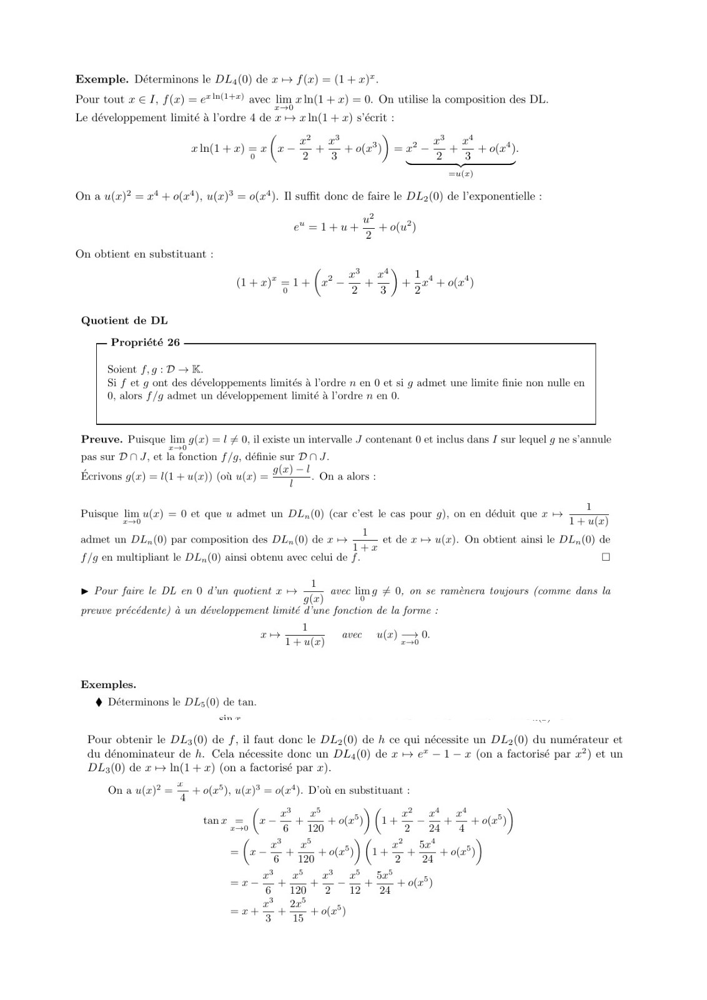

**Lecture OCR à contrôler**

~~~text
Exemple. Déterminons le DL4(0) de x ++ f(x) = (142).

Pour tout « € J, f(x) = e*!™1**) avec lim rin(1 +2) = 0. On utilise la composition des DL.

Le développement limité à l'ordre 4 de a ++ æIn(1 + 2) s'écrit :

3
D) =

2
+7 toe

=u(x)

aln(1+2)

On a u(x)? = 24 + o(xt), u(x)? = o(x4). 11 suffit donc de faire le DL2(0) de 'exponentielle :

w 2
= 1+u+T tou?)

On obtient en substituant :

(1+2)?

Quotient de DL
Propriété 26

Soient f,g : D + K.
Si f et g ont des développements limités à l'ordre n en 0 et si g admet une limite finie non nulle en
0, alors f/g admet un développement limité à l’ordre n en 0.

Preuve. Puisque lim g(r) =1 4 0, il existe un intervalle J contenant 0 et inclus dans J sur lequel g ne s'annule
pas sur DJ, ct la fonction f/g, définie sur DA J.

)) (où u(x) = se)

Écrivons g(x) = I(1 + u( . On à alor

1

Puisque lin u(r) = 0 et que u admet un DL,(0) (ear c'est le cas pour g), on en déduit que x + pt
2 ue

admet un DL, (0) par composition des DL, (0) de x > 7 a = et de ++ u(x). On obtient ainsi le DL,(0) de

f/g en multipliant le DL, (0) ainsi obtenu avec celui de f. ie)

1

> Pour faire le DL en 0 d'un quotient x ++ avec limg À 0, on se ramènera toujours (comme dans la

ente) à un développement limité au pee de la forme :

1
+ Teale) avec u(x) =?

Exemples.
 Déterminons le DL:(0) de tan.

Pour obtenir le DL3(0) de f, il faut donc le DL(0) de h ce qui nécessite un DL2(0) du numérateur et
du dénominateur de h. Cela nécessite donc un DL4(0) de x ++ e* — 1x (on a factorisé par 2) et un
DL3(0) de x ++ In(1+x) (on a factorisé par 2).

On a u(x)? (2), u(x)? = ox), D'où en substituant :
~~~

## Page 15

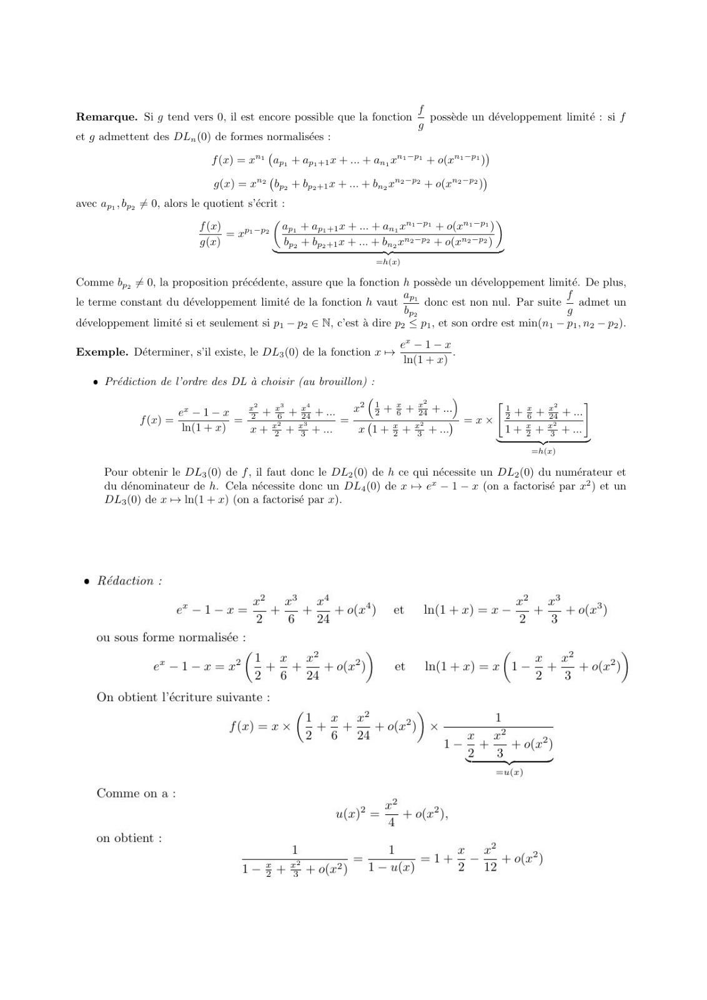

**Lecture OCR à contrôler**

~~~text
Remarque. Si g tend vers 0, il est encore possible que la fonction Ÿ possède un développement limité
g

et g admettent des DL,,(0) de formes normalisées :
F(a) = 2 (aps + ap, 18 + + am 2 PE + of" Pr)
ge) = 2"? (by + bya prt + eu + byt"??? + o(a"27P2))

avec dp, bp, # 0, alors le quotient s'écrit :

LG) papa (Mert Onr sre + tan a Pt + of)
git) Bp + bpp 1k + 2 + bn g@?2—P2 + o( M2

=h(x)
Comme b,, # 0, la proposition précédente, assure que la fonction h possède un développement limité. De plus,
a,
le terme constant du développement limité de la fonction h vaut 2 donc est non nul. Par suite i admet un

pa g
développement limité si et seulement si p1 — p2 € N, c'est à dire p2 < pi, et son ordre est min(n1 — pi, n2 — p2).
Exemple. Déterminer, s'il existe, le DL3(0) de la fonction x ++

¢ Prédiction de l’ordre des DL à choisir (au brouillon) :

f(x) =

: 2(1
f-l-2 F+S+H +... æ (4+
In(l+2) 2+h4R4 +

=h(z)

Pour obtenir le DL3(0) de f, il faut donc le DL(0) de h ce qui nécessite un DL(0) du numérateur et
du dénominateur de h. Cela nécessite done un DL4(0) de x ++ e* — 1x (on a factorisé par 2?) et un
DL3(0) de x ++ In(1 +2) (on a factorisé par +).

© Rédaction :
t In(l+a)=2 a + = + o(x°)
à 2 3

+ o(e?))

On obtient l'écriture suivante :

2
f@)=ex (14742 0) x a
2/6 24 1-4 ye)
2 3 a
©, à
=u(z)
Comme on a :
on obtient : 5
a
- 5-5 +0(0*)
1-§4+ 5 +0( 12
~~~

## Page 16

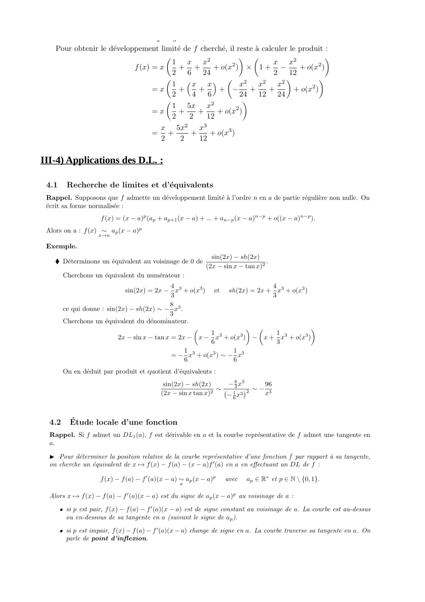

~~~text
III-4) Applications des D.L. :
~~~

**Lecture OCR à contrôler**

~~~text
Pour obtenir le développement limité de f cherché, il reste à calculer le produit :

)

1 x : æ + à
f(a (545+ Ft oe) x (145-5 poe

Le. 2 a? À: m2 2
(5+ (645) + (+5 +5) toe

1 5x +? >
G + Tr + D + o(x°)
2, Gt,

= ie 23
= at 2 +35 to)

Il
8

III-4) Applications des ge!

4.1 Recherche de limites et d’équivalents

Rappel. Supposons que f admette un développement limité à l’ordre n en a de partie régulière non nulle. On
écrit sa forme normalisée :

F(a) = (@ — a)? (ay + ap ya(e — a) +... + an-p(e — a)? + of (a — a)"-?).

Alors on a : f(x) +, apr a)

Exemple.

sin(2x) — sh(2x)

+ Déterminons un équivalent au voisinage de 0 de
(2r—sinr-tanr)

Cherchons un équivalent du numérateur :
sin(2x) = 2r — 5° +o(x*) et  sh(2r) = 2r + a + o(x*)

8

ce qui donne : sin(2r) — sh(2x) ~ —

Cherchons un équivalent du dénominateur.

2x —sinx —tanx

On en déduit par produit et quotient d’équivalents :

in(2x) — sh(2x)
(Qr — sine tana)?

4.2 Etude locale d’une fonction

Rappel. Si f admet un DLA(a), f est dérivable en a et la courbe représentative de f admet une tangente en
a.

> Pour déterminer la position relative de la courbe représentative d’une fonction f par rapport à sa tangente,
on cherche un équivalent de x ++ f(x) — f(a) — (x — a)f'(a) en a en effectuant un DL de f :

F(x) — f(a) — f'(@)(w—a) ~a,(e—a)? avec a, ER et pEN\ {0,1}
Alors x ++ f(x) — f(a) — f'{a)(x — a) est du signe de ap(x — a)” au voisinage dea :

@ sip est pair, f(x) — f(a) — f"(a)(x — a) est de signe constant au voisinage de a. La courbe est au-dessus
ou en-dessous de sa tangente en a (suivant le signe de ap).

@ sip est impair, f(x) — f(a) — f'(a)(x — a) change de signe en a. La courbe traverse sa tangente en a. On
parle de point d’inflezion.
~~~

## Page 17

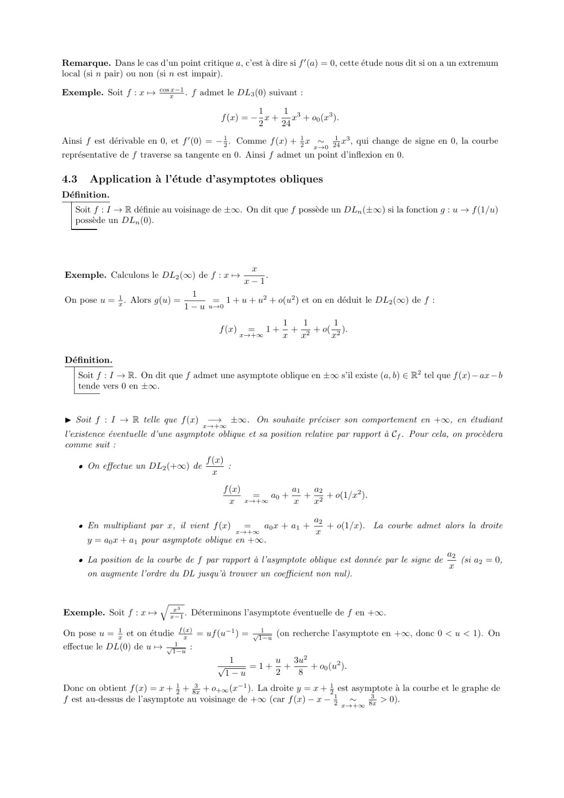

**Lecture OCR à contrôler**

~~~text
Remarque. Dans le cas d’un point critique a, c’est à dire si f(a) = 0, cette étude nous dit si on a un extremum
local (si n pair) ou non (si n est impair).

Exemple. Soit f > °82=!, f admet le DLs(0) suivant :

= 1, 1 3
=-rt ay + 09 (2"

SC

Ainsi f est dérivable en 0, et f'(0) = —}. Comme f(x) + $2 on zx, qui change de signe en 0, la courbe

représentative de f traverse sa tangente en 0. Ainsi f admet un point d’inflexion en 0.

4.3 Application à l’étude d’asymptotes obliques
Définition.

Soit f : 1 + R définie au voisinage de +00. On dit que f possède un DL, (Ho) si la fonction g : u > f(1/u)
de un DL, (0).

Exemple. Calculons le DLa(o) de fs 2+ — =

LL 1p hill 4 of) eto en aéible DT (6) da fs

se u = L. Alors +.
On pose u = 4. Alors g(u) = =— =,

1
f(z) = 1+2+

a+

Définition.

Soit f : 1 > R. On dit que f admet une asymptote oblique en too s’il existe (a,b) € R2 tel que f(x) —aa—b
tende vers 0 en +0.

> Soit f : 1 > R telle que f(x) —+ +00. On souhaite préciser son comportement en +00, en étudiant
Pr

l'existence éventuelle d’une asymptote oblique et sa position relative par rapport à Cj. Pour cela, on procèdera

comme suit :

+ On effectue un DEa(+oo) de FE) .

a
z +o(1/x?).

e En multipliant par æ, il vient f(x) = ao +a, + 2 + o(1/x). La courbe admet alors la droite
eae x

y = aox + a, pour asymptote oblique en +00.

e La position de la courbe de f par rapport à Vasymptote oblique est donnée par le

a

jgne de =? (si az =0,
z

on augmente l'ordre du DL jusqu'à trouver un coefficient non nul).

Exemple. Soit f :x + 1/2. Déterminons l'asymptote éventuelle de f en +00.

On pose u = L et on étudie 2) = uf{u-!) = JAG (on recherche l'asymptote en +00, done 0 < u < 1). On
de
effectue le DL(0) de ur = :
1 u 3u 5
=l+-
= bt gt ye +)

Done on obtient f(x) = 2+ 3+ +04x(x71). La droite y = x + 5 est asymptote à la courbe et le graphe de

f est au-dessus de l’asymptote au voisinage de +00 (car f(x) — x & >0).

2

roto
~~~

## Page 18

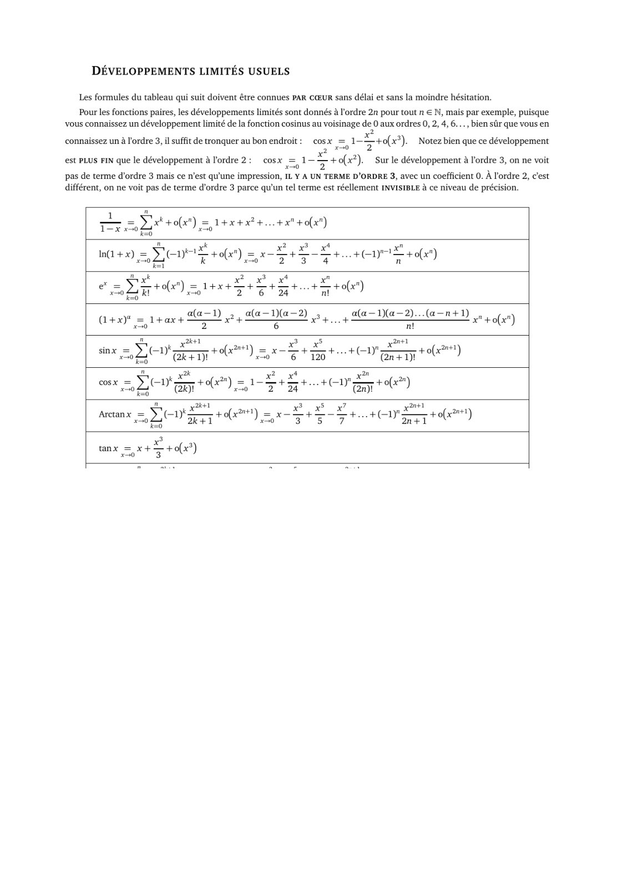

**Lecture OCR à contrôler**

~~~text
DÉVELOPPEMENTS LIMITÉS USUELS

Les formules du tableau qui suit doivent être connues PAR CŒUR sans délai et sans la moindre hésitation.
Pour les fonctions paires, les développements limités sont donnés à l'ordre 2n pour tout n € N, mais par exemple, puisque
vous connaissez un développement limité de la fonction cosinus au voisinage de 0 aux ordres 0, 2, 4, 6..., bien sûr que vous en

e
connaissez un à l'ordre 3, il suffit de tronquer au bon endroit : x = =, 1 +0(x7 ). Notez bien que ce développement
cosx =

5 1 éd)

pas de terme d'ordre 3 mais ce n'est qu’une impression, IL Y A UN TERME D'ORDRE 3, avec un coefficient 0. À l'ordre 2, c'est
différent, on ne voit pas de terme d'ordre 3 parce qu'un tel terme est réellement INVISIBLE à ce niveau de précision.

est PLUS FIN que le développement à l'ordre 2 : Sur le développement à l'ordre 3, on ne voit

(x") = 4x + x +... +2" +(x")
Gaia a ita ae) x2+ a tt ge Xe Dalen) x" +(x")
om Lo yo Den sy* a tore fx")
coe xe tant of) = 1-4 Dre to)
ans =, DC 7 $o(xt) = x + CI tof)
tanx =, x + À 40(x? )
~~~
