# CM6-Integration_2024-2025_Analyse2_P1S2_DMaths.pdf

[Ouvrir l’original](https://drive.google.com/open?id=1kTbeKGMpJX56V2MNNDkxd5PHqXwRTmOu) · Les pages signalées comprennent du texte reconnu automatiquement ou des éléments graphiques. Le fac-similé permet de vérifier chaque lecture.

**Pages avec fac-similé ou lecture OCR** — 2–14.

## Page 1

~~~text
                  Chapitre 6 : Intégration sur un segment

I- Intégrale d’une fonction en escalier :
~~~

## Page 2

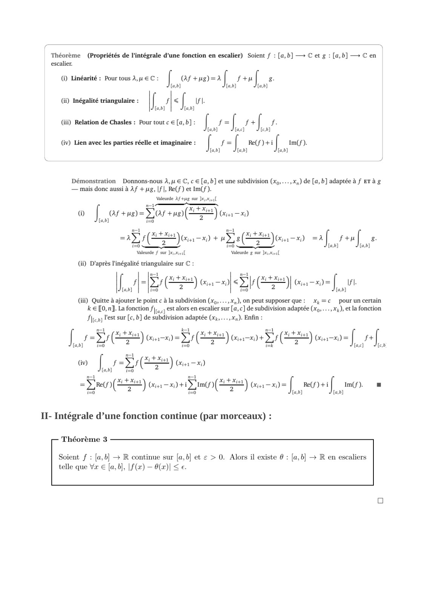

~~~text
II- Intégrale d’une fonction continue (par morceaux) :
~~~

**Lecture OCR à contrôler**

~~~text
Théorème (Propriétés de l'intégrale d’une fonction en escalier) Soient f : [a,b] — C et g : [a,b] + Cen
escalier.

() Linéarité : Pour tous A, y € C : | (Af +ug)=2 suf 8.
{a,b} Lab] Lab]

fs
Lab]

(iii) Relation de Chasles : Pour tout c € [a,b] : Î F -[ i+ fe
[a,b] fae [e,b]

(ii) Inégalité triangulaire : <| y

Lab]

(iv) Lien avec les parties réelle et imaginaire : f= Re(f)+ if Im(f).
[a,b] Lab] La]

Démonstration Donnons-nous À, y € C, ¢ € [a, b] et une subdivision (xp,...,x,) de [a,b] adaptée à f Er à g
— mais donc aussi à Af +g, If |, Re(f) et Im(f).
Valeurde Af tug sur }x,x,.4[

SY
0) i arup= Tar +o (2 SE) Gi x)

2S (ou Ye Jono =af soul
0 0 as Lab] Lab]

Valeurde f sur Ix) xsi Valeurde g sur Ix. xieal

(i) D'après l'inégalité triangulaire sur C :

(rite
fs 7 D 2) Gia)

(iii) Quitte à ajouter le point c à la subdivision (xp,...,,,), on peut supposer que: x,=c pour un certain
k € [0, n]. La fonction fj, .) est alors en escalier sur [a, ] de subdivision adaptée (x9,...,x,), etla fonction
Pire Vest sur [e, b] de subdivision adaptée (x,.…, x). Enfin :

= L =
J DE) Co) = D (84) us) eS (SEE) (sod = I
wv) im fe icons St) (i =)

Ref) (AS) (a x DOTE) Gig

<S (ES) Ga-xd= |] Uh

[a,b]

—

mari Im(f). .

[a,b] Lab]

II- Intégrale d’une fonction continue (par morceaux) :

Théorème 3

Soient f : [a,b] > R es sur [a,b] et ¢ > 0. Alors il existe  : [a,b] + R en escaliers

telle que Vx € [a,b], |f(x) — A(x)| < €.
~~~

## Page 3

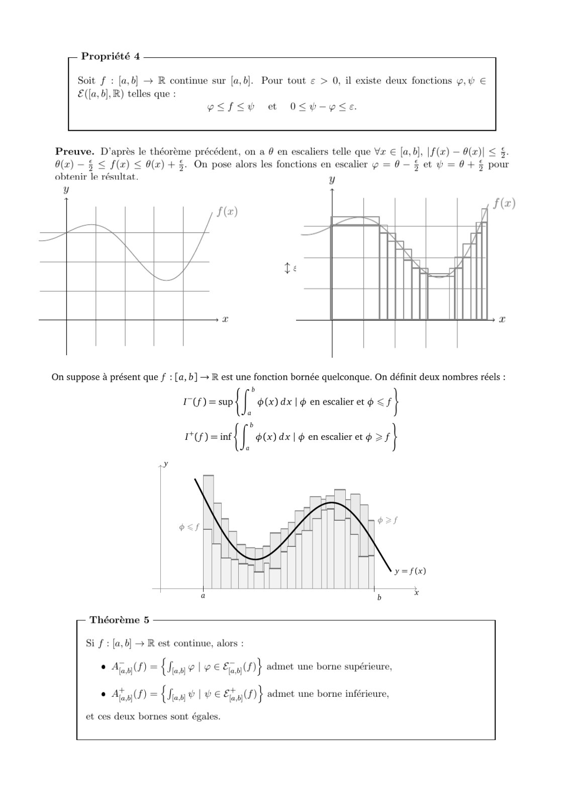

**Lecture OCR à contrôler**

~~~text
Propriété 4

Soit f : [a,b] + R continue sur [a,b]. Pour tout ¢ > 0, il existe deux fonctions y,# €
E((a, 6], R) telles que :

p<f<Sy et O<-yse.

Preuve. D'après le théorème précédent, on a @ en escaliers telle que Vx € [a,b], | f(x) — 4(x)|

A(x) — § < f(x) < A(x) + 5. On pose alors les fonctions en escalier p = 0—$ et YW =0+$
obtenir le résultat.

y

£$.
pour

On suppose à présent que f : [a,b] > R est une fonction bornée quelconque. On définit deux nombres réels :

b
I-(f)=sup {f (x) dx | en escalier et  < |

b
(= if $(x) dx | ¢ en escalier et $ >1}

Théorème 5

Si f : [a,b] + R est continue, alors :
© Apt) = {lou plrEE y cn} admet une borne supérieure,
© Ag) = {Janv | ¥ € Ef y(N)} admet une borne inférieure,

et ces deux bornes sont égales.
~~~

## Page 4

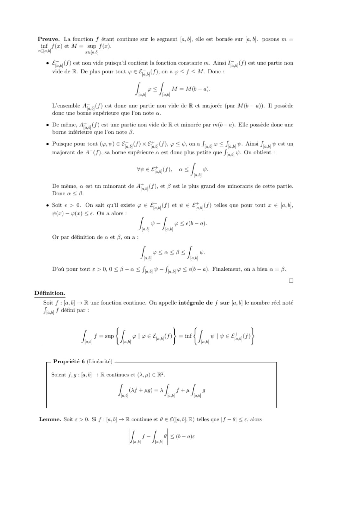

**Lecture OCR à contrôler**

~~~text
Preuve. La fonction f étant continue sur le segment [a,b], elle est bornée sur [a,b]. posons m =
inf f(x) et M= sup f(z).

æela.b] æélab]

. Eau f) est non vide puisqu'il contient la fonction constante m. Ainsi laut f) est une partie non

vide de R. De plus pour tout ÿ € Eau) onay<f <M. Donc:

[ p<] M=M(b-a).
la) a}

L'ensemble Aj, ,(f) est done une partie non vide de R et majorée (par M(b—a)). 11 possède
done une borne supérieure que l'on note a.

De même, Aj, ,(f) est une partie non vide de R et minorée par m(b—a). Elle possède donc une
borne inférieure que l'on note 3.

Puisque pour tout (y, #) € En) x Ent) pg<vona Jeu ys as w. Ainsi as west un
majorant de A~(f), sa borne supérieure a est donc plus petite que fj,,.) #. On obtient :

VbeEyf) à <] w.
(at)

De même, a est un minorant de Af ,(f), et 8 est le plus grand des minorants de cette partie.
Done a < 8.

Soit € > 0. On sait qu'il existe ÿ € Eau fjetve Eau f) telles que pour tout x € [a,b],

W(x) — p(x) < €. On a alors :
[ er ye Se(b—a).
ot} ©]

Or par définition de a et 8, on a:
[esoxos fe
[a.t) fat]

D'où pour tout € > 0,0 < #—a < fay ¥— fay? <e(b- a). Finalement, on a bien a = 8.
(a)

Soit f : [a,6] + R une fonction continue. On appelle intégrale de f sur [a,b] le nombre réel noté
Jus f défini par :

[= {La vlee cau} = {fe Ive aaa}

Propriété 6 (Linéarité)

Soient f, g : [a,b] > R continues et (À, y) € R2.

[Ler+un-af rue

Lemme. Soit ¢ > 0. Si f : [a,b] > R continue et 9 € £([a,b],R) telles que |f — 6] < ¢, alors

I, Æ I, i

<(b-a)e
~~~

## Page 5

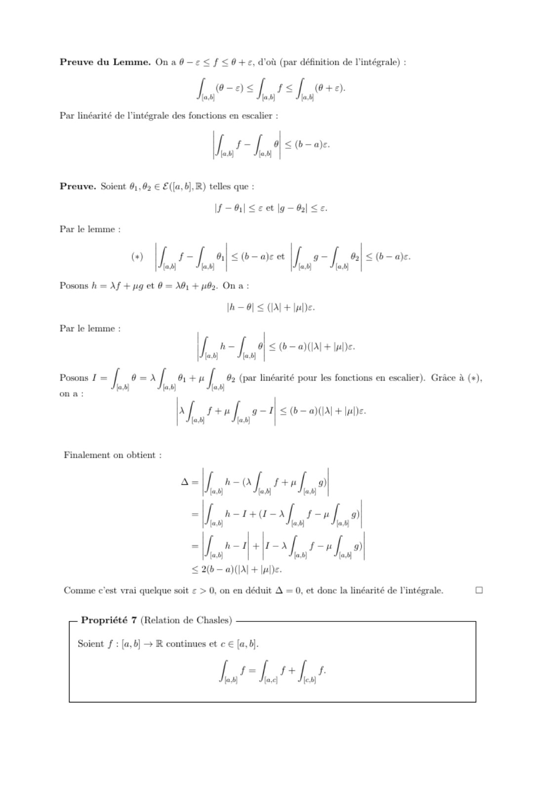

**Lecture OCR à contrôler**

~~~text
Preuve du Lemme. On a @—< < f £0+e, d'où (par définition de l'intégrale) :

fs fats f+

Par linéarité de l'intégrale des fonctions en escalier :
haa a
la.) (al

Preuve. Soient 61,42 € £([a, b],R) telles que :

< (b-a)e.

If - | <¢ et |g—@| <e.

Loh of
fo} Sa) (et Jai

Posons h = Af + pig et 0 = Ai + pb. Ona:
|h—6| < (A+ lul)e.

Par le lemme :

(+) <(b— ae et <(b— a}s.

Par le lemme :

athe Ô < @— a)(AI+ lue.

Posons 1 = [| 0=r/ #+n [ 83 (par linéarité pour les fonctions en escalier). Grâce à (+),
(al

las) lat)
1 ftp [ g-1
{al [a.b)

£{b—a)(lA + lul)e.

Finalement on obtient :

A=

1 a af, al vf, a)
[AC eta fy ae I, ®)

1 I-X su 9)
la lat) (al

< 2(b—a)(|A| + lue.

Comme c’est vrai quelque soit £ > 0, on en déduit A = 0, et donc la linéarité de l'intégrale. a

Propriété 7 (Relation de Chasles)

Soient f : [a,b] + R continues et € € [a,b].

I, fe La dd hea f
~~~

## Page 6

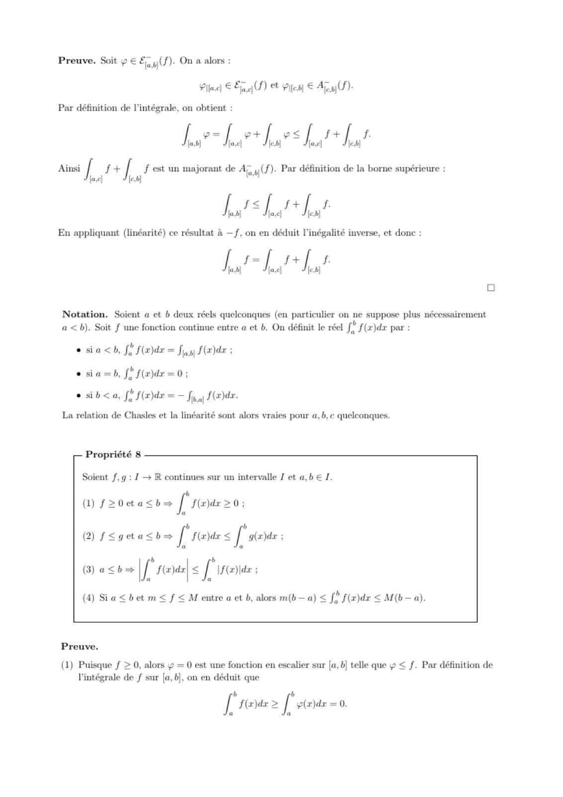

**Lecture OCR à contrôler**

~~~text
Preuve. Soit 9 € &, 4(f)- On a alors :

Plla.d) € Ea g(f) et Pres] € Ajey(F)-

Par définition de l'intégrale, on obtient :

I. _ I. ee I, vs I. 1 I, f

Ainsi [ f+ f fest un majorant de Ay, y(f). Par définition de la borne supérieure :
lacy Shey ,

ie fs hs #+ jis ’

En appliquant (linéarité) ce résultat à —f, on en déduit l'inégalité inverse, et done :

tes = hs a hes .

Oo

Notation. Soient a et b deux réels quelconques (en particulier on ne suppose plus nécessairement
a <b). Soit f une fonction continue entre a et b. On définit le réel f f(x)dx par :

eo sia ch, [2 f(a)de = fun f(w)de :
e sia=b, [ f(x)dr =0;

esib< a, [2 f(x)dr = - Je fdr.

La relation de Chasles et la linéarité sont alors vraies pour a, b, c quelconques.

Propriété 8

Soient f, g : 1 — R continues sur un intervalle I et a,b € I.

() s20easb- [ sayde>0;
12 11
@ f<gmasbs | seydrs | at:

(3) a<b> [ff sere < fuite:

(4) Si a <bet m< f < M entre a et b, alors m(b—a) < f° f(z)dr < M(b— a).

Preuve.

(1) Puisque f > 0, alors y = 0 est une fonction en escalier sur [a, 6] telle que  < f. Par définition de
l'intégrale de f sur [a,b], on en déduit que

[re > ['eer =0.
~~~

## Page 7

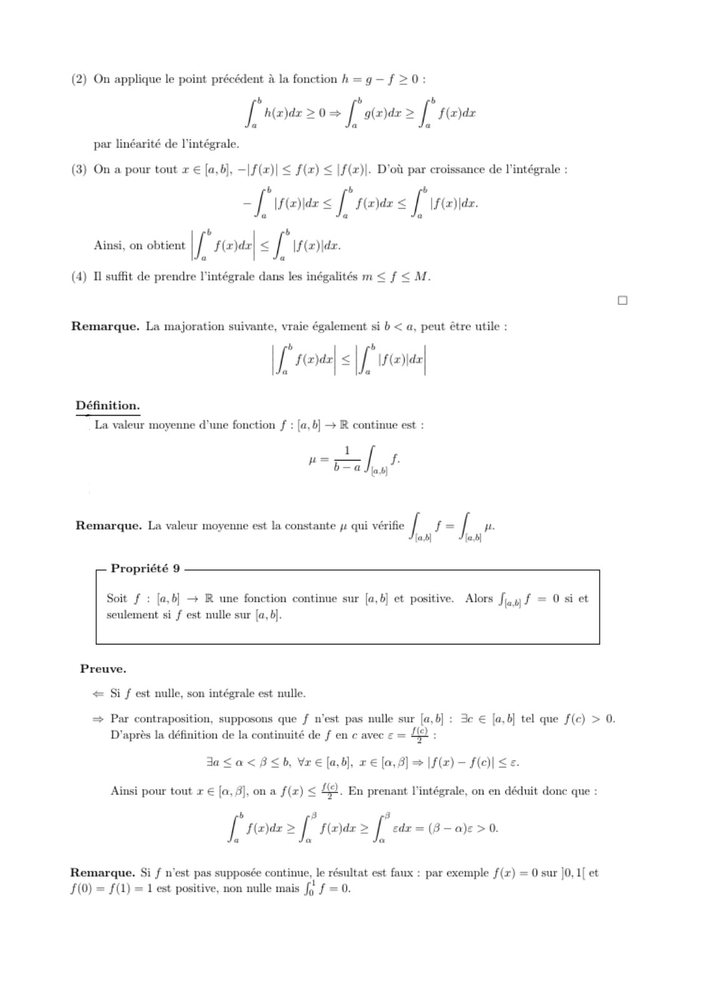

**Lecture OCR à contrôler**

~~~text
(2) On applique le point précédent à la fonction h = g— f >0:

b b b
[ h(x)dr 20> f g(x)dr > [ f{a)dr
i i a
par linéarité de l'intégrale.

(3) On a pour tout x € [ab], —|f(x)| < f(x) < |f(x)|. D'où par croissance de l'intégrale :

- [wearers [rer < [irons

I * pleyde| < Î "aide.

(4) Il suffit de prendre l'intégrale dans les inégalités m < f < M.

Ainsi, on obtient

Remarque. La majoration suivante, vraie également si b < a, peut être utile :

[ ” pa) [ "td

=<

Définition.

La valeur moyenne d’une fonction f : [a,b] > R continue est :

I, à

h

Remarque. La valeur moyenne est la constante js qui vérifie | f= | pe.
fab fa.

Propriété 9

Soit f : [a,b] + R une fonction continue sur [a,b] et positive. Alors fj,,) f = 0 si et
seulement si f est nulle sur [ab].

Preuve.
<= Si f est nulle, son intégrale est nulle.

=> Par contraposition, supposons que f n'est pas nulle sur [a,b] : 3e € [a,b] tel que f(c) > 0.
D'après la définition de la continuité de f en ¢ avec <= 10 :

Ja<a<B<b, Vre [a,b], r€{a,#] = |f(x)- f(c)| < €.

Ainsi pour tout x € [a, 4], on a f(x) < 4. En prenant l'intégrale, on en déduit done que :
11 3 8
[ f(a)dx >/ F(a)dx > edr = (8— a)s > 0.
A a a

Remarque. Si f n'est pas supposée continue, le résultat est faux : par exemple f(x) = 0 sur [0,1[ et
F(0) = f(1) = 1 est positive, non nulle mais fj f = 0.
~~~

## Page 8

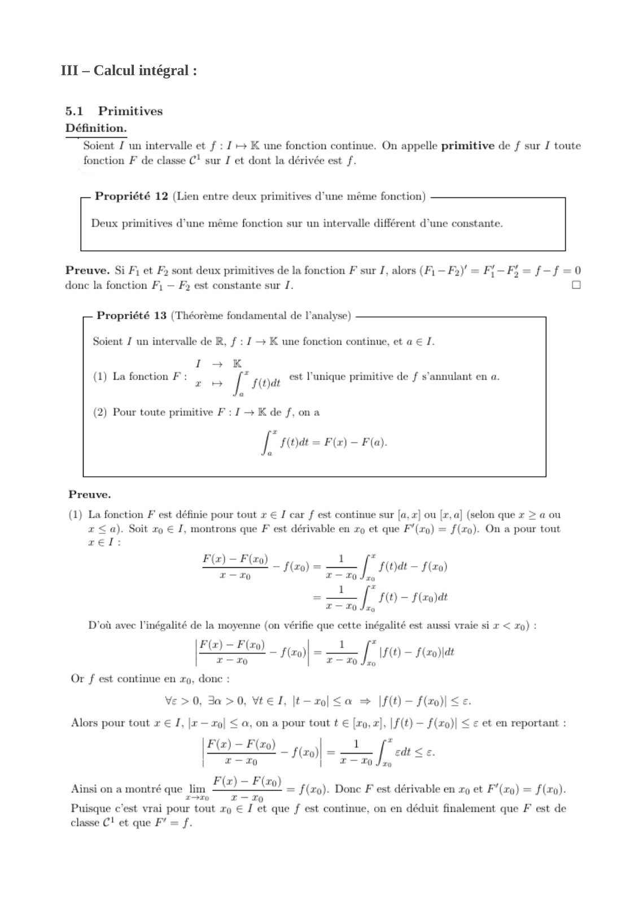

~~~text
III – Calcul intégral :
~~~

**Lecture OCR à contrôler**

~~~text
III — Calcul intégral :

5.1 Primitives

Définition.
Soient J un intervalle et f : J+ K une fonction continue. On appelle primitive de f sur I toute
fonction F de classe C! sur J et dont la dérivée est f.

— Propriété 12 (Lien entre deux primitives d'une même fonction)

Deux primitives d'une même fonction sur un intervalle différent d’une constante.

Preuve. Si Fi et F2 sont deux primitives de la fonction F sur I, alors (Fi — F2)' = F-F; = f-f=0
donc la fonction F1 — F est constante sur 1. Oo

Propriété 13 (Théorème fondamental de l'analyse)

Soient J un intervalle de R, f : J + K une fonction continue, et a € 1.

1 Kk
(1) La fonction Fi | code est l'unique primitive de f s’annulant en a.

(2) Pour toute primitive F : 1 + K de f, ona

[ f(t)dt = F(x) — F(a).

Preuve.

(1) La fonction F est définie pour tout x € I car f est continue sur [a, x] ou {r, a] (selon que x > a ou
x <a). Soit xo € I, montrons que F est dérivable en xo et que F/(r0) = f(x). On a pour tout
zel:

F(a) — F(a) _

9

f(x0) =

[ste sta)
[10-104

Ea)

1

T7
D'où avec l'inégalité de la moyenne (on vérifie que cette inégalité est aussi vraie si x < a9) :

PO jo) = 2 fe) — saat

T0 T—70

Or f est continue en x, donc :
Ve>0, Ja >0, Vel, [t—-r0 <a => |f(t) — f(z0)| <e.

x — ol < a, on a pour tout t € [xo,x]. |f(t) — f(xo)| < € et en reportant :

F(z) = F(zo) - S00 =! [<a <e.

| TT T— T0 Jr0

Ainsi on a montré que lim F(z) = F0)
rm  T—70

Puisque c'est vrai pour tout xp € J et que f est continue, on en déduit finalement que F est de
classe C1 et que F'= f.

Alors pour tout x € J,

= f(x). Donc F est dérivable en xo et F’(x9) = f (x0).
~~~

## Page 9

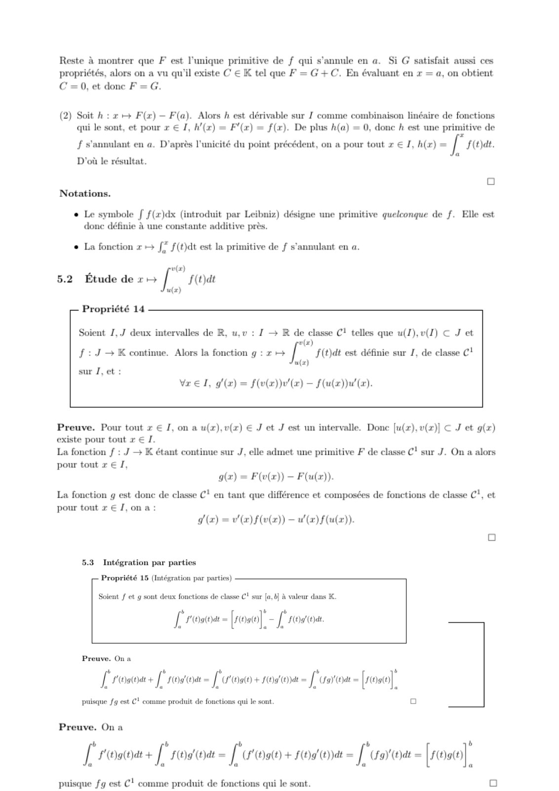

**Lecture OCR à contrôler**

~~~text
à montrer que F est l’unique primitive de f qui s'annule en a. Si G satisfait aussi ces
és, alors on a vu qu'il existe C € K tel que F = G+C. En évaluant en x = a, on obtient
C = 0, et donc F=G.

(2) Soit h : x ++ F(x) — F(a). Alors h est dérivable sur J comme combinaison linéaire de fonctions
qui le sont, et pour x € J, h'{x) = F'(x) = f(x). De plus h(a) = 0, donc h est une primitive de

f s'annulant en a. D'après l'unicité du point précédent, on a pour tout x € I, h(x) = A f(t)at.
D'où le résultat. .

Oo
Notations.

e Le symbole f f(x)dx (introduit par Leibniz) désigne une primitive quelconque de f. Elle est
donc définie à une constante additive près.

© La fonction x ++ f* f(t)dt est la primitive de f s'annulant en a.

w(x)
5.2 Etude de x [ f(t)dt
u(x)

Propriété 14

Soient I, J deux intervalles de R, u,v : 1 + R de classe C! telles que u(I), v(I) € J et
w(x)

f:J— K continue. Alors la fonction g : 2 ++ f(t)dt est définie sur J, de classe C!
u(x)

sur J, et:

vr eT, g(x) = f(v(x))u'(x) — f(u(z))u'(x).

Preuve. Pour tout x € J, on a u(x), v(x) € J et J est un intervalle. Donc [u(z), v(x)] € J et g(x)
existe pour tout x € 1.
La fonction f : J — K étant continue sur J, elle admet une primitive F de classe C! sur J. On a alors
pour tout x € J,

g(x) = F(v(x)) — F(u(x)).
La fonction g est donc de classe C! en tant que différence et composées de fonctions de classe C!, et
pour tout re J, ona:

go (x) = v'(x)f(u(x)) — w'(x)flu(x)).

5.3 Intégration par parties

Propriété 15 (Intégration par parties)

Soient f et g sont deux fonctions de classe C! sur [a, b] à valeur dans K.

[ * oat = [reo]. - if * pod ode.

Preuve. On a
[robe + rotor [roan + rod = [soo - [roa]
palsque fg est C! comme produit de fonctions qui le sont. o
Preuve. On a
+ b be 12 b
,
L'rosa+ ['rodoat- [oat + Hoa erat = [ (rar oat = [rot]

puisque fg est C! comme produit de fonctions qui le sont. Qo
~~~

## Page 10

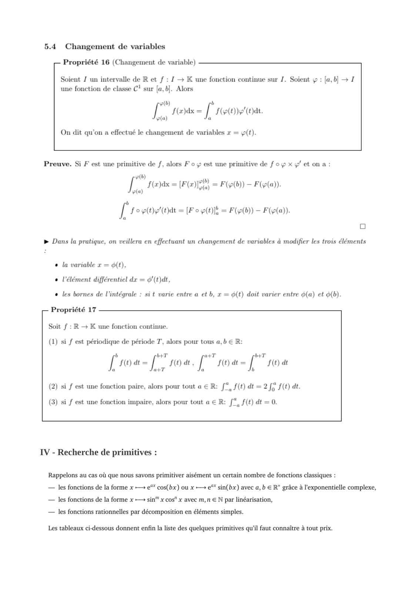

~~~text
IV - Recherche de primitives :
~~~

**Lecture OCR à contrôler**

~~~text
5.4 Changement de variables

Propriété 16 (Changement de variable)

Soient J un intervalle de R et f : J + K une fonction continue sur J. Soient y : [a,b] > I
une fonction de classe C! sur [a,b]. Alors

p(b)
[rexs- [ro

fa)

On dit qu'on a effectué le changement de variables x = g(t).

Preuve. Si F est une primitive de f, alors F 0 y est une primitive de f oy x g' et on a:

+(b)
[ | SE = [FE = FCO) — Flea)
va)

b
ro tbe" = Fo pitt = FU) ~ Feta).
Oo

> Dans la pratique, on veillera en effectuant un changement de variables à modifier les trois éléments

« la variable x = ét),
« l'élément différentiel dx = @/(t}dt,
« les bornes de l'intégrale : sit varie entre a et b, x = é(t) doit varier entre 6(a) et o(b).

Propriété 17

Soit f : R — K une fonction continue.

(1) si f est périodique de période T, alors pour tous a,b € R:

[roe [ro [soa [ro

(2) si f est une fonction paire, alors pour tout a € R: [*, f(t) dt = 2 fy f(t) dt.

(3) si f est une fonction impaire, alors pour tout a € R: f*, f(t) dt = 0.

IV - Recherche de primitives :

Rappelons au cas où que nous savons primitiver aisément un certain nombre de fonctions classiques :
— les fonctions de la forme x —» e** cos(bx) ou x > e** sin(bx) avec a, b € R' grâce à l'exponentielle complexe,
— les fonctions de la forme x > sin" x cos" x avec m,n € N par linéarisation,

— les fonctions rationnelles par décomposition en éléments simples.

Les tableaux ci-dessous donnent enfin la liste des quelques primitives qu'il faut connaître à tout prix.
~~~

## Page 11

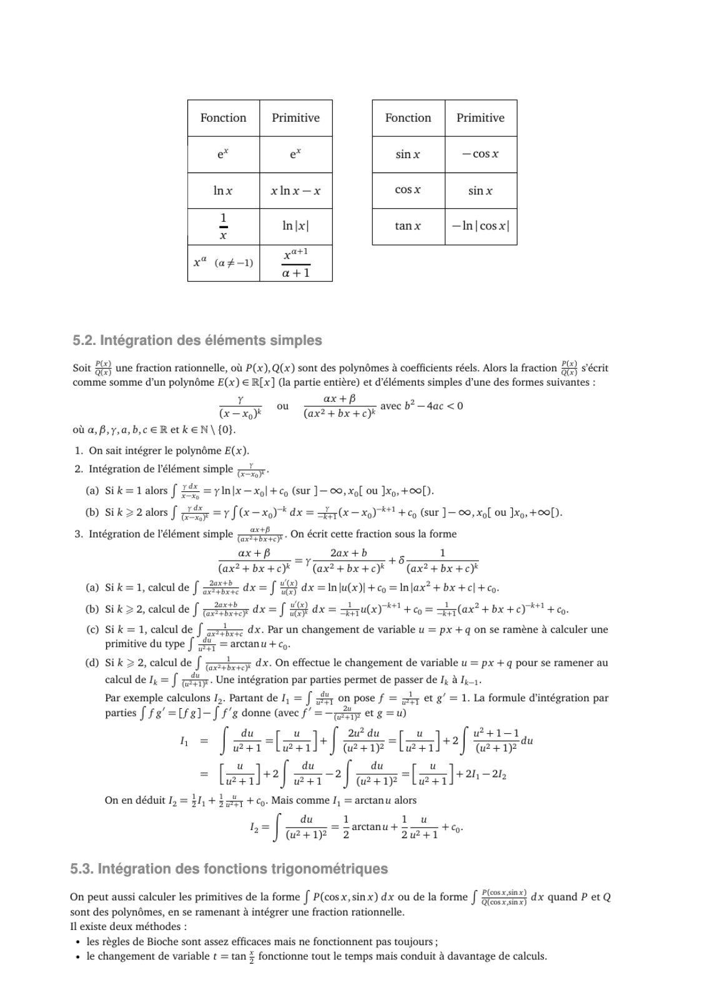

**Lecture OCR à contrôler**

~~~text
Fonction Primitive Fonction Primitive
e* e* sinx —cosx
Inx xinx—x cosx sinx
1
= In|x| tanx —In|cos x|
x
ast
xt (a¢-)} SL
a+1
5.2. Intégration des éléments simples
Soit 59 une fraction rationnelle, où P(x), Q(x) sont des polynémes à coefficients réels. Alors la fraction £1} s'écrit
comme somme d'un polynôme E(x) € R[x] (la partie entière) et d'éléments simples d'une des formes suivantes :

ET. oe ee
(x= xo) (ax? + bx +c)
où a, B,y,a,b,c ER etk EN \ {0}.

avec b?—4ac <0

1. On sait intégrer le polynôme E(x).
2. Intégration de l'élément simple =.

(a) Sik=1 alors f LE = yinlx—xol +¢9 (sur ]— 00, xo[ où xo, +00).

(b) Sik> 2 alors f LÉ = y f(x = dx = (x x0) #1 + cp (sur ]— 00, xol où Jxo, +000).

3. Intégration de l'élément simple whe. On écrit cette fraction sous la forme
ax+B 2ax+b 1
wad à

+
(ax? + bx +c) (ax? + bx +c) (ax? + bx +c)*
(a) Sik=1, calcul de f Bt dx = [ 42 dx =In|u(x)| + co = In lax? + bx +e] + co.

(b) Sik > 2, calcul de faint du = J dx = sByulxy 1 + eg = (ax? + bx +c) +09.

(©) Sik = 1, calcul de J; are dx. Par un changement de variable u = px + q on se ramène à calculer une
primitive du type [ 345 = arctanu +.

@ Sik > 2, caleul de f
calcul de I, = [ <p. Une intégration par parties permet de passer de I, à Ik.

dx. On effectue le changement de variable u = px + q pour se ramener au

Par exemple calculons /,. Partant de I, = [ fy on pose f = ty et g’ = 1. La formule d'intégration par
parties f fg’ =[fg]—J f’g donne ne wis etg =u)

L & du _ 2u? du u Je +1,
1 Jui len] (+z lan (+1?

u u
7 + + 2h —21.
A] JE af ate lz] me

On en déduit I, = $1, + $4 + co. Mais comme J, = arctanu alors

= ({ — ta arctanu+ 2 ‘
2 | ote: 2 7 Es +%

5.3. Intégration des fonctions trigonométriques

On peut aussi calculer les primitives de la forme f P(cos x, sin x) dx ou de la forme [ HE dx quand P et Q
sont des polynémes, en se ramenant a intégrer une fraction rationnelle.
Il existe deux méthodes :

+ les règles de Bioche sont assez efficaces mais ne fonctionnent pas toujours ;

+ le changement de variable t = tan % fonctionne tout le temps mais conduit à davantage de calculs.
~~~

## Page 12

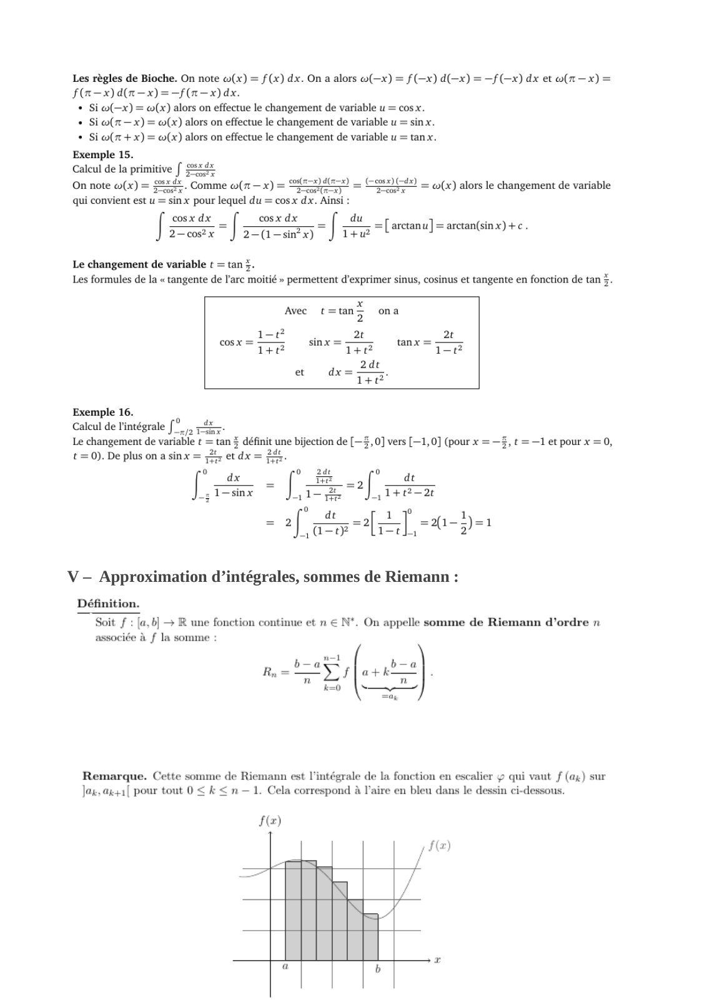

~~~text
V – Approximation d’intégrales, sommes de Riemann :
~~~

**Lecture OCR à contrôler**

~~~text
Les règles de Bioche. On note w(x) = f(x) dx. On a alors co(—x) = f(x) d(-x) = —f(-x) dx et «(x —x) =

f(m—x) d(n—x) = f(x) dx.

+ Si co(—x) = œ(x) alors on effectue le changement de variable u = cosx.
+ Si co(t—x) = w(x) alors on effectue le changement de variable u = sin x.
+ Si w(r +x) = w(x) alors on effectue le changement de variable u = tan x.

Exemple 15.
Calcul de la primitive [ 2xéx
On note w(x) = 4x Comme w(r—

qui convient est u = sin x pour lequel du = cos x dx. Ainsi :

cos x dx

x)=

cos x dx

(<e0sx) (dx)

DC — wo(x) alors le changement de variable

du

2—co8x

“J

Le changement de variable t = tan 5.

2=(1=sin?x)

1+u

=[arctanu] = arctan(sinx) +e.

Les formules de la « tangente de l'arc moitié » permettent d'exprimer sinus, cosinus et tangente en fonction de tan 5.

cos x =

x
Avec Em ona
der sinx = 2? tanx = 2!
1+) 1+ 1-7?
2dt
et dx= a
1+e

Exemple 16.
Calcul de l'intégrale f°, re.
Le changement de variable

t = 0). De plus on a sinx =

2

dx

an # définit
etdx=

eue
De:
0

24e
Te

une bijection de [—4, 0] vers [—1, 0] (pour x =, t =—1 et pour x = 0,
de

f

1—sinx

wel
‘|
a

_
Fe

dt

at}

2 ° dt
_,1+0?-2¢

chy ps

V — Approximation d’intégrales, sommes de Riemann :

associée à f la somme :

b-a

Rn =

n

k=0

ja, b] + R une fonction continue et n € N°. On appelle somme de Riemann d'ordre n

vr ein’
ñ

CRUE LE")

Remarque. Cette somme de Riemann est l'intégrale de la fonction en escalier ÿ qui vaut f (ax) sur
Jax. ax+1[ pour tout 0 < & < n — 1. Cela correspond à l'aire en bleu dans le dessin ci-dessous.

f(z)
~~~

## Page 13

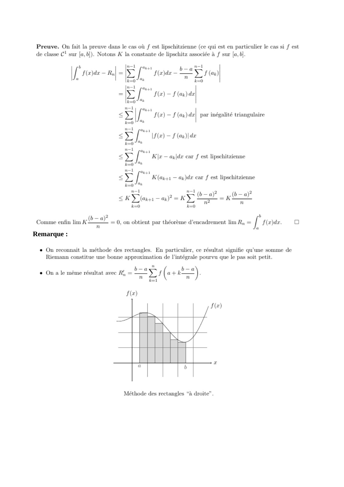

~~~text
Remarque :
~~~

**Lecture OCR à contrôler**

~~~text
Preuve. On fait la preuve dans le cas où f est lipschitzienne (ce qui est en particulier le cas si f est
de classe C! sur [a,6]). Notons K la constante de lipschitz associée à f sur [ab].

n=i ba"

DIRECT
k=0 4 k=O

mL pages
[rar
k=0 * SH
n-1

<v

k=0

nt Oke
<¥ [ue saw)lae
k=0

ax

[ * salar — Ry

[ f(x) - J del par inégalité triangulaire

m1 pass
< 5 [ K |x — agldx car f est lipschitzienne
kao" %
n-1 di
<>; [ K(ax41 — ax)dr car f est lipschitzienne
k="
n=1 n-1

. pra) _ (ba)
SK Zn — an)? = KD” a =k

Comme enfin lim K-

— aÿ b
A _ = 0, on obtient par théorème d'encadrement lim R, = [ f@)dr. 0
À

Remarque :

On reconnait la méthode des rectangles. En particulier, ce résultat signifie qu'une somme de
Riemann constitue une bonne approximation de l'intégrale pourvu que le pas soit petit.

a b-a
> (« + i) :

k=i

¢ Ona le même résultat avec Ri, =

F(z)

1
/

Méthode des rectangles “à droite”.
~~~

## Page 14

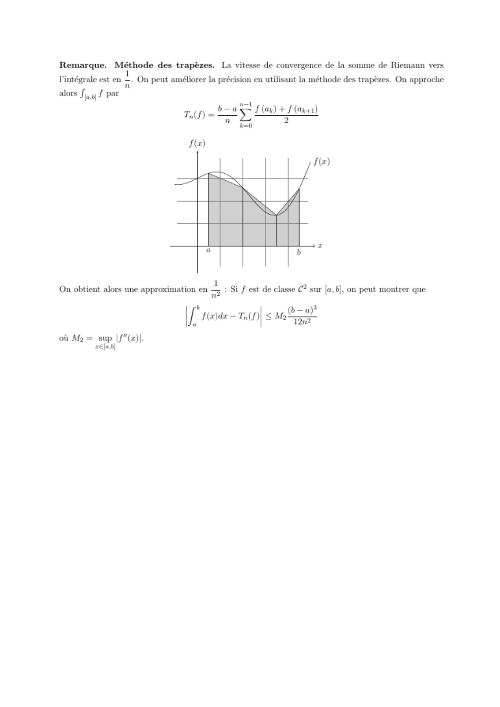

**Lecture OCR à contrôler**

~~~text
Remarque. Méthode des trapèzes. La vitesse de convergence de la somme de Riemann vers
l'intégrale est en —. On peut améliorer la précision en utilisant la méthode des trapézes. On approche

alors fi, f par
mf) <2 FF Lewd + Flown)
0

f(z)
f(z)

‘ ji 1 À 2
On obtient alors une approximation en n° Si f est de classe C? sur [a,b], on peut montrer que

n (b—a)3
| feoae— tip] < ano

où My = sup |f"(x)|-
r€la.b}
~~~
