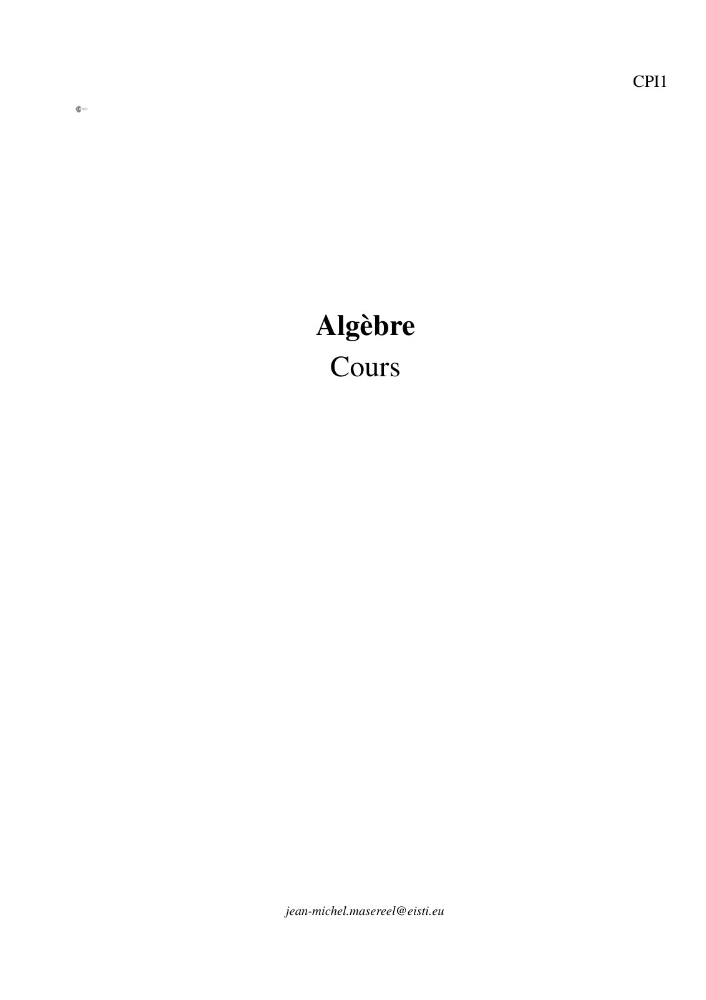
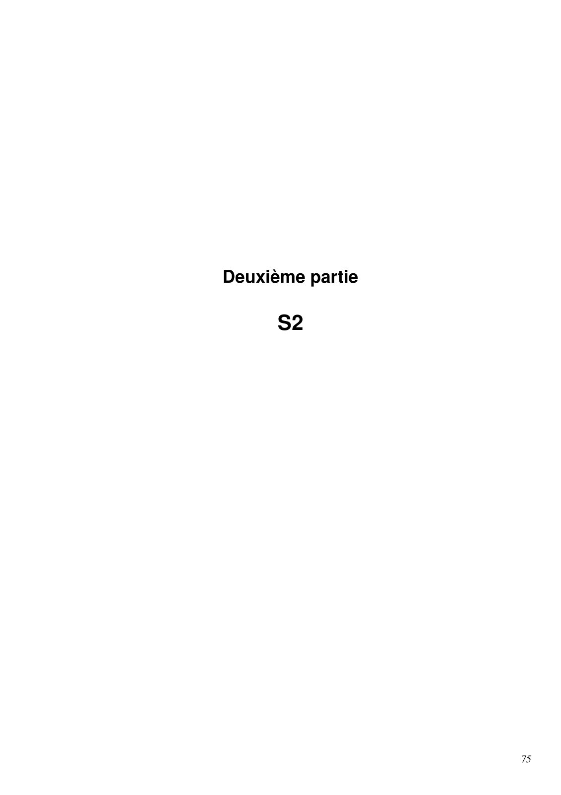

# Cours_2019-2020_Analyse2_P1S2_JMasereel.pdf

[Ouvrir l’original](https://drive.google.com/open?id=1sNi3SZpMLuKziDBD5eOmeSc9mflWNFkM) · Les pages signalées comprennent du texte reconnu automatiquement ou des éléments graphiques. Le fac-similé permet de vérifier chaque lecture.

**Pages avec fac-similé ou lecture OCR** — 1, 7, 81.

## Page 1

~~~text
                                CPI1

     Algèbre
      Cours

jean-michel.masereel@eisti.eu
~~~

**Lecture OCR à contrôler**

~~~text
CPII

Algèbre
Cours

jean-michel.masereel@eisti.eu
~~~

## Page 2

*Page blanche.*

## Page 3

~~~text
                      La vie n’est bonne qu’à deux choses :
Découvrir les mathématiques et enseigner les mathématiques.
                             Siméon Denis Poisson (1781 - 1840)
~~~

## Page 4

*Page blanche.*

## Page 5

~~~text
Sommaire

I.     S1                                                                                                                    1

1. Logique et raisonnement                                                                                                   3
      1.1. Rudiments de logique . . . . . . . . . . . . . . . . . . . . . . . . . . . . . . . . . . . . . . . . . . .        3
      1.2. Différents types de raisonnements . . . . . . . . . . . . . . . . . . . . . . . . . . . . . . . . . . . .         8
      1.3. Propriétés de N . . . . . . . . . . . . . . . . . . . . . . . . . . . . . . . . . . . . . . . . . . . . . .      11

2. Ensembles                                                                                                                17
      2.1. Définitions . . . . . . . . . . . . . . . . . . . . . . . . . . . . . . . . . . . . . . . . . . . . . . . . .    17
      2.2. Opérations . . . . . . . . . . . . . . . . . . . . . . . . . . . . . . . . . . . . . . . . . . . . . . . . .     19
      2.3. Propriétés . . . . . . . . . . . . . . . . . . . . . . . . . . . . . . . . . . . . . . . . . . . . . . . . .     21

3. Relations binaires                                                                                                       25
      3.1. Vocabulaire . . . . . . . . . . . . . . . . . . . . . . . . . . . . . . . . . . . . . . . . . . . . . . . .      25
      3.2. Relations d’équivalence . . . . . . . . . . . . . . . . . . . . . . . . . . . . . . . . . . . . . . . . . .      26
      3.3. Relations d’ordre . . . . . . . . . . . . . . . . . . . . . . . . . . . . . . . . . . . . . . . . . . . . .      27

4. Applications                                                                                                             31
      4.1.   Fondamentaux . . . . . . . . . . . . . . . . . . . . . . . . . . . . . . . . . . . . . . . . . . . . . . .     31
      4.2.   Composition . . . . . . . . . . . . . . . . . . . . . . . . . . . . . . . . . . . . . . . . . . . . . . . .    32
      4.3.   Fonction indicatrice . . . . . . . . . . . . . . . . . . . . . . . . . . . . . . . . . . . . . . . . . . . .   33
      4.4.   Image directe et réciproque . . . . . . . . . . . . . . . . . . . . . . . . . . . . . . . . . . . . . . . .    34
      4.5.   Injections, Surjections, Bijections . . . . . . . . . . . . . . . . . . . . . . . . . . . . . . . . . . . .    35

5. Nombres complexes                                                                                                        39
      5.1. Rappels de Terminale . . . . . . . . . . . . . . . . . . . . . . . . . . . . . . . . . . . . . . . . . . .       39
      5.2. Exponentielle complexe . . . . . . . . . . . . . . . . . . . . . . . . . . . . . . . . . . . . . . . . . .       40
      5.3. Applications . . . . . . . . . . . . . . . . . . . . . . . . . . . . . . . . . . . . . . . . . . . . . . . .     45

6. Polynômes                                                                                                                53
      6.1.   Polynômes à une indéterminée . . . . . . . . . . . . . . . . . . . . . . . . . . . . . . . . . . . . . .       53
      6.2.   Dérivation . . . . . . . . . . . . . . . . . . . . . . . . . . . . . . . . . . . . . . . . . . . . . . . . .   56
      6.3.   Arithmétique dans K[X ] . . . . . . . . . . . . . . . . . . . . . . . . . . . . . . . . . . . . . . . . .      57
      6.4.   Racines d’un polynôme . . . . . . . . . . . . . . . . . . . . . . . . . . . . . . . . . . . . . . . . . .      59
      6.5.   Décomposition en facteurs irréductibles . . . . . . . . . . . . . . . . . . . . . . . . . . . . . . . . .      61
      6.6.   Somme et produit des racines d’un polynôme . . . . . . . . . . . . . . . . . . . . . . . . . . . . . .         63

7. Fractions Rationnelles                                                                                                   65
      7.1. Ensemble des fractions rationnelles . . . . . . . . . . . . . . . . . . . . . . . . . . . . . . . . . . . .      65
      7.2. Décomposition en éléments simples . . . . . . . . . . . . . . . . . . . . . . . . . . . . . . . . . . .          68

II.    S2                                                                                                                   75

8. Groupes                                                                                                                  77
      8.1. Lois de composition interne . . . . . . . . . . . . . . . . . . . . . . . . . . . . . . . . . . . . . . . .      77
      8.2. Groupes . . . . . . . . . . . . . . . . . . . . . . . . . . . . . . . . . . . . . . . . . . . . . . . . . .      81
      8.3. Morphismes . . . . . . . . . . . . . . . . . . . . . . . . . . . . . . . . . . . . . . . . . . . . . . . .       84

                                                                                                                            iii
~~~

## Page 6

~~~text
CPI1
                                                           Algèbre
2019/2020
9. Systèmes linéaires                                                                                                       87
     9.1.   Définitions . . . . . . . . . . . . . . . . . . . . . . . . . . . . . . . . . . . . . . . . . . . . . . . . .   87
     9.2.   Systèmes équivalents . . . . . . . . . . . . . . . . . . . . . . . . . . . . . . . . . . . . . . . . . . .      89
     9.3.   Algorithme de Gauss . . . . . . . . . . . . . . . . . . . . . . . . . . . . . . . . . . . . . . . . . . .       91
     9.4.   Résolution d’un système linéaire . . . . . . . . . . . . . . . . . . . . . . . . . . . . . . . . . . . . .      95

10. Espaces vectoriels                                                                                                      101
     10.1. Espaces vectoriels . . . . . . . . . . . . . . . . . . . . . . . . . . . . . . . . . . . . . . . . . . . . . 101
     10.2. Familles de vecteurs . . . . . . . . . . . . . . . . . . . . . . . . . . . . . . . . . . . . . . . . . . . . 109
     10.3. Espaces vectoriels de dimension finie . . . . . . . . . . . . . . . . . . . . . . . . . . . . . . . . . . 112

11. Applications linéaires                                                                                                  117
     11.1. Définitions et propriétés . . . . . . . . . . . . . . . . . . . . . . . . . . . . . . . . . . . . . . . . . . 117
     11.2. Image, Noyau . . . . . . . . . . . . . . . . . . . . . . . . . . . . . . . . . . . . . . . . . . . . . . . 118
     11.3. Structures . . . . . . . . . . . . . . . . . . . . . . . . . . . . . . . . . . . . . . . . . . . . . . . . . 120
     11.4. Applications linéaires en dimension finie . . . . . . . . . . . . . . . . . . . . . . . . . . . . . . . . . 123

12. Matrices                                                                                                                127
     12.1. Définitions . . . . . . . . . . . . . . . . . . . . . . . . . . . . . . . . . . . . . . . . . . . . . . . . . 127
     12.2. Propriétés . . . . . . . . . . . . . . . . . . . . . . . . . . . . . . . . . . . . . . . . . . . . . . . . . 134
     12.3. Matrices inversibles . . . . . . . . . . . . . . . . . . . . . . . . . . . . . . . . . . . . . . . . . . . . 135

13. Déterminants                                                                                                            141
     13.1. Déterminant d’une matrice carré . . . . . . . . . . . . . . . . . . . . . . . . . . . . . . . . . . . . . 142
     13.2. Déterminant d’une famille de vecteurs . . . . . . . . . . . . . . . . . . . . . . . . . . . . . . . . . . 148
     13.3. Applications . . . . . . . . . . . . . . . . . . . . . . . . . . . . . . . . . . . . . . . . . . . . . . . . 149

14. Représentation matricielle des applications linéaires                                                                   151
     14.1. Matrice d’une application linéaire . . . . . . . . . . . . . . . . . . . . . . . . . . . . . . . . . . . . 151
     14.2. Changements de bases, équivalence et similitude . . . . . . . . . . . . . . . . . . . . . . . . . . . . 155

iv                                                      SOMMAIRE
~~~

## Page 7

~~~text
Première partie

     S1

                  1
~~~

**Lecture OCR à contrôler**

~~~text
Première partie

S1
~~~

## Page 8

*Page blanche.*

## Page 9

~~~text
1. Logique et raisonnement

                                                                                 Tous les hommes sont mortels, or Socrate
                                                                                 est un homme donc Socrate est mortel.

                                                                                                                  (Aristote.)

                                                                                 Autre syllogisme : tous les chats sont
                                                                                 mortels. Socrate est mortel. Donc Socrate
                                                                                 est un chat.

                                                                                        (Le logicien, dans Le rhinocéros, E.
                                                                                                                   Ionesco.)

   Ce chapitre a pour objectif de vous apprendre à raisonner correctement, c’est-à-dire pas comme le logicien de
Ionesco. Vous utilisez déjà, peut-être sans le savoir, le syllogisme formalisé par Aristote. En effet, vous avez déjà
l’habitude de démontrer qu’une implication « P ⇒ Q » est vraie, puis de vérifier que la proposition P est vraie pour
en déduire que la proposition Q est vraie.
   Nous allons voir dans ce chapitre d’autres types de raisonnements.

1.1. Rudiments de logique
1.1.1. Première définition

  Définition 1.1 (Proposition). On appelle proposition un énoncé (mathématiques) qui peut être soit vrai (noté V
  ou 1) soit faux (noté F ou 0).

   Les énoncés ne sont pas forcément mathématiques. Durant votre parcours à l’EISTI, nous ne nous intéresserons
qu’aux énoncés mathématiques et physique, même si, pour expliquer un concept, nous pourrons utiliser des exemples
issus d’autres disciplines.

  Exemple 1.1.     — « 1+1=2 » est une proposition vraie.
    — « L’entier 2014 est impair » est une proposition fausse.
    — « Tous les élèves de la classe auront leur diplôme d’ici 5 ans ». Nous ne pouvons pas encore déterminer si
      cet énoncé est vrai ou faux, il reste néanmoins soit vrai soit faux, c’est donc bien une proposition.
    — « Quelle heure est-il ? » est un énoncé, mais il n’a pas de valeurs de vérité : ce n’est ni vrai ni faux. Ce n’est
      donc pas une proposition.

                                                                                                                           3
~~~

## Page 10

~~~text
CPI1
                                                         Algèbre
2019/2020
1.1.2. Opérations
    À partir d’une ou plusieurs propositions, il est possible d’en créer de nouvelles.

    Définition 1.2 (Négation). Soit une proposition P. On définit la négation de P que l’on note « ¬P » ou « P » ou
    encore « non (P) », comme la proposition qui est vraie lorsque P est fausse et est fausse lorsque P est vraie.

Remarque 1.1. Les deux propositions P et P ne peuvent pas être vraies en même temps.

    Exemple 1.2. Soit P la proposition « Il fait plus de 20 ◦C aujourd’hui ». La négation de P est « Il fait moins de
    20 ◦C aujourd’hui ». Il ne peut pas faire à la fois plus de 20 ◦C et moins de 20 ◦C.

    Définition 1.3 (Conjonction). Soit deux propositions P et Q. On définit la conjonction de P et Q que l’on note
    « P ∧ Q » ou « P et Q », comme la proposition qui est vraie lorsque P et Q sont toutes les deux vraies, et fausse
    lorsque au moins l’une des deux propositions P ou Q est fausse.

    Exemple 1.3. Soit P la proposition « Il fait plus de 20 ◦C aujourd’hui » et Q la proposition « Il va pleuvoir
    demain ». La conjonction de P et Q est « Il fait plus de 20 ◦C aujourd’hui et il va pleuvoir demain ».

    Définition 1.4 (Disjonction). Soit deux propositions P et Q. On définit la disjonction de P et Q que l’on note
    « P ∨ Q » ou « P ou Q », comme la proposition qui est vraie lorsque au moins l’une des deux propositions P ou
    Q est vraie, et fausse lorsque les deux propositions P et Q sont fausses.

    Exemple 1.4. Soit P la proposition « Il fait plus de 20 ◦C aujourd’hui » et Q la proposition « Il va pleuvoir
    demain ». La disjonction de P et Q est « Il fait plus de 20 ◦C aujourd’hui ou il va pleuvoir demain ».

Remarque 1.2. Attention, le « ou » mathématiques n’a pas exactement le même sens que le « ou » français. En effet,
le « ou » mathématique est non exclusif, c’est-à-dire que l’on n’interdit pas à P et Q d’être vrais tous les deux. En
français, le « ou » est plutôt considéré comme exclusif. Lorsque dans un restaurant par exemple, il est écrit sur la carte
« fromage ou dessert », il ne viendrait à l’idée de personne (sauf peut-être d’un prof de maths) de commander les deux.

  Dans les définitions précédentes, il n’y avait pas de lien entre les deux propositions P et Q. Nous allons voir
maintenant des opérations qui sous tendent un lien entre P et Q.

    Définition 1.5 (Implication). Soit P et Q deux propositions. On définit la proposition P implique Q, notée P ⇒ Q,
    comme la proposition qui est vraie si P est fausse ou si P et Q sont toutes les deux vraies ; et qui est fausse si P
    est vraie et Q fausse.

    Exemple 1.5.    — Soit P la proposition « je ne me suis pas réveillé ce matin » et Q la proposition « je suis en
        retard à l’école ». La proposition P ⇒ Q est vraie. Remarquez que la proposition Q ⇒ P est fausse.
      — La proposition 1 = 2 ⇒ π = e est-elle vraie ou fausse ?

4                                              1. Logique et raisonnement
~~~

## Page 11

~~~text
                                                                                                                    CPI1
                                                        Algèbre
                                                                                                               2019/2020

  Définition 1.6 (Réciproque). Soit P et Q deux propositions. La réciproque de la proposition « P ⇒ Q » est la
  proposition « Q ⇒ P »

   Tout comme nous l’avons vu sur l’exemple précédent, connaître la valeur de vérité de P ⇒ Q ne donne aucune
information sur la valeur de vérité de Q ⇒ P.

  Définition 1.7 (Équivalence). Soit P et Q deux propositions. On définit la proposition P équivalent à Q, notée
  P ⇔ Q, comme la proposition qui est vraie si P et Q sont vraies ou si P et Q sont fausses ; et qui est fausse si l’une
  est fausse et l’autre vraie.

Remarque 1.3. On démontrera en TD que la proposition P ⇔ Q a la même valeur de vérité que (P ⇒ Q) et (Q ⇒
P). Cela donne une certaine cohérence dans les notations ⇒ et ⇔.

  Exemple 1.6.  — Il semble difficile de trouver un exemple de la vie courante. Et vous ? Réussirez-vous à en
      proposer une ?
    — Soit a et b deux réels. L’équivalence a = b ⇔ ea = eb est vraie.
    — La proposition 1 = 2 ⇔ 32 = 9 est elle vraie ou fausse ?

  Attention de ne pas confondre l’implication et l’équivalence, ce que vous faites souvent. Lorsque l’on rédige une
démonstration il est plus naturel de raisonner en implication. Or on a plus souvent besoin d’avoir des équivalences.
Lorsque l’on écrit une équivalence, il faut donc toujours penser à vérifier que la réciproque est bien vraie.

  Définition 1.8 (Condition nécessaire/suffisante).

    — Soit P ⇒ Q une implication. On dit que P est une condition suffisante à Q, et que Q est une condition
      nécessaire à P.
    — Soit P ⇔ Q une équivalence. On dit que P est une condition nécessaire et suffisante à Q (ou que Q est une
      condition nécessaire et suffisante à P).

Remarque 1.4. Supposons que P ⇒ Q.
  — Le fait que P soit vraie suffit à ce que Q soit vraie.
  — Par contre le fait que P soit vraie n’est pas nécessaire à Q puisque Q peut très bien être vraie alors que P ne l’est
    pas.
  — Lorsque P est vraie, Q est nécessairement vraie aussi.
  — Le fait que Q soit vraie ne suffit pas à ce que P soit vraie puisque, comme nous l’avons déjà signalé, Q peut très
    bien être vraie alors que P ne l’est pas.

Remarque 1.5. Lorsque P ⇔ Q chaque proposition est à la fois nécessaire et suffisante à l’autre proposition.

                                              1. Logique et raisonnement                                                   5
~~~

## Page 12

~~~text
CPI1
                                                          Algèbre
2019/2020
1.1.3. Tables de vérité
  Lorsque l’on fait des opérations sur des propositions, il est parfois plus aisé d’utiliser ce que l’on appelle une table
de vérité. Celle-ci résume les différentes valeurs prise par une proposition composée. Ci dessous la table de vérité des
opérations définies dans la section précédente.
                                                      P    non (P)
                                                      V      F
                                                      F      V
                                    P   Q    P ou Q       P et Q     P⇒Q      P⇔Q
                                    V   V      V            V         V        V
                                    V   F      V             F        F        F
                                    F   V      V             F        V        F
                                    F   F       F            F        V        V

Propriété 1.1. Deux propositions ont la même table de vérité si et seulement si elles sont équivalentes.

Démonstration. Cela découle directement de la définition d’une équivalence : Si les deux propositions prennent les
mêmes valeurs de vérité en même temps, alors l’équivalence est vraie. Réciproquement, si elles sont équivalentes
alors elles prennent forcément les mêmes valeurs de vérité en même temps.                                       

Exercice 1.1. À l’aide d’une table de vérité démontrer que les deux propositions suivantes sont vraies.
                                                     
  1. (P ou Q) et R ⇔ (P et R) ou (Q et R)
                                                     
  2. (P et Q) ou R ⇔ (P ou R) et (Q ou R)

Remarque 1.6. On dit que la conjonction (resp. la disjonction) est distributive sur la disjonction (resp. conjonction).

1.1.4. Quantificateurs
  Parfois une propriété peut dépendre d’un élément (une variable) et suivant la valeur de cet élément, la propriété est
vraie ou fausse. Afin de noter simplement des propositions faisant intervenir de telles propriétés, nous avons besoin
des quantificateurs.

    Définition 1.9 (Quantificateur existentiel). Soit P une propriété portant sur les éléments d’un ensemble E.
    La proposition « au moins un élément x de E vérifie P » se note « ∃x ∈ E, P(x) ». On appelle quantificateur
    existentiel le symbole « ∃ ».

    Exemple 1.7. Soit E l’ensemble des élèves de la classe et P la propriété « L’élève x possède des lunettes ». La
    proposition ∃x ∈ E, P(x) se lit « au moins un élève de la classe possède des lunettes » ou encore, « il existe un
    élève de la classe qui possède des lunettes ».

    Définition 1.10 (Quantificateur universel). Soit P une propriété portant sur les éléments d’un ensemble E. La
    proposition « tout élément x de E vérifie P » se note « ∀x ∈ E, P(x) ». On appelle quantificateur universel le
    symbole « ∀ ».

6                                             1. Logique et raisonnement
~~~

## Page 13

~~~text
                                                                                                                  CPI1
                                                       Algèbre
                                                                                                             2019/2020

  Exemple 1.8. Soit E l’ensemble des élèves de la classe et P la propriété « L’élève x possède des lunettes ». La
  proposition ∀x ∈ E, P(x) se lit « tout élève de la classe possède des lunettes ».

  Définition 1.11. Soit P une propriété portant sur les éléments d’un ensemble E. La proposition
  « un et un seul élément x de E vérifie P » se note « ∃!x ∈ E, P(x) ».

  Exemple 1.9. Soit E l’ensemble des élèves de la classe et P la propriété « L’élève x possède des lunettes ». La
  proposition ∃!x ∈ E, P(x) se lit « il existe un unique élève de la classe qui possède des lunettes ».

   Il est possible d’utiliser plusieurs quantificateurs dans une même propositions. Il faut alors faire très attention à
l’ordre dans lequel ils sont utilisés. Comparez le sens des deux phrases suivantes :
  — Pour toute serrure, il existe une clef qui l’ouvre (∀x, ∃y, P(x, y)).
  — Il existe une clef qui ouvre toutes les serrures (∃y, ∀x, P(x, y)).

1.1.5. Négations
   Nous avons vu la négation d’une simple proposition, mais qu’en est-il de la négation d’une proposition complexe
faisant intervenir des opérations et des quantificateurs ?

Propriété 1.2. Soit P et Q deux propositions. On a alors
   — non (non (P)) ⇔ P
                                          
   — non (P et Q) ⇔ (non (P)) ou (non (Q)) (Première loi de De Morgan)
                                          
   — non (P ou Q) ⇔ (non (P)) et (non (Q)) (Deuxième loi de De Morgan)
   — non (P ⇒ Q) ⇔ (P et (non (Q)))

Démonstration. La démonstration se fait très simplement avec les tables de vérités.                                  

Propriété 1.3. Soit P une propriété portant sur les éléments d’un ensemble E. On a alors
   — non (∃x ∈ E, P(x)) est ∀x ∈ E, non (P(x)).
   — non (∀x ∈ E, P(x)) est ∃x ∈ E, non (P(x)).

Remarque 1.7. Il suffit de retenir que pour écrire la négation d’une proposition contenant des quantificateurs, il faut
remplacer les ∃ par des ∀ et réciproquement, et prendre la négation de la proposition.

  Exemple 1.10. La négation de « tous les élèves ont des lunettes » n’est pas « aucun élève n’a de lunette » mais
  « il existe un élève qui n’a pas de lunettes ».

                                             1. Logique et raisonnement                                               7
~~~

## Page 14

~~~text
CPI1
                                                        Algèbre
2019/2020
1.2. Différents types de raisonnements
1.2.1. Raisonnement par contraposition

    Définition 1.12 (Contraposée). Soit P et Q deux propositions. La contraposée de la proposition « P ⇒ Q » est
    la proposition « non (Q) ⇒ non (P) »

Propriété 1.4. Une implication et sa contraposée sont équivalentes. C’est-à-dire que

                                          (P ⇒ Q) ⇔ (non (Q) ⇒ non (P))

Démonstration. Vous avez déjà démontré cela à l’aide des tables de vérité lors de la question 15 de l’exercice 1 du
polycopié de TD du chapitre 1 « Logique et raisonnement ». Nous allons cependant la redémontrer en utilisant les
propriétés de logique que l’on connaît déjà.

                                      (P ⇒ Q) ⇔ (non (P) ou Q)
                                               ⇔ (Q ou non (P))
                                               ⇔ (non (non (Q)) ou non (P))
                                               ⇔ (non (Q) ⇒ non (P))

Remarque 1.8.
    — Attention ! Ne confondez pas contraposée et réciproque. Si une implication est vraie, sa contraposée est toujours
      vraie, par contre sa réciproque ne l’est pas forcément.
    — Ainsi, lorsque l’on doit démontrer une implication du type P ⇒ Q, on peut soit la démontrer directement, soit
      démontrer sa contraposée : on suppose que Q est faux et on démontre que P est faux aussi.

    Exemple 1.11. Afin de démontrer qu’un triangle dont on connaît les longueurs des côtés n’est pas rectangle,
    on utilise la contraposée du théorème de Pythagore. En effet, le théorème de Pythagore « Si le triangle ABC est
    rectangle en A, alors BC2 = AB2 + AC2 » est équivalent à sa contraposée « Si BC2 6= AB2 + AC2 alors le triangle
    ABC n’est pas rectangle en A »

Remarque 1.9. Notez bien qu’un raisonnement par contraposé s’applique exclusivement à des implications, alors
qu’un raisonnement par l’absurde peut s’appliquer à différents types de propriétés.

1.2.2. Raisonnement par l’absurde
   On veut montrer une proposition P. Pour cela on suppose que cette proposition est fausse, et on tente d’en déduire
une absurdité. Cette absurdité peut être soit une proposition Q qui est clairement fausse, soit une proposition de type
Q = (R et non (R)) (qui est clairement fausse aussi).
Intuitivement on voit bien que si l’on aboutit à une absurdité, c’est que l’hypothèse de départ (P fausse) était fausse
(et donc que P est vraie). Cela se démontre aussi en utilisant les propriétés de logique :
Nous avons montré que (non (P) ⇒ Q), or par contraposition cela revient à dire que
(non (Q) ⇒ non (non (P))) ou encore (non (Q) ⇒ P). Mais puisque Q est fausse, non (Q) est vraie et donc P
aussi.

8                                             1. Logique et raisonnement
~~~

## Page 15

~~~text
                                                                                                                  CPI1
                                                       Algèbre
                                                                                                             2019/2020

  Exemple 1.12. Un exemple fréquent consiste à vouloir démontrer une proposition P de type (A ⇒ B) par l’ab-
  surde. On part donc de non (P), c’est-à-dire de (A et non (B)). Par divers raisonnement et calculs on aboutit à
  une absurdité. En général cette absurdité est la proposition non (A), qui est effectivement absurde puisque l’on
  est parti de A.

Remarque 1.10. [Attention ! !] L’exemple fréquent 1.12 que l’on vient de voir conduit aussi malheureusement à une
erreur tout aussi fréquente : confondre le raisonnement par contraposition et le raisonnement par l’absurde. Beaucoup
de personnes pensent démontrer (A ⇒ B) par l’absurde en écrivant des choses du type :
        Supposons que l’on a A et pas B. Puisque l’on n’a pas B . . .
     ..
      .
      Et donc on n’a pas A. Ce qui est absurde puisque l’on a supposé que l’on avait A.
Si à aucun moment de la démonstration (dans la partie en pointillée), la proposition A n’est utilisée, alors ce raison-
nement est tout bêtement un raisonnement par contraposition : (non (B) ⇒ non (A)).

1.2.3. Raisonnement par analyse-synthèse
   Nous devons parfois démontrer des choses trop complexes pour être attaquées de front. Il nous faut d’abord ana-
lyser le problème afin de le réduire. C’est le cas lorsque l’on cherche à montrer l’existence d’un objet (un nombre
par exemple) devant satisfaire certaines conditions. Une analyse du problème permet de réduire le nombre de candi-
dats possibles. La synthèse consiste alors à déterminer parmi les candidats ceux qui sont effectivement solutions du
problème.
   Le schéma d’un raisonnement par analyse-synthèse est le suivant :
Analyse : On suppose que l’objet existe et on essaie de trouver des conditions nécessaires que doit vérifier cet objet.
      Ce faisant, on prouve que si l’objet existe, alors il est nécessairement dans un ensemble restreint.
Synthèse : On considère les objets identifiés dans la partie analyse, et on vérifie que certains ont bien les propriétés
      voulues (ceci assure l’existence).

Remarque 1.11. Si l’analyse n’exhibe qu’un seul candidat possible, on parle alors d’unicité si existence.

  Exemple 1.13. [Le BN géant]
  Commençons par rendre à César ce qui appartient à César. L’exemple qui suit est tiré de cette page : http://
  la-bnbox.fr/c541-Le-raisonnement-par-analyse-synthese.cahier
    Un jour, on vous demande de prouver l’existence d’un BN au chocolat géant vivant !
  À première vue, cela semble assez difficile à faire. . . Et vous n’avez aucune idée de la manière de procéder.
  Alors procédons par Analyse-Synthèse.
  Analyse : Supposons qu’il existe un BN au chocolat géant vivant quelque part dans le monde.
          — Si un BN de ce genre existe, il est évident qu’il vivra nécessairement loin de l’eau, parce qu’un BN
            dans l’eau devient tout mou et se dissous. . .
          — Si ce type de BN existe, il se trouvera nécessairement loin des régions chaudes, sinon son chocolat
            fondrait et il disparaitrait.
          — Il sera aussi nécessairement loin des régions très froides, pour ne pas geler. (Je laisse l’auteur res-
            ponsable de cette affirmation, personnellement je pense que rien ne prouve qu’il ne survivrait pas à
            des régions très froides.)
        Ces conditions nécessaires réduisent déjà notre champ de recherche. On sait que maintenant, le seul endroit
        où on peut trouver un BN de ce type, c’est en France. (Là encore je laisse l’auteur responsable de cette
        conclusion un peu hâtive. . .)
        Mais la France c’est toujours assez grand. On va donc chercher d’autres conditions nécessaires encore plus
        restrictives.

                                             1. Logique et raisonnement                                               9
~~~

## Page 16

~~~text
CPI1
                                                       Algèbre
2019/2020
        Un grand BN comme ça, ça a besoin de beaucoup de chocolat pour tenir ensemble. . . Il doit donc nécessairement
        vivre près d’une chocolaterie, ou d’une biscuiterie.
        De plus, les BN sont créés à Nantes. En admettant le fait qu’un grand gaillard comme lui habite encore
        près de chez ses parents, il habite nécessairement près de Nantes.
        Ce qui nous amène directement à la conclusion que le BN géant habite dans la biscuiterie BN. (Encore une
        conclusion bien hâtive, comment de « près de Nantes » on aboutit à « dans la biscuiterie BN » ? Est-ce la
        seule biscuiterie de la région ? Passons, passons, c’est juste pour l’exemple. . .)
  Synthèse : Nous devons vérifier notre conclusion, c’est-à-dire que nous devons prendre le premier avion ou le
        premier TGV (ou tout autre moyen de transport, même si ce n’est pas le premier) pour Nantes et nous
        rendre à la biscuiterie pour vérifier que le BN géant s’y trouve.

          — Soit on le trouve, et on a bien prouvé qu’il existe.
          — Soit on ne le trouve pas, et on a prouvé qu’il n’existe pas, puisqu’il n’est pas à l’endroit où il devait
            nécessairement être.

                                                                                      √
  Exemple 1.14. Soit (xn ) la suite réelle définie par récurrence par x0 = 1 et xn+1 = 5 3xn . Déterminer un majorant
  de (xn ).
    Le problème semble bien complexe. Une analyse s’impose !
  Analyse : Nous ne voyons pas du tout à quoi pourrait ressembler un majorant de (xn ). Supposons donc que nous
        soyons en présence d’un tel majorant et étudions les propriétés qu’il possède nécessairement.
        Tout d’abord, si un majorant existe, alors l’ensemble des majorants possède un plus petit élément (c’est
        une propriété qui est hors programme). Notons Mmin ce plus petit des majorants.
        Puisque Mmin est un majorant, nous pouvons affirmer que pour tout n ∈ N, xn ≤ Mmin . En multipliant par
        3 l’inégalité, nous avons 3xn ≤ 3Mmin . La fonction
                                                        √    « racine-5
                                                                √
                                                                        e » étant croissante (admis), nous pouvons

        prendre la racine-5e de l’inégalité pour obtenir 3xn ≤ 3Mmin , c’est-à-dire :
                                                        5        5

                                                             p
                                                      xn+1 ≤ 5 3Mmin
                                                                                   √
        Ceci étant
              √    vrai pour tout n ∈ N, on en conclut que pour tout n ∈ N∗ , xn ≤ 5 3Mmin .
        Ainsi 5 3Mmin est un majorant, il est donc plus grand que le plus petit des majorants :
                                                             p
                                                      Mmin ≤ 5 3Mmin

       Étant donné que u0 = 1, nous pouvons affirmer que tous les majorants sont supérieurs ou égaux à 1, en
       particulier Mmin > 0. Ainsi l’inégalité précédente est équivalente à
                                          5                 4
                                                                              √4
                                        Mmin  ≤ 3Mmin ⇔ Mmin    ≤ 3 ⇔ Mmin ≤ 3
                                                                   √
       On peut donc conclure que si des majorants existent, alors 4 3 en est un (ce n’est pas forcément Mmin ).
                             √
                             4
  Synthèse : On vérifie que 3 est bien un majorant en faisant par exemple une démonstration par récurrence. À
       vos stylos !
  Vous voyez que sans le raisonnement par analyse-synthèse
                                                        √ vous auriez été obligé de vous reposer, soit sur une
  indication de l’énoncé vous demandant de montrer que 4 3 était un majorant, soit sur votre calculatrice pour
  conjecturer que 2 faisait un bon candidat.

10                                           1. Logique et raisonnement
~~~

## Page 17

~~~text
                                                                                                                 CPI1
                                                       Algèbre
                                                                                                            2019/2020
1.3. Propriétés de N
  Vous connaissez déjà très bien N, l’addition, la multiplication sur N, ainsi que les relations <, ≤, > et ≥. Nous
n’allons donc pas revenir dessus.

1.3.1. Définitions générales
  Commençons par des définitions qui ne sont pas propres à N.

  Définition 1.13 (Plus grand/petit élément). Soit E un ensemble possédant une relation « inférieur ou égal à »,
  notée « ≤ », permettant de comparer les éléments entre eux. On appelle plus grand (resp. petit) élément de E,
  un élément x de E (s’il existe) tel que pour tout élément y de E, y est inférieur (resp. supérieur) ou égal à x. En
  notation mathématiques, cela donne « ∀y ∈ E, y ≤ x » (resp. « ∀y ∈ E, x ≤ y »).

Remarque 1.12. Pourquoi préciser « s’il existe » ? Tout simplement parce que l’ensemble E ne possède pas forcément
de plus grand élément. Considérez par exemple E = [0 ; 1[. Le nombre 1 est effectivement plus grand que tous les
éléments de E, mais il n’appartient pas à E.

  Définition 1.14 (Ensemble des majorants/Minorants). Soit E et F deux ensembles possédant une relation
  « inférieur ou égal à », notée « ≤ », permettant de comparer les éléments entre eux et tels que E ⊂ F. On ap-
  pelle ensemble des majorants (resp. minorants) de E (dans F), tous les éléments de F qui sont supérieurs (resp.
  inférieurs) à tous les éléments de E. Un tel élément est simplement appelé majorant (resp. minorant) de E. En
  notation mathématiques, dire que x est un majorant (resp. minorant) de E, revient à dire « ∀y ∈ E, y ≤ x » (resp.
  « ∀y ∈ E, x ≤ y »).
  Si l’ensemble des majorants (resp. minorants) est non vide, on dit que E est une partie majorée (resp. minorée)
  de F.

Remarque 1.13. Comme le laisse entrevoir la définition, l’ensemble des majorants ou minorants peut être vide.
Prenez par exemple E = [0 ; +∞[. Il n’existe aucun élément réel qui soit supérieur à tous les éléments de E.
Remarquez qu’un majorant ou un minorant n’appartient pas forcément à l’ensemble E.

  Exemple 1.15. Si on reprend l’ensemble évoqué plus haut, E = [0 ; 1[ :
    — E ne possède pas de plus grand élément.
    — 0 est le plus petit élément de E.
    — ]−∞ ; 0] est l’ensemble des minorants de E (remarquez que 0 en fait parti).
    — [1 ; +∞[ est l’ensemble des majorants de E.

1.3.2. Parties de N
  Nous nous intéressons maintenant plus particulièrement à N et à ses sous-parties.

Axiome 1.1. Toute partie non vide de N possède un (unique) plus petit élément.

                                             1. Logique et raisonnement                                             11
~~~

## Page 18

~~~text
CPI1
                                                          Algèbre
2019/2020
Démonstration. Un axiome, par définition, n’a pas besoin de démonstration. Cependant, l’unicité du plus petit élé-
ment ne fait en réalité pas partie de l’axiome. Nous allons donc le démontrer.
Pour démontrer l’unicité d’un objet, la méthode classique consiste à supposer qu’il en existe deux et à démontrer
qu’ils sont nécessairement égaux.
   Supposons donc que l’on a A une partie non vide de N. Puisque A est non vide, elle possède au moins un élément
a. Si A ne possède qu’un seul élément, la démonstration s’arrête là ! On suppose donc de plus que A possède au moins
deux éléments et qu’ils sont tout deux un « plus petit élément de A ». Notons les a et b. Puisque a est un plus petit
élément de A et que b ∈ A, nous avons a ≤ b. De même nous avons nécessairement b ≤ a. Cela revient à dire que
a = b et que le plus petit élément est forcément unique.                                                          

Propriété 1.5. Toute partie majorée non vide de N possède un (unique) plus grand élément.

Démonstration. La démonstration de l’unicité du plus grand élément est la même que pour le plus petit élément.
Focalisons nous donc sur l’existence.
  Soit A une partie majorée non vide de N. Puisque A est majorée, elle possède des majorants( !), notons B l’ensemble
de ses majorants, qui est non vide. D’après l’axiome 1.1, B admet un plus petit élément que l’on note m. Montrons
que m appartient à A. Nous allons faire un raisonnement par l’absurde.
Supposons que m n’appartient pas à A et montrons que l’on aboutit à une absurdité (contradiction). Comme m est un
majorant de A, on a
                                                   ∀x ∈ A, x ≤ m
Or x appartient à A et m n’appartient pas à A, ils sont donc distincts et par conséquent

                                                       ∀x ∈ A, x < m

Cela impose que m ≥ 1 (sinon on aurait : ∀x ∈ A, x < 0, ce qui est impossible puisque nous sommes dans N et que A
est non vide) et que m − 1 appartient à N. Nous avons donc

                                                     ∀x ∈ A, x ≤ m − 1

C’est la définition d’un majorant, donc m − 1 est un majorant de A et appartient à B. Or m était censé être le plus petit
élément de B. Nous arrivons ainsi à une absurdité et pouvons conclure que notre supposition d’origine (m ∈     / A) était
fausse. D’où m ∈ A, m majore A, c’est bien le plus grand élément de A.
Nous avons donc montré l’existence d’un plus grand élément de A.                                                       

1.3.3. Raisonnement par récurrence
     Vous avez déjà vu le raisonnement par récurrence au lycée. Nous allons le démontrer.

Théorème 1.1 (Principe de récurrence). Soit A une partie de N telle que,
      1. A contient 0.
      2. Si A contient un entier n, alors A contient n + 1.
Alors A = N.

Démonstration. Nous devons montrer que A = N. La méthode classique consiste à faire une double inclusion. Ce
n’est pas ce que nous allons faire ici. . . Nous allons montrer que N\A (N privé de A) est l’ensemble vide par un
raisonnement par l’absurde et en conclure que A = N.

12                                              1. Logique et raisonnement
~~~

## Page 19

~~~text
                                                                                                                     CPI1
                                                         Algèbre
                                                                                                                2019/2020
   Soit une partie A de N vérifiant les conditions de la propriété. Supposons que N\A est non vide. En vertu de
l’axiome 1.1, il possède un plus petit élément que nous noterons m. Par définition, m n’appartient pas à A. Or d’après
la condition 1, 0 appartient à A, donc nécessairement, m est différent de 0 et m − 1 ∈ N. Un élément de N appartient
soit à A soit à N\A, de plus m − 1 ne peut pas appartenir à N\A, sinon m ne serait pas le plus petit élément. D’où
m − 1 appartient à A. D’après la condition 2 nous avons nécessairement m − 1 + 1 = m qui appartient à A. Or m ne
peut appartenir à la fois à A et à N\A. D’où l’absurdité et N\A est l’ensemble vide. Nous en concluons que A = N. 

Remarque 1.14. L’énoncé du théorème 1.1 peut-être légèrement modifié pour « démarrer » à partir d’un entier n0 :
  Soit A une partie de N telle que
   1. A contient n0 .
   2. Si A contient un entier n ≥ n0 , alors A contient n + 1.
Alors A = Jn0 ; +∞J.

Propriété 1.6 (Récurrence simple). Soit P une propriété portant sur les entiers naturels.
Soit n0 un entier naturel.
On suppose que P(n0 ) est vraie.
On suppose également que pour tout entier n ≥ n0 , si P(n) est vraie, alors P(n + 1) est vraie (cela revient à dire
que l’implication P(n) ⇒ P(n + 1) est vraie).
Alors pour tout entier n ≥ n0 , la proposition P(n) est vraie.

Démonstration. Soit P un propriété vérifiant les conditions de l’énoncé. Soit A = {n ∈ N, P(n)} (A est l’ensemble
des entiers naturels tels que P est vraie). Alors A vérifie les conditions du théorème 1.1 (ou plutôt de sa version
modifiée de la remarque 1.14). Donc A = Jn0 ; +∞J et tout entier n ≥ n0 vérifie P.                               

  Voici comment doit se faire un raisonnement par récurrence et comment il doit être rédigé.

     1. On énonce clairement la propriété P étudiée.
     2. On vérifie que la propriété P est vraie pour n0 (Initialisation).
     3. On se donne un entier n ≥ n0 quelconque et on suppose que P(n) est vraie (Hypothèse de récurrence).
        On démontre alors que P(n + 1) est vraie (Hérédité).
     4. On conclut en annonçant que, par récurrence, la propriété est vraie pour tout entier n ≥ n0 .

   Il faut voir le principe de récurrence comme une échelle que l’on essaye de monter : Si l’on est capable de poser
le pied sur le premier barreau et que l’on est capable de passer d’un barreau au suivant, alors on est capable de
monter l’échelle en entier. Si l’une des deux conditions manque, alors nous ne pouvons pas monter l’échelle. D’où
l’importance de vérifier l’initialisation ET l’hérédité. Une erreur classique est d’oublier l’initialisation. L’exemple 1.16
est un exemple de cette erreur classique.

  Exemple 1.16. [FAUX !] Démontrer par récurrence que pour tout n ∈ N∗ , on a l’égalité

                                                                   n2 + n + 1
                                             1+ 2+ 3+ ···+ n =
                                                                       2
                                                                              n2 + n + 1
     1. Soit P(n) la propriété définie sur N∗ par « 1 + 2 + 3 + · · · + n =              ».
                                                                                  2
     2. L’élève oublie l’initialisation.
     3. Soit un entier n ∈ N∗ tel P(n) est vraie. Démontrons alors que P(n + 1) est vraie aussi. Nous devons donc

                                               1. Logique et raisonnement                                                13
~~~

## Page 20

~~~text
CPI1
                                                          Algèbre
2019/2020
        montrer que
                                                                         (n + 1)2 + (n + 1) + 1
                                     1 + 2 + 3 + · · · + n + (n + 1) =
                                                                                   2
                                  n2 + 3n + 3
        La fraction est égale à               . Nous avons supposé que P(n) est vrai, donc on peut écrire :
                                       2
                                     1 + 2 + · · · + n + (n + 1) = (1 + 2 + · · · + n) + (n + 1)
                                                                  n2 + n + 1
                                                                =            + (n + 1)
                                                                      2
                                                                  n2 + n + 1 + 2n + 2
                                                                =
                                                                           2
                                                                  n2 + 3n + 3
                                                                =
                                                                       2
                                                                  (n + 1)2 + (n + 1) + 1
                                                                =
                                                                             2
        Donc l’implication P(n) ⇒ P(n + 1) est vraie.
                                                                                               n2 + n + 1
     4. Nous avons donc montré par récurrence que pour tout entier n ∈ N∗ , 1 + 2 + 3 + · · · + n =       .
                                                                                                   2
  Vous l’aurez compris, il y a une erreur. Un calcul simple permet de montrer que P(1) est fausse puisqu’elle
  stipule que 1 = 32 . Le premier barreau étant cassé, nous ne pouvons pas monter à l’échelle.

  Exemple 1.17. Démontrer par récurrence que pour tout n ∈ N∗ , on a l’égalité

                                                                      n(n + 1)
                                              1+ 2+ 3+ ···+ n =
                                                                         2
                                                                              n(n + 1)
     1. Soit P(n) la propriété définie sur N∗ par 1 + 2 + 3 + · · · + n =              .
                                                                                 2
     2. Nous avons 1 = 1(1+1)
                          2 . Donc P(1) est vraie.
     3. Soit un entier n ∈ N∗ tel P(n) est vraie. Démontrons alors que P(n + 1) est vraie aussi. Nous devons donc
        montrer que
                                                                        (n + 1)(n + 2)
                                      1 + 2 + 3 + · · · + n + (n + 1) =
                                                                              2
        Nous avons supposé que P(n) est vrai, donc on peut écrire :

                                     1 + 2 + · · · + n + (n + 1) = (1 + 2 + · · · + n) + (n + 1)
                                                                   n(n + 1)
                                                                 =           + (n + 1)
                                                                       2
                                                                   n(n + 1) + 2(n + 1)
                                                                 =
                                                                             2
                                                                   (n + 1)(n + 2)
                                                                 =
                                                                          2
        Donc l’implication P(n) ⇒ P(n + 1) est vraie.
                                                                                                      n(n + 1)
     4. Nous avons donc montré par récurrence que pour tout entier n ∈ N∗ , 1 + 2 + 3 + · · · + n =            .
                                                                                                         2

14                                             1. Logique et raisonnement
~~~

## Page 21

~~~text
                                                                                                                   CPI1
                                                        Algèbre
                                                                                                              2019/2020
  Il arrive parfois que supposer simplement P(n) vraie ne suffise par à démontrer que P(n + 1) soit vraie aussi et
qu’il faut supposer en plus que P(k) est vraie pour tout k ≤ n. C’est le principe de la récurrence forte.

Propriété 1.7 (récurrence avec prédécesseurs). Soit P une propriété portant sur les entiers naturels.
Soit n0 et m deux entiers naturels.
On suppose que P(n0 ), P(n0 + 1), . . ., P(n0 + m) sont vraies.
On suppose également que pour tout entier n ≥ n0 , l’implication

                               (P(n) et P(n + 1) . . . et P(n + m)) ⇒ P(n + m + 1)

est vraie.
Alors pour tout entier n ≥ n0 , la proposition P(n) est vraie.

Démonstration. Admis.                                                                                                   

Remarque 1.15. Attention à l’étape d’initialisation : il faut vérifier que la propriété est vraie pour les m + 1 premières
valeurs !

Remarque 1.16. Le plus souvent P(n) vraie et P(n + 1) vraie suffit à montrer que P(n + 2) est vraie. Dans ce cas
(m = 1) on parle de récurrence double.

  Exemple 1.18. Soit (un ) une suite réelle définie de la façon suivante : u0 = 1 ; u1 = 3 et pour tout entier n,
  un+2 = 3un+1 − 2un . Démontrer que ∀n ∈ N, un = 2n+1 − 1.
    Nous allons faire la démonstration à l’aide d’une récurrence double.
     1. Soit P(n) la propriété définie sur N par « un = 2n+1 − 1 ».
     2. Nous avons u0 = 1 = 20+1 − 1 et u1 = 3 = 21+1 − 1. Donc P(0) et P(1) sont vraies.
     3. Soit un entier n ∈ N tel que P(n) et P(n + 1) sont vraies. Démontrons alors que P(n + 2) est vraie aussi.
        Nous devons donc montrer que un+2 = 2n+3 − 1. Nous avons supposé que P(n) et P(n + 1) sont vraies,
        c’est-à-dire un = 2n+1 − 1 et un+1 = 2n+2 − 1. Il s’en suit que :

                                              un+2 = 3un+1 − 2un
                                                    = 3(2n+2 − 1) − 2(2n+1 − 1)
                                                    = 3 × 2n+2 − 3 − 2n+2 + 2
                                                    = 2 × 2n+2 − 1
                                                    = 2n+3 − 1

        Donc P(n + 2) est vraie et par conséquent l’implication (P(n) et P(n + 1)) ⇒ P(n + 2) aussi.
     4. Nous avons donc montré par récurrence (double) que pour tout entier n ∈ N, un = 2n+1 − 1.

                                              1. Logique et raisonnement                                               15
~~~

## Page 22

*Page blanche.*

## Page 23

~~~text
2. Ensembles

                                                                               Il faut n’appeler Science que l’ensemble
                                                                               des recettes qui réussissent toujours. Tout
                                                                               le reste est littérature.

                                                                                                  (Paul Valéry/Moralités.)

2.1. Définitions
   La définition rigoureuse d’un ensemble est hors-programme. Pourtant vous en avez déjà une connaissance intui-
tive et les manipulez déjà depuis longtemps. Nous allons pourtant en donner une définition, certes incorrecte, mais
largement suffisante à notre niveau et bien meilleur qu’une simple « intuition ».

  Définition 2.1 (Ensemble). — Soit un univers U contenant des objets, et des propositions vraies ou fausses
        à propos des éléments de U .
        Nous appelons ensemble la collection des éléments de U qui rendent vraie une proposition P.
        Si E est un ensemble et P la proposition permettant de construire E, on note

                                                   E = {x ∈ U / P(x)}

        Les objets x qui vérifient P sont appelés éléments de E. On note alors x ∈ E.
        Si un objet x n’est pas élément de E (il ne vérifie donc pas P), on note x ∈
                                                                                   / E.
    — L’ensemble qui ne contient aucun élément est appelé ensemble vide et est noté 0.
                                                                                    /
    — Un ensemble qui ne contient qu’un seul élément est appelé singleton.

Remarque 2.1. Si vous voulez comprendre pourquoi cette définition est inexacte, je vous invite à faire des recherches
sur le paradoxe de Bertrand Russel et la collection y = {x / x ∈
                                                               / x} dont on peut montrer que si elle existe, alors elle
n’existe pas. . .

Remarque 2.2. Comme écrit en préambule, vous n’avez pas attendu cette définition tordue pour manipuler depuis
longtemps des ensembles, en particulier les ensembles de nombre (U est l’univers contenant tous les nombres réels) :
  — N = {x ∈ U / x ≥ 0 et l’écriture de x n’admet pas de décimales} (ensemble des entiers naturels).
  — Z = {x ∈ U / l’écriture de x n’admet pas de décimales} (ensemble des entiers relatifs).
  — D = {x ∈ U / la partie décimale de x est finie} (ensemble des décimaux).
  — Q = {x ∈ U / x peut s’écrire comme le quotient de deux éléments de Z} (ensemble des rationnels).
  — R = {x ∈ U / x est dans U } (ensembles des réels).
  — [−2 ; π[ = {x ∈ U / − 2 ≤ x < π} (intervalle).
  — {x ∈ U / x ∈ Z et ∃n ∈ Z / x = 2n} = {2n / n ∈ Z} (ensemble des nombres pairs).

                                                                                                                       17
~~~

## Page 24

~~~text
CPI1
                                                          Algèbre
2019/2020
Remarque 2.3. La définition 2.1 précédente est ce que l’on appelle une définition en compréhension. Les ensembles
ayant un nombre fini d’éléments (et pas trop grand) peuvent être définis en extension, c’est-à-dire en énumérant tous
leurs éléments (d’où la nécessité d’en avoir un nombre fini pas trop important !). Par exemple les nombres premiers
(positifs) inférieurs à 20 : {2, 3, 5, 7, 11, 13, 17, 19}. Dans ce cas, l’ordre dans lequel sont énuméré les éléments n’a pas
d’importance.

  Définition 2.2 (Égalité). Soit E et F deux ensembles. On dit que E et F sont égaux s’ils ont exactement les
  mêmes éléments, c’est-à-dire si :
                                              ∀x, (x ∈ E ⇔ x ∈ F)
  On note E = F.

  Définition 2.3 (Inclusion). Soit E et F deux ensembles. On dit que E est inclus dans F (ou que F contient E,
  ou encore que E est un sous-ensemble de F, ou encore que E est une partie de F) si tous les éléments de E
  appartiennent à F, c’est-à-dire si :
                                              ∀x, (x ∈ E ⇒ x ∈ F)
  On note E ⊂ F.

Remarque 2.4. Il est clair que E = F ⇔ (E ⊂ F et F ⊂ E)

Remarque 2.5. [Attention !] Vous confondez souvent l’inclusion et l’appartenance, ce qui n’a strictement rien à voir :
     — Un élément appartient à un ensemble (x ∈ E)
     — Un ensemble est inclus dans un ensemble (E ⊂ F)
Par exemple une bille appartient à un sac de billes, mais elle n’est pas incluse dans ce sac.
Un sac de billes est inclus dans un coffre à jouets, mais il n’appartient pas à ce coffre (une bille est un jouet à part
entière, mais un sac de billes n’est pas un jouet).

Remarque 2.6. [Méthode]
     — Afin de montrer une inclusion E ⊂ F, on doit montrer que tout élément x de E est dans F. La rédaction est donc
       forcément la suivante :
                                             Soit x ∈ E. Montrons que x ∈ F.
                                                             ..
                                                              .
                                                      D’où x ∈ F et E ⊂ F.
     — Afin de montrer une égalité, il y deux manière de faire :
        Par équivalence : Cette méthode n’est pas recommandée car vous écrivez souvent des équivalences qui sont
              en réalité des implications. La rédaction est alors une succession d’équivalences :
                                                               Soit x ∈ U .

                                                            x ∈ E ⇔ ...
                                                                        ⇔ ...
                                                                   ..
                                                                    .
                                                                        ⇔x∈F

18                                                     2. Ensembles
~~~

## Page 25

~~~text
                                                                                                                       CPI1
                                                             Algèbre
                                                                                                                  2019/2020
      Par double inclusion : Comme son nom l’indique, on utilise la remarque 2.4 en montrant d’abord que E ⊂ F
           puis que F ⊂ E :
            E ⊂ F : Soit x ∈ E. . . . Donc x ∈ F.
            F ⊂ E : Soit x ∈ F. . . . Donc x ∈ E.

  Définition 2.4 (Ensemble des parties). Soit E un ensemble. L’ensemble des parties de E est noté P(E).
  Ainsi, pour tout ensemble F : F ∈ P(E) ⇔ F ⊂ E

Remarque 2.7. [Attention !] Ouch ! Nous avons utilisé le symbole « ∈ » avec un ensemble ! Oui, car cette fois cet
ensemble est considéré comme un objet (élément) de l’ensemble des parties.

Propriété 2.1. Pour tout ensemble, nous avons toujours E ∈ P(E) et 0/ ∈ P(E).

Démonstration.      —

                                                        ∀x, (x ∈ E ⇒ x ∈ E)

    Donc par définition, E ⊂ E et E ∈ P(E).
  — De même :                                                                       
                                                                                    
                                                                                    
                                                               ∈ 0}/ ⇒ x ∈ E 
                                                       ∀x,  x| {z                   
                                                           Faux. . .                
                                                             |          {z          }
                                                                . . .donc vrai. . .
                                                       |             {z               }
                                                                . . . donc vrai !

      Donc par définition, 0/ ⊂ E et 0/ ∈ P(E).

  Exemple 2.1.
                                                                                                             
                                                                                                             
                     P ({0, 1, 2}) =      0/ , {0} , {1} , {2}, {0, 1} , {0, 2} , {1, 2}, {0, 1, 2}
                                        |{z} |       {z     }|           {z           } | {z }
                                           0 élément     1 élément                  2 éléments   3 éléments

2.2. Opérations

  Définition 2.5 (Intersection et Union). Soit E et F deux ensembles.
    — On appelle intersection de E et F l’ensemble noté E ∩ F des éléments qui sont à la fois dans E et dans F.
      C’est-à-dire
                                           (x ∈ E ∩ F) ⇔ (x ∈ E et x ∈ F)

    — On appelle union de E et F l’ensemble noté E ∪ F des éléments qui sont dans E ou dans F. C’est-à-dire

                                                (x ∈ E ∪ F) ⇔ (x ∈ E ou x ∈ F)

                                                         2. Ensembles                                                   19
~~~

## Page 26

~~~text
CPI1
                                                              Algèbre
2019/2020
Remarque 2.8. Vous aurez noté l’analogie à la fois dans le sens et dans la notation entre
     — l’intersection notée ∩ et le et logique noté aussi ∧.
     — l’union notée ∪ et le ou logique noté aussi ∨.

     Cette définition peut être généralisée à plus de deux ensembles.

  Définition 2.6 (Intersection et Union d’une famille d’ensembles). Soit I un ensemble et (Ei )i∈I une famille
  d’ensembles.
                                                                       T
       — On appelle intersection des Ei , i décrivant I, notée               Ei , l’ensemble des éléments qui sont dans tous les Ei .
                                                                       i∈I
           C’est-à-dire                                            !
                                                        \
                                                   x∈         Ei       ⇔ (∀i ∈ I, x ∈ Ei )
                                                        i∈I
                                                          S
       — On appelle union des Ei , i décrivant I, notée         Ei , l’ensemble des éléments qui sont dans au moins l’un des
                                                          i∈I
           Ei . C’est-à-dire                                       !
                                                        [
                                                   x∈         Ei       ⇔ (∃i ∈ I, x ∈ Ei )
                                                        i∈I

Remarque 2.9.
     — En général, l’ensemble I de la définition précédente est un ensemble d’entiers naturels, mais pas forcément. Il
       n’est même pas obligé d’être discret !
     — On remarquera cette fois que l’intersection fait appel à la notion de « Pour tout » (∀) et que l’union fait appel à
       la notion de « Il existe » (∃).

  Définition 2.7 (Ensembles disjoints). Deux ensembles E et F sont dit disjoints si leur intersection est vide
  (E ∩ F = 0).
            / Dans ce cas, on dit que l’union E ∪ F est une union disjointe et on la note parfois E ⊔ F ou en-
         ˙
  core E ∪ F.

  Définition 2.8 (Complémentaire et Différence). Soit E un ensemble, et A et B deux sous-ensembles de E.
       — On appelle complémentaire de A dans E l’ensemble des éléments de E qui ne sont pas dans A. Cet ensemble
         est noté E\A ou ∁E A ou A ou ∁A (s’il n’y a pas d’ambigüité sur l’ensemble E pour les deux dernières
         notations). C’est-à-dire
                                                 ∁E A = {x ∈ E / x ∈
                                                                   / A}

       — On appelle différence de A dans B, notée B\A, l’ensemble des éléments appartenant à B, mais pas à A.
         C’est-à-dire
                                                    B\A = B ∩ A

20                                                      2. Ensembles
~~~

## Page 27

~~~text
                                                                                                                    CPI1
                                                            Algèbre
                                                                                                               2019/2020

  Définition 2.9 (Différence symétrique). Soit E et F deux ensembles. On appelle différence symétrique de E et
  F, que l’on note E∆F, l’ensemble des éléments qui sont dans un et un seul des deux ensembles E et F. C’est-à-dire

                                                 E∆F = (E ∪ F) \ (E ∩ F)

  Définition 2.10 (n-uplet et Produit cartésien). Soit n ∈ N∗ , n ≥ 2 et E1 , E2 , . . . , En , n ensembles.
    — Soit 1 ≤ k ≤ n et xk ∈ Ek . On appelle n-uplet de composantes x1 , x2 ,. . .,xn (dans cet ordre) l’objet noté
      (x1 , x2 , . . . , xn ).
    — On appelle produit cartésien de E1 , E2 , . . ., En , que l’on note E1 × E2 × · · · × En , l’ensemble des n-uplets
      (x1 , x2 , . . . , xn ).
      Si E1 = E2 = · · · = En = E, on note simplement E n le produit cartésien.

  Exemple 2.2. Si E et F sont deux ensembles, alors E × F = {(x ; y) / x ∈ E et y ∈ F}

Remarque 2.10. [Attention !] Ne pas confondre un n-uplet dans lequel l’ordre des éléments compte et un ensemble
{x1 , x2 , . . . , xn } dans lequel l’ordre des éléments importe peu :

                                            (1 ; 2) 6= (2 ; 1)   {1, 2} = {2, 1}

  Définition 2.11 (Partition). Soit E un ensemble, I un ensemble d’indices et (Ei )i∈I une famille de parties de E.
  On dit que (Ei )i∈I est une partition de E si :
    — Aucun des ensembles Ei n’est vide : ∀i ∈ I, Ei 6= 0.
                                                        /
    — Les Ei sont disjoints deux à deux : ∀(i ; j) ∈ I 2 , i 6= j ⇒ Ei ∩ E j = 0.
                                                                               /
                                                                      S
    — La réunion des ensembles Ei est égale à E tout entier :               Ei = E.
                                                                      i∈I
  Dans ces conditions, tout élément x de E appartient à un sous-ensemble Ei unique.

2.3. Propriétés

Propriété 2.2 (Règles de calculs sur l’intersection et l’union). Soit E un ensemble et A, B et C trois sous-
ensembles de E.

   — A ∩ B = B ∩ A (L’intersection est commutative)               — A ∪ B = B ∪ A (L’union est commutative)
   — A ∩ (B ∩C) = (A ∩ B) ∩C (L’intersection est asso-
                                                                  — A ∪ (B ∪C) = (A ∪ B)∪C (L’union est associative)
     ciative)
   — A ∩ E = E ∩ A = A (E est l’élément neutre de l’in-           — A ∪ 0/ = 0/ ∪ A = A (0/ est l’élément neutre de
     tersection)                                                    l’union)

Démonstration. Toutes ces propriétés découlent des définitions et des mêmes propriétés sur les opérateurs logiques
 et et ou . Toutefois, nous allons détailler le troisième point de l’intersection (à vous d’adapter pour l’union) :

                                                        2. Ensembles                                                   21
~~~

## Page 28

~~~text
CPI1
                                                                         Algèbre
2019/2020
(A ∩ E) ⊂ A : Évident par définition de l’intersection.

A ⊂ (A ∩ E) : Soit x ∈ A. Puisque A ⊂ E, nous avons x ∈ E. Par conséquent, il appartient à A et à E, donc à A ∩ E.
     D’où l’inclusion.
Nous avons bien démontré l’égalité par double inclusion.                                                                                           

Propriété 2.3 (Distributivité de l’intersection sur l’union et réciproquement). Soit E, F, G trois ensembles.
Alors

     — (E ∩ F) ∪ G = (E ∪ G) ∩ (F ∪ G) (distributivité à                       — (E ∪ F) ∩ G = (E ∩ G) ∪ (F ∩ G) (distributivité à
       droite de l’union sur l’intersection).                                    droite de l’intersection sur l’union).
     — E ∪ (F ∩ G) = (E ∪ F) ∩ (E ∪ G) (distributivité à                       — E ∩ (F ∪ G) = (E ∩ F) ∪ (E ∩ G) (distributivité à
       gauche de l’union sur l’intersection).                                    gauche de l’intersection sur l’union).

Démonstration. Cela provient tout simplement des propriétés démontrées dans l’exercice 1.1 du chapitre 1
« Logique et raisonnement ».                                                                                                                       

Remarque 2.11. Afin de retenir plus facilement ces quatre formules, il suffit de remplacer « ∩ » par « + » et « ∪ » par
« × », et inversement. En effet, vous avez depuis longtemps (sans l’avoir nommé) que la multiplication est distributive
à droite et à gauche sur l’addition.

Remarque 2.12. [Généralisation] Ces propriétés peuvent se généraliser à une famille (infinie) d’ensembles :
                                     !                               !
                                              \              \                       [              [
                                        E∪          Fi   =         (E ∪ Fi)   E∩           Fi   =         (E ∩ Fi)
                                              i∈I            i∈I                     i∈I            i∈I

Dans le cas d’une famille finie, il suffit de faire une récurrence. Montrons la seconde égalité pour une famille quel-
conque.

Démonstration.                     !
                            [                                                                                 [
⊂ : Soit x ∈ E ∩                  Fi . Il appartient donc d’une part à E, d’autre part à l’union                    Fi . Donc il existe j ∈ I, tel que
                            i∈I                                                                               i∈I
       x ∈ Fj . Donc, puisque x [
                                appartient aussi à E, il appartient à E ∩ Fj . Et puisqu’il existe un j ∈ I tel que x ∈ E ∩ Fj ,
       il appartient à l’union : (E ∩ Fi).
                                        i∈I
                   [
⊃ : Soit x ∈             (E ∩ Fi). Donc il existe un j ∈ I, tel que x ∈ E ∩ Fj . Il appartient donc d’une part à E et d’autre part
                   i∈I                                       [
       à Fj . Ainsi, il appartient aussi à l’union Fi . Mais comme il appartient aussi à E, il appartient à l’intersection :
                   !                              i∈I
             [
       E∩          Fi
             i∈I

22                                                                    2. Ensembles
~~~

## Page 29

~~~text
                                                                                                                 CPI1
                                                                   Algèbre
                                                                                                            2019/2020

Propriété 2.4 (Passage au complémentaire). Soit E un ensemble et, A et B deux sous-ensembles de E.
   — A=A
   — A∪B = A∩B
   — A∩B = A∪B

Démonstration. Cela découle encore des propriétés de logique, notamment des lois de De Morgan vues dans la
propriété 1.2 du chapitre 1 « Logique et raisonnement ».                                                

Remarque 2.13. [Généralisation] Là encore, cela se généralise à une famille (infinie) d’ensembles :
                                                [            \          \            [
                                                      Ai =         Ai         Ai =         Ai
                                                i∈I          i∈I        i∈I          i∈I

La démonstration est simple (la deuxième vous est laissée en exercice) :

Démonstration.
                             [                [                                                  \
                        x∈         Ai ⇔ x ∈
                                          /         Ai ⇔ ∀i ∈ I, x ∈
                                                                   / Ai ⇔ ∀i ∈ I, x ∈ Ai ⇔ x ∈         Ai
                             i∈I              i∈I                                                i∈I

                                                                                                                   

                                                             2. Ensembles                                         23
~~~

## Page 30

*Page blanche.*

## Page 31

~~~text
3. Relations binaires

                                                                                L’autorité, c’est moins la qualité d’un
                                                                                homme qu’une relation entre deux êtres.

                                                                                                        (Maurice Barrès.)

3.1. Vocabulaire

  Définition 3.1 (Relation). On appelle relation, notée R, la donnée de :
    — Un ensemble de départ E (non vide).
    — Un ensemble d’arrivée F (non vide).
    — Un graphe G ⊂ E × F, c’est-à-dire une partie de E × F.
  Soit x ∈ E et y ∈ F. Si (x ; y) ∈ G, on dit que x est en relation avec y pour R et on notera xRy. Dans ce cas, y est
  appelé image de x par R et x un antécédent de y par R.

  Définition 3.2 (Relation binaire). Soit E un ensemble (non vide). On appelle relation binaire sur E une relation
  dont E est à la fois l’ensemble de départ et l’ensemble d’arrivée.

Remarque 3.1. Une relation binaire sur E est donc tout simplement un sous-ensemble de E 2 .

  Définition 3.3. Soit R une relation binaire sur un ensemble E. On dit que R est
  Réflexive lorsque :
                                                        ∀x ∈ E, xRx

  Symétrique lorsque :
                                                 ∀(x ; y) ∈ E 2 , xRy ⇒ yRx

  Antisymétrique lorsque :
                                           ∀(x ; y) ∈ E 2 , (xRy et yRx) ⇒ x = y

  Transitive lorsque :
                                         ∀(x ; y ; z) ∈ E 3 , (xRy et yRz) ⇒ (xRz)

                                                                                                                      25
~~~

## Page 32

~~~text
CPI1
                                                         Algèbre
2019/2020
3.2. Relations d’équivalence

 Définition 3.4 (Relation d’équivalence). On dit qu’une relation binaire R sur un ensemble E est une relation
 d’équivalence lorsqu’elle est réflexive, symétrique, transitive (« RST »).

 Définition 3.5 (Classe d’équivalence). Soit R une relation d’équivalence sur un ensemble E et x ∈ E. On appelle
 classe d’équivalence de x l’ensemble des éléments de E en relation avec x :

                                                cℓ(x) = {y ∈ E / xRy}

Propriété 3.1. Soit E un ensemble et R une relation d’équivalence sur E. Alors
     1. ∀x, y ∈ E, (cℓ(x) = cℓ(y) ⇔ xRy)
     2. Les classes d’équivalence forment une partition de E.

Démonstration.
     1. Soit (x ; y) ∈ E 2 .
         ⇒ y ∈ cℓ(y) = cℓ(x), donc xRy.
         ⇐ ⊂ Soit z ∈ cℓ(x). Nous avons donc xRz. Or par hypothèse, xRy. Donc par symétrie et transitivité, nous
                    avons yRz, c’est-à-dire z ∈ cℓ(y).
               ⊃ Même démonstration en intervertissant x et y.
     2. a) Elles sont clairement non vides, puisque pour tout x ∈ E, x ∈ cℓ(x) (réflexivité).
          b) Soit z ∈ cℓ(y) ∩ cℓ(x), par transitivité et symétrie nous avons :

                                       ∀t ∈ E, t ∈ cℓ(x) ⇔ xRt ⇔ t Rz ⇔ t Ry ⇔ t ∈ cℓ(y)

             D’où cℓ(x) = cℓ(y). Les classes sont donc deux à deux disjointes.
                                                                             [
          c) ⊂ Par définition d’une classe d’équivalence, il est évident que   cℓ(x) ⊂ E
                                                                                      x∈E
             ⊃ Puisque pour tout x ∈ E, nous avons x ∈ cℓ(x) (c’est-à-dire {x} ⊂ cℓ(x)), nous en déduisons que :
                                                                [             [
                                                         E=           {x} ⊂         cℓ(x)
                                                                x∈E           x∈E
                                                         [
             Par double inclusion, nous avons bien E =         cℓ(x).
                                                         x∈E

  Exemple 3.1. Vous connaissez déjà des relations d’équivalence :
      — L’égalité « = » (entre deux nombres complexes, deux ensembles, deux fonctions, deux . . .)
      — La relation d’équivalence (oui !, c’est pour cela que cela s’appelle ainsi. Comme quoi les maths, c’est bien
        fait, non ?) « ⇔ ».
      — La relation de congruence modulo un réel (rencontrée depuis la seconde en trigonométrie) : Soit θ ∈ R∗ et
        x, y ∈ R. On dit que x est congru à y modulo θ, si et seulement si :

                                            x = y mod θ ⇔ ∃k ∈ Z, x = y + kθ

26                                               3. Relations binaires
~~~

## Page 33

~~~text
                                                                                                                  CPI1
                                                          Algèbre
                                                                                                             2019/2020
        Remarque 3.2. Ceux qui ont fait de l’arithmétique en spécialité maths ont aussi vu la congruence sur Z.
        C’est exactement la même, mais avec des entiers.

3.3. Relations d’ordre

  Définition 3.6 (Relation d’ordre). Soit E un ensemble et R une relation binaire sur E. On dit que R est une
  relation d’ordre lorsqu’elle est réflexive, antisymétrique, transitive.
  On les note généralement ≤ ou 4. On dit alors que (E ; R) est un ensemble ordonné.

  Exemple 3.2. Là encore vous connaissez déjà des relations d’ordre :
    — ≤ sur R, mais aussi sur l’ensemble des fonctions.
    — ⊂ sur P(E).
    — Mais aussi « l’ordre alphabétique » sur l’ensemble des mots (d’où son nom !)
  De plus si 4 est une relation d’ordre, on peut toujours définir une relation d’ordre « inverse », que l’on notera <,
  par
                                             ∀(x ; y) ∈ E 2 , x < y ⇔ y 4 x

  Définition 3.7 (Relation d’ordre stricte). Soit E un ensemble et R une relation binaire sur E. On dit que R est
  une relation d’ordre stricte lorsqu’elle est transitive et pour tout (x ; y) ∈ E 2 , (xRy ⇒ x 6= y)

  Définition 3.8 (Relation stricte associée à une relation d’ordre). Soit E un ensemble et 4 une relation d’ordre
  sur E. La relation ≺ sur E définie pour tous x, y ∈ E par :

                                                 x ≺ y ⇔ x 4 y et x 6= y

  est transitive et est appelée la relation stricte associée à 4.

Démonstration. Montrons que la relation ≺ ainsi définie est bien transitive (et donc une relation d’ordre stricte,
puisque la condition (xRy ⇒ x 6= y) est incluse dans la définition). Soit donc x, y, z ∈ E tels que x ≺ y et y ≺ z.
Montrons que x ≺ z. Nous avons donc x 4 y et y 4 z, donc par transitivité de 4, x 4 z. Il ne reste plus qu’à démontrer
que x 6= z. Supposons que x = z, alors x 4 y et y 4 z = x, donc par antisymétrie de 4, nous avons y = x. Or x 6= y
puisque x ≺ y. Donc x 6= z et x ≺ z.
La relation ainsi définie est donc bien une relation d’ordre stricte.                                               

Remarque 3.3. Comme l’indique [2] sur son excellent site, la relation est aussi antisymétrique. Cependant la raison
de son antisymétrie est vraiment tordue, au point que la démonstration de [2] est fausse (ce qui ne dénature en rien
l’excellente qualité de ses cours !) Voyons cela en détail :
Nous devons montrer que ∀(x ; y) ∈ E 2 , (x ≺ y et y ≺ x) ⇒ x = y. Soit donc (x ; y) ∈ E 2 .
Si x = y : Dans ce cas, la relation x ≺ y est fausse, donc (x ≺ y et y ≺ x) est fausse aussi et l’implication est vraie.
      Oui ! Rappelez-vous, si P est fausse, alors P ⇒ Q est vraie.
Si x 6= y : Supposons que l’on ait x ≺ y et y ≺ x, alors dans ce cas, on a x 4 y et y 4 x, donc pas antisymétrie de 4,
      x = y. Ceci est absurde, donc l’hypothèse de départ ne peut être vraie. Cela veut dire que soit x ⊀ y, soit y ⊀ x

                                                   3. Relations binaires                                             27
~~~

## Page 34

~~~text
CPI1
                                                          Algèbre
2019/2020
      (ou les deux à la fois, voir la définition d’un ordre total 3.9).
      Là encore, puisque la proposition (x ≺ y et y ≺ x) est forcément fausse, l’implication est vraie !
Vous constatez que l’implication n’est vraie uniquement parce que la propriété (x ≺ y et y ≺ x) est toujours fausse.
   Vous constatez du même coup l’importance d’avoir mis une implication dans la définition de l’antisymétrie. Si on se
ramène à la première relation antisymétrique rencontrée dans votre scolarité, c’est-à-dire « ≤ » (sur les réels), on serait
tenté de se dire que si x = y, alors oui, x ≤ y et y ≤ x, et donc on peut mettre une équivalence à la place de l’implication.
C’est là que se ramener à des exemples simples que l’on maitrise pour comprendre une définition peut vous faire
tomber dans un piège. En effet, si on met une équivalence dans la définition de l’antisymétrie, la relation d’ordre
stricte associée à une relation d’ordre n’est plus antisymétrique puisque la proposition x = y ⇒ (x ≺ y et y ≺ x) est
fausse.
Une remarque sur cette remarque : d’après la définition d’un ordre stricte, rien n’oblige la relation stricte associée à
être antisymétrique. Donc finalement rien n’empêche de mettre une équivalence dans la définition de l’antisymétrie.
C’est vrai. Cela vous montre qu’en mathématiques, tout est question de choix dans les définitions mais surtout de
cohérence des les propriétés énoncées par la suite !

  Définition 3.9 (Ordre total). Soit E un ensemble et 4 une relation d’ordre sur E. On dit que 4 est une relation
  d’ordre total et que (E ; 4) est un ensemble totalement ordonné lorsque

                                              ∀(x ; y) ∈ E 2 , x 4 y ou y 4 x

  Dans le cas contraire, l’ordre est dit partiel et (E ; 4) est dit ensemble partiellement ordonné.

Remarque 3.4. En des termes plus simples, l’ordre est total si tous les éléments peuvent se comparer entre eux. La
relation « ≤ » est un ordre total. Cependant la relation « ⊂ » est un ordre partiel puisque tous les ensembles ne sont
pas forcément inclus les uns dans les autres.

  Définition 3.10 (Majorant/Minorant). Soit (E ; 4) un ensemble ordonné, A ⊂ E et m ∈ E. On dit que :
     — m est un minorant de A si ∀x ∈ A, m 4 x. On dit alors que A est minoré.
     — m est un majorant de A si ∀x ∈ A, x 4 m. On dit alors que A est majoré.
     — A est borné si il est minoré et majoré.

  Définition 3.11 (Plus petit/grand élément, minimum/maximum). Soit (E ; 4) un ensemble ordonné, A ⊂ E et
  m ∈ E. On dit que :
     — m est un plus petit élément ou un minimum de A si m est un minorant de A et m ∈ A.
     — m est un plus grand élément ou un maximum de A si m est un majorant de A et m ∈ A.

Remarque 3.5. D’après la définition, il n’est pas clair qu’un minimum (ou maximum) existe toujours, ni qu’il soit
unique. Par exemple, dans l’ensemble E = (R ; ≤), A = ]0 ; 1] est bien minoré, majoré, donc borné, admet un maximum
(1), mais pas de minimum (0 6= ]0 ; 1]). Quant à l’unicité. . .

28                                                 3. Relations binaires
~~~

## Page 35

~~~text
                                                                                                                 CPI1
                                                       Algèbre
                                                                                                            2019/2020

Propriété 3.2 (Unicité du minimum/maximum). Soit (E ; 4) un ensemble ordonné et A ⊂ E.
   — Si A admet un minimum, alors il est unique et on le note min(A).
   — Si A admet un maximum, alors il est unique et on le note max(A).

Démonstration. Supposons que A possède deux minima m1 et m2 . Par définition d’un minimum, nous avons m1 ∈ A
et m2 ∈ A. De plus, par définition d’un minorant, nous avons aussi m1 4 m2 et m2 4 m1 , d’où m1 = m2 et l’unicité (s’il
existe) du minimum.                                                                                                 

  Définition 3.12 (Borne inférieure/supérieure). Soit (E ; 4) un ensemble ordonné et A ⊂ E.
    — Si l’ensemble B des minorants de A est non vide et si B a un plus grand élément, m, alors celui-ci est appelé
      borne inférieure de A. On le note m = inf(A).
    — Si l’ensemble C des majorants de A est non vide et si C a un plus petit élément, M, alors celui-ci est appelé
      borne supérieure de A. On le note M = sup(A).

Remarque 3.6. Vous remarquez qu’une borne supérieure ou inférieure n’appartient pas forcément à l’ensemble A.

  Exemple 3.3.  — Dans (R ; ≤), A = ]0 ; 1]. Comme nous l’avons vu, A ne possède pas de minimum, son maxi-
      mum est 1. Sa borne supérieure est sup(A) = 1 et sa borne inférieure est inf(A) = 0.
    — Soit E un ensemble et, A et B deux parties de E. On munit P(E) de la relation d’ordre (partiel) « ⊂ ».
      L’ensemble {A, B} admet un plus petit élément (et du coup un plus grand) si et seulement si A ⊂ B ou
      B ⊂ A. Dans ce cas, la borne inférieure est A (ou B) et la borne supérieure est B (ou A).
      Dans tous les cas, la borne inférieure est A ∩ B et la borne supérieure est A ∪ B. En effet, A ∩ B ⊂ A et
      A ∩ B ⊂ B, donc A ∩ B est un minorant de {A, B}. De plus, si C est un minorant de {A, B}, alors C ⊂ A et
      C ⊂ B, donc C ⊂ A ∩ B. En conclusion, A ∩ B est bien le pus grand des minorants, soit la borne inférieure.
      De même pour A ∪ B.

Propriété 3.3. Soit (E ; 4) un ensemble ordonné et A ⊂ E.
   — Si A admet un minimum, alors A admet une borne inférieure et min(A) = inf(A).
   — Si A admet un maximum, alors A admet une borne supérieure et max(A) = sup(A).

Démonstration. Supposons que A admette un minimum m et montrons que m est le plus grand des minorants de
A. Tout d’abord, par définition d’un minimum, m est bien un minorant de A. Ensuite, soit x un minorant de A, par
définition et puisque m ∈ A (c’est un minimum), nous avons x 4 m. Ainsi, m est bel et bien le plus grand des minorants,
soit la borne inférieure de A.                                                                                       

                                                3. Relations binaires                                               29
~~~

## Page 36

*Page blanche.*

## Page 37

~~~text
4. Applications

4.1. Fondamentaux

  Définition 4.1 (Application). Soit R une relation d’ensemble de départ E, d’arrivée F et de graphe G. La relation
  R est appelée application si et seulement si tout antécédent x de E possède une unique image y de F.
  Dans ce cas, au lieu d’écrire xRy, on écrira y = R(x) et y est l’image de x par R.
  L’ensemble des applications de E vers F est noté F(E , F) ou encore F E .

Remarque 4.1.
  — Les applications ressemblent énormément aux fonctions. La seule différence (qui n’est pas au programme, donc
    vous avez le droit de les confondre) est que pour une application, tout élément de E possède une et une seule
    image (l’application est définie partout), alors que pour une fonction, tout élément de E possède au plus une
    image (donc soit pas d’image, soit une seule, elle n’est pas forcément définie partout).
  — Pour désigner une application (donc une fonction), on utilise en générale une lettre minuscule et on écrit :
                                                
                                                   E −→ F
                                             f:
                                                    x 7−→ y = f (x)

  — La nature des ensembles E et F n’est pas précisée. Ce ne sont donc pas forcément des ensembles de réels. On
    peut avoir des applications sur n’importe quels objets mathématiques (des vecteurs, des matrices, des applica-
    tions. . .). De même pour l’ensemble d’arrivé. Ainsi, on peut avoir une fonction qui à un vecteur associe une
    fonction.

  Définition 4.2 (Égalité entre applications). Soit E, F deux ensembles et f , g deux applications de E dans F.
  On dit que f et g sont égales si et seulement si

                                                ∀x ∈ E, f (x) = g(x)

  Dans ce cas, on note f = g.

Remarque 4.2. Oui, vous savez déjà ce que veut dire l’égalité entre deux fonctions, mais nous sommes là pour être
rigoureux et définir correctement toutes les notations utilisées !

  Définition 4.3 (Famille). Soit E un ensemble et I un ensemble dont les éléments sont appelés indices. On appelle
  famille d’éléments de E indexée par I toute application de I dans E.

                                                                                                                   31
~~~

## Page 38

~~~text
CPI1
                                                                   Algèbre
2019/2020
Remarque 4.3.
     — Vous remarquez que finalement une famille est une application et une application est une famille. C’est juste
       deux manières différentes de voir le même objet mathématique, mais aussi deux manières différentes de le
       noter : au lieu de noter une famille comme une fonction on notera plutôt (xi )i∈I ∈ E I .
     — Nous avons déjà utilisé, de manière purement intuitive, la notion de famille d’ensembles dans le chapitre pré-
       cédent « Ensembles ». C’est finalement une application de I dans P(E).

  Exemple 4.1. Vous avez déjà rencontré cette notation pour les suites réelles : (Un )n∈N . Une suite réelle est donc
  tout simplement une fonction f de N dans R, telle que f (n) = Un .
  Encore plus simplement, un famille (x1 , . . . , xn ) d’éléments de E est aussi une application g de J1 ; nK dans E telle
  que g(1) = x1 , . . . , g(n) = xn .

  Définition 4.4 (Fonction identité). Soit E un ensemble. On appelle identité de E l’application de E dans E
  définie par
                                               ∀x ∈ E, IdE (x) = x

Remarque 4.4. Cette application peut sembler inutile puisqu’elle ne fait rien. Cependant, nous en avons besoin par
exemple pour déterminer la dérivée d’une fonction réciproque. De plus, vous la connaissez déjà ! Dans R, c’est la
fonction dont la courbe représentative (le graphe, donc) est la droite d’équation y = x.

  Définition 4.5 (Restriction, prolongement). Soit E, F deux ensembles, A ⊂ E et f ∈ F E .
       — La restriction de f à A est l’application :
                                                                   
                                                                       A −→ F
                                                           f|A :
                                                                       x 7−→ f (x)

       — Si g est une application de A dans F, on dit que f est un prolongement de g à E si et seulement si f|A = g.

4.2. Composition

  Définition 4.6 (Composition). Soit E, F, G trois ensembles et f , g deux applications : f ∈ F E et g ∈ GF . On
  appelle composée des applications f et g, l’application de E dans G, notée g ◦ f , définie par :

                                                  ∀x ∈ E, g ◦ f (x) = g( f (x))

Remarque 4.5. Afin de ne pas se perdre entre les ensembles d’arrivées, de départs et le sens de la composition
(surtout si on cumule plusieurs compositions), on peut avoir recours à un diagramme commutatif :

                                                       f                  g
                                              E                    F             G

                                              x                f (x)          g( f (x))

32                                                         4. Applications
~~~

## Page 39

~~~text
                                                                                                                  CPI1
                                                        Algèbre
                                                                                                             2019/2020

Propriété 4.1 (Associativité). La composition des applications est associative, c’est-à-dire, soit E, F, G, H quatre
ensembles et soit f ∈ F E , g ∈ GF , h ∈ H G alors

                                                h ◦ (g ◦ f ) = (h ◦ g) ◦ f

Démonstration. Soit x ∈ E, y = f (x), z = g(y), t = h(z), g f = g ◦ f et hg = h ◦ g. Nous avons g f (x) = g ◦ f (x) =
g(y) = z, d’où h ◦ (g ◦ f ) (x) = h ◦ g f (x) = h(g f (x)) = h(z) = t. De même, hg(y) = h ◦ g(y) = h(g(y)) = h(z) = t et
(h ◦ g) ◦ f (x) = hg ◦ f (x) = hg(y) = t. D’où l’égalité quelque soit x ∈ E, donc des deux applications.              

Remarque 4.6. Cette propriété 4.1, permet d’alléger l’écriture en retirant les parenthèses (puisqu’il n’y a pas d’am-
bigüité) : h ◦ (g ◦ f ) = h ◦ g ◦ f .

Propriété 4.2 (Élément neutre de la composition). Soit E, F deux ensembles et f une application de E dans F.
Alors
                                           IdF ◦ f = f ◦ IdE = f
On dit que l’identité est un élément neutre pour la composition.

Démonstration. Évident.                                                                                               

4.3. Fonction indicatrice

  Définition 4.7 (Fonction indicatrice). Soit E un ensemble et A ⊂ E. On appelle fonction indicatrice ou fonction
  caractéristique de A, l’application définie sur E par :
                                          
                                           E −→ R
                                     1A :                 1A (x) = 1 si x ∈ A
                                                        
                                           x 7−→
                                                          1A (x) = 0 si x ∈/ A

Remarque 4.7. La fonction indicatrice nous permet simplement de savoir si un élément appartient à un ensemble ou
pas.

Propriété 4.3. Soit E un ensemble et A, B deux sous-ensembles de E. Alors

                                                  1A = 1B ⇔ A = B

Démonstration.
⇒ :
       A ⊂ B : Soit x ∈ A. Nous avons 1B (x) = 1A (x) = 1, donc x ∈ B.

                                                    4. Applications                                                  33
~~~

## Page 40

~~~text
CPI1
                                                        Algèbre
2019/2020
    B ⊂ A : Même raisonnement.
⇐ : Évident.

Propriété 4.4. Soit E un ensemble et A, B deux sous-ensembles. Alors

     1. 12A = 1A              2. 1A = 1 − 1A           3. 1A∩B = 1A 1B           4. 1A∪B = 1A + 1B − 1A 1B

Démonstration.       1. Évident du fait que 02 = 0 et 12 = 1.
  2. Cela provient simplement du fait que 1 − 0 = 1 et 1 − 1 = 0 (C’est d’ailleurs une astuce souvent utilisée en
     informatique pour échanger 1 et 0).
  3. Si x ∈ A ∩ B, alors 1A∩B (x) = 1, mais on a aussi x ∈ A et x ∈ B, d’où 1A (x)1B (x) = 1 × 1 = 1. Si x ∈
                                                                                                           / A ∩ B, alors
     1A∩B (x) = 0. Mais si x ∈/ A ∩ B, alors soit x ∈/ A, soit x ∈/ B, dans les deux cas, le produit 1A (x)1B (x) est nul.
     D’où l’égalité des fonctions.
  4. Trois cas de figure se présentent :
       — Soit x ∈ A∩B, dans ce cas, x ∈ A∪B et 1A∪B (x) = 1, mais on a aussi 1A (x)+ 1B (x)− 1A∩B (x) = 1+1−1 =
           1. D’où l’égalité.
       — Soit x appartient à l’un et un seul des deux ensembles (et donc pas à l’intersection). Dans ce cas x ∈ A ∪ B
           et 1A∪B (x) = 1. Mais on a aussi 1A (x) + 1B (x) − 1A∩B (x) = 1 + 0 − 0. D’où l’égalité.
       — Soit x n’appartient à aucun des deux ensembles. Dans ce cas, 1A∪B (x) = 0 et 1A (x) + 1B (x) − 1A∩B (x) =
           0 + 0 − 0 = 0. D’où l’égalité.
     D’où l’égalité des fonctions.

  Exemple 4.2. En se basant sur la propriété 4.3, les fonctions indicatrices permettent de démontrer très simple-
  ment l’égalité entre deux ensembles. Par exemple : Si A, B et C sont trois parties d’un ensemble E, alors

              1A∩(B∪C) = 1A 1B∪C                               1(A∩B)∪(A∩C) = 1A∩B + 1A∩C − 1A∩B 1A∩C
                       = 1A (1B + 1C − 1B 1C )                              = 1A 1B + 1A1C − 1A 1B 1A 1C
                       = 1A 1B + 1A 1C − 1A 1B 1C                           = 1A 1B + 1A1C − 1A 1B 1C

  D’où l’égalité A ∩ (B ∪C) = (A ∩ B) ∪ (A ∩C).

4.4. Image directe et réciproque

  Définition 4.8 (Image directe). Soit E, F deux ensembles, f ∈ F E et X ⊂ E. On appelle image de X par f , le
  sous-ensemble de F défini par :
                                       f (X ) = {y ∈ F / ∃x ∈ X , f (x) = y}

Remarque 4.8. L’image de X par f est tout simplement l’ensemble des images des éléments x de X par f .

Propriété 4.5. Soit E, F deux ensembles, f ∈ F E et A, B deux parties de E.

     1. Si A ⊂ B, alors f (A) ⊂ f (B).                            2. f (A ∩ B) ⊂ f (A) ∩ f (B).

     3. f (A ∪ B) = f (A) ∪ f (B).

34                                                  4. Applications
~~~

## Page 41

~~~text
                                                                                                                  CPI1
                                                          Algèbre
                                                                                                             2019/2020
Démonstration.      1. Supposons que A ⊂ B. Soit y ∈ f (A), montrons que y ∈ f (B). Puisque y ∈ f (A), il existe x ∈ A
    tel que f (x) = y. Or x ∈ A ⊂ B, donc il existe x ∈ B tel que f (x) = y. D’où y ∈ f (B).
   2. Voir correction du TD.
   3. Voir correction du TD.

  Définition 4.9 (Image réciproque). Soit E, F deux ensembles, f ∈ F E et Y ⊂ F. On appelle image réciproque
  de Y par f le sous-ensemble de E défini par :

                                              f −1 (Y ) = {x ∈ E / f (x) ∈ Y }

Remarque 4.9. L’image réciproque de Y est tout simplement l’ensemble des antécédents qui ont une image dans Y .
Donc ce que l’on note pour l’instant f −1 n’est PAS une application, f −1 (Y ) est un ensemble (contrairement à ce que
vous avez peut-être déjà vu et que l’on verra plus tard. . .)

Propriété 4.6. Soit E, F deux ensembles, f ∈ F E et C, D deux parties de F.
    1. Si C ⊂ D, alors f −1 (C) ⊂ f −1 (D).

    2. f −1 (C ∩ D) = f −1 (C) ∩ f −1 (D).                          3. f −1 (C ∪ D) = f −1 (C) ∪ f −1 (D).

Démonstration.     1. Supposons que C ⊂ D. Soit x ∈ f −1 (C), montrons que x ∈ f −1 (D). Puisque x ∈ f −1 (C),
    f (x) ∈ C. Mais comme C ⊂ D, f (x) ∈ D, ainsi, x ∈ f −1 (D).
   2. Voir correction du TD.
   3. Voir correction du TD.

4.5. Injections, Surjections, Bijections

  Définition 4.10 (Injection, Surjecction, Bijection). Soit E, F deux ensembles et f ∈ F E . On dit que :
                         si et seulement si ∀x1 , x2 ∈ E, x1 6= x2 ⇒ f (x1 ) 6= f (x2 )
    — f est injective
                         si et seulement si ∀x1 , x2 ∈ E, f (x1 ) = f (x2 ) ⇒ x1 = x2
    — f est surjective si et seulement si ∀y ∈ F, ∃x ∈ E, f (x) = y
                         si et seulement si f est injective et surjective
    — f est bijective
                         si et seulement si ∀y ∈ F, ∃!x ∈ E, f (x) = y

Remarque 4.10.
  — La fonction f est injective signifie que chaque élément de F a au plus un antécédent.
  — La fonction f est surjective signifie que chaque élément de F a au moins un antécédent.
  — La fonction f est bijective signifie que chaque élément de F a exactement un antécédent.

                                                      4. Applications                                              35
~~~

## Page 42

~~~text
CPI1
                                                              Algèbre
2019/2020
Remarque 4.11. Une fonction est toujours surjective sur son ensemble image. Ainsi, une fonction injective est tou-
jours bijective sur son ensemble image.

  Exemple 4.3.         — L’exemple le plus simple de fonction bijective est tout simplement la fonction identité IdE .
       — L’injectivité, la surjectivité
                                       et donc la bijectivité d’une fonction dépend grandement des ensembles E et F.
                                  R −→ R
          La fonction f :                                    n’est pas injective car f (−1) = f (1).
                                  x 7−→ x2
                                                             n’est pas surjective car y < 0 n’a pas d’antécédent.
                                                            n’est pas bijective car ni injective ni surjective.
                                         R+ −→ R
                           g = f R+ :                        est injective car nous avons restreint l’ensemble des anté-
                                            x 7−→ x2
                                                             cédent à R+ (Nous aurions pu le restreindre à R− ou à toute
                                                             autre partie de R− ou R+ ).
                                                             n’est pas surjective car y < 0 n’a pas d’antécédent.
                                                            n’est pas bijective car pas surjective.
                                 R −→ R+
                           h:                                n’est pas injective.
                                  x 7−→ x2
                                                             est surjective car nous avons restreint l’ensemble des
                                                             images à R+ .
                                                            n’est pas bijective car pas injective.
                                 R+ −→ R+
                           c:                                est injective.
                                    x 7−→ x2
                                                             est surjective.
                                                             est bijective car injective et surjective.

Propriété 4.7. Soit E, F, G trois ensembles et f ∈ F E , g ∈ GF
      1. Si g ◦ f est injective, alors f est injective.
      2. si g ◦ f est surjective alors g est surjective.

Démonstration.      1. Soit x1 et x2 dans E tels que f (x1 ) = f (x2 ). Montrons que x1 = x2 . De l’égalité f (x1 ) =
    f (x2 ) nous déduisons que g( f (x1 )) = g( f (x2 )), c’est-à-dire g ◦ f (x1 ) = g ◦ f (x2 ). Par injectivité de g ◦ f , nous
    déduisons que x1 = x2 .
     2. Soit z ∈ G, montrons qu’il possède un antécédent par g dans F. La surjectivité de g ◦ f nous donne l’existence
        de x ∈ E, tel que g ◦ f (x) = z. En posant y = f (x) ∈ F, nous avons l’existence de y ∈ F tel que g(y) = z, d’où la
        surjectivité de g.

  Définition 4.11 (Bijection réciproque). Soit E, F deux ensembles, f ∈ F E une application bijective. On appelle
  application réciproque de f l’application de F dans E qui à tout élément de F associe son unique antécédent dans
  E.                                         
                                         −1     F −→ E
                                        f :
                                                 y 7−→ x tel que f (x) = y

Remarque 4.12. Soit f une fonction bijective de E dans F.
     — Soit x ∈ E et y = f (x) son image. Donc par définition, f −1 (y) = x. Ainsi f −1 ( f (x)) = f −1 (y) = x. Nous avons
       montré que f −1 ◦ f = IdE .

36                                                         4. Applications
~~~

## Page 43

~~~text
                                                                                                                      CPI1
                                                              Algèbre
                                                                                                                 2019/2020
                                                                                                          
  — Soit y ∈ F et x son unique antécédent. Donc par définition f (x) = y et f −1 (y) = x. Ainsi f f −1 (y) = f (x) = y.
    Nous avons montré que f ◦ f −1 = IdF .

Remarque 4.13. Si f est bijective, alors pour tous x ∈ E et y ∈ F,

                                                  y = f (x) ⇔ x = f −1 (y)

Si f est une fonction de R dans R, cette équivalence signifie que la courbe représentative de f et celle de f −1 sont
symétriques l’une de l’autre par rapport à la droite d’équation y = x (première bissectrice).

Propriété 4.8. Soit E, F deux ensembles et f ∈ F E .
La fonction f est bijective si et seulement si il existe g ∈ E F telle que f ◦ g = IdF et g ◦ f = IdE .
Dans ce cas, la fonction g est égale à la réciproque de f .

Démonstration. Condition nécessaire : Cela vient tout simplement de la définition de la réciproque f −1 qui vérifie
    f ◦ f −1 = IdF et f −1 ◦ f = IdE . On pose alors g = f −1 .
Condition suffisante : Nous avons f ◦ g = IdF or IdF est surjective, donc d’après la propriété 4.7, f est surjective.
       De même, g ◦ f = IdE est injective donc f est injective. En conclusion, f est bijective.
  Puisque f est bijective, elle possède une réciproque f −1 . En composant à gauche par f −1 l’égalité f ◦ g = IdF ,
nous obtenons g = IdE ◦ g = ( f −1 ◦ f ) ◦ g = f −1 ◦ ( f ◦ g) = f −1 ◦ IdF = f −1 . La réciproque est donc l’unique fonction
vérifiant les deux égalités (et elle est unique, au cas où nous ayons pas assez insisté là-dessus).                        

Propriété 4.9. Soit E, F et G trois ensembles, et f ∈ F E , g ∈ GF deux fonctions.
    1. Si f et g sont injectives alors g ◦ f est injective.
    2. Si f et g sont surjectives alors g ◦ f est surjective.
    3. Si f et g sont bijectives alors g ◦ f est bijective. Dans ce cas, (g ◦ f )−1 = f −1 ◦ g−1

Démonstration.     1. Soit x1 et x2 deux éléments de E tels que g ◦ f (x1 ) = g ◦ f (x2 ). Par injectivité de g, nous avons
    donc f (x1 ) = f (x2 ). Par injectivité de f , nous en déduisons que x1 = x2 . Donc g ◦ f est injective.
   2. Soit z ∈ G. Par surjectivité de g, il existe y ∈ F tel que g(y) = z. Par surjectivité de f , il existe x ∈ E tel que
      f (x) = y. Finalement, nous avons g ◦ f (x) = z, d’où la surjectivité de g ◦ f .
                                                                                                               
   3. La bijectivité de g ◦ f est immédiate à partir des points précédents. Pour le second point : f −1 ◦ g−1 ◦ (g ◦ f ) =
      f −1 ◦ g−1 ◦ g ◦ f = f −1 ◦ f = IdE . De même, (g ◦ f ) ◦ f −1 ◦ g−1 = g ◦ f ◦ f −1 ◦ g−1 = g ◦ g−1 = IdF . Donc
      d’après la propriété 4.8, nous avons bien (g ◦ f )−1 = f −1 ◦ g−1 .

Propriété 4.10 (Réciproque et image réciproque). Soit E, F deux ensembles, f ∈ F E bijective et B ⊂ F. Alors :

                                                      f ← (B) = f −1 (B)

où l’on note f ← (B) l’image réciproque de B par f et f −1 (B) l’image directe de B par f −1 .

                                                      4. Applications                                                     37
~~~

## Page 44

~~~text
CPI1
                                                         Algèbre
2019/2020
Remarque 4.14. Avant de démontrer cette propriété, arrêtons nous un instant afin de bien comprendre ce qui est écrit.
   D’abord nous avons déjà vu que si A est un ensemble, alors on note f (A) l’ensemble des images des éléments de A
par f , c’est ce que l’on appelle l’image directe de A par f . Ainsi, il est normal de noter l’image directe de B par f −1 ,
f −1 (B).
Ensuite, nous avons défini pour une partie B de F son image réciproque par f , comme étant l’ensemble des antécédents
(s’ils existent) des éléments de B. Nous avons noté cet ensemble f −1 (B).
   Vous remarquez que nous avons la même notation pour deux choses bien distinctes (en général), ce qui pose
problème. C’est pour cela que dans le cadre de cette propriété, le second ensemble est noté f ← (B). Ce que dit cette
propriété, c’est que lorsque f est bijective, finalement ces deux ensembles sont égaux et il n’y a donc pas d’ambigüité
dans la notation.
Sachant que l’application f −1 n’est définie que lorsque f est bijective, il n’y a donc jamais ambigüité :
     — Si f est quelconque, alors f −1 (B) représente l’image réciproque de B par f .
     — Si f est bijective, alors f −1 (B) représente l’image réciproque de B par f , qui est égale à l’image directe de B
       par f −1 .

Démonstration. Soit x ∈ E :

                                x ∈ f −1 (B) ⇔ ∃b ∈ B / x = f −1 (b) ⇔ ∃b ∈ B / f (x) = b
                                           ⇔ f (x) ∈ B ⇔ x ∈ f ← (B)

  Définition 4.12 (Involution). Soit E un ensemble et f ∈ E E . On dit que f est involutive (ou que f est une invo-
  lution de E) lorsque f ◦ f = IdE .
  Dans ce cas, f est bijective et elle est sa propre réciproque : f −1 = f .

  Exemple 4.4. La conjugaison dans C est une        involution de C, les symétries axiales et ponctuelles sont des
                                                      R∗ −→ R∗
  involutions du plan et la fonction inverse : f :                   est une involution de R∗ .
                                                       x 7−→ 1x

38                                                   4. Applications
~~~

## Page 45

~~~text
5. Nombres complexes

   Dans ce chapitre sur les nombres complexes, nous allons partir du principe que vous les avez déjà vu et acquis en
terminale. Nous nous contenterons de faire de brefs rappels dans la première partie.

5.1. Rappels de Terminale

Théorème 5.1 (Et définitions).
   — L’ensemble des nombres complexes est noté C et contient l’ensemble des réels R ainsi qu’un certain élément
     i pour lequel i2 = −1.
   — Tout nombre complexe z s’écrit d’une et une seule manière sous la forme dite algébrique : z = a + ib pour
     certains a, b ∈ R. Le réel a est appelé partie réelle de z et noté Re(z), le réel b est appelé partie imaginaire de
     z et noté Im(z).
   — Les réels sont exactement les nombres complexes de partie imaginaire nulle. Enfin, un nombre complexe de
     partie réelle nulle est appelé un imaginaire pur.

Remarque 5.1. L’unicité de la forme algébrique d’un nombre complexe est utilisée fréquemment pour faire des
identifications. Nous avons z = a + ib = z′ = a′ + ib′ ⇔ a = a′ et b = b′ . Ainsi une égalité sur des nombres complexes
est ramenée à deux égalités sur les réels.

Théorème 5.2 (Et définitions). L’ensemble C est muni de deux opérations d’addition et de multiplication qui gé-
néralisent celles que nous connaissons sur R. Précisément, pour tout z, z′ ∈ C :
   — z + z′ = (Re(z) + Re(z′ )) + i (Im(z) + Im(z′ ))
   — zz′ = (Re(z) Re(z′ ) − Im(z) Im(z′ )) + i (Re(z) Im(z′ ) + Im(z) Re(z′ ))
D’où :

   — Re(z + z′ ) = Re(z) + Re(z′ )                               — Re(zz′ ) = Re(z) Re(z′ ) − Im(z) Im(z′ )
   — Im(z + z′ ) = Im(z) + Im(z′ )                               — Im(zz′ ) = Re(z) Im(z′ ) + Im(z) Re(z′ )
                                                          1
   Enfin, pour tout z = x + iy ∈ C∗ avec x, y ∈ R : 1z = x+iy = xx−iy
                                                                 2 +y2 .

                                                                                    − → − →
  Définition 5.1 (Affixe et image). On munit le plan d’un repère orthonormal direct O ; i ; j .
    — Pour tout z = x + iy ∈ C avec x, y ∈ R, le point M du plan de coordonnées (x ; y) est appelé l’image de z
      tandis que z est appelé l’affixe de M. On dit aussi que z est l’affixe du vecteur du plan de coordonnées (x ; y).
    — Règles de calcul sur les affixes
       — Pour tout vecteur − →
                             u et →−v du plan d’affixes respectifs u et v et pour tout λ, µ ∈ R, le vecteur λ−
                                                                                                             →
                                                                                                             u + µ−
                                                                                                                  →
                                                                                                                  v
              a pour affixe λu + µv.
                                                                                   −
                                                                                   →
          — Pour tout point A et B du plan d’affixes respectifs a et b, le vecteur AB a pour affixe b − a.

                                                                                                                      39
~~~

## Page 46

~~~text
CPI1
                                                                Algèbre
2019/2020

 Définition 5.2 (Conjugué, module). Soi z ∈ C.
       — On appelle conjugué de z le nombre complexe z = Re(z) − i Im(z).
                                                            p
       — On appelle module de z le réel positif ou nul |z| = Re(z)2 + Im(z)2 .

Remarque 5.2.
                                                                                         √
     — Module et valeur absolue coïncident sur R car pour tout x ∈ R, |x| =                  x2 .
     — De par sa définition, le module |z| s’interprète comme norme du vecteur d’affixe z. De même, pour tout a, b ∈ C
       d’images A, B, le module |a − b| est autre que la distance AB. Il en découle que pour tout R > 0 :
          — le cercle de centre A et de rayon R est l’ensemble {z ∈ C / |z − a| = R}
          — le disque fermé de centre A et de rayon R est l’ensemble {z ∈ C / |z − a| ≤ R}
          — le disque ouvert de centre A et de rayon R est l’ensemble {z ∈ C / |z − a| < R}

Théorème 5.3 (Propriété du conjugué). Pour tout z, z′ ∈ C :
                                 z+z                    z−z
                      Re(z) =                Im(z) =                z=z        z + z′ = z + z′      zz′ = z × z′
                                  2                      2i

Théorème 5.4 (Propriétés du module). Soit z, z′ ∈ C :
                                            2                                            |z|
Propriétés algébriques : |z| = |z|, zz = |z| , |zz′ | = |z| × |z′ | et si z′ 6= 0, zz′ = |z′ | . Enfin, |z| = 0 ⇔ z = 0.
Propriétés géométriques : |Re(z)| ≤ |z| et |Im(z)| ≤ |z|.
Inégalités triangulaires : |z + z′ | ≤ |z| + |z′ | et ||z| − |z′ || ≤ |z ± z′ | ≤ |z| + |z′ |.

Théorème 5.5. Soit z ∈ C.
     — z ∈ R ⇔ Im(z) = 0 ⇔ z = z.
     — z ∈ iR ⇔ Re(z) = 0 ⇔ z = −z.

5.2. Exponentielle complexe

5.2.1. Groupe U des nombres complexes de module 1

 Définition 5.3 (Ensemble U). On note U l’ensemble des nombres complexes de module 1, c’est-à-dire

                                                       U = {z ∈ C / |z| = 1}

 L’ensemble U est représenté par le cercle trigonométrique de centre O et de rayon 1.

40                                                    5. Nombres complexes
~~~

## Page 47

~~~text
                                                                                                                    CPI1
                                                            Algèbre
                                                                                                               2019/2020

Propriété 5.1. L’ensemble U est stable par multiplication et par passage à l’inverse. C’est-à-dire que

                                                       ∀z, z′ ∈ U, zz′ ∈ U
                                                                  1
                                                        ∀z ∈ U,     ∈U
                                                                  z

                                                   1      1
Démonstration. |zz′ | = |z| |z′ | = 1 × 1 = 1 et   z   = |z| = 11 = 1 (0 n’appartient pas à U).                         

Remarque 5.3. [Attention ! !] La propriété 5.1 parle du produit de deux complexes, mais pas de la somme. Il y a une
bonne raison à cela. Un (contre-)exemple tout bête : z = 1 ∈ U et z′ = −1 ∈ U, pourtant z + z′ = 0 ∈
                                                                                                   / U.

5.2.2. Exponentielle imaginaire
Lemme 5.1. Soit a et b deux réels tels que a2 +b2 = 1. Il existe un réel (non unique) θ tel que a = cos (θ) et b = sin (θ).

Démonstration. Puisque a2 + b2 = 1, nécessairement −1 ≤ a ≤ 1 et −1 ≤ b ≤ 1. En nous appuyant sur le cercle
trigonométrique, on remarque qu’il existe un réel α tel que cos (α) = a. Comme cos2 (α) + sin2 (α) = 1, nous avons
b2 = sin2 α. Ainsi on a sin (α) = b ou sin (α) = −b. Si la première égalité est vraie, on prend θ = α, sinon on prend
θ = −α. Dans les deux cas, le réel θ construit vérifie les deux égalités mentionnées dans l’énoncé du lemme.       

Propriété 5.2. Pour tout complexe z ∈ U, il existe un réel θ tel que z = cos (θ) + i sin (θ).

Démonstration. Soit z = a + ib ∈ U avec a et b réels. Par définition de U, a et b vérifient a2 + b2 = 1. Par application
du lemme 5.1, il existe θ ∈ R tel que a = cos (θ) et b = sin (θ). Ainsi z = cos (θ) + i sin (θ).                       

Propriété 5.3 (Réciproque de la propriété 5.2).
Tout nombre complexe s’écrivant sous la forme z = cos (θ) + i sin (θ) avec θ ∈ R, appartient à U.

Démonstration. C’est évident compte tenu du fait que cos2 (θ) + sin2 (θ) = 1.                                           

Propriété 5.4. Soit la fonction f définie par
                                           
                                              R→C
                                       f:
                                              θ 7→ f (θ) = cos (θ) + i sin (θ)

Alors
                                                                               1
                                            ∀θ ∈ R, f (θ) = f (−θ) =
                                                                             f (θ)
                                            ∀α, β ∈ R, f (α) f (β) = f (α + β)

                                                   5. Nombres complexes                                                 41
~~~

## Page 48

~~~text
CPI1
                                                                   Algèbre
2019/2020
Démonstration.
     — f (θ) = cos (θ) − i sin (θ) = cos (−θ) + i sin (−θ) = f (−θ).
           1        f (θ)         f (θ)
     —   f (θ) = f (θ) f (θ) = | f (θ)|2 = f (θ).

     — f (α) f (β) = (cos (α) + i sin (α)) (cos (β) + i sin (β))
                     = (cos (α) cos (β) − sin (α) sin (β)) + i (cos (α) sin (β) + sin (α) cos (β))
                     = cos (α + β) + i sin (α + β) = f (α + β)

  Définition 5.4 (Exponentielle imaginaire). Compte tenu de l’analogie de la propriété 5.4 avec les propriétés de
  l’exponentielle réelle (voire de sa définition, suivant comment l’exponentielle vous a été présentée au lycée), on
  définit l’exponentielle imaginaire par

                                                       ∀θ ∈ R, eiθ = cos (θ) + i sin (θ)

Remarque 5.4. À votre niveau, il faut garder en tête que ceci n’est qu’une notation. Cela n’aurait pas de sens de
dire que c’est « e multiplié iθ fois par lui même. » En réalité, ce n’est pas qu’une simple notation, mais la définition
rigoureuse d’une exponentielle (réelle ou complexe ou autre) n’est pas encore à votre portée.

5.2.3. Argument d’un nombre complexe

 Propriété 5.5. Soit z ∈ C non nul. Il existe un unique réel ρ > 0 et un unique réel θ défini à 2π près tel que

                                                                   z = ρeiθ

Démonstration. Puisque z est non nul, on peut poser z′ = |z|z . Nous avons |z′ | = 1 donc z′ ∈ U et d’après la pro-
priété 5.2, il existe θ ∈ R tel que z′ = eiθ . Ainsi en posant ρ = |z| > 0 nous avons z = ρeiθ . Nous avons montré
l’existence de ρ et de θ, il ne reste plus qu’à démontrer l’unicité de ρ et l’unicité à 2π près de θ.
   Soit z = ρ1 eiθ1 = ρ2 eiθ2 avec ρ1 > 0 et ρ2 > 0. Nous avons 1 = zz = ρρ12 ei(θ1 −θ2 ) . Ainsi en prenant le module :
                       |ρ1 |
1 = ρρ21 ei(θ1 −θ2 ) = |ρ2|
                             = ρρ12 . Donc ρ1 = ρ2 et par conséquent eiθ1 = eiθ2 = cos (θ1 ) + i sin (θ1 ) = cos (θ2 ) + i sin (θ2 ).
Or on sait que deux complexes sont égaux si et seulement si leurs parties réelles et imaginaires respectives sont égales.
Ainsi, cos (θ1 ) = cos (θ2 ) et sin (θ1 ) = sin (θ2 ). La première égalité nous donne

                                    θ1 = θ2         mod 2π           ou           θ1 = −θ2     mod 2π

La seconde, quant à elle nous donne

                                  θ1 = θ2      mod 2π               ou           θ1 = π − θ2   mod 2π

Les deux équations réunies nous donnent donc bien θ1 = θ2 mod 2π                                                                  

Remarque 5.5. On remarque que ρ est nécessairement égal à |z|. On peut donc tout simplement écrire z = |z| eiθ .

42                                                           5. Nombres complexes
~~~

## Page 49

~~~text
                                                                                                                CPI1
                                                      Algèbre
                                                                                                           2019/2020

  Définition 5.5 (Argument). Soit z ∈ C non nul, ρ > 0 et θ un réel tel que z = ρeiθ .
    — L’écriture ρeiθ s’appelle la forme trigonométrique ou encore forme exponentielle de z.
    — Le couple (ρ ; θ) est un couple de coordonnées polaires du point du plan complexe d’affixe z.
    — Le réel θ est appelé un argument de z et est noté arg(z). Lorsque θ ∈ ]−π ; π] on parle d’argument principal.

Remarque 5.6. Puisque (ρ ; θ) est appelé couple de coordonnées polaires, vous vous doutez bien que le calcul de ρ
et de θ va être le même que celui vu dans le chapitre de géométrie du plan.
   Soit z = a + ib = ρeiθ . Alors

                                                    a = ρ cos (θ)
                                                    b = ρ sin (θ)
                                                        p
                                                    ρ = a2 + b2
                                                        a          a
                                              cos (θ) = = √
                                                        ρ       a + b2
                                                                  2
                                                        b          b
                                              sin (θ) = = √
                                                        ρ       a + b2
                                                                  2

Propriété 5.6. Soit z et z′ deux nombres complexes non nuls.
                                                                                   
                                z = z′ ⇔ |z| = z′ et arg(z) = arg(z′ ) mod 2π

Démonstration. La réciproque est évidente. Le sens direct est quant à lui une conséquence directe de la propriété 5.5.
Plus qu’une conséquence, c’est en fait une autre manière d’écrire la propriété 5.5.                                 

                                         ′
Propriété 5.7. Soit z = ρeiθ et z′ = ρ′ eiθ deux nombres complexes non nuls. Alors
                                                                    ′
                                                  zz′ = ρρ′ ei(θ+θ )
                                                   z    ρ        ′
                                                    ′
                                                      = ′ ei(θ−θ )
                                                   z    ρ

Démonstration. Les calculs sont simples. Il faut tout de même tenir compte de la propriété 5.4.                       

                                               5. Nombres complexes                                                43
~~~

## Page 50

~~~text
CPI1
                                                              Algèbre
2019/2020

Propriété 5.8. Soit z et z′ deux nombres complexes non nuls.

                                               arg(zz′ ) = arg(z) + arg(z′ ) mod 2π
                                                  
                                                    z
                                             arg ′ = arg(z) − arg(z′ ) mod 2π
                                                   z
                                                                
                                                                 1
                                                 arg(z) = arg        = − arg(z) mod 2π
                                                                 z
                                               arg (zn ) = n arg(z) mod 2π

Démonstration. C’est une conséquence directe de la propriété 5.7                                                        

5.2.4. Exponentielle complexe

  Définition 5.6 (Fonction exponentielle complexe). Soit z = a + ib un nombre complexe avec a et b réels. On
  appelle exponentielle complexe de z le nombre complexe

                                                         ez = ea+ib = ea eib

  La fonction qui à tout nombre complexe z associe le nombre complexe ez s’appelle fonction exponentielle com-
  plexe.

Propriété 5.9. Soit z et z′ deux nombres complexes de formes algébriques z = a + ib et z′ = a′ + ib′ . Alors

                                                             arg (ez ) = b                                          (5.1)
                                                                         z         a
                                                                        |e | = e                                    (5.2)
                                                                          z
                                                                         e 6= 0                                     (5.3)
                                                                    z+z′                   z′
                                                                    e         = ez e                                (5.4)
                                                                    z −1           −z
                                                              (e )            =e                                    (5.5)
                                                                        z n        nz
                                                       ∀n ∈ Z, (e ) = e                                             (5.6)
                                                                         ez = ez                                    (5.7)

Démonstration.
     1. |ez | = |ea | eib = |ea | = ea car l’exponentielle réelle est positive.
     2. |ez | = ea 6= 0.
               ′       ′      ′   de f   ′       ′       ′      ′                      ′        ′   ′   ′   ′
     3. ez+z = e(a+a )+i(b+b ) = ea+a ei(b+b ) = ea ea eib eib = ea eib ea eib = ea+ib ea +ib = ez ez .
     4. ez e−z = ez−z = e0 = 1.
     5. Pour n ∈ N, c’est une conséquence (par récurrence immédiate) de l’équation 5.4. Pour n < 0, on applique
        simplement l’équation 5.5 pour avoir −n ∈ N.
                                                  
     6. ez = ea eib = ea eib = ea cos(b) + i sin(b) = ea (cos(b) − i sin(b)) = ea (cos(−b) + i sin(−b)) = ea e−ib = ea−ib =
        ez .

44                                                    5. Nombres complexes
~~~

## Page 51

~~~text
                                                                                                                 CPI1
                                                             Algèbre
                                                                                                            2019/2020

Propriété 5.10. Soit z et z′ deux complexes. Alors
                                       ′
                                ez = ez ⇔ z = z′ + 2ikπ        avec k ∈ Z ⇔ z = z′     mod 2iπ

Démonstration. Posons z = a + ib et z′ = a′ + ib′ . D’après la propriété 5.6, nous avons
                                ′
                                                 ′
                                                                         ′           
                         ez = ez ⇔ |ez | = ez et arg (ez ) = arg ez             mod 2π
                                              ′
                                                                       
                                  ⇔ ea = ea et b = b′ mod 2π
                                                                               
                                  ⇔ a = a′ et b = b′ + 2kπ avec k ∈ Z
                                       ⇔ z = z′ + 2ikπ        avec k ∈ Z

Remarque 5.7. Faites attention au « i » dans le modulo !

5.3. Applications
5.3.1. Trigonométrie

Propriété 5.11 (Formules d’Euler). Pour tout réel θ,

                                                                 eiθ + e−iθ
                                                       cos (θ) =
                                                                      2
                                                                 e − e−iθ
                                                                  iθ
                                                       sin (θ) =
                                                                     2i

Démonstration. Il suffit d’écrire eiθ et e−iθ puis de faire la somme et la différence pour obtenir les deux formules. 

Remarque 5.8. Faites bien attention au « i » qui est au dénominateur de la formule du sinus.

Propriété 5.12 (Formule de De Moivre). Pour tout réel θ et tout entier naturel n,

                                           (cos (θ) + i sin (θ))n = cos (nθ) + i sin (nθ)

Démonstration. La démonstration est évidente lorsque l’on a remarqué que l’égalité s’écrit avec les exponentielles
complexes :                                      n
                                                  eiθ = einθ

Il suffit ensuite d’utiliser la propriété 5.9 pour conclure.                                                         

Remarque 5.9. Les formules d’Euler et de De Moivre servent principalement à linéariser ou délinéariser des for-
mules de trigonométrie. C’est-à-dire par exemple calculer cos3 (θ) en fonction de cos (θ), cos (2θ), cos (3θ). . .et
sin (θ), sin (2θ), sin (3θ). . .

                                                     5. Nombres complexes                                           45
~~~

## Page 52

~~~text
CPI1
                                                               Algèbre
2019/2020

Propriété 5.13 (Factorisation par l’angle moitié). Pour tout réel θ ∈ R :
                                                   θ                      
                                    iθ       i θ2   i2   −i θ2       i θ2   θ
                                  e +1 = e e +e                  = 2e cos
                                                                            2
                                                                          
                                               θ     θ      θ            θ  θ
                                  eiθ − 1 = ei 2 ei 2 − e−i 2 = 2iei 2 sin
                                                                            2

                                                           θ
Démonstration. Il suffit de factoriser eiθ + 1 par ei 2 !                                                           

Remarque 5.10. Il existe en fait une formule plus générale :
                                                                                  
                                               ix     iy         i x+y       x−y
                                              e + e = 2e            2    cos
                                                                              2

  L’avantage de la forme exponentielle est qu’elle permet de faire très facilement des calculs de trigonométrie. Ainsi
vous pouvez très facilement démontrer les formules suivantes avant de les apprendre par cœur :

Propriété 5.14 (Formulaire de trigonométrie).

                               cos(a + b) = cos(a) cos(b) − sin(a) sin(b)
                               sin(a + b) = sin(a) cos(b) + cos(a) sin(b)
                                             tan(a) + tan(b)
                               tan(a + b) =
                                            1 − tan(a) tan(b)
                                  cos(2a) = cos2 (a) − sin2 (a) = 2 cos2 (a) − 1 = 1 − 2 sin2 (a)
                                  sin(2a) = 2 sin(a) cos(a)
                                              2 tan(a)
                                 tan(2a) =
                                            1 − tan2 (a)
                                                         
                                            1 − tan2 a2
                                   cos(a) =              
                                            1 + tan2 a2
                                                       
                                              2 tan 2a
                                   sin(a) =              
                                            1 + tan2 a2
                                                       
                                              2 tan 2a
                                   tan(a) =              
                                            1 − tan2 a2
                                                                     
                                                    a+b            a−b
                         cos(a) + cos(b) = 2 cos             cos
                                                       2             2
                                                                      
                                                      a+b           a−b
                         cos(a) − cos(b) = −2 sin              sin
                                                         2            2
                                                                     
                                                    a+b            a−b
                          sin(a) + sin(b) = 2 sin            cos
                                                      2             2
                                                                     
                                                    a+b            a−b
                          sin(a) − sin(b) = 2 cos            sin
                                                       2            2

Démonstration. À vous de la faire.                                                                                  

46                                                  5. Nombres complexes
~~~

## Page 53

~~~text
                                                                                                                     CPI1
                                                         Algèbre
                                                                                                                2019/2020

Propriété 5.15. Soit a et b deux réels non tous les deux nuls. Il existe un réel strictement positif A et un réel ϕ tel
que pour tout x ∈ R,
                                        a cos(x) + b sin(x) = A cos(x − ϕ)

Démonstration. On pose z = a + ib. Puisque a et b ne sont pas tous les deux nuls, z est non nul et il peut s’écrire
sous forme trigonométrique : z = Aeiϕ (= a + ib). Par identification des parties réelles et imaginaires, on en déduit que
a = A cos(ϕ) et b = A sin(ϕ). En remplaçant dans l’expression de départ, on obtient A(cos(x) cos(ϕ) + sin(x) sin(ϕ)),
qui est égal à A cos(x − ϕ).                                                                                           

Remarque 5.11. La propriété 5.15 est souvent utilisée en physique lorsque l’on étudie par exemple un signal (élec-
trique ou autre) qui peut se décomposer comme somme de deux signaux. Dans ce contexte, A est l’amplitude du signal
et ϕ le décalage de phase. Pour déterminer A et ϕ il suffit de suivre la démonstration précédente : on met z = a + ib
sous forme trigonométrique : z = Aeiϕ .

5.3.2. Équations du second degré dans C

  Définition 5.7 (Racine carrée). Soit z ∈ C un nombre complexe. On appelle racine carrée de z un complexe Z
  vérifiant Z 2 = z.

Propriété 5.16. Tout nombre complexe non nul possède exactement deux racines carrées. De plus ces deux racines
carrées sont opposées l’une de l’autre.

                                                      √ θ
Démonstration. Soit z = ρeiθ 6= 0. Posons Z0 = ρei 2 . Nous avons bien Z02 = z. Ainsi z possède au moins une racine
carrée. De plus (−Z0 )2 = Z02 = z. Donc z possède au moins 2 racines carrées opposées. Montrons que ce sont les deux
seules.
Prenons deux racines carrées quelconques de z, Z1 et Z2 . Nous avons donc Z12 = Z22 c’est-à-dire (Z1 − Z2 )(Z1 + Z2 ) =
0. Or dans C, un produit de facteurs est nul si et seulement si l’un des facteurs est nul (on pourrait le démontrer
rigoureusement en utilisant le fait que |zz′ | = |z| |z′ | et qu’un complexe est nul si et seulement si son module est nul).
Ainsi Z1 = Z2 ou Z1 = −Z2 .
   Les deux seules racines possibles sont donc Z0 et −Z0 .                                                               

                                                                         √
Remarque 5.12. Il est strictement INTERDIT d’utiliser le symbole            pour un autre nombre qu’un réel positif.
En effet, pour un réel (strictement) positif, il existe deux racines, l’une positive, l’autre négative. Il est donc aisé de
                      √                                                 √
décider que l’on note      celle qui est positive (l’autre étant alors − ).
Par contre, pour un nombre complexe, il existe deux racines que l’on ne peut pas distinguer aussi facilement (elles
sont certes opposées, mais la notion de positivité n’a pas de sens dans C.)
                                                                                      √
  Un exemple simple qui devrait vous faire passer l’envie d’utiliser le symbole           sur un nombre complexe est le
suivant :
                                 de f √
                                           2 √           √        p                 √
                             −1 =        −1 = −1 × −1 = (−1) × (−1) = 1 = 1

Remarque 5.13.

                                                 5. Nombres complexes                                                    47
~~~

## Page 54

~~~text
CPI1
                                                         Algèbre
2019/2020
     — Le complexe nul (0) ne possède qu’une seule racine carrée : 0.
                                                             √      √
     — Si z ∈ R∗+ , ses deux racines carrées sont données par z et − z.
                                                               √        √
     — Si z ∈ R∗− , ses deux racines carrées sont données par i −z et −i −z. Cela se vérifie aisément en élevant au
                √ 2
       carré : i −z = i2 (−z) = −(−z) = z.

     En pratique, comment calculer les deux racines carrées d’un complexe quelconque ?
     1. Si z peut se mettre sous la forme trigonométrique z = ρeiθ , alors l’une des racines est donnée par
                                                                 √ iθ
                                                           Z=     ρe 2

     2. Si z ne peut pas se mettre sous la forme trigonométrique, on est obligé de travailler avec la forme algébrique :
        z = a + ib. Posons Z = A + iB une racine. On a alors
                                                          2
                                                      |Z| = |z|
                                                        Re Z 2  = Re(z)
                                                        Im Z 2 = Im(z)
                                                     

        Ce qui veut dire que                         2         √
                                                     A + B2 = a2 + b2
                                                      A2 − B2 = a
                                                    
                                                      2AB = b
        En pratique on utilise                       2          √
                                                     A + B2 = a2 + b2
                                                      A2 − B2 = a
                                                    
                                                      AB est du signe de b

   En additionnant et soustrayant les deux premières lignes, on trouve A2 et B2 , c’est-à-dire A et B au signe près. La
troisième ligne nous permet de savoir si A et B sont de même signe ou pas.
   Plutôt que d’apprendre (mal) cette formule que vous oublierez trop vite, comprenez et retenez surtout la méthode
qui est aisée à retenir puisque très logique.

Théorème 5.6 (Résolution d’une équation du second degré). Soit a, b et c trois nombres complexes avec a 6= 0.
Considérons l’équation d’inconnue z ∈ C
                                            az2 + bz + c = 0                                              (⋆)
Notons le discriminant de l’équation (⋆)
                                                      ∆ = b2 − 4ac
On a :
     — Si ∆ = 0, l’équation (⋆) admet une racine double z0 donnée par
                                                                   −b
                                                            z0 =
                                                                   2a

     — Si ∆ 6= 0 et si δ désigne une des deux racines carrées de ∆, alors l’équation (⋆) admet deux racines distinctes
       z1 et z2 données par :

                                                               −b − δ
                                                          z1 =
                                                                2a
                                                               −b + δ
                                                          z2 =
                                                                2a

48                                               5. Nombres complexes
~~~

## Page 55

~~~text
                                                                                                                     CPI1
                                                        Algèbre
                                                                                                                2019/2020
Démonstration. Soit z ∈ C une solution de l’équation (⋆). Puisque a 6= 0, nous pouvons écrire le trinôme sous forme
canonique                                                "                        #
                                                                 2      2 − 4ac
                                           b    c                b       b
                              0 = a z2 + z +        = a z+            −
                                           a    a               2a           4a2

En notant Z = z + 2a
                  b
                     , on doit avoir Z 2 = 4a∆2
  — Si ∆ = 0, alors Z = 0, c’est-à-dire z = − 2a
                                              b
                                                 .
                                                                         
                                                                 δ        δ                           δ
  — Si ∆ 6= 0, en notant δ une racine carrée complexe de ∆, Z − 2a   Z + 2a   = 0, c’est-à-dire Z = ± 2a ou encore
      z = −b−δ      −b+δ
           2a ou z = 2a .
On vérifie dans chacun des cas précédents que z est effectivement solution de l’équation.                              

5.3.3. Racines n-ièmes

  Définition 5.8 (Racine n-ième de l’unité).
  Soit n ∈ N∗ .
    — On appelle racine n-ième de l’unité un complexe Z tel que Z n = 1.
    — On note Un l’ensemble des racines n-ièmes de l’unité :

                                                     Un = {z ∈ C / zn = 1}

                                          2iπ
Propriété 5.17. Soit n ∈ N∗ et ω1 = e n . Il y a exactement n racines n-ièmes de l’unité. Elles sont données par les
puissances de ω1 : ωk1 où k ∈ J0 ; n − 1K.
                                      n                  o n 2ikπ                  o
                               Un = ωk1 / k ∈ J0 ; n − 1K = e n / k ∈ J0 ; n − 1K

Démonstration. Soit Z ∈ C tel que Z n = 1. En prenant le module, on en déduit que |Z| = 1. Il existe donc un unique
réel θ ∈ [0 ; 2π[ tel que Z = eiθ . Mais puisque e0 = 1 = Z n = einθ , on doit avoir nθ = 0 mod 2π, c’est-à-dire nθ = 2kπ
avec k ∈ Z, ou encore θ = 2kπ n avec k ∈ Z. Comme on veut que θ soit dans l’intervalle [0 ; 2π[, on doit avoir 0 ≤ k < n,
                                    2ikπ
d’où k ∈ J0 ; n − 1K. Ainsi Z = e n = ωk1 .
   Réciproquement, tout complexe de cette forme vérifie bien Z n = 1.
   Étant donné que les exponentielles obtenues sont toutes distinctes, nous avons bien exactement n racines n-ièmes
de l’unité.                                                                                                            

Remarque 5.14. D’un point de vue géométrique, on peut constater que les n racines n-ièmes sont les affixes des
sommets du polygone régulier à n côtés, centré en O et dont l’un des sommets est le point d’affixe 1.

                                                                                                          2iπ
Propriété 5.18. Soit n ≥ 2. La somme des racines n-ièmes de l’unité est nulle. C’est-à-dire, si ω1 = e n alors
                                                                  n−1
                                     1 + ω1 + ω21 + · · · + ωn−1
                                                             1   = ∑ ωk1 = ∑ z = 0
                                                                  k=0     z∈Un

                                                  5. Nombres complexes                                                49
~~~

## Page 56

~~~text
CPI1
                                                                Algèbre
2019/2020

                                                  i                               2iπ
                                                                                e5
                                                                                                                       iπ
       j                                                                                              j               e3
                                                                   4iπ
                                                                 e5
                              −1                                                                 −1
                          1                                 1                                1                                 1
                                                                   6iπ
                                                                 e5                                                    5iπ
       j                                    −i                                    8iπ                 j               e3
                                                                                e5

           (a) n = 3                        (b) n = 4                     (c) n = 5                       (d) n = 6

                                            F IGURE 5.1. – Racines n-ièmes de l’unité.

Démonstration. C’est la somme des n premiers termes d’une suite géométrique de raison ω1 6= 1 avec ωn1 = 1.                             

  Définition 5.9 (Racine n-ième).
  Soit n ∈ N∗ et z ∈ C non nul. On appelle racine n-ième de z un complexe Z tel que

                                                                Zn = z

Propriété 5.19. Soit n ∈ N∗ et z ∈ C non nul avec z = ρeiθ et ρ > 0. Le complexe z admet n racines n-ièmes données
par
                                         1    θ+2kπ    1    θ
                                  Zk = ρ n ei( n ) = ρ n ei n ωk1   k ∈ J0 ; n − 1K
            2iπ
où ω1 = e n .

                                   1   iθ
                                                                                                                 n
Démonstration. Notons Z0 = ρ n e n . On a bien Z0n = z. Par conséquent, Z n = z si et seulement si                Z
                                                                                                                  Z0         = 1, c’est-à-
dire si et seulement si ZZ0 est une racine n-ième de l’unité.                                                                           

Remarque 5.15. Il faut retenir de la propriété 5.19, d’abord qu’il y a exactement n racines n-ièmes d’un complexe
non nul, mais aussi qu’elles s’obtiennent en multipliant une solution particulière par les racines n-ièmes de l’unité.

Remarque 5.16. [Résolution de zn = λ] Pour résoudre l’équation zn = λ d’inconnue z, avec λ ∈ C, il faut écrire λ
sous forme trigonométrique. Il n’existe malheureusement pas de méthode générale permettant de la résoudre dans le
cas où λ est sous forme algébrique, comme nous avons pu le voir à la section 5.3.2 dans le cas n = 2.

5.3.4. Géométrie
5.3.4.1. Translations
                                                                                        
                                                                                            C −→ C
Remarque 5.17. Soit u ∈ C et →  −u le vecteur d’affixe u. L’application tu :                            correspond, géométri-
                                                                                            z 7−→ z + u
quement à la translation de vecteur −
                                    →
                                    u.

50                                                      5. Nombres complexes
~~~

## Page 57

~~~text
                                                                                                             CPI1
                                                        Algèbre
                                                                                                        2019/2020
5.3.4.2. Symétries centrales
                                     
                                         C −→ C
Remarque 5.18. L’application SO :                 correspond, géométriquement à la symétrie de centre O.
                                         z 7−→ −z

                                                                          
                                                                              C −→ C
Propriété 5.20. Soit ω ∈ C et Ω le point d’affixe ω. L’application Sω :                    correspond, géométri-
                                                                              z 7−→ 2ω − z
quement à la symétrie de centre Ω.

                                                                                                    −−→ −→
Démonstration. Soit M le point d’affixe z. Si N est l’image de M par la symétrie de centre Ω, alors ΩM = NΩ. D’où,
en notant x l’affixe de N, z − ω = ω − x, ce qui équivaut à x = 2ω − z = Sω (z).                                

5.3.4.3. Symétries Axiales

Remarque 5.19.
                         
                             C −→ C
  — L’application Sx :               correspond, géométriquement à la symétrie d’axe (Ox).
                             z 7−→ z
                         
                             C −→ C
  — L’application Sx :                correspond, géométriquement à la symétrie d’axe (Oy).
                             z 7−→ −z

5.3.4.4. Homothéties et Rotations

Remarque 5.20.
                                     
                                         C −→ C
  — Soit λ ∈ R. L’application Hλ :                correspond, géométriquement, à l’homothétie de centre O et de
                                         z 7−→ λz
      rapport λ.
                                     
                                         C −→ C
  — Soit θ ∈ R. L’application Rθ :                   correspond, géométriquement, à la rotation centre O et d’angle
                                         z 7−→ eiθ z
      θ.
                                                    
                                                   C −→ C
  — Soit ω = ρeiθ ∈ C. L’application HR      ρθ :                  correspond, géométriquement, à la composée de la
                                                   z 7−→ ωz
      rotation centre O et d’angle θ et de l’homothétie de rapport ρ (quelque soit l’ordre de la composition).

Propriété 5.21. Soit ω ∈ C, λ ∈ R, θ ∈ R et Ω le point d’affixe ω.
                         
                            C −→ C
  — L’application Hω,λ :                              correspond, géométriquement, à l’homothétie de centre Ω et
                             z 7−→ ω + λ(z − ω)
     de rapport λ.
                         
                             C −→ C
  — L’application Hω,λ :                                correspond, géométriquement, à la rotation de centre Ω et
                             z 7−→ ω + eiθ (z − ω)
     d’angle θ.

Démonstration. Avec les même notations que précédemment, si N est l’image de M par l’homothétie de centre Ω et
de rapport λ, alors ΩN = λΩM.
Pour la rotation, l’écriture est moins simple, mais un schéma nous permet de voir les choses.               

                                                5. Nombres complexes                                            51
~~~

## Page 58

~~~text
CPI1
                                                            Algèbre
2019/2020
5.3.4.5. Cas général

   Nous voyons que dans tous les cas, les applications considérées sont de la forme f : z 7→ az+b ou f : z 7→ az+b, avec
a, b ∈ C et a 6= 0. Réciproquement, est-ce que les applications de cette forme sont des symétries/rotations/translations ?
Puisque l’application conjuguée est une symétrie axiale, nous pouvons nous contenter d’étudier la première forme :
Soit a 6= 0, b deux complexes, θ = arg(a) et f : z 7→ az + b.
     — Si a = 1, alors f est la translation de vecteur b.
     — Si a 6= 1, alors f possède un unique point fixe : f (ω) = ω ⇔ ω = 1−ab
                                                                               . On peut alors écrire f sous une forme
       plus simple : f (z) − ω = (az + b) − (aω + b) = a(z − ω) = |a| e (z − ω) = eiθ |a| (z − ω).
                                                                       iθ

       On voit alors que f est la composée de la rotation de centre ω et d’angle θ et de l’homothétie de centre ω et de
       rapport |a|.

                                z−a ). Soit a, b, z ∈ C avec z 6= a et z 6= b. On note A, B, M, les points d’affixes
Théorème 5.7 (Interprétation de z−b
a, b, z. Alors                                               
                        z−b      MB                      z−b        −→ −→
                              =            ;       arg          ≡ MA , MB        mod 2π
                        z−a      MA                      z−a

                                                                                −
                                                                                   → −→ − → −→ −→ −→
Démonstration. Nous avons arg         ≡ arg b−z
                                      z−b
                                      z−a    a−z ≡ arg(b− z)− arg(a− z) ≡          i , MB − i , MA ≡ MA , MB
                                                −→ −→
                          iβ
             z−b   |b−z|e      MB i(β−α)   MB i MA,MB
mod 2π. Donc z−a = |a−z|e iα = MA e      = MA e         .                                                              

Corollaire 5.1. Soit A, B, M trois points du plan d’affixes a, b, m, avec A 6= M. Alors
                                             −→ −→
  — A, B, M sont alignés si et seulement si MA , MB ≡ 0 mod π, si et seulement si z−b   z−a ∈ R.
                                                                            −→ −→
  — Les droites (AM) et (BM) sont orthogonales si et seulement si AM , BM ≡ π2 mod π, si et seulement si
         z−b
         z−a ∈ iR.

Démonstration. Il suffit de reprendre le théorème et de remarquer que les réels sont les complexes d’arguments 0 ou
π et que les imaginaires purs sont les complexes d’arguments π2 ou − π2 .                                        

52                                                5. Nombres complexes
~~~

## Page 59

~~~text
6. Polynômes

  Note : Dans ce chapitre nous travaillerons à la fois sur R et sur C. Afin d’alléger l’écriture, nous utiliserons la lettre
K pour désigner R ou C. Ainsi une propriété ou une définition qui est valable à la fois sur R et sur C sera énoncée sur
K.

6.1. Polynômes à une indéterminée

6.1.1. Définitions

  Définition 6.1 (Scalaire). On appelle scalaire un élément de K.

  Définition 6.2 (Polynôme). On appelle polynôme d’indéterminée X à coefficients dans K une expression de la
  forme :
                                                                                  n
                                       P = P(X ) = a0 + a1 X + · · · + an X n = ∑ ak X k
                                                                                 k=0

  où a0 , a1 , . . . , an sont des éléments de K et sont appelés coefficients de P(X ).
    On note K[X ] l’ensemble des polynômes à coefficients dans K.

Remarque 6.1. [Attention !] L’objet X est un objet mathématique bien précis que l’on appelle indéterminée. Ce n’est
ni une valeur ni une variable.

  Définition 6.3 (Vocabulaire). On appelle :
    — polynôme constant un polynôme de la forme P(X ) = a0 avec a0 ∈ K.
    — polynôme unité le polynôme P(X ) = 1.
    — polynôme nul le polynôme P(X ) = 0.
    — monôme un polynôme de la forme P(X ) = ak X k avec ak ∈ K.

Remarque 6.2. Tous les coefficients du polynôme nul sont nuls. Réciproquement, tout polynôme ayant tous ses
coefficients nuls est le polynôme nul.

                                                                                                                         53
~~~

## Page 60

~~~text
CPI1
                                                               Algèbre
2019/2020

                                                        n                   m
  Définition 6.4 (Opérations). Soit P(X ) = ∑ ak X k et Q(X ) = ∑ bk X k deux polynômes de K[X ] et λ ∈ K un
                                                       k=0                  k=0
  scalaire.
  On définit les polynômes :
                     n
     — (λP)(X ) = ∑ λak X k
                    k=0
                         max(n;m)
     — (P + Q)(X ) =          ∑     ck X k où ck = ak + bk , en convenant que ak = 0 si k > n et bk = 0 si k > m.
                              k=0
                         n+m                                   k
     — (P × Q)(X ) = ∑ ck X k où ck = ∑ ai b j = ∑ ai bk−i , en convenant que ak = 0 si k > n et bk = 0 si k > m.
                          k=0                 i+ j=k          i=0
                          n
     — (P ◦ Q)(X ) = ∑ ak Qk (X ).
                         k=0

Remarque 6.3. C’est tout à fait cohérent avec ce que vous connaissez depuis le lycée sur les fonctions polynômiales.

Propriété 6.1. Soit P(X ), Q(X ) et R(X ), trois polynômes de K[X ]. On a alors :

               (P + Q)(X ) = (Q + P)(X ) (la somme est commutative)
               (P × Q)(X ) = (Q × P)(X ) (le produit est commutatif)
         ((P + Q) + R)(X ) = (P + (Q + R))(X ) (la somme est associative)
         ((P × Q) × R)(X ) = (P × (Q × R))(X ) (le produit est associatif)
         (P × (Q + R))(X ) = (P × Q)(X ) + (P × R)(X ) (le produit est distributif par rapport à l’addition)

Démonstration. En exercice.                                                                                         

6.1.2. Degré d’un polynôme

                                               n
  Définition 6.5 (Degré). Soit P(X ) = ∑ ak X k un polynôme non nul de K[X ]. On appelle degré de P(X ) et on
                                              k=0
  note deg(P) le plus grand indice k ∈ J0 ; nK tel que ak 6= 0.
    Par convention on pose deg(0) = −∞.
    On note Kn [X ] l’ensemble des polynômes de K[X ] de degré inférieur ou égal à n.

  Définition 6.6 (Vocabulaire). On appelle :
     — Coefficient dominant le coefficient du monôme de plus haut degré de P(X ).
     — Polynôme unitaire (ou normalisé) un polynôme de coefficient dominant égal à 1.

54                                                           6. Polynômes
~~~

## Page 61

~~~text
                                                                                                                  CPI1
                                                               Algèbre
                                                                                                             2019/2020

Propriété 6.2. Soit P(X ) et Q(X ) deux polynômes de K[X ]. On a alors :
    1. deg(P + Q) ≤ max(deg(P) ; deg(Q))
    2. deg(P × Q) = deg(P) + deg(Q)
    3. deg(P ◦ Q) = deg(P) × deg(Q)

                                                                                                             n
Démonstration.        1. Si P = 0 ou Q = 0, la propriété est évidente. Si P 6= 0 et Q 6= 0, on pose P(X ) = ∑ ak X k et
                                                                                                            k=0
                m
      Q(X ) = ∑ bk X k . Si k > max(n ; m) alors ck = ak + bk = 0. Ainsi le plus grand indice k tel que ck = ak + bk est
             k=0
      non nul, est forcément inférieur ou égal à max(n ; m). Ainsi deg(P + Q) ≤ max(n ; m).
                                                                                           n                      m
   2. Si P = 0 ou Q = 0, la propriété est évidente. Si P 6= 0 et Q 6= 0, on pose P(X ) = ∑ ak X k et Q(X ) = ∑ bk X k
                                                                                          k=0                    k=0
                                                    k
      (avec an 6= 0 et bm 6= 0), et on pose ck = ∑ ai bk−i .
                                                   i=0
      Soit k > n + m. Puisque pour tout i > n, ai = 0 et pour tout i ≤ n, k − i > n + m − i ≥ m donc bk−i = 0, on en
      déduit que ck = 0.
      Ainsi, le degré de (P × Q)(X ) est forcément inférieur ou égal à n + m. Or

                      cn+m = a0 bn+m +a1 bn+m−1 + · · · + an−1 bm+1 +an bm + an+1 bm−1 + · · · + am+n b0
                                | {z}    | {z }                | {z}         |{z}                | {z}
                                     =0       =0                         =0    =0                 =0
                      cn+m = an bm 6= 0

      Le degré est donc exactement égal à n + m.
                    n                         
   3. P ◦ Q(X ) = ∑ ak Qk (X ). Or deg Q(X )k = k deg(Q) (en appliquant (k − 1) fois le point précédent) d’où la
                    k=0
      conclusion.

Remarque 6.4.
  — Si deg(P) 6= deg(Q) alors deg(P + Q) = max(deg(P) ; deg(Q)). En effet les termes dominants ne peuvent pas
    s’éliminer entre eux.
  — Si deg(P + Q) < max(deg(P) ; deg(Q)) alors deg(P) = deg(Q) et les coefficients dominants sont opposés.

Propriété 6.3. Deux polynômes sont égaux si et seulement si tous leurs coefficients correspondants aux monômes
de mêmes degrés sont égaux. Dans ce cas les deux polynômes sont de même degré.

                                 n                       m
Démonstration. Soit P(X ) = ∑ ak X k et Q(X ) = ∑ bk X k . Alors P(X ) = Q(X ) ⇔ (P − Q)(X ) = 0 ⇔ tous les coef-
                                k=0                      k=0
ficients de (P − Q)(X ) sont nuls ⇔ ∀k ∈ J0 ; max(n ; m)K , ak − bk = 0 ⇔ ∀k ∈ J0 ; max(n ; m)K , ak = bk .
   Pour k ∈ Jmin(n ; m) + 1 ; max(n ; m)K, on a soit ak = 0, soit bk = 0, donc ak = bk = 0. Les deux polynômes ont donc
bien le même degré.                                                                                                  

                                                         6. Polynômes                                                  55
~~~

## Page 62

~~~text
CPI1
                                                         Algèbre
2019/2020
6.2. Dérivation
6.2.1. Polynôme dérivé

                                                     n
  Définition 6.7 (Polynôme dérivé). Soit P(X ) = ∑ ak X k un polynôme. On appelle polynôme dérivé de P(X ),
                                                    k=0
  noté P′ (X ), le polynôme défini par :
                                  
                                   0                                            si deg(P) ≤ 0
                        P′ (X ) =    n
                                   ∑ kak X k−1 = a1 + 2a2 X + · · · + nan X n−1 si deg(P) ≥ 1
                                      k=1
                                                                   (
                                                                       P(0) (X ) = P(X )
  On définit par récurrence les polynômes dérivés successifs par                                   ′
                                                                       ∀k ∈ N∗ , P(k) (X ) = P(k−1) (X )

Propriété 6.4. Soit P(X ) ∈ K[X ] un polynôme, alors
                                              
                                          ′      deg(P) − 1 si deg(P) ≥ 1
                                    deg(P ) =
                                                 −∞          si deg(P) ≤ 0

Démonstration. Cela vient tout simplement de la définition de la dérivée.                                      

Propriété 6.5. Soit P(X ) et Q(X ) deux polynômes de K[X ] et λ un scalaire de K. Alors :
     1. (P + Q)′ (X ) = (P′ + Q′ ) (X )
     2. (λP)′ (X ) = (λP′ ) (X )
     3. (P × Q)′ (X ) = (P′ × Q + P × Q′ )(X )

Démonstration. Cela vient là aussi tout simplement des définitions des sommes et produits de polynômes.        

6.2.2. Dérivées d’ordre supérieur

Propriété 6.6 (Formule de Leibniz). Soit P(X ) et Q(X ) deux polynômes de K[X ] et n ∈ N. Alors
                                                   n                 
                                       (n)            n
                               (P × Q) (X ) = ∑            P(k) × Q(n−k) (X )
                                                  k=0 k

Démonstration. La démonstration se fait par récurrence : La formule est évidente lorsque n = 0 ; Pour l’hérédité,
c’est un jeu de changement d’indice et d’application de la formule de Pascal (que vous connaissez bien évidemment
par cœur).                                                                                                     

56                                                 6. Polynômes
~~~

## Page 63

~~~text
                                                                                                                   CPI1
                                                       Algèbre
                                                                                                              2019/2020

Théorème 6.1 (Formule de Taylor en 0). Soit P(X ) un polynôme de degré n, alors :

                                                  P′′ (0) 2        P(n) (0) n  n
                                                                                  P(k) (0) k
                       P(X ) = P(0) + P′ (0)X +          X + ··· +         X =∑           X
                                                    2!               n!       k=0   k!

Remarque 6.5. Rien ne vous choque dans cette formule ? Nous n’avons pas défini ce que voulait dire P(0) ! En
effet, on a bien précisé dans la remarque 6.1 que X n’était ni une variable ni une valeur. Alors que représente ce
                                                                                                   n
P(0) ? En fait, nous pouvons démontrer qu’il existe un lien bijectif entre le polynôme P(X ) = ∑ ak X k et la fonction
                                                                                                  k=0
                       n
polynômiale P̃ : x 7→ ∑ ak xk . Ainsi, on va pouvoir confondre (et on ne va pas s’en priver !) les polynômes et les
                      k=0
fonctions polynômiales en notant abusivement P au lieu de P̃. Donc P(0) est en fait égal à P̃(0) = a0 .

Démonstration. Par récurrence, vous pouvez montrer aisément que P(k) (0) = k!ak .                                     

Corollaire 6.1 (Formule de Taylor en α). Soit P(X ) un polynôme de degré n et α ∈ K, alors :

                                           P′′ (α)                    P(n) (α)             n
                                                                                              P(k) (α)
          P(X ) = P(α) + P′ (α)(X − α) +           (X − α)2 + · · · +          (X − α)n = ∑            (X − α)k
                                             2!                         n!                k=0    k!

Démonstration. On applique la formule de Taylor en 0 (théorème 6.1) au polynôme Q(X ) = P(X + α).                     

6.3. Arithmétique dans K[X]

6.3.1. Divisibilité

  Définition 6.8 (Divisibilité). Soit A(X ) et B(X ) deux polynômes. On dit que A(X ) divise B(X ) (dans K[X ]), et
  on note A|B si et seulement si il existe C(X ) ∈ K[X ] tel que B(X ) = (A ×C)(X ).
  Le polynôme A(X ) est appelé diviseur de B(X ) et B(X ) un multiple de A(X ).

Remarque 6.6.
   1. Un polynôme P(X ) non nul est divisible par les polynômes λ et λP(X ) avec λ ∈ K∗ .
   2. Réciproquement, un polynôme de degré 0 (polynôme constant et non nul) divise tous les polynômes.
   3. Tout polynôme divise le polynôme nul.

  Définition 6.9 (Polynômes associés). Soit P(X ) et Q(X ) deux polynômes de K[X ]. On dit que P(X ) et Q(X )
  sont associés si et seulement si il existe un scalaire non nul λ ∈ K∗ tel que P(X ) = λQ(X ).

                                                    6. Polynômes                                                    57
~~~

## Page 64

~~~text
CPI1
                                                     Algèbre
2019/2020

Propriété 6.7. Soit A(X ), B(X ), C(X ), D(X ) quatre polynômes de K[X ] et n ∈ N∗ . On a :
                                                                                     
  1. A|A                                  3. A|B ⇒ A|(B ×C)                      5.
                                                                                        A|C
                                                                                            ⇒ (A × B)|(C × D)
     
        A|B
                                              
                                                 A|B                                    B|D
  2.          ⇒ A|C                       4.           ⇒ A|(B +C)                6. A|B ⇒ An |Bn
        B|C                                      A|C

Démonstration. Laissée en exercice.                                                                               

Propriété 6.8. Soit P(X ) et Q(X ) deux polynômes non nuls. Alors

                     (P|Q et Q|P) ⇔ ∃λ ∈ K∗ , P(X ) = λQ(X ) ⇔ P(X ) et Q(X ) sont associés

Démonstration. ⇒ Puisque P(X ) divise Q(X ), il existe un polynôme non nul R(X ) tel que Q(X ) = P(X )R(X ).
    D’où deg(Q) ≥ deg(P). De même, puisque Q(X ) divise P(X ), on a deg(P) ≥ deg(Q). Finalement, deg(P) =
    deg(Q) et deg(R) = 0. D’où R(X ) est un polynôme constant R(X ) = λ et Q(X ) = λP(X ).
⇐ Évident.

Propriété 6.9. Soit A et B deux polynômes. Alors AB = 1 si et seulement si A et B sont constants et inverse l’un de
l’autre.

Démonstration. ⇐ Évident.
⇒ Nécessairement A et B sont non nuls. Ainsi deg(A) + deg(B) = 0 donc deg(A) = deg(B) = 0. Ce sont donc des
   polynômes constants inverses l’un de l’autre.

Remarque 6.7. Cela veut dire qu’un polynôme non nul n’est pas forcément inversible. Les seuls polynômes inver-
sibles sont les constantes non nulles.

6.3.2. Division euclidienne

Théorème 6.2 (Division euclidienne). Soit A(X ) et B(X ) deux polynômes de K[X ] tels que B(X ) 6= 0. Alors il
existe un unique couple de polynômes (Q(X ) ; R(X )) ∈ K[X ] × K[X ] tel que
                                       
                                          A(X ) = (B × Q)(X ) + R(X )
                                          deg(R) < deg(B)

Les polynômes Q(X ) et R(X ) sont respectivement appelés quotient et reste de la division euclidienne de A(X ) par
B(X ).

Démonstration. Les détails de la démonstration sont laissés en exercice.

58                                                6. Polynômes
~~~

## Page 65

~~~text
                                                                                                                  CPI1
                                                       Algèbre
                                                                                                             2019/2020
 Unicité si existence : On pose A(X ) = (B × Q)(X ) + R(X ) = (B × Q′ )(X ) + R′ (X ). On démontre alors que deg(B) +
     deg(Q − Q′ ) < deg(B) ce qui permet de conclure.
 Existence : Si deg(A) < deg(B) alors Q(X ) = 0 et R(X ) = A(X ) conviennent. Si deg(A) ≥ deg(B) on fait une
      récurrence forte sur le degré de A(X ). Pour l’hérédité, en notant an+1 X n+1 et bm X m les termes dominants de
      A(X ) et B(X ), il faut s’appuyer sur le polynôme A(X ) − B(X ) × abn+1
                                                                           m
                                                                              X n+1−m qui est de degré inférieur ou égal
      à n.

Corollaire 6.2. Soit P(X ) et Q(X ) deux polynômes de K[X ]. Alors P|Q si et seulement si le reste de la division
euclidienne de Q(X ) par P(X ) est nul.

  Exemple 6.1. Voyons concrètement comment on fait une division euclidienne entre deux polynômes. Il faut pour
  cela se rappeler comment vous faisiez les divisions euclidiennes en primaire.
     Nous allons faire la division euclidienne de 2X 4 + X 3 − X 2 + X + 1 par 2X 2 − X − 2, en utilisant la technique
  dite « division selon les puissances décroissantes », c’est-à-dire en éliminant au fur et à mesure les monômes de
  plus haut degré.

             2X 4 + X 3 − X 2 + X + 1 = X 2 (2X 2 − X − 2) + 2X 3 + X 2 + X + 1
                                      = X 2 (2X 2 − X − 2) + X (2X 2 − X − 2) + 2X 2 + 3X + 1
                                      = X 2 (2X 2 − X − 2) + X (2X 2 − X − 2) + 1(2X 2 − X − 2) + 4X + 3
                                      = (2X 2 − X − 2) (X 2 + X + 1) + 4X + 3
                                                       |     {z    } | {z }
                                                           Quotient        Reste

  On représente cela ainsi :

                            2X 4 +         X3 −          X2 +         X    +       1 2X 2 − X − 2

                         −(2X 4 −          X3 −       2X 2 )                           X2 + X + 1

                                         2X 3 +          X2 +         X

                                      −(2X 3 −           X 2 − 2X )

                                                       2X 2 +         3X   +       1

                                                    −(2X 2 −          X    − 2)

                                                                      4X   +       3

6.4. Racines d’un polynôme
6.4.1. Racines

  Définition 6.10 (Racine). Soit P(X ) ∈ K[X ]. On dit que α ∈ K est une racine ou un zéro de P(X ) si P(α) = 0.

Théorème 6.3. Soit P(X ) ∈ K[X ] et α ∈ K. Alors

                               α est un zéro de P(X ) ⇔ P(X ) est divisible par (X − α)

                                                    6. Polynômes                                                     59
~~~

## Page 66

~~~text
CPI1
                                                             Algèbre
2019/2020
Démonstration. ⇒ La division euclidienne de P(X ) par (X −α) donne P(X ) = Q(X )(X −α)+R(X ) avec deg(R) <
    1, donc R(X ) = λ avec λ ∈ K. D’où P(α) = 0 = λ et (X − α)|P.
  ⇐ Nous avons P(X ) = (X − α)Q(X ) donc P(α) = (α − α)Q(α) = 0, et α est une racine de P(X ).
                                                                                                                       

  Définition 6.11 (Ordre de multiplicité). Soit P(X ) ∈ K[X ] un polynôme non nul et α une racine de P(X ). On
  définit l’ordre de multiplicité de α comme étant le plus grand entier m tel que (X − α)m divise P(X ).

Remarque 6.8. Grâce au théorème 6.3 nous pouvons affirmer que m ≥ 1. De plus, puisque (X − α)m divise P(X )
nous avons aussi m ≤ deg(P). Donc finalement 1 ≤ m ≤ deg(P).

Propriété 6.10. Soit P(X ) ∈ K[X ], α ∈ K et k ≥ 1 un entier. Alors

                                  (X − α)k divise P(X ) ⇔ P(α) = P′ (α) = · · · = P(k−1) (α) = 0

Démonstration. ⇐ D’après la formule de Taylor en α (corollaire 6.1), nous avons
                                                   "                          #
                                                      n
                                                         P (i) (α)
                                  P(X ) = (X − α)k ∑               (X − α)i−k
                                                     i=k     i!

⇒ Par contraposée, toujours en utilisant la formule de Taylor en α. Si P( j) (α) 6= 0 pour un certain 0 ≤ j ≤ k − 1,
                      k−1   (i)
        alors Q(X ) = ∑ P i!(α) (X − α)i est un polynôme non nul de degré strictement inférieur à k, il ne peut donc pas
                      i=0
        être divisible par (X − α)k . Or le polynôme (P − Q)(X ) est divisible par (X − α)k , donc P(X ) ne peut pas être
        divisible par (X − α)k .

Théorème 6.4. Soit P(X ) ∈ K[X ], α ∈ K et m ≥ 1 un entier. Alors α est une racine de multiplicité m de P(X ) si et
seulement si P(α) = P′ (α) = · · · = P(m−1) (α) = 0 et P(m) (α) 6= 0.

Démonstration. Cela découle tout simplement de la définition de la multiplicité d’une racine et de la propriété 6.10.

6.4.2. Nombre de racines

Propriété 6.11. Soit P(X ) ∈ K[X ] et α1 , . . ., α p , p racines distinctes de P(X ). Alors P est divisible par
(X − α1 )(X − α2 ) . . . (X − α p ).

Démonstration. Par récurrence :
     — La propriété est vraie pour p = 1.

60                                                        6. Polynômes
~~~

## Page 67

~~~text
                                                                                                                          CPI1
                                                           Algèbre
                                                                                                                     2019/2020
  — Supposons qu’elle soit vraie pour p ≥ 1 et montrons la au rang p + 1. Par hypothèse de récurrence, P(X ) est
    divisible par (X − α1 ) . . . (X − α p ), donc P(X ) = (X − α1 ) . . . (X − α p )Q(X ).
    Or P(α p+1 ) = 0 = (α p+1 − α1 ) . . . (α p+1 − α p ) Q(α p+1 ). On en déduit que α p+1 est une racine de Q(X ) et donc
                       |       {z     } |        {z    }
                                6=0              6=0
      Q(X ) est divisible par (X − α p+1 ) et par conséquent P(X ) est divisible par (X − α1 ) . . . (X − α p+1 ).

Propriété 6.12. Soit P(X ) ∈ K[X ] et α1 , . . ., α p , p racines distinctes de P(X ) de multipicité respectives m1 , . . .m p.
Alors P(X ) est divisible par (X − α1 )m1 (X − α2 )m2 . . . (X − α p )m p .

Démonstration. Admis.                                                                                                         

Corollaire 6.3. Un polynôme non nul de degré n possède au plus n racines comptées avec leur ordre de multiplicité.

Démonstration. D’après la propriété 6.12, P(X ) est divisible par Q(X ) = (X −α1 )m1 . . . (X −α p )m p de degré deg(Q) =
m1 + · · · + m p . Donc si P(X ) est non nul, m1 + · · · + m p ≤ deg(P).                                               

Corollaire 6.4. Un polynôme de degré au plus n admettant plus de n racines distinctes est le polynôme nul.

Démonstration. C’est la contraposée du corollaire 6.3.                                                                        

Corollaire 6.5. Un polynôme admettant une infinité de racines distinctes est nul.

Démonstration. La démonstration du corollaire du corollaire du corollaire devrait être à votre niveau. . .

6.5. Décomposition en facteurs irréductibles
6.5.1. Polynôme irréductible

  Définition 6.12 (Polynôme irréductible). Soit P(X ) ∈ K[X ]. On dit que P(X ) est irréductible s’il est de degré
  supérieur ou égal à 1 et si ses seuls diviseurs sont les polynômes λ et λP(X ) avec λ ∈ K∗ (c’est-à-dire les poly-
  nômes constants non nuls et les polynômes associés à P(X )).

Remarque 6.9.
  — Un polynôme de degré 1 est forcément irréductible.
  — Un polynôme de degré supérieur ou égal à 2 qui possède une racine est forcément réductible.

                                                       6. Polynômes                                                          61
~~~

## Page 68

~~~text
CPI1
                                                         Algèbre
2019/2020

Théorème 6.5. Tout polynôme de K[X ] de degré supérieur ou égal à 1 se décompose de manière unique en produit
d’une constante non nulle et de polynômes irréductibles unitaires à l’ordre des facteurs près.

Démonstration. Hors programme.                                                                                         

  Définition 6.13 (Polynôme scindé). Soit P(X ) ∈ K[X ]. On dit que P(X ) est scindé dans K si et seulement si c’est
  un produit de polynômes de degré 1 de K[X ].

6.5.2. Décomposition dans C[X ]
  La décomposition d’un polynôme dépend de K. Nous allons donc distinguer les décompositions sur C[X ] et sur
R[X ].

Théorème 6.6 (de D’Alembert-Gauss ou théorème fondamental de l’algèbre). Tout polynôme de C[X ] de de-
gré supérieur ou égal à 1 admet au moins une racine dans C.

Démonstration. Hors programme.                                                                                         

Remarque 6.10. Vous remarquerez que le théorème 6.6 n’est pas énoncé dans K mais dans C. En effet, vous savez
que dans R il est faux : 1 + X 2 ne possède pas de racines dans R.

Corollaire 6.6. Les polynômes irréductibles de C[X ] sont les polynômes de degré 1.

Démonstration. Nous avons déjà vu que les polynômes de degré 1 étaient forcément irréductibles. Ensuite, par
contraposée du théorème de D’Alembert-Gauss (théorème 6.6) un polynôme irréductible est forcément de degré 1. 

Corollaire 6.7. Tout polynôme P(X ) ∈ C[X ] peut s’écrire sous la forme

                                    P(X ) = λ(X − α1 )m1 (X − α2 )m2 . . . (X − α p )m p

avec λ ∈ C et α1 ,. . .,α p des complexes distincts.

Démonstration. Nous avons vu dans le théorème 6.5 que tout polynôme se décomposait en produit de polynômes
irréductibles. Or d’après le corollaire 6.6 les polynômes irréductibles de C[X ] sont les polynômes de degré 1. 

Remarque 6.11. Le corollaire 6.7 revient à dire que tous les polynômes non nuls de C[X ] sont scindés.
De plus la somme des multiplicités est égale au degré de P(X ) (si P(X ) est non nul).

62                                                     6. Polynômes
~~~

## Page 69

~~~text
                                                                                                                                 CPI1
                                                               Algèbre
                                                                                                                            2019/2020
6.5.3. Décomposition dans R[X ]

  Passons maintenant à la décomposition dans R[X ].

Lemme 6.1. Soit P(X ) ∈ R[X ]. Si on considère P(X ) comme un polynôme de C[X ] et que α ∈ C \ R est une racine
de P(X ) alors α est aussi une racine complexe de P(X ) avec même multiplicité.

Démonstration. Puisque les coefficients de P(X ) sont réels, on remarque que P(α) = P(α) donc α est une racine. 

Propriété 6.13. Les polynômes irréductibles de R[X ] sont les polynômes de degré 1 et les polynômes de degré 2
n’admettant pas de racine réelle (discriminant strictement négatif).

Démonstration. Il est clair que les polynômes de degré 1 et de degré 2 à discriminant strictement négatif sont irré-
ductibles dans R[X ]. Reste à montrer que les polynômes de degré 2 à discriminant positif ou nul et de degré supérieur
ou égal à 3 sont réductibles.
Nous savons déjà qu’un polynôme de degré 2 à discriminant positif ou nul possède 2 racines réelles, il est donc ré-
ductible dans R[X ].
Si P(X ) est de degré supérieur ou égal à 3, il possède au moins une racine α dans C. Si α ∈ R, alors P(X ) est
réductible, sinon d’après le lemme 6.1, α 6= α est aussi une racine. Le polynôme P(X ) est donc divisible par

                                       (X − α)(X − α) = X 2 − (α + α)X + αα
                                                           = X 2 − 2 Re(α)X + |α|2 ∈ R[X ]

Le polynôme P(X ) n’est donc pas irréductible.                                                                                         

Propriété 6.14. Tout polynôme P(X ) ∈ R[X ] peut s’écrire sous la forme

      P(X ) = λ(X − α1 )m1 (X − α2 )m2 . . . (X − α p )m p (X 2 + β1 X + γ1 )n1 (X 2 + β2 X + γ2 )n2 . . . (X 2 + βq X + γq )nq

Avec λ ∈ R, α1 ,. . ., α p des réels distincts et β1 ,. . ., βq , γ1 ,. . ., γq des réels tels que pour tout k ∈ J1 ; qK, β2k − 4γk < 0.

Démonstration. Là encore cela découle directement du théorème 6.5 et de la propriété 6.13.                                             

6.6. Somme et produit des racines d’un polynôme

Propriété 6.15 (Somme et produit des racines d’un polynôme scindé). Soit P(X ) ∈ K[X ] un polynôme scindé
sur K de degré n ≥ 1. On note P(X ) = a0 + a1 X + · · · + an X n = λ(X − α1 )(X − α2 ) . . . (X − αn ). Alors
                                                                             an−1
                                                 α1 + α2 + · · · + αn = −
                                                                              an
                                                                                 a0
                                                          α1 α2 . . . αn = (−1)n
                                                                                 an

                                                           6. Polynômes                                                               63
~~~

## Page 70

~~~text
CPI1
                                                      Algèbre
2019/2020
Démonstration. Il suffit de développer le produit et d’identifier les coefficients. Le terme constant (a0 ) est égal à
(−1)n λ, le terme dominant (an ) est égal à λ et le terme de degré n − 1 (an−1 ) est égal à −λ(α1 + · · · + αn ).   

Remarque 6.12. Pour n = 2 on retrouve la formule (censée être) connue : x1 + x2 = S = − ba , x1 x2 = P = ac . Ainsi,
résoudre le système                          
                                                α+β = S
                                                α×β = P
revient à déterminer les solutions de
                                                  X 2 − SX + P = 0

64                                                 6. Polynômes
~~~

## Page 71

~~~text
7. Fractions Rationnelles

  Note : Dans ce chapitre nous travaillerons à la fois sur R et sur C. Afin d’alléger l’écriture, nous utiliserons la lettre
K pour désigner R ou C. Ainsi une propriété ou une définition qui est valable à la fois sur R et sur C sera énoncée sur
K.
  Le début de ce chapitre contient des choses qui peuvent sembler « évidentes » car vous les utilisez depuis tout petit
avec les fractions. En effet, les fractions rationnelles sont aux polynômes ce que les nombres rationnels (Q) sont aux
entiers relatifs (Z). Mais vous l’avez déjà remarqué, en maths on aime être rigoureux et poser clairement les choses,
mêmes si elles semblent simples.

7.1. Ensemble des fractions rationnelles
7.1.1. Fractions rationnelles

  Définition 7.1 (Fraction rationnelle). On appelle fraction rationnelle d’indéterminée X un « quotient » de deux
  polynômes P et Q de K[X ].
    On note K(X ) l’ensemble des fractions rationnelles et F = QP un élément de K(X ).

  Définition 7.2 (Égalité de deux fractions). On dit que deux fractions rationnelles F1 = QP11 et F2 = QP22 sont égales
  si et seulement si P1 Q2 = P2 Q1 .

Remarque 7.1. Tout comme un entier peut être considéré comme un rationnel en écrivant n = 1n , un polynôme (de
K[X ]) peut être considéré comme une fraction rationnelle (de K(X )) en l’écrivant P = P1 .

  Définition 7.3 (Forme irréductible). Soit F ∈ K(X ) une fraction rationnelle. On appelle forme irréductible de
  F toute écriture de la forme F = BA avec A et B deux polynômes premiers entres eux. Une telle écriture est toujours
  possible et unique à multiplications près par des scalaires non nuls.

7.1.2. Opérations

  Définition 7.4 (Opérations). Soit F1 = QP11 et F2 = QP22 deux fractions rationnelles et λ un réel. On définit :

                                     λP1                                       P1 Q2 + P2 Q1
                               λF1 =                                  F1 + F2 =
                                     Q1                                            Q1 Q2
                                     P1 P2                                 F1 P1 Q2
                           F1 × F2 =                                         =
                                     Q1 Q2                                 F2 Q1 P2

                                                                                                                         65
~~~

## Page 72

~~~text
CPI1
                                                          Algèbre
2019/2020
Remarque 7.2.
     — Lorsque l’on définit quelque chose il faut vérifier que c’est bien défini ( ! ! !). Nous avons défini la somme et
       le produit à partir de P1 et Q1 , mais est-ce que la somme ou le produit changent si on on utilise une autre
                                     P′
       représentation de F1 = QP11 = Q1′ ? Je vous laisse le vérifier par vous même.
                                       1

     — Comme dit plus haut, les définitions de somme et produit de fractions rationnelles sont exactement celles des
       nombres rationnels.

7.1.3. Dérivées

  Définition 7.5 (Dérivée). Soit F = QP une fraction rationnelle. On appelle dérivée de F la fraction rationnelle
             ′     ′
  égale à P Q−PQ
             Q2
                 .

Remarque 7.3. Bien entendu, vous avez vérifié que cette définition ne dépendait pas du choix de P et Q. . .

Propriété 7.1. Toutes les propriétés « classiques » de dérivées restent vraies :

                                                    (λF1 )′ = λF1′
                                                (F1 + F2 )′ = F1′ + F2′
                                                   (F1 F2 )′ = F1′ F2 + F1 F2′
                                                    ′
                                                     F1        F ′ F2 − F1 F2′
                                                             = 1
                                                     F2               F22

Démonstration. Ce n’est que du calcul. . .

7.1.4. Degré

  Définition 7.6 (Degré d’une fraction rationnelle). Soit une fraction rationnelles F(X ) = QP ∈ K(X ). On appelle
  degré de F l’entier relatif :
                                           deg(F) = deg(P) − deg(Q)

Remarque 7.4.
     — Là encore je vous laisse le soin de vérifier que le degré d’une fraction rationnelle ne dépend pas du choix de P
       et Q.
     — Le degré des fractions rationnelles prolonge le degré des polynômes. C’est-à-dire que
                                                                    
                                                                     P
                                                     deg(P) = deg
                                                     | {z }          1
                                                      P∈K[X]   | {z }
                                                                     P∈K(X)

66                                              7. Fractions Rationnelles
~~~

## Page 73

~~~text
                                                                                                               CPI1
                                                         Algèbre
                                                                                                          2019/2020

Propriété 7.2. Soit F1 (X ) et F2 (X ) deux fractions rationnelles de K(X ). On a alors :
   1. deg(F1 × F2 ) = deg(F1 ) + deg(F2 )
   2. deg(F1 + F2 ) ≤ max(deg(F1 ) ; deg(F2 ))

                                                                          ×P2
Démonstration.    1. Posons F1 = QP11 et F2 = QP22 , alors F1 × F2 = QP11 ×Q 2
                                                                               , donc deg(F1 × F2 ) = deg(P1 × P2 ) −
    deg(Q1 × Q2 ) = deg(P1 ) − deg(Q1 ) + deg(P2 ) − deg(Q2 ) = deg(F1 ) + deg(F2 ).
   2. De même, deg(F1 + F2 ) = deg(F1 Q2 + F2 Q1 ) − deg(Q1 Q2 ), or
      deg(F1 Q2 +F2 Q1 ) ≤ max(deg(F1 Q2 ) ; deg(F2 Q1 )), donc on a deg(F1 +F2 ) ≤ deg(F1 Q2 )−deg(Q1 Q2 ) ou deg(F1 +
      F2 ) ≤ deg(F2 Q1 ) − deg(Q1 Q2 ), c’est-à-dire deg(F1 + F2 ) ≤ deg(F1 ) ou deg(F1 + F2 ) ≤ deg(F2 ), finalement,
      deg(F1 + F2 ) ≤ max(deg(F1 ) ; deg(F2 )).

Remarque 7.5. Encore une fois, à vous de vérifier que les calculs précédents ne dépendent pas de la représentation
choisie pour F1 et F2 .

7.1.5. Zéros et pôles

  Définition 7.7 (Zéro et pôle). Soit F = QP ∈ K(X ) irréductible et λ ∈ K.
    — λ est un zéro de F si et seulement si λ est une racine de P. La multiplicité de λ en tant que zéro de F est
      égale à la multiplicité de λ en tant que racine de P.
    — λ est un pôle de F si et seulement si λ est une racine de Q. La multiplicité de λ en tant que pôle de F est
      égale à la multiplicité de λ en tant que racine de Q.

Remarque 7.6. Cette fois nous avons imposé à la fraction rationnelle d’être sous forme irréductible. Cela implique
qu’un réel ne peut pas être à la fois pôle et zéro : un réel est soit un pôle, soit un zéro, soit rien du tout.

                                                           2       3           2
  Exemple 7.1. Dans R[X ], la fraction F(X ) = X(1+X+X    )(X−1) (X−2)(X+3) (X+4)
                                                  5 (X−2)(X−3)3 (X 2 +1)2 (X−5)(X−4)2 a pour zéros :

    — 1 de multiplicité 3.
    — −3 de multiplicité 2.
    — −4 de multiplicité 1.
  et pour pôles :
    — 0 de multiplicité 5.
    — 3 de multiplicité 3 (pôle triple).
    — 5 de multiplicité 1 (pôle simple).
    — 4 de multiplicité 2 (pôle double).
  2 n’est ni un pôle ni un zéro.

Théorème 7.1 ((et définition) Partie entière). Soit F = QP ∈ K(X ). Il existe un unique polynôme E ∈ K[X ] et une
unique fraction rationnelle R ∈ K(X ) tels que

                                             F = E +R          et deg(R) < 0

                                                7. Fractions Rationnelles                                         67
~~~

## Page 74

~~~text
CPI1
                                                                       Algèbre
2019/2020

Le polynôme E est appelé partie entière de F.

Démonstration.
Existence : Effectuons la division euclidienne de P par Q : il existe A et B éléments de K[X ] tels que P = AQ + B et
        deg(B) < deg(Q). Nous avons alors F = AQ+B      B                             B
                                                Q = A + Q . Posons alors E = A et R = Q . Nous avons deg(R) =
        deg(B) − deg(Q) < 0 et F = E + R.
Unicité : Soit E1 , E2 , R1 , R2 des polynômes et fractions rationnelles satisfaisant l’énoncé du théorème. Alors E1 +
        R1 = E2 + R2 , d’où E1 − E2 = R2 − R1 . Ainsi, deg(E1 − E2 ) = deg(R2 − R1 ) ≤ max(deg(R1 ) ; deg(R2 )) < 0. Le
        polynôme E1 − E2 est donc nul et R1 = R2 .

Remarque 7.7.
     — La démonstration précédente vous permet de constater que pour calculer la partie entière d’une fraction ration-
       nelle il suffit de faire la division euclidienne du numérateur par le dénominateur.
     — Cela veut aussi dire que si le degré de la fraction rationnelle est négatif, alors la partie entière est nulle.

7.2. Décomposition en éléments simples
7.2.1. Théorie

Théorème 7.2 (Décomposition sur C). Soit F ∈ C(X ) de partie entière E et de pôles distincts λ1 , . . . , λr de multi-
plicités respectives m1 , . . . mr . Il existe une unique famille (aik ) 1≤i≤r de nombres complexes telle que :
                                                                                      1≤k≤mi

                                                               r            mi
                                                                                        aik
                                                F =E+∑                      ∑ (X − λi)k
                                                              i=1          k=1
                                                                           |          {z           }
                                                                    Partie polaire associée au pôle λi

Cette décomposition de F est appelée décomposition en éléments simples sur C.

Démonstration. Hors programme.                                                                                                  

Théorème 7.3 (Décomposition sur R). Soit F = QP ∈ R(X ) irréductible de partie entière E. Soit la décomposition
de Q en facteurs irréductibles :
                                                         r                     s
                                             Q = α ∏(X − λi )mi ∏ (X 2 + b j X + c j )n j
                                                      i=1                   j=1

Il existe des familles uniques (aik ) 1≤i≤r , (u jk ) 1≤ j≤s , (v jk ) 1≤ j≤s telles que :
                                       1≤k≤mi                1≤k≤n j               1≤k≤n j

                                       r            mi                                 s        nj
                                                        aik                                             u jk X + v jk
                            F =E+∑                 ∑ (X − λi)k                     +∑          ∑ (X 2 + b j X + c j ))k
                                      i=1          k=1                                j=1      k=1
                                                   |   {z    }                                 |           {z            }
                                            Partie polaire associée au pôle λi               Élément simple de seconde espèce

Cette décomposition de F est appelée décomposition en éléments simples sur R.

68                                                       7. Fractions Rationnelles
~~~

## Page 75

~~~text
                                                                                                                   CPI1
                                                         Algèbre
                                                                                                              2019/2020
Démonstration. Hors programme.                                                                                          

Remarque 7.8. Bon. . .
Ok, ces deux théorèmes vous semblent un peu abscons. Passons donc tout de suite à la pratique pour voir ce qu’il se
passe !

7.2.2. Pratique

  Nous allons calculer la décomposition en éléments simples de

                                                           (X − 1)(X + 3)
                                    F(X ) =
                                              X 3 (X − 3)4 (X 2 + 1)2 (X − 5)(X − 4)2

Le degré du numérateur étant inférieur à celui du dénominateur, la partie entière de F est nulle. D’après le théo-
rème 7.3, il existe des réels tels que F se décompose ainsi :

            a   b  c    d      e          f          g         h     j      k
  F(X ) =     + 2+ 3+      +       2
                                     +        3
                                                +        4
                                                           +      +     +
            X X   X   X − 3 (X − 3)    (X − 3)    (X − 3)    X − 5 X − 4 (X − 4)2
                                                                            lX + m   nX + o
                                                                          + 2      + 2
                                                                             X + 1 (X + 1)2

Bien sûr on pourrait tout développer, identifier tous les coefficients et, après 42 pages de calculs et 37 relectures pour
traquer les erreurs de calculs, déterminer les 14 inconnues.
   Nous allons voir des méthodes systématiques et efficaces adaptées à chaque cas.

7.2.2.1. Éléments simples de première espèce

7.2.2.1.1. Pôle simple    Soit λ un pôle simple de F = QP , alors Q = (X − λ)Q1 avec Q1 (λ) 6= 0 (racine simple).

  7.2.2.1.1.1. Multiplication-évaluation    Nous avons F = QP = X−λa
                                                                      + R. En multipliant l’égalité par X − λ et en
                                       P
simplifiant la fraction, nous obtenons Q1 = a + (X − λ)R. Nous avons donc

                                                             P(λ)
                                                       a=
                                                             Q1 (λ)

  Appliquons cela à notre exemple pour calculer h (5 étant le seul pôle simple) :

                                          (5 − 1)(5 + 3)                     1               1
                              h=                                    =                  =
                                   53 (5 − 3)4 (52 + 1)2 (5 − 4)2       53 × 2 × 132       42250

  7.2.2.1.1.2. Dérivation    Remarquons que Q′ = (X − λ)Q′1 + Q1 donc Q′ (λ) = Q1 (λ). Ainsi, en reprenant le résultat
de la méthode précédente :
                                                       P(λ)   P(λ)
                                                  a=         = ′
                                                       Q1 (λ) Q (λ)
  Cette méthode fonctionne exclusivement sur les pôles simples et est surtout pratique lorsque l’on connait la forme
développée du dénominateur et que l’on ne veut pas le factoriser (par exemple si le dénominateur vaut X n − 1).

7.2.2.1.2. Pôles doubles     Soit λ un pôle double de F = QP , alors Q = (X − λ)2 Q1 et Q1 (λ) 6= 0.

                                               7. Fractions Rationnelles                                               69
~~~

## Page 76

~~~text
CPI1
                                                         Algèbre
2019/2020
 7.2.2.1.2.1. Premier coefficient Nous pouvons utiliser le principe de « multiplication-évaluation » du paragraphe 7.2.2.1.1.1 :
                       a
Nous avons F = QP = (X−λ)       b                                            2
                          2 + (X−λ) + R. En multipliant l’égalité pas (X − λ) , nous obtenons

                                            P
                                               = a + b(X − λ) + (X − λ)2 R                                              (7.1)
                                            Q1
Nous avons donc
                                                             P(λ)
                                                        a=
                                                             Q1 (λ)
     Appliquons cela à notre exemple pour calculer k.
                                                          3×7
                                                  k=
                                                     43 × 172 × (−1)
                                                      −21
                                                  k=
                                                     18496

  7.2.2.1.2.2. Second coefficient     Maintenant que l’on connaît le coefficient a, il existe deux méthodes pour calcu-
ler b.

  7.2.2.1.2.2.1. Soustraction Nous pouvons calculer F1 = F − (X−λ)      a
                                                                          2 . Après mise au même dénominateur, le nu-

mérateur et le dénominateur se simplifient forcément (sinon il y a une erreur de calcul) et λ devient une racine simple
de F1 . Le coefficient b peut alors se calculer avec les méthodes vues au paragraphe 7.2.2.1.1.
  Appliquons cela au calcul de j.

                       21         18496(X − 1)(X + 3) + 21X 3 (X − 3)4 (X 2 + 1)2 (X − 5)
             F+                 =
                  18496(X − 4)2        18496X 3 (X − 3)4 (X 2 + 1)2 (X − 5)(X − 4)2

                                   21X 11 − 273X 10 + 1344X 9 − 3276X 8 + 4746X 7 − 5754X 6 + 5460X 5
                                                         − 3108X 4 + 609X 3 − 6069X 2 − 5780X + 13872
                                 =
                                                18496X 3 (X − 3)4 (X 2 + 1)2 (X − 5)(X − 4)

Bien sûr, en exercice et en examen vous n’aurez pas de tels calculs à faire à la main. . .
  On trouve alors
                  21 × 411 − 273 × 410 + 1344 × 49 − 3276 × 48 + 4746 × 47 − 5754 × 46 + 5460 × 45
                                              − 3108 × 44 + 609 × 43 − 6069 × 16 − 5780 × 4 + 13872
               j=
                                                     43 × 172 (−1)
                    6019
               j=
                  1257728

                                                                                        ′
  7.2.2.1.2.2.2. Dérivation En dérivant l’équation (7.1), nous obtenons             P
                                                                                    Q1        = b + (X − λ)(2R + (X − λ)R′ ).
Ainsi, en évaluant en λ nous avons :                ′
                                                      P
                                               b=           (λ)
                                                      Q1
  Cette méthode demande d’être capable de calculer simplement la dérivée de la fraction rationnelle QP1 , c’est-à-dire
que P et Q1 devront de préférence être sous forme développé.

7.2.2.1.3. Pôles d’ordre supérieur ou égal à 3

   7.2.2.1.3.1. Premier coefficient Les méthodes de « multiplication-évaluation » vues aux paragraphes 7.2.2.1.1.1
et 7.2.2.1.2.1 peuvent se généraliser à toutes les multiplicités. Ainsi nous pouvons calculer simplement les coefficients

70                                             7. Fractions Rationnelles
~~~

## Page 77

~~~text
                                                                                                                       CPI1
                                                         Algèbre
                                                                                                                  2019/2020
c et g :
                                                              −3
                                                  c=
                                                       (−3)4 (−5)(−4)2
                                                          1
                                                  c=
                                                     27 × 5 × 16
                                                       1
                                                  c=
                                                     2160

                                                             2×6
                                                  g=
                                                       33 × 102 × (−2)
                                                       −1
                                                  g=
                                                       450

   7.2.2.1.3.2. Division selon les puissances croissantes Pour calculer les autres coefficients, on peut toujours
appliquer la méthode de soustraction vue au paragraphe 7.2.2.1.2.2.1. Au fur et à mesure des soustractions, les frac-
tions se simplifient, mais les calculs restent lourds. La méthode de la « division selon les puissances croissantes »
permet de calculer tous les coefficients d’un pôle d’un coup.
   Pour calculer les coefficients du pôle λ de multiplicité n, on effectue le changement de variable Y = X − λ, et on
                                                                                                              n
ré-écrit F en fonction de Y . Le nouveau pôle est alors 0, de multiplicité n. Nous avons donc F × Y n = P×Y        P
                                                                                                            Q = Q1 =
a0 + a1Y + · · · + an−1Y n−1 + Y n R. Les n coefficients se trouvent alors en faisant une division selon les puissances
croissantes de P par Q1 , que l’on arrête dès que l’on obtient le ne coefficient (correspondant au monôme de degré
n − 1).
   Le principe est le même que la division euclidienne, mis à part qu’au lieu d’ordonner les polynômes selon les puis-
sances décroissantes, on les ordonne selon les puissances croissantes. Bien évidement, pour se faire, les polynômes
doivent être sous forme développée.
   Calculons les coefficients d, e, f et g correspondant au pôle 3 de multiplicité 4. Effectuons le changement de
variable Y = X − 3, c’est-à-dire X = Y + 3. Ainsi
                              (Y + 2)(Y + 6)
    F(Y ) =
              (Y + 3)3Y 4 (Y 2 + 6Y + 10)2 (Y − 2)(Y − 1)2
                                                           Y 2 + 8Y + 12
    F(Y ) =
              Y 4 (Y 10 + 17Y 9 + 112Y 8 + 314Y 7 + 29Y 6 − 1919Y 5 − 3538Y 4 + 1168Y 3 + 7596Y 2 + 1620Y − 5400)

 Lors de la division, il faut garder en tête que l’on ne s’intéresse qu’aux degrés inférieurs ou égaux à 3 (pôle de
multiplicité 4).

               12 +       8Y   +        Y2                            −5400 + 1620Y + 7596Y 2 + 1168Y 3 . . .
                         18          422 2           584 3                1      29        89         14243
           −(12 −         5Y   −      25 Y   −       225 Y   + . . . ) − 450 − 13500 Y − 22500 Y 2 − 3037500 Y3
                         58          447 2           584 3
                          5Y   +      25 Y   +       225 Y   +...

                    − ( 58
                         5Y    −      87 2
                                      25 Y   −      6119 3
                                                     375 Y   +...)
                                     534 2         21277 3
                               +      25 Y   +      1125 Y   +...

                               − ( 534
                                    25 Y
                                         2 −         801 3
                                                     125 Y   +...)
                                                     28486
                                             +        1125   +...
                                                     28486
                                             −        1125

                         1            29           89             14243
  Nous avons donc g = − 450 , f = − 13500 , e = − 22500 et d = − 3037500 . On remarque que l’on trouve le même g que
précédemment (ouf !).

                                                 7. Fractions Rationnelles                                              71
~~~

## Page 78

~~~text
CPI1
                                                          Algèbre
2019/2020
                                                                                                     1           41
  On peut refaire cette méthode pour calculer a, b et c (pôle triple). Les calculs nous donnent c = 2160 , b = 64800 et
        4741
a = − 7776000 .
  À ce stade, nous pouvons écrire :

             4741      41         1          14243           89              29              1
  F =−             +       2
                             +       3
                                       −               −            2
                                                                      −             3
                                                                                      −
           7776000X 64800X     2160X     3037500(X − 3) 22500(X − 3)    13500(X − 3)    450(X − 3)4

                                               1            6019           21         lX + m   nX + o
                                      +               +              −            2
                                                                                    + 2      + 2
                                          42250(X − 5) 1257728(X − 4) 18496(X − 4)   (X + 1) (X + 1)2

     Il nous reste les quatre coefficients correspondants au polynôme de degré 2 irréductible.

7.2.2.2. Éléments simples de seconde espèce

     On appelle ainsi les éléments simples faisant intervenir des polynômes du second degré irréductibles (dans R).

7.2.2.2.1. Passage dans C (pour les pôles simples)              Pour calculer les coefficients correspondant, on peut faire la
décomposition dans C.
Nous avons vu dans le chapitre 6 « Polynômes » que si un nombre complexe est racine d’un polynôme de R[X ] alors
son conjugué aussi. Un élément simple de seconde espèce (dans R(X )) se met donc (dans C(X )) sous la forme

                                                        a    b
                                                          +
                                                      X −λ X −λ

avec a et b éléments de C. Or, puisque la fraction rationnelle (F) appartient à R(X ), on a F(X ) = F(X ), d’où néces-
sairement X−λ
            a
               + b = a + X−λ     b
                                   . Par unicité de la décomposition, on a
                    X−λ    X−λ

                                                           b=a

  Finalement, pour décomposer dans C(X ), il suffit de trouver l’un des coefficients, le second étant son conjugué.
Pour revenir à R(X ) on regroupe entre eux les éléments simples correspondant à des racines conjuguées.

                                                                                    X +X−1       2
  Exemple 7.2. Prenons un exemple particulier pour voir ce qu’il se passe. Soit F = X(X         a     bX+c
                                                                                        2 +1) = X + X 2 +X+1 . En

                                                         1− i      1+ i
  décomposant F dans C(X ), on obtient F = − X1 + X−i2 + X+i2 . En mettant les deux dernières fractions au même
                                         (1− 2i )(X+i)+(1+ 2i )(X−i)
  dénominateur, nous obtenons F = − X1 +            X 2 +1
                                                                     = − X1 + 2X+1
                                                                              X 2 +1
                                                                                     .

Remarque 7.9. Attention, cette méthode ne fonctionne que si le pôle est simple. En effet, si le pôle est multiple, lors
de la mise sous même dénominateur, le polynôme du numérateur deviendra alors de degré supérieur ou égal à 2, ce
qui n’est donc pas un élément simple. Il faudra alors le redécomposer en éléments simples.

7.2.2.2.2. Multiplication-évaluation dans C       Une autre méthode consiste à utiliser la méthode de multiplication-
évaluation, mais dans C. Il faut garder en tête que les coefficients sont forcément réels.
  Reprenons notre exemple initial et calculons n et o : Multiplions F par (X 2 + 1)2 et évaluons le résultat en X = i.
Nous avons alors
                                                            (i − 1)(i + 3)
                                             ni + o = 3
                                                      i (i − 3)4 (i − 5)(i − 4)2
                                                         291           4837
                                             ni + o =           i−
                                                      9392500        9392500
                                                                   291              4837
En identifiant parties réelles et imaginaires, nous obtenons n = 9392500 et o = − 9392500 .

72                                              7. Fractions Rationnelles
~~~

## Page 79

~~~text
                                                                                                                  CPI1
                                                        Algèbre
                                                                                                             2019/2020
7.2.2.3. Autres méthodes

 Il nous reste encore deux coefficients à calculer. Voyons différentes méthodes moins efficaces que les précédentes
mais qui peuvent parfois permettre de finir rapidement les calculs.

7.2.2.3.1. Méthode de la limite       Après avoir multiplié F par X , on calcule la limite lorsque X tend vers +∞ des
deux écritures de X F. Nous obtenons ainsi des relations entre les coefficients. Cette méthode n’est donc efficace que
lorsqu’il reste peu de coefficients à calculer. Notez surtout qu’elle est totalement inutile si vous n’avez pas supprimé
la partie entière. En effet, dans ce cas, X F(X ) tendra vers +∞.
   Sur notre exemple on a clairement lim X F = 0, ce qui nous donne
                                      X→+∞

                                                  0 = a+d +h+ j+l
                            4741     14243      1       6019      5080047
D’où l = −a − d − h − j = 7776000 + 3037500 − 42250 − 1257728 = 10378712500

7.2.2.3.2. Évaluation On peut évaluer F en certaines valeurs précises afin d’obtenir d’autres relations entre les
coefficients et calculer les derniers coefficients restants. D’une part,
                                                            0×4
                                         F(1) =                           =0
                                                  13 (−2)4 (2)2 (−3)(−3)2

D’autre part
                                                d e f g  h j k l +m n+o
                           F(1) = a + b + c −    + − + − − + +     +
                                                2 4 8 16 4 3 9   2   4
Ainsi,
                             e f g h 2 j 2k              n+o
     m = −2a − 2b − 2c + d − + − + + − − l −
                             2 4 8 2        3     9        2
              4741            41      2          14243             89             29        2
     m = 2×          −2×          −     −2×               +2×             −2×           +
            7776000         64800 2160        3037500 × 2       22500 × 4      13500 × 8 450 × 16
              2                6019            21       291 − 4837      5080047
        +           +2×                +2×           −             −
          42250 × 4        1257728 × 3     18496 × 9 2 × 9392500 10378712500
            3816337
     m=−
          5189356250

7.2.2.3.3. Parité/imparité    En exploitant la parité ou l’imparité de F nous pouvons faire apparaitre des relations
simples entre les coefficients.

  Exemple 7.3. F = X 2X−1 = X−1   a      b
                                     + X+1  . Puisque F est impaire (F(X ) = −F(−X )) nous avons −X−1   a    b
                                                                                                          + −X+1 =
        a      b
                                 −b     −a      −a    −b
  − X−1 + X+1 , c’est-à-dire X−1 + X+1 = X−1 + X+1 . Par unicité des coefficients (oui, rappelez-vous des théo-
  rèmes 7.2 et 7.3), On en déduit que a = b.
  Il ne reste plus qu’à calculer l’un des deux coefficients par « multiplication-évaluation ». On obtient
                                                        1        1
                                                F=           +
                                                     2(X − 1) 2(X + 1)
  Au final, nous avons :

           4741      41         1          14243           89              29              1
  F =−           +       2
                           +       3
                                     −               −            2
                                                                    −             3
                                                                                    −
         7776000X 64800X     2160X     3037500(X − 3) 22500(X − 3)    13500(X − 3)    450(X − 3)4

                    1            6019           21         7(725721X − 1090382)     291X − 4837
           +               +              −            2
                                                         +               2
                                                                                +
               42250(X − 5) 1257728(X − 4) 18496(X − 4)     10378712500(X + 1)    9392500(X 2 + 1)2

                                                7. Fractions Rationnelles                                            73
~~~

## Page 80

*Page blanche.*

## Page 81

~~~text
Deuxième partie

      S2

                  75
~~~

## Page 82

*Page blanche.*

## Page 83

~~~text
8. Groupes

8.1. Lois de composition interne
8.1.1. Définitions

  Définition 8.1 (Loi de composition interne). Soit E un ensemble.
    — On appelle loi de composition interne (ou opération) sur E une application de E × E dans E.
    — On appelle magma tout couple (E ; ⋆) constitué d’un ensemble E et d’une loi de composition interne ⋆ sur
      E.

Remarque 8.1. Vous connaissez déjà un grand nombre de lci :
  — Sur R ou C : +, −, ×, ÷.
  — Sur les fonctions : +, −, ◦, mais aussi × et ÷ lorsque c’est définit.
  — Sur Z : +, −, ×, ∧, ∨.
  — Sur l’ensemble des parties d’un ensemble : ∩, ∪, ∆.
Lorsque l’on a à faire à une loi pas habituelle, on note ces lois ⊤ (truc), ⊥ (machin), ⋆.

  Définition 8.2 (Stabilité). Soit (E ; ⋆) un magma. Une partie A de E est dite stable par « ⋆ » lorsque ∀(x ; y) ∈
  A2 , x ⋆ y ∈ A. L’application de A × A dans A ainsi définie est appelée l’opération induite sur A.

  Définition 8.3 (Loi produit). Soit (E1 ; ⊤) et (E2 ; ⊥) deux magmas. On définit sur E1 × E2 la loi produit par :

                                            (x1 ; x2 ) ⋆ (y1 ; y2 ) = (x1 ⊤y1 ; x2 ⊥y2 )

  La loi ⋆ ainsi définie est une loi de composition interne sur E1 × E2 .

                                             ′                                                   ′
  Exemple 8.1. Soit z = ρeiθ et z′ = ρ′ eiθ deux nombres complexes, alors zz′ = ρρ′ ei(θ+θ ) . Si on munit R∗+ de la loi
  de multiplication usuelle et R de la loi d’addition, alors la loi produit sur R∗+ × R est définie par (ρ ; θ) ⋆ (ρ′ ; θ′ ) =
  (ρρ′ ; θ + θ′ ).

  Définition 8.4 (Associativité, commutativité). Soit (E ; ⋆) un magma. La loi ⋆ est dite :
    — Associative si et seulement si ∀(x ; y ; z) ∈ E 3 , x ⋆ (y ⋆ z) = (x ⋆ y) ⋆ z (dans ce cas on dit que (E ; ⋆) est un
      magma associatif).
    — Commutative si et seulement si ∀(x ; y) ∈ E 2 , x ⋆ y = y ⋆ x (dans ce cas on dit que (E ; ⋆) est un magma
      commutatif).

                                                                                                                             77
~~~

## Page 84

~~~text
CPI1
                                                           Algèbre
2019/2020

  Exemple 8.2. Vous connaissez déjà plein de lois associatives ou commutatives.

Remarque 8.2. Comme nous l’avons vu dans un chapitre antérieur, l’associativité permet de se passer des parenthèses
dans l’écriture des calculs : (x ⋆ y) ⋆ z = x ⋆ y ⋆ z.

  Définition 8.5 (Distributivité). Soit E un ensemble et, ⋆ et ⊤ deux lois de composition interne sur E. On dit que
  ⋆ est :
     — Distributive à droite par rapport à ⊤ si et seulement si

                                          ∀(x ; y ; z) ∈ E 3 , (x⊤y) ⋆ z = (x ⋆ z)⊤(y ⋆ z)

     — Distributive à gauche par rapport à ⊤ si et seulement si

                                          ∀(x ; y ; z) ∈ E 3 , x ⋆ (y⊤z) = (x ⋆ y)⊤(x ⋆ z)

     — Distributive par rapport à ⊤ si et seulement si elle l’est à droite et à gauche.

  Exemple 8.3. Là encore vous connaissez pleins de lois distributives les unes par rapport aux autres.

8.1.2. Éléments particuliers

  Définition 8.6 (Élément neutre). Soit (E ; ⋆) un magma et e ∈ E. On dit que e est un élément neutre pour ⋆ (ou
  de (E ; ⋆)) si et seulement si
                                              ∀x ∈ E, x ⋆ e = e ⋆ x = x

  Exemple 8.4. Vous en connaissez plusieurs.

Théorème 8.1 (Unicité de l’élément neutre). Soit (E ; ⋆) un magma. Alors E possède au plus un élément neutre.

Démonstration. Si e et e′ sont deux éléments neutre de E pour ⋆, alors e = e ⋆ e′ = e′ .                                

Remarque 8.3. S’il existe un élément neutre de (E ; ⋆) alors il est unique et dans ce cas on parle de l’élément neutre
de (E ; ⋆). On le note généralement 1E ou 1 en notation multiplicative et 0E ou 0 en notation additive.

  Définition 8.7 (Itérés). Soit (E ; ⋆) un magma dont la loi ⋆ est associative et possédant un élément neutre e. Pour
  tout n ∈ N et pour tout x ∈ E, on appelle itéré ne de x, noté xn (en notation multiplicative) ou nx (en notation
                         n fois
                      z }| {
  additive) l’élément x ⋆ · · · ⋆ x défini par récurrence par

                  x0 = e et xn+1 = x ⋆ xn si n ∈ N                            En notation multiplicative.
                  0x = e et (n + 1)x = x ⋆ (nx) si n ∈ N                      En notation additive.

78                                                     8. Groupes
~~~

## Page 85

~~~text
                                                                                                                  CPI1
                                                           Algèbre
                                                                                                             2019/2020

  Exemple 8.5. Dans l’ensemble des fonctions, muni de la loi de composition des fonctions, f 2 (x) désigne f ◦ f (x)
  et non f (x)2 .

  Définition 8.8 (Symétrique, Inverse). Soit (E ; ⋆) un magma possédant un élément neutre e et x ∈ E. On dit que
  x
    — Admet un symétrique à droite (ou un inverse à droite) si et seulement si il existe x′ ∈ E tel que x ⋆ x′ = e.
    — Admet un symétrique à gauche (ou un inverse à gauche) si et seulement si il existe x′ ∈ E tel que x′ ⋆ x = e.
    — Admet un symétrique (ou inverse) si et seulement si il existe x′ ∈ E qui est à la fois symétrique à droite et à
      gauche.
    — Est inversible (ou symétrisable) si et seulement si il possède un inverse, c’est-à-dire il existe x′ ∈ E tel que

                                                         x ⋆ x′ = x′ ⋆ x = e

  Exemple 8.6. Dans l’ensemble des fonctions, muni de la composition de fonctions, f est inversible (c’est-à-dire
  bijective) si et seulement si il existe g tel que g ◦ f = f ◦ g = Id.

Propriété 8.1 (Unicité de l’inverse (dans un magma associatif)). Soit (E ; ⋆) un magma associatif possédant un
élément neutre e et x ∈ E.
Si x possède un symétrique à droite (x′ ) et un symétrique à gauche (x′′ ), alors x′ = x′′ .
Si x possède un symétrique, alors il est unique.

Démonstration. On a x ⋆ x′ = e = x′′ ⋆ x. Par associativité de la loi ⋆, nous avons

                                 x′ = e ⋆ x′ = (x′′ ⋆ x) ⋆ x′ = x′′ ⋆ (x ⋆ x′ ) = x′′ ⋆ e = x′′

Le second point découle du premier : si x1 et x2 sont deux symétriques de x, alors x1 est un symétrique à droite et x2
un symétrique à gauche.                                                                                             

Remarque 8.4. Puisque un inverse, lorsqu’il en existe un, est unique, on peut parler du symétrique ou de l’inverse de
x. On le note x−1 en notation multiplicative et −x en notation additive (dans ce cas, on parle aussi d’opposé).

Propriété 8.2 (Simplification par un élément inversible). Soit (E ; ⋆) un magma associatif possédant un élément
neutre et (x ; y ; z) ∈ E 3 . Si x est inversible alors

                                                   x⋆y = x⋆z ⇒ y = z
                                                   y⋆x = z⋆x ⇒ y = z

Remarque 8.5.
  — Attention ! Si x n’est pas inversible, les implications sont fausses.
  — Il suffit que x soit inversible à gauche pour la première implication et à droite pour la seconde.

                                                         8. Groupes                                                      79
~~~

## Page 86

~~~text
CPI1
                                                          Algèbre
2019/2020
Démonstration. Il suffit de multiplier à gauche ou à droite par l’inverse de x et utiliser l’associativité de la loi ⋆. 

  Définition 8.9 (Élément régulier). Soit (E ; ⋆) un magma et a ∈ E. On dit que a est :
     — Régulier à droite si et seulement si ∀(x ; y) ∈ E 2 , x ⋆ a = y ⋆ a ⇒ x = y.
     — Régulier à gauche si et seulement si ∀(x ; y) ∈ E 2 , a ⋆ x = a ⋆ y ⇒ x = y.
     — Régulier s’il est régulier à droite et à gauche.

Remarque 8.6. On en déduit qu’un élément inversible (resp. à droite, resp. à gauche) est régulier (resp. à droite, resp.
à gauche), mais la réciproque est fausse. En effet sur (N ; +), tout élément est régulier, cependant, seul 0 possède un
inverse (un opposé en l’occurrence) car si n ∈ N∗ alors −n ∈ / N.

Propriété 8.3 (Inversibilité d’un produit). Soit (E ; ⋆) un magma associatif possédant un élément neutre e et
(x ; y) ∈ E 2 .
Si x et y sont inversibles, alors x ⋆ y aussi et (x ⋆ y)−1 = y−1 ⋆ x−1

Démonstration. Là encore, il suffit de faire les multiplications en utilisant l’associativité de la loi ⋆.            

Remarque 8.7. Attention à l’ordre des inverses qui est important si la loi n’est pas commutative.

Propriété 8.4 (Puissances négatives). Soit (E ; ⋆) un magma associatif possédant un élément neutre e et x ∈ E. Si
x est inversible alors pour tout n ∈ N, xn aussi et
                                                                  n
                                                    (xn )−1 = x−1

On note alors cet élément x−n , définissant ainsi xk pour tout k ∈ Z.

Démonstration. Facile.                                                                                                

Propriété 8.5 (Inversibilité de l’inverse). Soit (E ; ⋆) un magma associatif possédant un élément neutre e et x ∈ E.
Si x est inversible alors son inverse x−1 aussi           −1
                                                      x−1     =x

Démonstration. Facile.                                                                                                

80                                                     8. Groupes
~~~

## Page 87

~~~text
                                                                                                                  CPI1
                                                         Algèbre
                                                                                                             2019/2020

  Exemple 8.7. Soit E et F deux ensembles non vides et ⊤ une lci sur F. On peut définir sur F E la loi de compo-
  sition interne ⋆ par :                             
                                                     
                                                      E −→ F
                                           E
                                  ∀ f,g ∈ F , f ⋆g :
                                                     
                                                      x 7−→ f (x)⊤g(x)

    — Si ⊤ est commutative ou associative, alors ⋆ aussi.
                                                                                 
                                                                                 
                                                                                  E −→ F
    — Si e est l’élément neutre de (F ; ⊤), alors l’application constante ϕ :                    est l’élément neutre
                                                                                 
                                                                                  x 7−→ e
                  
        de F E ; ⋆ .
  C’est en particulier ainsi que l’on définit la somme et le produit de fonctions réelles.

8.2. Groupes

8.2.1. Groupes

  Définition 8.10 (Groupe). Soit (G ; ⋆) un magma. On dit que (G ; ⋆) est un groupe si et seulement si :
     1. La loi ⋆ est associative.
     2. La loi ⋆ admet un élément neutre.
     3. Tout élément est inversible (dans G).
  Un groupe (G ; ⋆) est dit commutatif ou abélien lorsque la loi ⋆ est commutative.

Remarque 8.8.
  — Un groupe possédant un élément neutre il est nécessairement non vide.
  — Un groupe est un magma et est donc noté (G ; ⋆), cependant, afin d’alléger les notations, on omet souvent la loi
    ⋆. On dit par exemple simplement « Soit G un groupe ».
  — Par convention, la loi d’un groupe est notée multiplicativement (⋆ ou ·), dans ce cas il arrive souvent que l’on
    omette carrément la loi en notant simplement xx′ au lieu de x ⋆ x′ .
  — Par convention encore, si le groupe est commutatif, on note la loi additivement, c’est-à-dire (G ; +).

  Exemple 8.8.
    — (Z ; +), (Q ; +), (R ; +), (C ; +), (Q∗ ; ×), (R∗ ; ×) et (C∗ ; ×) sont des groupes abéliens (notez bien que
      l’on a retiré le zéro pour les trois derniers).
    — (N ; +), (Z∗ ; ×), (R ; ×) ne sont pas des groupes (un ou plusieurs éléments ne sont pas inversibles).

Propriété 8.6. Dans un groupe tout élément est régulier. C’est-à-dire, si (G ; ⋆) est un groupe alors

                          ∀(a ; b ; c) ∈ G3 , a ⋆ c = b ⋆ c ⇒ a = b   et c ⋆ a = c ⋆ b ⇒ a = b

Démonstration. Nous avons déjà remarqué que « inversible »⇒« régulier ». Or tout élément d’un groupe est inver-
sible.                                                                                                       

                                                       8. Groupes                                                   81
~~~

## Page 88

~~~text
CPI1
                                                                 Algèbre
2019/2020

Propriété 8.7. Soit (G1 ; ⋆), (G2 ; ⊤) deux groupes et e1 , e2 leurs éléments neutres.
     — L’ensemble G1 × G2 est un groupe pour la loi produit.
     — L’élément neutre de G1 × G2 est (e1 ; e2 ).
                                                           
     — Pour (x1 ; x2 ) ∈ G1 × G2 , (x1 ; x2 )−1 = x−1   −1
                                                   1 ; x2 .

Démonstration. Les deux derniers points permettent de montrer le premier. Commençons par ceux-là. Notons ⊥ la
loi produit sur G1 × G2 .
   — Élément neutre : Soit (x1 ; x2 ) ∈ G1 × G2 , alors

                      (x1 ; x2 ) ⊥(e1 ; e2 ) = (x1 ⋆ e1 ; x2 ⊤e2 ) = (x1 ; x2 ) = (e1 ⋆ x1 ; e2 ⋆ x2 ) = (e1 ; e2 ) ⊥(x1 ; x2 )

     — Inverse : Soit (x1 ; x2 ) ∈ G1 × G2 , alors
                                                                                       
                                          (x1 ; x2 ) ⊥ x1−1 ; x−1
                                                               2    = x1 ⋆ x−1       −1
                                                                            1 ; x2 ⊤x2    = (e1 ; e2 )

  — Les lois ⋆ et ⊤ étant associatives, la loi produit aussi.
D’où la propriété.                                                                                                                

  Définition 8.11 (Permutation, Groupe symétrique). Soit E un ensemble non vide.
       — On appelle permutation de E toute bijection de E dans E.
       — On appelle groupe symétrique de E l’ensemble des permutations de E, noté SE . Le magma (SE ; ◦) est un
         groupe d’élément neutre IdE .

Démonstration.       1. La loi de composition ◦ est associative.
  2. L’identité de E, IdE est bien une bijection de E dans E. De plus pour toute application f (en particulier une
     bijection) de E dans E, nous avons f ◦ IdE = IdE ◦ f = f . Donc IdE est bien l’élément neutre de ◦.
  3. Si f est une bijection de E sur E alors sa bijection réciproque f −1 est aussi une bijection de E sur E.

8.2.2. Sous-groupes

  Définition 8.12 (Sous-groupe). Soit (G ; ⋆) un groupe et H une partie de G. On dit que H est un sous groupe de
  G si et seulement si (H ; ⋆) est un groupe.

Remarque 8.9. Un sous groupe est donc tout simplement un groupe dans un autre. Cependant, est-ce qu’ils partagent
le même élément neutre ? Si x ∈ H, l’inverse de x dans H est-il le même que sont inverse dans G ?

Théorème 8.2 (Élément neutre et inverse dans un sous-groupe). Soit G un groupe d’élément neutre 1G et H un
sous-groupe de G.
   1. 1G ∈ H
   2. H est stable par passage à l’inverse : ∀h ∈ H, h−1 ∈ H.

82                                                             8. Groupes
~~~

## Page 89

~~~text
                                                                                                                       CPI1
                                                            Algèbre
                                                                                                                  2019/2020
Démonstration.     1. Puisque H est un groupe il possède un élément neutre 1H ∈ H ⊂ G, qui vérifie 1H 1H = 1H .
    Or G possède aussi un élément neutre 1G qui vérifie 1H 1G = 1H . Ainsi, 1H 1H = 1H 1G . Puisque G est un groupe
    on peut simplifier à gauche par 1H , pour obtenir 1H = 1G ∈ H.
   2. Soit h ∈ H, notons h′ son inverse dans H et h−1 son inverse dans G. Nous avons alors h′ = 1G h′ = (h−1 h)h′ =
      h−1 (hh′ ) = h−1 1G = h−1 . Donc h−1 ∈ H.

Théorème 8.3 (Caractérisation des sous-groupes). Soit G un groupe d’élément neutre 1G et H une partie de G.
Alors H est un sous-groupe de G si et seulement si :
    1. 1G ∈ H
    2. H est stable par produit et passage à l’inverse, c’est-à-dire ∀x, y ∈ H, xy−1 ∈ H.

Démonstration. ⇒ Si H est un sous-groupe, alors il est stable par produit, nous avons vu que 1G ∈ H et que H est
    stable par passage à l’inverse. D’où le résultat.
⇐      — 1G ∈ H et est élément neutre.
        — Comme 1G ∈ H et d’après le deuxième point de l’hypothèse, si h ∈ H, alors h−1 = 1G h−1 ∈ H, d’où H
          stable par passage à l’inverse.
        — Ensuite si h et h′ sont deux éléments de H, alors h′ h = h′ (h−1 )−1 ∈ H, donc H est stable par produit (le
          produit est bien une loi de composition interne de H).
       — L’associativité de la loi sur G est transmise sur H.
      La loi de G est donc bien une lci sur H, associative, possédant un élément neutre (1G ) dans H et tout élément
      de H est inversible (dans H), conclusion, H est bien un groupe pour la loi de G, donc un sous-groupe de G.

Remarque 8.10. Pour montrer qu’une partie est un sous-groupe à partir de la seule définition, nous avons de nom-
breuses choses à montrer : associativité de la loi, la stabilité par la loi et la stabilité par l’inverse. Or si on utilise le
théorème précédent, on a juste à montrer que l’élément neutre est dans H (souvent simple) et la stabilité par le produit
xy−1 . En pratique on utilise donc le théorème de caractérisation.
   De même, pour montrer qu’un magma est un groupe, on cherche plutôt à montrer que c’est un sous-groupe d’un
groupe connu.

  Exemple 8.9. Pour tout groupe G, G et {1G } sont des sous-groupes de G.
  Un sous groupe H de G différent de G et {1G } est appelé sous-groupe propre de G.

  Exemple 8.10. (Z ; +) est un sous groupe de (Q ; +) qui est un sous-groupe de (R ; +) qui est un sous-groupe de
  (C ; +). De même pour (Q∗ ; ×), (R∗ ; ×), (C∗ ; ×).

  Exemple 8.11.       — (U ; ×) est un groupe.
         Démonstration. Il suffit de montrer que c’est un sous-groupe de (C∗ ; ×).
           — Nous avons bien U ⊂ C∗ .
           — L’élément neutre de (C∗ ; ×) est 1 et |1| = 1, donc 1 ∈ U.
                                                  ′     ′
           — Pour tous u, u′ ∈ U, u−1 u′ = uu = |u|u|| = 11 = 1, donc u−1 u′ ∈ U.

     — (Un ; ×) est ou groupe.
         Démonstration. C’est un sous-groupe de (U ; ×).
           — Nous avons bien Un ⊂ U.

                                                        8. Groupes                                                         83
~~~

## Page 90

~~~text
CPI1
                                                             Algèbre
2019/2020
           — L’élément neutre de (U ; ×) est 1 et 1n = 1, donc 1 ∈ Un .
                                          n  ′ n      ′n
           — Pour tous u, u′ ∈ Un , u−1 u′ = uu = uun = 11 = 1, donc u−1 u′ ∈ Un .

8.3. Morphismes
8.3.1. Définitions

  Définition 8.13 (Morphisme). Soit (E ; ⋆), (F ; ⊤) deux magmas et f une application de E dans F. On dit que f
  est un morphisme de (E ; ⋆) dans (F ; ⊤) si et seulement si

                                             ∀(x ; y) ∈ E 2 , f (x ⋆ y) = f (x)⊤ f (y)

Remarque 8.11. Un morphisme f est dit injectif, surjectif, bijectif lorsque l’application f est injective, surjective,
bijective.

  Exemple 8.12. L’application                         
                                                       R∗+ × R −→ C∗
                                                      
                                                 ϕ:
                                                      
                                                          (ρ ; θ) 7−→ ρeiθ
                                            
  est un morphisme surjectif de R∗+ ; × × (R ; +) (muni de la loi produit) dans (C∗ ; ×).
  En effet, la loi produit est définie par (ρ ; θ) ⋆ (ρ′ ; θ′ ) = (ρρ′ ; θ + θ′ ) et
                                                                                                               
                           ′ ′             ′        ′          ′ i(θ+θ′ )              ′ iθ′
             ϕ (ρ ; θ) ⋆ ρ ; θ = ϕ ρρ ; θ + θ = ρρ e                            iθ
                                                                          = ρe × ρ e           = ϕ(ρ ; θ) × ϕ ρ′ ; θ′

  Définition 8.14 (Homomorphisme, Endomorphisme, Isomorphisme, Automorphisme). Un morphisme est
  aussi appelé un homomorphisme.
  Soit (E ; ⋆) un magma. On appelle endomorphisme de (E ; ⋆) un morphisme de (E ; ⋆) dans lui même.
  On appelle isomorphisme un morphisme bijectif.
  On appelle automorphisme un endomorphisme bijectif.

  Définition 8.15 (Morphisme de groupes). On appelle morphisme de groupes un morphisme (de magmas) entre
  deux groupes.

8.3.2. Propriétés

Propriété 8.8.
     — La composée de deux morphismes est un morphisme.
     — La réciproque d’un isomorphisme est un isomorphisme.

Démonstration. Soit f un morphisme de (E ; ⋆) dans (F ; ⊤) et g un morphisme de (F ; ⊤) dans (G ; ∆).

84                                                         8. Groupes
~~~

## Page 91

~~~text
                                                                                                                            CPI1
                                                             Algèbre
                                                                                                                       2019/2020
  — Pour x et y dans E, on a
                                          g ◦ f (x ⋆ y) = g ( f (x)⊤ f (y)) = g ◦ f (x)∆g ◦ f (y)
      Cela montre que g ◦ f est un morphisme.
  — Si f est un isomorphisme, pour tout x et y de F, on a
                                                                                         
                        f f −1 (x) ⋆ f −1 (y) = f f −1 (x) ⊤ f f −1 (y) = x⊤y = f f −1 (x⊤y)

      Donc par injectivité de f , f −1 (x⊤y) = f −1 (x) ⋆ f −1 (y) et f −1 est un morphisme.

Propriété 8.9. Soit (G1 ; ⋆) et (G2 ; ⊤) deux groupes d’éléments neutres e1 et e2 et f un morphisme de G1 dans G2 .
Alors
    1. f (e1 ) = e2
                               
    2. pour tout x ∈ G1 , f x−1 = ( f (x))−1 et pour tout n ∈ Z, f (xn ) = f (x)n .

Démonstration.     1. Nous avons e1 = e1 ⋆e1 , donc f (e1 ) = f (e1 ⋆e1 ) = f (e1 )⊤ f (e1 ) d’où f (e1 )⊤e2 = f (e1 )⊤ f (e1 ),
    puis en simplifiant par f (e1 ) (nous sommes dans un groupe), e2 = f (e1 ).
   2. Nous avons x ⋆ x−1 = x−1 ⋆ x = e1 , donc f (x)⊤ f (x−1 ) = f (x−1 )⊤ f (x) = f (e1 ) = e2 . Donc ( f (x)−1 ) = f (x−1 ).
      Le dernier point est évident (récurrence par exemple).

Propriété 8.10 (Image d’un sous-groupe). Soit (G1 ; ⋆) et (G2 ; ⊤) deux groupes et f un morphisme de G1 dans
G2 . Alors si H1 est un sous groupe de (G1 ; ⋆), alors f (H1 ) est un sous groupe de (G2 ; ⊤)

Démonstration. Puisque H1 est non vide, f (H1 ) non plus. Soit y1 et y2 dans f (H1 ), il existe donc x1 et x2 dans H1
tels que y1 = f (x1 ) et y2 = f (x2 ). Nous avons alors y1 ⊤y−1
                                                             2 = f (x1 )⊤( f (x2 ))
                                                                                   −1 = f (x )⊤ f (x−1 ) = f (x ⋆ x−1 ). Or
                                                                                            1       2          1   2
H1 est un sous-groupe donc x1 ⋆ x−1                    −1
                                     2 ∈ H1 d’où y1 ⊤y2 ∈ f (H1 ). Donc f (H1 ) est un sous-groupe.                      

Propriété 8.11 (Image réciproque d’un sous-groupe). Soit (G1 ; ⋆) et (G2 ; ⊤) deux groupes et f un morphisme
de G1 dans G2 . Alors si H2 est un sous groupe de (G2 ; ⊤), alors f −1 (H2 ) est un sous groupe de (G1 ; ⋆)

Démonstration. Puisque f (e1 ) = e2 ∈ H2 , nous avons e1 ∈ f −1 (H2 ) et donc f −1 (H2 ) est non vide. Soit x1 et x2 dans
f −1 (H2 ), alors f (x1 ) et f (x2 ) sont dans H2 , d’où f (x1 )⊤( f (x2 ))−1 ∈ H2 , donc f (x1 ⋆ x−1                −1
                                                                                                   2 ) ∈ H2 et x1 ⋆ x2 ∈ f
                                                                                                                           −1 (H ).
                                                                                                                                2
D’où la propriété.                                                                                                               

8.3.3. Noyau et image

  Définition 8.16 (Noyau, Image). Soit (G1 ; ⋆) et (G2 ; ⊤) deux groupes et f un morphisme de G1 dans G2 .
     — f (G1 ) est appelé image du morphisme f et est noté Im f
     — f −1 ({e2 }) est appelé noyau de f et est noté Ker f .

                                                           8. Groupes                                                           85
~~~

## Page 92

~~~text
CPI1
                                                            Algèbre
2019/2020
                                                            
                                                             C∗ −→ C∗
                                                            
  Exemple 8.13.         — Soit n ∈ N∗ . L’application f :                       est un endomorphisme surjectif du groupe
                                                            
                                                                z 7−→ zn
         (C∗ ; ×). Son noyau est le groupe Un .
                           
                           
                            R −→ U
       — L’application f :                   est un morphisme surjectif du groupe (R ; +) dans le groupe (U ; ×).
                           
                            θ 7−→ eiθ
         Son noyau est le groupe 2πZ.
                           
                            R∗+ × R −→ C∗
                           
                                                                                                  
       — L’application f :                          est un morphisme surjectif du groupe R∗+ × ; × (R ; +) dans le
                           
                            (ρ ; θ) 7−→ ρeiθ
         groupe (C∗ ; ×). Son noyau est le groupe {1} × 2πZ.
                           
                            C −→ C∗
                           
       — L’application f :                   est un morphisme surjectif du groupe (C ; +) dans le groupe (C∗ ; ×).
                           
                            z 7−→ ez
         Son noyau est le groupe 2iπZ.

Théorème 8.4. Soit G un groupe d’élément neutre e et f un morphisme de G dans un autre groupe. Alors f est un
morphisme injectif si et seulement Ker f = {e}

Démonstration. Notons (G ; ⋆) le premier groupe et (G2 ; ⊤) le second groupe.
     — Supposons f injectif et soit x ∈ Ker f . Alors par définition, f (x) = e2 = f (e) et par injectivité de f , x = e. Ainsi
       {e} ⊂ Ker f ⊂ {e}, d’où l’égalité.
     — Supposons que Ker f = {e} et soit x1 et x2 dans G tels que f (x1 ) = f (x2 ). Nous avons alors e2 = f (x1 )⊤ ( f (x2 ))−1 =
       f (x1 ⋆ x−1               −1                         −1
                2 ). Ainsi x1 ⋆ x2 ∈ Ker f = {e}. Donc x1 x2 = e et x1 = x2 . Ainsi, f est injective.

86                                                        8. Groupes
~~~

## Page 93

~~~text
9. Systèmes linéaires
   Vous avez rencontré pour la première fois les systèmes linéaires en 3e avec des systèmes « 2 × 2 ». Vous avez appris
à les résoudre avec la méthode dite de « substitution ». Cette méthode semble vous avoir suffi tout au long du lycée,
mais elle n’est plus viable lorsque les systèmes deviennent gros. Ce chapitre va introduire une méthode efficace et
systématique (programmable sur machine) de résolution de systèmes linéaires.
Les matrices, bien que pas encore étudiées vont être utilisées comme « tableaux de nombres » nous permettant de
simplifier les notations lors des résolutions de systèmes linéaires.
  L’ensemble K désigne soit R soit C, n et p sont des entiers naturels non nuls.

9.1. Définitions

  Définition 9.1 (Équation linéaire). Soit p ∈ N∗ . On appelle équation linéaire à p inconnues x1 , . . ., x p , une
  équation de la forme a1 x1 + · · · + a p x p = b avec (a1 , . . . , a p , b) ∈ K p+1 .
    Une solution d’une telle équation est notée sous forme d’un vecteur : (s1 , . . . , s p ) ∈ K p .
    On appelle équation homogène associée à l’équation linéaire, l’équation obtenue en remplaçant b par 0.

Remarque 9.1.
  — L’équation cartésienne d’une droite du plan est une équation linéaire à deux inconnues.
  — L’équation cartésienne d’un plan de l’espace est une équation linéaire à trois inconnues.
  — Le vecteur nul (0, . . . , 0) est toujours solution d’une équation homogène.
  — Si (s1 , . . . , s p ) est solution d’une équation homogène alors pour tout λ ∈ K, (λs1 , . . . , λs p ) est aussi solution.
  — Si (s1 , . . . , s p ) et (s′1 , . . . , s′p ) sont solutions d’une équation homogène alors (s1 + s′1 , . . . , s p + s′p ) est aussi solu-
    tion. Donc l’ensemble des solutions homogènes est un espace vectoriel.

  Définition 9.2 (Système linéaire). Soit n et p appartenant à N∗ . On appelle système linéaire de n équations à p
  inconnues x1 , . . ., x p un système de la forme :
                                               
                                               
                                               
                                               
                                                a1,1 x1 + · · · + a1,p x p = b1
                                               
                                               
                                                             ..                ..
                                                             .                 .
                                               
                                               
                                               
                                               
                                                an,1 x1 + · · · + an,p x p = bn

  où les ai, j et bi (1 ≤ i ≤ n, 1 ≤ j ≤ p) sont des éléments de K.
     Un vecteur (s1 , . . . , s p ) ∈ K p est solution du système si et seulement si il est solution de toutes les équations
  linéaires composant le système.
     On appelle système d’équations homogènes le système obtenu en remplaçant tous les bi par 0.

Remarque 9.2.

                                                                                                                                           87
~~~

## Page 94

~~~text
CPI1
                                                                    Algèbre
2019/2020
     — Le système d’équations cartésiennes d’une droite de l’espace est un système linéaire.
     — Si (s1 , . . . , s p ) est solution d’un système d’équations homogènes alors pour tout λ ∈ K, (λs1 , . . . , λs p ) est aussi
       solution.
     — Si (s1 , . . . , s p ) et (s′1 , . . . , s′p ) sont solutions d’un système d’équations homogènes alors (s1 + s′1 , . . . , s p + s′p ) est
       aussi solution (espace vectoriel).

 Définition 9.3 (Matrice associée à un système linéaire). Soit S le système linéaire
                                       
                                       
                                       
                                       
                                          a1,1 x1 + · · · + a1,p x p = b1
                                       
                                       
                                                       ..                ..
                                                       .                 .
                                       
                                       
                                       
                                       
                                        an,1 x1 + · · · + an,p x p = bn

 On appelle matrice associée au système S le « tableau de nombre » noté
                                                              
                                                             a1,1 . . . a1,p 
                                                                              
                                                              ..   ..     .. 
                                                              .        .   . 
                                                                              
                                                                              
                                                               an,1 . . . an,p

 Définition 9.4 (Matrice augmentée). Soit S le système linéaire :
                                       
                                       
                                       
                                       
                                          a1,1 x1 + · · · + a1,p x p = b1
                                       
                                       
                                                       ..                ..
                                   S=                   .                 .
                                       
                                       
                                       
                                       
                                       
                                        an,1 x1 + · · · + an,p x p = bn

 la matrice A, la matrice associée :                                                
                                                              a1,1 . . . a1,p 
                                                                              
                                                               .   ..     .. 
                                                          A =  ..      .   . 
                                                                              
                                                                              
                                                               an,1 . . . an,p

 et B le vecteur colonne :                                               
                                                                      b1 
                                                                       
                                                                      .
                                                                  B =  .. 
                                                                       
                                                                       
                                                                       bn

       On appelle matrice augmentée du système S la matrice obtenue en juxtaposant A et B :
                                                                       
                                                             a1,1 . . . a1,p b1 
                                                                                  
                                                              .    ..     ..   .. 
                                                     (A|B) =  ..       .   .    .
                                                                                  
                                                                                  
                                                               an,1 . . . an,p bn
88                                                          9. Systèmes linéaires
~~~

## Page 95

~~~text
                                                                                                       CPI1
                                                       Algèbre
                                                                                                  2019/2020

 Exemple 9.1. Soit le système à cinq équations et 3 inconnues :
                                       
                                       
                                       
                                       
                                         3x1 + 2x2 + 5x3                   =   7
                                       
                                       
                                       
                                       
                                       
                                       
                                         2x1 +               2x3           = −4
                                       
                                       
                                  S=      −x1 + x2 − 3x3                    =   2
                                       
                                       
                                       
                                                                               3
                                          4x1 − 2x2
                                       
                                       
                                       
                                                                           =   2
                                       
                                       
                                       
                                       
                                                    3x2 + 5x3              =   4

 Alors la matrice associée est                                   
                                                  3   2 5
                                                          
                                                          
                                                  2   0 2
                                                          
                                                          
                                                  −1 1 −3
                                                          
                                                          
                                                          
                                                   4 −2 0 
                                                          
                                                          
                                                    0  3 5

 Et la matrice augmentée est                                           
                                              3  2  5 7
                                                         
                                                         
                                              2  0  2 −4
                                                         
                                                         
                                              −1 1 −3 2 
                                                         
                                                         
                                                         
                                                        3 
                                               4 −2 0
                                                       2 
                                                         
                                                0 3  5 4

9.2. Systèmes équivalents

 Définition 9.5 (Opérations élémentaires). On appelle opération élémentaire sur les lignes d’un système (ou
 d’une matrice) l’une des opérations suivantes :
    1. Échange des lignes Li et L j .
    2. Multiplication de la ligne Li par un scalaire λ ∈ K∗ (λ 6= 0).
    3. Ajouter λ · L j à la ligne Li .

 Les opérations élémentaires sur les lignes sont notées ainsi :
  1. Li ↔ L j
  2. Li ← λLi (λ 6= 0)
  3. Li ← Li + λL j

                                               9. Systèmes linéaires                                      89
~~~

## Page 96

~~~text
CPI1
                                                               Algèbre
2019/2020

  Définition 9.6 (Systèmes équivalents). Deux systèmes linéaires sont dits équivalents si et seulement si on passe
  de l’un à l’autre par une suite finie d’opérations élémentaires sur les lignes.

  Définition 9.7 (Matrices équivalentes en lignes). Deux matrices sont dites équivalentes en lignes si et seule-
  ment si on passe de l’une à l’autre par une suite finie d’opérations élémentaires sur les lignes. Deux matrices M
  et M ′ équivalentes en lignes sont notées :
                                                        M ∼ M′
                                                                   L

Remarque 9.3.      — Si on passe du système S1 au système S2 par une suite d’opérations élémentaires sur les lignes
                                                            −1
    O1 , . . .,Om, alors la suite d’opérations O−1
                                                m , . . ., O1 permet de passer de S2 à S1 . Tout d’abord il faut se
                            −1
    convaincre que les Oi sont bien des opérations élémentaires :
           1. Si O = Li ↔ L j alors O−1 = L j ↔ Li est aussi une opération élémentaire sur les lignes.
           2. Si O = Li ← λLi (λ 6= 0) alors O−1 = Li ← λ1 Li est une opération élémentaire sur les lignes.
           3. Si O = Li ← Li + λL j alors O−1 = Li ← Li − λL j est une opération élémentaire sur les lignes.
        Ainsi si S1 est équivalent à S2 alors S2 est équivalent à S1 , ce qui justifie le fait de parler de deux systèmes
        équivalents.
        Même remarque avec les matrices équivalentes en lignes.
     — C’est une relation d’équivalence.

Propriété 9.1. Deux systèmes équivalents ont le même ensemble de solutions.

Démonstration. Soit (s1 , . . . , s p ) une solution d’un système linéaire S1 . Soit S2 un système équivalent à S1 et O l’une
des opérations élémentaires sur les lignes permettant de passer de S1 à S2 .
     1. Si O = Li ↔ L j alors il est évident que les solutions ne changent pas.
     2. Si O = Li ← λLi (λ 6= 0) alors nous avons simplement multiplié la ie équation par λ non nul, donc les solutions
        ne changent pas.
     3. Si O = Li ← Li + λL j alors, puisque (s1 , . . . , s p ) est à la fois solution de L j et de Li , il est aussi solution de λL j
        et de Li + λL j .
Donc les solutions de S1 sont bien solutions de S2 . Puisque l’on passe de S2 à S1 par des opérations élémentaires sur
les lignes, les solutions de S2 sont aussi des solutions de S1 . Finalement, S1 et S2 ont les mêmes solutions.      

Propriété 9.2. Si on passe d’un système S1 à un système S2 par une suite finie d’opérations élémentaires sur les
lignes, alors la matrice augmentée de S2 s’obtient en effectuant la même suite d’opérations élémentaires sur les
lignes sur la matrice augmentée de S1 .

Démonstration. C’est assez évident. Soit M1 et M2 les matrices augmentées de S1 et S2 .
     1. Si on échange les lignes Li et L j du système S1 alors M2 s’obtient en échangeant les lignes Li et L j de M1 .

90                                                     9. Systèmes linéaires
~~~

## Page 97

~~~text
                                                                                                                     CPI1
                                                         Algèbre
                                                                                                                2019/2020
   2. Si on multiplie la ligne Li du système S1 par λ 6= 0 alors M2 s’obtient en multipliant la ligne Li de M1 par λ 6= 0.
   3. Si on remplace la ligne Li du système S1 par la ligne Li + λL j alors M2 s’obtient en remplaçant la ligne Li de
      M1 par la ligne Li + λL j .

Remarque 9.4. Cette propriété justifie le fait d’utiliser la notation matricielle pour résoudre les systèmes.

  Exemple 9.2. Reprenons l’exemple 9.1 précédent et effectuons la suite d’opérations élémentaires sur les lignes
  suivante :
                     L1 ↔ L3      L2 ← L2 + 2L1       L3 ← L3 + 3L1       L4 ← L4 + 4L1
  Le système obtenu après la première opération (échange des lignes 1 et 3) est :
                                        
                                        
                                        
                                        
                                          −x1 + x2 − 3x3 = 2
                                        
                                        
                                        
                                        
                                        
                                        
                                           2x1 +               2x3 = −4
                                        
                                        
                                   S1 =     3x1 + 2x2 + 5x3 = 7
                                        
                                        
                                        
                                        
                                            4x1 − 2x2                 = 32
                                        
                                        
                                        
                                        
                                        
                                        
                                        
                                        
                                                     3x2 + 5x3 = 4

  Puis les suivantes donnent :               
                                             
                                             
                                             
                                              −x1 + x2 −             3x3   =     2
                                             
                                             
                                             
                                             
                                             
                                             
                                                    2x2 −            4x3   =     0
                                             
                                             
                                      S2 =                 5x2 −      4x3   = 13
                                             
                                             
                                             
                                                                                19
                                                           2x2 − 12x3 =
                                             
                                             
                                             
                                             
                                                                                2
                                             
                                             
                                             
                                                          3x2 +      5x3   =     4

     Les systèmes S1 et S2 sont équivalents et ont donc exactement les mêmes solutions.

9.3. Algorithme de Gauss
  Vous remarquez sur l’exemple 9.2 précédent que les opérations élémentaires n’ont pas été choisies totalement par
hasard. En effet, le but était de supprimer la variable x1 de toutes les lignes sauf de la première. En réitérant le procédé
on peut ainsi réduire le nombre de variables et d’équations, et résoudre ainsi facilement le système. Voyons cela plus
en détail.
  Afin de simplifier les notations, nous allons dorénavant travailler avec les matrices augmentées.

  Définition 9.8 (Matrice échelonnée). Une matrice est dite échelonnée en lignes si elle vérifie les deux propriétés
  suivantes :
     1. Si une ligne est entièrement nulle, toutes les lignes suivantes le sont aussi.
     2. À partir de la deuxième ligne, dans chaque ligne non entièrement nulle, le premier coefficient non nul à
        partir de la gauche est situé à droite (strictement) du premier coefficient non nul de la ligne précédente.

  Cette définition ne semble a priori pas très claire, pourtant elle décrit une chose très simple.

                                                  9. Systèmes linéaires                                                  91
~~~

## Page 98

~~~text
CPI1
                                                          Algèbre
2019/2020

  Exemple 9.3. La matrice                                          
                                                      1 2 3
                                                            
                                                            
                                                      0 0 0
                                                            
                                                            
                                                        2 3 1

  n’est pas échelonnée en lignes puisque la première condition n’est pas vérifiée : la deuxième ligne est entièrement
  nulle alors que la troisième ne l’est pas.
     La matrice                                                 
                                                 1       2 3 4 5
                                                                
                                                 0       0 4 5 6
                                                                
                                                                
                                                                
                                                 0       1 3 4 5
                                                                
                                                                
                                                  0       0 0 1 2

  n’est pas échelonnée en lignes puisque la seconde condition n’est pas vérifiée : le premier coefficient non nul de
  la deuxième ligne est dans la troisième colonne alors que le premier coefficient non nul de la troisième ligne est
  dans la deuxième colonne.
     La matrice                                                          
                                         1    2 3 4 5 6 7 8             9
                                                                         
                                         2    3 4 1 2 5 6 0             2
                                                                         
                                                                         
                                                                         
                                         0    1 2 3 4 5 2 5             6
                                                                         
                                                                         
                                                                         
                                         0    1 2 3 0 5 4 2             5
                                                                         
                                                                         
                                         0    0 3 3 4 5 2 4             5
                                                                         
                                                                         
                                                                         
                                         0    0 2 3 4 5 2 0             5
                                                                         
                                                                         
                                                                         
                                         0    0 4 2 4 0 4 8             9
                                                                         
                                                                         
                                         0    0 1 4 2 5 4 2             5
                                                                         
                                                                         
                                                                         
                                         0    0 0 0 0 4 2 0             5
                                                                         
                                                                         
                                         0    0 0 0 0 0 0 4             2
                                                                         
                                                                         
                                                                         
                                         0    0 0 0 0 0 0 7             1
                                                                         
                                                                         
                                          0    0 0 0 0 0 0 1             0

  n’est pas une matrice échelonnée en lignes puisque la seconde condition n’est toujours pas vérifiée : le premier
  coefficient non nul de la deuxième ligne n’est pas à droite mais en dessous de celui de la première ligne.

92                                              9. Systèmes linéaires
~~~

## Page 99

~~~text
                                                                                                                CPI1
                                                       Algèbre
                                                                                                           2019/2020
    La matrice                                                           
                                         1    2 3 4 5 6 7 8 9
                                                              
                                                              
                                         0    3 4 1 2 5 6 0 2
                                                              
                                                              
                                         0    0 3 3 4 5 2 4 5
                                                              
                                                              
                                                              
                                         0    0 0 0 0 4 2 0 5
                                                              
                                                              
                                         0    0 0 0 0 0 0 4 2
                                                              
                                                              
                                                              
                                         0    0 0 0 0 0 0 0 0
                                                              
                                                              
                                          0    0 0 0 0 0 0 0 0

  est une matrice échelonnée en lignes. Chaque « marche » de l’échelonnement fait obligatoirement une hauteur de
  1. Toutes les lignes nulles se retrouvent en dernier.

  Définition 9.9 (Pivot). Dans une matrice échelonnée en lignes, on appelle pivot le premier coefficient non nul de
  chaque ligne non entièrement nulle.

  Exemple 9.4. Pour la matrice échelonnée en lignes de l’exemple 9.3, les pivots sont dans l’ordre : 1, 3, 3, 4, 4.

Propriété 9.3. Toute matrice non nulle est équivalente en ligne à une matrice échelonnée en lignes.

Démonstration. Admis.                                                                                                 

   L’algorithme de Gauss est un algorithme efficace, facilement programmable sur machine et permettant de calculer
les solutions de n’importe quel système linéaire. Il consiste principalement à transformer un système en un système
équivalent et échelonné en lignes. Un tel système est alors facile à résoudre en « remontant les équations ». Voyons
son principe sur un exemple.

  Exemple 9.5. Soit le système à quatre inconnues et trois équations,
                                  
                                  
                                  
                                  
                                    2x1 + 7x2 + 11x3 + 15x4 = 19
                                  
                                  
                             S=      3x1 + 5x2 + 8x3 + 11x4 = 14
                                  
                                  
                                  
                                  
                                   x1 + x2 + 2x3 + 3x4 = 4
                                  

  La matrice augmentée est                                             
                                                2 7 11 15 19 
                                                             
                                                             
                                           M =  3 5 8 11 14 
                                                             
                                                             
                                                 1 1 2 3 4

     1. Première règle, il vaut toujours mieux avoir un pivot qui vaut 1. Nous allons donc échanger la première et

                                                9. Systèmes linéaires                                                 93
~~~

## Page 100

~~~text
CPI1
                                                       Algèbre
2019/2020
        la dernière ligne : L1 ↔ L3 .                                     
                                                   1 1 2 3 4 
                                                                
                                                                
                                             M1 =  3 5 8 11 14 
                                                                
                                                                
                                                    2 7 11 15 19

     2. Le pivot de la première ligne vaut 1, nous pouvons donc remplir la première colonne avec des 0 en faisant :
        L2 ← L2 − 3L1 et L3 ← L3 − 2L1 .                                 
                                                    1 1 2 3 4 
                                                               
                                                               
                                              M2 =  0 2 2 2 2 
                                                               
                                                               
                                                     0 5 7 9 11

     3. Nous pouvons facilement diviser la deuxième ligne par 2 : L2 ← 21 L2 .
                                                                       
                                                    1 1 2 3 4 
                                                               
                                                               
                                              M3 =  0 1 1 1 1 
                                                               
                                                               
                                                     0 5 7 9 11

     4. Maintenant que le pivot de la deuxième ligne vaut 1, nous pouvons recommencer le processus pour mettre
        des 0 dans la deuxième colonne : L3 ← L3 − 5L2 .
                                                                      
                                                     1 1 2 3 4 
                                                               
                                                               
                                               M4 =  0 1 1 1 1 
                                                               
                                                               
                                                      0 0 2 4 6

     5. Nous pouvons encore diviser la troisième ligne par deux (L3 ← 21 L3 ) et obtenir la matrice échelonnée en
        lignes :                                                     
                                                     1 1 2 3 4 
                                                               
                                                               
                                               M5 =  0 1 1 1 1 
                                                               
                                                               
                                                      0 0 1 2 3

     Le système S est donc équivalent au système
                                       
                                       
                                       
                                       
                                         x1 + x2 + 2x3 + 3x4 = 4
                                       
                                       
                                 S5 =            x2 + x3 + x4 = 1
                                       
                                       
                                       
                                       
                                                      x3 + 2x4 = 3
                                       
                                       

94                                             9. Systèmes linéaires
~~~

## Page 101

~~~text
                                                                                                                    CPI1
                                                               Algèbre
                                                                                                               2019/2020
  De la dernière ligne nous tirons que x3 = 3 − 2x4 , que nous pouvons réinjecter dans les deux première lignes :
                                 
                                 
                                 
                                 
                                    x1 + x2 + 2(3 − 2x4 ) + 3x4 =                  4
                                 
                                 
                           S5 =              x2 +       3 − 2x4    + x4 =           1
                                 
                                 
                                 
                                 
                                                                             = 3 − 2x4
                                 
                                                          x3

  Soit                                  
                                        
                                        
                                        
                                         x1 + x2                      − x4 =           −2
                                        
                                        
                                   S5 =        x2                      − x4 =           −2
                                        
                                        
                                        
                                        
                                                                                = 3 − 2x4
                                        
                                                                x3

  De la seconde ligne nous tirons maintenant que x2 = x4 − 2, que nous réinjectons dans la première ligne :
                                    
                                    
                                    
                                    
                                      x1 + x4 − 2             − x4 =         −2
                                    
                                    
                               S5 =              x2                    = x4 − 2
                                    
                                    
                                    
                                    
                                                                       = 3 − 2x4
                                    
                                                         x3

  Soit                                       
                                             
                                             
                                              x1
                                                                           =       0
                                             
                                             
                                      S5 =                x2                =    x4 − 2
                                             
                                             
                                             
                                             
                                                                            = 3 − 2x4
                                             
                                                                 x3

     Les solutions sont donc :                                               
                                        S =          0 ; x4 − 2 ; 3 − 2x4 ; x4 | x4 ∈ K
    Puisque nous avons travaillé exclusivement avec des opérations élémentaires sur les lignes, nous sommes sûrs
  que nous avons trouvé toutes les solutions du système d’origine.

Remarque 9.5. Soit S un système linéaire et M sa matrice augmentée associée.
  — Les lignes nulles de la réduction en lignes de M correspondent à des équations du type « 0 = 0 ». Elles peuvent
    donc être supprimées du système sans changer les solutions.
  — Si le pivot de la dernière ligne de la réduction en lignes de M (après avoir enlevé les lignes nulles) est dans la
    dernière colonne, alors cela correspond à une équation du type « 0 = b 6= 0 ». Cette équation n’ayant pas de
    solution, le système d’origine n’a pas de solution.

9.4. Résolution d’un système linéaire
   Nous avons vu sur l’exemple 9.5 la méthode permettant de résoudre un système linéaire. Vous savez déjà qu’un
système linéaire peut avoir 0, 1 ou une infinité de solutions (comme dans l’exemple 9.5). Peut-on prédire à l’avance
le nombre de solutions ? Peut-il y a avoir, disons 7 solutions ? Dans le cas où il y a une infinité de solutions, certaines
des variables jouent un rôle particulier (comme x4 sur l’exemple 9.5). Combien de variables jouent un tel rôle ? Nous
allons répondre à cela dans cette section.

Propriété 9.4. Soit M une matrice et M1 et M2 deux matrices échelonnées en lignes équivalentes en lignes à M.
Alors le nombre de pivots de M1 est égal au nombre de pivots de M2 .

                                                     9. Systèmes linéaires                                              95
~~~

## Page 102

~~~text
CPI1
                                                      Algèbre
2019/2020
Démonstration. Admis.                                                                                              

Remarque 9.6. La propriété 9.4 signifie que quelle que soit la manière dont on réduit M pour la rendre échelonnée
en lignes, le nombre de pivots est toujours le même.

  Définition 9.10 (Rang d’une matrice / d’un système linéaire). On appelle rang d’une matrice M, noté rg(M)
  le nombre de pivots obtenus après réduction de M en matrice échelonnée en lignes.
     On appelle rang d’un système linéaire S, noté rg(S) le rang de sa matrice associée.

Remarque 9.7. Il est assez évident que le rang d’une matrice est inférieur à la fois au nombre de lignes et au nombre
de colonnes de la matrice.

  Définition 9.11 (Inconnues principales/secondaires). Soit S un système linéaire à p inconnues de rang r dont
  la matrice associée est échelonnée en lignes.
  On appelle inconnues principales les r inconnues correspondant aux colonnes contenant les pivots.
  On appelle inconnues secondaires les p − r inconnues restantes.

  Définition 9.12 (Système compatible/incompatible). Un système linéaire est dit incompatible s’il n’admet au-
  cune solution. Il est dit compatible s’il admet au moins une solution.

  Exemple 9.6. Soit Sα,β le système
                                       
                                       
                                       
                                       
                                         x1 − 3x2 + 5x3 = −4
                                       
                                       
                                       
                                        2x1 + x2 − 4x3 = −1
                                       

                                       
                                       
                                       
                                        3x1 − 2x2 + x3 =                α
                                       
                                       
                                       
                                       
                                        4x − 5x + 6x =                  β
                                           1     2     3

  La matrice augmentée associée est                     
                                               1 −3 5 −4
                                                        
                                               2 1 −4 −1
                                                        
                                                        
                                                        
                                               3 −2 1 α
                                                        
                                                        
                                                4 −5 6 β

96                                             9. Systèmes linéaires
~~~

## Page 103

~~~text
                                                                                                                     CPI1
                                                         Algèbre
                                                                                                                2019/2020
  Sa réduction en lignes nous donne                           
                                                 1 −3  5  −4  
                                                              
                                                  0  1      1
                                                              
                                                      −2      
                                                              
                                                              
                                                0 0    0 α + 5
                                                              
                                                              
                                                  0 0   0 β+9

  On en déduit que le système admet des solutions si et seulement si α = −5 et β = −9. Dans ce cas, il est de rang
  2, les inconnues principales
                            sont x1 et x2 , l’inconnue
                                                       secondaire est x3 .
  Les solutions sont S = x3 − 1; 2x3 + 1; x3 | x3 ∈ R
  On voit sur l’exemple 9.6 que nous pouvons décrire toutes les solutions à l’aide des inconnues secondaires.

Propriété 9.5. Soit S un système linéaire homogène à p inconnues, de rang r. Alors l’ensemble des solutions est
un espace vectoriel de dimension p − r.

Démonstration. Admis.                                                                                                    

Corollaire 9.1. Soit un système à n ∈ N∗ équations et p ∈ N∗ inconnues de matrice augmentée [A, B] tel que rg(S) = r.
   1. Si r = 0, alors A est la matrice nulle. Si B n’est pas le vecteur nul, il n’y a pas de solutions, sinon tout vecteur
      de R p est solution.
   2. Si r = n = p, alors A se réduit en une matrice triangulaire supérieure. Quelque soit B, il y a une unique solution.
   3. Si r = n < p, alors A se réduit en une matrice rectangulaire telle que les r premières colonnes forment une
      matrice triangulaire supérieure. Il y a alors une infinité de solutions dépendants de p − r paramètres (les p − r
      dernières inconnues).
   4. Si r = n < p, alors A se réduit en une matrice rectangulaire telle que les r premières colonnes forment une
      matrice triangulaire supérieure. Il y a alors une infinité de solutions dépendants de p − r paramètres (les p − r
      dernières inconnues).
   5. Si r = p > n, alors A se réduit en une matrice rectangulaire telle que les r premières lignes forment une matrice
      triangulaire supérieure et les lignes suivantes sont nulles.
   6. Si r < min(p, n), alors A se réduit en une matrice telle que les r premières lignes et colonnes forment une
      matrice triangulaire supérieure et les lignes suivantes sont nulles.
      Dans les deux derniers cas, si l’un des n − r seconds membres br+1 , . . . , bn est non nul, il n’y a pas de solution.
      Sinon, on supprime les n − r dernières lignes et on retombe dans le cas 2 ou 3 (solution unique dans le cas 4 et
      une infinité dans le cas 5).

Démonstration. Intuitif.                                                                                                 

Remarque 9.8. Notez qu’un système homogène possède obligatoirement au moins une solution : le vecteur nul.

  Exemple 9.7. Soit un système linéaire homogène à cinq inconnues et de rang trois. Supposons qu’après résolu-

                                                  9. Systèmes linéaires                                                  97
~~~

## Page 104

~~~text
CPI1
                                                           Algèbre
2019/2020
  tion, nous obtenions le système (après suppression des lignes « 0=0 ») :
                                               
                                               
                                               
                                               
                                                  x2 = 2x1 + x3
                                               
                                               
                                                  x4 = x1 + 2x3
                                               
                                               
                                               
                                                x5 = 2x1 − x3
                                               

  Nous avons bien 3 inconnues principales : x2 , x4 et x5 et 2 inconnues secondaires : x1 et x3 . De plus un vecteur
  solution s’écrit :
                            →
                            −
                            v = (x1 ; 2x1 + x3 ; x3 ; x1 + 2x3 ; 2x1 − x3 ) avec (x1 ; x3 ) ∈ R2
    Ainsi −→v peut s’écrire
                              −
                              →
                              v = x1 (1; 2; 0; 1; 2) + x3 (0; 1; 1; 2; −1)   avec (x1 ; x3 ) ∈ R2

  et les deux vecteurs (1; 2; 0; 1; 2) et (0; 1; 1; 2; −1) suffisent à décrire toutes les solutions du système.

Propriété 9.6. Les solutions d’un système linéaire compatible s’obtiennent en additionnant une solution particu-
lière à toutes les solutions du système homogène associé.

Démonstration. Admis.                                                                                                   

  Exemple 9.8. Si on reprend le système de l’exemple 9.6 alors une solution particulière est (−1 ; 1 ; 0) et les
  solutions du système homogène s’écrivent λ(1 ; 2 ; 1) avec λ ∈ R. Les solutions du système sont bien (−1 ; 1 ; 0) +
  λ(1 ; 2 ; 1) = (λ − 1 ; 1 + 2λ ; λ) avec λ ∈ R.

  Exemple 9.9. Résoudre le système suivant (on donnera le rang du système ainsi que toutes les solutions).
                                       
                                       
                                       
                                       
                                          2x1 + 3x2 + 4x3 = 1
                                       
                                       
                                   S=       x1 + 2x2 + 3x3 = 2
                                       
                                       
                                       
                                       
                                        4x1 + 2x2 + x3 = 3
                                       

     Appliquons le pivot de Gauss à la matrice augmentée.
                                                                   
                                                  2 3 4 1 
                                                          
                                                          
                                                  1 2 3 2 
                                                          
                                                          
                                                   4 2 1 3

  L1 ↔ L2 , L2 ← L2 − 2L1 , L3 ← L3 − 4L1
                                                                            
                                                  1 2   3  2 
                                                              
                                                              
                                                  0 −1 −2 −3 
                                                              
                                                              
                                                   0 −6 −11 −5

98                                                 9. Systèmes linéaires
~~~

## Page 105

~~~text
                                                                                                           CPI1
                                                   Algèbre
                                                                                                      2019/2020
L2 ← −L2 , L3 ← L3 + 6L2
                                                            
                                           1 2 3 2 
                                                    
                                                    
                                           0 1 2 3 
                                                    
                                                    
                                            0 0 1 13

Le rang du système est donc 3. Ainsi il y a 3 inconnues principales et 0 inconnues secondaires. Le système
linéaire homogène associé n’est donc décrit par aucun vecteur, sa seule solution est donc le vecteur nul. Le
système S possède donc au plus une solution. Or après réduction par le pivot de Gauss, nous n’avons obtenu
aucune équation incompatible (de type 0 = b avec b 6= 0). Ainsi le système S possède une unique solution (c’est
en fait une propriété générale que l’on verra plus tard [corollaire 12.1]).
   La solution est donnée en remontant de la dernière ligne du système à la première : x3 = 13, x2 = 3 − 2x3 =
3 − 26 = −23 et x1 = 2 − 2x2 − 3x3 = 2 + 46 − 39 = 9. La solution du système est donc S = {(9; −23; 13)}.

                                            9. Systèmes linéaires                                             99
~~~

## Page 106

*Page blanche.*

## Page 107

~~~text
10. Espaces vectoriels
  Dans tout ce chapitre, K désigne soit R soit C (en fait, dans la plupart des cas, K peut-être simplement un corps
                                                    quelconque).

10.1. Espaces vectoriels
10.1.1. Espaces vectoriels

  Définition 10.1 (Scalaire). Les éléments de K sont appelés scalaires.

  Définition 10.2 (Espace vectoriel). On appelle K-espace vectoriel (on note souvent Kev) un ensemble E muni
  d’une addition (notée ⊕ et appelée loi de composition interne) de E × E dans E, et d’une multiplication par un
  scalaire (notée · et appelée loi de composition externe) de K × E dans E, telles que :
                                                                     −
                                                                     →
     1. (E ; ⊕) est un groupe commutatif (l’élément neutre est noté 0E ). Pour rappel :
            — E est stable par addition : pour tout (u ; v) ∈ E 2 , u ⊕ v ∈ E
            — l’addition est associative : pour tout (u ; v ; w) ∈ E 3 , u ⊕ (v ⊕ w) = (u ⊕ v) ⊕ w
            — l’addition est commutative : pour tout (u ; v) ∈ E 2 , u ⊕ v = v ⊕ u
                                                                          →
                                                                          −                                 →
                                                                                                            −
            — l’addition admet un élément neutre : il existe un élément 0 E ∈ E tel que pour tout u ∈ E, u ⊕ 0 E = u.
                                                                                                       →
                                                                                                       −
            — tout élément de E admet un opposé : pour tout u ∈ E, il existe u′ ∈ E tel que u ⊕ u′ = 0 E . (On note
              −u l’opposé de u).
       2. E est stable par multiplication par un scalaire : pour tout u ∈ E, pour tout λ ∈ K, λ · u ∈ E.
       3. la multiplication par un scalaire est associative : pour tout (λ ; µ) ∈ K2 , pour tout u ∈ E, λ · (µ · u) = (λµ) · u.
       4. la multiplication par un scalaire est distributive sur l’addition (à droite et à gauche) : pour tout (λ ; µ) ∈ K2 ,
          pour tout (u ; v) ∈ E 2 , λ · (u ⊕ v) = (λ · u) ⊕ (λ · v) et (λ + µ) · u = (λ · u) ⊕ (µ · u).
       5. pour tout u ∈ E, 1 · u = u
  Lorsqu’il n’y a pas d’ambiguïté sur les lois utilisées, on peut noter simplement E l’espace vectoriel, sinon on le
  note (E , ⊕ , ·).

Remarque 10.1. La loi ⊕ est généralement notée simplement « + ».

  Voici quelques contre-exemples d’espaces vectoriels :
  1.
         — E = [0 ; 3] n’est pas un espace vectoriel car 1 ∈ E et 3 ∈ E et pourtant 1 + 3 = 4 ∈
                                                                                              / E : l’ensemble n’est pas
           stable pour l’addition.
         — E = [1 ; 3] n’est pas un espace vectoriel car le seul élément neutre pour l’addition est 0 et 0 ∈
                                                                                                           / E.
      — E = [−1 ; 2] n’est pas un espace vectoriel car 2 n’a pas d’opposé.
  2. E = (x ; y) ∈ R2 / y < 1 n’est pas une espace vectoriel car −u = 1 ; 1 ∈ E mais 4 · −
                                                                  →                      →
                                                                          
                                                                                     2   u = (4 ; 2) ∈
                                                                                                     / E.

                                                                                                                             101
~~~

## Page 108

~~~text
CPI1
                                                          Algèbre
2019/2020

  Exemple 10.1.
      — {0} est un Rev.
      — R est un Rev.
      — C est un Cev et un Rev.
      — R2 , R3 et plus généralement Kn sont des Rev et des Kev.
      — L’ensemble des fonctions réelles continues muni de l’addition de fonctions et du produit par un réel est un
        Rev.

  Définition 10.3 (Vecteur). Soit E un K-espace vectoriel, les éléments de E sont appelés vecteurs.

Remarque 10.2. Puisque les éléments d’un espace vectoriel sont des vecteurs, ils pourront être notés avec des flèches.
Cependant, parfois, pour alléger l’écriture nous pourrons omettre la flèche.

Propriété 10.1. Soit E un Kev, alors pour tout u ∈ E :
            →
            −
  — 0·u = 0 E
   — (−1) · u = −u

                                     →
                                     −
Démonstration.    — 0 · u = 0 · u + 0 E = 0 · u + (u + (−u)) = (0 · u + u) + (−u) = (0 · u + 1 · u) + (−u) = (1 · u) +
                          →
                          −
    (−u) = u + (−u) = 0 E
                                                              →
                                                              −
  — u + (−1) · u = 1 · u + (−1) · u = (1 + (−1)) · u = 0 · u = 0 E . Donc (−1) · u est bien l’opposé de u.

  Définition 10.4 (Famille de vecteurs). Soit E un K-ev. On appelle famille de vecteurs de E tout n-uplet
  (u1 ; . . . ; un ) ∈ E n .

Remarque 10.3.
  — L’ordre des vecteurs dans la famille est important.
  — Une famille peut comporter plusieurs fois le même vecteur.

  Définition 10.5 (Combinaison linéaire d’une famille de vecteurs). Soit E un K-espace vectoriel. On dit que
  u ∈ E est combinaison linéaire de la famille (u1 ; . . . ; un ) s’il existe des scalaires λ1 , . . . , λn de K tels que :
                                                   n
                                             u = ∑ λi ui = λ1 u1 + · · · + λn un
                                                  i=1

  Cette écriture est également appelée décomposition du vecteur u suivant la famille de vecteurs (u1 ; · · · ; un )

102                                               10. Espaces vectoriels
~~~

## Page 109

~~~text
                                                                                                                            CPI1
                                                                   Algèbre
                                                                                                                       2019/2020

  Exemple 10.2. Dans l’espace vectoriel des fonctions réelles, la fonction f : x 7→ sin(x + 1) est combinaison
  linéaire de la famille (sin ; cos).

Remarque 10.4. La décomposition sur une famille n’est en générale pas unique. Prenons par exemple −→
                                                                                                   e 1 = (1 ; 2 ; 0),
→
−e 2 = (1 ; 0 ; 1) et −
                      →
                      e 3 = (−1 ; 2 ; −2). Alors le vecteur −
                                                            →
                                                            u = (1 ; 4 ; −1) se décompose en −
                                                                                             →
                                                                                             u =−
                                                                                                →
                                                                                                e 1+−→e 2+− →e3=
 →
 −      →
        −         →
                  −
2 e 1 − e 2 + 0 e 3.

Propriété 10.2. Soit E un K-ev et v1 , . . . , v p , p vecteurs de E tous combinaisons linéaires d’une famille (u1 ; . . . ; un ).
Alors toute combinaison linéaire u des vecteurs v1 , . . . , v p est une combinaison linéaire des vecteurs u1 , . . . , un .

                                                                                               n        p
Démonstration. Nous avons par hypothèse, pour tout i ∈ J1 ; pK, vi = ∑ λi,k uk et u = ∑ α j v j . On en déduit :
                                                                                              k=1       j=1
                                                                           !
                                                     p         n                  p       n
                                              u = ∑ αj        ∑ λ j,k uk       = ∑ ∑ α j λ j,k uk
                                                   j=1       k=1                 j=1 k=1
                                                                                                    !
                                                     n   p                  n         p
                                              u = ∑ ∑ α j λ j,k uk = ∑             ∑ α j λ j,k uk
                                                   k=1 j=1                 k=1     j=1
                                                    n                                         p
                                              u = ∑ βk uk           en posant βk = ∑ α j λ j,k
                                                   k=1                                        j=1

10.1.2. Produit d’une famille finie d’espaces vectoriels

Théorème 10.1. Soit n ≥ 2 un entier naturel, E1 , . . . , En des K-espaces vectoriels et E = E1 × · · · × En . On définit
sur E :
    1. L’addition par (u1 ; . . . ; un ) ⊕E (v1 ; . . . ; vn ) = (u1 ⊕E1 v1 ; . . . ; un ⊕En vn )
    2. Le produit externe par λ ·E (u1 ; . . . ; un ) = (λ ·E1 u1 ; . . . ; λ ·En un )
Où (u1 ; . . . ; un ) et (v1 ; . . . ; vn ) sont des éléments quelconques de E et λ un élément de K.
  Alors (E ; ⊕E ; ·E ) est un K-espace vectoriel.

Démonstration. Il suffit d’écrire les choses. Nous avons déjà vu que le produit de groupes était un groupe pour la loi
produit. Il ne reste plus qu’à vérifier les propriétés pour le produit externe.                                     

Corollaire 10.1. Pour tout K-espace vectoriel E et tout entier n ∈ N∗ , E n est un K-espace vectoriel.

Démonstration. C’est le théorème précédent avec E1 = E2 = · · · = En .                                                           

                                                          10. Espaces vectoriels                                               103
~~~

## Page 110

~~~text
CPI1
                                                           Algèbre
2019/2020
10.1.3. Sous-espaces vectoriels

  Définition 10.6 (Sous-espace vectoriel). Soit (E , ⊕ , ·) un K-espace vectoriel. On dit que (F , ⊕ , ·) est un sous
  espace vectoriel (noté sev) de (E , ⊕ , ·) si (F , ⊕ , ·) est un K-espace vectoriel et F ⊂ E.

                     →
                     −
  Exemple 10.3. { 0 E } et E sont des sous-espaces vectoriels de E.
  A priori pour montrer qu’un ensemble est un sous-espace vectoriel d’un autre, il faut redémontrer la pléthore de
propriétés de la définition 10.2. Heureusement la propriété suivante est là pour vous simplifier la vie :

Propriété 10.3 (Caractérisation d’un sous-espace vectoriel). Soit (E , ⊕ , ·) un K-espace vectoriel. Alors
(F , ⊕ , ·) est un sous espace vectoriel de (E , ⊕ , ·) si et seulement si :
      1. F ⊂ E
         →
         −
      2. 0 E ∈ F
      3. F est stable par combinaison linéaire : pour tout (λ ; µ) ∈ K2 et pour tout (u ; v) ∈ F 2 , λu ⊕ µv ∈ F

Démonstration. ⇒ Si F est un sev de E, alors c’est un Kev, donc par définition d’un Kev, il contient un élément
    neutre pour ⊕. Or il est unique. Puisque F ⊂ E, s’il y a un élément neutre dans F, c’est le même que celui de
              →
              −
    E. Donc 0 E ∈ F.
⇐    1. Si F est stable par combinaison linéaire, alors u ⊕ v ∈ F.
      2. L’addition étant associative dans E elle l’est aussi dans F ⊂ E.
      3. L’addition étant commutative dans E elle l’est aussi dans F ⊂ E.
                         →
                         −                  →
                                            −
      4. Par hypothèse, 0 E ∈ F. Puisque 0 E est un élément neutre dans E, il l’est aussi dans F.
      5. Soit u ∈ F ⊂ E. E étant un ev, u admet un opposé dans E. Reste à montrer que cet opposé est dans F : On
         a montré que dans E, −u = (−1) · u. Or F est stable par combinaison linéaire, donc (−1) · u ∈ F. Donc u
         admet bien un opposé dans F.
      6. F est stable par multiplication par un scalaire, par hypothèse.
      7. Le multiplication par un scalaire est associative dans E, donc elles l’est aussi dans F.
      8. Le multiplication par un scalaire est distributive sur l’addition dans E, donc elles l’est aussi dans F.
      9. 1 · u = u dans E, donc aussi dans F.

Remarque 10.5.
  — Le premier point est souvent écrit explicitement dans la définition de F.
  — Le deuxième point est souvent très simple à montrer.
  — Il est souvent plus aisé de décomposer le troisième point en deux étapes :
       a) Montrer que F est stable par addition : prendre deux vecteurs u et v quelconques de F et montrer que
           w = u ⊕ v appartient bien à F.
       b) Montrer que F est stable par multiplication par un scalaire : prendre un vecteur u quelconque de F et un
           scalaire λ quelconque de K et montrer que λ · u appartient F.
  — Le troisième point est équivalent à ∀λ ∈ K, ∀(u ; v) ∈ F 2 , λu ⊕ v ∈ F. En effet :
     ⇒ Il suffit de prendre µ = 1.
                      −→                                                                                     2
     ⇐ Avec v = 0E , nous avons que pour tout λ ∈ K et pour tout u ∈ F, λu ∈ F.      Soit alors (λ ; µ) ∈ K et (u ; v) ∈
           F 2 . Si µ = 0, alors λu + µv = λu ∈ F. Et si µ 6= 0, λu + µv = µ λµ u + v = µw ∈ F, avec w = λµ u + v ∈ F
           par hypothèse.

104                                                10. Espaces vectoriels
~~~

## Page 111

~~~text
                                                                                                                   CPI1
                                                       Algèbre
                                                                                                              2019/2020
                                                
                               
                                x                 
                                                   
                                       2
  Exemple 10.4. Montrer que D =   ∈ R / x + y = 0 est un sous-espace vectoriel de R2 .
                                 
                               
                                y                 
                                                   

     1. D ⊂ R2 par définition.
                                 
                         → 0
                         −
     2. 0 + 0 = 0 donc 0 =   ∈ D.
                                  0
                                   
                                         ′
                   →
                   −  x −      →  x 
     3. — Soit u   et v   deux éléments de D. Alors x, y, x′ , y′ vérifient : x + y = 0 et x′ + y′ = 0.
                        y             y′
                                                                                                        
                                                                                                  x + x′
              Posons − →
                       w =−   →
                              u ⊕− →v et montrons que −   →
                                                          w ∈ D. Les coordonnées de −  →
                                                                                       w sont −
                                                                                              →
                                                                                                         . Calculons
                                                                                                        
                                                                                              w
                                                                                                  y + y′
              alors (x + x′ ) + (y + y′ ) = (x + y) + (x′ + y′ ) = 0 + 0 = 0. Donc −
                                                                                   →
                                                                                   w ∈ D.
                       
                      x
          — Soit − →u   ∈ D et λ ∈ R. Alors x et y vérifient x + y = 0. Posons −   →
                                                                                     w = λ−
                                                                                          →u et montrons que −→
                                                                                                              w ∈ D.
                        y
                                                   
                                                  λx
              Les coordonnées de →    −
                                      w sont −  →
                                                w  . Calculons alors (λx) + (λy) = λ(x + y) = λ × 0 = 0. Donc
                                                     λy
              →
              −
              w ∈ D.
  Nous pouvons en déduire que D est un sous-espace vectoriel de R2 .

Propriété 10.4. L’intersection de deux sous-espaces vectoriels d’un K-espace vectoriel E est un sous-espace vec-
toriel de E.

Démonstration. Très bon exercice d’entraînement ! Il n’y a rien de compliqué, c’est juste long à faire. . .             

Remarque 10.6. Attention. La réunion de deux (sous-)espaces vectoriels n’est PAS un espace vectoriel (sauf vrai-
ment dans des cas très précis que vous pouvez trouver en exercices). En général le problème vient de la stabilité par
l’addition qui n’est pas vérifiée.

Propriété 10.5. Toute intersection (finie ou infinie) de sous-espaces vectoriels d’un K-espace vectoriel E est un
sous-espace vectoriel de E.

Démonstration. C’est une généralisation de la propriété précédente et la démonstration est à votre portée.              

                                                10. Espaces vectoriels                                             105
~~~

## Page 112

~~~text
CPI1
                                                                       Algèbre
2019/2020

Propriété 10.6 (Sous-espace vectoriel engendré par une famille). Soit E un K-ev et (u1 ; . . . ; un ) une famille de
E. L’ensemble des combinaisons linéaires de cette famille est un sous-espace vectoriel de E, appelé sous-espace
vectoriel engendré par la famille (u1 ; . . . ; un ). On note cet ensemble Vect(u1 , . . . , un )

Démonstration. Soit F = Vect (u1 , . . . , un )
  — On a bien évidemment F ⊂ E.
    →
    −
  — 0 E = 0 · u1 + · · · + 0 · un ∈ F
  — Soit u et v deux éléments de F. Alors pour tout (λ ; µ) ∈ K2 , λu + µv ∈ F en raison de la propriété 10.2
                                                                                                                                                 

Propriété 10.7. Soit E un K-ev et (u1 , . . . , un ) une famille de vecteurs de E. Alors Vect (u1 , . . . , un ) est le plus petit
espace vectoriel (au sens de l’inclusion) contenant les vecteurs u1 , . . . , un . On a alors
                                                                                       \
                                                       Vect (u1 , . . . , un ) =                    Fi
                                                                                   Fi sev de E
                                                                                   u1 ,...,un ∈Fi

Démonstration. Dire que Vect (u1 , . . . , un ) est le plus petit espace vectoriel contenant les vecteurs u1 , . . . , un signifie
que si un sous-espace vectoriel H contient les vecteurs u1 , . . . , un , alors nécessairement Vect (u1 , . . . , un ) ⊂ H. Soit
donc H un sev de E contenant tous les vecteurs u1 , . . . , un .
                                                                                                          n
Montrons que Vect (u1 , . . . , un ) ⊂ H. Soit u ∈ Vect (u1 , . . . , un ). On a alors u = ∑ λi ui . Or les ui appartiennent à H et
                                                                                                         i=1
H est stable par combinaison linéaire, donc u ∈ H et Vect (u1 , . . . , un ) ⊂ H.
  L’égalité est simplement une autre manière de dire que c’est le plus petit espace vectoriel contenant les vecteurs.
Démontrons la tout de même par double inclusion :
⊆ De la même manière que pour H, si Fi est un sev contenant les vecteurs ui , alors nécessairement Vect (u1 , . . . , un ) ⊂
                                                     \
      Fi . Donc on a Vect (u1 , . . . , un ) ⊂                    Fi
                                                 Fi sev de E
                                                 u1 ,...,un ∈Fi
                                                                                      \
⊇ Vect (u1 , . . . , un ) est un sev de E qui contient les ui , donc                            Fi ⊂ Vect (u1 , . . . , un ) (de la même manière que
                                                                               Fi sev de E
                                                                               u1 ,...,un ∈Fi
      pour tout ensemble A et B, A ∩ B ⊂ A et A ∩ B ⊂ B).

  Définition 10.7 (Sous-espace engendré par une partie). Soit E un espace vectoriel et A ⊂ E une partie de E.
  L’intersection de tous les sous-espaces de E qui contiennent A est un sous-espace vectoriel de E.
  On l’appelle le sous-espace vectoriel engendré par A. Il est noté Vect(A).

Remarque 10.7. Si A est de cardinal fini, alors Vect(A) est l’espace vectoriel engendré par la famille constituée de
tous les vecteurs de A.

106                                                          10. Espaces vectoriels
~~~

## Page 113

~~~text
                                                                                                                  CPI1
                                                       Algèbre
                                                                                                             2019/2020

Propriété 10.8. Soit E un espace vectoriel et A ⊂ E une partie de E. Alors Vect(A) est le plus petit sous-espace
vectoriel de E contenant A (au sens de la relation d’ordre « inclusion »).

Démonstration. Si F est un sous-espace vectoriel contenant A, alors par définition Vect(A) ⊂ F puisque Vect(A) est
l’intersection de F et d’autres sous-espaces.                                                                   

Propriété 10.9. Soit E un espace vectoriel, A et B deux parties de E. Si A ⊂ B alors Vect(A) ⊂ Vect(B).

Démonstration. Nous avons A ⊂ B ⊂ Vect(B). Donc Vect(B) est un espace vectoriel contenant A, d’où Vect(A) ⊂
Vect(B).                                                                                                  

10.1.4. Somme de sous-espaces vectoriels

Propriété 10.10 (Somme de sous-espaces vectoriels). Soit E un espace vectoriel, et F et G deux sous-espaces
vectoriels de E. Alors F + G = {u + v / u ∈ F et v ∈ G} est le plus petit sous-espace vectoriel de E contenant
F ∪ G.

Démonstration. Notons S = F + G.
  — Vérifions d’abord que c’est bien un sous-espace vectoriel de E.
        a) Soit u ∈ S, par définition de S, il existe x ∈ F et y ∈ G tel que u = x + y. Puisque F et G sont inclus dans
           E, on a x et y qui appartiennent à E. Par stabilité de E, x + y appartient à E et donc u ∈ E. On a montré
           que S ⊂ E.
                                                        →
                                                        −        →
                                                                 −     →
                                                                       −      →
                                                                              −          →
                                                                                         −
        b) F et G étant des sev de E, ils contiennent 0 E . Or 0 E = 0 E + 0 E . Donc 0 E ∈ S
        c) — Soit u et u′ deux éléments de S. u = x + y avec x ∈ F et y ∈ G. u′ = x′ + y′ avec x′ ∈ F et y′ ∈ G.
             Posons v = u + u′ et montrons que v ∈ S. On a v = u + u′ = (x + y) + (x′ + y′ ) = (x + x′ ) + (y + y′ ) (par
             associativité de l’addition dans E). Or par stabilité de F et G on a (x + x′ ) ∈ F et (y + y′ ) ∈ G. D’où
             u + u′ ∈ S. D’où la stabilité de S par l’addition.
            — Soit u = x + x′ ∈ S avec x ∈ F et x′ ∈ G, et λ ∈ K. Posons v = λ · u et montrons que v ∈ S. On a
              v = λ · (x + x′ ) = λ · x + λ · x′ (par distributivité de · sur + dans E). Or par stabilité de F et G on a
              λ · x ∈ F et λ · x′ ∈ G. D’où λ · u ∈ S. D’où la stabilité de S par la multiplication par un scalaire.
      Donc S est bien un sous-espace vectoriel de E.
  — Reste à montrer que c’est le plus petit. Dire que S est le plus petit espace vectoriel contenant F ∪ G signifie
    que si un sous-espace vectoriel H contient F ∪ G, alors nécessairement S ⊂ H. Supposons donc que nous avons
    un sous espace H contenant F ∪ G. Tout d’abord remarquons que si F ∪ G ⊂ H alors F ⊂ H et G ⊂ H. Soit
    maintenant u = x + x′ ∈ S, montrons que u ∈ H. Nous avons x ∈ F ⊂ H et x′ ∈ G ⊂ H. Par stabilité de H, nous
    avons x + x′ ∈ H. Nous avons donc montré que u ∈ H, c’est-à-dire S ⊂ H.
S est donc bien le plus petit sous-espace vectoriel contenant F ∪ G.                                                  

Remarque 10.8. Nous avons donc F + G = Vect(F ∪ G).

                                                10. Espaces vectoriels                                               107
~~~

## Page 114

~~~text
CPI1
                                                          Algèbre
2019/2020

 Définition 10.8 (Somme directe). Soit E un K-ev, et F et G deux sev de E. On dit que F et G sont en somme
 directe si tout élément de F + G se décompose de manière unique en somme d’un élément de F et d’un élément
 de G. Dans ce cas on note la somme de F et G :

                                                    F +G = F ⊕G

                                                                                          
  Exemple 10.5. [Contre-exemple] Dans R3 , soit F = (x ; y ; z) ∈ R3 / x = y et G = (x ; y ; z) ∈ R3 / y = z .
  Le vecteur (1 ; 3 ; 2) se décompose de deux manières différentes sur F + G : (1 ; 3 ; 2) = (1 ; 1 ; 0) + (0 ; 2 ; 2) =
                                                                                             | {z } | {z }
                                                                                                    ∈F         ∈G
  (2 ; 2 ; 1) + (−1 ; 1 ; 1)
  | {z } | {z }
      ∈F            ∈G

Propriétén 10.11. Soit E un K-ev, et F et G deux sev de E. Alors F et G sont en somme directe si et seulement si
          → o
          −
F ∩G = 0 E .

                                               → o
                                              n−
Démonstration. ⇐ : Supposons que F ∩ G = 0 E . Soit u ∈ F + G et montrons que u se décompose de manière
    unique en u = u1 + u2 avec u1 ∈ F et u2 ∈ G. Supposons que

                                                u = u1 + u2 = v1 + v2
                                                   |{z} |{z} |{z} |{z}
                                                     ∈F      ∈G      ∈F     ∈G

                                                                                              →
                                                                                              −
      On a alors u1 − v1 = v2 − u2 = w ∈ F ∩ G. Or F ∩ G étant réduit au vecteur nul, on a w = 0 E , d’où u1 = v1 et
                 | {z } | {z }
                         ∈F    ∈G
      u2 = v2 et l’écriture de u est unique.
⇒ : Supposons maintenant que F et G sont en somme directe et montrons que leur intersection est réduite au
   vecteur nul. Soit −
                     →
                     u ∈ F ∩ G. On a tout simplement
                                                         →
                                                         −     →
                                                               −
                                                     u + 0 E = 0 E + |{z}
                                                u = |{z}              u
                                                         |{z} |{z}
                                                     ∈F      ∈G      ∈F     ∈G

                                               →
                                               −
      Par unicité de la décomposition, on a u = 0 E .

 Définition 10.9 (Sous-espaces supplémentaires). Soit E un K-ev, et F et G deux sev de E. On dit que F et G
 sont supplémentaires dans E si tout élément de E se décompose de manière unique en somme d’un élément de
 F et d’un élément de G.

Propriété 10.12. Soit E un K-ev, et F et G deux sev de E. Alors F et G sont supplémentaires dans E si et seulement
si F et G sont en somme directe et F + G = E. Dans ce cas on note :

                                                        F ⊕G = E

108                                              10. Espaces vectoriels
~~~

## Page 115

~~~text
                                                                                                                          CPI1
                                                                Algèbre
                                                                                                                     2019/2020
Démonstration. ⇒ Soit x ∈ E, il se décompose de manière unique en somme d’un élement x f de f et xG de G :
    x = xF + xG . Donc x ∈ F + G et E ⊂ F + G. Or F + G ⊂ E. Donc F + G = E. De plus cette décomposition est
    unique, donc tout élément de F + G se décompose de manière unique sur F et G, donc F et G sont en somme
    directe.
⇐ Puisque F + G = E, pour tout x ∈ E, il existe xF ∈ F et xG ∈ G tels que x = xF + xG . Or F et G étant en somme
   directe, cette décomposition est unique. Finalement tout élément de E se décompose de manière unique en
   somme d’un élément de F et d’un élément de G.

  Exemple 10.6. Dans R3 , un plan passant par (0 ; 0 ; 0) et une droite passant par (0 ; 0 ; 0) non incluse dans le plan
  sont supplémentaires.

10.2. Familles de vecteurs
10.2.1. Familles génératrices

  Définition 10.10 (Famille génératrice). Soit E un K-ev et (u1 , . . . , un ) une famille de vecteurs de E. On dit que
  (u1 , . . . , un ) est une famille génératrice de E (ou que les vecteurs u1 , . . . , un engendrent E) si tout vecteur u de E
  est combinaison linéaire des vecteurs u1 , . . . , un .
     Autrement dit E = Vect (u1 , . . . , un ).

  Exemple 10.7. Les vecteurs (1 ; 0 ; 0), (0 ; 1 ; 0) et (0 ; 0 ; 1) engendrent R3 . Les vecteurs (1 ; 1 ; 1), (0 ; 1 ; 1) et
  (1 ; 1 ; 0) engendrent aussi R3 .

Propriété 10.13. Dans un espace vectoriel E, toute sur-famille d’une famille génératrice de E est génératrice de E.

Démonstration. C’est assez évident. Si (u1 , . . . , un ) est une famille génératrice d’un espace vectoriel E, alors tout
vecteur de E s’écrit comme combinaison linéaire de vecteur ui . On peut toujours rajouter des vecteurs à la famille, les
vecteurs de E continuerons à être des combinaisons linéaires de la famille (il suffit de prendre 0 pour les coefficients
correspondants aux vecteurs ajoutés).                                                                                  

Propriété 10.14. Soit E un K-ev et F = (u1 , . . . , un ) une famille génératrice. Alors F \ {u p } est une famille géné-
ratrice si et seulement si u p ∈ Vect (F \ {u p }).

Démonstration. ⇒ : Supposons que F \ {u p } est une famille génératrice. Puisque u p ∈ E, par définition d’une
    famille génératrice, u p s’écrit comme combinaison linéaire d’éléments de F \ {u p }, d’où u p ∈ Vect (F \ {u p }).
⇐ : Puisque (u1 , . . . , un ) est une famille génératrice, tout vecteur de E est une combinaison linéaire des vecteurs de
    cette famille. Or par hypothèse, u p est une combinaison linéaire des autres vecteurs. Donc on peut décomposer
    la première combinaison linéaire sur les autres vecteurs. Démontrons-le de manière plus rigoureuse :
                                             n       n                                           n
      Soit u ∈ E. On peut écrire u = ∑ λi ui = ∑ λi ui + λ p u p . Or par hypothèse, u p = ∑ αk uk . Ainsi :
                                           i=1     i=1                                          k=1
                                                   i6= p                                        k6= p

                                       n                    n              n         n
                                 u = ∑ λi ui + λ p u p = ∑ λi ui + λ p ∑ αk uk = ∑ (λi + λ p αi ) ui
                                     i=1                   i=1            k=1       i=1
                                     i6= p                 i6= p          k6= p     i6= p

                                                   10. Espaces vectoriels                                                    109
~~~

## Page 116

~~~text
CPI1
                                                                  Algèbre
2019/2020
        Donc F \ {u p } est bien une famille génératrice de E.

10.2.2. Familles liées, familles libres

Propriété 10.15 ((Et définition) Famille liée). Soit E un K-ev et (u1 , . . . , un ) une famille de vecteurs de E. Les
conditions suivantes sont équivalentes :
      1. L’un des vecteurs ui est combinaison linéaire des autres.
      2. Il existe λ1 , . . . , λn ∈ K non tous nuls tels que :
                                                                                 →
                                                                                 −
                                                          λ1 u1 + · · · + λn un = 0 E

Dans ce cas, on dit que la famille (u1 , . . . , un ) est liée

Démonstration. 1 ⇒ 2 : Supposons que l’un des vecteurs ui0 est combinaison linéaire des autres. Alors on peut
    écrire
                                                                              n
                                                                  ui0 = ∑ αi ui
                                                                            i=1
                                                                            i6=i0
                                                                                        →
                                                                                        −
        Ainsi, α1 u1 + · · · + αi0 −1 ui0 −1 + (−1)ui0 + αi0 +1 ui0 +1 + · · · + αn un = 0 E .
2 ⇒ 1 : Puisque les λi ne sont pas tous nuls, il existe i0 tel que λi0 6= 0. On a alors
                                                                             n
                                                             λi0 ui0 = ∑ (−λi )ui
                                                                            i=1
                                                                            i6=i0

        ou encore                                                                       
                                                                     n
                                                                                   λi
                                                            ui0 = ∑              −           ui
                                                                    i=1            λi0
                                                                    i6=i0

  D’où l’équivalence.                                                                                                                

  Définition 10.11 (Famille libre). Soit E un K-ev et (u1 , . . . , un ) une famille. On dit que la famille (u1 , . . . , un ) est
  libre si elle n’est pas liée. On dit aussi que les vecteurs u1 , . . . un sont linéairement indépendants.
     De manière équivalente, une famille est libre :
                                                                                                    →
                                                                                                    −
     — si et seulement si pour tous λ1 , . . . , λn ∈ K non tous nuls, on a λ1 u1 + · · · + λn un 6= 0 E
      — si et seulement si
                                                                              →
                                                                               −                         
                                  ∀λ1 , . . . , λn ∈ K, λ1 u1 + · · · + λn un = 0 E ⇒ λ1 = · · · = λn = 0

      — si et seulement si aucun des vecteurs n’est combinaison linéaire des autres.

Remarque 10.9. Une famille qui contient le vecteur nul est forcément liée.

Propriété 10.16. Toute sous famille (ou famille extraite) d’une famille libre est libre.

110                                                    10. Espaces vectoriels
~~~

## Page 117

~~~text
                                                                                                                          CPI1
                                                                     Algèbre
                                                                                                                     2019/2020
Démonstration. C’est assez évident si l’on prend n’importe laquelle des formulations équivalentes de la définition.

Propriété 10.17. Soit E un K-ev, ∈ E et (u1 , . . . , un ) une famille libre de E. Alors (u1 , . . . , un , u) est une famille
libre si et seulement si u ∈
                           / Vect (u1 , . . . , un ).

Démonstration. ⇒ : Si u ∈ Vect (u1 , . . . , un ) alors la famille (u1 , . . . , un , u) est liée. Donc par contraposée, si la
    famille (u1 , . . . , un , u) est libre alors u ∈
                                                    / Vect (u1 , . . . , un ).
⇐ : Toujours par contraposée, supposons que la famille (u1 , . . . , un , u) est liée. Il existe n + 1 éléments de K,
                                                                               →
                                                                               −
    λ1 , . . . , λn , λ non tous nuls tels que λ1 u1 + · · · + λn un + λu = 0 E . Si λ = 0 alors nous avons une combinai-
    son linéaire de la famille (u1 , . . . , un ) nulle dont les coefficients λi sont non tous nuls, ce qui contredit le fait que
    la famille est libre. Donc nécessairement λ est non nul et
                                                                                  n
                                                                                     λi
                                                                      u =−∑             ui
                                                                                 i=1 λ

      Donc u ∈ Vect (u1 , . . . , un ).

10.2.3. Bases

  Définition 10.12 (Base). Soit E un K-ev et (u1 , . . . , un ) une famille de vecteurs de E. On dit que la famille
  (u1 , . . . , un ) est une base de E si la famille est à la fois libre et génératrice.

  Exemple 10.8.
     — Soit n ∈ N∗ , la famille (ei )1≤i≤n où pour tout i ∈ J1 ; nK, ei est défini par

                                          ei = (0 ; . . . ; 1 ; 0 ; . . . ; 0)    où le 1 est en ne position

         est une une base de Kn appelée base canonique de Kn
     — La famille (X k )0≤k≤n est une base de Kn [X ], appelée base canonique de Kn [X ]. Plus généralement, la
       famille (X n )n∈N est une base (canonique) de K[X ].
                                                      
     — Si a ∈ K est fixé, alors les familles (X − a)k 0≤k≤n et ((X − a)n )n∈N sont des bases respectivement de
       Kn [X ] et K[X ].

Théorème 10.2. Soit E un K-ev et (u1 , . . . , un ) une base de E. Alors tout vecteur u de E s’écrit de manière unique
comme combinaison linéaire des vecteurs u1 , . . . , un . C’est-à-dire :

                               ∀u ∈ E, ∃! (λ1 , λ2 , . . . , λn ) ∈ Kn , u = λ1 u1 + λ2 u2 + · · · + λn un

Démonstration. Par définition d’une base, la famille est génératrice de E, donc il est clair que tout vecteur de E
s’écrit comme combinaison linéaire de vecteurs de la famille.
   Puisque nous avons utilisé le côté génératrice de la famille pour montrer l’existence de la décomposition, cela sera
très certainement le côté libre de la famille qui va nous permettre de montrer l’unicité de la décomposition. Supposons
qu’un vecteur u se décompose de deux manières et montrons qu’en fait se sont les mêmes. Supposons donc

                                            u = λ1 u1 + · · · + λn un = µ1 u1 + · · · + µn un

                                                          10. Espaces vectoriels                                            111
~~~

## Page 118

~~~text
CPI1
                                                            Algèbre
2019/2020
                                        →
                                        −
Or (λ1 − µ1 )u1 + · · · + (λn − µn )un = 0 E . La famille étant libre, cela signifie que chaque coefficient est nul, λ1 = µ1 ,
. . ., λn = µn . D’où l’unicité.                                                                                           

  Définition 10.13 (Coordonnées). Soit E un K-ev et (u1 , . . . , un ) une base de E. On appelle coordonnées d’un
  vecteur u de E dans la base (u1 , . . . , un ) l’unique n−uplet (λ1 , . . . , λn ) de Kn tel que :
                                                               n
                                                           u = ∑ λk uk
                                                              k=1

10.3. Espaces vectoriels de dimension finie
10.3.1. Dimension d’un espace vectoriel

  Définition 10.14 (Espace vectoriel de dimension finie). Soit E un K-ev. On dit que E est de dimension finie s’il
  existe une famille génératrice finie de E. Dans le cas contraire E est de dimension infinie

Théorème 10.3. Soit E un K-ev de dimension
                                    →          finie.
                                      −        → 
                                               −
  1. Si E admet une famille libre l 1 , . . . , l p de p vecteurs et une famille génératrice (− →
                                                                                                g 1, . . . , −
                                                                                                             →
                                                                                                             g m ) de m
     vecteurs, alors p ≤ m (toute famille libre est plus petite que toute famille génératrice).
  2. Si de plus E admet une base (→ −
                                    e ,...,−
                                          1
                                             →
                                             e ) de n vecteurs, alors p ≤ n ≤ m.
                                                   n
      3. Enfin sous les conditions précédentes,
                              −→        → 
                                         −
          — Si p = n, alors l 1 , . . . , l p est une base de E.
          — Si m = n, alors (−  →
                                g ,...,−
                                   1
                                         →g ) est une base de E.
                                           m

Démonstration.         1. Admis.
   2. Cela découle du point précédent.
                                                             −→        → 
                                                                        −
   3.     — Supposons que p = n et montrons que la famille l 1 , . . . , l n est génératrice. Soit − →u ∈ E. D’après le
                                       −
                                        →          → −
                                                   −      
            point précédent, la famille l , . . . , l , →
                                               1       nu ne peut pas être libre, elle est donc liée. Il existe donc une
            combinaison linéaire à coefficients non tous nuls égale au vecteur nul. Par un raisonnement analogue que
            celui fait dans la démonstration de la propriété 10.17, le coefficient de −
                                                                                      →
                                                                                      u est non nul. On en déduit donc
                →
                −                                     →
                                                      −         →
                                                                −
            que u est une combinaison linéaire des u 1 , . . . , u n .
          — Supposons que n = m et montrons que la famille (−     →
                                                                  g ,...,−
                                                                         →
                                                                         g ) est libre. Si cette famille n’était pas libre,
                                                                         1    n
             l’un des vecteurs (supposons gn pour simplifier) serait combinaison linéaire des autres et donc tout vecteur
             de E serait combinaison linéaire de (−→g 1, . . . , −
                                                                 →
                                                                 g n−1 ). Cela contredirait donc le point précédent. Donc la
             famille est libre.

112                                                10. Espaces vectoriels
~~~

## Page 119

~~~text
                                                                                                                       CPI1
                                                              Algèbre
                                                                                                                  2019/2020

                                                                                           −
                                                                                            →        → 
                                                                                                     −
Théorème 10.4 (Fondamental). Soit E un K-ev (pas forcément de dimension finie). Si l 1 , . . . , l p est une
famille libre de E et (−
                       →
                       g ,...,−
                           1
                              →
                              g ) une famille génératrice de E, alors il existe une base B de E de la forme
                                     m
                                                   −
                                                    →            → −
                                                                 −     →               → 
                                                                                       −
                                             B=     l 1 , . . . , l p , l p+1 , . . . , l n

               →
               −              →
                              −
où les vecteurs l p+1 , . . ., l n sont pris dans la famille (−
                                                              →
                                                              g 1, . . . , −
                                                                           →
                                                                           g m ).

Démonstration. Admis. On part de la famille libre et on construit par récurrence, à l’aide de la propriété 10.17, des
familles libres, jusqu’à obtenir une famille génératrice.                                                          

                                                                                    n−
                                                                                     → o
Corollaire 10.2. Tout espace vectoriel de dimension finie non réduit à               0 E possède une base.

Démonstration. Par définition, un tel espace possède une famille génératrice G . Soit −
                                                                                      →
                                                                                      u 6= 0E ∈ G . La famille (−
                                                                                                                →
                                                                                                                u)
est libre. Par application du théorème 10.4, on peut la compléter en une base de E.                              

                                                                                                       −
                                                                                                        →      → 
                                                                                                               −
Corollaire 10.3 (Théorème de la base incomplète). Soit E un K-ev de dimension finie et l 1 , . . . , l p une fa-
                                                                   −
                                                                    →            → −
                                                                                 −     →               → 
                                                                                                       −
mille libre de E. Alors on peut compléter cette famille en une base l 1 , . . . , l p , l p+1 , . . . , l n de E.

Démonstration. Par définition, E possède une famille génératrice finie G . Donc en utilisant le théorème 10.4, on
peut compléter la famille libre en une base.                                                                   

Corollaire 10.4. Soit E un K-ev et (−→g 1, . . . , −
                                                   →
                                                   g m ) une famille génératrice de E. Alors on peut extraire de cette famille
une base, c’est-à-dire, qu’on peut choisir des éléments parmi (−     →g 1, . . . , −
                                                                                   →
                                                                                   g m ) de façon à former une base de E.

Démonstration. Ce n’est qu’un cas particulier du théorème fondamental 10.4.                                                

Théorème 10.5. Soit E un K-ev de dimension finie non nulle. Alors toutes les bases de E ont même cardinal.

Démonstration. Puisque E est de dimension finie il possède au moins une base. Soit B1 et B2 deux bases de E.
Comme B1 est libre et B2 génératrice, on a Card (B1 ) ≤ Card (B2 ). De la même manière en intervertissant les bases,
on a Card (B2 ) ≤ Card (B1 ). D’où l’égalité.                                                                     

  Ce théorème et le corollaire 10.2 nous permettent de justifier la définition suivante :

                                                     10. Espaces vectoriels                                               113
~~~

## Page 120

~~~text
CPI1
                                                        Algèbre
2019/2020

  Définition 10.15 (Dimension d’un espace vectoriel).
               n−→ o
    — Si E = 0 E on dit que E est de dimension 0 et on note dim (E) = 0.
                                                                  n−
                                                                   → o
    — Si E est un espace vectoriel de dimension finie non réduit à 0 E , on appelle dimension de E le cardinal
        d’une base de E et on le note dim (E).

Propriété 10.18. Soit E un K-ev de dimension n et F une famille de p vecteurs de E.
      1. Si F est libre alors p ≤ n et on a égalité si et seulement si F est une base de E. (Toute famille libre de n
         vecteurs de E est une base de E.)
      2. Si F est génératrice alors p ≥ n et on a égalité si et seulement si F est une base de E. (Toute famille
         génératrice de n vecteurs de E est une base de E.)

Démonstration. À vous de jouer.                                                                                         

Remarque 10.10. En résumé, si dim(E) = n et X est une famille de n vecteurs de E, alors on a

                                          X libre ⇔ X génératrice ⇔ X base

10.3.2. Dimension d’un sous-espace vectoriel

Propriété 10.19. Soit E un K-ev de dimension finie et F un sev de E. Alors F est de dimension finie et dim(F) ≤
dim(E). De plus dim(F) = dim(E) si et seulement si F = E.

Démonstration. Admis.                                                                                                   

Propriété 10.20 (Formule de Grassmann). Soit F et G deux sev d’un K-ev tous les deux dimension finie. Alors
F + G et F ∩ G sont de dimension finie et :

                                    dim(F + G) = dim(F) + dim(G) − dim(F ∩ G)

Démonstration. Admis. On part d’une base de F ∩ G que l’on complète en une base de F et en une base de G. On
montre alors que la famille contenant tous les vecteurs ainsi obtenus est une base de F + G.               

  Définition 10.16 (Rang d’une famille de vecteurs). Soit E un K-espace vectoriel (pas forcément de dimension
  finie) et F une famille finie de vecteurs de E. On appelle rang de la famille F , noté rg(F ), la dimension (finie)
  de Vect(F ).

114                                             10. Espaces vectoriels
~~~

## Page 121

~~~text
                                                                                                                            CPI1
                                                              Algèbre
                                                                                                                       2019/2020
10.3.3. Sous-espace vectoriels supplémentaires en dimension finie

Propriété 10.21. Soit E un K-ev de dimension finie, et F et G deux sev de E. Les trois propriétés suivantes sont
équivalentes :
   (i) E = F ⊕ G
                                                     n−
                                                      → o
   (ii) dim(E) = dim(F) + dim(G) et F ∩ G =           0E
  (iii) dim(E) = dim(F) + dim(G) et E = F + G

Démonstration. On montre (i) ⇒ (ii) ⇒ (iii) ⇒ (i)
                                                                           n−
                                                                            → o
(i) ⇒ (ii) : Puisque E = F ⊕ G, on a E = F + G et F ∩ G =                   0 E . Donc dim(E) = dim(F + G) = dim(F) +
      dim(G) − dim(F ∩ G) = dim(F) + dim(G).
                 | {z }
                       =0
                                                           → o
                                                          n−
(ii) ⇒ (iii) : Puisque dim(E) = dim(F) + dim(G) et F ∩ G = 0 E , on a dim(F + G) = dim(F) + dim(G) −
      dim(F ∩ G) = dim(F) + dim(G) = dim(E). Donc F + G = E.
      | {z }
            =0
(iii) ⇒ (i) : Puisque dim(E) = dim(F)+ dim(G) et E =
                                                   n→F + G, on a dim(F ∩ G) = dim(F)+ dim(G)− dim(F + G) =
                                                     − o
       dim(F) + dim(G) − dim(E) = 0. Donc F ∩ G = 0 E .

Propriété 10.22. Soit E un K-ev de dimension finie. Alors tout sev F de E admet un sev supplémentaire G. De
plus :
                                       dim(G) = dim(E) − dim(F)

Démonstration. On pose n = dim(E). Soit F un sev de E, et (−                →
                                                                            e 1, . . . , −
                                                                                         →
                                                                                         e p ) une base de F. On la complète en une
      →
      −             →
                    −     →
                          −               →
                                          −
base ( e 1 , . . . , e p , e p+1 , . . . , e n ) de E.
Soit G = Vect (−      →e p+1 , . . . , −
                                       →
                                       e n ). On vérifie facilement grâce à la propriété 10.21 que G convient. En effet, on a
dim(E) = dim(F) + dim(G), et de plus si u ∈ E, on a :

                                       u = λ1 e1 + · · · + λ p e p + λ p+1 e p+1 + · · · + λn en
                                           |       {z           } |              {z            }
                                                     ∈F                         ∈G

Donc u ∈ F + G                                                                                                                  

                                                     10. Espaces vectoriels                                                   115
~~~

## Page 122

*Page blanche.*

## Page 123

~~~text
11. Applications linéaires

   Dans tout ce chapitre K désigne le corps R ou le corps C. Sauf mention contraire, les K-espaces vectoriels auront
pour loi + et ·. Les ensembles (E ; + ; ·) et (F ; + ; ·) désigneront des K-espaces vectoriels. Afin d’alléger les notations,
le produit externe sera omis.

11.1. Définitions et propriétés

  Définition 11.1 (Application linéaire). On appelle application linéaire ou morphisme de K-espaces vectoriels
  une application f de E dans F vérifiant :
     1. ∀(x ; y) ∈ E 2 , f (x + y) = f (x) + f (y)
     2. ∀x ∈ E, ∀λ ∈ K, f (λx) = λ f (x).
  On note L (E , F) l’ensemble des applications linéaires de E dans F.

  Définition 11.2 (Isomorphisme, Endomorphisme, Automorphisme). On appelle isomorphisme une applica-
  tion linéaire bijective.
  On appelle endomorphisme de E une application linéaire de E dans E.
  On appelle automorphisme de E un endomorphisme bijectif.
  On note Isom(E , F), L (E) et Aut(E) l’ensemble, respectivement, des isomorphimes de E dans F, des endomor-
  phismes de E et des automorphismes de E.

Propriété 11.1. Soit f ∈ L (E , F). On a :
    1. f (0E ) = 0F .
    2. Pour tout x ∈ E, f (−x) = − f (x).

Démonstration.          1. Nous avons pour tout y ∈ E, f (y) = f (0E + y) = f (0E ) + f (y). D’où le résultat.
   2. Cela provient directement de la définition, avec λ = −1 et des propriétés vues au chapitre précédent : f (−x) =
      f ((−1)x) = (−1) f (x) = − f (x).

Propriété 11.2 (Caractérisation d’une application linéaire). Une application f de E dans F est linéaire si et
seulement si
                                 ∀x, y ∈ E, ∀λ ∈ K, f (x + λy) = f (x) + λ f (y)

Démonstration. ⇒ L’application linéaire conserve la somme donc f (x + λy) = f (x) + f (λy). Elle conserve aussi
    le produit externe, donc f (λy) = λ f (y). Ainsi f (x + λy) = f (x) + λ f (y).

                                                                                                                         117
~~~

## Page 124

~~~text
CPI1
                                                           Algèbre
2019/2020
⇐ En prenant λ = 1, l’application conserve la somme. En prenant x = 0E , nous avons f (λy) = f (0E ) + λ f (y). Mais
   d’après la propriété précédente, f (0E ) = 0F , donc l’application conserve le produit externe.

11.2. Image, Noyau

Propriété 11.3 (Image d’un sous-espace). Soit f ∈ L (E , F). Si A est un sous-espace vectoriel de E, alors f (A)
est un sous-espace vectoriel de F.

Démonstration. Puisque A contient 0E , l’ensemble f (A) contient f (0E ) = 0F . Ainsi f (A) est non vide.
Soit (x , y) ∈ f (A)2 . Alors il existe (a ; b) ∈ A2 , tel que x = f (a) et y = f (b). Ainsi, pour tout λ ∈ K, x + λy = f (a) +
λ f (b). Nous avons alors, par linéarité de f , x + λy = f (a) + f (λb) = f (a + λb). Mais comme A est un sev de E, il
s’ensuit que a + λb ∈ A et par conséquent, x + λy ∈ f (A).                                                                    

  Définition 11.3 (Image d’une application linéaire). Soit f ∈ L (E , F). L’ensemble f (E) est un sous-espace
  vectoriel de F, appelé image de f et noté Im f .

Remarque 11.1. Une application linéaire f ∈ L (E , F) est surjective si et seulement si Im f = F.

Propriété 11.4 (Image réciproque d’un sous-espace). Soit f ∈ L (E , F). Si B est un sous-espace vectoriel de F,
alors f −1 (B) est un sous-espace vectoriel de E.

                                                                                     2
Démonstration. f (0E ) = 0F ∈ B, donc 0E ∈ f −1 (B). Soit (x ; y) ∈ f −1 (B) et λ ∈ K. Par linéarité de f , on a
f (x + λy) = f (x) + λ f (y) ∈ B (car f (x) et f (y) sont dans B). Ainsi, x + λy ∈ f −1 (B).                  

  Définition 11.4 (Noyau). Soit f ∈ L (E , F). On appelle noyau de f , noté Ker f , le sous-espace vectoriel
  f −1 ({0F }) ⊂ E.

Théorème 11.1 (Caractérisation de l’injectivité). Une application linéaire f de E dans F est injective si et seule-
ment si son noyau est le sous-espace nul de E :

                                                f injective ⇔ Ker f = {0E }

Démonstration. ⇒ Soit x ∈ Ker f . Nous avons donc f (0E ) = 0F = f (x). Par injectivité de f , x = 0E .
⇐ Soit Ker f = {0E }, et x et y tels que f (x) = f (y). Par linéarité de f , nous avons f (x − y) = f (x) − f (y) = 0F .
   Donc x − y ∈ Ker f , c’est-à-dire x − y = 0E , soit x = y. D’où l’injectivité de f .

118                                              11. Applications linéaires
~~~

## Page 125

~~~text
                                                                                                                              CPI1
                                                                    Algèbre
                                                                                                                         2019/2020

Propriété 11.5. Soit f ∈ L (E , F) et (ui )i∈I une famille génératrice de E. Alors ( f (ui ))i∈I est une famille généra-
trice de Im f .

Démonstration. Soit y ∈ Im f . Il existe x ∈ E tel que f (x) = y. Or il existe une famille (λi )i∈I de scalaire, de support
fini I, telle que
                                                      x = ∑ λi ui
                                                                      i∈I

D’où                                                                                      
                                               y = ∑ λi f (ui ) ∈ Vect ( f (ui ))i∈I
                                                        i∈I
                                                                                             
De plus, tout élément de Vect ( f (ui ))i∈I appartient à Im f . Donc Im f = Vect ( f (ui ))i∈I .                                  

Propriété 11.6. Soit f ∈ L (E , F).
    1. Si (ui )i∈I est une famille liée de E, alors ( f (ui ))i∈I est une famille liée de F.
    2. Si f est injective et (ui )i∈I est une famille libre de E, alors ( f (ui ))i∈I est libre dans F.

Démonstration.         1. Il existe une famille de scalaire (λi )i∈I de support fini non vide telle que

                                                  ∑ λi ui = 0E            d’où   ∑ λi f (ui ) = 0F
                                                  i∈I                            i∈I

       D’où le résultat.
   2. Soit (ui )i∈I une famille libre d’éléments
                                               de E. 
                                                      Soit une famille de scalaire (λi )i∈I de support fini, telle que
       ∑ λi f (ui ) = 0F . Cette égalité s’écrit f        ∑ λi ui     = 0F = f (0E ). Ainsi, par injectivité de f , ∑ λi ui = 0E . La
       i∈I                                                i∈I                                                      i∈I
       famille (ui )i∈I étant libre, pour tout i ∈ I, λi = 0 et la famille ( f (ui ))i∈I est libre.

Théorème 11.2 (Détermination d’une application linéaire). Soit B = (bi )i∈I une base de E et C = (ci )i∈I une
famille de vecteurs de F.
    1. Il existe une et une seule application linéaire f de E dans F telle que

                                                                ∀i ∈ I, f (bi ) = ci

Cette application linéaire f vérifie :
    2. f est injective si et seulement si C est une famille libre.
    3. f est surjective si et seulement si C est une famille génératrice de F.
    4. f est un isomorphisme si et seulement si C est une base de F.

Démonstration.         1. Unicité
                               : Soitx ∈ E et (xi )i∈I la famille de ses coordonnées dans la base B. Par linéarité de
             f , on a f (x) = f    ∑ xi bi   = ∑ xi f (bi ) = ∑ xi ci . L’image f (x) est donc entièrement déterminée par les
                                   i∈I            i∈I               i∈I
             coordonnées de x, d’où l’unicité de f .

                                                        11. Applications linéaires                                               119
~~~

## Page 126

~~~text
CPI1
                                                             Algèbre
2019/2020
      Existence Soit f l’application définie par x 7→ ∑ xi ci où (xi )i∈I est la famille des coordonnées de x dans la
                                                             x∈I
            base B.
            Étant donné λ ∈ K, on sait que λx a pour coordonnées (λxi )i∈I donc :
                                                                          !
                                                   f (λx) = ∑ λxi ci = λ   ∑ xi ci   = λ f (x)
                                                           i∈I             i∈I

            Étant donné x et y de coordonnées (xi )i∈I et (yi )i∈I , celles de x + y sont (xi + yi )i∈I . On a donc f (x + y) =
            ∑ (xi + yi )ci = ∑ xi ci + ∑ yi ci = f (x) + f (y), ce qui montre la linéarité de f . Pour vérifier que f (bk ) = ck
            i∈I              i∈I       i∈I
            pour k ∈ I, il suffit de remarquer que les coordonnées de bk sont (βi )i∈I avec βk = 1 et βi = 0 pour tout
            i 6= k.
   2. Supposons (ci )i∈I libre. Pour x = ∑ xi bi , on a f (x) = ∑ xi ci . Ainsi, f (x) = 0 donne ∀i ∈ I, xi = 0 et donc x = 0E .
                                             i∈I                   i∈I
      Il en résulte Ker f = {0E } : f est injective.
      La réciproque a été vue au deuxième point de la propriété 11.6.
   3. D’après la propriété 11.5, la fonction f est surjective si et seulement si C est une famille génératrice de F.
   4. Cela découle simplement des deux points précédents.

Remarque 11.2. Le premier point signifie qu’une application linéaire est entièrement caractérisée par les images des
vecteurs d’une base.

11.3. Structures

11.3.1. L (E ; F)

Théorème 11.3 (Espace vectoriel L (E ; F)). L’ensemble L (E ; F) est un K-espace vectoriel.

                                                                         
Démonstration. Montrons que c’est un sous-espace vectoriel de F E ; + ; · qui est un K-espace vectoriel de vecteur
          
          
           E −→ F
nul θEF :              .
          
           x 7−→ 0F
Soit f et g deux éléments de L (E ; F) et λ ∈ K. Pour tout (x ; y) ∈ E 2 et tout α ∈ K,

                                   ( f + λg) (x + αy) = f (x + αy) + (λ · g)(x + αy)
                                                       = f (x + αy) + λg(x + αy)
                                                       = f (x) + α f (y) + λ (g(x) + αg(y))
                                                       = ( f (x) + λg(x)) + α ( f (y) + λg(y))
                                                       = ( f + λg) (x) + α (( f + λg) (y))

D’où f + λg est linéaire.                                                                                                    

Théorème 11.4 (Composition). Soit E, F et G des K-espaces vectoriels, f ∈ L (E ; F) et g ∈ L (F ; G). Alors
g ◦ f ∈ L (E ; G).

120                                                11. Applications linéaires
~~~

## Page 127

~~~text
                                                                                                                        CPI1
                                                           Algèbre
                                                                                                                   2019/2020
Démonstration. Nous avons bien évidemment que g ◦ f est une application de E dans G. Il ne reste donc qu’à
démontrer la linéarité. Soit λ ∈ K et (x ; y) ∈ E 2 . Alors

                                        (g ◦ f )(x + λy) = g( f (x + λy))
                                                         = g( f (x) + λ f (y))
                                                         = g( f (x)) + λg( f (y))
                                                         = (g ◦ f )(x) + λ(g ◦ f )(y)

D’où la linéarité.                                                                                                          

Propriété 11.7. Soit E, F et G des K-espaces vectoriels, et h ∈ L (E ; F) et k ∈ L (F ; G). Alors les applications :
                                                               
                      L (E ; F) −→ L (E ; G)
                                                                L (F ; G) −→ L (E ; G)
                                                                
                Ld :                                   et Lg :
                                                               
                               f 7−→ k ◦ f                                 g 7−→ g ◦ h

sont linéaires.                 
                                 L (E ; F) × L (F ; G) −→ L (E ; G)
                                
On dira que l’application L :                                                     est bilinéaire (linéaire par rapport à cha-
                                
                                                   ( f ; g) 7−→ g ◦ f
cune des deux variables).

Démonstration. Cela veut simplement dire que

                       ∀α ∈ K; ∀( f1 ; f2 ) ∈ (L (E ; F))2 , k ◦ ( f1 + α · f2 ) = k ◦ f1 + α · (k ◦ f2 )
                      ∀α ∈ K; ∀(g1 ; g2 ) ∈ (L (F ; G))2 , (g1 + α · g2 ) ◦ h = g1 ◦ h + α · (g2 ◦ h)

Ce qui est évident.                                                                                                         

Propriété 11.8. Soit E, F et G des K-espaces vectoriels, et f ∈ L (E ; F) et g ∈ L (F ; G). Alors
    1. Im g ◦ f ⊂ Im g et Ker f ⊂ Ker g ◦ f
    2. g ◦ f = θEG ⇔ Im f ⊂ Ker g (la fonction θEG étant la fonction nulle qui à tout vecteur de E associe le vecteur
       nul de G, 0G ).

Démonstration.      1. Puisque f (E) ⊂ F, on déduit que Im g ◦ f = (g ◦ f )(E) = g ( f (E)) ⊂ g(F) = Im g.
    Soit x ∈ Ker f . Alors f (x) = 0F et g( f (x)) = g(OF ) = OG , donc x ∈ Ker g ◦ f .
   2. Soit yin Im( f ). Il existe x ∈ E tel que y = f (x), d’où g(y) = g( f (x)) = 0.
      Réciproquement, soit x ∈ E, alors f (x) ∈ Im( f ) ⊂ Ker(g), donc g ◦ f (x) = 0.

11.3.2. L (E)

Théorème 11.5 (Anneau). Le triplet (L (E) ; + ; ◦) est un anneau.

                                                11. Applications linéaires                                                121
~~~

## Page 128

~~~text
CPI1
                                                               Algèbre
2019/2020
Démonstration. L (E) = L (E ; E), donc (L (E) ; + ; ·) est un K-espace vectoriel, d’où (L (E) ; +) est un groupe
abélien.
De plus, la loi ◦ est associative, admet IdE pour élément neutre, et pour tous f , g et h dans L (E), on a f ◦ (g + h) =
f ◦ g + f ◦ h et (g + h) ◦ f = g ◦ f + h ◦ f .                                                                         

Remarque 11.3. [Attention] Cet anneau n’est pas commutatif. Par exemple, soit p : (x ; y) 7→ (x ; 0) et s : (x ; y) 7→
(y ; x). Ces deux applications sont linéaires et pour tout (x ; y) ∈ R2 ,

                              (p ◦ s)(x , y) = p(y , x) = (y ; 0)   ;   (s ◦ p)(x , y) = s(x , 0) = (0 ; x)

  Définition 11.5 (Itérés, nilpotent). Soit f ∈ L (E). On pose f 0 = IdE , f 1 = f , et pour tout n ∈ N, f n+1 = f n ◦ f .
  Pour tout n ∈ N, les endomorphismes f n sont appelés itérés de f .
  On dit que f ∈ L (E) est nilpotent lorsque l’un de ses itérés est l’endomorphisme nul sur E.

Remarque 11.4. Si f et g sont à valeurs dans un espace E qui n’est ni R ni C, cela n’a pas de sens de parler de
produit f × g. Il ne faut donc pas confondre f 2 = f ◦ f avec f × f qui n’a pas de sens en général.

  Exemple 11.1. [Calculs dans L (E)] Soit f et g deux endomorphismes de E.
      1. (IdE − 3 f )2 = IdE2 − 3 f ◦ IdE − 3IdE ◦ f + 9 f 2 = IdE − 6 f + 9 f 2
      2. ( f + g)2 = f 2 + f ◦ g + g ◦ f + g2
      3. ( f − g) ◦ ( f + g) = f 2 − g2 + f ◦ g − g ◦ f
      4. f 2 − 5 f + 6IdE = ( f − 3IdE ) ◦ ( f − 2IdE ) = ( f − 2IdE ) ◦ ( f − 3IdE )

  Remarque 11.5. Les identités remarquables ne sont pas les mêmes car nous avons vu que l’anneau n’est pas
  commutatif. Pour le dernier, l’idée est de factoriser le polynôme X 2 − 5X + 6 = (X − 2)(X − 3).

11.3.3. Aut(E) et GL(E)

Théorème 11.6 (Isomorphisme réciproque). Soit f un isomorphisme de E dans F. Alors l’application f −1 de F
dans E est linéaire (et est donc un isomorphisme de F dans E).

Démonstration. Soit (y1 ; y2 ) ∈ F et λ ∈ K. L’application f étant bijective, il existe des antécédents par f , uniques,
x1 et x2 dans E de y1 et y2 . Nous avons alors

                                            y1 + λy2 = f (x1 ) + λ f (x2 ) = f (x1 + λx2 )

Ainsi, x1 + λx2 = f −1 (y1 + λy2 ), ce qui montre que

                                               f −1 (y1 + λy2 ) = f −1 (y1 ) + λ f −1 (y2 )

D’où la linéarité de f −1 .                                                                                                  

122                                                  11. Applications linéaires
~~~

## Page 129

~~~text
                                                                                                                   CPI1
                                                        Algèbre
                                                                                                              2019/2020

Théorème 11.7 (Groupe linéaire de E). Le couple (Aut(E) ; ◦) est le groupe des éléments inversibles de l’anneau
(L (E) ; + ; ◦) appelé groupe linéaire de E et noté GL(E).

Démonstration.     1. Montrons que les éléments inversibles de (L (E) ; + ; ◦) sont dans (Aut(E) ; ◦). Si f ∈ L (E)
    est inversible alors il existe g ∈ L (E) tel que f ◦ g = g ◦ f = IdE , donc nécessairement f est injective et
    surjective. C’est donc bien un automorphisme de E.
   2. Montrons maintenant que les automorphismes de E sont inversibles dans L (E). Si f est un automorphisme de
      E, alors c’est un isomorphisme de E dans E, donc d’après le théorème 11.6 précédent f −1 est un isomorphisme
      de E dans E. Donc f admet un symétrique (pour la loi ◦) dans L (E), c’est donc bien un élément inversible de
      L (E).

  Définition 11.6 (Espaces isomorphes). Deux espaces vectoriels E et F sont dit isomorphes si et seulement si il
  existe un isomorphisme de E dans F.

Remarque 11.6. D’après le théorème 11.6, s’il existe un isomorphisme f de E dans F, alors f −1 est un isomorphisme
de F dans E. La définition d’espaces isomorphes ne dépend donc pas de l’ordre dans lequel on considère E et F.

Lemme 11.1. Soit f ∈ L (E ; F) et H un sous-espace vectoriel de E et g = f|H . Alors Ker g = H ∩ Ker f .

Démonstration. Un vecteur x appartient à Ker g si et seulement si il appartient à H et si g(x) = 0E , c’est à dire x ∈ H
et f (x) = 0E .                                                                                                        

Théorème 11.8 (Théorème noyau-image). Soit f ∈ L (E ; F). Alors Im f est isomorphe à tout supplémentaire de
Ker f .

Démonstration.      1. Soit H un supplémentaire de Ker f et g = f|H . Le noyau de g est H ∩ Ker f = {0E }. Il s’ensuit
    que g est injective. Or g est surjective sur son image, on veut donc montrer que Im g = Im f .
   2. Pour tout y ∈ Im f , il existe x ∈ E tel que f (x) = y. Puisque H + Ker f = E, il existe (h ; k) ∈ H × Ker f tel que
      x = h + k. Il s’ensuit que y = f (h) + f (k) = f (h) = g(h) et Im f ⊂ Im g.
      Comme, bien entendu, Im g ⊂ Im f , il vient Im g = Im f .
   3. L’application g : H → Im f induite par g, est donc un isomorphisme de H vers Im f .

11.4. Applications linéaires en dimension finie
11.4.1. Dimensions

Propriété 11.9. Des K-espaces vectoriels de dimension finies sont isomorphes si et seulement si ils ont la même
dimension.

                                               11. Applications linéaires                                             123
~~~

## Page 130

~~~text
CPI1
                                                                Algèbre
2019/2020
Démonstration. ⇐ Soit E et F sont deux espaces vectoriels de dimension finie n, et B = (bi )1≤i≤n et C = (ci )1≤i≤n
    des bases de E et F. L’application linéaire ϕ telle que ∀i, ϕ(bi ) = ci est bijective d’après le théorème 11.2.
⇒ S’il existe un isomorphisme ϕ ∈ L (E ; F), alors l’image ϕ(B) = (ϕ(bi ))1≤i≤n est une base de F (toujours le
   théorème 11.2), et on a ainsi dim(F) = n = dim(E).

 Théorème 11.9 (Dimension de L (E ; F)). Si E et F sont deux K espaces vectoriels de dimensions finies, l’espace
 vectoriel L (E ; F) est de dimension finie et

                                               dim (L (E ; F)) = dim(E) × dim(F)

Démonstration. Soit (e j )1≤ j≤p et ( fi )1≤i≤n des bases de E et F respectivement.
On considère ϕi, j ∈ L (E ; F) caractérisée par ∀k ∈ J1 ; pK , ϕi, j (ek ) = δ j,k fi , où δi, j = 0 si i 6= j et δi,i = 1 (δi, j est le
symbole de Kronecker). Vérifions que (ϕi, j )(i; j)∈J1;nK×J1;pK est une base de L (E ; F).
  Soit u ∈ L (E ; F). On sait que u est caractérisée par la donnée des u(e j ) pour 1 ≤ j ≤ p. Posons donc, pour tout j ∈
                       n                                                                                                 n   p
J1 ; pK, u(e j ) = ∑ ai, j fi . Ainsi, u est caractérisée par la famille de scalaires (ai, j ) 1≤i≤n . Posons alors v = ∑ ∑ ai, j ϕi, j .
                  i=1                                                                       1≤ j≤p                      i=1 j=1
                                              n   p
  Pour tout k ∈ J1 ; pK, on a v(ek ) = ∑ ∑ ai, j ϕi, j (ek ) et, comme ϕi, j (ek ) = δ j,k fi , nous avons ϕi,k (ek ) = fi et les
                                             i=1 j=1
                                                        n                  n
autres termes sont nuls. Donc il reste v(ek ) = ∑ ai,k ϕi,k (ek ) = ∑ ai,k fi = u(ek ). Il en résulte que u = v, donc la famille
                                                       i=1                i=1
(ϕi, j )(i; j)∈J1;nK×J1;pK est génératrice de L (E ; F).

                                                                 n   p
  Si (ai, j ) 1≤i≤n est une famille de scalaires telle que ∑ ∑ ai, j ϕi, j = 0L (E;F) , le calcul précédent montre que ∀k ∈
              1≤ j≤p                                            i=1 j=1
          n
J1 ; pK , ∑ ai,k fi = 0F .
         i=1
   Or ( fi )1≤i≤n est une base, donc ∀k ∈ J1 ; pK , ∀i ∈ J1 ; nK , ai,k = 0. Il en résulte que la famille (ϕi, j )(i; j)∈J1;nK×J1;pK
est libre et finalement c’est une base de L (E ; F).

  Par conséquent dim (L (E ; F)) = Card(ϕi, j )(i; j)∈J1;nK×J1;pK = np.                                                               

11.4.2. Rang

  Définition 11.7 (Rang). Soit f ∈ L (E ; F). Si Im f est de dimension finie, sa dimension est appelée rang de f .
  On le note rg( f ).

 Théorème 11.10 (Théorème du rang). Soit f ∈ L (E ; F). Si E est de dimension finie, alors Im f est de dimension
 finie, et on a :
                                   dim(Im f ) + dim(Ker f ) = dim(E)
 Ou sous forme équivalente :
                                                  rg( f ) = dim(E) − dim(Ker f )

124                                                    11. Applications linéaires
~~~

## Page 131

~~~text
                                                                                                                    CPI1
                                                         Algèbre
                                                                                                               2019/2020
Démonstration. Soit H un supplémentaire de Ker f dans E. D’après le théorème noyau-image 11.8, Im f est iso-
morphe à H. On en déduit que dim(Im f ) = dim(H), donc que

                                           dim(Im f ) = dim(E) − dim(Ker f )

D’où le résultat.                                                                                                        

Corollaire 11.1. Soit E et F deux K-espaces vectoriels et f ∈ L (E ; F).
    1. Si F est de dimension finie, alors f est de rang fini et rg( f ) ≤ dim(F), avec égalité si et seulement si f est
       surjective.
    2. Si E est de dimension finie, alors f est de rang fini et rg( f ) ≤ dim(E), avec égalité si et seulement si f est
       injective.

Démonstration.       1. Comme Im f ⊂ F, alors Im f est de dimension finie et rg( f ) = dim(Im f ) ≤ dim(F), avec
    égalité si et seulement si Im f = F, c’est-à-dire si et seulement si f est surjective.
   2. Cela découle directement du théorème du rang 11.10. Avec égalité si et seulement dim(Ker f ) = 0.

Corollaire 11.2. Soit E et F deux K-espaces vectoriels de dimensions finies et f ∈ L (E ; F).
    1. Si f est injective alors dim(E) ≤ dim(F), avec égalité si et seulement si f est bijective.
    2. Si f est surjective alors dim(F) ≤ dim(E), avec égalité si et seulement si f est bijective.

Démonstration. Cela découle directement du corollaire précédent ( 11.1).
   1. Si f est injective alors dim(Ker f ) = 0 et dim(E) = rg( f ) ≤ dim(F). Il y a égalité si et seulement si rg( f ) =
      dim(F), c’est-à-dire si et seulement si f est surjective.
   2. Si f est surjective alors dim(F) = rg( f ) ≤ dim(E). Il y a égalité si et seulement si rg( f ) = dim(E), c’est-à-dire
      si et seulement f est injective.

Corollaire 11.3 (Application linéaire entre espaces vectoriels de mêmes dimensions finies). Soit E et F deux
K-espaces vectoriels de dimensions finies et f ∈ L (E ; F). Si dim(E) = dim(F), alors :

                                       f bijective ⇔ f injective ⇔ f surjective

Démonstration. Cela découle des corollaires précédents (une démonstration directe avec le théorème du rang a été
vue en T.D.).                                                                                                 

                                               11. Applications linéaires                                              125
~~~

## Page 132

*Page blanche.*

## Page 133

~~~text
12. Matrices

                                                                              Le possible est une matrice formidable.

                                                                                                           (Victor Hugo)

  L’ensemble K désigne soit R soit C, n et p sont des entiers naturels non nuls.

12.1. Définitions
12.1.1. Types de matrices

  Définition 12.1 (Matrice). Soit n, p ∈ N∗ . On appelle matrice à n lignes et p colonnes à coefficients dans K un
  tableau de nombres que l’on écrit sous la forme :
                                                                   
                                                      a1,1 . . . a1,p 
                                                                       
                                                       .    ..     .. 
                                                  M =  ..       .   .  
                                                                       
                                                                       
                                                        an,1 . . . an,p

  On dit que M est de taille n × p.
    Afin de simplifier la notation on note parfois M = [ai, j ] 1≤i≤n .
                                                                 1≤ j≤p
    On note Mn,p (K) l’ensemble des matrices à n lignes et p colonnes à coefficients dans K.

  Définition 12.2 (Vecteur ligne / Vecteur colonne). Une matrice de taille n × 1 est appelée vecteur colonne.
    Une matrice de taille 1 × p est appelée vecteur ligne.

Remarque 12.1. Une matrice n’ayant qu’une colonne est assimilée à un vecteur que l’on représente en colonne et
une matrice ayant une seule ligne est assimilée à un vecteur que l’on représente en lignes.

  Définition 12.3 (Matrice nulle). On appelle matrice nulle de taille n × p la matrice de taille n × p dont tous les
  coefficients sont nuls. On la note 0n,p .

  Définition 12.4 (Matrice carrée). On appelle matrice carrée de taille n une matrice à n lignes et n colonnes.
    On note Mn (K) l’ensemble des matrices carrées de taille n à coefficients dans K.

                                                                                                                    127
~~~

## Page 134

~~~text
CPI1
                                                        Algèbre
2019/2020

 Définition 12.5 (Matrice diagonale). On appelle matrice diagonale une matrice carrée dont tous les éléments
 en dehors de la diagonale sont nuls.
                                                                                    
                                                                 a1,1 0 . . . 0 
                                                                 
                                                                             .    .. 
                                                                  0 a2,2 . .      . 
                                                                                    
                                D = diag(a1,1 , . . . , an,n ) = 
                                                                  .
                                                                                     
                                                                  ..  ..    ..      
                                                                          .    . 0  
                                                                                     
                                                                                    
                                                                   0   . . . 0 an,n

  Exemple 12.1. La matrice                                                  
                                              1 0 0 0                 0
                                                                        
                                                                        
                                              0 −3 0 0                0
                                                                        
                                                                        
                                            M=
                                              0 0 0 0                 0
                                                                        
                                                                        
                                              0 0 0 75                0
                                                                        
                                                                      √ 
                                                                         2
                                                0 0 0 0                 π

  est une matrice diagonale de taille 5.

 Définition 12.6 (Matrice identité). On appelle matrice identité de taille n la matrice diagonale de taille n dont
 tous les coefficients valent 1 :                                         
                                                                 1 0 . . . 0
                                                                          . . .. 
                                                                                 
                                                                 
                                                                  0  1       . . 
                                       In = diag(1, . . . , 1) = 
                                                                 . .
                                                                                  
                                                                   .  .   . .
                                                                                  
                                                                 .
                                                                       .     . 0
                                                                                 
                                                                   0 ... 0 1

128                                                   12. Matrices
~~~

## Page 135

~~~text
                                                                                                                CPI1
                                                     Algèbre
                                                                                                           2019/2020

Définition 12.7 (Matrice triangulaire). On appelle matrice triangulaire supérieure une matrice carrée dont tous
les éléments en dessous de la diagonales sont nuls.
                                                                    
                                           a1,1 a1,2 . . . a1,n 
                                           
                                                         .      .. 
                                            0      a22 . .      . 
                                                                    
                                                                    
                                            .      ..   ..          
                                            ..        .    . an−1,n
                                                                     
                                                                    
                                                                    
                                              0     ... 0      an,n

  On appelle matrice triangulaire inférieure une matrice carrée dont tous les éléments au dessus de la diagonales
sont nuls.                                                         
                                           a1,1 0       ...   0 
                                           
                                                         ..    .. 
                                           
                                           a2,1 a2,2       .   . 
                                                                   
                                                                  
                                            .    ..     ..
                                            ..
                                                                   
                                                    .      .  0   
                                                                   
                                                                  
                                            an,1 . . . an,n−1 an,n

  On appelle matrice triangulaire une matrice qui est soit triangulaire inférieure soit triangulaire supérieure.

Exemple 12.2. La matrice                                   
                                              1 5 0 2  1 
                                                           
                                                           
                                              0 −3 4 7 −1 
                                                           
                                                           
                                         Ms = 0 0 0 3 −15
                                              
                                                            
                                                           
                                                           
                                              0 0 0 75 2 
                                                           
                                                       √ 
                                                          2
                                               0 0 0 0   π

est triangulaire supérieure.
   La matrice                                                             
                                             1   0  0 0              0
                                                                       
                                                                       
                                             2   0  0 0              0
                                                                       
                                                                       
                                        Mi = 
                                             3   4 35 0              0
                                                                       
                                                                       
                                             −1 −2 1 75              0
                                                                       
                                                                     √ 
                                                                       2
                                               47 0  3 5              π

est triangulaire inférieure.
   Les matrices Ms et Mi sont toutes les deux des matrices triangulaires.

                                                   12. Matrices                                                    129
~~~

## Page 136

~~~text
CPI1
                                                           Algèbre
2019/2020
12.1.2. Opérations

  Définition 12.8 (Somme de matrices). Soit A = [ai, j ] 1≤i≤n et B = [bi, j ] 1≤i≤n deux matrices de tailles n × p.
                                                             1≤ j≤p                  1≤ j≤p
  On note A + B = C = [ci, j ] 1≤i≤n la matrice de taille n × p définie par
                              1≤ j≤p

                                        ∀ 1 ≤ i ≤ n, ∀ 1 ≤ j ≤ n, ci, j = ai, j + bi, j

  Exemple 12.3.
                                                         
                                    1 2 3  2 8 1  3 10 4 
                                          +       =      
                                      3 2 1   −1 2 −3   2 4 −2

Remarque 12.2. Cela n’a strictement AUCUN SENS d’additionner deux matrices n’ayant pas la même taille.

  Définition 12.9 (Multiplication par un scalaire). Soit A = [ai, j ] 1≤i≤n une matrice de taille n × p et λ ∈ K.
                                                                            1≤ j≤p
  On note λA = C = [ci, j ] 1≤i≤n la matrice de taille n × p définie par
                           1≤ j≤p

                                           ∀1 ≤ i ≤ n, ∀1 ≤ j ≤ n, ci, j = λai, j

  Exemple 12.4.
                                                             
                                                1 2 3 3 6 9
                                               3      =      
                                                  3 2 1    9 6 3

  Définition 12.10 (Produit d’une matrice par un vecteur colonne). Soit A = [ai, j ] 1≤i≤n une matrice de taille n×
                                                                                              1≤ j≤p
  p et B = [bl ]1≤l≤p un vecteur colonne de taille p. On note AB = C = [ci ]1≤i≤n le vecteur colonne de taille n défini
  par
                                                                       p
                                                ∀ 1 ≤ i ≤ n, ci = ∑ ai,k bk
                                                                      k=1

Remarque 12.3. On remarque que l’élément à la ligne i du produit est tout simplement le produit scalaire de la i-ième
ligne de A par le vecteur B. Autrement dit, le produit scalaire entre deux vecteurs est égal au produit (matriciel) d’un
vecteur ligne par un vecteur colonne.

130                                                     12. Matrices
~~~

## Page 137

~~~text
                                                                                                                    CPI1
                                                        Algèbre
                                                                                                               2019/2020

 Exemple 12.5.
                                                                        
                                                                 2
                                                                  
                                                                  
                                                                 −4
                                                                  
                                                                  
                                                                  3
                                                                  
                                 1 2 3 2 × 1 + (−4) × 2 + 3 × 3 3
                                                                = 
                                   3 2 1   2 × 3 + (−4) × 2 + 3 × 1   1

Remarque 12.4.
  — Remarquez que le nombre de lignes de B doit absolument être égal au nombre de colonnes de A.
  — En fait, le vecteur produit est la combinaison linéaire des colonnes de A, les coefficients étant ceux de B. En
    effet, sur l’exemple précédent                                 
                                             3    1    2    3
                                               = 2  − 4  + 3 
                                              1      3      2      1

  — Soit A = [ai, j ] 1≤i≤n une matrice de taille n × p et X = (xi )1≤i≤p un vecteur colonne de taille p. Alors le produit
                      1≤ j≤p
    AX donne un vecteur colonne dont la ligne i est égale à ai1 x1 + . . . ai,p x p . C’est la raison pour laquelle on peut
    écrire un système sous la forme AX = B où A est la matrice associée au système, X est le vecteur contenant les
    inconnues et B le vecteur du second membre.

 Définition 12.11 (Produit de deux matrices). Soit A = [ai, j ] 1≤i≤n une matrice de taille n × p et B = [bi, j ] 1≤i≤p
                                                                     1≤ j≤p                                        1≤ j≤m
 une matrice de taille p × m. On note AB = C = [ci, j ] 1≤i≤n la matrice de taille n × m définie par
                                                        1≤ j≤m

                                                                               p
                                      ∀ 1 ≤ i ≤ n, ∀ 1 ≤ j ≤ m, ci j = ∑ aik bk j
                                                                              k=1

 Exemple 12.6.
                                                                                  
                                                  2              1    2 4
                                                                        
                                                                        
                                                  −4
                                                                 2 3 1 
                                                                        
                                                    3             1 −1 2
                                                                       
                                         1 2 3  3              8 7 10
                                                                       
                                          3 2 1       1           8 17 10

Remarque 12.5.
  — Remarquez qu’encore une fois le nombre de lignes de B doit absolument être égal au nombre de colonnes de A.
  — On remarque que la j-ième colonne du produit AB est tout simplement le produit de A par la j-ième colonne de
    B.
  — De même, la i-ième ligne du produit AB est tout simplement le produit de la i-ième ligne de A par B.

                                                      12. Matrices                                                     131
~~~

## Page 138

~~~text
CPI1
                                                      Algèbre
2019/2020
  — Le nombre de lignes de AB est égal au nombre de lignes de A et le nombre de colonnes de AB est égal au nombre
    de colonnes de B.

Remarque 12.6. [Attention !] Le produit de matrices n’a pas vraiment les mêmes propriétés que le produit de nombres.
   1. Le produit de deux matrices n’est pas commutatif, c’est-à-dire que AB 6= BA. Tout d’abord si les matrices ne
      sont pas carrées les deux produits n’ont en général pas de sens en même temps. Si par contre les deux matrices
      sont carrées, les deux produits ont un sens, mais ne sont en général tout de même pas égaux.

        Exemple 12.7.
                                                              
                                                         1 3 
                                                              
                                                           2 −1
                                                             
                                                  3 5 13 4 
                                                             
                                                  −1 4     7 −7

        et                                                     
                                                          3 5
                                                              
                                                          −1 4
                                                            
                                                 1 3  0 17
                                                            
                                                   2 −1    7 6

        De même,
                                                                         
                                                           1 2          3
                                                                         
                                                            2 3          1
                                                                        
                                             −1 4          7 10 1
                                                                  
                                                                  
                                              2 −3        −4 −5 3
                                                                  
                                                                  
                                               1 −1          −1 −1 2

        et                                                              
                                                         −1 4 
                                                               
                                                               
                                                          2 −3
                                                               
                                                               
                                                           1 −1
                                                            
                                               1 2 3 6 −5
                                                            
                                                 2 3 1     5 −2

   2. Nous pouvons avoir un produit nul (AB = 0n,p ) sans pour autant que A ou B soit nulle.

132                                                12. Matrices
~~~

## Page 139

~~~text
                                                                                                                 CPI1
                                                          Algèbre
                                                                                                            2019/2020
                                              
                             1 1        1   2
      Exemple 12.8. Soit A =     et B =       . Alors
                              0 0           −1 −2
                                                                                 
                                                         1   2
                                                               
                                                          −1 −2
                                                             
                                                 1 1  0    0
                                                             
                                                   0 0     0  0

Définition 12.12 (Transposée). Soit A = [ai, j ] 1≤i≤n une matrice de taille n × p. On appelle transposée de A la
                                                 1≤ j≤p
matrice notée t A de taille p × n dont l’élément à la i-ième ligne et j-ième colonne est égal à l’élément à la j-ième
ligne et i-ième colonne de A.
                                                                                                     
                             a1,1   a1,2    a1,3           ... ... ...           a1,p−1        a1,p 
                                                                                                     
                             a      a2,2    a2,3           ... ... ...           a2,p−1        a2,p 
                             2,1                                                                     
                                                                                                     
                                                                                                     
                             a3,1
                                    a3,2    a3,3           ... ... ...           a3,p−1        a3,p 
                          A=
                             ..       ..     ..             ..  ..  ..              ..          ..  
                             .         .      .              .   .   .               .           . 
                                                                                                     
                                                                                                     
                            a
                             n−1,1 an−1,2 an−1,3           . . . . . . . . . an−1,p−1         an−1,p 
                                                                                                      
                                                                                                     
                              an,1   an,2    an,3           ... ... ...           an,p−1        an,p
                                                                                          
                             a1,1   a2,1    a3,1            ...         an−1,1    an,1 
                                                                                         
                                                                                         
                             a1,2
                                    a2,2    a3,2            ...         an−1,2    an,2  
                                                                                         
                             a      a2,3    a3,3            ...         an−1,3    an,3 
                             1,3                                                         
                                                                                         
                             ..          .
                                          ..      ..            ..           ..        .. 
                             .                    .             .            .         . 
                        t                                                                
                          A=
                             ..         ..      ..            ..           ..        .. 
                             .           .       .             .            .         . 
                                                                                         
                             .         ..      ..            ..           ..        .. 
                             ..         .       .             .            .         . 
                                                                                         
                                                                                         
                                                                                         
                            a1,p−1 a2,p−1 a3,p−1
                                                            . . . an−1,p−1       an,p−1 
                                                                                         
                              a1,p   a2,p    a3,p            ...         an−1,p    an,p

                                                         
                                                      1 4
                                         
                                    1 2 3                
Exemple 12.9. La transposée de A =         est
                                              t        
                                                 A = 2 5
                                                         
                                    4 5 6                
                                                       3 6

                                                    12. Matrices                                                   133
~~~

## Page 140

~~~text
CPI1
                                                           Algèbre
2019/2020

  Définition 12.13 (Matrices symétriques / anti-symétriques). Soit A une matrice carrée.
  On dit que A est symétrique si et seulement si elle est égale à sa transposée (A = t A).
  On dit que A est anti-symétrique si et seulement si elle est égale à l’opposé de sa transposée (A = − t A).

Remarque 12.7.
  — Une matrice A = [ai, j ] est symétrique si et seulement si, pour tout i et pour tout j, ai, j = a j,i .
  — Une matrice A = [ai, j ] est anti-symétrique si et seulement si, pour tout i et pour tout j, ai, j = −a j,i . En particulier,
    puisque ai,i = −ai,i , la diagonale d’une matrice anti-symétrique est forcément nulle.

                                                      
                                1           2 3 4
                                                   
                                2           5 6 7
                                                   
  Exemple 12.10. La matrice A = 
                                
                                                     est symétrique.
                                                    
                                3           6 8 9
                                                   
                                                   
                                 4           7 9 10
                              
                 0  1 −2
                         
  La matrice B = −1 0      est anti-symétrique.
                         
                       3
                         
                   2 −3 0

  Définition 12.14 (Trace). Soit A une matrice carrée. On appelle trace de A, le nombre noté tr(A) égal à la somme
  des éléments diagonaux de A :
                                                                                n
                                          tr(A) = a1,1 + a2,2 + · · · + an,n = ∑ ai,i
                                                                               i=1

12.2. Propriétés
   Prenons deux matrices carrées A et B de même taille et calculons le produit (A + B)(A + B). Nous obtenons A2 +
AB + BA + B2 . Si AB = BA alors nous retrouvons l’identité remarquable bien connue. Par contre si AB 6= BA alors
l’identité remarquable est fausse. La propriété 12.1 suivante permet de généraliser cela.

Propriété 12.1 (Formule du binôme). Soit A et B deux matrices carrées telles que AB = BA (on dit que A et B
commutent) alors
                                                       n  
                                                   n       n k n−k
                                   ∀n ∈ N, (A + B) = ∑         AB
                                                      k=0 k

Démonstration. La démonstration est la même que pour la formule du binôme de Newton dans R. Il faut simplement
montrer d’abord que si A et B commutent alors An1 Bn2 = Bn2 An1 .                                           

134                                                     12. Matrices
~~~

## Page 141

~~~text
                                                                                                                     CPI1
                                                             Algèbre
                                                                                                                2019/2020

Propriété 12.2. Soit A et B deux matrices et λ ∈ K. Alors
        t
    1. (t A) = A.
    2. t (A + B) = t A + t B.
    3. t (λA) = λ t A.
    4. Si le produit AB est défini, alors t (AB) = t B t A

Démonstration. Les trois premiers points sont évidents. Montrons le dernier.
Puisque le produit AB est défini, le nombre de colonnes de A est égal au nombre de lignes de B, donc le nombre de
colonnes de t B est égal au nombre de lignes de t A. Le produit t B t A a donc un sens.
De plus, posons AB = C et t B t A = D. Supposons A ∈ Mn,p (K) et B ∈ M p,m (K). On a pour tout 1 ≤ i ≤ n et pour tout
                      p                    p
1 ≤ j ≤ m, ci, j = ∑ ai,k bk, j et d j,i = ∑ bk, j ai,k = ci, j . On a donc bien D = t C.                                 
                     k=1                  k=1

Propriété 12.3. Soit A et B deux matrices carrées de même taille. Alors
    1. tr(A + B) = tr(A) + tr(B).
    2. tr(AB) = tr(BA).
    3. Pour tout λ ∈ K, tr(λA) = λtr(A).

Démonstration. Alors
   1. Les éléments diagonaux de A + B sont la somme des éléments diagonaux de A et de B.
                                                                 n                              n
   2. Soit C = AB et D = BA. On a pour tout i, ci,i = ∑ ai,k bk,i et pour tout k, dk,k = ∑ bk,i ai,k . Ainsi, tr(BA) =
                                                                k=1                            i=1
                 n          n   n               n   n            n n               n
       tr(D) = ∑ dkk = ∑ ∑ bk,i ai,k = ∑ ∑ ai,k bk,i = ∑ ∑ ai,k bk,i = ∑ ci,i = tr(C) = tr(AB).
                k=1        k=1 i=1             k=1 i=1         i=1 k=1            i=1
   3. Évident.
Et voila.                                                                                                                 

12.3. Matrices inversibles
   Nous avons vu plus haut que nous pouvions écrire un système linéaire sous la forme AX = B où A est la matrice
associée au système linéaire, X le vecteur inconnu et B la matrice du second membre. Nous aimerions donc pouvoir
écrire naturellement les solutions sous la forme X = A−1 B. Pour cela il nous faut d’abord définir ce que veux dire ce
« A−1 ».

12.3.1. Théorie

Propriété 12.4. Soit A une matrice carrée de taille n, alors AIn = In A = A.

Démonstration. Il suffit d’écrire le produit pour s’en rendre compte, mais faisons tout de même la démonstration.
Notons B = In et C = AB. Par définition de la matrice identité, nous avons bi, j = 0 pour i 6= j et bi,i = 1. Par définition
                                     n
du produit, nous avons ci, j = ∑ ai,k bk, j d’où ci, j = ai, j et C = A.                                                  
                                 k=1

                                                          12. Matrices                                                  135
~~~

## Page 142

~~~text
CPI1
                                                     Algèbre
2019/2020
  Nous voyons que la matrice identité joue le rôle du « 1 » pour les nombres ou de la fonction identité pour les
fonctions. Nous pouvons encore pousser la comparaison plus loin en définissant l’inverse d’une matrice carrée.

  Définition 12.15 (Inverse d’une matrice carrée). Soit A une matrice carrée de taille n. On appelle inverse de A
  que l’on note A−1 une matrice (si elle existe) telle que AA−1 = A−1 A = In .

Remarque 12.8. Puisque nous devons avoir AA−1 = A−1 A, la définition n’a de sens que pour les matrices carrées.

Propriété 12.5. Si une matrice est inversible alors elle admet un unique inverse.

Démonstration. Le magma (M ; +) est associatif, donc voir la démonstration dans le chapitre strucure.               

                              
                            4 1
  Exemple 12.11. Soit A =      alors
                              
                            7 2
                                                                  
                                                     4           1
                                                                  
                                                      7           2
                                                                
                                              2 −1 1           0
                                                                
                                              −7 4    0           1

  et                                                     
                                                         
                                                    2 −1
                                                        
                                                    −7 4
                                                      
                                             4 1  1  0
                                                      
                                              7 2     0 1
                  
          2 −1
  Ainsi,       est l’inverse de A et réciproquement.
          −7 4

Propriété 12.6. Soit A et B deux matrices carrées de taille n telles que AB = In . Alors BA = In , et A et B sont
inverses l’une de l’autre.

Démonstration. Admis.                                                                                               

136                                                12. Matrices
~~~

## Page 143

~~~text
                                                                                                                  CPI1
                                                        Algèbre
                                                                                                             2019/2020

Propriété 12.7. Soit A une matrice carrée de taille n. Alors A est inversible si et seulement si tout système linéaire
de matrice associée A (c’est-à-dire tout système de la forme AX = B) possède une unique solution.

Démonstration. Encore
⇒ Si A est inversible, alors de l’égalité AX = B, on peut déduire que A−1 AX = A−1 B, c’est-à-dire X = A−1 B. Ainsi,
    un tel système possède au moins une solution. Montrons l’unicité : supposons que nous avons deux solutions X1
    et X2 . Nous avons donc AX1 = B et AX2 = B. En soustrayant ces deux égalités nous obtenons A(X1 − X2 ) = 0n,1 .
    Puisque A est inversible, nous pouvons multiplier à gauche par A−1 : A−1 A(X1 − X2 ) = A−1 0n,1 , c’est-à-dire
    X1 − X2 = 0n,1 , d’où X1 = X2 et l’unicité de la solution.
⇐ Notons Bi la matrice colonne formée de la i-ième colonne de In . Puisque tout système de la forme AX = B admet
    une unique solution, nous pouvons noter Xi la solution de AX = Bi . Notons C la matrice carrée dont la i-ième
    colonne est Xi . Nous avons alors par construction AC = In . D’où A est inversible d’inverse C.

Remarque 12.9. Ainsi, pour résoudre un système linéaire de la forme AX = B dont on connait déjà A−1 , il suffit de
calculer
                                                  X = A−1 B

Propriété 12.8. Une matrice carrée de taille n est inversible si et seulement si elle est de rang n.

Démonstration. Admis.                                                                                                 

Corollaire 12.1. Un système linéaire à n équations et n inconnues possède une unique solution si et seulement si il
est de rang n.

Démonstration. Cela découle des deux propriétés 12.8 et 12.7 précédentes.                                             

Propriété 12.9. Soit A une matrice triangulaire supérieure (resp. inférieure). Alors A est inversible si et seulement
si tous ses coefficients diagonaux sont non nuls (c’est-à-dire si et seulement si le produit des coefficients diagonaux
est non nul). Dans ce cas, A−1 est aussi une matrice triangulaire supérieure (resp. inférieure).

Démonstration. Si la matrice est triangulaire, alors son rang est égal au nombre de coefficients non nuls de sa
diagonale. L’équivalence découle donc de la propriété 12.8. Le fait que la matrice inverse soit triangulaire est admis.

Propriété 12.10. Soit A et B deux matrices de tailles n inversibles. Alors
    1. le produit AB est inversible et (AB)−1 = B−1 A−1 .
                                           m
    2. Am est inversible et (Am )−1 = A−1 .
                                                −1    t   
    3. La transposée de A est inversible et (t A)    = A−1 .

                                                      12. Matrices                                                  137
~~~

## Page 144

~~~text
CPI1
                                                       Algèbre
2019/2020
Démonstration. Voili
   1. (B−1 A−1 )(AB) = B−1 (A−1 A)B = B−1 In B = B−1 B = In .
           m            m
   2. A−1 Am = A−1 A = (In )m = In .
      t          t     
   3. A−1 t A = AA−1 = t In = In .

  Définition 12.16. On appelle groupe linéaire d’ordre n l’ensemble des matrices carrées de tailles n inversibles et
  à coefficients dans K. On note cet ensemble GLn (K).

Propriété 12.11. Pour tout n ∈ N∗ , le groupe linéaire d’ordre n est un groupe pour la multiplication des matrices.

Démonstration. Il est inclus dans l’ensemble des matrices qui est un groupe. Il contient la matrice identité (l’élément
neutre) et si deux matrices sont inversibles, alors leur produit aussi.                                              

12.3.2. Pratique
  Voyons maintenant concrètement comment calculer l’inverse d’une matrice.
  D’après la démonstration de la propriété 12.7, les colonnes de l’inverse d’une matrice sont déterminées en résolvant
des systèmes linéaires dont les seconds membres sont les colonnes de la matrice identité. Mis à part les seconds
membres, tous les systèmes à résoudre sont identiques, donc l’algorithme du pivot de Gauss nous mènera exactement
aux mêmes calculs. Le principe de la méthode consiste à résoudre tous les systèmes en même temps.

Propriété 12.12 (Algorithme de Gauss-Jordan). Soit A une matrice carrée de taille n inversible. L’inverse A−1 de
A se calcule de la manière suivante :
      1. On forme la matrice augmentée n × 2n suivante B = (A|In ).
      2. On applique l’algorithme de Gauss à B.
      3. Une fois le système échelonné obtenu, on continue sur le même principe que l’algorithme de Gauss afin
         d’obtenir une matrice de la forme (In |C)
      4. L’inverse est A−1 = C.

Démonstration. Admis.                                                                                                  

                                                      
                                         1 2 3
                                               
  Exemple 12.12. Inverser la matrice A = 2 3 4.
                                               
                                               
                                               
                                           3 4 6

138                                                 12. Matrices
~~~

## Page 145

~~~text
                                                                       CPI1
                                         Algèbre
                                                                  2019/2020

                                                     
                                 1 2 3 1 0 0 
                                             
                                             
                                 2 3 4 0 1 0 
                                             
                                             
                                  3 4 6 0 0 1

L2 ← L2 − 2L1 , L3 ← L3 − 3L1
                                                             
                                 1 2  3  1 0 0 
                                                
                                                
                                 0 −1 −2 −2 1 0 
                                                
                                                
                                  0 −2 −3 −3 0 1

L2 ← −L2 , L3 ← L3 + 2L2
                                                     
                                 1 2 3 1 0 0 
                                              
                                              
                                 0 1 2 2 −1 0 
                                              
                                              
                                  0 0 1 1 −2 1

L2 ← L2 − 2L3 , L1 ← L1 − 3L3
                                                             
                                 1 2 0 −2 6 −3 
                                               
                                               
                                 0 1 0 0  3 −2 
                                               
                                               
                                  0 0 1 1 −2 1

L1 ← L1 − 2L2
                                                             
                                 1 0 0 −2 0 1 
                                               
                                               
                                 0 1 0 0  3 −2 
                                               
                                               
                                  0 0 1 1 −2 1

L’inverse de A est donc                                  
                                          −2 0   1
                                                  
                                    A−1 =  0
                                                  
                                              3 −2
                                                   
                                                  
                                            1 −2 1

                                       12. Matrices                    139
~~~

## Page 146

*Page blanche.*

## Page 147

~~~text
13. Déterminants

                                                                               There’s al–gebra. That’s like sums with
                                                                               letters. For... for people whose brains
                                                                               aren’t clever enough for numbers, see ?

                                                                                                 (Sergeant Colon, Jingo)

Présentation

   Nous avons déjà rencontré deux déterminants en première année : celui de deux vecteurs du plan (R2 ) et celui de
trois vecteurs de l’espace (R3 ). Nous n’allons pas rappeler la définition géométrique qui avait été donnée, simplement
rappeler deux propriétés :

                                                                          
                                                              a11  → a12 
Propriété 13.1 (déterminant de deux vecteurs de R2 ). Soit −
                                                           →u   et −   v   deux vecteurs de R2 muni
                                                                a21         a22
                                                 →−   →
                                                      −
d’une base orthonormée directe. Le déterminant de u et v est donné par :

                                                a11 a12
                                     det(−
                                         →
                                         u ,−
                                            →
                                            v)=         = a11 a22 − a21 a12
                                                a21 a22

                                                                                             
                                                              a11     a12        a13 
                                                                                  
Propriété 13.2 (déterminant de trois vecteurs de R3 ). Soit −
                                                            →
                                                            u a21 , −
                                                                →  −
                                                                      v a22  et →w a23  trois vecteurs de
                                                                                      
                                                                                  
                                                                                  
                                                                a31       a32         a33
                                                           →
                                                           −  →
                                                              −     →
                                                                    −
R3 muni d’une base orthonormée directe. Le déterminant de u , v et w est donné par :

                                   a11 a12 a13
                                                  a22 a23       a12 a13       a12 a13
                det(−
                    →
                    u ,−
                       →
                       v ,−
                          →
                          w ) = a21 a22 a23 = a11         − a21         + a31
                                                  a32 a33       a32 a33       a22 a23
                                a31 a32 a33

  Sur cette dernière propriété, vous voyez que l’on peut calculer le déterminant de trois vecteurs de R3 à partir de
celui de deux vecteurs de R2 . C’est en généralisant cette formule que nous allons définir le déterminant de n vecteurs
de Rn , en utilisant ce que l’on appelle une définition par récurrence.

                                                                                                                     141
~~~

## Page 148

~~~text
CPI1
                                                          Algèbre
2019/2020
13.1. Déterminant d’une matrice carré
13.1.1. Définitions

 Définition 13.1 (Mineure d’une matrice).
 Soit A = (ai j ) une matrice carrée de taille n × n. Pour tout couple (i , j) ∈ J1 ; nK2 , on appelle mineure d’indice i, j
 la matrice de taille (n − 1) × (n − 1) obtenue en supprimant la ie ligne et la je colonne de A.

                                                
                         1 2 3 4
                                     
                           5  6  7  8
                                     
                                     
  Exemple 13.1. Soit A = 
                                     . La mineure d’indice 2, 3 est :
                                      
                          9 10 11 12
                                     
                                     
                          13 14 15 16
                                                       
                                           1  2   3 4  
                                                                   
                                                        1 2 4
                                           5 6 7 8  
                                                                  
                                   A2,3 = 
                                                       =
                                                           9 10 12
                                                                    
                                                                    
                                                                  
                                           9 10 11 12            
                                                       
                                                         13 14 16
                                            13 14 15 16

 Définition 13.2 (Déterminant d’une matrice carrée).
 Soit A = (ai j ) une matrice carrée de taille n × n et pour tout (i , j) ∈ J1 ; nK2 , Ai j la matrice obtenue en supprimant
 la ie ligne et la je colonne de A. On appelle déterminant de A le nombre défini par :

                             a11 a12
      — Si n = 2, det(A) =              = a11 a22 − a21 a12
                             a21 a22
                              n
      — Si n > 2, det(A) = ∑ (−1)i+1 ai1 det (Ai1 )
                             i=1

Remarque 13.1.
  — Notez bien le (−1)1+i dans la somme.
  — Si A est une matrice 3 × 3, on peut utiliser la règle de Sarrus :
                                                          x     x′    x′′

                                                          y     y′    y′′

                                                          z     z′    z′′

                                                          x     x′    x′′

                                                          y     y′    y′′

142                                                  13. Déterminants
~~~

## Page 149

~~~text
                                                                                                                              CPI1
                                                                  Algèbre
                                                                                                                         2019/2020

  Exemple 13.2. Calculons le déterminant de la matrice de l’exemple 13.1. Nous avons

                  1       2       3       4

                  5       6       7       8
       det(A) =
                  9    10 11 12

                  13 14 15 16

                      1       2       3       4         1   2    3    4             1   2   3   4            1   2   3    4

                      5       6       7       8         5   6    7    8             5   6   7   8            5   6   7    8
              = 1×                                −5×                     +9×                       − 13 ×
                      9 10 11 12                        9 10 11 12                  9 10 11 12               9 10 11 12

                      13 14 15 16                       13 14 15 16                 13 14 15 16              13 14 15 16

                  6       7       8           2    3    4        2    3     4           2   3   4
              = 10 11 12 − 5 10 11 12 + 9 6                           7     8 − 13 6        7   8

                  14 15 16                    14 15 16          14 15 16                10 11 12

             Soit on continue à développer les déterminants, soit on utilise la règle de Sarrus (qui revient en réalité
  à faire un développement, mais à ne pas l’écrire) :

        det(A) = [(6 × 11 × 16 + 10 × 15 × 8 + 14 × 7 × 12) − (14 × 11 × 8 + 15 × 12 × 6 + 16 × 10 × 7)]
                  − 5 [(2 × 11 × 16 + 10 × 15 × 4 + 14 × 3 × 12) − (14 × 11 × 4 + 15 × 12 × 2 + 16 × 10 × 3)]
                  + 9 [(2 × 7 × 16 + 6 × 15 × 4 + 14 × 3 × 8) − (14 × 7 × 4 + 15 × 8 × 2 + 16 × 6 × 3)]
                  − 13 [(2 × 7 × 12 + 6 × 11 × 4 + 10 × 3 × 8)− (10 × 7 × 4 + 11 × 8 × 2 + 12 × 6 × 3)]
               =0

13.1.2. Propriétés

Propriété 13.3. Soit A = (ai j ) une matrice de taille n × n. Alors
                                                          
                                                  det t A = det(A)

Démonstration. C’est évident pour une matrices 2 × 2, on peut le vérifier aisément pour une matrice 3 × 3 avec la
règle de Sarrus. Pour les matrices plus grosse, la démonstration est hors programme.                           

Remarque 13.2. Cette propriété 13.3 permet d’affirmer que toute les propriétés sur les lignes sont valables sur les
colonnes (et inversement). Dans la suite nous énoncerons les propriétés à la fois sur les lignes et sur les colonnes, mais
les démonstrations ne seront faites que sur les colonnes.

Propriété 13.4. Soit A = (ai j ) une matrice de taille n × n, j ∈ J1 ; nK et B j la matrice obtenue en intervertissant la
première et la je colonne (ou ligne) de A. Alors

                                                            det (B j ) = − det(A)

                                                             13. Déterminants                                                 143
~~~

## Page 150

~~~text
CPI1
                                                        Algèbre
2019/2020

Démonstration. Là encore c’est évident pour les matrices 2 × 2 et 3 × 3. On l’admet pour les matrices de tailles
supérieures.                                                                                                  

Propriété 13.5. Échanger deux colonnes (ou deux lignes) de A a pour effet de multiplier le déterminant par (−1).

Démonstration. Supposons que l’on échange les colonnes i et j, avec i 6= j. Si i = 1 ou j = 1, on est dans le cadre de
la propriété précédente. Supposons donc que i 6= 1 et j 6= 1. Alors l’inversion de la colonne i et de la colonne j revient
à échanger la colonne i et la première colonne (donc multiplication par (-1)), puis échanger la colonne j et la première
colonne (donc la colonne j passe en première position et la colonne i passe en je position, et multiplication par (-1)),
et enfin à échanger la colonne i (qui était la première) et la première colonne (qui était la je) (donc multiplication par
(-1)). Au final nous avons fait trois multiplications par (-1), donc le déterminant est bien multiplié par (-1).        

Propriété 13.6. Le déterminant d’une matrice ayant deux colonnes (ou deux lignes) égales est nul.

Démonstration. Supposons que les colonnes i et j soient identiques. Alors en intervertissant ces deux colonnes, on
multiplie le déterminant par (-1). Or la matrice reste la même, donc le déterminant ne change pas. On en déduit que
le déterminant est égal à son opposé, il est donc nul.                                                           

Propriété 13.7. Soit λ un réel. Multiplier une colonne (ou une ligne) d’une matrice par λ, multiplie son déterminant
par λ.

Démonstration. C’est évident pour la première colonne en revenant à la définition récursive du déterminant. Les
propriétés précédentes permettent alors de conclure.                                                         

Propriété 13.8. Soit A une matrice de taille n × n et λ ∈ R. Alors

                                                  det (λA) = λn det(A)

Démonstration. C’est évident si on remarque que toutes les colonnes (ou toutes les lignes) de A sont multipliées par
λ.                                                                                                                

Propriété 13.9. Ajouter à une colonne (ou une ligne) une combinaison linéaire des autres colonnes (ou ligne) ne
modifie par le déterminant.

144                                                13. Déterminants
~~~

## Page 151

~~~text
                                                                                                                  CPI1
                                                         Algèbre
                                                                                                             2019/2020
Démonstration. Admis.                                                                                                  

Corollaire 13.1. Le déterminant d’une matrice ayant une colonne (ou une ligne) nulle est nul.

Démonstration. En ajoutant à la colonne nulle n’importe qu’elle autre colonne, on ne change pas le déterminant. Or
on obtient une matrice ayant deux colonnes identiques. Le déterminant est donc nul.                             

Propriété 13.10. Une matrice carrée est inversible si et seulement si son déterminant est non nul.

                                                                                                                  
                                                                                                 a b 
Démonstration. Admis. Nous avons déjà vu ce résultat lorsque nous avons inversé la matrice 2 × 2       en
                                                                                                   c d
exercice.                                                                                                

Propriété 13.11. Le déterminant du produit de deux matrices est égal au produit des déterminants : Pour A et B de
taille n × n,
                                          det(AB) = det(A) × det(B)

Démonstration. Hors programme.                                                                                         

13.1.3. Calculs pratiques de déterminant
   Toutes les propriétés de la section précédente vont nous permettre d’écrire d’autres propriétés qui vont faciliter les
calculs de déterminants.
   Tout d’abord remarquons que le calcul d’un déterminant n × n à partir de la définition, revient à calculer n détermi-
nants de tailles (n − 1) × (n − 1). Si la première colonne a beaucoup de zéros (voire un seul coefficient non nul) alors
cela fait moins de déterminants à calculer.
Les propriétés 13.9 et 13.7 vont nous permettre d’appliquer l’algorithme de Gauss sur la matrice pour tenter de mettre
le plus de zéros possible en première colonne. Cependant, l’algorithme de Gauss étant lui aussi couteux en calculs, il
faut réussir à faire un compromis et on ne le mène pas forcément jusqu’au bout.

Propriété 13.12 (Développement selon une ligne et une colonne). Soit A = (ai j ) une matrice de taille n × n et
(i , j) ∈ J1 ; nK2 . Alors
                                n                        
                     det(A) = ∑ (−1)k+ j ak j det Ak j        (développement selon la colonne j)
                               k=1
                                n
                     det(A) = ∑ (−1)i+k aik det (Aik )       (développement selon la ligne i)
                               k=1

                                                   13. Déterminants                                                  145
~~~

## Page 152

~~~text
CPI1
                                                         Algèbre
2019/2020
Démonstration. En intervertissant la colonne j avec la colonne ( j − 1), puis la colonne ( j − 1) avec la colonne
( j − 2), etc, jusqu’à la colonne 2 et la colonne 1, on a déplacé la je colonne en première position et décalé les colonnes
1 à ( j − 1) d’un cran vers la droite. On a de plus fait ( j − 1) inversions de colonnes, donc multiplié le déterminant
par (−1) j−1 . Maintenant que la colonne j est en première position,
                                                                         on peut appliquer la définition du déterminant et
retrouver la formule annoncée (−1)1+i × (−1) j−1 = (−1)i+ j .                                                            

   Cette propriété nous permet de choisir la ligne ou la colonne ayant le plus de zéros possibles pour calculer plus
efficacement le déterminant. Attention cependant de ne pas oublier le (−1)i+ j !
                                               
                             1 2 0 4
                                                
                             5 6 7 8
                                                
  Exemple 13.3. Soit A =    
                                                 . Calculons ce déterminant. On remarque d’abord que sur la 3e
                                                 
                              9 10 0 12
                                                
                                                
                                14 15 2 18
  colonne il y a la moitié des coefficients qui sont nuls. Nous allons donc développer selon la troisième colonne :

                            1       2   4                 1   2    4
   det(A) = (−1)3+2 × 7 9           10 12 + (−1)
                                                 3+4
                                                       ×2 5   6    8

                           14 15 18                       9 10 12
          = −7 (180 + 15 × 9 × 4 + 336 − 560 − 15 × 12 − 18 × 18) − 2 (12 × 6 + 200 + 144 − 9 × 24 − 80 − 120)
          = 7×8−2×0
          = 56

Propriété 13.13 (Matrice triangulaire). Le déterminant d’une matrice triangulaire est égal au produit des coeffi-
cients de la diagonale.

Démonstration. Supposons qu’elle soit triangulaire supérieure. On développe selon la première colonne qui ne pos-
sède que des zéros sauf sur la première ligne. Donc le déterminant est égal à a11 multiplié par le déterminant de la
matrice obtenue en supprimant la première ligne et la première colonne. On retombe sur une matrice triangulaire
supérieure. Par récurrence on montre donc le résultat.                                                            

Corollaire 13.2 (Matrice diagonale). Le déterminant d’une matrice diagonale est égal au produit des coefficients
(de la diagonale).

Démonstration. Une matrice diagonale est une matrice triangulaire bien particulière.                                    

Corollaire 13.3 (Matrice identité). Le déterminant de la matrice identité est égal à 1.

Démonstration. Vraiment ? ?                                                                                             

146                                                 13. Déterminants
~~~

## Page 153

~~~text
                                                                                                             CPI1
                                                     Algèbre
                                                                                                        2019/2020

Propriété 13.14 (Matrice inverse). Le déterminant de l’inverse d’une matrice (inversible) est égal à l’inverse du
déterminant :
                                                           1
                                            det A−1 =
                                                          det(A)

Démonstration. Tout d’abord remarquons que la formule a du sens puisqu’une matrice est inversible si et seulement
si son déterminant est non nul (propriété 13.10). Soit A une matrice inversible. On a AA−1 = In d’où 1 = det(In ) =
det(AA−1 ) = det(A) det(A−1 ). D’où le résultat.                                                                  

Propriété 13.15 (Matrice triangulaire par bloc). Soit n ∈ N∗ , B une matrice de taille p × p avec p ≤ n, C une
matrice de taille p × (n − p), D une matrice de taille (n − p) × (n − p) et A la matrice définie par
                                                                   
                                                                 
                                                                 
                                                                 
                                                       B       C 
                                            A=
                                              
                                                                  
                                                                  
                                                                 
                                                                 
                                                                 
                                                        0       D

Alors :
                                            det(A) = det(B) × det(D)

Démonstration. Admis.                                                                                             

Remarque 13.3. La propriété a été énoncée pour deux blocs diagonaux, mais vous pouvez montrer facilement par
récurrence que l’on peut la généraliser à plusieurs blocs diagonaux.

                                            
                         1     2 3 4       5
                                             
                                             
                         6     7 8 9      10
                                             
                                             
  Exemple 13.4. Soit A = 
                         0     0 a b       c. Alors det(A) = (1 × 7 − 6 × 2) × (ae − bd) × g = −5g(ae − bd).
                                             
                                             
                         0     0 d e       f
                                             
                                             
                           0    0 0 0       g

                                                 13. Déterminants                                              147
~~~

## Page 154

~~~text
CPI1
                                                               Algèbre
2019/2020
13.2. Déterminant d’une famille de vecteurs
  Nous avons introduit ce chapitre avec le déterminants de vecteurs de R2 et R3 pour justifier la définition du déter-
minant d’une matrice. Mais qu’en est-il de la définition du déterminant de n vecteurs de Rn ?

  Définition 13.3 (Déterminant de n vecteurs).                                   
                                                         a11       a12          a1n 
                                                                                 
                                                                                 
                                                           a21      a22         a2n 
  Soit B = (e1 , . . . , en ) une base de R . Soit u1 
                                           n
                                                          . , u2  . , . . ., un  . , n vecteurs de R dont les co-
                                                                                                     n
                                                          ..        ..           .. 
                                                                                 
                                                                                 
                                                            an1        an2           ann
  ordonnées sont données dans la base B. Soit A = (ai j ) la matrice n × n construites à partir des vecteurs ui . On
  définit le déterminant de la famille (u1 , . . . , un ) dans la base B par

                                                    det B (u1 , . . . , un ) = det(A)

Remarque 13.4.
   Puisque les coordonnées d’un vecteur changent suivant la base choisie, le déterminant d’une famille de vecteurs
change selon la base dans lequel on le calcul. Il existe une formule de « changement de bases » qui n’est pas au pro-
gramme qui permet de calculer le déterminant d’une famille de vecteurs dans une base B ′ connaissant son déterminant
dans la base B : det B′ (u1 , . . . , un ) = det B (u1 , . . . , un ) × det B′ (B).
   On pourrait montrer que le déterminant d’une base orthonormée dans une autre base orthonormée vaut soit 1 soit
(-1). Cela permet de classer les bases orthonormées en deux catégories : les bases directes (qui ont un déterminant
égal à 1 dans la base canonique) et les bases indirectes. Je vous invite à faire le parallèle avec ce qui a été vue dans le
chapitre « Géométrie de l’espace » de première année.
   Tout cela permet de voir que le déterminant d’une famille de vecteurs ne change pas lorsque l’on passe d’une base
orthonormée à une autre de même direction, et qu’il est multiplié par (-1) si on change l’orientation de la base.

Remarque 13.5. Toutes les propriétés des sections précédentes peuvent être retranscrites en termes de vecteurs. Par
exemple, la propriété 13.5 se réécrit : Échanger deux vecteurs de la famille a pour effet de multiplier le déterminant
par (-1).

Propriété 13.16 (Caractérisation d’une famille liée). Soit (u1 , . . . , un ) une famille de n vecteurs de Rn . Il y a
équivalence entre les assertions suivantes :
      1. La famille (u1 , . . . , un ) est liée.
      2. Pour toutes bases B de Rn , on a det B (u1 , . . . , un ) = 0
      3. Il existe une base B de Rn telle que det B (u1 , . . . , un ) = 0

Démonstration.
1⇒2 Si la famille est liée alors il existe une combinaison linéaire, à coefficients non tous nuls, nulle. Donc l’un des
        vecteurs peut s’écrire comme combinaison linéaire des autres. En soustrayant à ce vecteur cette combinaison
        linéaire des autres, on ne change pas le déterminant et on transforme la colonne correspondante en une colonne
        nulle. Le déterminant, quelque soit la base, est nul.

148                                                      13. Déterminants
~~~

## Page 155

~~~text
                                                                                                                       CPI1
                                                             Algèbre
                                                                                                                  2019/2020
2⇒3 Si la propriété est vraie pour toute les bases alors elle est vraie pour l’une d’elle. . .
3⇒1 Admis.

Propriété 13.17 (Caractérisation d’une base). Soit (u1 , . . . , un ) une famille de n vecteurs de Rn . Il y a équivalence
entre les assertions suivantes :
    1. La famille (u1 , . . . , un ) est une base.
    2. Pour toutes bases B de Rn , on a det B (u1 , . . . , un ) 6= 0
    3. Il existe une base B de Rn telle que det B (u1 , . . . , un ) 6= 0

Démonstration. Un déterminant est soit nul, soit non nul. Une famille libre de n vecteurs de Rn est une base, donc
une famille de n vecteurs est soit une base soit liée. Donc cette propriété est simplement une réécriture de la pro-
priété 13.16.                                                                                                     

13.3. Applications
13.3.1. Géométrie
  — Nous avons déjà vu l’année dernière que le déterminant de deux vecteurs du plan est égal à la surface algébrique
    du parallélogramme construit à partir de ces deux vecteurs.
  — Nous avons déjà vu l’année dernière que le déterminant de trois vecteurs de l’espace est égal au volume algé-
    brique du parallélépipède construit à partir de ces trois vecteurs.

13.3.2. Résolution de systèmes linéaires

Propriété 13.18 (Formules de Cramer). Soit A une matrice de taille n × n de déterminant non nul. Soit B une
matrice (colonne) de taille n×1. Alors le système linéaire AX = B possède une unique solution dont les composantes
sont données par :
                                                     det (C1 , . . . ,Ci−1 , B,Ci+1 , . . . ,Cn )
                                 ∀i ∈ J1 ; nK , xi =
                                                                       det(A)
où (C1 , . . . ,Cn ) sont les colonnes de A.

Démonstration. Puisque B = x1C1 + · · · + xnCn , on a det (C1 , . . . ,Ci−1 , B,Ci+1 , . . . ,Cn ) = xi det(A).          

Remarque 13.6. Résoudre un système avec cette formule demande de calculer (n+ 1) déterminants, chaque calcul de
déterminant pouvant se faire par pivot de Gauss. Donc suivant la taille du système à résoudre, ce n’est pas forcément
une méthode très efficace.

                         
                         
                         
                         
                          2x − y + z = 0
                         
                         
  Exemple 13.5. Résoudre   x − 2y − z = 3
                         
                         
                         
                         
                          3x + y + 2z = 1
                         

                                                       13. Déterminants                                                149
~~~

## Page 156

~~~text
CPI1
                                                        Algèbre
2019/2020

                 2 −1            1
  On a det(A) = 1 −2 −1 = 6. D’où

                 3       1       2

             0 −1            1                      2 0     1                     2 −1 0

             3 −2 −1                                1 3 −1                        1 −2 3

             1       1       2       12             3 1     2       6             3   1   1       −18
        x=                       =      =2 ;   y=               =     =1 ;   z=               =       = −3
                     6               6                  6           6                 6            6

150                                                 13. Déterminants
~~~

## Page 157

~~~text
14. Représentation matricielle des applications linéaires
  Dans tout ce chapitre, K désigne l’un des corps R ou C. Les lettres n, p et q sont des entiers naturels non nuls.

14.1. Matrice d’une application linéaire
14.1.1. Matrice d’une famille finie de vecteurs dans une base finie

  Définition 14.1 (Matrice d’une famille finie de vecteurs dans une base finie). Soit E un K-espace vectoriel de
  dimension finie n, B = (e1 , . . . , en ) une base de E et X = (X1 , . . . , X p ) une famille finie de vecteurs de E.
  Pour tout j ∈ J1 ; pK on note (a1 j , . . . , an j ) les coordonnées de X j dans la base B. La matrice (ai j ) 1≤i≤n , notée
                                                                                                                1≤ j≤p
  MatB (X ), est appelée matrice de X dans la base B.

                                                    X1          Xj           Xp

                                                 ↓               ↓           ↓
                                                                                 
                                               a          ...   a1 j   ...   a1p ←       e1
                                               11                                
                                               .                ..           .. 
                                               .
                                   MatB (X ) = .                 .            . 
                                                                                 
                                                                                 
                                               ai1
                                                         ...   ai j   ...   aip ←     ei
                                               .                ..            .. 
                                               .
                                               .                 .             . 
                                                                                  
                                                                                 
                                               an1        ...   an j   ...   anp ←       en
                                       Coordonnées de X j dans B écrites en colonnes

Théorème 14.1 (Bases et matrices inversibles). Soit E un K-espace vectoriel de dimension finie n, B une base
de E et F une famille de n vecteurs de E. Alors F est une base de E si et seulement si MatB (F ) est inversible.

Démonstration. Il suffit d’utiliser la caractérisation d’une base (propriété 13.16) et le fait qu’une matrice est inver-
sible si et seulement si son déterminant est non nul (propriété 13.10)                                                

Propriété 14.1. Soit E 6= {0E } un K-espace vectoriel de dimension finie, B une base de E et X une famille de
vecteurs de E. Alors
                                           rg(X ) = rg (MatB (X ))

Démonstration. Admis.                                                                                                            

                                                                                                                            151
~~~

## Page 158

~~~text
CPI1
                                                          Algèbre
2019/2020
14.1.2. Matrice d’une application linéaire dans des bases

  Définition 14.2 (Matrice d’une application linéaire dans des bases finies). Soit E et F deux K-espace vec-
  toriels de dimensions respectives p et n, B = (e1 , . . . , e p ) une base de E, C = ( f1 , . . . , fn ) une base de F
  et f ∈ L (E ; F). On appelle matrice de f dans B et C et on note MatB,C ( f ) la matrice de la famille
   f (B) = ( f (e1 ), . . . , f (e p )) dans la base C .
  Si E = F et B = C , la matrice MatB,B ( f ) est simplement notée MatB ( f ).

                                                        f (e1 )         f (e j )         f (e p )

                                                          ↓               ↓                ↓
                                                                                              
                                                     a            ...    a1 j      ...    a1p    ←   f1
                                                    11                                        
                                                    .                    ..                .. 
                                                                                               
                                                    .
                     MatB,C ( f ) = MatC ( f (B)) = .                     .                 . 
                                                                                              
                                                                                              
                                                    ai1
                                                                 ...    ai j      ...    aip ←    fi
                                                    .                    ..               .. 
                                                    .
                                                    .                     .                . 
                                                                                               
                                                                                              
                                                     an1          ...    an j      ...    anp    ←   fn

                                             Coordonnées de f (e j ) dans C écrites en colonnes

Remarque 14.1. Nous savons que l’on connaît tout d’une application linéaire lorsque l’on connaît l’image d’une
base. Ainsi une application linéaire est entièrement déterminée par sa matrice associée dans deux bases données.

  Exemple 14.1.
      — Si E est un K-espace vectoriel de dimension finie n et si B est une base de E, alors MatB (IdE ) = In .
      — Soit T l’endomorphisme P 7→ X 2 P′′ + P(1) de R3 [X ] et B3 la base canonique de R3 [X ]. Alors
                                                                                  
                                                             1         1 1 1
                                                                             
                                                             0         0 0 0
                                                                             
                                                MatB3 (T ) = 
                                                             
                                                                              
                                                                              
                                                             0         0 2 0
                                                                             
                                                                             
                                                               0        0 0 6

  Définition 14.3 (Application linéaire canoniquement associée à une matrice). Soit A ∈ Mn,p (K), B p et Bn
  les bases canoniques respectives de K p et Kn . On appelle application linéaire canoniquement associée à A l’ap-
  plication linéaire f telle que
                                                  MatB p ,Bn ( f ) = A

Remarque 14.2. Ainsi, donner une matrice revient à donner une application linéaire.

152                            14. Représentation matricielle des applications linéaires
~~~

## Page 159

~~~text
                                                                                                                       CPI1
                                                              Algèbre
                                                                                                                  2019/2020

Propriété 14.2 (Rang d’une application linéaire). Soit E et F deux K-espaces vectoriels de dimension finie, B
une base de E, C une base de F et f ∈ L (E ; F). Alors

                                                  rg( f ) = rg (MatB,C ( f ))

Démonstration.

              rg (MatB,C ( f )) = rg (MatC ( f (B))) = rg ( f (B)) = dim Vect( f (B)) = dim Im f = rg( f )

D’où le résultat.                                                                                                        

Théorème 14.2 (Calcul matriciel de l’image d’un vecteur par une application linéaire). Soit E 6= {0E } et F 6=
{0F } deux K-espace vectoriels de dimension finie, B une base de E, C une base de F, u ∈ L (E ; F) et x ∈ E. Alors

                                           MatC (u(x)) = MatB,C (u) × MatB (x)

Démonstration. Soit B = (e1 , . . . , e p ), C = ( f1 , . . . , fn ). Posons X = MatB (x) et U = MatB,C (u).
                                              !                                                   !
                                      p               p               p    n         n     p
                         u(x) = u    ∑ x je j   = ∑ x j u(e j ) = ∑ x j ∑ ui j fi = ∑     ∑ ui j x j   fi
                                     j=1          j=1              j=1    i=1       i=1   j=1
                                                                              !
                                                  p               p
Donc les coordonnées de u(x) dans C sont         ∑ u1 jx ; . . . ; ∑ un j x j , c’est-à-dire le produit U × X .
                                                          j                                                              
                                                 j=1              j=1

Remarque 14.3. Le calcul de l’image d’un vecteur par une application linéaire se réduit donc à un simple produit
matriciel. Attention cependant à ce que les matrices et les vecteurs soient écris dans les bonnes bases.

                                                                                  
                                                                        3 3 6
                                                                                
  Exemple 14.2. Soit f l’endomorphisme de R2 [X ] de matrice 0 1 2 dans la base canonique. Déterminer
                                                                                
                                                                                
                                                                                
                                                                          0 2 4
  Im f et Ker f .
    Par définition
                                                                                                                         
  Im f = Vect f (1) ; f (X ) ; f (X 2 ) = Vect 3 ; 2X 2 + X + 3 ; 4X 2 + 2X + 6 = Vect 3 ; 2X 2 + X + 3 = Vect 3 ; 2X 2 + X

  Puis, soit P = aX 2 + bX + c ∈ R2 [X ].
                                                              
                                    3 3 6 c 0
                                             
            P ∈ Ker f ⇔ f (P) = 0 ⇔ 0 1 2 b = 0
                                             
                                             
                                             
                                      0 2 4  a     0

                                14. Représentation matricielle des applications linéaires                              153
~~~

## Page 160

~~~text
CPI1
                                                           Algèbre
2019/2020
                         
                         
                         
                         
                          3c + 3b + 6a = 0   
                                                     c = 0
                         
                                             
                                              
                       ⇔         b + 2a = 0 ⇔              ⇔ P = aX 2 − 2aX = a(X 2 − 2X )
                                             
                         
                         
                         
                                               b + 2a = 0
                                2b + 4a = 0
                         
                         

  Donc Ker f = Vect(X 2 − 2X ).

14.1.3. Liens entre applications linéaires et matrices

Propriété 14.3 (Lien entre L (E ; F) et Mn,p (K)). Soit E et F deux K-espaces vectoriels de dimensions finies
respectives p et n, B une base de E et C une base de F. L’application f 7→ MatB,C ( f ) est un isomorphisme de
L (E ; F) sur Mn,p (K).

Démonstration. Très bon exercice.                                                                                            

Remarque 14.4. Lorsque l’on parle d’isomorphisme il faut préciser de quelles lois on parle. Il est clair ici que l’on
parle d’isomorphisme d’espaces vectoriels munis des lois classiques. Nous déduisons trois choses de cette propriété :
  — Comme nous l’avons mentionné plus haut, connaître une application linéaire est équivalent à connaître sa ma-
    trice dans deux bases.
  — MatB,C (λ f + g) = λMatB,C ( f ) + MatB,C (g).
  — dim(Mn,p ) = np = dim(E) × dim(F) = dim(L (E ; F))

Propriété 14.4 (Matrice d’une composée). Soit E, F, G trois K-espaces vectoriels de dimensions finies non nulles
de bases respectives B, C , D et f ∈ L (E ; F) et g ∈ L (F ; G). Alors,

                                        MatB,D (g ◦ f ) = MatC ,D (g) × MatB,C ( f )

Démonstration. Notons B = (e1 , . . . , en ). Alors pour tout j ∈ J1 ; nK, en utilisant le théorème de calcul matriciel de
l’image d’un vecteur (théorème 14.2) :

MatB,D (g ◦ f ) × MatB (e j ) = MatD (g ◦ f (e j )) = MatC ,D (g) × MatC ( f (e j )) = MatC ,D (g) × MatB,C ( f ) × MatB (e j )

Or MatB (e j ) est le je vecteur de la base canonique de Kn , c’est-à-dire le vecteur ayant des 0 partout sauf un 1 en
je position. Nous venons donc de montrer que pour tout j ∈ J1 ; nK, MatB,D (g ◦ f ) et MatC ,D (g) × MatB,C ( f ) ont la
même je colonne. D’où l’égalité des matrices.                                                                         

Remarque 14.5. En conclusion, la matrice de la composée de deux applications linéaires est tout simplement le
produit des matrices associées (attention cependant d’être dans les bonnes bases !)

154                             14. Représentation matricielle des applications linéaires
~~~

## Page 161

~~~text
                                                                                                                        CPI1
                                                           Algèbre
                                                                                                                   2019/2020

Propriété 14.5 (Matrice d’un isomorphisme). Soit E et F deux K-espaces vectoriels de mêmes dimensions finies
non nulles de bases respectives B, C et f ∈ L (E ; F). Alors f est un isomorphisme de E sur F si et seulement si
MatB,C ( f ) est inversible. Dans ce cas,
                                                         
                                             MatC ,B f −1 = (MatB,C ( f ))−1

Démonstration. Si f est bijective et si on pose n = dim(F), on a MatB,C ( f ) × MatC ,B ( f −1 ) = MatC (IdF ) = In .
Donc MatB,C ( f ) est inversible d’inverse MatC ,B ( f −1 )
Réciproquement, si A = MatB,C ( f ) est inversible, notons g l’unique application linéaire de F dans E pour laquelle
MatC ,B (g) = A−1 . Dans ces conditions, MatB (g ◦ f ) = MatC ,B (g) × MatB C ( f ) = A−1 A = In . De même, MatC ,B =
In . Donc g ◦ f = IdE et f ◦ g = IdF et f est bijective de E sur F.                                                 

14.2. Changements de bases, équivalence et similitude
14.2.1. Matrices de passage
14.2.1.1. Définition

  Définition 14.4 (Matrice de passage). Soit E un K-espace vectoriel de dimension n. On note
  B = (e1 , e2 , . . . , en ) et B ′ = (e′1 , e′2 , . . . , e′n ) deux bases de E. On appelle matrice de passage de la base B
  à la base B ′ la matrice de l’application IdE relativement aux bases B ′ et B.
  On la note :

                                                                                                   
                                                                      p1,1   p1,2   ...      p1,n   ←       −
                                                                                                            →
                                                                                                            e1
                                                                                                 
                                                                                                          −
                                                                                                            →
                                                         p2,1
                                                                            p2,2   ...           ←
                                                                                             p2,n          e2
                        ′
                                 ′
                    PB B = MatB (B ) = MatB′ ,B (IdE ) =
                                                         ..                  ..    ..        ..            ..
                                                                                         .
                                                                                                  
                                                         .                    .               .             .
                                                                                                 
                                                                      pn,1   pn,2   ...      pn,n       ←   −
                                                                                                            →
                                                                                                            en

                                                                      ↑      ↑               ↑
                                                                      →′
                                                                      −      →′
                                                                             −               →′
                                                                                             −
                                                                      e1     e2     ...      en

    Cette matrice donne la décomposition des vecteurs de la base B ′ dans la base B.

Remarque 14.6.         — Attention à l’ordre des bases B et B ′ !
  — On remarque que PB (B′ ) = MatB (B′ ). Donc si les coordonnées des vecteurs de B′ sont données dans la base
    B (lorsque B est la base canonique par exemple), alors la matrice de passage de B à B′ est simplement donnée
    en recopiant les coordonnées des vecteurs de B′ .

                                                                             
  Exemple 14.3. Soit E = R2 [X ], B = 1, X , X 2 et B ′ = 1, X − 1, (X − 1)2 . On a alors 1 = 1, donc IdE (1) =
  1+ 0X + 0X 2 . X − 1 = −1+ X , donc IdE (X − 1) = −1+ 1X + 0X 2 . Enfin, (X − 1)2 = 1− 2X + X 2 , d’où IdE ((X −

                                14. Représentation matricielle des applications linéaires                                  155
~~~

## Page 162

~~~text
CPI1
                                                             Algèbre
2019/2020
  1)2 ) = 1 − 2X + 1X 2 . La matrice de passage de B à B ′ est donc :

                                                                               
                                                        1    −1          1        ←      1
                                              ′
                                                                                
                                        PB B =
                                              0
                                                                                
                                                             1         −2      ←
                                                                                       X
                                                                               
                                                0             0          1        ←     X2

                                                        ↑     ↑          ↑

                                                        1   X −1     (X − 1)2

Remarque 14.7. [Astuce] Si les coordonnées des vecteurs des bases B et B ′ sont données dans une même base
(canonique par exemple), nous pouvons calculer PB (B ′ ) de manière astucieuse.
   Pour déterminer la première colonne de P, nous cherchons les coordonnées du vecteur e′1 dans la base B, c’est-à-
dire que nous cherchons des coefficients (x11 , . . . , x1n ) tels que e′1 = x11 e1 + · · · + x1n en . Pour cela on résout un système
linéaire dont la matrice associée est tout simplement la matrice B dont les colonnes sont les coordonnées des vecteurs
de B dans la base canonique. Ce qui veut dire que l’on cherche X1 tel que BX1 = e′1 . On recommence le procédé
pour X2 jusqu’à Xn . On remarque alors qu’au lieu de résoudre n systèmes linéaires parfaitement identiques, sauf en ce
qui concerne le second membre, il vaut mieux tout résoudre d’un coup : On crée la matrice B′ dont les colonnes sont
les coordonnées des vecteurs de B ′ dans la base canonique et la matrice X dont les colonnes sont les Xi . Ainsi, nous
avons l’équation matricielle BX = B′ dont la solution est

                                                            X = B−1 B′

Par définition de X et de PB (B ′ ), nous avons X = PB (B ′ ) = B−1 B′ .

14.2.1.2. Propriétés

 Propriété 14.6. Soit E un K-espace vectoriel de dimension finie, et B et B ′ deux bases de E. Si P = PB (B ′ ),
 alors P est inversible et P−1 = PB′ (B)

Démonstration. C’est tout simplement une application de la propriété 14.5.                                                        

 Propriété 14.7. Soit E un espace vectoriel de dimension finie et P ∈ Mn (K). Alors P est inversible si et seulement
 si il existe deux bases B et B′ de E telles que P = PB (B′ ) = MatB′ ,B (IdE ).

Démonstration. ⇐ C’est la propriété 14.6.
                                                                                                                            n
⇒ Soit (ei ) la base canonique de E. Soit, pour tout j ∈ J1 ; nK, f j le j-ième vecteur colonne de P : f j = ∑ pi j ei .
                                                                                                                           i=1
       Alors B′ = ( f j ) est une base de E car det(B′ ) = det(P) 6= 0.

156                               14. Représentation matricielle des applications linéaires
~~~

## Page 163

~~~text
                                                                                                                  CPI1
                                                          Algèbre
                                                                                                             2019/2020
                                                                    
                                                                   p1 j 
                                                                   
                                                    n              . 
      Ainsi, pour tout j ∈ J1 ; nK, Id( f j ) = f j = ∑ pi j ei =  ..  . D’où MatB′ ,Bc (IdE ) = P.
                                                      i=1          
                                                                   
                                                                    pn j
                                                                         Bc

Remarque 14.8. Cette propriété nous dit que toute matrice inversible est une matrice de passage.

Propriété 14.8. Soit E un K-espace vectoriel de dimension finie, et B, B ′ et B ′′ trois bases de E. Alors PB (B ′′ ) =
PB (B ′ ) × PB′ (B ′′ ).

Démonstration. C’est tout simplement une application de la propriété 14.4.                                            

Propriété 14.9 (Matrice de passage et coordonnées). Soit E un K-espace vectoriel de dimension finie n, −
                                                                                                       →
                                                                                                       x ∈ E,
       ′                              ′                                                  →
                                                                                         −
B et B deux bases de E, et P = PB (B ). On note XB la matrice colonne des coordonnées de x dans la base B et
 ′ la matrice colonne des coordonnées de −
XB                                       →x dans la base B ′ . Alors :
   ′

                                                               ′
                                                        XB = PXB ′

Démonstration. −
               →
               x = IdE (−
                        →
                        x ), donc le résultat découle simplement de la définition de la matrice de passage.           

                               
                         1
                          
  Exemple 14.4. Soit X = 2 dans la base canonique Bc , B′ = (e1 ; e1 + e2 ; e3 − e2 − 3e1 ). Déterminer les
                          
                          
                          
                          3
  coordonnées de X dans la base B′ .
  Sans utiliser la formule : On écrit e1 , e2 , e3 en fonction des vecteurs ε1 , ε2 , ε3 de B′ :
                                                           
                                                           
                                      ε1
                                     
                                              = e1         
                                                            
                                                             e1      = ε1
                                     
                                                           
                                                            
                                       ε2   = e1 + e2     ⇔   e2   = ε2 − ε1
                                     
                                                           
                                                            
                                     
                                                           
                                                            
                                      ε3 = e3 − e2 − 3e1
                                                            e3 = ε3 + ε2 + 2ε1
                                                            

        Ainsi, de X = e1 + 2e2 + 3e3 , nous arrivons à X = 5ε1 + 5ε2 + 3ε3
                                                                                     −1
  En utilisant la formule de changement
                                       de    : Nous avons
                                           bases          XBc = PXB′ , d’où XB′ =P XBc . Il faut donc
                                  1 1 −3 1 −1 2                        5
                                                                        
        calculer l’inverse de P = 0 1 −1 = 0 1 1. Et on retrouve XB′ = 5.
                                                                        
                                                                        
                                                                        
                                   0 0 1      0 0 1                         3

                                14. Représentation matricielle des applications linéaires                           157
~~~

## Page 164

~~~text
CPI1
                                                           Algèbre
2019/2020
Remarque 14.9. Attention à l’ordre des bases et des vecteurs. Il serait plus naturel d’écrire X ′ = PX , ce qui est une
erreur. P est la matrice de passage de B à B ′ et pourtant on calcule les coordonnées de −
                                                                                         →
                                                                                         x dans la base B à partir de
          →
          −
celles de x dans la base B . ′

14.2.2. Matrices équivalentes

  Définition 14.5 (Matrices équivalentes). Soit (n ; p) ∈ (N∗ )2 et deux matrices A, B appartenant à Mn,p (K). On
  dit que B est équivalente à A s’il existe deux matrices carrées inversibles Q ∈ GLn (K), P ∈ GL p (K) telles que :

                                                          B = Q−1 AP

Propriété 14.10. La relation « est équivalente à » sur Mn,p (K) est une relation d’équivalence. On dit alors simple-
ment « A et B sont équivalentes » plutôt que « B est équivalente à A ».

Démonstration. Réflexivité : Nous avons simplement A = In−1 AI p .
                                                                                                            −1
Symétrie : Nous avons B = Q−1 AP, donc A = QBP−1. En posant Q′ = Q−1 et P′ = P−1 , on a bien A = Q′              BP′ .
                             −1           ′          −1
Transitivité : Nous
                 avonsC = Q BP et B = Q          AP′ . En injectant dans l’expression de C, on obtient
      C = Q−1     Q′ −1 AP′ P = Q−1 Q′ −1 AP′ P = (Q′ Q)−1 A (P′ P). En posant Q′′ = Q′ Q et P′′ = P′ P nous obtenons
      C = Q′′ −1 AP′′ .

Propriété 14.11 (Matrices de passage et matrices équivalentes). Soit E et F deux espaces vectoriels de dimen-
sions finies, f une application linéaire de E dans F, B1 et B1′ deux bases de E, et B2 et B2′ deux bases de F. On
note :                                                                      
                                      P = PB1 B1′       et      Q = QB2 B2′
Soit A la matrice de f relativement aux bases B1 et B2 , et B la matrice de f relativement aux bases B1′ et B2′ . On
a alors :
                                                   B = Q−1 AP

Démonstration. Soit − →x un vecteur de E. Notons X et X ′ les matrices colonnes des coordonnées de −→x dans les bases
B1 et B1′ . Notons aussi Y et Y ′ les matrices colonnes des coordonnées de f (−
                                                                              →
                                                                              x ) dans les bases B2 et B2′ .
  D’après la propriété 14.9, on a :
                                              X = PX ′      et    Y = QY ′
Ou encore, puisque P est inversible, X ′ = P−1 X .
  De plus, par définition de A et B, on a

                                       Y = AX      et      Y ′ = BX ′

Ainsi, AX = Y = QY ′ = Q (BX ′ ) = QB P−1 X . Puisque cette égalité est vraie pour tout −
                                                                                        →
                                           
                                                                                        x , on peut identifier :
A = QBP−1, ou encore B = Q−1 AP.                                                                              

Remarque 14.10.

158                            14. Représentation matricielle des applications linéaires
~~~

## Page 165

~~~text
                                                                                                                      CPI1
                                                          Algèbre
                                                                                                                 2019/2020
  — Cette propriété nous dit que les matrices d’une même application dans des bases différentes sont des matrices
    équivalentes.
  — Pour ne pas se perdre, il est recommandé de faire ce que l’on appel un diagramme commutatif :

                                                                  IdE ,P
                                                       E, B1′              / E, B1

                                                       f ,B                       f ,A
                                                                             
                                                       F, B2′              / F, B2
                                                                  IdF ,Q

      On voit alors que fB = IdF−1 ◦ fA ◦ IdE , d’où l’égalité sur les matrices.

Propriété 14.12. Soit A, B ∈ Mn,p (K). Alors A et B sont équivalentes si et seulement si A et B sont les deux matrices
d’une même applications linéaires dans deux bases différentes.

Démonstration. ⇐ C’est la propriété 14.11.
⇒ Les matrices A et B étant équivalentes, il existe P et Q inversibles telles que B = Q−1 Ap. D’après la propriété 14.6,
   P et Q sont des matrices de passage de B1 à B1′ dans E (espace de dimension n) et de B2 à B2′ dans F (espace
   de dimension p).
   Soit f l’application telle que MatB1 ,B2 ( f ) = A et g celle telle que MatB1′ ,B2′ (g) = B. Soit x ∈ E, comme pour la
   propriété 14.11, on pose X les coordonnées de x dans B1 et X ′ celles dans B1′ . D’où X = PX ′ . Soit y = g(x) et
   posons Y et Y ′ les coordonnées de y dans les bases B2 et B2′ . On a alors Y ′ = BX ′ = Q−1 APX ′ = Q−1 AX . D’où
   g(x) = Y = QY ′ = AX = f (x). Ainsi f = g.

Théorème 14.3 (Matrice Jr ). Soit E et F deux K-espaces vectoriels de dimensions respectives p et n, et f ∈
L (E ; F) de rang r. Alors il existe une base B de E et une base C de F telles que
                                                                    
                                                                Ir 0
                                            MatB,C ( f ) = Jr =     
                                                                  0 0

Où Jr est une matrice de taille n × p.

Démonstration. Supposons que B = (e j )1≤ j≤p et C = ( fi )1≤i≤n soient deux bases qui conviennent et notons M =
MatB,C ( f ). Alors
  — Pour que les p − r dernières colonnes de M soient nulles, il faut et il suffit que les vecteurs er+1 , . . . , e p soient
    éléments de Ker f et linéairement indépendants. Comme Ker f est de dimension p − r, d’après le théorème du
    rang, nous n’avons qu’à choisir pour famille (e j )r+1≤ j≤p une base de Ker f et la compléter simplement en une
    base B de E.
  — Pour que les r première colonnes de M soient ce que l’on veut, on peut poser : f j = f (e j ) pour tout j ∈ J1 ; rK,
    puis compléter en une base C de F. Or ceci n’est possible qu’à condition que la famille ( fi )1≤ j≤r soit libre. Or la
    famille (ei )1≤ j≤r engendre par construction un supplémentaire I de Ker f dans E, donc f|I est un isomorphisme
    de I sur Im f (noyau réduit au vecteur nul donc injective). Donc la famille ( fi )1≤ j≤r = ( f (e j ))1≤ j≤r est libre.
Nous avons donc bien réussi à construire deux bases B et C telles que M = Jr .                                            

                               14. Représentation matricielle des applications linéaires                                159
~~~

## Page 166

~~~text
CPI1
                                                        Algèbre
2019/2020

Propriété 14.13 (Invariance du rang). Soit A et B deux matrices de Mn,p (K). Les matrices A et B sont équiva-
lentes si et seulement si rg(A) = rg(B).
Cela implique que toute matrice de Mn,p (K) de rang r est équivalente à Jr .

Démonstration. Soit A ∈ Mn,p (K) de rang r. Notons f l’application linéaire canoniquement associée à A et Bn et
B p les bases canoniques respectives de Kn et K p . D’après le théorème 14.3, il existe deux bases B de K p et C de
Kn telles que MatB,C ( f ) = Jr . Ainsi, en posant P = PB p (B) et Q = PBn (C ), alors Jr = Q−1 AP. Ainsi A et Jr sont
équivalentes.
On a ainsi montré que toute matrice de Mn,p (K) de rang r est équivalente à Jr , on en déduit, par transitivité, que deux
matrices de Mn,p (K) ayant le même rang sont équivalentes.
   Réciproquement, nous avons vu (propriété 14.12) que deux matrices équivalentes étaient les matrices d’une même
application linéaire dans des bases différentes. Le rang d’une application linéaire étant indépendant des bases dans
lesquelles ont travaille, on en déduit, grâce à la propriété 14.2 que les deux matrices ont le même rang.              

Remarque 14.11. C’est surtout le sens indirect qui va nous servir : pour montrer que deux matrices sont équivalentes,
il suffit de montrer qu’elles ont le même rang (donc pas besoin de chercher les bases et les matrices de passage
correspondantes).

Remarque 14.12. Deux matrices carrées équivalentes ont le même rang, cependant elles n’ont pas forcément le
même déterminant et la même trace. Nous allons maintenant voir une notion plus forte que l’équivalence qui conserve
le déterminant et la trace.

14.2.3. Matrices semblables
   Dans cette section nous allons étudier le cas F = E, donc on ne s’intéresse qu’aux endomorphismes f de E dans E.
Les matrices sont donc toutes carrées. De plus les matrices de f seront toujours relatives à la même base « au départ »
et « à l’arrivée ».

  Définition 14.6 (Matrices semblables). Soit A et B deux matrices carrées de Mn (K). On dit que B est semblable
  à A s’il existe une matrice inversible P ∈ GLn (K) telle que

                                                      B = P−1 AP

Remarque 14.13. On remarque que les matrices semblables ne sont que des cas particuliers des matrices équivalentes
où Q = P.

Propriété 14.14. La relation « est semblable à » sur Mn (K) est une relation d’équivalence. On dit alors simplement
« A et B sont semblables » plutôt que « B est semblable à A ».

Démonstration. Réflexivité : Nous avons simplement A = In−1 AIn .
                                                                                                −1
Symétrie : Nous avons B = P−1 AP, donc A = PBP−1. En posant P′ = P−1 , on a bien A = P′              BP′ .

160                            14. Représentation matricielle des applications linéaires
~~~

## Page 167

~~~text
                                                                                                                       CPI1
                                                             Algèbre
                                                                                                                  2019/2020
                             −1           ′          −1
Transitivité : Nous
                avons C = P BP et B = P                 AP′ . En injectant dans l’expression de C, on obtient
      C = P−1 P   ′ −1   AP′   P = P−1 P′ −1 AP′ P = (P′ P)−1 A (P′ P). En posant P′′ = P′ P nous obtenons C = P′′ −1 AP′′ .

  Exemple 14.5. In est la seule matrice semblable à In alors que toute matrice inversible est équivalente à In .

Propriété 14.15. Si deux matrices A et B sont semblables alors elles sont équivalentes (semblables ⇒ équivalentes).

Démonstration. Comme nous l’avons remarqué plus haut, il suffit de poser Q = P.                                            

Remarque 14.14. Attention ! ! La réciproque est fausse. Comme indiqué dans l’exemple précédent, n’importe quelle
matrice inversible est équivalente à l’identité. Or seule l’identité est semblable à l’identité.

Propriété 14.16 (Matrices de passage et matrices semblables). Soit E un espace vectoriel de dimension finie, f
une application linéaire de E dans E, B et B ′ deux bases de E. On note :
                                                              
                                                  P = PB B ′

Soit A la matrice de f relativement à la base B et B la matrice de f relativement à la base B ′ . On a alors :

                                                           B = P−1 AP

Démonstration. Nous avons vu que cette propriété n’est qu’un cas particulier de la propriété 14.11. Il suffit donc de
reprendre la démonstration en supprimant simplement les indices sur les bases.                                     

Remarque 14.15. Cette propriété nous dit que les matrices carrées d’une même application dans des bases différentes
sont des matrices semblables.

Propriété 14.17. Soit A, B ∈ Mn (K). Alors A et B sont semblables si et seulement si A et B sont les deux matrices
d’une même application linéaire dans deux bases différentes.

Démonstration. On reprend là encore la démonstration de la propriété 14.12                                                 

Propriété 14.18 (Invariance du déterminant et de la trace). Deux matrices carrées semblables ont le même dé-
terminant et la même trace : Pour toute matrice carrée A et toute matrice carrée inversible P, on a :
                                                          
                                              det P−1 AP = det(A)
                                                          
                                                tr P−1 AP = tr(A)

                                  14. Représentation matricielle des applications linéaires                              161
~~~

## Page 168

~~~text
CPI1
                                                          Algèbre
2019/2020
Démonstration.
Déterminant : On sait que pour toute matrice carrée, det(AB) = det(A) det(B). De plus, puisque P est inversible,
                  1
      det P−1 = det(P) .
Trace : Nous allons utiliser
                            la propriété 12.3 du chapitre
                                                          « Matrices »: tr(AB) = tr(BA).
      Ainsi, tr P−1 AP = tr P−1 (AP) = tr (AP)P−1 = tr APP−1 = tr(A).

Remarque 14.16. Attention ! Cette fois, la réciproque est fausse : Deux matrices ayant même déterminant et même
trace ne sont pas forcément semblables.

Remarque 14.17. Les traces de deux matrices semblables étant égales, la trace est invariante par changement de base.
Cela nous permet de justifier la définition suivante.

  Définition 14.7 (Trace d’un endomorphisme). Soit E 6= {0E } un K-espace vectoriel de dimension finie et f ∈
  L (E). On appelle trace de f et l’on note tr( f ) la trace d’une matrice de f dans une base de E.

Propriété 14.19 (trace). Pour tout f , g ∈ L (E),
   — Pour tout λ ∈ K, tr(λ f + g) = λtr( f ) + tr(g).
   — tr( f ◦ g) = tr(g ◦ f )

Démonstration. Il suffit de revenir aux matrices et utiliser les propriétés précédentes.                                 

Remarque 14.18. Alors qu’il est simple de montrer que deux matrices sont équivalentes (en calculant leurs rangs), il
est plus difficile de montrer que deux matrices sont semblables.

                                            
                          1 −2           11 14
  Exemple 14.6. Soit A =      et B =        . Montrer que A et B sont semblables et déterminer
                                            
                          2 3           −6 −7
  toutes les matrices P inversibles telles que B = P−1 AP.
     D’abord on vérifie qu’elles « peuvent » être semblables en calculent leur rang (elles doivent être équivalentes),
  leur déterminant et leur trace :

                               rg(A) = 2                                 rg(B) = 2
                           det(A) = 3 + 4 = 7                           det(B) = −77 + 84 = 7
                               tr(A) = 1 + 3 = 4                         tr(B) = 11 − 7 = 4

  Nous n’avons pas prouvé qu’elles étaient semblables, mais il n’est pas impossible qu’elles le soient.
     Posons maintenant B = (e1 ; e2 ) une base de R2 . Notons f l’application telle que A soit la matrice de f dans
  la base B. Nous cherchons une base B′ (ε1 ; ε2 ) telle que B soit la 
                                                                       matricede f dans cette dernière base. Nous

                                                                     a b 
  cherchons alors la matrice de passage P de B vers B ′ . Notons P =      .
                                                                       c d

162                               14. Représentation matricielle des applications linéaires
~~~

## Page 169

~~~text
                                                                                                                    CPI1
                                                        Algèbre
                                                                                                               2019/2020
                                                    
                                        + 2e2
               
                f (e1 ) =                           
                                                      ε1 = ae1 + ce2
                                  e1
  Nous avons                                          et                              .
                
                 f (e2 ) = −2e1 + 3e2                   
                                                          ε2 = be1 + de2
Ainsi, f (ε1 ) = 11ε1 − 6ε2 = 11(ae1 + ce2 ) − 6(be1 + 2e2 ) = (11a − 6b)e1 + (11c − 6d)e2 . Mais nous pouvons
aussi le calculer en utilisant la linéarité de f : f (ε1 ) = a f (e1 ) + c f (e2 ) = a(e1 + 2e2 ) + c(−2e1 + 3e2 ) = (a −
2c)e1 + (2a + 3c)e2 .
Puisque (e1 ; e2 ) est une base, il y a unicité de la décomposition. Nous avons donc 11a− 6b = a− 2c et 11c− 6d =
2a + 3c. En raisonnant de même avec f (ε2 ), nous avons le système :
                                           
                                           
                                           
                                           
                                              11a − 6b = a − 2c
                                           
                                           
                                           
                                            11c − 6d = 2a + 3c
                                           

                                         
                                         
                                         
                                          14a − 7b = b − 2d
                                         
                                         
                                         
                                         
                                          14c − 7d = 2b + 3d

Je vous ai détaillé le raisonnement pour que vous compreniez les mécanismes qui entrent en jeu. Mais en fait ce
système peut être trouvé de manière plus rapide et directe, il s’obtient en résolvant simplement l’équation

                                                       PB = AP

Lorsque l’une des matrices possède beaucoup de zéros, il est parfois plus simple de poser des équations du type
f (εi ) = ∑ ak ek .
         k
  Après résolution (par pivot de Gauss par exemple) nous trouvons :
                                      
                                 S = (4c − 3d ; 7c − 5d ; c ; d) / (c ; d) ∈ R2

  Le système possède une infinité de solutions. Une seule suffit pour conclure que A et B sont semblables, à
condition que cela donne une matrice (depassage) inversible.
                                                                                              
                                       −3 −5                                     1 5 
  On peut prendre c = 0 et d = 1 : P =       avec det(P) = −3 6= 0 et P−1 = − 13      . Le calcul
                                         0 1                                         0 −3
de P−1 AP (que je vous laisse le soin de faire) donne bien B.
  L’énoncer nous demande toutes les matrices P inversibles. P est nécessairement de la forme :
                                                                 
                                                 4c − 3d 7c − 5d 
                                             P=                  
                                                      c       d
                                                                                                         
                                                                                   1
Avec (c ; d) ∈ R2 tel que det(P) = d(4c − 3d) − c(7c − 5d) = −3d 2 + 9cd − 7c2 = − 28   (14c − 9d)2 + 3d 2 6= 0.
Ce déterminant s’annule donc pour d = 0 et 14c = 9d, c’est-à-dire, c = d = 0. Donc (c ; d) ∈ R2 \ {(0 ; 0)}.

                              14. Représentation matricielle des applications linéaires                                163
~~~

## Page 170

*Page blanche.*

## Page 171

~~~text
Bibliographie
 [1]   Patrick B ERGEON. Cours de TSI. 2015. URL : http://patrick.bergeon.perso.neuf.fr/Sup_TSI/Cours.
       htm (visité le 01/06/2015).
 [2]   Christophe B ERTAULT. Cours de MPSI. 2017. URL : http://christophebertault.fr (visité le 21/08/2017).
 [3]   Lycée C ORBUSIER. Cours de TSI. 2015. URL : http://www.prepa-corbusier.fr (visité le 01/06/2015).
 [4]   Denis F ELDMANN. Mathématiques dans le supérieur. 2015. URL : http://denisfeldmann.fr/maths.htm
       (visité le 01/06/2015).
 [5]   Jean-Michel F ERRARD. Cours de MPSI, PCSI et PSI*. 2017. URL : http : //mathprepa.fr/ (visité le
       21/08/2017).
 [6]   Patrick F RADIN. Cours de MPSI. 2017. URL : http://mpsi.tuxfamily.org/ (visité le 21/08/2017).
 [7]   Laurent G ARCIN. Cours de MPSI. 2017. URL : http://lgarcin.github.io (visité le 21/08/2017).
 [8]   Daniel G UININ, François AUBONNET et Bernard J OPPIN. Algèbre 1. Précis de Mathématiques - Cours, Exer-
       cices résolus 1. Breal, 1994. ISBN : 978-2-7495-1234-1.
 [9]   Daniel G UININ, François AUBONNET et Bernard J OPPIN. Analyse 1. Précis de Mathématiques - Cours, Exer-
       cices résolus 3. Breal, 1994. ISBN : 978-2-7495-1234-1.
[10]   Daniel G UININ, Elisabeth L ADAME et Hervé VANDEVEN. Tout-En-Un Mathématiques. Les nouveaux Précis
       de Mathématiques. Breal, 2014. ISBN : 978-2-7495-3230-1.
[11]   Éric L EHMAN. 2. analyse. Mathématiques pour l’étudiant de première année. Belin, 1986. ISBN : 978-2-7495-
       1234-1.
[12]   Emmanuel M ORRAND. Cours de TSI. 2015. URL : http://www.emmanuelmorand.net/supTSI-1213/supTSI-
       1213.php (visité le 01/06/2015).
[13]   Lycée Pierre-Paul R ICQUET. Cours de TSI. 2015. URL : http://pedagogie.ac-toulouse.fr/lyc-riquet-
       saint-orens/TSI-Maths/1tsi/html/cours.php (visité le 01/06/2015).
[14]   Jacques ROGNAUX. Cours de TSI. 2015. URL : http : //www.tsisoa.com/spip/Cours -de -Jacques -
       Rogniaux.html (visité le 01/06/2015).
[15]   Jean-Paul V INCENT. Cours de MPSI. 2017. URL : http://tourbillon.pagesperso-orange.fr (visité le
       21/08/2017).

                                                                                                             165
~~~

## Page 172

*Page blanche.*

## Page 173

~~~text
Index

                              A                                                                              Famille de vecteurs . . . . . . . . . . . . . . . . . . . . . . . . . . . . 148
Absurde (Raisonnement par) . . . . . . . . . . . . . . . . . . . . . . . . . . 8                             Matrice . . . . . . . . . . . . . . . . . . . . . . . . . . . . . . . . . . . . . . . 142
Affixe . . . . . . . . . . . . . . . . . . . . . . . . . . . . . . . . . . . . . . . . . . . . . . 39   Différence . . . . . . . . . . . . . . . . . . . . . . . . . . . . . . . . . . . . . . . . . . 20
Algorithme de Gauss . . . . . . . . . . . . . . . . . . . . . . . . . . . . . . . . 91                  Différence symétrique . . . . . . . . . . . . . . . . . . . . . . . . . . . . . . . 21
Algorithme de Gauss-Jordan . . . . . . . . . . . . . . . . . . . . . . . . 138                          Dimension d’un espace vectoriel . . . . . . . . . . . . . . . . . . . . 113
Analyse-Synthèse (Raisonnement par) . . . . . . . . . . . . . . . . . . 9                               Disjonction . . . . . . . . . . . . . . . . . . . . . . . . . . . . . . . . . . . . . . . . . . 4
Angle moitié (Factorisation) . . . . . . . . . . . . . . . . . . . . . . . . . . 46                     Distributivité . . . . . . . . . . . . . . . . . . . . . . . . . . . . . . . . . . 6, 22, 78
Application . . . . . . . . . . . . . . . . . . . . . . . . . . . . . . . . . . . . . . . . . 31        Divisibilité . . . . . . . . . . . . . . . . . . . . . . . . . . . . . . . . . . . . . . . . . 57
Application linéaire . . . . . . . . . . . . . . . . . . . . . . . . . . . . . . . . 117                Division Euclidienne . . . . . . . . . . . . . . . . . . . . . . . . . . . . . . . . 58
Argument d’un nombre complexe . . . . . . . . . . . . . . . . . . . . . 43
Associés                                                                                                                          E
     Polynômes . . . . . . . . . . . . . . . . . . . . . . . . . . . . . . . . . . . . . 57             Élément neutre . . . . . . . . . . . . . . . . . . . . . . . . . . . . . . . . . . . . . . 78
Associative (loi) . . . . . . . . . . . . . . . . . . . . . . . . . . . . . . . . . . . . 77            Élement régulier . . . . . . . . . . . . . . . . . . . . . . . . . . . . . . . . . . . . 80
Associativité . . . . . . . . . . . . . . . . . . . . . . . . . . . . . . . . . . . . . . . . 77        Endomorphisme . . . . . . . . . . . . . . . . . . . . . . . . . . . . . . . . 84, 117
Automorphisme . . . . . . . . . . . . . . . . . . . . . . . . . . . . . . . . 84, 117                   Engendré (sous-espace vectoriel) . . . . . . . . . . . . . . . . . . . . 106
                                                                                                        Ensembles . . . . . . . . . . . . . . . . . . . . . . . . . . . . . . . . . . . . . . . . . . 17
                              B                                                                              Borné . . . . . . . . . . . . . . . . . . . . . . . . . . . . . . . . . . . . . . . . . 28
Base . . . . . . . . . . . . . . . . . . . . . . . . . . . . . . . . . . . . . . . . . . . . . . 111         Complémentaire . . . . . . . . . . . . . . . . . . . . . . . . . . . . . . . . 20
Base incomplète (Théorème de la) . . . . . . . . . . . . . . . . . . . 113                                   Différence . . . . . . . . . . . . . . . . . . . . . . . . . . . . . . . . . . . . . 20
Bijection                                                                                                    Différence symétrique . . . . . . . . . . . . . . . . . . . . . . . . . . . 21
     Réciproque . . . . . . . . . . . . . . . . . . . . . . . . . . . . . . . . . . . . 36                   Disjoints . . . . . . . . . . . . . . . . . . . . . . . . . . . . . . . . . . . . . . . 20
bijection . . . . . . . . . . . . . . . . . . . . . . . . . . . . . . . . . . . . . . . . . . . 35           Égalité . . . . . . . . . . . . . . . . . . . . . . . . . . . . . . . . . . . . . . . . 18
Borne                                                                                                        Inclusion . . . . . . . . . . . . . . . . . . . . . . . . . . . . . . . . . . . . . . 18
     Inférieur . . . . . . . . . . . . . . . . . . . . . . . . . . . . . . . . . . . . . . . 29              Intersection . . . . . . . . . . . . . . . . . . . . . . . . . . . . . . . . . . . . 19
     Supérieure . . . . . . . . . . . . . . . . . . . . . . . . . . . . . . . . . . . . . 29                 Majorés . . . . . . . . . . . . . . . . . . . . . . . . . . . . . . . . . . . . . . . 28
                                                                                                             Minorés . . . . . . . . . . . . . . . . . . . . . . . . . . . . . . . . . . . . . . . 28
                          C                                                                                  Ordonnés . . . . . . . . . . . . . . . . . . . . . . . . . . . . . . . . . . . . . . 27
Caractérisation                                                                                              Parties . . . . . . . . . . . . . . . . . . . . . . . . . . . . . . . . . . . . . . . . . 18
     Base . . . . . . . . . . . . . . . . . . . . . . . . . . . . . . . . . . . . . . . . . 149              Parties (Ensemble des) . . . . . . . . . . . . . . . . . . . . . . . . . . 19
     Famille liée . . . . . . . . . . . . . . . . . . . . . . . . . . . . . . . . . . . 148                  Produit cartésien . . . . . . . . . . . . . . . . . . . . . . . . . . . . . . . . 21
Classe d’équivalence . . . . . . . . . . . . . . . . . . . . . . . . . . . . . . . . 26                      Sous-Ensembles . . . . . . . . . . . . . . . . . . . . . . . . . . . . . . . . 18
Coefficient dominant . . . . . . . . . . . . . . . . . . . . . . . . . . . . . . . . 54                      Totalement ordonnés . . . . . . . . . . . . . . . . . . . . . . . . . . . . 28
Combinaison linéaire (d’une famille de vecteurs) . . . . . . 102                                             Union . . . . . . . . . . . . . . . . . . . . . . . . . . . . . . . . . . . . . . . . . 19
Commutative (loi) . . . . . . . . . . . . . . . . . . . . . . . . . . . . . . . . . . . 77              Équation
Commutativité . . . . . . . . . . . . . . . . . . . . . . . . . . . . . . . . . . . . . . 77                 Linéaire . . . . . . . . . . . . . . . . . . . . . . . . . . . . . . . . . . . . . . . 87
Complémentaire . . . . . . . . . . . . . . . . . . . . . . . . . . . . . . . . . . . . 20               Équivalence . . . . . . . . . . . . . . . . . . . . . . . . . . . . . . . . . . . . . . . . . 5
Composition . . . . . . . . . . . . . . . . . . . . . . . . . . . . . . . . . . . . . . . . 32               Classe d’ . . . . . . . . . . . . . . . . . . . . . . . . . . . . . . . . . . . . . . .26
Condition nécessaire/suffisante . . . . . . . . . . . . . . . . . . . . . . . . 5                            Matrices . . . . . . . . . . . . . . . . . . . . . . . . . . . . . . . . . . . . . . 158
Conjonction . . . . . . . . . . . . . . . . . . . . . . . . . . . . . . . . . . . . . . . . . 4              Relation d’ . . . . . . . . . . . . . . . . . . . . . . . . . . . . . . . . . . . . . 26
Conjugué . . . . . . . . . . . . . . . . . . . . . . . . . . . . . . . . . . . . . . . . . . . 40       Espace vectoriel . . . . . . . . . . . . . . . . . . . . . . . . . . . . . . . . . . . 101
Contraposition (Raisonnement par) . . . . . . . . . . . . . . . . . . . . .8                                 de dimension finie . . . . . . . . . . . . . . . . . . . . . . . . . . . . . 112
Coordonnées (dans un espace vectoriel) . . . . . . . . . . . . . . 112                                       sous-espace . . . . . . . . . . . . . . . . . . . . . . . . . . . . . . . . . . . 104
Cramer (Formules de) . . . . . . . . . . . . . . . . . . . . . . . . . . . . . . 149                            engendré . . . . . . . . . . . . . . . . . . . . . . . . . . . . . . . . . . . 106
                                                                                                                supplémentaires . . . . . . . . . . . . . . . . . . . . . . . . . . . . . 108
                             D                                                                          Euclidienne (Division) . . . . . . . . . . . . . . . . . . . . . . . . . . . . . . . 58
D’Alembert-Gauss (Théorème de) . . . . . . . . . . . . . . . . . . . . 62                               Euler (Formules de) . . . . . . . . . . . . . . . . . . . . . . . . . . . . . . . . . 45
Dérivée(s)                                                                                              Exponentielle imaginaire . . . . . . . . . . . . . . . . . . . . . . . . . . . . .42
    D’un polynôme . . . . . . . . . . . . . . . . . . . . . . . . . . . . . . . . . 56
De Moivre (Formule de) . . . . . . . . . . . . . . . . . . . . . . . . . . . . . 45                                                  F
Degré . . . . . . . . . . . . . . . . . . . . . . . . . . . . . . . . . . . . . . . . . . . . . . 54    Famille . . . . . . . . . . . . . . . . . . . . . . . . . . . . . . . . . . . . . . . . . . . . .31
Degré (d’une fraction rationnelle) . . . . . . . . . . . . . . . . . . . . . 66                         Famille de vecteurs . . . . . . . . . . . . . . . . . . . . . . . . . . . . . . . . . 102
Déterminant                                                                                                 génératrice . . . . . . . . . . . . . . . . . . . . . . . . . . . . . . . . . . . . 109

                                                                                                                                                                                                    167
~~~

## Page 174

~~~text
CPI1
                                                                                                   Algèbre
2019/2020
     liée . . . . . . . . . . . . . . . . . . . . . . . . . . . . . . . . . . . . . . . . . . 110                   Formule . . . . . . . . . . . . . . . . . . . . . . . . . . . . . . . . . . . . . . . 56
     libre . . . . . . . . . . . . . . . . . . . . . . . . . . . . . . . . . . . . . . . . . . 110             Libre (Famille) . . . . . . . . . . . . . . . . . . . . . . . . . . . . . . . . . . . . 110
Fonction                                                                                                       Liée (Famille) . . . . . . . . . . . . . . . . . . . . . . . . . . . . . . . . . . . . . 110
     Exponentielle complexe . . . . . . . . . . . . . . . . . . . . . . . . . 44                               Loi
Fonction(s)                                                                                                         Associative . . . . . . . . . . . . . . . . . . . . . . . . . . . . . . . . . . . . 77
     Bijectives . . . . . . . . . . . . . . . . . . . . . . . . . . . . . . . . . . . . . . 35                      Commutative . . . . . . . . . . . . . . . . . . . . . . . . . . . . . . . . . . . 77
     Caractéristique . . . . . . . . . . . . . . . . . . . . . . . . . . . . . . . . . 33                           Composition interne (de) . . . . . . . . . . . . . . . . . . . . . . . . 77
     Identité . . . . . . . . . . . . . . . . . . . . . . . . . . . . . . . . . . . . . . . . 32                    Distributive . . . . . . . . . . . . . . . . . . . . . . . . . . . . . . . . . . . . 78
     Indicatrice . . . . . . . . . . . . . . . . . . . . . . . . . . . . . . . . . . . . . 33
     Injectives . . . . . . . . . . . . . . . . . . . . . . . . . . . . . . . . . . . . . . 35                                            M
     Involutive . . . . . . . . . . . . . . . . . . . . . . . . . . . . . . . . . . . . . . 38                 Majorant . . . . . . . . . . . . . . . . . . . . . . . . . . . . . . . . . . . . . . . . 11, 28
     Réciproque . . . . . . . . . . . . . . . . . . . . . . . . . . . . . . . . . . . . 36                     Matrice . . . . . . . . . . . . . . . . . . . . . . . . . . . . . . . . . . . . . . . . . . . 127
     surjectives . . . . . . . . . . . . . . . . . . . . . . . . . . . . . . . . . . . . . 35                      Équivalentes . . . . . . . . . . . . . . . . . . . . . . . . . . . . . . . . . . 158
Forme irréductible (Fraction rationnelle . . . . . . . . . . . . . . . 65                                          Application linéaire (d’une) . . . . . . . . . . . . . . . . . . . . 152
Formule                                                                                                            Carrée . . . . . . . . . . . . . . . . . . . . . . . . . . . . . . . . . . . . . . . . 127
     De Leibniz . . . . . . . . . . . . . . . . . . . . . . . . . . . . . . . . . . . . . 56                       Diagonale . . . . . . . . . . . . . . . . . . . . . . . . . . . . . . . . . . . . 128
     Du binôme (Matrices) . . . . . . . . . . . . . . . . . . . . . . . . . . 134                                  Échelonnée . . . . . . . . . . . . . . . . . . . . . . . . . . . . . . . . . . . . 91
Formule de Grassmann . . . . . . . . . . . . . . . . . . . . . . . . . . . . . 114                                 Famille de vecteurs (d’une) . . . . . . . . . . . . . . . . . . . . . 151
Formules de Cramer . . . . . . . . . . . . . . . . . . . . . . . . . . . . . . . . 149                             Identité . . . . . . . . . . . . . . . . . . . . . . . . . . . . . . . . . . . . . . . 128
Fraction rationnelle . . . . . . . . . . . . . . . . . . . . . . . . . . . . . . . . . . 65                        Nulle . . . . . . . . . . . . . . . . . . . . . . . . . . . . . . . . . . . . . . . . . 127
                                                                                                                   Passage . . . . . . . . . . . . . . . . . . . . . . . . . . . . . . . . . . . . . . . 155
                            G                                                                                      Semblables . . . . . . . . . . . . . . . . . . . . . . . . . . . . . . . . . . . 160
Génératrice (Famille génératrice) . . . . . . . . . . . . . . . . . . . . 109                                      Triangulaire . . . . . . . . . . . . . . . . . . . . . . . . . . . . . . . . . . . 129
Gauss                                                                                                          Maximum . . . . . . . . . . . . . . . . . . . . . . . . . . . . . . . . . . . . . . . . . . 28
    Algorithme . . . . . . . . . . . . . . . . . . . . . . . . . . . . . . . . . . . . 91                      Mineure d’une matrice . . . . . . . . . . . . . . . . . . . . . . . . . . . . . 142
    Pivot . . . . . . . . . . . . . . . . . . . . . . . . . . . . . . . . . . . . . . . . . . 91               Minimum . . . . . . . . . . . . . . . . . . . . . . . . . . . . . . . . . . . . . . . . . . 28
Gauss-Jordan (Algorithme de) . . . . . . . . . . . . . . . . . . . . . . . 138                                 Minorant . . . . . . . . . . . . . . . . . . . . . . . . . . . . . . . . . . . . . . . . 11, 28
Grassmann (Formule de) . . . . . . . . . . . . . . . . . . . . . . . . . . . . 114                             Module . . . . . . . . . . . . . . . . . . . . . . . . . . . . . . . . . . . . . . . . . . . . 40
Groupe . . . . . . . . . . . . . . . . . . . . . . . . . . . . . . . . . . . . . . . . . . . . . 81            Monôme . . . . . . . . . . . . . . . . . . . . . . . . . . . . . . . . . . . . . . . . . . . 53
    Morphisme de . . . . . . . . . . . . . . . . . . . . . . . . . . . . . . . . . . 84                        Morphisme . . . . . . . . . . . . . . . . . . . . . . . . . . . . . . . . . . . . . . . . . 84
    Sous-groupe . . . . . . . . . . . . . . . . . . . . . . . . . . . . . . . . . . . 82                           de groupes . . . . . . . . . . . . . . . . . . . . . . . . . . . . . . . . . . . . . 84
    Symétrique . . . . . . . . . . . . . . . . . . . . . . . . . . . . . . . . . . . . 82                      Multiplicité (Ordre de) . . . . . . . . . . . . . . . . . . . . . . . . . . . . . . . 59

                       H                                                                                                                    N
Homomorphisme . . . . . . . . . . . . . . . . . . . . . . . . . . . . . . . . . . . . 84                       n-uplet . . . . . . . . . . . . . . . . . . . . . . . . . . . . . . . . . . . . . . . . . . . . . 21
Homothéties . . . . . . . . . . . . . . . . . . . . . . . . . . . . . . . . . . . . . . . . 51                 Négation . . . . . . . . . . . . . . . . . . . . . . . . . . . . . . . . . . . . . . . . . . . . 4
                                                                                                               Nilpotent . . . . . . . . . . . . . . . . . . . . . . . . . . . . . . . . . . . . . . . . . . 122
                                I                                                                              Noyau . . . . . . . . . . . . . . . . . . . . . . . . . . . . . . . . . . . . . . . . . . . . . 85
Identité (fonction) . . . . . . . . . . . . . . . . . . . . . . . . . . . . . . . . . . . 32                   Noyau (d’une application linéaire) . . . . . . . . . . . . . . . . . . . 118
Image . . . . . . . . . . . . . . . . . . . . . . . . . . . . . . . . . . . . . . . . . . . . . . 85
Image directe . . . . . . . . . . . . . . . . . . . . . . . . . . . . . . . . . . . . . . . 34                                          O
Image réciproque . . . . . . . . . . . . . . . . . . . . . . . . . . . . . . . . . . . 35                      Opération élémentaire . . . . . . . . . . . . . . . . . . . . . . . . . . . . . . . 89
Implication . . . . . . . . . . . . . . . . . . . . . . . . . . . . . . . . . . . . . . . . . . 4              Ordre
Inconnue principale . . . . . . . . . . . . . . . . . . . . . . . . . . . . . . . . . 96                           Relation d’ . . . . . . . . . . . . . . . . . . . . . . . . . . . . . . . . . . . . . 27
Inconnue secondaire . . . . . . . . . . . . . . . . . . . . . . . . . . . . . . . . . 96                           Total . . . . . . . . . . . . . . . . . . . . . . . . . . . . . . . . . . . . . . . . . . 28
Inférieure                                                                                                     Ordre de multiplicité . . . . . . . . . . . . . . . . . . . . . . . . . . . . . . . . 59
     Borne . . . . . . . . . . . . . . . . . . . . . . . . . . . . . . . . . . . . . . . . . 29
Injection . . . . . . . . . . . . . . . . . . . . . . . . . . . . . . . . . . . . . . . . . . . 35                                            P
Intersection . . . . . . . . . . . . . . . . . . . . . . . . . . . . . . . . . . . . . . . . . 19              Pôle . . . . . . . . . . . . . . . . . . . . . . . . . . . . . . . . . . . . . . . . . . . . . . . 67
Invariance                                                                                                     Partie entière . . . . . . . . . . . . . . . . . . . . . . . . . . . . . . . . . . . . . . . 67
     Déterminant . . . . . . . . . . . . . . . . . . . . . . . . . . . . . . . . . . 161                       Partition . . . . . . . . . . . . . . . . . . . . . . . . . . . . . . . . . . . . . . . . . . . . 21
     Rang . . . . . . . . . . . . . . . . . . . . . . . . . . . . . . . . . . . . . . . . . 160                Permutation . . . . . . . . . . . . . . . . . . . . . . . . . . . . . . . . . . . . . . . . 82
     Trace . . . . . . . . . . . . . . . . . . . . . . . . . . . . . . . . . . . . . . . . . 161               Pivot . . . . . . . . . . . . . . . . . . . . . . . . . . . . . . . . . . . . . . . . . . . . . . . 93
Inverse . . . . . . . . . . . . . . . . . . . . . . . . . . . . . . . . . . . . . . . . . . . . . 79           Pivot de Gauss . . . . . . . . . . . . . . . . . . . . . . . . . . . . . . . . . . . . . . 91
Inverse (d’une matrice) . . . . . . . . . . . . . . . . . . . . . . . . . . . . . 136                          Plus grand élément . . . . . . . . . . . . . . . . . . . . . . . . . . . . . . . 11, 28
Involution . . . . . . . . . . . . . . . . . . . . . . . . . . . . . . . . . . . . . . . . . . 38              Plus petit élément . . . . . . . . . . . . . . . . . . . . . . . . . . . . . . . . 11, 28
Isomorphisme . . . . . . . . . . . . . . . . . . . . . . . . . . . . . . . . . . 84, 117                       Polynôme(s) . . . . . . . . . . . . . . . . . . . . . . . . . . . . . . . . . . . . . . . . 53
Itérés . . . . . . . . . . . . . . . . . . . . . . . . . . . . . . . . . . . . . . . . . . 78, 122                  Associés . . . . . . . . . . . . . . . . . . . . . . . . . . . . . . . . . . . . . . . 57
                                                                                                                    Dérivé . . . . . . . . . . . . . . . . . . . . . . . . . . . . . . . . . . . . . . . . . 56
                                L                                                                                   Irréductible . . . . . . . . . . . . . . . . . . . . . . . . . . . . . . . . . . . . 61
Leibniz                                                                                                             Scindé . . . . . . . . . . . . . . . . . . . . . . . . . . . . . . . . . . . . . . . . . 61

168                                                                                                    Index
~~~

## Page 175

~~~text
                                                                                                                                                                                                    CPI1
                                                                                                  Algèbre
                                                                                                                                                                                               2019/2020
     Unité . . . . . . . . . . . . . . . . . . . . . . . . . . . . . . . . . . . . . . . . . . 53                  Base incomplète . . . . . . . . . . . . . . . . . . . . . . . . . . . . . . . 113
     Unitaire . . . . . . . . . . . . . . . . . . . . . . . . . . . . . . . . . . . . . . . 54                     Fondamental de l’algèbre . . . . . . . . . . . . . . . . . . . . . . . . 62
Produit cartésien . . . . . . . . . . . . . . . . . . . . . . . . . . . . . . . . . . . . 21                       Rang (du) . . . . . . . . . . . . . . . . . . . . . . . . . . . . . . . . . . . . . 124
prolongement (d’une fonction) . . . . . . . . . . . . . . . . . . . . . . . 32                                Total
Proposition . . . . . . . . . . . . . . . . . . . . . . . . . . . . . . . . . . . . . . . . . . 3                  Ordre . . . . . . . . . . . . . . . . . . . . . . . . . . . . . . . . . . . . . . . . . . 28
                                                                                                              Translations . . . . . . . . . . . . . . . . . . . . . . . . . . . . . . . . . . . . . . . . 50
                      Q                                                                                       Trigonométrie (Formulaire) . . . . . . . . . . . . . . . . . . . . . . . . . . 46
Quantificateurs . . . . . . . . . . . . . . . . . . . . . . . . . . . . . . . . . . . . . . . 6
                                                                                                                                           U
                             R                                                                                U (Ensemble) . . . . . . . . . . . . . . . . . . . . . . . . . . . . . . . . . . . . . . . 40
Réciproque . . . . . . . . . . . . . . . . . . . . . . . . . . . . . . . . . . . . . . . . . 36               Union . . . . . . . . . . . . . . . . . . . . . . . . . . . . . . . . . . . . . . . . . . . . . . 19
Réciproque (Image) . . . . . . . . . . . . . . . . . . . . . . . . . . . . . . . . . 35
Réciproque (Logique) . . . . . . . . . . . . . . . . . . . . . . . . . . . . . . . . 5                                                V
Régulier (élément) . . . . . . . . . . . . . . . . . . . . . . . . . . . . . . . . . . 80                     Vecteur(s)
Racine . . . . . . . . . . . . . . . . . . . . . . . . . . . . . . . . . . . . . . . . . . . . . 59               Colonne . . . . . . . . . . . . . . . . . . . . . . . . . . . . . . . . . . . . . . 127
     Carrée . . . . . . . . . . . . . . . . . . . . . . . . . . . . . . . . . . . . . . . . . 47                  Ligne . . . . . . . . . . . . . . . . . . . . . . . . . . . . . . . . . . . . . . . . 127
     n-ième . . . . . . . . . . . . . . . . . . . . . . . . . . . . . . . . . . . . . . . . . 50
                                                                                                                                            Z
        de l’unité . . . . . . . . . . . . . . . . . . . . . . . . . . . . . . . . . . . . 49
                                                                                                              Zéro . . . . . . . . . . . . . . . . . . . . . . . . . . . . . . . . . . . . . . . . . . . . . . . 67
Raisonnement
     Par analyse-synthèse . . . . . . . . . . . . . . . . . . . . . . . . . . . . . 9
     Par contraposition . . . . . . . . . . . . . . . . . . . . . . . . . . . . . . . 8
     Par l’absurde . . . . . . . . . . . . . . . . . . . . . . . . . . . . . . . . . . . . 8
     Par récurrence . . . . . . . . . . . . . . . . . . . . . . . . . . . . . . . . . . 12
Rang . . . . . . . . . . . . . . . . . . . . . . . . . . . . . . . . . . . . . . . . . . 96, 124
     Famille de vecteurs (d’une) . . . . . . . . . . . . . . . . . . . . . 114
     Théorème du . . . . . . . . . . . . . . . . . . . . . . . . . . . . . . . . . . 124
Relation . . . . . . . . . . . . . . . . . . . . . . . . . . . . . . . . . . . . . . . . . . . . 25
     Antisymétrique . . . . . . . . . . . . . . . . . . . . . . . . . . . . . . . . . 25
     Binaire . . . . . . . . . . . . . . . . . . . . . . . . . . . . . . . . . . . . . . . . 25
     d’ordre . . . . . . . . . . . . . . . . . . . . . . . . . . . . . . . . . . . . . . . . 27
     d’Équivalence . . . . . . . . . . . . . . . . . . . . . . . . . . . . . . . . . . 26
     Réflexive . . . . . . . . . . . . . . . . . . . . . . . . . . . . . . . . . . . . . . 25
     Symétrique . . . . . . . . . . . . . . . . . . . . . . . . . . . . . . . . . . . . 25
     Transitive . . . . . . . . . . . . . . . . . . . . . . . . . . . . . . . . . . . . . . 25
Relations coefficients/Racines . . . . . . . . . . . . . . . . . . . . . . . . 63
Restriction (d’une fonction) . . . . . . . . . . . . . . . . . . . . . . . . . . 32
Rotations . . . . . . . . . . . . . . . . . . . . . . . . . . . . . . . . . . . . . . . . . . . 51

                           S
Somme (de sous-espaces vectoriels) . . . . . . . . . . . . . . . . . 107
Somme directe (de sous-espaces vectoriels) . . . . . . . . . . . 108
Sous-espace vectoriel . . . . . . . . . . . . . . . . . . . . . . . . . . . . . . . 104
     engendré . . . . . . . . . . . . . . . . . . . . . . . . . . . . . . . . . . . . . 106
     supplémentaire . . . . . . . . . . . . . . . . . . . . . . . . . . . . . . . . 108
Sous-groupe . . . . . . . . . . . . . . . . . . . . . . . . . . . . . . . . . . . . . . . . 82
Supérieure
     Borne . . . . . . . . . . . . . . . . . . . . . . . . . . . . . . . . . . . . . . . . . 29
Supplémentaires (sous-espaces supplémentaires) . . . . . . 108
Surjection . . . . . . . . . . . . . . . . . . . . . . . . . . . . . . . . . . . . . . . . . . 35
Symétries . . . . . . . . . . . . . . . . . . . . . . . . . . . . . . . . . . . . . . . . . . 51
Symétrique . . . . . . . . . . . . . . . . . . . . . . . . . . . . . . . . . . . . . . . . . 79
Système(s)
     Compatible . . . . . . . . . . . . . . . . . . . . . . . . . . . . . . . . . . . . 96
     Équivalents . . . . . . . . . . . . . . . . . . . . . . . . . . . . . . . . . 89, 90
     Incompatible . . . . . . . . . . . . . . . . . . . . . . . . . . . . . . . . . . . 96
     Linéaire . . . . . . . . . . . . . . . . . . . . . . . . . . . . . . . . . . . . . . . 87

                       T
Table de vérité . . . . . . . . . . . . . . . . . . . . . . . . . . . . . . . . . . . . . . . 6
Taylor (Formule de) . . . . . . . . . . . . . . . . . . . . . . . . . . . . . . . . . 57
Théorème

                                                                                                      Index                                                                                                 169
~~~

## Page 176

*Page blanche.*

## Page 177

~~~text
Table des matières

I.    S1                                                                                                                    1

1. Logique et raisonnement                                                                                                  3
     1.1. Rudiments de logique . . . . . . . . . . . . . . . . . . . . . . . . . . . . . . . . . . . . . . . . . . .        3
          1.1.1. Première définition . . . . . . . . . . . . . . . . . . . . . . . . . . . . . . . . . . . . . . . .        3
          1.1.2. Opérations . . . . . . . . . . . . . . . . . . . . . . . . . . . . . . . . . . . . . . . . . . . .         4
          1.1.3. Tables de vérité . . . . . . . . . . . . . . . . . . . . . . . . . . . . . . . . . . . . . . . . . .       6
          1.1.4. Quantificateurs . . . . . . . . . . . . . . . . . . . . . . . . . . . . . . . . . . . . . . . . . .        6
          1.1.5. Négations . . . . . . . . . . . . . . . . . . . . . . . . . . . . . . . . . . . . . . . . . . . . .        7
     1.2. Différents types de raisonnements . . . . . . . . . . . . . . . . . . . . . . . . . . . . . . . . . . . .         8
          1.2.1. Raisonnement par contraposition . . . . . . . . . . . . . . . . . . . . . . . . . . . . . . . . .          8
          1.2.2. Raisonnement par l’absurde . . . . . . . . . . . . . . . . . . . . . . . . . . . . . . . . . . .           8
          1.2.3. Raisonnement par analyse-synthèse . . . . . . . . . . . . . . . . . . . . . . . . . . . . . . .            9
     1.3. Propriétés de N . . . . . . . . . . . . . . . . . . . . . . . . . . . . . . . . . . . . . . . . . . . . . .      11
          1.3.1. Définitions générales . . . . . . . . . . . . . . . . . . . . . . . . . . . . . . . . . . . . . . .       11
          1.3.2. Parties de N . . . . . . . . . . . . . . . . . . . . . . . . . . . . . . . . . . . . . . . . . . . .      11
          1.3.3. Raisonnement par récurrence . . . . . . . . . . . . . . . . . . . . . . . . . . . . . . . . . . .         12

2. Ensembles                                                                                                               17
     2.1. Définitions . . . . . . . . . . . . . . . . . . . . . . . . . . . . . . . . . . . . . . . . . . . . . . . . .    17
     2.2. Opérations . . . . . . . . . . . . . . . . . . . . . . . . . . . . . . . . . . . . . . . . . . . . . . . . .     19
     2.3. Propriétés . . . . . . . . . . . . . . . . . . . . . . . . . . . . . . . . . . . . . . . . . . . . . . . . .     21

3. Relations binaires                                                                                                      25
     3.1. Vocabulaire . . . . . . . . . . . . . . . . . . . . . . . . . . . . . . . . . . . . . . . . . . . . . . . .      25
     3.2. Relations d’équivalence . . . . . . . . . . . . . . . . . . . . . . . . . . . . . . . . . . . . . . . . . .      26
     3.3. Relations d’ordre . . . . . . . . . . . . . . . . . . . . . . . . . . . . . . . . . . . . . . . . . . . . .      27

4. Applications                                                                                                            31
     4.1.   Fondamentaux . . . . . . . . . . . . . . . . . . . . . . . . . . . . . . . . . . . . . . . . . . . . . . .     31
     4.2.   Composition . . . . . . . . . . . . . . . . . . . . . . . . . . . . . . . . . . . . . . . . . . . . . . . .    32
     4.3.   Fonction indicatrice . . . . . . . . . . . . . . . . . . . . . . . . . . . . . . . . . . . . . . . . . . . .   33
     4.4.   Image directe et réciproque . . . . . . . . . . . . . . . . . . . . . . . . . . . . . . . . . . . . . . . .    34
     4.5.   Injections, Surjections, Bijections . . . . . . . . . . . . . . . . . . . . . . . . . . . . . . . . . . . .    35

5. Nombres complexes                                                                                                       39
     5.1. Rappels de Terminale . . . . . . . . . . . . . . . . . . . . . . . . . . . . . . . . . . . . . . . . . . .       39
     5.2. Exponentielle complexe . . . . . . . . . . . . . . . . . . . . . . . . . . . . . . . . . . . . . . . . . .       40
          5.2.1. Groupe U des nombres complexes de module 1 . . . . . . . . . . . . . . . . . . . . . . . . .              40
          5.2.2. Exponentielle imaginaire . . . . . . . . . . . . . . . . . . . . . . . . . . . . . . . . . . . . .        41
          5.2.3. Argument d’un nombre complexe . . . . . . . . . . . . . . . . . . . . . . . . . . . . . . . .             42
          5.2.4. Exponentielle complexe . . . . . . . . . . . . . . . . . . . . . . . . . . . . . . . . . . . . .          44
     5.3. Applications . . . . . . . . . . . . . . . . . . . . . . . . . . . . . . . . . . . . . . . . . . . . . . . .     45
          5.3.1. Trigonométrie . . . . . . . . . . . . . . . . . . . . . . . . . . . . . . . . . . . . . . . . . . .       45
          5.3.2. Équations du second degré dans C . . . . . . . . . . . . . . . . . . . . . . . . . . . . . . . .          47
          5.3.3. Racines n-ièmes . . . . . . . . . . . . . . . . . . . . . . . . . . . . . . . . . . . . . . . . .         49

                                                                                                                           171
~~~

## Page 178

~~~text
CPI1
                                                          Algèbre
2019/2020
            5.3.4. Géométrie . . . . . . . . . . . . . . . . . . . . . . . . . . . . . . . . . . . . . . . . . . . . .    50
                   5.3.4.1. Translations . . . . . . . . . . . . . . . . . . . . . . . . . . . . . . . . . . . . . .      50
                   5.3.4.2. Symétries centrales . . . . . . . . . . . . . . . . . . . . . . . . . . . . . . . . . .       51
                   5.3.4.3. Symétries Axiales . . . . . . . . . . . . . . . . . . . . . . . . . . . . . . . . . . .       51
                   5.3.4.4. Homothéties et Rotations . . . . . . . . . . . . . . . . . . . . . . . . . . . . . . .        51
                   5.3.4.5. Cas général . . . . . . . . . . . . . . . . . . . . . . . . . . . . . . . . . . . . . .       52

6. Polynômes                                                                                                              53
      6.1. Polynômes à une indéterminée . . . . . . . . . . . . . . . . . . . . . . . . . . . . . . . . . . . . . .       53
           6.1.1. Définitions . . . . . . . . . . . . . . . . . . . . . . . . . . . . . . . . . . . . . . . . . . . .     53
           6.1.2. Degré d’un polynôme . . . . . . . . . . . . . . . . . . . . . . . . . . . . . . . . . . . . . .         54
      6.2. Dérivation . . . . . . . . . . . . . . . . . . . . . . . . . . . . . . . . . . . . . . . . . . . . . . . . .   56
           6.2.1. Polynôme dérivé . . . . . . . . . . . . . . . . . . . . . . . . . . . . . . . . . . . . . . . . .       56
           6.2.2. Dérivées d’ordre supérieur . . . . . . . . . . . . . . . . . . . . . . . . . . . . . . . . . . . .      56
      6.3. Arithmétique dans K[X ] . . . . . . . . . . . . . . . . . . . . . . . . . . . . . . . . . . . . . . . . .      57
           6.3.1. Divisibilité . . . . . . . . . . . . . . . . . . . . . . . . . . . . . . . . . . . . . . . . . . . .    57
           6.3.2. Division euclidienne . . . . . . . . . . . . . . . . . . . . . . . . . . . . . . . . . . . . . . .      58
      6.4. Racines d’un polynôme . . . . . . . . . . . . . . . . . . . . . . . . . . . . . . . . . . . . . . . . . .      59
           6.4.1. Racines . . . . . . . . . . . . . . . . . . . . . . . . . . . . . . . . . . . . . . . . . . . . . .     59
           6.4.2. Nombre de racines . . . . . . . . . . . . . . . . . . . . . . . . . . . . . . . . . . . . . . . .       60
      6.5. Décomposition en facteurs irréductibles . . . . . . . . . . . . . . . . . . . . . . . . . . . . . . . . .      61
           6.5.1. Polynôme irréductible . . . . . . . . . . . . . . . . . . . . . . . . . . . . . . . . . . . . . .       61
           6.5.2. Décomposition dans C[X ] . . . . . . . . . . . . . . . . . . . . . . . . . . . . . . . . . . . .        62
           6.5.3. Décomposition dans R[X ] . . . . . . . . . . . . . . . . . . . . . . . . . . . . . . . . . . . .        63
      6.6. Somme et produit des racines d’un polynôme . . . . . . . . . . . . . . . . . . . . . . . . . . . . . .         63

7. Fractions Rationnelles                                                                                                 65
      7.1. Ensemble des fractions rationnelles . . . . . . . . . . . . . . . . . . . . . . . . . . . . . . . . . . . .    65
           7.1.1. Fractions rationnelles . . . . . . . . . . . . . . . . . . . . . . . . . . . . . . . . . . . . . . .    65
           7.1.2. Opérations . . . . . . . . . . . . . . . . . . . . . . . . . . . . . . . . . . . . . . . . . . . .      65
           7.1.3. Dérivées . . . . . . . . . . . . . . . . . . . . . . . . . . . . . . . . . . . . . . . . . . . . .      66
           7.1.4. Degré . . . . . . . . . . . . . . . . . . . . . . . . . . . . . . . . . . . . . . . . . . . . . . .     66
           7.1.5. Zéros et pôles . . . . . . . . . . . . . . . . . . . . . . . . . . . . . . . . . . . . . . . . . . .    67
      7.2. Décomposition en éléments simples . . . . . . . . . . . . . . . . . . . . . . . . . . . . . . . . . . .        68
           7.2.1. Théorie . . . . . . . . . . . . . . . . . . . . . . . . . . . . . . . . . . . . . . . . . . . . . .     68
           7.2.2. Pratique . . . . . . . . . . . . . . . . . . . . . . . . . . . . . . . . . . . . . . . . . . . . . .    69
                  7.2.2.1. Éléments simples de première espèce . . . . . . . . . . . . . . . . . . . . . . . . .          69
                          7.2.2.1.1. Pôle simple . . . . . . . . . . . . . . . . . . . . . . . . . . . . . . . . .        69
                               7.2.2.1.1.1.    Multiplication-évaluation . . . . . . . . . . . . . . . . . . . . . .      69
                               7.2.2.1.1.2.    Dérivation . . . . . . . . . . . . . . . . . . . . . . . . . . . . . .     69
                          7.2.2.1.2. Pôles doubles . . . . . . . . . . . . . . . . . . . . . . . . . . . . . . . .        69
                               7.2.2.1.2.1.    Premier coefficient . . . . . . . . . . . . . . . . . . . . . . . . .      70
                               7.2.2.1.2.2.    Second coefficient . . . . . . . . . . . . . . . . . . . . . . . . . .     70
                                       7.2.2.1.2.2.1.    Soustraction . . . . . . . . . . . . . . . . . . . . . . .       70
                                       7.2.2.1.2.2.2.    Dérivation . . . . . . . . . . . . . . . . . . . . . . . . .     70
                          7.2.2.1.3. Pôles d’ordre supérieur ou égal à 3 . . . . . . . . . . . . . . . . . . . . .        70
                               7.2.2.1.3.1.    Premier coefficient . . . . . . . . . . . . . . . . . . . . . . . . .      70
                               7.2.2.1.3.2.    Division selon les puissances croissantes . . . . . . . . . . . . . .      71
                  7.2.2.2. Éléments simples de seconde espèce . . . . . . . . . . . . . . . . . . . . . . . . .           72
                          7.2.2.2.1. Passage dans C (pour les pôles simples) . . . . . . . . . . . . . . . . . .          72
                          7.2.2.2.2. Multiplication-évaluation dans C . . . . . . . . . . . . . . . . . . . . . .         72
                  7.2.2.3. Autres méthodes . . . . . . . . . . . . . . . . . . . . . . . . . . . . . . . . . . . .        73
                          7.2.2.3.1. Méthode de la limite . . . . . . . . . . . . . . . . . . . . . . . . . . . .         73
                          7.2.2.3.2. Évaluation . . . . . . . . . . . . . . . . . . . . . . . . . . . . . . . . . .       73

172                                                  Table des matières
~~~

## Page 179

~~~text
                                                                                                                         CPI1
                                                            Algèbre
                                                                                                                    2019/2020
                             7.2.2.3.3.   Parité/imparité . . . . . . . . . . . . . . . . . . . . . . . . . . . . . . . .     73

II.    S2                                                                                                                    75

8. Groupes                                                                                                                    77
      8.1. Lois de composition interne . . . . . . . . . . . . . . . . . . . . . . . . . . . . . . . . . . . . . . . .        77
           8.1.1. Définitions . . . . . . . . . . . . . . . . . . . . . . . . . . . . . . . . . . . . . . . . . . . .         77
           8.1.2. Éléments particuliers . . . . . . . . . . . . . . . . . . . . . . . . . . . . . . . . . . . . . . .         78
      8.2. Groupes . . . . . . . . . . . . . . . . . . . . . . . . . . . . . . . . . . . . . . . . . . . . . . . . . .        81
           8.2.1. Groupes . . . . . . . . . . . . . . . . . . . . . . . . . . . . . . . . . . . . . . . . . . . . . .         81
           8.2.2. Sous-groupes . . . . . . . . . . . . . . . . . . . . . . . . . . . . . . . . . . . . . . . . . . .          82
      8.3. Morphismes . . . . . . . . . . . . . . . . . . . . . . . . . . . . . . . . . . . . . . . . . . . . . . . .         84
           8.3.1. Définitions . . . . . . . . . . . . . . . . . . . . . . . . . . . . . . . . . . . . . . . . . . . .         84
           8.3.2. Propriétés . . . . . . . . . . . . . . . . . . . . . . . . . . . . . . . . . . . . . . . . . . . . .        84
           8.3.3. Noyau et image . . . . . . . . . . . . . . . . . . . . . . . . . . . . . . . . . . . . . . . . . .          85

9. Systèmes linéaires                                                                                                         87
      9.1.   Définitions . . . . . . . . . . . . . . . . . . . . . . . . . . . . . . . . . . . . . . . . . . . . . . . . .    87
      9.2.   Systèmes équivalents . . . . . . . . . . . . . . . . . . . . . . . . . . . . . . . . . . . . . . . . . . .       89
      9.3.   Algorithme de Gauss . . . . . . . . . . . . . . . . . . . . . . . . . . . . . . . . . . . . . . . . . . .        91
      9.4.   Résolution d’un système linéaire . . . . . . . . . . . . . . . . . . . . . . . . . . . . . . . . . . . . .       95

10. Espaces vectoriels                                                                                                       101
      10.1. Espaces vectoriels . . . . . . . . . . . . . . . . . . . . . . . . . . . . . . . . . . . . . . . . . . . . . 101
            10.1.1. Espaces vectoriels . . . . . . . . . . . . . . . . . . . . . . . . . . . . . . . . . . . . . . . . 101
            10.1.2. Produit d’une famille finie d’espaces vectoriels . . . . . . . . . . . . . . . . . . . . . . . . . 103
            10.1.3. Sous-espaces vectoriels . . . . . . . . . . . . . . . . . . . . . . . . . . . . . . . . . . . . . . 103
            10.1.4. Somme de sous-espaces vectoriels . . . . . . . . . . . . . . . . . . . . . . . . . . . . . . . . 107
      10.2. Familles de vecteurs . . . . . . . . . . . . . . . . . . . . . . . . . . . . . . . . . . . . . . . . . . . . 109
            10.2.1. Familles génératrices . . . . . . . . . . . . . . . . . . . . . . . . . . . . . . . . . . . . . . . 109
            10.2.2. Familles liées, familles libres . . . . . . . . . . . . . . . . . . . . . . . . . . . . . . . . . . . 110
            10.2.3. Bases . . . . . . . . . . . . . . . . . . . . . . . . . . . . . . . . . . . . . . . . . . . . . . . 111
      10.3. Espaces vectoriels de dimension finie . . . . . . . . . . . . . . . . . . . . . . . . . . . . . . . . . . 112
            10.3.1. Dimension d’un espace vectoriel . . . . . . . . . . . . . . . . . . . . . . . . . . . . . . . . . 112
            10.3.2. Dimension d’un sous-espace vectoriel . . . . . . . . . . . . . . . . . . . . . . . . . . . . . . 114
            10.3.3. Sous-espace vectoriels supplémentaires en dimension finie . . . . . . . . . . . . . . . . . . . 115

11. Applications linéaires                                                                                                   117
      11.1. Définitions et propriétés . . . . . . . . . . . . . . . . . . . . . . . . . . . . . . . . . . . . . . . . . . 117
      11.2. Image, Noyau . . . . . . . . . . . . . . . . . . . . . . . . . . . . . . . . . . . . . . . . . . . . . . . 118
      11.3. Structures . . . . . . . . . . . . . . . . . . . . . . . . . . . . . . . . . . . . . . . . . . . . . . . . . 120
            11.3.1. L (E ; F) . . . . . . . . . . . . . . . . . . . . . . . . . . . . . . . . . . . . . . . . . . . . . 120
            11.3.2. L (E) . . . . . . . . . . . . . . . . . . . . . . . . . . . . . . . . . . . . . . . . . . . . . . . 121
            11.3.3. Aut(E) et GL(E) . . . . . . . . . . . . . . . . . . . . . . . . . . . . . . . . . . . . . . . . . 122
      11.4. Applications linéaires en dimension finie . . . . . . . . . . . . . . . . . . . . . . . . . . . . . . . . . 123
            11.4.1. Dimensions . . . . . . . . . . . . . . . . . . . . . . . . . . . . . . . . . . . . . . . . . . . . 123
            11.4.2. Rang . . . . . . . . . . . . . . . . . . . . . . . . . . . . . . . . . . . . . . . . . . . . . . . 124

12. Matrices                                                                                                                 127
      12.1. Définitions . . . . . . . . . . . . . . . . . . . . . . . . . . . . . . . . . . . . . . . . . . . . . . . . . 127
            12.1.1. Types de matrices . . . . . . . . . . . . . . . . . . . . . . . . . . . . . . . . . . . . . . . . . 127
            12.1.2. Opérations . . . . . . . . . . . . . . . . . . . . . . . . . . . . . . . . . . . . . . . . . . . . 130
      12.2. Propriétés . . . . . . . . . . . . . . . . . . . . . . . . . . . . . . . . . . . . . . . . . . . . . . . . . 134

                                                       Table des matières                                                    173
~~~

## Page 180

~~~text
CPI1
                                                          Algèbre
2019/2020
      12.3. Matrices inversibles . . . . . . . . . . . . . . . . . . . . . . . . . . . . . . . . . . . . . . . . . . . . 135
            12.3.1. Théorie . . . . . . . . . . . . . . . . . . . . . . . . . . . . . . . . . . . . . . . . . . . . . . 135
            12.3.2. Pratique . . . . . . . . . . . . . . . . . . . . . . . . . . . . . . . . . . . . . . . . . . . . . . 138

13. Déterminants                                                                                                        141
      13.1. Déterminant d’une matrice carré . . . . . . . . . . . . . . . . . . . . . . . . . . . . . . . . . . . . . 142
            13.1.1. Définitions . . . . . . . . . . . . . . . . . . . . . . . . . . . . . . . . . . . . . . . . . . . . 142
            13.1.2. Propriétés . . . . . . . . . . . . . . . . . . . . . . . . . . . . . . . . . . . . . . . . . . . . . 143
            13.1.3. Calculs pratiques de déterminant . . . . . . . . . . . . . . . . . . . . . . . . . . . . . . . . . 145
      13.2. Déterminant d’une famille de vecteurs . . . . . . . . . . . . . . . . . . . . . . . . . . . . . . . . . . 148
      13.3. Applications . . . . . . . . . . . . . . . . . . . . . . . . . . . . . . . . . . . . . . . . . . . . . . . . 149
            13.3.1. Géométrie . . . . . . . . . . . . . . . . . . . . . . . . . . . . . . . . . . . . . . . . . . . . . 149
            13.3.2. Résolution de systèmes linéaires . . . . . . . . . . . . . . . . . . . . . . . . . . . . . . . . . 149

14. Représentation matricielle des applications linéaires                                                               151
      14.1. Matrice d’une application linéaire . . . . . . . . . . . . . . . . . . . . . . . . . . . . . . . . . . . . 151
            14.1.1. Matrice d’une famille finie de vecteurs dans une base finie . . . . . . . . . . . . . . . . . . . 151
            14.1.2. Matrice d’une application linéaire dans des bases . . . . . . . . . . . . . . . . . . . . . . . . 152
            14.1.3. Liens entre applications linéaires et matrices . . . . . . . . . . . . . . . . . . . . . . . . . . 154
      14.2. Changements de bases, équivalence et similitude . . . . . . . . . . . . . . . . . . . . . . . . . . . . 155
            14.2.1. Matrices de passage . . . . . . . . . . . . . . . . . . . . . . . . . . . . . . . . . . . . . . . 155
                    14.2.1.1. Définition . . . . . . . . . . . . . . . . . . . . . . . . . . . . . . . . . . . . . . . 155
                    14.2.1.2. Propriétés . . . . . . . . . . . . . . . . . . . . . . . . . . . . . . . . . . . . . . . 156
            14.2.2. Matrices équivalentes . . . . . . . . . . . . . . . . . . . . . . . . . . . . . . . . . . . . . . . 158
            14.2.3. Matrices semblables . . . . . . . . . . . . . . . . . . . . . . . . . . . . . . . . . . . . . . . 160

174                                                  Table des matières
~~~
