# TD1-Derivabilite-Correction_2023-2024_Analyse2_P1S2_DMaths.pdf

[Ouvrir l’original](https://drive.google.com/open?id=1tEPk-fdo5IpqAAjqrHvb0QhU2tly5Tyt) · Les deux lectures automatiques du PDF divergent sur les pages indiquées. Leur fac-similé accompagne le texte.

**Pages présentant un écart entre les deux extractions** — 1–13, 15, 17–19.

## Page 1

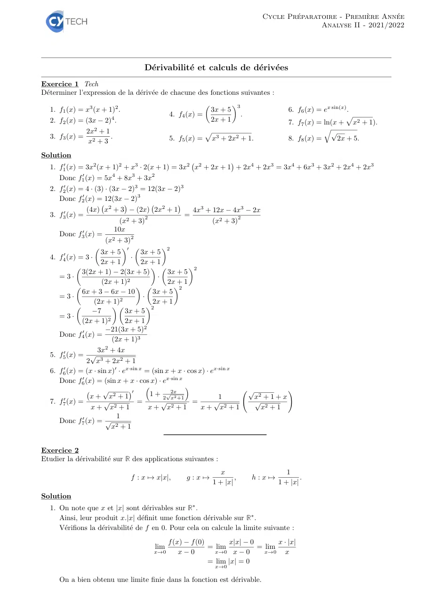

~~~text
                                                                                     Cycle Préparatoire - Première Année
                                                                                                    Analyse II - 2021/2022

                                    Dérivabilité et calculs de dérivées
Exercice 1 Tech
Déterminer l’expression de la dérivée de chacune des fonctions suivantes :
                                                                         3
   1. f1 (x) = x3 (x + 1)2 .                                                                    6. f6 (x) = ex sin(x) .
                                                            
                                                                3x + 5
                                              4. f4 (x) =                     .
   2. f2 (x) = (3x − 2)4 .                                      2x + 1
                                                                                                                     p
                                                                                                7. f7 (x) = ln(x + x2 + 1).
               2x2 + 1                                      p                                               q
                                                                                                               √
   3. f3 (x) = 2       .                      5. f5 (x) =       x3 + 2x2 + 1.                   8. f8 (x) =       2x + 5.
                x +3
Solution
   1. f10 (x) = 3x2 (x + 1)2 + x3 · 2(x + 1) = 3x2 x2 + 2x + 1 + 2x4 + 2x3 = 3x4 + 6x3 + 3x2 + 2x4 + 2x3
                                                              

      Donc f10 (x) = 5x4 + 8x3 + 3x2
   2. f20 (x) = 4 · (3) · (3x − 2)3 = 12(3x − 2)3
      Donc f20 (x) = 12(3x − 2)3
                                                      
        0       (4x) x2 + 3 − (2x) 2x2 + 1                 4x3 + 12x − 4x3 − 2x
   3. f3 (x) =                            2              =                2
                               (x2 + 3)                          (x2 + 3)
                            10x
      Donc f30 (x) =               2
                           2
                        (x + 3)
                               0              2
        0             3x + 5           3x + 5
   4. f4 (x) = 3 ·                 ·
                      2x + 1           2x + 1
                                                       2
               3(2x + 1) − 2(3x + 5)               3x + 5
      =3·                                      ·
                       (2x + 1)2                   2x + 1
                                                  2
               6x + 3 − 6x − 10              3x + 5
      =3·                               ·
                    (2x + 1)2                2x + 1
                                       2
                   −7            3x + 5
      =3·
               (2x + 1)2         2x + 1
                        −21(3x     + 5)2
      Donc f40 (x) =
                           (2x + 1)3
                     3x2 + 4x
   5. f50 (x) = √
                2 x3 + 2x2 + 1
   6. f60 (x) = (x · sin x)0 · ex·sin x = (sin x + x · cos x) · ex·sin x
      Donc f60 (x) = (sin x + x · cos x) · ex·sin x
                       √                                                    √
                                                        
                                  0
                                            1 + 2√2x
                                                                                         !
                            2+1
        0        x   +    x                          2
                                                    x +1           1          x2 + 1 + x
   7. f7 (x) =          √            =           √         =     √            √
                  x + x2 + 1                x + x2 + 1       x + x2 + 1         x2 + 1
                             1
      Donc f70 (x) = √
                             2
                           x +1

Exercice 2
Etudier la dérivabilité sur R des applications suivantes :
                                                                   x                            1
                               f : x 7→ x|x|,      g : x 7→             ,         h : x 7→           .
                                                                1 + |x|                      1 + |x|
Solution
   1. On note que x et |x| sont dérivables sur R∗ .
      Ainsi, leur produit x.|x| définit ume fonction dérivable sur R∗ .
      Vérifions la dérivabilité de f en 0. Pour cela on calcule la limite suivante :
                                            f (x) − f (0)       x|x| − 0       x · |x|
                                        lim               = lim          = lim
                                        x→0     x−0         x→0 x − 0      x→0   x
                                                          = lim |x| = 0
                                                                 x→0

      On a bien obtenu une limite finie dans la fonction est dérivable.
~~~

## Page 2

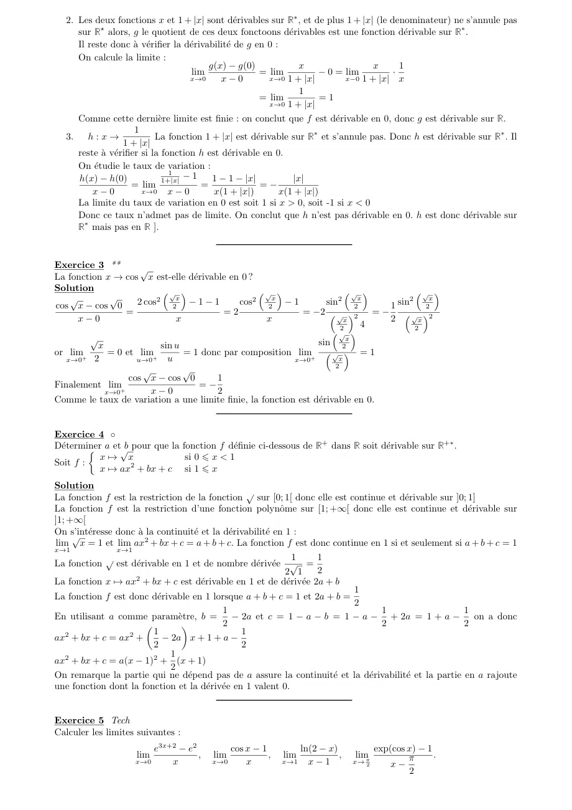

~~~text
  2. Les deux fonctions x et 1 + |x| sont dérivables sur R∗ , et de plus 1 + |x| (le denominateur) ne s’annule pas
     sur R? alors, g le quotient de ces deux fonctoons dérivables est une fonction dérivable sur R∗ .
     Il reste donc à vérifier la dérivabilité de g en 0 :
     On calcule la limite :
                                          g(x) − g(0)            x                 x     1
                                     lim                = lim         − 0 = lim        ·
                                    x→0      x−0          x→0 1 + |x|       x−0 1 + |x| x
                                                                 1
                                                        = lim         =1
                                                          x→0 1 + |x|

     Comme cette dernière limite est finie : on conclut que f est dérivable en 0, donc g est dérivable sur R.
                      1
  3.   h:x→                 La fonction 1 + |x| est dérivable sur R∗ et s’annule pas. Donc h est dérivable sur R∗ . Il
                  1 + |x|
     reste à vérifier si la fonction h est dérivable en 0.
     On étudie le taux de variation :
                                1
     h(x) − h(0)              1+|x| − 1   1 − 1 − |x|          |x|
                     = lim              =              =−
         x−0            x→0     x−0        x(1 + |x|)       x(1 + |x|)
     La limite du taux de variation en 0 est soit 1 si x > 0, soit -1 si x < 0
     Donc ce taux n’admet pas de limite. On conclut que h n’est pas dérivable en 0. h est donc dérivable sur
     R∗ mais pas en R ].

Exercice 3 **        √
La fonction x → cos x est-elle dérivable en 0 ?
Solution                   √                      √                   √          √ 
    √        √      2 cos2     x
                                  − 1 − 1     cos 2    x
                                                         − 1       sin 2     x
                                                                                  sin2     x
cos x − cos 0                 2                       2                     2   1         2
                  =                        =2                = −2  √ 2 = −         √ 2
      x−0                      x                     x                   x      2       x
                                                                        2     4        2
                                                                     √ 
        √                                                       sin 2x
          x                sin u
or lim+      = 0 et lim+         = 1 donc par composition lim+  √  = 1
   x→0   2          u→0      u                             x→0         x
                                                                      2
                      √          √
                  cos x − cos 0          1
Finalement lim                      =−
            x→0 +       x−0              2
Comme le taux de variation a une limite finie, la fonction est dérivable en 0.

Exercice 4 ◦
                                                                 +                            +∗
Déterminer
          a et√b pour que la fonction f définie ci-dessous de R dans R soit dérivable sur R .
          x 7→ x               si 0 ⩽ x < 1
Soit f :
          x 7→ ax2 + bx + c si 1 ⩽ x
Solution
                                                   √
La fonction f est la restriction de la fonction sur [0; 1[ donc elle est continue et dérivable sur ]0; 1]
La fonction f est la restriction d’une fonction polynôme sur [1; +∞[ donc elle est continue et dérivable sur
]1; +∞[
On s’intéresse
     √          donc à la continuité et la dérivabilité en 1 :
lim x = 1 et lim ax2 + bx + c = a + b + c. La fonction f est donc continue en 1 si et seulement si a + b + c = 1
x→1             x→1
             √                                                  1  1
La fonction     est dérivable en 1 et de nombre dérivée √ =
                                                               2 1 2
La fonction x 7→ ax2 + bx + c est dérivable en 1 et de dérivée 2a + b
                                                                          1
La fonction f est donc dérivable en 1 lorsque a + b + c = 1 et 2a + b =
                                                                          2
                                             1                                  1                     1
En utilisant a comme paramètre, b = − 2a et c = 1 − a − b = 1 − a − + 2a = 1 + a − on a donc
                                           2                                  2                     2
                          1                       1
ax2 + bx + c = ax2 +        − 2a x + 1 + a −
                          2                       2
   2                      2    1
ax + bx + c = a(x − 1) + (x + 1)
                               2
On remarque la partie qui ne dépend pas de a assure la continuité et la dérivabilité et la partie en a rajoute
une fonction dont la fonction et la dérivée en 1 valent 0.

Exercice 5 Tech
Calculer les limites suivantes :
                        e3x+2 − e2            cos x − 1           ln(2 − x)            exp(cos x) − 1
                    lim            ,    lim             ,   lim             ,   lim            π      .
                    x→0     x           x→0       x         x→1     x−1         x→ π
                                                                                   2       x−
                                                                                               2
~~~

## Page 3

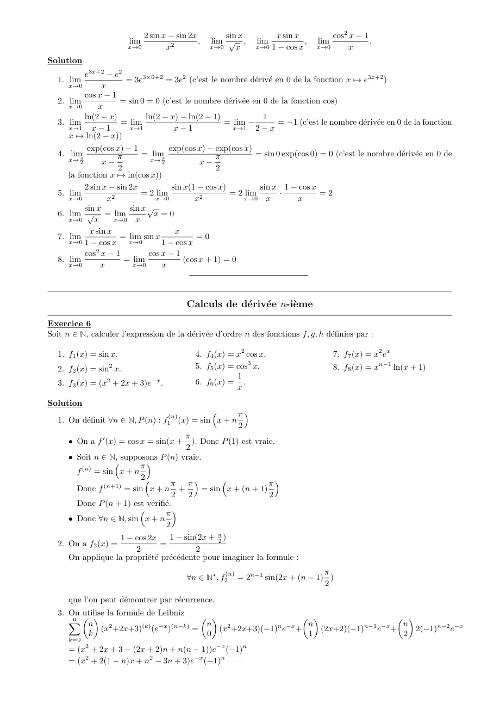

~~~text
                             2 sin x − sin 2x         sin x         x sin x          cos2 x − 1
                         lim                  ,   lim √ ,       lim          ,   lim            .
                         x→0        x2            x→0    x     x→0 1 − cos x     x→0     x
Solution
           e3x+2 − e2
   1. lim               = 3e3×0+2 = 3e2 (c’est le nombre dérivé en 0 de la fonction x 7→ e3x+2 )
      x→0        x
           cos x − 1
   2. lim             = sin 0 = 0 (c’est le nombre dérivée en 0 de la fonction cos)
      x→0       x
           ln(2 − x)          ln(2 − x) − ln(2 − 1)             1
   3. lim              = lim                          = lim −       = −1 (c’est le nombre dérivée en 0 de la fonction
      x→1    x−1         x→1           x−1              x→1   2−x
      x 7→ ln(2 − x))
            exp(cos x) − 1           exp(cos x) − exp(cos x)
   4. limπ            π      = limπ                π          = sin 0 exp(cos 0) = 0 (c’est le nombre dérivée en 0 de
      x→ 2       x−            x→ 2            x−
                      2                             2
      la fonction x 7→ ln(cos x))
           2 sin x − sin 2x           sin x(1 − cos x)         sin x 1 − cos x
   5. lim                    = 2 lim                   = 2 lim       ·           =2
      x→0          x2            x→0         x2            x→0 x          x
           sin x         sin x √
   6. lim √ = lim                x=0
      x→0     x      x→0   x
             x sin x                   x
   7. lim             = lim sin x             =0
      x→0 1 − cos x      x→0       1 − cos x
           cos2 x − 1          cos x − 1
   8. lim               = lim             (cos x + 1) = 0
      x→0        x        x→0      x

                                          Calculs de dérivée n-ième
Exercice 6
Soit n ∈ N, calculer l’expression de la dérivée d’ordre n des fonctions f, g, h définies par :

   1. f1 (x) = sin x.                        4. f4 (x) = x2 cos x.                     7. f7 (x) = x2 ex
   2. f2 (x) = sin2 x.                       5. f5 (x) = cos3 x.                       8. f8 (x) = xn−1 ln(x + 1)
                                                         1
   3. f3 (x) = (x2 + 2x + 3)e−x .            6. f6 (x) = .
                                                         x
Solution
                                    (n)
                                                    π
   1. On définit ∀n ∈ N, P (n) : f1 (x) = sin x + n
                                                     2
                0                       π
      • On a f (x) = cos x = sin(x + ). Donc P (1) est vraie.
                                        2
      • Soit n ∈ N, supposons P (n) vraie.
                         π
        f (n) = sin x + n
                           2
                (n+1)                π π                   π
        Donc f        = sin x + n +        = sin x + (n + 1)
                                     2   2                   2
        Donc P (n + 1) est vérifié.
                                  π
      • Donc ∀n ∈ N, sin x + n
                                   2
                    1 − cos 2x     1 − sin(2x + π2 )
   2. On a f2 (x) =              =
                        2                   2
      On applique la propriété précédente pour imaginer la formule :
                                                     (n)                          π
                                          ∀n ∈ N∗ , f2     = 2n−1 sin(2x + (n − 1) )
                                                                                  2
      que l’on peut démontrer par récurrence.
   3. On utilise la formule de Leibniz
       n                                                                                
      X   n                                 n                         n                       n
               (x2 +2x+3)(k) (e−x )(n−k) =     (x2 +2x+3)(−1)n e−x +     (2x+2)(−1)n−1 e−x +     2(−1)n−2 e−x
          k                                 0                         1                       2
      k=0
      = (x2 + 2x + 3 − (2x + 2)n + n(n − 1))e−x (−1)n
      = (x2 + 2(1 − n)x + n2 − 3n + 3)e−x (−1)n
~~~

## Page 4

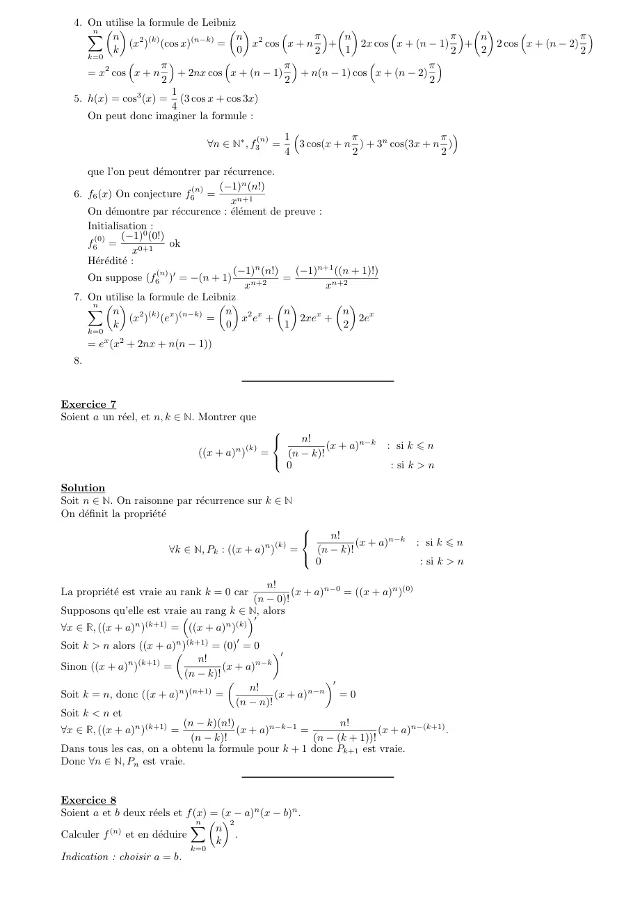

~~~text
   4. On utilise la formule de Leibniz
       n                                                                             
      X    n                            n 2              π    n                     π  n                   π
               (x2 )(k) (cos x)(n−k) =      x cos x + n +           2x cos x + (n − 1) +      2 cos x + (n − 2)
           k                            0                 2     1                      2   2                    2
      k=0
                       π                       π                             π 
      = x2 cos x + n        + 2nx cos x + (n − 1)     + n(n − 1) cos x + (n − 2)
                        2                         2                               2
                 3        1
   5. h(x) = cos (x) = (3 cos x + cos 3x)
                          4
      On peut donc imaginer la formule :

                                             (n)  1              π                  π 
                                  ∀n ∈ N∗ , f3 =      3 cos(x + n ) + 3n cos(3x + n )
                                                  4               2                  2
      que l’on peut démontrer par récurrence.
                                  (n)  (−1)n (n!)
   6. f6 (x) On conjecture f6 =
                                         xn+1
      On démontre par réccurence : élément de preuve :
      Initialisation :
       (0)     (−1)0 (0!)
      f6 =                  ok
                  x0+1
      Hérédité :
                        (n)               (−1)n (n!)   (−1)n+1 ((n + 1)!)
      On suppose (f6 )0 = −(n + 1)                   =
                                            xn+2             xn+2
   7. On utilise la formule de Leibniz
       n                                                  
      X      n                          n 2 x        n           n
                 (x2 )(k) (ex )(n−k) =      x e +       2xex +      2ex
             k                          0            1           2
        k=0
        = ex (x2 + 2nx + n(n − 1))
   8.

Exercice 7
Soient a un réel, et n, k ∈ N. Montrer que
                                                        
                                                             n!
                                                                   (x + a)n−k      : si k ⩽ n
                                                        
                                              (k)
                                ((x + a)n )         =     (n − k)!
                                                         0                         : si k > n

Solution
Soit n ∈ N. On raisonne par récurrence sur k ∈ N
On définit la propriété
                                                                  
                                                                       n!
                                                                             (x + a)n−k   : si k ⩽ n
                                                                  
                                                        (k)
                         ∀k ∈ N, Pk : ((x + a)n )             =     (n − k)!
                                                                   0                     : si k > n

                                             n!
La propriété est vraie au rank k = 0 car         (x + a)n−0 = ((x + a)n )(0)
                                          (n − 0)!
Supposons qu’elle est vraie au rang k ∈ 
                                         N, alors
                                                0
∀x ∈ R, ((x + a)n )(k+1) = ((x + a)n )(k)
                                         0
Soit k > n alors ((x + a)n )(k+1) = (0) = 0
                                               0
                               n!
Sinon ((x + a)n )(k+1) =             (x + a)n−k
                            (n − k)!
                                                           0
                          n (n+1)          n!           n−n
Soit k = n, donc ((x + a) )        =             (x + a)       =0
                                        (n − n)!
Soit k < n et
                            (n − k)(n!)                        n!
∀x ∈ R, ((x + a)n )(k+1) =              (x + a)n−k−1 =                  (x + a)n−(k+1) .
                              (n − k)!                   (n − (k + 1))!
Dans tous les cas, on a obtenu la formule pour k + 1 donc Pk+1 est vraie.
Donc ∀n ∈ N, Pn est vraie.

Exercice 8
Soient a et b deux réels et f (x) = (x − a)n (x − b)n .
                                n  2
                              X     n
Calculer f (n) et en déduire           .
                                    k
                              k=0
Indication : choisir a = b.
~~~

## Page 5

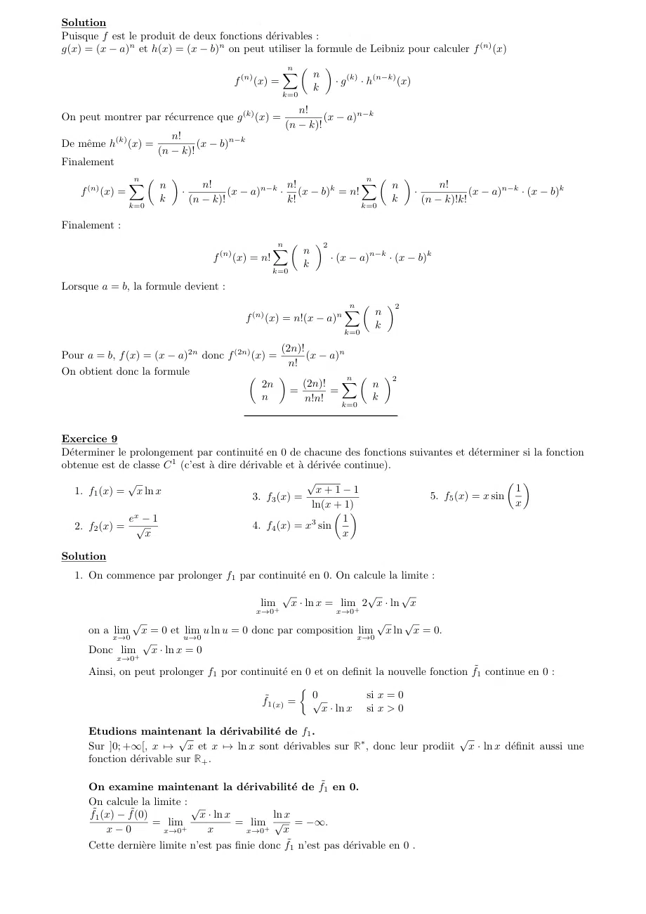

~~~text
Solution
Puisque f est le produit de deux fonctions dérivables :
g(x) = (x − a)n et h(x) = (x − b)n on peut utiliser la formule de Leibniz pour calculer f (n) (x)
                                                            n    
                                              (n)
                                                            X   n
                                          f         (x) =                  · g (k) · h(n−k) (x)
                                                                      k
                                                            k=0

                                                                n!
On peut montrer par récurrence que g (k) (x) =                       (x − a)n−k
                                                             (n − k)!
                           n!
De même h(k) (x) =              (x − b)n−k
                        (n − k)!
Finalement
                  n                                                                n            
                  X   n             n!                n!             X                         n               n!
    f (n) (x) =              ·            (x − a)n−k · (x − b)k = n!                                   ·              (x − a)n−k · (x − b)k
                        k        (n − k)!             k!                                       k           (n − k)!k!
                  k=0                                                                k=0

Finalement :
                                                          n    2
                                                          X   n
                                     f (n) (x) = n!                       · (x − a)n−k · (x − b)k
                                                                  k
                                                          k=0

Lorsque a = b, la formule devient :
                                                                               n    2
                                                   (n)                     n
                                                                               X   n
                                               f         (x) = n!(x − a)
                                                                                         k
                                                                               k=0

                                                (2n)!
Pour a = b, f (x) = (x − a)2n donc f (2n) (x) =       (x − a)n
                                                  n!
On obtient donc la formule                                   n    2
                                            2n       (2n)! X n
                                                  =        =
                                            n         n!n!         k
                                                                            k=0

Exercice 9
Déterminer le prolongement par continuité en 0 de chacune des fonctions suivantes et déterminer si la fonction
obtenue est de classe C 1 (c’est à dire dérivable et à dérivée continue).
              √                                           √                                        
   1. f1 (x) = x ln x                                       x+1−1                                  1
                                            3. f3 (x) =                        5. f 5 (x) = x sin
                                                           ln(x + 1)                               x
               ex − 1
                                                                  
                                                                    1
   2. f2 (x) = √                            4. f4 (x) = x3 sin
                  x                                                x

Solution
  1. On commence par prolonger f1 par continuité en 0. On calcule la limite :
                                                            √                    √      √
                                                     lim+       x · ln x = lim+ 2 x · ln x
                                                    x→0                    x→0
                  √                                            √   √
     on a lim x = 0 et lim u ln u = 0 donc par composition lim x ln x = 0.
         x→0           u→0                                 x→0
              √
     Donc lim+ x · ln x = 0
             x→0
     Ainsi, on peut prolonger f1 por continuité en 0 et on definit la nouvelle fonction f˜1 continue en 0 :
                                                  
                                          ˜          0√           si x = 0
                                         f1 (x) =
                                                        x · ln x si x > 0

     Etudions maintenant la dérivabilité de f1 .
                          √                                                      √
     Sur ]0; +∞[, x 7→ x et x 7→ ln x sont dérivables sur R∗ , donc leur prodiit x · ln x définit aussi une
     fonction dérivable sur R+ .

     On examine maintenant la dérivabilité de f˜1 en 0.
     On calcule la limite : √
     f˜1 (x) − f˜(0)          x · ln x         ln x
                     = lim+            = lim+ √ = −∞.
          x−0         x→0       x        x→0      x
     Cette dernière limite n’est pas finie donc f˜1 n’est pas dérivable en 0 .
~~~

## Page 6

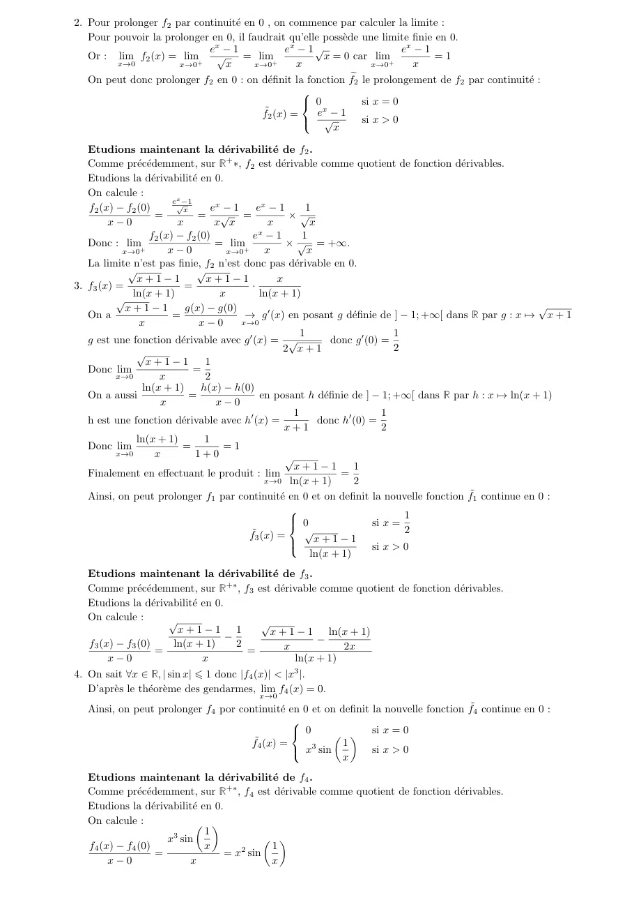

~~~text
2. Pour prolonger f2 par continuité en 0 , on commence par calculer la limite :
   Pour pouvoir la prolonger en 0, il faudrait qu’elle possède une limite finie en 0.
                            ex − 1             ex − 1 √                  ex − 1
   Or : lim f2 (x) = lim+ √          = lim+             x = 0 car lim+           =1
         x→0          x→0       x       x→0       x                x→0      x
   On peut donc prolonger f2 en 0 : on définit la fonction fe2 le prolongement de f2 par continuité :
                                                   
                                                    0          si x = 0
                                         f˜2 (x) =    ex − 1
                                                    √          si x > 0
                                                          x

   Etudions maintenant la dérivabilité de f2 .
   Comme précédemment, sur R+ ∗, f2 est dérivable comme quotient de fonction dérivables.
   Etudions la dérivabilité en 0.
   On calcule :          x
                        e√ −1
   f2 (x) − f2 (0)         x      ex − 1     ex − 1       1
                   =           = √ =                 ×√
        x−0              x         x x          x          x
                  f2 (x) − f2 (0)          ex − 1       1
   Donc : lim+                     = lim+           × √ = +∞.
           x→0         x−0            x→0      x          x
   La limite n’est pas finie, f2 n’est donc pas dérivable en 0.
            √                  √
               x+1−1             x+1−1            x
3. f3 (x) =                =               ·
             ln(x + 1)              x         ln(x + 1)
          √
            x+1−1           g(x) − g(0)                                                                    √
   On a                 =                 → g 0 (x) en posant g définie de ] − 1; +∞[ dans R par g : x 7→ x + 1
               x               x−0       x→0
                                                        1                       1
   g est une fonction dérivable avec g 0 (x) = √               donc g 0 (0) =
                                                   2 x+1                        2
              √
                 x+1−1          1
   Donc lim                   =
          x→0        x          2
                ln(x + 1)      h(x) − h(0)
   On a aussi                =                en posant h définie de ] − 1; +∞[ dans R par h : x 7→ ln(x + 1)
                     x             x−0
                                                      1                       1
   h est une fonction dérivable avec h0 (x) =               donc h0 (0) =
                                                    x+1                       2
              ln(x + 1)         1
   Donc lim                =         =1
          x→0      x          1+0                   √
                                                      x+1−1          1
   Finalement en effectuant le produit : lim                      =
                                               x→0 ln(x + 1)         2
   Ainsi, on peut prolonger f1 par continuité en 0 et on definit la nouvelle fonction f˜1 continue en 0 :
                                                                                  1
                                                     
                                                      0
                                                                          si x =
                                          f˜3 (x) =      √                        2
                                                            x+1−1
                                                     
                                                                          si x > 0
                                                           ln(x + 1)
   Etudions maintenant la dérivabilité de f3 .
   Comme précédemment, sur R+∗ , f3 est dérivable comme quotient de fonction dérivables.
   Etudions la dérivabilité en 0.
   On calcule :      √                    √
                       x+1−1 1              x + 1 − 1 ln(x + 1)
                                    −                 −
   f3 (x) − f3 (0)    ln(x + 1)       2        x           2x
                   =                    =
        x−0                   x                  ln(x + 1)
4. On sait ∀x ∈ R, | sin x| ⩽ 1 donc |f4 (x)| < |x3 |.
   D’après le théorème des gendarmes, lim f4 (x) = 0.
                                         x→0
   Ainsi, on peut prolonger f4 por continuité en 0 et on definit la nouvelle fonction f˜4 continue en 0 :
                                                
                                                 0        si x = 0
                                      f˜4 (x) =     3      1
                                                 x sin           si x > 0
                                                           x
   Etudions maintenant la dérivabilité de f4 .
   Comme précédemment, sur R+∗ , f4 est dérivable comme quotient de fonction dérivables.
   Etudions la dérivabilité en 0.
   On calcule :              
                      3        1
                     x sin                    
   f4 (x) − f4 (0)             x              1
                   =                = x2 sin
        x−0               x                   x
~~~

## Page 7

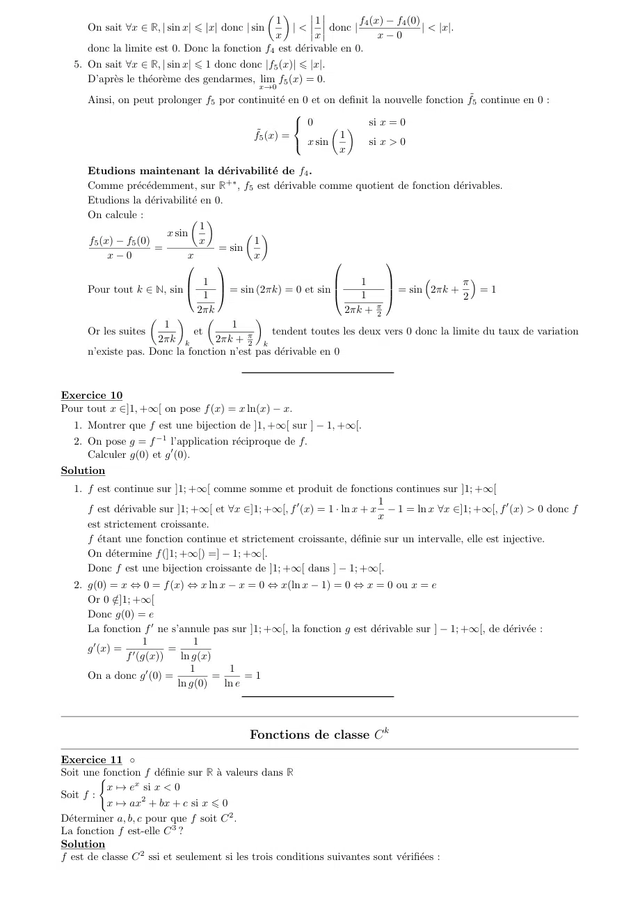

~~~text
                                                 
                                                 1       1         f4 (x) − f4 (0)
      On sait ∀x ∈ R, | sin x| ⩽ |x| donc | sin     |<      donc |                 | < |x|.
                                                 x       x              x−0
      donc la limite est 0. Donc la fonction f4 est dérivable en 0.
   5. On sait ∀x ∈ R, | sin x| ⩽ 1 donc donc |f5 (x)| ⩽ |x|.
      D’après le théorème des gendarmes, lim f5 (x) = 0.
                                              x→0
      Ainsi, on peut prolonger f5 por continuité en 0 et on definit la nouvelle fonction f˜5 continue en 0 :
                                                   
                                                    0       si x = 0
                                         f˜5 (x) =           1
                                                    x sin          si x > 0
                                                             x

      Etudions maintenant la dérivabilité de f4 .
      Comme précédemment, sur R+∗ , f5 est dérivable comme quotient de fonction dérivables.
      Etudions la dérivabilité en 0.
      On calcule :              
                                 1
                         x sin                
      f5 (x) − f5 (0)            x            1
                      =                = sin
           x−0                x               x
                                                                        

                               1                                   1      = sin 2πk + π = 1
                                                                                           
      Pour tout k ∈ N, sin              = sin (2πk) = 0 et sin 
                                   1                               1                     2
                                 2πk                              2πk + π2
                                            
                        1                 1
      Or les suites             et                tendent toutes les deux vers 0 donc la limite du taux de variation
                       2πk k          2πk + π2 k
      n’existe pas. Donc la fonction n’est pas dérivable en 0

Exercice 10
Pour tout x ∈]1, +∞[ on pose f (x) = x ln(x) − x.
   1. Montrer que f est une bijection de ]1, +∞[ sur ] − 1, +∞[.
   2. On pose g = f −1 l’application réciproque de f.
      Calculer g(0) et g 0 (0).
Solution
   1. f est continue sur ]1; +∞[ comme somme et produit de fonctions continues sur ]1; +∞[
                                                                         1
      f est dérivable sur ]1; +∞[ et ∀x ∈]1; +∞[, f 0 (x) = 1 · ln x + x − 1 = ln x ∀x ∈]1; +∞[, f 0 (x) > 0 donc f
                                                                         x
      est strictement croissante.
      f étant une fonction continue et strictement croissante, définie sur un intervalle, elle est injective.
      On détermine f (]1; +∞[) =] − 1; +∞[.
      Donc f est une bijection croissante de ]1; +∞[ dans ] − 1; +∞[.
   2. g(0) = x ⇔ 0 = f (x) ⇔ x ln x − x = 0 ⇔ x(ln x − 1) = 0 ⇔ x = 0 ou x = e
      Or 0 ∈]1;
              / +∞[
      Donc g(0) = e
      La fonction f 0 ne s’annule pas sur ]1; +∞[, la fonction g est dérivable sur ] − 1; +∞[, de dérivée :
                   1           1
      g 0 (x) = 0        =
                f (g(x))    ln g(x)
                    0         1        1
      On a donc g (0) =             =      =1
                           ln g(0)    ln e

                                            Fonctions de classe C k
Exercice 11 ◦
Soit une(fonction f définie sur R à valeurs dans R
          x 7→ ex si x < 0
Soit f :
          x 7→ ax2 + bx + c si x ⩽ 0
Déterminer a, b, c pour que f soit C 2 .
La fonction f est-elle C 3 ?
Solution
f est de classe C 2 ssi et seulement si les trois conditions suivantes sont vérifiées :
~~~

## Page 8

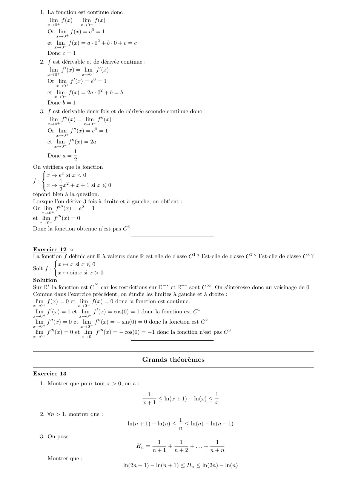

~~~text
   1. La fonction est continue donc
       lim+ f (x) = lim− f (x)
       x→0             x→0
       Or lim+ f (x) = e0 = 1
          x→0
       et lim− f (x) = a · 02 + b · 0 + c = c
         x→0
       Donc c = 1
   2. f est dérivable et de dérivée continue :
       lim f 0 (x) = lim f 0 (x)
       x→0+            x→0−
                  0        0
       Or lim f (x) = e = 1
          x→0+
       et lim− f (x) = 2a · 02 + b = b
         x→0
       Donc b = 1
   3. f est dérivable deux fois et de dérivée seconde continue donc
       lim f 00 (x) = lim f 00 (x)
       x→0+            x→0−
       Or lim f 00 (x) = e0 = 1
          x→0+
       et lim− f 00 (x) = 2a
         x→0
                  1
       Donc a =
                  2
On vérifiera que la fonction
    x 7→ ex si x < 0
f:           1
    x 7→ x2 + x + 1 si x ⩽ 0
             2
répond bien à la question.
Lorsque l’on dérive 3 fois à droite et à gauche, on obtient :
Or lim+ f 000 (x) = e0 = 1
   x→0
et lim f 000 (x) = 0
  x→0−
Donc la fonction obtenue n’est pas C 3

Exercice 12 ◦
                                                                  1                      2                      3
La fonction
         ( f définie sur R à valeurs dans R est elle de classe C ? Est-elle de classe C ? Est-elle de classe C ?
           x 7→ x si x ⩽ 0
Soit f :
           x 7→ sin x si x > 0
Solution                   ∞
Sur R∗ la fonction est C car les restrictions sur R−∗ et R+∗ sont C ∞ . On s’intéresse donc au voisinage de 0
Comme dans l’exercice précédent, on étudie les limites à gauche et à droite :
 lim+ f (x) = 0 et lim− f (x) = 0 donc la fonction est continue.
x→0                   x→0
 lim+ f 0 (x) = 1 et lim− f 0 (x) = cos(0) = 1 donc la fonction est C 1
x→0                   x→0
 lim f 00 (x) = 0 et lim f 00 (x) = − sin(0) = 0 donc la fonction est C 2
x→0+                   x→0−
 lim f 000 (x) = 0 et lim f 000 (x) = − cos(0) = −1 donc la fonction n’est pas C 3
x→0+                   x→0−

                                                Grands théorèmes
Exercice 13
   1. Montrer que pour tout x > 0, on a :
                                                 1                        1
                                                    ≤ ln(x + 1) − ln(x) ≤
                                                x+1                       x

   2. ∀n > 1, montrer que :
                                                                1
                                          ln(n + 1) − ln(n) ≤     ≤ ln(n) − ln(n − 1)
                                                                n
   3. On pose
                                                     1   1           1
                                             Hn =      +    + ... +
                                                    n+1 n+2         n+n
       Montrer que :
                                         ln(2n + 1) − ln(n + 1) ≤ Hn ≤ ln(2n) − ln(n)
~~~

## Page 9

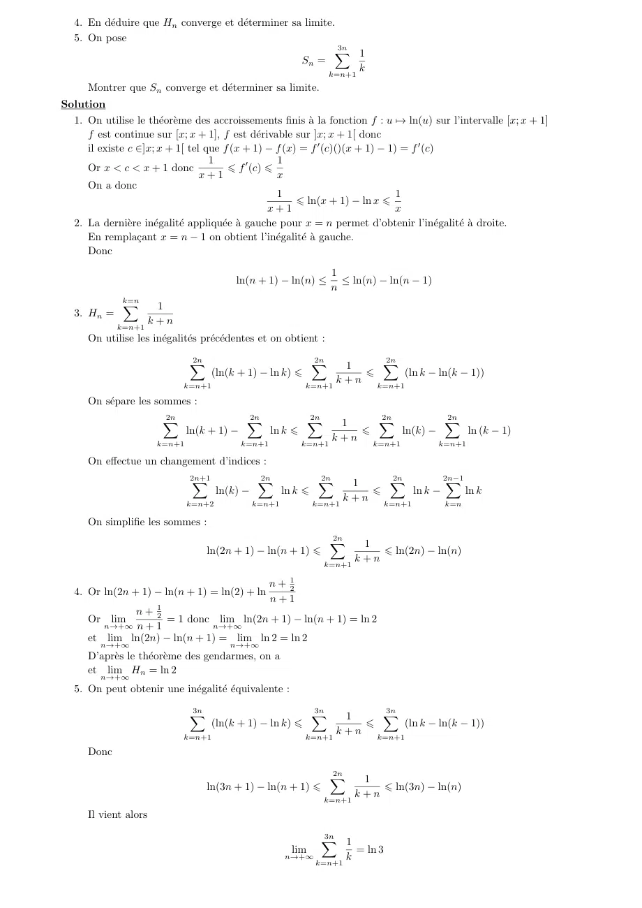

~~~text
  4. En déduire que Hn converge et déterminer sa limite.
  5. On pose
                                                           3n
                                                          X   1
                                                  Sn =
                                                              k
                                                                       k=n+1
     Montrer que Sn converge et déterminer sa limite.
Solution
  1. On utilise le théorème des accroissements finis à la fonction f : u 7→ ln(u) sur l’intervalle [x; x + 1]
     f est continue sur [x; x + 1], f est dérivable sur ]x; x + 1[ donc
     il existe c ∈]x; x + 1[ tel que f (x + 1) − f (x) = f 0 (c)()(x + 1) − 1) = f 0 (c)
                                  1                1
     Or x < c < x + 1 donc             ⩽ f 0 (c) ⩽
                                x+1                x
     On a donc
                                                   1                          1
                                                      ⩽ ln(x + 1) − ln x ⩽
                                                 x+1                         x
  2. La dernière inégalité appliquée à gauche pour x = n permet d’obtenir l’inégalité à droite.
     En remplaçant x = n − 1 on obtient l’inégalité à gauche.
     Donc

                                                                       1
                                           ln(n + 1) − ln(n) ≤           ≤ ln(n) − ln(n − 1)
                                                                       n
             k=n
             X         1
  3. Hn =
                      k+n
            k=n+1
     On utilise les inégalités précédentes et on obtient :
                               2n                                 2n          2n
                               X                                  X      1    X
                                      (ln(k + 1) − ln k) ⩽                  ⩽    (ln k − ln(k − 1))
                                                                        k+n
                             k=n+1                            k=n+1               k=n+1

     On sépare les sommes :
                        2n                    2n                 2n          2n         2n
                        X                     X                  X      1    X          X
                               ln(k + 1) −           ln k ⩽                ⩽    ln(k) −    ln (k − 1)
                                                                       k+n
                       k=n+1                 k=n+1            k=n+1              k=n+1         k=n+1

     On effectue un changement d’indices :
                               2n+1               2n               2n           2n        2n−1
                                X                 X                X       1    X          X
                                       ln(k) −           ln k ⩽               ⩽    ln k −      ln k
                                                                          k+n
                               k=n+2             k=n+1            k=n+1            k=n+1        k=n

     On simplifie les sommes :
                                                                       2n
                                                                       X       1
                                    ln(2n + 1) − ln(n + 1) ⩽                      ⩽ ln(2n) − ln(n)
                                                                              k+n
                                                                      k=n+1

                                                     n + 21
  4. Or ln(2n + 1) − ln(n + 1) = ln(2) + ln
                                                     n+1
             n + 12
     Or lim         = 1 donc lim ln(2n + 1) − ln(n + 1) = ln 2
        n→+∞ n + 1           n→+∞
     et lim ln(2n) − ln(n + 1) = lim ln 2 = ln 2
        n→+∞                              n→+∞
     D’après le théorème des gendarmes, on a
     et lim Hn = ln 2
        n→+∞
  5. On peut obtenir une inégalité équivalente :
                               3n                                 3n          3n
                               X                                  X      1    X
                                      (ln(k + 1) − ln k) ⩽                  ⩽    (ln k − ln(k − 1))
                                                                        k+n
                             k=n+1                            k=n+1               k=n+1

     Donc
                                                                       2n
                                                                       X       1
                                    ln(3n + 1) − ln(n + 1) ⩽                      ⩽ ln(3n) − ln(n)
                                                                              k+n
                                                                      k=n+1

     Il vient alors
                                                                   3n
                                                                   X  1
                                                           lim          = ln 3
                                                         n→+∞         k
                                                                  k=n+1
~~~

## Page 10

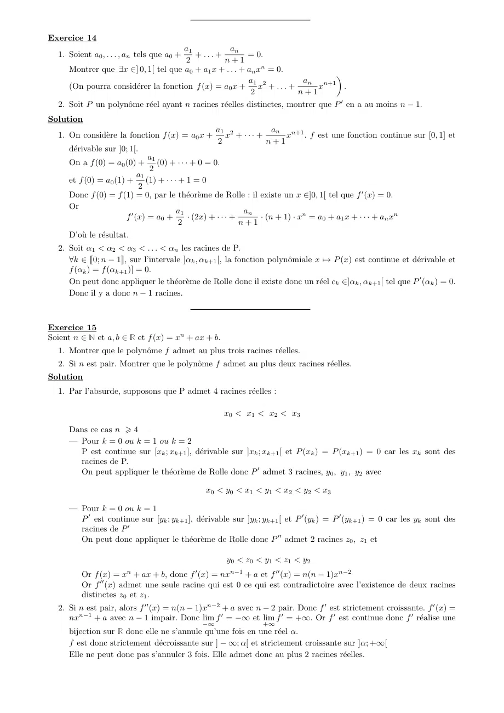

~~~text
Exercice 14
                                     a1            an
  1. Soient a0 , . . . , an tels que a0 +
                                        + ... +          = 0.
                                      2         n+1
     Montrer que ∃x ∈] 0, 1[ tel que a0 + a1 x + . . . + an xn = 0.
                                                                            
                                                         a1 2        an n+1
     (On pourra considérer la fonction f (x) = a0 x + x + . . . +      x     .
                                                          2         n+1
  2. Soit P un polynôme réel ayant n racines réelles distinctes, montrer que P 0 en a au moins n − 1.
Solution
                                                  a1 2         an n+1
  1. On considère la fonction f (x) = a0 x +       x + ··· +     x   . f est une fonction continue sur [0, 1] et
                                                  2           n+1
     dérivable sur ]0; 1[.
                               a1
     On a f (0) = a0 (0) + (0) + · · · + 0 = 0.
                               2
                            a1
     et f (0) = a0 (1) + (1) + · · · + 1 = 0
                            2
     Donc f (0) = f (1) = 0, par le théorème de Rolle : il existe un x ∈]0, 1[ tel que f 0 (x) = 0.
     Or
                                      a1                   an
                       f 0 (x) = a0 +    · (2x) + · · · +     · (n + 1) · xn = a0 + a1 x + · · · + an xn
                                      2                   n+1
     D’où le résultat.
  2. Soit α1 < α2 < α3 < . . . < αn les racines de P.
     ∀k ∈ J0; n − 1K, sur l’intervale ]αk , αk+1 [, la fonction polynômiale x 7→ P (x) est continue et dérivable et
     f (αk ) = f (αk+1 )] = 0.
     On peut donc appliquer le théorème de Rolle donc il existe donc un réel ck ∈]αk , αk+1 [ tel que P 0 (αk ) = 0.
     Donc il y a donc n − 1 racines.

Exercice 15
Soient n ∈ N et a, b ∈ R et f (x) = xn + ax + b.
  1. Montrer que le polynôme f admet au plus trois racines réelles.
  2. Si n est pair. Montrer que le polynôme f admet au plus deux racines réelles.
Solution
  1. Par l’absurde, supposons que P admet 4 racines réelles :

                                                    x0 < x 1 < x 2 < x 3
     Dans ce cas n ⩾ 4
     — Pour k = 0 ou k = 1 ou k = 2
       P est continue sur [xk ; xk+1 ], dérivable sur ]xk ; xk+1 [ et P (xk ) = P (xk+1 ) = 0 car les xk sont des
       racines de P.
       On peut appliquer le théorème de Rolle donc P 0 admet 3 racines, y0 , y1 , y2 avec

                                              x0 < y0 < x1 < y1 < x2 < y2 < x3

     — Pour k = 0 ou k = 1
       P 0 est continue sur [yk ; yk+1 ], dérivable sur ]yk ; yk+1 [ et P 0 (yk ) = P 0 (yk+1 ) = 0 car les yk sont des
       racines de P 0
       On peut donc appliquer le théorème de Rolle donc P 00 admet 2 racines z0 , z1 et

                                                    y0 < z0 < y1 < z1 < y2
         Or f (x) = xn + ax + b, donc f 0 (x) = nxn−1 + a et f 00 (x) = n(n − 1)xn−2
         Or f 00 (x) admet une seule racine qui est 0 ce qui est contradictoire avec l’existence de deux racines
         distinctes z0 et z1 .
  2. Si n est pair, alors f 00 (x) = n(n − 1)xn−2 + a avec n − 2 pair. Donc f 0 est strictement croissante. f 0 (x) =
     nxn−1 + a avec n − 1 impair. Donc lim f 0 = −∞ et lim f 0 = +∞. Or f 0 est continue donc f 0 réalise une
                                             −∞                +∞
     bijection sur R donc elle ne s’annule qu’une fois en une réel α.
     f est donc strictement décroissante sur ] − ∞; α[ et strictement croissante sur ]α; +∞[
     Elle ne peut donc pas s’annuler 3 fois. Elle admet donc au plus 2 racines réelles.
~~~

## Page 11

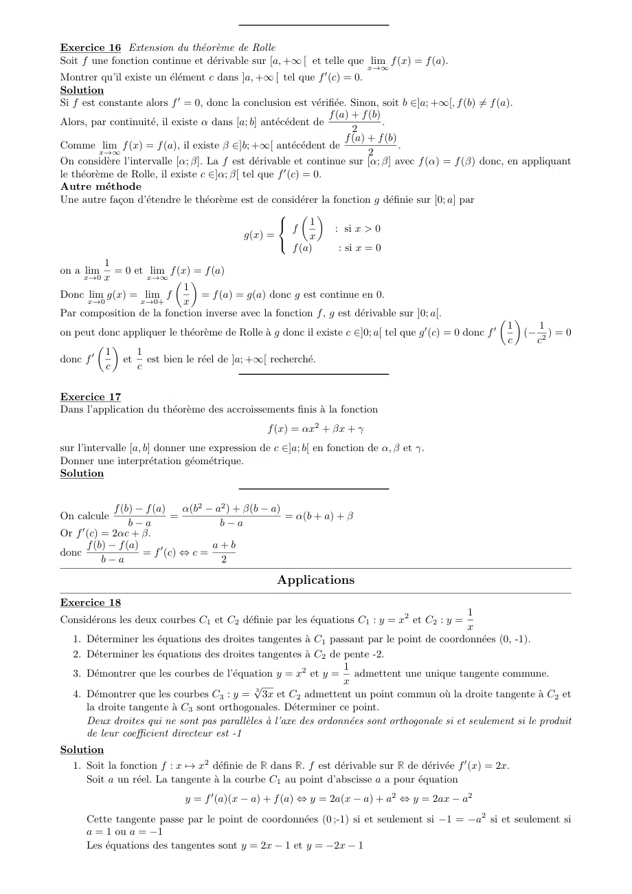

~~~text
Exercice 16 Extension du théorème de Rolle
Soit f une fonction continue et dérivable sur [a, +∞ [ et telle que lim f (x) = f (a).
                                                                        x→∞
Montrer qu’il existe un élément c dans ]a, +∞ [ tel que f 0 (c) = 0.
Solution
Si f est constante alors f 0 = 0, donc la conclusion est vérifiée. Sinon, soit b ∈]a; +∞[, f (b) 6= f (a).
                                                                 f (a) + f (b)
Alors, par continuité, il existe α dans [a; b] antécédent de                .
                                                                        2
                                                                      f (a) + f (b)
Comme lim f (x) = f (a), il existe β ∈]b; +∞[ antécédent de                       .
          x→∞                                                               2
On considère l’intervalle [α; β]. La f est dérivable et continue sur [α; β] avec f (α) = f (β) donc, en appliquant
le théorème de Rolle, il existe c ∈]α; β[ tel que f 0 (c) = 0.
Autre méthode
Une autre façon d’étendre le théorème est de considérer la fonction g définie sur [0; a] par
                                                      
                                                             1
                                                         f         : si x > 0
                                                    
                                            g(x) =           x
                                                         f (a)      : si x = 0
                                                    

           1
on a lim = 0 et lim f (x) = f (a)
      x→0 x         x→∞  
                              1
Donc lim g(x) = lim f             = f (a) = g(a) donc g est continue en 0.
       x→0         x→0+       x
Par composition de la fonction inverse avec la fonction f , g est dérivable sur ]0; a[.                  
                                                                                      0                0  1     1
on peut donc appliquer le théorème de Rolle à g donc il existe c ∈]0; a[ tel que g (c) = 0 donc f         (− 2 ) = 0
                                                                                                        c    c
        0   1     1
donc f         et est bien le réel de ]a; +∞[ recherché.
            c     c

Exercice 17
Dans l’application du théorème des accroissements finis à la fonction
                                                f (x) = αx2 + βx + γ
sur l’intervalle [a, b] donner une expression de c ∈]a; b[ en fonction de α, β et γ.
Donner une interprétation géométrique.
Solution

              f (b) − f (a)    α(b2 − a2 ) + β(b − a)
On calcule                   =                        = α(b + a) + β
                  b−a                  b−a
     0
Or f (c) = 2αc + β.
       f (b) − f (a)                 a+b
donc                 = f 0 (c) ⇔ c =
           b−a                         2

                                                   Applications
Exercice 18
                                                                                              1
Considérons les deux courbes C1 et C2 définie par les équations C1 : y = x2 et C2 : y =
                                                                                              x
   1. Déterminer les équations des droites tangentes à C1 passant par le point de coordonnées (0, -1).
   2. Déterminer les équations des droites tangentes à C2 de pente -2.
                                                                 1
   3. Démontrer que les courbes de l’équation y = x2 et y = admettent une unique tangente commune.
                                            √                    x
                                             3
   4. Démontrer que les courbes C3 : y = 3x et C2 admettent un point commun où la droite tangente à C2 et
      la droite tangente à C3 sont orthogonales. Déterminer ce point.
      Deux droites qui ne sont pas parallèles à l’axe des ordonnées sont orthogonale si et seulement si le produit
      de leur coefficient directeur est -1
Solution
   1. Soit la fonction f : x 7→ x2 définie de R dans R. f est dérivable sur R de dérivée f 0 (x) = 2x.
      Soit a un réel. La tangente à la courbe C1 au point d’abscisse a a pour équation
                             y = f 0 (a)(x − a) + f (a) ⇔ y = 2a(x − a) + a2 ⇔ y = 2ax − a2
      Cette tangente passe par le point de coordonnées (0 ;-1) si et seulement si −1 = −a2 si et seulement si
      a = 1 ou a = −1
      Les équations des tangentes sont y = 2x − 1 et y = −2x − 1
~~~

## Page 12

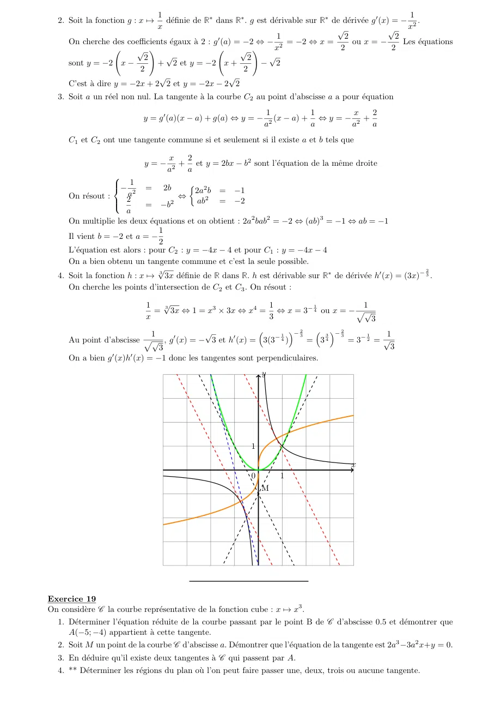

~~~text
                              1                                                                            1
  2. Soit la fonction g : x 7→  définie de R∗ dans R∗ . g est dérivable sur R∗ de dérivée g 0 (x) = − 2 .
                              x                                                   √                  √    x
                                                0                1                  2                  2
     On cherche des coefficients égaux à 2 : g (a) = −2 ⇔ − 2 = −2 ⇔ x =             ou x = −          Les équations
                        √ !                           √ !       x                  2                  2
                          2     √                       2      √
     sont y = −2 x −          + 2 et y = −2 x +             − 2
                         2                             2
                              √                    √
     C’est à dire y = −2x + 2 2 et y = −2x − 2 2
  3. Soit a un réel non nul. La tangente à la courbe C2 au point d’abscisse a a pour équation
                                                             1          1       x    2
                           y = g 0 (a)(x − a) + g(a) ⇔ y = − 2 (x − a) + ⇔ y = − 2 +
                                                            a           a       a    a
     C1 et C2 ont une tangente commune si et seulement si il existe a et b tels que

                                x   2
                           y = − 2 + et y = 2bx − b2 sont l’équation de la même droite
                                a   a
                  
                  − 1 = 2b
                                        2
                      a2                 2a b = −1
     On résout :     2             ⇔
                  
                           = −b  2       ab2 = −2
                      a
     On multiplie les deux équations et on obtient : 2a2 bab2 = −2 ⇔ (ab)3 = −1 ⇔ ab = −1
                               1
     Il vient b = −2 et a = −
                               2
     L’équation est alors : pour C2 : y = −4x − 4 et pour C1 : y = −4x − 4
     On a bien obtenu un tangente commune et c’est la seule possible.
                               √                                                                          −2
  4. Soit la fonction h : x 7→ 3x définie de R dans R. h est dérivable sur R∗ de dérivée h0 (x) = (3x) 3 .
                               3

     On cherche les points d’intersection de C2 et C3 . On résout :

                           1  √                       1         1           1
                             = 3x ⇔ 1 = x3 × 3x ⇔ x4 = ⇔ x = 3− 4 ou x = − p√
                              3

                           x                          3                       3
                           1             √                  1
                                                                − 23   3 − 32      1    1
     Au point d’abscisse p√ , g 0 (x) = − 3 et h0 (x) = 3(3− 4 )      = 34       = 3− 2 = √
                             3                                                              3
                0    0
     On a bien g (x)h (x) = −1 donc les tangentes sont perpendiculaires.
                                                               y

                                                           1

                                                                                        x
                                                           0       1
                                                               M

Exercice 19
On considère C la courbe représentative de la fonction cube : x 7→ x3 .
  1. Déterminer l’équation réduite de la courbe passant par le point B de C d’abscisse 0.5 et démontrer que
     A(−5; −4) appartient à cette tangente.
  2. Soit M un point de la courbe C d’abscisse a. Démontrer que l’équation de la tangente est 2a3 −3a2 x+y = 0.
  3. En déduire qu’il existe deux tangentes à C qui passent par A.
  4. ** Déterminer les régions du plan où l’on peut faire passer une, deux, trois ou aucune tangente.
~~~

## Page 13

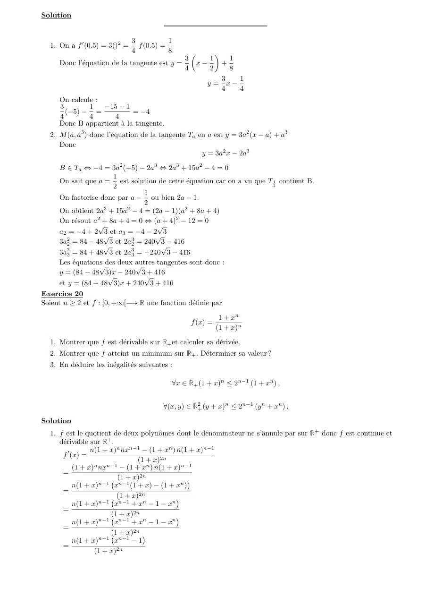

~~~text
Solution

                               3           1
  1. On a f 0 (0.5) = 3()2 =     f (0.5) =
                               4           8                
                                             3           1           1
     Donc l’équation de la tangente est y =          x−         +
                                             4           2           8
                                                                 3    1
                                                        y=         x−
                                                                 4    4
     On calcule :
     3        1   −15 − 1
       (−5) − =             = −4
     4        4      4
     Donc B appartient à la tangente.
  2. M (a, a3 ) donc l’équation de la tangente Ta en a est y = 3a2 (x − a) + a3
     Donc
                                                    y = 3a2 x − 2a3
     B ∈ Ta ⇔ −4 = 3a2 (−5) − 2a3 ⇔ 2a3 + 15a2 − 4 = 0
                       1
     On sait que a = est solution de cette équation car on a vu que T 12 contient B.
                       2
                                1
     On factorise donc par a − ou bien 2a − 1.
                                2
     On obtient 2a3 + 15a2 − 4 = (2a − 1)(a2 + 8a + 4)
     On résout a2 + 8a + 4 = 0 ⇔ (a + 4)2 − 12 = 0
                  √                 √
     a2 = −4 + 2 √  3 et a3 = −4 − 2√ 3
     3a22 = 84 − 48 3 et 2a32 = 240 3 − 416
                    √                √
     3a23 = 84 + 48 3 et 2a33 = −240 3 − 416
     Les équations√des deux autres
                              √     tangentes sont donc :
     y = (84 − 48 3)x − 240 3 + 416
                     √          √
     et y = (84 + 48 3)x + 240 3 + 416
Exercice 20
Soient n ≥ 2 et f : [0, +∞[−→ R une fonction définie par

                                                              1 + xn
                                                  f (x) =
                                                             (1 + x)n

  1. Montrer que f est dérivable sur R+ et calculer sa dérivée.
  2. Montrer que f atteint un minimum sur R+ . Déterminer sa valeur ?
  3. En déduire les inégalités suivantes :

                                            ∀x ∈ R+ (1 + x)n ≤ 2n−1 (1 + xn ) ,

                                         ∀(x, y) ∈ R2+ (y + x)n ≤ 2n−1 (y n + xn ) .
Solution
  1. f est le quotient de deux polynômes dont le dénominateur ne s’annule par sur R+ donc f est continue et
     dérivable sur R+ .
                 n(1 + x)n nxn−1 − (1 + xn ) n(1 + x)n−1
      f 0 (x) =
                                 (1 + x)2n
                  n   n−1
           (1 + x) nx      − (1 + xn ) n(1 + x)n−1
      =
                          (1 + x)2n              
                    n−1
           n(1 + x)      xn−1 (1 + x) − (1 + xn )
      =
                          (1 + x)2n           
                    n−1
           n(1 + x)      xn−1 + xn − 1 − xn
      =
                        (1 + x)2n             
           n(1 + x)n−1 xn−1 + xn − 1 − xn
      =
                        (1 + x)2n 
                    n−1
           n(1 + x)      xn−1 − 1
      =
                  (1 + x)2n
~~~

## Page 14

~~~text
  2. f 0 (x) est du signe de xn−1 − 1. Or la fonction x 7→ xn−1 − 1 est strictement croissante sur R donc
     injective et 1 est solution de l’équation donc f 0 (x) < 0 pour x ∈ [0; 1[ et f est strictement décroissante
     et pour x ∈]1; +∞[, f 0 (x) > 0 et f est strictement croissante. Donc f admet un minimum en 1. Or
               2      1
     f (1) = n = n−1
              2     2
                                1                (1 + x)n
     Donc ∀x ∈ R+ , f (x) ⩾ n−1 ⇔ 1 + xn ⩾                  ⇔ (1 + x)n ⩽ 2n−1 (1 + xn )
                              2                    2n−1
                         y
     or ∀(x, y) ∈ (R2+ ∗, > 0 donc
                         x
                                                 y n               y n 
                                               1+       ⩽ 2n−1 1 +
                                                  x                    x
     En multipliant par xn , on obtient

                                              (x + y)n ⩽ 2n−1 (xn + y n )
     et cette propriété est vraie pour x = 0 ou y = 0

Exercice 21 Tech ◦
Calculer le maximum et le minimum des fonctions suivantes :
  1. f1 (x) = x2 + 5x + 6, x ∈ [−4, 4].
  2. f2 (x) = x3 − 3x2 − x + 10, x ∈ [0, 3].
  3. f3 (x) = −2 cos x − x, x ∈ [0, 4π].
Solution
  1. f1 (x) = x2 + 5x + 6              x ∈ [−4, 4]
                              5
      f10 (x) = 2x + 5   ⇔x=−
                              2
                                         5
                                     −
                                         2

                                          1
                                      −
                                          4
     f (−4) = (−4)2 + 5(−4) + 6 = 16 − 20 + 6 = 2
                       2          
            5           5            5          25 − 50 − 24      1
     f −         = −           + 5 −      + 6 =               =−
            2           2            2               4            4
     f (4) = (4)2 + 5(4) + 6 = 16 + 20 + 6 = 42
     Donc les extremums sont 42 et -14
  2. f2 (x) = x3 − 3x2 − x + 10                              x ∈ [0, 3]
      f20 (x) = 3x2 − 6x − 1
                                          √ 2
     ∆ = (−6)2 + 4 × 3 × 1 = 48 = 4 3
                  √
            3−2 3
     x1 =            ∈/ [0, 3]
                3√
            3+2 3
     x2 =
                3                        √
                                    3+2 3
                                       3

                                                           7

                                         √
                                  63 − 16 3
                                      9
~~~

## Page 15

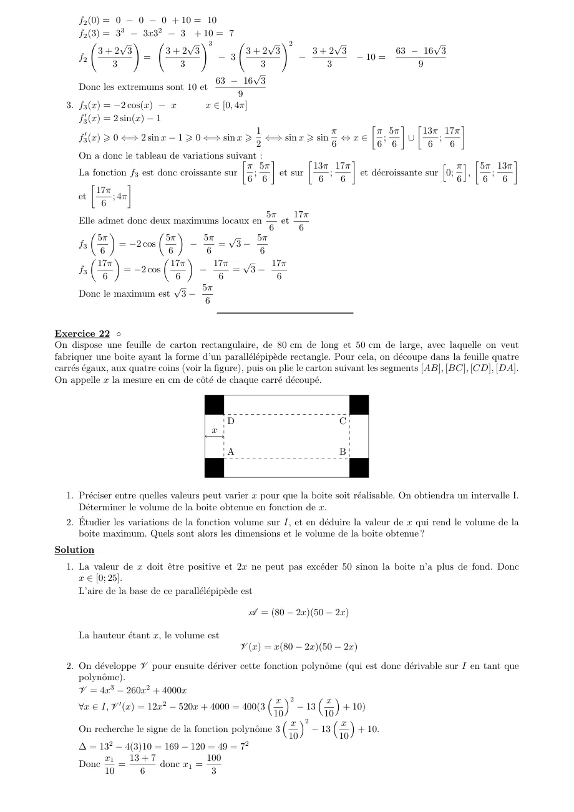

~~~text
      f2 (0) = 0 − 0 − 0 + 10 = 10
      f2 (3) = 33 − 3x32 − 3 + 10 = 7
                √ !          √ !3                     √ !2               √                        √
           3+2 3         3+2 3                  3+2 3              3+2 3                63 − 16 3
      f2            =              − 3                         −             − 10 =
              3            3                        3                 3                      9
                                                 √
                                        63 − 16 3
     Donc les extremums sont 10 et
                                              9
  3. f3 (x) = −2 cos(x) − x          x ∈ [0, 4π]
     f30 (x) = 2 sin(x) − 1
                                                                                                     
       0                                          1                     π          π 5π       13π 17π
     f3 (x) ⩾ 0 ⇐⇒ 2 sin x − 1 ⩾ 0 ⇐⇒ sin x ⩾ ⇐⇒ sin x ⩾ sin ⇔ x ∈                   ;     ∪       ;
                                                  2                     6          6 6          6    6
     On a donc le tableau de variations suivant :                        
                                                π 5π               13π 17π                          h π i  5π 13π 
     La fonction f3 est donc croissante sur      ;        et sur       ;      et décroissante sur 0; ,        ;
                                              6 6                 6     6                            6     6   6
            17π
     et         ; 4π
             6
                                                      5π      17π
     Elle admet donc deux maximums locaux en              et
                                                       6       6
                                     5π √
                          
            5π              5π                     5π
     f3           = −2 cos        −      = 3−
             6               6        6             6
                                        17π √
                               
            17π               17π                      17π
     f3            = −2 cos         −       = 3−
              6                6         6               6
                               √    5π
     Donc le maximum est 3 −
                                     6

Exercice 22 ◦
On dispose une feuille de carton rectangulaire, de 80 cm de long et 50 cm de large, avec laquelle on veut
fabriquer une boite ayant la forme d’un parallélépipède rectangle. Pour cela, on découpe dans la feuille quatre
carrés égaux, aux quatre coins (voir la figure), puis on plie le carton suivant les segments [AB], [BC], [CD], [DA].
On appelle x la mesure en cm de côté de chaque carré découpé.

                                           D                            C
                                       x

                                           A                            B

  1. Préciser entre quelles valeurs peut varier x pour que la boite soit réalisable. On obtiendra un intervalle I.
     Déterminer le volume de la boite obtenue en fonction de x.
  2. Étudier les variations de la fonction volume sur I, et en déduire la valeur de x qui rend le volume de la
     boite maximum. Quels sont alors les dimensions et le volume de la boite obtenue ?
Solution
  1. La valeur de x doit être positive et 2x ne peut pas excéder 50 sinon la boite n’a plus de fond. Donc
     x ∈ [0; 25].
     L’aire de la base de ce parallélépipède est

                                                 A = (80 − 2x)(50 − 2x)

      La hauteur étant x, le volume est
                                               V (x) = x(80 − 2x)(50 − 2x)
  2. On développe V pour ensuite dériver cette fonction polynôme (qui est donc dérivable sur I en tant que
     polynôme).
     V = 4x3 − 260x2 + 4000x
                                                   x 2      x
     ∀x ∈ I, V 0 (x) = 12x2 − 520x + 4000 = 400(3        − 13       + 10)
                                                   10           10
                                                       x 2      x
     On recherche le signe de la fonction polynôme 3        − 13      + 10.
                                                       10          10
     ∆ = 132 − 4(3)10 = 169 − 120 = 49 = 72
           x1      13 + 7           100
     Donc      =          donc x1 =
           10         6              3
~~~

## Page 16

~~~text
         x2    13 − 7
      et    =          donc x2 = 10
         10      6
                     x 2      x
      Le signe de 3        − 13      + 10. est donc positif sur ]0; 10[ et négatif sur ]10; 25]
                      10         10
      Le maximum de V est donc atteint pour x = 10.
      On obtient alors une boite de base 30 × 60 et de hauteur 10 c’est à dire un volume de 18000

Exercice 23
                                                                  4
On considère la fonction f définie sur I = [−3, 3] par f (x) = − x2 + 4.
                                                                  9
On note P la courbe représentative de f .
Soit x ∈ I, on définit M (x, y) et N (−x, y) deux points de P et les points P (−x, 0) et Q(x, 0).
Soit A l’aire du rectangle MNPQ.
  1. Préciser l’ensemble des valeurs que peut prendre la variable x, et exprimer A en fonction de x.
  2. Etudier les variations de A en fonction de x, et déterminer les dimensions du rectangle lorsque celui-ci a
     une aire maximale.
                                                                   y

                                                    N                       M

                                                               1

                                                                                                    x
                                                    P          0         1 Q

Solution
  1. La valeur x peut prendre toutes les valeurs de l’intervalle [0; 3]. L’aire du rectangle MNPQ vaut :
                                                                          8
                                            A(x) = P Q × M Q = 2xf (x) = − x3 + 8x
                                                                          9

  2. La fonction A est une fonction polynôme donc continue et dérivable sur [0; 3].
                                  x2
                                    
       0         8 2
     A (x) = − x + 4 = 8 1 −
                 3                3
                                 √
     Sur [0; 3], A0 (x) > 0 ⇔ x < 3
                                              √                         √
     La fonction A est donc croissante sur [0; 3] √
                                                  et décroissante sur [ 3; 3]. Elle atteint donc un maximum en
         √                              √      16 3                                          √              8
     x = 3. Ce maximum est alors A( 3) =             . La largeur du rectangle est alors 2 3 et la hauteur .
                                                 3                                                          3

                                                    Pour s’entraı̂ner
Exercice 24
Calculer les limites suivantes :
                                tan x − sin x           tan 5x           sin x − sin 5x             sin(ln x)
                          lim                 ,   lim          ,   lim                    ,   lim
                          x→0     5x3 − x4        x→0    sin x     x→0 sin x + sin 4x         x→0       x

         cos(x) − ex            arccos(x)             x(x − 1) sin(x − 1)                                      1       1
                                                                                                                           
 lim+                 ,     lim √         ,       lim                     ,        lim+ ln x ln(1 − x). lim x2 e x − e x+1
x→0     (x + 1)ex − 1      x→1−   1 − x2          x→1    x3 − 3x + 2              x→0                      x→+∞

Exercice 25 * Tech
~~~

## Page 17

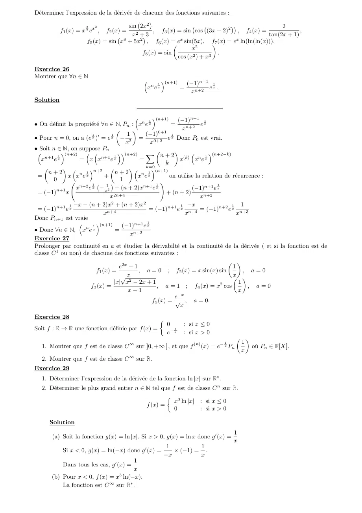

~~~text
Déterminer l’expression de la dérivée de chacune des fonctions suivantes :
                                                
                    3
                       x2             sin 2x2                                                  2
                                                  , f3 (x) = sin cos (3x − 2)2 , f4 (x) =
                                                                              
         f1 (x) = x e , f2 (x) =
                    2                                                                                 ,
                                        x2 +3                                            tan(2x + 1)
                                    8      2                x                   x
                    f5 (x) = sin x + 5x , f6 (x) =e sin(5x), f7 (x) = e ln(ln(ln(x))),
                                                                 x2
                                            f8 (x) = sin                  .
                                                           cos (x2 ) + x3

Exercice 26
Montrer que ∀n ∈ N
                                                    1
                                                          (n+1)       (−1)n+1 1
                                                 xn e x            =          ex .
                                                                        xn+2
Solution

                                                 1
                                                    (n+1)        (−1)n+1 1
• On définit la propriété ∀n ∈ N, Pn : xn e x             =             ex
                                                                    xn+2
                                                        0+1
                                          
                        1        1       1      (−1)          1
• Pour n = 0, on a (e x )0 = e x − 2 =               0+2
                                                            e x Donc P0 est vrai.
                                        x          x
• Soit n ∈ N, on suppose Pn
            (n+2)                 (n+2) X                 
                                                         n + 2 (k) n x1 (n+2−k)
         1                        1
                                                                             
     n+1 x                   n+1 x
   x    e         = x x          e            =                    x     x e
                                                           k
                                        k=0
      n+2            1
                        n+2        n+2           1
                                                     (n+1)
 =            x xn e x        +              xn e x          on utilise la relation de récurrence :
        0                             1                  !
                        1                              1                          1
                 xn+2 e x − x12 − (n + 2)xn+1 e x
                                 
                                                                        (−1)n+1 e x
 = (−1)n+1 x                                               +  (n   + 2)
                                 x2n+4                                     xn+2
                                 2             2
               1 −x − (n + 2)x + (n + 2)x                          1 −x                1   1
 = (−1)n+1 e x                  n+4
                                                  = (−1)n+1 e x n+4 = (−1)n+2 e x n+3
                              x                                      x                   x
Donc Pn+1 est vraie
                                                 1
                       1
                          (n+1)       (−1)n+1 e x
• Donc ∀n ∈ N, xn e x               =
                                          xn+2
Exercice 27
Prolonger par continuité en a et étudier la dérivabilté et la continuité de la dérivée ( et si la fonction est de
classe C 1 ou non) de chacune des fonctions suivantes :

                                     e2x − 1
                                                                                      
                                                                                        1
                          f1 (x) =           , a = 0 ; f2 (x) = x sin(x) sin                , a=0
                                      √  x                                             x
                                   |x| x2 − 2x + 1
                                                                                           
                                                                                          1
                       f3 (x) =                        , a = 1 ; f4 (x) = x2 cos              , a=0
                                         x−1                                              x
                                                                  −x
                                                                e
                                                    f5 (x) = √ , a = 0.
                                                                   x

Exercice 28                                           
                                                            0      : si x ≤ 0
Soit f : R → R une fonction définie par f (x) =               1
                                                            e− x   : si x > 0
                                                                                          
                                                                                     1    1
   1. Montrer que f est de classe C ∞ sur ]0, +∞ [ , et que f (n) (x) = e− x Pn              où Pn ∈ R[X].
                                                                                          x
   2. Montrer que f est de classe C ∞ sur R.
Exercice 29
   1. Déterminer l’expression de la dérivée de la fonction ln |x| sur R∗ .
   2. Déterminer le plus grand entier n ∈ N tel que f est de classe C n sur R.
                                                    3
                                                      x ln |x| : si x ≤ 0
                                           f (x) =
                                                      0         : si x > 0

      Solution
                                                                                         1
       (a) Soit la fonction g(x) = ln |x|. Si x > 0, g(x) = ln x donc g 0 (x) =
                                                                                         x
                                                           1         1
           Si x < 0, g(x) = ln(−x) donc g 0 (x) =            × (−1) = .
                                                          −x         x
                                      1
           Dans tous les cas, g 0 (x) =
                                      x
       (b) Pour x < 0, f (x) = x3 ln(−x).
           La fonction est C ∞ sur R∗ .
~~~

## Page 18

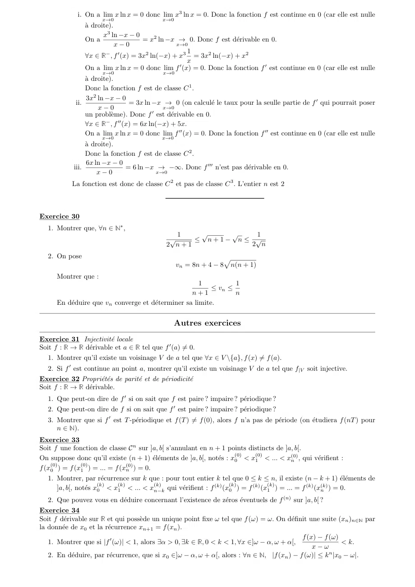

~~~text
             i. On a lim x ln x = 0 donc lim x3 ln x = 0. Donc la fonction f est continue en 0 (car elle est nulle
                      x→0                   x→0
                à droite).
                       x3 ln −x − 0
                On a                = x2 ln −x → 0. Donc f est dérivable en 0.
                            x−0               x→0
                        −    0                     1
                ∀x ∈ R , f (x) = 3x ln(−x) + x3 = 3x2 ln(−x) + x2
                                     2
                                                   x
                On a lim x ln x = 0 donc lim f 0 (x) = 0. Donc la fonction f 0 est continue en 0 (car elle est nulle
                      x→0                   x→0
                 à droite).
                 Donc la fonction f est de classe C 1 .
                 3x2 ln −x − 0
             ii.                  = 3x ln −x → 0 (on calculé le taux pour la seulle partie de f 0 qui pourrait poser
                      x−0                    x→0
                 un problème). Donc f 0 est dérivable en 0.
                 ∀x ∈ R− , f 00 (x) = 6x ln(−x) + 5x.
                 On a lim x ln x = 0 donc lim f 00 (x) = 0. Donc la fonction f 00 est continue en 0 (car elle est nulle
                      x→0                   x→0
                 à droite).
                 Donc la fonction f est de classe C 2 .
                 6x ln −x − 0
            iii.              = 6 ln −x → −∞. Donc f 000 n’est pas dérivable en 0.
                      x−0               x→0

           La fonction est donc de classe C 2 et pas de classe C 3 . L’entier n est 2

Exercice 30
   1. Montrer que, ∀n ∈ N∗ ,
                                                1   √    √   1
                                              √    ≤ n+1− n≤ √
                                             2 n+1          2 n
   2. On pose                                                       p
                                                  vn = 8n + 4 − 8    n(n + 1)
      Montrer que :
                                                      1          1
                                                          ≤ vn ≤
                                                   n+1           n
      En déduire que vn converge et déterminer sa limite.

                                                  Autres exercices
Exercice 31 Injectivité locale
Soit f : R → R dérivable et a ∈ R tel que f 0 (a) 6= 0.
   1. Montrer qu’il existe un voisinage V de a tel que ∀x ∈ V \{a}, f (x) 6= f (a).
   2. Si f 0 est continue au point a, montrer qu’il existe un voisinage V de a tel que f|V soit injective.
Exercice 32 Propriétés de parité et de périodicité
Soit f : R → R dérivable.
   1. Que peut-on dire de f 0 si on sait que f est paire ? impaire ? périodique ?
   2. Que peut-on dire de f si on sait que f 0 est paire ? impaire ? périodique ?
   3. Montrer que si f 0 est T -périodique et f (T ) 6= f (0), alors f n’a pas de période (on étudiera f (nT ) pour
      n ∈ N).
Exercice 33
Soit f une fonction de classe C n sur ]a, b[ s’annulant en n + 1 points distincts de ]a, b[.
                                                                     (0)  (0)
On suppose donc qu’il existe (n + 1) éléments de ]a, b[, notés : x0 < x1 < ... < x(0)
                                                                                       n , qui vérifient :
    (0)       (0)             (0)
f (x0 ) = f (x1 ) = ... = f (xn ) = 0.
   1. Montrer, par récurrence sur k que : pour tout entier k tel que 0 ≤ k ≤ n, il existe (n − k + 1) éléments de
                      (k)  (k)        (k)                          (k)           (k)
      ]a, b[, notés x0 < x1 < ... < xn−k qui vérifient : f (k) (x0 ) = f (k) (x1 ) = ... = f (k) (x(k)
                                                                                                     n ) = 0.

   2. Que pouvez vous en déduire concernant l’existence de zéros éventuels de f (n) sur ]a, b[ ?
Exercice 34
Soit f dérivable sur R et qui possède un unique point fixe ω tel que f (ω) = ω. On définit une suite (xn )n∈N par
la donnée de x0 et la récurrence xn+1 = f (xn ).
                                                                                           f (x) − f (ω)
   1. Montrer que si |f 0 (ω)| < 1, alors ∃α > 0, ∃k ∈ R, 0 < k < 1, ∀x ∈]ω − α, ω + α[,                 < k.
                                                                                               x−ω
                                                                                                     n
   2. En déduire, par récurrence, que si x0 ∈]ω − α, ω + α[, alors : ∀n ∈ N, |f (xn ) − f (ω)| ≤ k |x0 − ω|.
~~~

## Page 19

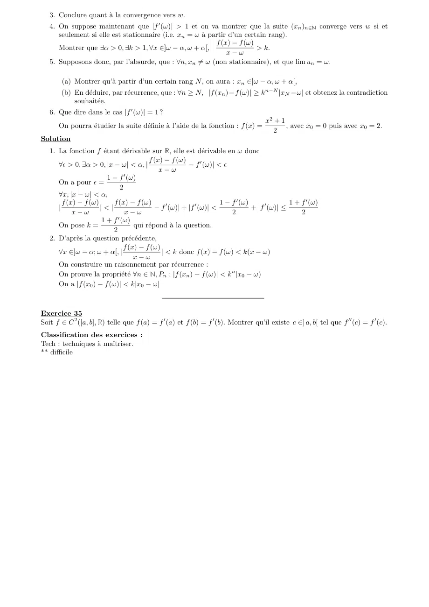

~~~text
   3. Conclure quant à la convergence vers w.
   4. On suppose maintenant que |f 0 (ω)| > 1 et on va montrer que la suite (xn )n∈N converge vers w si et
      seulement si elle est stationnaire (i.e. xn = ω à partir d’un certain rang).
                                                           f (x) − f (ω)
      Montrer que ∃α > 0, ∃k > 1, ∀x ∈]ω − α, ω + α[,                    > k.
                                                               x−ω
   5. Supposons donc, par l’absurde, que : ∀n, xn 6= ω (non stationnaire), et que lim un = ω.

       (a) Montrer qu’à partir d’un certain rang N , on aura : xn ∈]ω − α, ω + α[,
       (b) En déduire, par récurrence, que : ∀n ≥ N, |f (xn )−f (ω)| ≥ k n−N |xN −ω| et obtenez la contradiction
           souhaitée.
   6. Que dire dans le cas |f 0 (ω)| = 1 ?
                                                                                    x2 + 1
      On pourra étudier la suite définie à l’aide de la fonction : f (x) =              , avec x0 = 0 puis avec x0 = 2.
                                                                                       2
Solution
   1. La fonction f étant dérivable sur R, elle est dérivable en ω donc
                                        f (x) − f (ω)
      ∀ > 0, ∃α > 0, |x − ω| < α, |                    − f 0 (ω)| < 
                                            x−ω
                        1 − f 0 (ω)
      On a pour  =
                             2
      ∀x, |x − ω| < α,
        f (x) − f (ω)     f (x) − f (ω)                             1 − f 0 (ω)               1 + f 0 (ω)
      |               |<|                  − f 0 (ω)| + |f 0 (ω)| <             + |f 0 (ω)| ≤
            x−ω                x−ω                                      2                         2
                      1 + f 0 (ω)
      On pose k =                  qui répond à la question.
                          2
   2. D’après la question précédente,
                               f (x) − f (ω)
      ∀x ∈]ω − α; ω + α[, |                  | < k donc f (x) − f (ω) < k(x − ω)
                                   x−ω
      On construire un raisonnement par récurrence :
      On prouve la propriété ∀n ∈ N, Pn : |f (xn ) − f (ω)| < k n |x0 − ω)
      On a |f (x0 ) − f (ω)| < k|x0 − ω|

Exercice 35
Soit f ∈ C 2 ([a, b], R) telle que f (a) = f 0 (a) et f (b) = f 0 (b). Montrer qu’il existe c ∈] a, b[ tel que f 00 (c) = f 0 (c).
Classification des exercices :
Tech : techniques à maı̂triser.
** difficile
~~~
