# TD2-Analyse-asymptotique-Correction_2021-2022_Analyse2_P1S2_DMaths.pdf

[Ouvrir l’original](https://drive.google.com/open?id=1XT_QazL8vVsjRV9ZVYpHCLIiYvh-iBrm) · Les deux lectures automatiques du PDF divergent sur les pages indiquées. Leur fac-similé accompagne le texte.

**Pages présentant un écart entre les deux extractions** — 2–7, 12, 16–21, 23, 25, 28–31.

## Page 1

~~~text
                                                                             Cycle Préparatoire - Première Année
                                                                                            Analyse II - 2021/2022

                                                Analyse Asymptotique

                                              Comparaisons de suites

Exercice 1
Parmi les affirmations suivantes lesquelles sont vraies, lesquelles sont fausses et pourquoi ?
  1. Si un = o(vn ) alors un = O(vn ) .
  2. Si un = O(vn ) et vn = O(un ) alors un ∼ vn .
  3. Si un ∼ vn alors un − vn = o(vn ) .
  4. Si un ∼ vn alors (un − vn ) → 0 quand n → +∞.
     3n
  5.     = O(2n )
      n
Solution
  1. VRAI
                                  un                     un
     un = o(vn )    ⇐⇒     lim         =0           =⇒      convergente donc bornée =⇒ un = O(vn ).
                          n→+∞ vn                        vn
  2. FAUX
     un = 1 =constante, et vn = 2 =constante.
     On a bien un = O(vn ) et vn = O(un ).
     Mais : un n’est pas du tout équivalente à vn .
  3. VRAI                                                              
                         un                   u n − vn          un
      un ∼ vn ⇐⇒         lim= 1 =⇒ lim                 = lim       − 1 = 0 =⇒ un − vn = o(vn ).
                   n→+∞ vn             n→+∞      vn      n→+∞   vn
  4. FAUX Mais on ne peut pas du tout en déduire que   lim (un − vn ) = 0.
                                                                    n→+∞
     En effet, si on prend : un = n + 1 et vn = n, on a bien un ∼ vn , mais lim (un − vn ) = 1.
                                                                                    n→+∞
  5. FAUX n
          3                     n         3 n
                                              
                 3n    1        3           2
     rn = nn   = n =                =
          2     n2     n        2           n
                   3 x                 x ln( 32 )
                    
                     2             e
     Or       lim        = lim         = +∞ par croissances comparées.
            x→+∞    x    x→+∞     x
     Donc      lim rn = +∞. Cette suite n’est donc pas bornée.
             n→+∞

                                                             3n
                                                                6= O (2n )
                                                             n

Exercice 2
Donner des équivalents simples des suites ci-dessous :
                                                                                         √
                     
                    1                                     p                         q
  a) un = ln 1 +                          b) vn = ln n + n2 + 1               c) wn = 1 + n
                   n
                                                       2            
          p
               3      2
                          p
                              3     2
                                                        n +n+1
  d) xn = n + 2n − n + n                  e) yn = sin              π
                                                           n+1
Solution
                     
                    1       1                  1
  1. un = ln 1 +         ∼        car la suite    tend vers 0.
                   n        n                  n
                                               √        !!                   √       !
                  p                            n 2+1                         n 2+1
  2. vn = ln n + n2 + 1 = ln n 1 +                          = ln(n) + ln 1 +
                                                   n                             n
                           r          !                     r         !
                               n2 + 1                              1
     vn = ln(n) + ln 1 +                 = ln(n) + ln 1 + 1 + 2
                                 n2                               n
                     r         !
                            1
      lim ln 1 + 1 + 2 = ln(2)                  et      lim ln(n) = +∞.
     n→+∞                  n                           n→+∞
~~~

## Page 2

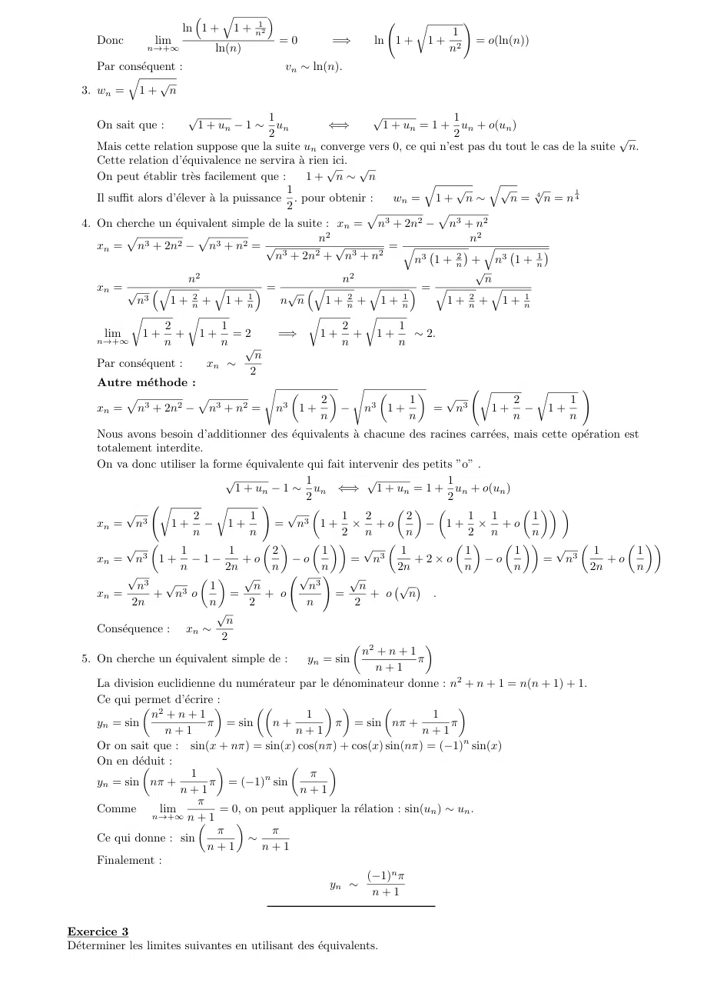

~~~text
                             q        
                        ln 1 + 1 + n12
                                                                        r      !
                                                                           1
      Donc        lim                       =0        =⇒       ln 1 +   1+ 2       = o(ln(n))
                n→+∞            ln(n)                                     n
     Par conséquent :                      vn ∼ ln(n).
                 √
           q
  3. wn = 1 + n

                         √                   1                  √               1
      On sait que :          1 + un − 1 ∼      un        ⇐⇒       1 + un = 1 + un + o(un )
                                             2                                  2                            √
     Mais cette relation suppose que la suite un converge vers 0, ce qui n’est pas du tout le cas de la suite n.
     Cette relation d’équivalence ne servira à rien ici.
                                                        √     √
     On peut établir très facilement que :         1+ n∼ n
                                                 1                               √         √     √
                                                                           q             q
                                                                                                        1
     Il suffit alors d’élever à la puissance . pour obtenir :     wn = 1 + n ∼             n = 4 n = n4
                                                 2             p              p
  4. On cherche un équivalent simple de la suite : xn = n3 + 2n2 − n3 + n2
            p                p                         n2                           n2
     xn = n3 + 2n2 − n3 + n2 = √                          √        =q              q
                                               n3 + 2n2 + n3 + n2        n3 1 + n2 + n3 1 + n1
                                                                                                   
                                                                                      √
                           n2                              n2                           n
     xn = √ q                  q           = √ q            q        =q              q
                            2            1                  2         1
               n3     1+ n + 1+ n               n n     1+ n + 1+ n            1 + n + 1 + n1
                                                                                    2

             r             r                         r         r
                     2             1                       2         1
       lim      1+ + 1+ =2                     =⇒      1+ + 1+           ∼ 2.
     n→+∞            n             n √                     n         n
                                           n
     Par conséquent :        xn ∼
                                         2
     Autre méthode :                        s           s                 √
                                                                                      r          r        !
            p
                3       2
                             p
                                 3     2        3
                                                       2        3
                                                                        1         3
                                                                                             2         1
     xn = n + 2n − n + n = n 1 +                           − n 1+           = n          1+ − 1+
                                                       n                n                    n         n
     Nous avons besoin d’additionner des équivalents à chacune des racines carrées, mais cette opération est
     totalement interdite.
     On va donc utiliser la forme équivalente qui fait intervenir des petits ”o” .
                                √               1           √                1
                                   1 + un − 1 ∼ un ⇐⇒ 1 + un = 1 + un + o(un )
                                                2                            2
                                         !
           √                                 √
                 r            r                                                         
                        2             1                1    2       2             1  1     1
     xn = n3        1+ − 1+                = n3 1 + × + o                − 1+ × +o
                        n             n                2 n          n             2 n      n
           √         1          1
                                          
                                           2
                                                   √ 
                                                   1               1
                                                                                
                                                                                 1
                                                                                         √ 
                                                                                        1              1
                                                                                                              
                                                                                                                1
              3
     xn = n 1 + − 1 −                +o       −o         = n   3      +2×o          −o       = n  3       +o
                      n         2n         n       n              2n             n      n             2n       n
           √                √                √ ! √
             n3 √ 3         1          n        n3        n       √ 
     xn =       + n o            =       + o          =      + o n .
            2n              n         2         n        2
                              √
                                n
     Conséquence : xn ∼
                               2                          2             
                                                           n +n+1
  5. On cherche un équivalent simple de :      yn = sin               π
                                                              n+1
     La division euclidienne du numérateur par le dénominateur donne : n2 + n + 1 = n(n + 1) + 1.
     Ce qui permet d’écrire :
               2                                                         
                n +n+1                          1                         1
     yn = sin               π = sin        n+         π = sin nπ +            π
                   n+1                        n+1                       n+1
     Or on sait que : sin(x + nπ) = sin(x) cos(nπ) + cos(x) sin(nπ) = (−1)n sin(x)
     On en déduit
                  :                               
                        1                n       π
     yn = sin nπ +          π = (−1) sin
                      n+1                      n+1
                          π
     Comme       lim          = 0, on peut appliquer la rélation : sin(un ) ∼ un .
                n→+∞ n + 1
                                  
                              π            π
     Ce qui donne : sin              ∼
                            n+1          n+1
     Finalement :
                                                            (−1)n π
                                                     yn ∼
                                                              n+1

Exercice 3
Déterminer les limites suivantes en utilisant des équivalents.
~~~

## Page 3

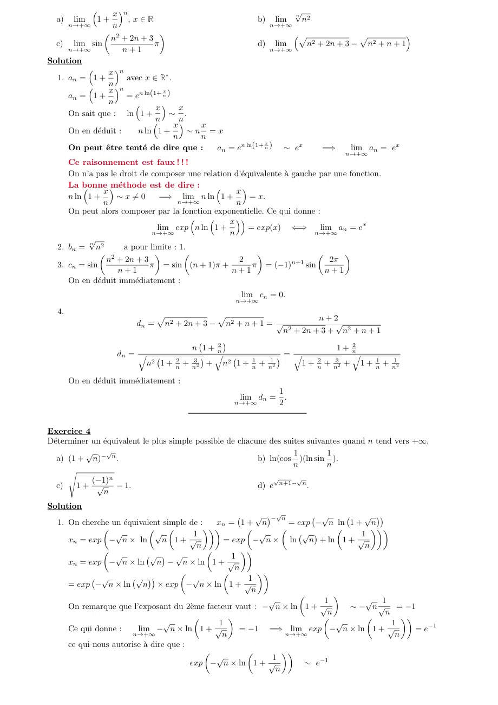

~~~text
                      x n                                                      √
                                                                                 n
  a)    lim       1+        ,x∈R                                     b)   lim        n2
       n→+∞            n                                                  n→+∞

                       n2 + 2n + 3
                                                                               p             p           
  c)    lim sin                    π                                 d)   lim      n2 + 2n + 3 − n2 + n + 1
       n→+∞               n+1                                             n→+∞

Solution
               x n
  1. an = 1 +        avec x ∈ R∗ .
                n
               x n
                     = en ln(1+ n )
                                x
     an = 1 +
                n            x x
     On sait que : ln 1 +         ∼ .
                             n     x
                                      n
                                          x
     On en déduit :    n ln 1 +        ∼n =x
                                    n     n
                                            an = en ln(1+ n )
                                                          x
     On peut être tenté de dire que :                                      ∼ ex         =⇒      lim an = ex
                                                                                                n→+∞
     Ce raisonnement est faux ! ! !
     On n’a pas le droit de composer une relation d’équivalente à gauche par une fonction.
     La bonne    méthode est de dire :
              x                                 x
     n ln 1 +     ∼ x 6= 0     =⇒ lim n ln 1 +         = x.
               n                   n→+∞            n
     On peut alors composer par la fonction exponentielle. Ce qui donne :
                                               x 
                              lim exp n ln 1 +         = exp(x) ⇐⇒         lim an = ex
                            n→+∞                 n                        n→+∞
           √
           n
  2. bn = n2        a pour limite : 1.
               2                                                             
                n + 2n + 3                          2                         2π
  3. cn = sin              π = sin (n + 1)π +           π = (−1)n+1 sin
                   n+1                           n+1                         n+1
     On en déduit immédiatement :
                                                               lim cn = 0.
                                                              n→+∞

  4.                                p                   p                                 n+2
                             dn =       n2 + 2n + 3 −       n2 + n + 1 = √                  √
                                                                             n2 + 2n + 3 +      n2 + n + 1

                                           n 1 + n2                               1 + n2
                                                    
                        dn = q                  q                  = q                q
                               n2 1 + n2 + n32 + n2 1 + n1 + n12       1 + n2 + n32 + 1 + n1 + n12
                                                                

       On en déduit immédiatement :
                                                                           1
                                                               lim dn =      .
                                                              n→+∞         2

Exercice 4
Déterminer un équivalent le plus simple possible de chacune des suites suivantes quand n tend vers +∞.
          √      √                                                   1        1
  a) (1 + n)− n .                                          b) ln(cos )(ln sin ).
                                                                     n        n
      s
            (−1)n                                              √      √
  c)    1+ √       − 1.                                    d) e n+1− n .
               n
Solution
                                                         √ −√n          √         √ 
  1. On cherche un équivalent simple de :     xn = 1 + n         = exp − n ln 1 + n
                  √           √                           √          √ 
                                                                            
                                         1                                        1
     xn = exp − n × ln          n 1+ √           = exp − n × ln n + ln 1 + √
                                          n                                        n
                  √          √  √
                                                    
                                                   1
     xn = exp − n × ln n − n × ln 1 + √
                                                    n
              √         √              √
                                                        
                                                       1
     = exp − n × ln n × exp − n × ln 1 + √
                                                        n
                                                            √                      √ 1
                                                                            
                                                                          1
     On remarque que l’exposant du 2ème facteur vaut : − n × ln 1 + √         ∼ − n √ = −1
                                                                           n            n
                                 √                                           √
                                                                                         
                                               1                                          1
     Ce qui donne :     lim − n × ln 1 + √           = −1 =⇒ lim exp − n × ln 1 + √             = e−1
                       n→+∞                     n                n→+∞                      n
     ce qui nous autorise à dire que :
                                               √
                                                              
                                                             1
                                        exp − n × ln 1 + √            ∼ e−1
                                                              n
~~~

## Page 4

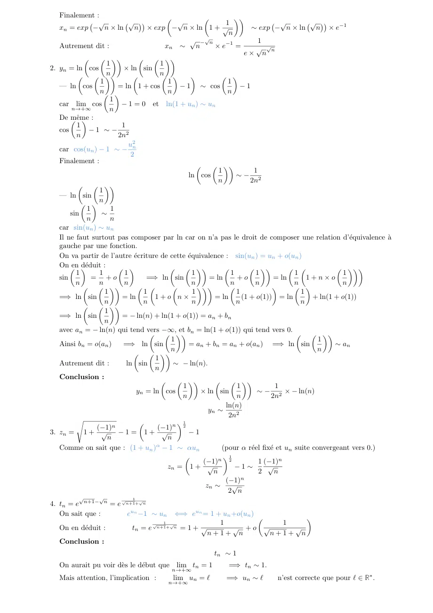

~~~text
   Finalement :
                  √          √              √                                     √        √ 
                                                                
                                                               1
   xn = exp − n × ln n × exp − n × ln 1 + √                             ∼ exp − n × ln n × e−1
                                                                n
                                                   √ −√n                   1
   Autrement dit :                        xn ∼ n           × e−1 =        √ √n
                                                                      e× n
                               
                     1                  1
2. yn = ln cos             × ln sin
                 n                 n                   
                  1                        1                    1
   — ln cos              = ln 1 + cos          − 1 ∼ cos            −1
                  n                      n                    n
                      1
   car lim cos            − 1 = 0 et ln(1 + un ) ∼ un
       n→+∞           n
   De même
            :
         1                1
   cos        −1 ∼− 2
         n               2n
                             u2
   car cos(un ) − 1 ∼ − n
                              2
   Finalement :
                                                          
                                                             1           1
                                                  ln cos           ∼− 2
                                                             n          2n
            
                  1
   — ln sin
                n
             1         1
       sin         ∼
             n        n
   car sin(un ) ∼ un
   Il ne faut surtout pas composer par ln car on n’a pas le droit de composer une relation d’équivalence à
   gauche par une fonction.
   On va partir de l’autre écriture de cette équivalence : sin(un ) = un + o(un )
   On en déduit :                                                                      
         1        1        1                       1             1       1              1               1
   sin         = +o                =⇒ ln sin             = ln      +o            = ln       1+n×o
         n        n        n                       n             n       n              n              n
                                                                             
                    1             1                1               1                      1
   =⇒ ln sin              = ln        1+o n×               = ln      (1 + o(1)) = ln          + ln(1 + o(1))
                    n             n                n               n                      n
             
                    1
   =⇒ ln sin              = − ln(n) + ln(1 + o(1)) = an + bn
                    n
   avec an = − ln(n) qui tend vers −∞, et bn = ln(1 + o(1)) qui tend vers 0.
                                                                                      
                                            1                                                   1
   Ainsi bn = o(an )      =⇒ ln sin               = an + bn = an + o(an ) =⇒ ln sin                  ∼ an
                                            n                                                   n
                                 
                                      1
   Autrement dit :          ln sin           ∼ − ln(n).
                                      n
   Conclusion :
                                                         
                                                1                  1              1
                                yn = ln cos           × ln sin            ∼ − 2 × − ln(n)
                                                n                  n           2n
                                                               ln(n)
                                                         yn ∼
                                                                2n2
         s                                      1
                 (−1)n                 (−1)n 2
                                             
3. zn = 1 + √            −1= 1+ √                 −1
                     n                     n
   Comme on sait que : (1 + un )α − 1 ∼ αun                   (pour α réel fixé et un suite convergeant vers 0.)
                                                               1
                                                       (−1)n 2             1 (−1)n
                                                 
                                           zn = 1 + √              −1∼        √
                                                           n               2     n
                                                               (−1)n
                                                        zn ∼      √
                                                                2 n
         √      √          1
                       √       √
4. tn = e n+1− n = e n+1+ n
   On sait que :     eun −1 ∼ un           ⇐⇒ eun = 1 + un +o(un )
                                                                              
                                    √   1 √            1                  1
   On en déduit :         tn = e     n+1+ n=1+ √          √   +  o   √     √
                                                   n+1+ n               n+1+ n
   Conclusion :
                                                       tn ∼ 1
   On aurait pu voir dès le début que lim tn = 1         =⇒ tn ∼ 1.
                                          n→+∞
   Mais attention, l’implication :        lim un = `      =⇒ un ∼ `         n’est correcte que pour ` ∈ R∗ .
                                         n→+∞
~~~

## Page 5

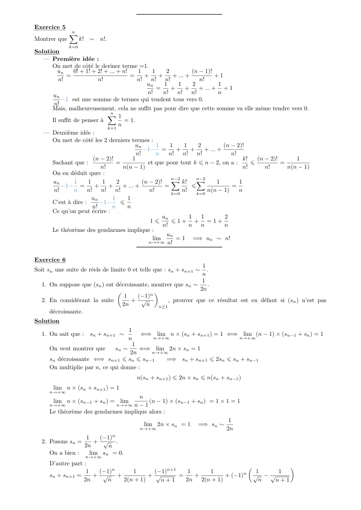

~~~text
Exercice 5
              n
              X
Montrer que         k! ∼ n!.
              k=0
Solution
   — Première idée :
      On met de côté le deriner terme =1.
        un      0! + 1! + 2! + ... + n!      1     1      2          (n − 1)!
            =                            =      +      +     + ... +             +1
         n!                n!                n! n! n!                    n!
                                                 un      1     1      2            1
                                                      =     +      +     + ... + + 1
                                                 n!      n! n! n!                  n
      un
          −1 est une somme de termes qui tendent tous vers 0.
       n!
      Mais, malheureusement, cela ne suffit pas pour dire que cette somme va elle même tendre vers 0.
                                n
                               X    1
      Il suffit de penser à          = 1.
                                    n
                               k=1
   — Deuxième idée :
      On met de côté les 2 derniers termes :
                                            un        1     1     1      2           (n − 2)!
                                               −1− =          +      +       + ... +
                                            n!        n    n! n! n!                     n!
                        (n − 2)!          1                                                  k!   (n − 2)!      1
      Sachant que :                =             et que pour tout k ⩽ n − 2, on a :             ⩽          =
                            n!        n(n − 1)                                               n!      n!      n(n − 1)
      On en déduit qure :
                                                            n−2         n−2
      un        1     1     1      2           (n − 2)! X k!            X          1       1
          −1− =          +     +      + ... +            =           ⩽                  =
       n!       n     n! n! n!                    n!             n!           n(n − 1)     n
                                                            k=0         k=0
                        un       1      1
      C’est à dire :      −1− ⩽
                        n!       n     n
      Ce qu’on peut écrire :
                                                        un          1      1          2
                                                   1⩽       ⩽1+ + =1+
                                                        n!          n n              n
      Le théorème des gendarmes implique :
                                                          un
                                                    lim       = 1 =⇒ un ∼ n!
                                                  n→+∞ n!

Exercice 6
                                                                1
Soit sn une suite de réels de limite 0 et telle que : sn + sn+1 ∼.
                                                                n
                                                                1
   1. On suppose que (sn ) est décroissante, montrer que sn ∼     .
                                                               2n
                                        (−1)n
                                              
                                   1
   2. En considérant la suite        + √          , prouver que ce résultat est en défaut si (sn ) n’est pas
                                  2n        n n≥1
      décroissante.
Solution
                                    1
   1. On sait que : sn + sn+1 ∼          ⇐⇒ lim n × (sn + sn+1 ) = 1 ⇐⇒ lim (n − 1) × (sn−1 + sn ) = 1
                                    n      n→+∞                        n→+∞
                                      1
      On veut montrer que      sn ∼     ⇐⇒ lim 2n × sn = 1
                                    2n     n→+∞
      sn décroissante ⇐⇒ sn+1 ⩽ sn ⩽ sn−1     =⇒ sn + sn+1 ⩽ 2sn ⩽ sn + sn−1
      On multiplie par n, ce qui donne :
                                           n(sn + sn+1 ) ⩽ 2n × sn ⩽ n(sn + sn−1 )
        lim n × (sn + sn+1 ) = 1
      n→+∞
                                            n
        lim n × (sn−1 + sn ) = lim               (n − 1) × (sn−1 + sn ) = 1 × 1 = 1
      n→+∞                        n→+∞ n − 1
      Le théorème des gendarmes implique alors :
                                                                                  1
                                                lim 2n × sn = 1      =⇒ sn ∼
                                            n→+∞                                 2n
                   1    (−1)n
   2. Posons sn =      + √ .
                  2n       n
      On a bien :    lim sn = 0.
                     n→+∞
      D’autre part :
                       (−1)n              (−1)n+1
                                                                                 
                    1             1                  1    1              1     1
      sn + sn+1 =     + √    +          + √       =    +        + (−1)n √ − √
                   2n     n    2(n + 1)     n+1     2n 2(n + 1)           n   n+1
~~~

## Page 6

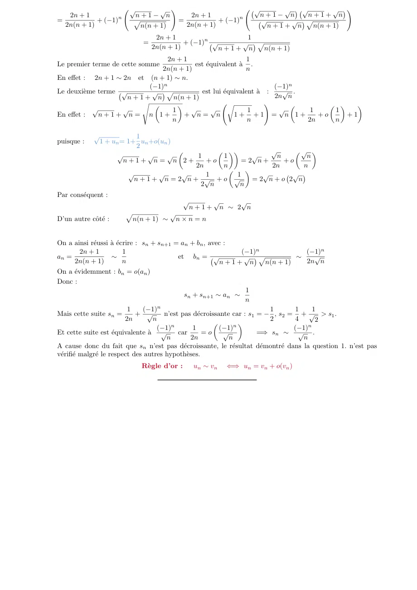

~~~text
                        √        √ !                                   √        √  √        √ !
   2n + 1                 n+1− n        2n + 1                             n+1− n     n+1+ n
=           + (−1)n      p           =           + (−1)n                   √     √ p
  2n(n + 1)                n(n + 1)    2n(n + 1)                             n+1+ n    n(n + 1)
                                    2n + 1                  1
                               =             + (−1)n √     √ p
                                   2n(n + 1)           n+1+ n   n(n + 1)
                                2n + 1                      1
Le premier terme de cette somme          est équivalent à .
                              2n(n + 1)                    n
En effet : 2n + 1 ∼ 2n et (n + 1) ∼ n.
                          (−1)n                                     (−1)n
Le deuxième terme √       √ p            est lui équivalent à :   √ .
                     n+1+ n       n(n + 1)                          2n n
                        s                           r            !
           √        √                  √       √                     √
                                                                                   
                                 1                          1              1     1
En effet :   n+1+ n= n 1+            + n= n            1+ +1 = n 1+          +o     +1
                                 n                          n             2n     n

             √              1
puisque :        1 + un = 1+ un +o(un )
                            2
                                                               √      √ 
                      √        √     √                     √
                                                 
                                            1     1              n       n
                         n+1+ n= n 2+         +o       =2 n+       +o
                                           2n     n            2n       n
                          √       √      √                   √       √ 
                                                        
                                              1       1
                            n+1+ n=2 n+ √ +o √             =2 n+o 2 n
                                             2 n       n
Par conséquent :
                                              √          √        √
                                                  n+1+       n ∼ 2 n
                        p                √
D’un autre côté :         n(n + 1) ∼       n×n=n

On a ainsi réussi à écrire : sn + sn+1 = an + bn , avec :
       2n + 1            1                                   (−1)n            (−1)n
an =                ∼                      et bn = √          √ p          ∼   √
     2n(n + 1)           n                               n+1+ n    n(n + 1)   2n n
On a évidemment : bn = o(an )
Donc :
                                                                   1
                                              sn + sn+1 ∼ an ∼
                                                                   n
                           1    (−1)n                                       1       1    1
Mais cette suite sn =         + √       n’est pas décroissante car : s1 = − , s2 = + √ > s1 .
                          2n       n                                        2       4     2
                                     (−1)n                  (−1)n                  (−1)n
                                                                 
                                                  1
Et cette suite est équivalente à √         car     =o      √           =⇒ sn ∼ √ .
                                         n       2n            n                      n
A cause donc du fait que sn n’est pas décroissante, le résultat démontré dans la question 1. n’est pas
vérifié malgré le respect des autres hypothèses.
                              Règle d’or :       un ∼ vn     ⇐⇒ un = vn + o(vn )
~~~

## Page 7

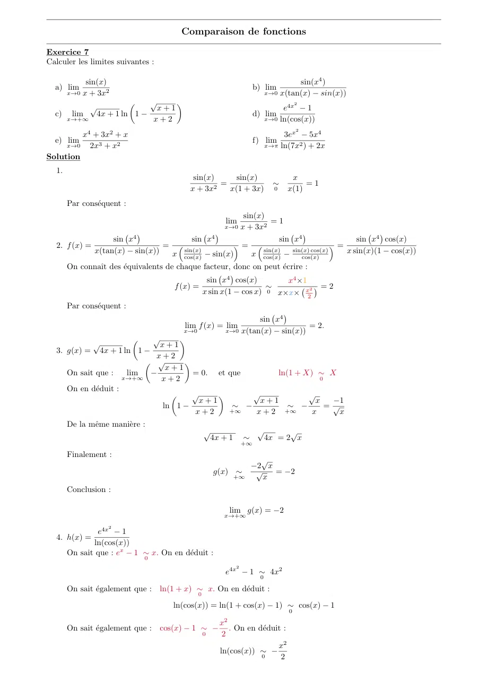

~~~text
                                              Comparaison de fonctions

Exercice 7
Calculer les limites suivantes :

            sin(x)                                                                               sin(x4 )
  a) lim                                                                           b) lim
       x→0 x + 3x2                                                                      x→0 x(tan(x) − sin(x))
                                     √                                                            2
              √                                                                              e4x − 1
                                            
                                 x+1
  c)    lim       4x + 1 ln 1 −                                                    d) lim
       x→+∞                     x+2                                                     x→0 ln(cos(x))
                                                                                                  2
         x4 + 3x2 + x                                                                        3ex − 5x4
  e) lim                                                                           f) lim
     x→0   2x3 + x2                                                                     x→π ln(7x2 ) + 2x

Solution
  1.
                                                    sin(x)      sin(x)                         x
                                                          2
                                                            =                             ∼        =1
                                                   x + 3x     x(1 + 3x)                   0   x(1)
       Par conséquent :
                                                                              sin(x)
                                                                     lim                 =1
                                                                     x→0 x + 3x2
                           4
                                                             4
                                                                                        
                  sin x               sin x                sin x4                  sin x4 cos(x)
  2. f (x) =                    =                =                        =
             x(tan(x) − sin(x))  x sin(x) − sin(x)  x sin(x) − sin(x) cos(x)    x sin(x)(1 − cos(x))
                                                 cos(x)                              cos(x)           cos(x)
       On connaı̂t des équivalents de chaque facteur, donc on peut écrire :
                                                       
                                               sin x4 cos(x)          x4 ×1
                                      f (x) =                    ∼             =2
                                              x sin x(1 − cos x) 0 x×x× x22
       Par conséquent :
                                                                           
                                                                    sin x4
                                               lim f (x) = lim                    = 2.
                                               x→0         x→0 x(tan(x) − sin(x))
                              √
              √
                                             
                                x+1
  3. g(x) =     4x + 1 ln 1 −
                               x+2
                             √      
                                 x+1
       On sait que :    lim   −        = 0. et que        ln(1 + X) ∼ X
                       x→+∞     x+2                                  0
       On en déduit :
                                      √           √             √
                                         x+1          x+1           x   −1
                                ln 1 −          ∼ −          ∼ −       =√
                                        x+2    +∞    x + 2 +∞      x      x
       De la même manière :
                                                          √                         √         √
                                                              4x + 1          ∼         4x = 2 x
                                                                              +∞

       Finalement :
                                                                                    √
                                                                                  −2 x
                                                              g(x) ∼               √   = −2
                                                                         +∞          x
       Conclusion :

                                                                         lim g(x) = −2
                                                                     x→+∞
                    2
               e4x − 1
  4. h(x) =
              ln(cos(x))
       On sait que : ex − 1 ∼ x. On en déduit :
                                 0
                                                                          2
                                                                     e4x − 1 ∼ 4x2
                                                                                    0

       On sait également que :          ln(1 + x) ∼ x. On en déduit :
                                                     0

                                            ln(cos(x)) = ln(1 + cos(x) − 1) ∼ cos(x) − 1
                                                                                              0
                                                                     2
                                                                    x
       On sait également que :          cos(x) − 1 ∼ −                . On en déduit :
                                                          0          2
                                                                                     x2
                                                                    ln(cos(x)) ∼ −
                                                                                0     2
~~~

## Page 8

~~~text
       Il ne reste plus qu’à faire le rapport des deux :
                                                                              2
                                                              e4x − 1                                4x2
                                                      h(x) =                                 ∼           2
                                                             ln(cos(x))                      0       − x2
       Conclusion :
                                                                        h(x) ∼ −8
                                                                                   0
                                                                        lim h(x) = −8
                                                                        x→0
  5. On cherche la limite en 0 de :
                                                                              x4 + 3x2 + x
                                                                   k(x) =
                                                                                2x3 + x2
                                                                                             x4 + 3x2 + x            x   1
       x4 + 3x2 + x ∼ x            et   2x3 + x2 ∼ x2                    =⇒ k(x) =                               ∼      = .
                          0                           0                                        2x3 + x2          0   x2  x
                              1
       La fonction x 7→         n’a pas de limite en 0. (résultats différents en 0− et 0+ ).
                              x
                                             Donc la fonction k n’a pas de limite en 0.
  6. On cherche la limite en π de :
                                                                                    2
                                                                               3ex − 5x4
                                                                   l(x) =
                                                                              ln (7x2 ) + 2x
       l est continue sur R∗ car somme, composée et rapport de fonctions continues. Donc :
                                                                                             2
                                                                                         3eπ − 5π 4
                                                     lim l(x) = l(π) =
                                                     x→π                                ln (7π 2 ) + 2π

Exercice 8
Calculer les limites de
     sin x ln(1 + x2 )                               ln(1 + sin x)                                                         1
  a)                   en 0.                   b)                  en 0.                                     c) (ln(e + x)) x en 0.
          x tan x                                      tan(6x)
                      1
  d) (ln(1 + e−x )) x en + ∞.
Solution
     sin x ln(1 + x2 )    xx2               sin x ln(1 + x2 )
  1.                   ∼       = x Donc lim                   = lim = 0
          x tan x       0 xx            x→0      x tan x        x→0
     ln(1 + sin x)     sin x   1
  2.               ∼         ∼
        tan(6x)     0 6x 0 6
                                    1
  3. Limite de (ln(1 + e−x )) x en + ∞ : Nous avons
                                                                                                    
                                                     −x        1                   1            −x
                                                                                                   
                                         (ln(1 + e        ))   x       = exp         ln ln(1 + e ) .
                                                                                   x

       Maintenant, comme lim e−x = 0, nous pouvons écrire :
                                 x→+∞

                                                           ln(1 + e−x ) ∼ e−x
                                                                                   +∞

       et par l’Exercice 11, nous pouvons composer cette dernière equivalence avec la fonction ln, pour obtenir

                                          ln ln(1 + e−x )   ∼ ln(e−x ).
                                                          
                                                                                        +∞

       Donc
                                                1                                            ln(e−x )
                                                  ln ln(1 + e−x )
                                                                 
                                                                                       ∼
                                                x                                   +∞          x
                                                                                             −x
                                                                                       =          = −1.
                                                                                              x
       Par conséquent
                                                                                                      
                                                      −x           1                 1            −
                                                                                                     
                                     lim (ln(1 + e         ))      x    =  lim exp     ln ln(1 + e x)
                                   x→+∞                                   x→+∞       x
                                                                                                      
                                                                                     1            −x
                                                                                                     
                                                                        = exp    lim   ln ln(1 + e )
                                                                                x→+∞ x

                                                                        = e−1 .
~~~

## Page 9

~~~text
Exercice 9
Déterminer les limites suivantes :
          x3 − 2x2 + 2x − 1                                                      x sin x
  a) lim 3                                                             b) lim
      x→1 x − x2 + x − 1                                                  x→0 1 − cos x
                                                                                                                  
                                   p
                                    3
                                                                                   (1 − cos x) sin x
  c) lim f (x) où f (x) = (x + 1) − x3 + 1                            d) lim exp
     x→+∞                                                                 x→0              x3
                                                                                            x ln x
          ln (cos x)                                                              ln (x + 1)
  e) lim                                                               f) lim
     x→0 1 − cos 2x                                                       x→+∞        ln x
           ln 2x
                                                                                   1          
                                                                                              1
  g) lim       π
                                                                       h) lim x2 e x+1 − e x .
        π cos x                                                           x→+∞
     x→
        2
Solution
                    x3 − 2x2 + 2x − 1
  1. Calculer lim 3                   : Nous avons :
               x→1 x − x2 + x − 1

                     x3 − 2x2 + 2x − 1       (x − 1)(x2 − x + 1)       x2 − x + 1   1
                  lim  3    2
                                       = lim            2
                                                                 = lim    2
                                                                                  = .
                  x→1 x − x + x − 1      x→1   (x − 1)(x + 1)      x→1   x +1       2
                    x sin x
  2. Calculer lim              : Nous avons :
              x→0 1 − cos x

                                                                                             x2
                                          sin(x) ∼ x         et    1 − cos(x) ∼                 .
                                                  0                                  0       2
     Donc
                                      x sin x        x·x          x2
                                   lim         = lim x2 = 2 · lim 2 = 2.
                                 x→0 1 − cos x   x→0          x→0 x
                                                      2

  3. Calculer lim f (x) où
              x→+∞                                                      
                                                                  p
                                                                  3
                                                 f (x) = (x + 1) − x3 + 1 .
     Nous avons
                                                                                    s    
                                                p
                                                3                                       1
                                    (x + 1) −       x3 + 1    = (x + 1) − 3 x3 · 1 + 3
                                                                                       x
                                                                               s        
                                                                               3      1
                                                              = (x + 1) − x ·     1+ 3
                                                                                      x
                                                                            s         !
                                                                             3      1
                                                              = 1+x 1−           1+ 3
                                                                                    x

     Maintenant
                        s                                        s                                                        
                        3      1                   1               3        1                1                            1
                            1+ 3         −1 ∼            =⇒              1+ 3            −1− 3                = o
                              x             +∞    3x3                      x                3x                +∞         3x3
                                                                   s                                                        
                                                                   3            1                          1              1
                                                         =⇒              1+                  = 1+             +o
                                                                                x3       +∞               3x3            3x3

     Donc
                                                                                 s                   !
                                           p
                                           3                                                1
                              (x + 1) −        x3 + 1    =        1+x 1− 3               1+ 3
                                                                                           x
                                                                                            
                                                                                 1         1
                                                         =        1+x 1−1− 3 −o
                                                        +∞                     3x         3x3
                                                                                     
                                                                         1         1
                                                         =        1−x       +o
                                                        +∞              3x3       3x3
                                                                                  
                                                                      1        1
                                                         =        1− 2 −o            .
                                                        +∞          3x        3x2
     Par conséquent :
                                                                                                         
                                               p
                                               3                                 1                   1
                             lim (x + 1) −       x3 + 1 =         lim 1 −           −o                        = 1.
                            x→+∞                                  x→+∞          3x2                 3x2
~~~

## Page 10

~~~text
                                           
                          (1 − cos x) sin x
4. Calculer lim exp                           : Nous avons :
           x→0                   x3
                                                                                                                 
                                        (1 − cos x) sin x                             (1 − cos x) sin x
                             lim exp                         =                  exp       lim
                             x→0                x3                                x→0         x3
                                                                                       x2
                                                                                             !
                                                                                          ·x
                                                                          = exp lim 2 3
                                                                                  x→0 x

                                                                                         x3
                                                                                           
                                                                                  1                 1
                                                                          = exp     lim 3      = e2 .
                                                                                  2 x→0  x

               ln (cos x)
5. Calculer lim           : Nous avons :
           x→0 1 − cos 2x

                                                   ln (cos x)                 ln (1 − (1 − cos x))
                                            lim                   =       lim
                                            x→0 1 − cos 2x                x→0      1 − cos 2x
                                                                               cos x − 1
                                                                  =       lim
                                                                          x→0 1 − cos 2x
                                                                                      2
                                                                                − x2
                                                                  =       lim         2
                                                                          x→0 (2x)
                                                                                2
                                                                                   x2   1
                                                                  =       lim −       =− .
                                                                          x→0     4x2   4
                                       x ln x
                      ln (x + 1)
6. Calculer lim                                   : Nous avons :
           x→+∞           ln x
                                                 x ln x                                                
                                    ln (x + 1)                                                ln (x + 1)
                                                            = exp x ln(x) · ln                                  .
                                        ln x                                                      ln x

  Maintenant
                                                                                                     
                                               ln (x + 1)                                     ln (x + 1)
                          x ln(x) · ln                           =    x ln(x) · ln 1 − 1 −
                                                   ln x                                           ln x
                                                                                               
                                                                                  ln (x + 1)
                                                                 ∼    x ln(x) ·              −1
                                                                +∞                    ln x
                                                                 =    x · (ln(x + 1) − ln(x))
                                                                                    
                                                                               x+1
                                                                 =    x · ln
                                                                                 x
                                                                                    
                                                                                   1
                                                                 =    x · ln 1 +
                                                                                   x
                                                                           1
                                                                 ∼    x·      = 1.
                                                                +∞        x

  Ainsi
                                                    x ln x                                         
                                        ln (x + 1)                                          ln (x + 1)
                          lim                                   =   lim exp x ln(x) · ln
                      x→+∞                  ln x                  x→+∞                          ln x
                                                                                                     
                                                                                            ln (x + 1)
                                                                = exp    lim x ln(x) · ln
                                                                        x→+∞                    ln x
                                                                = e.

                 ln 2x
                       
                    π
7. Calculer lim          : Rappelons que
               π cos x
           x→
               2
                                                                          π      
                                                        cos x = sin             −x .
                                                                            2
~~~

## Page 11

~~~text
     Donc :
                                           ln 2x                         ln 1 − 1 − 2x
                                                                                                  
                                              π                                        π
                                      lim                         = lim
                                         π cos x                       π    sin π2 − x
                                     x→                             x→
                                         2                             2
                                                                         2x
                                                                            −1
                                                                  = lim ππ
                                                                       π 2 −x
                                                                    x→
                                                                       2
                                                                               2x−π
                                                                          π
                                                                  =  lim π−2x
                                                                        π 2
                                                                    x→
                                                                        2
                                                                          2
                                                                  = lim −
                                                                        π π
                                                                    x→
                                                                        2
                                                                       2
                                                                  = − .
                                                                       π
                     1        1
                                 
  8. Calculer lim x2 e x+1 − e x : Nous avons
              x→+∞

                                                                                                    1
                                                                                                             !
                                   2
                                               1         1
                                                              
                                                                                   2    1        e x+1
                             lim x         e   x+1   −e   x         =       lim x · e · x
                                                                                                    1    −1
                           x→+∞                                         x→+∞                      ex
                                                                                    1
                                                                                        1 1         
                                                                    =    lim x2 · e x · e x+1 − x − 1
                                                                        x→+∞
                                                                                    1
                                                                                        −1         
                                                                    =    lim x2 · e x · e x(x+1) − 1
                                                                        x→+∞

     Maintenant
                                                                        −1                         1
                                ex − 1 ∼ x            =⇒ e x(x+1) − 1 ∼ −                                .
                                               0                                       +∞       x(x + 1)

     Donc
                                    1        1
                                                                                 1
                                                                                      −1          
                             lim x2 e x+1 − e x                     =  lim x2 · e x · e x(x+1) − 1
                            x→+∞                                      x→+∞
                                                                                               
                                                                            2     1       −1
                                                                    =  lim x · e ·x
                                                                      x→+∞             x(x + 1)
                                                                                            1
                                                                             −x2 · e x
                                                                    =        lim
                                                                      x→+∞ x(x + 1)

                                                                                x2             1
                                                                    = − lim 2          · lim e x
                                                                        x→+∞ x + 1 x→+∞
                                                                    = −1 · 1 = −1.

Exercice 10
À quelle condition sur f et g a-t-on ef ∼ eg ?
                                         a
Solution
Tout d’abord, comme pour tout x, y ∈ R, nous avons
                                                      ex
                                                         = ex−y ,
                                                      ey
on conclut que :

                                                                ef (x)
                               ef ∼ eg          ⇐⇒            lim      = 1
                                   a                      x→a eg(x)

                                                ⇐⇒        lim ef (x)−g(x) = 1
                                                          x→a
                                                                             
                                                ⇐⇒        exp lim f (x) − g(x) = 1
                                                                      x→a
                                                ⇐⇒            lim (f (x) − g(x)) = 0.
                                                          x→a

Conclusion : Nous avons trouve comme condition :

                                ef ∼ eg ⇐⇒ lim (f (x) − g(x)) = 0.
                                   a                  x→a
~~~

## Page 12

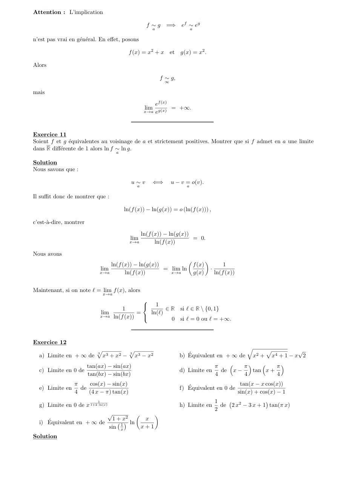

~~~text
Attention : L’implication

                                                           f ∼g       =⇒      ef ∼ eg
                                                             a                      a

n’est pas vrai en général. En effet, posons

                                               f (x) = x2 + x            et   g(x) = x2 .

Alors

                                                                    f ∼ g,
                                                                     ∞

mais
                                                              ef (x)
                                                          lim        = +∞.
                                                          x→a eg(x)

Exercice 11
Soient f et g équivalentes au voisinage de a et strictement positives. Montrer que si f admet en a une limite
dans R différente de 1 alors ln f ∼ ln g.
                                         a

Solution
Nous savons que :

                                                u∼v             ⇐⇒       u − v = o(v).
                                                     a                          a

Il suffit donc de montrer que :

                                             ln(f (x)) − ln(g(x)) = o (ln(f (x))) ,

c’est-à-dire, montrer

                                                         ln(f (x)) − ln(g(x))
                                                lim                           = 0.
                                               x→a             ln(f (x))

Nous avons
                                                                                               
                                 ln(f (x)) − ln(g(x))                                   f (x)               1
                                 lim                  = lim ln                                      ·
                             x→a       ln(f (x))        x→a                             g(x)            ln(f (x))

Maintenant, si on note ` = lim f (x), alors
                                 x→a
                                                         
                                                     1
                                         1               ∈R
                                                                             si ` ∈ R \ {0, 1}
                                 lim           =   ln(`)
                                 x→a ln(f (x))           0                   si ` = 0 ou ` = +∞.

Exercice 12
                                                                                                                      √
                            p                  p                                                              p     q
                            3                  3
  a) Limite en + ∞ de            x3 + x2 −         x3 − x2                    b) Équivalent en + ∞ de x2 + x4 + 1 − x 2
                         tan(ax) − sin(ax)                                                  π        π        π
  c) Limite en 0 de                                                           d) Limite en    de x −     tan x +
                         tan(bx) − sin(bx)                                                  4         4          4
                 π    cos(x) − sin(x)                                                             tan(x − x cos(x))
  e) Limite en     de                                                         f) Équivalent en 0 de
                 4    (4 x − π) tan(x)                                                           sin(x) + cos(x) − 1
                             1                                                            1
                                                                              h) Limite en de 2 x2 − 3 x + 1 tan(π x)
                                                                                                            
  g) Limite en 0 de x 1+2 ln(x)
                                                                                          2
                                   √
                                         1 + x2
                                                               
                                                          x
  i) Équivalent en + ∞ de                     ln
                                       sin x1            x+1
Solution
~~~

## Page 13

~~~text
                      p
                      3
                                        p
                                        3
1. Limite en +∞ de        x3 + x2 −         x3 − x2 : Nous avons
                                                                                               r       r     !
                            p
                            3
                                               p
                                               3                                               3     1 3   1
                      lim        x3 + x2 −           x3 − x2       =        lim       x·           1+ − 1−
                  x→+∞                                                      x→+∞                     x     x

  Maintenant
                  r                                                r                                                 
                  3     1        1                                  3      1             1                        1
                      1± −1 ∼ ±                          =⇒             1±         = 1±    +o                             .
                        x   +∞  3x                                         x      +∞    3x                       3x

  Donc
                                                                              r      r       !
                 p
                 3
                                   p
                                   3                                          3 1     3    1
           lim       x3 + x2 −         x3 − x2       =         lim x ·      1+ − 1−
          x→+∞                                               x→+∞               x          x
                                                                                                    
                                                                              1         1        1      1
                                                     =         lim x · 1 +      +o         −1+     −o
                                                             x→+∞            3x        3x       3x     3x
                                                                                         
                                                                          2        1          1
                                                     =         lim x ·      +o          −o
                                                             x→+∞        3x       3x         3x
                                                                   2
                                                     =         lim    + o(1) − o(1)
                                                             x→+∞ 3
                                                                   2
                                                     =         lim    + o(1)
                                                             x→+∞ 3
                                                             2
                                                     =         .
                                                             3
                                                      √
                            q           p
2. Équivalent en +∞ de          x2 +       x4 + 1 − x 2 : Nous avons
                                                              s
                                             √                                                  √
                 q                                                                r
                            p                                                              1
                     x2 +       x4 + 1 − x       2    =            x2   +    x2       1+      −x 2
                                                                                           x4
                                                                   s
                                                                                                 √
                                                                              r
                                                                                           1
                                                      =       x·    1 +           1+         4
                                                                                               −x 2
                                                                                           x
                                                                   s                          
                                                                                             √
                                                                                  r
                                                                                          1
                                                      =       x·           1 +       1 + 4 − 2
                                                                                         x
                                                                        s                          !
                                                                                                 √
                                                                                          
                                                                                1          1
                                                      =       x·    1 + 1 +        + o         − 2
                                                      +∞                      2x4          x4
                                                                 s                                !
                                                                                                √
                                                                                       
                                                                             1           1
                                                      =       x·    2 1 +         + o         − 2
                                                      +∞                    4x4         x4
                                                                     s                         !
                                                               √
                                                                                      
                                                                            1           1
                                                      =       x 2·    1 + 4 + o             −1
                                                      +∞                  4x           x4
                                                               √
                                                                                           
                                                                          1           1
                                                      =       x 2· 1 +         + o         −1
                                                      +∞                 8x4         x4

  Par conséquent
                              √                          √
             q                                                                                                                    
                   p                                           1      1                   1                  1     1              1
               x2 + x4 + 1 − x 2              =       x 2·       4
                                                                    + o                            +o            + o
                                             +∞               8x      4                   x4                4x 4   2              x4
                                                       √
                                                                  
                                                               1
                                              ∼       x 2·
                                             +∞               8x4
                                                      √
                                                        2
                                              =           .
                                                      8x3
~~~

## Page 14

~~~text
                    tan(ax) − sin(ax)
3. Limite en 0 de                     : Nous avons
                    tan(bx) − sin(bx)
                                                                   sin(ax)
                                   tan(ax) − sin(ax)               cos(ax) − sin(ax)
                                                            =      sin(bx)
                                   tan(bx) − sin(bx)
                                                                   cos(bx) − sin(bx)
                                                                                  1−cos(ax)
                                                                   sin(ax)   cos(ax)
                                                            =              ·
                                                                   sin(bx) 1−cos(bx)
                                                                                      cos(bx)
                                                                         2 2
                                                                   ax a 2x            cos(bx)
                                                            ∼         · b2 x2     ·
                                                             0     bx     2
                                                                                      cos(ax)
                                                                    3
                                                                   a cos(bx)
                                                            =        ·
                                                                   b3 cos(ax)
  Par conséquent
                             tan(ax) − sin(ax)          a3 cos(bx)       a3
                            lim                  = lim 3 ·           = 3.
                        x→0 tan(bx) − sin(bx)       x→0 b   cos(ax)      b
             π       π          π
4. Limite en   de x −     tan(x + ) : À l’aide du changement de variable
             4        4           4
                                                      π
                                             u = x− ,
                                                      4
  nous pouvons écrire :
                                 π        π                                   π
                         limπ x −    tan x +            =        lim u · tan u +
                        x→ 4      4          4                   u→0                2
                                                                          sin u + π2
                                                                                     
                                                        =        lim u ·
                                                                         cos u + π2
                                                                                     
                                                                 u→0

                                                                         sin u + π2
                                                                                     
                                                        =        lim u ·
                                                                 u→0       − sin (u)
                                                                           u                π
                                                        =        lim −         · lim sin u +
                                                                 u→0    sin(u) u→0           2
                                                        =        −1 · 1 = −1.
               π    cos(x) − sin(x)
5. Limite en     de                  : Nous avons
               4    (4 x − π) tan(x)
                                                     √2            π                        π
                                                                                                        
                            cos(x) − sin(x)            2
                                                            sin    4       cos(x) − cos     4       sin(x)
                                                 =
                            (4 x − π) tan(x)                    (4 x − π) tan(x)
                                                             sin π4 − x
                                                                        
                                                      2
                                                 =   √ ·
                                                       2 (4 x − π) tan(x)
                                                                   π
                                                          2          −x
                                                 ∼   √           · 4
                                                 π
                                                 4     2 tan(x) 4x − π
                                                                       
                                                          2           1
                                                 =   √           · −      .
                                                       2 tan(x)       4

  Par conséquent
                                                                                   
                                     cos(x) − sin(x)                   2          1
                                lim                        = limπ √          · −
                               x→ π4 (4 x − π) tan(x)        x→ 4   2 tan(x)      4
                                                                1            1
                                                           = − √ · limπ
                                                               2 2   x→  4 tan(x)
                                                                1
                                                           = − √ .
                                                               2 2

                            tan(x − x cos(x))
6. Équivalent en 0 de                         : On commence par noter que
                           sin(x) + cos(x) − 1
                                               lim x − x cos(x) = 0.
                                           x→0

  Donc

                                     tan(x − x cos(x)) ∼ x − x cos(x).
                                                             0
~~~

## Page 15

~~~text
   Maintenant
                                                           sin(x)
                                                   lim            = 1
                                                   x→0        x
   et
                                            1 − cos(x)       x2
                                        lim            = lim    = 0.
                                        x→0     x        x→0 2x

   D’où
                             sin(x) + cos(x) − 1       sin(x)       1 − cos(x)
                     lim                         = lim        − lim            = 1
                     x→0              x            x→0    x     x→0     x
   Donc

                                               sin(x) + cos(x) − 1 ∼ x.
                                                                        0

   Par conséquent

                                         tan(x − x cos(x))           x − x cos(x)
                                                                   ∼
                                        sin(x) + cos(x) − 1        0       x
                                                                   = 1 − cos(x)
                                                                     x2
                                                                   ∼    .
                                                                   0  2
                       1
7. Limite en 0 de x 1+2 ln(x) : Nous avons
                                                                                        
                                              1                             1
                                   lim x   1+2 ln(x)   =    lim exp                ln (x)
                                  x→0                       x→0        1 + 2 ln(x)
                                                                                  
                                                                          ln(x)
                                                       =    exp lim
                                                                   x→0 1 + 2 ln(x)
                                                                              
                                                                        ln(x)
                                                       =    exp lim
                                                                   x→0 2 ln(x)
                                                                  
                                                                   1
                                                       =    exp
                                                                   2
                                                            √
                                                       =      e.

               1
                 de 2 x2 − 3 x + 1 tan(π x) : Nous avons
                                  
8. Limite en
               2
                                                          
                                    2                    1
                                  2x − 3x + 1 = x −          (2x − 2) .
                                                         2

   Ainsi, à l’aide du changement de variable
                                                               1
                                                         u = x− ,
                                                               2
   nous pouvons écrire :
                                                                                             π
                            lim1 2 x2 − 3 x + 1 tan(πx)
                                               
                                                               =    lim u (2u − 1) tan πu +
                           x→ 2                                     u→0                       2
                                                                                              π
                                                                                                
                                                                                   sin πu + 2
                                                               =    lim u (2u − 1)
                                                                                   cos πu + π2
                                                                                                
                                                                    u→0

                                                                                   sin πu + π2
                                                                                                
                                                               =    lim u (2u − 1)
                                                                    u→0              − sin (πu)
                                                                           u (2u − 1)
                                                               =    − lim
                                                                      u→0      πu
                                                                      1
                                                               =    − lim (2u − 1)
                                                                      π u→0
                                                                    1
                                                               =      .
                                                                    π
~~~

## Page 16

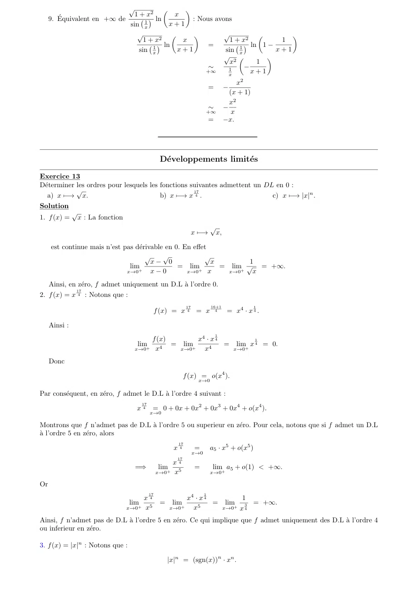

~~~text
                                     √
                               1 + x2
                                                
                                              x
     9. Équivalent en +∞ de          ln          : Nous avons
                             sin x1         x+1
                                √                            √
                                   1 + x2                      1 + x2
                                                                                
                                                x                               1
                                          ln            =             ln   1 −
                                 sin x1                      sin x1
                                                                   
                                               x+1                             x+1
                                                             √ 
                                                                 2
                                                                             
                                                               x        1
                                                        ∼     1     −
                                                       +∞
                                                              x
                                                                      x+1
                                                                                                     x2
                                                                                    =           −
                                                                                                  (x + 1)
                                                                                                  x2
                                                                                    ∼           −
                                                                                +∞                 x
                                                                                    =           −x.

                                                       Développements limités

Exercice 13
Déterminer les ordres pour lesquels les fonctions suivantes admettent un DL en 0 :
            √                                       17
  a) x 7−→ x.                            b) x 7−→ x 4 .                     c) x 7−→ |x|n .
Solution
               √
1. f (x) =         x : La fonction
                                                                                    √
                                                                          x 7−→         x,

     est continue mais n’est pas dérivable en 0. En effet
                                     √     √             √
                                       x− 0                 x        1
                               lim              = lim         = lim √ = +∞.
                              x→0 +    x−0         x→0 +   x    x→0+  x
     Ainsi, en zéro, f admet uniquement un D.L à l’ordre 0.
               17
2. f (x) = x 4 : Notons que :
                                                                     17             16+1                    1
                                                      f (x) = x 4 = x                 4          = x4 · x 4 .

     Ainsi :
                                                                                        1
                                             f (x)        x4 · x 4         1
                                         lim    4
                                                   = lim           = lim x 4 = 0.
                                         x→0+ x      x→0+   x4       x→0+

     Donc

                                                                    f (x) = o(x4 ).
                                                                            x→0

Par conséquent, en zéro, f admet le D.L à l’ordre 4 suivant :
                                            17
                                         x4       = 0 + 0x + 0x2 + 0x3 + 0x4 + o(x4 ).
                                                 x→0

Montrons que f n’admet pas de D.L à l’ordre 5 ou superieur en zéro. Pour cela, notons que si f admet un D.L
à l’ordre 5 en zéro, alors
                                                                17
                                                              x4           =        a5 · x5 + o(x5 )
                                                                          x→0
                                                               17
                                                              x4
                                         =⇒            lim+                =         lim a5 + o(1) < +∞.
                                                      x→0     x5                    x→0+

Or
                                                 17                             1
                                            x4                       x4 · x 4        1
                                     lim+              =      lim+            = lim+ 3 = +∞.
                                     x→0    x5              x→0        x 5      x→0 x 4

Ainsi, f n’admet pas de D.L à l’ordre 5 en zéro. Ce qui implique que f admet uniquement des D.L à l’ordre 4
ou inferieur en zéro.

3. f (x) = |x|n : Notons que :
                                                                                            n
                                                            |x|n = (sgn(x)) · xn .
~~~

## Page 17

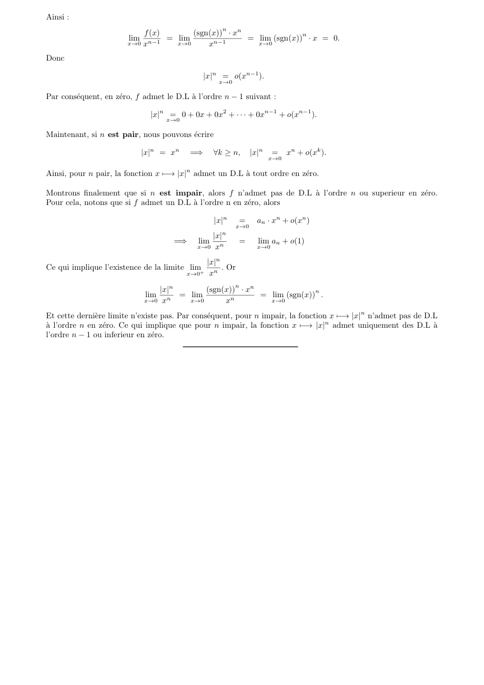

~~~text
Ainsi :
                                                      n
                            f (x)       (sgn(x)) · xn               n
                        lim       = lim               = lim (sgn(x)) · x = 0.
                        x→0 xn−1    x→0     xn−1        x→0

Donc

                                                 |x|n = o(xn−1 ).
                                                     x→0

Par conséquent, en zéro, f admet le D.L à l’ordre n − 1 suivant :

                                |x|n = 0 + 0x + 0x2 + · · · + 0xn−1 + o(xn−1 ).
                                     x→0

Maintenant, si n est pair, nous pouvons écrire

                              |x|n = xn    =⇒      ∀k ≥ n,       |x|n    =    xn + o(xk ).
                                                                        x→0

Ainsi, pour n pair, la fonction x 7−→ |x|n admet un D.L à tout ordre en zéro.

Montrons finalement que si n est impair, alors f n’admet pas de D.L à l’ordre n ou superieur en zéro.
Pour cela, notons que si f admet un D.L à l’ordre n en zéro, alors

                                                   |x|n      =     an · xn + o(xn )
                                                           x→0
                                                 |x|n
                                      =⇒     lim             =     lim an + o(1)
                                             x→0 xn                x→0

                                                 |x|n
Ce qui implique l’existence de la limite lim+         . Or
                                           x→0    xn
                                                           n
                                  |x|n       (sgn(x)) · xn               n
                               lim     = lim               = lim (sgn(x)) .
                              x→0 xn     x→0      xn         x→0

Et cette dernière limite n’existe pas. Par conséquent, pour n impair, la fonction x 7−→ |x|n n’admet pas de D.L
à l’ordre n en zéro. Ce qui implique que pour n impair, la fonction x 7−→ |x|n admet uniquement des D.L à
l’ordre n − 1 ou inferieur en zéro.
~~~

## Page 18

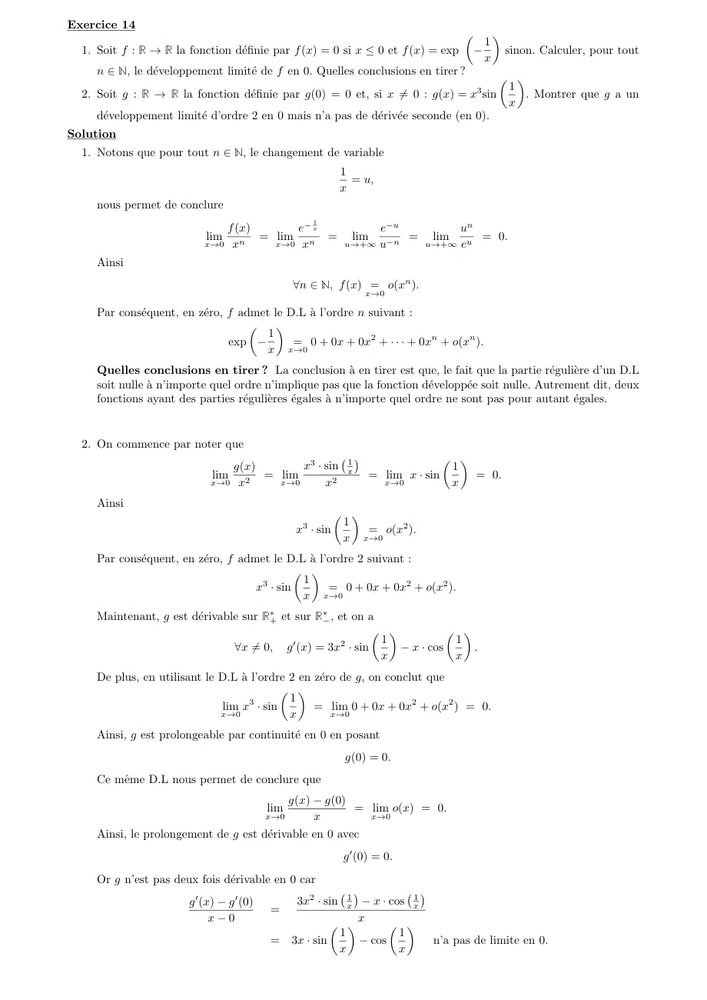

~~~text
Exercice 14
                                                                                    
                                                                                   1
  1. Soit f : R → R la fonction définie par f (x) = 0 si x ≤ 0 et f (x) = exp −       sinon. Calculer, pour tout
                                                                                   x
     n ∈ N, le développement limité de f en 0. Quelles conclusions en tirer ?
                                                                                       
                                                                                        1
  2. Soit g : R → R la fonction définie par g(0) = 0 et, si x 6= 0 : g(x) = x3 sin        . Montrer que g a un
                                                                                        x
     développement limité d’ordre 2 en 0 mais n’a pas de dérivée seconde (en 0).
Solution
  1. Notons que pour tout n ∈ N, le changement de variable
                                                              1
                                                                = u,
                                                              x
     nous permet de conclure
                                                       1
                              f (x)       e− x        e−u        un
                           lim      = lim      =  lim     =  lim    = 0.
                           x→0 xn     x→0 xn     u→+∞ u−n   u→+∞ eu

     Ainsi
                                                 ∀n ∈ N, f (x) = o(xn ).
                                                                       x→0

     Par conséquent, en zéro, f admet le D.L à l’ordre n suivant :
                                        
                                       1
                                exp −       = 0 + 0x + 0x2 + · · · + 0xn + o(xn ).
                                       x x→0
     Quelles conclusions en tirer ? La conclusion à en tirer est que, le fait que la partie régulière d’un D.L
     soit nulle à n’importe quel ordre n’implique pas que la fonction développée soit nulle. Autrement dit, deux
     fonctions ayant des parties régulières égales à n’importe quel ordre ne sont pas pour autant égales.

  2. On commence par noter que
                                                               1
                                                                   
                                        x3 · sin
                                                                                         
                               g(x)                            x                         1
                            lim 2 = lim                                = lim x · sin        = 0.
                            x→0 x   x→0      x2                              x→0         x
     Ainsi
                                                           
                                                   3       1
                                                  x · sin     = o(x2 ).
                                                           x x→0
     Par conséquent, en zéro, f admet le D.L à l’ordre 2 suivant :
                                              
                                      3       1
                                     x · sin        = 0 + 0x + 0x2 + o(x2 ).
                                              x x→0
     Maintenant, g est dérivable sur R∗+ et sur R∗− , et on a
                                                                          
                                                               1            1
                                ∀x 6= 0, g 0 (x) = 3x2 · sin     − x · cos     .
                                                               x            x
     De plus, en utilisant le D.L à l’ordre 2 en zéro de g, on conclut que
                                            
                                    3        1
                               lim x · sin        = lim 0 + 0x + 0x2 + o(x2 ) = 0.
                              x→0            x        x→0

     Ainsi, g est prolongeable par continuité en 0 en posant
                                                              g(0) = 0.
     Ce même D.L nous permet de conclure que
                                                 g(x) − g(0)
                                           lim               = lim o(x) = 0.
                                           x→0        x        x→0

     Ainsi, le prolongement de g est dérivable en 0 avec
                                                              g 0 (0) = 0.
     Or g n’est pas deux fois dérivable en 0 car
                                                               1
                                                               − x · cos x1
                                                                                  
                       g 0 (x) − g 0 (0)          3x2 · sin    x
                                           =
                             x−0                              x
                                                                    
                                                           1           1
                                           =     3x · sin     − cos                    n’a pas de limite en 0.
                                                           x           x
~~~

## Page 19

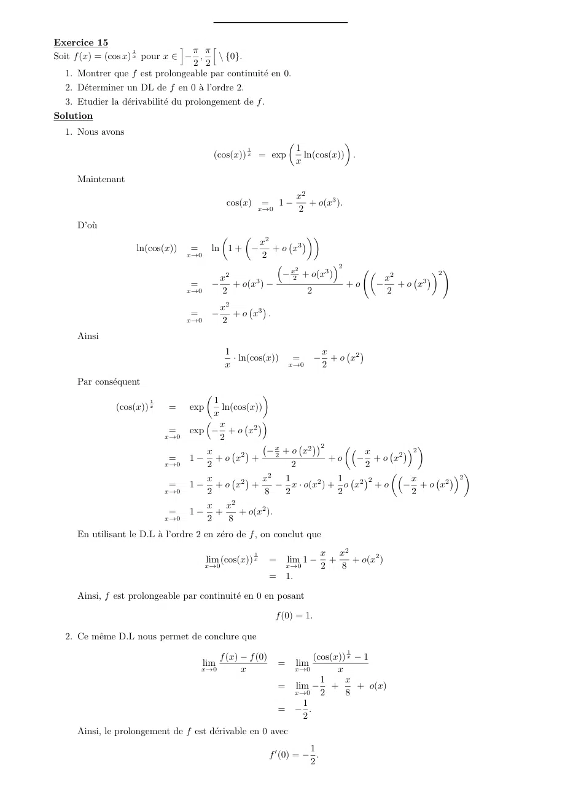

~~~text
Exercice 15                    i π πh
                     1
Soit f (x) = (cos x) x pour x ∈ − ,    \ {0}.
                                 2 2
   1. Montrer que f est prolongeable par continuité en 0.
  2. Déterminer un DL de f en 0 à l’ordre 2.
  3. Etudier la dérivabilité du prolongement de f .
Solution
  1. Nous avons
                                                                                       
                                                       1                    1
                                            (cos(x))   x       = exp          ln(cos(x)) .
                                                                            x
     Maintenant
                                                                            x2
                                               cos(x)          =     1−        + o(x3 ).
                                                           x→0              2
     D’où
                                                  x2
                                                            
                                                          3
                                                            
                    ln(cos(x))    =      ln 1 + − + o x
                                  x→0              2
                                                      2           2
                                           x2         − x2 + o(x3 )       2
                                                                           x
                                                                                     !
                                                                                    2
                                                 3                               3
                                  =      − + o(x ) −                  +o  − +o x
                                  x→0      2                  2            2
                                             x2
                                                + o x3 .
                                                      
                                  =      −
                                  x→0        2
     Ainsi
                                              1                                      x
                                                                                       + o x2
                                                                                              
                                                · ln(cos(x))             =       −
                                              x                         x→0          2
     Par conséquent
                                                   
                        1              1
               (cos(x)) x   =     exp    ln(cos(x))
                                       x
                                      x          
                            =     exp − + o x2
                            x→0          2
                                                                 2
                                                     − x2 + o x2
                                                                                        
                                     x        2
                                                                           x      2
                                                                                      2
                            =     1− +o x +                          +o    − +o x
                            x→0      2                      2               2
                                                     2
                                                                                                 
                                     x        2
                                                 x       1       2   1    2 2
                                                                                      x    2
                                                                                               2
                            =     1− +o x +            − x · o(x ) + o x       +o    − +o x
                            x→0      2              8     2           2                2
                                     x x2
                            =     1− +       + o(x2 ).
                            x→0      2     8
     En utilisant le D.L à l’ordre 2 en zéro de f , on conclut que
                                                           1                       x x2
                                        lim (cos(x)) x          =      lim 1 −       +   + o(x2 )
                                        x→0                            x→0         2   8
                                                                =      1.

     Ainsi, f est prolongeable par continuité en 0 en posant

                                                                    f (0) = 1.

  2. Ce même D.L nous permet de conclure que
                                                                                           1
                                          f (x) − f (0)                    (cos(x)) x − 1
                                      lim                            = lim
                                      x→0       x                      x→0       x
                                                                             1     x
                                                                     = lim − +        + o(x)
                                                                       x→0   2     8
                                                                         1
                                                                     = − .
                                                                         2
     Ainsi, le prolongement de f est dérivable en 0 avec
                                                                              1
                                                                   f 0 (0) = − .
                                                                              2
~~~

## Page 20

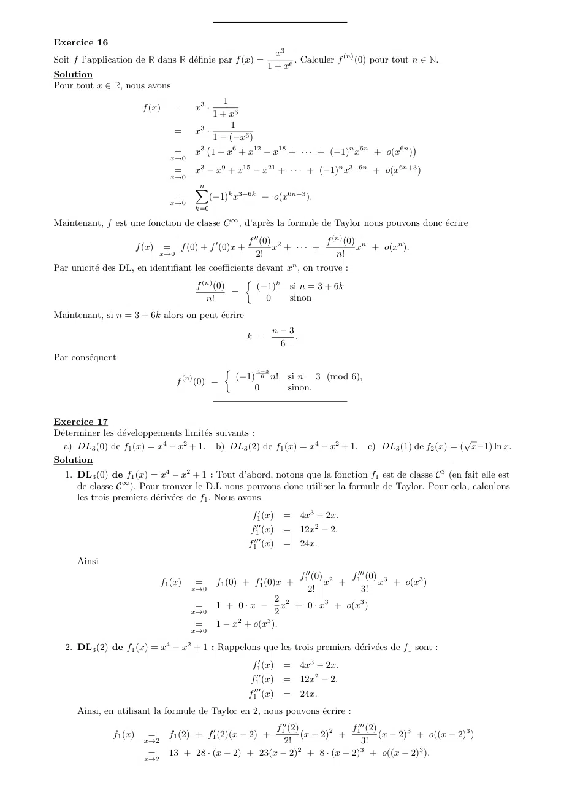

~~~text
Exercice 16
                                                                      x3
Soit f l’application de R dans R définie par f (x) =                      . Calculer f (n) (0) pour tout n ∈ N.
                                                                    1 + x6
Solution
Pour tout x ∈ R, nous avons
                                                        1
                         f (x)       =          x3 ·
                                                     1 + x6
                                                          1
                                     =          x3 ·
                                                     1 − (−x6 )
                                                x3 1 − x6 + x12 − x18 + · · · + (−1)n x6n + o(x6n )
                                                                                                   
                                     =
                                  x→0
                                     =          x3 − x9 + x15 − x21 + · · · + (−1)n x3+6n + o(x6n+3 )
                                  x→0
                                                n
                                                X
                                     =              (−1)k x3+6k + o(x6n+3 ).
                                  x→0
                                                k=0

Maintenant, f est une fonction de classe C ∞ , d’après la formule de Taylor nous pouvons donc écrire
                                                              f 00 (0) 2        f (n) (0) n
                        f (x)    =    f (0) + f 0 (0)x +              x + ··· +          x + o(xn ).
                                x→0                              2!                n!
Par unicité des DL, en identifiant les coefficients devant xn , on trouve :
                                    f (n) (0)        (−1)k si n = 3 + 6k
                                                  
                                              =
                                       n!              0     sinon
Maintenant, si n = 3 + 6k alors on peut écrire
                                                                        n−3
                                                              k =           .
                                                                         6
Par conséquent
                                                                 n−3
                                          (n)               (−1) 6 n!      si n = 3 (mod 6),
                                      f         (0) =
                                                                0          sinon.

Exercice 17
Déterminer les développements limités suivants :
                                                                                                                        √
  a) DL3 (0) de f1 (x) = x4 − x2 + 1. b) DL3 (2) de f1 (x) = x4 − x2 + 1.                       c) DL3 (1) de f2 (x) = ( x−1) ln x.
Solution
  1. DL3 (0) de f1 (x) = x4 − x2 + 1 : Tout d’abord, notons que la fonction f1 est de classe C 3 (en fait elle est
     de classe C ∞ ). Pour trouver le D.L nous pouvons donc utiliser la formule de Taylor. Pour cela, calculons
     les trois premiers dérivées de f1 . Nous avons
                                                               f10 (x)    =     4x3 − 2x.
                                                               f100 (x)   =     12x2 − 2.
                                                              f1000 (x)   =     24x.
      Ainsi
                                                                                f100 (0) 2  f 000 (0) 3
                                f1 (x)          =      f1 (0) + f10 (0)x +              x + 1        x + o(x3 )
                                            x→0                                    2!          3!
                                                                      2 2
                                                =      1 + 0·x −        x + 0 · x3 + o(x3 )
                                            x→0                       2
                                                =      1 − x2 + o(x3 ).
                                            x→0

  2. DL3 (2) de f1 (x) = x4 − x2 + 1 : Rappelons que les trois premiers dérivées de f1 sont :
                                                               f10 (x)    =     4x3 − 2x.
                                                              f100 (x)    =     12x2 − 2.
                                                              f1000 (x)   =     24x.
      Ainsi, en utilisant la formule de Taylor en 2, nous pouvons écrire :
                                                          f100 (2)            f 000 (2)
               f1 (x)      =      f1 (2) + f10 (2)(x − 2) +        (x − 2)2 + 1         (x − 2)3 + o((x − 2)3 )
                          x→2                                2!                  3!
                           =      13 + 28 · (x − 2) + 23(x − 2)2 + 8 · (x − 2)3 + o((x − 2)3 ).
                          x→2
~~~

## Page 21

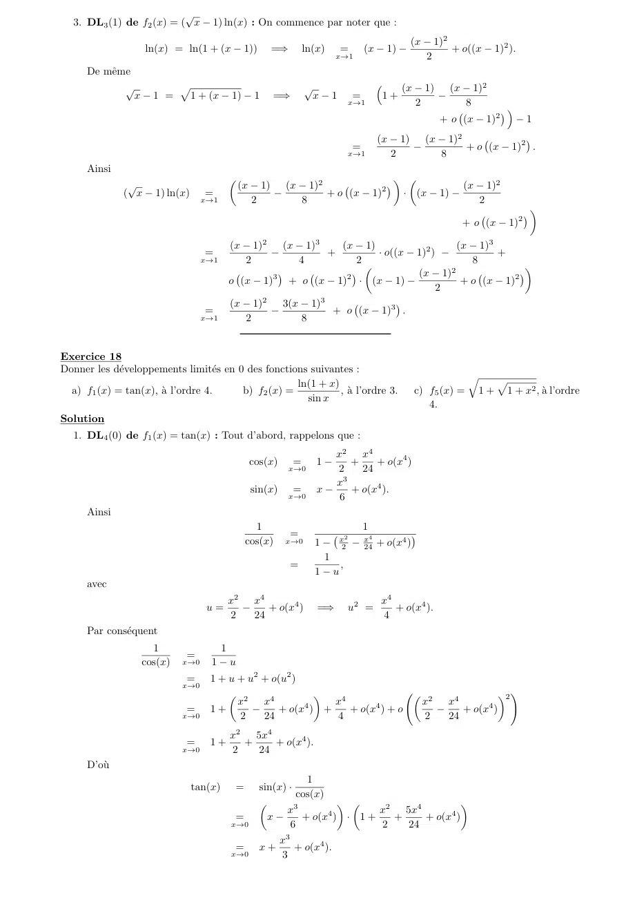

~~~text
                          √
  3. DL3 (1) de f2 (x) = ( x − 1) ln(x) : On commence par noter que :
                                                                                           (x − 1)2
                   ln(x) = ln(1 + (x − 1))        =⇒        ln(x)      =       (x − 1) −            + o((x − 1)2 ).
                                                                      x→1                     2
      De même
             √             p                                 √                           (x − 1) (x − 1)2
                 x−1 =         1 + (x − 1) − 1     =⇒            x−1       =         1+          −
                                                                        x→1                  2       8
                                                                                                                   
                                                                                                 + o (x − 1)2            −1
                                                                                 (x − 1) (x − 1)2
                                                                                                  + o (x − 1)2 .
                                                                                                              
                                                                           =            −
                                                                        x→1         2       8
      Ainsi
               √                            (x − 1) (x − 1)2                                       (x − 1)2
                                                                                      
                                                             + o (x − 1)2
                                                                          
              ( x − 1) ln(x)      =                −                                   · (x − 1) −
                                 x→1           2       8                                              2
                                                                                                                               
                                                                                                      + o (x − 1)2
                                                                                                                           

                                        (x − 1)2     (x − 1)3    (x − 1)                   (x − 1)3
                                  =              −             +         · o((x − 1)2 ) −           +
                                 x→1       2            4            2                        8
                                                                                  (x − 1)2
                                                                                                           
                                                 3                2                                     2
                                                                                                        
                                        o (x − 1) + o (x − 1) · (x − 1) −                   + o (x − 1)
                                                                                       2
                                        (x − 1)2     3(x − 1)3
                                                                + o (x − 1)3 .
                                                                              
                                  =              −
                                 x→1       2             8

Exercice 18
Donner les développements limités en 0 des fonctions suivantes :
                                                                                                          q
                                                    ln(1 + x)                                                      p
  a) f1 (x) = tan(x), à l’ordre 4.     b) f2 (x) =           , à l’ordre 3.               c) f5 (x) =       1+       1 + x2 , à l’ordre
                                                      sin x
                                                                                               4.
Solution
  1. DL4 (0) de f1 (x) = tan(x) : Tout d’abord, rappelons que :
                                                                    x2   x4
                                              cos(x)    =        1−    +    + o(x4 )
                                                       x→0          2    24
                                                                    x3
                                              sin(x)    =        x−    + o(x4 ).
                                                       x→0           6
      Ainsi
                                               1                          1
                                                       =                2   4
                                                                 1 − x2 − x24 + o(x4 )
                                                                                       
                                             cos(x)    x→0

                                                                   1
                                                       =              ,
                                                                 1−u
      avec
                                        x2   x4                                   x4
                                  u=       −    + o(x4 )         =⇒     u2 =         + o(x4 ).
                                        2    24                                   4
      Par conséquent
                    1               1
                            =
                  cos(x)   x→0     1−u
                            =      1 + u + u2 + o(u2 )
                           x→0
                                        2                                                2 !
                                              x4           x4
                                                                           2
                                                                                x4
                                                         
                                         x             4           4       x            4
                            =      1+       −    + o(x ) +    + o(x ) + o     −    + o(x )
                           x→0           2    24           4                2   24
                                        x2   5x4
                            =      1+      +     + o(x4 ).
                           x→0          2     24
      D’où
                                                            1
                               tan(x)    =      sin(x) ·
                                                          cos(x)
                                                      x3                 x2   5x4
                                                                                      
                                                                 4                     4
                                         =        x−       + o(x ) · 1 +    +     + o(x )
                                        x→0             6                2     24
                                                     x3
                                         =      x+       + o(x4 ).
                                        x→0          3
~~~

## Page 22

~~~text
                         ln(1 + x)
2. DL3 (0) de f2 (x) =             : Tout d’abord, rappelons que :
                           sin x
                                                                    x2   x3      x4
                                     ln(1 + x)          =        x−    +    −       + o(x4 )
                                                       x→0          2     3      4
                                                                    x3
                                           sin(x)       =        x−    + o(x4 ).
                                                       x→0          6
  Ainsi
                                                                     2    3
                                                                                     
                               ln(1 + x)                 x 1 − x2 + x3 − x4 + o(x3 )
                                                  =                    2
                                                             x 1 − x6 + o(x3 )
                                                                              
                                 sin(x)         x→0
                                                                      2      3
                                                         1 − x2 + x3 − x4 + o(x3 )
                                                  =                   2
                                                x→0              1 − x6 + o(x3 )
                                                               x x2   x3
                                                                               
                                                                              3     1
                                                  =          1− +   −    + o(x ) ·     ,
                                                x→0            2  3   4            1−u
  avec
                                               x2
                                         u=       + o(x3 )         =⇒       u2 = o(x3 )
                                               6
  Par conséquent
                                x x2      x3
                                                     
          ln(1 + x)                                       1
                         =        + 1−  −    + o(x3 ) ·
            sin(x)    x→0       2    3     4            1−u
                                x x2      x3
                                                     
                                             + o(x3 ) 1 + u + u2 + o(u2 )
                                                                          
                       =    1− +        −
                      x→0       2    3     4
                                      2
                                                                                       2 !!
                                          x3                x2
                                                                           2
                                x x                 3               3        x       3
                       =    1− +        −    + o(x )     1+    + o(x ) + o      + o(x )
                      x→0       2    3     4                 6                6
                                x x2      x3                x2
                                                                   
                                                    3               3
                       =    1− +        −    + o(x )    1+     + o(x )
                      x→0       2    3     4                6
                             x x2       x3
                       = 1− +         −     + o(x3 ).
                      x→0     2    2     3
                      q   p
3. DL4 (0) de f3 (x) = 1 + 1 + x2 : Tout d’abord, rappelons que :
                                           √                              x x2
                                               1+x           =     1+       −   + o(x2 ).
                                                          x→0             2   8
  Ainsi
                                           p                              x2   x4
                                               1 + x2        =     1+        −    + o(x4 ).
                                                          x→0             2    8
  D’où
                                              r
                                                        x2   x4
              q        p
                  1+       1 + x2    =            2+       −    + o(x4 )
                                     x→0                2    8
                                              s 
                                                      x2   x4
                                                                       
                                     =          2 1+     −         4
                                                              + o(x )
                                                      4    16
                                                 r
                                              √      x2    x4
                                     =          2 1+     −    + o(x4 )
                                                      4    16
                                                                                                   2
                                              √      1 x2     x4             1 x2      x4
                                                                            
                                     =          2 1+        −    + o(x4 ) −        −       + o(x4 )
                                                     2 4      16             8 4       16
                                                                    2                  2
                                                                                          !!
                                                                           x4
                                                                                      
                                                                       x
                                                              +o         −    + o(x4 )
                                                                       4   16

  Par conséquent
                                                                                                  2
                                              √
                                                        2
                                                              x4             1 x2     x4
              q                                                              
                   p                                    x 1
                1 + 1 + x2           =            2 1+      −    + o(x4 ) −        −      + o(x4 )
                                     x→0                 42   16             8 4      16
                                                                    2                 2
                                                                                         !!
                                                                           x4
                                                                                     
                                                                     x             4
                                                              +o         −    + o(x )
                                                                      4    16
                                                   √ 2      √
                                              √     2x     3 2x4
                                     =          2+      −        + o(x4 ).
                                                    8       128
~~~

## Page 23

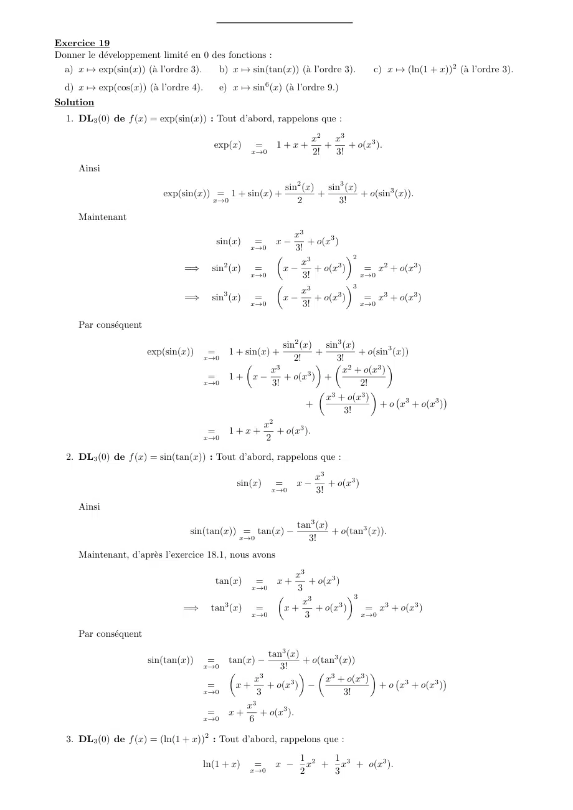

~~~text
Exercice 19
Donner le développement limité en 0 des fonctions :
  a) x 7→ exp(sin(x)) (à l’ordre 3).         b) x 7→ sin(tan(x)) (à l’ordre 3).     c) x 7→ (ln(1 + x))2 (à l’ordre 3).
  d) x 7→ exp(cos(x)) (à l’ordre 4).         e) x 7→ sin6 (x) (à l’ordre 9.)
Solution
  1. DL3 (0) de f (x) = exp(sin(x)) : Tout d’abord, rappelons que :

                                                                       x2   x3
                                          exp(x)         =    1+x+        +    + o(x3 ).
                                                      x→0              2!   3!
     Ainsi
                                                                 sin2 (x) sin3 (x)
                           exp(sin(x)) = 1 + sin(x) +                    +         + o(sin3 (x)).
                                          x→0                       2        3!
     Maintenant
                                                                x3
                                             sin(x)    =     x−     + o(x3 )
                                                      x→0        3!
                                                                              2
                                                                  x3
                                                             
                                =⇒        sin2 (x)     =       x−           3
                                                                      + o(x )     = x2 + o(x3 )
                                                      x→0          3!            x→0
                                                                              3
                                                                  x3
                                                             
                                =⇒        sin3 (x)     =       x−           3
                                                                      + o(x )     = x3 + o(x3 )
                                                      x→0          3!            x→0

     Par conséquent

                                                               sin2 (x) sin3 (x)
                       exp(sin(x))       =      1 + sin(x) +            +        + o(sin3 (x))
                                        x→0                       2!        3!
                                                           x3
                                                                          2
                                                                             x + o(x3 )
                                                                                       
                                         =      1+ x−          + o(x3 ) +
                                        x→0                 3!                   2!
                                                                         3
                                                                          x + o(x3 )
                                                                                     
                                                                                       + o x3 + o(x3 )
                                                                                                      
                                                                      +
                                                                              3!
                                                           2
                                                         x
                                         =      1+x+         + o(x3 ).
                                        x→0              2
  2. DL3 (0) de f (x) = sin(tan(x)) : Tout d’abord, rappelons que :

                                                                        x3
                                                  sin(x)     =     x−      + o(x3 )
                                                             x→0        3!
     Ainsi
                                                                   tan3 (x)
                                  sin(tan(x)) = tan(x) −                    + o(tan3 (x)).
                                                   x→0                3!
     Maintenant, d’après l’exercice 18.1, nous avons

                                                                 x3
                                             tan(x)      =    x+     + o(x3 )
                                                      x→0        3
                                                                               3
                                                                  x3
                                                              
                                =⇒       tan3 (x)        =     x+     + o(x3 )     = x3 + o(x3 )
                                                      x→0           3             x→0

     Par conséquent

                                                          tan3 (x)
                       sin(tan(x))       =      tan(x) −            + o(tan3 (x))
                                        x→0                  3!
                                                      x3
                                                                     3
                                                                         x + o(x3 )
                                                                                   
                                                          + o(x3 ) −                  + o x3 + o(x3 )
                                                                                                     
                                         =        x+
                                        x→0             3                     3!
                                                      3
                                                    x
                                         =      x+       + o(x3 ).
                                        x→0          6

  3. DL3 (0) de f (x) = (ln(1 + x))2 : Tout d’abord, rappelons que :
                                                                    1 2   1
                                        ln(1 + x)      =     x −      x + x3 + o(x3 ).
                                                      x→0           2     3
~~~

## Page 24

~~~text
  Ainsi
                     2
          (ln(1 + x))    = ln(1 + x) · ln(1 + x)
                                                                                  
                                   1         1                     1       1
                         =   x − x2 + x3 + o(x3 ) · x − x2 + x3 + o(x3 )
                                   2         3                     2       3
                                                                                    
                                     1      1               1          1       1
                         = x · x − x2 + x3 + o(x3 ) − x2 · x − x2 + x3 + o(x3 )
                                     2      3               2          2       3
                                                                                      
                             1            1      1                           1     1
                           + x3 · x − x2 + x3 + o(x3 ) + o(x3 ) · x − x2 + x3 + o(x3 )
                             3            2      3                           2     3
                                                             
                                  1                1
                         =   x2 − x3 + o(x3 ) −      x3 + o(x3 ) + o(x3 ) + o(x3 )
                                  2                2
                         =    x2 − x3 + o(x3 ).

4. DL4 (0) de f (x) = exp(cos(x)) : Tout d’abord, rappelons que :

                                                                   x2   x3
                                     exp(x)       =     1+x+          +    + o(x3 ).
                                                 x→0               2    3!
  Ainsi

                exp(cos(x))     =    exp(1 + (cos(x) − 1))
                                =    e · exp(cos(x) − 1)
                                                                (cos(x) − 1)2   (cos(x) − 1)3
                                =    e 1 + (cos(x) − 1) +                     +
                               x→0                                    2!              3!
                                                                                                  !
                                                                 (cos(x) − 1)4
                                                                               + o (cos(x) − 1)4 .
                                                                                                
                                                               +
                                                                       4!

  Maintenant
                                                             x2    x4
                                      cos(x)       =     1−     +     + o(x4 )
                                                  x→0        2     4!
                                                          x2    x4
                         =⇒     (cos(x) − 1)       =     − +        + o(x4 )
                                                  x→0      2    4!
                                                          2                  2
                                                            x     x4                 x4
                         =⇒    (cos(x) − 1)2       =      − +         + o(x4 )    =     + o(x4 )
                                                  x→0        2    4!             x→0 4
                                                          2                  3
                                                            x     x4
                         =⇒    (cos(x) − 1)3       =      − +               4
                                                                      + o(x )     = o(x4 )
                                                  x→0        2    4!             x→0

  Finalement
                                                         2             4
                                          4               x  x4      4
                              (cos(x) − 1)       =       − +    + o(x )     = o(x4 )
                                                x→0       2  4!            x→0

   Par conséquent

                                                                (cos(x) − 1)2   (cos(x) − 1)3
                exp(cos(x))     =    e 1 + (cos(x) − 1) +                     +
                               x→0                                    2!              3!
                                                                                       !
                                                     (cos(x) − 1)4
                                                                   + o (cos(x) − 1)4
                                                                                     
                                                  +
                                                            4!
                                                                x4
                                                                          ! 
                                          2                           4
                                              x4                                o(x4 )
                                                                                      
                                           x           4        4 + o(x )
                                =    e 1+ − +    + o(x ) +                  +
                               x→0         2  4!                     2            3!
                                                                     !
                                                     o(x4 )
                                                            + o x4
                                                                   
                                                  +
                                                       4!
                                             e · x2   e · x4
                                =    e−             +        + o(x4 ).
                               x→0              2        6

5. DL9 (0) de f (x) = sin6 (x) : Tout d’abord, rappelons que :

                                                                   x3
                                             sin(x)     =     x−      + o(x3 ).
                                                       x→0         3!
~~~

## Page 25

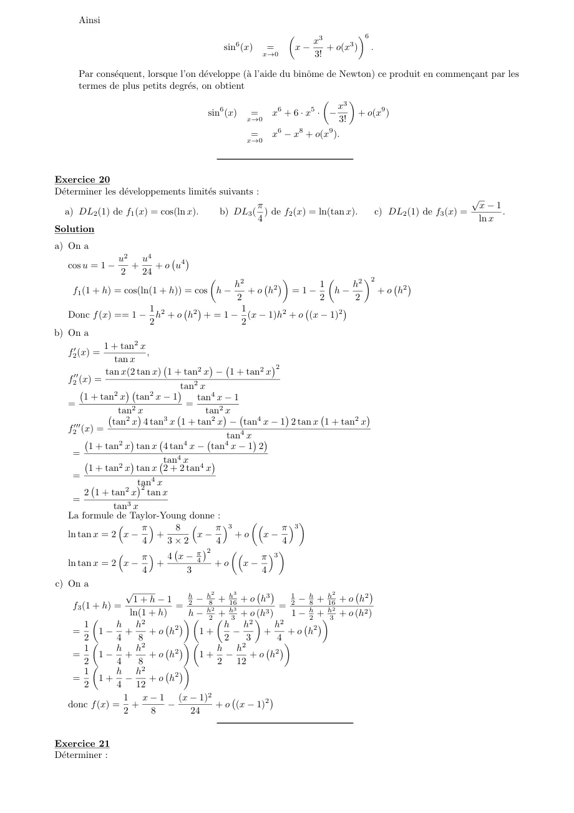

~~~text
       Ainsi
                                                                                          6
                                                                               x3
                                                                      
                                                   sin6 (x)     =         x−      + o(x3 ) .
                                                               x→0             3!

       Par conséquent, lorsque l’on développe (à l’aide du binôme de Newton) ce produit en commençant par les
       termes de plus petits degrés, on obtient
                                                                      3
                                                                         x
                                        sin6 (x) = x6 + 6 · x5 · −          + o(x9 )
                                                 x→0                     3!
                                                           =     x6 − x8 + o(x9 ).
                                                          x→0

Exercice 20
Déterminer les développements limités suivants :
                                                                                                                         √
                                                  π                                                                      x−1
  a) DL2 (1) de f1 (x) = cos(ln x).      b) DL3 ( ) de f2 (x) = ln(tan x).                      c) DL2 (1) de f3 (x) =        .
                                                   4                                                                     ln x
Solution
a) On a
                   u2   u4
                           + o u4
                                  
    cos u = 1 −       +
                   2    24
                                                                                                2
                                                           h2                                h2
                                                                                      
                                                                                      1
                                                                + o h2                              + o h2
                                                                                                          
    f1 (1 + h) = cos(ln(1 + h)) = cos h −                                     =1−         h−
                                                             2                        2       2
                                1 2                           1
   Donc f (x) == 1 − h + o h2 + = 1 − (x − 1)h2 + o (x − 1)2
                                                                                          
                                2                             2
b) On a
              1 + tan2 x
   f20 (x) =                  ,
                 tan x
                                                                      2
              tan x(2 tan x) 1 + tan2 x − 1 + tan2 x
                                                   
   f200 (x) =                                 2
                 2
                               2
                                        tan x
         1 + tan x tan x − 1                   tan4 x − 1
   =                                       =
                   tan2 x                        tan2x
                      2             3               2
                                                      x − tan4 x − 1 2 tan x 1 + tan2 x
                                                                                                
     000        tan     x    4  tan   x  1  +  tan
   f2 (x) =
                                                         tan4 x  
                   2                      4             4
                        
          1 + tan x tan x 4 tan x − tan x − 1 2
    =
                                    tan4 x
          1 + tan2 x tan x 2 + 2 tan4 x
                                                   
    =                           4
                     2
                          tan
                            2
                                  x
         2 1 + tan x tan x
    =
                tan3 x
   La formule de Taylor-Young donne :
                                                                              
                           π          8            π 3                π 3
   ln tan x = 2 x −               +            x−          +o       x−
                            4        3×2              4                    4
                                               π 2
                                                 
                                     4 x− 4
                                                                       
                           π                                     π 3
                                                                     
   ln tan x = 2 x −               +                  +o        x−
                            4              3                       4
c) On a
                     √                      h     h2      h3        3
                                                                             1   h     h2      2
                                                                                                  
                         1+h−1              2 − 8 + 16 + o h                  2 − 8 + 16 + o h
    f3 (1 + h) =                        =          2       3             =               2
                       ln(1 + h)            h− h2 + h3 + o     (h3 )       1 − h2 +h3 + o (h2 )
                            2                                   2         2
                                          
         1        h h                                   h h             h
                               + o h2                                        + o h2
                                                                                    
    =        1− +                               1+         −        +
         2       4        8                            2      3        4
                  h h2                                h h2
                                                                          
         1                             2
                                                                       2
                                                                          
    =        1− +              +o h             1+ −            +o h
         2       4        8                          2     12
                            2
                                           
         1        h h
                               + o h2
                                         
    =        1+ −
         2        4       12
                     1 x − 1 (x − 1)2
                                                      + o (x − 1)2
                                                                     
   donc f (x) = +                     −
                     2          8            24

Exercice 21
Déterminer :
~~~

## Page 26

~~~text
                                                                          1/x                              √   √
               1/x2                                                1+x                                      x− e
  a) lim (cos x)                                  b) lim                                           c) lim
     x→0                                                 x→0       1−x                                x→e ln x − 1
                   1                                                                                                  
         (1 + 3x) − 1 − sin x
                   3                                               1 ln(1 + x)                              1       sin x
  d) lim                                          e) lim             −                             f) lim      ln
     x→0       1 − cos x                                 x→0       x    x2                            x→0 x2          x
Solution
                                   1/x2
  1. Déterminer lim (cos x)              : Nous avons
                   x→0
                                                                                 
                                          1/x2                      1
                             lim (cos x)             =    lim exp       ln (cos x)
                             x→0                          x→0       x2
                                                                                 x2
                                                                                          
                                                                    1                    2
                                                     =    lim exp       ln 1 −      + o(x )
                                                          x→0       x2            2
                                                                    2                     2         
                                                                    1        x       2       x      2
                                                     =    lim exp         − + o(x ) + o        + o(x )
                                                          x→0       x2       2               2
                                                                    2                
                                                                    1        x
                                                     =    lim exp    2
                                                                          − + o(x2 )
                                                          x→0       x        2
                                                                               
                                                                      1
                                                     =    lim exp − + o(1)
                                                          x→0         2
                                                           1
                                                     =    √ .
                                                            e
                                   1/x
                             1+x
  2. Déterminer lim                       : Nous avons
                   x→0       1−x
                                      1/x                                  
                                 1+x                               1      1+x
                       lim                       =       lim exp     ln
                    x→0          1−x                     x→0       x      1−x
                                                                                          
                                                                   1
                                                 =       lim exp       ln(1 + x) − ln(1 − x)
                                                         x→0       x
                                                                            x2                 x2
                                                                                                       
                                                                   1                 2                 2
                                                 =       lim exp        x−     + o(x ) − −x −     + o(x )
                                                         x→0       x        2                  2
                                                                                   
                                                                   1
                                                                      2x + o x2
                                                                                 
                                                 =       lim exp
                                                         x→0       x
                                                 =       lim exp (2 + o(x))
                                                         x→0
                                                 = e2 .
                         √ √
                      x− e
  3. Déterminer lim            : Nous avons
                 x→e ln x − 1
                                  √    √                                   √             √
                                    x− e                                  e+x−e− e
                              lim            =                      lim
                             x→e ln x − 1                           x→e ln(e + x − e) − 1
                                                                         √ q                  √
                                                                          e 1 + x−e  e −         e
                                                               =    lim             x−e
                                                                                         
                                                                    x→e ln e 1 +
                                                                                     e        −1
                                                                          √ q                       
                                                                            e      1 + x−ee    −   1
                                                               =    lim
                                                                    x→e ln(e) + ln 1 + x−e − 1
                                                                                                 
                                                                                              e
                                                                        √ q                      
                                                                          e      1 + x−e
                                                                                       e    −   1
                                                               =    lim               x−e
                                                                                            
                                                                    x→e      ln 1 + e
                                                                        √
                                                                          e 1 + 12 · x−e
                                                                                                             
                                                                                        e + o(x − e) − 1
                                                               =    lim            x−e
                                                                                    e + o(x − e)
                                                                    x→e
                                                                        √                1
                                                                                                       
                                                                          e · (x − e) 2e     + o(1)
                                                               =    lim
                                                                           (x − e) 1e + o(1)
                                                                                                   
                                                                    x→e
                                                                        √ 1                         √      √
                                                                                                     e
                                                                          e 2e + o(1)               2e       e
                                                               =    lim     1
                                                                                             =      1   =     .
                                                                    x→e
                                                                            e  + o(1)                e
                                                                                                           2
~~~

## Page 27

~~~text
                                    1
                     (1 + 3x) 3 − 1 − sin x
  4. Déterminer lim                        : Nous avons
                 x→0       1 − cos x
                                           1                                          2
                           (1 + 3x) 3 − 1 − sin x                         1 + 3x  9x      2               2
                                                                               3 − 9 + o(x ) − 1 − x + o(x )
                       lim                                      =   lim                   x2
                       x→0       1 − cos x                          x→0                          2
                                                                                          2 + o(x )
                                                                       −x2 + o(x2 )
                                                                =   lim  2
                                                                    x→0 x + o(x2 )
                                                                        2
                                                                        x2 (−1 + o(1))
                                                                =   lim
                                                                    x→0 x2 1 + o(1)
                                                                                    
                                                                             2
                                                                          −1 + o(1)
                                                                =   lim    1
                                                                           2 + o(1)
                                                                    x→0

                                                                =   −2.
                                               
                           1 ln(1 + x)
  5. Déterminer lim         −          : Nous avons
                 x→0       x     x2
                                                 
                                      1 ln(1 + x)                                x − ln(1 + x)
                                lim    −             =                     lim
                               x→0 x        x2                            x→0         x2
                                                                                           2
                                                                                                    
                                                                                 x − x − x2 + o(x2 )
                                                                     =     lim
                                                                          x→0           x2
                                                                                  2
                                                                              x
                                                                                 + o(x2 )
                                                                     =    lim 2
                                                                          x→0     x2
                                                                              1
                                                                     =    lim   + o(1)
                                                                          x→0 2
                                                                          1
                                                                     =      .
                                                                          2
                                             
                           1           sin x
  6. Déterminer lim          ln                    : Nous avons
                 x→0       x2            x
                                                                                  3
                                                                                             !
                                                                            x − x3! + o(x3 )
                                                     
                                   1           sin x              1
                        lim           ln                    = lim 2 ln
                        x→0        x2            x            x→0 x                 x
                                                                               x2
                                                                                            
                                                                     1
                                                            =   lim 2 ln 1 −        + o(x2 )
                                                                x→0 x           3!
                                                                         2                  2          
                                                                     1     x                   x
                                                            =   lim 2 − + o(x2 ) + o             + o(x2 )
                                                                x→0 x       3!                 3
                                                                         2            
                                                                     1     x
                                                            =   lim       − + o(x2 )
                                                                x→0 x2      3!
                                                                       1
                                                            =   lim − + o(1)
                                                                x→0    3!
                                                                   1
                                                            =    − .
                                                                   6

Exercice 22                                                       √     √
Etudier, au voisinage de 1, la fonction définie par g(x) = x + 2 x − 2 + 2x.
On demande de déterminer la tangente, la position de la courbe par rapport à cette tangente et l’allure de la
courbe au voisinage de 1.
Solution
Tout d’abord, notons que :
                 √    √                                   p                 p
           x + 2 x − 2 + 2x = 1 + (x − 1) + 2 1 + (x − 1) −                    4 + 2(x − 1)
                                                                             r
                                                          p                          (x − 1)
                                   = 1 + (x − 1) + 2 1 + (x − 1) − 2 1 +
                                                                                        2
                                                               (x − 1) (x − 1)2
                                                                                                 
                                                                                               2
                                   = 1 + (x − 1) + 2 1 +               −            + o((x − 1) )
                                  x→1                             2          8
                                                                    (x − 1) (x − 1)2
                                                                                                     
                                                                                                    2
                                                          − 2 1+            −            + o((x − 1) )
                                                                       4          32
                                              3(x − 1) 3(x − 1)2
                                   = 1+                −            + o((x − 1)2 ).
                                  x→1             2          16
~~~

## Page 28

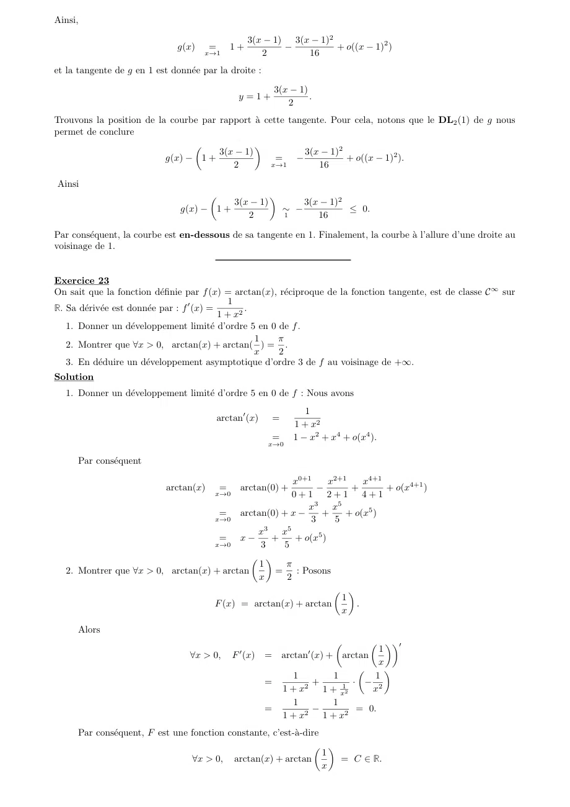

~~~text
Ainsi,

                                                     3(x − 1) 3(x − 1)2
                              g(x)      =       1+           −          + o((x − 1)2 )
                                     x→1                2        16
et la tangente de g en 1 est donnée par la droite :

                                                              3(x − 1)
                                                  y =1+                .
                                                                 2
Trouvons la position de la courbe par rapport à cette tangente. Pour cela, notons que le DL2 (1) de g nous
permet de conclure

                                                           3(x − 1)2
                                              
                                      3(x − 1)
                          g(x) − 1 +                = −              + o((x − 1)2 ).
                                         2         x→1        16

Ainsi
                                                                        3(x − 1)2
                                                         
                                          3(x − 1)
                               g(x) − 1 +                         ∼ −             ≤ 0.
                                             2                    1        16

Par conséquent, la courbe est en-dessous de sa tangente en 1. Finalement, la courbe à l’allure d’une droite au
voisinage de 1.

Exercice 23
On sait que la fonction définie par f (x) = arctan(x), réciproque de la fonction tangente, est de classe C ∞ sur
                                               1
R. Sa dérivée est donnée par : f 0 (x) =        .
                                            1 + x2
   1. Donner un développement limité d’ordre 5 en 0 de f .
                                                     1 π
   2. Montrer que ∀x > 0, arctan(x) + arctan( ) = .
                                                     x  2
   3. En déduire un développement asymptotique d’ordre 3 de f au voisinage de +∞.
Solution
  1. Donner un développement limité d’ordre 5 en 0 de f : Nous avons
                                                                         1
                                            arctan0 (x)       =
                                                                      1 + x2
                                                              =       1 − x2 + x4 + o(x4 ).
                                                          x→0

     Par conséquent

                                                     x0+1     x2+1     x4+1
                            arctan(x)       =              −
                                                  arctan(0) +       +       + o(x4+1 )
                                   x→0               0+1 2+1 4+1
                                                        x3     x5
                                    = arctan(0) + x −       +      + o(x5 )
                                   x→0                   3     5
                                             x3   x5
                                    = x−        +    + o(x5 )
                                   x→0       3    5
                                             
                                             1     π
  2. Montrer que ∀x > 0, arctan(x) + arctan      = : Posons
                                             x     2
                                                                
                                                                  1
                                   F (x) = arctan(x) + arctan        .
                                                                 x

     Alors
                                                                                          0
                                                                                            1
                                  ∀x > 0,       F 0 (x)   =       arctan0 (x) + arctan
                                                                                            x
                                                                                             
                                                                     1          1          1
                                                          =               +          ·   −
                                                                  1 + x2     1 + x12       x2
                                                                     1          1
                                                          =            2
                                                                          −            = 0.
                                                                  1+x        1 + x2
     Par conséquent, F est une fonction constante, c’est-à-dire
                                                                 
                                                                  1
                                ∀x > 0, arctan(x) + arctan          = C ∈ R.
                                                                  x
~~~

## Page 29

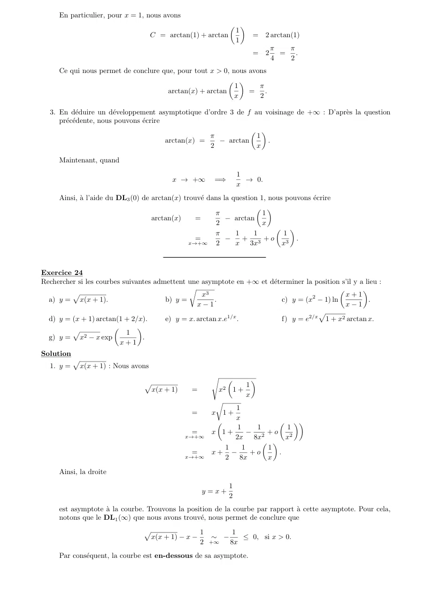

~~~text
     En particulier, pour x = 1, nous avons
                                                                   
                                                                   1
                                       C = arctan(1) + arctan         =        2 arctan(1)
                                                                   1
                                                                                   π   π
                                                                         =     2     = .
                                                                                   4   2
     Ce qui nous permet de conclure que, pour tout x > 0, nous avons
                                                          
                                                           1      π
                                      arctan(x) + arctan       = .
                                                           x      2

  3. En déduire un développement asymptotique d’ordre 3 de f au voisinage de +∞ : D’après la question
     précédente, nous pouvons écrire
                                                                
                                                    π           1
                                        arctan(x) =   − arctan     .
                                                    2           x

     Maintenant, quand
                                                                      1
                                             x → +∞          =⇒         → 0.
                                                                      x
     Ainsi, à l’aide du DL3 (0) de arctan(x) trouvé dans la question 1, nous pouvons écrire
                                                                       
                                                        π               1
                                    arctan(x)     =         − arctan
                                                        2               x
                                                                             
                                                        π      1     1        1
                                                  =         −    + 3 +o           .
                                                x→+∞    2      x 3x           x3

Exercice 24
Rechercher si les courbes suivantes admettent une asymptote en +∞ et déterminer la position s’il y a lieu :
                                              r
                                                   x3
                                                                                                    
         p                                                                                     x+1
  a) y = x(x + 1).                     b) y =          .                  c) y = (x2 − 1) ln           .
                                                 x−1                                           x−1
                                                                                     p
  d) y = (x + 1) arctan(1 + 2/x).      e) y = x. arctan x.e1/x .          f) y = e2/x 1 + x2 arctan x.
                              
         p                 1
  g) y = x2 − x exp              .
                         x+1
Solution
           p
  1. y =       x(x + 1) : Nous avons
                                                            s           
                                  p                                    1
                                   x(x + 1)        =         x2 1 +
                                                                       x
                                                             r
                                                                  1
                                                   =        x 1+
                                                                  x
                                                                                 
                                                                   1       1       1
                                                   =        x 1+       −      +o
                                                 x→+∞             2x 8x2           x2
                                                                              
                                                               1     1        1
                                                   =        x+ −        +o       .
                                                 x→+∞          2 8x           x

     Ainsi, la droite
                                                                  1
                                                        y =x+
                                                                  2
     est asymptote à la courbe. Trouvons la position de la courbe par rapport à cette asymptote. Pour cela,
     notons que le DL1 (∞) que nous avons trouvé, nous permet de conclure que
                                  p                     1          1
                                       x(x + 1) − x −       ∼ −      ≤ 0, si x > 0.
                                                        2   +∞    8x
     Par conséquent, la courbe est en-dessous de sa asymptote.
~~~

## Page 30

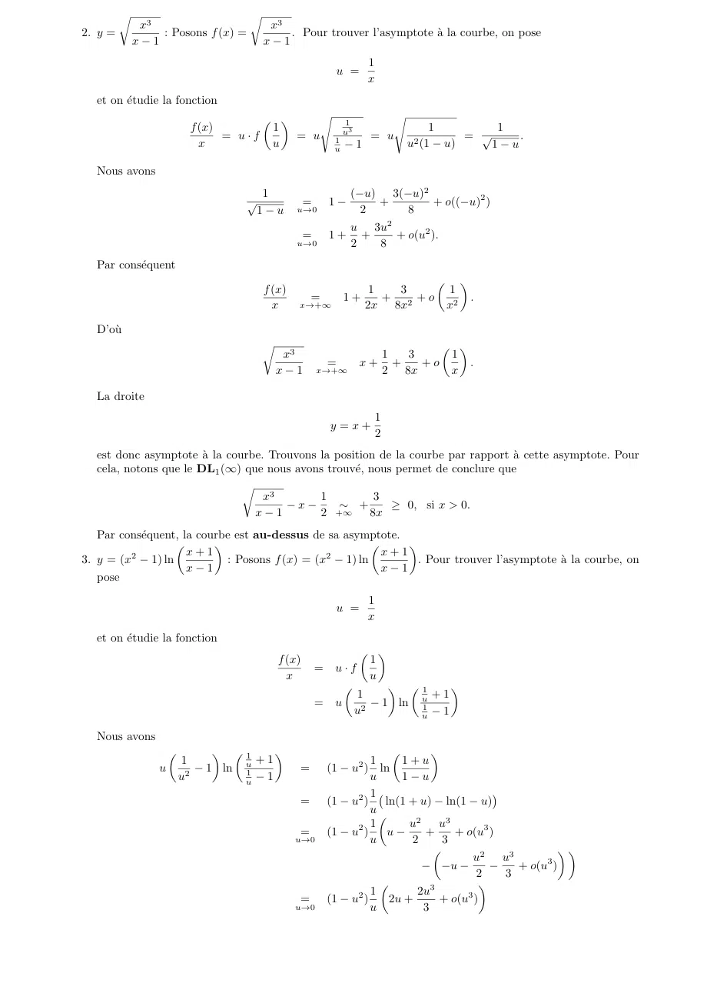

~~~text
         r                          r
              x3                         x3
2. y =           : Posons f (x) =           . Pour trouver l’asymptote à la courbe, on pose
             x−1                        x−1
                                                                   1
                                                           u =
                                                                   x
  et on étudie la fonction
                                               s         s
                                                 1
                          f (x)          1          3           1          1
                                = u·f       = u 1u    = u   2
                                                                      = √     .
                            x            u       u −1
                                                           u  (1 − u)     1−u

  Nous avons
                                         1                  (−u) 3(−u)2
                                    √               =     1−    +         + o((−u)2 )
                                        1−u     u→0           2     8
                                                            u 3u2
                                                    =     1+ +    + o(u2 ).
                                                u→0         2   8
  Par conséquent
                                                                                          
                                        f (x)                    1   3                1
                                                    =        1+    + 2 +o                      .
                                          x     x→+∞            2x 8x                 x2

  D’où
                                        r
                                             x3
                                                                                       
                                                                           1   3       1
                                                         =     x+            +   +o       .
                                            x−1         x→+∞               2 8x        x

  La droite
                                                                       1
                                                          y =x+
                                                                       2
  est donc asymptote à la courbe. Trouvons la position de la courbe par rapport à cette asymptote. Pour
  cela, notons que le DL1 (∞) que nous avons trouvé, nous permet de conclure que
                              r
                                  x3        1          3
                                      −x−       ∼ +       ≥ 0, si x > 0.
                                x−1         2 +∞      8x
   Par conséquent, la courbe est au-dessus de sa asymptote.
                                                            
                     x+1                                   x+1
3. y = (x2 − 1) ln          : Posons f (x) = (x2 − 1) ln         . Pour trouver l’asymptote à la courbe, on
                     x−1                                   x−1
   pose
                                                                   1
                                                           u =
                                                                   x
  et on étudie la fonction
                                                                
                                            f (x)                1
                                                        = u·f
                                              x                  u
                                                                    1     
                                                              1         u +1
                                                        = u      − 1 ln 1
                                                              u2        u −1

  Nous avons
                               1                                          
                         1         u +1                        2   1     1+u
                 u          − 1 ln 1            =        (1 − u ) ln
                         u2        u −1
                                                                   u     1−u
                                                                   1
                                                         (1 − u2 ) ln(1 + u) − ln(1 − u)
                                                                                            
                                                =
                                                                   u
                                                               2 1        u2     u3
                                                =        (1 − u )     u−     +      + o(u3 )
                                                u→0                u      2       3
                                                                                       u2     u3
                                                                                                        
                                                                             − −u −        −     + o(u3 )
                                                                                         2    3
                                                                               3
                                                                                        
                                                                   1       2u
                                                =        (1 − u2 )    2u +       + o(u3 )
                                                u→0                u         3
~~~

## Page 31

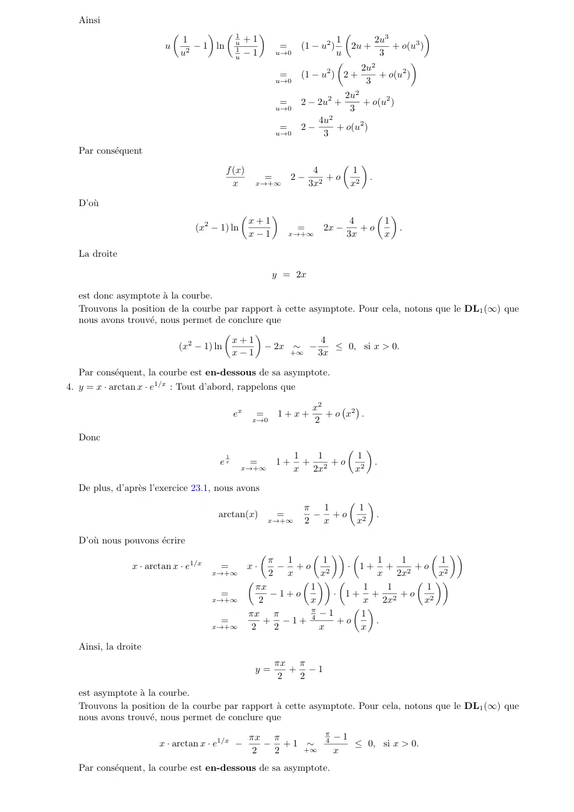

~~~text
   Ainsi
                                        1
                                                                                       2u3
                                                                                                
                                1          u +1                              1
                        u          − 1  ln 1                    =    (1 − u2 )  2u +       + o(u3 )
                                u2         u −1
                                                              u→0            u          3
                                                                                      2
                                                                                              
                                                                           2       2u        2
                                                                =    (1 − u ) 2 +       + o(u )
                                                              u→0                   3
                                                                               2u2
                                                                =    2 − 2u2 +     + o(u2 )
                                                              u→0               3
                                                                         4u2
                                                                =    2−      + o(u2 )
                                                              u→0         3
   Par conséquent
                                                                                          
                                            f (x)                         4           1
                                                          =         2−       +o                .
                                              x       x→+∞               3x2          x2

   D’où
                                                                                                  
                                                     x+1                           4                1
                                  (x2 − 1) ln                        =     2x −      +o                .
                                                     x−1            x→+∞          3x                x

   La droite

                                                            y = 2x

   est donc asymptote à la courbe.
   Trouvons la position de la courbe par rapport à cette asymptote. Pour cela, notons que le DL1 (∞) que
   nous avons trouvé, nous permet de conclure que
                                           
                             2          x+1                  4
                           (x − 1) ln         − 2x ∼ −         ≤ 0, si x > 0.
                                        x−1          +∞     3x

   Par conséquent, la courbe est en-dessous de sa asymptote.
4. y = x · arctan x · e1/x : Tout d’abord, rappelons que

                                                                         x2
                                                ex                          + o x2 .
                                                                                  
                                                      =       1+x+
                                                      x→0                2
   Donc
                                                                                           
                                            1                   1  1                   1
                                        e   x        =        1+ + 2 +o                            .
                                                 x→+∞           x 2x                   x2

   De plus, d’après l’exercice 23.1, nous avons
                                                                                           
                                                                      π  1             1
                                       arctan(x)              =         − +o                       .
                                                          x→+∞        2  x             x2

   D’où nous pouvons écrire
                                                                                          
                                                          π   1      1            1   1        1
                x · arctan x · e1/x     =            x·      − +o     2
                                                                          ·  1 +    +   2
                                                                                          + o
                                      x→+∞                2   x     x            x 2x          x2
                                                                                      
                                                       πx         1           1     1        1
                                        =                 −1+o          · 1+ + 2 +o
                                      x→+∞              2        x            x 2x          x2
                                                                  π
                                                                    −1
                                                                             
                                                     πx π                    1
                                        =                + −1+ 4         +o      .
                                      x→+∞            2     2       x        x

   Ainsi, la droite
                                                              πx π
                                                      y=         + −1
                                                               2  2
   est asymptote à la courbe.
   Trouvons la position de la courbe par rapport à cette asymptote. Pour cela, notons que le DL1 (∞) que
   nous avons trouvé, nous permet de conclure que
                                                                            π
                                                     πx π                   4 −1
                       x · arctan x · e1/x −            − +1 ∼                        ≤ 0, si x > 0.
                                                      2  2   +∞              x
   Par conséquent, la courbe est en-dessous de sa asymptote.
~~~

## Page 32

~~~text
              p
5. y = e2/x    1 + x2 arctan x : Nous avons
                                                                   r
                    2/x
                              p
                                                           2/x            1
                e         ·       1 + x2 · arctan x   = e   · x · 1 + 2 · arctan x
                                                                         x
                                                                                                     
                                                              2     4            1                1       1
                                                      =   1+ + 2 +o                   ·x 1+ 2 +o
                                                              x 2x              x2               2x       x2
                                                                                      
                                                                           π     1       1
                                                                      ·       − +o
                                                                           2     x       x2
                                                                                                 
                                                              2    2           1               1       1
                                                      =   1+ + 2 +o                  · x+        +o
                                                              x x             x2              2x       x
                                                                                      
                                                                           π     1       1
                                                                      ·       − +o
                                                                           2     x       x2
                                                                                                
                                                                   5          1       π      1       1
                                                      =   x+2+        +o           ·     − +o
                                                                  2x          x        2     x       x2
                                                                        5π
                                                                         4 −2
                                                                                      
                                                        πx                            1
                                                      =    +π−1+                  +o       .
                                                         2                  x         x

  Ainsi, la droite
                                                                 πx
                                                          y=        +π−1
                                                                  2
  est asymptote à la courbe.
  Trouvons la position de la courbe par rapport à cette asymptote. Pour cela, notons que le DL1 (∞) que
  nous avons trouvé, nous permet de conclure que
                                                                             5π
                                                         πx                   4 −2
                                    p
                          e2/x ·     1 + x2 · arctan x −    −π+1 ∼                   ≥ 0, si x > 0.
                                                          2      +∞             x
  Par conséquent, la courbe est au-dessus de sa asymptote.
~~~
