# TD3-Integration-Correction_2021-2022_Analyse2_P1S2_DMaths.pdf

[Ouvrir l’original](https://drive.google.com/open?id=1s69D9eovmOLaWzyqO__y59d_yi7f-rh0) · Les deux lectures automatiques du PDF divergent sur les pages indiquées. Leur fac-similé accompagne le texte.

**Pages présentant un écart entre les deux extractions** — 2, 6, 8, 10, 13, 17, 20–25, 29, 32, 35, 37.

## Page 1

~~~text
                                                                Cycle Préparatoire - Première Année
                                                                               Analyse II - 2021/2022

                                             Intégration
Exercice 1
Soit f la fonction définie sur [0, 4] par
                                         
                                         
                                          −1 si x = 0
                                          1 si 0 < x < 1
                                         
                                         
                                f (x) =       3 si x = 1
                                           −2 si 1 < x ⩽ 2
                                         
                                         
                                         
                                         
                                              4 si 2 < x ⩽ 4.
                                         

                Z 4
   1. Calculer      f (t) dt.
                 0
                                         Z x
   2. Soit x ∈ [0, 4], calculer F (x) =      f (t) dt.
                                                  0
  3. Montrer que F est une fonction continue sur [0, 4]. La fonction F est-elle dérivable
     sur [0, 4] ?
Solution
  1. Notons que pour la subdivision de [0, 4] définie par {x0 = 0 , x1 = 1 , x2 = 2 , x3 =
     4}, nous avons f est constante sur ]xi , xi+1 [.
     Ainsi, f est une fonction en escalier. Par conséquent
             Z 4
                 f (t) dt = 1 · (1 − 0) + (−2) · (2 − 1) + 4 · (4 − 2) = 7.
               0

  2. En utilisant la relation de Chasles nous pouvons conclure :
     — si 0 ⩽ x ⩽ 1
                                  Z x
                          F (x) =     f (t) dt = 1 · (x − 0) = x.
                                              0

      — si 1 < x ⩽ 2
                              Z x                      Z 1                    Z x
                   F (x) =             f (t) dt =               f (t) dt +             f (t) dt
                                  0                        0                      1
                                                  = 1 · (1 − 0) + (−2) · (x − 1) = 3 − 2x.
      — si 2 < x ⩽ 4
                             Z x                      Z 1                    Z 2                   Z x
               F (x) =                f (t) dt =               f (t) dt +             f (t) dt +         f (t) dt
                              0                        0                      1                     2
                                              = 1 · (1 − 0) + (−2) · (2 − 1) + 4 · (x − 2)
                                              = 4x − 9.
~~~

## Page 2

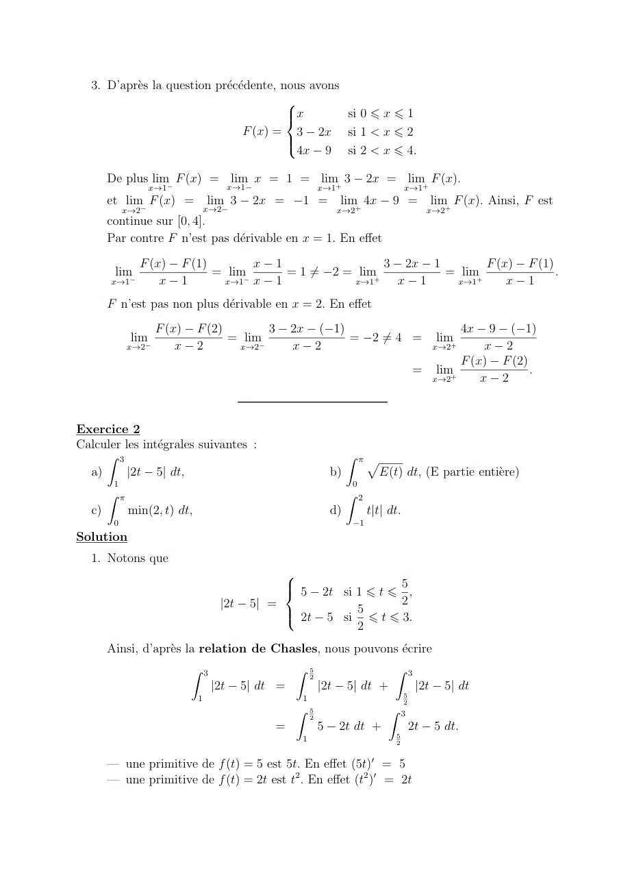

~~~text
   3. D’après la question précédente, nous avons
                                          
                                          x
                                                   si 0 ⩽ x ⩽ 1
                                  F (x) = 3 − 2x si 1 < x ⩽ 2
                                          
                                            4x − 9 si 2 < x ⩽ 4.
                                          

        De plus lim− F (x) = lim x = 1 = lim+ 3 − 2x = lim+ F (x).
                    x→1              x→1−                   x→1                     x→1
        et lim− F (x) =           lim 3 − 2x = −1 =               lim+ 4x − 9 =             lim F (x). Ainsi, F est
             x→2                  x→2−                            x→2                      x→2+
        continue sur [0, 4].
        Par contre F n’est pas dérivable en x = 1. En effet
                F (x) − F (1)        x−1                  3 − 2x − 1        F (x) − F (1)
         lim−                 = lim−     = 1 6= −2 = lim+            = lim+               .
        x→1         x−1        x→1 x − 1            x→1     x−1       x→1       x−1
        F n’est pas non plus dérivable en x = 2. En effet
                     F (x) − F (2)        3 − 2x − (−1)                                        4x − 9 − (−1)
              lim−                 = lim−               = −2 6= 4 =                          lim+
              x→2        x−2        x→2       x−2                                         x→2      x−2
                                                                                               F (x) − F (2)
                                                                                        = lim+               .
                                                                                          x→2      x−2

Exercice 2
Calculer les intégrales suivantes :
     Z 3                                                         Z πp
  a)      |2t − 5| dt,                                        b)     E(t) dt, (E partie entière)
         1                                                          0
        Z π                                                        Z 2
   c)         min(2, t) dt,                                   d)         t|t| dt.
         0                                                          −1
Solution
   1. Notons que
                                               
                                                5 − 2t si 1 ⩽ t ⩽ 5 ,
                                               
                                    |2t − 5| =                     2
                                                           5
                                                2t − 5 si ⩽ t ⩽ 3.
                                               
                                                           2
        Ainsi, d’après la relation de Chasles, nous pouvons écrire
                           Z 3                     Z 5                         Z 3
                                                        2
                                   |2t − 5| dt =            |2t − 5| dt +                |2t − 5| dt
                                                                                    5
                              1                     1                               2
                                                   Z 5                       Z 3
                                                        2
                                              =             5 − 2t dt +                 2t − 5 dt.
                                                                               5
                                                    1                          2

        — une primitive de f (t) = 5 est 5t. En effet (5t)0 = 5
        — une primitive de f (t) = 2t est t2 . En effet (t2 )0 = 2t
~~~

## Page 3

~~~text
  Par conséquent
          Z 3                   Z 5                    Z 3
                                     2
                |2t − 5| dt =            5 − 2t dt +         2t − 5 dt
                                                        5
           1                     1                      2
                                     5            3
                              5t − t2 12 + t2 − 5t 5
                                          
                           =
                                                    2
                                                                      
                                25 25                              25 25
                           =      −       − (5 − 1) + (9 − 15) −     −
                                2     4                            4   2
                             25
                           =     − 10
                              2
                             5
                           =
                             2
2. On a
                                            
                                            
                                              0     si 0 ⩽ t < 1,
                                              √1     si 1 ⩽ t < 2,
                           p                
                            E(t) =
                                               2     si 2 ⩽ t < 3,
                                             √
                                            
                                            
                                               3     si 3 ⩽ t < π.

  Ainsi, d’après la relation de Chasles, nous pouvons écrire
   Z πp                 Z 1p              Z 2p            Z 3p        Z πp
          E(t) dt =           E(t) dt +         E(t) dt +      E(t) +       E(t)
    0                     0                1               2           3
                        Z 1         Z 2         Z 3√      Z π√
                     =      0 dt +      1 dt +        2 +      3
                          0          1           2         3
                                                    √             √
                     = 0 · (1 − 0) + 1 · (2 − 1) + 2 · (3 − 2) + 3 · (π − 3)
                            √      √     √
                     = 1 + 2 − 3 3 + 3π.

3. Notons que
                                              
                                                  t si 0 ⩽ t ⩽ 2,
                           min(2, t) =
                                                  2 si 2 < t ⩽ π.

  Ainsi, d’après la relation de Chasles, nous pouvons écrire
                 Z π                Z 2                 Z π
                     min(2, t) dt =     min(2, t) dt +      min(2, t) dt
                   0                 0                    2
                                    Z 2         Z π
                                  =     t dt +      2 dt.
                                             0               2
                                                         2 0
                                   t2                    t
  Or une primitive de f (t) = t est . En effet                 = t
                                   2                      2
~~~

## Page 4

~~~text
     Par conséquent
                        Z π                               Z 2          Z π
                                 min(2, t) dt =              t dt +       2 dt
                             0                                0        2
                                                          2 2
                                                          t
                                                       =         + 2 · (π − 2)
                                                           2 0
                                                                
                                                           4
                                                       =     − 0 + 2 · (π − 2)
                                                           2
                                                       = 2π − 2.

  4. Notons que
                                                  −t2 si − 1 ⩽ t ⩽ 0,
                                              
                                 t|t| =
                                                   t2 si 0 ⩽ t ⩽ 2.
     Ainsi, d’après la relation de Chasles, nous pouvons écrire
                             Z 2           Z 0           Z 2
                                 t|t| dt =     t|t| dt +     t|t| dt
                              −1            −1            0
                                           Z 0           Z 2
                                                   2
                                         =     −t dt +        t2 dt.
                                                         −1             0
                                                    3 0
                                   2   t3           t
     Or, une primitive de f (t) = t est . En effet         = t2 .
                                       3             3
     Par conséquent
                      Z 2            Z 0           Z 2
                                           2
                          t|t| dt =      −t dt +       t2 dt
                        −1                        −1               0
                                            3 0     3 2
                                             t        t
                                         = −       +
                                             3         3 0
                                             −1              
                                                  −1        8      7
                                         = − 0−       +       −0 = .
                                                  3         3      3

Exercice 3
     Z
          x
                                          Z        √                              Z
                                                                                      1
  a)           dx                   b)        3x       1 + x2 dx             c)           dx
       1 + x2                                                                      x ln x
         e3x                                                                            1 − x2
     Z                                    Z                                     Z
  d)            dx                  e)        cos(x) sin2 (x)dx              f)                   dx
       1 + e3x                                                                     (x3 − 3x + 1)3
          x−1
     Z                                    Z                                     Z
                                                  1
                                                                                  (3x−1) 3x2 − 2x + 3 dx
                                                                                                     
  g)   p           dx               h)                   dx                  i)
          x(x − 2)                            x ln (x2 )
     Z                                    Z                                       Z
       ln x
                                                                                      x sin x2 dx
                                                                                              
  j)        dx                      k)        (1 − cos(3x))dx                l)
        x
     Z √
         ln x
  m)          dx
          x
~~~

## Page 5

~~~text
Solution
     Z
           x            1
  a)           2
                 dx = ln(x2 + 1)
        1+x             2
     Z √
                            1         3
  b) x 1 + x2 dx = (1 + x2 ) 2
                            3
     Z
           1
  c)           dx = ln(ln x)
        x ln x
          e3x
     Z
                         1
  d)               dx =    ln(1 + e3x )
        1 + e3x          3
     Z
                                1
  e)   cos(x) sin2 (x)dx = (sin x)3
                                3
             1 − x2
     Z
                                          1
  f)                     3 dx = −
        (x3 − 3x + 1)              6(x − 3x + 1)2
                                        3

            x−1
     Z                        p
  g)    p             dx = x(x − 2)
           x(x − 2)
     Z
             1            1
  h)             2
                    dx = ln(ln x2 )
        x ln (x )         2
     Z
                                          1
       (3x − 1) 3x2 − 2x + 3 dx = (3x2 − 2x + 3)2
                                  
  i)
                                          4
     Z
        ln x
  j)         dx = (ln(x))2
         x
     Z
                                   1
  k) (1 − cos(3x))dx = x − sin(3x)
                                   3
     Z
                              1
       x sin x2 dx = − cos(x2 )
                    
  l)
                              2
     Z √
          ln x         2        3
  m)            dx = (ln x) 2
           x           3
~~~

## Page 6

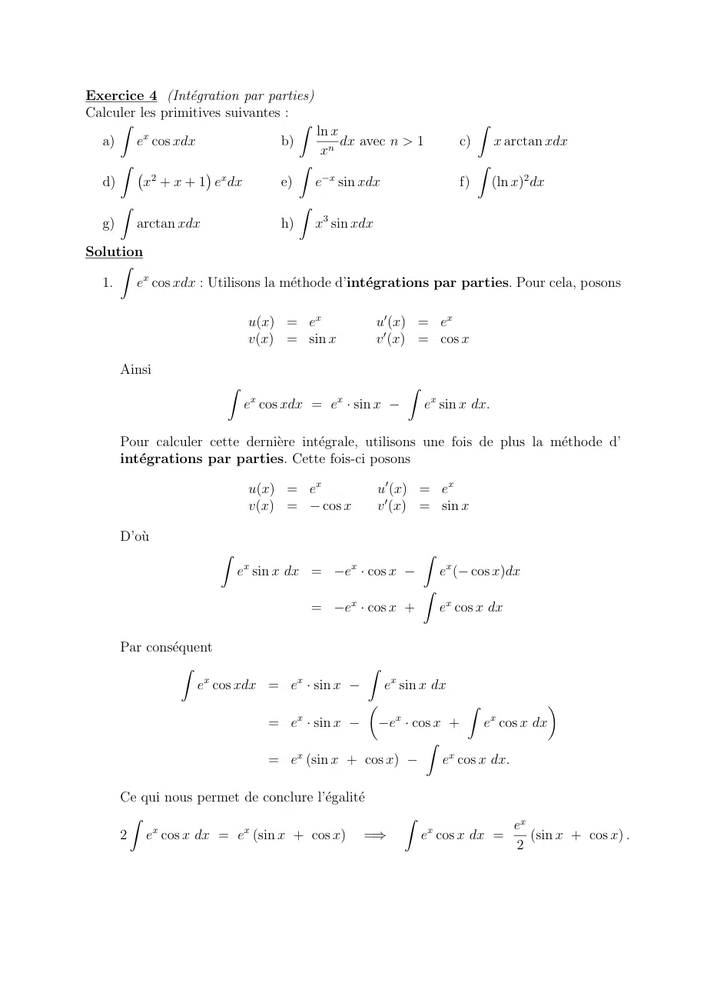

~~~text
Exercice 4 (Intégration par parties)
Calculer les primitives suivantes :
     Z                              Z                                          Z
          x                           ln x
  a)    e cos xdx                b)        dx avec n > 1                  c)       x arctan xdx
                                       xn
     Z                              Z                                          Z
            2
                                      e−x sin xdx
                      x
  d)      x + x + 1 e dx         e)                                       f)       (ln x)2 dx
       Z                                 Z
  g)       arctan xdx               h)       x3 sin xdx
Solution
     Z
  1.   ex cos xdx : Utilisons la méthode d’intégrations par parties. Pour cela, posons

                             u(x) = ex                    u0 (x) = ex
                             v(x) = sin x                 v 0 (x) = cos x

       Ainsi
                        Z                                      Z
                                x               x
                            e cos xdx = e · sin x −                ex sin x dx.

       Pour calculer cette dernière intégrale, utilisons une fois de plus la méthode d’
       intégrations par parties. Cette fois-ci posons

                             u(x) = ex                    u0 (x) = ex
                             v(x) = − cos x               v 0 (x) = sin x

       D’où
                        Z                                          Z
                            x                       x
                            e sin x dx = −e · cos x −                  ex (− cos x)dx
                                                                   Z
                                                    x
                                             = −e · cos x +            ex cos x dx

       Par conséquent
                 Z                          Z
                     x           x
                    e cos xdx = e · sin x −   ex sin x dx
                                                            Z             
                                 x              x                x
                              = e · sin x − −e · cos x +        e cos x dx
                                                      Z
                                 x
                              = e (sin x + cos x) −     ex cos x dx.

       Ce qui nous permet de conclure l’égalité
                                                                                       ex
        Z                                                     Z
       2 ex cos x dx = ex (sin x + cos x) =⇒                       ex cos x dx =          (sin x + cos x) .
                                                                                       2
~~~

## Page 7

~~~text
     Z
       ln x
2.          dx n ∈ N, n 6= 1 : Utilisons la méthode d’intégrations par parties.
        xn
     Pour cela, posons

                            u(x) = ln x                               1
                                       1                    u0 (x) =
                            v(x) =        · x−n+1                     x
                                   −n + 1                   v 0 (x) = x−n

     Ainsi
                        Z                                    Z −n+1
                            ln x          ln x           1       x
                               n
                                 dx =          n−1
                                                    −                   dx
                             x        (1 − n)x         1−n         x
                                                             Z
                                          ln x           1
                                    =               −            x−n dx
                                      (1 − n)xn−1      1−n
                                          ln x            1            1
                                    =          n−1
                                                    −          ·
                                      (1 − n)x         (1 − n) (1 − n)xn−1
                                      (1 − n) ln x − 1
                                    =
                                       (1 − n)2 xn−1
     Z
3.     x arctan x dx : Utilisons la méthode d’intégrations par parties. Pour cela,
     posons

                             u(x) = arctan x                      1
                                                        u0 (x) =
                                    x2                          1 + x2
                             v(x) =                      0
                                                        v (x) = x
                                     2
     Ainsi
                                       x2                      x2
               Z                                           Z
                                                         1
                   x arctan x dx =        · arctan x −              dx
                                        2                2   1 + x2
                                       x2                    1 + x2 − 1
                                                           Z
                                                         1
                                   =      · arctan x −                  dx
                                        2                2     1 + x2
                                       x2
                                                           Z           Z
                                                         1           1      1
                                   =      · arctan x −       1dx +               dx
                                        2                2           2    1 + x2
                                       x2 arctan x     x     arctan x
                                   =                −      +           + cte
                                             2         2         2
                                       (x2 + 1) arctan x − x
                                   =                          + cte.
                                                 2
     Z
4.       (x2 + x + 1)ex dx : Nous avons
                   Z                         Z                Z              Z
                        2          x              2 x                x
                       (x + x + 1)e dx =         x e dx +          xe dx +       ex dx.

     D’abord
                                         Z
                                             ex dx = ex
~~~

## Page 8

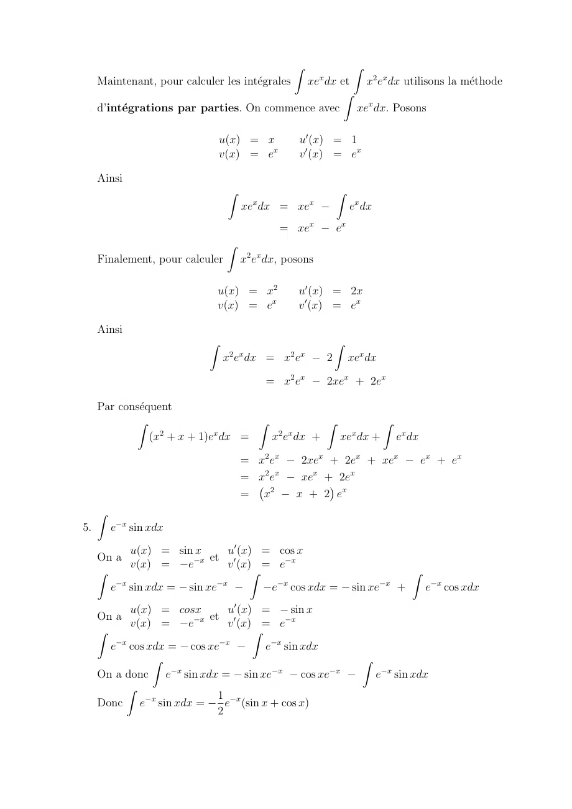

~~~text
                                                 Z                Z
                                            xe dx et x2 ex dx utilisons la méthode
     Maintenant, pour calculer les intégrales           x

                                                   Z
     d’intégrations par parties. On commence avec xex dx. Posons

                                u(x) = x         u0 (x) = 1
                                v(x) = ex        v 0 (x) = ex

     Ainsi
                                 Z                           Z
                                       x             x
                                     xe dx = xe −                ex dx
                                             = xex − ex
                                 Z
     Finalement, pour calculer       x2 ex dx, posons

                                u(x) = x2        u0 (x) = 2x
                                v(x) = ex        v 0 (x) = ex

     Ainsi
                            Z                                Z
                                 2 x           2 x
                                x e dx = x e − 2                 xex dx

                                           = x2 ex − 2xex + 2ex

     Par conséquent
             Z                    Z          Z        Z
                  2         x        2 x
                (x + x + 1)e dx =   x e dx +   xe dx + ex dx
                                                 x

                                     = x2 ex − 2xex + 2ex + xex − ex + ex
                                     = x2 ex − xex + 2ex
                                     = x2 − x + 2 ex
                                                    

     Z
5.       e−x sin xdx
           u(x) = sin x       u0 (x) = cos x
     On a                 et
           v(x) = −e−x        v 0 (x) = e−x
     Z                               Z                           Z
        −x                 −x            −x                 −x
       e sin xdx = − sin xe     −      −e cos xdx = − sin xe   +   e−x cos xdx
           u(x) = cosx       u0 (x) = − sin x
     On a             −x et
           v(x) = −e         v 0 (x) = e−x
     Z                              Z
        −x                  −x
       e cos xdx = − cos xe      −    e−x sin xdx
               Z                                        Z
                 −x                    −x          −x
     On a donc e sin xdx = − sin xe        − cos xe   −   e−x sin xdx
          Z
                           1
     Donc e−x sin xdx = − e−x (sin x + cos x)
                           2
~~~

## Page 9

~~~text
       Z
  6.       (ln x)2 dx
                                              2
            u(x) = (ln x)2         u0 (x) =     ln x
       On a                   et              x
            v(x) = x                0
                                   v (x) = 1
     Z                           Z
       (ln x)2 dx = x(ln x)2 −      2 ln xdx = x(ln x)2 + 2x(ln x − 1)
     Z
  7.   arctan xdx
                                                1
            u(x) = arctan x      u0 (x) =
       On a                   et             1 + x2
            v(x) = x             v 0 (x) = 1
     Z                            Z
                                         x                    1
                                             dx = x arctan x − ln 1 + x2
                                                                         
       arctan xdx = x arctan x −           2
                                       1+x                    2
     Z
  8.   x3 sin xdx
             u(x) = x3          u0 (x) = 3x2
       On a                  et 0
             v(x) = − cos x     v (x) = sin x
       Z                           Z
         x sin xdx = −x cos x − 3 −x2 cos xdx
          3            3

            u(x) = x2          u0 (x) = 2x
       On a                 et 0
            v(x) = sin x       v (x) = cos x
       Z                        Z
          2           2
         x cos xdx = x sin x − 2 x sin xdx
              u(x) = x            u0 (x) = 1
       On a                    et 0
              v(x) = − cos x      v (x) = sin x
       Z                        Z
         x sin xdx = −x cos x − − cos xdx = −x cos x + sin x
       Donc
        Z
          x3 sin xdx = −x3 cos x + 3 x2 sin x − 2(−x cos x + sin x)
                                                                   

       = −x3 cos x + 3x2 sin x + 6x cos x − 6 sin x

Exercice 5
Calculer les primitives suivantes :
                                    √
     Z                                        Z
                  1
  a)     √          √3
                           dx, (t = 2 + x) b) (arcsin x)2 dx
                                    6

            2+x+ 2+x
     Z
          2
            √                                 Z
                                                        ex
  c)    x 1 + x3 dx.                       d)            √       dx
                                                (3 + ex ) ex − 1
                                                     √
             √                                  1+e x
     Z                                        Z
  e)    cos xdx.                           f)     √      dx
                                                    x
          etan x                                   x3
     Z                                        Z
  g)              dx                       h)   √         dx
         (cos x)2                                 1 + x2
~~~

## Page 10

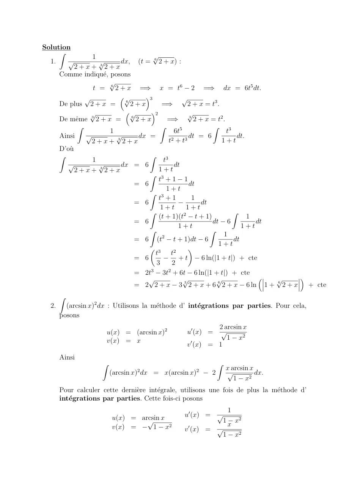

~~~text
Solution
                                     √
     Z
                  1                   6
  1.   √            √
                    3
                          dx,  (t =      2 + x) :
             2+x+ 2+x
       Comme indiqué, posons
                      √
                  t = 6 2 + x =⇒ x = t6 − 2 =⇒ dx = 6t5 dt.
                √         √      3                √
       De plus 2 + x =     6
                             2+x          =⇒           2 + x = t3 .
                 √         √       2                 √
       De même 3 2 + x = 6 2 + x            =⇒        3
                                                          2 + x = t2 .
                                                 6t5                   t3
              Z                          Z                        Z
                       1
       Ainsi    √        √     dx  =                   dt   =   6           dt.
                  2+x+ 32+x                   t2 + t3                 1+t
       D’où
                                           t3
       Z                           Z
                  1
          √         √     dx = 6                 dt
             2+x+ 32+x                   1+t
                                   Z 3
                                         t +1−1
                              = 6                      dt
                                            1+t
                                   Z 3
                                         t +1            1
                              = 6                  −         dt
                                          1+t         1+t
                                         (t + 1)(t2 − t + 1)
                                   Z                                      Z
                                                                                1
                              = 6                                 dt − 6          dt
                                                   1+t                       1+t
                                   Z                            Z
                                                                      1
                              = 6 (t2 − t + 1)dt − 6                      dt
                                                                    1+t
                                    3
                                                t2
                                                       
                                       t
                              = 6          − + t − 6 ln(|1 + t|) + cte
                                       3        2
                                    3         2
                              = 2t − 3t + 6t − 6 ln(|1 + t|) + cte
                                   √                 √
                                                     3
                                                                   √6
                                                                                    √
                                                                                     6
                                                                                       
                              = 2 2 + x − 3 2 + x + 6 2 + x − 6 ln 1 + 2 + x + cte
       Z
  2.     (arcsin x)2 dx : Utilisons la méthode d’ intégrations par parties. Pour cela,
       posons
                                                         2 arcsin x
                         u(x) = (arcsin x)2      u0 (x) = √
                         v(x) = x                           1 − x2
                                                  0
                                                 v (x) = 1
       Ainsi
                     Z                                      Z
                                  2                  2          x arcsin x
                         (arcsin x) dx = x(arcsin x) − 2        √          dx.
                                                                   1 − x2
       Pour calculer cette dernière intégrale, utilisons une fois de plus la méthode d’
       intégrations par parties. Cette fois-ci posons
                                                             1
                          u(x) = arcsin          u0 (x) = √
                                   √ x                     1 − x2
                          v(x) = − 1 − x2         0          x
                                                 v (x) = √
                                                           1 − x2
~~~

## Page 11

~~~text
  D’où
                                            √         Z √
                                                            1 − x2
              Z
                  x arcsin x
                  √                               2
                             dx = − arcsin x 1 − x −    −√          dx
                     1 − x2                                 1 − x 2
                                            √         Z
                                                  2
                                = − arcsin x 1 − x +    1 dx
                                            √
                                = − arcsin x 1 − x2 + x + cte.
   Par conséquent
        Z                                    Z
                    2                  2        x arcsin x
          (arcsin x) dx = x(arcsin x) − 2        √         dx
                                                   1 − x2
                                       2
                                                        √               
                                                              2
                          = x(arcsin x) − 2 − arcsin x 1 − x + x + cte
                                                     √
                          = x(arcsin x)2 + 2 arcsin x 1 − x2 − 2x + cte.
   Z    √
3.   x2 1 + x3 dx : À l’aide du changement de variable

                                                                            du
              1 + x3 = u         =⇒         3x2 dx = du      =⇒   x2 dx =
                                                                             3
  nous pouvons écrire
                         Z
                                 2
                                     √           1√
                                                         Z
                             x           1 + x3 dx   =
                                                     u du
                                                 3
                                              1 √
                                                Z
                                          =          u du
                                              3
                                                  3
                                              1 u2
                                          =         + cte
                                              3 32
                                              2 3
                                          =     u 2 + cte
                                              9
                                              2           3
                                          =     (1 + x3 ) 2 + cte.
                                              9
                                                     √
4. On effectue un changement de variables : u = ex − 1 il vient u2 = ex − 1 et
   ex = u2 + 1 d où 2udu = ex dx                                               r        !
              ex                                                                  ex − 1
   Z                        Z                    Z
                                   2udu              2du              u
               √       dx =                   =             = 2 arctan = arctan
      (3 + ex ) ex − 1         (3 + u2 + 1) u       4 + u2            2              2
          √                  √
   Z
5.    cos xdx on pose w = x donc w2 = x donc 2wdw = dx
          √
   Z                 Z
       cos xdx = 2 w cos wdw
  On effectue une intégration par partie :
         u(w) = w             u0 (w) = 1
  On a                    et 0
         v(w) = sin w         v (w) = cos w
  Z                          Z
    w cos wdw = w sin w − sin wdw = w sin w + cos w
                    √           √     √     √
             Z
  On a donc     cos xdx = 2 x sin x + 2 cos x
~~~

## Page 12

~~~text
                 √                  Z √x
          1+e x                                  √
          Z             Z                                 √
                             1         e
     6.      √     dx =     √ dx +      √ dx = 2 x + 2e x
               x              x            x
        Z    tan x      Z
           e
     7.            dx = etan(x) tan0 (x)dx = etan(x)
          (cos x)2
              x3
        Z
     8.   √         dx
            1 + x2
               u(x) = √  x2           u0 (x) = 2x
        On a                      et v 0 (x) = √ x
               v(x) =      1 + x2                       2
        Z       3           √              Z √ 1+x           √
              x                                                        2       3
          √         dx = x2 1 + x2 − 2       x 1 + x2 dx = x2 1 + x2 −   1 + x2 2
            1 + x2                                                     3

Exercice 6
Calculer les intégrales suivantes :
       Z 1                               Z a√                          Z π
                 t
   a)       √          dt             b)       a2 − t2 dt         c)            t2 sin t dt
        0      1 − t2                     0                             0
                                                                       Z π
                    √
       Z 1                               Z 1
                                             t−1                            2      dt
   d)          cos 1 − t dt           e)          2
                                                    dt            f)
                                          −1 1 + t                              2 + sin t
             2
        1− π4                                                           0
       Z 4        √                      Z 4                           Z 1
            1− t                               dt
   g)          √ dt                   h)          t
                                                                  i)            t(arctan t)2 dt
        1         t                       1 1+e                         0
Solution
   Z 1
             t
a)      √           dt : À l’aide du changnement de variable :
     0     1 − t2
                               1 − t2 = u     =⇒    −2tdt = du,
     nous pouvons écrire
                                  Z 1                   Z 0
                                            t             −1
                                        √        dt =      √ du
                                    0     1 − t2       1 2 u
                                                      Z 1
                                                           1
                                                    =      √ du
                                                       0 2 u
                                                      √ 1
                                                    =    u 0
                                                    = 1.
     Z a√
b)            a2 − t2 dt : Nous avons
      0
                                    s    2            s    2
                Z a√           Z a                  Z a
                     2   2
                                         t                   t
                    a − t dt =     a 1−      dt = a      1−      dt.
                 0              0        a           0       a
     Ainsi, à l’aide du changement de variable :
                                   t                dt
                                     = u      =⇒       = du,
                                   a                a
~~~

## Page 13

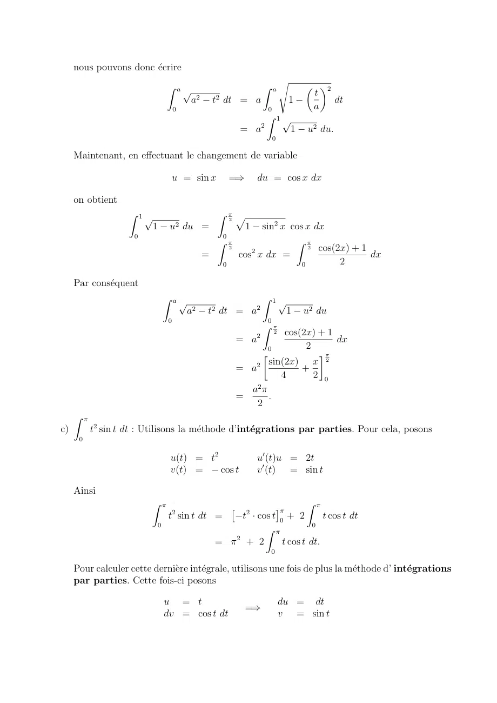

~~~text
     nous pouvons donc écrire
                                                                   s
                                                                   2
                               Z a√                          Z a
                                                                    t
                                       a2 − t2 dt   = a       1−          dt
                                   0                      0         a
                                                          Z 1√
                                                        2
                                                    = a        1 − u2 du.
                                                               0

     Maintenant, en effectuant le changement de variable

                                   u = sin x    =⇒       du = cos x dx

     on obtient
                    Z 1√           Z πp
                                      2
                             2
                        1 − u du =       1 − sin2 x cos x dx
                     0              0
                                   Z π               Z π
                                      2
                                           2
                                                         2 cos(2x) + 1
                                 =      cos x dx =                     dx
                                    0                  0        2

     Par conséquent
                               Z a√                         Z 1√
                                                         2
                                       a2 − t2 dt =     a           1 − u2 du
                               0                              0
                                                            Z π
                                                          2
                                                                2  cos(2x) + 1
                                                    =   a                      dx
                                                              0         2
                                                                           π
                                                          2 sin(2x)       x 2
                                                    =   a              +
                                                                  4       2 0
                                                          2
                                                        aπ
                                                    =         .
                                                          2
     Z π
c)         t2 sin t dt : Utilisons la méthode d’intégrations par parties. Pour cela, posons
      0

                                u(t) = t2                u0 (t)u = 2t
                                v(t) = − cos t           v 0 (t) = sin t

     Ainsi
                         Z π                                   Z π
                                   2
                                             2       π
                               t sin t dt = −t · cos t 0 + 2        t cos t dt
                           0                                     0
                                                   Z π
                                          = π2 + 2      t cos t dt.
                                                              0

     Pour calculer cette dernière intégrale, utilisons une fois de plus la méthode d’ intégrations
     par parties. Cette fois-ci posons

                               u = t                               du = dt
                                                        =⇒
                               dv = cos t dt                       v = sin t
~~~

## Page 14

~~~text
     D’où
                      Z π                                      Z π
                            t cos t dt =   [t · sin t]π0   −            sin t dt = [cos t]π0 = −2.
                       0                                        0

     Par conséquent
                             Z π                               Z π
                                   2                  2
                                   t sin t dt = π + 2                   t cos t dt = π 2 − 4.
                              0                                     0

                 √
     Z 1
d)         2
             cos  1 − t dt : En effectuant le changement de variable
      1− π4

                              √
                      x =      1−t      =⇒       t = 1 − x2               =⇒              dt = −2xdx

     nous pouvons écrire
                     √
           Z 1                                                            Z 0
               2
                 cos   1 − t dt                     =                             cos x · (−2x) dx
              1− π4                                                           π
                                                                              2
                                                                              Z π
                                                                                      2
                                                    =                     2               x cos x dx
                                                                                  0
                                                                                              π
                                                                                                           Z π
                                                                                                                2
                                                    =
                                                   |{z}                   2 [x · sin x]0 − 2  2
                                                                                                                    sin x dx
                                                                                                            0
                                       IPP = voir point précédent
                                                                                                       π
                                                    =                     π + 2 [− cos x]02
                                                    =                     π − 2.
     Z 1               Z 1                Z 1
         t−1                   t                  1                             π
e)             2
                 dt =             2
                                    dt −             2
                                                       dt = −2 arctan 1 = −
    −1 1 + t            −1 1 + t           −1 1 + t                             2
    Z π                  Z 1                              Z 1                    Z 1                        
       2      dt                        2dx                         2dx                      dx      2         2
                     =                              =                         =                   = √ arctan √
      0 2 + sin t
                                     2
                          0 (1 + x ) 2 + 1+x2
                                                2x               2
                                                            0 2x + 2x + 2                      2 3    3         3
                                                                                       x + 21 +
                                                                                              
                                                                                  0
f)                                          √   !                                                4
         2              √                   3         2 π π             2 π          π
    =√         arctan      3 − arctan              =√           −      =√           = √
          3                                  3           3 3       6         3 6        3 3
   Z 4       √          h √ i4
       1− t
g)         √ dt = 2 t − 3 = 4 − 2 − 3 = −1
    1        t                  1
   Z 4              Z 4 −t
          dt              e dt                     −t 4
                                                                      −1             −4
                                                                                          
h)             t
                 =             −t
                                   =   −  ln  1 +  e      1
                                                             = ln(1 + e    )-ln 1 +  e
    1 1+e            1 1+e
i) On a
                             t2
    Z                                              Z  2 
                     2                      2               t
       t(arctan t) dx = (arctan t) −                               arctan t dt =
                              2                          1 + t2
       t2
                            Z                    Z   
                                                           1
    = (arctan t)2 −             arctan t dt +                    arctan t dt
       2                                                1 + t2
       t2
                            Z
                                                 1
    = (arctan t)2 −             arctan t dt + (arctan t)2
       2                                         2
~~~

## Page 15

~~~text
                                                1
         u(t) = arctan t           u0 (t) =
   On a                       et              1 + t2
         v(t) = t                  v 0 (t) = 1
      t2
                                        Z
                   2                        t         1
    = (arctan t) − t arctan t +               2
                                                dt  +   (arctan t)2
      2                                    1+t        2
      t2                                1             1
    = (arctan t) − t arctan t + ln 1 + t + (arctan t)2
                   2                            2
                                                  
      2Z                                2             2
           1                      2
                                π        π  1
   Donc      t(arctan t)2 dx =      − + ln 2
         0                      16 4 2

Exercice 7
                                √
                                 Z ln 2
Considérons l’intégrale I =     ex − 1 dx
                            0            √
Effectuer le changement de variables u = ex − 1 et calculer I.

Solution
Solution : Comme indiqué, on fait le changement de variable
               √
           u = ex − 1 =⇒ u2 = ex − 1 =⇒ x = ln u2 + 1 .
                                                             

               2u
D’où dx =            du
             u2 + 1
Ainsi
                                √
                       Z ln 2                  Z 1
                                                           2u
                                 ex − 1 dx =         u·            du
                           0                    0         u2 + 1
                                                Z 1
                                                   u2
                                          = 2     2
                                                       du
                                               0 u +1
                                              Z 1 2
                                                 u +1−1
                                          = 2              du
                                               0   u2 + 1
                                              Z 1 2
                                                 u +1        1
                                          = 2     2
                                                        −        du.
                                               0 u +1     u2 + 1
Ce qui nous permet d’écrire

                √
         Z ln 2                  Z 1 2
                  x
                                      u +1         1
                 e − 1 dx = 2          2
                                            − 2         du
          0                        0 u +1      u +1
                                 Z 1          Z 1
                                                       1
                             = 2     1 du − 2        2
                                                           du
                                   0           0 u +1
                                         Z 1                        Z 1
                                  1            1                        1
                             = 2 u 0−2         2
                                                       du  =  2 − 2     2
                                                                            du.
                                          0 u +1                     0 u +1

                              1
On connait une primitive de 2
                            u +1
                    0    1
En effet (arctan(u)) =
                       1 + u2
~~~

## Page 16

~~~text
Par conséquent

           √
    Z ln 2                    Z 1
              x
                                    1
             e − 1 dx = 2 − 2     2
                                       du
     0                         0 u +1
                                      1
                      = 2 − 2 arctan(u) 0
                                                                           2π         π
                          = 2 − 2 arctan(1) + 2 arctan(0) = 2 −               +2·0 =2− .
                                                                            4         2

Exercice 8
   1. Soit f : [a, b] → R une fonction continue.
                      Z b           Z b
      Montrer que         f (x)dx =     f (a + b − x)dx
                       a             a
                                             Z π
                                                4
      En déduire le valeur de l’intégrale       ln(1 + tan(x))dx
                                                0
   2. Montrer que               Z a                         
                                        1              π     1
                                    1 + 2 arctan xdx =    a−
                                 1
                                 a
                                       x               2     a
                                                                               1  π
      pour a > 1, (Indication : utiliser la formule arctan x + arctan            = , pour x > 0 ).
                                                                               x  2
Solution
Z b effectue le changement
On                         Z a de variables : Zu =       a + b − x Zd’où du = −dx
                                                      a                     b
     f (a + b − x)dx =         f (u)(−du) = −           f (u)du =             f (u)du
 Za π                       bZ π                    b         Z π         a
     4                          4                                   4
        ln(1 + tan x)dx =         ln(cos x + sin x)dx −                ln(cos x)dx
   0
     Z π             √        0    √           !!         Z π    0
         4      √      2              2                        4
 =         ln     2       cos x +        sin x     dx −           ln(cos x)dx
       0              2             2                       0
     Z π √            Z π                              Z π
         4                4                 π              4
 =         ln 2dx +         ln cos x −            dx −          ln(cos x)dx
     Z0 π √           Z0 π                4              0 Z π
         4                4            π                            4
 =         ln 2dx +         ln cos        + 0 − x dx −                  ln(cos x)dx
       0                0              4                           0
     π ln 2
 =
Z a 8          
              1                                                                           1              dx
  1 1 + x2 arctan xdx on effectue le changement de variable : u = x donc du = − x2
 Za a                            Z 1                                         Z 1                          
               1                       a
                                                2
                                                                1           du         a
                                                                                               2
                                                                                                          1    du
   1 1 + x2 arctan xdx =                   1+u        arctan              − 2 =            1+u      arctan     − 2
                                     a                           u            u       a                    u    u
   aZ a            
                 1     π                
 =          1+ 2           − arctan u du
       1
       a
                 u     2
~~~

## Page 17

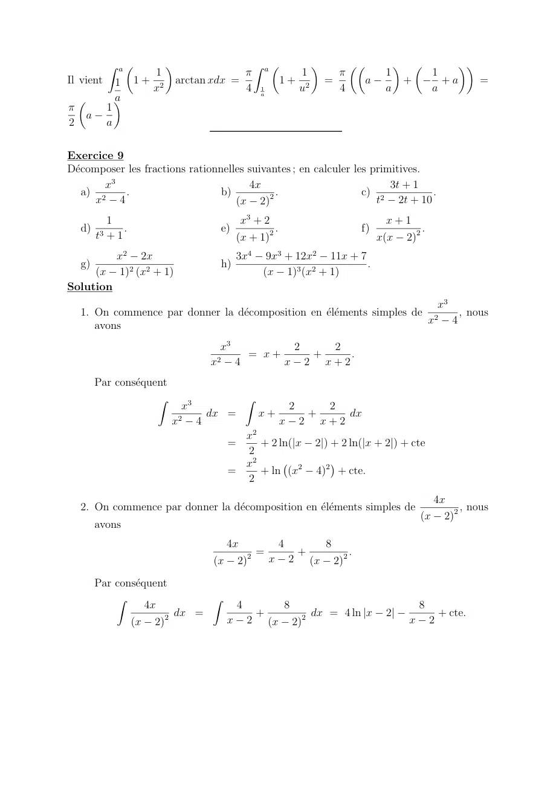

~~~text
        Z a
                              π a
                              Z                      
               1                      1   π       1     1
Il vient 1 1 + 2 arctan xdx =      1+ 2 =      a−    + − +a    =
              x               4 a1   u    4       a     a
         a
          
π       1
    a−
2       a

Exercice 9
Décomposer les fractions rationnelles suivantes ; en calculer les primitives.
       x3                              4x                              3t + 1
   a) 2    .                     b)         2.                   c) 2           .
      x −4                          (x − 2)                         t − 2t + 10
          1                             x3 + 2                          x+1
  d)          .                  e)             .                f)             .
       t3 + 1                          (x + 1)2                       x(x − 2)2
         x2 − 2x                       3x4 − 9x3 + 12x2 − 11x + 7
  g)                             h)                               .
     (x − 1)2 (x2 + 1)                      (x − 1)3 (x2 + 1)
Solution
                                                                        x3
  1. On commence par donner la décomposition en éléments simples de 2   , nous
                                                                      x −4
     avons
                                 x3       2   2
                                2
                                    = x+    +    .
                               x −4      x−2 x+2
       Par conséquent

                           x3
                    Z                    Z
                                                     2   2
                                dx =         x+        +    dx
                         x2 − 4                     x−2 x+2
                                     x2
                                   =    + 2 ln(|x − 2|) + 2 ln(|x + 2|) + cte
                                     2
                                     x2
                                        + ln (x2 − 4)2 + cte.
                                                        
                                   =
                                     2
                                                                                  4x
  2. On commence par donner la décomposition en éléments simples de                  , nous
                                                                               (x − 2)2
       avons
                                   4x        4      8
                                       2 =      +         .
                                (x − 2)    x − 2 (x − 2)2

       Par conséquent
           Z                Z
                  4x            4      8                          8
                     2 dx =        +       2 dx = 4 ln |x − 2| −     + cte.
              (x − 2)         x − 2 (x − 2)                      x−2
~~~

## Page 18

~~~text
                  3t + 1
3. Notons que               est un élément simple. Calculons sa primitive. Nous avons
               t2 − 2t + 10
          Z                       Z                       Z
                3t + 1                       3t                     1
             2
                          dt =          2
                                                     dt +     2
                                                                             dt
            t − 2t + 10                t − 2t + 10           t − 2t + 10
                                           2t − 2 + 2
                                     Z                      Z
                                  3                                      1
                              =                        dt +                         dt
                                  2       t2 − 2t + 10          (t2 − 2t + 1) + 9
                                             2t − 2
                                     Z                      Z
                                  3                                      4
                              =            2
                                                       dt +       2
                                                                                    dt
                                  2       t − 2t + 10           (t − 2t + 1) + 9
                                             2t − 2
                                     Z                        Z
                                  3                                     1
                              =            2
                                                       dt + 4                    dt
                                  2       t − 2t + 10             (t − 1)2 + 9
                                             2t − 2
                                     Z                        Z
                                  3                         4           1
                              =            2
                                                       dt +             2      dt
                                  2       t − 2t + 10       9       t−1
                                                                           + 1
                                                                    3      
                                  3        2              4            t−1
                              =      ln(t − 2t + 10) + arctan                   + cte.
                                  2                       3              3

                                                                       1
4. On commence par donner la décomposition en éléments simples de 3    , nous
                                                                     t +1
   avons
                            1              1         t−2
                                   =           −             .
                          t3 + 1                   2
                                       3(t + 1) 3(t − t + 1)
   Par conséquent
                                        t−2
      Z              Z
            1                1
          3
                dx =              −   2
                                                dx
         t +1           3(t + 1) 3(t − t + 1)
                                                                     
                     1              1    2           1         2t − 1
                   =   ln |t + 1| − ln(t − t + 1) + √ arctan    √       + cte.
                     3              6                 3           3

             x3 + 2       P (x)
5. R(x) =           2
                      =
            (x + 1)       Q(x)
   La division euclidienne donne : x3 + 2 = (x − 2) x2 + 2x + 1 + (3x + 4)
                                                                    

                           1
   Le coefficient de              est 1 (on remplace x par −1 dans le numérateur).
                      (x + 1)2
                 3x + 4           1          3
   On calcule           2
                          −           2
                                        =
                (x + 1)      (x + 1)       x+1
            3
          x +2                      3          1
   Donc           2
                    =x−2+               +
         (x + 1)                 x + 1 (x + 1)2
                               x2                        1
   Donc une primitive est          − 2x + 3 ln(x + 1) −
                               2                        x+1
                    x+1
6. Primitive de
                  x(x − 2)2
                      1       1                                x+1
   Le coefficient de est (on remplace x par −1 dans                   ).
                      x       4                              (x − 2)2
                           1          3                             x+1
   Le coefficient de           2
                                  est (on remplace x par −1 dans         ).
                      (x − 2)         2                                x
~~~

## Page 19

~~~text
       x+1           1          3          4x + 4 − x2 + 4x − 4 − 6x               −x + 2            1
               2
                 −      −            2
                                       =                            2
                                                                              =           2
                                                                                            =−
     x(x − 2)       4x 2(x − 2)                       4x(x − 2)                  4(x − 2)         4(x − 2)
              x+1             1          3                 1
     Donc                 =      +                −
           x(x − 2)2         4x 2(x − 2)2 4(x − 2)
                            1              3           1
     Une primitive est ln x −                      − ln(x − 2)
                            4          2(x − 2) 4
           2
          x − 2x                                        1               1
  7.                        Le  coefficient   de                est   −    (on remplace x par −1 dans
     (x − 1)2 (x2 + 1)                             (x − 1)2             2
     x2 − 2x
              ).
     (x2 + 1)
                            1          −1 − 2i            1 + 2i                                    x2 − 2x
     Le coefficient de           est               =   −           (on  remplace  x par i dans                   ).
                          x−i        (i − 1)2 2i              4                                 (x − 1)2 (x + i)
               1 + 2i         1 − 2i           (1 + 2i)(x + i) + (1 − 2i)(x − i)               x−2
     Donc −               −             =−                        2
                                                                                       =−
              4(x − i) 4(x + i)                                  x +1                       2 (x2 + 1)
     Enfin
           x2 − 2x                   1              x−2
                            +                +
      (x − 1)2 (x2 + 1)         2(x − 1)2 2 (x2 + 1)
         2x − 4x + x + 1 + (x − 2) (x2 − 2x + 1)
           2              2
      =
                        2(x − 1)2 (x2 + 1)
         2x − 4x + x2 + 1 + x3 − 4x2 + 5x − 2
           2
      =
                       2(x − 1)2 (x2 + 1)
           3      2
          x −x +x−1                 (x2 + 1) x − (x2 + 1)              (x2 + 1) (x − 1)          1
      =            2    2
                                 =               2    2
                                                                  =           2   2
                                                                                          =
         2(x − 1) (x + 1)             2(x − 1) (x + 1)                2(x − 1) (x + 1)      4(x − 1)
     Donc
           x2 − 2x                      1              x−2                1
              2    2
                            =−                2
                                                −        2
                                                                  +
      (x − 1) (x + 1)              2(x − 1)         2 (x + 1) 4(x − 1)
                 1                x              1              1
      =−                 −                +            +
           2(x − 1)2 2 (x2 + 1) x2 + 1 4(x − 1)
                                  1         1                                  1
                                        − ln x2 + 1 + arctan x + ln(x − 1)
                                                             
     Une primitive est
                             2(x − 1) 4                                        4

Exercice Z10
                1
Soit In =           (1 − t2 )n dt.
            0

  1. Établir une relation de récurrence entre In et In+1 .
  2. Calculer In .
                    n
                       (−1)k n
                  X           
  3. En déduire                .
                   k=0
                       2k + 1 k
Solution
  1. Utilisons la méthode d’intégrations par parties. Pour cela, posons

                         u(t) = (1 − t2 )n+1      u0 (t) = −2(n + 1)t(1 − t2 )n
                         v(t) = t                 v 0 (t) = 1
~~~

## Page 20

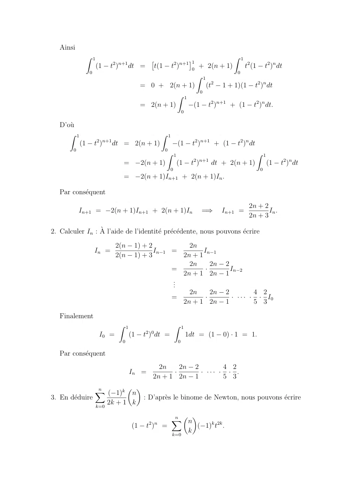

~~~text
   Ainsi
              Z 1                                                                        Z 1
                            2 n+1                              1
                                                 t(1 − t2 )n+1 0          t2 (1 − t2 )n dt
                                                                      
                    (1 − t )        dt =                  + 2(n + 1)
               0                                                        0
                                                         Z 1
                                        = 0 + 2(n + 1)       (t2 − 1 + 1)(1 − t2 )n dt
                                                          0
                                                   Z 1
                                        = 2(n + 1)     −(1 − t2 )n+1 + (1 − t2 )n dt.
                                                                  0

   D’où
      Z 1                                          Z 1
                    2 n+1
            (1 − t )        dt = 2(n + 1)                −(1 − t2 )n+1 + (1 − t2 )n dt
        0                                            0
                                                     Z 1                                           Z 1
                                                                           2 n+1
                                = −2(n + 1)                  (1 − t )              dt + 2(n + 1)         (1 − t2 )n dt
                                                         0                                          0
                                = −2(n + 1)In+1 + 2(n + 1)In .

   Par conséquent
                                                                                               2n + 2
            In+1 = −2(n + 1)In+1 + 2(n + 1)In                                =⇒       In+1 =          In .
                                                                                               2n + 3

2. Calculer In : À l’aide de l’identité précédente, nous pouvons écrire

                            2(n − 1) + 2           2n
                   In =                  In−1 =         In−1
                            2(n − 1) + 3         2n + 1
                                                   2n      2n − 2
                                              =          ·        In−2
                                                 2n + 1 2n − 1
                                              ..
                                               .
                                                   2n      2n − 2           4 2
                                              =          ·         · · · · · · I0
                                                 2n + 1 2n − 1              5 3

   Finalement
                               Z 1                           Z 1
                                           2 0
                     I0 =            (1 − t ) dt =                    1dt = (1 − 0) · 1 = 1.
                                0                             0

   Par conséquent
                                               2n    2n − 2        4 2
                                     In =          ·        · ··· · · .
                                             2n + 1 2n − 1         5 3
                   n
                     (−1)k n
                   X       
3. En déduire                           : D’après le binome de Newton, nous pouvons écrire
                    k=0
                        2k + 1 k

                                                      n  
                                            2 n
                                                     X   n
                                     (1 − t )      =       (−1)k t2k .
                                                     k=0
                                                         k
~~~

## Page 21

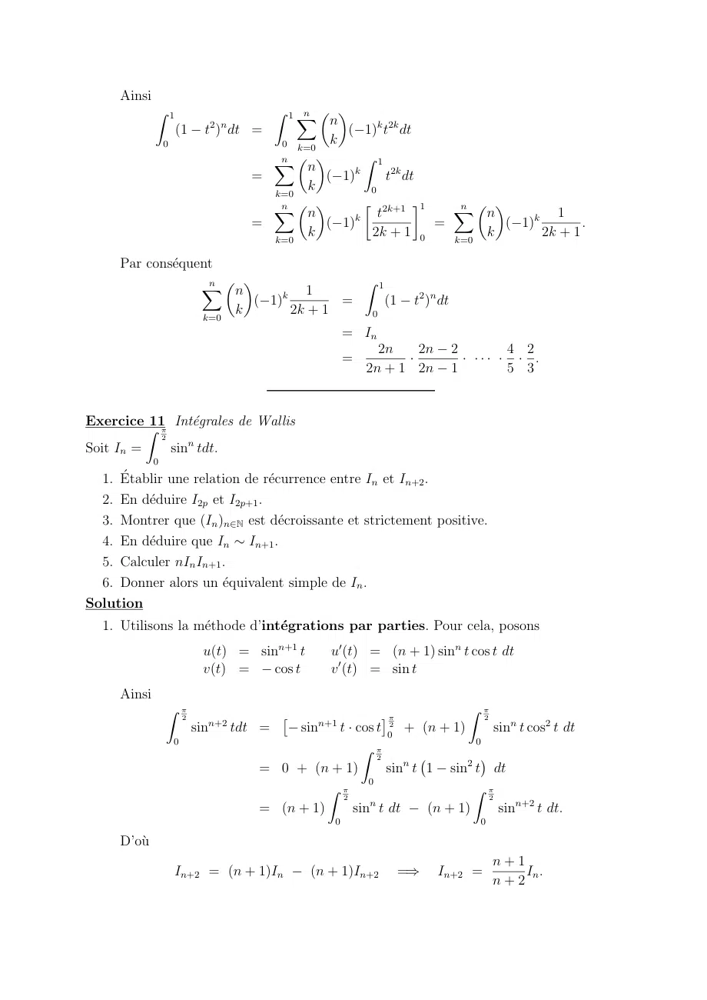

~~~text
     Ainsi
             Z 1                 Z 1X n  
                                2 n        n
                   (1 − t ) dt =             (−1)k t2k dt
                 0                0 k=0 k
                                  n           Z 1
                                 X     n      k
                               =          (−1)        t2k dt
                                 k=0
                                       k          0
                                  n                         1    n  
                                                    t2k+1
                                 X n          
                                              k
                                                                 X   n          1
                               =          (−1)                 =       (−1)k        .
                                 k=0
                                       k          2k   +  1  0   k=0
                                                                     k       2k + 1

     Par conséquent
                            n                 Z 1
                           X   n     k   1
                                 (−1)         =     (1 − t2 )n dt
                           k=0
                               k       2k + 1    0

                                                              = In
                                                                    2n    2n − 2        4 2
                                                              =         ·        · ··· · · .
                                                                  2n + 1 2n − 1         5 3

Exercice 11π Intégrales de Wallis
          Z
            2
Soit In =     sinn tdt.
             0
  1. Établir une relation de récurrence entre In et In+2 .
  2. En déduire I2p et I2p+1 .
  3. Montrer que (In )n∈N est décroissante et strictement positive.
  4. En déduire que In ∼ In+1 .
  5. Calculer nIn In+1 .
  6. Donner alors un équivalent simple de In .
Solution
  1. Utilisons la méthode d’intégrations par parties. Pour cela, posons
                            u(t) = sinn+1 t               u0 (t) = (n + 1) sinn t cos t dt
                            v(t) = − cos t                v 0 (t) = sin t
     Ainsi
                 Z π                                                                 Z π
                      2
                            n+2                       n+1
                                                                      π2                 2
                                                                                    sinn t cos2 t dt
                                              
                          sin         tdt =       − sin
                                                     t · cos t 0 + (n + 1)
                  0                                                            0
                                                          Z π
                                                             2
                                                               sinn t 1 − sin2 t dt
                                                                                
                                         = 0 + (n + 1)
                                                           0
                                                   Z π                        Z π
                                                      2                           2
                                                           n
                                         = (n + 1)      sin t dt − (n + 1)           sinn+2 t dt.
                                                          0                           0

     D’où
                                                                                              n+1
                  In+2 = (n + 1)In − (n + 1)In+2                            =⇒   In+2 =           In .
                                                                                              n+2
~~~

## Page 22

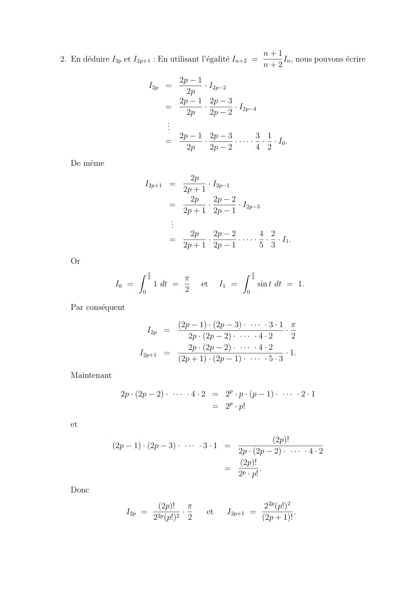

~~~text
                                                                      n+1
2. En déduire I2p et I2p+1 : En utilisant l’égalité In+2 =             In , nous pouvons écrire
                                                                      n+2
                                      2p − 1
                             I2p =           · I2p−2
                                        2p
                                      2p − 1 2p − 3
                                   =         ·        · I2p−4
                                        2p     2p − 2
                                   ..
                                    .
                                      2p − 1 2p − 3            3 1
                                   =         ·        · · · · · · · I0 .
                                        2p     2p − 2          4 2
   De même
                                         2p
                          I2p+1 =             · I2p−1
                                       2p + 1
                                         2p     2p − 2
                                    =         ·        · I2p−3
                                       2p + 1 2p − 1
                                    ..
                                     .
                                         2p     2p − 2          4 2
                                    =         ·        · · · · · · · I1 .
                                       2p + 1 2p − 1            5 3
   Or
                        Z π                                 Z π
                             2          π                        2
                I0 =             1 dt =       et     I1 =            sin t dt = 1.
                         0              2                    0

   Par conséquent

                                     (2p − 1) · (2p − 3) · · · · · 3 · 1 π
                             I2p =                                       ·
                                        2p · (2p − 2) · · · · · 4 · 2      2
                                        2p · (2p − 2) · · · · · 4 · 2
                        I2p+1      =                                     · 1.
                                     (2p + 1) · (2p − 1) · · · · · 5 · 3

   Maintenant

                  2p · (2p − 2) · · · · · 4 · 2 = 2p · p · (p − 1) · · · · · 2 · 1
                                                = 2p · p!

   et
                                                                  (2p)!
                (2p − 1) · (2p − 3) · · · · · 3 · 1 =
                                                        2p · (2p − 2) · · · · · 4 · 2
                                                        (2p)!
                                                      = p      .
                                                        2 · p!
   Donc
                                  (2p)! π                              22p (p!)2
                     I2p =              ·       et     I2p+1 =                   .
                                 2 (p!)2 2
                                  2p                                  (2p + 1)!
~~~

## Page 23

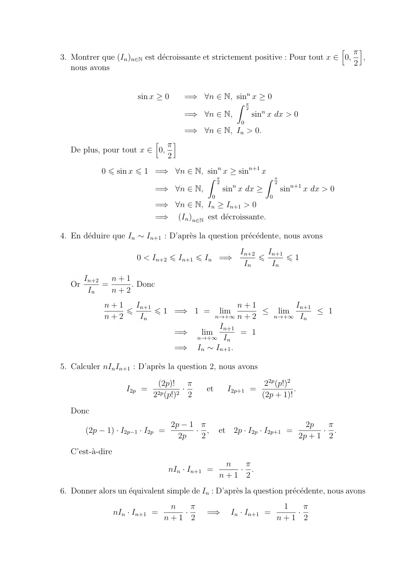

~~~text
                                                                                 h πi
3. Montrer que (In )n∈N est décroissante et strictement positive : Pour tout x ∈ 0, ,
                                                                                    2
   nous avons

                         sin x ≥ 0      =⇒ ∀n ∈ N, sinn x ≥ 0
                                                   Z π
                                                      2
                                        =⇒ ∀n ∈ N,      sinn x dx > 0
                                                           0
                                        =⇒ ∀n ∈ N, In > 0.
                         h πi
   De plus, pour tout x ∈ 0,
                             2
            0 ⩽ sin x ⩽ 1 =⇒ ∀n ∈ N, sinn x ≥ sinn+1 x
                                     Z π              Z π
                                        2               2
                                             n
                          =⇒ ∀n ∈ N,      sin x dx ≥      sinn+1 x dx > 0
                                                 0                 0
                              =⇒ ∀n ∈ N, In ≥ In+1 > 0
                              =⇒ (In )n∈N est décroissante.

4. En déduire que In ∼ In+1 : D’après la question précédente, nous avons
                                                           In+2   In+1
                         0 < In+2 ⩽ In+1 ⩽ In =⇒                ⩽      ⩽1
                                                            In     In
        In+2   n+1
   Or        =     . Donc
         In    n+2
             n+1   In+1                    n+1        In+1
                 ⩽      ⩽ 1 =⇒ 1 = lim         ≤ lim       ≤ 1
             n+2    In               n→+∞  n+2   n→+∞  In
                                      In+1
                            =⇒   lim       = 1
                                n→+∞ In
                            =⇒ In ∼ In+1 .

5. Calculer nIn In+1 : D’après la question 2, nous avons

                               (2p)! π                            22p (p!)2
                      I2p =          ·       et        I2p+1 =              .
                              2 (p!)2 2
                               2p                                (2p + 1)!
   Donc
                                     2p − 1 π                                     2p   π
        (2p − 1) · I2p−1 · I2p =           · ,       et 2p · I2p · I2p+1 =            · .
                                       2p   2                                   2p + 1 2
   C’est-à-dire
                                                      n  π
                                   nIn · In+1 =         · .
                                                     n+1 2
6. Donner alors un équivalent simple de In : D’après la question précédente, nous avons
                                   n   π                                1   π
                   nIn · In+1 =      ·       =⇒         In · In+1 =       ·
                                  n+1 2                                n+1 2
~~~

## Page 24

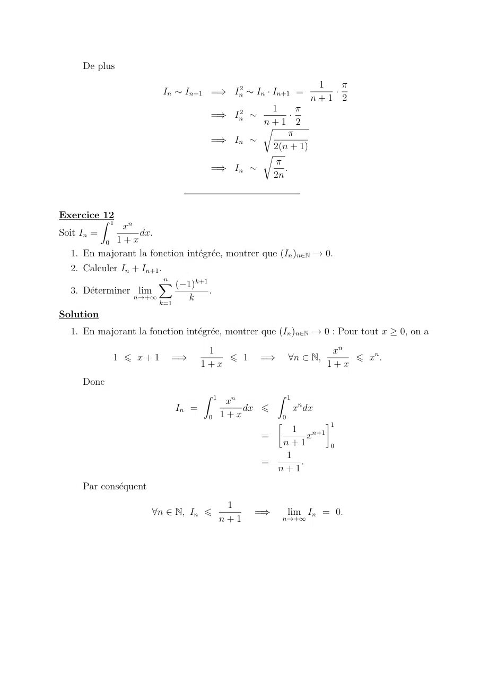

~~~text
     De plus
                                                                  1   π
                         In ∼ In+1 =⇒ In2 ∼ In · In+1 =             ·
                                                                 n+1 2
                                             1       π
                                    =⇒ In2 ∼       ·
                                            n+1 2
                                            r
                                                   π
                                    =⇒ In ∼
                                              2(n + 1)
                                            r
                                              π
                                    =⇒ In ∼      .
                                              2n

Exercice Z12
            1
             xn
Soit In =        dx.
         0 1+x
  1. En majorant la fonction intégrée, montrer que (In )n∈N → 0.
  2. Calculer In + In+1 .
                          n
                       X    (−1)k+1
  3. Déterminer lim                .
                 n→+∞
                        k=1
                               k
Solution
  1. En majorant la fonction intégrée, montrer que (In )n∈N → 0 : Pour tout x ≥ 0, on a
                                   1                                    xn
            1 ⩽ x+1        =⇒         ⩽ 1       =⇒           ∀n ∈ N,       ⩽ xn .
                                  1+x                                  1+x
     Donc
                                  Z 1                Z 1
                                         xn
                           In =             dx ⩽             xn dx
                                    0   1+x              0
                                                              1
                                                     1     n+1
                                                =        x
                                                   n+1          0
                                                   1
                                                =      .
                                                  n+1
     Par conséquent
                                         1
                       ∀n ∈ N, In ⩽           =⇒             lim In = 0.
                                        n+1              n→+∞
~~~

## Page 25

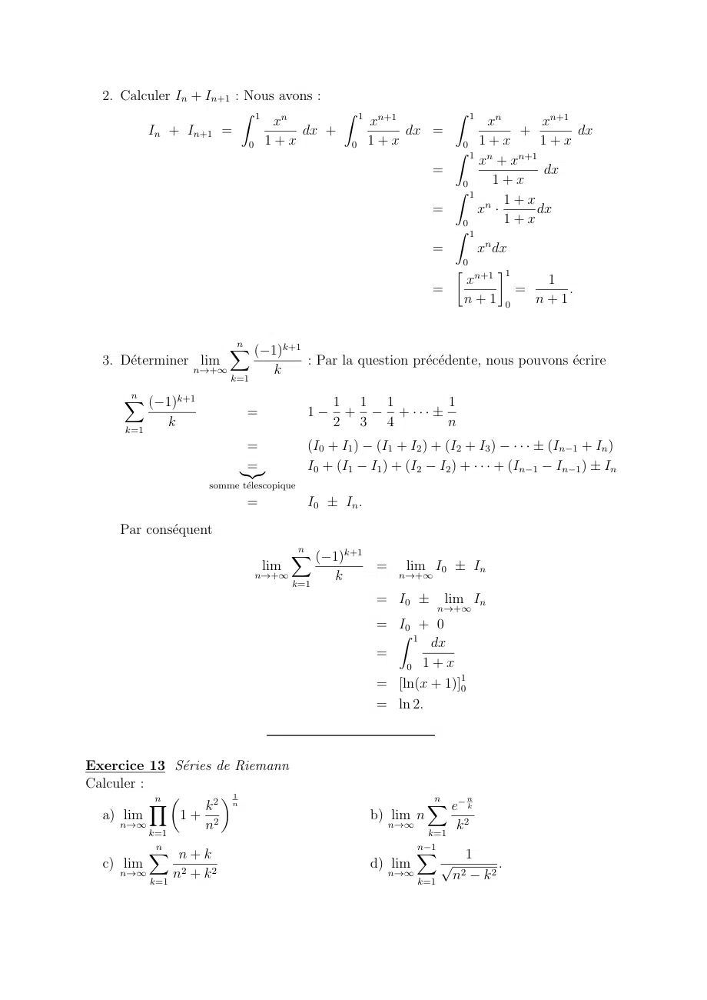

~~~text
  2. Calculer In + In+1 : Nous avons :
                         Z 1 n         Z 1 n+1      Z 1 n
                              x           x              x        xn+1
         In + In+1 =              dx +         dx =           +          dx
                          0 1+x         0 1+x        0 1+x       1+x
                                                    Z 1 n
                                                        x + xn+1
                                                  =               dx
                                                     0     1+x
                                                    Z 1
                                                             1+x
                                                  =     xn ·     dx
                                                     0       1+x
                                                    Z 1
                                                  =     xn dx
                                                     0
                                                     n+1 1
                                                      x            1
                                                  =           =        .
                                                     n+1 0       n+1

                            n
                            X (−1)k+1
  3. Déterminer lim                         : Par la question précédente, nous pouvons écrire
                    n→+∞
                            k=1
                                     k
     n
     X   (−1)k+1                                  1 1 1        1
                               =             1−    + − + ··· ±
     k=1
            k                                     2 3 4        n
                              =              (I0 + I1 ) − (I1 + I2 ) + (I2 + I3 ) − · · · ± (In−1 + In )
                              =
                             |{z}            I0 + (I1 − I1 ) + (I2 − I2 ) + · · · + (In−1 − In−1 ) ± In
                       somme télescopique
                               =             I0 ± In .
     Par conséquent
                                         n
                                         X (−1)k+1
                                   lim                    =      lim I0 ± In
                                  n→+∞
                                         k=1
                                                  k            n→+∞

                                                          = I0 ±        lim In
                                                                       n→+∞
                                                          = I0 + 0
                                                            Z 1
                                                                  dx
                                                          =
                                                              0 1+x
                                                          = [ln(x + 1)]10
                                                          = ln 2.

Exercice 13 Séries de Riemann
Calculer :
            n       1                                              n    n
           Y      k2 n                                               X e− k
  a) lim        1+ 2                                     b) lim n
     n→∞
           k=1
                  n                                           n→∞
                                                                      k=1
                                                                            k2
           n                                                        n−1
           X n+k                                                    X     1
  c) lim                                                 d) lim       √         .
     n→∞
           k=1
                 n2 + k 2                                     n→∞
                                                                  k=1
                                                                       n 2 − k2
~~~

## Page 26

~~~text
Solution
               n                n1
                       k2                         k2
                                                    
               Y                         1X
  1. On a ln         1+ 2              =    ln 1 + 2
            k=1
                       n                 n        n
     On reconnaı̂t une somme de Riemann pour la fonction f : x 7→ ln 1 + x2 donc la
                                                                           
                      Z 1
                          ln 1 + x2 dx
                                   
     somme tend vers
                            0
     On effectue une intégration par partie :
                                                     2x
            u(x) = ln 1 + x2           u0 (t) =
                                
     On a                          et              1 + x2
            v(x) = x                    0
                                       v (t) = 1
      Z 1                                      Z 1                        Z 1       Z 1
                                                     2x2
                                                                                                
                   2
                                     2 1
                                                                                       1
          ln 1 + x dx = x ln 1 + x 0 −                    2
                                                            dx = ln 2 − 2      1dx −        2
                                                                                              dx
       0                                         0 1+x                      0         0 1+x
                                              π
      = ln 2 − 2(1 + arctan 1) = ln 2 − 2 +
                                              2
                                   n            1
                                             k2 n
                                      
                                                               π
                                  Y
     Donc par composition lim           1+ 2        = eln 2−2+ 2
                             n→∞
                                  k=1
                                             n
              n    n               n        n
              X e− k        1 X e− k
  2. On a n               =
                     k2     n k=1 k 2
                                   
               k=1                      n
     On reconnaı̂t une somme de Riemann qui tend donc vers
      Z 1 −1
         e x        h 1 i1
             2
               dx = e− x = e−1
       0   x              0
  3. On a
      n                 n
     X    n+k        1 X 1 + nk
                  =
         n2 + k2     n k=1 1 + k 2
                                
     k=1                                n
     On reconnaı̂t une somme de Riemann qui tend donc vers
                                                                               1
      Z 1                Z 1               Z 1                                
            1+x                 x                  1             1          2
                 2
                   dx =             2
                                      dx +             2
                                                         dx =      ln 1 + x        + [arctan x]10 =
       0   1 + x           0  1 + x          0  1 +  x           2               0
     1         π
       ln 2 +
     2         4
          n−1             n−1                    n−1
          X          1    X        1           1X           1
  4. lim       √               √           =          q         2 On reconnaı̂t une somme de
     n→∞            2   2
                  n − k k=1 n − k 2     2      n k=1
           k=1                                           1 − nk
                                       Z 1
                                                1                         π
     Riemann qui tend donc vers            √          dx = [arctan x]10 =
                                         0    1−x   2                     4

Exercice 14
Calculer les limites suivantes :
                √     √          √
           1 + 2 + 3 + ··· + n
  1. lim               √           .
     n→∞              n n
            n
           X       n
  2. lim               .
     n→∞
           p=1
               n + p2
                 2
~~~

## Page 27

~~~text
Solution
                   √ √          √
             1+        3 + ··· + n
                       2+
  1. lim              √            : On commence par noter que :
    n→∞              n n
                 √    √          √         n √          n
                                                           r
              1 + 2 + 3 + ··· + n       1X k         1X k
                        √            =       √   =
                      n n               n k=1 n      n k=1 n
                                                            n
                                                               r
                                                     1−0X            (1 − 0)
                                                 =               0+k         .
                                                       n k=1            n
                        √
    En
    Z 1 posant  f (x) =   x nous venons d’écrire la somme de Riemann correspondant à
        f (x)dx. Cette intégrale se calcule facilement :
     0

                                Z 1                  Z 1                          "    3
                                                                                           #1
                                                                 √                    x2               2
                                        f (x)dx =                    x dx =           3            =     .
                                    0                    0                            2
                                                                                                       3
                                                                                               0

                                       n √               Z 1
                                    1X k
    Maintenant, la somme de Riemann      √ converge vers     f (x)dx, ainsi
                                    n k=1 n               0

                                                √        √          √
                                          1+        2+     3 + ··· + n   2
                                    lim                   √            = .
                                n→∞                      n n             3
             n
             X         n
  2. lim                     : On commence par noter que :
    n→∞
             p=1
                   n2 + p2

                   n                        n                                              n
                   X       n      1X        1        (1 − 0) X          1
                         2 + p2
                                =                2 =                        (1−0) 2
                                                                                     .
                       n          n           p         n
                                                
                   p=1              p=1 1 +                  p=1
                                                             n
                                                                 1 + 0 +  p                                       n

                           1
    En posant f (x) =            nous venons d’écrire la somme de Riemann correspondant
       Z 1              1 + x2
    à     f (x)dx. Cette intégrale se calcule facilement :
         0
                               Z 1                  Z 1
                                                              dx            1 π
                                        f (x)dx =                2
                                                                   = arctan x 0 = .
                                0                    0       1+x                 4
                                                                 n                                           Z 1
                                    1X       1
    Maintenant, la somme de Riemann             converge vers                                                        f (x)dx, ainsi
                                    n p=1 1 + p 2                                                             0
                                                                              n

                                                    n
                                                    X    n      π
                                             lim       2 + p2
                                                              =   .
                                             n→∞
                                                 p=1
                                                     n          4
~~~

## Page 28

~~~text
Exercice 15
Sans calculer les intégrales, montrer que
                                Z π/2                         Z π/2
                                                n
                                              sin x dx =                 cosn x dx.
                                 0                             0
Solution
À l’aide du changement de variable
                                         π
                               x=          −u           =⇒     dx = −du,
                                         2
nous pouvons écrire
                       Z π/2                            Z 0              π               
                                     n
                               sin x dx =                      sinn               −u           (−du)
                         0                               π/2                     2
                                                             Z 0                 π            
                                                                             n
                                                    = −             sin                  −u         du
                                                           π/2                       2
                                                        Z π/2                π         
                                                                         n
                                                    =              sin               − u du
                                                         0                       2
Maintenant
                                               π        
                                         sin        −u       = cos u.
                                                2
Donc
 Z π/2                 Z π/2         π                Z π/2            Z π/2
           n                     n                               n
         sin x dx =            sin             − u du =       cos u du =       cosn x dx.
   0                    0                 2                          0                                     0

Exercice 16
                                            1 x
                                               Z
           0                              ∗
Soit f ∈ C (R). On définit g : R → R, x 7→        f (t)dt.
                                            x 0
   1. Montrer que g se prolonge par continuité en 0.
                                                                                              Z (k+1)T                Z T
  2. On suppose f T-périodique. Montrer que : ∀k ∈ N,                                                    f (t)dt =         f (t)dt.
                                                                                               kT                      0
                               1 nT             1 x
                                 Z               Z
  3. Ecrire g(x) sous la forme        f (t)dt +      f (t)dt pour un entier n bien choisi,
                               x 0              x nT
     et en déduire que g admet une limite en +∞.
Exercice 17                                                                              Z x
Soit f : R → R une fonction continue sur R et F (x) =                                          f (t)dt.
                                                                                          0
Répondre par vrai ou faux aux affirmations suivantes :
  1. F est continue sur R.
~~~

## Page 29

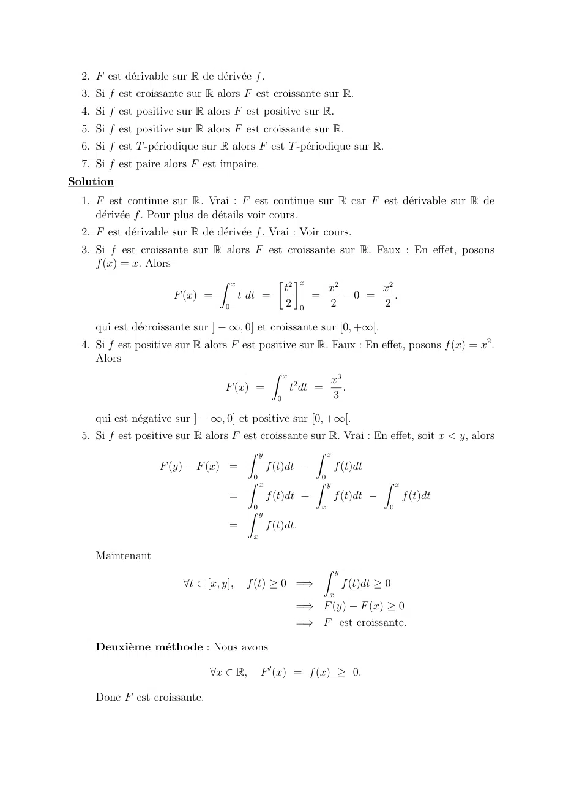

~~~text
  2. F est dérivable sur R de dérivée f .
  3. Si f est croissante sur R alors F est croissante sur R.
  4. Si f est positive sur R alors F est positive sur R.
  5. Si f est positive sur R alors F est croissante sur R.
  6. Si f est T -périodique sur R alors F est T -périodique sur R.
  7. Si f est paire alors F est impaire.
Solution
  1. F est continue sur R. Vrai : F est continue sur R car F est dérivable sur R de
     dérivée f . Pour plus de détails voir cours.
  2. F est dérivable sur R de dérivée f . Vrai : Voir cours.
  3. Si f est croissante sur R alors F est croissante sur R. Faux : En effet, posons
     f (x) = x. Alors
                              Z x         2 x
                                          t         x2        x2
                      F (x) =     t dt =        =      −0 =      .
                               0           2 0      2         2

     qui est décroissante sur ] − ∞, 0] et croissante sur [0, +∞[.
  4. Si f est positive sur R alors F est positive sur R. Faux : En effet, posons f (x) = x2 .
     Alors
                                           Z x
                                                         x3
                                  F (x) =       t2 dt =     .
                                             0           3

     qui est négative sur ] − ∞, 0] et positive sur [0, +∞[.
  5. Si f est positive sur R alors F est croissante sur R. Vrai : En effet, soit x < y, alors
                                      Z y            Z x
                   F (y) − F (x) =        f (t)dt −      f (t)dt
                                       0              0
                                      Z x            Z y           Z x
                                  =       f (t)dt +      f (t)dt −      f (t)dt
                                       0              x              0
                                      Z y
                                  =       f (t)dt.
                                         x

     Maintenant
                                                         Z y
                         ∀t ∈ [x, y],   f (t) ≥ 0 =⇒           f (t)dt ≥ 0
                                                          x
                                                    =⇒ F (y) − F (x) ≥ 0
                                                    =⇒ F est croissante.

     Deuxième méthode : Nous avons

                               ∀x ∈ R,       F 0 (x) = f (x) ≥ 0.

     Donc F est croissante.
~~~

## Page 30

~~~text
  6. Si f est T -périodique sur R alors F est T -périodique sur R. Faux : En effet, posons
     f (x) = 1 + cos(x). Alors
               Z x
     F (x) =        1 + cos(t) dt = [t + sin(t)]x0 = x + sin(x) − (0 + sin(0)) = x + sin(x).
                 0

      qui n’est pas périodique.
  7. Si f est paire alors F est impaire. Vrai : En effet, nous avons
                                            Z −x
                                  F (−x) =        f (t)dt.
                                                         0

      En faisant le changement de variable

                                   t = −u         =⇒           dt = −du

      nous pouvons donc écrire
                                                              Z −x
                               F (−x)            =                         f (t)dt
                                                              Z0 x
                                                 =               f (−u)(−du)
                                                                  0
                                                                Z x
                                                =
                                               |{z}           −     f (u)du
                                                                       0
                                             f est paire
                                                 =            −F (x).

      De plus F (0) = 0. F est donc impaire.

Exercice 18                                                                        Z b
Déterminer les fonctions f continues sur [a, b] telles que                              f (t)dt = (b − a) sup |f |.
                                                                                    a                       [a,b]
Solution
Tout d’abord, notons que
                                                   Z b
                                    b−a =                    1 dt.
                                                     a

La linearité de l’intégrale, nous permet donc d’ecrire
                                                                              Z b
                             (b − a) sup |f | = sup |f |                            1 dt
                                     [a,b]                   [a,b]             a
                                                             Z b
                                                   =                 sup |f | dt.
                                                              a       [a,b]
~~~

## Page 31

~~~text
Ainsi
                 Z b                                               Z b                 Z b
                          f (t)dt = (b − a) sup |f | ⇐⇒                  sup |f | =             f (t)dt
                  a                           [a,b]                 a    [a,b]              a
                                                                   Z b                Z b
                                                           ⇐⇒            sup |f | −         f (t)dt = 0
                                                                    a    [a,b]         a
                                                                   Z b
                                                           ⇐⇒            sup |f | − f (t)dt = 0.
                                                                    a    [a,b]

Or

                                      ∀t ∈ [a, b],         sup |f | ≥ f (t).
                                                           [a,b]

La fonction

                                          t 7−→ sup |f | − f (t),
                                                          [a,b]

est donc continue et positive sur [a, b], d’intégale nulle sur [a, b]. Par conséquent

                                   ∀t ∈ [a, b],        sup |f | − f (t) = 0.
                                                       [a,b]

D’où on conclut
             Z b
                          f (t)dt = (b − a) sup |f | ⇐⇒ ∀t ∈ [a, b],                  f (t) = sup |f |
                      a                        [a,b]                                               [a,b]
                                                               ⇐⇒ f est constante.

Exercice 19
                                            1 x
                                               Z
             0                            ∗
Soit f ∈ C (R). On définit g : R → R, x 7→        f (t)dt.
                                            x 0
   1. Montrer que g se prolonge par continuité en 0.
                                                                                 Z (k+1)T                    Z T
     2. On suppose f T -périodique. Montrer que : ∀k ∈ N,                                       f (t)dt =         f (t)dt.
                                                                                  kT                          0
                                  1 nT             1 x
                                    Z               Z
     3. Ecrire g(x) sous la forme        f (t)dt +      f (t)dt pour un entier n bien choisi,
                                  x 0              x nT
        et en déduire que g admet une limite en +∞.
Solution
     1. Montrer que g se prolonge par continuité en 0 : On doit montrer que la limite
                                                   1 x
                                                     Z
                               lim g(x) = lim            f (t)dt
                               x→0          x→0 x 0
~~~

## Page 32

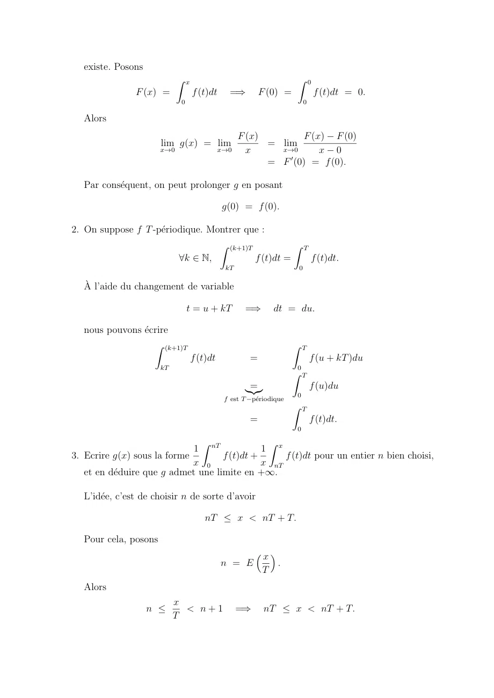

~~~text
   existe. Posons
                             Z x                                      Z 0
                F (x) =            f (t)dt     =⇒         F (0) =              f (t)dt = 0.
                              0                                           0

   Alors
                                                 F (x)         F (x) − F (0)
                       lim g(x) = lim                  = lim
                       x→0                   x→0   x     x→0       x−0
                                                       = F 0 (0) = f (0).

   Par conséquent, on peut prolonger g en posant

                                             g(0) = f (0).

2. On suppose f T -périodique. Montrer que :
                                  Z (k+1)T           Z T
                         ∀k ∈ N,           f (t)dt =     f (t)dt.
                                              kT                      0

   À l’aide du changement de variable

                                  t = u + kT         =⇒       dt = du.

   nous pouvons écrire
                   Z (k+1)T                                          Z T
                                   f (t)dt            =                       f (u + kT )du
                       kT                                             0
                                                                     Z T
                                                      =
                                                     |{z}                     f (u)du
                                                                      0
                                              f est T −périodique
                                                                     Z T
                                                      =                       f (t)dt.
                                                                      0

                             1 nT             1 x
                               Z               Z
3. Ecrire g(x) sous la forme        f (t)dt +      f (t)dt pour un entier n bien choisi,
                             x 0              x nT
   et en déduire que g admet une limite en +∞.

   L’idée, c’est de choisir n de sorte d’avoir

                                       nT ≤ x < nT + T.

   Pour cela, posons
                                                        x
                                             n = E              .
                                                          T
   Alors
                            x
                    n ≤       < n+1                =⇒       nT ≤ x < nT + T.
                            T
~~~

## Page 33

~~~text
Maintenant
                                Z x            Z nT           Z x        
                    1                        1
             g(x) =                f (t)dt =         f (t)dt +     f (t)dt
                    x            0           x   0              nT
                                             1 nT             1 x
                                               Z               Z
                                           =       f (t)dt +       f (t)dt
                                             x 0              x nT
et
                                                      Z nT                      Z x
                                   1                                    1
                   lim g(x) = lim                             f (t)dt +                  f (t)dt.
                  x→+∞        x→+∞ x                    0               x           nT

Étudions donc les limites
                      1 nT
                        Z                                                      Z x
                                                                      1
                lim        f (t)dt                      et        lim                f (t)dt.
              x→+∞ x 0                                           x→+∞ x         nT

On commence par noter que
       Z x            Z x                                                      Z nT +T
           f (t)dt ≤      |f (t)|dt                              ≤                          |f (t)|dt
            nT                        nT                                        nT
                                                                |{z}
                                                             car |f |≥0
                                                                               Z T
                                                                 =
                                                                |{z}                 |f (t)|dt = cte.
                                                                                0
                                                        d’après le point 2.

Par conséquent
                                Z x                                    Z T
                       1                           1
                   lim              f (t)dt ≤ lim                            |f (t)|dt = 0.
                  x→+∞ x         nT           x→+∞ x                    0

Ce qui nous permet de conclure
                                                     Z x
                                           1
                                       lim                  f (t)dt = 0.
                                      x→+∞ x          nT

Par ailleurs
  Z nT                                     Z T                   Z 2T                               Z nT
        f (t)dt            =                        f (t)dt +             f (t)dt + · · · +                    f (t)dt
     0                                      0                      T                                  (n−1)T
                                           Z T                   Z T                                Z T
                          =
                         |{z}                       f (t)dt +           f (t)dt + · · · +                f (t)dt
                                            0                      0                                 0
                   d’après le point 2.
                                               Z T
                           =               n         f (t)dt.
                                                0
                         x
Maintenant, n = E                , donc
                            T
                                           x          x
                                             −1 ≤ n ≤   .
                                           T          T
~~~

## Page 34

~~~text
      D’où
                     Z T                             Z T                            Z T
              x−T                                                               x
                              f (t)dt ≤ (ou ≥) n               f (t)dt ≤ (ou ≥)              f (t)dt
               T          0                               0                     T    0

      Ainsi
                    Z T                             Z T                              Z T
          x−T                              n                                    x
                          f (t)dt ≤ (ou ≥)                    f (t)dt ≤ (ou ≥)                f (t)dt.
          x·T        0                     x         0                         x·T       0

                     x−T      1
      De plus lim          = , donc
                x→+∞ x · T    T
                                n T           1 T
                                 Z             Z
                            lim     f (t)dt =     f (t)dt.
                           x→+∞ x 0           T 0

      Par conséquent

                                                1 nT               1 x
                                                   Z                 Z
                         lim g(x) =         lim          f (t)dt +      f (t)dt
                     x→+∞                 x→+∞ x 0                 x nT
                                                1 nT                     1 x
                                                   Z                        Z
                                    =       lim          f (t)dt + lim          f (t)dt
                                          x→+∞ x 0                 x→+∞ x nT

                                           1 T
                                              Z
                                    =           f (t)dt + 0
                                          T 0
                                           1 T
                                              Z
                                    =           f (t)dt.
                                          T 0

Exercice 20
Si(n, p) ∈ N2 , on définit                         Z 1
                                        I(n, p) =         tn (1 − t)p dt
                                                     0
                ∗
   1. Si p ∈ N et n ∈ N, exprimer I(n, p) en fonction de I(n + 1, p − 1).
   2. Calculer I(n, p) pour n, p ∈ N.
Solution
                                                            tn+1
   1. On utilise une intégration par parties avec u : t 7→      et v : t 7→ (1 − t)p qui
                                                            n+1
      sont de classe C 1 sur [0, 1].
                                               1         Z 1
                               tn+1
                                    
                                             p        p
                   I(n, p) =         (1 − t)      +           tn+1 (1 − t)p−1 dt
                              n+1               0   n + 1  0
                       p
      donc I(n, p) =       I(n + 1, p − 1).
                     n+1
                                                                p!n!
   2. On note pour n ∈ N, Hn : ∀p ∈ N, I(n, p) =                          et on raisonne par
                                                           (n + p + 1)!
      récurrence.
~~~

## Page 35

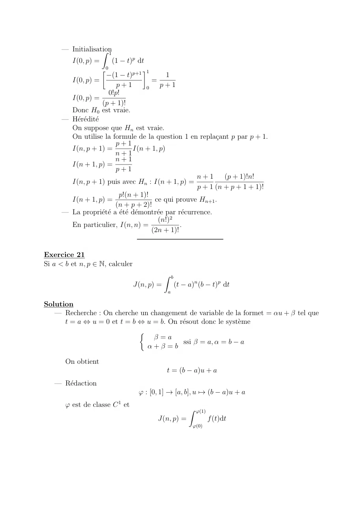

~~~text
      — Initialisation
                   Z  1
         I(0, p) =      (1 − t)p dt
                    0             1
                     −(1 − t)p+1            1
        I(0, p) =                     =
                          p+1       0    p+1
                       0!p!
        I(0, p) =
                    (p + 1)!
        Donc H0 est vraie.
      — Hérédité
        On suppose que Hn est vraie.
        On utilise la formule de la question 1 en replaçant p par p + 1.
                         p+1
        I(n, p + 1) =           I(n + 1, p)
                         n+1
                         n+1
        I(n + 1, p) =
                         p+1
                                                      n+1      (p + 1)!n!
        I(n, p + 1) puis avec Hn : I(n + 1, p) =
                                                      p + 1 (n + p + 1 + 1)!
                           p!(n + 1)!
        I(n + 1, p) =                  ce qui prouve Hn+1 .
                         (n + p + 2)!
      — La propriété a été démontrée par récurrence.
                                        (n!)2
        En particulier, I(n, n) =               .
                                      (2n + 1)!

Exercice 21
Si a < b et n, p ∈ N, calculer
                                             Z b
                                 J(n, p) =         (t − a)n (b − t)p dt
                                              a

Solution
   — Recherche : On cherche un changement de variable de la formet = αu + β tel que
      t = a ⇔ u = 0 et t = b ⇔ u = b. On résout donc le système
                             
                                 β=a
                                          ssi β = a, α = b − a
                               α+β =b

       On obtient
                                              t = (b − a)u + a
   — Rédaction
                                  ϕ : [0, 1] → [a, b], u 7→ (b − a)u + a
       ϕ est de classe C 1 et
                                                        Z ϕ(1)
                                        J(n, p) =                f (t)dt
                                                         ϕ(0)
~~~

## Page 36

~~~text
       donne par le théorème de changement de variable :
                                  Z 1
                        J(n, p) =     f (ϕ(u))ϕ0 (u)du
                                                0
                                 t − a = (b − a)u et b − t = (b − a)(1 − u)
                                           Z 1
                                 J(n, p) =     (b − a)n un (b − a)p (1 − u)p (b − a)du
                                                0
                                 J(n, p) = (b − a)n+p+1 I(n, p)

                                                                                 p!n!
                                          J(n, p) = (b − a)n+p+1
                                                                             (n + p + 1)!

Exercice 22
Soit n, p ∈ N. Calculer
                                                    Z π/2
                                  K(n, p) =                 cos2n+1 (θ) sin2p+1 (θ)dθ
                                                     0

Solution
La fonction ϕ :| 0, π/2] → [0, 1], θ 7→ cos2 (θ) est une bijection de classe C 1 . Par le
                                                  Z ϕ(0)
théorème de changement de variable I(n, p) =             f (t)dt
                                                    ϕ(π/2)
           Z 0
                                                                   p
I(n, p) =      f (ϕ(θ))ϕ0 (θ)dθ f (ϕ(θ)) = cos2n (θ) 1 − cos2 (θ)
            π/2
f (ϕ(θ)) = cos2n (θ) sin2 p(θ)
ϕ0 (θ) = −2 sin(θ) cos(θ).
f (ϕ(θ))ϕ0 (θ) Z= −2 cos2n+1 (θ) sin2p+1 (θ)
                      0
I(n, p) = −2              cos2n+1 (θ) sin2p+1 dθ
                  π/2
                                                    p!n!
I(n, p) = 2K(n, p) donc K(n, p) =                             .
                                                2(n + p + 1)!

Exercice 23
                                                     Z π/2
Soit n ∈ N. En déduire la valeur de                         sin2n+1 (u)du
                                                      0
Solution
               Z π/2                                                             Z π/2
                              2n+1            2n+1                       1
: K(n, n) =                cos       (θ) sin         K(n, n) =                           sin2n+1 (2θ)dθ en utilisant le
                  0                                                 22n+1         0
                                                                      Z      π
                                                 2n+1
changement de variable u = 2θ, 2           K(n, n) =      sin2n+1 (u)1/2 du 22n+2 K(n, n) =
Z π                                                    0                Z π
         2n+1
     sin      (u)du Puis par le changement de variable v = π − u :            sin2n+1 (u)du =
Z0 0                         Z π                   Z π/2                  π/2

      sin2n+1 (π − v)(−1)dv       sin2n+1 (u)du =        sin2n+1 (v)dv et par la relation de
 π/2                                    π/2                          0
~~~

## Page 37

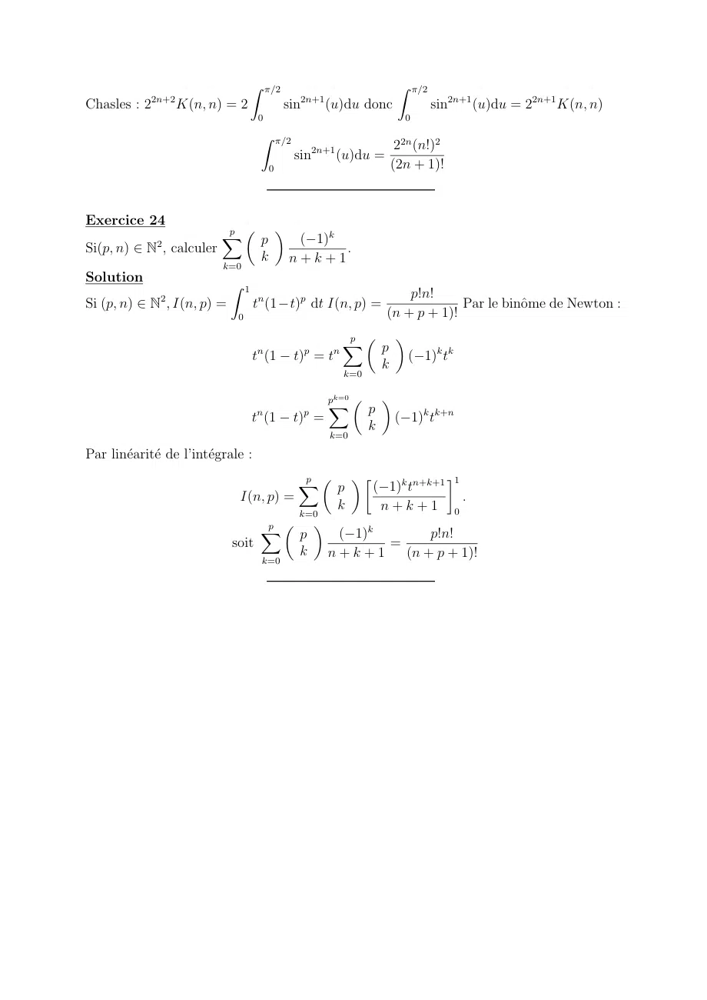

~~~text
                                  Z π/2                                    Z π/2
             2n+2                              2n+1
Chasles : 2         K(n, n) = 2              sin       (u)du donc                  sin2n+1 (u)du = 22n+1 K(n, n)
                                    0                                       0
                                     Z π/2
                                                                           22n (n!)2
                                              sin2n+1 (u)du =
                                         0                                (2n + 1)!

Exercice 24
                           p 
                                              (−1)k
                                 
              2
                           X   p
Si(p, n) ∈ N , calculer                             .
                                     k       n+k+1
                           k=0
Solution                    Z 1
              2                                                           p!n!
Si (p, n) ∈ N , I(n, p) =           tn (1−t)p dt I(n, p) =                         Par le binôme de Newton :
                              0                                       (n + p + 1)!
                                                            p    
                                    n              p    n
                                                            X   p
                                  t (1 − t) = t                              (−1)k tk
                                                                      k
                                                            k=0

                                                       pk=0          
                                    n              p
                                                       X          p
                                  t (1 − t) =                             (−1)k tk+n
                                                                  k
                                                       k=0

Par linéarité de l’intégrale :
                                               p                    1
                                                        (−1)k tn+k+1
                                                     
                                               X   p
                              I(n, p) =                                                     .
                                                        k             n+k+1             0
                                               k=0
                                     p 
                                                        (−1)k
                                           
                                     X   p                          p!n!
                            soit                              =
                                               k       n+k+1    (n + p + 1)!
                                     k=0
~~~
