# TD3-Integration-Correction_2023-2024_Analyse2_P1S2_DMaths.pdf

[Ouvrir l’original](https://drive.google.com/open?id=1HSTvoqwPBrZgkRxO0hkjguWcFichrbDV) · Les deux lectures automatiques du PDF divergent sur les pages indiquées. Leur fac-similé accompagne le texte.

**Pages présentant un écart entre les deux extractions** — 6, 10, 13, 17, 20–25, 29, 32, 35, 37.

## Page 1

~~~text
                                                                       Cycle Préparatoire - Première Année
                                                                                      Analyse II - 2021/2022

                                                    Intégration
Exercice 1
Soit f la fonction définie sur [0, 4] par
                                         8
                                         >
                                         >                   1        si x = 0
                                         >
                                         >
                                         <                   1        si 0 < x < 1
                                f (x) =                      3        si x = 1
                                         >
                                         >
                                         >
                                         >                   2        si 1 < x 6 2
                                         :
                                                             4        si 2 < x 6 4.
                 Z 4
   1. Calculer           f (t) dt.
                     0
                                                     Z x
   2. Soit x 2 [0, 4], calculer F (x) =                      f (t) dt.
                                                         0
   3. Montrer que F est une fonction continue sur [0, 4]. La fonction F est-elle dérivable
      sur [0, 4] ?
Solution
   1. Notons que pour la subdivision de [0, 4] définie par {x0 = 0 , x1 = 1 , x2 = 2 , x3 =
      4}, nous avons f est constante sur ]xi , xi+1 [.
      Ainsi, f est une fonction en escalier. Par conséquent
              Z 4
                  f (t) dt = 1 · (1 0) + ( 2) · (2 1) + 4 · (4 2) = 7.
                 0

   2. En utilisant la relation de Chasles nous pouvons conclure :
      — si 0 6 x 6 1
                                   Z x
                           F (x) =     f (t) dt = 1 · (x 0) = x.
                                                     0

      — si 1 < x 6 2
                                     Z x                      Z 1                    Z x
                     F (x) =                  f (t) dt =               f (t) dt +             f (t) dt
                                         0                        0                      1
                                                         = 1 · (1          0) + ( 2) · (x                1) = 3      2x.
      — si 2 < x 6 4
                                Z x                          Z 1                    Z 2                    Z x
                 F (x) =                     f (t) dt =               f (t) dt +             f (t) dt +          f (t) dt
                                     0                        0                      1                      2
                                                     = 1 · (1 0) + ( 2) · (2                        1) + 4 · (x         2)
                                                     = 4x 9.
~~~

## Page 2

~~~text
   3. D’après la question précédente, nous avons
                                          8
                                          >
                                          <x        si 0 6 x 6 1
                                  F (x) = 3 2x si 1 < x 6 2
                                          >
                                          :
                                            4x 9 si 2 < x 6 4.

        De plus lim F (x) = lim x = 1 = lim+ 3                                   2x = lim+ F (x).
                    x!1                  x!1                   x!1                          x!1
        et lim F (x) =            lim 3        2x =     1 =           lim+ 4x           9 =              lim F (x). Ainsi, F est
             x!2                  x!2                                x!2                                 x!2+
        continue sur [0, 4].
        Par contre F n’est pas dérivable en x = 1. En e↵et
                F (x)     F (1)       x            1                                3       2x            1            F (x)   F (1)
         lim                    = lim                = 1 6=          2 = lim+                                 = lim+                 .
        x!1         x     1      x!1 x             1                       x!1          x            1           x!1       x   1
        F n’est pas non plus dérivable en x = 2. En e↵et
                     F (x)    F (2)       3           2x ( 1)                                                     4x
                                                                                                             9 ( 1)
              lim                   = lim                     =                   2 6= 4 =                lim+
              x!2        x    2      x!2              x 2                                         x!2       x 2
                                                                                                       F (x) F (2)
                                                                                                = lim+             .
                                                                                                  x!2      x 2

Exercice 2
Calculer les intégrales suivantes :
     Z 3                                                              Z ⇡p
  a)      |2t 5| dt,                                               b)     E(t) dt, (E partie entière)
         1                                                               0
        Z ⇡                                                             Z 2
   c)         min(2, t) dt,                                        d)            t|t| dt.
         0                                                                   1
Solution
   1. Notons que
                                                    8
                                                    >                 5
                                                    < 5  2t si 1 6 t 6 ,
                                    |2t        5| =                   2
                                                    >          5
                                                    : 2t 5 si 6 t 6 3.
                                                               2
        Ainsi, d’après la relation de Chasles, nous pouvons écrire
                             Z 3                      Z 5                               Z 3
                                                           2
                                   |2t     5| dt =             |2t      5| dt +                  |2t          5| dt
                                                                                            5
                              1                        1                                    2
                                                      Z 5                             Z 3
                                                           2
                                                  =            5      2t dt +                   2t        5 dt.
                                                                                        5
                                                       1                                2

        — une primitive de f (t) = 5 est 5t. En e↵et (5t)0 = 5
        — une primitive de f (t) = 2t est t2 . En e↵et (t2 )0 = 2t
~~~

## Page 3

~~~text
  Par conséquent
          Z 3                   Z 5                       Z 3
                                        2
                |2t   5| dt =               5   2t dt +         2t       5 dt
                                                           5
           1                        1                      2
                                ⇥   ⇤5   ⇥                       ⇤3
                           =  5t t2 12 + t2                    5t 5
                             ✓         ◆                             2
                                                                                      ✓             ◆
                                25 25                                                     25   25
                           =              (5                   1) + (9          15)
                                2    4                                                    4    2
                             25
                           =      10
                              2
                             5
                           =
                             2
2. On a
                                                8
                                                >
                                                >   0   si 0 6 t < 1,
                           p                    <       si 1 6 t < 2,
                            E(t) =                p1
                                                >
                                                >   2   si 2 6 t < 3,
                                                : p
                                                    3   si 3 6 t < ⇡.

  Ainsi, d’après la relation de Chasles, nous pouvons écrire
   Z ⇡p                 Z 1p              Z 2p           Z 3p         Z ⇡p
          E(t) dt =           E(t) dt +        E(t) dt +       E(t) +      E(t)
    0                     0                1              2            3
                        Z 1         Z 2        Z 3p      Z ⇡p
                     =      0 dt +      1 dt +       2 +       3
                          0          1          2         3
                                                   p              p
                     = 0 · (1 0) + 1 · (2 1) + 2 · (3 2) + 3 · (⇡ 3)
                            p      p     p
                     = 1 + 2 3 3 + 3⇡.

3. Notons que
                                                 ⇢
                                                     t si 0 6 t 6 2,
                           min(2, t) =
                                                     2 si 2 < t 6 ⇡.

  Ainsi, d’après la relation de Chasles, nous pouvons écrire
                 Z ⇡                Z 2                 Z ⇡
                     min(2, t) dt =     min(2, t) dt +      min(2, t) dt
                   0                 0                    2
                                    Z 2         Z ⇡
                                  =     t dt +      2 dt.
                                                 0              2
                                                           ✓ 2 ◆0
                                   t2                       t
  Or une primitive de f (t) = t est . En e↵et                     = t
                                   2                         2
~~~

## Page 4

~~~text
     Par conséquent
                        Z ⇡                                    Z 2              Z ⇡
                                 min(2, t) dt =                        t dt +         2 dt
                             0                                     0             2
                                                          2 2
                                                          t
                                                       =        + 2 · (⇡ 2)
                                                           2 0
                                                         ✓      ◆
                                                           4
                                                       =       0 + 2 · (⇡ 2)
                                                           2
                                                       = 2⇡ 2.

  4. Notons que
                                              ⇢
                                                   t2 si    1 6 t 6 0,
                                 t|t| =
                                                   t2 si 0 6 t 6 2.
     Ainsi, d’après la relation de Chasles, nous pouvons écrire
                             Z 2           Z 0           Z 2
                                 t|t| dt =     t|t| dt +     t|t| dt
                               1             1            0
                                           Z 0           Z 2
                                                   2
                                         =       t dt +       t2 dt.
                                                               1                 0
                                                  ✓ 3 ◆0
                                   2   t3          t
     Or, une primitive de f (t) = t est . En e↵et         = t2 .
                                       3            3
     Par conséquent
                      Z 2            Z 0          Z 2
                                           2
                          t|t| dt =       t dt +      t2 dt
                         1                         1                       0
                                                      3   0          3 2
                                                    t                 t
                                         =                        +
                                                    3          1       3 0
                                                   ✓                ◆    ✓                ◆
                                                                  1        8                          7
                                         =           0                +               0           =     .
                                                                 3         3                          3

Exercice 3
     Z                                    Z        p                                          Z
          x                                                                                    1
  a)           dx                   b)        3x       1 + x2 dx                      c)           dx
       1 + x2                                                                               x ln x
     Z                                    Z                                              Z
         e3x                                                                                     1 x2
  d)            dx                  e)        cos(x) sin2 (x)dx                       f)                 dx
       1 + e3x                                                                              (x3 3x + 1)3
     Z                                    Z                                              Z
          x 1                                     1
  g)   p           dx               h)                   dx                           i)   (3x 1) 3x2 2x + 3 dx
          x(x 2)                              x ln (x2 )
     Z                                    Z                                                   Z
       ln x
  j)        dx                      k)        (1       cos(3x))dx                     l)          x sin x2 dx
        x
     Z p
         ln x
  m)          dx
          x
~~~

## Page 5

~~~text
Solution
     Z
           x            1
  a)           2
                 dx = ln(x2 + 1)
        1+x             2
     Z p
                            1         3
  b) x 1 + x2 dx = (1 + x2 ) 2
                            3
     Z
           1
  c)           dx = ln(ln x)
        x ln x
     Z
          e3x            1
  d)               dx =    ln(1 + e3x )
        1 + e3x          3
     Z
                                1
  e)   cos(x) sin2 (x)dx = (sin x)3
                                3
     Z
             1 x2                          1
  f)                     3 dx =         3
        (x3 3x + 1)                6(x     3x + 1)2
     Z                        p
            x 1
  g)    p             dx = x(x 2)
           x(x 2)
     Z
             1            1
  h)             2
                    dx = ln(ln x2 )
        x ln (x )         2
     Z
                                           1
  i)   (3x 1) 3x2 2x + 3 dx = (3x2 2x + 3)2
                                           4
     Z
        ln x
  j)         dx = (ln(x))2
         x
     Z
                                    1
  k) (1 cos(3x))dx = x                sin(3x)
                                    3
     Z
                              1
  l)   x sin x2 dx =            cos(x2 )
                              2
     Z p
          ln x         2        3
  m)            dx = (ln x) 2
           x           3
~~~

## Page 6

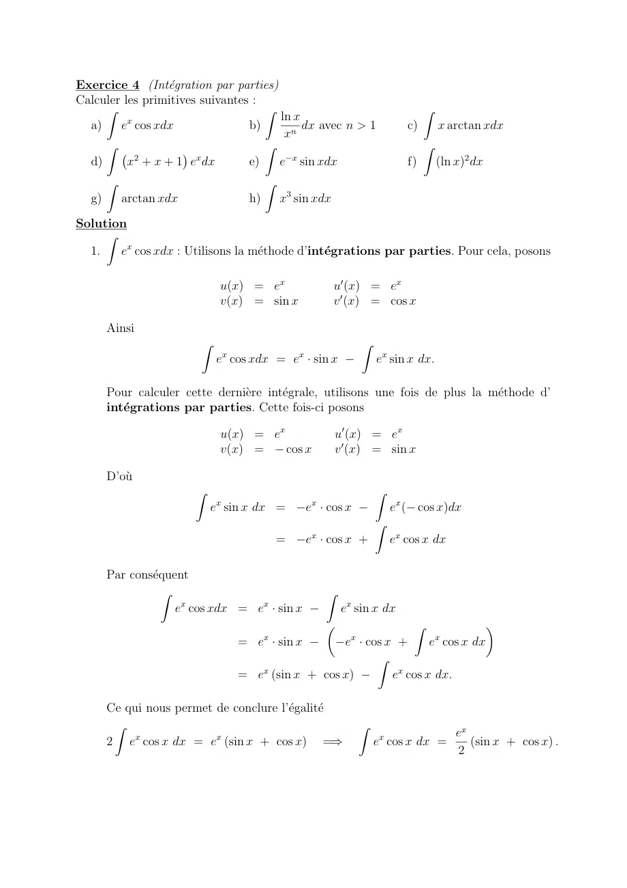

~~~text
Exercice 4 (Intégration par parties)
Calculer les primitives suivantes :
     Z                              Z                                                  Z
          x                           ln x
  a)    e cos xdx                b)        dx avec n > 1                          c)       x arctan xdx
                                       xn
     Z                              Z                                                  Z
            2          x
  d)      x + x + 1 e dx         e)   e x sin xdx                                 f)       (ln x)2 dx
       Z                                   Z
  g)       arctan xdx                 h)       x3 sin xdx
Solution
     Z
  1.   ex cos xdx : Utilisons la méthode d’intégrations par parties. Pour cela, posons

                             u(x) = ex                          u0 (x) = ex
                             v(x) = sin x                       v 0 (x) = cos x

       Ainsi
                        Z                                              Z
                                x                  x
                            e cos xdx = e · sin x                          ex sin x dx.

       Pour calculer cette dernière intégrale, utilisons une fois de plus la méthode d’
       intégrations par parties. Cette fois-ci posons

                             u(x) = ex                          u0 (x) = ex
                             v(x) =    cos x                    v 0 (x) = sin x

       D’où
                        Z                                                  Z
                            x                           x
                            e sin x dx =               e · cos x               ex ( cos x)dx
                                                                           Z
                                                        x
                                               =       e · cos x +             ex cos x dx

       Par conséquent
                 Z                                          Z
                    ex cos xdx = ex · sin x                      ex sin x dx
                                                            ✓                      Z                    ◆
                                           x                       x                       x
                                    = e · sin x      e · cos x +      e cos x dx
                                                           Z
                                       x
                                    = e (sin x + cos x)       ex cos x dx.

       Ce qui nous permet de conclure l’égalité
        Z                                                              Z
                                                                                               ex
       2 ex cos x dx = ex (sin x + cos x) =)                               ex cos x dx =          (sin x + cos x) .
                                                                                               2
~~~

## Page 7

~~~text
     Z
       ln x
2.          dx n 2 N, n 6= 1 : Utilisons la méthode d’intégrations par parties.
        xn
     Pour cela, posons

                            u(x) = ln x                               1
                                       1                    u0 (x) =
                            v(x) =       · x n+1                      x
                                     n+1                    v 0 (x) = x n

     Ainsi
                        Z                               Z
                            ln x         ln x        1      x n+1
                                 dx =                              dx
                             xn       (1 n)xn 1    1 n        x
                                                        Z
                                         ln x        1
                                    =                       x n dx
                                      (1 n)xn 1    1 n
                                         ln x         1           1
                                    =         n 1
                                                          ·
                                      (1 n)x       (1 n) (1 n)xn 1
                                      (1 n) ln x 1
                                    =
                                       (1 n)2 xn 1
     Z
3.     x arctan x dx : Utilisons la méthode d’intégrations par parties. Pour cela,
     posons

                             u(x) = arctan x                      1
                                                        u0 (x) =
                                    x2                          1 + x2
                             v(x) =                      0
                                                        v (x) = x
                                     2
     Ainsi
               Z                                           Z
                                       x2                1     x2
                   x arctan x dx =        · arctan x                dx
                                        2                2   1 + x2
                                                           Z
                                       x2                1   1 + x2 1
                                   =      · arctan x                    dx
                                        2                2     1 + x2
                                                           Z           Z
                                       x2                1           1      1
                                   =      · arctan x         1dx +               dx
                                        2                2           2    1 + x2
                                       x2 arctan x     x     arctan x
                                   =                       +           + cte
                                             2         2         2
                                       (x2 + 1) arctan x x
                                   =                          + cte.
                                                 2
     Z
4.       (x2 + x + 1)ex dx : Nous avons
                   Z                         Z                Z              Z
                        2          x              2 x                x
                       (x + x + 1)e dx =         x e dx +          xe dx +       ex dx.

     D’abord
                                         Z
                                             ex dx = ex
~~~

## Page 8

~~~text
                                                  Z                      Z
                                            xe dx et x2 ex dx utilisons la méthode
     Maintenant, pour calculer les intégrales             x

                                                   Z
     d’intégrations par parties. On commence avec xex dx. Posons

                                u(x) = x          u0 (x) = 1
                                v(x) = ex         v 0 (x) = ex

     Ainsi
                                 Z                                 Z
                                       x               x
                                     xe dx = xe                         ex dx
                                                = xex              ex
                                 Z
     Finalement, pour calculer       x2 ex dx, posons

                                u(x) = x2         u0 (x) = 2x
                                v(x) = ex         v 0 (x) = ex

     Ainsi
                            Z                                      Z
                                 2 x             2 x
                                x e dx = x e                   2        xex dx

                                           = x2 e x            2xex + 2ex

     Par conséquent
             Z                    Z          Z        Z
                  2         x        2 x
                (x + x + 1)e dx =   x e dx +   xe dx + ex dx
                                                 x

                                     = x2 e x      2xex + 2ex + xex                            ex + ex
                                     = x2 e x      xex + 2ex
                                     = x2         x + 2 ex
     Z
5.       e x sin xdx
            u(x) = sin x      u0 (x) = cos x
     On a                et
            v(x) =   e x      v 0 (x) = e x
     Z                               Z                                                     Z
          x                 x
       e sin xdx = sin xe              e x cos xdx =                    sin xe     x
                                                                                       +       e x cos xdx
            u(x) = cosx       u0 (x) =      sin x
     On a              x et    0
            v(x) =   e        v (x) = e x
     Z                              Z
          x                  x
       e cos xdx = cos xe             e x sin xdx
                Z                                                            Z
     On a donc e x sin xdx = sin xe x         cos xe x                           e x sin xdx
           Z
                           1 x
     Donc e x sin xdx =      e (sin x + cos x)
                           2
~~~

## Page 9

~~~text
       Z
  6.       (ln x)2 dx
                                             2
            u(x) = (ln x)2        u0 (x) =     ln x
       On a                  et              x
            v(x) = x               0
                                  v (x) = 1
     Z                          Z
       (ln x)2 dx = x(ln x)2       2 ln xdx = x(ln x)2 + 2x(ln x         1)
     Z
  7.   arctan xdx
                                                 1
            u(x) = arctan x      u0 (x) =
       On a                   et              1 + x2
            v(x) = x             v 0 (x) = 1
     Z                            Z
                                         x                          1
       arctan xdx = x arctan x                dx = x arctan x         ln 1 + x2
                                       1 + x2                       2
     Z
  8.   x3 sin xdx
             u(x) = x3          u0 (x) = 3x2
       On a                  et 0
             v(x) =    cos x    v (x) = sin x
       Z                           Z
          3           3
         x sin xdx = x cos x     3     x2 cos xdx
            u(x) = x2          u0 (x) = 2x
       On a                 et 0
            v(x) = sin x       v (x) = cos x
       Z                        Z
          2           2
         x cos xdx = x sin x 2 x sin xdx
              u(x) = x           u0 (x) = 1
       On a                   et 0
              v(x) =    cos x    v (x) = sin x
       Z                       Z
         x sin xdx = x cos x        cos xdx = x cos x + sin x
       Donc
        Z
          x3 sin xdx =     x3 cos x + 3 x2 sin x   2( x cos x + sin x)
               3          2
       =      x cos x + 3x sin x + 6x cos x   6 sin x

Exercice 5
Calculer les primitives suivantes :
     Z                                        Z
                  1                 p
  a)     p          p3
                           dx, (t = 2 + x) b) (arcsin x)2 dx
                                    6

            2+x+ 2+x
     Z      p                                 Z
          2                                             ex
  c)    x 1 + x3 dx.                       d)            p                        dx
                                                (3 + ex ) ex                  1
     Z                                        Z      p
             p                                  1+e x
  e)    cos xdx.                           f)     p      dx
                                                    x
     Z                                        Z
          etan x                                   x3
  g)              dx                       h)   p         dx
         (cos x)2                                 1 + x2
~~~

## Page 10

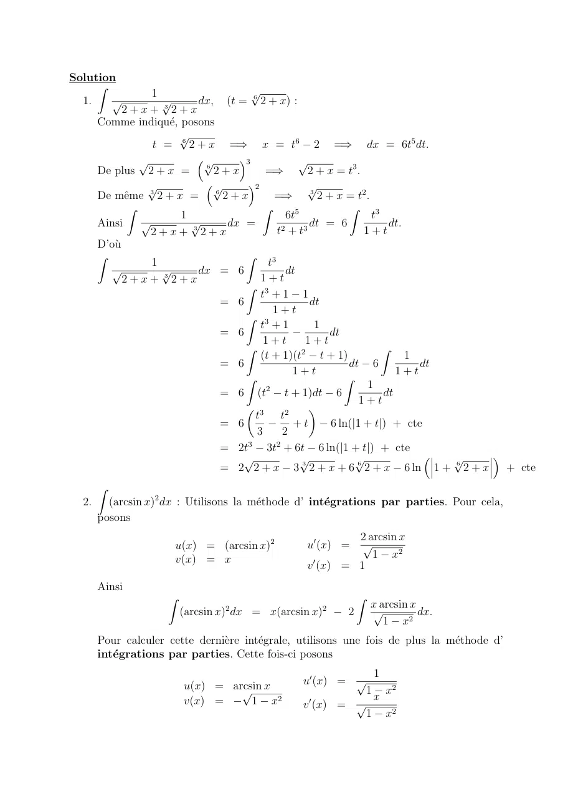

~~~text
Solution
     Z
                  1                  p
                                     6
  1.   p            p
                    3
                          dx,  (t =     2 + x) :
             2+x+ 2+x
       Comme indiqué, posons
                      p
                  t = 6 2 + x =) x = t6 2 =) dx = 6t5 dt.
                p         ⇣p      ⌘3              p
       De plus 2 + x =     6
                             2+x         =)          2 + x = t3 .
                 p         ⇣p       ⌘2               p
       De même 3 2 + x = 6 2 + x           =)       3
                                                        2 + x = t2 .
              Z                         Z                       Z
                       1                       6t5                   t3
       Ainsi    p        p     dx  =                 dt   =   6           dt.
                  2+x+ 32+x                  t2 + t3                1+t
       D’où
       Z                           Z
                  1                       t3
          p         p     dx = 6               dt
             2+x+ 32+x                  1+t
                                   Z 3
                                        t +1 1
                              = 6                    dt
                                           1+t
                                   Z 3
                                        t +1           1
                              = 6                          dt
                                         1+t        1+t
                                   Z                                    Z
                                        (t + 1)(t2 t + 1)                     1
                              = 6                               dt 6            dt
                                                 1+t                       1+t
                                   Z                          Z
                                                                    1
                              = 6 (t2 t + 1)dt 6                        dt
                                                                  1+t
                                   ✓ 3               ◆
                                      t       t2
                              = 6                +t        6 ln(|1 + t|) + cte
                                      3       2
                              = 2t3 3t2 + 6t 6 ln(|1 + t|) + cte
                                   p               p             p               ⇣ p ⌘
                                                   3              6                6
                              = 2 2 + x 3 2 + x + 6 2 + x 6 ln 1 + 2 + x + cte
       Z
  2.     (arcsin x)2 dx : Utilisons la méthode d’ intégrations par parties. Pour cela,
       posons
                                                         2 arcsin x
                         u(x) = (arcsin x)2      u0 (x) = p
                         v(x) = x                           1 x2
                                                  0
                                                 v (x) = 1
       Ainsi
                     Z                                         Z
                                  2                    2           x arcsin x
                         (arcsin x) dx = x(arcsin x)       2       p          dx.
                                                                      1 x2
       Pour calculer cette dernière intégrale, utilisons une fois de plus la méthode d’
       intégrations par parties. Cette fois-ci posons
                                                                       1
                          u(x) = arcsin          u0 (x) = p
                                   p x                             1       x2
                          v(x) =     1 x2         0                    x
                                                 v (x) = p
                                                                   1       x2
~~~

## Page 11

~~~text
     D’où
                  Z                                                          Z    p
                      x arcsin x                            p                       1    x2
                      p          dx =             arcsin x 1        x2            p         dx
                         1 x2                                                Z      1    x2
                                                            p
                                            =     arcsin x 1        x2   +       1 dx
                                                          p
                                            =     arcsin x 1        x2 + x + cte.
     Par conséquent
          Z                                                     Z
                                                  x arcsin x
            (arcsin x)2 dx = x(arcsin x)2          p        2dx
                                                     1 x2
                                               ⇣           p                ⌘
                                          2                     2
                            = x(arcsin x)    2     arcsin x 1 x + x + cte
                                                       p
                            = x(arcsin x)2 + 2 arcsin x 1 x2      2x + cte.
     Z     p
3.       x2 1 + x3 dx : À l’aide du changement de variable

                                                                                        du
                  1 + x3 = u        =)          3x2 dx = du         =)       x2 dx =
                                                                                         3
     nous pouvons écrire
                            Z           p                   Z
                                    2            1p
                                x           1 + x3 dx   =
                                                     u du
                                                 3
                                                Z
                                              1 p
                                          =          u du
                                              3
                                                  3
                                              1 u2
                                          =         + cte
                                              3 32
                                              2 3
                                          =     u 2 + cte
                                              9
                                              2           3
                                          =     (1 + x3 ) 2 + cte.
                                              9
                                                     p
4. On e↵ectue un changement de variables : u = ex 1 il vient u2 = ex 1 et
   ex = u2 + 1 d où 2udu = ex dx                                               r      !
   Z                        Z                    Z
              ex                   2udu              2du              u           ex 1
               p       dx =                   =             = 2 arctan = arctan
      (3 + ex ) ex 1           (3 + u2 + 1) u       4 + u2            2             2
   Z
          p                  p
5.    cos xdx on pose w = x donc w2 = x donc 2wdw = dx
   Z                 Z
          p
       cos xdx = 2 w cos wdw
     On e↵ectue une intégration par partie :
           u(w) = w             u0 (w) = 1
     On a                   et 0
           v(w) = sin w         v (w) = cos w
     Z                         Z                                                             f.   Lebens
       w cos wdw = w sin w         sin wdw = w sin w + cos w
               Z
                      p           p      p          p
     On a donc    cos xdx = 2 x sin x + 2 cos x
~~~

## Page 12

~~~text
          Z      p      Z           Z px
          1+e x              1         e         p        p
     6.      p     dx =     p dx +      p dx = 2 x + 2e x
               x              x            x
        Z    tan x      Z
           e
     7.            dx = etan(x) tan0 (x)dx = etan(x)
          (cos x)2
        Z
              x3
     8.   p         dx
            1 + x2
               u(x) = x   2           u0 (x) = 2x
        On a             p        et v 0 (x) = p x
               v(x) =      1 + x2                       2
        Z       3           p              Z p 1+x           p
              x                                                                                              2        3
          p         dx = x2 1 + x2     2     x 1 + x2 dx = x2 1 + x2                                           1 + x2 2
            1 + x2                                                                                           3

Exercice 6
Calculer les intégrales suivantes :
       Z 1                              Z ap                                                      Z ⇡
                t
   a)       p         dt             b)       a2 t2 dt                                       c)            t2 sin t dt
        0      1 t2                      0                                                         0
       Z 1                              Z 1                                                       Z ⇡
                   p                         t 1                                                       2      dt
   d)          cos 1 t dt            e)          2
                                                   dt                                        f)
                                           1 1+t                                                           2 + sin t
             2
        1 ⇡4                                                                                       0
       Z 4       p                      Z 4                                                       Z 1
            1      t                          dt
   g)          p dt                  h)          t
                                                                                             i)            t(arctan t)2 dt
        1        t                       1 1+e                                                     0
Solution
   Z 1
             t
a)      p          dt : À l’aide du changnement de variable :
     0     1 t2
                                       1       t2 = u                =)         2tdt = du,
     nous pouvons écrire
                                               Z 1                              Z 0
                                                                t                    1
                                                        p                dt =      p du
                                                0           1       t2         1 2 u
                                                                              Z 1
                                                                                   1
                                                                            =      p du
                                                                               0 2 u
                                                                              ⇥p ⇤1
                                                                            =    u 0
                                                                            = 1.
     Z ap
b)            a2       t2 dt : Nous avons
      0
                                                            s            ✓ ◆2            s             ✓ ◆2
                   Z ap                         Z a                                  Z a
                                                                          t                             t
                          a2   t2 dt       =            a 1                   dt = a      1                 dt.
                   0                                0                     a           0                 a
     Ainsi, à l’aide du changement de variable :
                                               t                             dt
                                                 = u                 =)         = du,
                                               a                             a
~~~

## Page 13

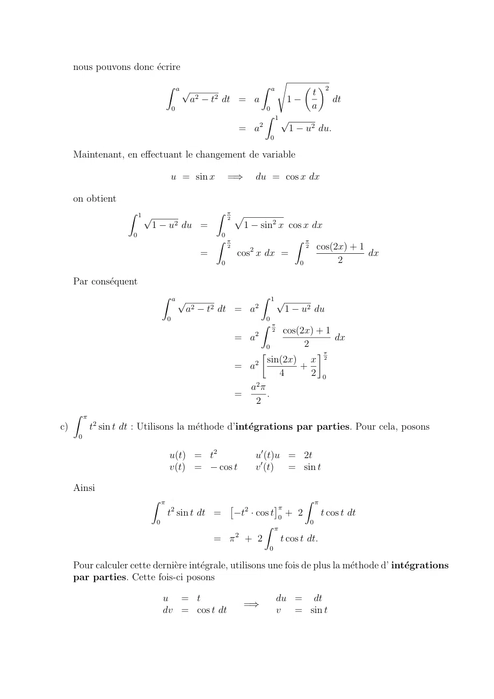

~~~text
     nous pouvons donc écrire
                                                                                     s       ✓ ◆2
                                   Z ap                                  Z a
                                                                                              t
                                           a2       t2 dt   = a                       1           dt
                                       0                                     0                a
                                                                             Z 1p
                                                                         2
                                                            = a                          1   u2 du.
                                                                                 0

     Maintenant, en e↵ectuant le changement de variable

                                       u = sin x        =)           du = cos x dx

     on obtient
                    Z 1p                             Z ⇡p
                                                        2
                           1        u2 du       =           sin2 x cos x dx
                                                                1
                     0                             0
                                                  Z ⇡               Z ⇡
                                                     2
                                                          2
                                                                        2 cos(2x) + 1
                                                =      cos x dx =                     dx
                                                   0                  0        2

     Par conséquent
                                   Z ap                                  Z 1p
                                                                     2
                                           a2    t2 dt = a                            1      u2 du
                                   0                                         0
                                                                         Z ⇡
                                                                     2
                                                                                 2    cos(2x) + 1
                                                            = a                                   dx
                                                                             0             2
                                                                                                  ⇡

                                                                     2       sin(2x) x 2
                                                            = a                     +
                                                                                4     2 0
                                                                    a2 ⇡
                                                            =            .
                                                                     2
     Z ⇡
c)         t2 sin t dt : Utilisons la méthode d’intégrations par parties. Pour cela, posons
      0

                                    u(t) = t2                        u0 (t)u = 2t
                                    v(t) =    cos t                  v 0 (t) = sin t

     Ainsi
                         Z ⇡                                                                 Z ⇡
                                       2
                                                        ⇥       2
                                                                                 ⇤⇡
                                   t sin t dt =         t · cos t 0 + 2        t cos t dt
                               0                                            0
                                                              Z ⇡
                                                    = ⇡2 + 2       t cos t dt.
                                                                             0

     Pour calculer cette dernière intégrale, utilisons une fois de plus la méthode d’ intégrations
     par parties. Cette fois-ci posons

                                   u = t                                             du = dt
                                                                =)
                                   dv = cos t dt                                     v = sin t
~~~

## Page 14

~~~text
     D’où
                         Z ⇡                                                 Z ⇡
                                 t cos t dt =             [t · sin t]⇡0               sin t dt = [cos t]⇡0 =                          2.
                             0                                                0

     Par conséquent
                                   Z ⇡                                        Z ⇡
                                               2                     2
                                               t sin t dt = ⇡ + 2                      t cos t dt = ⇡ 2                  4.
                                       0                                          0

     Z 1
                    p
d)          2
              cos        1       t dt : En e↵ectuant le changement de variable
           ⇡
      1     4

                                   p
                         x =               1       t   =)       t = 1         x2        =)              dt =     2xdx

     nous pouvons écrire
           Z 1                                                                          Z 0
                     p
               2
                 cos   1 t dt                                      =                            cos x · ( 2x) dx
                    ⇡                                                                       ⇡
                1    4                                                                      2
                                                                                            Z ⇡
                                                                                                    2
                                                                   =                    2               x cos x dx
                                                                                                0
                                                                                                            ⇡
                                                                                                                          Z ⇡
                                                                                                                                  2
                                                                   =
                                                                  |{z}                  2 [x · sin x]0      2
                                                                                                                     2                sin x dx
                                                                                                                              0
                                                       IPP = voir point précédent
                                                                                                                     ⇡
                                                                   =                    ⇡ + 2 [ cos x]02
                                                                   =                    ⇡   2.
     Z 1                         Z 1                      Z 1
            t 1                       t           1                             ⇡
e)              2
                  dt =                   2
                                           dt        2
                                                       dt = 2 arctan 1 =
          1 1+t                    1 1+t     1 1+t                              2
    Z ⇡                           Z 1                     Z 1                    Z 1                     ✓
       2      dt                        2dx                          2dx                  dx       2        2
                     =                                 =                       =                = p arctan p
      0 2 + sin t
                                      2
                          0 (1 + x ) 2 + 1+x2
                                                2x                2
                                                             0 2x + 2x + 2                  2 3     3        3
                                                                                  0  x + 12 +
f)                                          p   !                                             4
         2             ⇣p ⌘                   3         2 ⇣⇡ ⇡ ⌘            2 ⇣⇡ ⌘      ⇡
    =p         arctan      3        arctan         =p                   =p          = p
          3                                  3           3 3        6        3 6      3 3
   Z 4       p         h p i4
       1         t
g)         p dt = 2 t                3=4 2 3= 1
    1        t                  1
   Z 4              Z 4
          dt             e t dt       ⇥                  ⇤
                                                       t 4
h)             t
                  =               t
                                    =     ln  1 +  e       1
                                                              = ln(1 + e 1 )-ln 1 + e 4
    1  1  +  e       1  1  + e
i) On a
    Z                                              Z ✓ 2 ◆
                     2       t2             2                t
       t(arctan t) dx = (arctan t)                                  arctan t dt =
                            Z 2                  Z   ✓   1 + t2◆
       t2                                                   1
    = (arctan t)2               arctan t dt +                     arctan t dt
       2                    Z                           1 + t2
       t2                                        1
    = (arctan t)2               arctan t dt + (arctan t)2
       2                                         2
~~~

## Page 15

~~~text
                                                 1
         u(t) = arctan t           u0 (t) =
   On a                       et              1 + t2
         v(t) = t                  v 0 (t) = 1
                                        Z
      t2           2                        t         1
    = (arctan t)        t arctan t +           2
                                                 dt +   (arctan t)2
      2                                    1+t        2
      t2           2                    1             1
    = (arctan t)        t arctan t + ln 1 + t + (arctan t)2
                                                 2
      2Z                                2             2
           1                      2
                                ⇡        ⇡  1
   Donc      t(arctan t)2 dx =             + ln 2
         0                      16 4 2

Exercice 7                      Z ln 2
                                         p
Considérons l’intégrale I =         1 dx   ex
                                    0   p
E↵ectuer le changement de variables u = ex                    1 et calculer I.

Solution
Solution : Comme indiqué, on fait le changement de variable
               p
           u = ex 1 =) u2 = ex 1 =) x = ln u2 + 1 .

               2u
D’où dx =            du
             u2 + 1
Ainsi
                       Z ln 2                        Z 1
                                p                                 2u
                                    ex   1 dx =             u·            du
                           0                            0        u2 + 1
                                                        Z 1
                                                           u2
                                                  = 2     2
                                                               du
                                                       0 u +1
                                                      Z 1 2
                                                         u +1 1
                                                  = 2              du
                                                       0   u2 + 1
                                                      Z 1 2
                                                         u +1        1
                                                  = 2     2
                                                                         du.
                                                       0 u +1     u2 + 1
Ce qui nous permet d’écrire
         Z ln 2                  Z 1 2
                p                     u +1        1
                  e x 1 dx = 2                         du
                                       2        2
          0                        0 u +1     u +1
                                 Z 1         Z 1
                                                      1
                             = 2     1 du 2         2
                                                          du
                                   0          0 u +1
                                         Z 1                                       Z 1
                                 ⇥ ⇤1           1                                           1
                             = 2 u 0 2        2
                                                      du = 2                   2                du.
                                          0 u +1                                    0    u2 + 1
                              1
On connait une primitive de 2
                           u +1
                   0     1
En e↵et (arctan(u)) =
                      1 + u2
~~~

## Page 16

~~~text
Par conséquent
    Z ln 2                               Z 1
           p                                     1
             ex 1 dx = 2             2          du
      0                                   0    u2 + 1
                                      ⇥         ⇤1
                          = 2        2 arctan(u) 0
                                                                               2⇡                  ⇡
                          = 2        2 arctan(1) + 2 arctan(0) = 2                +2·0 =2            .
                                                                                4                  2

D
Exercice 8
   1. Soit f : [a, b] ! R une fonction continue.
                      Z b           Z b
      Montrer que         f (x)dx =     f (a + b x)dx
                       a             a
                                             Z ⇡
                                                4
      En déduire le valeur de l’intégrale       ln(1 + tan(x))dx
                                                      0
   2. Montrer que              Z a✓               ◆                    ✓           ◆
                                            1                      ⇡           1
                                         1+ 2         arctan xdx =         a
                                 1
                                 a
                                           x                       2           a
                                                                                       1  ⇡
      pour a > 1, (Indication : utiliser la formule arctan x + arctan                    = , pour x > 0 ).
                                                                                       x  2
Solution
On
Z e↵ectue le changement
                   Z    de variables : Zu = a + b               x Zd’où du =          dx
  b                        a                              a            b
     f (a + b x)dx =            f (u)( du) =            f (u)du =            f (u)du
 Za ⇡                        bZ ⇡                    b        Z ⇡         a
     4                           4                                  4
        ln(1 + tan x)dx =          ln(cos x + sin x)dx                 ln(cos x)dx
   0
     Z ⇡              p        0    p           !!        Z ⇡    0
         4      p       2              2                       4
 =         ln     2        cos x +        sin x     dx            ln(cos x)dx
       0               2             2                      0
     Z ⇡ p             Z ⇡ ⇣ ⇣                           Z ⇡
         4                 4                 ⇡ ⌘⌘            4
 =         ln 2dx +          ln cos x              dx           ln(cos x)dx
     Z0 ⇡ p            Z0 ⇡ ⇣ ⇣              4             0 Z ⇡
         4                 4            ⇡           ⌘⌘                4
 =         ln 2dx +          ln cos        + 0 x dx                     ln(cos x)dx
       0                 0              4                          0
     ⇡ ln 2
 =
Z a ✓8          ◆
              1                                                                          1             dx
  1 1 + x2 arctan xdx on e↵ectue le changement de variable : u = x donc du = x2
 Za a ✓          ◆                  Z 1             ✓                ◆✓         ◆ Z 1           ✓          ◆✓    ◆
               1                        a
                                                 2               1          du         a
                                                                                              2          1    du
   1 1 + x2 arctan xdx =                    1+u        arctan
                                                                 u          u2
                                                                                  =       1+u     arctan
                                                                                                         u    u2
                                      a                                              a
   aZ a ✓           ◆
                 1 ⇣⇡                    ⌘
 =          1+ 2              arctan u du
       1
       a
                 u      2
~~~

## Page 17

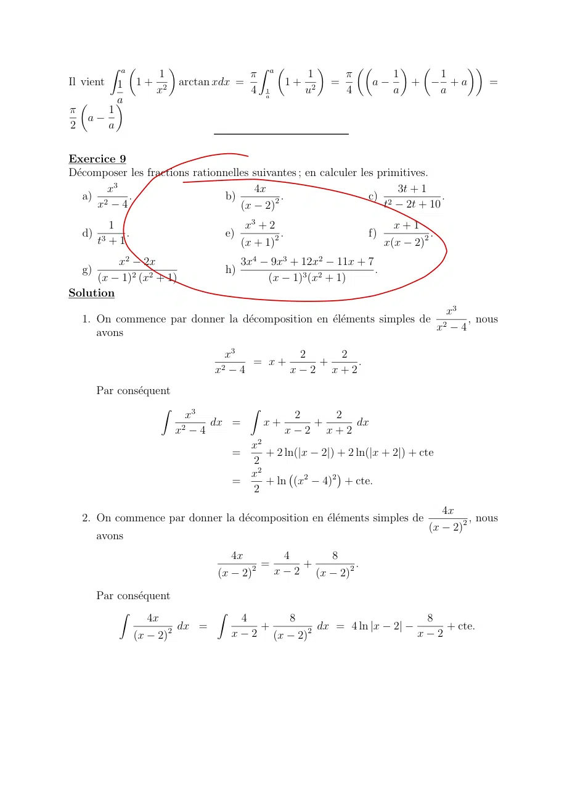

~~~text
               Z a✓           ◆                               Z a✓                 ◆         ✓✓            ◆       ✓           ◆◆
                          1                    ⇡                          1              ⇡             1               1
Il vient          1    1+ 2       arctan xdx =                         1+ 2            =          a            +         +a         =
                         x                     4                  1
                                                                  a
                                                                         u               4             a               a
    ✓             a
                  ◆
⇡             1
        a
2             a

                  0
Exercice 9
Décomposer les fractions rationnelles suivantes ; en calculer les primitives.
        x3                             4x                              3t + 1
   a) 2      .                   b)         2.                   c) 2            .
      x    4                        (x 2)                           t    2t + 10
               1                                       x3 + 2                                           x+1
    d)             .                             e)            .                               f)             .
            t3 + 1                                    (x + 1)2                                        x(x 2)2
         x2 2x                                        3x4          9x3 + 12x2 11x + 7
    g)                                           h)                                   .
     (x 1)2 (x2 + 1)                                              (x 1)3 (x2 + 1)
Solution
                                                                          x3
    1. On commence par donner la décomposition en éléments simples de 2     , nous
                                                                        x    4
       avons
                                             x3                            2            2
                                                          = x+                     +       .
                                            x2        4                x       2       x+2
            Par conséquent
                         Z                                Z
                                   x3                                      2            2
                                            dx =                  x+               +       dx
                              x2        4                              x       2       x+2
                                                              2
                                                    x
                                                  =    + 2 ln(|x                   2|) + 2 ln(|x + 2|) + cte
                                                    2
                                                    x2
                                                  =    + ln (x2                    4)2 + cte.
                                                    2
                                                                                                                     4x
    2. On commence par donner la décomposition en éléments simples de                                                  , nous
                                                                                                                   (x 2)2
            avons
                                              4x       4    8
                                                  2 =    +       .
                                            (x 2)     x 2 (x 2)2

            Par conséquent
                Z                Z
                       4x           4    8                                                                         8
                          2 dx =      +       dx = 4 ln |x                                             2|                  + cte.
                   (x 2)           x 2 (x 2)2                                                                  x       2
~~~

## Page 18

~~~text
                   3t + 1
3. Notons que                est un élément simple. Calculons sa primitive. Nous avons
                t2 2t + 10
          Z                        Z                          Z
                 3t + 1                         3t                         1
              2
                           dt =           2
                                                        dt +       2
                                                                                    dt
            t      2t + 10              t       2t + 10          t        2t + 10
                                      Z                         Z
                                   3          2t 2 + 2                          1
                               =                           dt +                            dt
                                   2        t2 2t + 10               (t2 2t + 1) + 9
                                      Z                         Z
                                   3            2t 2                            4
                               =              2
                                                           dt +         2
                                                                                           dt
                                   2        t     2t + 10            (t       2t + 1) + 9
                                      Z                           Z
                                   3            2t 2                           1
                               =              2
                                                           dt + 4                       dt
                                   2        t     2t + 10              (t 1)2 + 9
                                      Z                            Z
                                   3            2t 2            4              1
                               =              2
                                                           dt +                 2      dt
                                   2        t     2t + 10       9          t 1
                                                                                  + 1
                                                                           ✓3      ◆
                                   3         2                4               t 1
                               =      ln(t        2t + 10) + arctan                    + cte.
                                   2                          3                 3

                                                                       1
4. On commence par donner la décomposition en éléments simples de 3    , nous
                                                                     t +1
   avons
                            1              1                t    2
                                   =                                   .
                          t3 + 1       3(t + 1)      3(t2       t + 1)
   Par conséquent
      Z              Z
            1                1                  t    2
          3
                dx =                                       dx
         t +1           3(t + 1)         3(t2       t + 1)
                                                                           ✓          ◆
                     1                  1                      1               2t 1
                   =   ln |t + 1|         ln(t2      t + 1) + p arctan          p         + cte.
                     3                  6                       3                 3

             x3 + 2       P (x)
5. R(x) =           2
                      =
            (x + 1)       Q(x)
   La division euclidienne donne : x3 + 2 = (x 2) x2 + 2x + 1 + (3x + 4)
                           1
   Le coefficient de              est 1 (on remplace x par 1 dans le numérateur).
                      (x + 1)2
                 3x + 4           1           3
   On calcule           2              2
                                         =
                (x + 1)      (x + 1)       x+1
            3
          x +2                      3           1
   Donc           2
                    =x 2+                +
         (x + 1)                 x + 1 (x + 1)2
                               x2                        1
   Donc une primitive est             2x + 3 ln(x + 1)
                               2                       x+1
                    x+1
6. Primitive de
                  x(x 2)2
                      1       1                               x+1
   Le coefficient de est (on remplace x par 1 dans                   ).
                      x       4                             (x 2)2
                           1           3                           x+1
   Le coefficient de           2
                                  est (on remplace x par 1 dans         ).
                      (x 2)            2                              x
~~~

## Page 19

~~~text
       x+1           1          3          4x + 4 x2 + 4x 4 6x                     x+2              1
               2                     2
                                       =                           2
                                                                             =           2
                                                                                           =
     x(x 2)         4x 2(x 2)                         4x(x 2)                   4(x 2)           4(x 2)
              x+1             1          3                 1
     Donc                 =      +
            x(x 2)2          4x 2(x 2)2 4(x 2)
                            1              3           1
     Une primitive est ln x                              ln(x 2)
                            4          2(x 2) 4
          x2 2x                                         1              1
  7.                        Le  coefficient   de               est        (on remplace x par 1 dans
     (x 1)2 (x2 + 1)                               (x 1)2              2
     x2 2x
              ).
     (x2 + 1)
                            1            1 2i             1 + 2i                                   x2 2x
     Le coefficient de           est               =              (on  remplace  x par i dans                 ).
                          x i        (i 1)2 2i               4                                 (x 1)2 (x + i)
               1 + 2i         1 2i             (1 + 2i)(x + i) + (1 2i)(x i)                  x 2
     Donc                               =                        2
                                                                                     =
              4(x i) 4(x + i)                                   x +1                       2 (x2 + 1)
     Enfin
           x2 2x                     1              x 2
                            +                +
      (x 1)2 (x2 + 1)           2(x 1)2 2 (x2 + 1)
            2
         2x      4x + x + 1 + (x 2) (x2 2x + 1)
                          2
      =
                        2(x 1)2 (x2 + 1)
            2
         2x      4x + x2 + 1 + x3 4x2 + 5x 2
      =
                       2(x 1)2 (x2 + 1)
            3     2
          x      x +x 1             (x2 + 1) x (x2 + 1)               (x2 + 1) (x 1)            1
      =            2    2
                                 =               2    2
                                                                 =           2   2
                                                                                         =
         2(x 1) (x + 1)               2(x 1) (x + 1)                 2(x 1) (x + 1)        4(x 1)
     Donc
           x2 2x                        1              x 2               1
              2    2
                            =                 2          2
                                                                 +
      (x 1) (x + 1)                2(x 1)           2 (x + 1) 4(x 1)
                 1                x              1             1
      =                                   +            +
            2(x 1)2 2 (x2 + 1) x2 + 1 4(x 1)
                                  1         1                                 1
     Une primitive est                         ln x2 + 1 + arctan x + ln(x 1)
                             2(x 1) 4                                         4

Exercice Z10
                1
Soit In =           (1   t2 )n dt.
            0

  1. Établir une relation de récurrence entre In et In+1 .
  2. Calculer In .
                  X n        ✓ ◆
                       ( 1)k n
  3. En déduire                 .
                   k=0
                       2k + 1 k
Solution
  1. Utilisons la méthode d’intégrations par parties. Pour cela, posons

                         u(t) = (1   t2 )n+1     u0 (t) =  2(n + 1)t(1          t2 ) n
                                                  0
                         v(t) = t                v (t) = 1
~~~

## Page 20

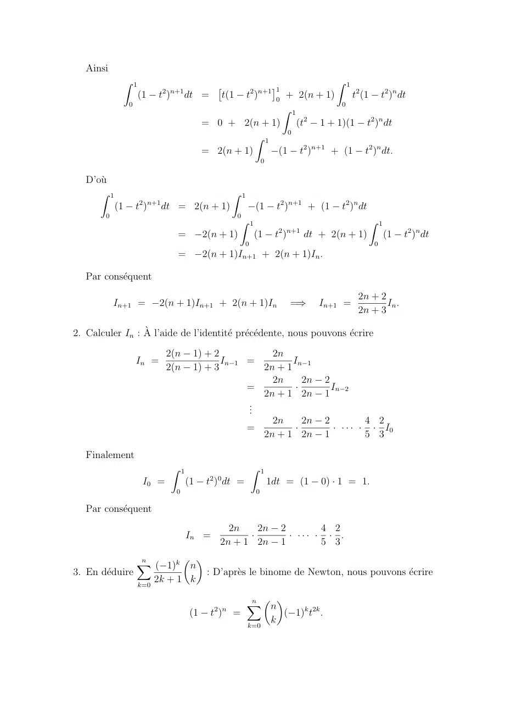

~~~text
   Ainsi
                 Z 1                                                                             Z 1
                               2 n+1
                                               ⇥                      1     ⇤
                       (1   t)         dt =         t(1       t2 )n+1 0
                                                             + 2(n + 1)    t2 (1 t2 )n dt
                  0                                                      0
                                                            Z 1
                                            = 0 + 2(n + 1)      (t2 1 + 1)(1 t2 )n dt
                                                             0
                                                       Z 1
                                            = 2(n + 1)     (1 t2 )n+1 + (1 t2 )n dt.
                                                                       0

   D’où
      Z 1                                             Z 1
                       2 n+1
            (1        t)       dt = 2(n + 1)                       (1           t2 )n+1 + (1       t2 )n dt
        0                                                 0
                                                          Z 1                                                 Z 1
                                                                                2 n+1
                                  =         2(n + 1)              (1        t)          dt + 2(n + 1)               (1   t2 )n dt
                                                              0                                                0
                                  =         2(n + 1)In+1 + 2(n + 1)In .

   Par conséquent
                                                                                                        2n + 2
            In+1 =           2(n + 1)In+1 + 2(n + 1)In                             =)      In+1 =              In .
                                                                                                        2n + 3

2. Calculer In : À l’aide de l’identité précédente, nous pouvons écrire

                               2(n      1) + 2           2n
                      In =                     In 1 =         In 1
                               2(n      1) + 3         2n + 1
                                                         2n      2n                            2
                                                    =          ·                                 In 2
                                                       2n + 1 2n                               1
                                                    ..
                                                     .
                                                         2n      2n                            2          4 2
                                                    =          ·                                 · · · · · · I0
                                                       2n + 1 2n                               1          5 3

   Finalement
                                 Z 1                              Z 1
                                              2 0
                        I0 =           (1    t ) dt =                      1dt = (1        0) · 1 = 1.
                                  0                                0

   Par conséquent
                                                  2n    2n                      2        4 2
                                       In =           ·                           · ··· · · .
                                                2n + 1 2n                       1        5 3

               Xn         ✓ ◆
                   ( 1)k n
3. En déduire                : D’après le binome de Newton, nous pouvons écrire
               k=0
                   2k + 1  k

                                                              n ✓ ◆
                                                              X
                                               2 n               n
                                       (1     t)      =                          ( 1)k t2k .
                                                              k=0
                                                                           k
~~~

## Page 21

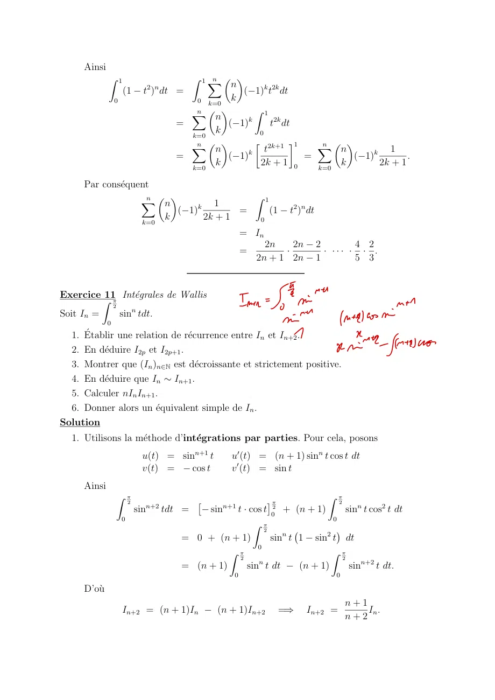

~~~text
     Ainsi
             Z 1                        Z 1X n ✓ ◆
                                   2 n             n
                     (1        t ) dt =              ( 1)k t2k dt
                 0                       0 k=0     k
                                        Xn  ✓   ◆        Z 1
                                              n        k
                                      =           ( 1)         t2k dt
                                        k=0
                                              k            0
                                         n
                                        X n ✓   ◆                    1   Xn ✓ ◆
                                                       k     t2k+1            n           1
                                      =           ( 1)                  =        ( 1)k        .
                                        k=0
                                              k            2k   +  1  0   k=0
                                                                              k        2k + 1

     Par conséquent
                              n ✓ ◆
                              X                                      Z 1
                                 n               k1
                                           ( 1)        =                   (1     t2 )n dt
                               k=0
                                         k      2k + 1                0

                                                                 = In
                                                                       2n    2n              2        4 2
                                                                 =         ·                   · ··· · · .
                                                                     2n + 1 2n               1        5 3

Exercice 11⇡ Intégrales de Wallis
          Z
            2
              sinn tdt.
                                                                 Im       sie
                                                                          =

                                                                                                                sin
Soit In =
             0
                                                                                 sine             Intel as
  1. Établir une relation de récurrence entre In et In+21
                                                                                                 set_(r)
                                                          .
                                                                                                                      no
  2. En déduire I2p et I2p+1 .
  3. Montrer que (In )n2N est décroissante et strictement positive.
  4. En déduire que In ⇠ In+1 .
  5. Calculer nIn In+1 .
  6. Donner alors un équivalent simple de In .
Solution
  1. Utilisons la méthode d’intégrations par parties. Pour cela, posons
                               u(t) = sinn+1 t               u0 (t) = (n + 1) sinn t cos t dt
                               v(t) =    cos t               v 0 (t) = sin t
     Ainsi
                 Z ⇡                                                                           Z ⇡
                         2
                                   n+2
                                                 ⇥         n+1
                                                                          ⇤ ⇡2                   2
                             sin         tdt =       sint · cos t 0 + (n + 1)        sinn t cos2 t dt
                     0                                                           0
                                                             Z ⇡
                                                                2
                                            = 0 + (n + 1)         sinn t 1 sin2 t dt
                                                              0
                                                      Z ⇡                        Z ⇡
                                                         2                         2
                                                              n
                                            = (n + 1)      sin t dt      (n + 1)      sinn+2 t dt.
                                                             0                                   0

     D’où
                                                                                                     n+1
                     In+2 = (n + 1)In                 (n + 1)In+2                =)    In+2 =            In .
                                                                                                     n+2
~~~

## Page 22

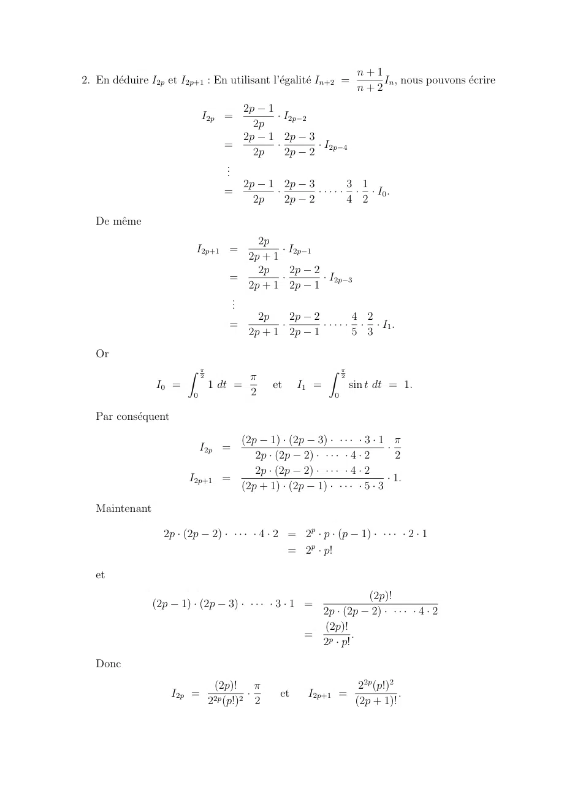

~~~text
                                                                        n+1
2. En déduire I2p et I2p+1 : En utilisant l’égalité In+2 =               In , nous pouvons écrire
                                                                        n+2
                                       2p 1
                              I2p =         · I2p 2
                                         2p
                                       2p 1 2p 3
                                    =       ·       · I2p 4
                                         2p   2p 2
                                    ..
                                     .
                                       2p 1 2p 3             3 1
                                    =       ·       · · · · · · · I0 .
                                         2p   2p 2           4 2
   De même
                                           2p
                          I2p+1 =               · I2p 1
                                         2p + 1
                                           2p     2p 2
                                      =         ·       · I2p 3
                                         2p + 1 2p 1
                                      ..
                                       .
                                           2p     2p 2           4 2
                                      =         ·       · · · · · · · I1 .
                                         2p + 1 2p 1             5 3
   Or
                        Z ⇡                                   Z ⇡
                              2          ⇡                         2
                I0 =              1 dt =        et     I1 =            sin t dt = 1.
                          0              2                     0

   Par conséquent

                                      (2p 1) · (2p 3) · · · · · 3 · 1 ⇡
                              I2p =                                     ·
                                         2p · (2p 2) · · · · · 4 · 2      2
                                         2p · (2p 2) · · · · · 4 · 2
                         I2p+1      =                                   · 1.
                                      (2p + 1) · (2p 1) · · · · · 5 · 3

   Maintenant

                  2p · (2p        2) · · · · · 4 · 2 = 2p · p · (p       1) · · · · · 2 · 1
                                                     = 2p · p!

   et
                                                                   (2p)!
                (2p    1) · (2p      3) · · · · · 3 · 1 =
                                                          2p · (2p 2) · · · · · 4 · 2
                                                          (2p)!
                                                        = p      .
                                                          2 · p!
   Donc
                                   (2p)! ⇡                               22p (p!)2
                      I2p =              ·        et    I2p+1 =                    .
                                  2 (p!)2 2
                                   2p                                   (2p + 1)!
~~~

## Page 23

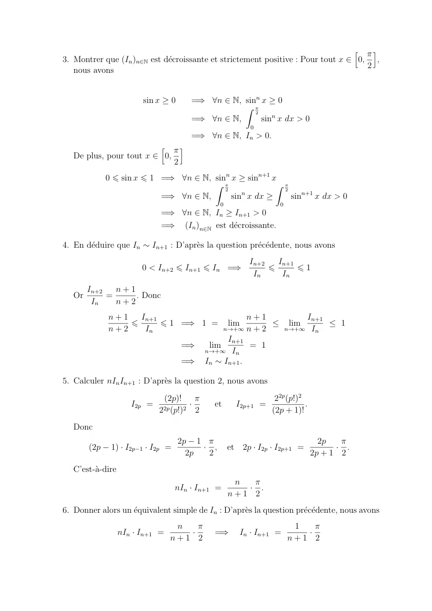

~~~text
                                                                                 h ⇡i
3. Montrer que (In )n2N est décroissante et strictement positive : Pour tout x 2 0, ,
                                                                                    2
   nous avons

                         sin x     0     =) 8n 2 N, sinn x 0
                                                    Z ⇡
                                                       2
                                         =) 8n 2 N,      sinn x dx > 0
                                                            0
                                         =) 8n 2 N, In > 0.
                         h ⇡i
   De plus, pour tout x 2 0,
                             2
              0 6 sin x 6 1 =) 8n 2 N, sinn x sinn+1 x
                                       Z ⇡            Z ⇡
                                          2             2
                            =) 8n 2 N,         n
                                            sin x dx      sinn+1 x dx > 0
                                                  0                 0
                                 =) 8n 2 N, In In+1 > 0
                                 =) (In )n2N est décroissante.

4. En déduire que In ⇠ In+1 : D’après la question précédente, nous avons
                                                            In+2   In+1
                         0 < In+2 6 In+1 6 In =)                 6      61
                                                             In     In
        In+2   n+1
   Or        =     . Donc
         In    n+2
              n+1   In+1                    n+1        In+1
                  6      6 1 =) 1 = lim          lim        1
              n+2    In               n!+1  n+2   n!+1  In
                                       In+1
                             =)   lim       = 1
                                 n!+1 In
                             =) In ⇠ In+1 .

5. Calculer nIn In+1 : D’après la question 2, nous avons

                               (2p)! ⇡                             22p (p!)2
                      I2p =          ·        et        I2p+1 =              .
                              2 (p!)2 2
                               2p                                 (2p + 1)!
   Donc
                                       2p 1 ⇡                                      2p   ⇡
        (2p    1) · I2p 1 · I2p =           · ,       et 2p · I2p · I2p+1 =            · .
                                         2p  2                                   2p + 1 2
   C’est-à-dire
                                                       n  ⇡
                                    nIn · In+1 =         · .
                                                      n+1 2
6. Donner alors un équivalent simple de In : D’après la question précédente, nous avons
                                    n   ⇡                                1   ⇡
                   nIn · In+1 =       ·       =)         In · In+1 =       ·
                                   n+1 2                                n+1 2
~~~

## Page 24

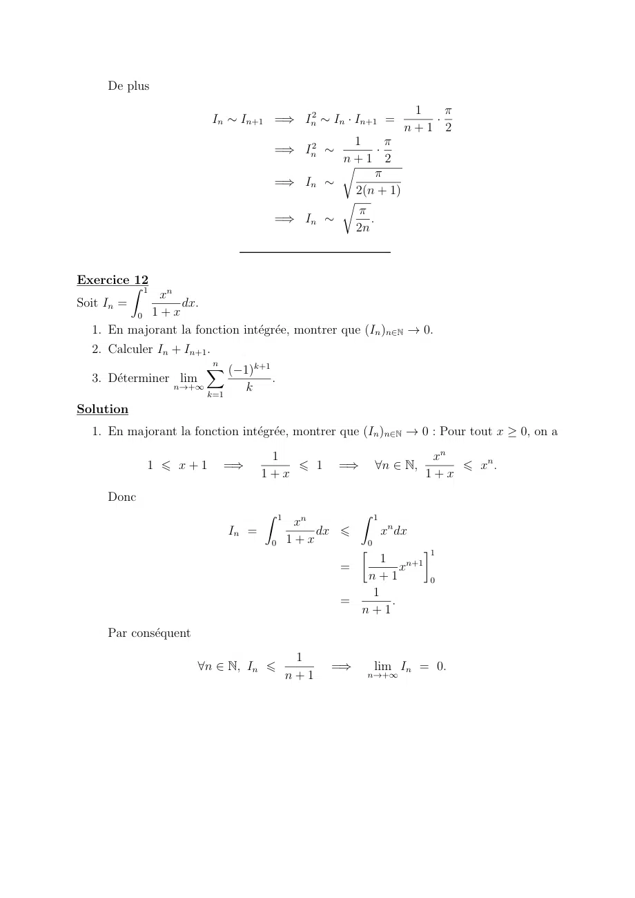

~~~text
     De plus
                                                                  1   ⇡
                         In ⇠ In+1 =) In2 ⇠ In · In+1 =             ·
                                                                 n+1 2
                                             1       ⇡
                                    =) In2 ⇠       ·
                                            n+1 2
                                            r
                                                   ⇡
                                    =) In ⇠
                                              2(n + 1)
                                            r
                                              ⇡
                                    =) In ⇠      .
                                              2n

Exercice Z12
            1
             xn
Soit In =        dx.
         0 1+x
  1. En majorant la fonction intégrée, montrer que (In )n2N ! 0.
  2. Calculer In + In+1 .
                       X  n
                            ( 1)k+1
  3. Déterminer lim                .
                 n!+1
                        k=1
                               k
Solution
  1. En majorant la fonction intégrée, montrer que (In )n2N ! 0 : Pour tout x     0, on a
                                   1                                    xn
            1 6 x+1        =)         6 1       =)           8n 2 N,       6 xn .
                                  1+x                                  1+x
     Donc
                                  Z 1                Z 1
                                         xn
                           In =             dx 6             xn dx
                                    0   1+x              0
                                                                      1
                                                     1
                                                =        xn+1
                                                   n+1        0
                                                   1
                                                =      .
                                                  n+1
     Par conséquent
                                         1
                       8n 2 N, In 6           =)             lim In = 0.
                                        n+1              n!+1
~~~

## Page 25

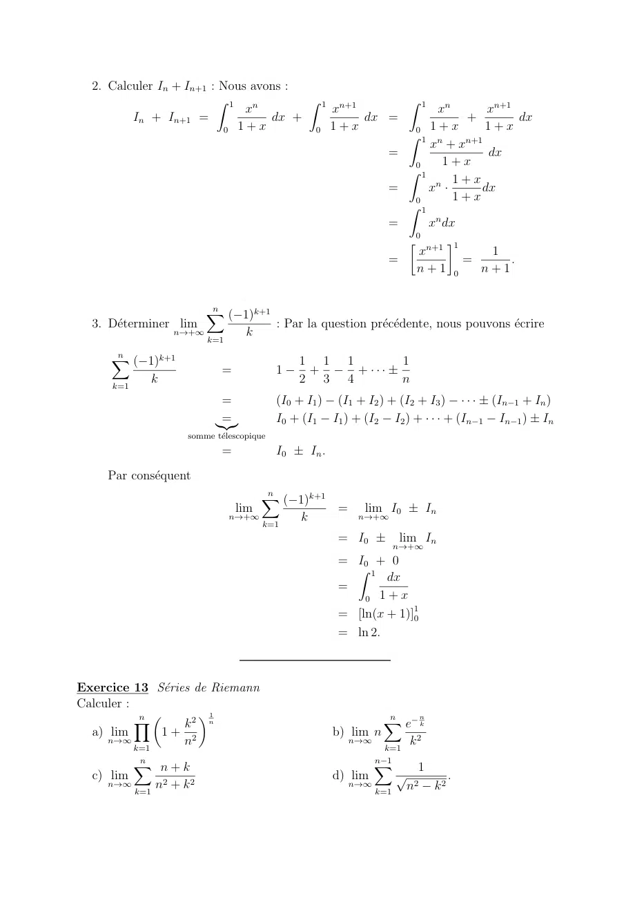

~~~text
  2. Calculer In + In+1 : Nous avons :
                         Z 1 n         Z 1 n+1      Z 1 n
                              x           x              x        xn+1
         In + In+1 =              dx +         dx =           +          dx
                          0 1+x         0 1+x        0 1+x       1+x
                                                    Z 1 n
                                                        x + xn+1
                                                  =               dx
                                                     0     1+x
                                                    Z 1
                                                             1+x
                                                  =     xn ·     dx
                                                     0       1+x
                                                    Z 1
                                                  =     xn dx
                                                     0
                                                     n+1 1
                                                      x            1
                                                  =           =        .
                                                     n+1 0       n+1

                     Xn
                         ( 1)k+1
  3. Déterminer lim             : Par la question précédente, nous pouvons écrire
                n!+1
                     k=1
                            k

     Xn
         ( 1)k+1                                 1 1       1         1
                               =             1    +          + ··· ±
     k=1
            k                                    2 3       4         n
                              =              (I0 + I1 ) (I1 + I2 ) + (I2 + I3 ) · · · ± (In 1 + In )
                              =
                             |{z}            I0 + (I1 I1 ) + (I2 I2 ) + · · · + (In 1 In 1 ) ± In
                       somme télescopique
                               =             I0 ± In .
     Par conséquent
                                     Xn
                                         ( 1)k+1
                                 lim             =            lim I0 ± In
                                n!+1
                                     k=1
                                            k                n!+1

                                                         = I0 ±         lim In
                                                                        n!+1
                                                         = I0 + 0
                                                           Z 1
                                                                 dx
                                                         =
                                                             0 1+x
                                                         = [ln(x + 1)]10
                                                         = ln 2.

Exercice 13 Séries de Riemann
Calculer :
           Yn ✓      ◆1                                             n
                                                                    X   n
                  k2 n                                                e k
  a) lim        1+ 2                                     b) lim n
     n!1
           k=1
                  n                                        n!1
                                                                    k=1
                                                                            k2
           n
           X                                                      X1
                                                                  n
             n+k                                                             1
  c) lim                                                 d) lim         p             .
     n!1
           k=1
                 n2 + k 2                                  n!1
                                                                  k=1
                                                                            n2   k2
~~~

## Page 26

~~~text
Solution
               n ✓
               Y                ◆ n1          ✓      ◆
                       k2                1X       k2
  1. On a ln         1+ 2              =    ln 1 + 2
               k=1
                       n                 n        n
     On reconnaı̂t une somme de Riemann pour la fonction f : x 7! ln 1 + x2 donc la
                      Z 1
     somme tend vers      ln 1 + x2 dx
                            0
     On e↵ectue une intégration par partie :
                                                  2x
            u(x) = ln 1 + x2        u0 (t) =
     On a                       et              1 + x2
            v(x) = x                 0
                                    v (t) = 1
      Z 1                                   Z 1                               ✓Z 1         Z 1               ◆
                  2
                        ⇥           2 1
                                        ⇤         2x2                                              1
          ln 1 + x dx = x ln 1 + x 0                   2
                                                         dx = ln 2        2          1dx                dx
       0                                      0 1+x                             0           0    1 + x2
                                           ⇡
      = ln 2 2(1 + arctan 1) = ln 2 2 +
                                           2
                               Yn  ✓         ◆1
                                          k2 n              ⇡
     Donc par composition lim        1+ 2        = eln 2 2+ 2
                          n!1
                               k=1
                                          n
              n
              X                    n
                            1X e k
                  n                         n
                e k
  2. On a n               =
               k=1
                     k2     n k=1 k 2
                                        n
     On reconnaı̂t une somme de Riemann qui tend donc vers
      Z 1 1         h 1 i1
         e x
             2
               dx = e x = e 1
       0   x              0
  3. On a
     Xn                 n
          n+k        1 X 1 + nk
                  =
     k=1
         n 2 + k2    n k=1 1 + k 2
                                        n
     On reconnaı̂t une somme de Riemann qui tend donc vers
      Z 1                 Z 1                Z 1                               1
            1+x                  x                   1             1          2
                 2
                   dx  =             2
                                       dx  +             2
                                                           dx =      ln 1 + x     + [arctan x]10 =
       0   1 + x            0  1 + x           0  1 +  x           2            0
     1         ⇡
       ln 2 +
     2         4
          n
          X  1             n 1
                           X                       n 1
                     1              1            1X           1
  4. lim       p                p            =          q            On reconnaı̂t une somme de
     n!1          n 2    2
                        k k=1 n    2    k 2      n k=1          k 2
           k=1                                             1    n
                                        Z 1
                                                  1                         ⇡
     Riemann qui tend donc vers              p          dx = [arctan x]10 =
                                           0    1 x   2                     4

Exercice 14
Calculer les limites suivantes :
                p     p          p
           1 + 2 + 3 + ··· + n
  1. lim               p           .
     n!1              n n
           Xn
                   n
  2. lim               .
     n!1
           p=1
               n + p2
                 2
~~~

## Page 27

~~~text
Solution
                   p p          p
             1+        3 + ··· + n
                       2+
  1. lim              p            : On commence par noter que :
    n!1              n n
                 p    p          p         n p          n
                                                           r
              1 + 2 + 3 + ··· + n       1X k         1X k
                        p            =       p   =
                      n n               n k=1 n      n k=1 n
                                                            n
                                                               r
                                                     1 0X            (1 0)
                                                 =               0+k       .
                                                       n k=1           n
                        p
    En
    Z 1 posant  f (x) =   x nous venons d’écrire la somme de Riemann correspondant à
        f (x)dx. Cette intégrale se calcule facilement :
     0

                                Z 1                   Z 1                          "    3
                                                                                            #1
                                                                  p                    x2               2
                                        f (x)dx =                     x dx =           3            =     .
                                    0                     0                            2
                                                                                                        3
                                                                                                0

                                       n p               Z 1
                                    1X k
    Maintenant, la somme de Riemann      p converge vers     f (x)dx, ainsi
                                    n k=1 n               0

                                                 p        p          p
                                          1+         2+     3 + ··· + n   2
                                    lim                    p            = .
                                n!1                       n n             3
             n
             X         n
  2. lim                     : On commence par noter que :
    n!1
             p=1
                   n2 + p2

                   n
                   X                         n                                              n
                           n      1X        1       (1 0) X          1
                         2 + p2
                                =               2 =                      (1 0) 2
                                                                                 .
                   p=1
                       n          n p=1 1 +   p       n   p=1 1 + 0 +  p
                                                              n                                                    n

                           1
    En posant f (x) =            nous venons d’écrire la somme de Riemann correspondant
       Z 1              1 + x2
    à     f (x)dx. Cette intégrale se calcule facilement :
         0
                               Z 1                   Z 1
                                                               dx    ⇥        ⇤1 ⇡
                                        f (x)dx =                 2
                                                                    = arctan x 0 = .
                                0                     0       1+x                 4
                                                                  n                                           Z 1
                                    1X       1
    Maintenant, la somme de Riemann               converge vers                                                        f (x)dx, ainsi
                                    n p=1 1 + p 2                                                              0
                                                                               n

                                                     n
                                                     X   n      ⇡
                                             lim       2 + p2
                                                              =   .
                                             n!1
                                                 p=1
                                                     n          4
~~~

## Page 28

~~~text
Exercice 15
Sans calculer les intégrales, montrer que
                                Z ⇡/2                             Z ⇡/2
                                                n
                                              sin x dx =                     cosn x dx.
                                 0                                 0
Solution
À l’aide du changement de variable
                                         ⇡
                               x=               u        =)        dx =               du,
                                         2
nous pouvons écrire
                       Z ⇡/2                             Z 0                 ⇣⇡                  ⌘
                                     n
                               sin x dx =                          sinn                      u           ( du)
                         0                                   ⇡/2                     2
                                                                 Z 0                 ⇣⇡               ⌘
                                                                                 n
                                                    =                   sin                       u       du
                                                            ⇡/2                          2
                                                         Z ⇡/2                   ⇣⇡                  ⌘
                                                                             n
                                                    =                  sin                       u       du
                                                             0                       2
Maintenant
                                               ⇣⇡            ⌘
                                         sin             u       = cos u.
                                                2
Donc
 Z ⇡/2                 Z ⇡/2             ⇣⇡          ⌘                 Z ⇡/2                                     Z ⇡/2
           n                         n                                                       n
         sin x dx =            sin               u       du =                        cos u du =                          cosn x dx.
   0                    0                 2                              0                                        0

Exercice 16                                    Z
                                          ⇤ 1 x
Soit f 2 C (R). On définit g : R ! R, x 7!
           0
                                                   f (t)dt.
                                            x 0
   1. Montrer que g se prolonge par continuité en 0.
                                                                                                  Z (k+1)T                   Z T
  2. On suppose f T-périodique. Montrer que : 8k 2 N,                                                           f (t)dt =         f (t)dt.
                                                                                                     kT                       0
                                 Z               Z
                               1 nT             1 x
  3. Ecrire g(x) sous la forme        f (t)dt +      f (t)dt pour un entier n bien choisi,
                               x 0              x nT
     et en déduire que g admet une limite en +1.
Exercice 17                                                                                  Z x
Soit f : R ! R une fonction continue sur R et F (x) =                                                f (t)dt.
                                                                                              0
Répondre par vrai ou faux aux affirmations suivantes :
  1. F est continue sur R.
~~~

## Page 29

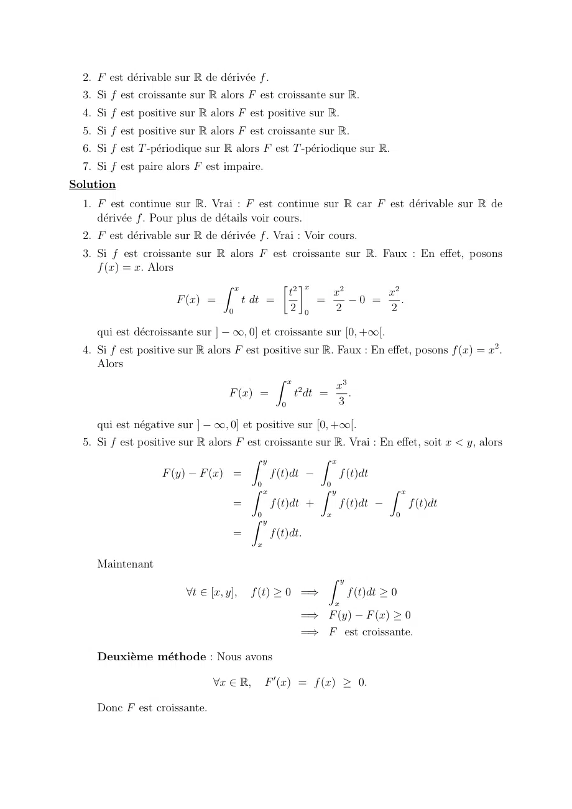

~~~text
  2. F est dérivable sur R de dérivée f .
  3. Si f est croissante sur R alors F est croissante sur R.
  4. Si f est positive sur R alors F est positive sur R.
  5. Si f est positive sur R alors F est croissante sur R.
  6. Si f est T -périodique sur R alors F est T -périodique sur R.
  7. Si f est paire alors F est impaire.
Solution
  1. F est continue sur R. Vrai : F est continue sur R car F est dérivable sur R de
     dérivée f . Pour plus de détails voir cours.
  2. F est dérivable sur R de dérivée f . Vrai : Voir cours.
  3. Si f est croissante sur R alors F est croissante sur R. Faux : En e↵et, posons
     f (x) = x. Alors
                              Z x         2 x
                                          t         x2        x2
                      F (x) =     t dt =        =        0 =     .
                               0           2 0      2         2

     qui est décroissante sur ]   1, 0] et croissante sur [0, +1[.
  4. Si f est positive sur R alors F est positive sur R. Faux : En e↵et, posons f (x) = x2 .
     Alors
                                           Z x
                                                         x3
                                  F (x) =       t2 dt =     .
                                             0           3

     qui est négative sur ]   1, 0] et positive sur [0, +1[.
  5. Si f est positive sur R alors F est croissante sur R. Vrai : En e↵et, soit x < y, alors
                                      Z y            Z x
                   F (y) F (x) =          f (t)dt        f (t)dt
                                       0              0
                                      Z x            Z y           Z x
                                  =       f (t)dt +      f (t)dt       f (t)dt
                                       0              x              0
                                      Z y
                                  =       f (t)dt.
                                         x

     Maintenant
                                                          Z y
                         8t 2 [x, y],   f (t)    0 =)           f (t)dt   0
                                                           x
                                                    =) F (y) F (x) 0
                                                    =) F est croissante.

     Deuxième méthode : Nous avons

                               8x 2 R,       F 0 (x) = f (x)      0.

     Donc F est croissante.
~~~

## Page 30

~~~text
  6. Si f est T -périodique sur R alors F est T -périodique sur R. Faux : En e↵et, posons
     f (x) = 1 + cos(x). Alors
               Z x
     F (x) =        1 + cos(t) dt = [t + sin(t)]x0 = x + sin(x) (0 + sin(0)) = x + sin(x).
                 0

      qui n’est pas périodique.
  7. Si f est paire alors F est impaire. Vrai : En e↵et, nous avons
                                            Z x
                                  F ( x) =        f (t)dt.
                                                              0

      En faisant le changement de variable

                                    t=           u    =)            dt =            du

      nous pouvons donc écrire
                                                                   Z         x
                                  F ( x)              =                          f (t)dt
                                                                   Z0 x
                                                      =                     f ( u)( du)
                                                                       0
                                                                           Z x
                                                      =
                                                     |{z}                      f (u)du
                                                                            0
                                                 f est paire
                                                      =                   F (x).

      De plus F (0) = 0. F est donc impaire.

Exercice 18                                                                             Z b
Déterminer les fonctions f continues sur [a, b] telles que                                   f (t)dt = (b   a) sup |f |.
                                                                                         a                      [a,b]
Solution
Tout d’abord, notons que
                                                       Z b
                                     b       a =                  1 dt.
                                                          a

La linearité de l’intégrale, nous permet donc d’ecrire
                                                                                   Z b
                             (b    a) sup |f | = sup |f |                                1 dt
                                         [a,b]                    [a,b]             a
                                                                  Z b
                                                       =                  sup |f | dt.
                                                                   a       [a,b]
~~~

## Page 31

~~~text
Ainsi
                 Z b                                                     Z b                    Z b
                          f (t)dt = (b     a) sup |f | ()                      sup |f | =               f (t)dt
                  a                              [a,b]                    a    [a,b]                a
                                                                         Z b                Z b
                                                              ()               sup |f |             f (t)dt = 0
                                                                          a    [a,b]            a
                                                                         Z b
                                                              ()               sup |f |     f (t)dt = 0.
                                                                          a    [a,b]

Or

                                         8t 2 [a, b],         sup |f |        f (t).
                                                              [a,b]

La fonction

                                             t 7 ! sup |f |                    f (t),
                                                             [a,b]

est donc continue et positive sur [a, b], d’intégale nulle sur [a, b]. Par conséquent

                                   8t 2 [a, b],           sup |f |       f (t) = 0.
                                                          [a,b]

D’où on conclut
             Z b
                          f (t)dt = (b      a) sup |f | () 8t 2 [a, b],                      f (t) = sup |f |
                      a                           [a,b]                                                    [a,b]
                                                                  () f est constante.

Exercice 19                                    Z
                                            1 x
                                             ⇤
Soit f 2 C (R). On définit g : R ! R, x 7!
             0
                                                   f (t)dt.
                                            x 0
   1. Montrer que g se prolonge par continuité en 0.
                                                                                          Z (k+1)T                   Z T
     2. On suppose f T -périodique. Montrer que : 8k 2 N,                                               f (t)dt =         f (t)dt.
                                                                                           kT                         0
                                    Z               Z
                                  1 nT             1 x
     3. Ecrire g(x) sous la forme        f (t)dt +      f (t)dt pour un entier n bien choisi,
                                  x 0              x nT
        et en déduire que g admet une limite en +1.
Solution
     1. Montrer que g se prolonge par continuité en 0 : On doit montrer que la limite
                                                     Z
                                                   1 x
                               lim g(x) = lim            f (t)dt
                               x!0          x!0 x 0
~~~

## Page 32

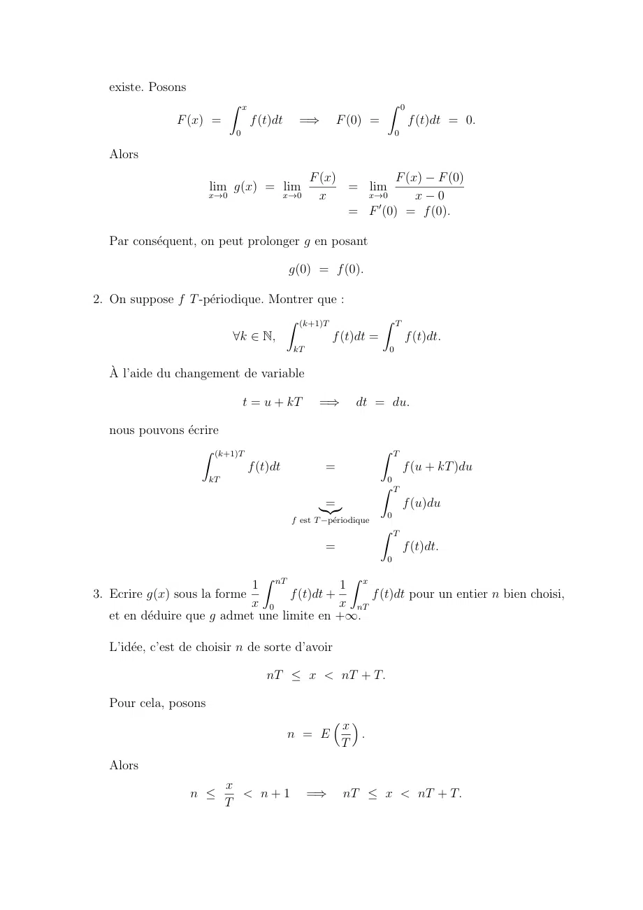

~~~text
   existe. Posons
                             Z x                                     Z 0
                F (x) =            f (t)dt     =)         F (0) =             f (t)dt = 0.
                              0                                          0

   Alors
                                                 F (x)         F (x) F (0)
                       lim g(x) = lim                  = lim
                       x!0                   x!0   x     x!0       x 0
                                                       = F 0 (0) = f (0).

   Par conséquent, on peut prolonger g en posant

                                             g(0) = f (0).

2. On suppose f T -périodique. Montrer que :
                                  Z (k+1)T           Z T
                         8k 2 N,           f (t)dt =     f (t)dt.
                                              kT                     0

   À l’aide du changement de variable

                                  t = u + kT        =)        dt = du.

   nous pouvons écrire
                   Z (k+1)T                                         Z T
                                   f (t)dt            =                      f (u + kT )du
                       kT                                            0
                                                                    Z T
                                                     =
                                                    |{z}                     f (u)du
                                                                     0
                                              f est T périodique
                                                                    Z T
                                                      =                      f (t)dt.
                                                                     0

                               Z               Z
                             1 nT             1 x
3. Ecrire g(x) sous la forme        f (t)dt +      f (t)dt pour un entier n bien choisi,
                             x 0              x nT
   et en déduire que g admet une limite en +1.

   L’idée, c’est de choisir n de sorte d’avoir

                                       nT  x < nT + T.

   Pour cela, posons
                                                        ⇣x⌘
                                             n = E             .
                                                          T
   Alors
                            x
                    n        < n+1                =)      nT  x < nT + T.
                            T
~~~

## Page 33

~~~text
Maintenant
                                Z x            ✓Z nT           Z x         ◆
                    1                        1
             g(x) =                f (t)dt =         f (t)dt +     f (t)dt
                    x            0           x   0              nT
                                               Z               Z
                                             1 nT             1 x
                                           =       f (t)dt +       f (t)dt
                                             x 0              x nT
et
                                                         Z nT                      Z x
                                   1                                       1
                   lim g(x) = lim                                f (t)dt +                  f (t)dt.
                  x!+1        x!+1 x                       0               x           nT

Étudions donc les limites
                        Z                                                         Z x
                      1 nT                                               1
                lim        f (t)dt                         et        lim                f (t)dt.
              x!+1 x 0                                              x!+1 x         nT

On commence par noter que
       Z x            Z x                                                         Z nT +T
           f (t)dt       |f (t)|dt                                                           |f (t)|dt
            nT                        nT
                                                                   |{z}            nT
                                                                car |f | 0
                                                                                  Z T
                                                                    =
                                                                   |{z}                 |f (t)|dt = cte.
                                                                                   0
                                                           d’après le point 2.

Par conséquent
                                Z x                                       Z T
                       1                           1
                   lim              f (t)dt  lim                               |f (t)|dt = 0.
                  x!+1 x         nT           x!+1 x                       0

Ce qui nous permet de conclure
                                                        Z x
                                           1
                                       lim                     f (t)dt = 0.
                                      x!+1 x             nT

Par ailleurs
  Z nT                                     Z T                      Z 2T                               Z nT
        f (t)dt            =                           f (t)dt +             f (t)dt + · · · +                    f (t)dt
     0                                         0                      T                                  (n 1)T
                                           Z T                      Z T                                Z T
                          =
                         |{z}                          f (t)dt +           f (t)dt + · · · +                f (t)dt
                                               0                      0                                 0
                   d’après le point 2.
                                               Z T
                           =               n            f (t)dt.
                                                   0
                         ⇣x⌘
Maintenant, n = E                , donc
                            T
                                           x                          x
                                                       1  n           .
                                           T                          T
~~~

## Page 34

~~~text
      D’où
                          Z T                            Z T                                Z T
              x       T                                                                 x
                                  f (t)dt  (ou    ) n             f (t)dt  (ou      )              f (t)dt
                  T           0                               0                         T    0

      Ainsi
                      Z T                               Z T                                  Z T
          x T                                       n                                   x
                              f (t)dt  (ou       )               f (t)dt  (ou      )                f (t)dt.
          x·T             0                         x    0                             x·T       0

                       x T      1
      De plus lim            = , donc
                  x!+1 x · T    T
                                   Z             Z
                                  n T           1 T
                              lim     f (t)dt =     f (t)dt.
                             x!+1 x 0           T 0

      Par conséquent
                                                       Z                 Z
                                                    1 nT               1 x
                              lim g(x) =        lim          f (t)dt +      f (t)dt
                          x!+1                x!+1 x 0                 x nT
                                                       Z                        Z
                                                    1 nT                     1 x
                                         =      lim          f (t)dt + lim          f (t)dt
                                              x!+1 x 0                 x!+1 x nT
                                                  Z
                                               1 T
                                         =          f (t)dt + 0
                                              T 0
                                                  Z
                                               1 T
                                         =          f (t)dt.
                                              T 0

Exercice 20
Si(n, p) 2 N2 , on définit                             Z 1
                                            I(n, p) =         tn (1    t)p dt
                                                         0
                  ⇤
   1. Si p 2 N et n 2 N, exprimer I(n, p) en fonction de I(n + 1, p                          1).
   2. Calculer I(n, p) pour n, p 2 N.
Solution
                                                            tn+1
   1. On utilise une intégration par parties avec u : t 7!      et v : t 7! (1                                  t)p qui
                                                            n+1
                      1
      sont de classe C sur [0, 1].
                                                             1           Z 1
                               tn+1            p
                   I(n, p) =         (1 t)p +                                   tn+1 (1   t)p 1 dt
                              n+1          0  n+1                          0
                       p
      donc I(n, p) =       I(n + 1, p 1).
                     n+1
                                                                               p!n!
   2. On note pour n 2 N, Hn : 8p 2 N, I(n, p) =                                        et on raisonne par
                                                                           (n + p + 1)!
      récurrence.
~~~

## Page 35

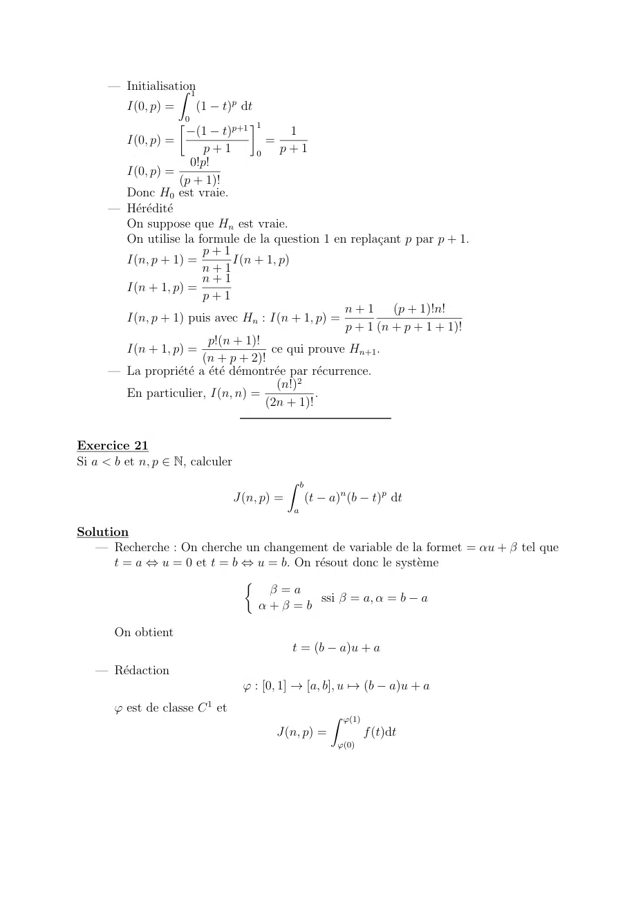

~~~text
      — Initialisation
                   Z      1
         I(0, p) =            (1   t)p dt
                     0                     1
                       (1 t)p+1            1
         I(0, p) =                    =
                         p+1        0    p+1
                      0!p!
        I(0, p) =
                    (p + 1)!
        Donc H0 est vraie.
      — Hérédité
        On suppose que Hn est vraie.
        On utilise la formule de la question 1 en replaçant p par p + 1.
                        p+1
        I(n, p + 1) =          I(n + 1, p)
                        n+1
                        n+1
        I(n + 1, p) =
                        p+1
                                                      n+1      (p + 1)!n!
        I(n, p + 1) puis avec Hn : I(n + 1, p) =
                                                      p + 1 (n + p + 1 + 1)!
                          p!(n + 1)!
        I(n + 1, p) =                  ce qui prouve Hn+1 .
                        (n + p + 2)!
      — La propriété a été démontrée par récurrence.
                                        (n!)2
        En particulier, I(n, n) =               .
                                      (2n + 1)!

Exercice 21
Si a < b et n, p 2 N, calculer
                                                 Z b
                                     J(n, p) =         (t   a)n (b    t)p dt
                                                   a

Solution
   — Recherche : On cherche un changement de variable de la formet = ↵u +           tel que
      t = a , u = 0 et t = b , u = b. On résout donc le système
                             ⇢
                                   =a
                                          ssi = a, ↵ = b a
                               ↵+ =b

       On obtient
                                                  t = (b      a)u + a
   — Rédaction
                                       ' : [0, 1] ! [a, b], u 7! (b       a)u + a
       ' est de classe C 1 et
                                                            Z '(1)
                                                J(n, p) =            f (t)dt
                                                             '(0)
~~~

## Page 36

~~~text
       donne par le théorème de changement de variable :
                                  Z 1
                        J(n, p) =     f ('(u))'0 (u)du
                                                    0
                                  t      a = (ba)u et b t = (b a)(1 u)
                                            Z 1
                                  J(n, p) =     (b a)n un (b a)p (1 u)p (b                          a)du
                                                    0
                                  J(n, p) = (b               a)n+p+1 I(n, p)

                                                                                     p!n!
                                             J(n, p) = (b           a)n+p+1
                                                                                 (n + p + 1)!

Exercice 22
Soit n, p 2 N. Calculer
                                                        Z ⇡/2
                                      K(n, p) =                 cos2n+1 (✓) sin2p+1 (✓)d✓
                                                         0

Solution
La fonction ' :| 0, ⇡/2] ! [0, 1], ✓ 7! cos2 (✓) est une bijection de classe C 1 . Par le
                                                  Z '(0)
théorème de changement de variable I(n, p) =             f (t)dt
                                                    '(⇡/2)
           Z 0
                                                                   p
I(n, p) =      f ('(✓))'0 (✓)d✓ f ('(✓)) = cos2n (✓) 1 cos2 (✓)
            ⇡/2
f ('(✓)) = cos2n (✓) sin2 p(✓)
'0 (✓) = 2 sin(✓) cos(✓).
f ('(✓))'0 (✓) Z= 2 cos2n+1 (✓) sin2p+1 (✓)
                      0
I(n, p) =   2             cos2n+1 (✓) sin2p+1 d✓
                  ⇡/2
                                                        p!n!
I(n, p) = 2K(n, p) donc K(n, p) =                                 .
                                                    2(n + p + 1)!

Exercice 23
                                                         Z ⇡/2
Soit n 2 N. En déduire la valeur de                             sin2n+1 (u)du
                                                          0
Solution
                Z ⇡/2                                                                Z ⇡/2
                                 2n+1             2n+1                       1
: K(n, n) =                cos          (✓) sin          K(n, n) =                           sin2n+1 (2✓)d✓ en utilisant le
                  0                                                     22n+1
                                                                          Z           0
                                                                                 ⇡
                                                     2n+1
changement de variable u = 2✓, 2           K(n, n) =      sin2n+1 (u)1/2 du 22n+2 K(n, n) =
Z ⇡                                                    0                Z ⇡
         2n+1
     sin      (u)du Puis par le changement de variable v = ⇡ u :              sin2n+1 (u)du =
Z0 0                         Z ⇡                   Z ⇡/2                  ⇡/2

      sin2n+1 (⇡ v)( 1)dv         sin2n+1 (u)du =        sin2n+1 (v)dv et par la relation de
 ⇡/2                                       ⇡/2                           0
~~~

## Page 37

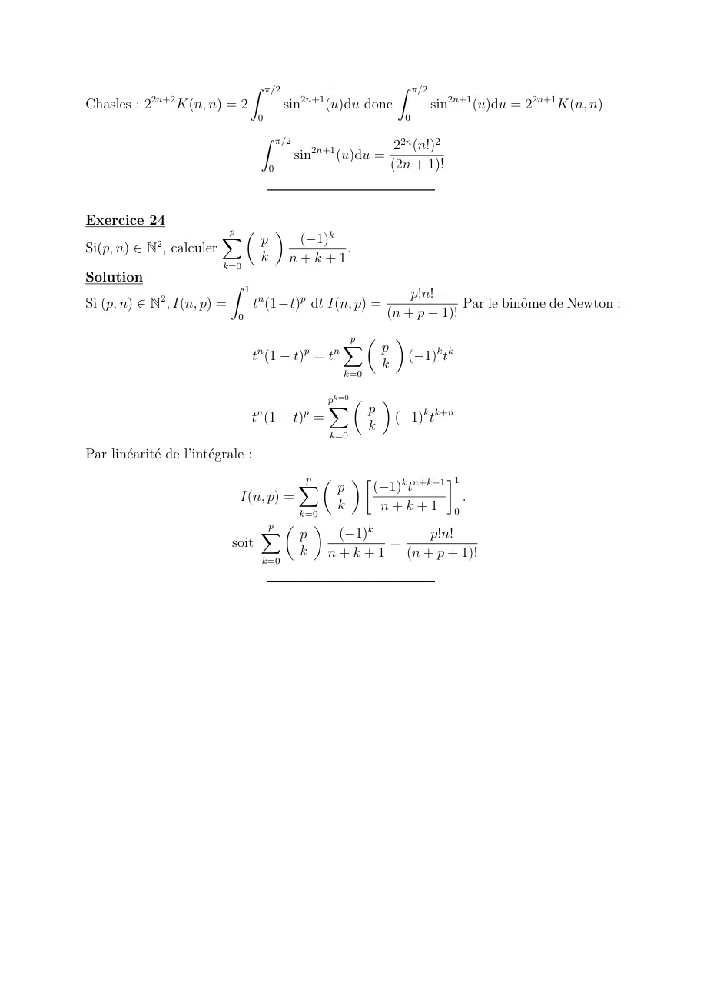

~~~text
                                   Z ⇡/2                                      Z ⇡/2
              2n+2                                 2n+1
Chasles : 2          K(n, n) = 2             sin          (u)du donc                  sin2n+1 (u)du = 22n+1 K(n, n)
                                    0                                          0
                                     Z ⇡/2
                                                                              22n (n!)2
                                              sin2n+1 (u)du =
                                         0                                   (2n + 1)!

Exercice 24
                            p ✓   ◆
                            X   p             ( 1)k
Si(p, n) 2 N , calculer
              2
                                                    .
                                     k       n+k+1
                            k=0
Solution                     Z 1
                                                                             p!n!
Si (p, n) 2 N , I(n, p) =
               2
                                    tn (1 t)p dt I(n, p) =                            Par le binôme de Newton :
                              0                                          (n + p + 1)!
                                                               p ✓   ◆
                                                               X   p
                                    n              p       n
                                   t (1       t) = t                            ( 1)k tk
                                                                         k
                                                               k=0

                                                          pk=0 ✓         ◆
                                                          X          p
                                    n              p
                                   t (1       t) =                           ( 1)k tk+n
                                                                     k
                                                          k=0

Par linéarité de l’intégrale :
                                         p ✓   ◆                1
                                        X    p    ( 1)k tn+k+1
                              I(n, p) =                            .
                                             k     n+k+1 0
                                        k=0
                                   p ✓    ◆
                                  X     p    ( 1)k          p!n!
                             soit                   =
                                        k n+k+1        (n + p + 1)!
                                  k=0
~~~
