# TD4-Equations-Differentielles-Correction_2021-2022_Analyse2_P1S2_DMaths.pdf

[Ouvrir l’original](https://drive.google.com/open?id=1ZR_EYtR1OGI-uYkhaC1RvnrP1q5QmzLE) · Les deux lectures automatiques du PDF divergent sur les pages indiquées. Leur fac-similé accompagne le texte.

**Pages présentant un écart entre les deux extractions** — 1–18.

## Page 1

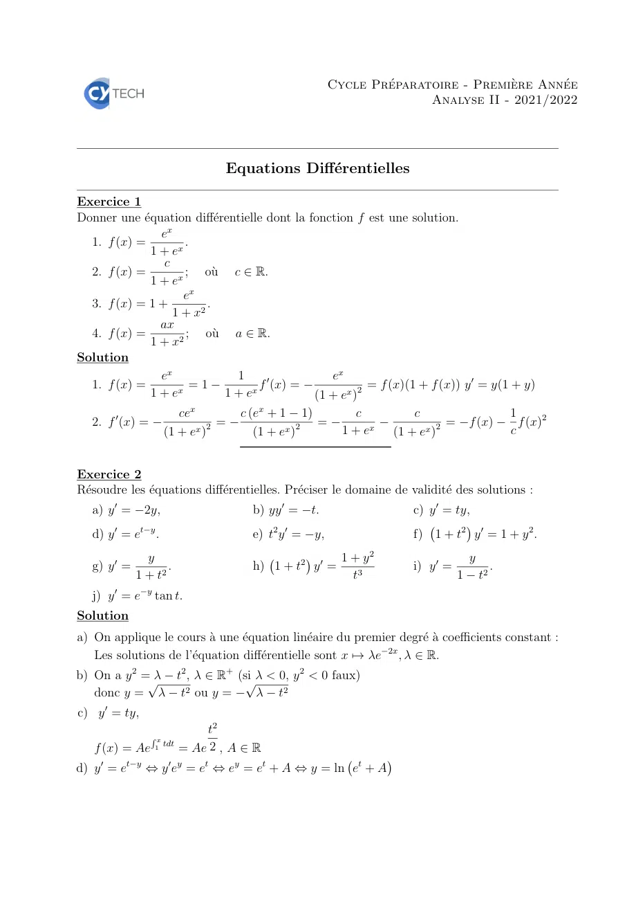

~~~text
                                                     Cycle Préparatoire - Première Année
                                                                    Analyse II - 2021/2022

                              Equations Différentielles

Exercice 1
Donner une équation différentielle dont la fonction f est une solution.
                 ex
  1. f (x) =          .
               1 + ex
                  c
  2. f (x) =          ; où c ∈ R.
               1 + ex
                      ex
  3. f (x) = 1 +           .
                    1 + x2
                 ax
  4. f (x) =          ; où a ∈ R.
               1 + x2
Solution
                 ex              1      0             ex                         0
  1. f (x) =            = 1  −        f   (x) =  −         2 = f (x)(1 + f (x)) y = y(1 + y)
               1 + ex          1 + ex                    x
                                                   (1 + e )
                        x             x
                     ce           c (e + 1 − 1)            c          c                 1
  2. f 0 (x) = −           2  =−               2    =−       x
                                                               −           2 = −f (x) − f (x)2
                 (1 + ex )           (1 + ex )          1+e       (1 + ex )             c

Exercice 2
Résoudre les équations différentielles. Préciser le domaine de validité des solutions :
   a) y 0 = −2y,                   b) yy 0 = −t.                   c) y 0 = ty,
   d) y 0 = et−y .                 e) t2 y 0 = −y,                 f) 1 + t2 y 0 = 1 + y 2 .
                                                                              

                y                                  1 + y2                       y
   g) y 0 =                        h) 1 + t2 y 0 =                 i) y 0 =
                                            
                     .                                                               .
              1 + t2                                 t3                       1 − t2
   j) y 0 = e−y tan t.
Solution
a) On applique le cours à une équation linéaire du premier degré à coefficients constant :
   Les solutions de l’équation différentielle sont x 7→ λe−2x , λ ∈ R.
b) On a y 2 = λ − t2 , λ ∈ R+ (si λ < 0, y 2 < 0 faux)
             √                  √
   donc y = λ − t2 ou y = − λ − t2
c) y 0 = ty,
                        t2
                 Rx
   f (x) = Ae 1 tdt = Ae 2 , A ∈ R
d) y 0 = et−y ⇔ y 0 ey = et ⇔ ey = et + A ⇔ y = ln et + A
                                                         
~~~

## Page 2

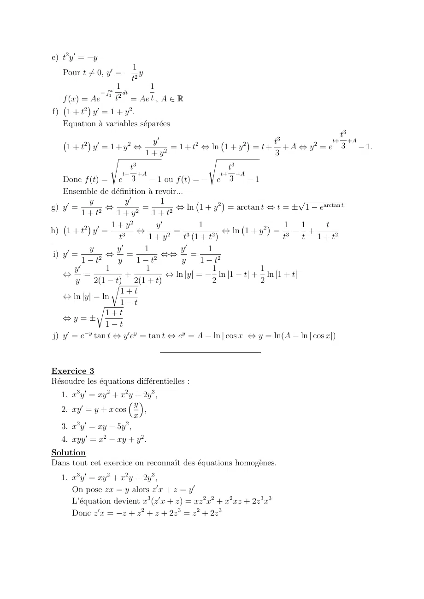

~~~text
e) t2 y 0 = −y
                          1
   Pour t 6= 0, y 0 = − 2 y
                          t
                Rx 1         1
               − 1     dt
                     2
                    t = Ae t , A ∈ R
   f (x) = Ae
            0
f) 1 + t y = 1 + y 2 .
         2

   Equation à variables séparées
                                      0                                3
                                                                                           t3
                                  y                                        t            t+ +A
    1 + t2 y 0 = 1 + y 2 ⇔               = 1 + t2 ⇔ ln 1 + y 2 = t + + A ⇔ y 2 = e 3 − 1.
                                                                
                                1+y    2                                   3
                    s                                 s
                           t3                                t3
                        t+ +A                              t+ +A
   Donc f (t) = e 3              − 1 ou f (t) = − e 3             −1
   Ensemble de définition à revoir...
            y            y0          1                                           √
g) y 0 =                                   ⇔ ln 1 + y 2 = arctan t ⇔ t = ± 1 − earctan t
                                                           
                2
                  ⇔          2
                               =         2
           1+t       1+y          1+t
                    1+y   2
                                    y0             1                         1    1   t
h) 1 + t2 y 0 =                                                        2
                                                                        
                              ⇔            =               ⇔  ln 1 + y     =    −   +
                      t3         1 + y2       t3 (1 + t2 )                   t3   t 1 + t2
             y       y0        1             y0       1
i) y 0 =        2
                  ⇔      =         2
                                     ⇔⇔          =
           1−t        y       1−t            y      1 − t2
         0
       y          1             1                      1             1
   ⇔       =             +             ⇔ ln |y| = − ln |1 − t| + ln |1 + t|
        y      2(1 −rt) 2(1 + t)                       2             2
                       1+t
   ⇔ ln |y| = ln
               r      1−t
                  1+t
   ⇔y=±
                  1−t
j) y = e tan t ⇔ y 0 ey = tan t ⇔ ey = A − ln | cos x| ⇔ y = ln(A − ln | cos x|)
     0     −y

Exercice 3
Résoudre les équations différentielles :
   1. x3 y 0 = xy 2 + x2 y + 2y 3 ,
                        y
   2. xy 0 = y + x cos       ,
                           x
   3. x2 y 0 = xy − 5y 2 ,
   4. xyy 0 = x2 − xy + y 2 .
Solution
Dans tout cet exercice on reconnaı̂t des équations homogènes.
   1. x3 y 0 = xy 2 + x2 y + 2y 3 ,
      On pose zx = y alors z 0 x + z = y 0
      L’équation devient x3 (z 0 x + z) = xz 2 x2 + x2 xz + 2z 3 x3
      Donc z 0 x = −z + z 2 + z + 2z 3 = z 2 + 2z 3
~~~

## Page 3

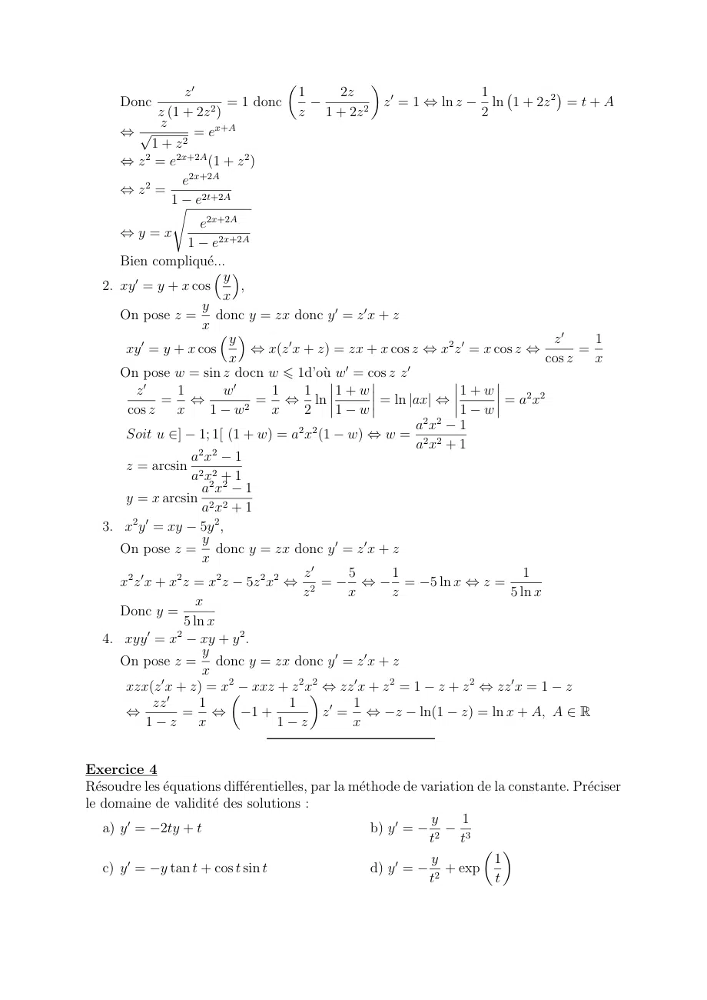

~~~text
                 z0
                                                       
                                           1   2z                              1
                                                            z 0 = 1 ⇔ ln z −     ln 1 + 2z 2 = t + A
                                                                                            
      Donc                = 1 donc           −
            z (1 + 2z 2 )                  z 1 + 2z 2                          2
             z
      ⇔√           = ex+A
           1+z   2

      ⇔ z 2 = e2x+2A (1 + z 2 )
                 e2x+2A
      ⇔ z2 =
               1s− e2t+2A
                          e2x+2A
      ⇔y=x
                       1 − e2x+2A
      Bien compliqué...
                            y
         0
   2. xy = y + x cos              ,
                               x
                          y
      On pose z = donc y = zx donc y 0 = z 0 x + z
                          x
           0
                              y                                                            z0     1
       xy = y + x cos                ⇔ x(z 0 x + z) = zx + x cos z ⇔ x2 z 0 = x cos z ⇔           =
                                x                                                           cos z   x
      On pose w = sin z docn w ⩽ 1d’où w0 = cos z z 0
         z0         1          w0      1       1       1+w                  1+w
                = ⇔                2
                                     = ⇔ ln                  = ln |ax| ⇔           = a2 x 2
       cos z        x       1−w        x       2       1−w                  1−w
                                                                      2 2
                                                                    a  x  − 1
       Soit u ∈] − 1; 1[ (1 + w) = a2 x2 (1 − w) ⇔ w = 2 2
                                                                    a x +1
                       a2 x2 − 1
       z = arcsin 2 2
                        a x +1
                          a2 x 2 − 1
       y = x arcsin 2 2
                          a x +1
        2 0
   3. x y = xy − 5y 2 ,
                          y
      On pose z = donc y = zx donc y 0 = z 0 x + z
                          x
                                               z0       5       1                       1
      x2 z 0 x + x2 z = x2 z − 5z 2 x2 ⇔ 2 = − ⇔ − = −5 ln x ⇔ z =
                                               z        x       z                   5 ln x
                         x
      Donc y =
                      5 ln x
             0
   4. xyy = x − xy + y 2 .
                    2
                          y
      On pose z = donc y = zx donc y 0 = z 0 x + z
                          x
       xzx(z 0 x + z) = x2− xxz + z 2 x        2
                                                   ⇔ zz 0 x + z 2 = 1 − z + z 2 ⇔ zz 0 x = 1 − z
                  0
               zz        1                 1             1
       ⇔              = ⇔ −1 +                     z 0 = ⇔ −z − ln(1 − z) = ln x + A, A ∈ R
             1−z         x              1−z              x

Exercice 4
Résoudre les équations différentielles, par la méthode de variation de la constante. Préciser
le domaine de validité des solutions :
                                                                y    1
   a) y 0 = −2ty + t                                  b) y 0 = − 2 − 3
                                                                t    t
                                                                          
        0                                                  0    y          1
   c) y = −y tan t + cos t sin t                      d) y = − 2 + exp
                                                                t          t
~~~

## Page 4

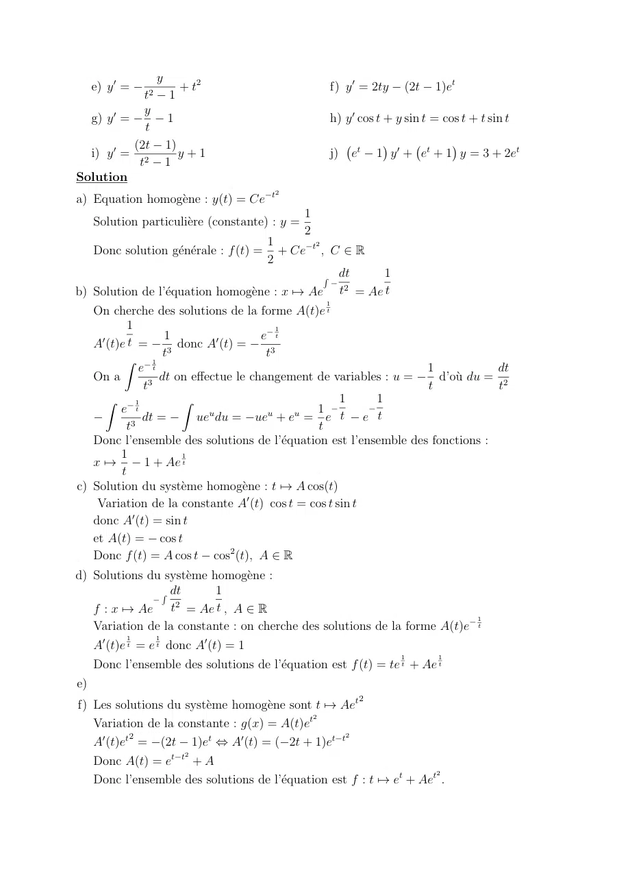

~~~text
               y
  e) y 0 = − 2      + t2                            f) y 0 = 2ty − (2t − 1)et
             t −1
             y
  g) y 0 = − − 1                                    h) y 0 cos t + y sin t = cos t + t sin t
             t
           (2t − 1)
  i) y 0 = 2                                             et − 1 y 0 + et + 1 y = 3 + 2et
                                                                           
                    y+1                             j)
            t −1
Solution
                                          2
a) Equation homogène : y(t) = Ce−t
                                                1
     Solution particulière (constante) : y =
                                                2
                                    1        2
                                      + Ce−t , C ∈ R
     Donc solution générale : f (t) =
                                    2
                                               R dt   1
                                                −
                                                  2
b) Solution de l’équation homogène : x 7→ Ae t = Ae t
                                                    1
   On cherche des solutions de la forme A(t)e t
           1                            1
     0            1          0       e− t
           t
   A (t)e = − 3 donc A (t) = − 3
                  t                   t
          Z −1
             e t                                                     1            dt
   On a          dt on effectue le changement de  variables  : u = −   d’où du =
              t3                                                     t            t2
       Z −1          Z                              1      1
         e t               u          u   u   1 −        −
   −          dt = − ue du = −ue + e = e t − e t
          t3                                   t
   Donc l’ensemble des solutions de l’équation est l’ensemble des fonctions :
         1           1
   x 7→ − 1 + Ae t
         t
c) Solution du système homogène : t 7→ A cos(t)
    Variation de la constante A0 (t) cos t = cos t sin t
   donc A0 (t) = sin t
   et A(t) = − cos t
   Donc f (t) = A cos t − cos2 (t), A ∈ R
d) Solutions du système homogène :
                R dt      1
              −
                   2
   f : x 7→ Ae t = Ae t , A ∈ R
                                                                           1
   Variation de la constante : on cherche des solutions de la forme A(t)e− t
           1     1
     A0 (t)e t = e t donc A0 (t) = 1
                                                                   1        1
     Donc l’ensemble des solutions de l’équation est f (t) = te t + Ae t
e)
                                                          2
f) Les solutions du système homogène sont t 7→ Aet
                                            2
   Variation de la constante : g(x) = A(t)et
           2                                       2
   A0 (t)et = −(2t − 1)et ⇔ A0 (t) = (−2t + 1)et−t
                    2
   Donc A(t) = et−t + A
                                                                     2
   Donc l’ensemble des solutions de l’équation est f : t 7→ et + Aet .
~~~

## Page 5

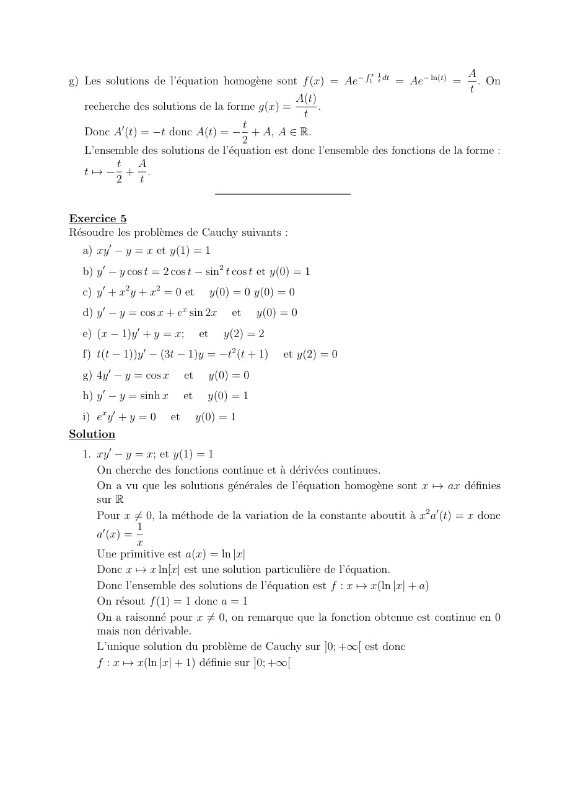

~~~text
                                                                    Rx 1            A
g) Les solutions de l’équation homogène sont f (x) = Ae− 1 t dt = Ae− ln(t) =       . On
                                                                                    t
                                                           A(t)
   recherche des solutions de la forme g(x) =                   .
                                                            t
                                    t
   Donc A0 (t) = −t donc A(t) = − + A, A ∈ R.
                                    2
   L’ensemble des solutions de l’équation est donc l’ensemble des fonctions de la forme :
         t A
   t 7→ − + .
         2     t

Exercice 5
Résoudre les problèmes de Cauchy suivants :
  a) xy 0 − y = x et y(1) = 1
  b) y 0 − y cos t = 2 cos t − sin2 t cos t et y(0) = 1
  c) y 0 + x2 y + x2 = 0 et            y(0) = 0 y(0) = 0
  d) y 0 − y = cos x + ex sin 2x           et   y(0) = 0
  e) (x − 1)y 0 + y = x;          et     y(2) = 2
  f) t(t − 1))y 0 − (3t − 1)y = −t2 (t + 1)          et y(2) = 0
  g) 4y 0 − y = cos x        et     y(0) = 0
  h) y 0 − y = sinh x        et     y(0) = 1
  i) ex y 0 + y = 0     et        y(0) = 1
Solution
  1. xy 0 − y = x; et y(1) = 1
     On cherche des fonctions continue et à dérivées continues.
     On a vu que les solutions générales de l’équation homogène sont x 7→ ax définies
     sur R
     Pour x 6= 0, la méthode de la variation de la constante aboutit à x2 a0 (t) = x donc
              1
     a0 (x) =
              x
     Une primitive est a(x) = ln |x|
     Donc x 7→ x ln[x| est une solution particulière de l’équation.
     Donc l’ensemble des solutions de l’équation est f : x 7→ x(ln |x| + a)
     On résout f (1) = 1 donc a = 1
     On a raisonné pour x 6= 0, on remarque que la fonction obtenue est continue en 0
     mais non dérivable.
     L’unique solution du problème de Cauchy sur ]0; +∞[ est donc
     f : x 7→ x(ln |x| + 1) définie sur ]0; +∞[
~~~

## Page 6

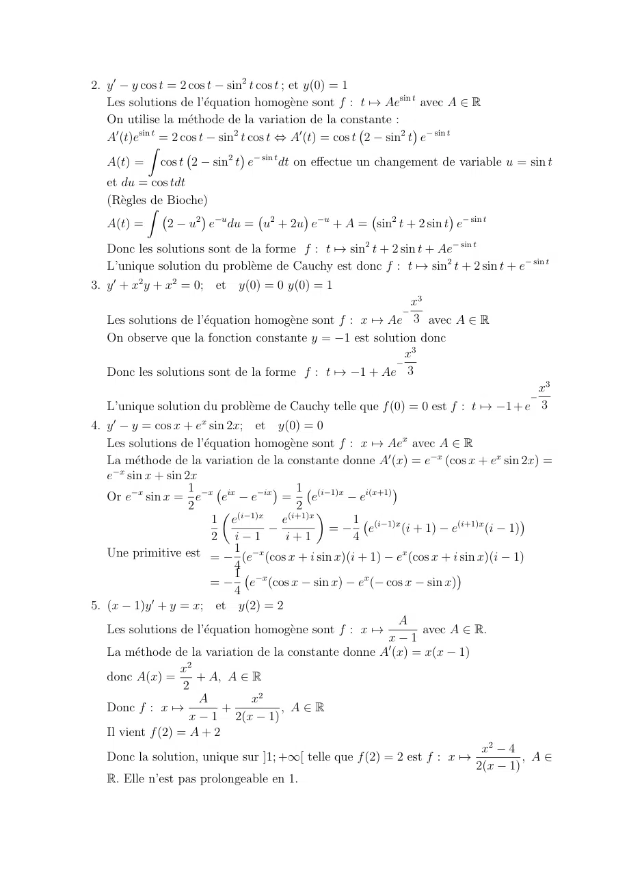

~~~text
2. y 0 − y cos t = 2 cos t − sin2 t cos t ; et y(0) = 1
   Les solutions de l’équation homogène sont f : t 7→ Aesin t avec A ∈ R
   On utilise la méthode de la variation de la constante :
   A0 (t)esin t = 2 cos t − sin2 t cos t ⇔ A0 (t) = cos t 2 − sin2 t e− sin t
                                                                    
             Z
   A(t) = cos t 2 − sin2 t e− sin t dt on effectue un changement de variable u = sin t
                                 

   et du = cos tdt
   (Règles de Bioche)
           Z
               2 − u2 e−u du = u2 + 2u e−u + A = sin2 t + 2 sin t e− sin t
                                                               
   A(t) =
   Donc les solutions sont de la forme f : t 7→ sin2 t + 2 sin t + Ae− sin t
   L’unique solution du problème de Cauchy est donc f : t 7→ sin2 t + 2 sin t + e− sin t
3. y 0 + x2 y + x2 = 0; et y(0) = 0 y(0) = 1
                                                            x3
                                                            −
   Les solutions de l’équation homogène sont f : x 7→ Ae 3 avec A ∈ R
   On observe que la fonction constante y = −1 est solution donc
                                                           x3
                                                         −
   Donc les solutions sont de la forme f : t 7→ −1 + Ae 3
                                                                                    x3
                                                                                     −
   L’unique solution du problème de Cauchy telle que f (0) = 0 est f : t 7→ −1 + e 3
4. y 0 − y = cos x + ex sin 2x; et y(0) = 0
   Les solutions de l’équation homogène sont f : x 7→ Aex avec A ∈ R
   La méthode de la variation de la constante donne A0 (x) = e−x (cos x + ex sin 2x) =
   e−x sin x + sin 2x
                    1               1 (i−1)x
   Or e−x sin x = e−x eix − e−ix =              − ei(x+1)
                                                          
                                          e
                    2                  2 
                        1 e(i−1)x e(i+1)x
                          
                                                  1
                                             = − e(i−1)x (i + 1) − e(i+1)x (i − 1)
                                                                                   
                                   −
                        2 i−1         i+1         4
                             1
   Une primitive est = − (e−x (cos x + i sin x)(i + 1) − ex (cos x + i sin x)(i − 1)
                             4
                             1 −x
                        = − e (cos x − sin x) − ex (− cos x − sin x)
                                                                      
                             4
            0
5. (x − 1)y + y = x; et y(2) = 2
                                                            A
   Les solutions de l’équation homogène sont f : x 7→        avec A ∈ R.
                                                        x−1
   La méthode de la variation de la constante donne A0 (x) = x(x − 1)
                  x2
   donc A(x) =        + A, A ∈ R
                   2
                      A         x2
   Donc f : x 7→           +         , A∈R
                    x − 1 2(x − 1)
   Il vient f (2) = A + 2
                                                                            x2 − 4
   Donc la solution, unique sur ]1; +∞[ telle que f (2) = 2 est f : x 7→            , A∈
                                                                           2(x − 1)
   R. Elle n’est pas prolongeable en 1.
~~~

## Page 7

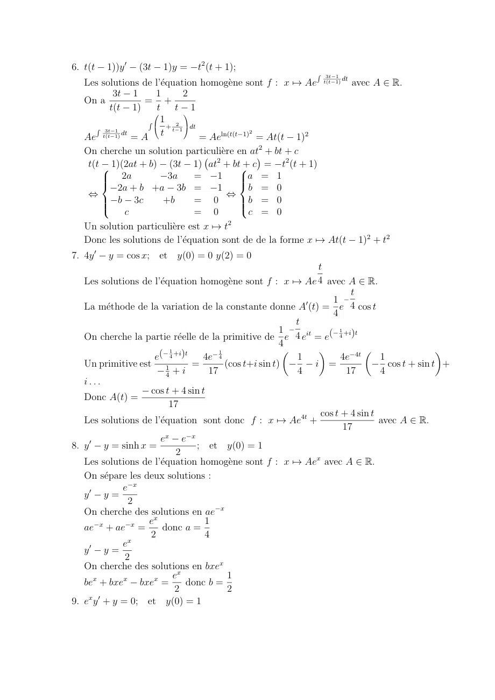

~~~text
6. t(t − 1))y 0 − (3t − 1)y = −t2 (t + 1);
                                                                    3t−1
                                                                R
   Les solutions de l’équation homogène sont f : x 7→ Ae t(t−1) dt avec A ∈ R.
            3t − 1     1      2
   On a             = +
           t(t − 1)    t t−1
                     R 1
                             
                       +  2  dt
                          t−1
                        t
      R 3t−1
               dt                              2
   Ae   t(t−1)    =A              = Aeln(t(t−1) = At(t − 1)2
   On cherche un solution particulière en at2 + bt + c
        − 1)(2at + b) − (3t − 1) at2 + bt
    t(t                                  + c = −t2 (t + 1)
        
           2a        −3a     = −1       
                                          a = 1
          −2a + b +a − 3b = −1             b = 0
                                        
    ⇔                                  ⇔
        
         −b − 3c     +b      =     0    b = 0
                                         
             c                = 0          c = 0
                                        
                                       2
   Un solution particulière est x 7→ t
   Donc les solutions de l’équation sont de de la forme x 7→ At(t − 1)2 + t2
7. 4y 0 − y = cos x; et y(0) = 0 y(2) = 0
                                                                    t
   Les solutions de l’équation homogène sont f : x 7→ Ae 4 avec A ∈ R.
                                                                              t
                                                                  0     1 −
   La méthode de la variation de la constante donne A (t) = e 4 cos t
                                                                        4
                                                                t
                                                            1 −           1
   On cherche la partie réelle de la primitive de e 4 eit = e(− 4 +i)t
                                                            4
                       ( − 41 +i)t      − 41
                                                                           4e−4t
                                                                                               
                     e               4e                         1                    1
   Un primitive est 1              =         (cos t+i sin t) − − i =               − cos t + sin t +
                      −4 + i           17                       4            17      4
   i...
                  − cos t + 4 sin t
   Donc A(t) =
                          17
                                                                     cos t + 4 sin t
   Les solutions de l’équation sont donc f : x 7→ Ae4t +                            avec A ∈ R.
                                                                            17
                       ex − e−x
8. y 0 − y = sinh x =               ; et y(0) = 1
                              2
   Les solutions de l’équation homogène sont f : x 7→ Aex avec A ∈ R.
   On sépare les deux solutions :
             e−x
   y0 − y =
               2
   On cherche des solutions en ae−x
                    ex                1
   ae−x + ae−x =        donc a =
                    2                 4
               x
             e
   y0 − y =
              2
   On cherche des solutions en bxex
                             ex               1
   bex + bxex − bxex =           donc b =
                              2               2
    x 0
9. e y + y = 0; et y(0) = 1
~~~

## Page 8

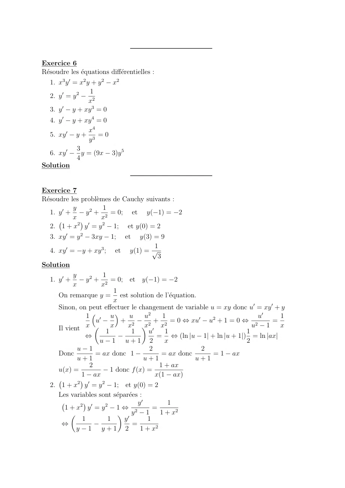

~~~text
Exercice 6
Résoudre les équations différentielles :
   1. x3 y 0 = x2 y + y 2 − x2
                   1
   2. y 0 = y 2 − 2
                   x
        0
   3. y − y + xy 3 = 0
  4. y 0 − y + xy 4 = 0
         0      x4
  5. xy − y + 3 = 0
                y
             3
  6. xy 0 − y = (9x − 3)y 5
             4
Solution

Exercice 7
Résoudre les problèmes de Cauchy suivants :
           y          1
   1. y 0 + − y 2 + 2 = 0; et y(−1) = −2
           x        x
                0
             2
   2. 1 + x y = y 2 − 1; et y(0) = 2
   3. xy 0 = y 2 − 3xy − 1;      et  y(3) = 9
                                          1
   4. xy 0 = −y + xy 3 ;    et    y(1) = √
                                           3
Solution
            y            1
   1. y 0 +    − y 2 + 2 = 0; et y(−1) = −2
            x           x
                             1
      On remarque y = est solution de l’équation.
                             x
      Sinon, on peut effectuer le changement de variable u = xy donc u0 = xy 0 + y
                   1  0 u        u     u2     1                             u0     1
                      u −       + 2 − 2 + 2 = 0 ⇔ xu0 − u2 + 1 = 0 ⇔ 2            =
      Il vient x  1 x             x x 0 x                                 u −1     x
                                    1     u      1                        1
                  ⇔            −             = ⇔ (ln |u − 1| + ln |u + 1|) = ln |ax|
                        u−1 u+1 2                x                        2
              u−1                          2              2
      Donc            = ax donc 1 −            = ax donc      = 1 − ax
              u+1                        u+1             u+1
                    2                         1 + ax
      u(x) =             − 1 donc f (x) =
                1 − ax                       x(1 − ax)
              2
                 0     2
   2. 1 + x y = y − 1; et y(0) = 2
      Les variables sont séparées :
                                      y0          1
         1 + x2 y 0 = y 2 − 1 ⇔ 2
                 
                                            =
                               0 y −1        1 + x2
                 1         1     y        1
       ⇔              −             =
             y−1 y+1 2                 1 + x2
~~~

## Page 9

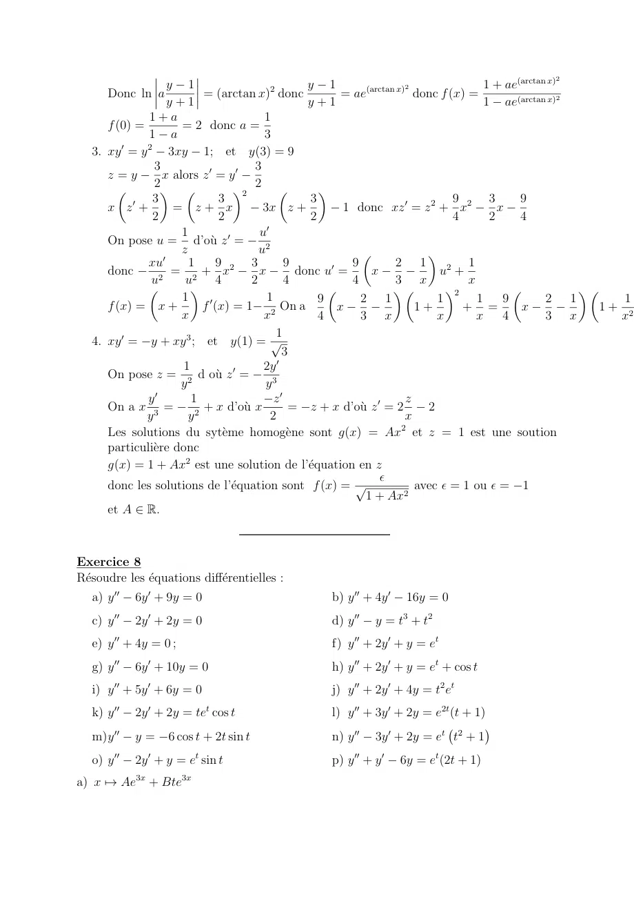

~~~text
                                                                                             2
                  y−1                            y−1                 2               1 + ae(arctan x)
      Donc ln a           = (arctan x)2 donc           = ae(arctan x) donc f (x) =
                  y+1                            y+1                                 1 − ae(arctan x)2
              1+a                     1
      f (0) =        = 2 donc a =
              1−a                     3
         0    2
   3. xy = y − 3xy − 1; et y(3) = 9
                3                   3
      z = y − x alors z 0 = y 0 −
               2             2 2              
           0    3            3                   3                            9       3     9
      x z +         = z + x − 3x z +                 − 1 donc xz 0 = z 2 + x2 − x −
                2            2                   2                            4       2     4
                                       0
                     1               u
      On pose u = d’où z 0 = − 2
                     z               u
              xu0
                                                                        
                       1     9 2 3           9       0   9        2 1            1
      donc − 2 = 2 + x − x − donc u =                        x− −           u2 +
               u      u      4     2         4           4        3 x            x
                                                                           2
                     1                 1
                                                                                                   
                           0                       9       2 1             1       1    9         2 1       1
      f (x) = x +         f (x) = 1− 2 On a            x− −            1+       + =         x− −         1+ 2
                     x                x            4       3 x             x       x    4         3 x      x
                                          1
   4. xy 0 = −y + xy 3 ; et y(1) = √
                                             3
                                           0
                      1               2y
      On pose z = 2 d où z 0 = − 3
                     y                 y
                0
              y         1             −z 0                           z
      On a x 3 = − 2 + x d’où x              = −z + x d’où z 0 = 2 − 2
              y        y                 2                           x
                                                                    2
      Les solutions du sytème homogène sont g(x) = Ax et z = 1 est une soution
      particulière donc
      g(x) = 1 + Ax2 est une solution de l’équation en z
                                                                
      donc les solutions de l’équation sont f (x) = √                 avec  = 1 ou  = −1
                                                            1 + Ax2
      et A ∈ R.

Exercice 8
Résoudre les équations différentielles :
   a) y 00 − 6y 0 + 9y = 0                        b) y 00 + 4y 0 − 16y = 0
   c) y 00 − 2y 0 + 2y = 0                        d) y 00 − y = t3 + t2
   e) y 00 + 4y = 0 ;                             f) y 00 + 2y 0 + y = et
   g) y 00 − 6y 0 + 10y = 0                       h) y 00 + 2y 0 + y = et + cos t
   i) y 00 + 5y 0 + 6y = 0                        j) y 00 + 2y 0 + 4y = t2 et
   k) y 00 − 2y 0 + 2y = tet cos t                l) y 00 + 3y 0 + 2y = e2t (t + 1)
   m) y 00 − y = −6 cos t + 2t sin t              n) y 00 − 3y 0 + 2y = et t2 + 1
                                                                                   

   o) y 00 − 2y 0 + y = et sin t                  p) y 00 + y 0 − 6y = et (2t + 1)
a) x 7→ Ae3x + Bte3x
~~~

## Page 10

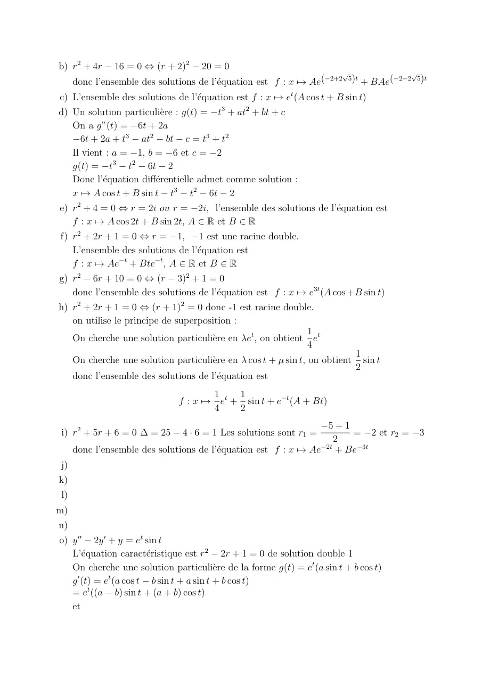

~~~text
b) r2 + 4r − 16 = 0 ⇔ (r + 2)2 − 20 = 0
                                                                        √               √
     donc l’ensemble des solutions de l’équation est f : x 7→ Ae(−2+2 5)t + BAe(−2−2 5)t
c) L’ensemble des solutions de l’équation est f : x 7→ et (A cos t + B sin t)
d) Un solution particulière : g(t) = −t3 + at2 + bt + c
   On a g”(t) = −6t + 2a
   −6t + 2a + t3 − at2 − bt − c = t3 + t2
   Il vient : a = −1, b = −6 et c = −2
   g(t) = −t3 − t2 − 6t − 2
   Donc l’équation différentielle admet comme solution :
   x 7→ A cos t + B sin t − t3 − t2 − 6t − 2
e) r2 + 4 = 0 ⇔ r = 2i ou r = −2i, l’ensemble des solutions de l’équation est
   f : x 7→ A cos 2t + B sin 2t, A ∈ R et B ∈ R
f) r2 + 2r + 1 = 0 ⇔ r = −1, −1 est une racine double.
   L’ensemble des solutions de l’équation est
   f : x 7→ Ae−t + Bte−t , A ∈ R et B ∈ R
g) r2 − 6r + 10 = 0 ⇔ (r − 3)2 + 1 = 0
   donc l’ensemble des solutions de l’équation est f : x 7→ e3t (A cos +B sin t)
h) r2 + 2r + 1 = 0 ⇔ (r + 1)2 = 0 donc -1 est racine double.
   on utilise le principe de superposition :
                                                            1
   On cherche une solution particulière en λet , on obtient et
                                                            4
                                                                              1
     On cherche une solution particulière en λ cos t + µ sin t, on obtient     sin t
                                                                              2
     donc l’ensemble des solutions de l’équation est
                                       1    1
                               f : x 7→ et + sin t + e−t (A + Bt)
                                       4    2
                                                                 −5 + 1
i) r2 + 5r + 6 = 0 ∆ = 25 − 4 · 6 = 1 Les solutions sont r1 =           = −2 et r2 = −3
                                                                    2
     donc l’ensemble des solutions de l’équation est f : x 7→ Ae−2t + Be−3t
j)
k)
l)
m)
n)
o) y 00 − 2y 0 + y = et sin t
   L’équation caractéristique est r2 − 2r + 1 = 0 de solution double 1
   On cherche une solution particulière de la forme g(t) = et (a sin t + b cos t)
   g 0 (t) = et (a cos t − b sin t + a sin t + b cos t)
   = et ((a − b) sin t + (a + b) cos t)
   et
~~~

## Page 11

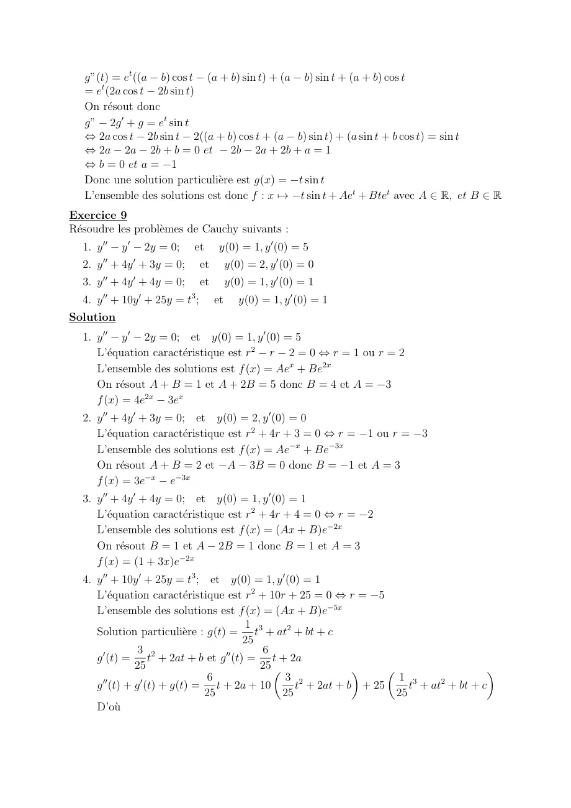

~~~text
   g”(t) = et ((a − b) cos t − (a + b) sin t) + (a − b) sin t + (a + b) cos t
   = et (2a cos t − 2b sin t)
   On résout donc
   g” − 2g 0 + g = et sin t
   ⇔ 2a cos t − 2b sin t − 2((a + b) cos t + (a − b) sin t) + (a sin t + b cos t) = sin t
   ⇔ 2a − 2a − 2b + b = 0 et − 2b − 2a + 2b + a = 1
   ⇔ b = 0 et a = −1
   Donc une solution particulière est g(x) = −t sin t
   L’ensemble des solutions est donc f : x 7→ −t sin t + Aet + Btet avec A ∈ R, et B ∈ R
Exercice 9
Résoudre les problèmes de Cauchy suivants :
  1. y 00 − y 0 − 2y = 0;    et        y(0) = 1, y 0 (0) = 5
  2. y 00 + 4y 0 + 3y = 0;       et        y(0) = 2, y 0 (0) = 0
  3. y 00 + 4y 0 + 4y = 0;       et        y(0) = 1, y 0 (0) = 1
  4. y 00 + 10y 0 + 25y = t3 ;        et      y(0) = 1, y 0 (0) = 1
Solution
  1. y 00 − y 0 − 2y = 0; et y(0) = 1, y 0 (0) = 5
     L’équation caractéristique est r2 − r − 2 = 0 ⇔ r = 1 ou r = 2
     L’ensemble des solutions est f (x) = Aex + Be2x
     On résout A + B = 1 et A + 2B = 5 donc B = 4 et A = −3
     f (x) = 4e2x − 3ex
  2. y 00 + 4y 0 + 3y = 0; et y(0) = 2, y 0 (0) = 0
     L’équation caractéristique est r2 + 4r + 3 = 0 ⇔ r = −1 ou r = −3
     L’ensemble des solutions est f (x) = Ae−x + Be−3x
     On résout A + B = 2 et −A − 3B = 0 donc B = −1 et A = 3
     f (x) = 3e−x − e−3x
  3. y 00 + 4y 0 + 4y = 0; et y(0) = 1, y 0 (0) = 1
     L’équation caractéristique est r2 + 4r + 4 = 0 ⇔ r = −2
     L’ensemble des solutions est f (x) = (Ax + B)e−2x
     On résout B = 1 et A − 2B = 1 donc B = 1 et A = 3
     f (x) = (1 + 3x)e−2x
  4. y 00 + 10y 0 + 25y = t3 ; et y(0) = 1, y 0 (0) = 1
     L’équation caractéristique est r2 + 10r + 25 = 0 ⇔ r = −5
     L’ensemble des solutions est f (x) = (Ax + B)e−5x
                                      1
     Solution particulière : g(t) = t3 + at2 + bt + c
                                     25
       0       3 2                00      6
     g (t) = t + 2at + b et g (t) = t + 2a
              25                         25                                          
       00        0             6                3 2                  1 3      2
     g (t) + g (t) + g(t) = t + 2a + 10           t + 2at + b + 25      t + at + bt + c
                              25              25                     25
     D’où
~~~

## Page 12

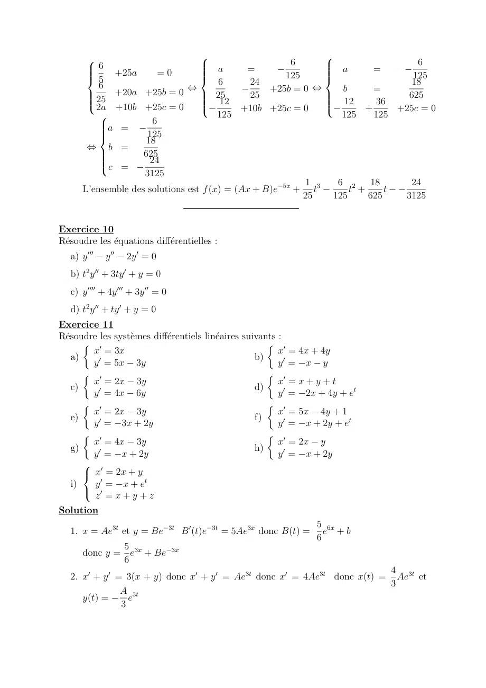

~~~text
                                                       6                          6
                                                           
          6                           a      =     −           a       =    −
        5 +25a         =0
                                                           
       
                                 
                                                     125    
                                                                                125
                                        6      24                               18
                                                            
          6
              +20a +25b = 0 ⇔         25
                                             −
                                               25
                                                  +25b = 0 ⇔     b       =
                                                                                625
         25
                                                            
       
       
        2a
                                  
                                       12                   
                                                                12      36
              +10b +25c = 0       −
                                  
                                            +10b +25c = 0    −
                                                             
                                                                       +     +25c = 0
                                       125                       125     125
                      6
          
          
           a  =  −
          
                    125
                     18
          
       ⇔ b =
                   625
           c = − 24
          
          
          
                    3125
                                                           1    6 2     18      24
      L’ensemble des solutions est f (x) = (Ax + B)e−5x + t3 −     t +     t−−
                                                          25   125     625     3125

Exercice 10
Résoudre les équations différentielles :
   a) y 000 − y 00 − 2y 0 = 0
   b) t2 y 00 + 3ty 0 + y = 0
   c) y 0000 + 4y 000 + 3y 00 = 0
   d) t2 y 00 + ty 0 + y = 0
Exercice 11
Résoudre les systèmes différentiels linéaires suivants :
       0                                                0
        x = 3x                                             x = 4x + 4y
   a)                                                b)
        y 0 = 5x − 3y                                      y 0 = −x − y
       0                                                0
        x = 2x − 3y                                        x =x+y+t
   c)     0                                          d)
        y = 4x − 6y                                        y 0 = −2x + 4y + et
       0                                                0
        x = 2x − 3y                                        x = 5x − 4y + 1
   e)     0                                          f)
        y = −3x + 2y                                       y 0 = −x + 2y + et
       0                                                0
        x = 4x − 3y                                        x = 2x − y
   g)                                                h)
        y 0 = −x + 2y                                      y 0 = −x + 2y
       0
       x = 2x + y
   i)    y 0 = −x + et
       0
         z =x+y+z
Solution
                                                                    5
   1. x = Ae3t et y = Be−3t B 0 (t)e−3t = 5Ae3x donc B(t) = e6x + b
                                                                    6
                5 3x        −3x
      donc y = e + Be
                6
                                                                          4
   2. x0 + y 0 = 3(x + y) donc x0 + y 0 = Ae3t donc x0 = 4Ae3t donc x(t) = Ae3t et
                                                                          3
                A 3t
      y(t) = − e
                3
~~~

## Page 13

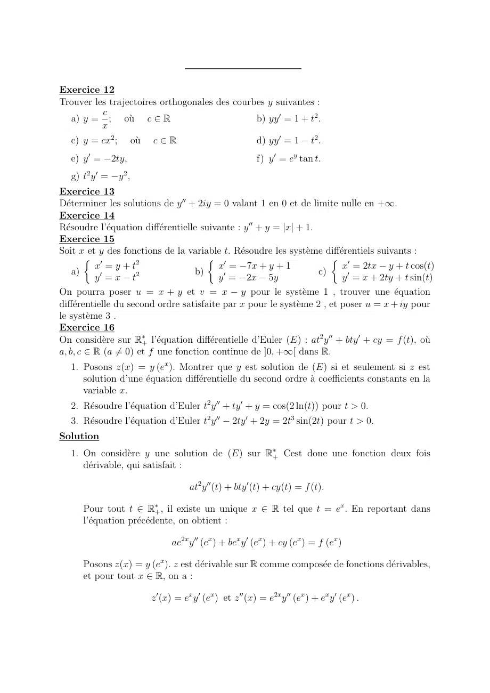

~~~text
Exercice 12
Trouver les trajectoires orthogonales des courbes y suivantes :
          c
  a) y = ; où c ∈ R                           b) yy 0 = 1 + t2 .
          x
   c) y = cx2 ;         où   c∈R                               d) yy 0 = 1 − t2 .
   e) y 0 = −2ty,                                               f) y 0 = ey tan t.
   g) t2 y 0 = −y 2 ,
Exercice 13
Déterminer les solutions de y 00 + 2iy = 0 valant 1 en 0 et de limite nulle en +∞.
Exercice 14
Résoudre l’équation différentielle suivante : y 00 + y = |x| + 1.
Exercice 15
Soit x et y des fonctions de la variable t. Résoudre les système différentiels suivants :
         0                              0                              0
          x = y + t2                      x = −7x + y + 1                 x = 2tx − y + t cos(t)
    a)      0                       b)     0                         c)
          y =x−t     2
                                          y = −2x − 5y                    y 0 = x + 2ty + t sin(t)
On pourra poser u = x + y et v = x − y pour le système 1 , trouver une équation
différentielle du second ordre satisfaite par x pour le système 2 , et poser u = x + iy pour
le système 3 .
Exercice 16
On considère sur R∗+ l’équation différentielle d’Euler (E) : at2 y 00 + bty 0 + cy = f (t), où
a, b, c ∈ R (a 6= 0) et f une fonction continue de ]0, +∞[ dans R.
   1. Posons z(x) = y (ex ). Montrer que y est solution de (E) si et seulement si z est
      solution d’une équation différentielle du second ordre à coefficients constants en la
      variable x.
   2. Résoudre l’équation d’Euler t2 y 00 + ty 0 + y = cos(2 ln(t)) pour t > 0.
   3. Résoudre l’équation d’Euler t2 y 00 − 2ty 0 + 2y = 2t3 sin(2t) pour t > 0.
Solution
   1. On considère y une solution de (E) sur R∗+ Cest done une fonction deux fois
      dérivable, qui satisfait :

                                          at2 y 00 (t) + bty 0 (t) + cy(t) = f (t).

      Pour tout t ∈ R∗+ , il existe un unique x ∈ R tel que t = ex . En reportant dans
      l’équation précédente, on obtient :

                                    ae2x y 00 (ex ) + bex y 0 (ex ) + cy (ex ) = f (ex )

      Posons z(x) = y (ex ). z est dérivable sur R comme composée de fonctions dérivables,
      et pour tout x ∈ R, on a :

                              z 0 (x) = ex y 0 (ex ) et z 00 (x) = e2x y 00 (ex ) + ex y 0 (ex ) .
~~~

## Page 14

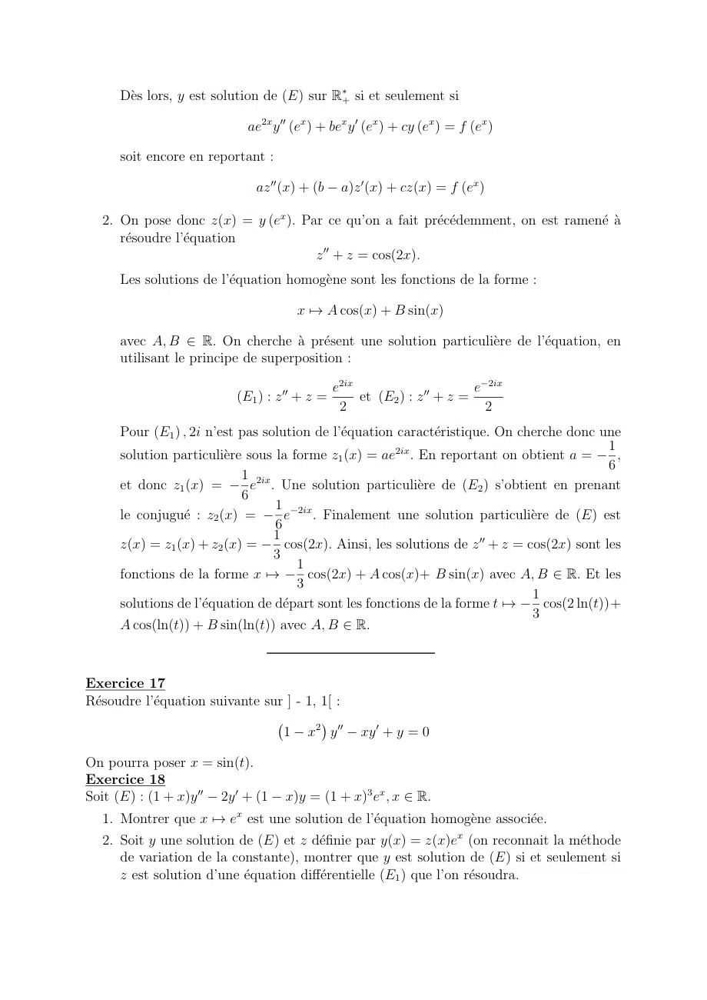

~~~text
      Dès lors, y est solution de (E) sur R∗+ si et seulement si

                             ae2x y 00 (ex ) + bex y 0 (ex ) + cy (ex ) = f (ex )

      soit encore en reportant :

                               az 00 (x) + (b − a)z 0 (x) + cz(x) = f (ex )

   2. On pose donc z(x) = y (ex ). Par ce qu’on a fait précédemment, on est ramené à
      résoudre l’équation
                                     z 00 + z = cos(2x).
      Les solutions de l’équation homogène sont les fonctions de la forme :

                                       x 7→ A cos(x) + B sin(x)

      avec A, B ∈ R. On cherche à présent une solution particulière de l’équation, en
      utilisant le principe de superposition :

                                                e2ix                       e−2ix
                           (E1 ) : z 00 + z =        et (E2 ) : z 00 + z =
                                                 2                           2
      Pour (E1 ) , 2i n’est pas solution de l’équation caractéristique. On cherche donc une
                                                                                            1
      solution particulière sous la forme z1 (x) = ae2ix . En reportant on obtient a = − ,
                                                                                            6
                            1 2ix
      et donc z1 (x) = − e . Une solution particulière de (E2 ) s’obtient en prenant
                            6
                                  1
      le conjugué : z2 (x) = − e−2ix . Finalement une solution particulière de (E) est
                                  6
                                  1
      z(x) = z1 (x) + z2 (x) = − cos(2x). Ainsi, les solutions de z 00 + z = cos(2x) sont les
                                  3
                                      1
      fonctions de la forme x 7→ − cos(2x) + A cos(x)+ B sin(x) avec A, B ∈ R. Et les
                                      3
                                                                               1
      solutions de l’équation de départ sont les fonctions de la forme t 7→ − cos(2 ln(t))+
                                                                               3
      A cos(ln(t)) + B sin(ln(t)) avec A, B ∈ R.

Exercice 17
Résoudre l’équation suivante sur ] - 1, 1[ :

                                  1 − x2 y 00 − xy 0 + y = 0
                                          

On pourra poser x = sin(t).
Exercice 18
Soit (E) : (1 + x)y 00 − 2y 0 + (1 − x)y = (1 + x)3 ex , x ∈ R.
   1. Montrer que x 7→ ex est une solution de l’équation homogène associée.
   2. Soit y une solution de (E) et z définie par y(x) = z(x)ex (on reconnait la méthode
      de variation de la constante), montrer que y est solution de (E) si et seulement si
      z est solution d’une équation différentielle (E1 ) que l’on résoudra.
~~~

## Page 15

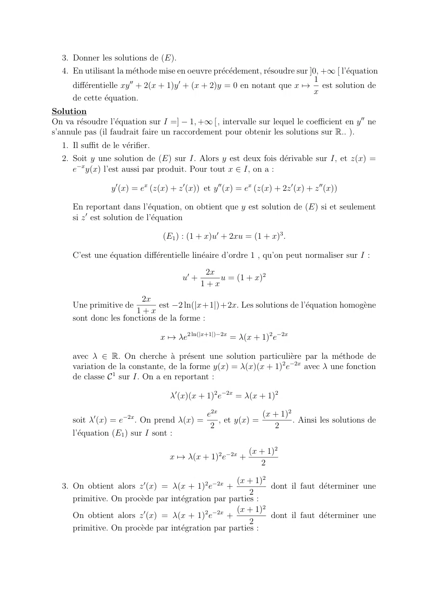

~~~text
   3. Donner les solutions de (E).
   4. En utilisant la méthode mise en oeuvre précédement, résoudre sur ]0, +∞ [ l’équation
                                                                            1
      différentielle xy 00 + 2(x + 1)y 0 + (x + 2)y = 0 en notant que x 7→ est solution de
                                                                            x
      de cette équation.
Solution
On va résoudre l’équation sur I =] − 1, +∞ [, intervalle sur lequel le coefficient en y 00 ne
s’annule pas (il faudrait faire un raccordement pour obtenir les solutions sur R.. ).
   1. Il suffit de le vérifier.
   2. Soit y une solution de (E) sur I. Alors y est deux fois dérivable sur I, et z(x) =
      e−x y(x) l’est aussi par produit. Pour tout x ∈ I, on a :

                   y 0 (x) = ex (z(x) + z 0 (x)) et y 00 (x) = ex (z(x) + 2z 0 (x) + z 00 (x))

      En reportant dans l’équation, on obtient que y est solution de (E) si et seulement
      si z 0 est solution de l’équation

                                    (E1 ) : (1 + x)u0 + 2xu = (1 + x)3 .

      C’est une équation différentielle linéaire d’ordre 1 , qu’on peut normaliser sur I :
                                                  2x
                                          u0 +       u = (1 + x)2
                                                 1+x
                         2x
      Une primitive de        est −2 ln(|x+1|)+2x. Les solutions de l’équation homogène
                        1+x
      sont donc les fonctions de la forme :

                                   x 7→ λe2 ln(|x+1|)−2x = λ(x + 1)2 e−2x

      avec λ ∈ R. On cherche à présent une solution particulière par la méthode de
      variation de la constante, de la forme y(x) = λ(x)(x + 1)2 e−2x avec λ une fonction
      de classe C 1 sur I. On a en reportant :

                                      λ0 (x)(x + 1)2 e−2x = λ(x + 1)2

                                                  e2x             (x + 1)2
      soit λ0 (x) = e−2x . On prend λ(x) =            , et y(x) =          . Ainsi les solutions de
                                                   2                 2
      l’équation (E1 ) sur I sont :

                                                                (x + 1)2
                                      x 7→ λ(x + 1)2 e−2x +
                                                                   2

                             0                      (x + 1)2
                                                  2 −2x
   3. On obtient alors z (x) = λ(x + 1) e        +           dont il faut déterminer une
                                                        2
      primitive. On procède par intégration par parties :
                                                    (x + 1)2
      On obtient alors z 0 (x) = λ(x + 1)2 e−2x +            dont il faut déterminer une
                                                        2
      primitive. On procède par intégration par parties :
~~~

## Page 16

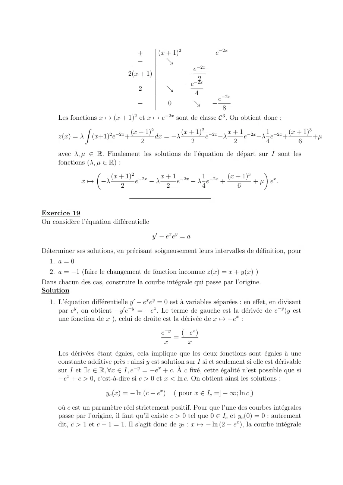

~~~text
                                     +        (x + 1)2             e−2x
                                     −           &
                                                     e−2x
                                 2(x + 1)          −
                                                       2
                                                    e−2x
                                  2        &
                                                      4
                                                              e−2x
                                  −         0        &      −
                                                               8
                                2          −2x                 3
      Les fonctions x 7→ (x + 1) et x 7→ e     sont de classe C . On obtient donc :

                               (x + 1)2          (x + 1)2 −2x x + 1 −2x 1 −2x (x + 1)3
               Z
      z(x) = λ (x+1)2 e−2x +            dx = −λ          e −λ         e −λ e +         +µ
                                   2                2              2          4     6
      avec λ, µ ∈ R. Finalement les solutions de l’équation de départ sur I sont les
      fonctions (λ, µ ∈ R) :

                        (x + 1)2 −2x                 1 −2x (x + 1)3
                                                                         
                                        x + 1 −2x
              x 7→ −λ           e    −λ      e    −λ e     +          + µ ex .
                             2            2          4          6

Exercice 19
On considère l’équation différentielle

                                            y 0 − ex ey = a

Déterminer ses solutions, en précisant soigneusement leurs intervalles de définition, pour
   1. a = 0
   2. a = −1 (faire le changement de fonction inconnue z(x) = x + y(x) )
Dans chacun des cas, construire la courbe intégrale qui passe par l’origine.
Solution
   1. L’équation différentielle y 0 − ex ey = 0 est à variables séparées : en effet, en divisant
      par ey , on obtient −y 0 e−y = −ex . Le terme de gauche est la dérivée de e−y (y est
      une fonction de x ), celui de droite est la dérivée de x 7→ −ex :

                                               e−y   (−ex )
                                                   =
                                                x      x
      Les dérivées étant égales, cela implique que les deux fonctions sont égales à une
      constante additive près : ainsi y est solution sur I si et seulement si elle est dérivable
      sur I et ∃c ∈ R, ∀x ∈ I, e−y = −ex + c. À c fixé, cette égalité n’est possible que si
      −ex + c > 0, c’est-à-dire si c > 0 et x < ln c. On obtient ainsi les solutions :

                        yc (x) = − ln (c − ex )     ( pour x ∈ Ic =] − ∞; ln c[)

      où c est un paramètre réel strictement positif. Pour que l’une des courbes intégrales
      passe par l’origine, il faut qu’il existe c > 0 tel que 0 ∈ Ic et yc (0) = 0 : autrement
      dit, c > 1 et c − 1 = 1. Il s’agit donc de y2 : x 7→ − ln (2 − ex ), la courbe intégrale
~~~

## Page 17

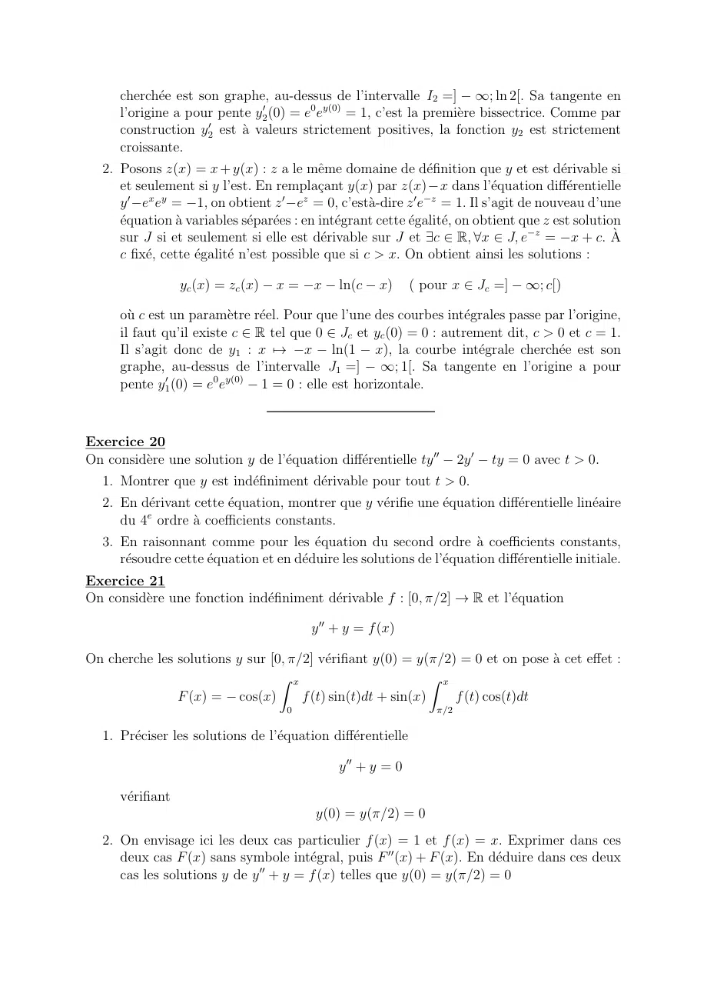

~~~text
      cherchée est son graphe, au-dessus de l’intervalle I2 =] − ∞; ln 2[. Sa tangente en
      l’origine a pour pente y20 (0) = e0 ey(0) = 1, c’est la première bissectrice. Comme par
      construction y20 est à valeurs strictement positives, la fonction y2 est strictement
      croissante.
   2. Posons z(x) = x + y(x) : z a le même domaine de définition que y et est dérivable si
      et seulement si y l’est. En remplaçant y(x) par z(x)−x dans l’équation différentielle
      y 0 −ex ey = −1, on obtient z 0 −ez = 0, c’està-dire z 0 e−z = 1. Il s’agit de nouveau d’une
      équation à variables séparées : en intégrant cette égalité, on obtient que z est solution
      sur J si et seulement si elle est dérivable sur J et ∃c ∈ R, ∀x ∈ J, e−z = −x + c. À
      c fixé, cette égalité n’est possible que si c > x. On obtient ainsi les solutions :

                   yc (x) = zc (x) − x = −x − ln(c − x)        ( pour x ∈ Jc =] − ∞; c[)

      où c est un paramètre réel. Pour que l’une des courbes intégrales passe par l’origine,
      il faut qu’il existe c ∈ R tel que 0 ∈ Jc et yc (0) = 0 : autrement dit, c > 0 et c = 1.
      Il s’agit donc de y1 : x 7→ −x − ln(1 − x), la courbe intégrale cherchée est son
      graphe, au-dessus de l’intervalle J1 =] − ∞; 1[. Sa tangente en l’origine a pour
      pente y10 (0) = e0 ey(0) − 1 = 0 : elle est horizontale.

Exercice 20
On considère une solution y de l’équation différentielle ty 00 − 2y 0 − ty = 0 avec t > 0.
   1. Montrer que y est indéfiniment dérivable pour tout t > 0.
   2. En dérivant cette équation, montrer que y vérifie une équation différentielle linéaire
      du 4e ordre à coefficients constants.
   3. En raisonnant comme pour les équation du second ordre à coefficients constants,
      résoudre cette équation et en déduire les solutions de l’équation différentielle initiale.
Exercice 21
On considère une fonction indéfiniment dérivable f : [0, π/2] → R et l’équation

                                          y 00 + y = f (x)

On cherche les solutions y sur [0, π/2] vérifiant y(0) = y(π/2) = 0 et on pose à cet effet :
                                 Z x                         Z x
               F (x) = − cos(x)      f (t) sin(t)dt + sin(x)     f (t) cos(t)dt
                                      0                            π/2

   1. Préciser les solutions de l’équation différentielle

                                                y 00 + y = 0

      vérifiant
                                           y(0) = y(π/2) = 0
   2. On envisage ici les deux cas particulier f (x) = 1 et f (x) = x. Exprimer dans ces
      deux cas F (x) sans symbole intégral, puis F 00 (x) + F (x). En déduire dans ces deux
      cas les solutions y de y 00 + y = f (x) telles que y(0) = y(π/2) = 0
~~~

## Page 18

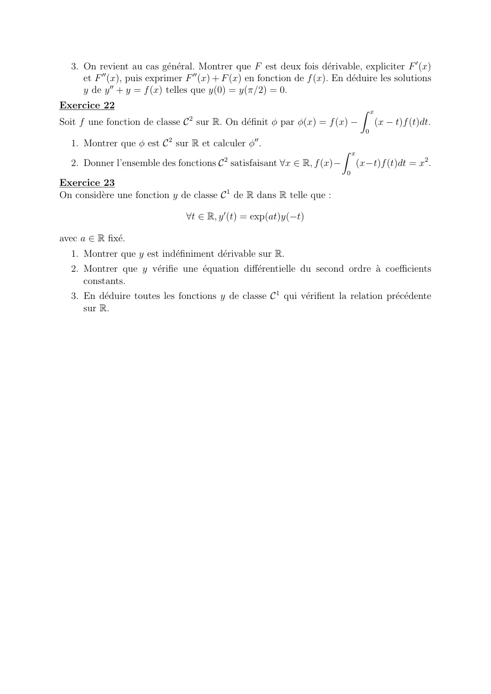

~~~text
   3. On revient au cas général. Montrer que F est deux fois dérivable, expliciter F 0 (x)
      et F 00 (x), puis exprimer F 00 (x) + F (x) en fonction de f (x). En déduire les solutions
      y de y 00 + y = f (x) telles que y(0) = y(π/2) = 0.
Exercice 22                                                                     Z x
                                 2
Soit f une fonction de classe C sur R. On définit φ par φ(x) = f (x) −               (x − t)f (t)dt.
                                                                                 0
   1. Montrer que φ est C 2 sur R et calculer φ00 .
                                                                         Z x
                                          2
   2. Donner l’ensemble des fonctions C satisfaisant ∀x ∈ R, f (x)−            (x−t)f (t)dt = x2 .
                                                                           0
Exercice 23
On considère une fonction y de classe C 1 de R dans R telle que :

                                 ∀t ∈ R, y 0 (t) = exp(at)y(−t)

avec a ∈ R fixé.
   1. Montrer que y est indéfiniment dérivable sur R.
   2. Montrer que y vérifie une équation différentielle du second ordre à coefficients
      constants.
   3. En déduire toutes les fonctions y de classe C 1 qui vérifient la relation précédente
      sur R.
~~~
