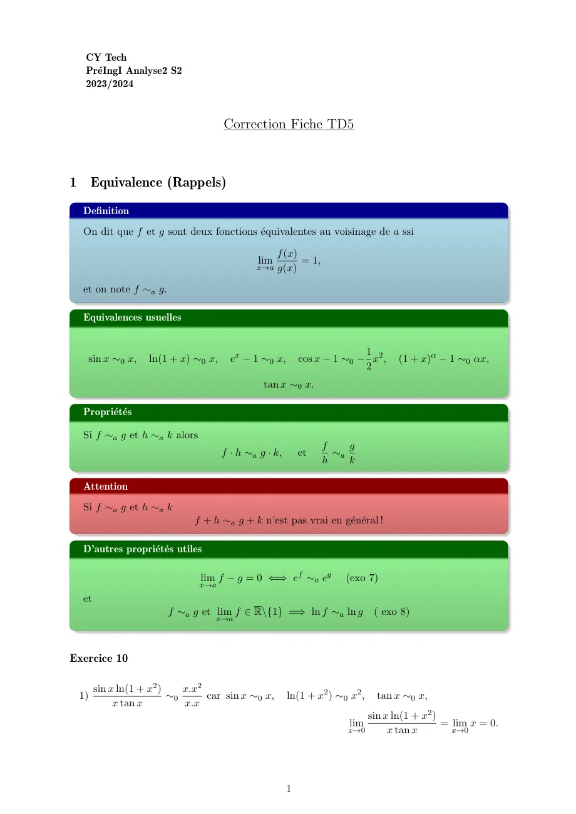
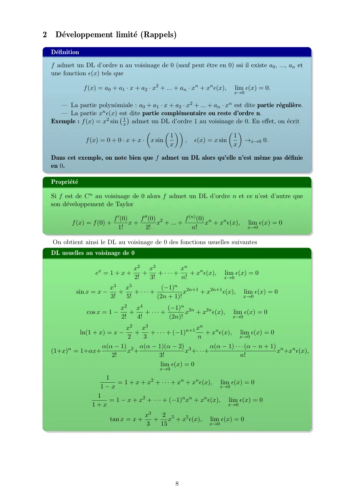
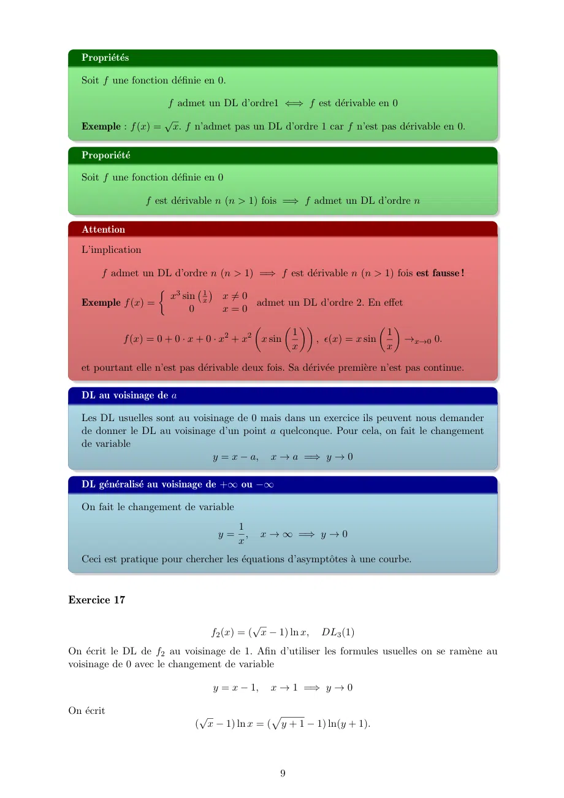
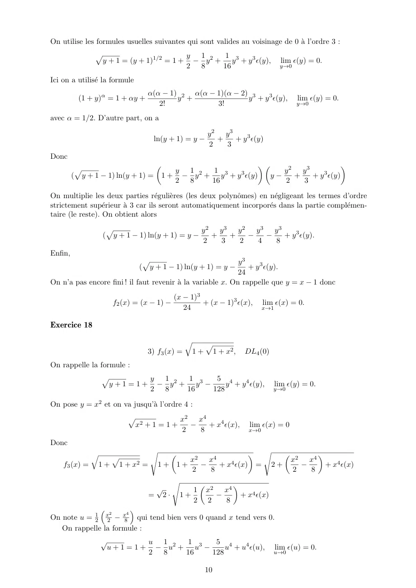
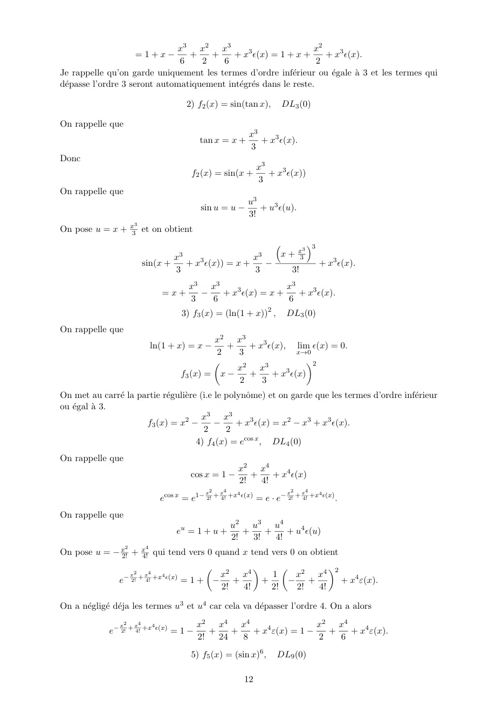
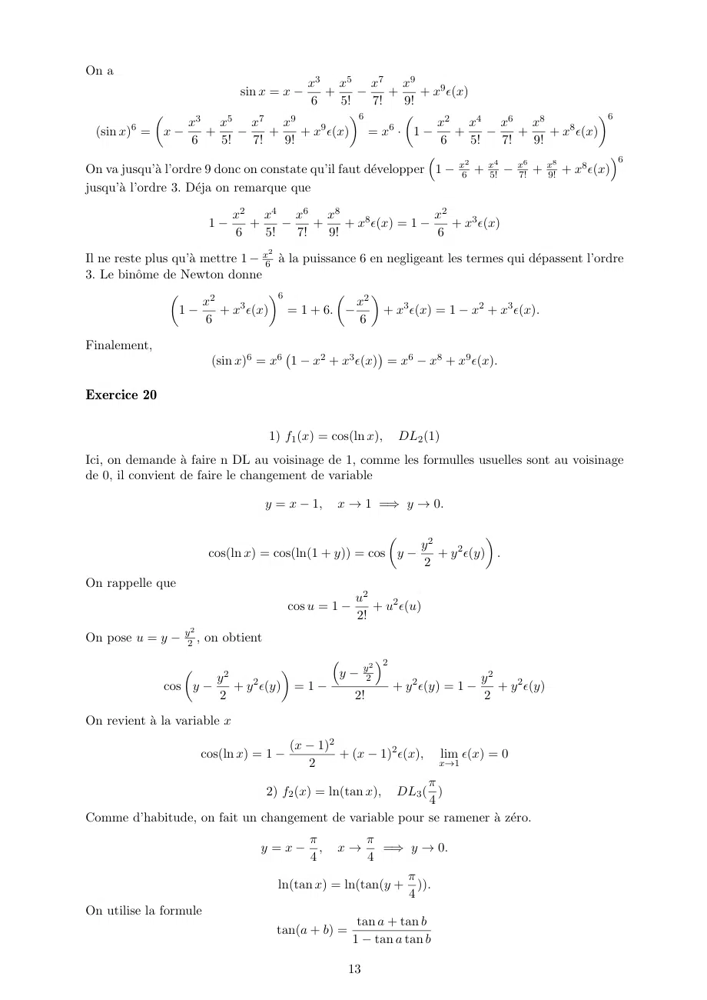
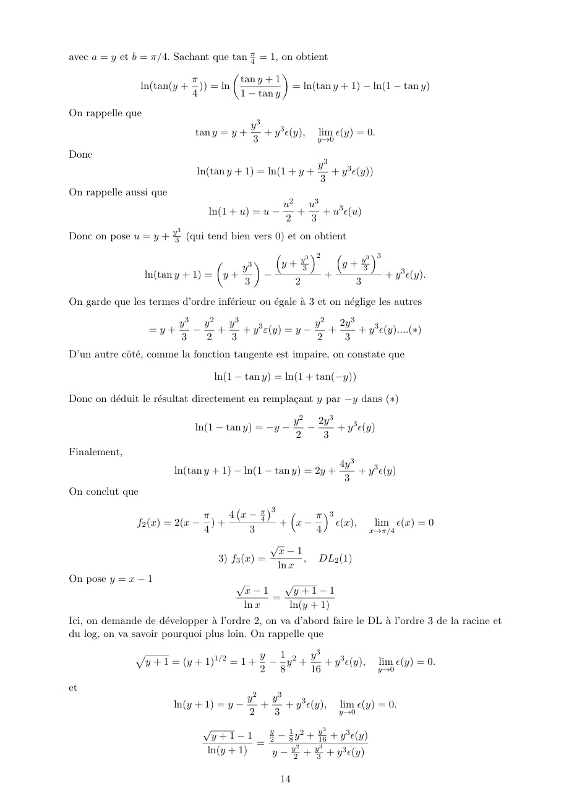
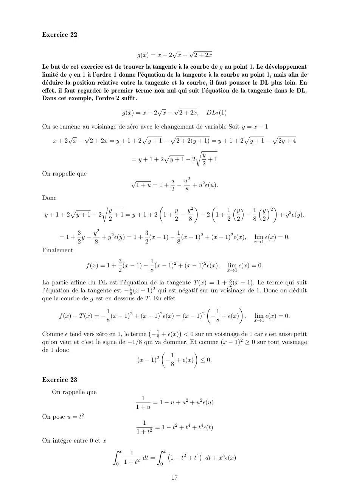
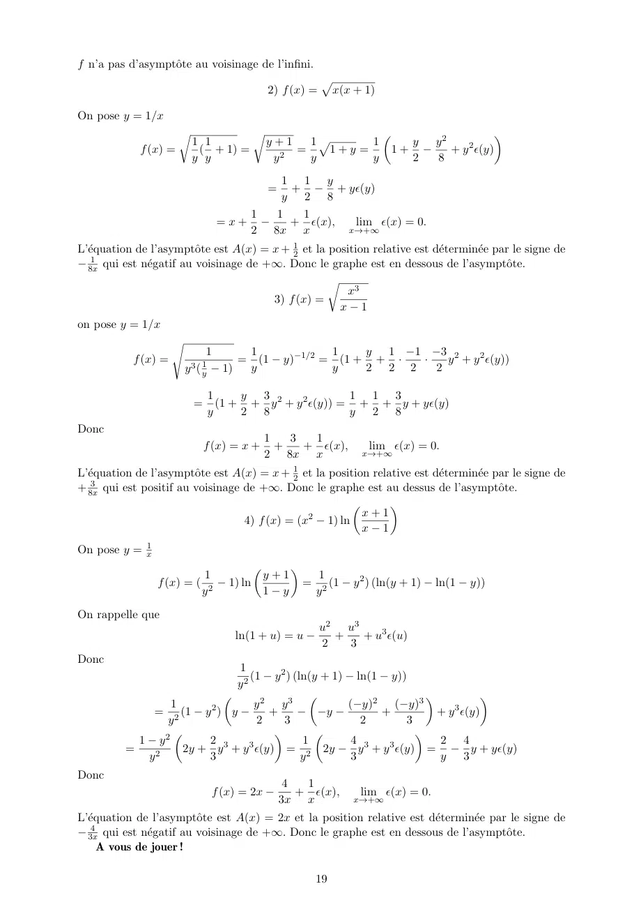

# TD5-Correction_2023-2024_Analyse2_P1S2_DMaths.pdf

[Ouvrir l’original](https://drive.google.com/open?id=1hVGpxyaC_AnY5Ojx9EgfqzPdktxHltl6) · Les deux lectures automatiques du PDF divergent sur les pages indiquées. Leur fac-similé accompagne le texte.

**Pages présentant un écart entre les deux extractions** — 1, 8–10, 12–14, 17, 19.

## Page 1

~~~text
     CY Tech
     PréIngI Analyse2 S2
     2023/2024

                                       Correction Fiche TD5

1        Equivalence (Rappels)
    Definition
    On dit que f et g sont deux fonctions équivalentes au voisinage de a ssi

                                                      f (x)
                                                lim           = 1,
                                               x→a g(x)

    et on note f ∼a g.

    Equivalences usuelles

                                                                            1
     sin x ∼0 x,     ln(1 + x) ∼0 x,     ex − 1 ∼0 x,         cos x − 1 ∼0 − x2 ,    (1 + x)α − 1 ∼0 αx,
                                                                            2
                                                 tan x ∼0 x.

    Propriétés

    Si f ∼a g et h ∼a k alors
                                                                     f    g
                                       f · h ∼a g · k,        et       ∼a
                                                                     h    k

    Attention
    Si f ∼a g et h ∼a k
                               f + h ∼a g + k n’est pas vrai en général !

    D’autres propriétés utiles

                                 lim f − g = 0 ⇐⇒ ef ∼a eg               (exo 7)
                                 x→a
    et
                         f ∼a g et lim f ∈ R\{1} =⇒ ln f ∼a ln g                ( exo 8)
                                    x→a

Exercice 10

         sin x ln(1 + x2 )    x.x2
    1)                     ∼0      car sin x ∼0 x,       ln(1 + x2 ) ∼0 x2 ,    tan x ∼0 x,
              x tan x         x.x
                                                                             sin x ln(1 + x2 )
                                                                          lim                  = lim x = 0.
                                                                         x→0      x tan x        x→0

                                                         1
~~~

## Page 2

~~~text
       ln(1 + sin x)    x
  2)                 ∼0    car ln(1 + sin x) ∼0 sin x ∼0 x,                    tan(6x) ∼0 6x,
         tan(6x)        6x
                                                                                     ln(1 + sin x)        x  1
                                                                                 lim               = lim    = .
                                                                                 x→0   tan(6x)       x→0 6x  6
                                                       1        1
                               3) (ln(e + x)) x = e x ln(ln(e+x)) ,
             1                 1               x  1              x 
               ln (ln(e + x)) = ln ln(e(1 + )) = ln ln(e) + ln(1 + ) ,
             x                 x                e         x         e
comme ln(e) = 1, alors
                      1                 x  1            x    1x
                        ln ln(e) + ln(1 + ) = ln 1 + ln(1 + ) ∼0    ,
                      x                  e   x             e     xe
car                                       x          x    x
                              ln 1 + ln(1 + ) ∼0 ln(1 + ) ∼0 .
                                           e           e    e
Donc
                                         1                  1
                                           ln (ln(e + x)) ∼0 .
                                         x                  e
D’aprés l’exo 7 :
                                             1                        1
                                            e x ln(ln(e+x)) ∼0 e e ,
finalement, on obtient
                                                                1          1
                                        lim (ln(e + x)) x = e e .
                                        x→0

                                               1     1          −x
                                4) ln(1 + e−x ) x = e x ln(ln(1+e )) ,
On sait que
                                        ln(1 + e−x ) ∼+∞ e−x ,
d’après l’exo 08 :
                                ln(ln(1 + e−x )) ∼+∞ ln(e−x ) = −x.
Dans ce cas, on obtient
                               1                    1
                                 ln ln(1 + e−x ) ∼+∞ .(−x) = −1.
                                                
                               x                    x
D’après l’exo 7, on a
                                        1             −x )
                                       e x ln(ln(1+e           )∼   −1
                                                                +∞ e .

Donc                                                         1
                                      lim        ln(1 + e−x ) x = e−1 .
                                      x→+∞

Exercice 11

         x3 − 2x2 + 2x − 1              x − x2               x(1 − x)       1 1
1) lim                     = lim 1 +           = lim 1 +                 =1− = .
      x→1 x3 − x2 + x − 1    x→1      3   2
                                     x −x +x−1   x→1               2
                                                         (1 − x)(−x − 1)    2 2

                                       x sin x     x.x   x2
                                 2)             ∼0     =     = 2.
                                      1 − cos x    1 2   1 2
                                                     x     x
                                                   2     2
Nous avons utilisé
                                           1                  1
                             cos x − 1 ∼0 − x2 =⇒ 1 − cos x ∼0 x2
                                           2                  2
Donc
                                                    x sin x
                                            lim                     = 2.
                                            x→0 1 − cos x

                                                           2
~~~

## Page 3

~~~text
                                      "    √
                                           3
                                                   #          "    s          #
                     p                       x 3+1                    x 3+1
                     3                                             3
          3)(x + 1) − x3 + 1 = (x + 1) 1 −           = (x + 1) 1 −              .
                                           (x + 1)                   (x + 1)3
On remarque que

                x3 + 1    (x + 1)(x2 − x + 1)   x2 − x + 1    x2 + 2x + 1 − 3x
                        =                     =             =
               (x + 1)3     (x + 1)(x + 1)2     x2 + 2x + 1      x2 + 2x + 1
                                                                     3x
                                                  =1−
                                                              x2 + 2x + 1
                          "          s                #                     "           #
                                                                                        r
                                  x3 + 1                                        3x
                   (x + 1) 1 − 3                          = (x + 1) 1 − 3 1 − 2           .
                                 (x + 1)3                                    x + 2x + 1
Comme
                                                   3x
                                               − 2         →x→+∞ 0
                                                x + 2x + 1
en utilisant l’équivalence 1 − (1 + u)α ∼0 −αu avec α = 13 et u = − x2 +2x+1
                                                                         3x
                                                                              , on obtient
                       "     r                #                          
                             3          3x             1          3x
                         1− 1− 2                ∼+∞ − . − 2                 .
                                   x + 2x + 1          3     x + 2x + 1

Finalement
        "      s              #
                    x3 + 1                                                      x2
                                                            
               3                               1      3x           x(x + 1)
 (x + 1) 1 −                      ∼+∞ (x + 1) − . − 2            = 2         ∼+∞ 2 = 1.
                   (x + 1)3                    3   x + 2x + 1     x + 2x + 1    x
                                                                     p
                                                                     3
                                              lim (x + 1) −            x3 + 1 = 1.
                                          x→+∞
                                                                     1 2
                                                (1 − cos x) sin x      x .x
                                             4)                   ∼  2
                                                                   0
                                                       x3              x3
Car
                                                                1 2
                                         (1 − cos x) ∼0           x ,        sin x ∼0 x.
                                                                2
Donc
                                                              1 2
                                         (1 − cos x) sin x      x .x    1
                                                           ∼  2      ∼0
                                                  3         0     3
                                                x               x       2
D’après l’exo 7
                                                      (1−cos x) sin x           1
                                                  e        x3           ∼0 e 2
Donc
                                                          (1−cos x) sin x           1
                                                lim e          x3           = e2 .
                                                x→0

                                   ln(cos x)    ln((cos(x) − 1) + 1)   − 1 x2
                          5)                  =                      ∼0 2 2
                                  1 − cos(2x)       1 − cos(2x)         2x
car
                                                                     1
                              ln((cos(x) − 1) + 1) ∼0 cos(x) − 1 ∼0 − x2
                                                                     2
et
                                                                     1
                                             1 − cos(2x) ∼0            (2x)2 = 2x2
                                                                     2
Donc
                                                          ln(cos x)                 1
                                                lim                         =−
                                                x→0 1 − cos(2x)                     4
                                                         x ln x                                    
                                             ln(x + 1)                      x ln x ln
                                                                                            ln(x+1)
                                    6)                               =e                       ln x
                                                ln x

                                                                 3
~~~

## Page 4

~~~text
                                                                                  !                                               !
                                                      ln(x(1 + x1 ))                                      ln x + ln(1 + x1 )
                                 
                  ln(x + 1)
  x ln x ln                           = x ln x ln                                       = x ln x ln
                     ln x                                 ln x                                                  ln x
                                                                                                                                             !
                                                                                                                               ln(1 + x1 )
                                                                                                               = x ln x ln 1 +
                                                                                                                                  ln x

Comme                                                                                                 !
                          ln(1 + x1 )                      ln(1 + x1 )                                              ln(1 + x1 )
                                      →x→+∞ 0 alors ln 1 +                                                ∼+∞
                             ln x                             ln x                                                     ln x
Donc
                                                 !
                       ln(1 + x1 )                                   ln(1 + x1 )           1    ln(1 + x1 )
         x ln x ln 1 +                               = x ln x                    = x ln(1 + ) =     1       ∼+∞ 1.
                          ln x                                          ln x               x        x

Il s’en suit d’après l’exo 7 :                                                    
                                                                          ln(x+1)
                                                          x ln x ln
                                                      e                     ln x
                                                                                        ∼+∞ e1 .
On déduit la limite
                                                           ln(x + 1) x ln x
                                                                    
                                                  lim                       = e.
                                                 x→+∞         ln x
                                                    ln 2x           2x
                                                                              
                                                        π       ln  π  − 1 + 1
                                                 7)          =
                                                                cos x − π2 + π2
                                                                                
                                                     cos x
Comme cos(θ + π2 ) = − sin θ, alors

                                             ln 2x              ln 2x
                                                                               
                                                 π −1+1            π −1+1
                                                              =
                                             cos x − π2 + π2     − sin(x − π2 )

On a                                                                                            
                                  2x                                              2x                            2x
                                     − 1 →x→π/2 0 alors ln                           −1+1             ∼π/2         − 1,
                                  π                                               π                             π
et en plus comme
                                                                                             π           π
                                      x − π/2 →x→π/2 0 =⇒ sin(x −                              ) ∼π/2 x − .
                                                                                             2           2
Donc
                                      ln 2x                 2x    2     π
                                                                         
                                          π −1+1            π −1  π x− 2      2
                                                 π     ∼π/2 π    = π        =− .
                                       − sin(x − 2 )        2 −x    2 −x      π
On déduit
                                                      ln 2x
                                                            
                                                          π        2
                                               lim             =− .
                                              x→π/2 cos x          π
                                                                              − 1
                                1        1
                                                  1
                                                      1 1               1
                                                                                        
                          8) x2 e x+1 − e x = x2 e x e x+1 − x − 1 = x2 e x e x(x+1) − 1

Comme
                                     1                    − 1                  1
                              −            →x→+∞ 0 alors e x(x+1) − 1 ∼+∞ −          .
                                  x(x + 1)                                  x(x + 1)
Donc                                                                                                      
                  2   1
                                  1
                              − x(x+1)
                                             
                                                             2   1              1                          1
                                                                                                           2    1 1
              x e     x       e          − 1 ∼+∞ x e  −          x                              ∼+∞ x e  − 2 = −e x
                                                                                                                x
                                                                             x(x + 1)                     x
Finalement,                                      1          
                                                           1          1
                                          lim x2 e x+1 − e x = lim −e x = −1.
                                         x→+∞                                           x→+∞

                                                                              4
~~~

## Page 5

~~~text
Exercice 12
                                       p3
                                                   p
                                                   3
                                          x3 + x2 − x3 − x2
                                             1)
                                  r         !               r         !
                   p                x3 − x2      p               2x 2
                   3              3              3          3
                     x3 + x2   1−             = x3 + x2 1 − 1 − 3
                                    x3 + x2                    x + x2
On a                                         p            √
                                             3            3
                                               x3 + x2 ∼+∞ x3 = x
De plus
                                 r
         −2x2                           2x2              −2x2           x2
                                                                          
                                 3                   1             2
                →x→+∞ 0 =⇒ 1 − 1 − 3           ∼+∞ −             =
        x3 + x2                        x + x2        3 x3 + x2     3 x3 + x2

                                                  x2            x3
                                                                  
                 p
                 3
                            p
                            3                2             2
                   x3 + x2 − x3 − x2 ∼+∞ x ·             =
                                             3 x3 + x2     3 x3 + x2
En particulier
                                p
                                3
                                           p
                                           3          2
                                  x3 + x2 − x3 − x2 =
                                       lim
                           x→+∞                       3
                             s                          s           
                         √                      √                  √
         q                            r                    r
              p                             1                   1
       2) x2 + x4 + 1 − x 2 = x2 + x2 1 + 4 − x 2 = x  1 + 1 + 4 − 2
                                           x                   x
              v    "r         #          v      "r         #   
                                 √      √
               u                            u
               u          1                 u    1       1
          = x t2 +   1 + 4 − 1 − 2 = x 2 t1 +     1 + 4 − 1 − 1
                         x                       2      x

On a                                         "r            #
                                         1            1
                                                  1 + 4 − 1 →x→+∞ 0
                                         2           x
     v
      u      "r         #                                            "r          #!          
      u    1       1              1                               1           1          1 1 1    1
  =⇒ t1 +     1 + 4 − 1 − 1 ∼+∞                                          1+ 4 −1   ∼+∞    · 4 = 4.
           2      x               2                               2          x           4 2 x   8x

Donc                                                 √
                                           √
                           q    p                      2   1
                            x2 + x4 + 1 − x 2 ∼+∞ x · 4 = √    .
                                                     8x  4 2x3
En particulier
                                              √
                              q    p                               1
                          lim  x2 + x4 + 1 − x 2 = lim           √      = 0.
                         x→+∞                                       2x3    x→+∞ 4
                                                                                  
                                                     1                     1−cos(ax)
                    tan(ax) − sin(ax)   sin(ax)   cos(ax) − 1    sin(ax)    cos(ax)
                 3)                   =                      =                    
                    tan(bx) − sin(bx)                1
                                        sin(bx) cos(bx)   −1               1−cos(bx)
                                                                 sin(bx) cos(bx)

On utilise le fait que

                   sin(ax) ∼0 ax,        sin(bx) ∼0 bx,            cos(ax) ∼0 1,      cos(bx) ∼0 1

et
                                                  1                                 1
                          1 − cos(ax) ∼0            (ax)2 ,       1 − cos(bx) ∼0      (bx)2 .
                                                  2                                 2
Donc, on obtient                                  
                                       1−cos(ax)
                         sin(ax)                                  1      2
                                                                            
                                        cos(ax)   ax              2 (ax)    (ax)3   a3
                                             ∼0                 1        =       =    .
                         sin(bx)   1−cos(bx)      bx              2 (bx)
                                                                        2    (bx)3   b3
                                        cos(bx)

                                                              5
~~~

## Page 6

~~~text
                     π          π        π         π π        π sin(x − π4 + π2 )
           4) (x −     ) tan(x + ) = (x − ) tan(x − + ) = (x − )
                     4          4        4         4 2        4 cos(x − π4 + π2 )
Or sin(θ + π2 ) = − cos(θ) et cos(θ + π2 ) = − sin θ, on obtient

                                     π sin(x − π4 + π2 )        π cos(x − π4 )
                              (x −    )                  = (x −  )             .
                                     4 cos(x − π4 + π2 )        4 sin(x − π4 )

Comme
                                          π           π                   π
                              sin(x −       ) ∼π/4 x − ,        cos(x −     ) ∼π/4 1
                                          4           4                   4
On obtient
                                            π cos(x − π4 )     x − π4
                                     (x −    )             ∼          = 1.
                                            4 sin(x − π4 ) π/4 x − π4
En particulier
                                                       π          π
                                          lim (x −       ) tan(x + ) = 1.
                                       x→π/4           4          4
                          cos x − sin x   cos(x − π/4 + π/4) − sin(x − π/4 + π/4)
                    5)                  =                                         .
                         (4x − π) tan x                (4x − π) tan x
On utilise les formules trigonométriques :

             cos(a + b) = cos a cos b − sin a sin b,          sin(a + b) = sin a cos b + cos a sin b.

Donc

  cos(x − π/4 + π/4) − sin(x − π/4 + π/4) = cos(x − π/4) cos(π/4) − sin(x − π/4) sin(π/4)
                                                      − [sin(x − π/4) cos(π/4) + cos(x − π/4) sin(π/4)] .
                                      √
Comme sin(π/4) = cos(π/4) =               2/2, on déduit
                                                  √                       √
       cos(x − π/4 + π/4) − sin(x − π/4 + π/4) = − 2 · sin(x − π/4) ∼π/4 − 2 · (x − π/4)

Comme tan x ∼π/4 1, alors
                                               √                 √                 √
 cos(x − π/4 + π/4) − sin(x − π/4 + π/4)      − 2 · (x − π/4)   − 2 · (x − π/4)   − 2
                                         ∼π/4                 =                 =     .
              (4x − π) tan x                     (4x − π)        4(x − π/4)        4

En particulier                                                  √
                                               cos x − sin x   − 2
                                         lim                 =     .
                                        x→π/4 (4x − π) tan x    4
                                                    tan(x − x cos x)
                                               6)
                                                    sin x + cos x − 1
                                                                                                 x2   x3
       x − x cos x →0 0 =⇒ tan(x − x cos x) ∼0 x − x cos x = x (1 − cos x) ∼0 x ·                   =    .
                                                                                                 2    2
D’un autre côté
         sin x + cos x − 1       sin x cos x − 1       sin x       cos x − 1
     lim                   = lim      +          = lim       + lim           = 1 + 0 = 1.
     x→0         x           x→0 x         x       x→0 x       x→0     x
Donc
                                             sin x + cos x − 1 ∼0 x
Finalement,

                                       tan(x − x cos x)      x3   x2
                                                         ∼0     =
                                       sin x + cos x − 1    2·x   2

                                                          6
~~~

## Page 7

~~~text
En particulier
                                     tan(x − x cos x)        x2
                                 lim                   = lim    = 0.
                                 x→0 sin x + cos x − 1   x→0 2
                                                    1              1
                                            7) x 1+2 ln x = e 1+2 ln x ln x
                                             ln x          1       1
                                                     = 1        ∼0+ .
                                          1 + 2 ln x   ln x + 2
                                                                   2
Donc d’après l’exo 7
                                                    1                  1
                                               e 1+2 ln x ln x ∼0+ e 2 .

                                                                                  1   π
   8) (2x2 − 3x + 1) tan(πx) = (2x − 1)(x − 1) tan(πx) = (2x − 1)(x − 1) tan(π(x − ) + )
                                                                                  2   2
                                                           sin(π(x − 21 ) + π2 )
                                 = (2x − 1)(x − 1)
                                                           cos(π(x − 12 ) + π2 )
Or sin(θ + π2 ) = − cos(θ) et cos(θ + π2 ) = − sin θ, on obtient

                                          1   π                    cos(π(x − 12 ))
                 (2x − 1)(x − 1) tan(π(x − ) + ) = (2x − 1)(x − 1)                 .
                                          2   2                    sin(π(x − 12 ))

Puisque
                             1                                   1             1
                    cos(π(x − )) ∼1/2 1,                sin(π(x − )) ∼1/2 π(x − ).
                             2                                   2             2
On obtient finalement
                          cos(π(x − 12 ))      (2x − 1)(x − 1)   2(x − 12 )(x − 1)  2
       (2x − 1)(x − 1)              1     ∼1/2           1     =            1      = (x − 1)
                          sin(π(x − 2 ))          π(x − 2 )          (x − 2 )       π

En particulier
                                                            2            1
                          lim (2x2 − 3x + 1) tan(πx) = lim    (x − 1) = − .
                        x→1/2                        x→1/2  π            π
                            √                     √
                              1 + x2                1 + x2
                                                                      
                                           x                          1
                         9)          ln         =          ln 1 −
                            sin x1                sin x1
                                                        
                                          1+x                       1+x
On remarque que
                                                                                      
             p                                1     1                               1                 1
              1 + x2 ∼+∞ x,              sin     ∼+∞ ,             ln 1 −                    ∼+∞ −       .
                                              x     x                              1+x               1+x

On obtient alors,
                      √
                         1 + x2                                                    −x2
                                                                        
                                          x               x        −1
                               ln                 ∼+∞ 1                       =       ∼+∞ −x
                       sin x1            1+x              x
                                                                  1+x              1+x

En particulier                  √
                                  1 + x2
                                                 
                                               x
                            lim         ln         = lim −x = −∞.
                           x→+∞ sin 1         1+x    x→+∞
                                     x

                                                          7
~~~

## Page 8

~~~text
2    Développement limité (Rappels)
    Définition

    f admet un DL d’ordre n au voisinage de 0 (sauf peut être en 0) ssi il existe a0 , ..., an et
    une fonction ϵ(x) tels que

                   f (x) = a0 + a1 · x + a2 · x2 + ... + an · xn + xn ϵ(x),     lim ϵ(x) = 0.
                                                                              x→0

       — La partie polynômiale : a0 + a1 · x + a2 · x2 + ... + an · xn est dite partie régulière.
       — La partie xn ϵ(x) estdite partie complémentaire ou reste d’ordre n.
    Exemple : f (x) = x2 sin x1 admet un DL d’ordre 1 au voisinage de 0. En effet, on écrit
                                                                   
                                               1                        1
                f (x) = 0 + 0 · x + x · x sin       , ϵ(x) = x sin          →x→0 0.
                                               x                        x

    Dans cet exemple, on note bien que f admet un DL alors qu’elle n’est même pas définie
    en 0.

    Propriété

    Si f est de C n au voisinage de 0 alors f admet un DL d’ordre n et ce n’est d’autre que
    son développement de Taylor

                              f ′ (0)    f ′′ (0) 2        f (n) (0) n
            f (x) = f (0) +           x+         x + ... +          x + xn ϵ(x),     lim ϵ(x) = 0
                                1!          2!                n!                     x→0

    On obtient ainsi le DL au voisinage de 0 des fonctions usuelles suivantes
    DL usuelles au voisinage de 0

                                      x2 x3           xn
                       ex = 1 + x +      +    + ··· +    + xn ϵ(x),       lim ϵ(x) = 0
                                      2!   3!         n!                  x→0

                             x3 x5             (−1)n 2n+1
              sin x = x −       +    + ··· +           x  + x2n+1 ϵ(x),             lim ϵ(x) = 0
                             3!   5!         (2n + 1)!                              x→0

                                  x2 x4           (−1)n 2n
                    cos x = 1 −      +    + ··· +        x + x2n ϵ(x),        lim ϵ(x) = 0
                                  2!   4!          (2n)!                      x→0

                           x2 x3                   xn
                  ln(1 + x) = x −
                             +   + · · · + (−1)n+1     + xn ϵ(x), lim ϵ(x) = 0
                           2   3                   n                 x→0

                   α(α − 1) 2 α(α − 1)(α − 2) 3          α(α − 1) · · · (α − n + 1) n n
    (1+x)α = 1+αx+         x +                 x +· · ·+                           x +x ϵ(x),
                      2!             3!                              n!
                                     lim ϵ(x) = 0
                                                x→0
                         1
                            = 1 + x + x2 + · · · + xn + xn ϵ(x), lim ϵ(x) = 0
                        1−x                                         x→0
                       1
                          = 1 − x + x2 + · · · + (−1)n xn + xn ϵ(x), lim ϵ(x) = 0
                      1+x                                             x→0

                                           x3  2
                             tan x = x +      + x5 + x5 ϵ(x),       lim ϵ(x) = 0
                                           3   15                   x→0

                                                      8
~~~

## Page 9

~~~text
   Propriétés

   Soit f une fonction définie en 0.

                       f admet un DL d’ordre1 ⇐⇒ f est dérivable en 0
                       √
   Exemple : f (x) =       x. f n’admet pas un DL d’ordre 1 car f n’est pas dérivable en 0.

   Proporiété

   Soit f une fonction définie en 0

                   f est dérivable n (n > 1) fois =⇒ f admet un DL d’ordre n

   Attention
   L’implication

      f admet un DL d’ordre n (n > 1) =⇒ f est dérivable n (n > 1) fois est fausse !

                    x sin x1
                    3       
                               x ̸= 0
   Exemple f (x) =                    admet un DL d’ordre 2. En effet
                        0      x=0
                                                                  
                                       2     2    1                   1
             f (x) = 0 + 0 · x + 0 · x + x x sin      , ϵ(x) = x sin     →x→0 0.
                                                  x                   x

   et pourtant elle n’est pas dérivable deux fois. Sa dérivée première n’est pas continue.

   DL au voisinage de a

   Les DL usuelles sont au voisinage de 0 mais dans un exercice ils peuvent nous demander
   de donner le DL au voisinage d’un point a quelconque. Pour cela, on fait le changement
   de variable
                                y = x − a, x → a =⇒ y → 0

   DL généralisé au voisinage de +∞ ou −∞

   On fait le changement de variable
                                           1
                                     y=      ,   x → ∞ =⇒ y → 0
                                           x
   Ceci est pratique pour chercher les équations d’asymptôtes à une courbe.

Exercice 17

                                             √
                                   f2 (x) = ( x − 1) ln x,   DL3 (1)
On écrit le DL de f2 au voisinage de 1. Afin d’utiliser les formules usuelles on se ramène au
voisinage de 0 avec le changement de variable

                                   y = x − 1,     x → 1 =⇒ y → 0

On écrit                       √               p
                               ( x − 1) ln x = ( y + 1 − 1) ln(y + 1).

                                                    9
~~~

## Page 10

~~~text
On utilise les formules usuelles suivantes qui sont valides au voisinage de 0 à l’ordre 3 :
                                        y 1      1
                y + 1 = (y + 1)1/2 = 1 + − y 2 + y 3 + y 3 ϵ(y),
               p
                                                                                     lim ϵ(y) = 0.
                                        2 8     16                                   y→0

Ici on a utilisé la formule
                                   α(α − 1) 2 α(α − 1)(α − 2) 3
           (1 + y)α = 1 + αy +             y +               y + y 3 ϵ(y),                 lim ϵ(y) = 0.
                                      2!            3!                                     y→0

avec α = 1/2. D’autre part, on a

                                                            y2 y3
                                    ln(y + 1) = y −           +   + y 3 ϵ(y)
                                                            2   3
Donc
                                                                  y2 y3
                                                                              
          p                                y 1 2 1 3   3                   3
         ( y + 1 − 1) ln(y + 1) =       1 + − y + y + y ϵ(y)   y−   +   + y ϵ(y)
                                           2 8   16               2   3
On multiplie les deux parties régulières (les deux polynômes) en négligeant les termes d’ordre
strictement supérieur à 3 car ils seront automatiquement incorporés dans la partie complémen-
taire (le reste). On obtient alors

                                               y2 y3 y2 y3 y3
                                                                 + y 3 ϵ(y).
                   p
                  ( y + 1 − 1) ln(y + 1) = y −   +   +   −   −
                                               2   3   2   4   8
Enfin,
                                                             y3
                                                                + y 3 ϵ(y).
                              p
                               (y + 1 − 1) ln(y + 1) = y −
                                                             24
On n’a pas encore fini ! il faut revenir à la variable x. On rappelle que y = x − 1 donc
                                                (x − 1)3
                     f2 (x) = (x − 1) −                  + (x − 1)3 ϵ(x),     lim ϵ(x) = 0.
                                                   24                         x→1

Exercice 18
                                              q   p
                                   3) f3 (x) = 1 + 1 + x2 ,            DL4 (0)
On rappelle la formule :
                             y 1    1      5 4
                  y + 1 = 1 + − y2 + y3 −     y + y 4 ϵ(y),
                 p
                                                                                    lim ϵ(y) = 0.
                             2 8    16    128                                    y→0

On pose y = x2 et on va jusqu’à l’ordre 4 :
                         p             x2 x4
                          x2 + 1 = 1 +   −   + x4 ϵ(x),                 lim ϵ(x) = 0
                                       2   8                            x→0

Donc
                        s                          s
                                  2     4
                                                          2
                                                               x4
            q                                                    
                p
                      2
                                 x    x      4
                                                          x
    f3 (x) = 1 + 1 + x = 1 + 1 +    −     + x ϵ(x) = 2 +     −      + x4 ϵ(x)
                                 2    8                    2   8
                                                s
                                       √
                                                           2
                                                                x4
                                                                   
                                                      1    x
                                   =       2·    1+           −      + x4 ϵ(x)
                                                      2     2   8
               2     4
                        
On note u = 12 x2 − x8 qui tend bien vers 0 quand x tend vers 0.
   On rappelle la formule :
                 √                 u 1 2 1      5 4
                     u+1=1+         − u + u3 −     u + u4 ϵ(u),                     lim ϵ(u) = 0.
                                   2 8   16    128                               u→0

                                                           10
~~~

## Page 11

~~~text
                         2       4
                                      
On remplace u = 21       x
                         2    − x8        et on garde les termes d’ordre inférieur ou égal à 4. On a alors
                                                               2           4
                                                                                
                                       1                          x
                                                                       − x8
       s                                                                                        2      2
              1 x2 x4                                                                                 x4
                     
                                       2                          2                    1       1 x
           1+     −        4
                        + x ϵ(x) = 1 +                                               −              −        + x4 ϵ(x)
              2 2   8                                                 2                8       2 2    8

                               x2 x4      x4                 x2 5x4
                     =1+          −     −    + x4 ϵ(x) = 1 +   −       + x4 ϵ(x).
                               8     32 128                  8    128
Donc
                                         √         x2 5x4
                                                           
                                 f3 (x) = 2 · 1 +     −       + x4 ϵ(x).
                                                    8   128
                                          4) f4 (x) = cos(x2 ) sin x,                DL6 (0).
On rappelle le DL du cos au voisinage de 0

                                                          u2 u4 u6
                                          cos u = 1 −        +    −    + u6 ϵ(u)
                                                          2!   4!   6!
On pose u = x2 et on va jusqu’à l’ordre 6

                                                                  x4
                                               cos x2 = 1 −          + x6 ϵ(x).
                                                                  2
D’un autre côté, on a
                                             x3 x5
                                            sin x = x −
                                                +      + x6 ϵ(x).
                                             3!    5!
Attention : dans le DL du sinus le coefficient associé à x6 est nul ! mais le reste est d’ordre 6 !
En effet, le sinus est une fonction impaire naturellement son DL ne garde que les puissances
impaires, donc on a

                              x3 x5 x7                     x3 x5        x        
             sin x = x −         +    −    + x7 ϵ(x) = x −    +    + x6 − + xϵ(x)
                              3!   5!   7!                 3!   5!       7!
                                  x3 x5
                                     =x−
                                       +     + x6 ϵ̂(x), lim ϵ̂(x) = 0
                                   3!    5!               x→0
Vous voyez bien ici qu’on peut toujours se débrouiller pour avoir un reste d’ordre 6, A retenir.
   Revenons à notre exemple

                     x4                   x3 x5                       x3
                                                          
                            6                           6                  59 5
      f4 (x) = 1 −      + x ϵ(x)      x−     +       + x ϵ(x) = x −      −     x + x6 ϵ(x)
                      2                   3!    5!                     6   120

Exercice 19

                                              1) f1 (x) = esin x ,              DL3 (0)
On rappelle que
                                                    x3
                                  sin x = x −          + x3 ϵ(x),                   lim ϵ(x) = 0.
                                                    3!                              x→0
                                                                      x3        3
                                                  f1 (x) = ex− 3! +x ϵ(x)
On rappelle que
                                                              u2 u3
                                            eu = 1 + u +         +    + u3 ϵ(u)
                                                              2!   3!
                    3
On pose u = x − x3! qui tend vers 0 quand x tend vers 0. On obtient
                                                                               3
                                                                                    2                   3
                                                                                                              3
                     3
                                              
                                                     x3
                                                                     x − x3!                     x − x3!
                x− x3! +x3 ε(x)
               e                  =1+ x−                      +                           +                        + x3 ϵ(x)
                                                     3!                    2!                        3!

                                                              11
~~~

## Page 12

~~~text
                               x3 x2 x3                            x2
                        =1+x−    +    +     + x3 ϵ(x) = 1 + x +       + x3 ϵ(x).
                               6    2    6                          2
Je rappelle qu’on garde uniquement les termes d’ordre inférieur ou égale à 3 et les termes qui
dépasse l’ordre 3 seront automatiquement intégrés dans le reste.

                                              2) f2 (x) = sin(tan x),            DL3 (0)

On rappelle que
                                                                    x3
                                                  tan x = x +          + x3 ϵ(x).
                                                                    3
Donc
                                                                        x3
                                               f2 (x) = sin(x +            + x3 ϵ(x))
                                                                        3
On rappelle que
                                                                   u3
                                                  sin u = u −         + u3 ϵ(u).
                                                                   3!
                        3
On pose u = x + x3 et on obtient
                                                                                      3
                                                                                           3
                                          x3                  x3                 x + x3
                             sin(x +         + x3 ϵ(x)) = x +    −                              + x3 ϵ(x).
                                          3                   3                     3!
                                              x3 x3                 x3
                                      =x+       −   + x3 ϵ(x) = x +    + x3 ϵ(x).
                                              3   6                 6
                                            3) f3 (x) = (ln(1 + x))2 ,            DL3 (0)
On rappelle que
                                                    x2 x3
                                 ln(1 + x) = x −       +   + x3 ϵ(x), lim ϵ(x) = 0.
                                                     2   3             x→0
                                                                          2
                                                         x2 x3
                                                    
                                                                     3
                                            f3 (x) = x −   +     + x ϵ(x)
                                                         2    3
On met au carré la partie régulière (i.e le polynôme) et on garde que les termes d’ordre inférieur
ou égal à 3.
                                        x3 x3
                      f3 (x) = x2 −         −     + x3 ϵ(x) = x2 − x3 + x3 ϵ(x).
                                        2      2
                                      4) f4 (x) = ecos x , DL4 (0)
On rappelle que
                                                               x2 x4
                                               cos x = 1 −        +    + x4 ϵ(x)
                                                               2!   4!
                                                    x2   x4    4                  x2     x4     4
                                      ecos x = e1− 2! + 4! +x ϵ(x) = e · e− 2! + 4! +x ϵ(x) .
On rappelle que
                                                              u2 u3 u4
                                           eu = 1 + u +          +    +    + u4 ϵ(u)
                                                              2!   3!   4!
                    2        4
On pose u = − x2! + x4! qui tend vers 0 quand x tend vers 0 on obtient
                                                                                         2
                                                 x2 x4
                                                                                  2
                                                                                      x4
                                                                    
                        2     4
                    − x2! + x4! +x4 ϵ(x)                                   1       x
                e                           =1+ − +                      +        − +       + x4 ε(x).
                                                 2! 4!                     2!      2! 4!

On a négligé déja les termes u3 et u4 car cela va dépasser l’ordre 4. On a alors

                x2      x4        4              x2 x4 x4                    x2 x4
             e− 2! + 4! +x ϵ(x) = 1 −               +    +   + x4 ε(x) = 1 −   +   + x4 ε(x).
                                                 2!   24   8                 2   6
                                               5) f5 (x) = (sin x)6 ,        DL9 (0)

                                                                   12
~~~

## Page 13

~~~text
On a
                                         x3 x5 x7 x9
                               sin x = x −   +      −     +     + x9 ϵ(x)
                                          6      5!    7!    9!
                                                   6                                             6
                    x3 x5 x7 x9                                    x2 x4 x6 x8
                                                            
         6                                  9             6                                  8
  (sin x) = x −         +     −    +    + x ϵ(x) = x · 1 −             +      −     +     + x ϵ(x)
                     6     5!   7!   9!                            6       5!    7!    9!
                                                                        2     4     6    8
                                                                                                    6
On va jusqu’à l’ordre 9 donc on constate qu’il faut développer 1 − x6 + x5! − x7! + x9! + x8 ϵ(x)
jusqu’à l’ordre 3. Déja on remarque que

                              x2 x4 x6 x8                      x2
                        1−      +    −    +    + x8 ϵ(x) = 1 −    + x3 ϵ(x)
                              6   5!   7!   9!                 6
                                    2
Il ne reste plus qu’à mettre 1 − x6 à la puissance 6 en negligeant les termes qui dépassent l’ordre
3. Le binôme de Newton donne
                                    6
                       x2
                                                 2
                              3                     x
                  1−      + x ϵ(x) = 1 + 6. −            + x3 ϵ(x) = 1 − x2 + x3 ϵ(x).
                        6                            6
Finalement,
                        (sin x)6 = x6 1 − x2 + x3 ϵ(x) = x6 − x8 + x9 ϵ(x).
                                                      

Exercice 20

                                    1) f1 (x) = cos(ln x),     DL2 (1)
Ici, on demande à faire n DL au voisinage de 1, comme les formulles usuelles sont au voisinage
de 0, il convient de faire le changement de variable

                                   y = x − 1,      x → 1 =⇒ y → 0.

                                                             y2
                                                                       
                                                                   2
                        cos(ln x) = cos(ln(1 + y)) = cos y −    + y ϵ(y) .
                                                             2
On rappelle que
                                                        u2
                                         cos u = 1 −       + u2 ϵ(u)
                                                        2!
                   2
On pose u = y − y2 , on obtient
                                                    2
                                                  y2
                 
                      y 2
                                            y −   2                     y2
              cos y −     + y 2 ϵ(y) = 1 −              + y 2 ϵ(y) = 1 −    + y 2 ϵ(y)
                      2                         2!                       2
On revient à la variable x
                                          (x − 1)2
                       cos(ln x) = 1 −             + (x − 1)2 ϵ(x),      lim ϵ(x) = 0
                                             2                           x→1

                                                         π
                                                    DL3 ( )
                                   2) f2 (x) = ln(tan x),
                                                         4
Comme d’habitude, on fait un changement de variable pour se ramener à zéro.
                                             π          π
                                  y =x−        ,   x→      =⇒ y → 0.
                                             4          4
                                                              π
                                        ln(tan x) = ln(tan(y + )).
                                                              4
On utilise la formule
                                                        tan a + tan b
                                        tan(a + b) =
                                                       1 − tan a tan b

                                                       13
~~~

## Page 14

~~~text
avec a = y et b = π/4. Sachant que tan π4 = 1, on obtient
                                              
                          π          tan y + 1
                ln(tan(y + )) = ln               = ln(tan y + 1) − ln(1 − tan y)
                           4         1 − tan y
On rappelle que
                                                 y3
                             tan y = y +            + y 3 ϵ(y),           lim ϵ(y) = 0.
                                                 3                        y→0

Donc
                                                                          y3
                              ln(tan y + 1) = ln(1 + y +                     + y 3 ϵ(y))
                                                                          3
On rappelle aussi que
                                                              u2 u3
                                ln(1 + u) = u −                 +   + u3 ϵ(u)
                                                              2   3
                         3
Donc on pose u = y + y3 (qui tend bien vers 0) et on obtient
                                                                    3
                                                                         2                 3
                                                                                                 3
                                    
                                             y3
                                                             y + y3                  y + y3
                  ln(tan y + 1) =       y+            −                       +                       + y 3 ϵ(y).
                                             3                   2                       3
On garde que les termes d’ordre inférieur ou égale à 3 et on néglige les autres

                         y3 y2 y3                   y 2 2y 3
                  =y+      −   +   + y 3 ε(y) = y −    +     + y 3 ϵ(y)....(∗)
                         3   2   3                  2    3
D’un autre côté, comme la fonction tangente est impaire, on constate que

                                    ln(1 − tan y) = ln(1 + tan(−y))

Donc on déduit le résultat directement en remplaçant y par −y dans (∗)

                                                                y 2 2y 3
                             ln(1 − tan y) = −y −                  −     + y 3 ϵ(y)
                                                                2    3
Finalement,
                                                                                  4y 3
                        ln(tan y + 1) − ln(1 − tan y) = 2y +                           + y 3 ϵ(y)
                                                                                   3
On conclut que
                                                      3
                              π    4 x − π4                    π 3
                f2 (x) = 2(x − ) +                         + x−      ϵ(x),                       lim ϵ(x) = 0
                              4        3                        4                              x→π/4
                                                      √
                                                           x−1
                                    3) f3 (x) =                 ,         DL2 (1)
                                                           ln x
On pose y = x − 1                        √          √
                                             x−1      y+1−1
                                                  =
                                             ln x    ln(y + 1)
Ici, on demande de développer à l’ordre 2, on va d’abord faire le DL à l’ordre 3 de la racine et
du log, on va savoir pourquoi plus loin. On rappelle que

                                        y 1      y3
                y + 1 = (y + 1)1/2 = 1 + − y 2 +    + y 3 ϵ(y),
               p
                                                                                                  lim ϵ(y) = 0.
                                        2 8      16                                               y→0

et
                                             y2 y3
                        ln(y + 1) = y −        +   + y 3 ϵ(y),                    lim ϵ(y) = 0.
                                             2   3                                y→0

                               √            y                                 3
                                 y+1−1        − 1 y 2 + y + y 3 ϵ(y)
                                          = 2 8y2 y16   3
                                ln(y + 1)    y − + + y 3 ϵ(y)   2         3

                                                           14
~~~

## Page 15

~~~text
On remarque qu’on peut factoriser par y en haut et en bas, on obtient
                                   √                                      2
                                     y+1−1      1
                                                  − 1 y + y + y 2 ϵ(y)
                                              = 2 8y y16  2
                                    ln(y + 1)    1 − + + y 2 ϵ(y)
                                                               2      3

On s’est ramené alors à un rapport de deux DL d’ordre 2, en plus le dénominateur ne s’annule
pas en 0. On peut faire la division selon les puissances croissantes, on obtient
                    √                               2
                     y+1−1      1
                                  − 1 y + y + y 2 ϵ(y)  1 1   1
                              = 2 8y y16  2            = + y − y 2 + y 2 ϵ(y).
                    ln(y + 1)    1 − + + y 2 ϵ(y)       2 8   24
                                        2       3

ou bien on écrit
            1   1     y2    2
            2 − 8 y + 16 + y ϵ(y)            y2
                                                       
                                      1 1          2                  1
                 y   y2
                                  =     − y+    + y ϵ(y) ·                      
                           2
             1 − 2 + 3 + y ϵ(y)       2  8   16                  y   y 2
                                                             1 − 2 + 3 + y 2 ϵ(y)

On rappelle que
                                        1
                                           = 1 − u + u2 + u2 ϵ(u)
                                       1+u
                        2
On pose u = − y2 + y3 , on obtient
                                                    2
                                      y y2     y y2
                                           
                             1
                     y y2
                                 =1− − +    + − +      + y 2 ϵ(y)
                           2
                  1 − + + y ϵ(y)      2  3     2  3
                        2    3

                                  y y2 y2                   y y2
                            =1+     −   +   + y 2 ϵ(y) = 1 + −   + y 2 ϵ(y)
                                  2   3   4                 2 12
Donc
            1   1     y2    2
            2 − 8 y + 16 + y ϵ(y)           y2
                                                      
                                      1 1         2                  1
                 y   y2
                                  =    − y+    + y ϵ(y) ·                      
             1 − 2 + 3 + y 2 ϵ(y)     2 8   16                  y   y 2
                                                            1 − 2 + 3 + y 2 ϵ(y)

                      y2                   y y2
                                                     
                1 1                                       1 1   1
        =        − y+    + y 2 ϵ(y)      1+ −   + y ϵ(y) = + y − y 2 + y 2 ϵ(y).
                                                   2
                2 8   16                   2 12           2 8   24

Exercice 21
                                                   √      √
                                              x− e
                                             3) lim
                                       x→e ln x − 1

On pose y = x − e, comme x → e, y → 0, on a

           √      √    √         √     √ q       y    √       √ q            √
              x− e       y+e− e          e  1 +  e  −   e       e 1 + ye − e
                     =               =                    =
            ln x − 1   ln(y + e) − 1   ln(e(1 + ye )) − 1   ln(e) + ln(1 + ye ) − 1

Comme ln(e) = 1
                                                √ q        √
                                                 e 1 + ye − e
                                            =
                                                        ln(1 + ye )
Pour trouver la limite, il reste maintenant à choisir l’ordre auquel il faut développer les fonctions
de manière à enlever la forme indéterminée. Ici, on va jusqu’à l’ordre 1. En effet
                              √ q             √     √ q           √
                                 e 1 + ye − e         e     1 + ye − e
                                                 =
                                  ln(1 + ye )             ln(1 + ye )

On rappelle que
                                        √                      u
                                            1+u=1+               + uϵ(u).
                                                               2

                                                          15
~~~

## Page 16

~~~text
et
                                           ln(1 + u) = u + uϵ(u)
On pose u = ye
                       r
                          y    y                                    y   y
                        1+ =1+    + yϵ(y),                    ln(1 + ) = + yϵ(y).
                          e    2e                                   e   e
Donc
√ q        √
                          √                    √    √             √              √     √
  e  1 + ye − e                      y
                              e 1 + 2e + yϵ(y) − e     ey            e              e
                                                      2e + yϵ(y)   2e + ϵ(y)      2e      e
                      =                            =             =           →y→0 1   =
       ln(1 + ye )                  y
                                    e + yϵ(y)
                                                      y
                                                       e + yϵ(y)
                                                                   1
                                                                    e + ϵ(y)       e
                                                                                        2

Donc                                                 √
                                                     √    √
                                                x− e        e
                                               lim      =
                                           x→e ln x − 1   2
                                           (1 + 3x)1/3 − 1 − sin x
                                    4) lim
                                       x→0        1 − cos x
Ici on développe jusqu’à l’ordre 2, on rappelle que

                                                          α(α − 1) 2
                               (1 + u)α = 1 + αu +                u + u2 ϵ(u)
                                                             2
On pose u = 3x avec α = 1/3
                                      1 1
                              1        ( − 1)
             (1 + 3x)1/3 = 1 + (3x) + 3 3     (3x)2 + x2 ϵ(x) = 1 + x − x2 + x2 ϵ(x)
                              3           2
De plus,
                                                                       x2
                           sin x = x + x2 ϵ(x),          cos x = 1 −      + x2 ϵ(x).
                                                                       2!
(1 + 3x)1/3 − 1 − sin x   1 + x − x2 − 1 − x + x2 ϵ(x)   −x2 + x2 ϵ(x)  −1 + ϵ(x)
                        =               2              =    2          = 1        →x→0 −2.
       1 − cos x                      x     2
                              1 − 1 + + x ϵ(x)            x      2
                                                              + x ϵ(x)   2 + ϵ(x)
                                                2                      2
Donc
                                      (1 + 3x)1/3 − 1 − sin x
                                   lim                        = −2.
                                  x→0        1 − cos x
                                                             
                                                1 ln(1 + x)
                                      5) lim      −
                                          x→0 x        x2
                                                                   
                                 1 ln(1 + x)      1       ln(1 + x)
                                   −           =      1−
                                 x       x2       x           x
On va jusqu’à l’ordre 1, donc je développe ln(1 + x) jusqu’à l’ordre 2.

                                            x2
                           ln(1 + x) = x −      + x2 ϵ(x), lim ϵ(x) = 0.
                                             2              x→0

                                       2
                                                  !
                                 x − x2 + x2 ϵ(x)
                  
1        ln(1 + x)     1                               1        x       1  x        
      1−             =        1−                    =     1 − 1 − + xϵ(x) =       + xϵ(x)
x            x         x                 x             x           2        x 2
                                                    1            1
                                           =          + ϵ(x) →x→0 .
                                                    2            2
Enfin,                                                           
                                                    1 ln(1 + x)        1
                                         lim          −               = .
                                     x→0            x    x2            2

                                                         16
~~~

## Page 17

~~~text
Exercice 22

                                                    √   √
                                        g(x) = x + 2 x − 2 + 2x
Le but de cet exercice est de trouver la tangente à la courbe de g au point 1. Le développement
limité de g en 1 à l’ordre 1 donne l’équation de la tangente à la courbe au point 1, mais afin de
déduire la position relative entre la tangente et la courbe, il faut pousser le DL plus loin. En
effet, il faut regarder le premier terme non nul qui suit l’équation de la tangente dans le DL.
Dans cet exemple, l’ordre 2 suffit.
                                             √     √
                                g(x) = x + 2 x − 2 + 2x, DL2 (1)

On se ramène au voisinage de zéro avec le changement de variable Soit y = x − 1
        √      √                    p          p                         p        p
   x + 2 x − 2 + 2x = y + 1 + 2 y + 1 − 2 + 2(y + 1) = y + 1 + 2 y + 1 − 2y + 4
                                                       r
                                             p           y
                                =y+1+2 y+1−2               +1
                                                         2
On rappelle que
                                    √                 u u2
                                        1+u=1+          −   + u2 ϵ(u).
                                                      2   8
Donc
                                        y y2
                      r                                            
                           y                         1  y  1  y 2
                                                                        + y 2 ϵ(y).
     p
y+1+2 y+1−2                  +1=y+1+2 1+ −     −2 1+        −
                           2            2  8         2 2      8 2

           3 y2                 3         1
      =1+ y−    + y 2 ϵ(y) = 1 + (x − 1) − (x − 1)2 + (x − 1)2 ϵ(x),                     lim ϵ(x) = 0.
           2 8                  2         8                                              x→1
Finalement
                            3         1
                 f (x) = 1 + (x − 1) − (x − 1)2 + (x − 1)2 ϵ(x),                lim ϵ(x) = 0.
                            2         8                                         x→1

La partie affine du DL est l’équation de la tangente T (x) = 1 + 23 (x − 1). Le terme qui suit
l’équation de la tangente est − 18 (x − 1)2 qui est négatif sur un voisinage de 1. Donc on déduit
que la courbe de g est en dessous de T . En effet
                                                                           
                         1        2            2               2    1
       f (x) − T (x) = − (x − 1) + (x − 1) ϵ(x) = (x − 1) − + ϵ(x) , lim ϵ(x) = 0.
                         8                                          8            x→1

Comme ϵ tend vers zéro en 1, le terme − 81 + ϵ(x) < 0 sur un voisinage de 1 car ϵ est aussi petit
                                                     

qu’on veut et c’est le signe de −1/8 qui va dominer. Et comme (x − 1)2 ≥ 0 sur tout voisinage
de 1 donc                                                 
                                             2    1
                                      (x − 1) − + ϵ(x) ≤ 0.
                                                  8

Exercice 23
   On rappelle que
                                       1
                                          = 1 − u + u2 + u2 ϵ(u)
                                      1+u
On pose u = t2
                                          1
                                               = 1 − t2 + t4 + t4 ϵ(t)
                                        1 + t2
On intégre entre 0 et x
                            Z x                 Z x
                                    1
                                                      1 − t2 + t4       dt + x5 ϵ(x)
                                                                    
                                         dt =
                             0    1 + t2         0

                                                      17
~~~

## Page 18

~~~text
On trouve
                                                        x3 x5
                            arctan x − arctan 0 = x −     +   + x5 ϵ(x)
                                                        3   5
Comme arctan 0 = 0 donc
                                                   x3 x5
                                 arctan x = x −      +   + x5 ϵ(x)
                                                   3   5
Montrer que                                       
                                                  1   π
                              arctan(x) + arctan     = ,          x > 0?
                                                  x   2
On dérive sur ]0, +∞[
                             ′
                    ′         1       1      1    1     1        1
        (arctan(x)) + arctan       =     2
                                           − 2· 1    =    2
                                                            −        = 0.
                              x      1+x    x x2 + 1   1+x    1 + x2

Donc, il existe une constante telle que
                                                   
                                                   1
                               arctan(x) + arctan     = c,        x > 0.
                                                   x
Pour déterminer c, on pose x = 1
                                                          π π   π
                               arctan(1) + arctan(1) =      + =
                                                          4  4  2
                                 3) f (x) = arctan x,    DL3 (+∞)
On pose y = x1 , donc x = y1 . On voit que

                                       x → +∞ =⇒ y → 0.

De la question 2)                                
                                                 1   π
                              arctan x = arctan     = − arctan y
                                                 y   2
Puis de la question 1) comme y tend vers 0, on a

                                           π     y3
                                       =     −y+    + y 3 ϵ(y)
                                           2     3
Maintenant on revient à x
                                     π  1  1  1
                        arctan x =     − +   + ϵ(x),             lim ϵ(x) = 0.
                                     2 x 3x3 x3                  x→+∞

L’équation de l’asymptote de f au voisinage de +∞ est d’équation A(x) = π2 . La position relative
est déterminé par le signe de − x1 qui est négatif au voisinage de +∞. Donc le graphe de f est
en dessous de l’asymptote.

Exercice 24

                                                   p
                                       1)f (x) =    x3 (x + 1)
On pose y = x1 pour se ramener a zéro

                                                               y y2
                   r               r
                      1 1            y+1    1p         1
           f (x) =      (   + 1) =        =    y + 1 =    (1 +   −    + y 2 ϵ(y))
                     y3 y              y4   y2         y2      2   8
                   1      1    1             x 1
                 = 2+       − + ϵ(y) = x2 + − + ϵ(x),        lim ϵ(x) = 0.
                   y     2y 8                2 8            x→+∞

Donc
                                              f ∼+∞ x2

                                                   18
~~~

## Page 19

~~~text
f n’a pas d’asymptôte au voisinage de l’infini.
                                                           p
                                             2) f (x) =     x(x + 1)

On pose y = 1/x

                                                                            y y2
                       r                r                                                
                           1 1               y+1    1p      1                       2
             f (x) =        ( + 1) =            2
                                                  =   1+y =               1+ −   + y ϵ(y)
                           y y                y     y       y               2  8
                                        1 1 y
                                         + − + yϵ(y)
                                             =
                                        y 2 8
                                    1  1  1
                                 =x+ −   + ϵ(x),  lim ϵ(x) = 0.
                                    2 8x x       x→+∞

L’équation de l’asymptôte est A(x) = x + 12 et la position relative est déterminée par le signe de
   1
− 8x  qui est négatif au voisinage de +∞. Donc le graphe est en dessous de l’asymptôte.
                                                    r
                                                        x3
                                        3) f (x) =
                                                       x−1
on pose y = 1/x
                     s
                             1       1               1     y 1 −1 −3 2
            f (x) =      3  1      = (1 − y)−1/2 = (1 + + ·             ·     y + y 2 ϵ(y))
                        y ( y − 1)   y               y     2 2 2           2

                               1     y 3                 1 1 3
                           =     (1 + + y 2 + y 2 ϵ(y)) = + + y + yϵ(y)
                               y     2 8                 y 2 8
Donc
                                             1   3  1
                               f (x) = x +     +   + ϵ(x),            lim ϵ(x) = 0.
                                             2 8x x                  x→+∞

L’équation de l’asymptôte est A(x) = x + 12 et la position relative est déterminée par le signe de
   3
+ 8x  qui est positif au voisinage de +∞. Donc le graphe est au dessus de l’asymptôte.
                                                                
                                                2          x+1
                                   4) f (x) = (x − 1) ln
                                                           x−1
On pose y = x1
                                                  
                           1                 y+1           1
                 f (x) = ( 2 − 1) ln                   =      (1 − y 2 ) (ln(y + 1) − ln(1 − y))
                          y                  1−y           y2

On rappelle que
                                                           u2 u3
                                     ln(1 + u) = u −         +   + u3 ϵ(u)
                                                           2   3
Donc
                                1
                                  (1 − y 2 ) (ln(y + 1) − ln(1 − y))
                               y2
                                   y2 y3                (−y)2 (−y)3
                                                                                  
                   1
               = 2 (1 − y 2 ) y −     +       − −y −           +          + y 3 ϵ(y)
                  y                 2     3                2        3
            1 − y2
                                                                   
                          2 3     3            1         4 3    3         2 4
          =     2
                      2y + y + y ϵ(y) = 2 2y − y + y ϵ(y) = − y + yϵ(y)
              y           3                    y         3                y 3
Donc
                                                  4  1
                                f (x) = 2x −        + ϵ(x),         lim ϵ(x) = 0.
                                                 3x x              x→+∞

L’équation de l’asymptôte est A(x) = 2x et la position relative est déterminée par le signe de
   4
− 3x  qui est négatif au voisinage de +∞. Donc le graphe est en dessous de l’asymptôte.
     A vous de jouer !

                                                           19
~~~
