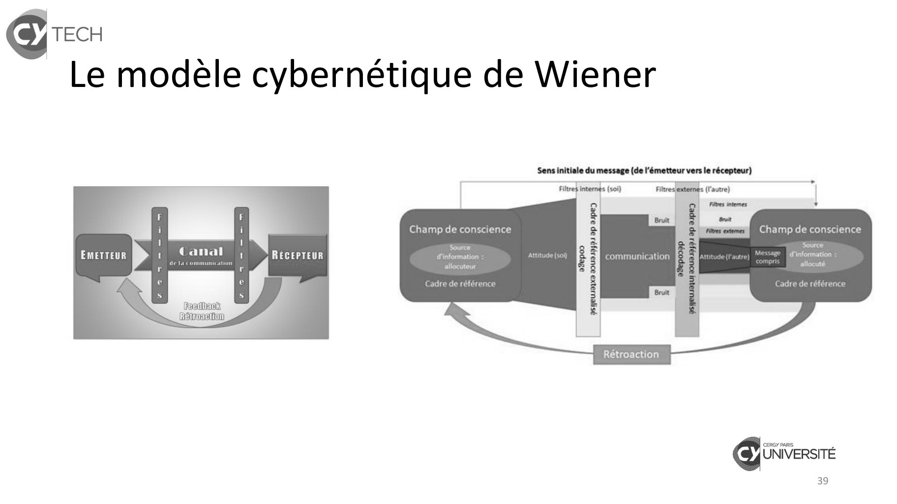

# Cours_2024-2025_IC1_P1S1_DH&D.pdf

[Ouvrir l’original](https://drive.google.com/open?id=1ZNU4dKPUosd1LsrernTkFX6vmGtjK718) · Les pages signalées comprennent du texte reconnu automatiquement ou des éléments graphiques. Le fac-similé permet de vérifier chaque lecture.

**Pages avec fac-similé ou lecture OCR** — 39.

## Page 1

~~~text
                   Interaction et Coopération 1
                   Module en lien avec le Projet

                              Cycle pré-ingénieur 1
                            Semestre 1 & Semestre 2
                                   10 séances

Professeur référent :
BEGUE Alexandre
(alexandre.begue1@cyu.fr)
~~~

## Page 2

~~~text
          Les différents niveaux du cours

                                                 L’équipe
          Moi

L’autre          Les autres                                 L’organisation/ L’école
                                     Le projet

                                                                        2
~~~

## Page 3

~~~text
          Les différentes problématiques du cours
                                 Quel est le lien entre moi et l’autre dans la communication ?
             Moi
                                 Comment fonctionnent et se construisent les relations humaines ?

                                 En quoi la connaissance de moi-même m’aide à travailler en équipe ?

                                 Comment communiquer en équipe projet ?

                                 Comment fonctionne la relation interpersonnelle ?

L’autre             Les autres

                                                                                                    3
~~~

## Page 4

~~~text
            Les différentes problématiques du cours

               L’équipe                      Quelles sont les différences entre un groupe et une équipe ?

                                             Quels sont les liens entre équipe et organisation ?

                                             Comment coopérer dans une équipe projet ?

                                             Comment devient-on une équipe ?

Le projet                 L’organisation /
                          L’école            Est-ce naturel d’être une équipe ?

                                                                                                       4
~~~

## Page 5

~~~text
                                      Introduction

Le cours et l’ensemble des cours RH du chapeau « Matières professionnelles » vont se situer à 3
niveaux pour aider l’ingénieur à décrypter les rapports humains et être habile dans ses relations
humaines au travail.

COMPRENDRE LE MONDE

SE COMPRENDRE SOI-MÊME

COMPRENDRE LES AUTRES

                                                                                                    5
~~~

## Page 6

~~~text
                 Objectifs pédagogiques
Apprendre à faire équipe et collaborer autour d’un projet
→     Découvrir le fonctionnement des relations humaines et sociales à
travers un projet en équipe
→      Percevoir les enjeux et la complexité des relations humaines et
sociales à travers le projet
Ancrage utilisé : Modèle Psychosocial
→     Pouvoir créer et maintenir les conditions de stabilité d’une
équipe, à partir d’un modèle systémique et de son application
interactionniste en psychologie sociale

                                                                   6
~~~

## Page 7

~~~text
                                          Les compétences développées
                   COMPETENCES CTI                                                                 COMPETENCES Psychosociales OMS

                                                                  Etre habile dans les relations interpersonnelles
N° 8 l’aptitude à prendre en compte les enjeux des relations
au travail
                                                                  Savoir résoudre des problèmes
 N° 11 : La capacité à s’insérer dans la vie professionnelle, à
s’intégrer dans une organisation, à l’animer et à la faire
évoluer : exercice de la responsabilité, engagement et            Savoir prendre des décisions
leadership, gestion de projets, capacité à travailler en
collaboration et à communiquer au sein d’équipes
diversifiées et pluridisciplinaires                               Savoir communiquer efficacement
N° 3 : …. « L’approche systémique et holistique, l’utilisation
des approches numériques et des outils informatiques,
l’analyse, la modélisation et la conception de systèmes,
                                                                  Avoir conscience de soi
l’analyse du cycle de vie d’un produit ou service, la gestion
des risques et des crises, la pratique du travail collaboratif
et à distance »                                                   Avoir de l’empathie
N° 14 la capacité à se connaitre, à s’autoévaluer, à gérer ses
compétences                                                       Savoir réguler ses émotions

                                                                   Attention, ces compétences doivent être développées tout au long des études d’ingénieur sur le
                                                                                             cycle pré-Ingénieur et le cycle ingénieur.

                                                                                                                                                            7
~~~

## Page 8

~~~text
    Introduction

En lien avec le projet

 Interaction et Coopération 1
~~~

## Page 9

~~~text
                                          Les compétences développées
                   COMPETENCES CTI                                                                 COMPETENCES Psychosociales OMS

                                                                  Etre habile dans les relations interpersonnelles
N° 8 l’aptitude à prendre en compte les enjeux des relations
au travail
                                                                  Savoir résoudre des problèmes
 N° 11 : La capacité à s’insérer dans la vie professionnelle, à
s’intégrer dans une organisation, à l’animer et à la faire
évoluer : exercice de la responsabilité, engagement et            Savoir prendre des décisions
leadership, gestion de projets, capacité à travailler en
collaboration et à communiquer au sein d’équipes
diversifiées et pluridisciplinaires                               Savoir communiquer efficacement
N° 3 : …. « L’approche systémique et holistique, l’utilisation
des approches numériques et des outils informatiques,
l’analyse, la modélisation et la conception de systèmes,
                                                                  Avoir conscience de soi
l’analyse du cycle de vie d’un produit ou service, la gestion
des risques et des crises, la pratique du travail collaboratif
et à distance »                                                   Avoir de l’empathie
N° 14 la capacité à se connaitre, à s’autoévaluer, à gérer ses
compétences                                                       Savoir réguler ses émotions

                                                                   Attention, ces compétences doivent être développées tout au long des études d’ingénieur sur le
                                                                                             cycle pré-Ingénieur et le cycle ingénieur.

                                                                                                                                                            9
~~~

## Page 10

~~~text
              Organisation des séances
Semestre 1
▪ 6 séances de 1,5h en alternance avec le
  cours design Méthode projet                     Semestre 2
▪ Cours évalué dans le cadre de l’UE PROJET
                                                  4 séances au semestre 2 de 1h30
▪ En lien avec d’autres matières : CEF1,          dans la continuité du semestre 1
  Méthode projet, les masterclass Transition

                                      LE PROJET

                                                                                 10
~~~

## Page 11

~~~text
    Introduction

Ancrage conceptuel
 Le langage en SHS

 Interaction et Coopération 1
~~~

## Page 12

~~~text
                    Introduction Particularité du cours : La sémantique en SHS
Difficulté spécifique en SHS dans l’utilisation du vocabulaire : de nombreux termes utilisés dans la vie courante sont
repris pour la conceptualisation de modèles théoriques en SHS. L’humain a souvent de multiples expériences en
lien avec la thématique étudiée. Ces expériences sont accompagnées de représentations, d’opinions, de préjugés,
d’incorporats culturels plus ou moins forts.
Exemple : le terme expérience est polysémique. Il peut signifier :
(1) La connaissance par la pratique = expérience de terrain par comparaison aux connaissances théoriques.
(2) La connaissance, ou la formation, par le fait de vivre un événement = l’expérience de la maladie.
(3) La tentative, par testage, d’obtenir des connaissances = l’expérience en laboratoire.

En psychosociologie, le concept d’expérience indique majoritairement la réalité vécue par une personne, ce que certains
théoriciens nomment « expérientiel ». Cette notion se focalise sur la dimension subjective du sujet. En ce sens, il se rapproche
de la signification courante vue en (2).

                                                                                                                       12
~~~

## Page 13

~~~text
            Introduction Particularité du cours : Utilisation du vocabulaire
Dans ce cours IC, nous allons souvent osciller entre le niveau conceptuel du langage, et le niveau courant du
langage utilisé pour aborder les notions du cours.
Exemple : La communication au sens commun a une signification pour vous liée à vos représentations, opinions
et expériences autour du sujet, notre but est d’enrichir vos connaissances pour donner du sens à vos expériences
vécues en les reliant à une notion théorique issue du champ de la Psychologie sociale.

Exemple : Nous allons beaucoup utiliser la notion d’équipe mais elle s’ancre dans des référentiels différents selon
l’ancrage théorique dans lequel on se situe à travers le temps et les champs disciplinaires.

                                                                                                              13
~~~

## Page 14

~~~text
                                      Introduction

Ancrage théorique utilisé pour le cours

BASE DU STRUCTURALISME

DYNAMIQUE DES GROUPES

APPROCHE SYSTÉMIQUE

                                                     14
~~~

## Page 15

~~~text
Base sur le structuralisme
Le structuralisme est un ensemble de courants de pensée du XXème siècle. Il se caractérise par le fait
que la forme de l’objet étudié, pris comme un système global, organise sa propre structure. Ce courant
privilégie alors :
• la totalité plutôt que les unités composant cet ensemble
• les relations plutôt que les éléments constitutifs
• la synchronie plutôt que la diachronie
En sciences exactes, c’est surtout en biologie et en physique que se développent des courants
structuralistes, mettant en exergue les notions d’émergence et d’auto-régulation.
    Finalement, les applications de ces courants de pensée donneront lieu à l’approche systémique,
                              s’étayant sur les paradigmes structuralistes.

                                                                                                         15
~~~

## Page 16

~~~text
                                   Introduction

BASE DU STRUCTURALISME
Important pour l’ingénieur d’avoir une base sur cette vision qui distingue le tout de la somme des
parties. L’idée est d’avoir une vision sur le tout et l’influence du contexte et de la structure sur les
relations et les conduites humaines.

APPROCHE SYSTÉMIQUE
Cette approche permet d’avoir une vision globale sur une situation, d’avoir une vision plus large pour
prendre du recul sur un phénomène donné.

DYNAMIQUE DES GROUPES
Concept fondamental pour étudier l’intérieur des groupes et des équipes. L’idée est d’étudier les
processus qui traversent les équipes afin de les reconnaitre et savoir les utiliser à bon escient.

                                                                                                           16
~~~

## Page 17

~~~text
    Introduction

Modèle Systémique

 Interaction et Coopération 1
~~~

## Page 18

~~~text
Modèle Systémique
Ainsi, la systémique est définie comme une vision globale explicative de phénomènes qui interagissent
ensemble de façon complexe et qui s’opposent aux approches fragmentaires et partielles.

En ce sens, la pensée complexe (Edgar Morin) en est une bonne représentation holistique.

                                                 A retenir !

Leitmotiv de la systémique : l’ensemble est différent de la somme des parties qui
                                  le composent

                                                                                                        18
~~~

## Page 19

~~~text
     Introduction

Dynamique de groupe

  Interaction et Coopération 1
~~~

## Page 20

~~~text
 De la Psychologie sociale à l’équipe
Une définition de la psychologie sociale : « Science des interactions et des relations (niveau individuel et groupal)
dans toutes leurs acceptions, prise en compte des facteurs sociaux et psychiques qui interfèrent dans les conduites
concrètes. » (J. Maisonneuve)

   Application concrète au travers de l’étude des interactions groupales = la dynamique de groupe.

Origine du terme : K. Lewin & la théorie des champs. Lewin s’est appuyé sur le développement des sciences
physiques, notamment la mécanique et l’électromagnétisme, pour penser le modèle de la dynamique de groupe.
On notera l’importance du vocabulaire utilisé qui fait référence à des modèles énergétiques en sciences physiques
(champ de forces, homéostasie, résistance, mouvement stationnaire, équilibre…).

                                                                                                                  20
~~~

## Page 21

~~~text
  De la Psychologie sociale à l’équipe
Idée majeure (semblable à l’approche structuraliste) : tous les éléments d’un champ étant interdépendants, agir sur
l’un d’eux = modification de la structure d’ensemble.

En psychologie sociale, le mot groupe est un concept : parler de groupe, c’est parler implicitement de la dynamique
de groupe, et donc de la focalisation sur les éléments participants à sa structuration et son évolution. C’est à la fois
un processus et une donnée. Ce terme possède intrinsèquement l’idée d’une évolution : on parle alors de groupe
mature.

   Notre but : à notre échelle, penser l’organisation psychosociale d’une équipe, pour améliorer son efficacité.

                                                                                                                   21
~~~

## Page 22

~~~text
De la Psychologie sociale à l’équipe
C’est à partir de cette orientation à dominante psychosociologique (théorie du lien interpersonnel) et de son

application pratique (théorie de la communication) que l’on va aborder les facteurs qui structurent les liens

groupaux et les relations interpersonnelles dans une équipe.

L’un des objectifs pédagogiques majeurs sera de tenter de passer d’un état de regroupement (de groupe, au sens

commun) à celui d’une équipe (groupe mature).

                                                                                                       22
~~~

## Page 23

~~~text
 De la Psychologie sociale à l’équipe
  Modèle pédagogique
  Le cours va se situer sur ce processus en évolution : le but est de faire de vous une équipe qui
  coopère. Le but final est de vous rendre le plus efficace possible en équipe.

                    Passer du       Processus du groupe Une équipe soudée       Une équipe de
                rassemblement au    à l’équipe de travail                     travail qui coopère
                     Groupe

“Le groupe n’est jamais sorti une fois pour toute du rassemblement, : le mouvement est toujours à
recommencer” Anzieu et Martin : Dynamique des groupes restreints, p58.

                                                                                                     23
~~~

## Page 24

~~~text
             Introduction

Du regroupement, au groupe, à l’équipe

          Interaction et Coopération 1
~~~

## Page 25

~~~text
A LA BASE DE L’ÉQUIPE, LE GROUPE

                                                             Les usagers
                                                             du bus 643

      Pôle Humanités Design Département Relations Humaines
                                                                           25
~~~

## Page 26

~~~text
Définition

 « Un groupe de passagers dans un bus n’est pas une
équipe. Elle peut le devenir si le bus tombe en panne. »
                   Jean-Paul SARTRE.

                                                       26
~~~

## Page 27

~~~text
Qu’est ce qu’une équipe ?

    Les grands piliers

   Interaction et Coopération 1
~~~

## Page 28

~~~text
                                    Introduction

Chaque pilier de la constitution d’une équipe projet fera l’objet d’un chapitre spécifique ou seront
étudiés conjointement les 3 niveaux d’analyse des relations humaines : les liens entre se comprendre
soi-même, comprendre les autres et comprendre le monde

PILIER 1 : RELATIONS INTERPERSONNELLES

PILIER 2 : ORGANISATION INTERNE : CONTEXTE ET STRUCTURATION

PILIER 3 : BUT COMMUN ET OBJECTIF COMMUN

PILIER 4 : CONSCIENCE DE GROUPE ET APPARTENANCE

                                                                                                       28
~~~

## Page 29

~~~text
IL FAUT RÉUNIR 4 CONDITIONS
  POUR FORMER UNE EQUIPE

                Il faut avoir besoin des autres

                pour atteindre son propre But

                      (et inversement)

               C’est partager un BUT COMMUN

                                                  29
~~~

## Page 30

~~~text
              IL FAUT RÉUNIR 4 CONDITIONS
                POUR FORMER UNE EQUIPE

 Il faut avoir des liens, du vécu, des
émotions et des souvenirs à partager

        C’est entretenir des
 RELATIONS INTERPERSONNELLES

                                            30
~~~

## Page 31

~~~text
IL FAUT RÉUNIR 4 CONDITIONS
  POUR FORMER UNE EQUIPE

                  Il faut se sentir appartenir au
                même collectif pour pouvoir faire
               ensemble, dire « Nous » plutôt que
                              « Je »

                     C’est construire une
                   CONSCIENCE DE GROUPE

                                               31
~~~

## Page 32

~~~text
             IL FAUT RÉUNIR 4 CONDITIONS
               POUR FORMER UNE EQUIPE

Il faut pouvoir se répartir les tâches,
les rôles et les fonctions, pour que
       chacun trouve sa place

        C’est développer une
     ORGANISATION INTERNE

                                           32
~~~

## Page 33

~~~text
POUR RÉSUMER, LES 4 PILIERS D’UNE ÉQUIPE

                ▪ l’existence d’un but commun

                ▪ l’existence de relations
                  interpersonnelles

                ▪ l’existence d’une conscience de groupe

                ▪ l’existence d’une organisation

                    Anzieu et Martin La dynamique des groupes restreints

                                                                           33
~~~

## Page 34

~~~text
                              Interdépendance entre les piliers
         Toutes les notions abordées sont donc dans un certain état d’interdépendance systémique,
               ce qui limite une fragmentation claire sans faire référence aux autres notions.

Exemples :
• La cohésion, issue des relations interpersonnelles, dépend des interactions sociales qui mettent en scène des enjeux
   identitaires (identité, reconnaissance donc conscience de groupe), mais également de l’organisation générale
   (structuration).
• Les rôles, ainsi que les différentes normes, sont liés à la structuration, mais se réalisent au travers des relations
  interpersonnelles. De la même façon, le leadership, rôle ponctuel orienté, est un processus qui touche autant les
  relations interpersonnelles que la structuration.

• La prise de décision, concernant les objectifs à réaliser, peut amener de la conflictualité, autant sur le fond
  (structuration) que sur les personnes (relations interpersonnelles).

• La conscience de groupe dépend du sentiment d’appartenance, tout autant que du climat instauré par les membres,
  donc des relations interpersonnelles.

                                                                                                                  34
~~~

## Page 35

~~~text
    Lien entre Systémique et communication
Pour atteindre une meilleure efficacité, il faut travailler sur la dynamique de groupe se traduisant par de multiples
adaptations : à soi et aux autres dans un contexte général structuré (établir des règles de fonctionnement, normes
instaurées) selon des interdépendances (objectifs communs, pouvoir partagé, prise de décision collective), ainsi
qu’un travail de liaison singulière entre les membres au travers des interactions (cohésion).

   La communication apparaît alors comme facteur essentiel de coordination, mais également de régulation.

                                                                                                                  35
~~~

## Page 36

~~~text
               Introduction

  Pilier 1 : Relations interpersonnelles

Evolution des modèles de communication

           Interaction et Coopération 1
~~~

## Page 37

~~~text
            LE MODÈLE D’ARISTOTE
              Modèle simple et linéaire EMETTEUR            MESSAGE                 RECEPTEUR
                ETHOS
Manière de capter l’auditoire
Notion de persuasion, éloquence,          Art de convaincre/Modèle rhétorique
volonté de communiquer                                 3 éléments

                               EMETTEUR                                               RECEPTEUR
                                                                                                                 PATHOS
                                                                                                Sensibilité, les émotions de l’auditoire
                                                                                                émotion du récepteur, volonté de
                                                                                                recevoir le message

                                                                                     LOGOS
                                                                     Logique, raisonnement,
                                                                     argumentation
                                                       MESSAGE       parole, discours, rationalité,
                                                                     rhétorique

                                                                                                                               37
~~~

## Page 38

~~~text
Le modèle mécaniste Shannon et Weaver

    Source => message => codage =(bruit)=> décodage => message => destinataire

                                                                                 38
~~~

## Page 39

~~~text
Le modèle cybernétique de Wiener

                                   39
~~~

**Lecture OCR à contrôler**

~~~text
TECH
_ Le modèle cybernétique de Wiener

Sens initiale du message (de l'émetteur vers le récepteur)
= ——

Filtre} internes (soi)

Champ de conscience Champ de conscience

EMETTEUR Canal RECEPTEUR

Sour

Source 7
d'information

d'information

allocuteur allocuté

Cadre de référence Cadre de rété

stjeusayxe 990939591 9p 24pe9

Rétroaction

€ UNIVERSITÉ

39
~~~

## Page 40

~~~text
Le modèle socio-linguistique et sémantique
de Jakobson

                                             40
~~~

## Page 41

~~~text
  Vers le modèle de Palo Alto et l’approche
  systémique
• La prise en compte du contexte élargi et la vision dynamique de l'interaction créent le courant
  psychosociologique de la communication.

• Désormais, une part de la communication vise à définir la relation par des stratégies (notion
  d'équilibre, de cadre, d'inférence) en se focalisant sur les enjeux symboliques de négociation d'images,
  de places, de significations, etc.

        CE MODÈLE EST PARTICULIÈREMENT PERTINENT POUR COMPRENDRE ET ANALYSER CE QUI SE JOUENT ENTRE LES INDIVIDUS
                                                  AU SEIN D’UNE ÉQUIPE.

                                                                                                                41
~~~

## Page 42

~~~text
Spécificité de Palo Alto
• Ce modèle de compréhension des conduites humaines à l’intérêt de
  se focaliser sur 3 niveaux et de faire le lien entre ces 3 niveaux :
• La transmission du message (syntaxique)
• Sa signification (sémantique)
• Le comportement associé (pragmatique)

   UN DES POSTULATS DE PA : LA RELATION EST MÉDIATISÉE PAR LA COMMUNICATION (AUTREMENT DIT : LA RELATION
                              POSSÈDE DES ENJEUX IDENTITAIRES ET SYMBOLIQUES).

                                                                                                           42
~~~

## Page 43

~~~text
Spécificité de Palo Alto
• Lorsqu’on est en interaction avec quelqu’un : « on ne peut pas ne pas
  communiquer », de la même façon qu’on ne peut pas ne pas réagir à
  des communications.

                      UN DES POSTULATS DE PA : TOUT EST COMMUNICATION

          A votre avis le silence et le mutisme sont-ils des formes de communication ?

                                                                                         43
~~~
