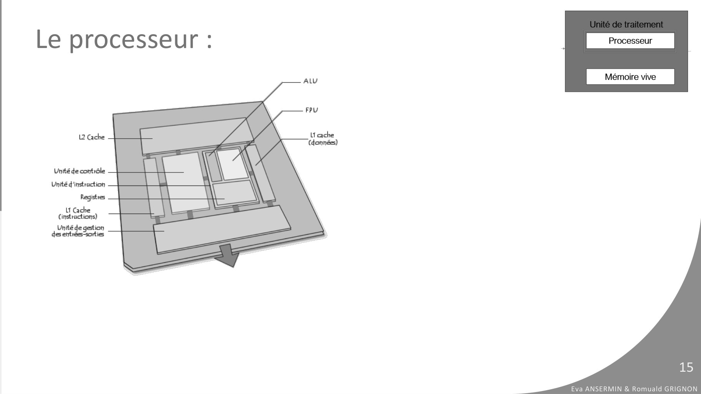

# CM1-Architecture-Materielle_2024-2025_Informatique1_P1S1_EAnsermin-RGrignon.pdf

[Ouvrir l’original](https://drive.google.com/open?id=1EV1vLa1s-aUEtT7HZ6PnnH_i5wcws-If) · Les pages signalées comprennent du texte reconnu automatiquement ou des éléments graphiques. Le fac-similé permet de vérifier chaque lecture.

**Pages avec fac-similé ou lecture OCR** — 15.

## Page 1

~~~text
                                                                                  v1.3

INFORMATIQUE 1
I . A R C H I T E C T U R E M AT E R I E L L E

                                                 Eva Ansermin & Romuald Grignon
~~~

## Page 2

~~~text
Présentation de la matière
• Sujets abordés dans la matière:
   • Fonctionnement global des ordinateurs (base d’architecture des ordinateurs)
   • Bases d’algorithmie
   • Applications : programmation en langage C
• Organisation:
   • 9 CM
   • TD sur 13 semaines
• Evaluation :
   • 3 DS (2 x 90min + 1 x 120min)
   • Moyenne des quiz qui compte pour 1 DS.
                                                                                                   2
   • Moyenne = max( moyenne(DS1, DS2, DS3, QUIZ), DS3 )
                                                                        Eva ANSERMIN & Romuald GRIGNON
~~~

## Page 3

~~~text
  Page de cours + Quiz
• Des quiz auront lieu régulièrement en début de séance de TD, en ligne sur la
  page du cours : https://cours.cyu.fr/course/view.php?id=334

• Vous trouverez aussi des support de cours, TD, quiz d’entrainement, archives de
  DS, liste des intervenants par groupe, et les modalités d’évaluation.
                                                                                                            3
• Inscrivez-vous sur ce site avec votre groupe pour accéder aux évaluations !
                                                                                 Eva ANSERMIN & Romuald GRIGNON
~~~

## Page 4

~~~text
Introduction
➢ L’informatique est une science permettant le traitement automatique de données par des machines
  (robot, système embarqué, ordinateur …).
➢ Un ordinateur est une machine qui :
      ✓ saisit par un périphérique d’entrée (clavier, souris, scanner, micro,…),
      ✓ stocke en mémoire,
      ✓ traite les données par des programmes
      ✓ restitue par un périphérique de sortie (écran, imprimante, …) des informations
➢ Type d’ordinateur :

                                                                                                                    4
                                                                                         Eva ANSERMIN & Romuald GRIGNON
~~~

## Page 5

~~~text
Introduction
➢ L’informatique est une science permettant le traitement automatique de données par des machines
  (robot, système embarqué, ordinateur …).
➢ Un ordinateur est une machine qui :
      ✓ saisit par un périphérique d’entrée (clavier, souris, scanner, micro,…),
      ✓ stocke en mémoire,
      ✓ traite les données par des programmes
      ✓ restitue par un périphérique de sortie (écran, imprimante, …) des informations
➢ Type d’ordinateur :
        ✓ Ordinateur fixe
        ✓ Ordinateur portable
        ✓ Tablette
        ✓ Smartphone
                                                                                                                    5
                                                                                         Eva ANSERMIN & Romuald GRIGNON
~~~

## Page 6

~~~text
Introduction
L’informatique est une discipline en constante évolution.
➢ Amélioration matérielle :
    ✓ Augmentation de la densité des composants. Loi
     de Moore : Le nombre de transistors sur une puce
     double (doublait ?) tous les 18 mois.
    ✓ L’augmentation de la densité des circuits
        s’accompagne d’une augmentation de
      performances et de fiabilité.

➢Diversification de la discipline : Intelligence
 artificielle, big-data, cyber sécurité etc…
➢ … Mais les concepts de base restent les mêmes!                                       6
                                                            Eva ANSERMIN & Romuald GRIGNON
~~~

## Page 7

~~~text
  Composition d’un ordinateur

                                Ordinateur
                                               ➢Composants matériels (Hardware) :

                                                   ✓ Tout ce qui compose l’ordinateur et ses
              Matériels                              Logiciels
                                                     accessoires.

                                                      ✓ Chaque composant possède une fonction
                                               Systèmeparticulière    :
                                                                   Applications et
Disque dur   Ecran        RAM      …
                                             d’exploitation
                                                         • saisie desprogrammes
                                                                        données
                                                         • calcul
                                                         • stockage des données
                                                         • affichage vidéo
                                                         • gestion du clavier...
                                                                                                               7
                                                                                    Eva ANSERMIN & Romuald GRIGNON
~~~

## Page 8

~~~text
  Composition d’un ordinateur

                                                                  Ordinateur
➢Logiciel (Software) :

     ✓ Immatériel (non tangible)
     ✓ Ensemble de programmes exécutables par l’ordinateur
                                    Matériels                                             Logiciels

➢Différents types de logiciels :
                                                                                 Système                Applications et
                       Disque dur         Ecran          RAM          …
     ✓ Système d’exploitation (Windows, Linux, MacOS, iOS, Androïd)            d’exploitation            programmes
     ✓ Logiciels standards comme Word, Excel...
     ✓ Progiciels : logiciels spécifiques (paye, comptabilité, ...)
     ✓ …

                                                                                                                                 8
                                                                                                      Eva ANSERMIN & Romuald GRIGNON
~~~

## Page 9

~~~text
Composition d’un ordinateur

                                          Ordinateur

                       Matériels                                  Logiciels

                                                         Système              Applications et
    Disque dur        Ecran         RAM      …
                                                       d’exploitation          programmes

 ➢ Le logiciel pilote le matériel

                                                                                                                      9
                                                                                           Eva ANSERMIN & Romuald GRIGNON
~~~

## Page 10

~~~text
Architecture globale

                   Unité de traitement

Périphérique                             Périphérique
  d’entrée                                de sortie

                                                                      10
                                             Eva ANSERMIN & Romuald GRIGNON
~~~

## Page 11

~~~text
Périphériques d’entrée

 ➢Saisie / Acquisition de données :
    ➢Clavier
    ➢Souris
    ➢Caméra numérique
    ➢Scanneur
    ➢Réseau
    ➢…

                                                               11
                                      Eva ANSERMIN & Romuald GRIGNON
~~~

## Page 12

~~~text
Périphériques de sortie

 ➢Restitution de données :
    ➢Ecran
    ➢Imprimante
    ➢Haut parleur
    ➢Réseau
    ➢…

                                                      12
                             Eva ANSERMIN & Romuald GRIGNON
~~~

## Page 13

~~~text
Architecture globale

                   Unité de traitement
                       Processeur
Périphérique                             Périphérique
  d’entrée                                de sortie
                       Mémoire vive

                                                                      13
                                             Eva ANSERMIN & Romuald GRIGNON
~~~

## Page 14

~~~text
 Le processeur :

➢Le Processeur ou microprocesseur est une puce électronique. Il
 constitue le moteur de l'ordinateur, plus il est puissant et plus le
 traitement des informations est rapide. Sa vitesse de travail se
 mesure en Gigahertz (GHz).
➢Le processeur peut être composé de 1 à 10 cœurs, qui peuvent
 être dédoublés en thread (simulation de 2 cœurs logiques dans 1
 physique) pour augmenter sa capacité de traitement de plusieurs
 tâches en parallèle

     Sociétés   Entrée de gamme      Milieu de gamme       Haut de gamme
     Intel      Core i3 (4 cœurs)    Core i5 (6 cœurs)     Core i9 (entre 8 et 24 cœurs)
     AMD        Athlon 2 X3          Ryzen 2 X4            Ryzen 7 X8
                                                                                                                    14
                                                                                           Eva ANSERMIN & Romuald GRIGNON
~~~

## Page 15

~~~text
Le processeur :

                                           15
                  Eva ANSERMIN & Romuald GRIGNON
~~~

**Lecture OCR à contrôler**

~~~text
Le processeur :

ALU

L2 Cache À tache

Unité de contrôle
Unité d'instraction
Registres

U Cache
Cinstractions)
Unité de gestion

des entrées “sorties

Eva ANSERMIN & Romuald GRIGNON
~~~

## Page 16

~~~text
Le processeur :

                  ➢ ALU: unité arithmétique et logique (UAL).
                    Permet d’executer des operations de base :
                      ✓ Opérations arithmétiques
                      ✓ Comparaisons
                      ✓ Opérations logiques

                                                                           16
                                                  Eva ANSERMIN & Romuald GRIGNON
~~~

## Page 17

~~~text
Le processeur :

                  ➢ ALU: unité arithmétique et logique (UAL).
                    Permet d’executer des operations de base :
                      ✓ Opérations arithmétiques
                      ✓ Comparaisons
                      ✓ Opérations logiques

                  ➢ Registres : petites mémoires pour
                    mémoriser les instructions et les données en
                    cours de calcul

                                                                            17
                                                   Eva ANSERMIN & Romuald GRIGNON
~~~

## Page 18

~~~text
Le processeur :

                  ➢ ALU: unité arithmétique et logique (UAL).
                    Permet d’executer des operations de base :
                      ✓ Opérations arithmétiques
                      ✓ Comparaisons
                      ✓ Opérations logiques

                  ➢ Registres : petites mémoires pour
                    mémoriser les instructions et les données en
                    cours de calcul

                  ➢ Unité de contrôle : organise l’ensemble

                                                                            18
                                                   Eva ANSERMIN & Romuald GRIGNON
~~~

## Page 19

~~~text
 Le processeur :

                                                             ➢ ALU: unité arithmétique et logique (UAL).
                                                               Permet d’executer des operations de base :
                                                                 ✓ Opérations arithmétiques
                                                                 ✓ Comparaisons
                                                                 ✓ Opérations logiques

                                                             ➢ Registres : petites mémoires pour
                                                               mémoriser les instructions et les données en
                                                               cours de calcul

                                                             ➢ Unité de contrôle : organise l’ensemble

➢ Un cycle d’instruction a trois étapes :
   ➢ Fetch : on récupère l’instruction à faire dans un registre d’instruction.
   ➢ Decode : l’unité de contrôle “décode” l’instruction
   ➢ Execute : l’instruction est executée par l’ALU.                                                                   19
                                                                                              Eva ANSERMIN & Romuald GRIGNON
~~~

## Page 20

~~~text
Architecture globale

                  UAL + unité de contrôle
Périphérique                                Périphérique
  d’entrée                                   de sortie
                       Mémoire vive

                                                                         20
                                                Eva ANSERMIN & Romuald GRIGNON
~~~

## Page 21

~~~text
 Mémoire vive
➢ La RAM (Random Access Memory) charge les programmes et
  fichiers en cours d’utilisation et se vide lorsque l’ordinateur est
  éteint.
➢ Elle permet de stocker des informations temporairement. Sa
  capacité se mesure en gigaoctet (Go) et se situe entre 2 et
  plusieurs dizaines de Go.
➢ Elle est environ un million de fois plus rapide que les autre
  périphériques de stockage et permet ainsi une exécution rapide
  des calculs.

                                                                                                 21
                                                                        Eva ANSERMIN & Romuald GRIGNON
~~~

## Page 22

~~~text
Architecture globale

                  UAL + unité de contrôle
Périphérique                                Périphérique
  d’entrée                                   de sortie
                        Mémoire vive

                                                                         22
                                                Eva ANSERMIN & Romuald GRIGNON
~~~

## Page 23

~~~text
Architecture globale

                  UAL + unité de contrôle
Périphérique                                Périphérique
  d’entrée                                   de sortie
                        Mémoire vive

                    Mémoire externe ou
                     unité de stockage
                                                                         23
                                                Eva ANSERMIN & Romuald GRIGNON
~~~

## Page 24

~~~text
 Unités de stockage
➢ Les unités de stockages permettent d’archiver les données (fichiers et programmes)
  chargées dans l'ordinateur. Leur capacité est exprimée en Go, voir en To.
➢ Différentes unités de stockage :
    ➢ Externe:
        ➢ Clef USB
        ➢ CD/DVD RW
        ➢ Disque dur externe
        ➢ Bandes magnétiques (encore utilisées pour la sauvegarde)

    ➢ Disque dur interne
➢ Ces mémoires sont lentes en accès et en écriture
                                            Registre      Mémoire vive   Disque Dur

                     Capacité typique      < 128 Ko          8 Go            1 To

                     Temps d’accès (s)     10-9 (nano)      10 . 10-9    5.10-3 (milli)

                       Débit (Mo/s)      4 000 – 32 000   400 – 16 000     4 - 550
                                                                                                                   24
                                                                                          Eva ANSERMIN & Romuald GRIGNON
~~~

## Page 25

~~~text
La mémoire morte (ROM)
➢Peut être lue plusieurs fois (Read Only Memory), mais ne peut pas être modifiée
 (sauf en la flashant, c’est-à-dire par une forte impulsion électrique, ce qui est un
 processus lent) .
➢Contient des données nécessaires au bon fonctionnement de l’ordinateur ou des
 périphériques :
   ➢Les informations nécessaires au démarrage d’un ordinateur (BIOS –
    microcode).
   ➢Les tables de caractères (latin).
   ➢Les programmes de gestion des périphériques et équipements embarqués.
➢Elle est située sur la carte mère de l’ordinateur qui est le « chef d’orchestre » de
 l’ordinateur ou sur les contrôleurs des périphériques.                                              25
                                                                            Eva ANSERMIN & Romuald GRIGNON
~~~

## Page 26

~~~text
Fonctionnement général d’une mémoire
➢Une mémoire est divisée en différentes « cases » de même capacité (~ octet).
➢La majorité des mémoires utilise l’adressage :
   ➢Chaque registre interne (case) a une adresse attribuée.
   ➢On accède à cette cellule à partir de son adresse.

                                                                                                26
                                                                       Eva ANSERMIN & Romuald GRIGNON
~~~

## Page 27

~~~text
Architecture globale

                                UAL + unité de contrôle
Périphérique                                                                   Périphérique
                                       Bus de données
  d’entrée                             Bus d’adresse                            de sortie
                                       Mémoire vive

                                   Mémoire externe ou
                                    unité de stockage

 Le bus de données communique les informations (résultats de calculs, instructions etc…)
 Le bus d’adresses indique où l’on veut stocker/récuperer l’information de la mémoire                          27
                                                                                      Eva ANSERMIN & Romuald GRIGNON
~~~

## Page 28

~~~text
Architecture de Von Neumann

                                 UAL + unité de contrôle
Périphérique                                                                     Périphérique
                                        Bus de données
  d’entrée                              Bus d’adresse                             de sortie
                                        Mémoire vive

                                   Mémoire externe ou
                                    unité de stockage

 Les instructions et les données sont enregistrées dans les mêmes structures de stockage :
 c’est une architecture de Von Neumann.                                                                         28
                                                                                       Eva ANSERMIN & Romuald GRIGNON
~~~
