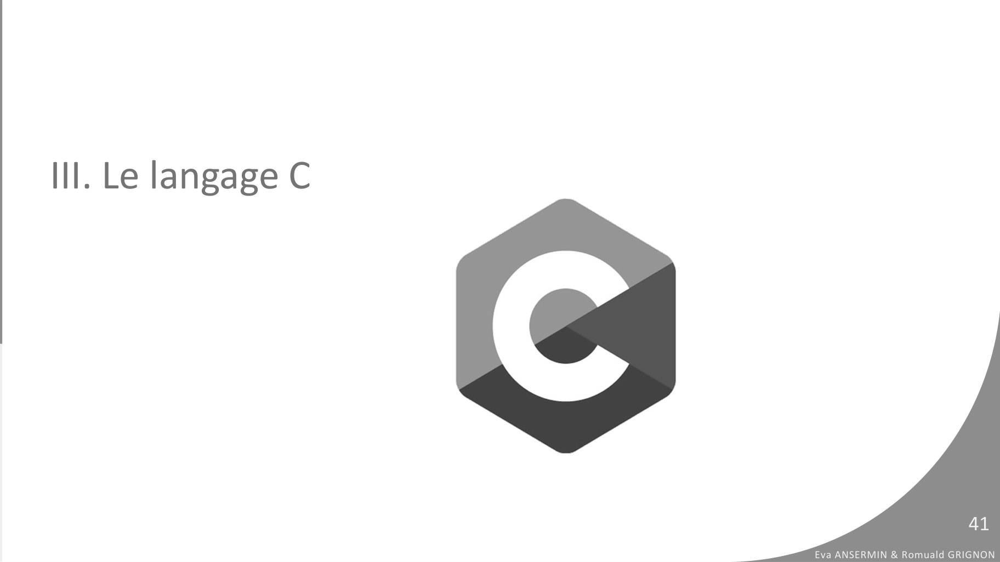
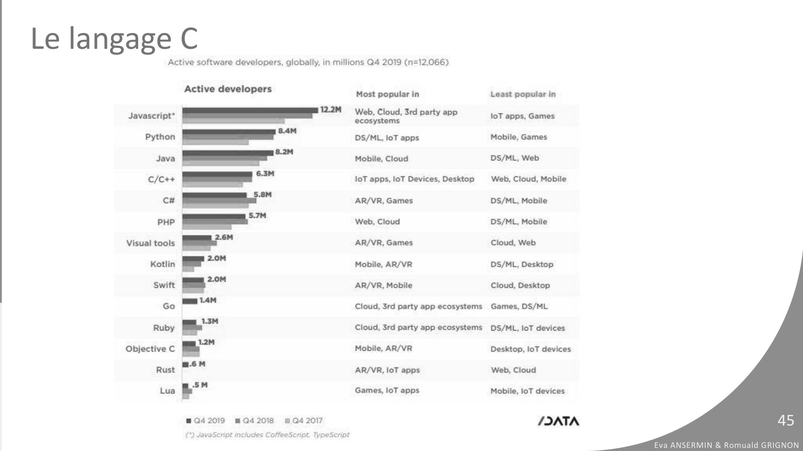

# CM5-Pseudo-code-C-Variables_2023-2024_Informatique1_P1S1_EAnsermin-RGrignon.pdf

[Ouvrir l’original](https://drive.google.com/open?id=1zBZU8Vh_zaQ0dHgjEGRdVIu0VyHDQ5RS) · Les pages signalées comprennent du texte reconnu automatiquement ou des éléments graphiques. Le fac-similé permet de vérifier chaque lecture.

**Pages avec fac-similé ou lecture OCR** — 41, 45.

## Page 1

~~~text
                                                                    v1.1

INFORMATIQUE 1
V. P S E U D O - C O D E , C E T
VA RIABLES

                                   Eva Ansermin & Romuald Grignon
~~~

## Page 2

~~~text
I. Introduction : l’algorithmie

                                                             2
                                  Eva ANSERMIN & Romuald GRIGNON
~~~

## Page 3

~~~text
Algorithmie vs programmation
➢L’algorithmie :
   ➢ Concevoir une solution pour résoudre un problème donné.
   ➢ Un algorithme consiste en une succession d’étapes pour résoudre ce problème.
   ➢ Ce problème n’est pas forcement mathématique ou informatique !

   • Exemples : étapes de pliage ou résolution d’un rubik’s cube                                           3
                                                                                Eva ANSERMIN & Romuald GRIGNON
~~~

## Page 4

~~~text
Algorithmie vs programmation

                                                          4
                               Eva ANSERMIN & Romuald GRIGNON
~~~

## Page 5

~~~text
Evaluation de l’algorithme

• Plusieurs solutions peuvent exister pour répondre à un même problème. Il n’est
  pas toujours facile de trouver la plus efficace.

• Un programme peut chercher à optimiser :
   ➢Le temps d’exécution
   ➢La mémoire utilisée
   ➢Limiter sa consommation de ressources (fichiers ou électricité par exemple)
   ➢La sécurité / La prise en compte de tous les cas possibles

                                                                                                  5
                                                                       Eva ANSERMIN & Romuald GRIGNON
~~~

## Page 6

~~~text
Evaluation de l’algorithme
• Des petites erreurs d’algorithmes peuvent impacter gravement de nombreux
  secteurs (financiers, sécurité etc.)
• Exemple du vol Ariane 5 :
   ➢ Explosion de la fusée après 37 s de décollage
   ➢ Une erreur de calcul du pilote automatique à cause d’une mauvaise indication des
     accéléromètres
   ➢ La raison : la valeur mesurée par les accéléromètres ne tenait pas dans les emplacements
     mémoire de la fusée (1 octet) !

   ➢Progrès de l’algorithmie!                                                                                  6
                                                                                    Eva ANSERMIN & Romuald GRIGNON
~~~

## Page 7

~~~text
Algorithmie vs programmation
• L’algorithmie :
   ➢ Conception de solution pour résoudre un problème donné.
   ➢ Un algorithme est une succession d’étapes pour résoudre ce problème.

• La programmation :
   ➢ Dire à un ordinateur ce qu’il doit faire.
   ➢ Ecrire les instructions dans un langage compréhensible par la machine (C, python, pascal…)
   ➢ On utilise les concepts de l’algorithmie pour concevoir les programmes.

➢Un programme est issu d’un algorithme !
                                                                                                              7
                                                                                   Eva ANSERMIN & Romuald GRIGNON
~~~

## Page 8

~~~text
Etapes de conception d’un programme

 Problème      Analyse                    Code
                             Algorithme          Programme
   posé

                                                 Tests

 ➢ Comment écrire un algorithme ?

                                                                                    8
                                                         Eva ANSERMIN & Romuald GRIGNON
~~~

## Page 9

~~~text
  Le pseudo-code
• En programmation le pseudo-code est une manière d’écrire un algorithme dans un
  langage naturel, indépendamment d’un langage de programmation. Il utilise notamment
  des mots clefs en français qui ont des équivalents dans les différents langages.

      Problème
                      analyse         Algorithme       code
         posé                                                       Programme
                                     pseudo-code
       français

                                                                    Tests
• Le pseudo-code doit contenir toutes les étapes de l’algorithme.
• Il n’existe pas de convention unique de pseudo-code : l’important est d’être
  compréhensible. Néanmoins, pour ce cours nous imposerons une convention.
                                                                                                   9
                                                                        Eva ANSERMIN & Romuald GRIGNON
~~~

## Page 10

~~~text
II. Premiers programmes et variables

                                                                10
                                       Eva ANSERMIN & Romuald GRIGNON
~~~

## Page 11

~~~text
Programme
●   Un PROGRAMME est l’unité de base d’un algorithme
●   Un PROGRAMME possède un DEBUT et une FIN
●   Syntaxe :
    PROGRAMME NomDuProgramme
    DEBUT

      ALGORITHME

    FIN

                                                                                11
                                                       Eva ANSERMIN & Romuald GRIGNON
~~~

## Page 12

~~~text
Programme
●   Un PROGRAMME est l’unité de base d’un algorithme
●   Un PROGRAMME possède un DEBUT et une FIN
●   Syntaxe :
                                                Un commentaire est
    PROGRAMME NomDuProgramme                    une note à destination
    DEBUT                                       du programmeur ou
      // Commentaire sur une ligne              d’un futur lecteur.
      /*                                        Il ne fait pas partie de
      Commentaire                               l’algorithme mais
      sur plusieurs lignes                      permet de l’expliquer.
      */
    FIN

                                                                                                    12
                                                                           Eva ANSERMIN & Romuald GRIGNON
~~~

## Page 13

~~~text
Instructions
●   Un PROGRAMME est une suite finie d’instructions, comprises entre le DÉBUT et la FIN
●   Une instruction de base ÉCRIRE est l'écriture d'informations sur une interface
      ÉCRIRE(“qqch à afficher”)
                                                              L’instruction ÉCRIRE
                                                              doit respecter une
                                                              syntaxe !
●   Exemple de programme complet : « Bonjour »

    PROGRAMME Bonjour
    DÉBUT
        ÉCRIRE("Bonjour le monde !")
    FIN
                                                                                                     13
                                                                            Eva ANSERMIN & Romuald GRIGNON
~~~

## Page 14

~~~text
Variables, types et expressions
●   Variable : élément du programme qui sert à stocker une valeur, un résultat de calcul.
●   Une variable est définie par un nom et un type.

     ○   Le nom d’une variable est donné par le programmeur : il permet simplement de pouvoir
         distinguer les différentes variables pour les utiliser.

     ○   Le type d’un variable indique quel genre de donnée elle représente (une lettre, un entier, un réel
         etc…), soit pour l’ordinateur sa taille en bits et sa convention de représentation !

                                                                                                                   14
                                                                                          Eva ANSERMIN & Romuald GRIGNON
~~~

## Page 15

~~~text
Variables, types et expressions
●   Variable : élément du programme qui sert à stocker une valeur, un résultat de calcul.
●   Une variable est définie par un nom et un type.

●   Les différents types en pseudo-code :
○   Arithmétiques
     ■ Entier : -7, 0, 42, 2147483647                     Les types en pseudo-code
                                                          précisent simplement la
     ■ Réel : -3.7, 0.0, 8.0, 1.42e-5
                                                          « nature » de la variable et
○   Logiques                                              non la taille.
     ■ Booléen : vrai, faux
○   Alphabétiques
     ■ Caractère : ‘a’, ‘Z’, ‘+’, ‘5’, ‘ ‘
     ■ Chaîne : “aaa”, “322 - 78”, “Bonjour Machin”                                                    15
                                                                              Eva ANSERMIN & Romuald GRIGNON
~~~

## Page 16

~~~text
Variables, types et expressions
●       On peut modifier la valeur des variables grâce à des opérateurs.

●       L’application d’une suite d’opérations sur une ou plusieurs variables est une
        expression
●       Les opérateurs possibles dépendent du type :
    ○   Arithmétiques
         ■ Entier : -7, 0, 42, 2147483647, opérateurs : +, -, *, DIV, MOD
         ■ Réel : -3.7, 0.0, 8.0, 1.42e-5, opérateurs : +, -, *, /
                                                                                  Ne pas confondre DIV
    ○   Logiques                                                                  et / !
         ■ Booléen : vrai, faux, opérateurs : ou, et, non
    ○   Alphabétiques
         ■ Caractère : ‘a’, ‘Z’, ‘+’, ‘5’, ‘ ‘
         ■ Chaîne : “aaa”, “322 - 78”, “Bonjour Machin”, opérateur : + (concaténation)
                                                                                                                 16
                                                                                        Eva ANSERMIN & Romuald GRIGNON
~~~

## Page 17

~~~text
Variables, types et expressions
●   Les variables sont stockées dans la mémoire de l’ordinateur (la RAM)
●   Il est important de déclarer une variable pour lui faire de la place en mémoire !
●   Une variable est d’abord déclarée dans la zone de déclaration, puis initialisée
    dans la zone d’instructions.
●   La zone de déclaration est définie par le mot clé VARIABLE
●   Syntaxe : nomVariable : type

●   Exemple de déclaration de variables

    VARIABLES
      i              : entier
      x, y           : réels
      estTrouvé      : booléen                                                                     17
      reponse        : chaîne                                             Eva ANSERMIN & Romuald GRIGNON
~~~

## Page 18

~~~text
Affectation

●   Une affectation est le fait de mettre une valeur dans une variable, en cohérence
    avec son type.
●   La première affectation de valeur à une variable est appelée initialisation
●   En pseudo-code, elle est symbolisée par ←
●    ← peut être traduit par “la variable prend la valeur” :
                     ○   variable ← valeur

                                                                                                   18
                                                                          Eva ANSERMIN & Romuald GRIGNON
~~~

## Page 19

~~~text
Affectation

●   Exemples
    VARIABLES
      i, j          : entiers
      x, y          : réels
      estTrouvé     : booléen
      reponse       : chaîne
    DEBUT
         i ← 7
         x ← 2.5
         j ← i + 1
         reponse ← “Bonjour “
         estTrouvé ← faux
         y ← 5 + 2 * x
      FIN
                                                         19
                                Eva ANSERMIN & Romuald GRIGNON
~~~

## Page 20

~~~text
Affectation

●   Exemples
    VARIABLES
      i, j          : entiers
      x, y          : réels
      estTrouvé     : booléen
                                Zone de déclaration
      reponse       : chaîne
    DEBUT
         i ← 7
         x ← 2.5
         j ← i + 1
         reponse ← “Bonjour “
                                Zone d’instructions
         estTrouvé ← faux
         y ← 5 + 2 * x
      FIN
                                                                               20
                                                      Eva ANSERMIN & Romuald GRIGNON
~~~

## Page 21

~~~text
Affectation

●   Exemples
    VARIABLES
      i, j          : entiers
      x, y          : réels
      estTrouvé     : booléen
      reponse       : chaîne
    DEBUT
         i ← 7         première instruction
         x ← 2.5                                        Les instructions sont
                          troisième instruction
         j ← i + 1                                      exécutées dans l’ordre
         reponse ← “Bonjour “                           ligne par ligne !
         estTrouvé ← faux
         y ← 5 + 2 * x           dernière instruction
      FIN
                                                                                                          21
                                                                                 Eva ANSERMIN & Romuald GRIGNON
~~~

## Page 22

~~~text
Affectation

●   Exemples
    VARIABLES
      i, j          : entiers
      x, y          : réels
      estTrouvé     : booléen
      reponse       : chaîne
    DEBUT
         i ← 7
         x ← 2.5
         j ← i + 1
         reponse ← “Bonjour “
         estTrouvé ← faux
         y ← “p“
         j ← 3.2
                                                         22
      FIN
                                Eva ANSERMIN & Romuald GRIGNON
~~~

## Page 23

~~~text
Affectation

●   Exemples
    VARIABLES
      i, j          : entiers
      x, y          : réels
      estTrouvé     : booléen
      reponse       : chaîne
    DEBUT
         i ← 7
         x ← 2.5
         j ← i + 1
         reponse ← “Bonjour “
         estTrouvé ← faux
                                Ces deux affectations sont fausses
         y ← “p“
                                car elles ne sont pas compatibles
         j ← 3.2
                                avec les types des variables !                                23
      FIN
                                                                     Eva ANSERMIN & Romuald GRIGNON
~~~

## Page 24

~~~text
Exemple de programme

  VARIABLES
    a, b,c : entiers
    DEBUT
       a ← 2
       b ← 4
       c ← a * b
       a ← 1 + b div a
       b ← a-2*c
    FIN

                                                  24
                         Eva ANSERMIN & Romuald GRIGNON
~~~

## Page 25

~~~text
Exemple de programme

  VARIABLES
    a, b,c : entiers
    DEBUT                variable   valeur
       a ← 2             a
       b ← 4
                         b
       c ← a * b
       a ← 1 + b div a   c
       b ← a-2*c
    FIN

                                                                      25
                                             Eva ANSERMIN & Romuald GRIGNON
~~~

## Page 26

~~~text
Exemple de programme

  VARIABLES
    a, b,c : entiers
    DEBUT                variable   valeur
       a ← 2             a
       b ← 4
                         b
       c ← a * b
       a ← 1 + b div a   c
       b ← a-2*c
    FIN

                                                                      26
                                             Eva ANSERMIN & Romuald GRIGNON
~~~

## Page 27

~~~text
Exemple de programme

  VARIABLES
    a, b,c : entiers
    DEBUT                variable   valeur
       a ← 2             a          2
       b ← 4
                         b
       c ← a * b
       a ← 1 + b div a   c
       b ← a-2*c
    FIN

                                                                      27
                                             Eva ANSERMIN & Romuald GRIGNON
~~~

## Page 28

~~~text
Exemple de programme

  VARIABLES
    a, b,c : entiers
    DEBUT                variable   valeur
       a ← 2             a          2
       b ← 4
                         b          4
       c ← a * b
       a ← 1 + b div a   c
       b ← a-2*c
    FIN

                                                                      28
                                             Eva ANSERMIN & Romuald GRIGNON
~~~

## Page 29

~~~text
Exemple de programme

  VARIABLES
    a, b,c : entiers
    DEBUT                variable   valeur
       a ← 2             a          2
       b ← 4
                         b          4
       c ← a * b
       a ← 1 + b div a   c          8
       b ← a-2*c
    FIN

                                                                      29
                                             Eva ANSERMIN & Romuald GRIGNON
~~~

## Page 30

~~~text
Exemple de programme

  VARIABLES
    a, b,c : entiers
    DEBUT                variable   valeur
       a ← 2             a          2
       b ← 4
                         b          4
       c ← a * b
       a ← 1 + b div a   c          3
       b ← a-2*c
    FIN

                                                                      30
                                             Eva ANSERMIN & Romuald GRIGNON
~~~

## Page 31

~~~text
Exemple de programme

  VARIABLES
    a, b,c : entiers
    DEBUT                variable   valeur
       a ← 2             a          2
       b ← 4
                         b          -4
       c ← a * b
       a ← 1 + b div a   c          3
       b ← a-2*c
    FIN

                                                                      31
                                             Eva ANSERMIN & Romuald GRIGNON
~~~

## Page 32

~~~text
Attention aux noms des variables!

                                                             32
                                    Eva ANSERMIN & Romuald GRIGNON
~~~

## Page 33

~~~text
Interactions avec l’utilisateur
 ●   On modélise deux interactions : l’entrée des données (la saisie) et la sortie (l’affichage).
 ●   Sortie : écrire(expression)
 ●   Exemple :

      ○   Texte simple : écrire(“Vive les chats!”)

      ○   Texte + valeur d’une variable : écrire(“ma variable a vaut “ + a)

 ●   Entrée : lire(variable)
 ●   La lecture correspond à l’affectation de la valeur saisie (au clavier) dans la variable spécifiée

 ●   Exemple : lire(a)
                                                                                                                    33
                                                                                           Eva ANSERMIN & Romuald GRIGNON
~~~

## Page 34

~~~text
Un exemple complet

PROGRAMME Interaction
VARIABLE
      reponse : chaîne                      Ecran:

DÉBUT
      // affichage
      écrire(“Saisissez votre prénom”)
      // saisie clavier
      lire(reponse)
      écrire(“Bonjour “ + reponse + “ !”)
FIN

                                                                              34
                                                     Eva ANSERMIN & Romuald GRIGNON
~~~

## Page 35

~~~text
Un exemple complet

PROGRAMME CalculSimple
VARIABLE
      nb : ENTIER                                 Ecran:

DÉBUT
      // affichage
      écrire(“Saisir un nombre entier“)
      lire(nb) //nb prend la valeur saisie au clavier
      // on incrémente
      nb ← nb + 1
      écrire(“Voici le suivant : “ + nb)
FIN
                                                                                    35
                                                           Eva ANSERMIN & Romuald GRIGNON
~~~

## Page 36

~~~text
                                  variable     valeur
Un exemple complet                nb

PROGRAMME CalculSimple
VARIABLE
      nb : ENTIER                                 Ecran:

DÉBUT
      // affichage
      écrire(“Saisir un nombre entier“)
      lire(nb) //nb prend la valeur saisie au clavier
      // on incrémente
      nb ← nb + 1
      écrire(“Voici le suivant : “ + nb)
FIN
                                                                                    36
                                                           Eva ANSERMIN & Romuald GRIGNON
~~~

## Page 37

~~~text
                                      variable      valeur
Un exemple complet                    nb

PROGRAMME CalculSimple
VARIABLE
      nb : ENTIER                                 Ecran:
                                                  Saisir un nombre entier
DÉBUT
      // affichage
      écrire(“Saisir un nombre entier“)
      lire(nb) //nb prend la valeur saisie au clavier
      // on incrémente
      nb ← nb + 1
      écrire(“Voici le suivant : “ + nb)
FIN
                                                                                         37
                                                                Eva ANSERMIN & Romuald GRIGNON
~~~

## Page 38

~~~text
                                      variable      valeur
Un exemple complet                    nb            5

PROGRAMME CalculSimple
VARIABLE
      nb : ENTIER                                 Ecran:
                                                  Saisir un nombre entier
DÉBUT
      // affichage
      écrire(“Saisir un nombre entier“)
      lire(nb) //nb prend la valeur saisie au clavier
      // on incrémente
      nb ← nb + 1
      écrire(“Voici le suivant : “ + nb)
FIN
                                                                                         38
                                                                Eva ANSERMIN & Romuald GRIGNON
~~~

## Page 39

~~~text
                                      variable      valeur
Un exemple complet                    nb            6

PROGRAMME CalculSimple
VARIABLE
      nb : ENTIER                                 Ecran:
                                                  Saisir un nombre entier
DÉBUT
      // affichage
      écrire(“Saisir un nombre entier“)
      lire(nb) //nb prend la valeur saisie au clavier
      // on incrémente
      nb ← nb + 1
      écrire(“Voici le suivant : “ + nb)
FIN
                                                                                         39
                                                                Eva ANSERMIN & Romuald GRIGNON
~~~

## Page 40

~~~text
                                      variable      valeur
Un exemple complet                    nb            6

PROGRAMME CalculSimple
VARIABLE
      nb : ENTIER                                 Ecran:
                                                  Saisir un nombre entier
DÉBUT                                             Voici le suivant : 6
      // affichage
      écrire(“Saisir un nombre entier“)
      lire(nb) //nb prend la valeur saisie au clavier
      // on incrémente
      nb ← nb + 1
      écrire(“Voici le suivant : “ + nb)
FIN
                                                                                         40
                                                                Eva ANSERMIN & Romuald GRIGNON
~~~

## Page 41

~~~text
III. Le langage C

                                             41
                    Eva ANSERMIN & Romuald GRIGNON
~~~

**Lecture OCR à contrôler**

~~~text
Ill. Le langage C

Eva ANSERMIN & Romuald GRIGNON
~~~

## Page 42

~~~text
 La programmation sur ordinateur

• Une fois l’algorithme écrit, il faut le traduire dans un langage compréhensible par
  la machine

  Problème                                                          Programme
                   analyse         Algorithme        code
     posé                                                               C
                                  pseudo-code
   français

                                                                    Tests

• Il existe de très nombreux langages de programmation, chacun ayant des
  spécificités qui les rendent plus ou moins efficaces pour une application
  particulière.                                                                                      42
                                                                            Eva ANSERMIN & Romuald GRIGNON
~~~

## Page 43

~~~text
La programmation sur ordinateur
Plusieurs approches de programmation :

     ●    fonctionnelle : appels de fonctions mathématiques (Caml, Scheme, Haskell) ;
     ●    procédurale : suite d’instructions ou d’appels de fonctions ⇒ automate (C,
          Pascal, Fortan) ;
     ●    logique : utilisation de formules logiques (Prolog) ;
     ●    objet : ensemble d’objets communiquant ensemble (Java, C++, C#).

On distingue deux types de langages selon leur proximité avec la machine:

      ●   Bas niveau
      ●   Haut niveau                                                                           43
                                                                       Eva ANSERMIN & Romuald GRIGNON
~~~

## Page 44

~~~text
Le langage C
●   Créé en 1972 par Ken Thompson & Dennis Ritchie ;
●   Compromis entre le langage de bas niveau (assembleur)
    et de haut niveau (Fortran) ;
●   Rapide : pas de vérification de gestion de la mémoire,
    elle est à la charge du développeur !
●   Moyennement typé : chaque variable doit être typée,
    mais certaines opérations entre différents types sont
    possibles.
                                                                                      44
                                                             Eva ANSERMIN & Romuald GRIGNON
~~~

## Page 45

~~~text
Le langage C

                                        45
               Eva ANSERMIN & Romuald GRIGNON
~~~

**Lecture OCR à contrôler**

~~~text
Le langage C

Active software developers, globally, in millions Q4 2019 (n=12,066)

Javascript”
Python
Java

C/C++

cH

PHP

Visual tools
Kotlin

Swift

Go

Ruby
Objective C
Rust

Lua

Active developers

i
E

un 14M

=

=6M

.5M

942019 # Q4 2018

(*) JavaScript includes CoffeeScript. TypeScript

@ G4 2017

Most popular in

Web, Cloud, 3rd party app
ecosystems

DS/ML, loT apps

Mobile, Cloud

loT apps, loT Devices, Desktop
AR/VR, Games

Web, Cloud

AR/VR, Games

Mobile, AR/VR

AR/VR, Mobile

Cloud, 3rd party app ecosystems
Cloud, 3rd party app ecosystems
Mobile, AR/VR

AR/VR, loT apps

Games, loT apps

Least popular in
loT apps, Games
Mobile, Games
DS/ML, Web

Web, Cloud, Mobile
DS/ML, Mobile
DS/ML, Mobile
Cloud, Web
DS/ML, Desktop
Cloud, Desktop
Games, DS/ML
DS/ML, loT devices
Desktop, loT devices
Web, Cloud

Mobile, loT devices

/IATA

Eva ANSERMIN & Romuald GRIGNON
~~~

## Page 46

~~~text
Le langage C

                                                      46
               Index tiobe
                             Eva ANSERMIN & Romuald GRIGNON
~~~

## Page 47

~~~text
Le langage C
●   Base de très nombreux langages : facile d’apprendre un autre langage si
    on connait le C.
●   Permet de comprendre le fonctionnement de l’ordinateur.
●   Optimisation de la mémoire utilisée et rapidité.

●   Syntaxe stricte.
●   Certains concepts difficiles (pointeurs, listes chaînées etc...).
●   Un peu de temps avant de pouvoir produire des choses sympathiques…
                                                                                                 47
                                                                        Eva ANSERMIN & Romuald GRIGNON
~~~

## Page 48

~~~text
Un exemple
/**                          /**
 * Mon premier programme      * Mon premier programme
 */                           */
#include <stdio.h>
                             DEBUT
int main(){
                                     ECRIRE(“Hello World”)
    printf("Hello World");   FIN
    return 0;
}

                                                                             48
                                                    Eva ANSERMIN & Romuald GRIGNON
~~~

## Page 49

~~~text
Un exemple
/**                                     /**
 * Mon premier programme                 * Mon premier programme
 */                                      */
#include <stdio.h>
                                        DEBUT
int main(){
                                                ECRIRE(“Hello World”)
    printf("Hello World");              FIN
    return 0;
}

                Toute instruction se termine par un ;
                                                                                        49
                                                               Eva ANSERMIN & Romuald GRIGNON
~~~

## Page 50

~~~text
La compilation
●   Le code source, compréhensible par un humain (ou presque) est enregistré dans un
    fichier *.c
●   L’ ordinateur ne «comprend » pas directement le C : il ne comprend que le binaire!
●   Un logiciel appelé compilateur permet de traduire le programme en un fichier
    binaire, exécutable par l’ordinateur.

                                   compilation
                     fichier .c                     exécutable

●   Le C est un langage compilé (un compilateur créé un exécutable). Il existe au
    contraire des langages interprétés (la traduction en langage machine se
                                                                                                 50
    déroule en même temps que l’exécution).                             Eva ANSERMIN & Romuald GRIGNON
~~~

## Page 51

~~~text
La compilation
●   Lorsqu’il y a des problèmes dans le code (syntaxe, problèmes de types etc…), le
    compilateur peut faire apparaitre des messages :

          ■   Des erreurs : la compilation ne peut pas se faire. Il s’agit souvent d’erreurs de syntaxe
              (absence de point-virgule, parenthèse ou accolade non fermée etc.)

          ■   Des avertissements : la compilation peut se faire mais il est possible qu’il y ait un
              problème à l’exécution. Il s’agit souvent d’erreurs de type.

                                                                                                                 51
                                                                                        Eva ANSERMIN & Romuald GRIGNON
~~~

## Page 52

~~~text
La compilation
●   Lorsqu’il y a des problèmes dans le code (syntaxe, problèmes de types etc…), le
    compilateur peut faire apparaitre des messages :

     ○   Des erreurs : la compilation ne peut pas se faire. Il s’agit souvent d’erreurs de
         syntaxe (absence de point-virgule, parenthèse ou accolade non fermée etc.)

     ○   Des avertissements : la compilation peut se faire mais il est possible qu’il y ait
         un problème à l’exécution. Il s’agit souvent d’erreurs de type.

●   Ce n’est pas parce qu’un code compile qu’il fonctionne correctement ou
    qu’il fait ce que vous avez prévu !                                                              52
                                                                            Eva ANSERMIN & Romuald GRIGNON
~~~

## Page 53

~~~text
La compilation
●    Sous Linux, le compilateur gcc s’occupe de traduire le langage C en langage
     machine. Il produit un fichier exécutable :
        ○     utilisation : gcc -o monExecutable monCode.c
        ○     exécution : ./monExecutable

●   Options
    ○       -Wall : Affiche tous les warnings par le compilateur
    ○       -Werror : Transforme tous les warnings en erreurs
    ○       -o nomFichierExecutable : Précise le nom du fichier en sortie
    ○       Pour plus d’options, voir le manuel de gcc                                               53
                                                                            Eva ANSERMIN & Romuald GRIGNON
~~~

## Page 54

~~~text
Les variables
                        VARIABLE
   int main() {              a, b : ENTIER
       // déclaration        d : REEL
       int a, b;        DEBUT
       float d;
                              // affectation
       // affectation         a <- 12
       a = 12;                b <- a
       b = a;                 d <- 3,14
       d = 3.14;
                        FIN
       return 0;
   }
                                                                        54
                                               Eva ANSERMIN & Romuald GRIGNON
~~~

## Page 55

~~~text
    Les variables
●    Déclaration : nécessite un nom et un type : type nom;
                                                              int main() {
      ○   int a;                                                  // déclaration
      ○   float x;                                                int a, b;
                                                                  float d;
●    affectation : =
      ○   a = 1;                                                  // affectation
                                                                  a = 12;
●    Attention au nommage de variables !                          b = a;
      ○   Commence par une lettre minuscule                       d = 3.14;
      ○   Pas de nom sur plusieurs mots (pas d’espace)            return 0;
                                                              }
                                                                                                  55
●    Il faut déclarer les variables avant de les utiliser !
                                                                         Eva ANSERMIN & Romuald GRIGNON
~~~

## Page 56

~~~text
Les variables
●   Types de base :
     ○  char : caractères ASCII                  codé sur 1 octet,
     ○  int : -2147483648 à 2147483647codé sur 4 octets,
     ○  float : (+-) : 3.4 * 10−38 à 3.4 * 1038 codé sur 4 octets ;
●   Pas de booléen en C (on gère avec des entiers (0 : faux, autre pour vrai)) ;
●   Pas de type chaîne de caractères (on verra ça plus tard!)
    Type (pseudo-code) Type en C         Encodage dans       Taille (pour linux)
                                         ordinateur
    Entier signé       int                CC2                32 bits
    Caractère          char              Binaire             8 bits
    Réel               float             Virgule flottante   32 bits
    “gros” entier      long              CC2                 64 bits
    “gros” reel        double            Virgule flottante   64 bits
    Entier positif     unsigned int      Binaire             32 bits
    …                  …                  …                  …
                                                                                                            56
                                                                                   Eva ANSERMIN & Romuald GRIGNON
~~~

## Page 57

~~~text
Attention aux types ! Un exemple historique….

• Avant Gnagnam-style, le compte de like sur youtube était encodé en int sur 32 bit.
  La valeur maximum possible de likes était alors de 2,147,483,647

• La vidéo était bloquée sur ce nombre de vues, mais si on ajoutait un like on
  pouvait observer un joli nombre négatif de pouces bleus…

• Maintenant c’est 64 bits… soit neuf milliards de milliards ( 9 * 10^18)

                                                                                                     57
                                                                            Eva ANSERMIN & Romuald GRIGNON
~~~

## Page 58

~~~text
Opérations
●   Numériques +, -, * , Division : / (entiers ⇔ DIV)   int main() {
●   Modulo : % (entiers ⇔ MOD)                              // déclaration
                                                            int a, b = 0;
●   Quelque raccourcis:                                     float d;

     ○   a++; ⇔ a=a+1;                                      // affectation
                                                            a++;         //a=1
     ○   a--; ⇔ a=a-1                                       b-=a;        //b=-1
                                                            d=a/(2*b); //d=0 !!
                                                            a+=2;        //a=3
     ○   a+=5; ⇔ a=a+5;
                                                            return 0;
     ○   a-=5; ⇔ a=a-5;                                 }

     ○   a*=y ⇔     a=a*y     etc..                                                              58
                                                                        Eva ANSERMIN & Romuald GRIGNON
~~~

## Page 59

~~~text
Exemple

     int main() {
         // déclaration
         int a, b = 0;
         float d;

          // affectation
          a++;         //a=1
          b-=a;        //b=-1
          d=a/(2*b); //d=0 car la division se fait entre
                         deux entiers !!
          a+=2;        //a=3
          return 0;
     }
                                                                             59
                                                    Eva ANSERMIN & Romuald GRIGNON
~~~

## Page 60

~~~text
Entrée / Sortie
#include <stdio.h>           VARIABLE
int main() {                      a, res : ENTIER
     // déclaration          DEBUT
    int a,res;                   // affectation
    // affectation               a <- 4
    a = 4;                       res <- a*a
    res=a*a;                     ECRIRE(“le carré de a
    printf(“le carré de a                est”+res)
             est %d”,res);   FIN
    return 0;
}

                                                                         60
                                                Eva ANSERMIN & Romuald GRIGNON
~~~

## Page 61

~~~text
Entrée / Sortie
#include <stdio.h>
int main() {
     // déclaration
    int a,res;
    // affectation
    a = 4;
    res=a*a;
    printf(“le carré de %d est %d”, a, res);
    return 0;
}

                                                                        61
                                               Eva ANSERMIN & Romuald GRIGNON
~~~

## Page 62

~~~text
Entrée / Sortie
●   Les sorties en C sont formatées : on sépare les valeurs et la chaîne affichée (la
    forme et le fond)
      ○ printf(“coucou”);
      ○ printf(“carre(%d) = %d”, x, x*x);

●   Formats :

             Type (pseudo-code)   Type en C     Format associé
            Entier                int           %d
            Charactère            char          %c
            Réel                  float         %f
            “gros” entier         long          %ld
            “gros” reel           double        %lf
             ...                  ….            …                                                   62
                                                                           Eva ANSERMIN & Romuald GRIGNON
~~~

## Page 63

~~~text
Entrée / Sortie
●   Les entrées en C sont également formatées : on annonce ce que l’on va lire :
     ○  scanf(“%d”, &monEntier);
     ○  scanf(“%f”, &monReel);

          Type (pseudo-code)   Type en C    Format associé
          Entier               int          %d
          Charactère           char         %c
          Réel                 float        %f
          “gros” entier        long         %ld
          “gros” reel          double       %lf
          ...                  ….           …
                                                                                                63
                                                                       Eva ANSERMIN & Romuald GRIGNON
~~~

## Page 64

~~~text
Entrée / Sortie
●   Les entrées en C sont également formatées : on annonce ce que l’on va lire.
     ○  scanf(“%d”, &monEntier);

●   Il sera interdit (par choix arbitraire, et non par limitation technique) :
       ○  de lire plus d’une variable par instruction scanf
           scanf(“%d %d”, &a, &b);
       ○  de mettre du texte dans les “%...” du scanf ;
           scanf(“saisir un nombre %d”, &a);

                                                                                                          64
                                                                                 Eva ANSERMIN & Romuald GRIGNON
~~~

## Page 65

~~~text
  Les bibliothèques : stdio.h ?
    ●     Les commandes printf et scanf sont des fonctions : elles font appel à du code déjà
          écrit.
    ●     Une fonction peut être :

             ○     Ecrite par vous (voir dans 3 cours !)

             ○     Ecrite préalablement par d’autre programmeurs et stockée dans une bibliothèque.

    ●     printf et scanf appartiennent à la bibliothèque stdio.h
    ●     #include en début de code permet d’indiquer au compilateur que l’on va utiliser cette
          bibliothèque.
                                  #include <nom_bibliotheque.h>
# indique que l’instruction est
réalisée avant la compilation                                     L’extension des bibliothèques
                                                                  est toujours .h !                                        65
(on verra plus tard !)
                                                                                                  Eva ANSERMIN & Romuald GRIGNON
~~~

## Page 66

~~~text
En résumé
●   Structure générale d’un programme C

                         #Instructions du préprocesseur
                             (inclusion bibliothèque)

                    int main(){
                           déclarations des variables
                           instructions
                           return 0;
                    }

                                                                                   66
                                                          Eva ANSERMIN & Romuald GRIGNON
~~~

## Page 67

~~~text
En résumé
 ●   C’est normal d’avoir des erreurs à la compilation : le principal est d’arriver à
     les résoudre!

 ●   Pour apprendre à coder, il faut coder !

                                                                                                    67
                                                                           Eva ANSERMIN & Romuald GRIGNON
~~~
