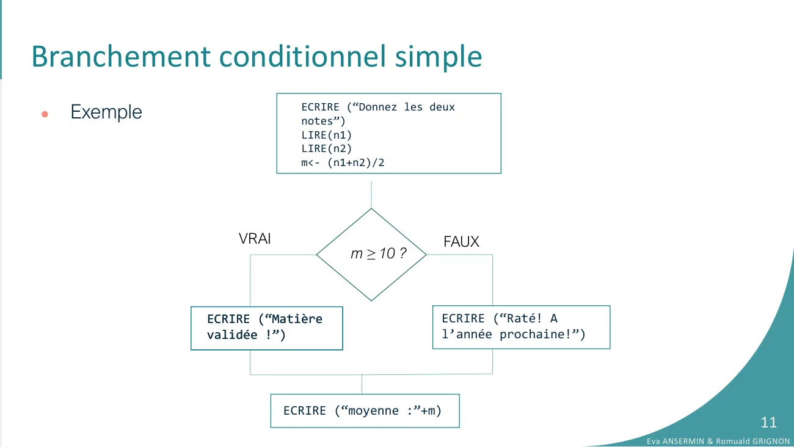
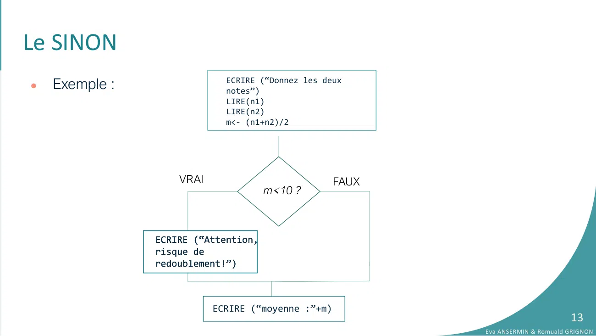
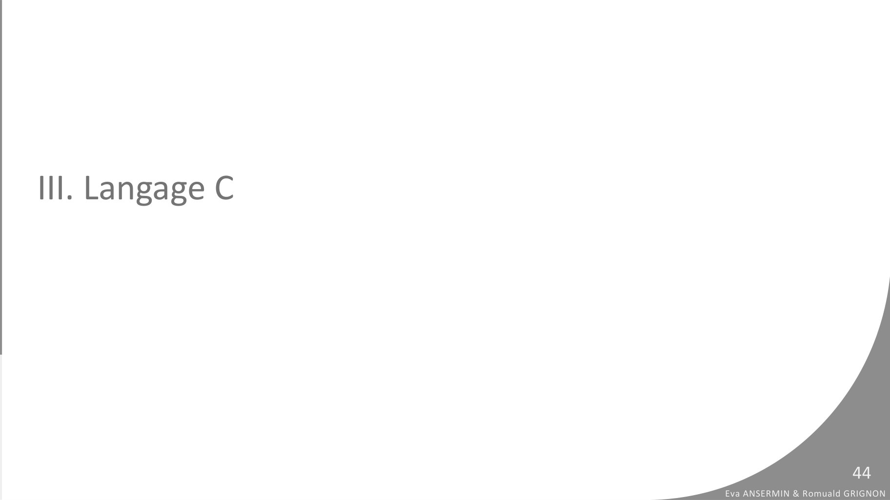

# CM6-Conditions_2023-2024_Informatique1_P1S1_EAnsermin-RGrignon.pdf

[Ouvrir l’original](https://drive.google.com/open?id=1RL2KKzAf4WS0eF2AryJrIe6RWmXro19M) · Les pages signalées comprennent du texte reconnu automatiquement ou des éléments graphiques. Le fac-similé permet de vérifier chaque lecture.

**Pages avec fac-similé ou lecture OCR** — 21, 44.

**Pages présentant un écart entre les deux extractions** — 11, 13.

## Page 1

~~~text
                                                         v1.1

INFORMATIQUE 1
VI. LES BR ANCHEMENTS
CONDITIONNELS

                        Eva Ansermin & Romuald Grignon
~~~

## Page 2

~~~text
Rappel
●   Un algorithme est un ensemble d’instructions s’executant dans un ordre précis.
●   Dans les codes étudiés précédement, toutes les instructions étaient executées
    séquentiellement dans l’ordre : nos programmes font toujours la même chose!
              VARIABLE
                  n1, n2: ENTIER
                  m : REEL
              DEBUT
                  ECRIRE (“Donnez les deux notes”)
                  LIRE(n1)
                  LIRE(n2)
                  m<- (n1+n2)/2
                  ECRIRE(“Le résultat est” + m)
              FIN

                                  Que fait ce code ?                                             2
                                                                        Eva ANSERMIN & Romuald GRIGNON
~~~

## Page 3

~~~text
Problématique
●   Le code permet de calculer la moyenne de deux notes saisies par l’utilisateur.
●   Le résultat final n’est pas prévisible lors de l’écriture du code : il va dépendre de
    ce qui est saisi par l’utilisateur.
●   Problème :

     ○   Comment gérer les cas où l’utilisateur se trompe dans sa saisie / donne une valeur
         incoherente?

     ○   Comment faire si l’on souhaite ensuite indiquer à l’édudiant s’il a la moyenne ?

●   Branchements conditionnels : l’algorithme va tester une condition et, en fonction
    de sa valeur, va effectuer des instructions différentes.                                                    3
                                                                                       Eva ANSERMIN & Romuald GRIGNON
~~~

## Page 4

~~~text
I. Branchements conditionnels

                                                         4
                                Eva ANSERMIN & Romuald GRIGNON
~~~

## Page 5

~~~text
Principe
●   Nous avons une condition dont le résultat va modifier le comportement de
    l’algorithme:
                                      Instructions

                        VRAI                         FAUX
                                       condition

                     Instructions A                   Instructions B

●   Remarque : il ne peut y avoir que deux embranchements par condition.
                                                                                                5
                                                                       Eva ANSERMIN & Romuald GRIGNON
~~~

## Page 6

~~~text
Principe
●   Exemple :

                            ECRIRE (“Donnez les deux
                            notes”)
                            LIRE(n1)
                            LIRE(n2)
                            m <- (n1+n2)/2

                    VRAI                       FAUX
                                   m≥10 ?

                                               ECRIRE (“Raté! A
                ECRIRE (“Matière
                                               l’année
                validée !”)
                                               prochaine!”)
                                                                                           6
                                                                  Eva ANSERMIN & Romuald GRIGNON
~~~

## Page 7

~~~text
Branchement conditionnel simple
●   En pseudo-code on utilise les mots clefs SI, ALORS et SINON

       SI (booléen) ALORS
             Instructions A
       SINON
             Instructions B
       FIN SI

●   La condition testée est une variable booléenne
                                                                                           7
                                                                  Eva ANSERMIN & Romuald GRIGNON
~~~

## Page 8

~~~text
    Branchement conditionnel simple
     ●    En pseudo-code on utilise les mots clefs SI, ALORS et SINON

              SI (booléen) ALORS
                    Instructions A
              SINON
                    Instructions B
              FIN SI
indentation

     ●    La condition testée est une variable booléenne
                                                                                                 8
                                                                        Eva ANSERMIN & Romuald GRIGNON
~~~

## Page 9

~~~text
    Branchement conditionnel simple
     ●    En pseudo-code on utilise les mots clefs SI, ALORS et SINON

              SI (booléen) ALORS
                    Instructions A
              SINON
                    Instructions B
              FIN SI
indentation

          FIN SI indique que le branchement est fini :                  Instructions C
          toute instruction suivante sera exécutée.

     ●    La condition testée est une variable booléenne
                                                                                                           9
                                                                                  Eva ANSERMIN & Romuald GRIGNON
~~~

## Page 10

~~~text
    Branchement conditionnel simple
     ●    En pseudo-code on utilise les mots clefs SI, ALORS et SINON

              SI (booléen) ALORS
                    Instructions A
              SINON
                    Instructions B
              FIN SI
indentation
              Instructions C

                                                                        Instructions C

     ●    La condition testée est une variable booléenne
                                                                                                         10
                                                                                  Eva ANSERMIN & Romuald GRIGNON
~~~

## Page 11

~~~text
Branchement conditionnel simple
●   Exemple                ECRIRE (“Donnez les deux
                           notes”)
                           LIRE(n1)
                           LIRE(n2)
                           m<- (n1+n2)/2

                  VRAI                            FAUX
                                  m ≥ 10 ?

              ECRIRE (“Matière                  ECRIRE (“Raté! A
              validée !”)                       l’année prochaine!”)

                         ECRIRE (“moyenne :”+m)
                                                                                              11
                                                                       Eva ANSERMIN & Romuald GRIGNON
~~~

## Page 12

~~~text
Le SINON
●   Le mot clef SINON est optionnel :
                                                             Instructions

                                               VRAI                          FAUX
       SI (booléen) ALORS                                     condition

            Instructions A
       FIN SI
                                           Instructions A

                                                            Instructions C

●   On effectue des instructions supplémentaires que si une condition est vraie.
                                                                                                    12
                                                                             Eva ANSERMIN & Romuald GRIGNON
~~~

## Page 13

~~~text
Le SINON
●   Exemple :                ECRIRE (“Donnez les deux
                             notes”)
                             LIRE(n1)
                             LIRE(n2)
                             m<- (n1+n2)/2

                    VRAI                            FAUX
                                      m<10 ?

                ECRIRE (“Attention,
                       (“
                risque de
                redoublement!”)

                           ECRIRE (“moyenne :”+m)
                                                                                  13
                                                           Eva ANSERMIN & Romuald GRIGNON
~~~

## Page 14

~~~text
Branchements multiples
●   Il est possible d’avoir plusieurs conditions à la suite afin d’avoir plusieurs
    embranchements. Le mot clef est SINON SI.
                                                                 Instructions

                                                                                   FAUX
       SI (booléen 1) ALORS                             VRAI
                                                                     Condition 1
             Instructions A
       SINON SI (booléen 2) ALORS                   Instructions A
                                                                         VRAI
              Instructions B                                                       Condition 2

       SINON
                                                                 Instructions B                  Instructions C
              Instructions C
       FIN SI

                                                                 Instructions D
                                                                                                                        14
                                                                                                 Eva ANSERMIN & Romuald GRIGNON
~~~

## Page 15

~~~text
Branchements multiples
●   Exemple                      …

                          VRAI                FAUX
                                   m ≥ 15 ?

         ECRIRE(« Félicitations ! »)   VRAI               FAUX
                                               m ≥ 10 ?

                                 ECRIRE(«Ca passe!»)

                                                ECRIRE (“Attention, risque de
                                                redoublement!”)

                              ECRIRE (“moyenne”+m)
                                                                                                       15
                                                                                Eva ANSERMIN & Romuald GRIGNON
~~~

## Page 16

~~~text
Branchements multiples                                                  m=16?

●   Exemple                      …

                          VRAI                FAUX
                                   m ≥ 15 ?

         ECRIRE(« Félicitations ! »)   VRAI               FAUX
                                               m ≥ 10 ?

                                 ECRIRE(«Ca passe!»)

                                                ECRIRE (“Attention, risque de
                                                redoublement!”)

                              ECRIRE (“moyenne”+m)
                                                                                                       16
                                                                                Eva ANSERMIN & Romuald GRIGNON
~~~

## Page 17

~~~text
Branchements multiples                                                  m=16?
                                                                        Félicitation
●   Exemple                      …
                                                                        Moyenne 16

                          VRAI                FAUX
                                   m ≥ 15 ?

         ECRIRE(« Félicitations ! »)   VRAI               FAUX
                                               m ≥ 10 ?

                                 ECRIRE(«Ca passe!»)

                                                ECRIRE (“Attention, risque de
                                                redoublement!”)

                              ECRIRE (“moyenne”+m)
                                                                                                              17
                                                                                       Eva ANSERMIN & Romuald GRIGNON
~~~

## Page 18

~~~text
Branchements multiples                                                   m=13?

●   Exemple                      …

                          VRAI                 FAUX
                                   m ≥ 15 ?

         ECRIRE(« Félicitations ! »)    VRAI               FAUX
                                                m ≥ 10 ?

                                 ECRIRE(«Ca passe!»)

                                                 ECRIRE (“Attention, risque de
                                                 redoublement!”)

                              ECRIRE (“moyenne”+m)
                                                                                                        18
                                                                                 Eva ANSERMIN & Romuald GRIGNON
~~~

## Page 19

~~~text
Branchements multiples                                                  m=13?
                                                                        Ca passe !
●   Exemple                      …
                                                                        Moyenne 13

                          VRAI                FAUX
                                   m ≥ 15 ?

         ECRIRE(« Félicitations ! »)   VRAI               FAUX
                                               m ≥ 10 ?

                                 ECRIRE(«Ca passe!»)

                                                ECRIRE (“Attention, risque de
                                                redoublement!”)

                              ECRIRE (“moyenne”+m)
                                                                                                            19
                                                                                     Eva ANSERMIN & Romuald GRIGNON
~~~

## Page 20

~~~text
Branchements multiples
                                                                                  À l’ordre!
●   Exemple                        …                                              m=16
                                                                                  Ca passe !
                                                                                  Moyenne 16
                          VRAI                  FAUX
                                    m ≥ 10 ?

          ECRIRE(«Ca passe!»)            VRAI               FAUX
                                                 m ≥ 15 ?

                                  ECRIRE(« Félicitations ! »)

                                                  ECRIRE (“Attention, risque de
                                                  redoublement!”)

                                ECRIRE (“moyenne”+m)
                                                                                                               20
                                                                                        Eva ANSERMIN & Romuald GRIGNON
~~~

## Page 21

~~~text
II. Conditions

                                        21
                 Eva ANSERMIN & Romuald GRIGNON
~~~

**Lecture OCR à contrôler**

~~~text
Il. Conditions

Eva ANSERMIN & Romuald GRIGNON
~~~

## Page 22

~~~text
Rappel: variables booléennes
●   Rappel : une variable de type booléenne ne peut prendre que deux valeurs :
    VRAI ou FAUX
●   Déclaration des variables booléennes :

       VARIABLE
             c1, c2 : booleen
       DEBUT
             …
       FIN

                                                                                             22
                                                                      Eva ANSERMIN & Romuald GRIGNON
~~~

## Page 23

~~~text
Opérateurs de comparaison
●   Une variable booléenne peut prendre le résultat d’une comparaison entre 2 variables.
●   Les différents opérateurs de comparaison sont :

         Opérateur mathématique   Pseudo-code
         =                        EST EGAL A
         ≠                        EST DIFFERENT DE
         <                        EST STRICTEMENT INFERIEUR
         >                        EST STRICTEMENT SUPERIEUR
         ≤                        EST INFERIEUR OU EGAL
         ≥                        EST SUPERIEUR OU EGAL

●   On peut également utiliser les opérateurs boléens NON, ET et OU .
                                                                                               23
                                                                        Eva ANSERMIN & Romuald GRIGNON
~~~

## Page 24

~~~text
Opérateurs de comparaison
●   Attention à ne pas confondre :

     ○   L’affectation <- : on donne une valeur à une variable:
                       a<-b // a prend la valeur de b
     ○   La comparaison EST EGAL A : est une condition. On regarde si une
         variable est égale à une autre
                       a EST EGAL A b // est ce que a=b?

●   On peut écrire :
                          VARIABLE
                                 c : booléen
                                 a : entier
                          DEBUT
                                 …
                                 c <- a EST EGAL A 10                                      24
                          FIN                                       Eva ANSERMIN & Romuald GRIGNON
~~~

## Page 25

~~~text
Opérateurs de comparaison
●   Exemple :
            VARIABLE
                  n1, n2: ENTIER
                  m : REEL
                  c1, c2: BOOLEEN
            DEBUT
                ECRIRE (“Donnez les deux notes”)
                LIRE(n1)
                LIRE(n2)
                m <- (n1+n2)/2
                c1 <- m SUPERIEUR OU EGAL A 15
                c2 <- m SUPERIEUR OU EGAL A 10
                SI (c1) ALORS
                     ECRIRE (“Félicitations !”)
                SINON SI (c2) ALORS
                     ECRIRE (“Ca passe!”)
                SINON
                    ECRIRE(“Rattrapage!”)
                FIN SI
            FIN                                                           25
                                                   Eva ANSERMIN & Romuald GRIGNON
~~~

## Page 26

~~~text
                                                       Supposons que m = 9
Opérateurs de comparaison
                                                   variables         valeurs
●   Exemple :                                      m                 9
            VARIABLE                               c1
                  n1, n2: ENTIER
                  m : REEL                         c2
                  c1, c2: BOOLEEN
            DEBUT
                ECRIRE (“Donnez les deux notes”)
                LIRE(n1)
                LIRE(n2)
                m <- (n1+n2)/2
                c1 <- m SUPERIEUR OU EGAL A 15
                c2 <- m SUPERIEUR OU EGAL A 10
                SI (c1) ALORS
                     ECRIRE (“Félicitations !”)
                SINON SI (c2) ALORS
                     ECRIRE (“Ca passe!”)
                SINON
                    ECRIRE(“Rattrapage!”)
                FIN SI
            FIN
                                                                                                26
                                                                         Eva ANSERMIN & Romuald GRIGNON
~~~

## Page 27

~~~text
                                                       Supposons que m = 9
Opérateurs de comparaison
                                                   variables         valeurs
●   Exemple :                                      m                 9
            VARIABLE                               c1                FAUX
                  n1, n2: ENTIER
                  m : REEL                         c2
                  c1, c2: BOOLEEN
            DEBUT
                ECRIRE (“Donnez les deux notes”)
                LIRE(n1)
                LIRE(n2)
                m <- (n1+n2)/2
                c1 <- m SUPERIEUR OU EGAL A 15
                c2 <- m SUPERIEUR OU EGAL A 10
                SI (c1) ALORS
                     ECRIRE (“Félicitations !”)
                SINON SI (c2) ALORS
                     ECRIRE (“Ca passe!”)
                SINON
                    ECRIRE(“Rattrapage!”)
                FIN SI
            FIN                                                                                 27
                                                                         Eva ANSERMIN & Romuald GRIGNON
~~~

## Page 28

~~~text
                                                       Supposons que m = 9
Opérateurs de comparaison
                                                   variables         valeurs
●   Exemple :                                      m                 9
            VARIABLE                               c1                FAUX
                  n1, n2: ENTIER
                  m : REEL                         c2                FAUX
                  c1, c2: BOOLEEN
            DEBUT
                ECRIRE (“Donnez les deux notes”)
                LIRE(n1)
                LIRE(n2)
                m <- (n1+n2)/2
                c1 <- m SUPERIEUR OU EGAL A 15
                c2 <- m SUPERIEUR OU EGAL A 10
                SI (c1) ALORS
                     ECRIRE (“Félicitations !”)
                SINON SI (c2) ALORS
                     ECRIRE (“Ca passe!”)
                SINON
                    ECRIRE(“Rattrapage!”)
                FIN SI
            FIN                                                                                 28
                                                                         Eva ANSERMIN & Romuald GRIGNON
~~~

## Page 29

~~~text
                                                       Supposons que m = 9
Opérateurs de comparaison
                                                   variables         valeurs
●   Exemple :                                      m                 9
            VARIABLE                               c1                FAUX
                  n1, n2: ENTIER
                  m : REEL                         c2                FAUX
                  c1, c2: BOOLEEN
            DEBUT
                ECRIRE (“Donnez les deux notes”)
                LIRE(n1)
                LIRE(n2)
                m <- (n1+n2)/2
                c1 <- m SUPERIEUR OU EGAL A 15
                c2 <- m SUPERIEUR OU EGAL A 10
                SI (c1) ALORS
                     ECRIRE (“Félicitations !”)
                SINON SI (c2) ALORS
                     ECRIRE (“Ca passe!”)
                SINON
                    ECRIRE(“Rattrapage!”)
                FIN SI
            FIN                                                                                 29
                                                                         Eva ANSERMIN & Romuald GRIGNON
~~~

## Page 30

~~~text
                                                       Supposons que m = 9
Opérateurs de comparaison
                                                   variables         valeurs
●   Exemple :                                      m                 9
            VARIABLE                               c1                FAUX
                  n1, n2: ENTIER
                  m : REEL                         c2                FAUX
                  c1, c2: BOOLEEN
            DEBUT
                ECRIRE (“Donnez les deux notes”)
                LIRE(n1)
                LIRE(n2)
                m <- (n1+n2)/2
                c1 <- m SUPERIEUR OU EGAL A 15
                c2 <- m SUPERIEUR OU EGAL A 10
                SI (c1) ALORS
                     ECRIRE (“Félicitations !”)
                SINON SI (c2) ALORS
                     ECRIRE (“Ca passe!”)
                SINON
                    ECRIRE(“Rattrapage!”)
                FIN SI
            FIN                                                                                 30
                                                                         Eva ANSERMIN & Romuald GRIGNON
~~~

## Page 31

~~~text
                                                       Supposons que m = 9
Opérateurs de comparaison
                                                   variables          valeurs
●   Exemple :                                      m                  9
            VARIABLE                               c1                 FAUX
                  n1, n2: ENTIER
                  m : REEL                         c2                 FAUX
                  c1, c2: BOOLEEN
            DEBUT
                ECRIRE (“Donnez les deux notes”)
                LIRE(n1)
                LIRE(n2)
                m <- (n1+n2)/2
                                                        Rattrapage!
                c1 <- m SUPERIEUR OU EGAL A 15
                c2 <- m SUPERIEUR OU EGAL A 10
                SI (c1) ALORS
                     ECRIRE (“Félicitations !”)
                SINON SI (c2) ALORS
                     ECRIRE (“Ca passe!”)
                SINON
                    ECRIRE(“Rattrapage!”)
                FIN SI
            FIN                                                                                  31
                                                                          Eva ANSERMIN & Romuald GRIGNON
~~~

## Page 32

~~~text
Opérateurs de comparaison
●   Autre écriture :
              VARIABLE
                    n1, n2: ENTIER
                    m : REEL
                    c1, c2: BOOLEEN
              DEBUT
                  ECRIRE (“Donnez les deux notes”)
                  LIRE(n1)
                  LIRE(n2)
                  m <- (n1+n2)/2
                  c1 <- m INFERIEUR OU EGAL A 15
                  c2 <- m SUPERIEUR OU EGAL A 10
                  SI (c1 ET c2) ALORS
                       ECRIRE (“Ca passe !”)
                  SINON SI (NON(c2)) ALORS
                       ECRIRE (“Rattrapage!”)
                  SINON
                      ECRIRE(“Félicitations!”)
                  FIN SI
              FIN                                                           32
                                                     Eva ANSERMIN & Romuald GRIGNON
~~~

## Page 33

~~~text
                                                         Supposons que m = 9
Opérateurs de comparaison
                                                     variables         valeurs
●   Autre écriture :                                 m                 9
              VARIABLE                               c1
                    n1, n2: ENTIER
                    m : REEL                         c2
                    c1, c2: BOOLEEN
              DEBUT
                  ECRIRE (“Donnez les deux notes”)
                  LIRE(n1)
                  LIRE(n2)
                  m <- (n1+n2)/2
                  c1 <- m INFERIEUR OU EGAL A 15
                  c2 <- m SUPERIEUR OU EGAL A 10
                  SI (c1 ET c2) ALORS
                       ECRIRE (“Ca passe !”)
                  SINON SI (NON(c2)) ALORS
                       ECRIRE (“Rattrapage!”)
                  SINON
                      ECRIRE(“Félicitations!”)
                  FIN SI
              FIN                                                                                 33
                                                                           Eva ANSERMIN & Romuald GRIGNON
~~~

## Page 34

~~~text
                                                         Supposons que m = 9
Opérateurs de comparaison
                                                     variables         valeurs
●   Autre écriture :                                 m                 9
              VARIABLE                               c1                VRAI
                    n1, n2: ENTIER
                    m : REEL                         c2
                    c1, c2: BOOLEEN
              DEBUT
                  ECRIRE (“Donnez les deux notes”)
                  LIRE(n1)
                  LIRE(n2)
                  m <- (n1+n2)/2
                  c1 <- m INFERIEUR OU EGAL A 15
                  c2 <- m SUPERIEUR OU EGAL A 10
                  SI (c1 ET c2) ALORS
                       ECRIRE (“Ca passe !”)
                  SINON SI (NON(c2)) ALORS
                       ECRIRE (“Rattrapage!”)
                  SINON
                      ECRIRE(“Félicitations!”)
                  FIN SI
              FIN                                                                                 34
                                                                           Eva ANSERMIN & Romuald GRIGNON
~~~

## Page 35

~~~text
                                                         Supposons que m = 9
Opérateurs de comparaison
                                                     variables         valeurs
●   Autre écriture :                                 m                 9
              VARIABLE                               c1                VRAI
                    n1, n2: ENTIER
                    m : REEL                         c2                FAUX
                    c1, c2: BOOLEEN
              DEBUT
                  ECRIRE (“Donnez les deux notes”)
                  LIRE(n1)
                  LIRE(n2)
                  m <- (n1+n2)/2
                  c1 <- m INFERIEUR OU EGAL A 15
                  c2 <- m SUPERIEUR OU EGAL A 10
                  SI (c1 ET c2) ALORS
                       ECRIRE (“Ca passe !”)
                  SINON SI (NON(c2)) ALORS
                       ECRIRE (“Rattrapage!”)
                  SINON
                      ECRIRE(“Félicitations!”)
                  FIN SI
              FIN                                                                                 35
                                                                           Eva ANSERMIN & Romuald GRIGNON
~~~

## Page 36

~~~text
                                                         Supposons que m = 9
Opérateurs de comparaison
                                                     variables         valeurs
●   Autre écriture :                                 m                 9
              VARIABLE                               c1                VRAI
                    n1, n2: ENTIER
                    m : REEL                         c2                FAUX
                    c1, c2: BOOLEEN
              DEBUT
                  ECRIRE (“Donnez les deux notes”)
                  LIRE(n1)
                  LIRE(n2)
                  m <- (n1+n2)/2
                  c1 <- m INFERIEUR OU EGAL A 15
                  c2 <- m SUPERIEUR OU EGAL A 10
                  SI (c1 ET c2) ALORS
                       ECRIRE (“Ca passe !”)
                  SINON SI (NON(c2)) ALORS
                       ECRIRE (“Rattrapage!”)
                  SINON
                      ECRIRE(“Félicitations!”)
                  FIN SI
              FIN                                                                                 36
                                                                           Eva ANSERMIN & Romuald GRIGNON
~~~

## Page 37

~~~text
                                                         Supposons que m = 9
Opérateurs de comparaison
                                                     variables         valeurs
●   Autre écriture :                                 m                 9
              VARIABLE                               c1                VRAI
                    n1, n2: ENTIER
                    m : REEL                         c2                FAUX
                    c1, c2: BOOLEEN
              DEBUT
                  ECRIRE (“Donnez les deux notes”)
                  LIRE(n1)
                  LIRE(n2)
                  m <- (n1+n2)/2
                  c1 <- m INFERIEUR OU EGAL A 15
                  c2 <- m SUPERIEUR OU EGAL A 10
                  SI (c1 ET c2) ALORS
                       ECRIRE (“Ca passe !”)
                  SINON SI (NON(c2)) ALORS
                       ECRIRE (“Rattrapage!”)
                  SINON
                      ECRIRE(“Félicitations!”)
                  FIN SI
              FIN                                                                                 37
                                                                           Eva ANSERMIN & Romuald GRIGNON
~~~

## Page 38

~~~text
                                                         Supposons que m = 9
Opérateurs de comparaison
                                                     variables          valeurs
●   Autre écriture :                                 m                  9
              VARIABLE                               c1                 VRAI
                    n1, n2: ENTIER
                    m : REEL                         c2                 FAUX
                    c1, c2: BOOLEEN
              DEBUT
                  ECRIRE (“Donnez les deux notes”)
                  LIRE(n1)
                  LIRE(n2)
                  m <- (n1+n2)/2
                                                          Rattrapage!
                  c1 <- m INFERIEUR OU EGAL A 15
                  c2 <- m SUPERIEUR OU EGAL A 10
                  SI (c1 ET c2) ALORS
                       ECRIRE (“Ca passe !”)
                  SINON SI (NON(c2)) ALORS
                       ECRIRE (“Rattrapage!”)
                  SINON
                      ECRIRE(“Félicitations!”)
                  FIN SI
              FIN                                                                                  38
                                                                            Eva ANSERMIN & Romuald GRIGNON
~~~

## Page 39

~~~text
Opérateurs de comparaison
●   Attention ! Deux SI à la suite sont différents d’un SI … SINON SI !
VARIABLE                                VARIABLE
      n1, n2: ENTIER                          n1, n2: ENTIER
      m : REEL                                m : REEL
      c1, c2: BOOLEEN                         c1, c2: BOOLEEN
DEBUT                                   DEBUT
    …                                       …                                       m=18?
    c1 <- m SUPERIEUR OU EGAL A 15          c1 <- m SUPERIEUR OU EGAL A 15
    c2 <- m SUPERIEUR OU EGAL A 10          c2 <- m SUPERIEUR OU EGAL A 10
    SI (c1) ALORS                           SI (c1) ALORS
         ECRIRE (“Félicitations !”)              ECRIRE (“Félicitations !”)
    SINON SI (c2) ALORS                     FIN SI
         ECRIRE (“Ca passe!”)               SI (c2) ALORS
    SINON                                        ECRIRE (“Ca passe!”)
        ECRIRE(“Rattrapage!”)               SINON
    FIN SI                                      ECRIRE(“Rattrapage!”)
FIN                                         FIN SI
                                        FIN

                                                                                                     39
                                                                              Eva ANSERMIN & Romuald GRIGNON
~~~

## Page 40

~~~text
Opérateurs de comparaison
●   Attention ! Deux SI à la suite sont différents d’un SI … SINON SI !
VARIABLE                                VARIABLE
      n1, n2: ENTIER                          n1, n2: ENTIER
      m : REEL                                m : REEL
      c1, c2: BOOLEEN                         c1, c2: BOOLEEN
DEBUT                                   DEBUT
    …                                       …                                       m=18?
    c1 <- m SUPERIEUR OU EGAL A 15          c1 <- m SUPERIEUR OU EGAL A 15
    c2 <- m SUPERIEUR OU EGAL A 10          c2 <- m SUPERIEUR OU EGAL A 10
    SI (c1) ALORS                           SI (c1) ALORS
         ECRIRE (“Félicitations !”)              ECRIRE (“Félicitations !”)
    SINON SI (c2) ALORS                     FIN SI
         ECRIRE (“Ca passe!”)               SI (c2) ALORS
    SINON                                        ECRIRE (“Ca passe!”)
        ECRIRE(“Rattrapage!”)               SINON
    FIN SI                                      ECRIRE(“Rattrapage!”)
FIN                                         FIN SI
                                        FIN
           Félicitations !                          Félicitations !                                  40
                                                    Ca passe !                Eva ANSERMIN & Romuald GRIGNON
~~~

## Page 41

~~~text
Opérateurs de comparaison
●   Attention ! Deux SI à la suite sont différents d’un SI … SINON SI !

    c<-condition                                   SI (condition) ALORS
    SI (c) ALORS                                         Instructions A
          Instructions A                           SINON
    SINON                                                Instructions B
          Instructions B                           FIN SI
    FIN SI

                                                                                                 41
                                                                          Eva ANSERMIN & Romuald GRIGNON
~~~

## Page 42

~~~text
Selon cas
●   S’il y a beaucoup de valeurs fixes à tester on peut utiliser le selon cas

                      Selon(a)
                         cas v1 : instructions A
                         cas v2 : instructions B
                         cas v3 : instructions C
                         defaut : instructions D
                      Fin selon

                                                                                                  42
                                                                           Eva ANSERMIN & Romuald GRIGNON
~~~

## Page 43

~~~text
Selon cas
  ●   Exemple (m variable de type entier) :
DEBUT                                         DEBUT
    …                                             …
    SI (m EST EGAL à 20) ALORS                    SELON (m)
        ECRIRE(“Parfait”)                            cas 20 : ECRIRE(“Parfait”)
    SINON SI (m EST EGAL à 19) ALORS                 cas 19 : ECRIRE (“Presque parfait”)
        ECRIRE (“Presque parfait”)
                                                     cas 18 : ECRIRE (“Très bien”)
    SINON SI (m EST EGAL à 18) ALORS
        ECRIRE (“ Très bien”)                       …
    …                                                cas 0 : ECRIRE (“Nul!”)
    SINON SI (m EST EGAL à 0) ALORS                  défaut : ECRIRE (“Note invalide”)
        ECRIRE(“Nul!”)                            FIN SELON
    SINON                                     FIN
        ECRIRE(“La note est invalide”)
    FIN SI
FIN

                                                                                                43
                                                                         Eva ANSERMIN & Romuald GRIGNON
~~~

## Page 44

~~~text
III. Langage C

                                        44
                 Eva ANSERMIN & Romuald GRIGNON
~~~

**Lecture OCR à contrôler**

~~~text
Ill. Langage C

Eva ANSERMIN & Romuald GRIGNON
~~~

## Page 45

~~~text
Les branchements conditionnels

if(condition1){
      instructions1        SI (condition1) ALORS
}                                instructions1
else if (condition2){      SINON SI (condition2) ALORS
       instructions2             instructions2
}                          SINON
else{                            instructions3
      instruction3         FIN SI
}

                                                                      45
                                               Eva ANSERMIN & Romuald GRIGNON
~~~

## Page 46

~~~text
Les branchements conditionnels

if(condition1){
      instructions1            SI (condition1) ALORS
}                                    instructions1
else if (condition2){          SINON SI (condition2) ALORS
       instructions2                 instructions2
}                              SINON
else{                                instructions3
      instruction3             FIN SI
}

   if  si        else if  sinon si    else  sinon
                                                                          46
                                                   Eva ANSERMIN & Romuald GRIGNON
~~~

## Page 47

~~~text
Les branchements conditionnels

if(condition1){
      instructions1                                  SI (condition1) ALORS
}                                                          instructions1
else if (condition2){                                SINON SI (condition2) ALORS
       instructions2                                       instructions2
}                                                    SINON
else{                                                      instructions3
      instruction3                                   FIN SI
}

 Les accolades {   } indiquent le début et la fin des instructions appartenant au branchement.
                                                                                                            47
                                                                                     Eva ANSERMIN & Romuald GRIGNON
~~~

## Page 48

~~~text
Les branchements conditionnels

if(condition1){
      instructions1                                     SI (condition1) ALORS
}                                                             instructions1
else if (condition2){                                   SINON SI (condition2) ALORS
       instructions2                                          instructions2
}                                                       SINON
else{                                                         instruction3
      instruction3                                      FIN SI
}

 Les indentations doivent aussi être présentes en C !
                                                                                                   48
                                                                            Eva ANSERMIN & Romuald GRIGNON
~~~

## Page 49

~~~text
Opérateurs de comparaison
●       Pas de variable booléene en C (ou importer la bibliothèque bool.h). Mais on peut
        utiliser des entiers : 0  FAUX, autre valeur  VRAI
●       Les différents opérateurs de comparaison sont :
    Opérateur            Pseudo-code                 C
    mathématique
    =                    EST EGAL A                  ==
    ≠                    EST DIFFERENT DE            !=
    <                    EST STRICTEMENT INFERIEUR   <
    >                    EST STRICTEMENT SUPERIEUR   >
    ≤                    EST INFERIEUR OU EGAL       <=
    ≥                    EST SUPERIEUR OU EGAL       >=

●       On peut également utiliser les opérateurs ! (non), || (OU), && (ET)                       49
                                                                           Eva ANSERMIN & Romuald GRIGNON
~~~

## Page 50

~~~text
Exemple : majeur ou mineur?

        #include<stdio.h>
        int main(){
               int age;
               printf(“Quel age as-tu?”);
               scanf(“%d”,&age);
               if(age>=18){
                      printf(“Tu es majeur!”);
               }
               else {
                      printf(“Tu es mineur!”);
               }
               return 0;
        }

                                                                        50
                                                 Eva ANSERMIN & Romuald GRIGNON
~~~

## Page 51

~~~text
Exemple : majeur ou mineur?
       #include<stdio.h>
       int main(){
              int age;
              printf(“Quel age as-tu?”);
              scanf(“%d”,&age);
              if(age>=18){
                     printf(“Tu es majeur!”);
              }
              else if(age<18 && age >=14){
                     printf (“Tu es un ado!”);
              }
              else {
                     printf(“Tu es mineur!”);
              }
              return 0;
       }
                                                                        51
                                                 Eva ANSERMIN & Romuald GRIGNON
~~~

## Page 52

~~~text
Exemple : majeur ou mineur?
       #include<stdio.h>
       int main(){
              int age;
              printf(“Quel age as-tu?”);
              scanf(“%d”,&age);
              if(age>=18){
                     printf(“Tu es majeur!”);
              }
              else if(age<18 && age >=14){       Condition implicitement VRAIE
                     printf (“Tu es un ado!”);
              }
              else {
                     printf(“Tu es mineur!”);
              }
              return 0;
       }
                                                                                       52
                                                                Eva ANSERMIN & Romuald GRIGNON
~~~

## Page 53

~~~text
Le ‘switch case’
 switch (a) {
    case v1 :
         …         Selon(a)
         break;       cas v1 : …
    case v2:          cas v2 : …
                      cas v3 : …
         …
                      defaut : …
         break;    Fin selon
    case v3 :
         …
         break;
    default :
         …
         break;
 }                                                        53
                                   Eva ANSERMIN & Romuald GRIGNON
~~~

## Page 54

~~~text
Le switch case
  switch (a) {
     case v1 :
          …
                   Si on écrit pas le break, on fait
          break;
                   également les cas suivants jusqu’à
     case v2:      rencontrer un break.
          …
     case v3 :
          …
          break;
     default :
          …
          break;
  }                                                              54
                                          Eva ANSERMIN & Romuald GRIGNON
~~~

## Page 55

~~~text
Le switch case : exemple
  switch (age) {
      case 5 :
              printf(“un bébé”);                Qu’affiche le code si :
      break;
      case 10:
              printf(“Un enfant”);
      break;
     case 20 :
              printf(“Presque adulte”);
     case 25 :
              printf(“Adulte!”);
     case 31 :
              printf(“Parfait!”);
              break;
      default :
              printf(“Age pas interessant!”);
      }
                                                                                                 55
                                                                          Eva ANSERMIN & Romuald GRIGNON
~~~

## Page 56

~~~text
Le switch case : exemple
  switch (age) {
      case 5 :
              printf(“un bébé”);                Qu’affiche le code si :
      break;                                    age = 10
      case 10:
              printf(“Un enfant”);
      break;
     case 20 :
              printf(“Presque adulte”);
     case 25 :
              printf(“Adulte!”);
     case 31 :
              printf(“Parfait!”);
              break;
      default :
              printf(“Age pas interessant!”);
      }
                                                                                                 56
                                                                          Eva ANSERMIN & Romuald GRIGNON
~~~

## Page 57

~~~text
Le switch case : exemple
  switch (age) {
      case 5 :
              printf(“un bébé”);                Qu’affiche le code si :
      break;                                    age = 10
      case 10:
                                                => enfant
              printf(“Un enfant”);
      break;
     case 20 :
              printf(“Presque adulte”);
     case 25 :
              printf(“Adulte!”);
     case 31 :
              printf(“Parfait!”);
              break;
      default :
              printf(“Age pas interessant!”);
      }
                                                                                                 57
                                                                          Eva ANSERMIN & Romuald GRIGNON
~~~

## Page 58

~~~text
Le switch case : exemple
  switch (age) {
      case 5 :
              printf(“un bébé”);                Qu’affiche le code si :
      break;                                    age = 26
      case 10:
              printf(“Un enfant”);
      break;
     case 20 :
              printf(“Presque adulte”);
     case 25 :
              printf(“Adulte!”);
     case 31 :
              printf(“Parfait!”);
              break;
      default :
              printf(“Age pas interessant!”);
      }
                                                                                                 58
                                                                          Eva ANSERMIN & Romuald GRIGNON
~~~

## Page 59

~~~text
Le switch case : exemple
  switch (age) {
      case 5 :
              printf(“un bébé”);                Qu’affiche le code si :
      break;                                    age = 26
      case 10:
                                                => Age pas interessant
              printf(“Un enfant”);
      break;
     case 20 :
              printf(“Presque adulte”);
     case 25 :
              printf(“Adulte!”);
     case 31 :
              printf(“Parfait!”);
              break;
      default :
              printf(“Age pas interessant!”);
      }
                                                                                             59
                                                                      Eva ANSERMIN & Romuald GRIGNON
~~~

## Page 60

~~~text
Le switch case : exemple
  switch (age) {
      case 5 :
              printf(“un bébé”);                Qu’affiche le code si :
      break;                                    age = 20
      case 10:
              printf(“Un enfant”);
      break;
     case 20 :
              printf(“Presque adulte”);
     case 25 :
              printf(“Adulte!”);
     case 31 :
              printf(“Parfait!”);
              break;
      default :
              printf(“Age pas interessant!”);
      }
                                                                                             60
                                                                      Eva ANSERMIN & Romuald GRIGNON
~~~

## Page 61

~~~text
Le switch case : exemple
  switch (age) {
      case 5 :
              printf(“un bébé”);                Qu’affiche le code si :
      break;                                    age = 20
      case 10:                                  Presque adulte adulte! parfait
              printf(“Un enfant”);
      break;
     case 20 :
              printf(“Presque adulte”);
     case 25 :
              printf(“Adulte!”);
     case 31 :
              printf(“Parfait!”);
              break;
      default :
              printf(“Age pas interessant!”);
      }
                                                                                            61
                                                                     Eva ANSERMIN & Romuald GRIGNON
~~~

## Page 62

~~~text
Conclusion
●   Sans branchement conditionnel, un algorithme s’effectue de manière linéaire et
    fait toujours la même chose.
●   Il arrive très souvent qu’un algorithme doit se comporter différement selon
    certains paramètres.
●   La structure SI, SINON SI, SINON permet de gérer le comportement d’un
    algorithme dans différents cas.
●   Attention à l’ordre et à l’écriture des conditions !
●   Attention à la syntaxe !

                                                                                                 62
                                                                          Eva ANSERMIN & Romuald GRIGNON
~~~
