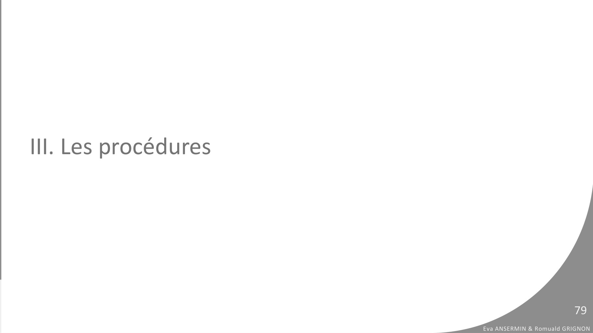
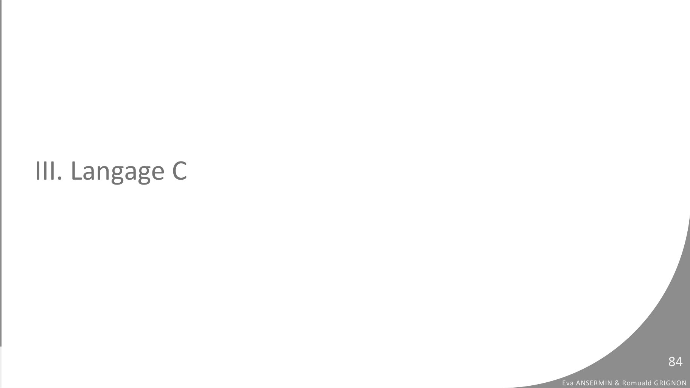

# CM8-Fonctions-et-Procedures_2023-2024_Informatique1_P1S1_EAnsermin-RGrignon.pdf

[Ouvrir l’original](https://drive.google.com/open?id=1JuGYtzamapRTZ3tFdRAhN1jKbZ_zrfuq) · Les pages signalées comprennent du texte reconnu automatiquement ou des éléments graphiques. Le fac-similé permet de vérifier chaque lecture.

**Pages avec fac-similé ou lecture OCR** — 79, 84.

## Page 1

~~~text
                                                                 v1.1

INFORMATIQUE 1
VIII. FONCTIONS ET PROCÉDURES

                                Eva Ansermin & Romuald Grignon
~~~

## Page 2

~~~text
Rappel cours précédent
 PROGRAMME Oracle
 VARIABLES
       a,b,i : entier
 DÉBUT
       a <- 2
       b <- 8
       POUR i DE 2 A 8 FAIRE
          b <- b-a
       FIN POUR
       ECRIRE(b)
 FIN

                                                          2
                               Eva ANSERMIN & Romuald GRIGNON
~~~

## Page 3

~~~text
Rappel cours précédent
                               a   b   i
 PROGRAMME Oracle
 VARIABLES
       a,b,i : entier
 DÉBUT
       a <- 2
       b <- 8
       POUR i DE 2 A 8 FAIRE
          b <- b-a
       FIN POUR
       ECRIRE(b)
 FIN

                                                                      3
                                           Eva ANSERMIN & Romuald GRIGNON
~~~

## Page 4

~~~text
Rappel cours précédent
                               a   b   i
 PROGRAMME Oracle              2
 VARIABLES
       a,b,i : entier
 DÉBUT
       a <- 2
       b <- 8
       POUR i DE 2 A 8 FAIRE
          b <- b-a
       FIN POUR
       ECRIRE(b)
 FIN

                                                                      4
                                           Eva ANSERMIN & Romuald GRIGNON
~~~

## Page 5

~~~text
Rappel cours précédent
                               a   b   i
 PROGRAMME Oracle              2   8
 VARIABLES
       a,b,i : entier
 DÉBUT
       a <- 2
       b <- 8
       POUR i DE 2 A 8 FAIRE
          b <- b-a
       FIN POUR
       ECRIRE(b)
 FIN

                                                                      5
                                           Eva ANSERMIN & Romuald GRIGNON
~~~

## Page 6

~~~text
Rappel cours précédent
                               a   b   i
 PROGRAMME Oracle              2   8   2
 VARIABLES
       a,b,i : entier
 DÉBUT
       a <- 2
       b <- 8
       POUR i DE 2 A 8 FAIRE
          b <- b-a
       FIN POUR
       ECRIRE(b)
 FIN

                                                                      6
                                           Eva ANSERMIN & Romuald GRIGNON
~~~

## Page 7

~~~text
Rappel cours précédent
                               a   b   i
 PROGRAMME Oracle              2   6   2
 VARIABLES
       a,b,i : entier
 DÉBUT
       a <- 2
       b <- 8
       POUR i DE 2 A 8 FAIRE
          b <- b-a
       FIN POUR
       ECRIRE(b)
 FIN

                                                                      7
                                           Eva ANSERMIN & Romuald GRIGNON
~~~

## Page 8

~~~text
Rappel cours précédent
                               a   b   i
 PROGRAMME Oracle              2   6   3
 VARIABLES
       a,b,i : entier
 DÉBUT
       a <- 2
       b <- 8
       POUR i DE 2 A 8 FAIRE
          b <- b-a
       FIN POUR
       ECRIRE(b)
 FIN

                                                                      8
                                           Eva ANSERMIN & Romuald GRIGNON
~~~

## Page 9

~~~text
Rappel cours précédent
                               a   b   i
 PROGRAMME Oracle              2   6   3
 VARIABLES
       a,b,i : entier
 DÉBUT
       a <- 2
       b <- 8
       POUR i DE 2 A 8 FAIRE
          b <- b-a
       FIN POUR
       ECRIRE(b)
 FIN

                                                                      9
                                           Eva ANSERMIN & Romuald GRIGNON
~~~

## Page 10

~~~text
Rappel cours précédent
                               a   b   i
 PROGRAMME Oracle              2   4   3
 VARIABLES
       a,b,i : entier
 DÉBUT
       a <- 2
       b <- 8
       POUR i DE 2 A 8 FAIRE
          b <- b-a
       FIN POUR
       ECRIRE(b)
 FIN

                                                                    10
                                           Eva ANSERMIN & Romuald GRIGNON
~~~

## Page 11

~~~text
Rappel cours précédent
                               a   b   i
 PROGRAMME Oracle              2   4   4
 VARIABLES
       a,b,i : entier
 DÉBUT
       a <- 2
       b <- 8
       POUR i DE 2 A 8 FAIRE
          b <- b-a
       FIN POUR
       ECRIRE(b)
 FIN

                                                                    11
                                           Eva ANSERMIN & Romuald GRIGNON
~~~

## Page 12

~~~text
Rappel cours précédent
                               a   b   i
 PROGRAMME Oracle              2   4   4
 VARIABLES
       a,b,i : entier
 DÉBUT
       a <- 2
       b <- 8
       POUR i DE 2 A 8 FAIRE
          b <- b-a
       FIN POUR
       ECRIRE(b)
 FIN

                                                                    12
                                           Eva ANSERMIN & Romuald GRIGNON
~~~

## Page 13

~~~text
Rappel cours précédent
                               a   b   i
 PROGRAMME Oracle              2   2   4
 VARIABLES
       a,b,i : entier
 DÉBUT
       a <- 2
       b <- 8
       POUR i DE 2 A 8 FAIRE
          b <- b-a
       FIN POUR
       ECRIRE(b)
 FIN

                                                                    13
                                           Eva ANSERMIN & Romuald GRIGNON
~~~

## Page 14

~~~text
Rappel cours précédent
                               a   b   i
 PROGRAMME Oracle              2   2   5
 VARIABLES
       a,b,i : entier
 DÉBUT
       a <- 2
       b <- 8
       POUR i DE 2 A 8 FAIRE
          b <- b-a
       FIN POUR
       ECRIRE(b)
 FIN

                                                                    14
                                           Eva ANSERMIN & Romuald GRIGNON
~~~

## Page 15

~~~text
Rappel cours précédent
                               a   b   i
 PROGRAMME Oracle              2   2   5
 VARIABLES
       a,b,i : entier
 DÉBUT
       a <- 2
       b <- 8
       POUR i DE 2 A 8 FAIRE
          b <- b-a
       FIN POUR
       ECRIRE(b)
 FIN

                                                                    15
                                           Eva ANSERMIN & Romuald GRIGNON
~~~

## Page 16

~~~text
Rappel cours précédent
                               a   b   i
 PROGRAMME Oracle              2   0   5
 VARIABLES
       a,b,i : entier
 DÉBUT
       a <- 2
       b <- 8
       POUR i DE 2 A 8 FAIRE
          b <- b-a
       FIN POUR
       ECRIRE(b)
 FIN

                                                                    16
                                           Eva ANSERMIN & Romuald GRIGNON
~~~

## Page 17

~~~text
Rappel cours précédent
                               a   b   i
 PROGRAMME Oracle              2   0   6
 VARIABLES
       a,b,i : entier
 DÉBUT
       a <- 2
       b <- 8
       POUR i DE 2 A 8 FAIRE
          b <- b-a
       FIN POUR
       ECRIRE(b)
 FIN

                                                                    17
                                           Eva ANSERMIN & Romuald GRIGNON
~~~

## Page 18

~~~text
Rappel cours précédent
                               a   b   i
 PROGRAMME Oracle              2   0   6
 VARIABLES
       a,b,i : entier
 DÉBUT
       a <- 2
       b <- 8
       POUR i DE 2 A 8 FAIRE
          b <- b-a
       FIN POUR
       ECRIRE(b)
 FIN

                                                                    18
                                           Eva ANSERMIN & Romuald GRIGNON
~~~

## Page 19

~~~text
Rappel cours précédent
                               a   b    i
 PROGRAMME Oracle              2   -2   6
 VARIABLES
       a,b,i : entier
 DÉBUT
       a <- 2
       b <- 8
       POUR i DE 2 A 8 FAIRE
          b <- b-a
       FIN POUR
       ECRIRE(b)
 FIN

                                                                     19
                                            Eva ANSERMIN & Romuald GRIGNON
~~~

## Page 20

~~~text
Rappel cours précédent
                               a   b    i
 PROGRAMME Oracle              2   -2   7
 VARIABLES
       a,b,i : entier
 DÉBUT
       a <- 2
       b <- 8
       POUR i DE 2 A 8 FAIRE
          b <- b-a
       FIN POUR
       ECRIRE(b)
 FIN

                                                                     20
                                            Eva ANSERMIN & Romuald GRIGNON
~~~

## Page 21

~~~text
Rappel cours précédent
                               a   b    i
 PROGRAMME Oracle              2   -2   7
 VARIABLES
       a,b,i : entier
 DÉBUT
       a <- 2
       b <- 8
       POUR i DE 2 A 8 FAIRE
          b <- b-a
       FIN POUR
       ECRIRE(b)
 FIN

                                                                     21
                                            Eva ANSERMIN & Romuald GRIGNON
~~~

## Page 22

~~~text
Rappel cours précédent
                               a   b    i
 PROGRAMME Oracle              2   -4   7
 VARIABLES
       a,b,i : entier
 DÉBUT
       a <- 2
       b <- 8
       POUR i DE 2 A 8 FAIRE
          b <- b-a
       FIN POUR
       ECRIRE(b)
 FIN

                                                                     22
                                            Eva ANSERMIN & Romuald GRIGNON
~~~

## Page 23

~~~text
Rappel cours précédent
                               a   b    i
 PROGRAMME Oracle              2   -4   8
 VARIABLES
       a,b,i : entier
 DÉBUT
       a <- 2
       b <- 8
       POUR i DE 2 A 8 FAIRE
          b <- b-a
       FIN POUR
       ECRIRE(b)
 FIN

                                                                     23
                                            Eva ANSERMIN & Romuald GRIGNON
~~~

## Page 24

~~~text
Rappel cours précédent
                               a   b    i
 PROGRAMME Oracle              2   -4   8
 VARIABLES
       a,b,i : entier
 DÉBUT
       a <- 2
       b <- 8
       POUR i DE 2 A 8 FAIRE
          b <- b-a
       FIN POUR
       ECRIRE(b)
 FIN

                                                                     24
                                            Eva ANSERMIN & Romuald GRIGNON
~~~

## Page 25

~~~text
Rappel cours précédent
                               a        b    i
 PROGRAMME Oracle              2        -4   8
 VARIABLES
       a,b,i : entier
 DÉBUT
       a <- 2
       b <- 8
       POUR i DE 2 A 8 FAIRE
          b <- b-a
       FIN POUR
       ECRIRE(b)
 FIN
                                   -4

                                                                          25
                                                 Eva ANSERMIN & Romuald GRIGNON
~~~

## Page 26

~~~text
Un exemple de code pas très pratique…
PROGRAMME sondage
VARIABLES
      rep1, rep2, rep3 : entier
DÉBUT
       REPETER
           ECRIRE(“Vous préférez: 1: les chats 2: les chiens?”)
           LIRE(rep1)
      TANT QUE(rep1≠1 ET rep1≠2)
      REPETER
           ECRIRE(“Vous préférez: 1: les pâtes 2: le riz?”)
           LIRE(rep2)
      TANT QUE(rep2≠1 ET rep2≠2)
      REPETER
           ECRIRE(“Vous préférez: 1: Pikachu 2: Salamèche?”)
           LIRE(rep3)
      TANT QUE(rep3≠1 ET rep3≠2)
      …
      …

FIN

                                                                                           26
                                                                  Eva ANSERMIN & Romuald GRIGNON
~~~

## Page 27

~~~text
On va essayer de faire mieux...
➢   J’ai un code qui s’applique exactement plusieurs fois dans mon programme, ouf,
    merci le copier/coller !

➢   J’ai un autre code, comme précédemment, que je peux répliquer, modulo la valeur
    d’une variable qui change… Il va falloir faire attention !

➢   Je dois modifier mon calcul, heureusement qu’il y a la recherche….

                                                                                                  27
                                                                         Eva ANSERMIN & Romuald GRIGNON
~~~

## Page 28

~~~text
On va essayer de faire mieux...
➢   Plutôt que d’écrire un algorithme en un seul bloc, nous allons assembler des
    morceaux de codes qui peuvent communiquer entre eux.

➢   On divise notre algorithme en utilisant des fonctions.

➢   Utiliser des fonctions permet non seulement de ne pas se répéter mais également
    d’avoir un programme plus clair.

                                                                                                  28
                                                                         Eva ANSERMIN & Romuald GRIGNON
~~~

## Page 29

~~~text
I. Principe des fonctions

                                                     29
                            Eva ANSERMIN & Romuald GRIGNON
~~~

## Page 30

~~~text
Fonction
●   Une FONCTION est une suite d’instructions qui prend une liste de paramètres en
    entrée et produit (retourne) un résultat en sortie au code appelant cette fonction.

●   Lorsqu'on appelle une fonction, il y a trois étapes.

     1.   L'entrée: on fait « rentrer » des informations dans la fonction (en lui donnant des informations
          avec lesquelles travailler).

     2.   Les calculs : grâce aux informations qu'elle a reçues en entrée, la fonction travaille.

     3.   La sortie : une fois qu'elle a fini ses calculs, la fonction renvoie un résultat.
          C'est ce qu'on appelle la sortie, ou encore le retour.                                                       30
                                                                                              Eva ANSERMIN & Romuald GRIGNON
~~~

## Page 31

~~~text
Fonction
    ●    Exemples de fonctions :

                                                    a
                                    𝑠1 𝑥 = 𝑥 ∗ 𝑥                                  𝑠2 (𝑎, 𝑏) = 𝑎𝑏
                      Carré                                      Puissance
x
                                                    b

●       Le concept de fonctions et de ses paramètres est similaire aux fonctions
        mathématiques : les paramètres sont des variables générales à remplacer
        lorsque l’on utilise la fonction.
                                  s1 𝑥 = 𝑥 ∗ 𝑥       s2 𝑎, 𝑏 = 𝑎𝑏
                                                                                                      31
                                                                             Eva ANSERMIN & Romuald GRIGNON
~~~

## Page 32

~~~text
Fonction
    ●     Utilisation pratique des fonctions :

                                                     2
                                                                                       24 = 16
    6                                  6 ∗ 6 = 36                 Puissance
                      Carré
                                                     4

●       Appeller la fonction : exécuter l’algorithme en remplacant les paramètres par des
        valeurs concrètes.
●       Une fonction n’a qu’une seule sortie !
●       Cette sortie est communiquée au reste du programme qui peut l’utiliser.
                                                                                                       32
                                                                              Eva ANSERMIN & Romuald GRIGNON
~~~

## Page 33

~~~text
II. Utilisation des fonctions

                                                         33
                                Eva ANSERMIN & Romuald GRIGNON
~~~

## Page 34

~~~text
Fonction
●   Une FONCTION est une suite d’instructions qui prend une liste de paramètres
    en entrée et produit (retourne) UN UNIQUE résultat en sortie au code
    appelant cette fonction.
●   Syntaxe :
    FONCTION nomDeFonction(liste de paramètres) : type de retour
    VARIABLES
        ...
        result : type de retour
    DEBUT
        …
        RETOURNER result
    FIN
                                                                                             34
                                                                    Eva ANSERMIN & Romuald GRIGNON
~~~

## Page 35

~~~text
Un exemple complet

    // Fonction qui élève un nombre au carré

    FONCTION carre(nb : RÉEL) : RÉEL
    VARIABLE
           res : RÉEL // on déclare une variable résultat
    DÉBUT
           res ← nb * nb
           RETOURNER res // on retourne le résultat
    FIN

                            carre              𝑟𝑒𝑠 = 𝑥 ∗ 𝑥
                nb
                                                                                      35
                                                             Eva ANSERMIN & Romuald GRIGNON
~~~

## Page 36

~~~text
Un exemple complet

    // Fonction qui élève un nombre au carré
                        Liste paramètres

    FONCTION carre(nb : RÉEL) : RÉEL
    VARIABLE
                                                                  Zone de déclaration
           res : RÉEL // on déclare une variable résultat
    DÉBUT
           res ← nb * nb
           RETOURNER res // on retourne le résultat          Algorithme + retour
    FIN

                            carre              𝑟𝑒𝑠 = 𝑥 ∗ 𝑥
                nb
                                                                                          36
                                                                 Eva ANSERMIN & Romuald GRIGNON
~~~

## Page 37

~~~text
Appel et retour d’une fonction

FONCTION carre(nb : RÉEL) : RÉEL
VARIABLE
       res : RÉEL
DÉBUT                              Zone des fonctions
       res ← nb * nb
       RETOURNER res
FIN

PROGRAMME testCarre
VARIABLE
       a, b : RÉEL
DÉBUT                              Programme principal
       a ← 4
       b ← carre(a)
       écrire(a + “2 = ” + res)
FIN                                                                               37
                                                         Eva ANSERMIN & Romuald GRIGNON
~~~

## Page 38

~~~text
Appel et retour d’une fonction

FONCTION carre(nb : RÉEL) : RÉEL
VARIABLE
       res : RÉEL
DÉBUT
       res ← nb * nb
       RETOURNER res               Un algorithme s’exécute toujours en
FIN                                commençant par le programme principal.

PROGRAMME testCarre                Le code des fonctions sera exécuté si les
VARIABLE
       a, b : RÉEL
                                   fonctions sont appelées.
DÉBUT
       a ← 4
       b ← carre(a)
       écrire(a + “2 = ” + res)
FIN                                                                                           38
                                                                     Eva ANSERMIN & Romuald GRIGNON
~~~

## Page 39

~~~text
Appel et retour d’une fonction
FONCTION carre(nb : RÉEL) : RÉEL
VARIABLE
       res : RÉEL
DÉBUT
       res ← nb * nb
       RETOURNER res
FIN

PROGRAMME testCarre
VARIABLE
       a, res : RÉEL
DÉBUT
       a ← 4
       res ← carre(a)
       écrire(a + “2 = ” + res)
FIN

                                                            39
                                   Eva ANSERMIN & Romuald GRIGNON
~~~

## Page 40

~~~text
Appel et retour d’une fonction
FONCTION carre(nb : RÉEL) : RÉEL
VARIABLE
       res : RÉEL
DÉBUT
       res ← nb * nb
       RETOURNER res
FIN

PROGRAMME testCarre
VARIABLE
       a, res : RÉEL
DÉBUT
       a ← 4
       res ← carre(a)
       écrire(a + “2 = ” + res)
FIN

                                                            40
                                   Eva ANSERMIN & Romuald GRIGNON
~~~

## Page 41

~~~text
Appel et retour d’une fonction
FONCTION carre(nb : RÉEL) : RÉEL
VARIABLE
       res : RÉEL
DÉBUT
       res ← nb * nb               L’ appel d’une fonction provoque l’arrêt du
       RETOURNER res               programme/fonction appelante et l’exécution
FIN                                du code de la fonction avec les paramètres.
PROGRAMME testCarre
VARIABLE                           Les paramètres de la fonction vont prendre
       a, res : RÉEL               les valeurs indiquées lors de cet appel.
DÉBUT
       a ← 4
       res ← carre(a)
       écrire(a + “2 = ” + res)
FIN

                                                                                             41
                                                                    Eva ANSERMIN & Romuald GRIGNON
~~~

## Page 42

~~~text
Appel et retour d’une fonction
FONCTION carre(nb : RÉEL) : RÉEL
VARIABLE
       res : RÉEL
DÉBUT
       res ← nb * nb
       RETOURNER res
FIN                                On appelle la fonction
                                   carré avec nb=4
PROGRAMME testCarre
VARIABLE
       a, res : RÉEL
DÉBUT
       a ← 4
       res ← carre(a)
       écrire(a + “2 = ” + res)
FIN

                                                                                     42
                                                            Eva ANSERMIN & Romuald GRIGNON
~~~

## Page 43

~~~text
Appel et retour d’une fonction
FONCTION carre(nb : RÉEL) : RÉEL
VARIABLE
       res : RÉEL
DÉBUT
       res ← nb * nb
       RETOURNER res
FIN

PROGRAMME testCarre
VARIABLE
       a, res : RÉEL
DÉBUT
       a ← 4
       res ← carre(a)
       écrire(a + “2 = ” + res)
FIN

                                                            43
                                   Eva ANSERMIN & Romuald GRIGNON
~~~

## Page 44

~~~text
Appel et retour d’une fonction
FONCTION carre(nb : RÉEL) : RÉEL
VARIABLE
       res : RÉEL
DÉBUT
       res ← nb * nb
       RETOURNER res
FIN

PROGRAMME testCarre
                                   On retourne le resultat : carre(a) va etre
VARIABLE
       a, res : RÉEL               remplacé par cette valeur retournée .
DÉBUT
       a ← 4
       res ← carre(a)
       écrire(a + “2 = ” + res)
FIN

                                                                                                    44
                                                                           Eva ANSERMIN & Romuald GRIGNON
~~~

## Page 45

~~~text
Appel et retour d’une fonction
FONCTION carre(nb : RÉEL) : RÉEL
VARIABLE
       res : RÉEL
DÉBUT
       res ← nb * nb
       RETOURNER res
FIN

PROGRAMME testCarre
VARIABLE                         On reprend le programme normalement
       a, res : RÉEL             après l’appel de la fonction
DÉBUT
       a ← 4
       res ← carre(a)     // res<- 16
       écrire(a + “2 = ” + res)
FIN

                                                                                           45
                                                                  Eva ANSERMIN & Romuald GRIGNON
~~~

## Page 46

~~~text
Appel et retour d’une fonction
FONCTION carre(nb : RÉEL) : RÉEL
VARIABLE
       res : RÉEL
DÉBUT
       res ← nb * nb
       RETOURNER res
FIN

PROGRAMME testCarre
VARIABLE
       a, res : RÉEL
DÉBUT
       a ← 4
       res ← carre(a)     // res<- 16
       écrire(a + “2 = ” + res)
FIN

                                                                 46
                                        Eva ANSERMIN & Romuald GRIGNON
~~~

## Page 47

~~~text
Variables et fonctions
➢   Le programme principal peut être considéré comme la fonction qui s’exécute en
    premier dans l’algorithme.
➢   Les variables déclarées dans une fonction ne sont accessibles que dans celle-ci;
    on dit qu’elles sont locales. Lorsqu’on sort de la fonction, ces variables ne sont
    plus utilisables.
➢   Les seuls moyens de transmettre des données entre les différentes fonctions /
    programme principal sont donc :
      Les paramètres : pour donner des informations à la fonction appelée.
      L’instruction RETOURNER : pour transmettre le résultat de la fonction (une seule valeur).
                                                                                                               47
                                                                                      Eva ANSERMIN & Romuald GRIGNON
~~~

## Page 48

~~~text
RETOURNER
➢   Le mot clef RETOURNER permet de transmettre une unique valeur au reste du
    programme : on ne retourne qu’une variable !
➢   L’instruction RETOURNER provoque un arrêt de la fonction et un retour à l’instruction
    appelante : toute les instructions qui suivent RETOURNER ne s’exécuteront jamais !

           FONCTION carre(nb : RÉEL) : RÉEL
           VARIABLE
                    res : RÉEL // on déclare une variable résultat
           DÉBUT
                    res ← nb * nb
                    RETOURNER res // on retourne le résultat
                    ECRIRE ( « Instruction inutile ! »)
           FIN

                                                                                                  48
➢   Le type de retour doit être cohérent avec ce qui est retourné.       Eva ANSERMIN & Romuald GRIGNON
~~~

## Page 49

~~~text
Exemple d’execution:
 FONCTION carre(nb : RÉEL) : RÉEL
 VARIABLE
          res : RÉEL // on déclare une variable résultat
 DÉBUT
          res ← nb * nb
          RETOURNER res // on retourne le résultat
 FIN

 FONCTION cube(nb : RÉEL) : RÉEL                           Zone des fonctions
 VARIABLE
          res : RÉEL // on déclare une variable résultat
 DÉBUT
          res ← nb * carre(nb)
          RETOURNER res // on retourne le résultat
 FIN

 PROGRAMME testCube
 VARIABLE
          nb, res : RÉEL
 DÉBUT
          nb ← 3                                           Programme principal
          res ← cube(nb)
          écrire(res)                                                                                     49
 FIN
                                                                                 Eva ANSERMIN & Romuald GRIGNON
~~~

## Page 50

~~~text
Exemple d’execution:
 FONCTION carre(nb : RÉEL) : RÉEL
 VARIABLE
          res : RÉEL // on déclare une variable résultat
 DÉBUT
          res ← nb * nb
          RETOURNER res // on retourne le résultat
 FIN

 FONCTION cube(nb : RÉEL) : RÉEL
 VARIABLE
          res : RÉEL // on déclare une variable résultat
 DÉBUT
          res ← nb * carre(nb)
          RETOURNER res // on retourne le résultat
 FIN

                                                           Variables programme principal:
 PROGRAMME testCube
 VARIABLE                                                   nb             res
          nb, res : RÉEL
 DÉBUT
          nb ← 3
          res ← cube(nb)
          écrire(res)                                                                                  50
 FIN
                                                                              Eva ANSERMIN & Romuald GRIGNON
~~~

## Page 51

~~~text
Exemple d’execution:
 FONCTION carre(nb : RÉEL) : RÉEL
 VARIABLE
          res : RÉEL // on déclare une variable résultat
 DÉBUT
          res ← nb * nb
          RETOURNER res // on retourne le résultat
 FIN

 FONCTION cube(nb : RÉEL) : RÉEL
 VARIABLE
          res : RÉEL // on déclare une variable résultat
 DÉBUT
          res ← nb * carre(nb)
          RETOURNER res // on retourne le résultat
 FIN

                                                           Variables programme principal:
 PROGRAMME testCube
 VARIABLE                                                   nb             res
          nb, res : RÉEL
 DÉBUT                                                      3
          nb ← 3
          res ← cube(nb)
          écrire(res)                                                                                  51
 FIN
                                                                              Eva ANSERMIN & Romuald GRIGNON
~~~

## Page 52

~~~text
Exemple d’execution:
 FONCTION carre(nb : RÉEL) : RÉEL
 VARIABLE
          res : RÉEL // on déclare une variable résultat
 DÉBUT
          res ← nb * nb
          RETOURNER res // on retourne le résultat
 FIN

 FONCTION cube(nb : RÉEL) : RÉEL                            Variables fct cube:
 VARIABLE
          res : RÉEL // on déclare une variable résultat
 DÉBUT                                                      nb              res
          res ← nb * carre(nb)                              3
          RETOURNER res // on retourne le résultat
 FIN

                                                           Variables programme principal:
 PROGRAMME testCube
 VARIABLE                                                   nb              res
          nb, res : RÉEL
 DÉBUT                                                      3               ‘cube(3)’
          nb ← 3
          res ← cube(nb)
          écrire(res)                                                                                      52
 FIN
                                                                                  Eva ANSERMIN & Romuald GRIGNON
~~~

## Page 53

~~~text
Exemple d’execution:
 FONCTION carre(nb : RÉEL) : RÉEL
 VARIABLE
          res : RÉEL // on déclare une variable résultat
 DÉBUT
          res ← nb * nb
          RETOURNER res // on retourne le résultat
 FIN

 FONCTION cube(nb : RÉEL) : RÉEL                            Variables fct cube:
 VARIABLE
          res : RÉEL // on déclare une variable résultat
 DÉBUT                                                      nb              res
          res ← nb * carre(nb)                              3
          RETOURNER res // on retourne le résultat
 FIN

                                                           Variables programme principal:
 PROGRAMME testCube
 VARIABLE                                                   nb              res
          nb, res : RÉEL
 DÉBUT                                                      3               ‘cube(3)’
          nb ← 3
          res ← cube(nb)
          écrire(res)                                                                                      53
 FIN
                                                                                  Eva ANSERMIN & Romuald GRIGNON
~~~

## Page 54

~~~text
Exemple d’execution:
 FONCTION carre(nb : RÉEL) : RÉEL                          Variables fct carre:
 VARIABLE
          res : RÉEL // on déclare une variable résultat    nb              res
 DÉBUT
          res ← nb * nb                                     3
          RETOURNER res // on retourne le résultat
 FIN

 FONCTION cube(nb : RÉEL) : RÉEL                            Variables fct cube:
 VARIABLE
          res : RÉEL // on déclare une variable résultat
 DÉBUT                                                      nb              res
          res ← nb * carre(nb)                              3               ‘3 * carre(3)’
          RETOURNER res // on retourne le résultat
 FIN

                                                           Variables programme principal:
 PROGRAMME testCube
 VARIABLE                                                   nb              res
          nb, res : RÉEL
 DÉBUT                                                      3               ‘cube(3)’
          nb ← 3
          res ← cube(nb)
          écrire(res)                                                                                      54
 FIN
                                                                                  Eva ANSERMIN & Romuald GRIGNON
~~~

## Page 55

~~~text
Exemple d’execution:
 FONCTION carre(nb : RÉEL) : RÉEL                          Variables fct carre:
 VARIABLE
          res : RÉEL // on déclare une variable résultat    nb              res
 DÉBUT
          res ← nb * nb                                     3
          RETOURNER res // on retourne le résultat
 FIN

 FONCTION cube(nb : RÉEL) : RÉEL                            Variables fct cube:
 VARIABLE
          res : RÉEL // on déclare une variable résultat
 DÉBUT                                                      nb              res
          res ← nb * carre(nb)                              3               ‘3 * carre(3)’
          RETOURNER res // on retourne le résultat
 FIN

                                                           Variables programme principal:
 PROGRAMME testCube
 VARIABLE                                                   nb              res
          nb, res : RÉEL
 DÉBUT                                                      3               ‘cube(3)’
          nb ← 3
          res ← cube(nb)
          écrire(res)                                                                                      55
 FIN
                                                                                  Eva ANSERMIN & Romuald GRIGNON
~~~

## Page 56

~~~text
Exemple d’execution:
 FONCTION carre(nb : RÉEL) : RÉEL                          Variables fct carre:
 VARIABLE
          res : RÉEL // on déclare une variable résultat    nb              res
 DÉBUT
          res ← nb * nb                                     3               9
          RETOURNER res // on retourne le résultat
 FIN

 FONCTION cube(nb : RÉEL) : RÉEL                            Variables fct cube:
 VARIABLE
          res : RÉEL // on déclare une variable résultat
 DÉBUT                                                      nb              res
          res ← nb * carre(nb)                              3               ‘3 * carre(3)’
          RETOURNER res // on retourne le résultat
 FIN

                                                           Variables programme principal:
 PROGRAMME testCube
 VARIABLE                                                   nb              res
          nb, res : RÉEL
 DÉBUT                                                      3               ‘cube(3)’
          nb ← 3
          res ← cube(nb)
          écrire(res)                                                                                      56
 FIN
                                                                                  Eva ANSERMIN & Romuald GRIGNON
~~~

## Page 57

~~~text
Exemple d’execution:
 FONCTION carre(nb : RÉEL) : RÉEL                          Variables fct carre:
 VARIABLE
          res : RÉEL // on déclare une variable résultat    nb              res
 DÉBUT
          res ← nb * nb                                     3               9
          RETOURNER res // on retourne le résultat
 FIN

 FONCTION cube(nb : RÉEL) : RÉEL                            Variables fct cube:
 VARIABLE
          res : RÉEL // on déclare une variable résultat
 DÉBUT                                                      nb              res
          res ← nb * carre(nb)                              3               ‘3 * carre(3)’
          RETOURNER res // on retourne le résultat
 FIN

                                                           Variables programme principal:
 PROGRAMME testCube
 VARIABLE                                                   nb              res
          nb, res : RÉEL
 DÉBUT                                                      3               ‘cube(3)’
          nb ← 3
          res ← cube(nb)
          écrire(res)                                                                                      57
 FIN
                                                                                  Eva ANSERMIN & Romuald GRIGNON
~~~

## Page 58

~~~text
Exemple d’execution:
 FONCTION carre(nb : RÉEL) : RÉEL
 VARIABLE
          res : RÉEL // on déclare une variable résultat
 DÉBUT
          res ← nb * nb
          RETOURNER res // on retourne le résultat
 FIN

 FONCTION cube(nb : RÉEL) : RÉEL                            Variables fct cube:
 VARIABLE
          res : RÉEL // on déclare une variable résultat
 DÉBUT                                                      nb              res
          res ← nb * carre(nb)                              3               ‘3 * 9’
          RETOURNER res // on retourne le résultat
 FIN

                                                           Variables programme principal:
 PROGRAMME testCube
 VARIABLE                                                   nb              res
          nb, res : RÉEL
 DÉBUT                                                      3               ‘cube(3)’
          nb ← 3
          res ← cube(nb)
          écrire(res)                                                                                      58
 FIN
                                                                                  Eva ANSERMIN & Romuald GRIGNON
~~~

## Page 59

~~~text
Exemple d’execution:
 FONCTION carre(nb : RÉEL) : RÉEL
 VARIABLE
          res : RÉEL // on déclare une variable résultat
 DÉBUT
          res ← nb * nb
          RETOURNER res // on retourne le résultat
 FIN

 FONCTION cube(nb : RÉEL) : RÉEL                            Variables fct cube:
 VARIABLE
          res : RÉEL // on déclare une variable résultat
 DÉBUT                                                      nb              res
          res ← nb * carre(nb)                              3               27
          RETOURNER res // on retourne le résultat
 FIN

                                                           Variables programme principal:
 PROGRAMME testCube
 VARIABLE                                                   nb              res
          nb, res : RÉEL
 DÉBUT                                                      3               ‘cube(3)’
          nb ← 3
          res ← cube(nb)
          écrire(res)                                                                                      59
 FIN
                                                                                  Eva ANSERMIN & Romuald GRIGNON
~~~

## Page 60

~~~text
Exemple d’execution:
 FONCTION carre(nb : RÉEL) : RÉEL
 VARIABLE
          res : RÉEL // on déclare une variable résultat
 DÉBUT
          res ← nb * nb
          RETOURNER res // on retourne le résultat
 FIN

 FONCTION cube(nb : RÉEL) : RÉEL                            Variables fct cube:
 VARIABLE
          res : RÉEL // on déclare une variable résultat
 DÉBUT                                                      nb              res
          res ← nb * carre(nb)                              3               27
          RETOURNER res // on retourne le résultat
 FIN

                                                           Variables programme principal:
 PROGRAMME testCube
 VARIABLE                                                   nb              res
          nb, res : RÉEL
 DÉBUT                                                      3               ‘cube(3)’
          nb ← 3
          res ← cube(nb)
          écrire(res)                                                                                      60
 FIN
                                                                                  Eva ANSERMIN & Romuald GRIGNON
~~~

## Page 61

~~~text
Exemple d’execution:
 FONCTION carre(nb : RÉEL) : RÉEL
 VARIABLE
          res : RÉEL // on déclare une variable résultat
 DÉBUT
          res ← nb * nb
          RETOURNER res // on retourne le résultat
 FIN

 FONCTION cube(nb : RÉEL) : RÉEL
 VARIABLE
          res : RÉEL // on déclare une variable résultat
 DÉBUT
          res ← nb * carre(nb)
          RETOURNER res // on retourne le résultat
 FIN

                                                           Variables programme principal:
 PROGRAMME testCube
 VARIABLE                                                   nb             res
          nb, res : RÉEL
 DÉBUT                                                      3              ‘27’
          nb ← 3
          res ← cube(nb)
          écrire(res)                                                                                  61
 FIN
                                                                              Eva ANSERMIN & Romuald GRIGNON
~~~

## Page 62

~~~text
Exemple d’execution:
 FONCTION carre(nb : RÉEL) : RÉEL
 VARIABLE
          res : RÉEL // on déclare une variable résultat
 DÉBUT
          res ← nb * nb
          RETOURNER res // on retourne le résultat
 FIN

 FONCTION cube(nb : RÉEL) : RÉEL
 VARIABLE
          res : RÉEL // on déclare une variable résultat
 DÉBUT
          res ← nb * carre(nb)
          RETOURNER res // on retourne le résultat
 FIN

                                                           Variables programme principal:
 PROGRAMME testCube
 VARIABLE                                                   nb             res
          nb, res : RÉEL
 DÉBUT                                                      3              27
          nb ← 3
          res ← cube(nb)
          écrire(res)                                                                                    62
 FIN
                                                                                Eva ANSERMIN & Romuald GRIGNON
~~~

## Page 63

~~~text
Exemple d’execution:
 FONCTION carre(nb : RÉEL) : RÉEL
 VARIABLE
          res : RÉEL // on déclare une variable résultat
 DÉBUT
          res ← nb * nb
          RETOURNER res // on retourne le résultat
 FIN

 FONCTION cube(nb : RÉEL) : RÉEL
 VARIABLE
          res : RÉEL // on déclare une variable résultat
 DÉBUT
          res ← nb * carre(nb)
          RETOURNER res // on retourne le résultat
 FIN

                                                           27
 PROGRAMME testCube
 VARIABLE
          nb, res : RÉEL
 DÉBUT
          nb ← 3
          res ← cube(nb)
          écrire(res)                                                                    63
 FIN
                                                                Eva ANSERMIN & Romuald GRIGNON
~~~

## Page 64

~~~text
Fonction à plusieurs paramètres :
 FONCTION soustraction(a,b : RÉEL) : RÉEL
 VARIABLE
        res : réel
 DÉBUT
        res ← a - b
        RETOURNER res
 FIN

 PROGRAMME TEST
 VARIABLE
 x,y : reel
 DEBUT
        x ← 10
        y ← 15
        ECRIRE( soustraction(y, x) )
        ECRIRE( soustraction(x, y) )
 FIN
                                                                     64
                                            Eva ANSERMIN & Romuald GRIGNON
~~~

## Page 65

~~~text
Fonction à plusieurs paramètres :
 FONCTION soustraction(a,b : RÉEL) : RÉEL
 VARIABLE
        res : réel
 DÉBUT
        res ← a - b
        RETOURNER res
 FIN

 PROGRAMME TEST
 VARIABLE
                                            Variables programme principal:
 x,y : reel
 DEBUT                                       x              y
        x ← 10
        y ← 15
        ECRIRE( soustraction(y, x) )
        ECRIRE( soustraction(x, y) )
 FIN
                                                                                     65
                                                            Eva ANSERMIN & Romuald GRIGNON
~~~

## Page 66

~~~text
Fonction à plusieurs paramètres :
 FONCTION soustraction(a,b : RÉEL) : RÉEL
 VARIABLE
        res : réel
 DÉBUT
        res ← a - b
        RETOURNER res
 FIN

 PROGRAMME TEST
 VARIABLE
                                            Variables programme principal:
 x,y : reel
 DEBUT                                       x              y
        x ← 10
                                             10
        y ← 15
        ECRIRE( soustraction(y, x) )
        ECRIRE( soustraction(x, y) )
 FIN
                                                                                     66
                                                            Eva ANSERMIN & Romuald GRIGNON
~~~

## Page 67

~~~text
Fonction à plusieurs paramètres :
 FONCTION soustraction(a,b : RÉEL) : RÉEL
 VARIABLE
        res : réel
 DÉBUT
        res ← a - b
        RETOURNER res
 FIN

 PROGRAMME TEST
 VARIABLE
                                            Variables programme principal:
 x,y : reel
 DEBUT                                       x              y
        x ← 10
                                             10             15
        y ← 15
        ECRIRE( soustraction(y, x) )
        ECRIRE( soustraction(x, y) )
 FIN
                                                                                     67
                                                            Eva ANSERMIN & Romuald GRIGNON
~~~

## Page 68

~~~text
Fonction à plusieurs paramètres :
 FONCTION soustraction(a,b : RÉEL) : RÉEL   Variables fct soustraction:
 VARIABLE
        res : réel                           a          b          res
 DÉBUT                                       15         10
        res ← a - b
        RETOURNER res
 FIN

 PROGRAMME TEST
 VARIABLE
                                            Variables programme principal:
 x,y : reel
 DEBUT                                       x               y
        x ← 10
                                             10              15
        y ← 15
        ECRIRE( soustraction(y, x) )
        ECRIRE( soustraction(x, y) )
 FIN
                                                                                      68
                                                             Eva ANSERMIN & Romuald GRIGNON
~~~

## Page 69

~~~text
Fonction à plusieurs paramètres :
 FONCTION soustraction(a,b : RÉEL) : RÉEL   Variables fct soustraction:
 VARIABLE
        res : réel                           a          b          res
 DÉBUT                                       15         10
        res ← a - b
        RETOURNER res
 FIN

 PROGRAMME TEST
 VARIABLE
                                            Variables programme principal:
 x,y : reel
 DEBUT                                       x               y
        x ← 10
                                             10              15
        y ← 15
        ECRIRE( soustraction(y, x) )
        ECRIRE( soustraction(x, y) )
 FIN
                                                                                      69
                                                             Eva ANSERMIN & Romuald GRIGNON
~~~

## Page 70

~~~text
Fonction à plusieurs paramètres :
 FONCTION soustraction(a,b : RÉEL) : RÉEL   Variables fct soustraction:
 VARIABLE
        res : réel                           a          b          res
 DÉBUT                                       15         10         5
        res ← a - b
        RETOURNER res
 FIN

 PROGRAMME TEST
 VARIABLE
                                            Variables programme principal:
 x,y : reel
 DEBUT                                       x               y
        x ← 10
                                             10              15
        y ← 15
        ECRIRE( soustraction(y, x) )
        ECRIRE( soustraction(x, y) )
 FIN
                                                                                      70
                                                             Eva ANSERMIN & Romuald GRIGNON
~~~

## Page 71

~~~text
Fonction à plusieurs paramètres :
 FONCTION soustraction(a,b : RÉEL) : RÉEL
 VARIABLE
        res : réel
 DÉBUT
        res ← a - b
        RETOURNER res
 FIN

 PROGRAMME TEST
 VARIABLE
                                                     Variables programme principal:
 x,y : reel
 DEBUT                                                x              y
        x ← 10
                                                      10             15
        y ← 15
        ECRIRE( soustraction(y, x) ) // retour = 5
        ECRIRE( soustraction(x, y) )
 FIN
                                                                                              71
                                                                     Eva ANSERMIN & Romuald GRIGNON
~~~

## Page 72

~~~text
Fonction à plusieurs paramètres :
 FONCTION soustraction(a,b : RÉEL) : RÉEL
 VARIABLE
        res : réel
 DÉBUT
        res ← a - b
        RETOURNER res
 FIN
                                    5
 PROGRAMME TEST
 VARIABLE
                                            Variables programme principal:
 x,y : reel
 DEBUT                                       x              y
        x ← 10
                                             10             15
        y ← 15
        ECRIRE( soustraction(y, x) )
        ECRIRE( soustraction(x, y) )
 FIN
                                                                                     72
                                                            Eva ANSERMIN & Romuald GRIGNON
~~~

## Page 73

~~~text
Fonction à plusieurs paramètres :
 FONCTION soustraction(a,b : RÉEL) : RÉEL   Variables fct soustraction:
 VARIABLE
        res : réel                           a          b          res
 DÉBUT                                       10         15
        res ← a - b
        RETOURNER res
 FIN

 PROGRAMME TEST
 VARIABLE
                                            Variables programme principal:
 x,y : reel
 DEBUT                                       x               y
        x ← 10
                                             10              15
        y ← 15
        ECRIRE( soustraction(y, x) )
        ECRIRE( soustraction(x, y) )
 FIN
                                                                                      73
                                                             Eva ANSERMIN & Romuald GRIGNON
~~~

## Page 74

~~~text
Fonction à plusieurs paramètres :
 FONCTION soustraction(a,b : RÉEL) : RÉEL   Variables fct soustraction:
 VARIABLE
        res : réel                           a          b          res
 DÉBUT                                       10         15
        res ← a - b
        RETOURNER res
 FIN

 PROGRAMME TEST
 VARIABLE
                                            Variables programme principal:
 x,y : reel
 DEBUT                                       x               y
        x ← 10
                                             10              15
        y ← 15
        ECRIRE( soustraction(y, x) )
        ECRIRE( soustraction(x, y) )
 FIN
                                                                                      74
                                                             Eva ANSERMIN & Romuald GRIGNON
~~~

## Page 75

~~~text
Fonction à plusieurs paramètres :
 FONCTION soustraction(a,b : RÉEL) : RÉEL   Variables fct soustraction:
 VARIABLE
        res : réel                           a          b          res
 DÉBUT                                       10         15         -5
        res ← a - b
        RETOURNER res
 FIN

 PROGRAMME TEST
 VARIABLE
                                            Variables programme principal:
 x,y : reel
 DEBUT                                       x               y
        x ← 10
                                             10              15
        y ← 15
        ECRIRE( soustraction(y, x) )
        ECRIRE( soustraction(x, y) )
 FIN
                                                                                      75
                                                             Eva ANSERMIN & Romuald GRIGNON
~~~

## Page 76

~~~text
Fonction à plusieurs paramètres :
 FONCTION soustraction(a,b : RÉEL) : RÉEL
 VARIABLE
        res : réel
 DÉBUT
        res ← a - b
        RETOURNER res
 FIN

 PROGRAMME TEST
 VARIABLE
                                                      Variables programme principal:
 x,y : reel
 DEBUT                                                 x              y
        x ← 10
                                                       10             15
        y ← 15
        ECRIRE( soustraction(y, x) )
        ECRIRE( soustraction(x, y) ) // retour = -5
 FIN
                                                                                               76
                                                                      Eva ANSERMIN & Romuald GRIGNON
~~~

## Page 77

~~~text
Fonction à plusieurs paramètres :
 FONCTION soustraction(a,b : RÉEL) : RÉEL
 VARIABLE
        res : réel
 DÉBUT
        res ← a - b
        RETOURNER res
 FIN
                                    5
                                    -5
 PROGRAMME TEST
 VARIABLE
 x,y : reel
 DEBUT
        x ← 10
        y ← 15
        ECRIRE( soustraction(y, x) )
        ECRIRE( soustraction(x, y) )
 FIN
                                                                     77
                                            Eva ANSERMIN & Romuald GRIGNON
~~~

## Page 78

~~~text
Fonction à plusieurs paramètres :
 FONCTION soustraction(a,b : RÉEL) : RÉEL
 VARIABLE
        res : réel
 DÉBUT
        res ← a - b
        RETOURNER res
 FIN

 PROGRAMME TEST                             C’est l’ordre des paramètres qui importe !!!
 VARIABLE
 x,y : reel
 DEBUT
        x ← 10
        y ← 15
        ECRIRE( soustraction(y, x) )
        ECRIRE( soustraction(x, y) )
 FIN
                                                                                                   78
                                                                          Eva ANSERMIN & Romuald GRIGNON
~~~

## Page 79

~~~text
III. Les procédures

                                               79
                      Eva ANSERMIN & Romuald GRIGNON
~~~

**Lecture OCR à contrôler**

~~~text
Ill. Les procédures

Eva ANSERMIN & Romuald GRIGNON
~~~

## Page 80

~~~text
Procédure
●   Une procédure est un ensemble d’instructions prenant en entrée des paramètres et
    qui ne retourne rien.
●   Elles sont souvent utilisées pour réaliser des affichages ou réaliser des traitements
    sans effets de bord.
●   Exemple simple :

         PROCEDURE salutation(nom : chaîne)
         DÉBUT
                ECRIRE(“Bonjour”+nom+”!”)
         FIN

●   Une procédure peut avoir des paramètres d’entrée : elle n’a juste pas d’instruction
                                                                                                    80
    RETOURNER et s’arrête au mot clef FIN.                                 Eva ANSERMIN & Romuald GRIGNON
~~~

## Page 81

~~~text
Un exemple complet
PROCEDURE affMenu() // quand il n’a pas de paramètre, écrire ()
DÉBUT
    ECRIRE("     -- MENU --")
    ECRIRE("1 : Faire ceci")
    ECRIRE("2 : Faire cela")                                           -- MENU --
    ECRIRE("3 : Configuration")
    ECRIRE("0 : Quitter")
                                                                  1 : Faire ceci
    ECRIRE("Faites votre choix")                                  2 : Faire cela
FIN
                                                                  3 : Configuration
PROGRAMME Continuer                                               0 : Quitter
VARIABLES
      choix : entier
                                                                  Faites votre choix
DÉBUT                                                             |
       FAIRE     // pourquoi cette boucle ?
            affMenu()
            lire(choix)
      TANT QUE (choix < 0) ou (choix > 3)
      SELON choix :
            CAS 1: ...
            CAS 2: ...
            CAS 3: ...
            CAS 0: ...
      FIN SELON                                                                                          81
FIN                                                                             Eva ANSERMIN & Romuald GRIGNON
~~~

## Page 82

~~~text
Et notre exemple de depart ?

PROGRAMME sondage
VARIABLES
      rep1, rep2, rep3 : entier
DÉBUT
       FAIRE
           ECRIRE(“Vous préférez: 1: les chats? 2: les chiens?”)
           LIRE(rep1)
      TANT QUE(rep1≠1 ET rep1≠2)
      FAIRE
           ECRIRE(“Vous préférez: 1: les pâtes? 2: le riz?”)
           LIRE(rep2)
      TANT QUE(rep2≠1 ET rep2≠2)
      FAIRE
           ECRIRE(“Vous préférez: 1: Pikachu? 2: Salamèche?”)
           LIRE(rep3)
      TANT QUE(rep3≠1 ET rep3≠2)
      …
      …

FIN                                                                                         82
                                                                   Eva ANSERMIN & Romuald GRIGNON
~~~

## Page 83

~~~text
Et notre exemple de depart ?
FONCTION ask(q : chaine):entier
VARIABLE
       rep :entier
       REPETER
               ECRIRE(q)
               LIRE(rep)
       TANT QUE(rep≠1 ET rep≠2)
       RETOURNER rep

PROGRAMME sondage
VARIABLES
     rep1, rep2, rep3 : entier
DÉBUT
     Rep1 <- ask(« Vous préférez: 1: les chats? 2: les chiens? »)
     Rep2 <- ask(« Vous préférez: 1: les pâtes? 2: le riz?     »)
     Rep3 <- ask(« Vous préférez: 1: Pikachu?   2: Salameche? »)
     …
     …
                                                                                             83
FIN
                                                                    Eva ANSERMIN & Romuald GRIGNON
~~~

## Page 84

~~~text
III. Langage C

                                          84
                 Eva ANSERMIN & Romuald GRIGNON
~~~

**Lecture OCR à contrôler**

~~~text
Ill. Langage C

Eva ANSERMIN & Romuald GRIGNON
~~~

## Page 85

~~~text
Procédures

 void proc1(int a, float b) {   Procédure proc1(a: entier,
     instructions               b: réel) {
 }                                  instructions
                                }

                                                                        85
                                               Eva ANSERMIN & Romuald GRIGNON
~~~

## Page 86

~~~text
Procédures

    ●   Utilisation du mot clé void   void afficher(int n) {
    ●   Syntaxe :                         int i ;
                                          for (i=1; i<=n; i++) {
void nomProc(paramètres) {                    printf("%d", i) ;
                                          }
        instructions ;
}                                     }

                                                                                 86
                                                        Eva ANSERMIN & Romuald GRIGNON
~~~

## Page 87

~~~text
Fonctions

  int ma_fonction(int a, float b) {   Fonction ma_function(a: entier,
    …                                 b:réel): entier
    return (…) ;                      DEBUT
  }                                     …
                                        RETOURNER (…)
                                      FIN

                                                                                  87
                                                         Eva ANSERMIN & Romuald GRIGNON
~~~

## Page 88

~~~text
Fonctions

                                         int factorielle(int n) {
 ●   Syntaxe :                               int f = 1 ;
                                             int i ;
typeRetourné nomFonction(paramètres) {
     …                                       for (i=1; i<=n; i++) {
     return(…)                                    f = f * i;
}                                            }
                                             return f ;
                                         }

                                                                                       88
                                                              Eva ANSERMIN & Romuald GRIGNON
~~~

## Page 89

~~~text
La fonction main
●    En C le programme principal est vu comme une fonction/procédure. C’est une
     fonction qui s’appelle main. Elle peut même avoir des paramètres !
●    C’est cette fonction qui sera parcourue lors de l’exécution du programme.

       Mode fonction :                                 Mode procédure:
    int main(){                                  void main(){
        …                                            …
        return 0 ;                               }
    }

                                                                                                   89
                                                                          Eva ANSERMIN & Romuald GRIGNON
~~~

## Page 90

~~~text
Prototypage
 ●   Le compilateur C lit les fichiers source de haut en bas. Il constatera donc une
     erreur si une fonction/procédure est déclarée APRÈS sa première utilisation.
     L’exemple suivant provoque une erreur de compilation.

                    #include <stdio.h>
                    int main () {
                        printf("%d", toto(3)) ;
                        return 0 ;
                    }

                    int toto (int n) {
                        return 2 * n ;
                    }                                                                            90
                                                                        Eva ANSERMIN & Romuald GRIGNON
~~~

## Page 91

~~~text
Prototypage
 ●   Solution : déclarer les fonctions dans le bon ordre.

                      int toto (int n) {
                          return 2 * n ;
                      }

                      int main () {
                          printf("%d",toto(3)) ;
                          return 0 ;
                      }

                                                                                     91
                                                            Eva ANSERMIN & Romuald GRIGNON
~~~

## Page 92

~~~text
Quelques fonctions utiles
●   Les bibliothèques sont des recueils de fonctions déjà écrites que vous pouvez
    utiliser une fois la bonne bibliothèque incluse avec #define
●   Fonctions mathématiques (dans math.h) :
     ○  sqrt(float a)        : racine carrée de a
     ○  pow(int a, int b) : a puissance b
     ○  cos(float a), sin(float a), tan(float a)
     ○  …
●   Autres :
     ○   rand() : génère un entier aléatoire (stdlib.h)
     ○   printf(…) affiche des caractères à l’écran (stdio.h)
     ○   scanf(…) permet de saisir des valeurs au clavier (stdio.h)
     ○   …
•   Le site koor.fr fourni une liste et des exemples d’utilisation des fonctions
                                                                                 92
    existantes en C.
                                                                       Eva ANSERMIN & Romuald GRIGNON
~~~

## Page 93

~~~text
Structure générale d’un fichier .c
                  #Instructions du préprocesseur
                      (inclusion bibliothèque)

                      Code de la fonction 1

                      Code de la fonction 2

                               ….

                     Code de la fonction main

                                                                            93
                                                   Eva ANSERMIN & Romuald GRIGNON
~~~

## Page 94

~~~text
Pour conclure...
➢   Objectifs de concision, clarté, indépendance et réutilisabilité.

➢   Une fonction = une fonctionnalité ; une fonction ne doit pas faire plus d’une
    vingtaine de lignes !

➢   Pensez à respecter les préconditions / à appeler correctement vos fonctions
    (nombres de paramètres, ordre, types, etc…).

                                                                                                  94
                                                                         Eva ANSERMIN & Romuald GRIGNON
~~~
