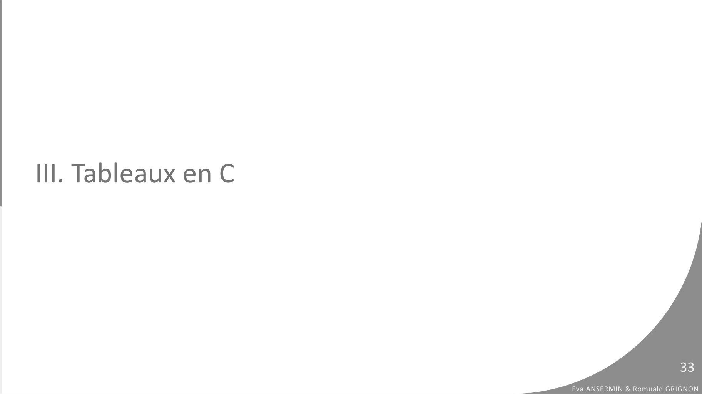
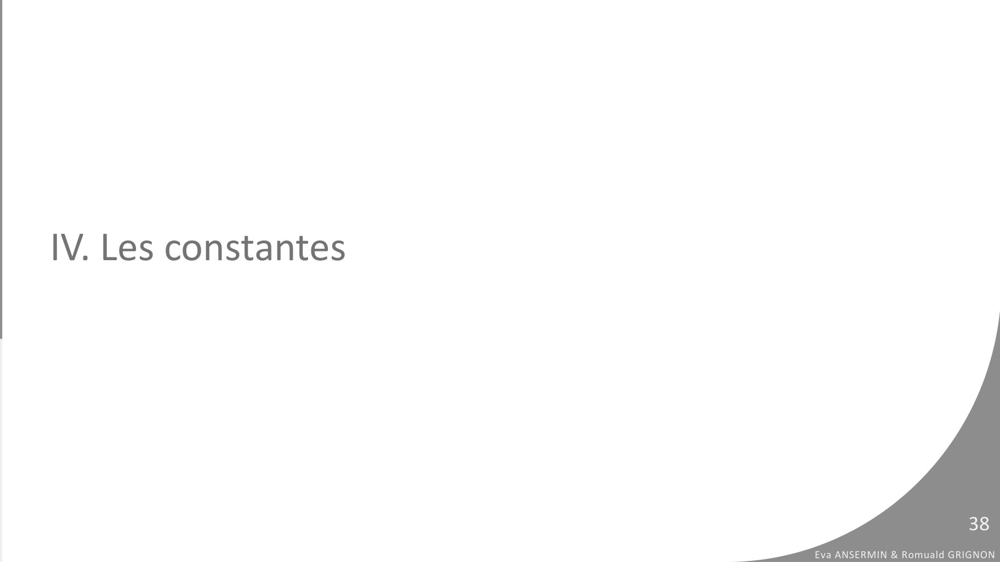

# CM9-Tableaux_2023-2024_Informatique1_P1S1_EAnsermin-RGrignon.pdf

[Ouvrir l’original](https://drive.google.com/open?id=1VGi0Jkvq9_gtFZfSoDkHya7rkJOqnwpU) · Les pages signalées comprennent du texte reconnu automatiquement ou des éléments graphiques. Le fac-similé permet de vérifier chaque lecture.

**Pages avec fac-similé ou lecture OCR** — 33, 38.

## Page 1

~~~text
                                                                              v1.1

INFORMATIQUE 1
I X . L E S TA B L E A U X S TAT I Q U E S

                                             Eva Ansermin & Romuald Grignon
~~~

## Page 2

~~~text
I. Principe des tableaux

                                                      2
                           Eva ANSERMIN & Romuald GRIGNON
~~~

## Page 3

~~~text
Le problème avec les variables classiques…
●   Je veux écrire un algorithme pour gérer les notes du devoir de la promo (les consulter, calculer la
    moyenne générale, l’écart type, trouver la plus basse etc… ).
●    Problème : vous êtes 330 !

                                                                                                                   3
                                                                                        Eva ANSERMIN & Romuald GRIGNON
~~~

## Page 4

~~~text
Le problème avec les variables classiques…
●   Je veux écrire un algorithme pour gérer les notes du devoir de la promo (les
    consulter, calculer la moyenne générale, l’écart type, trouver la plus basse etc… ).
●    Problème : vous êtes 330 !

     PROGRAMME note_etudiant
     VARIABLE
          moy: réel
          note1 : réel
          note2 : reel
          note3: reel
           …
           note330 : reel
     DEBUT:
           moy<- (note1+note2+…+note330)/330
                                                                                                     4
                                                                          Eva ANSERMIN & Romuald GRIGNON
~~~

## Page 5

~~~text
Les tableaux
●   Un tableau est un ensemble de variables ordonnées de même type.

                             Un Tableau d’entiers

●   Manipuler un tableau avec beaucoup de « cases » est plus simple que de
    manipuler plein de variables séparément.
                                                                                                 5
                                                                      Eva ANSERMIN & Romuald GRIGNON
~~~

## Page 6

~~~text
Les tableaux
●   Un tableau est un ensemble de variables ordonnées de même type.

                               Un Tableau d’entiers

●   Le nombre de cases d’un tableau est sa taille.

●   Dans cet exemple, la taille du tableau est 10.                                               6
                                                                      Eva ANSERMIN & Romuald GRIGNON
~~~

## Page 7

~~~text
Les tableaux
●   Un tableau est un ensemble de variables ordonnées de même type.

                                                                                                 7
                                                                      Eva ANSERMIN & Romuald GRIGNON
~~~

## Page 8

~~~text
Les tableaux
●   Un tableau est un ensemble de variables ordonnées de même type.

                     La première case a l’indice 0 !                                             8
                                                                      Eva ANSERMIN & Romuald GRIGNON
~~~

## Page 9

~~~text
Les tableaux
●   Pour accéder à une case du tableau :
                        Nom_Tableau[indice de la case]

                                                                                    9
                                                         Eva ANSERMIN & Romuald GRIGNON
~~~

## Page 10

~~~text
Les tableaux
●   Pour accéder à une case du tableau :
                        Nom_Tableau[indice de la case]

     note

    note[1]=
    note[4]=
    note[10]=

                                                                                  10
                                                         Eva ANSERMIN & Romuald GRIGNON
~~~

## Page 11

~~~text
Les tableaux
●   Pour accéder à une case du tableau :
                                 Nom_Tableau[indice de la case]

     note

    note[1]= 13
    note[4]= 14
    note[10]= la case n’existe pas!

                                                                                           11
                                                                  Eva ANSERMIN & Romuald GRIGNON
~~~

## Page 12

~~~text
Le tableau dans la mémoire
●   Les cases d’un tableau sont stockées à la suite dans la mémoire.

●   Ex : tab : [10, 23, 10 ,8] // tableau de taille 4

                     tab[0]

                     tab[1]

                     tab[2]

                     tab[3]
                                                                                                12
                                                                       Eva ANSERMIN & Romuald GRIGNON
~~~

## Page 13

~~~text
Le tableau dans la mémoire
●   Les cases d’un tableau sont stockées à la suite dans la mémoire.

tab[0]                              L’adresse de tab[2] est l’adresse de tab[0]+2

tab[1]
                                    L’indice du tableau indique donc où l’ordinateur
tab[2]                              doit aller chercher la variable dans la mémoire.

tab[3]

                                                                                                 13
                                                                        Eva ANSERMIN & Romuald GRIGNON
~~~

## Page 14

~~~text
Le tableau dans la mémoire
●   Les cases d’un tableau sont stockées à la suite dans la mémoire.

tab[0]
                                              tab[4] indique la case mémoire tab[0]+4
tab[1]
                                              tab[4] est « en dehors » de l’espace
tab[2]
                                              mémoire réservé pour le tableau!

tab[3]

tab[4]
                                                                                                14
                                                                       Eva ANSERMIN & Romuald GRIGNON
~~~

## Page 15

~~~text
Attention aux indices des tableaux !
 ●   Si on déclare un tableau de taille N, on ne peut que utiliser des indices entre
     0 et N-1.
 ●   Si on utilise un indice incorrect (tableau[-1], tableau[N], tableau[N+10]), on
     essaye d’accéder à une partie de la mémoire sans en avoir l’autorisation.
 ●   C’est la Segmentation fault.

                                                                                                   15
                                                                          Eva ANSERMIN & Romuald GRIGNON
~~~

## Page 16

~~~text
II. Tableaux en pseudo-code

                                                       16
                              Eva ANSERMIN & Romuald GRIGNON
~~~

## Page 17

~~~text
Déclaration et manipulation d’un tableau : pseudo-
code
●   Déclaration d’un tableau statique :

     nomTableau[taille] : TABLEAU DE type

     o   Le tableau possède taille cases contenant une variable de type

     o   La première case est nomTableau[0] la dernière nomTableau[taille-1]
●   Manipulation :
     Accéder à la (i+1)ème case : nomTableau[i], 0 ≤ i < taille.
●   Initialisation :
       Par défaut les valeurs ne sont pas initialisées
       On peut initialiser un tableau de la manière suivante :
                 nomTableau <- {val1, val2, val3…}
                                                                                                   17
                 Dans ce cas, les cases non indiquées sont mises à zéro. Eva ANSERMIN & Romuald GRIGNON
~~~

## Page 18

~~~text
Déclaration et manipulation d’un tableau : pseudo-
code
●   Exemple

    PROGRAMME note_etudiant
    VARIABLE
         moy: réel
         note[330]: tableau de réels
    DEBUT:
         note <- {0} // Met toutes les cases à 0 !
         note[0] <- 15
         note[10] <- 13
         ECRIRE(“Le premier étudiant a la note de ”+note[0])
         …
    FIN
                                                                                18
                                                       Eva ANSERMIN & Romuald GRIGNON
~~~

## Page 19

~~~text
Parcours d’un tableau
●   Soit le tableau suivant :
                  tab[10]: tableau d’entiers

●   On souhaite afficher son contenu.

                                                                        19
                                               Eva ANSERMIN & Romuald GRIGNON
~~~

## Page 20

~~~text
Parcours d’un tableau
●    Soit le tableau suivant :
                   tab[10]: tableau d’entiers

●    On souhaite afficher son contenu.

                          ECRIRE(tab)

 ●   Il faut afficher toutes les cases du tableau une par une !

                                                                                           20
                                                                  Eva ANSERMIN & Romuald GRIGNON
~~~

## Page 21

~~~text
Parcours d’un tableau
●    Soit le tableau suivant :
                   tab[10]: tableau d’entiers

 ●   Il faut afficher toute les cases du tableau une par une !

                DEBUT
                        ECRIRE(tab[0])

                                                                                          21
                                                                 Eva ANSERMIN & Romuald GRIGNON
~~~

## Page 22

~~~text
Parcours d’un tableau
●    Soit le tableau suivant :
                   tab[10]: tableau d’entiers

 ●   Il faut afficher toute les cases du tableau une par une !

                DEBUT
                        ECRIRE(tab[0])
                        ECRIRE(tab[1])

                                                                                          22
                                                                 Eva ANSERMIN & Romuald GRIGNON
~~~

## Page 23

~~~text
Parcours d’un tableau
●    Soit le tableau suivant :
                   tab[10]: tableau d’entiers

 ●   Il faut afficher toute les cases du tableau une par une !

                DEBUT
                        ECRIRE(tab[0])
                        ECRIRE(tab[1])
                        ECRIRE(tab[2])

                                                                                          23
                                                                 Eva ANSERMIN & Romuald GRIGNON
~~~

## Page 24

~~~text
Parcours d’un tableau
●    Soit le tableau suivant :
                   tab[10]: tableau d’entiers

 ●   Il faut afficher toute les cases du tableau une par une !

                DEBUT
                        ECRIRE(tab[0])
                        ECRIRE(tab[1])
                        ECRIRE(tab[2])
                        …

                                                                                          24
                                                                 Eva ANSERMIN & Romuald GRIGNON
~~~

## Page 25

~~~text
Parcours d’un tableau
●    Soit le tableau suivant :
                   tab[10]: tableau d’entiers

 ●   Il faut afficher toute les cases du tableau une par une !

                DEBUT
                        ECRIRE(tab[0])
                        ECRIRE(tab[1])
                        ECRIRE(tab[2])
                        …
                        ECRIRE(tab[9])
                FIN
                                                                                          25
                                                                 Eva ANSERMIN & Romuald GRIGNON
~~~

## Page 26

~~~text
Parcours d’un tableau
●   Soit le tableau suivant :
                  tab[10]: tableau d’entiers

●   Il faut afficher toute les cases du tableau une par une !

         POUR i de 0 à 10 FAIRE
              ECRIRE(tab[i])
         FIN POUR

                                                                                         26
                                                                Eva ANSERMIN & Romuald GRIGNON
~~~

## Page 27

~~~text
Parcours d’un tableau
●   Pour réaliser une opération sur un tableau, il faut parcourir toutes ses cases.

                  POUR i de 0 à taille FAIRE
                       instruction
                  FIN POUR

                                                                                                   27
                                                                          Eva ANSERMIN & Romuald GRIGNON
~~~

## Page 28

~~~text
Parcours d’un tableau
 ●   Exemple : remplir un tableau de note aléatoire:

 PROGRAMME note_etudiant
 VARIABLE
      moy: réel
      note[330]: tableau de reels
      i : entier
 DEBUT:
      POUR i de 0 à 330    FAIRE
            note[i] <- ALEA( 20 )
      FIN POUR
 FIN

                                                                                28
                                                       Eva ANSERMIN & Romuald GRIGNON
~~~

## Page 29

~~~text
Passage de tableaux à une fonction

●   On peut directement passer un tableau en argument d’une fonction.

      PROCEDURE afficher_tab(tab[330]: tableau de réels)
      VARIABLE
            i : entier
      DEBUT
            POUR i de 0 à 330 FAIRE
                 ECRIRE(tab[i])
            FIN POUR
      FIN

                                                                                                 29
                                                                        Eva ANSERMIN & Romuald GRIGNON
~~~

## Page 30

~~~text
Passage de tableaux à une fonction
●    Pour l’appel à la fonction, il suffit de donner le nom du tableau

    PROCEDURE afficher_tab(tab[330]: tableau de réels)
    VARIABLE
          i : entier
    DEBUT
          POUR i de 0 à 330 FAIRE
               ECRIRE(tab[i])
          FIN POUR
    FIN

    VARIABLE
          note[330]: tableau de reels
    DEBUT
          afficher_tab(note)                                                                      30
                                                                         Eva ANSERMIN & Romuald GRIGNON
~~~

## Page 31

~~~text
Passage de tableaux à une fonction
●    Plus général !

    PROCEDURE afficher_tab(tab: tableau de reels, taille : entier)
    VARIABLE
          i : entier
    DEBUT
          POUR i de 0 à taille FAIRE
               ECRIRE(tab[i])
          FIN POUR
    FIN

    VARIABLE
          note[330]: tableau de reels
    DEBUT
          afficher_tab(note, 330)                                                  31
                                                          Eva ANSERMIN & Romuald GRIGNON
~~~

## Page 32

~~~text
Passage de tableaux à une fonction
●   Si un tableau passé en argument est modifié dans une fonction, il sera modifié
    dans le reste du programme sans avoir besoin d’utiliser de return!
PROCEDURE increm_tab(tab: tableau de reels, taille : entier)
VARIABLE
      i : entier
DEBUT
      POUR i de 0 à taille FAIRE
           tab[i] <- tab[i]+1
      FIN POUR
FIN

VARIABLE
      note[330]: tableau de reels
DEBUT
                                                                                                 32
       increm_tab(note, 330)      // note sera modifiée !!
                                                                        Eva ANSERMIN & Romuald GRIGNON
~~~

## Page 33

~~~text
III. Tableaux en C

                                              33
                     Eva ANSERMIN & Romuald GRIGNON
~~~

**Lecture OCR à contrôler**

~~~text
Ill. Tableaux en C

Eva ANSERMIN & Romuald GRIGNON
~~~

## Page 34

~~~text
Déclaration et manipulation d’un tableau : langage C
●   Déclaration d’un tableau statique :

      type nomTableau[taille]

●   Manipulation :
     Accéder à la (i+1)ème case : nomTableau[i], 0 ≤ i < taille.

●   Initialisation :
       On peut initialiser toutes les cases du tableau lors de la déclaration:
                 type nomTableau[taille]={val1, val2, val3, …}
                         Les cases non indiquées sont mises à zéros

                                                                                                     34
                                                                            Eva ANSERMIN & Romuald GRIGNON
~~~

## Page 35

~~~text
Déclaration et manipulation d’un tableau : langage C
●    Exemple

    int main(){
         float note[330]={0}; // met toutes les cases à 0
         note[0]=15;
         note[10]=13;
         printf(“La note du premier étudiant est %f”,note[0]);
         return 0;
    }

                                                                                  35
                                                         Eva ANSERMIN & Romuald GRIGNON
~~~

## Page 36

~~~text
Parcours d’un tableau : langage C
●   Exemple

int main(){
     float note[330]={0}; // met toutes les cases à 0
     note[0]=15;
     note[10]=13;
     printf(“Les notes des étudiants sont:”);
     for (i=0; i<330 ; i++){// boucle pour parcourir le tableau
           printf(“%f”,note[i]);
     }
     return 0;
}
                                                                               36
                                                      Eva ANSERMIN & Romuald GRIGNON
~~~

## Page 37

~~~text
Passage de tableaux à une fonction : langage C
void afficher_tab(float tab[], int taille){   // /!\ au []
     int i;
     for (i=0;i<taille;i++){
           printf(“%f”,tab[i]);
     }
}

int main(){
     float note[330];
     …
     afficher_tab(note, 330);
     return 0;
}
                                                                               37
                                                      Eva ANSERMIN & Romuald GRIGNON
~~~

## Page 38

~~~text
IV. Les constantes

                                              38
                     Eva ANSERMIN & Romuald GRIGNON
~~~

**Lecture OCR à contrôler**

~~~text
IV. Les constantes

Eva ANSERMIN & Romuald GRIGNON
~~~

## Page 39

~~~text
Gestion de la taille du tableau
●   La taille du tableau est fixe. Il faut donc toujours utiliser la
    même valeur dans le code.
●   3 possibilités :

     ○   Ecrire la valeur qui correspond à sa taille tout le temps !
         ( comme on a fait jusqu’ici )

                                                                                                39
                                                                       Eva ANSERMIN & Romuald GRIGNON
~~~

## Page 40

~~~text
Gestion de la taille du tableau
●   La taille du tableau est fixe. Il faut donc toujours utiliser la
    même valeur dans le code.
●   3 possibilités :

     ○   Ecrire la valeur qui correspond à sa taille tout le temps !
         ( comme on a fait jusqu’ici )

     ○   Points négatifs :

          ■   Il faut s’en souvenir

          ■   Si on souhaite changer entre deux exécutions, il
              faudra changer la valeur partout !
                                                                                                40
                                                                       Eva ANSERMIN & Romuald GRIGNON
~~~

## Page 41

~~~text
Gestion de la taille du tableau
●   La taille du tableau est fixe. Il faut donc toujours utiliser la
    même valeur dans le code.
●   3 possibilités :

     ○   Ecrire la valeur qui correspond à sa taille tous le temps !
         ( comme on a fait jusqu’ici )

     ○   Ecrire la taille du tableau dans une variable.

                                                                                                41
                                                                       Eva ANSERMIN & Romuald GRIGNON
~~~

## Page 42

~~~text
Gestion de la taille du tableau
●   La taille du tableau est fixe. Il faut donc toujours utiliser la
    même valeur dans le code.
●   3 possibilités :

     ○   Ecrire la valeur qui correspond à sa taille tous le temps !
         ( comme on a fait jusqu’ici )

     ○   Ecrire la taille du tableau dans une variable.

          ■   Points négatifs :

                ●   C’est dangereux : il ne faut pas modifier la
                    valeur de la variable en cours de code !
                                                                                                42
                ●   Certains compilateurs ne l’acceptent pas.          Eva ANSERMIN & Romuald GRIGNON
~~~

## Page 43

~~~text
Gestion de la taille du tableau
●   La taille du tableau est fixe. Il faut donc toujours utiliser la
    même valeur dans le code.
●   3 possibilités :

     ○   Ecrire la valeur qui correspond à sa taille tous le temps !
         ( comme on a fait jusqu’ici )

     ○   Ecrire la taille du tableau dans une variable.

     ○   Utiliser une constante.

                                                                                                43
                                                                       Eva ANSERMIN & Romuald GRIGNON
~~~

## Page 44

~~~text
Les constantes

●   Les constantes sont des données dont la valeur est fixée (au contraire des
    variables).

●   Les constantes sont dites globales : elle sont accessibles par l’ensemble du code
    (au contraire des variables locales qui ne sont valables que dans les fonctions
    dans lesquelles elles sont déclarées).

●   Par convention, le nom des constantes en est MAJUSCULE

●   Pratique pour les tailles de tableaux qui ne doivent pas être modifiées !
                                                                                                   44
                                                                          Eva ANSERMIN & Romuald GRIGNON
~~~

## Page 45

~~~text
Les constantes

●   En pseudo-code
PROGRAMME test_tableau
Constante TAILLE1 <- 10
Constante TAILLE2 <- 200                 Partout dans le code TAILLE1 sera
                                         remplacé par 10 et TAILLE2 par 200

VARIABLE
      tab1[TAILLE1]: tableau de reels
      tab2[TAILLE2] :tableau d’entiers
      …
DEBUT
 POUR i de 0 à TAILLE1 FAIRE
      …                                                                                 45
                                                               Eva ANSERMIN & Romuald GRIGNON
~~~

## Page 46

~~~text
Les constantes
●   En langage C

#include<stdio.h>
#define TAILLE1 10
#define TAILLE2 200             Partout dans le code TAILLE1 sera
                                remplacé par 10 et TAILLE2 par 200
int main(){
     float tab1[TAILLE1];
     int tab2[TAILLE2];
     …
     for (i=0; i<TAILLE1;i++)
     …

                                                                               46
                                                      Eva ANSERMIN & Romuald GRIGNON
~~~

## Page 47

~~~text
Définition de constantes en C
●   On peut utiliser #define pour remplacer une expression par une autre.

Syntaxe : #define symbole expression :
    #define N 10
    #define VRAI 1
    #defince FAUX 0
    #define PI 3.141592655359

●   Les commandes commençant par # sont toujours en premier dans le code.
    Ces commandes sont des directives du compilateur. On les appelle
                                                  http://www.spencerauthor.com/pblproblems/
                                                                                                           47
    directives du préprocesseur.
                                                                                  Eva ANSERMIN & Romuald GRIGNON
~~~

## Page 48

~~~text
Structure générale d’un fichier .c
                  #Instructions du préprocesseur
                      (inclusion bibliothèque)
                       + définition constante

                      Code de la fonction 1

                      Code de la fonction 2

                               ….

                     Code de la fonction main

                                                                            48
                                                   Eva ANSERMIN & Romuald GRIGNON
~~~

## Page 49

~~~text
V. Les chaînes de caractères

                                                        49
                               Eva ANSERMIN & Romuald GRIGNON
~~~

## Page 50

~~~text
Tableau en C : cas des chaînes de caractères.

●   Le type chaîne de caractères n’existe pas directement en C. Ceci est dû au fait
    qu’on ne connait pas le nombre de caractères nécessaire à l’avance.

●   Une chaîne de caractères est une suite ordonnée de caractères.

                                                                                                 50
                                                                        Eva ANSERMIN & Romuald GRIGNON
~~~

## Page 51

~~~text
Tableau en C : cas des chaînes de caractères.

●   Le type chaîne de caractères n’existe pas directement en C. Ceci est dû au fait
    qu’on ne connait pas le nombre de caractères nécessaire à l’avance.

●   Une chaîne de caractères est une suite ordonnée de caractères.

●   Pour gérer un ensemble de caractères, on va utiliser un tableau de caractères.

         B        o        n        j        o        u       r

                                                                                                 51
                                                                        Eva ANSERMIN & Romuald GRIGNON
~~~

## Page 52

~~~text
Tableau en C : cas des chaînes de caractères.
• Si on veut stocker/ afficher un mot on peut donc faire ceci:
int i=0;
char chaine[6]; // Tableau de 6 char pour stocker S-a-l-u-t

chaine[0] = 'S’; //toujours mettre les ‘ ‘ quand on manipule des caractères
chaine[1] = 'a';
chaine[2] = 'l';
chaine[3] = 'u';
chaine[4] = ‘t’;
// On peut écrire aussi directement chaine= " Salut" !

// afficher le mot:
for(i=0;i<5;i++){
       printf(“%c“, chaine[i]);
}
                                                                                            52
                                                                   Eva ANSERMIN & Romuald GRIGNON
~~~

## Page 53

~~~text
Tableau en C : cas des chaînes de caractères.
 • Problème : on ne connait pas toujours le nombre de caractères nécessaire!
 • Pour cela, un utilise un caractère de fin de chaîne : ‘\0’ ;
 • Exemple :
   char maChaine[8] = ‘Salut’;

    maChaine        S     a      l   u     t   \0

                                                                                             53
                                                                    Eva ANSERMIN & Romuald GRIGNON
~~~

## Page 54

~~~text
Tableau en C : cas des chaînes de caractères.
• Pour afficher un mot/ phrase sans en connaitre la taille :

                     int i=0;

                     // afficher le mot:
                     while(chaine[i] != ‘\0 ’){
                            printf(“%c“, chaine[i]);
                            i++
                     }

                                                                                        54
                                                               Eva ANSERMIN & Romuald GRIGNON
~~~

## Page 55

~~~text
 Tableau en C : cas des chaînes de caractères.
    • Heureusement le C peut faire cela automatiquement grâce au format %s.
char nom[100];    // pourquoi 100 ?
printf(“Comment tu t’appelles? “);

scanf(“%s“,nom); // rempli automatiquement le tableau nom et met \0 à la fin,
pas de & !!!

printf(“Bonjour %s”, nom); //affiche les cases de nom jusqu’à ‘\0’

}

• La bibliothèque string.h comporte des fonctions utiles à la gestion des chaînes
     de caractères.
                                                                                                  55
                                                                         Eva ANSERMIN & Romuald GRIGNON
~~~

## Page 56

~~~text
VI. Les tableaux à deux dimensions

                                                              56
                                     Eva ANSERMIN & Romuald GRIGNON
~~~

## Page 57

~~~text
Tableau à deux dimensions : principe
• Les tableaux peuvent avoir deux ou plusieurs dimensions !
• Les tableau à deux dimensions peuvent être vus comme des matrices.
                     1     10    15    ..    …     …     20
                     3     …     …     …     …     …     1
                     6     …     …     …     …     …     7
                     7     …     …     …     …     …     50
                     10    …     …     …     …     …     16
                     18    …     …     …     …     …     7
                     13    …     …     …     …     …     12

• On manipule alors deux indices : l’un représentant les lignes, l’autre les                       57
   colonnes.                                                              Eva ANSERMIN & Romuald GRIGNON
~~~

## Page 58

~~~text
Tableau à deux dimensions : principe
• Les tableaux peuvent avoir deux ou plusieurs dimensions !
• Les tableau à deux dimensions peuvent être vus comme des matrices.
            Indice colonne   0    1    2    …    …   Nombre colonne -2   Nombre colonne -1
      Indice ligne
      0                      1    10   15   ..   …   …                   20
      1                      3    …    …    …    …   …                   1
      2                      6    …    …    …    …   …                   7
      …                      7    …    …    …    …   …                   50
      …                      10   …    …    …    …   …                   16
      Nombre ligne -2        18   …    …    …    …   …                   7
      Nombre ligne -1        13   …    …    …    …   …                   12

• On manipule alors deux indices : l’un représentant les lignes, l’autre les                                 58
   colonnes.                                                                        Eva ANSERMIN & Romuald GRIGNON
~~~

## Page 59

~~~text
Tableau à deux dimensions : déclaration
• En pseudo –code :
  • Déclaration du tableau :
             nomTableau [nbLignes, nbColonnes] : TABLEAU DE type
   •    Accéder à la ième ligne, jème colonne :
             nomTableau[i,j], 0 ≤ i < nbLignes, 0 ≤ j < nbColonnes

 • En C :
   • Déclaration :
        type monTab2D[nbLignes][nbColonnes];
         exemple : int monTab2D[3][4] // Tableau de 3 lignes et 4 colonnes ;
       • Accéder à la ième ligne, jème colonne :
              nomTableau[i][j], 0 ≤ i < nbLignes, 0 ≤ j < nbColonnes
                                                                                          59
                                                                 Eva ANSERMIN & Romuald GRIGNON
~~~

## Page 60

~~~text
Tableau à deux dimensions

• Un tableau 2D peut également être vu comme un tableau de tableaux :
   chaque ligne est un sous-tableau.

• C’est ce principe qui est utilisé pour l’initiation d’un tableau:
                     T <- { {0, 1, 1, 0}, {0, -2, 0, 7}, {-1, 1, 0, 0} }

                                0    1     1    0

                                0    -2    0    7

                                -1   1     0    0
                                                                                                    60
                                                                           Eva ANSERMIN & Romuald GRIGNON
~~~

## Page 61

~~~text
Mémoire
• Dans la mémoire le stockage des valeurs est consécutif !
                                      0         1     1       0
                                      0        -2     0       7

                                      -1        1     0       0

          T[0][0]                     T[1][0]                     T[2][0]
             0      1     1       0       0      -2    0      7    -1       1   0     0

                 Première ligne               Seconde ligne             Troisième ligne                            61
                                                                                          Eva ANSERMIN & Romuald GRIGNON
~~~

## Page 62

~~~text
Mémoire
 • Un tableau 2D en C est équivalent à un tableau de taille :
      nombre_ligne * nombre_colonne.

 • Lors de la manipulation du tableau le calcul suivant est donc effetcué :

                         tab2D[i][j] ⇔ case du tableau n° i * nombre_colonne + j

           T[0][0]                     T[1][0]                   T[2][0]
              0      1     1       0     0       -2   0      7    -1       1   0     0

                  Première ligne             Seconde ligne             Troisième ligne                            62
                                                                                         Eva ANSERMIN & Romuald GRIGNON
~~~

## Page 63

~~~text
En résumé
• Les tableaux permettent de stocker un ensemble de variables. Ils peuvent avoir
   plusieurs dimensions et sont de taille fixe.
• Les valeurs du tableau sont stockées les unes à la suite des autres dans la mémoire.
• Attention aux indices !

                                                                                                 63
                                                                        Eva ANSERMIN & Romuald GRIGNON
~~~
